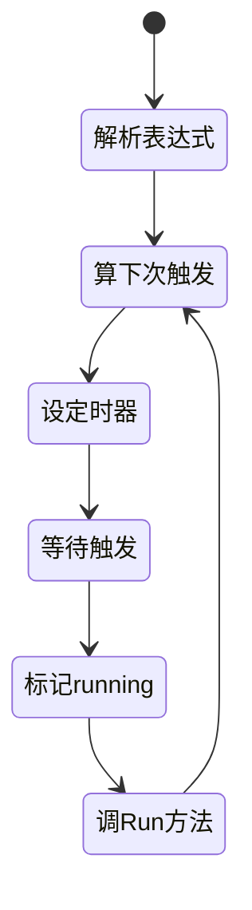

# 709 cron 定时任务 · 深挖

## 思路与架构
从"我要周期跑一段逻辑"到"正确落地"的收敛路径：先定表达式（5/6 位、占位符语义）→ 选注册方式（AddFunc 闭包 / AddJob 结构体）→ 注入时区与 recover 链 → Start 常驻 → 查 Entries/Remove/Stop 运维。调度器本质是"解析表达式→算下次触发→定时器等待→到点执行→再算下次"的闭环 `[源码]`。

文字说明：① 注册时解析 cron 表达式得到 Schedule；② 调度循环取出最近触发、用 `time.Timer` 等待；③ 到点加锁标记 running 再调用 Job.Run；④ 执行完重新计算下次，形成闭环。单 Job 串行，不重叠。

## 方案取舍
| 维度 | AddFunc | AddJob |
|---|---|---|
| 注册形态 | 直接传 func() | 传实现 Run() 的 Job |
| 可挂中间件 | 需 NewChain 包裹 | 天然可 NewChain |
| 复用/配置 | 闭包捕获外部变量 | 结构体字段携带 name 等 |
| 可读性 | 简单任务好 | 复杂任务清晰 |

选型：简单回调用 AddFunc；需要 recover/日志链、或任务带状态用 AddJob + NewChain。

## 细节与核心 API
- `cron.New(opts...)`：建调度器，可链式传 `WithSeconds()`、`WithLocation(loc)`、`WithLogger(log)`。
- `AddFunc(spec, func()) (EntryID, error)`：闭包注册，表达式非法返回 error。
- `AddJob(spec, Job) (EntryID, error)`：Job 接口仅需 `Run()`。
- `NewChain(cron.Recover(logger), cron.WithLogger(log)).Then(job)`：包裹 panic 捕获与日志 `[源码]`。
- `Entries()` / `Entry(id)`：查 Entry 的 `Next`/`Prev`/`Schedule`。
- `Remove(id)` / `Stop()`：删计划 / 终止调度（Stop 会等正在跑的结束）。

## 性能量级与实测数据
- 调度开销主要在"算下次触发"与定时器等待，单任务纳秒~微秒级，瓶颈在 Job 本身 `[经验]`。
- 注册 N 个任务后，每次循环按时间排序取最近触发，调度为 O(N) 扫描（v3 实现），任务极多时需评估 `[存疑]`。
- 验证版本：go1.26.5 / robfig/cron v3。

## 答题技巧
- 30 秒版：cron 用表达式描述"日历时刻"，`WithSeconds` 决定 5/6 位；AddFunc/AddJob 注册；时区与 recover 别漏；Start 且主协程常驻。
- 3 分钟版：展开表达式占位符、两种注册、时区事故链、panic 兜底、串行不重叠。
- 白板版：先写 `0 0 2 * * *`（每天 2 点），再补 `WithSeconds`/`WithLocation`/`Recover`。
- 不会怎么接：被问"cron 内部怎么保证不重叠"→ 答"v3 单 Job 串行、run 里标记 running，靠调度器串行保证；要并发得自己开 goroutine" `[经验]`。

## 广度与深度延伸
- 横向：与 `time.Ticker`（相对间隔）、`time.AfterFunc`（单次）、系统 crontab / k8s CronJob 对比。
- 纵向：cron v3 解析器基于标准 cron 语法扩展；错过触发无内置 catch-up；分布式场景需自己用数据库/分布式锁去重（避免多实例重复跑）。
- 进阶：`cron.WithParser` 自定义语法；`Schedule.Next(time.Time)` 可手动算下次。

## 反问环节
- 贵司定时任务是单实例还是多实例？多实例重复执行怎么防（分布式锁/唯一执行者）？
- 任务错过执行窗口（宕机）有补跑（catch-up）诉求吗？现有方案怎么兜底？
