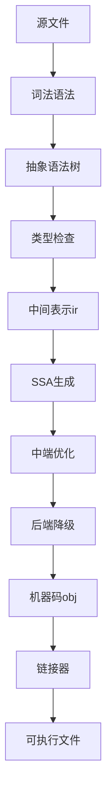

# 804 深挖 · Go 编译流水线全貌

## 思路与架构
从 `go build` 一条命令切入：源码文本 → 前端(parse/typecheck) → 中端(ir→ssa 优化) → 后端(arch 生成 obj) → 链接(cmd/link)。下面用一张流水线图串起来。

文字版：① 词法/语法分析在 `cmd/compile/internal/syntax` 产出 AST；② `noder` 把 AST 转 `ir`，`types2` 做类型检查；③ `ssa` 包把 ir 降级为 SSA 并做中端优化(架构无关)；④ 各 arch 后端(amd64/arm64)把 SSA lowering 成机器码写入 obj；⑤ `cmd/link` 把 obj 与依赖归档链接成可执行。每一步产物明确、阶段不可颠倒：前端与中端都与 CPU 架构无关，只有后端与链接是架构相关。

## 方案取舍
| 维度 | 在 SSA 做优化 | 直接生成机器码 |
|---|---|---|
| 复用性 | 一份优化多后端复用 | 每架构重写 |
| 维护成本 | 低 | 高 |
| 优化深度 | 易做数据流分析 | 难 |
| 结论 | 中端 SSA 优化是解耦关键 | 仅后端做架构相关 |

不适用边界：极轻量/解释型场景可省中间表示，但 Go 为多后端(amd64/arm64/riscv 等)+多语言特性，必须中间表示解耦。

## 性能量级与实测数据
- `go build` 单包编译通常在百毫秒级；全量受依赖图规模影响 `[经验]`。
- build cache(Go 1.10+) 以输入哈希缓存编译单元，改一行只重编受影响包 `[源码]`。
- SSA 可视化：`GOSSAFUNCTION=main go build main.go` 生成 `ssa.html`，逐阶段可点开 `[经验]`。

## 答题技巧

## 细节与核心 API
- `cmd/compile/internal/syntax`：`parser` 把源码解析为 AST，前端第一步。
- `cmd/compile/internal/noder`：`(*noder).nodes` 将 syntax AST 转为 `ir` 节点。
- `cmd/compile/internal/types2`：Go 1.18+ 类型检查器(go/types 的 fork)，负责推断与校验。
- `cmd/compile/internal/ssa`：SSA 生成与中端优化(pass 链)，架构无关。
- `cmd/compile/internal/inline` 与 `escape`：内联与逃逸分析在 ir 层完成，不在 SSA 阶段。
- `cmd/link`：链接器，把 obj 与标准库归档链接成最终二进制。

- 30 秒版：parse→typecheck→ir→ssa(中端优化)→arch 后端→cmd/link，前端中端架构无关、后端链接架构相关。
- 3 分钟版：补每阶段产物与源码包位置，强调"为何切分"(解耦架构)。
- 白板版：画上图，标清"架构无关"vs"架构相关"分界。
- 不会怎么接：承认记不清具体包名，但能说清"前端/中端/后端"职责分界即为 P6 水平。

## 广度与深度延伸
- 横向：C/C++ 用 clang 也有类似前端/中端/后端(LLVM IR)分层；JVM 语言编译到字节码。
- 纵向：读 `cmd/compile/internal/ssa/compile.go` 看 pass 链；`cmd/link` 的 symbol 重定位。

## 反问环节
可反问面试官：贵司是否启用 `-gcflags` 做内联调优？CI 里怎么用 build cache 加速？
