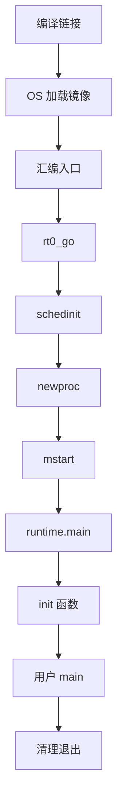

# 805 Go 程序启动过程深挖

> 分类：运行时 | 难度：L3 | 题型：原理题 | 频率：中 | 关键词：**启动流程** / **GMP** / **init 顺序**
> 原文锚点：第 1~128 段「编译→加载→运行时初始化→main→退出」

## 思路与架构
Go 启动是一条"由外到内、由汇编到 Go"的单链：操作系统加载镜像 → 平台汇编入口 → `rt0_go` → `schedinit` 总装 → `newproc` 建 runtime.main 的 g → `mstart` 启动调度 → `runtime.main` 跑 init 与用户 main → 退出清理。核心是"调度器起来之前，runtime 已把 g0/m0、P、分配器都摆好"。

- 编译链接由 `go build` 完成，即使是 `go run` 也是先生成临时二进制再执行。
- OS 加载镜像、分配地址空间、确定入口点，这部分与语言无关。
- 汇编入口因 OS/ARCH 不同（如 `_rt0_amd64_linux`），统一汇入 `runtime.rt0_go`。
- `schedinit` 是总装点：栈、内存分配器、调度器、P、GC 参数都在这里就位。
- `runtime.main` 才是 Go 代码真正开始跑的地方，init 全跑完才轮到用户 main。

## 方案取舍
| 维度 | Go 启动模型 | C 启动模型 |
|---|---|---|
| 谁先跑 | runtime.main 包裹用户 main | 直接进用户 main |
| 运行时职责 | 调度器/GC/分配器在 main 前后接管 | 基本无托管运行时 |
| 入口复杂度 | 平台汇编 + 多阶段初始化 | 简单的 `_start`→`main` |
| 启动速度 | 稍慢（运行时就位） | 快 |

选型结论：Go 的"慢一点"换来托管运行时（GC、调度），是语言设计的主动取舍；面试中突出"用户 main 不是第一个函数"这一认知即可拉开差距。不适用边界：极简嵌入式场景 Go 的启动开销相对明显，但标准服务场景可忽略。

## 细节与核心 API
- `_rt0_amd64`（及 per-OS 变体）：平台汇编入口，取 argc/argv、设栈后跳 `rt0_go` `[源码]`。
- `runtime.rt0_go`：用 Go 写、真正进入运行时初始化的函数 `[源码]`。
- `runtime.check`：运行时早期一致性检查（类型长度、结构体偏移、CAS 指令等）`[源码]`。
- `runtime.schedinit`：总装——栈/分配器/调度器初始化、按 min(ncpu, GOMAXPROCS) 创建 P、gcinit `[源码]`。
- `runtime.newproc`：创建 goroutine 的统一入口，启动期用它建 runtime.main，用户 `go` 语句也走它 `[源码]`。
- `runtime.mstart`：启动调度器，开始从可运行队列取 g 执行 `[源码]`。
- `runtime.main`：跑 runtime init → `gcenable` 开 GC → 全部包 init → 用户 main → 清理 `[源码]`。

## 性能量级与实测数据
启动耗时主要在运行时就位与 init 执行，与业务逻辑规模正相关 `[经验]`。可用 `GODEBUG=gctrace=1` 观察 GC 是否在 main 之后才活跃；用 `go build -gcflags="-N -l"` 配合 GDB 可逐函数跟踪启动链（关闭优化与内联便于下断点）。具体毫秒级数据依赖程序体量，无普适常量，故不写死 `[存疑]`。

## 答题技巧
- 30 秒版：不是 main 先跑——OS 加载后平台汇编入口进 rt0_go，schedinit 总装、newproc 建 runtime.main、mstart 启调度，runtime.main 跑完 init 才进用户 main。
- 3 分钟版：把上链路的每环讲清，并点出 g0/m0、P 数量、GC 两阶段（schedinit 设参数、runtime.main 才 enable）。
- 白板版：画上面那张 mermaid 链，标注每环节"做了什么"。
- 话术模板："Go 把 main 包在 runtime 里，前后都有运行时接管，这是和 C 最大的区别。"
- 不会怎么接：若被问到具体汇编指令细节，诚实说"汇编层我只在 GDB 里跟过大概，精确指令需查 runtime/asm_*.s"，不编造指令。

## 广度与深度延伸
- 横向：对比 C 的 `_start`→`main`、Rust 的 `std::rt` 启动，都是"运行时先就位再进用户 main"的思路，只是 Go 的调度器/GC 更重。
- 纵向：可继续深挖 GMP 调度循环（`schedule`/`findrunnable`/`execute`）、GC 三色标记起点、包 init 的依赖排序算法（编译器生成 `init` 调用顺序）。
- 调试：源文提到的 `go build -gcflags="-N -l"` + GDB 断点 `b *entry`、`info files` 找入口，是验证启动链的有效手段。

## 反问环节
可反问面试官：你们服务冷启动耗时敏感吗？有没有因 init 里做重活（如建连接池）拖慢首请求的经历？既能展示你对启动模型的理解，又把话题导向你熟悉的性能/工程面。
