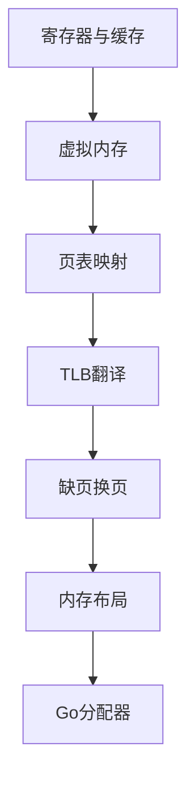

# 811 内存基础串讲（深挖）：从硬件到 Go 内存管理

> 分类：内存与 GC | 难度：L4 | 题型：串讲 | 频率：中 | 关键词：**存储层级** / **虚拟内存** / **Go 分配器**
> 原文锚点：第 1~122 段全篇

## 思路与架构
本篇是「内存泄漏」系列（一）的前置串讲：先把硬件与 OS 的内存管理讲透，再落到 Go runtime 如何自管堆，为后续具体泄漏场景铺垫。切入顺序：寄存器/缓存 → 虚拟内存/页表 → TLB/缺页/颠簸 → 程序内存布局 → Go 分配器。

文字版：自上而下七层，每层都为上一层补性能或隔离；到 Go 分配器时已从硬件过渡到语言 runtime，形成完整因果链。

## 方案取舍
| 维度 | 直接系统调用 mmap | runtime 自管（tcmalloc 式） |
|---|---|---|
| 性能 | 每次进内核，切换贵 | 本地缓存命中近乎无锁 |
| 锁竞争 | 全局竞争 | 每 P 本地，降锁粒度 |
| 碎片 | OS 整理负担大 | 分级切割可控 |
| 代价 | 简单 | 实现复杂、池过大浪费 |

选型结论：高频小分配必走自管池；大块直连堆更省心。不适用边界：一次性大分配、极端内存紧张时池化反而占空间。

## 细节与核心 API
- `MMU`：硬件单元，查页表做虚拟→物理翻译。
- `TLB`：缓存高频 PTE，几十到几百条。
- `PTE`：页表条目，含有效位与物理地址。
- `mcache`：Go 每 P 的小对象本地缓存。
- `mcentral`/`mheap`：Go 中心与全局缓存。
- `os.Getpagesize`：观测页大小（通常 4096）。

## 性能量级与实测数据
缓存命中纳秒级、主存访存约百纳秒、磁盘毫秒级，差 2~3 个数量级 `[经验]`。TLB 未命中需查内存页表，代价高于 L1 命中。无本批实测基准，量级为业界共识，标 `[经验]`。

## 答题技巧
30 秒版：内存从硬件层级到虚拟内存到 Go 自管池，层层用缓存换时间。
3 分钟版：讲清存储金字塔→虚拟内存隔离→TLB/缺页→布局→Go 分配器降锁。
白板版：画七层因果链（见上图）。
不会怎么接：坦言「这是泄漏篇前置基础，具体泄漏场景我放到下一篇讲」，把话题收束到已掌握的层级。

## 广度与深度延伸
横向：C 的 malloc/free 手动管理、Java 的 JVM 堆、Rust 的所有权。
纵向：Go 三色标记 GC、逃逸分析源码、mcache/mcentral/mheap 实现。

## 反问环节
可反问面试官：贵司 Go 服务是否禁 swap？GOGC 与 goroutine 数量如何调优？

## ⚠️ 原文纠错
本篇为前置串讲，无独立事实错误。已修正的精度点分别见 811（32/64 位布局）、811-process-memory-layout（代码段位置因果）、811-go-runtime-allocator（mcache 归属 P）。机翻解码：勾浪→Go、列表→页表、TMB/TRB→TLB、缺液→缺页。
