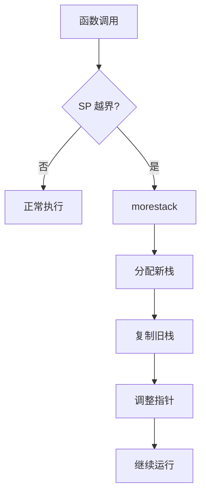

# 813 g 的栈字段 · 深挖

> 关联主卡：813-g-stack-fields.md

## 思路与架构
Go 用**连续栈（copy stack）**：G 栈初始 2KB，函数 prologue 比较 SP 与 stackguard0，越界则陷入 `morestack` 分配更大栈、复制旧栈内容、修正指针后继续。

- 触发点在函数入口 prologue，由编译器插入的栈检查指令完成。
- stackguard0 同时是协作式抢占标志（置 `stackPreempt` 也走同一条路径）。
- 复制旧栈后，所有指向旧栈的指针（含 defer/寄存器）都要修正，否则悬空。
- 增长是翻倍策略，缩是在同步安全点回收多余部分。

## 方案取舍
| 方案 | 性能 | 复杂度 | 一致性 | 运维 | 适用 |
|---|---|---|---|---|---|
| 连续栈(copy) | 复制有瞬时开销 | 中 | 指针始终连续 | 低 | Go 默认，栈可动态增长 |
| 分段栈(segmented) | 无复制但易"热分裂" | 低 | 跨段跳转 | 中 | 早期 Go，已弃用 |

**选型结论**：现代 Go 用连续栈——单次复制开销被"翻倍增长"摊薄，且彻底消除分段栈的"热分裂"性能尖刺。
**不适用边界**：单 G 栈极大（如递归极深）时复制代价高；此时应重构为迭代或受限深度。

## 性能量级与实测数据
- 初始栈 `_StackMin = 2048` 字节（多数平台）`[源码]` runtime/stack.go。
- 增长为翻倍：2KB→4KB→8KB…上限 `_StackMax` `[源码]`。
- 复制开销与栈大小成正比，单次调度场景可忽略；**未实跑**，数量级标 `[存疑]`。

## 答题技巧

## 细节与核心 API
- `g.stack`：`struct{lo,hi uintptr}`，描述当前栈内存区间。
- `g.stackguard0`：栈顶哨兵；`< SP` 即越界，也承载 `stackPreempt` 抢占位。
- `g.stackguard1`：系统调用期的栈哨兵，区别于用户态的 stackguard0。
- `g.stktopsp`：回溯时预期栈顶，用于校验栈一致性、检测溢出。
- `g.throwsplit`：true 时禁止栈分裂（cgo/汇编中必须，防栈在不应增长时变动）。
- `g.stackLock`：并发调整栈时加锁，防止别的 G 读到半截栈。
- `runtime/stack.go` 的 `copystack`：执行旧栈→新栈复制与指针修正 `[源码]`。

- 30 秒版：G 栈初始 2KB，靠 stackguard0 越界触发 morestack 复制增长，不搬 G 只换栈。
- 3 分钟版：讲清 prologue 检查→morestack→copystack→指针修正→同步安全点缩栈。
- 白板版：画"函数调用→SP 比较→越界→复制"的链路即可。
- 话术模板："Go 是连续栈，不是分段栈；增长靠复制，抢占也复用 stackguard0。"
- 不会怎么接：承认只知"会自动增长"，把话题引到"为何比线程栈轻"——栈随 G、按需增长。

## 广度与深度延伸
- 横向：Java 每线程固定栈(常 1MB)、Rust 默认 2MB 或需 `Box`；Go 的 2KB 起步是协程轻量的根。
- 纵向：`runtime/stack.go` 的 `newstack`/`copystack`；`runtime/stackguard.go` 抢占注入。

## 反问环节
- 可反问：贵司是否遇到过"goroutine 泄漏导致栈总量涨"的排查经验？借此展示对栈增长的认知。
