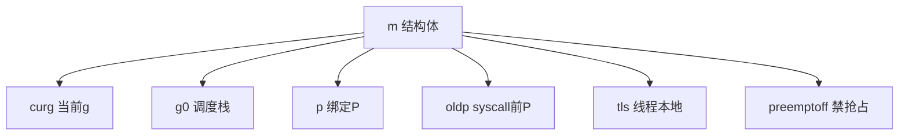

# 814 m 结构体深挖：内存布局、g0 与 P 解耦

> 分类：并发模型 | 难度：L3 | 题型：原理题 | 频率：高 | 关键词：**g0** / **tls** / **对齐填充** / **m-p 解耦**
> 原文锚点：第 133~181 段「占位字段用于八字节对齐…p 字段表示与当前 m 关联的 processor」

## 思路与架构
从"m 为什么要有这么多字段"切入：m 是内核线程的运行时外壳，既要跑用户 g，又要跑调度本身，还要在 syscall 时安全让出 P。结构上分三组——① 身份与绑定（id/curg/p/nextp/oldp）；② 调度支撑（g0/tls/mstartfn）；③ 状态标志（preemptoff/mallocing）。

- m 通过 curg 知道自己跑谁，通过 p/oldp 在 syscall 时交接 P。
- g0 是"调度专用 g"，用独立栈避免和用户 g 栈混用。
- tls 让每个 m 有独立线程本地存储，信号/调度上下文互不串。

## 方案取舍
| 设计点 | 做法 | 收益 | 代价 |
|---|---|---|---|
| g0 独立栈 | 调度/GC 走 g0 | 调度不被用户栈干扰 | 多一份栈内存 |
| oldp 暂存 | syscall 前存 P | 系统调用后精确重绑 | 字段占用 |
| preemptoff | 临时禁抢占 | 关键区/调试安全 | 牺牲公平、可能拖 GC |
| m 与 P 解耦 | 数量独立 | 阻塞时 P 可转移 | 多一层映射管理 |

选型结论：m 是"重"资源（上限 1 万），P 才是调度单元；把可转移的调度状态放 P、把线程私有放 m，是解耦核心 `[源码]` runtime2.go。不适用边界：抢占关闭过久会饿死其他 g、拖慢 GC 扫描。

## 细节与核心 API
- `mcommoninit`：m 创建时初始化 id/tls 等 `[源码]`。
- `mstart`：新线程入口，先启动 g0 再进入 `schedule` `[源码]`。
- `acquirep` / `releasep`：绑定/解绑 P，更新 m.p 与 p.m `[源码]`。
- `handoffp`：m 即将阻塞时把 P 交给其他 m `[源码]`。
- `notesleep`/`notewakeup`：m 休眠/唤醒原语，配合空闲 m 列表 `[源码]`。
- `preemptoff`：非空即禁抢占，常用于 `runtime` 内部关键路径。

## 性能量级与实测数据
- m 创建成本远高于 g：涉及内核线程克隆，`clone` 系统调用级别 `[经验]`。
- 单 m 栈与 g0 栈为固定开销；1 万 m 上限是内存与内核参数的软硬双重约束 `[存疑]`。
- 抢占关闭场景会放大 P 闲置：实测经验上应避免在长循环里长期持有 `[经验]`。

## 答题技巧
- 30 秒版：m 是内核线程外壳，curg 跑 g、p/oldp 管 P、g0 跑调度、preemptoff 管抢占。
- 3 分钟版：展开三组字段 + syscall 时 oldp 交接 + g0 为何独立。
- 白板版：画 m↔p 一对一、m↔g 一对多（curg）、g0 旁路。
- 话术模板："m 重、P 轻；调度状态在 P，线程私有在 m。"
- 不会怎么接：承认未读 runtime2.go 细节，但能讲 m 与 P 的分工与解耦动机。

## 广度与深度延伸
- 横向：与 OS 线程（NPTL）、Java 线程模型对比，Go 的 m 更接近"带调度栈的内核线程"。
- 纵向：读 `src/runtime/proc.go` 的 `schedule`/`findrunnable`，看 m 如何取 g 执行。

## 反问环节
- 可反问："贵司是否遇到过 m 暴涨（如 cgo/系统调用阻塞）导致的延迟毛刺？如何观测？"
