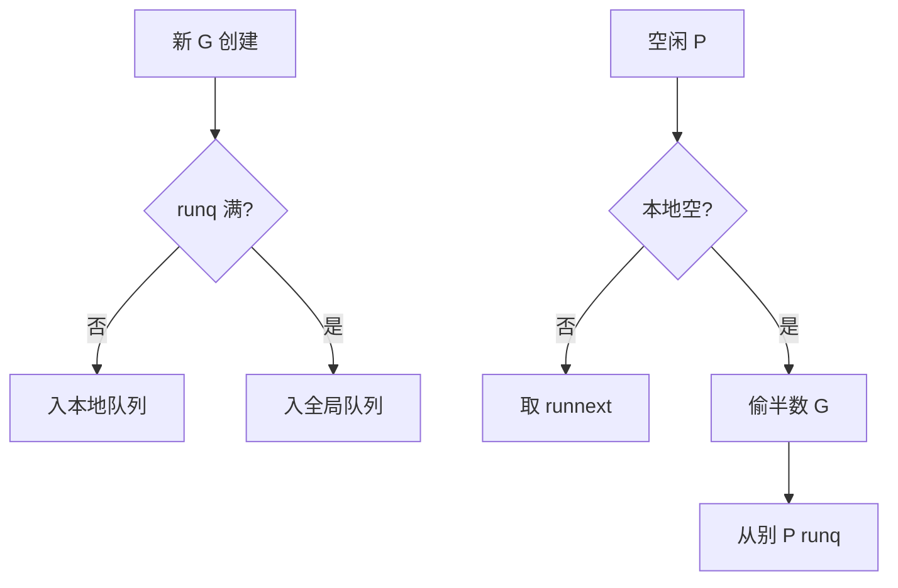

# 815 p 的本地队列与 runnext · 深挖

> 关联主卡：815-p-runq-runnext.md

## 思路与架构
调度器在"入队"和"取 G"两条路径上尽量本地化：新建/唤醒的 G 优先留在本 P 的 runq/runnext；本 P 空了才去全局队列或偷别的 P，以减锁、保缓存亲和。

- 本地入队出队靠 runqhead/runqtail 原子下标，无互斥锁，是 runq 快的根。
- runnext 是"单槽优先位"，非空的 runnext 直接跑，不进 runq 竞争。
- 全局队列是兜底，runq 满、本地无活时走它（有锁）。
- work-stealing：空闲 P 从别 P 偷约一半 runq 元素，维持负载均衡。

## 方案取舍
| 方案 | 性能 | 复杂度 | 一致性 | 运维 | 适用 |
|---|---|---|---|---|---|
| 纯全局队列 | 简单但锁竞争大 | 低 | 强 | 低 | 低并发 |
| 本地队列+偷取 | 本地无锁、扩展好 | 中 | 最终均衡 | 中 | Go 默认，高并发 |
| 全无队列(每 G 独立) | 无锁但难均衡 | 高 | 弱 | 高 | 不适用 |

**选型结论**：本地 runq(无锁) + 全局队列(兜底) + work-stealing(均衡) 是 Go 调度高吞吐的关键。
**不适用边界**：极强局部性且不均的任务可能频繁偷取，反而增开销；此时调大 GOMAXPROCS 有限。

## 性能量级与实测数据
- 本地 runq 容量 256，超出转全局 `[源码]` runtime2.go。
- work-stealing 偷取量约为源 P runq 的一半 `[源码]` runtime/proc.go。
- 本地无锁入队相对全局有锁队列显著降低延迟；**未实跑**，数量级标 `[存疑]`。

## 答题技巧

## 细节与核心 API
- `p.runq [256]guintptr`：本地可运行 G 环形数组，容量固定 256 `[源码]`。
- `p.runqhead` / `p.runqtail`：环形队列头尾下标（原子），无锁出入队。
- `p.runnext guintptr`：单槽最高优先级 G，被唤醒/阻塞返回时注入。
- `sched.runq`：全局可运行队列（有锁），runq 满时转入。
- `runtime/proc.go` 的 `runqget`/`runqput`：本地取/放 G `[源码]`。
- `runtime/proc.go` 的 `stealWork`：空闲 P 偷取别 P 的 G `[源码]`。

- 30 秒版：每 P 一个 256 无锁本地队列，runnext 存优先 G；满了转全局，空了偷别 P 一半。
- 3 分钟版：本地无锁(原子下标)→runnext 优先续跑→满转全局→空闲 work-stealing。
- 白板版：画"本 P runq / runnext / 全局队列 / 别 P runq"四块与箭头即可。
- 话术模板："runnext 解决的是'刚唤醒 G 不该重新排队被偷走'。"
- 不会怎么接：承认只知"本地队列比全局快"，引到"为什么需要 P 这层"——解耦 M 与队列。

## 广度与深度延伸
- 横向：Linux CFS 的 runqueue、Java ForkJoinPool 的 work-stealing 思想相通。
- 纵向：`runtime/proc.go` 的 `findRunnable`(综合本地/全局/偷取/GC 的取 G 主循环)。

## 反问环节
- 可反问：贵司是否观测过 runq 长度分布来定位调度瓶颈？展示对调度热点的关注。
