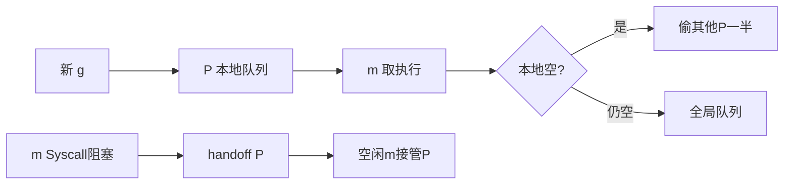

# 816 GMP 设计权衡深挖：窃取、交接与代价

> 分类：并发模型 | 难度：L3 | 题型：工程题 | 频率：中 | 关键词：**work-stealing** / **handoff** / **公平性** / **协程泄露**
> 原文锚点：第 84~166 段「work-stealing 算法…handoff 机制…GMP 优缺点」

## 思路与架构
从"如何让 N 个 P 都别闲着、也别挤爆"切入：每个 P 有本地 runq，空闲 P 主动从全局或其他 P 偷；m 因 Syscall 阻塞时把 P 交出，避免 P 跟着陪绑。二者共同维持吞吐与公平。

- 偷一半而非全搬：留一半给原 P，减少后续再偷的抖动。
- handoff：阻塞的 m 释放 P，P 的待跑 g 不被饿死。

## 方案取舍
| 机制 | 收益 | 代价 | 适用 |
|---|---|---|---|
| 本地队列 | 减锁竞争、提局部性 | 需窃取平衡 | 普遍 |
| work-stealing（偷一半） | 自动负载均衡 | 偷取有原子开销 | P 不均时 |
| handoff | 阻塞不拖 P | m 管理更复杂 | Syscall 密集 |
| 信号异步抢占 | GC 不被长循环阻塞 | 信号处理开销 | go1.14+ |

选型结论：本地队列打底、窃取做均衡、handoff 做容错，三者互补。不适用边界：极致低延迟且 g 极少的场景，窃取/抢占 overhead 可能不划算 `[经验]`。

## 性能量级与实测数据
- 本地队列取 g 是 O(1) 无锁；窃取需原子 CAS，开销随 P 数上升 `[经验]`。
- 256 为本地队列上限，超过进全局——极端场景下全局锁仍可能成瓶颈 `[存疑]`。
- 协程初始 2KB 栈，百万 g 内存约 2GB 量级（不含业务数据）`[经验]`。

## 答题技巧

## 细节与核心 API
- `runqput`：g 入 P 本地队列或全局队列（满 256 进全局）`[源码]`。
- `runqgrab`：从别的 P 偷一半 g `[源码]`。
- `findrunnable`：本地→全局(每 61 次)→偷取→netpoll→休眠的取 g 主循环 `[源码]`。
- `handoffp`：m 阻塞时把 P 转移给其他 m `[源码]`。
- `sysmon`：监控长运行 g 与 syscall，触发抢占/handoff `[源码]`。
- `GOMAXPROCS`：设 P 数，默认 = 逻辑 CPU `[源码]`。

- 30 秒版：本地队列减锁、偷一半做均衡、handoff 防阻塞拖 P。
- 3 分钟版：展开三机制 + sysmon 监控 + 61 魔法数兜底。
- 白板版：画 P 本地队列 + 空闲 P 偷取箭头 + m 阻塞时 P 漂移。
- 话术模板："GMP 用本地队列换锁竞争，用窃取换均衡，用 handoff 换容错。"
- 不会怎么接：承认源码细节有限，但从"队列分层 + 转移"讲清设计意图。

## 广度与深度延伸
- 横向：对比 Erlang 调度器、Java ForkJoinPool 的 work-stealing。
- 纵向：读 `src/runtime/proc.go` 的 `schedule`/`findrunnable`/`handoffp`。

## 反问环节
- 可反问："贵司是否因 Syscall 密集导致 P 频繁 handoff？如何调 GOMAXPROCS 与 P 数？"
