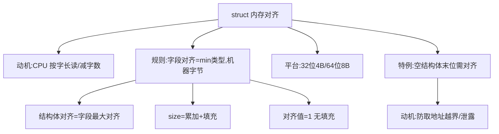

# 910 Go struct 字段对齐 深挖

> 覆盖源 9-10 全文：从「字段顺序影响 size」到「对齐规则算法」到「空结构体末位对齐特例」的内存布局全貌。主卡已拆成对齐动机/顺序、对齐规则、空结构体特例三张，本附录做横向串联与取舍。

## 思路与架构

## 方案取舍
- **空间 vs 访问效率**：对齐用 padding 换「CPU 少读几次」，通常值得；极密内存场景才手动重排字段压 padding。
- **排字段口诀**：同对齐值字段聚一起、大字段靠后，减少跨对齐边界的 padding。
- **末位空字段**：宁可多几个字节也要对齐，安全优先于省空间。

## 答题技巧
- 被问 size 时，先算各字段对齐值 → 结构体最大对齐 → 累加+填充，当场推出数字显专业 [经验]。
- 主动补「末位空结构体对齐」特例，区分于普通零尺寸值，是 P7 加分项 [经验]。
- 与 1112（struct 含 padding/零尺寸值用途）互为引用不重述 [边界]。
