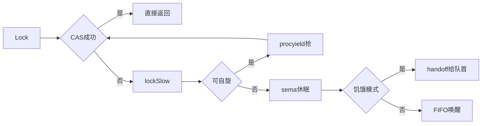

# 925 sync.Mutex 实现原理深挖：自旋、饥饿与 handoff

> 分类：并发模型 | 难度：L3 | 题型：原理题 | 频率：中 | 关键词：**自旋四条件** / **饥饿阈值 1ms** / **handoff** / **P.runnext**
> 原文锚点：第 99~139 段「自旋终止四种情况…饥饿模式信号量同步…runnext 优先」

## 思路与架构
从"如何既快又公平"切入：无竞争走 CAS 快路径零等待；轻度竞争自旋抢（省去调度）；重度/长等待切 sema 睡眠并按 FIFO 唤醒，饥饿模式再 handoff 把锁交给队首，避免写者饿死。

- 快路径无系统调用；自旋只在多核且本 P 本地队列空时。
- 饥饿模式解锁者直接把锁塞给队首等待者。

## 方案取舍
| 模式 | 收益 | 代价 | 适用 |
|---|---|---|---|
| 正常(非饥饿) | 新来者可能抢到，吞吐高 | 长等者可能饿 | 竞争轻 |
| 饥饿模式 | 队首优先，尾延迟稳 | 放弃吞吐、handoff 开销 | 等待>1ms |
| 自旋 | 省调度开销 | 空转烧 CPU | 临界区极短 |
| sema 睡眠 | 不烧 CPU | 上下文切换 | 长临界区 |

选型结论：默认正常模式保吞吐，等待超阈值转饥饿保公平，二者靠 state.starving 位自动切换。不适用边界：持锁时间很长且写频繁，饥饿模式仍可能让新请求变慢 `[源码]`。

## 性能量级与实测数据
- 无竞争 Lock/Unlock 各约一次原子 CAS，零系统调用，纳秒级 `[经验]`。
- 自旋上限 active_spin=4 轮、每轮约 30 次 PAUSE `[源码]`。
- 饥饿阈值 starvationThresholdNs ≈ 1e6 ns（1ms）`[源码]`。
- 原文未给可复现基准，以上量级来自源码常量与经验，非本批实测 `[存疑]`。

## 答题技巧

## 细节与核心 API
- `state` 低 3 位：locked/woken/starving，高位 waiter 数（>>3）`[源码]`。
- `sema`：信号量，lockSlow 阻塞时 `runtime_SemacquireMutex` 减一、解锁 `runtime_Semrelease` 加一 `[源码]`。
- `runtime_canSpin`：4 类终止——单核、逻辑 CPU≤1、本 P 本地队列有等待 g、自旋次数超阈值（active_spin）`[源码]`。
- `procyield`/`doSpin`：约 30 次 PAUSE 指令空转 `[源码]`。
- `runtime_Semrelease(&m.sema, true, 1)`：第 2 参 handoff=true 让渡锁给队首 `[源码]`。
- `P.runnext`：被 handoff 的 g 放进该字段，下轮优先调度 `[源码]`。

- 30 秒版：state+sema，CAS 快路径，失败自旋，重竞争 sema FIFO，饥饿模式 handoff。
- 3 分钟版：展开位布局 + 自旋四条件 + 饥饿阈值切换 + runnext 优先。
- 白板版：画 CAS 成功/失败两路，失败进自旋后 sema，标 handoff 箭头。
- 话术模板："Mutex 用 CAS 走快路径，自旋抗轻竞争，sema+饥饿模式抗重竞争并保证公平。"
- 不会怎么接：承认源码细节有限，但从"快路径/自旋/睡眠"三层讲清设计意图。

## 广度与深度延伸
- 横向：对比 Java AQS（也是 state+队列+自旋/ park）。
- 纵向：读 `src/sync/mutex.go` 的 `lockSlow`/`unlockSlow` 与 `runtime` 的 `semacquire`。

## 反问环节
- 可反问："贵司是否有临界区过长导致 Mutex 频繁饥饿模式的案例？如何缩短持锁时间？"
