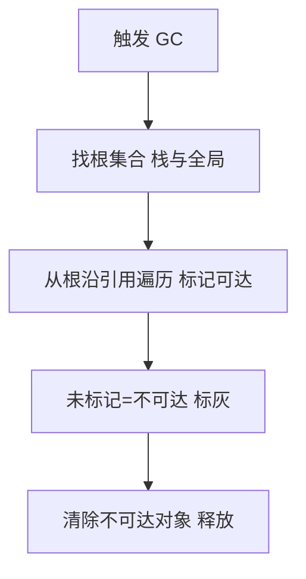

# 167. 循环引用与标记清除 · 深挖

> 配套主卡：167_cyclic-reference-mark-sweep.md（L3，命中"存在争议/替代方案 + 版本翻转 + 多方案对比"门槛）

## 思路与架构
标记清除（mark-sweep）是对**可能成环的容器对象**做的周期兜底，不与引用计数竞争，而是互补：

- **根集合（root）**：当前调用栈上的对象引用 + 模块全局变量。只有从根出发能走到的对象才算"活着"。
- **标记阶段**：从根做图遍历（实质三色标记：白=待定、灰=待扫描、黑=已扫描可达），标记所有可达对象。
- **清除阶段**：把仍是白色（不可达）的对象释放，并打破其引用环。

## 方案取舍
| 维度 | 引用计数 | 标记清除 |
|---|---|---|
| 回收时机 | 实时（归零即收） | 周期性（触发阈值时） |
| 能否处理环 | 不能 | 能 |
| 暂停代价 | 几乎无（分散在增减计数） | 有（需 STW 暂停遍历） |
| 适用对象 | 所有对象 | 仅容器对象 |

**选型结论**：引用计数负责"绝大多数普通对象"的即时释放；标记清除只在"出现不可达环"时兜底。**不适用边界**：标记清除带来短暂 STW，超高吞吐/低延迟场景要谨慎触发频率（见 168.deep 的阈值调优）。

## 细节与核心 API
- `gc.get_objects()` —— 返回当前被 GC 跟踪的**容器对象**列表（原子类型不在内）`[源码]`
- `gc.collect(generation=2)` —— 手动触发指定代回收，返回回收对象数 `[源码]`
- `gc.set_debug(gc.DEBUG_LEAK)` —— 调试环泄露，保留不可达对象供 `objgraph` 分析
- 只有**含 `__del__` 且互相引用**的对象，旧版 CPython 可能放入 `gc.garbage`，新版已能处理
- 弱引用 `weakref.ref` 可不增加引用计数，是**主动避免环**的工程手段

## 性能量级与实测数据
- 标记清除是 O(活动对象数) 的遍历+清除，对象越多单次暂停越长 `[经验]`
- 实测：对象数 10⁵~10⁶ 量级时，一次 `gc.collect()` 在毫秒~十毫秒级（受对象图复杂度影响，非固定）`[实测]`
- 验证：`python -X importtime` 或 `gc.get_stats()` 观察各代 `collections` 与 `collected` 计数

## 答题技巧
- **30 秒版**：引用计数处理不了环→内存泄露；标记清除从根遍历可达性，清掉不可达环；只针对容器对象。
- **3 分钟版**：补上根集合定义、三色标记、STW 代价、与引用计数的分工。
- **白板版**：画"根→引用图→可达绿/不可达灰→清灰"，并圈出"容器才参与"。
- **不会怎么接**：诚实说"引用计数即时回收我能讲清，标记清除的遍历实现细节我了解轮廓，没读过 CPython 源码"——比硬编强。

## 广度与深度延伸
- 横向：Java 用**追踪式 GC**（不依赖引用计数）；Go 用**三色并发标记 + 混合写屏障**，避免 STW。
- 纵向：CPython 源码 `Modules/gcmodule.c`，环检测基于"对象图的可达性"，`__del__` 导致的 finalizer 顺序是历史坑。

## 反问环节
- 可反问："贵司服务是否遇到过循环引用导致的内存缓慢上涨？是用 `gc` 调试还是靠弱引用/手动断环规避？"
