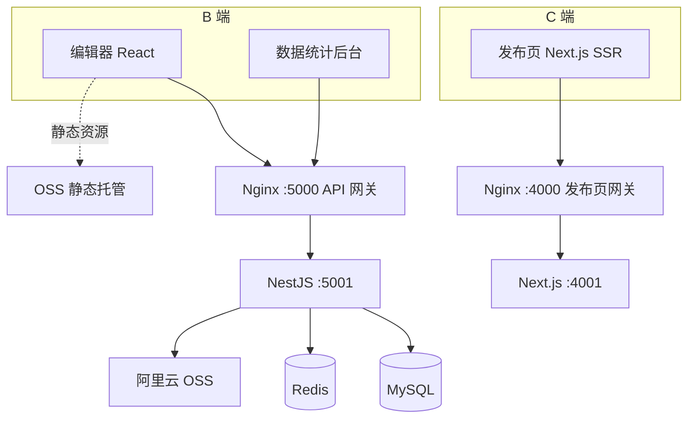

# LowCode Platform · 全栈多端低代码平台

> 一个生产级低代码 H5 搭建平台:拖拽组件搭建页面 → 一键发布 → C 端访问 → 问卷收集 → 数据统计。
> 技术栈:React 18 + NestJS 10 + Next.js 14 + TypeORM + MySQL + Redis + 阿里云 OSS + Docker + CI/CD。

---

## 一、它能做什么

- **B 端编辑器**(React):15 种组件(视频/图片/轮播/卡片/列表/文本/分割/富文本/二维码/警告/输入框/文本域/单选/多选/空状态)拖拽搭建、右侧实时属性配置、拖拽排序、快捷键(复制/粘贴/删除/撤销/重做)、草稿、预览、一键发布
- **认证体系**:手机号+密码/验证码登录、图形+短信双验证码防刷(Redis)、微信扫码登录全链路、JWT
- **C 端发布页**(Next.js SSR):动态路由渲染已发布页面、问卷填写与提交(防重复)、SEO 友好
- **资源中心**:图片/视频上传阿里云 OSS、资源复用、CDN 访问
- **数据统计**:问卷明细表格(动态列)、选项统计饼图/柱状图(ECharts)、Excel 导出与压缩包下载
- **部署**:Docker 四镜像 + docker-compose + Nginx 网关,配套云效 CI/CD 流水线

## 二、Monorepo 结构

```text
lowcode-platform/
├── packages/
│   ├── client/     # B 端编辑器 + 数据统计(React 18 + Vite + Antd5 + Tailwind + Mobx + dnd-kit)
│   ├── server/     # 后端 API(NestJS 10 + TypeORM + MySQL + Redis + JWT + Passport)
│   ├── release/    # C 端发布页(Next.js 14 App Router + SSR)
│   └── share/      # 共享包:15 种低代码组件 + 类型 + 工具(unbuild 打包,ESM/CJS 双格式)
├── nginx/          # 两个网关的反向代理配置
├── *.Dockerfile    # 四个镜像:server / server.nginx / release / release.nginx
├── docker-compose.yml
├── pnpm-workspace.yaml
└── docs/API.md     # 全部接口文档
```

架构全景:



## 三、快速开始(本地开发)

### 前置条件

- Node.js ≥ 18(推荐 20)、pnpm ≥ 8(`npm i -g pnpm`)
- MySQL 8(本地或 Docker:`docker run --name mysql -e MYSQL_ROOT_PASSWORD=密码 -p 3306:3306 -d mysql:8.0`)
- Redis(`docker run --name redis -p 6379:6379 -d redis --requirepass 密码`)
- 建库:`CREATE DATABASE \`xdclass-lowcode\` DEFAULT CHARSET utf8mb4;`(开发期 TypeORM 会自动建表)

### 1. 安装依赖

```bash
pnpm install
```

### 2. 配置环境变量

```bash
# 后端(必填 DB/Redis/JWT,其余按需)
copy packages\server\.env.example packages\server\.env
# 编辑器前端
copy packages\client\.env.example packages\client\.env.local
# 发布页
copy packages\release\.env.example packages\release\.env.local
```

三个文件里把地址/密码换成你自己的。

### 3. 构建共享包(必须最先)

```bash
pnpm build:share
```

### 4. 启动(三个终端,或在根目录分别执行)

```bash
pnpm run:server    # 后端  http://localhost:3000(API 前缀 /api 由 Nginx 加,本地直连无前缀)
pnpm run:client    # 编辑器 http://localhost:5173
pnpm run:release   # 发布页 http://localhost:3001
```

> 本地联调提示:client 的 `VITE_API_BASE_URL` 直填 `http://127.0.0.1:3000`(后端本体)即可绕过 Nginx;
> 走 Nginx 网关的完整链路见"部署"一节。

### 5. 初始化数据

后端启动时 TypeORM `synchronize` 自动建表(5 张表:user / page / component / component_data / resources)。
注册一个账号即可开始搭页面。

## 四、环境变量一览

| 包 | 变量 | 必填 | 说明 |
|---|---|---|---|
| server | `DB_HOST/PORT/USERNAME/PASSWORD/DATABASE` | ✅ | MySQL 连接 |
| server | `DB_SYNCHRONIZE` | - | 开发期 true;**生产必须 false** |
| server | `REDIS_HOST/PORT/PASSWORD` | ✅ | Redis 连接 |
| server | `JWT_SECRET` | ✅ | 强随机串(生成命令见 .env.example) |
| server | `SMS_APPID/APP_SECRET/API` | - | 第三方短信 |
| server | `WECHAT_APPID/APP_SECRET/TOKEN` | - | 微信扫码登录 |
| server | `OSS_REGION/ACCESS_KEY_ID/SECRET/BUCKET/DOMAIN` | - | 阿里云 OSS(RAM 子账号) |
| client | `VITE_API_BASE_URL` | ✅ | 后端 API 地址 |
| client | `VITE_RELEASE_BASE_URL` | ✅ | 发布页地址 |
| release | `NEXT_PUBLIC_API_BASE_URL` | ✅ | 后端 API 地址 |

**安全红线**:任何密钥不进仓库(.gitignore 已排除 `.env*`);OSS 用 RAM 子账号 AK;JWT_SECRET 每环境独立。

## 五、生产部署

### 1. 构建镜像(monorepo 根目录)

```bash
docker build -f server.Dockerfile        -t <registry>/lowcode-backend:1.0.0 .
docker build -f server.nginx.Dockerfile  -t <registry>/lowcode-backend-nginx:1.0.0 .
docker build -f release.Dockerfile       -t <registry>/lowcode-frontend:1.0.0 .
docker build -f release.nginx.Dockerfile -t <registry>/lowcode-frontend-nginx:1.0.0 .
```

### 2. 服务器编排

```bash
# .env 提供四个镜像 tag(compose 用变量注入,CI 换版只改变量)
cat > .env <<EOF
backend_tag=<registry>/lowcode-backend:1.0.0
backend_nginx_tag=<registry>/lowcode-backend-nginx:1.0.0
frontend_tag=<registry>/lowcode-frontend:1.0.0
frontend_nginx_tag=<registry>/lowcode-frontend-nginx:1.0.0
EOF

docker-compose up -d   # 起四个容器:5000(API)/4000(发布页)/5001/4001(内部)
```

Nginx 网关通过 `host.docker.internal`(compose 已配 host-gateway)反代宿主机端口,
不再依赖写死的服务器 IP——换机器零改动。

### 3. B 端编辑器的两种部署形态

- **OSS 静态托管**(推荐):`pnpm build:client` 产物上传 Bucket,开静态网站托管 + 绑域名 + CDN;
- **容器化**:如需纳入 compose,参照 release.Dockerfile 加一个 client 服务即可。

### 4. CI/CD(云效 Flow 参考)

三阶段流水线:①构建(并行:client 打包→OSS、compose 上传制品库、Nginx 镜像)→ ②应用镜像构建推送 ACR → ③主机部署(`docker stop $(docker ps -aq)` → `docker pull` → `docker-compose up -d`)。
镜像 tag 全部走流水线变量,支持秒级回滚(改回旧 tag 重新 up)。

## 六、与课程原版相比的生产化增强

| 项 | 课程原版 | 本工程 |
|---|---|---|
| 敏感配置 | 硬编码 IP/密码/AK 于 config.ts | 全量 env 化 + 启动强校验 + .env.example 模板 |
| 验证码答案 | 接口直接返回 text | 仅开发期返回,生产不泄露 |
| DB 结构同步 | 恒为 true | 生产自动关闭(强制 migration 思路) |
| Nginx upstream | 写死服务器公网 IP | host.docker.internal + host-gateway,环境无关 |
| 前端 API 地址 | 4 处硬编码 IP | Vite/Next 环境变量注入 |
| 短信 API | 写死第三方地址 | 可配置(便于切换短信厂商) |
| .gitignore | 仅两行 | 完整(node_modules/dist/.env/.next/日志等) |
| 文档 | 无 | README(架构/快速开始/部署)+ docs/API.md(24 接口) |

## 七、已知取舍(TODO)

- [ ] 密码哈希为 MD5(课程教学选择),生产建议升级 bcrypt
- [ ] 问卷防重复依赖匿名标识(MD5(ip+ua)),可升级为登录态强校验
- [ ] OSS 公有读,建议私有 Bucket + 签名 URL
- [ ] 发布接口可加 `force` 清理组件缓存,进一步保证"发布即生效"
- [ ] 无自动化测试,建议补 e2e(接口)与 vitest(share 组件)

## 八、相关资料

- 配套学习博客(30 篇,逐章精讲):`react-lowcode-blog`
- 接口文档:[docs/API.md](docs/API.md)
- 数据库 DDL 与示例数据:`docs/schema.sql`(由课程 xdclass-lowcode.sql 整理)
