# 前端面试题库：HTML5

本文件聚焦 HTML5 及其配套 API 的面试题，覆盖语义化标签与文档结构、表单增强与校验、audio/video、Canvas 2D、SVG、拖放与文件二进制、地理定位等设备 API、Web Components、响应式图片与懒加载、iframe 沙箱、SEO、无障碍与离线应用。每题配有与题目一一对应的示例代码，概念题也给出了能说明答案的代码或配置。

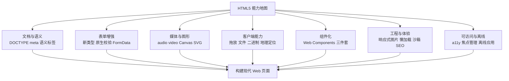

## 目录

### 一、文档结构与语义化（H5-001 ~ H5-009）
### 二、表单增强与校验（H5-010 ~ H5-015）
### 三、媒体：audio 与 video（H5-016 ~ H5-019）
### 四、Canvas 2D（H5-020 ~ H5-024）
### 五、SVG（H5-025 ~ H5-027）
### 六、拖放与文件二进制（H5-028 ~ H5-033）
### 七、设备与系统 API（H5-034 ~ H5-037）
### 八、Web Components（H5-038 ~ H5-042）
### 九、性能加载与 SEO（H5-043 ~ H5-047）
### 十、无障碍与离线应用（H5-048 ~ H5-050）
### 十一、语义与结构进阶（H5-051 ~ H5-057）
### 十二、表单进阶（H5-058 ~ H5-064）
### 十三、媒体进阶（H5-065 ~ H5-071）
### 十四、Canvas 2D 进阶（H5-072 ~ H5-078）
### 十五、SVG 进阶（H5-079 ~ H5-084）
### 十六、二进制与文件进阶（H5-085 ~ H5-091）
### 十七、设备与传感（H5-092 ~ H5-097）
### 十八、Web Components 深入（H5-098 ~ H5-105）
### 十九、可访问性与国际化深入（H5-106 ~ H5-111）
### 二十、综合与现代 API（H5-112 ~ H5-125）
### 二十一、Canvas 高级渲染（H5-126 ~ H5-132）
### 二十二、Canvas 工程化（H5-133 ~ H5-138）
### 二十三、音视频工程（H5-139 ~ H5-145）
### 二十四、图形与动画 API（H5-146 ~ H5-151）
### 二十五、表单与输入工程（H5-152 ~ H5-157）
### 二十六、文档与可编辑（H5-158 ~ H5-162）
### 二十七、SVG 工程化（H5-163 ~ H5-168）
### 二十八、Web Components 实战（H5-169 ~ H5-173）
### 二十九、无障碍工程实践（H5-174 ~ H5-178）
### 三十、综合案例（H5-179 ~ H5-200）

## 一、文档结构与语义化

### H5-001：什么是语义化标签？语义化有哪些实际收益？
**答**：
- 用恰当含义的标签表达内容结构：`header`、`nav`、`main`、`article`、`section`、`aside`、`footer`，而不是满屏 div。
- 收益一：可访问性——读屏软件靠地标角色快速导航；收益二：SEO——爬虫理解页面主次结构。
- 收益三：代码可读与可维护，样式弱化后结构仍清晰；`main` 每页只能一个，`h1` 建议每页一个。
- 注意语义化不等于换皮 div：`article` 要求内容独立可分发，`section` 要求有标题。

```html
<!-- 反例：无语义的 div 布局，机器读不出结构 -->
<div class="top"><div class="menu">...</div></div>
<div class="content"><div class="post">...</div></div>
<div class="bottom">...</div>

<!-- 正例：语义化标签，读屏软件可直接按地标跳转 -->
<body>
  <header>
    <nav aria-label="主导航">
      <ul><li><a href="/">首页</a></li><li><a href="/posts">文章</a></li></ul>
    </nav>
  </header>

  <main>
    <article>
      <h1>HTTP 缓存完全指南</h1>
      <section>
        <h2>强缓存</h2>
        <p>...</p>  <!-- section 用于带标题的内容分组 -->
      </section>
    </article>

    <aside> <!-- 与主内容相关但不属于它：目录、推荐阅读 -->
      <h2>相关文章</h2>
    </aside>
  </main>

  <footer>
    <p>© 2026 example.com</p>
  </footer>
</body>
```

### H5-002：article、section、aside、div 怎么区分使用？
**答**：
- `article`：独立成篇、脱离页面也成立的内容（文章、评论、卡片商品）。
- `section`：按主题分组的内容块，必须有标题（h2~h6）；如果只是为样式包一层就用 div。
- `aside`：与主内容弱相关的外围内容（侧栏、广告、标签页脚注）。
- `div`：无语义容器，仅用于布局与样式；判断标准是"能不能给这个块起一个有意义的名字"。

```html
<!-- article 与 section 的嵌套判断 -->
<article>
  <h1>2026 前端趋势报告</h1>

  <section> <!-- 有标题的主题章节：用 section -->
    <h2>框架动态</h2>
    <p>...</p>
  </section>

  <section>
    <h2>工具链</h2>
    <p>...</p>
    <article> <!-- 每条评论独立可分发，嵌套 article 合法 -->
      <h3>读者评论：...</h3>
      <p>...</p>
    </article>
  </section>
</article>

<!-- 纯布局包裹：用 div，不用硬凑 section -->
<div class="grid">
  <div class="col">...</div>
</div>
```

### H5-003：DOCTYPE 的作用是什么？声明缺失会发生什么？
**答**：
- 声明文档类型，让浏览器以标准模式渲染；HTML5 以后简化为 `<!DOCTYPE html>`，不区分版本。
- 缺失或写错时进入怪异模式（quirks mode）：盒模型按 IE 旧模型计算（width 包含 padding/border）、行内元素高度处理不同、表格字体继承异常。
- 怪异模式的差异会导致同一份 CSS 表现不一致，必须避免；`document.compatMode` 可检测（`CSS1Compat` 标准模式）。
- `<!DOCTYPE html>` 必须位于文档最前面，前面的内容越少越好（前置注释/空白在旧 IE 会触发怪异模式）。

```html
<!DOCTYPE html>
<!-- 第一行必须是 DOCTYPE，触发标准模式 -->
<html lang="zh-CN">
  <head>
    <meta charset="UTF-8" />
    <title>标准模式</title>
  </head>
  <body></body>
</html>
```

```javascript
// 检测当前文档的渲染模式
console.log(document.compatMode);
// "CSS1Compat"  标准模式（有 DOCTYPE）
// "BackCompat"  怪异模式（缺 DOCTYPE），width 计算回退到 IE 盒模型
```

### H5-004：meta viewport 的每个字段是什么含义？
**答**：
- 移动浏览器默认把页面渲染在约 980px 的虚拟视口上再缩小，导致字小；viewport meta 用来接管这个视口。
- `width=device-width` 视口宽度等于设备 CSS 像素宽度；`initial-scale=1` 初始缩放 1 倍。
- `maximum-scale` / `user-scalable=no` 禁缩放：对无障碍不友好（低视力用户无法放大），iOS 10 起强制忽略，不建议使用。
- `viewport-fit=cover` 配合 iPhone 刘海安全区使用；width 也可以写固定数字如 750（适配 rem 方案时）。

```html
<!-- 标准移动端配置 -->
<meta name="viewport" content="width=device-width, initial-scale=1.0" />

<!-- 允许用户缩放是默认且推荐的，对可访问性友好 -->
<meta name="viewport" content="width=device-width, initial-scale=1, viewport-fit=cover" />
```

```javascript
// 用 JS 读取当前视口信息，验证 viewport 配置生效
console.log('视口宽度:', window.innerWidth); // 配置后等于设备 CSS 宽度，如 390
console.log('屏幕宽度:', screen.width);
console.log('设备像素比:', window.devicePixelRatio); // iPhone 3x 屏为 3
// window.innerWidth = screen.width / devicePixelRatio 的关系可用于验证
```

### H5-005：除了 viewport，还有哪些必须掌握的 meta 标签？
**答**：
- `<meta charset="UTF-8">`：字符编码，必须尽早声明（前 1024 字节内），防乱码。
- `<meta name="description">`：搜索结果摘要，直接影响点击率；keywords 已被主流搜索引擎忽略。
- Open Graph（`og:title` 等）：社交平台分享卡片的内容来源。
- `http-equiv`：如 `X-UA-Compatible`（已过时）、`refresh` 自动跳转（不推荐）。

```html
<head>
  <meta charset="UTF-8" />

  <!-- SEO 基础 -->
  <title>前端面试题库 - 网络 HTML 精讲</title>
  <meta name="description" content="覆盖 HTTP 缓存渲染等高频前端面试考点，每题附可运行代码。" />

  <!-- Open Graph：微信/推特等分享卡片 -->
  <meta property="og:title" content="前端面试题库" />
  <meta property="og:description" content="网络与 HTML5 高频考点" />
  <meta property="og:image" content="https://example.com/cover.png" />

  <!-- 移动端_web app 相关 -->
  <meta name="theme-color" content="#3367d6" />
  <meta name="apple-mobile-web-app-capable" content="yes" />
</head>
```

### H5-006：HTML5 相对 HTML4 新增了什么、废弃了什么？
**答**：
- 新增语义标签（header/main/article 等）、表单类型与校验、多媒体标签 video/audio、绘图 canvas/svg。
- 新增 API：拖放、地理定位、Web Storage、Web Workers、History pushState、FileReader 等（多数随 HTML5 概念提出，由 JS API 实现）。
- 废弃纯表现类标签：`font`、`center`、`big`、`strike`；废弃 `frame/frameset`；样式类标签由 CSS 取代。
- `b/i/s/u` 未废弃但语义弱化，表达强调优先用 strong/em。

```html
<!-- 已废弃的写法（仅用于识别老代码） -->
<!-- <font color="red">文字</font>        样式交给 CSS -->
<!-- <center>内容</center>               text-align: center -->
<!-- <frameset><frame src="a.html"></frameset>  用 iframe 或 SPA 路由替代 -->

<!-- HTML5 推荐写法 -->
<p style="color: red;">样式进 CSS</p>
<video controls src="/media/demo.mp4"></video>
<input type="email" required />
```

### H5-007：data-* 自定义属性是什么？怎么读写？
**答**：
- 以 `data-` 开头的特性用于在元素上挂自定义数据，HTML 合法且不污染全局。
- JS 通过 `el.dataset` 读写，驼峰对应连字符（`data-user-id` ↔ `dataset.userId`）；值都是字符串。
- CSS 可以用 `attr()` 读取，配合选择器 `[data-state="open"]` 实现状态驱动样式。
- 注意 dataset 是字符串，数字与布尔要自己转换；大量结构化数据建议放 JS 状态而非 DOM。

```html
<!-- 用 data-* 存业务数据，CSS 按状态渲染 -->
<div class="toast" data-type="success" data-auto-close="3000">保存成功</div>

<style>
  .toast[data-type='success'] { border-color: #34c759; }
  .toast[data-type='error']   { border-color: #ff3b30; }

  /* CSS 也能读取 data-* 内容 */
  .badge::after { content: attr(data-count); }
</style>

<script>
  const toast = document.querySelector('.toast');
  console.log(toast.dataset.type);       // "success"
  console.log(toast.dataset.autoClose);  // "3000"（字符串！）
  const delay = Number(toast.dataset.autoClose); // 需手动转数字

  toast.dataset.type = 'error';   // 写入会同步反映到 HTML 特性
  toast.dataset.userId = '42';    // HTML 中呈现为 data-user-id="42"
</script>
```

### H5-008：b 和 strong、i 和 em 有什么语义区别？
**答**：
- `strong` 是"重要"语义（读屏会加重语气），`b` 只是视觉加粗、无额外语义。
- `em` 是"强调"（改变句意重点），`i` 用于技术术语、外来词、_ship 名等斜体惯例场景。
- 视觉上 strong/em 默认粗体斜体，但语义化关注"为什么这样标"，读屏与爬虫依赖语义。
- 纯样式需求一律 CSS，文本标注优先选有语义的标签。

```html
<p>操作前请 <strong>务必备份</strong>数据库。</p>
<!-- strong：重要性，读屏读出重音 -->

<p>这个词的 <em>网络</em>层含义不同于传输层。</p>
<!-- em：强调改变句意，重音落在"网络"上 -->

<p>变量 <i>x</i> 表示请求数，舰船 <i>Queen Mary</i> 于昨日离港。</p>
<!-- i：术语与专名的排版惯例，无强调语义 -->
```

### H5-009：浏览器解析 HTML 遇到非法嵌套会怎样？
**答**：
- HTML 解析器容错性极强：未闭合标签、错位标签会被自动纠正，不会像 XML 那样报错中断。
- 典型纠错规则：`<p>` 中不能再嵌套块级元素，浏览器会把后续的 div 提到 p 外面（闭合 p）。
- 自动纠错会产生意料之外的 DOM 结构，导致 CSS 选择器失效；用 `document.body.innerHTML` 打印或 DevTools Elements 面板可看到纠正后的真实结构。
- table 内直接写文本、ul 内写 div 等都是常见翻车点。

```html
<!-- 书写的源码 -->
<p>
  第一段
  <div>段落里的块级内容</div>
</p>
```

```javascript
// 浏览器实际解析出的 DOM（自动纠错）：
// <p>第一段</p>
// <div>段落里的块级内容</div>
// <p></p>
console.log(document.body.querySelector('p').nextElementSibling.tagName); // DIV

// p 被提前闭合，选择器 p div 永远匹配不到
console.log(document.querySelectorAll('p div').length); // 0
```

## 二、表单增强与校验

### H5-010：HTML5 新增了哪些 input 类型？解决了什么问题？
**答**：
- `email`、`url`、`tel`、`number`、`range`、`date/time/month`、`color`、`search` 等。
- 收益一：移动端自动唤起对应键盘（email 出 @、tel 出数字拨号盘）；收益二：原生格式校验。
- `number` 配 `min/max/step` 约束，`range` 原生滑杆，`color` 原生取色器，减少 JS 与第三方组件。
- 兼容性兜底：不识别的类型默认按 text 渲染，不会报错。

```html
<form>
  <!-- 移动端唤起邮箱键盘并校验格式 -->
  <input type="email" name="email" placeholder="邮箱" required />

  <!-- 数字约束：1~10 步进 0.5，非法值提交时被浏览器拦截 -->
  <input type="number" name="rating" min="1" max="10" step="0.5" />

  <!-- 原生滑杆与取色器 -->
  <input type="range" name="volume" min="0" max="100" value="50" />
  <input type="color" name="theme" value="#3367d6" />

  <!-- 原生日期选择，替代大部分第三方日历 -->
  <input type="date" name="birthday" min="1900-01-01" />

  <button type="submit">提交</button>
</form>
```

### H5-011：HTML5 原生表单校验有哪些约束属性？
**答**：
- `required` 非空、`pattern` 正则、`type` 内置格式（email/url）、`min/max/step` 数值范围、`minlength/maxlength` 长度。
- 提交时浏览器自动校验，不通过则阻止提交并显示气泡提示；加 `novalidate` 可关闭，改用自定义 UI。
- 校验不通过的元素可通过 CSS 伪类 `:invalid`、`:user-invalid`（用户交互后才生效）做样式反馈。
- `pattern` 里不要加 `/.../` 分隔符，正则始终锚定整串匹配。

```html
<form novalidate id="signup">
  <!-- pattern：4-16 位字母数字下划线，注意没有斜杠分隔符 -->
  <input name="username" required pattern="\w{4,16}" title="4到16位字母数字或下划线" />

  <input name="age" type="number" min="18" max="100" required />
  <input name="pwd" type="password" minlength="8" required />
  <button type="submit">注册</button>
</form>

<style>
  /* 用户碰过且非法才标红，避免一进页面就红一片 */
  input:user-invalid { border-color: #ff3b30; }
  input:valid { border-color: #34c759; }
</style>

<script>
  // novalidate 关闭了自动校验气泡，改用自定义提示：调 checkValidity 手动验证
  const form = document.getElementById('signup');
  form.addEventListener('submit', (e) => {
    e.preventDefault();
    if (!form.checkValidity()) {
      const invalid = form.querySelector(':invalid');
      invalid?.focus();
      alert(invalid?.validationMessage); // 浏览器内置的错误文案
      return;
    }
    console.log('校验通过，可以提交');
  });
</script>
```

### H5-012：Constraint Validation API 如何实现自定义校验规则？
**答**：
- 核心方法：`el.validity` 状态对象、`el.setCustomValidity(msg)` 设置自定义错误（非空串即视为非法）、`el.checkValidity()` 触发校验。
- 自定义规则套路：监听 input/change，业务校验不通过就 `setCustomValidity('错误原因')`，通过则 `setCustomValidity('')` 清除。
- 好处：复用原生提交拦截与 `:invalid` 样式体系；比完全自研校验库轻。
- 异步校验（重名检查）时先置 pending 消息防止提交，结果回来再更新。

```html
<form id="reg" novalidate>
  <input name="username" required minlength="4" />
  <button type="submit">提交</button>
  <p id="error" role="alert"></p>
</form>

<script>
  const form = document.getElementById('reg');
  const username = form.elements.username;
  const errorEl = document.getElementById('error');

  // 自定义规则：不能包含 admin 字样
  username.addEventListener('input', () => {
    if (username.value.includes('admin')) {
      username.setCustomValidity('用户名不能包含 admin'); // 非空 => validity.valid 为 false
    } else {
      username.setCustomValidity(''); // 必须显式清空，否则一直非法
    }
    errorEl.textContent = username.validationMessage;
  });

  form.addEventListener('submit', (e) => {
    e.preventDefault();
    if (username.checkValidity()) {
      console.log('提交:', username.value);
    }
  });

  // validity 对象细分了失败原因，可用于精细化提示
  console.log(username.validity.valueMissing); // required 未填时为 true
</script>
```

### H5-013：datalist 是什么？和 select 有什么区别？
**答**：
- `datalist` 给 input 提供候选建议列表，用户既能选也能自由输入（select 只能选）；值仍是字符串。
- 常配合 `autocomplete` 关闭浏览器自带的自动填充，避免两套提示叠加。
- 适合"常见值提示 + 允许自定义"的场景（城市、标签）；选项多时体验一般，大数据量建议虚拟列表组件。

```html
<label for="city">所在城市</label>
<!-- input 绑定 datalist 的 id，输入时浮出候选 -->
<input id="city" name="city" list="city-list" autocomplete="off" />
<datalist id="city-list">
  <option value="北京"></option>
  <option value="上海"></option>
  <option value="杭州"></option>
</datalist>

<!-- 与 select 的核心差异：input 保留自由输入能力 -->
<label for="city2">自由输入版</label>
<input id="city2" name="city2" list="city-list" />
<!-- 用户可以输入"深圳"这样的列表外值 -->
```

### H5-014：FormData 如何构造与提交表单？文件上传怎么处理？
**答**：
- `new FormData(form)` 收集所有带 name 的控件；也可以不基于表单逐个 `append`。
- 用 fetch/XHR 提交 FormData 时不要手动设 `Content-Type`，浏览器自动生成带 boundary 的 multipart/form-data。
- 文件来自 `input.files`（FileList），File 是 Blob 的子类型，直接 append 即可上传。
- 服务端按 multipart 解析；大文件要配合分片（见 H5-033）。

```html
<form id="upload">
  <input name="title" value="我的头像" />
  <input name="avatar" type="file" accept="image/*" />
  <button type="submit">上传</button>
</form>

<script>
  const form = document.getElementById('upload');

  form.addEventListener('submit', async (e) => {
    e.preventDefault();

    // 方式一：基于已有表单收集
    const fd = new FormData(form); // 自动带上 title 与 avatar 文件

    // 方式二：手动构造/追加
    // const fd = new FormData();
    // fd.append('title', '我的头像');
    // fd.append('avatar', form.elements.avatar.files[0]);
    fd.append('client', 'web');

    const res = await fetch('/api/upload', {
      method: 'POST',
      body: fd, // 关键：不设置 Content-Type，让浏览器生成 multipart boundary
    });
    console.log(await res.json());
  });
</script>
```

### H5-015：label、fieldset 这些"不起眼"的表单元素为什么重要？
**答**：
- `label` 的 for 关联 input 后：点击文字聚焦输入框、读屏朗读控件名称，是 a11y 的基本盘；点击 label 会触发关联控件。
- `fieldset` + `legend` 给一组控件提供分组标题（如单选组），读屏用户可感知分组语义。
- 复选框用 `label` 包裹可以扩大点击热区，移动端体验明显更好。
- 隐藏 label 的场景必须保留可访问名称（如 `aria-label`），不能只留 placeholder。

```html
<!-- label 显式关联：for 与 input 的 id 对应 -->
<label for="email">邮箱</label>
<input id="email" name="email" type="email" />

<!-- label 隐式包裹：整块都可点击，移动端友好 -->
<label>
  <input type="checkbox" name="agree" />
  我已阅读并同意用户协议
</label>

<!-- fieldset 给一组单选提供分组语义 -->
<fieldset>
  <legend>支付方式</legend>
  <label><input type="radio" name="pay" value="wx" checked /> 微信支付</label>
  <label><input type="radio" name="pay" value="ali" /> 支付宝</label>
</fieldset>

<!-- 反例：没有 label，读屏只能念出"编辑框"，用户不知道该填什么 -->
<!-- <input type="text" placeholder="手机号" /> -->
```

## 三、媒体：audio 与 video

### H5-016：video/audio 元素有哪些常用属性和 API？
**答**：
- 属性：`controls` 显示原生控制条、`autoplay`、`muted`、`loop`、`poster` 封面、`preload`（none/metadata/auto）控制预加载策略。
- 常用 API：`play()/pause()`（返回 Promise）、`currentTime/duration`、`volume`、`playbackRate`、`muted`。
- 事件：`loadedmetadata`（拿到时长）、`timeupdate`（进度）、`ended`、`error`、`waiting/playing`（缓冲状态）。
- `preload="none"` 用于列表页省流量，点击后再 `load()+play()`。

```html
<video
  id="player"
  src="/media/lesson.mp4"
  poster="/media/cover.jpg"
  preload="metadata"
  controls
></video>

<script>
  const video = document.getElementById('player');

  video.addEventListener('loadedmetadata', () => {
    console.log('时长:', video.duration); // 元数据就绪后才有值
  });

  video.addEventListener('timeupdate', () => {
    const pct = (video.currentTime / video.duration) * 100;
    document.querySelector('.progress').style.width = `${pct}%`; // 自定义进度条
  });

  // play 返回 Promise：被自动播放策略拦截时会在 reject 里体现
  async function togglePlay() {
    try {
      if (video.paused) await video.play();
      else video.pause();
    } catch (e) {
      console.warn('播放被浏览器策略阻止，需要用户手势:', e.name);
    }
  }

  // 倍速与音量
  video.playbackRate = 1.5;
  video.volume = 0.6;
</script>
```

### H5-017：为什么用 source 提供多个媒体源？type 有什么用？
**答**：
- 不同浏览器支持的容器/编码不同，`<source>` 按顺序提供候选，浏览器选第一个"认识"的格式。
- `type` 属性声明 MIME + codecs（如 `video/mp4; codecs="avc1.42E01E"`），浏览器可以不下载就判断支持性。
- 老浏览器或编码不支持的场景，video 标签内的兜底内容会显示。
- 现代编码建议：优先 WebM（VP9/AV1），兼容回退 H.264 MP4。

```html
<!-- 浏览器从上到下探测，命中第一个支持的格式 -->
<video controls poster="/media/cover.jpg" width="640">
  <source src="/media/demo.webm" type="video/webm; codecs=vp9,opus" />
  <source src="/media/demo.mp4" type="video/mp4; codecs=avc1.42E01E,mp4a.40.2" />
  <!-- 以上都不支持时，标签内的内容作为兜底 -->
  <p>你的浏览器不支持 video，<a href="/media/demo.mp4">点此下载</a>观看。</p>
</video>

<!-- 音频同理 -->
<audio controls>
  <source src="/media/episode.ogg" type="audio/ogg; codecs=vorbis" />
  <source src="/media/episode.mp3" type="audio/mpeg" />
</audio>
```

### H5-018：如何实现一个自定义播放器？依赖哪些事件？
**答**：
- 基础闭环：播放/暂停按钮、进度条（timeupdate 驱动 + 拖动 seek）、音量、全屏、时间显示。
- seek 用 `currentTime` 赋值实现；缓冲状态用 `waiting`/`canplay`/`progress`（读 `video.buffered`）展示。
- 必须处理自动播放被拒：捕获 `play()` 的 Promise reject，退化为展示封面等待用户手势。
- 隐藏原生 controls 后要自己接管键盘操作（空格播放、方向键 seek），见无障碍章节。

```javascript
// 自定义播放器核心逻辑
const video = document.querySelector('video');
const btn = document.querySelector('.play-btn');
const bar = document.querySelector('.seek-bar');
const timeEl = document.querySelector('.time');

btn.addEventListener('click', () => (video.paused ? video.play() : video.pause()));

// 时间显示与进度条
video.addEventListener('timeupdate', () => {
  if (video.duration) bar.value = (video.currentTime / video.duration) * 100;
  timeEl.textContent = `${fmt(video.currentTime)} / ${fmt(video.duration)}`;
});
function fmt(s) {
  if (!Number.isFinite(s)) return '00:00';
  const m = String(Math.floor(s / 60)).padStart(2, '0');
  const ss = String(Math.floor(s % 60)).padStart(2, '0');
  return `${m}:${ss}`;
}

// 拖动进度条 seek
bar.addEventListener('input', () => {
  video.currentTime = (bar.value / 100) * video.duration;
});

// 缓冲提示
video.addEventListener('waiting', () => document.querySelector('.spinner').show());
video.addEventListener('playing', () => document.querySelector('.spinner').close());

// 全屏（配合 H5-036 的 Fullscreen API）
document.querySelector('.fullscreen-btn').addEventListener('click', () => {
  if (document.fullscreenElement) document.exitFullscreen();
  else video.requestFullscreen();
});
```

### H5-019：浏览器的自动播放策略是什么？autoplay 为什么经常失效？
**答**：
- 为避免打扰用户，Chrome 等浏览器规定：有声视频不允许无手势自动播放；`muted` 的视频可以自动播。
- 失效时 `play()` 返回的 Promise 会 reject（NotAllowedError），这是标准行为不是 bug。
- 常用方案：首屏自动播的短视频统一 `autoplay muted playsinline`；或先静音自动播，右上角提供"开启声音"按钮（用户点击即手势，可 unmute）。
- `playsinline` 防 iOS 自动全屏；播放起量广告/直播都会做这套兜底。

```html
<!-- 静音自动播放的标准三件套 -->
<video autoplay muted playsinline loop src="/bg.mp4"></video>
```

```javascript
// 带降级策略的自动播放
const video = document.querySelector('video');
video.muted = true; // 先静音争取播放权

video
  .play()
  .then(() => {
    showUnmuteButton(); // 播放成功后引导用户开声音
  })
  .catch((err) => {
    if (err.name === 'NotAllowedError') {
      // 被策略拦截：等待用户任意手势后再播
      const resume = () => {
        video.play();
        document.removeEventListener('click', resume);
        document.removeEventListener('touchstart', resume);
      };
      document.addEventListener('click', resume);
      document.addEventListener('touchstart', resume);
    }
  });

// 用户的"开声音"点击本身就是手势，可以解除静音
unmuteBtn.addEventListener('click', () => {
  video.muted = false;
  unmuteBtn.hidden = true;
});
```

## 四、Canvas 2D

### H5-020：Canvas 高分屏模糊怎么解决？基础绘制流程是什么？
**答**：
- Canvas 默认 1 个 CSS 像素对应 1 个物理像素，DPR 大于 1 的屏幕上被拉伸发虚。
- 修法：画布实际尺寸 = CSS 尺寸 × devicePixelRatio，再 `ctx.scale(dpr, dpr)` 让绘制坐标仍按 CSS 像素写。
- 基础流程：拿到 2d context → 设置样式（fillStyle/strokeStyle/lineWidth）→ path 绘制 → fill/stroke。
- 注意 canvas 的 width/height 特性是绘图分辨率，CSS 宽高是显示尺寸，两者解耦。

```html
<canvas id="board" style="width: 400px; height: 300px;"></canvas>

<script>
  const canvas = document.getElementById('board');
  const dpr = window.devicePixelRatio || 1;

  // 高分屏适配：物理像素尺寸
  canvas.width = 400 * dpr;
  canvas.height = 300 * dpr;

  const ctx = canvas.getContext('2d');
  ctx.scale(dpr, dpr); // 后续坐标仍按 400x300 的 CSS 逻辑像素书写

  // 基础绘制
  ctx.fillStyle = '#3367d6';
  ctx.fillRect(20, 20, 120, 80); // 实心矩形

  ctx.strokeStyle = '#ff3b30';
  ctx.lineWidth = 2;
  ctx.beginPath();
  ctx.arc(240, 60, 40, 0, Math.PI * 2); // 圆
  ctx.stroke();

  ctx.font = '16px sans-serif';
  ctx.fillStyle = '#333';
  ctx.fillText('Hello Canvas', 160, 180);
</script>
```

### H5-021：Canvas 动画的标准写法是什么？
**答**：
- 套路是"清屏 → 更新状态 → 重绘"，循环用 requestAnimationFrame 驱动，帧间隔用 delta time 校准速度。
- 不要在循环里 new 对象或频繁扩容，状态用闭包/类字段保存。
- 动画结束或元素离屏时要 cancelAnimationFrame，防止空转耗电。
- 简单缓动可手写插值函数，不必引库。

```html
<canvas id="anim" width="400" height="200" style="width:400px;height:200px;"></canvas>

<script>
  const ctx = document.getElementById('anim').getContext('2d');
  const ball = { x: 0, y: 100, vx: 120 }; // vx 单位：像素/秒

  let rafId = null;
  let last = performance.now();

  function frame(now) {
    const dt = (now - last) / 1000; // delta time 秒
    last = now;

    ball.x += ball.vx * dt; // 帧率无关的位移
    if (ball.x > 420) ball.x = -20; // 循环

    ctx.clearRect(0, 0, 400, 200); // 1. 清屏
    ctx.fillStyle = '#3367d6'; //    2. 更新后的状态绘制
    ctx.beginPath();
    ctx.arc(ball.x, ball.y, 12, 0, Math.PI * 2);
    ctx.fill();

    rafId = requestAnimationFrame(frame); // 3. 排下一帧
  }
  rafId = requestAnimationFrame(frame);

  // 页面不可见或组件卸载时停止，避免后台空转
  document.addEventListener('visibilitychange', () => {
    if (document.hidden) cancelAnimationFrame(rafId);
    else {
      last = performance.now(); // 恢复时校准 last，防止 dt 巨大跳变
      rafId = requestAnimationFrame(frame);
    }
  });
</script>
```

### H5-022：如何用 Canvas 做像素级操作？getImageData 有什么坑？
**答**：
- `ctx.getImageData(x, y, w, h)` 拿到 ImageData，`data` 是 Uint8ClampedArray，每 4 个字节一个像素（RGBA）。
- 修改后 `ctx.putImageData` 写回，可实现滤镜（灰度/反色）、抠图等效果。
- 坑一：画布一旦绘制过跨域图片（未设 CORS）就"被污染"，getImageData 直接抛 SecurityError。
- 坑二：getImageData 开销大（回读 GPU 数据），不要每帧调用；处理大图放 Worker。

```html
<canvas id="gray" width="200" height="200"></canvas>

<script>
  const canvas = document.getElementById('gray');
  const ctx = canvas.getContext('2d');

  const img = new Image();
  img.crossOrigin = 'anonymous'; // 图片来自 CDN 时必须，否则画布被污染
  img.onload = () => {
    ctx.drawImage(img, 0, 0, 200, 200);

    const imageData = ctx.getImageData(0, 0, 200, 200); // RGBA 字节数组
    const d = imageData.data;
    for (let i = 0; i < d.length; i += 4) {
      // 灰度化：按人眼感知加权
      const gray = 0.299 * d[i] + 0.587 * d[i + 1] + 0.114 * d[i + 2];
      d[i] = d[i + 1] = d[i + 2] = gray; // alpha d[i+3] 不动
    }
    ctx.putImageData(imageData, 0, 0); // 写回画布
  };
  img.src = 'https://cdn.example.com/photo.jpg';
</script>
```

### H5-023：Canvas 性能优化有哪些手段？离屏 canvas 是什么？
**答**：
- 离屏 canvas：在内存里预渲染不变的内容（复杂背景、精灵图），主循环里 drawImage 直接贴，避免每帧重画。
- 分层：静态背景与动态前景拆成两个叠放的 canvas，只重绘动态层。
- 控制 canvas 尺寸（不超过必要分辨率）、减少 save/restore、避免逐像素 fillRect、批量 path。
- 长列表/粒子多时用对象池；重计算（滤镜、物理引擎）放 Web Worker + OffscreenCanvas。

```javascript
// 离屏 canvas：复杂背景只渲染一次
const bgCanvas = document.createElement('canvas');
bgCanvas.width = 800;
bgCanvas.height = 600;
const bgCtx = bgCanvas.getContext('2d');
(function renderBgOnce() {
  for (let i = 0; i < 2000; i++) {
    bgCtx.fillStyle = `hsl(${i % 360}, 60%, 70%)`;
    bgCtx.fillRect(Math.random() * 800, Math.random() * 600, 4, 4); // 昂贵操作只做一次
  }
})();

const ctx = document.querySelector('canvas').getContext('2d');
function frame(now) {
  // 主循环只贴图 + 画动态元素，开销极小
  ctx.drawImage(bgCanvas, 0, 0); // 背景复用
  drawParticles(ctx, now);
  requestAnimationFrame(frame);
}
requestAnimationFrame(frame);

// OffscreenCanvas：把绘制整体搬到 Worker（主线程完全不参与）
// worker.js:
// const off = new OffscreenCanvas(800, 600);
// const octx = off.getContext('2d');
// setInterval(() => { octx.fillRect(0, 0, 10, 10); }, 16);
```

### H5-024：Canvas 上如何响应点击？和 DOM 事件有什么不同？
**答**：
- Canvas 是一整块位图，内部图形不是 DOM，事件只落在 canvas 元素上，需要自己算"点是否在图形内"。
- 简单形状用几何计算（圆用距离、矩形用范围）；复杂 path 用 `ctx.isPointInPath(x, y)`（注意坐标要乘 DPR 换算）。
- 交互多的场景优先 SVG（每个图形都是元素，事件原生）或把元素缓存为"命中表"（hit map，给每个对象唯一颜色渲染到隐藏 canvas 再取色）。
- 拖拽要监听 pointer 事件系列，兼容鼠标与触摸。

```html
<canvas id="hit" width="300" height="200" style="width:300px;height:200px;"></canvas>

<script>
  const canvas = document.getElementById('hit');
  const ctx = canvas.getContext('2d');
  const dpr = window.devicePixelRatio || 1;

  const circle = { x: 150, y: 100, r: 50 };
  ctx.beginPath();
  ctx.arc(circle.x, circle.y, circle.r, 0, Math.PI * 2);
  ctx.fill();

  canvas.addEventListener('pointerdown', (e) => {
    // 屏幕坐标换算成画布逻辑坐标
    const rect = canvas.getBoundingClientRect();
    const x = e.clientX - rect.left;
    const y = e.clientY - rect.top;

    // 方式一：isPointInPath，path 与绘制时保持一致
    ctx.beginPath();
    ctx.arc(circle.x, circle.y, circle.r, 0, Math.PI * 2);
    const inside = ctx.isPointInPath(x * dpr, y * dpr);

    // 方式二：几何计算（圆专用，更省）
    const dist = Math.hypot(x - circle.x, y - circle.y);
    console.log(inside, dist <= circle.r); // 两种判定结果一致
  });
</script>
```

## 五、SVG

### H5-025：SVG 的 viewBox 是什么？如何实现自适应缩放？
**答**：
- viewBox 定义 SVG 内部逻辑坐标系（如 `0 0 100 100`），width/height 决定显示尺寸，两者自动缩放映射。
- 内容按逻辑坐标书写，改 width/height 即整体等比缩放，天然矢量清晰。
- `preserveAspectRatio` 控制宽高比不一致时的适配策略（默认 `xMidYMid meet`）。
- 与 canvas 不同：SVG 元素是真实 DOM，可以被 CSS/JS 选择、加事件，改属性即可更新。

```html
<!-- viewBox 100x100 的内容，无论显示尺寸多大都清晰且等比缩放 -->
<svg viewBox="0 0 100 100" width="200" height="200" role="img" aria-label="蓝色圆形">
  <circle cx="50" cy="50" r="40" fill="#3367d6" />
  <rect x="10" y="10" width="20" height="20" fill="#ff3b30" />
</svg>

<!-- 同一份内容，显示 64px 一样清晰 -->
<svg viewBox="0 0 100 100" width="64" height="64">
  <circle cx="50" cy="50" r="40" fill="#3367d6" />
</svg>

<!-- preserveAspectRatio=none 时强行拉伸填满，会变形 -->
<svg viewBox="0 0 100 100" width="200" height="80" preserveAspectRatio="none">
  <circle cx="50" cy="50" r="40" fill="#34c759" />
</svg>
```

### H5-026：SVG 如何做样式与动画？
**答**：
- SVG 属性大多可以映射为 CSS 属性：`fill`、`stroke`、`stroke-width`、`opacity` 都能写进样式表，`:hover` 原生可用。
- 动画方式：CSS transition/animation（transform-origin 注意用 `transform-box: fill-box`）、SMIL（animate 标签，功能全但生态停滞）、JS（改属性或 requestAnimationFrame）。
- `stroke-dasharray` + `stroke-dashoffset` 是描边动画的标准做法（loading 圈、手写签名效果）。
- 图标方案：SVG symbol + use 复用，或直接内联以继承 currentColor。

```html
<style>
  .icon path {
    fill: currentColor;           /* 跟随文字颜色，主题化 */
    transition: fill 0.2s;
  }
  .icon:hover path { fill: #ff3b30; }

  /* 描边动画：先量出路径总长，再让 dashoffset 从满到 0 */
  .draw {
    stroke-dasharray: 300;
    stroke-dashoffset: 300;
    animation: draw 1.5s ease forwards;
  }
  @keyframes draw {
    to { stroke-dashoffset: 0; }
  }
</style>

<!-- CSS 驱动 hover 变色 -->
<svg class="icon" viewBox="0 0 24 24" width="24" height="24">
  <path d="M12 2 L22 12 L12 22 L2 12 Z" />
</svg>

<!-- stroke 描边动画 -->
<svg viewBox="0 0 100 100" width="100" height="100">
  <circle
    class="draw"
    cx="50" cy="50" r="45"
    fill="none" stroke="#3367d6" stroke-width="6"
    pathLength="300"
  />
</svg>

<!-- symbol + use：一份定义多处引用 -->
<svg style="display:none">
  <symbol id="star" viewBox="0 0 24 24">
    <path d="M12 2l3 7h7l-5.5 4.5L18 21l-6-4-6 4 1.5-7.5L2 9h7z" />
  </symbol>
</svg>
<svg width="24" height="24" class="icon"><use href="#star" /></svg>
```

### H5-027：Canvas 和 SVG 怎么选型？
**答**：
- SVG：元素级事件、CSS 控制、无限缩放，适合图标、图表、交互流程图；元素数千个后 DOM 开销大。
- Canvas：像素级绘制、成千上万对象仍流畅，适合游戏、粒子、大数据量可视化；但无 DOM、事件要自己做命中检测。
- 记忆公式：静态+交互多选 SVG，动态+对象多选 Canvas。
- 混用常见：ECharts 默认 canvas 渲染，可切 SVG 渲染器换取小数据量下的清晰导出与 a11y。

```html
<!-- 选型对比实验：1000 个方块 -->
<div id="svg-stage"></div>
<canvas id="canvas-stage" width="600" height="400"></canvas>

<script>
  // SVG：1000 个 rect 就是 1000 个 DOM 节点，增删改查都走 DOM，事件可单独绑定
  const svgNS = 'http://www.w3.org/2000/svg';
  const svg = document.createElementNS(svgNS, 'svg');
  svg.setAttribute('viewBox', '0 0 600 400');
  svg.setAttribute('width', '600');
  svg.setAttribute('height', '400');
  for (let i = 0; i < 1000; i++) {
    const rect = document.createElementNS(svgNS, 'rect');
    rect.setAttribute('x', Math.random() * 580);
    rect.setAttribute('y', Math.random() * 380);
    rect.setAttribute('width', 20);
    rect.setAttribute('height', 20);
    rect.setAttribute('fill', 'steelblue');
    rect.addEventListener('click', (e) => e.target.remove()); // 每个元素有自己的事件
    svg.appendChild(rect);
  }
  document.getElementById('svg-stage').appendChild(svg);

  // Canvas：1000 个方块只是一次次 fillRect，无 DOM，快但点击要自己做命中检测
  const cvs = document.getElementById('canvas-stage');
  const ctx = cvs.getContext('2d');
  const boxes = Array.from({ length: 1000 }, () => ({
    x: Math.random() * 580,
    y: Math.random() * 380,
  }));
  boxes.forEach(({ x, y }) => ctx.fillRect(x, y, 20, 20)); // 一次遍历全部画出

  cvs.addEventListener('click', (e) => {
    const r = cvs.getBoundingClientRect();
    const mx = e.clientX - r.left;
    const my = e.clientY - r.top;
    const hit = boxes.find((b) => mx >= b.x && mx <= b.x + 20 && my >= b.y && my <= b.y + 20);
    console.log(hit ? '点中方块' : '空白'); // 交互成本自己承担
  });
</script>
```

## 六、拖放与文件二进制

### H5-028：原生拖放 API 的事件流程是怎样的？
**答**：
- 被拖元素触发：`dragstart` → `drag` → `dragend`；目标容器触发：`dragenter` → `dragover` → `dragleave` 或 `drop`。
- 关键点：必须在 `dragover` 里 `preventDefault()`，否则浏览器不认为可放置，`drop` 永远不触发；drop 里也要 preventDefault 防止浏览器打开文件。
- 传递数据用 `event.dataTransfer.setData/getData`（字符串），拖拽视觉反馈可设置 `effectAllowed/dropEffect`。
- 自定义拖拽把手要配合 `draggable="true"`；移动端浏览器对 HTML5 拖放支持差，触屏场景用 pointer 事件自己实现。

```html
<div id="drag-item" draggable="true">拖我到下面的回收站</div>
<div id="trash" style="width:200px;height:80px;border:2px dashed #999;">回收站</div>

<script>
  const item = document.getElementById('drag-item');
  const trash = document.getElementById('trash');

  item.addEventListener('dragstart', (e) => {
    e.dataTransfer.setData('text/plain', item.id); // 携带标识
    e.dataTransfer.effectAllowed = 'move';
    item.style.opacity = '0.4';
  });

  item.addEventListener('dragend', () => (item.style.opacity = '1'));

  // dragover 必须 preventDefault，告诉浏览器"这里允许放置"
  trash.addEventListener('dragover', (e) => {
    e.preventDefault();
    e.dataTransfer.dropEffect = 'move';
    trash.style.borderColor = '#3367d6';
  });

  trash.addEventListener('dragleave', () => (trash.style.borderColor = '#999'));

  trash.addEventListener('drop', (e) => {
    e.preventDefault(); // 阻止浏览器默认打开该内容
    const id = e.dataTransfer.getData('text/plain');
    document.getElementById(id).remove();
    trash.textContent = '已删除';
  });
</script>
```

### H5-029：File 对象从哪来？input file 有哪些常用配置？
**答**：
- 来源：`<input type="file">` 的 `files`、拖放 `drop` 事件的 `dataTransfer.files`、剪贴板事件。
- `accept` 限制可选类型（MIME 或后缀），`multiple` 多选，`capture` 移动端直接调相机。
- File 继承 Blob，有 `name/size/type/lastModified` 属性；选择同一文件第二次不触发 change，需要手动清空 value。
- 读取内容靠 FileReader（H5-030）或新的 `file.text()/file.arrayBuffer()` Promise API。

```html
<input id="picker" type="file" accept="image/png,image/jpeg,.webp" multiple />

<script>
  const picker = document.getElementById('picker');
  picker.addEventListener('change', () => {
    for (const file of picker.files) {
      console.log(file.name, file.type, file.size, new Date(file.lastModified));
      if (file.size > 5 * 1024 * 1024) alert(`${file.name} 超过 5MB`);
    }
    // 需求：支持反复选择同一个文件
    picker.value = ''; // 清空后 change 可重复触发
  });
</script>
```

### H5-030：FileReader 有哪几种读取方式？分别什么场景用？
**答**：
- `readAsText`：读文本（配置、日志）；`readAsDataURL`：读成 base64 Data URL（小图预览）；`readAsArrayBuffer`：读二进制（加密、解析、媒体处理）。
- FileReader 是事件式 API（onload/onerror/onprogress），现代写法可直接用 `file.text()`、`file.arrayBuffer()`。
- 图片预览更推荐 `URL.createObjectURL(file)`：不生成 base64 大字符串，内存友好，用完 `revokeObjectURL` 释放。
- base64 体积比原文件大 33%，大文件预览别用 readAsDataURL。

```html
<input id="reader" type="file" accept="image/*" />


<script>
  const input = document.getElementById('reader');
  const img = document.getElementById('preview');

  input.addEventListener('change', async () => {
    const file = input.files[0];
    if (!file) return;

    // 方式一：object URL 预览（推荐，无 base64 膨胀）
    const url = URL.createObjectURL(file);
    img.src = url;
    img.onload = () => URL.revokeObjectURL(url); // 用完释放，防内存泄漏

    // 方式二：FileReader 经典事件式
    const reader = new FileReader();
    reader.onload = (e) => console.log('dataURL:', e.target.result.slice(0, 40), '...');
    reader.onerror = () => console.error('读取失败');
    reader.readAsDataURL(file);

    // 方式三：现代 Promise API（等价于 readAsText）
    const text = await file.text(); // 文本文件可直接读
    console.log(text.slice(0, 20));
  });
</script>
```

### H5-031：Blob 是什么？slice 有什么用？
**答**：
- Blob（Binary Large Object）是不可变的二进制数据容器，File 是带元数据的 Blob。
- `blob.slice(start, end)` 可以零拷贝地切出子 Blob，这是大文件分片上传的基础。
- `new Blob([字符串或ArrayBuffer])` 可在前端生成文件，配合 `createObjectURL` + a 标签 download 实现纯前端导出。
- Blob 存磁盘、ArrayBuffer 存内存：`blob.arrayBuffer()` 可互相转换。

```javascript
// 纯前端导出 CSV 文件
function downloadCSV(rows) {
  const csv = rows.map((r) => r.join(',')).join('\n');
  const blob = new Blob(['\ufeff' + csv], { type: 'text/csv;charset=utf-8' }); // BOM 防 Excel 乱码

  const url = URL.createObjectURL(blob);
  const a = document.createElement('a');
  a.href = url;
  a.download = 'export.csv'; // download 属性触发下载而非导航
  a.click();
  URL.revokeObjectURL(url);
}
downloadCSV([['name', 'age'], ['Wang', 30]]);

// slice 分片：1GB 文件切成 5MB 一片（配合 H5-033 上传）
function splitChunks(file, size = 5 * 1024 * 1024) {
  const chunks = [];
  for (let start = 0; start < file.size; start += size) {
    chunks.push(file.slice(start, start + size)); // Blob 切片，不占用整块内存
  }
  return chunks;
}
```

### H5-032：ArrayBuffer、TypedArray、DataView 的关系？
**答**：
- ArrayBuffer 是固定长度的原始内存块，不能直接读写；视图决定如何解释这些字节。
- TypedArray（Uint8Array/Float32Array 等）：定长、同类型元素的视图，适合像素、音频采样等规则数据。
- DataView：支持任意偏移、任意字节序的读写，适合解析网络协议、文件头等不规则二进制。
- 注意 Uint8ClampedArray（canvas ImageData 用它，越界值钳制到 0~255）；字节序默认本机序，跨端协议用 DataView 显式指定。

```javascript
// ArrayBuffer 是裸内存，必须通过视图访问
const buffer = new ArrayBuffer(16); // 16 字节

// TypedArray：按类型解读同一块内存
const u8 = new Uint8Array(buffer);
const i32 = new Int32Array(buffer);
console.log(u8.length, i32.length); // 16 与 4：同一块内存的不同解读粒度

i32[0] = 0x12345678; // 写入 4 字节
console.log(u8[0].toString(16)); // 78（小端机器上低位在前）

// DataView：精确控制偏移与字节序，用于二进制协议解析
const view = new DataView(buffer);
view.setUint32(0, 0x12345678, false); // false = 大端序（网络字节序）
console.log(view.getUint8(0).toString(16)); // 12：大端高位在前

// 实战：解析一个 PNG 文件头，验证 8 字节签名
async function checkPngHeader(file) {
  const head = new Uint8Array(await file.slice(0, 8).arrayBuffer());
  const pngSig = [0x89, 0x50, 0x4e, 0x47, 0x0d, 0x0a, 0x1a, 0x0a];
  return pngSig.every((byte, i) => head[i] === byte);
}
```

### H5-033：如何实现大文件分片上传与断点续传？
**答**：
- 思路：`file.slice` 切片 → 逐片（并发受限）上传 → 服务端按 hash 合并；文件整体 hash（如 md5）作为唯一标识。
- 断点续传：上传前先问服务端"这个 hash 已有哪些分片"，跳过已传的；失败只重传该片。
- 并发控制：同时传 3~6 片，配合进度回调；全部完成后调 merge 接口。
- 计算 hash 可能很慢，用 Web Worker 或抽样 hash（首尾 + 中间采样）权衡。

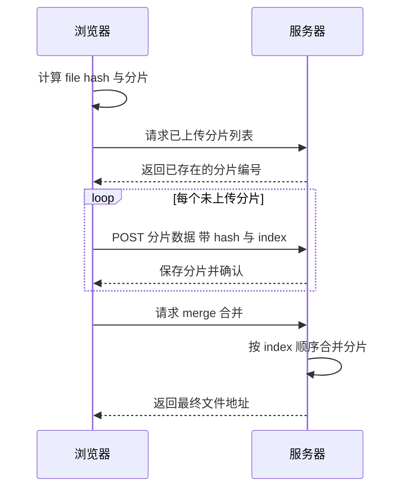

```javascript
// 分片上传核心实现：并发受限 + 跳过已传分片
async function uploadLarge(file, { chunkSize = 5 * 1024 * 1024, concurrency = 3 } = {}) {
  const hash = await calcHash(file); // 略：Worker 里算 md5

  // 1. 询问服务端已有分片，实现断点续传
  const res = await fetch(`/api/upload/status?hash=${hash}`);
  const { uploaded = [] } = await res.json();
  const uploadedSet = new Set(uploaded);

  const total = Math.ceil(file.size / chunkSize);
  const pending = [];
  for (let i = 0; i < total; i++) {
    if (!uploadedSet.has(i)) pending.push(i);
  }

  // 2. 并发受限地上传每个分片
  let cursor = 0;
  async function worker() {
    while (cursor < pending.length) {
      const index = pending[cursor++];
      const start = index * chunkSize;
      const blob = file.slice(start, start + chunkSize);
      const fd = new FormData();
      fd.append('chunk', blob);
      fd.append('hash', hash);
      fd.append('index', String(index));
      await fetch('/api/upload/chunk', { method: 'POST', body: fd });
      reportProgress(++done, total); // done 为外部计数器
    }
  }
  let done = uploadedSet.size;
  await Promise.all(Array.from({ length: concurrency }, worker));

  // 3. 通知合并
  await fetch('/api/upload/merge', {
    method: 'POST',
    headers: { 'Content-Type': 'application/json' },
    body: JSON.stringify({ hash, total, filename: file.name }),
  });
}
```

## 七、设备与系统 API

### H5-034：Geolocation API 如何使用？精度与权限怎么处理？
**答**：
- `navigator.geolocation.getCurrentPosition(success, error, options)`，options 可设 `enableHighAccuracy`、`timeout`、`maximumAge`（缓存时长）。
- 必须在安全上下文（HTTPS），首次调用浏览器弹权限申请；用户拒绝后 error 回调 `PERMISSION_DENIED`。
- 持续追踪用 `watchPosition`，返回 id 用 `clearWatch` 停止。
- 注意只取粗略位置时别开高精度（费电、慢）；业务要容错——定位失败必须给降级体验。

```javascript
// 封装一个带超时与错误分类的定位工具
function getLocation(options = { enableHighAccuracy: true, timeout: 8000, maximumAge: 60000 }) {
  return new Promise((resolve, reject) => {
    if (!('geolocation' in navigator)) {
      return reject(new Error('browser not supported'));
    }
    navigator.geolocation.getCurrentPosition(
      (pos) => resolve({
        lat: pos.coords.latitude,
        lng: pos.coords.longitude,
        accuracy: pos.coords.accuracy, // 精度半径（米）
      }),
      (err) => {
        switch (err.code) {
          case err.PERMISSION_DENIED: reject(new Error('用户拒绝了定位授权')); break;
          case err.POSITION_UNAVAILABLE: reject(new Error('位置信息不可用')); break;
          case err.TIMEOUT: reject(new Error('定位超时')); break;
          default: reject(err);
        }
      },
      options
    );
  });
}

// 使用：失败时降级为手动选择城市
getLocation()
  .then(({ lat, lng }) => renderNearbyStores(lat, lng))
  .catch((e) => {
    console.warn(e.message);
    showCityPicker(); // 降级方案
  });

// 持续追踪（骑行轨迹类需求）
const watchId = navigator.geolocation.watchPosition((pos) => track.push(pos.coords));
// navigator.geolocation.clearWatch(watchId); // 停止
```

### H5-035：前端如何实现"复制到剪贴板"？
**答**：
- 首选异步 Clipboard API：`navigator.clipboard.writeText/readText`，需 HTTPS + 安全上下文，writeText 可在用户手势外由页面主动调用（部分浏览器仍要求手势）。
- 兜底：`document.execCommand('copy')` 已废弃但仍是最广的兼容方案，配合隐藏 textarea。
- `readText` 读取剪贴板权限控制更严，需要用户手势与权限授予。
- 复制成功要给 toast 反馈；富文本复制用 `clipboard.write` 传 ClipboardItem。

```javascript
// 复制工具函数：Clipboard API 优先，execCommand 兜底
async function copyText(text) {
  if (navigator.clipboard?.writeText) {
    try {
      await navigator.clipboard.writeText(text);
      return true;
    } catch (e) {
      // 权限被拒或环境不支持，走兜底
    }
  }
  // 兜底方案：隐藏 textarea + execCommand
  const ta = document.createElement('textarea');
  ta.value = text;
  ta.style.position = 'fixed';
  ta.style.opacity = '0';
  document.body.appendChild(ta);
  ta.select();
  const ok = document.execCommand('copy');
  ta.remove();
  return ok;
}

button.addEventListener('click', async () => {
  const ok = await copyText('https://example.com/invite/123');
  toast(ok ? '复制成功' : '复制失败，请手动复制');
});
```

### H5-036：Fullscreen API 怎么用？有哪些兼容点？
**答**：
- 进入：`el.requestFullscreen()`，退出：`document.exitFullscreen()`；`document.fullscreenElement` 判断当前状态。
- 必须由用户手势触发；`fullscreenchange` 事件监听状态切换，用来调整 UI 布局。
- 全屏元素只有自己是可见的，兄弟元素被隐藏，需要全屏容器而不是单个按钮。
- 旧 WebKit 需要 `webkitRequestFullscreen` 前缀；iOS Safari 对 iPhone 不支持元素全屏，视频要用 `playsinline`/`webkitEnterFullscreen` 特判。

```javascript
const stage = document.querySelector('.player');

async function toggleFullscreen(el) {
  if (document.fullscreenElement) {
    await document.exitFullscreen();
    return;
  }
  try {
    await el.requestFullscreen();
  } catch (e) {
    // 旧 Safari 兜底
    if (el.webkitRequestFullscreen) el.webkitRequestFullscreen();
  }
}

document.addEventListener('fullscreenchange', () => {
  const on = !!document.fullscreenElement;
  document.body.classList.toggle('is-fullscreen', on);
  // 全屏时隐藏无关 UI、把控制条固定在底部
});

// 全屏时的默认黑底由元素背景决定
// CSS: .player:fullscreen { background: #000; width: 100%; }
```

### H5-037：如何感知网络状态变化？
**答**：
- 基础：`navigator.onLine` 布尔值 + `window` 的 `online/offline` 事件，只能区分"有没有网"。
- 进阶：Network Information API 的 `navigator.connection`（effectiveType、downlink、saveData），可按网络质量降级（弱网不加载视频、低清图）。
- 注意 onLine 只反映系统网卡状态，连着 Wi-Fi 但断网时也返回 true；关键判断要配合真实请求探测。
- 典型场景：离线提示条、断网暂停轮询、恢复后重放队列请求。

```javascript
// 断网提示条 + 弱网降级
function initNetworkIndicator() {
  const bar = document.querySelector('.offline-bar');
  const update = () => (bar.hidden = navigator.onLine);

  window.addEventListener('online', () => {
    update();
    flushQueue(); // 恢复后重放离线期间排队的请求
  });
  window.addEventListener('offline', update);
  update();
}
initNetworkIndicator();

// 弱网检测：按 effectiveType 降级
const conn = navigator.connection;
if (conn) {
  if (conn.saveData) {
    loadImageLite(); // 用户开启省流模式
  } else if (['slow-2g', '2g'].includes(conn.effectiveType)) {
    disableVideoAutoplay();
    useLowQualityImages();
  }
  conn.addEventListener('change', () => console.log('网络变化:', conn.effectiveType));
}

// 离线期间把写操作排队
const queue = [];
async function submit(data) {
  if (!navigator.onLine) {
    queue.push(data);
    localStorage.setItem('pending', JSON.stringify(queue));
    return { queued: true };
  }
  return fetch('/api/submit', { method: 'POST', body: JSON.stringify(data) });
}
async function flushQueue() {
  while (queue.length) {
    await fetch('/api/submit', { method: 'POST', body: JSON.stringify(queue.shift()) });
  }
}
```

## 八、Web Components

### H5-038：自定义元素的生命周期有哪些回调？
**答**：
- `connectedCallback`：插入 DOM 时（可多次触发）；`disconnectedCallback`：移除时；`adoptedCallback`：换文档时。
- `attributeChangedCallback(name, old, new)`：仅监听 `observedAttributes` 里声明的特性，且在 connected 之前就可能触发，注意判空。
- 自定义元素名必须含连字符（如 `my-button`），构造函数里不要访问属性/子元素（此时可能还没解析）。
- DOM 解析顺序问题：脚本先于子元素解析执行时，用 `defer` 或在 connectedCallback 里再读 children。

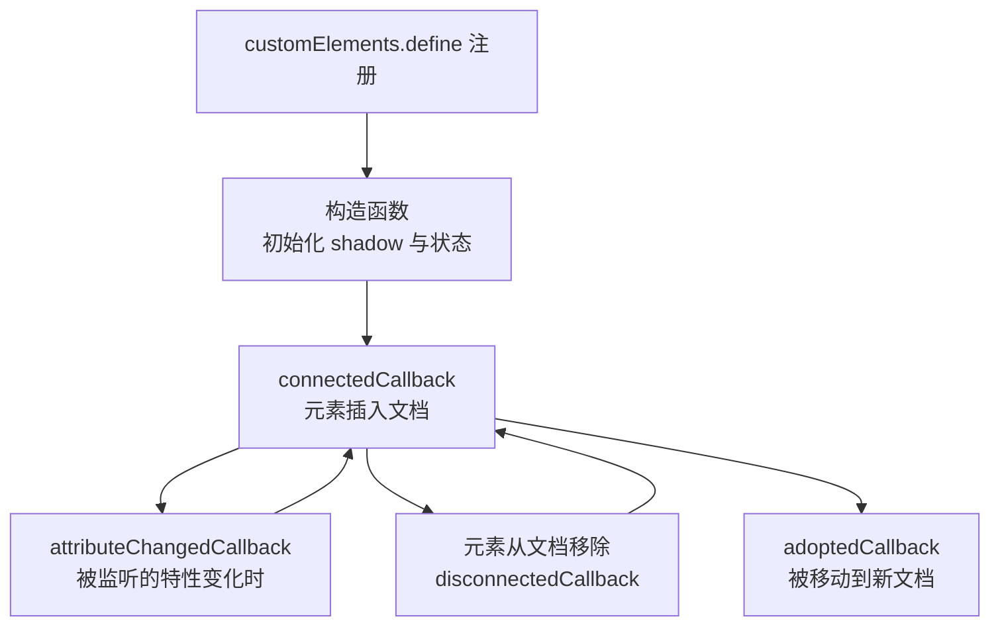

```javascript
// 完整生命周期演示
class CountDown extends HTMLElement {
  static observedAttributes = ['seconds', 'running']; // 只有这里列出的特性才触发回调

  constructor() {
    super();
    this.timer = null;
    console.log('constructor: 只做状态初始化，此处还没有子元素');
  }

  connectedCallback() {
    console.log('connected: 可以安全访问 this.children');
    this.seconds = Number(this.getAttribute('seconds') || 60);
    this.render();
    this.start();
  }

  disconnectedCallback() {
    console.log('disconnected: 清理定时器，防内存泄漏');
    clearInterval(this.timer);
  }

  attributeChangedCallback(name, oldVal, newVal) {
    console.log(`attribute changed: ${name} ${oldVal} -> ${newVal}`);
    if (name === 'seconds' && this.isConnected) {
      this.seconds = Number(newVal);
      this.render();
    }
  }

  start() {
    this.timer = setInterval(() => {
      this.seconds -= 1;
      this.render();
      if (this.seconds <= 0) clearInterval(this.timer);
    }, 1000);
  }

  render() {
    this.textContent = `剩余 ${this.seconds} 秒`;
  }
}

customElements.define('count-down', CountDown);
```

```html
<!-- 使用：改特性会触发 attributeChangedCallback -->
<count-down seconds="10" running></count-down>
```

### H5-039：Shadow DOM 如何实现样式与结构隔离？
**答**：
- `attachShadow({ mode: 'open' })` 创建影子树：内部 DOM 与样式对外部隐藏，页面 CSS 进不来、影子样式出不去（部分继承属性如 color/font 除外）。
- `mode: 'open'` 可通过 `el.shadowRoot` 访问，`closed` 则完全拿不到。
- 组件内样式用 `:host` 定义宿主自身样式、`::slotted()` 微调被分发子元素、CSS 自定义属性穿透传参。
- 收益：不依赖命名约定/前缀就能避免样式冲突，是"真"隔离（不同于 CSS Modules 的改名隔离）。

```javascript
class MyCard extends HTMLElement {
  connectedCallback() {
    const shadow = this.attachShadow({ mode: 'open' });

    shadow.innerHTML = `
      <style>
        /* 页面的 .title 样式影响不到这里 */
        :host { display: block; border: 1px solid #ddd; border-radius: 8px; }
        :host([hidden]) { display: none; }

        .title { color: #3367d6; }        /* 组件私有样式 */
        ::slotted(p) { margin: 0 12px; }  /* 修饰使用者塞进来的子元素 */
      </style>
      <div class="title"><slot name="title">默认标题</slot></div>
      <div class="body"><slot></slot></div>
    `;
  }
}
customElements.define('my-card', MyCard);
```

```html
<!-- 页面样式无论如何都污染不了组件内部 -->
<style> .title { color: red; } </style>

<my-card>
  <span slot="title">用户信息</span>
  <p>插槽内容样式由组件控制</p>
</my-card>

<script>
  // open 模式下外部可访问影子树
  console.log(document.querySelector('my-card').shadowRoot.querySelector('.title'));
</script>
```

### H5-040：template 与 slot 怎么配合使用？
**答**：
- `<template>` 里的内容不渲染、不发请求（img 不加载），clone 后插入才生效，适合存放可复用的 DOM 模板。
- `<slot>` 是 Web Components 的"占位符"：分具名插槽与默认插槽两种，把使用者的子元素分发进影子树。
- 多个同名内容插入同一 slot 时按声明顺序排列；`slotchange` 事件监听分发变化。
- 与 Vue 的插槽概念一致，理解成本为迁移而来。

```html
<template id="tpl">
  <style>
    .root { padding: 8px; background: #f5f5f5; }
  </style>
  <div class="root">
    <h3><slot name="title">未命名</slot></h3>
    <div><slot>默认内容区</slot></div>
  </div>
</template>

<script>
  customElements.define('x-panel', class extends HTMLElement {
    connectedCallback() {
      const shadow = this.attachShadow({ mode: 'open' });
      // template 内容克隆后插入影子树
      shadow.appendChild(document.getElementById('tpl').content.cloneNode(true));
    }
  });
</script>

<x-panel>
  <span slot="title">订单详情</span>
  <p>这里是默认插槽分发的内容</p>
</x-panel>
```

### H5-041：attribute 和 property 有什么区别？组件该暴露哪个？
**答**：
- attribute 是 HTML 标签上的字符串特性，property 是 JS 对象上的属性；同名的 `value` 等在 input 上初始同步、后续互不自动跟随。
- attribute 只能是字符串，property 可以是任意类型（数组、对象、函数、布尔）。
- Web Components 惯例：attribute 承载初始声明（HTML 里写），property 承载复杂状态；复杂值只暴露 property，简单值两者同步。
- 需要响应 attribute 变化就把名字加进 `observedAttributes`；property 变化要自己写 setter。

```javascript
class MyChart extends HTMLElement {
  static observedAttributes = ['title'];

  constructor() {
    super();
    this._data = []; // 复杂状态走 property
  }

  get data() {
    return this._data;
  }
  set data(val) {
    this._data = val;
    this.render(); // property setter 里同步视图
  }

  attributeChangedCallback(name, oldV, newV) {
    if (name === 'title') this.render(); // attribute 变化走回调
  }

  render() {
    this.textContent = `${this.getAttribute('title') ?? ''} ${this._data.length} 条数据`;
  }
}
customElements.define('my-chart', MyChart);
```

```html
<!-- attribute：字符串，适合声明式初始值 -->
<my-chart title="月活跃用户"></my-chart>

<script>
  const chart = document.querySelector('my-chart');

  // property：任意类型，适合复杂状态
  chart.data = [12, 30, 45]; // 触发 setter 渲染
  chart.setAttribute('title', '日活跃用户'); // 触发 attributeChangedCallback

  // 经典差异案例：input 的 value
  const input = document.querySelector('input');
  // input.value = 'b'（property 变了）不会改变 HTML 的 value attribute
  // getAttribute('value') 永远是 HTML 里的初始值，property 才是当前值
</script>
<input value="a" />
```

### H5-042：Shadow DOM 里的事件是如何冒泡的？composed 是什么？
**答**：
- 影子树内部事件的冒泡对外部做了"重定向"：`event.target` 在越过 shadow 边界时被改写为宿主元素，保护内部结构。
- `event.composed === true` 的事件（如 click、focus、input）能穿越 shadow 边界继续冒泡；`composed: false` 的（如 mouseenter）到边界就停。
- 在影子树内监听时拿到的 target 是真实内部元素；外部监听宿主时拿到的是宿主。
- 自定义事件默认不 composed，跨边界派发要 `new CustomEvent(type, { bubbles: true, composed: true })`。

```javascript
class MyButton extends HTMLElement {
  connectedCallback() {
    const shadow = this.attachShadow({ mode: 'open' });
    shadow.innerHTML = `<button>点我</button>`;
    const btn = shadow.querySelector('button');

    // 影子树内：target 是真实内部 button
    btn.addEventListener('click', (e) => console.log('inner target:', e.target.tagName)); // BUTTON

    // 组件对外派发自定义事件：必须 composed 才能被页面收到
    btn.addEventListener('click', () => {
      this.dispatchEvent(
        new CustomEvent('my-press', { bubbles: true, composed: true, detail: { at: Date.now() } })
      );
    });
  }
}
customElements.define('my-button', MyButton);
```

```html
<my-button></my-button>

<script>
  // 页面侧：composed 事件穿透影子边界，target 已被改写为宿主
  document.querySelector('my-button').addEventListener('my-press', (e) => {
    console.log('outer target:', e.target.tagName); // MY-BUTTON，不是 BUTTON
    console.log('detail:', e.detail);
  });
</script>
```

## 九、性能加载与 SEO

### H5-043：srcset 和 picture 分别解决什么问题？
**答**：
- `srcset` + `sizes`：同一张图的多分辨率选择，浏览器按"视口宽 × DPR"选最合适文件，解决高清屏与小屏的流量浪费。
- `picture`：按条件切换不同资源（不同格式 WebP/AVIF、不同裁切的 art direction），source 支持 media 与 type。
- 都写上时 picture 的 source 匹配优先于 img 的 srcset。
- 兜底原则：img 的 src 必填（老浏览器），加 width/height 防 CLS。

```html
<!-- 场景一：同图多分辨率，srcset + sizes -->

<!-- sizes：600px 以下视口占满屏宽，否则占一半；浏览器结合 DPR 自动挑 srcset -->

<!-- 场景二：新格式渐进增强 -->
<picture>
  <source srcset="hero.avif" type="image/avif" />
  <source srcset="hero.webp" type="image/webp" />
  
</picture>

<!-- 场景三：art direction，移动端裁成方的 -->
<picture>
  <source media="(max-width: 600px)" srcset="hero-square.jpg" width="600" height="600" />
  
</picture>
```

### H5-044：图片懒加载怎么做？原生 loading 与 IntersectionObserver 的差别？
**答**：
- 原生方案：`loading="lazy"`，浏览器自己判断接近视口才加载，零 JS；进入视口前会留出预载距离。
- IntersectionObserver：手动把真实 src 换成占位，交叉时再赋值，控制力强（可加渐显动画、自定义 rootMargin）。
- 兜底：不支持原生的环境降级 IO 方案；图片必须写 width/height 或 aspect-ratio 防 CLS。
- 首屏图不要懒加载（反而慢 LCP），只对首屏外内容启用。

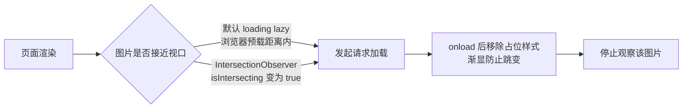

```html
<!-- 原生懒加载：一行搞定，适合大多数列表图 -->


<!-- 首屏 LCP 图片：明确不要懒，并提升优先级 -->

```

```javascript
// IntersectionObserver 手动懒加载（含不支持 loading=lazy 的兜底）
function lazyLoadImages(selector = 'img[data-src]') {
  const io = new IntersectionObserver(
    (entries) => {
      for (const entry of entries) {
        if (!entry.isIntersecting) continue;
        const img = entry.target;
        img.src = img.dataset.src; // 真实地址此时才加载
        img.addEventListener('load', () => img.classList.add('loaded'), { once: true });
        io.unobserve(img); // 加载后停止观察
      }
    },
    { rootMargin: '200px' } // 提前 200px 预载，抵消网络延迟
  );
  document.querySelectorAll(selector).forEach((img) => io.observe(img));
  return io;
}

// CSS：占位背景 + 渐显，减少布局跳动感
// img[data-src] { background: #eee; opacity: 0; }
// img.loaded { opacity: 1; transition: opacity 0.3s; }

// 特性检测决定走哪条路
if ('loading' in HTMLImageElement.prototype) {
  document.querySelectorAll('img[data-src]').forEach((img) => {
    img.src = img.dataset.src;
    img.loading = 'lazy';
  });
} else {
  lazyLoadImages();
}
```

### H5-045：iframe 的 sandbox 属性如何工作？
**答**：
- sandbox 给 iframe 内容套上"默认全部禁止"的能力沙箱，再逐项放行：`allow-scripts`（脚本）、`allow-same-origin`（保留自身 origin，否则被当成唯一源、连 localStorage/Cookie 都不能用）、`allow-forms`、`allow-popups`、`allow-top-navigation`。
- 沙箱值是"能力清单"：写 `sandbox` 空值 = 全禁；要遵循最小授权，比如第三方广告 iframe 常只给 `allow-scripts allow-popups`。
- 危险组合：`allow-scripts` + `allow-same-origin` 同时给且源与父页相同，脚本可移除 sandbox 属性逃逸，等于没沙箱。
- 同源 iframe 仍可操作父页面 DOM，不可信内容必须加 sandbox 或换跨域域名部署。

```html
<!-- 第三方内容：只给最小能力 -->
<iframe
  src="https://ads.example.com/banner"
  sandbox="allow-scripts allow-popups"
  loading="lazy"
  title="广告"
></iframe>

<!-- 完全静态预览：连脚本都不给 -->
<iframe srcdoc="<h1>纯静态预览</h1>" sandbox title="预览"></iframe>

<!-- 用户提交的富文本预览：禁脚本、禁表单、禁弹窗 -->
<iframe
  src="/preview/comment-123"
  sandbox="allow-same-origin"
  title="评论预览"
></iframe>
```

```javascript
// 动态创建带沙箱的 iframe 并传参：srcdoc + postMessage 组合
const frame = document.createElement('iframe');
frame.sandbox.add('allow-scripts'); // 注意：没有 allow-same-origin，内部无法访问父页存储
frame.srcdoc = `
  <script>
    window.addEventListener('message', (e) => {
      // 沙箱内无自身 origin，只能被动接收
      document.body.textContent = '收到: ' + e.data.count;
    });
  <\/script>
`;
document.body.appendChild(frame);
frame.onload = () => {
  frame.contentWindow.postMessage({ count: 42 }, '*'); // 不透明源场景只能 *
};
```

### H5-046：iframe 有哪些性能问题？如何缓解？
**答**：
- iframe 是独立文档：独立的解析、渲染、样式计算，等于开一个"子页面"，主线程开销大。
- 阻塞父页面 onload（影响部分性能指标）；每个 iframe 是独立合成层，内存与 GPU 开销高。
- 缓解：`loading="lazy"` 延迟创建、把 iframe 挂载推迟到需要时、用 `content-visibility: auto` 包裹、不可信内容配 sandbox。
- 替代思路：能合并的合并成组件，地图/播放器类用官方 JS SDK 按需初始化，广告类限制数量并懒加载。

```html
<!-- 视口外的 iframe 懒加载：滚动接近时才创建文档 -->
<iframe src="https://maps.example.com/embed" loading="lazy" width="600" height="400" title="门店地图"></iframe>

<!-- content-visibility：不在视口内时跳过子树渲染开销 -->
<div style="content-visibility: auto; contain-intrinsic-size: 400px;">
  <iframe src="https://player.example.com/video/1" title="视频"></iframe>
</div>

<script>
  // 更彻底的方案：交互时才注入 iframe
  const slot = document.querySelector('.video-slot');
  slot.querySelector('.play-btn').addEventListener('click', () => {
    const iframe = document.createElement('iframe');
    iframe.src = 'https://player.example.com/video/1?autoplay=1';
    iframe.allow = 'autoplay; fullscreen'; // 权限策略按需放行
    slot.replaceChildren(iframe);
  }, { once: true });
</script>
```

### H5-047：SPA 的 SEO 问题有哪些解法？
**答**：
- 根因：CSR 首屏 HTML 几乎是空壳，爬虫若不执行 JS 就拿不到内容；即使能执行，渲染等待与配额也吃亏。
- 解法：SSR（服务端直出 HTML）、SSG/预渲染（构建期生成静态页）、动态渲染（对爬虫 UA 返回预渲染内容，仅作过渡）。
- SPA 内必须做：每条路由独立 title/meta（history 模式 + 语义 URL）、语义化标签与可访问名称、sitemap、`<a>` 真实 href 而非纯 JS 跳转。
- 衡量工具：Search Console 的网址检查、Lighthouse SEO 项。

```javascript
// 路由切换时维护文档头（SPA 内的 SEO 基本盘）
const SEO = {
  '/': { title: '首页 - 示例商城', desc: '精选好物每日上新' },
  '/products': { title: '全部商品 - 示例商城', desc: '浏览全部商品分类' },
};

function updateSEO(path) {
  const meta = SEO[path];
  if (!meta) return;
  document.title = meta.title;

  let desc = document.querySelector('meta[name="description"]');
  if (!desc) {
    desc = document.createElement('meta');
    desc.name = 'description';
    document.head.appendChild(desc);
  }
  desc.content = meta.desc;
}

// 预渲染示例：vite-plugin-prerender 在构建期为每条路由产出静态 HTML
// vite.config.js
// import prerender from 'vite-plugin-prerender';
// export default {
//   plugins: [
//     prerender({
//       routes: ['/', '/products', '/products/1'], // 爬虫直接拿到完整 HTML
//     }),
//   ],
// };
```

## 十、无障碍与离线应用

### H5-048：常见的 ARIA 用法有哪些？使用原则是什么？
**答**：
- 第一原则：优先用原生语义（button/nav/label），能用原生就不用 ARIA；"No ARIA is better than bad ARIA"。
- 角色（role）补齐语义：自定义下拉用 `role="listbox"` + `aria-expanded`；状态用 `aria-selected`、`aria-disabled`。
- 动态反馈：`aria-live="polite"` 播报 toast/加载结果；`aria-label` 给图标按钮命名。
- `alt` 是图片 a11y 的底线：信息图写描述，纯装饰写 `alt=""`（读屏跳过）。

```html
<!-- 图标按钮必须有可访问名称 -->
<button aria-label="关闭对话框">
  <svg aria-hidden="true" width="16" height="16"><use href="#icon-x" /></svg>
</button>

<!-- 自定义下拉：角色 + 状态 -->
<div class="select" role="combobox" aria-expanded="false" aria-haspopup="listbox">
  <span id="sel-label">排序方式</span>
  <ul role="listbox" aria-labelledby="sel-label" hidden>
    <li role="option" aria-selected="true">最新</li>
    <li role="option" aria-selected="false">最热</li>
  </ul>
</div>

<!-- 动态区域：内容变化时读屏自动播报 -->
<div aria-live="polite" class="toast">已保存</div>

<!-- 装饰性图片 alt 留空，读屏跳过；信息图写清楚 -->


```

### H5-049：如何做好键盘可达性（focus 管理）？
**答**：
- 默认规则：所有交互用原生控件（button/a/input），天然支持 Tab、Enter、空格与焦点样式。
- 自定义弹窗三板斧：打开时焦点移入弹窗、Tab 循环困在弹窗内（focus trap）、关闭时焦点还给触发按钮。
- `tabindex`：-1 可编程聚焦但不进 Tab 序列；0 进入序列；正数打乱顺序，禁用。
- 不要用 `outline: none` 抹掉焦点样式；要美化用 `:focus-visible`。

```javascript
// 弹窗的焦点管理：打开移入 + 关闭归还 + Tab 困住
class Dialog {
  constructor(el) {
    this.el = el;
    this.lastFocused = null;

    el.addEventListener('keydown', (e) => {
      if (e.key === 'Escape') this.close();

      if (e.key === 'Tab') {
        const focusables = el.querySelectorAll('button, [href], input, select, textarea, [tabindex]:not([tabindex="-1"])');
        const first = focusables[0];
        const last = focusables[focusables.length - 1];
        if (e.shiftKey && document.activeElement === first) {
          e.preventDefault();
          last.focus(); // 反向到头，绕回最后一个
        } else if (!e.shiftKey && document.activeElement === last) {
          e.preventDefault();
          first.focus(); // 正向到头，绕回第一个
        }
      }
    });
  }

  open() {
    this.lastFocused = document.activeElement;
    this.el.hidden = false;
    this.el.querySelector('h2')?.focus(); // 标题设 tabindex="-1" 作为初始焦点
  }

  close() {
    this.el.hidden = true;
    this.lastFocused?.focus(); // 焦点还给触发按钮，键盘用户不迷路
  }
}
```

```html
<div class="dialog" role="dialog" aria-modal="true" aria-labelledby="dlg-title" hidden>
  <h2 id="dlg-title" tabindex="-1">确认删除</h2>
  <button class="cancel">取消</button>
  <button class="confirm">删除</button>
</div>

<style>
  /* 保留焦点可见性：只对键盘操作显示焦点环 */
  button:focus-visible {
    outline: 2px solid #3367d6;
    outline-offset: 2px;
  }
  /* 反例：outline: none 会干掉所有键盘用户的导航线索 */
</style>
```

### H5-050：离线应用如何实现？AppCache 为什么被废弃？
**答**：
- 老方案 AppCache（manifest 文件声明缓存清单）已被废弃：声明式、控制力弱、缓存更新规则反直觉、双重缓存问题频发。
- 现行方案：Service Worker + Cache Storage（见 WEB-028），命令式、可编程，配合策略（Cache First/Network First）灵活控制。
- 完整离线应用 = SW 预缓存静态资源 + 接口数据缓存兜底 + 离线队列重放（Background Sync 可选）。
- 离线体验要兜底：离线 fallback 页面、失败提示、恢复后同步。

```html
<!-- 已废弃的 AppCache 写法：仅用于识别旧项目，新项目禁止使用 -->
<!-- <html manifest="offline.appcache"> -->
```

```javascript
// 现行方案：Service Worker 完整离线应用骨架
const VERSION = 'offline-v1';
const CACHE = `shell-${VERSION}`;
const SHELL = ['/', '/index.html', '/app.js', '/app.css', '/offline.html'];

self.addEventListener('install', (event) => {
  event.waitUntil(caches.open(CACHE).then((c) => c.addAll(SHELL)));
});

self.addEventListener('fetch', (event) => {
  const req = event.request;

  if (req.mode === 'navigate') {
    // 页面导航：网络优先，断网回退离线页
    event.respondWith(
      fetch(req).catch(() => caches.match('/offline.html'))
    );
  } else if (req.url.includes('/api/')) {
    // 接口：网络优先 + 缓存兜底，离线也能看到上次数据
    event.respondWith(
      fetch(req)
        .then((res) => {
          const copy = res.clone();
          caches.open(CACHE).then((c) => c.put(req, copy));
          return res;
        })
        .catch(() => caches.match(req))
    );
  } else {
    // 静态资源：缓存优先
    event.respondWith(
      caches.match(req).then((hit) => hit || fetch(req))
    );
  }
});
```

```javascript
// 页面侧：离线写操作排队，恢复后重放（Background Sync 思路的轻量实现）
const pending = JSON.parse(localStorage.getItem('pending-actions') || '[]');

window.addEventListener('online', async () => {
  while (pending.length) {
    const action = pending[0];
    try {
      await fetch(action.url, action.init);
      pending.shift(); // 成功才出队
      localStorage.setItem('pending-actions', JSON.stringify(pending));
    } catch {
      break; // 仍失败，保留队列等下次恢复
    }
  }
});

function submitOfflineSafe(url, init) {
  if (navigator.onLine) return fetch(url, init);
  pending.push({ url, init });
  localStorage.setItem('pending-actions', JSON.stringify(pending));
  toast('当前离线，已加入待同步队列');
}
```

## 十一、语义与结构进阶

### H5-051：article、section、aside 在真实页面里如何判定？给一个可执行的判定流程。
**答**：
- 先问"这段内容脱离页面还能独立成篇吗"，能就是 `article`（博客正文、评论、商品卡、一条消息）。
- 再问"它是不是围绕同一主题的分组且有自己的标题"，是就用 `section`；没有标题的纯样式分组退回 `div`。
- 与主内容"相关但可剥离"（侧栏推荐、广告、术语表）用 `aside`；注意 aside 不等于视觉侧栏，正文里的补充说明也可以是 aside。
- `section` 可以嵌在 `article` 里当章节，`article` 也可以嵌在 `article` 里表示"被引用的独立内容"（如评论）。
- 判定顺序：独立分发？→ article；主题分组有标题？→ section；可剥离的辅助内容？→ aside；都不是 → div。

```html
<!-- 一篇文章页：三种标签各就各位 -->
<main>
  <article>                      <!-- 正文可独立分发（RSS 抓走也完整） -->
    <h1>CSS 容器查询实战</h1>
    <section aria-labelledby="s1">
      <h2 id="s1">背景</h2>
      <p>容器查询改变了组件写响应式的思路……</p>
    </section>
    <section aria-labelledby="s2">
      <h2 id="s2">示例</h2>
      <p>下面的代码演示……</p>
    </section>
    <aside>                      <!-- 与正文相关但可剥离：术语解释 -->
      <p>注：容器查询即 @container 规则，区别于媒体查询。</p>
    </aside>
  </article>

  <section aria-labelledby="comments">
    <h2 id="comments">评论</h2>
    <article class="comment">    <!-- 每条评论本身也是独立内容 -->
      <p>写得很清楚，受益了。</p>
    </article>
  </section>

  <aside class="related">        <!-- 页面级侧栏：相关推荐，可整体剥离 -->
    <h2>相关文章</h2>
    <ul><li><a href="/a">逻辑属性</a></li></ul>
  </aside>
</main>
```

### H5-052：heading 层级与 outline 算法是怎么回事？为什么不能滥用 h1？
**答**：
- HTML4 时代的"文档大纲算法"（section 嵌套自动降级标题）在主流实现中已被搁置，实践中必须**手写正确的 h1~h6 层级**，不能依赖浏览器推算。
- 核心规则：每个 section/article/aside 建议有自己的标题；标题层级不跳级（h2 后直接 h4 是错误）；一个页面通常一个 h1。
- 读屏用户靠标题列表"满文跳读"，层级错了导航就废；SEO 同样按标题权重理解内容。
- section 无标题时 Chrome 会把它当"无标题分组"，对大纲没有贡献，反而产生噪音。
- 落地手段：CI 里跑 axe/lighthouse 检查 heading-order，或用浏览器 DevTools 的 Accessibility 面板查看标题树。

```html
<!-- 正确层级：逻辑树与视觉大小解耦，字号交给 CSS -->
<article>
  <h1>2026 前端趋势报告</h1>          <!-- 全文唯一 h1 -->
  <section>
    <h2>一、框架</h2>                  <!-- 不跳级 -->
    <section>
      <h3>1.1 编译时框架</h3>
      <h4>现状</h4>
    </section>
  </section>
  <section>
    <h2>二、构建工具</h2>
  </section>
</article>

<style>
  /* 错觉纠正：视觉大小不跟随层级，避免"为了显眼乱用 h1" */
  h1 { font-size: 28px; }
  h2 { font-size: 24px; }
  h3 { font-size: 20px; }
</style>
```

### H5-053：time 元素和 datetime 属性解决什么问题？什么时候必须写 datetime？
**答**：
- `<time>` 把人类可读的时间文本和机器可读的 ISO 8601 值绑定，方便爬虫、日历、搜索引擎提取结构化时间。
- 元素内文本格式随意（"昨天""3 天前"），但必须是**有效的时间/日期语义**；机器值交给 `datetime` 属性。
- 当元素内容不是合法的机器格式（如"3 天前"）时，`datetime` **必填**；内容本身是合法格式时可省略。
- 支持日期、时间、时长（时长加 `PT2H30M` 前缀）；无效值如 `<time>2026-13-01</time>` 不是合法 time 元素。
- 常见坑：发布时间建议同时给 `<time datetime="2026-11-07T09:00+08:00">` 带时区，避免解析歧义。

```html
<!-- 内容即机器格式，datetime 可省略 -->
<time>2026-11-07</time>
<time>09:30</time>

<!-- 相对时间：文本随意，datetime 必填 -->
<time datetime="2026-11-04">3 天前</time>
<time datetime="2026-11-07T09:00+08:00">今天上午</time>

<!-- 时长写法：PT 前缀，2 小时 30 分 -->
<time datetime="PT2H30M">两个半小时</time>

<script>
  // 爬虫/脚本视角：一条语句拿走页面全部机器可读时间
  const times = [...document.querySelectorAll('time[datetime]')]
    .map(el => ({ raw: el.textContent, iso: el.dateTime }));
  console.log(times); // [{raw: '3 天前', iso: '2026-11-04'}, ...]
</script>
```

### H5-054：address 元素是干什么的？和 footer 里的联系信息怎么配合？
**答**：
- `<address>` 专指"**当前 article 或 body 的作者/维护者**联系信息"，不是任意地址（快递收货地址、景点地址都不该用）。
- 作用域跟随最近的 `article`：文章内的 address 表示文章作者联系方式；body 直属的 address 表示全站联系信息。
- 典型位置是 `footer` 内部；内容通常是邮箱、社交链接、电话，排版无默认特殊样式（多为斜体，可重置）。
- 里面放 `<a href="mailto:">` / `tel:` 链接，对读屏和无障碍最友好。
- 反例：门店地址列表用 address 是误用，应使用带 itemporp（schema.org 微数据）或普通标记。

```html
<article>
  <h1>容器查询实战</h1>
  <p>正文……</p>
  <footer>
    <!-- 文章作者联系方式：作用于本 article -->
    <address>
      作者：<a href="mailto:lin@example.com">lin@example.com</a> ·
      <a href="https://twitter.com/lin">Twitter</a>
    </address>
  </footer>
</article>

<footer>
  <!-- 全站维护者信息：作用于 body -->
  <address>
    有问题请联系 <a href="mailto:support@example.com">支持团队</a>，
    电话 <a href="tel:+861012345678">010-12345678</a>。
  </address>
  <p><small>© 2026 Example Inc.</small></p>
</footer>
```

### H5-055：figure 和 figcaption 的正确用法是什么？
**答**：
- `figure` 表示"**被主体引用、但可移动到附录或其他位置而不影响正文**"的独立内容：图、代码块、图表、视频、公式。
- `figcaption` 必须是 figure 的**第一个或最后一个子元素**，为整个 figure 提供说明；一个 figure 至多一个 figcaption。
- img 的 alt 描述"图里是什么"，figcaption 解释"为什么放这张图/它说明什么"，两者互补不重复。
- 读屏会进入 figure 角色（figure/figcaption 映射为无障碍角色），figcaption 文本关联到图形，比裸 img + 下方 p 语义强。
- 不需要说明文字的图，直接用 `img + alt` 即可，不要为了"语义"硬包 figure。

```html
<!-- 图 + 说明：说明是第一个子元素 -->
<figure>
  <figcaption>图 1：各框架 2026 年满意度对比</figcaption>
  
</figure>

<!-- 代码块也能用 figure：说明文字复用 figcaption -->
<figure>
  <figcaption>防抖函数的最小实现</figcaption>
  <pre><code>function debounce(fn, ms) { /* ... */ }</code></pre>
</figure>

<!-- 反例：无说明的装饰图不需要 figure -->

```

### H5-056：wbr 是什么？长单词/长 URL 在窄容器里如何优雅换行？
**答**：
- `<wbr>`（word break opportunity）标记"**允许在此处断行**"的位置，正常放得下时不产生任何效果，放不下才在标记处折行。
- 适用场景：超长 URL、SKU 编号、哈希值、驼峰长标识符——这类连续字符串浏览器默认不拆。
- 兄弟方案：`overflow-wrap: break-word` 任意位置硬拆（可能拆出难看的半截），`hyphens: auto` 按连字符规则拆（依赖 lang 且中文场景无关）。
- 组合拳：URL 在 `/`、`?`、`&` 后插 wbr，既保住可读分段又允许折行；CSS 兜底防溢出。
- 复制文本时 wbr 不产生字符，是它优于手动插 `-` 或 `<br>` 的关键。

```html
<style>
  .path {
    width: 220px; border: 1px solid #ccc;
    overflow-wrap: break-word;  /* CSS 兜底：wbr 之外再防溢出 */
  }
</style>

<!-- 在 URL 的分隔符后手工标记可断点 -->
<p class="path">
  https://example.com/<wbr>very/long/<wbr>path/<wbr>to/<wbr>article?id=123<wbr>&amp;from=rss
</p>

<!-- 驼峰长标识符：在词界断行 -->
<p class="path">parse<wbr>SVG<wbr>Path<wbr>Data<wbr>Into<wbr>Matrix</p>

<!-- 表格里的哈希值：每 4 位允许断行 -->
<td>ab12<wbr>cd34<wbr>ef56<wbr>7890</td>
```

### H5-057：template 元素有哪些"深层"用法？和直接字符串拼 HTML 差在哪？
**答**：
- `template` 内容**惰性**：不渲染、不执行内部脚本、不发图片请求、样式不生效，直到被 clone 进文档。
- 解析阶段已完成：`content` 里是现成的 DOM 子树，比 `innerHTML` 拼字符串多一道 XSS 防线（没有动态拼串），且无需二次 parse。
- 可作为"组件的静态外壳"：Web Components 在构造/连接时 clone 模板注入 shadow DOM，是 H5-040 之外更工程化的模式。
- 模板可放在任意位置复用（表格行、列表项），`content` 支持一次性 `importNode` 或多次 `cloneNode(true)`。
- 注意点：template 内无法使用文档级相对 URL 解析；全局事件委托抓不到未实例化的模板内容。

```html
<template id="row-tpl">
  <tr>
    <td class="name"></td>
    <td class="price"></td>
  </tr>
</template>
<table id="goods"><tbody></tbody></table>

<script>
  const tpl = document.getElementById('row-tpl');
  const tbody = document.querySelector('#goods tbody');

  const data = [
    { name: '键盘', price: '¥299' },
    { name: '鼠标', price: '¥199' },
  ];

  // 关键差异：innerHTML 需要 parse 且有注入风险，template 是现成 DOM，赋值即可
  for (const item of data) {
    const frag = tpl.content.cloneNode(true);      // 深克隆，模板本体不动
    frag.querySelector('.name').textContent = item.name;   // textContent 防注入
    frag.querySelector('.price').textContent = item.price;
    tbody.appendChild(frag);
  }

  // 惰性验证：模板里的脚本与图片在克隆进文档前绝不执行/请求
  console.log(tpl.content.childElementCount); // 结构完整可用
</script>
```

## 十二、表单进阶

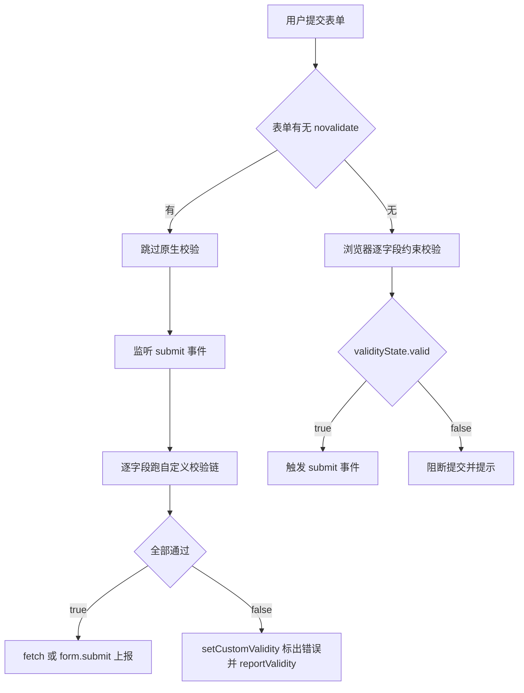

### H5-058：input 的 form 属性有什么用？什么场景必须跨表单关联？
**答**：
- `form` 属性让**游离于 form 标签之外**的控件归属某个表单：提交、校验、reset 全部纳入该表单。
- 典型场景：模态框里的提交按钮在 `dialog` 中、表格每行有独立按钮、布局被设计拆散的表单（表头一条、表尾一条）。
- 支持该属性的控件：`input`、`select`、`textarea`、`button`、`output`、`fieldset` 等；`form="formId"` 写 id。
- 提交时游离控件的数据**会**一起序列化；`formmethod/formaction` 还能在按钮级覆盖表单行为。
- 代价：DOM 关系与逻辑关系分离，代码可读性下降，务必加注释或让控件物理上靠近。

```html
<form id="order" action="/api/order" method="post">
  <input name="sku" required placeholder="商品编号">
  <!-- 下面的提交按钮在 dialog 里，通过 form 属性关联 -->
  <button type="submit" form="order">提交订单</button>
</form>

<!-- 游离输入框：不在 form 标签内，但数据会随 #order 提交 -->
<label for="remark">备注（物理上位于页面底部）</label>
<input id="remark" name="remark" form="order">

<dialog id="confirm-box">
  <p>确认提交该订单？</p>
  <!-- 按钮级覆盖：这个按钮以 GET 提到预览接口 -->
  <button type="submit" form="order" formmethod="get"
          formaction="/api/order/preview">预览</button>
  <button type="button" onclick="document.getElementById('confirm-box').close()">
    取消
  </button>
</dialog>
```

### H5-059：fieldset 与 legend 除了分组还有哪些实战价值？
**答**：
- `fieldset` 给一组相关控件建立语义分组，`legend` 是分组的**唯一标题**，读屏进入分组时会先播报 legend，比 div + h3 强。
- 超实用副作用：**禁用整个分组**——`fieldset disabled` 后内部全部控件不可交互、不参与提交、不被 tab 到，一行搞定"地址类型切换"。
- 单选按钮组天然适合 fieldset：读屏用户能听到"支付方式"这个上下文，而不是一串孤立的 radio。
- fieldset 参与 form 关联（也有 form 属性），且可嵌套；legend 内放链接等流内容合法但建议保持纯文本。
- 样式上 fieldset 默认边框可 `border: 0` 重置，legend 借 `float: left` 等技巧可实现"穿越边框"效果。

```html
<form>
  <!-- 单选组：legend 提供提问上下文 -->
  <fieldset>
    <legend>支付方式</legend>
    <label><input type="radio" name="pay" value="wx" checked>微信</label>
    <label><input type="radio" name="pay" value="alipay">支付宝</label>
  </fieldset>

  <!-- 一键禁用整组：发票信息未启用 -->
  <fieldset disabled>
    <legend>发票信息（暂不可用）</legend>
    <input name="invoice-title" placeholder="发票抬头">
    <input name="invoice-no" placeholder="税号">
  </fieldset>

  <!-- JS 动态启停：切配送方式时整组可用性联动 -->
  <button type="button" id="toggle-invoice">启用发票填写</button>
</form>

<script>
  document.getElementById('toggle-invoice').addEventListener('click', (e) => {
    const fs = e.currentTarget.previousElementSibling;
    fs.disabled = !fs.disabled;                 // 整组控件同时启用/禁用
  });
</script>
```

### H5-060：pattern 属性怎么用？它和 :invalid 伪类如何联动？
**答**：
- `pattern` 只作用于 `text/search/tel/url/email/password` 等**文本类** input，值是 JS 正则字面量（**不加斜杠**），隐式锚定全匹配（等价 `^(?:pattern)$`）。
- 校验失败时控件进入 `:invalid`，配合 `:user-invalid`（用户实际交互过才触发）可以避免"页面一打开满屏红"。
- `title` 属性是失败提示的补充文案（部分浏览器在原生气泡中展示），同时给悬停用户解释规则。
- 中文场景注意：pattern 匹配基于整个 value，且 `u` 标志生效，中文类字符类 `[\u4e00-\u9fa5]` 可用。
- 联动链：`required` 先判空 → `pattern` 判格式 → `minlength/maxlength` 判长度 → 自定义 `setCustomValidity` 判业务。

```html
<style>
  /* 未交互时不吓人：user-invalid 只在用户输入过且非法时变红 */
  input:user-invalid {
    border-color: #d33;
    background: #fee;
  }
  input:valid { border-color: #3c3; }
</style>

<form>
  <!-- 4-16 位字母数字下划线用户名：正则不加斜杠 -->
  <label>用户名
    <input name="username" required
           pattern="[A-Za-z0-9_]{4,16}"
           title="4 到 16 位字母、数字或下划线">
  </label>

  <!-- 手机号：允许 +86 前缀 -->
  <label>手机号
    <input name="phone" required
           pattern="(?:\+86)?1[3-9]\d{9}"
           title="请输入 11 位手机号，可带 +86">
  </label>

  <button>提交</button>
</form>

<script>
  // :invalid 也能在 JS 里编程查询，用于提交前预检
  const form = document.querySelector('form');
  form.addEventListener('submit', (e) => {
    const bad = [...form.elements].filter(el => el.matches(':invalid'));
    console.log('非法字段：', bad.map(el => el.name)); // 提交被阻断时触发
    if (bad.length) e.preventDefault();
  });
</script>
```

### H5-061：novalidate 加上自定义校验链，如何避免原生气泡"抢戏"？
**答**：
- `novalidate`（写在 form 上）只关掉**提交时的自动校验与气泡**，不删控件上的约束属性——`validity` 状态和 `:invalid` 样式照常工作。
- 标准链路：监听 `submit` → `e.preventDefault()` 永远接管 → 逐字段跑业务校验 → 自己渲染错误 → 全过才真正提交。
- 错误展示与 a11y：给控件设 `aria-invalid="true"`，错误文本节点用 `aria-describedby` 关联，焦点移到第一个错误字段。
- 逐字段也可以不 novalidate、只在 `invalid` 事件里 `e.preventDefault()` 抑制气泡（form 级监听，capture 冒泡均可）。
- 取舍：完全接管（UI 统一、可控性强）vs 半接管（保留原生能力，仅改文案）。

```html
<form id="signup" novalidate>
  <label>邮箱 <input name="email" type="email" required></label>
  <p class="err" data-err-for="email"></p>

  <label>密码 <input name="pwd" type="password" required minlength="8"></label>
  <p class="err" data-err-for="pwd"></p>

  <button>注册</button>
</form>

<script>
  const form = document.getElementById('signup');
  const rules = {
    email: v => !v ? '邮箱必填'
      : (!/^[^@\s]+@[^@\s]+\.[^@\s]+$/.test(v) ? '邮箱格式不正确' : ''),
    pwd: v => v.length < 8 ? '密码至少 8 位' : '',
  };

  function validateField(input) {
    const msg = rules[input.name](input.value);
    const errEl = form.querySelector(`[data-err-for="${input.name}"]`);
    errEl.textContent = msg;
    input.setAttribute('aria-invalid', msg ? 'true' : 'false');
    input.setAttribute('aria-describedby', errEl.id ||= `err-${input.name}`);
    return !msg;
  }

  form.addEventListener('submit', (e) => {
    e.preventDefault();                            // novalidate 下完全接管
    const inputs = [...form.elements].filter(el => rules[el.name]);
    const ok = inputs.map(validateField).every(Boolean);
    if (ok) return fetch('/api/signup', { method: 'POST', body: new FormData(form) });
    inputs.find(i => i.matches('[aria-invalid="true"]')).focus(); // 聚焦第一个错误
  });

  // 失焦即时校验，输入时清除错误
  form.addEventListener('blur', e => rules[e.target.name] && validateField(e.target), true);
  form.addEventListener('input', e => {
    if (e.target.getAttribute('aria-invalid') === 'true') validateField(e.target);
  });
</script>
```

### H5-062：checkValidity、reportValidity 与 validityState 如何组合成完整校验工具箱？
**答**：
- `checkValidity()`：**静默**检查并触发 `invalid` 事件，返回布尔值，不弹任何 UI；适合程序化预检。
- `reportValidity()`：检查**并**展示浏览器原生提示（气泡 + 聚焦第一个非法字段）；想借原生 UI 就用它。
- `element.validity` 是 11 个布尔位的"体检报告"：`valueMissing/badInput/typeMismatch/patternMismatch/tooLong/tooShort/rangeOverflow/rangeUnderflow/stepMismatch/tooLong 之外还有 customError/valid`。
- `setCustomValidity(msg)` 设置非空即视为非法（`customError` 为 true），传空串清除——这是把业务错误挂进原生体系的唯一入口。
- 组合拳：`setCustomValidity` 挂业务错误 → `reportValidity()` 展示 → `validity.customError` 区分"格式错"与"业务错"。

```html
<form id="pay">
  <label>提现金额
    <input name="amount" type="number" required min="1" max="5000" step="0.01">
  </label>
  <p id="biz-err" hidden>该金额超出今日剩余额度</p>
  <button>申请提现</button>
</form>

<script>
  const form = document.getElementById('pay');
  const amount = form.elements.amount;
  let quotaLeft = 800; // 模拟接口返回的剩余额度

  // 业务校验挂在原生体系上
  amount.addEventListener('input', () => {
    const v = Number(amount.value);
    amount.setCustomValidity(
      v > quotaLeft ? `超出今日剩余额度 ${quotaLeft} 元` : ''
    );
  });

  form.addEventListener('submit', (e) => {
    e.preventDefault();

    // 1) 静默预检：不发 UI
    if (!form.checkValidity()) {
      // 2) 需要提示时再交给原生气泡，自动聚焦第一个非法字段
      form.reportValidity();
      return;
    }

    // 3) 用 validityState 区分错误类型，做精细化 UI
    if (amount.validity.customError) {
      document.getElementById('biz-err').hidden = false;
    } else {
      document.getElementById('biz-err').hidden = true;
      fetch('/api/withdraw', { method: 'POST', body: new FormData(form) });
    }
  });

  // 附：常见 validity 位速查
  amount.value = '';
  console.log(amount.validity.valueMissing); // true
  amount.value = '99999';
  console.log(amount.validity.rangeOverflow, amount.validity.customError); // true true
</script>
```

### H5-063：datalist 进阶技巧与 output 元素各自适合什么场景？
**答**：
- `datalist` 是"**可输入的 select**"：input 保留自由输入，下拉只做候选提示；`select` 则强制取值。候选可来自 JS 动态生成。
- 实战：给候选加描述时部分浏览器支持 `label` 属性（显示为辅助文本）；数值/日期类型 input 配 datalist 可给刻度建议。
- `output` 承载**计算结果或用户操作的结果**，自带 `for` 属性声明参与计算的控件 id；读屏将其当结果区域播报。
- output 默认 `display: inline` 且是 live region 角色，JS 改 value（textContent）无需额外 aria-live。
- 两者搭配常见于"滑块选值 + 实时回显"或"输入拼音候选 + 计算结果"的组合。

```html
<form id="calc">
  <!-- datalist：输入色值候选，允许自由输入 -->
  <label>主题色
    <input list="palette" name="color" value="#1677ff">
  </label>
  <datalist id="palette">
    <option value="#1677ff" label="品牌蓝"></option>
    <option value="#52c41a" label="成功绿"></option>
    <option value="#fa8c16" label="警示橙"></option>
  </datalist>

  <!-- 滑块 + output 实时回显计算结果 -->
  <label>数量
    <input type="range" name="qty" min="1" max="10" value="1">
  </label>
  <label>单价
    <input type="number" name="price" value="9.9" min="0" step="0.1">
  </label>
  <output name="total" for="qty price">9.90</output>

  <button>下单</button>
</form>

<script>
  const form = document.getElementById('calc');
  const update = () => {
    const qty = form.elements.qty.valueAsNumber;
    const price = form.elements.price.valueAsNumber;
    form.elements.total.value = (qty * price).toFixed(2); // output 用 value 赋值
  };
  form.addEventListener('input', update);

  // datalist 候选动态化：搜索联想
  fetch('/api/hot-colors')
    .then(r => r.json())
    .then(list => {
      const dl = document.getElementById('palette');
      dl.replaceChildren(...list.map(c => new Option(c.name, c.hex)));
    });
</script>
```

### H5-064：inputmode 与 enterkeyhint 如何定制移动端虚拟键盘？
**答**：
- `inputmode` **只改键盘布局，不改校验与语义**——这是它与 `type` 的本质区别：`type="text" inputmode="numeric"` 得到数字键盘但值仍是字符串。
- 常用值：`numeric`（纯数字）、`decimal`（带小数点）、`tel`、`email`、`url`、`search`；`none` 可隐藏软键盘（自定义键盘场景）。
- 典型痛点：验证码输入用 `type="text" inputmode="numeric"`，既有数字键盘又允许中途粘贴带空格的值。
- `enterkeyhint` 定制回车键文案：`enter/done/go/next/search/send`，引导用户下一步动作。
- 二者都是渐进增强：不支持的浏览器安全忽略；桌面端无感，移动端体验质变。

```html
<form>
  <!-- 验证码：数字键盘 + 发送键 -->
  <label>验证码
    <input name="code" type="text" inputmode="numeric"
           pattern="\d{6}" maxlength="6" autocomplete="one-time-code"
           enterkeyhint="done">
  </label>

  <!-- 金额：允许小数点，回车显示"下一步" -->
  <label>充值金额
    <input name="amount" type="text" inputmode="decimal"
           enterkeyhint="next">
  </label>

  <!-- 站内搜索框：搜索键盘 + 搜索键 -->
  <label>搜索
    <input name="q" type="search" inputmode="search" enterkeyhint="search">
  </label>

  <!-- 链接粘贴：URL 键盘自带斜杠与 .com -->
  <label>主页
    <input name="url" type="text" inputmode="url" enterkeyhint="go">
  </label>

  <button>提交</button>
</form>

<script>
  // type 与 inputmode 语义分离的体现：value 始终是字符串
  document.querySelector('form').addEventListener('submit', (e) => {
    e.preventDefault();
    const code = e.target.elements.code.value;   // "123456" 字符串
    console.log(code, typeof code);
  });
</script>
```

## 十三、媒体进阶

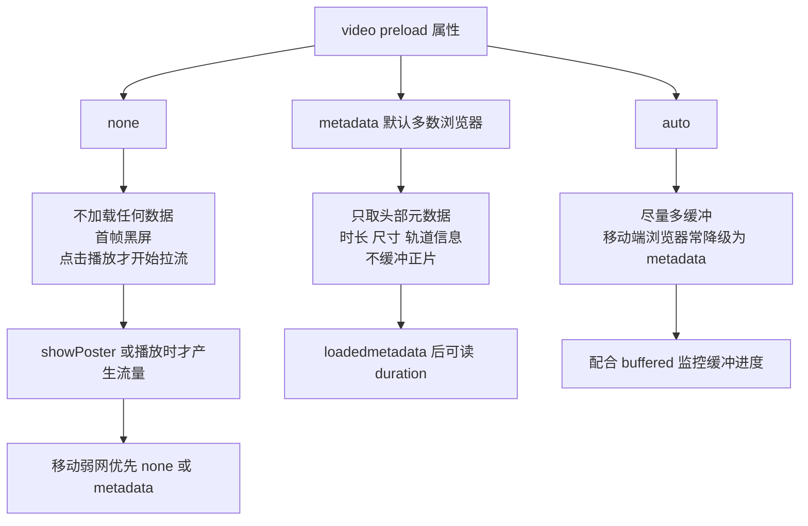

### H5-065：video 的 playsinline 为什么关键？iOS 上不加会发生什么？
**答**：
- iOS Safari 里内联播放是被"选择加入"的：不加 `playsinline`，视频播放时会**全屏接管**整个界面，退出需要用户手动点"完成"。
- `playsinline` 让视频在页面内嵌位置播放，是所有 H5 视频流（信息流、商品主图视频、直播小窗）在 iOS 上正常工作的前提。
- 历史包袱：iOS 10 之前需要私有属性 `webkit-playsinline`，现在标准属性已全覆盖；Android 上一直内联，无需处理。
- 组合：`playsinline` + `muted` + `autoplay` 才能静默自动播放（尤其 iOS）；三者缺一自动播放大概率被拦截。
- 与全屏的配合：需要全屏时**显式**调 `requestFullscreen()` 或 `webkitEnterFullscreen()`（后者仅 iOS 原生控件可用），把选择权还给代码。

```html
<!-- 信息流视频的标准三件套：内联 + 静音 + 自动播放 -->
<video id="feed-video"
       playsinline
       muted
       autoplay
       loop
       webkit-playsinline
       preload="metadata"
       poster="/img/cover.jpg"
       src="/media/clip.mp4"></video>

<script>
  const v = document.getElementById('feed-video');

  // 用户点了"开声音"：解除静音后 iOS 允许继续播放
  document.getElementById('unmute').addEventListener('click', () => {
    v.muted = false;
    v.play().catch(console.warn);
  });

  // 想全屏：显式请求，而不是依赖 iOS 的自动全屏接管
  document.getElementById('fs').addEventListener('click', () => {
    if (v.requestFullscreen) v.requestFullscreen();
    else if (v.webkitEnterFullscreen) v.webkitEnterFullscreen(); // iOS 原生全屏
  });

  // iOS 低电量模式会拦 autoplay：统一 catch 后降级为点击起播
  v.play().catch(() => {
    v.controls = true;
    v.addEventListener('click', () => v.play(), { once: true });
  });
</script>
```

### H5-066：preload 的 none / metadata / auto 真实行为是什么？
**答**：
- `none`：**一个字节都不加载**，posters 照常显示，`duration` 等元数据在 `preload` 前不可读；适合列表页几十个视频的弱网场景。
- `metadata`（Chrome 等浏览器的默认值）：只取容器头部的时长、尺寸、轨道信息，触发 `loadedmetadata`；正片不缓冲。
- `auto`：浏览器"尽力"多缓冲，**没有强保证**——移动端浏览器普遍降级为 metadata 甚至 none 省流量，且 WiFi/蜂窝策略不同。
- preload 是**提示不是命令**：`autoplay` 会无视 preload，`userAgent` 也可能基于省电模式覆盖它。
- 工程实践：瀑布流封面用 none，进入视口再切 `preload="metadata"` 或直接 `play()`；详情页大视频用 metadata + 起播后监听 `buffered` 做进度兜底。

```html
<!-- 列表页：一律 none，不产生任何视频流量 -->
<video class="feed-item" preload="none"
       playsinline muted loop
       poster="/img/thumb-1.jpg"
       data-src="/media/clip-1.mp4"></video>

<script>
  const io = new IntersectionObserver((entries) => {
    for (const en of entries) {
      const v = en.target;
      if (!en.isIntersecting) { v.pause(); continue; }

      // 进入视口：懒挂载真实源并请求元数据
      if (!v.src) v.src = v.dataset.src;
      v.preload = 'metadata';                 // 升级为只取头信息
      io.unobserve(v);
    }
  }, { threshold: 0.5 });

  document.querySelectorAll('.feed-item').forEach(v => io.observe(v));

  // 真要起播时，元数据可能还没到：readyState 分级兜底
  document.addEventListener('click', (e) => {
    const v = e.target.closest('video');
    if (!v) return;
    if (v.readyState >= 3) v.play();
    else v.addEventListener('canplay', () => v.play(), { once: true });
  });

  // auto 的缓冲进度监控：buffered 是多段区间，取包含播放头的段
  function bufferedAhead(v) {
    for (let i = 0; i < v.buffered.length; i++) {
      if (v.buffered.start(i) <= v.currentTime &&
          v.currentTime <= v.buffered.end(i)) {
        return v.buffered.end(i) - v.currentTime; // 秒
      }
    }
    return 0;
  }
</script>
```

### H5-067：track 字幕如何工作？多语言字幕与默认轨怎么选？
**答**：
- `<track kind="subtitles">` 给 video 挂 WebVTT 字幕，`srclang` 声明语言，`label` 是菜单显示名；**不带 kind 默认按 subtitles 处理**。
- `default` 属性标记默认开启的轨道，但注意：带 `default` 的 subtitles 在 Chrome 等浏览器**默认并不自动显示**，需要用户在菜单开启或 JS 控制 `track.mode`。
- `kind` 还有 `captions`（含音效描述的无障碍字幕）、`chapters`（章节导航）、`descriptions`、`metadata`（隐藏轨，JS 读取 cue 做联动）。
- 多语言切换本质是改 `textTrack.mode`：`showing / hidden / disabled` 三态，JS 切换即时生效无需重载视频。
- VTT 文件必须与视频**同源或带 CORS 头**，跨域字幕缺失是高频 bug；cuechange 事件可驱动弹幕、高亮歌词等衍生功能。

```html
<video id="lecture" src="/media/lecture.mp4" controls preload="metadata"
       crossorigin="anonymous">
  <track kind="subtitles" srclang="zh" label="中文" src="/vtt/zh.vtt">
  <track kind="subtitles" srclang="en" label="English" src="/vtt/en.vtt">
  <track kind="chapters" srclang="zh" label="章节" src="/vtt/chapters.vtt">
  <track kind="metadata" src="/vtt/timeline.vtt"> <!-- 隐藏轨：驱动侧边笔记联动 -->
</video>

<script>
  const v = document.getElementById('lecture');
  const zh = v.textTracks[0], en = v.textTracks[1];

  // 手动语言切换：showing 同一时间只允许一条字幕轨
  document.getElementById('lang').addEventListener('change', (e) => {
    for (const t of v.textTracks) {
      if (t.kind === 'subtitles') t.mode = 'disabled';
    }
    v.textTracks[e.target.value].mode = 'showing';
  });

  // metadata 轨 cuechange：时间轴联动笔记高亮
  const meta = [...v.textTracks].find(t => t.kind === 'metadata');
  meta.mode = 'hidden';                          // 不显示但要解析
  meta.addEventListener('cuechange', () => {
    const cue = meta.activeCues[0];
    if (cue) highlightNote(cue.value.noteId);    // cue.value 携带 JSON 数据
  });

  // 校验字幕是否真的加载成功：404 或 CORS 失败时 mode 会异常
  zh.addEventListener('load', () => console.log('中文字幕就绪'));
</script>
```

### H5-068：MediaSource Extensions 流式播放的基本模型是什么？
**答**：
- MSE 让 JS 把媒体数据**分块喂给** `<video>`：`video.src = URL.createObjectURL(mediaSource)`，取代一次性 src 下载。
- 核心对象链：`MediaSource` → `SourceBuffer`（每种编解码/类型一个）→ `appendBuffer(ArrayBuffer)` 追加媒体段。
- 典型流程：addSourceBuffer 声明 `video/mp4; codecs="avc1..."` → fetch 流式拉取 fMP4 分片 → appendBuffer → `updateend` 后继续 → `endOfStream()` 收尾。
- 应用场景：HLS/DASH 播放器（hls.js、dash.js 的底层）、边下边播、直播延迟优化、广告拼接（多 SourceBuffer 切换）。
- 现状与替代：MSE 兼容性最好但只能处理"浏览器认识的编码"；新的 **Managed MediaSource（MSE in Workers）** 与 **WebCodecs** 正在补低延迟与精细控制两块短板。

```javascript
// MSE 最小可用示例：把两段 fMP4 分片拼成一段可播视频
async function streamPlay(video, segmentUrls) {
  const ms = new MediaSource();
  video.src = URL.createObjectURL(ms);           // 关键：blob 协议接管 src

  await new Promise(res => ms.addEventListener('sourceopen', res, { once: true }));

  const sb = ms.addSourceBuffer('video/mp4; codecs="avc1.64001f"');

  for (const url of segmentUrls) {
    const buf = await fetch(url).then(r => r.arrayBuffer());
    await new Promise(res => {
      sb.addEventListener('updateend', res, { once: true });
      sb.appendBuffer(buf);                      // 喂给解码管线
    });
  }

  ms.endOfStream();                              // 全部就绪，时长可计算
  await video.play();
}

// 分片之间允许用户 seek：MSE 维护了时间轴，buffered 反映已拼装的区间
streamPlay(document.querySelector('video'), [
  '/media/init.mp4',       // 初始化段：moov 头
  '/media/seg-1.m4s',      // 0-4s
  '/media/seg-2.m4s',      // 4-8s
]);
```

### H5-069：Picture-in-Picture API 如何实现画中画？有哪些事件与限制？
**答**：
- `video.requestPictureInPicture()` 让视频缩成系统级悬浮窗（最小化到其他页面/应用仍悬浮）；`document.exitPictureInPicture()` 退出。
- 触发前提：视频正在播放、用户手势触发、页面处于激活状态；一页同时只能有一个画中画窗口。
- 事件对：`enterpictureinpicture / leavepictureinpicture` 监听进出；pip 窗口内只有 `pictureInPictureElement` 暴露，外部 DOM 不可操作。
- pip 窗口可加自定义按钮：`disablePictureInPicture` 禁用入口，`navigator.mediaSession.setActionHandler` 定制播放/暂停/快进。
- 权限策略：iframe 中需要 `allow="picture-in-picture"`；"被禁自动 PiP" 由 `disablePictureInPicture` 属性控制。

```html
<video id="player" src="/media/movie.mp4" controls playsinline muted></video>
<button id="pip-btn">进入画中画</button>

<script>
  const v = document.getElementById('player');
  const btn = document.getElementById('pip-btn');

  btn.addEventListener('click', async () => {
    if (!('pictureInPictureEnabled' in document)) return alert('浏览器不支持画中画');
    if (document.pictureInPictureElement) {
      await document.exitPictureInPicture();     // 已在画中画则退出
    } else {
      try {
        await v.requestPictureInPicture();       // 必须在用户手势里调用
      } catch (err) {
        console.warn('进入失败：', err);          // 未播放或被策略拦截
      }
    }
  });

  // 进出事件：切主界面布局（如腾出空间给推荐列表）
  v.addEventListener('enterpictureinpicture', () => document.body.classList.add('pip-on'));
  v.addEventListener('leavepictureinpicture', () => document.body.classList.remove('pip-on'));

  // 尺寸变化：pip 窗口拖大拖小时回调，可用于调整字幕字号
  v.addEventListener('resize', () => {
    console.log('pip 尺寸：', v.videoWidth, 'x', v.videoHeight);
  });
</script>
```

### H5-070：媒体加载失败的降级链怎么设计？error 事件如何排错？
**答**：
- 降级链路：**首选格式（H.265/AV1）→ 兼容格式（H.264）→ 提示文案**；用多个 `<source>` 让浏览器按序选择，或 JS 检测 `canPlayType` 决策。
- `<source>` 选择失败的报错**不在 video.error 上**，而是最后一个 source 失败后触发 video 的 `error` 事件；`video.error.code` 给出 1-4 的分类。
- error code 对照：1 中止（LOADING 被打断）、2 网络错误、3 解码错误、4 源不支持（格式/编码都不行，最常见的降级信号）。
- source 元素本身有 `onerror`：精确知道"第几个源挂了"，比只在 video 上监听更利于排错与统计。
- 运行时网络中断：监听 `stalled / waiting / error`，指数退避重试 `load()`，并上报 `NetworkError` 附带 `currentSrc`。

```html
<!-- 静态降级：按序尝试，HEVC 不支持则退到 H.264 -->
<video controls playsinline poster="/img/cover.jpg">
  <source src="/media/movie.hevc.mp4" type='video/mp4; codecs="hvc1"'>
  <source src="/media/movie.h264.mp4" type="video/mp4">
  您的浏览器不支持视频播放，<a href="/media/movie.h264.mp4">点此下载</a>
</video>

<script>
  const v = document.querySelector('video');

  v.addEventListener('error', () => {
    const code = v.error?.code;
    const reasons = { 1: '加载中止', 2: '网络错误', 3: '解码错误', 4: '格式不支持' };
    console.error(`媒体加载失败：${reasons[code] ?? code}`, v.currentSrc);

    if (code === 2) return retryWithBackoff();   // 网络 class：可重试
    if (code === 4) showFallback(v);             // 格式 class：换源或提示
  });

  // source 级监听：精确定位是哪个源失败
  v.querySelectorAll('source').forEach((s, i) => {
    s.addEventListener('error', () =>
      console.warn(`第 ${i + 1} 个源失败：`, s.src));
  });

  function retryWithBackoff(attempt = 1) {
    if (attempt > 3) return showFallback(v);
    setTimeout(() => {
      v.load();                                  // 重新触发加载流程
      v.play().catch(() => retryWithBackoff(attempt + 1));
    }, 2 ** attempt * 500);
  }

  function showFallback(v) {
    v.outerHTML = '<p class="media-fallback">视频暂时无法播放，请稍后再试</p>';
  }
</script>
```

### H5-071：全平台的音频自动播放策略差异与"解锁"方案怎么做？
**答**：
- 共同规则：**带声音的自动播放都需要用户手势**；Chrome 政策按"媒体参与度（MEI）"给高频站点豁免，Firefox 阻止列表 + 用户设置，Safari 最严。
- Safari 特有：`play()` 返回的 Promise 被拒后**必须在新手势里重试**，且 `AudioContext` 也需要 `resume()` 解锁。
- 通用解锁模式：在首次 `pointerdown/keydown`（一次性）里对所有 audio 调 `play()+pause()`、对 AudioContext 调 `resume()`，把"解锁状态"存入内存。
- 无声兜底：`muted autoplay` 全平台基本放行（背景视频、音效预载）；Web Audio 需 ctx 在手势后 resume 才出声。
- 音效类页面（游戏/键盘音）务必实现解锁，否则 iOS 上第一个音效"吞音"是必然复现的 bug。

```html
<audio id="bgm" src="/audio/bgm.mp3" loop preload="auto"></audio>
<button id="enter">进入应用</button>

<script>
  const bgm = document.getElementById('bgm');
  let unlocked = false;

  // 通用解锁：首次任意交互触发一次，全平台生效
  const unlock = () => {
    if (unlocked) return;
    unlocked = true;

    // 1) audio 元素：play 后立即 pause，只求拿到播放授权
    bgm.play().then(() => {
      bgm.pause();
      bgm.currentTime = 0;
    }).catch(() => { unlocked = false; });       // 解锁失败下次再试

    // 2) Web Audio：resume 才算解锁音效链路
    if (window.audioCtx) window.audioCtx.resume();
  };
  window.addEventListener('pointerdown', unlock, { once: true });
  window.addEventListener('keydown', unlock, { once: true });

  document.getElementById('enter').addEventListener('click', () => {
    bgm.play().catch(() => alert('请再点击一次以开启声音'));  // 手势内必然成功
  });

  // 音效库：解锁后走 AudioContext，保证零延迟出声
  window.audioCtx = new (window.AudioContext || window.webkitAudioContext)();
  function playSfx(url) {
    fetch(url).then(r => r.arrayBuffer())
      .then(b => audioCtx.decodeAudioData(b))
      .then(buf => {
        const src = audioCtx.createBufferSource();
        src.buffer = buf;
        src.connect(audioCtx.destination);
        src.start();
      });
  }
</script>
```

## 十四、Canvas 2D 进阶

### H5-072：Canvas 的 transform 矩阵是怎么回事？setTransform 与 translate 的关系？
**答**：
- 每个绘制坐标都经过一个 2x3 仿射矩阵映射到画布：`translate/rotate/scale/skew` 都是**右乘**一个增量矩阵，效果依次叠加。
- `setTransform(a,b,c,d,e,f)` 直接**替换**整个矩阵，用于恢复坐标系或导入外部矩阵；`resetTransform()` 等价 `setTransform(1,0,0,1,0,0)`。
- 高频坑：变换叠加顺序影响结果——先 translate 再 rotate ≠ 先 rotate 再 translate；复杂场景用 `save()/restore()` 包裹局部坐标系。
- 矩阵能直接算"世界坐标 ↔ 画布坐标"互转：`DOMMatrix` 提供 `inverse().transformPoint()`，是做拾取、缩放拖拽的数学底座。
- DPR 适配、相机跟随（滚动世界）、镜像绘制本质都是改矩阵，不必手算每个点。

```html
<canvas id="c" width="400" height="400"></canvas>
<script>
  const ctx = document.getElementById('c').getContext('2d');

  // 1) 叠加语义：右乘，后写的先作用于图形
  ctx.save();
  ctx.translate(200, 200);    // 坐标系原点移到中心
  ctx.rotate(Math.PI / 4);    // 再在中心旋转 45 度
  ctx.fillStyle = 'tomato';
  ctx.fillRect(-50, -25, 100, 50);  // 画的是"自身局部坐标"
  ctx.restore();

  // 2) setTransform 直接换矩阵：常用作"相机"
  //    world(x,y) -> screen：先缩放 2 倍再平移相机偏移
  const camera = { x: 30, y: 10, zoom: 2 };
  ctx.setTransform(camera.zoom, 0, 0, camera.zoom, -camera.x * camera.zoom, -camera.y * camera.zoom);
  ctx.strokeRect(0, 0, 100, 100);   // 世界坐标下的矩形

  // 3) 屏幕点反算世界坐标：DOMMatrix 求逆，拖拽/拾取必备
  const m = new DOMMatrix([
    camera.zoom, 0, 0, camera.zoom,
    -camera.x * camera.zoom, -camera.y * camera.zoom,
  ]);
  const world = m.inverse().transformPoint(new DOMPoint(260, 60));
  console.log(world.x, world.y);    // 100, 20
</script>
```

### H5-073：离屏 canvas 与双缓冲如何消除闪烁和撕裂？
**答**：
- 双缓冲 = 在**离屏 canvas** 上完成整帧绘制，再用 `drawImage` 一次性搬上屏；屏幕永远只看到"完整帧"，避免逐个绘制造成的中间态闪烁。
- 离屏创建两条路：`document.createElement('canvas')` 或 `new OffscreenCanvas(w, h)`（Worker 可用，不进 DOM）。
- 相比逐对象绘制，`drawImage` 是位块拷贝，性能远高于重绘大量矢量指令，这是 H5-023 缓存思路的帧级版本。
- 与脏矩形（下一题）可以叠加：缓存层整帧更新 + 屏层只拷贝变化区域，兼得两者。
- 注意内存：离屏尺寸 = 显示尺寸 x DPR，别按物理像素翻倍再翻倍。

```html
<canvas id="stage" width="800" height="450"></canvas>
<script>
  const stage = document.getElementById('stage');
  const sctx = stage.getContext('2d');

  // 后缓冲：与舞台同尺寸的离屏画布
  const off = new OffscreenCanvas(stage.width, stage.height);
  const octx = off.getContext('2d');

  let t = 0;
  function drawScene(g, t) {
    g.clearRect(0, 0, stage.width, stage.height);
    // 复杂场景：背景、网格、上百个元素全部画在后缓冲
    for (let i = 0; i < 200; i++) {
      const x = (i * 37 + t) % stage.width;
      const y = 80 + Math.sin((t + i * 13) / 40) * 60;
      g.fillStyle = `hsl(${(i * 7 + t) % 360} 70% 60%)`;
      g.beginPath();
      g.arc(x, y, 10, 0, Math.PI * 2);
      g.fill();
    }
  }

  function frame() {
    t += 1;
    drawScene(octx, t);            // 1. 整帧绘制到离屏
    sctx.clearRect(0, 0, stage.width, stage.height);
    sctx.drawImage(off, 0, 0);     // 2. 一次位块拷贝上屏：无中间态
    requestAnimationFrame(frame);
  }
  requestAnimationFrame(frame);
</script>
```

### H5-074：脏矩形局部重绘如何实现？什么场景收益最大？
**答**：
- 全画布 `clearRect` + 全量重绘在大画布上浪费严重；脏矩形只清除并重绘"上一帧与这一帧对象覆盖的区域"。
- 步骤：记录上一帧包围盒 → `save(); clip(上帧∪本帧区域); clearRect; 逐对象重绘（只画与区域相交的）; restore()`。
- 收益最大的场景：**画布巨大、每帧变化小**——视频弹幕、标注工具拖拽选框、白板远端光标、大图局部编辑。
- 对象需提供包围盒 `getBounds()`；有旋转/阴影/抗锯齿外溢时包围盒要加 padding，否则残留残影。
- 与分层 canvas 配合：静态背景一层（几乎不重绘）、动态内容一层（脏矩形），比单画布脏矩形更简单可控。

```html
<canvas id="board" width="2000" height="1200" style="width:1000px"></canvas>
<script>
  const cv = document.getElementById('board');
  const ctx = cv.getContext('2d');
  const shapes = [/* 大量静态图形 */];
  let cursor = { x: 100, y: 100, prev: null };

  function bounds(x, y, r) { return { x: x - r - 4, y: y - r - 4, w: 2 * (r + 4), h: 2 * (r + 4) }; }

  function redrawRegion(b) {
    ctx.save();
    // 只在该区域内清屏与重绘
    ctx.beginPath();
    ctx.rect(b.x, b.y, b.w, b.h);
    ctx.clip();
    ctx.clearRect(b.x, b.y, b.w, b.h);

    for (const s of shapes) {            // 只重绘与区域相交的对象
      if (s.x + s.r < b.x || s.x - s.r > b.x + b.w ||
          s.y + s.r < b.y || s.y - s.r > b.y + b.h) continue;
      ctx.beginPath();
      ctx.arc(s.x, s.y, s.r, 0, Math.PI * 2);
      ctx.fillStyle = s.color;
      ctx.fill();
    }
    ctx.beginPath();                     // 光标本体
    ctx.arc(cursor.x, cursor.y, 6, 0, Math.PI * 2);
    ctx.fillStyle = 'red';
    ctx.fill();
    ctx.restore();
  }

  document.getElementById('board').addEventListener('pointermove', (e) => {
    const rect = cv.getBoundingClientRect();
    const scale = cv.width / rect.width;
    cursor.prev = { x: cursor.x, y: cursor.y };
    cursor.x = (e.clientX - rect.left) * scale;
    cursor.y = (e.clientY - rect.top) * scale;

    // 上帧区域 ∪ 本帧区域：两块脏矩形分别处理
    redrawRegion(bounds(cursor.prev.x, cursor.prev.y, 10));
    redrawRegion(bounds(cursor.x, cursor.y, 10));
  });

  // 初次全量绘制
  redrawRegion({ x: 0, y: 0, w: cv.width, h: cv.height });
</script>
```

### H5-075：isPointInPath 如何做 Canvas 内的精确事件拾取？
**答**：
- Canvas 是"一块位图"，没有子元素事件；拾取思路 = 把事件坐标转成画布坐标，再用几何判断点落在哪个图形里。
- `ctx.isPointInPath(path2D, x, y)` 判定点是否在**当前路径或指定 Path2D** 内；配合 `Path2D` 存每对象的路径即可批量判定。
- 坐标转换必须考虑 CSS 缩放与 transform：先按 `canvas.width / rect.width` 归一，再乘相机的逆矩阵。
- 优化：对象多时先做包围盒粗筛，再用 isPointInPath 精筛；或维护空间索引（四叉树/网格）。
- `isPointInStroke(path2D, x, y)` 是线类图形（折线、曲线）的对应版本。

```html
<canvas id="hit" width="600" height="400" style="width:600px"></canvas>
<script>
  const cv = document.getElementById('hit');
  const ctx = cv.getContext('2d');

  // 每个对象持有自己的 Path2D
  const items = [
    { id: 'a', path: new Path2D('M 100 60 L 260 60 L 180 200 Z'), color: '#6cf' },
    { id: 'b', path: new Path2D(), color: '#fc6' },
  ];
  items[1].path.arc(420, 200, 80, 0, Math.PI * 2);

  for (const it of items) {
    ctx.fillStyle = it.color;
    ctx.fill(it.path);
  }

  cv.addEventListener('pointermove', (e) => {
    const rect = cv.getBoundingClientRect();
    // CSS 尺寸 -> 画布物理坐标（本例 1:1，若有 DPR/CSS 缩放需按比例换算）
    const x = (e.clientX - rect.left) * (cv.width / rect.width);
    const y = (e.clientY - rect.top) * (cv.height / rect.height);

    // 倒序遍历：后画的在上层，命中即停
    for (let i = items.length - 1; i >= 0; i--) {
      if (ctx.isPointInPath(items[i].path, x, y)) {
        cv.style.cursor = 'pointer';
        cv.title = `命中元素 ${items[i].id}`;
        return;
      }
    }
    cv.style.cursor = 'default';
  });

  cv.addEventListener('click', (e) => {
    const rect = cv.getBoundingClientRect();
    const x = e.clientX - rect.left, y = e.clientY - rect.top;
    const hitItem = items.find(it => ctx.isPointInPath(it.path, x, y));
    if (hitItem) console.log('点击了', hitItem.id);
  });
</script>
```

### H5-076：大图如何用 toBlob 导出？质量参数与分块策略怎么选？
**答**：
- `canvas.toBlob(cb, type, quality)`：异步、不阻塞主线程大字符串（对比 `toDataURL` 的同步 base64，大图容易卡死页面）。
- `quality` 只对 `image/jpeg`、`image/webp` 生效（0~1），对 png 无意义；jpeg 没有透明通道，导出前铺白底，否则透明区变黑。
- 大图内存爆炸对策：分块绘制到小画布再逐块导出上传（配合分片上传），或导出前 `drawImage` 缩到目标尺寸（重采样）。
- iOS Safari 对 canvas 有面积上限（约 16M 像素级别），超限绘制直接空白，导出前必须检测 `ctx.getImageData` 是否可用。
- 落地链路：`toBlob` → `URL.createObjectURL` 触发下载，或直接进 `FormData` 上传；用完记得 `revokeObjectURL`。

```html
<canvas id="export-cv" width="1200" height="800"></canvas>
<button id="save">导出 JPEG</button>

<script>
  const cv = document.getElementById('export-cv');
  const ctx = cv.getContext('2d');

  // 铺白底防透明区变黑，再画内容
  ctx.fillStyle = '#fff';
  ctx.fillRect(0, 0, cv.width, cv.height);
  ctx.fillStyle = 'teal';
  ctx.fillRect(100, 100, 400, 300);

  document.getElementById('save').addEventListener('click', () => {
    // 0.92 是画质/体积的经验平衡点；png 场景 quality 传不传都行
    cv.toBlob((blob) => {
      if (!blob) return alert('导出失败：可能超出设备 canvas 面积上限');
      const url = URL.createObjectURL(blob);
      const a = document.createElement('a');
      a.href = url;
      a.download = `snapshot-${Date.now()}.jpg`;
      a.click();
      setTimeout(() => URL.revokeObjectURL(url), 1000); // 及时释放
    }, 'image/jpeg', 0.92);
  });

  // 超大图分块导出：每块 1080 高，逐块切片上传
  async function exportSlices(cv, sliceH = 1080) {
    const parts = [];
    for (let y = 0; y < cv.height; y += sliceH) {
      const h = Math.min(sliceH, cv.height - y);
      const piece = document.createElement('canvas');
      piece.width = cv.width;
      piece.height = h;
      piece.getContext('2d').drawImage(cv, 0, -y);  // 平移取样
      const blob = await new Promise(r => piece.toBlob(r, 'image/jpeg', 0.9));
      parts.push(blob);
    }
    return parts;                                    // 交给分片上传逻辑
  }
</script>
```

### H5-077：Canvas 的 DPR 高清适配如何做成工程化工具？
**答**：
- 模糊根因：canvas 物理像素尺寸 = CSS 尺寸时，在 2x/3x 屏上一逻辑像素被拉伸到多物理像素。
- 工程化三步：`width = cssW * dpr` → `ctx.scale(dpr, dpr)` 让绘制代码继续用逻辑坐标 → CSS 限定 `width: cssWpx`。
- dpr 要**钳制上限**（常见 2~3）：0.5x 屏没关系，但 4K 3x 屏按 3 渲染内存翻倍，收益边际递减。
- 尺寸变化用 `ResizeObserver` 重建画布，注意 `ctx.setTransform` 重置后再 scale；状态（填充色等）也要重设。
- DPR 变化场景：浏览器缩放、拖去外接屏——`matchMedia(`(resolution: ${dpr}dppx)`)` 变更监听可感知（注意每次要重挂监听）。

```html
<canvas id="hd"></canvas>
<script>
  function setupHiDPI(canvas, cssW, cssH) {
    const dpr = Math.min(window.devicePixelRatio || 1, 2); // 钳制上限
    canvas.width = Math.round(cssW * dpr);
    canvas.height = Math.round(cssH * dpr);
    canvas.style.width = cssW + 'px';
    canvas.style.height = cssH + 'px';
    const ctx = canvas.getContext('2d');
    ctx.setTransform(dpr, 0, 0, dpr, 0, 0);   // 逻辑坐标系
    return { ctx, dpr };
  }

  const cv = document.getElementById('hd');
  const draw = () => {
    const cssW = cv.parentElement.clientWidth;
    const cssH = 300;
    const { ctx } = setupHiDPI(cv, cssW, cssH);
    // 之后所有绘制按 CSS 像素写，无需关心 DPR
    ctx.clearRect(0, 0, cssW, cssH);
    ctx.beginPath();
    ctx.arc(cssW / 2, 150, 80, 0, Math.PI * 2);
    ctx.fillStyle = 'steelblue';
    ctx.fill();
    ctx.font = '24px sans-serif';              // 字体同样受益于 scale
    ctx.fillStyle = '#fff';
    ctx.textAlign = 'center';
    ctx.fillText('HiDPI 清晰', cssW / 2, 158);
  };

  draw();

  // 尺寸自适应：容器变化时重设（会重置画布内容）
  new ResizeObserver(() => draw()).observe(cv.parentElement);
</script>
```

### H5-078：Canvas 动画循环与帧率如何控制？rAF 有哪些陷阱？
**答**：
- `requestAnimationFrame` 回调拿到的 `timestamp` 才是帧时钟基准；用 `performance.now()` 反而可能与渲染帧错位。
- 逻辑更新要与帧率解耦：按 `dt = (ts - last) / 1000` 做增量（`x += v * dt`），144Hz 与 60Hz 屏行为一致。
- 帧率钳制：不是每帧都画时，用"距上次绘制间隔 >= 1000/fps 才 render"实现，rAF 仍按屏幕节拍跑。
- 陷阱：切后台 rAF 自动暂停，回来时 dt 巨大——需 clamp（如 dt 最大 0.05s）；页面隐藏用 `visibilitychange` 停表；组件卸载记得 `cancelAnimationFrame`。
- 长任务掉帧排查：控制台 Performance 面板看长帧；优先减少每帧绘制量（脏矩形/分层）而非"优化循环写法"。

```html
<canvas id="anim" width="480" height="240"></canvas>
<script>
  const cv = document.getElementById('anim');
  const ctx = cv.getContext('2d');
  const state = { x: 0, v: 120 };       // 速度：120 逻辑像素/秒
  let last = null;
  let acc = 0;
  const FPS = 30;                        // 目标帧率：动画 30fps 足够且省电
  const MIN_DT = 1 / FPS;

  function loop(ts) {
    if (last === null) last = ts;
    let dt = (ts - last) / 1000;
    last = ts;
    dt = Math.min(dt, 0.05);             // 切后台回来的巨大 dt 钳掉

    state.x += state.v * dt;             // 逻辑按 dt 增量，帧率无关
    if (state.x > cv.width) state.x = -40;

    acc += dt;
    if (acc >= MIN_DT) {                 // 帧率钳制：间隔不足就跳过绘制
      acc = 0;
      ctx.clearRect(0, 0, cv.width, cv.height);
      ctx.fillStyle = 'seagreen';
      ctx.fillRect(state.x, 100, 40, 40);
    }
    raf = requestAnimationFrame(loop);
  }

  let raf = requestAnimationFrame(loop);

  // 页面隐藏即停，恢复时重置时钟防跳变
  document.addEventListener('visibilitychange', () => {
    if (document.hidden) {
      cancelAnimationFrame(raf);
      last = null;
    } else {
      raf = requestAnimationFrame(loop);
    }
  });
</script>
```

## 十五、SVG 进阶

### H5-079：viewBox 与 preserveAspectRatio 的组合语义是什么？
**答**：
- `viewBox="min-x min-y w h"` 定义 SVG 内部坐标系；绘制坐标全在这个系统里，与元素显示尺寸（CSS）解耦。
- `preserveAspectRatio="xMidYMid meet"`（默认）决定"坐标系如何装进视口"：`meet` 等比缩放完整显示（留边），`slice` 等比缩放铺满（裁边）。
- 前缀 `xMin/xMid/xMax` 与 `YMin/YMid/YMax` 九种组合控制对齐方向；`none` 表示不保比例、拉伸填满。
- 高频坑：默认行为下 SVG 上下或左右会有"留白"，导致"图标没占满容器"——需要铺满时用 `slice` 或 `none`。
- `slice` + 对齐组合是实现"SVG 版 object-fit: cover"的标准做法，用于插画封面、装饰背景。

```html
<style>
  .box { width: 200px; height: 200px; border: 1px solid #999; }
</style>

<!-- meet（默认）：等比缩小，完整显示，左右留白 -->
<svg class="box" viewBox="0 0 400 200" preserveAspectRatio="xMidYMid meet">
  <rect width="400" height="200" fill="#6cf"/>
  <text x="200" y="110" text-anchor="middle" font-size="24">400x200 内容</text>
</svg>

<!-- slice：等比放大铺满，上下被裁掉，等价 object-fit cover -->
<svg class="box" viewBox="0 0 400 200" preserveAspectRatio="xMidYMid slice">
  <rect width="400" height="200" fill="#fc6"/>
  <circle cx="200" cy="100" r="90" fill="coral"/>
</svg>

<!-- none：拉伸变形填满，两个尺寸都不保比例 -->
<svg class="box" viewBox="0 0 400 200" preserveAspectRatio="none">
  <rect width="400" height="200" fill="#9c6"/>
</svg>

<!-- 左下角对齐 + slice：裁切方向可控 -->
<svg class="box" viewBox="0 0 400 200" preserveAspectRatio="xMinYMax slice">
  <rect width="400" height="200" fill="#c6f"/>
  <rect x="0" y="150" width="400" height="50" fill="purple"/>
</svg>
```

### H5-080：路径命令 d 里的 M/L/C/Q/A/Z 分别是什么？如何拼一条贝塞尔曲线？
**答**：
- 基础：`M` 移动、`L` 直线、`H/V` 水平垂直线、`Z` 闭合；`d` 中大写=绝对坐标、小写=相对上一终点。
- 曲线：`C` 三次贝塞尔（2 控制点）、`Q` 二次贝塞尔（1 控制点）、`S/T` 是它们的平滑简写（控制点自动镜像）。
- `A rx ry rot large-arc sweep x y` 画椭圆弧：`large-arc` 选大/小弧，`sweep` 选顺/逆时针，是圆环进度条的底层。
- 手写曲线的通用套路：先定锚点序列，再让控制点沿着"切线方向"偏移；数据可视化库（d3-shape）本质就是代码生成 d。
- 实用技巧：用 `getTotalLength()` 与 `getPointAtLength(t)` 把任意路径当"轨道"使用（描边动画、路径跟随运动）。

```html
<svg viewBox="0 0 400 200" width="400">
  <!-- 三次贝塞尔：M 起点，C c1 c2 终点 -->
  <path d="M 20 150 C 80 20, 160 20, 200 150" fill="none" stroke="#36f" stroke-width="3"/>

  <!-- 二次贝塞尔 + S 平滑续接 -->
  <path d="M 20 180 Q 110 60 200 180 T 380 180" fill="none" stroke="#f60" stroke-width="2"/>

  <!-- 圆弧拼圆环进度：两段 A，sweep=1 顺时针 -->
  <path d="M 300 100 A 50 50 0 1 1 300.1 100"
        fill="none" stroke="#eee" stroke-width="10"/>
  <path id="ring" d="M 300 100 A 50 50 0 0 1 350 50"
        fill="none" stroke="#0a0" stroke-width="10" stroke-linecap="round"/>
</svg>

<script>
  // 路径当轨道用： getTotalLength + getPointAtLength
  const ring = document.getElementById('ring');
  const len = ring.getTotalLength();
  console.log('进度弧长：', len.toFixed(1));

  const p = ring.getPointAtLength(len * 0.5);   // 弧中点坐标
  console.log('中点：', p.x.toFixed(1), p.y.toFixed(1));

  // JS 拼贝塞尔：把一组点拟合成平滑曲线（Catmull-Rom 转 Bezier 简版）
  function smoothPath(points) {
    let d = `M ${points[0][0]} ${points[0][1]}`;
    for (let i = 1; i < points.length; i++) {
      const [x0, y0] = points[i - 1], [x1, y1] = points[i];
      d += ` Q ${(x0 + x1) / 2} ${y0} ${x1} ${y1}`; // 中点作控制点的简化平滑
    }
    return d;
  }
  console.log(smoothPath([[0, 100], [50, 40], [100, 90], [150, 30]]));
</script>
```

### H5-081：stroke-dasharray 描边动画的原理是什么？如何做"线条描绘"效果？
**答**：
- 原理：`stroke-dasharray` 把描边切成"实线-空隙"重复段；`stroke-dashoffset` 把段起点平移。当实线段长 = 路径全长时，调整 offset 即可"从无到有"画出整条线。
- 标准三步：`len = path.getTotalLength()` → `dasharray = dashoffset = len`（完全隐藏）→ 动画把 offset 变到 0（逐渐显露）。
- 用 CSS 动画（`@keyframes` 或 transition）驱动 offset，GPU 友好且能复用缓动；`stroke-linecap: round` 让端点圆润。
- 多条线错峰：给每条 path 不同 `animation-delay` 形成依次描绘；配合 `animation-fill-mode: forwards` 定格。
- 注意：offset 的方向感取决于路径书写方向（M 点到终点的顺序），"从哪头开始画"由 d 决定而不是 CSS。

```html
<style>
  .draw path {
    fill: none;
    stroke: #333;
    stroke-width: 4;
    stroke-linecap: round;
    stroke-dasharray: var(--len);
    stroke-dashoffset: var(--len);          /* 初始完全隐藏 */
    animation: draw 1.2s ease-out forwards;
  }
  /* 每条线自带长度变量 + 错峰延迟 */
  .draw path:nth-child(1) { --len: 480; animation-delay: 0s; }
  .draw path:nth-child(2) { --len: 300; animation-delay: 0.8s; }
  .draw path:nth-child(3) { --len: 260; animation-delay: 1.4s; }

  @keyframes draw { to { stroke-dashoffset: 0; } }
</style>

<svg class="draw" viewBox="0 0 300 150" width="300">
  <path d="M 20 130 L 120 30 L 180 90"/>          <!-- 折线 -->
  <path d="M 30 40 Q 90 -20 150 40"/>             <!-- 曲线 -->
  <path d="M 200 130 A 45 45 0 1 1 200.1 130"/>   <!-- 圆 -->
</svg>

<script>
  // 工程化：长度不再手填，JS 读真实长度写回 CSS 变量（支持任意复杂路径）
  document.querySelectorAll('.draw path').forEach((p, i) => {
    const len = Math.ceil(p.getTotalLength());
    p.style.setProperty('--len', len);
    p.style.animationDelay = `${i * 0.5}s`;
  });
</script>
```

### H5-082：SVG 的 filter 与 mask 各自解决什么问题？边界在哪？
**答**：
- `filter`（`<filter>` + feGaussianBlur/feColorMatrix/feDropShadow…）做**像素级处理**：模糊、阴影、色相变换，基于源图形生成新像素。
- `mask`（`<mask>` 元素或 CSS `mask`）做**显隐裁剪**：用亮度/alpha 决定"哪里可见"，不改变可见部分的颜色。
- 记忆口径：滤镜改"样子"，蒙版改"范围"；图片渐隐边缘用 mask，发光阴影用 filter，两者可叠加。
- feDropShadow 是 CSS box-shadow 之外给任意 SVG 图形加阴影的最短路径；feColorMatrix 可做置灰（灰阶矩阵）。
- 性能提醒：filter 在部分浏览器走 CPU/慢路径，动画中频繁变化的大面积滤镜要谨慎，优先用 opacity/transform 实现类似效果。

```html
<svg viewBox="0 0 300 160" width="300">
  <defs>
    <!-- filter：高斯模糊 + 投影 -->
    <filter id="soft">
      <feDropShadow dx="0" dy="4" stdDeviation="4" flood-color="#0003"/>
    </filter>

    <!-- mask：白色=可见，黑色=隐藏，渐变实现边缘渐隐 -->
    <linearGradient id="fade" x1="0" y1="0" x2="1" y2="0">
      <stop offset="0" stop-color="#fff"/>
      <stop offset="0.7" stop-color="#fff"/>
      <stop offset="1" stop-color="#000"/>
    </linearGradient>
    <mask id="fade-mask">
      <rect width="300" height="160" fill="url(#fade)"/>
    </mask>

    <!-- 置灰滤镜：常用作"禁用态图标" -->
    <filter id="gray">
      <feColorMatrix type="matrix"
        values="0.33 0.33 0.33 0 0
                0.33 0.33 0.33 0 0
                0.33 0.33 0.33 0 0
                0 0 0 1 0"/>
    </filter>
  </defs>

  <rect x="20" y="30" width="120" height="80" rx="8" fill="#36f" filter="url(#soft)"/>

  <image href="/img/banner.png" x="0" y="0" width="300" height="160"
         mask="url(#fade-mask)"/>

  <text x="160" y="140" font-size="20" fill="#333" filter="url(#gray)">置灰文字</text>
</svg>

<style>
  /* CSS 侧也能用 mask：对任意 HTML 元素做形状显隐 */
  .avatar {
    width: 48px; height: 48px;
    mask: radial-gradient(circle at center, #000 60%, transparent 61%);
  }
</style>
```

### H5-083：symbol/use 与 SVG 雪碧图如何实现图标复用？
**答**：
- `<symbol>` 定义带 `id` 与 `viewBox` 的"图标模板"，本身不渲染；`<use href="#id">` 实例化，可设置 width/height。
- 复用层级：同页内联引用 → 外部雪碧图文件 `use href="/icons.svg#icon-add"`（跨文件引用兼容性不如内联，旧 IE 需 polyfill）。
- 优势：一份定义多处引用；`currentColor` 继承文字颜色实现一键换色；symbol 自带 viewBox，尺寸由 use 控制。
- 构建链路：svgo 优化 + 拼雪碧图（如 svg-sprite 工具）→ 内联到页面顶部（`display:none` 包裹）或独立文件。
- 注意：外部 SVG 的 `use` 不允许跨域直接改内部结构；mask 方案（CSS mask + svg 文件）适合"只要形状不要交互"的场景。

```html
<!-- 1) 雪碧图：页面顶部隐藏容器，只留定义 -->
<svg style="display:none" aria-hidden="true">
  <symbol id="icon-add" viewBox="0 0 24 24">
    <path d="M12 5v14M5 12h14" stroke="currentColor" stroke-width="2"
          stroke-linecap="round" fill="none"/>
  </symbol>
  <symbol id="icon-star" viewBox="0 0 24 24">
    <path d="M12 3l2.7 5.6 6.1.8-4.5 4.2 1.1 6-5.4-3-5.4 3 1.1-6L3.2 9.4l6.1-.8z"
          fill="currentColor"/>
  </symbol>
</svg>

<!-- 2) 使用：currentColor 换色，width/height 控尺寸 -->
<button style="color:#1677ff">
  <svg width="16" height="16"><use href="#icon-add"/></svg> 新增
</button>

<span style="color:#faad14">
  <svg width="20" height="20"><use href="#icon-star"/></svg> 收藏
</span>

<!-- 3) 外部雪碧图（需同源或 CORS）：图标零重复体积 -->
<svg width="16" height="16"><use href="/icons.svg#icon-add"/></svg>

<script>
  // 动态切换图标：改 use 的 href 即可（xlink:href 已废弃，直接 href）
  const btn = document.querySelector('button use');
  btn.setAttribute('href', '#icon-star');
</script>
```

### H5-084：SVG 与 DOM 交互的边界在哪里？事件、样式继承有哪些坑？
**答**：
- 内联 SVG 是真 DOM：可 `addEventListener`、可被 CSS 选择、支持 `querySelector`；**外部 `` 不是**——图内元素完全不可交互、不可改样式。
- 样式继承：SVG 展示属性（fill/stroke 等）是"表现属性"，CSS 优先级高于它们；但继承规则不同——fill/stroke 可继承，width/height/x/y 不继承。
- 事件目标：path/rect/circle 各自是事件目标，可做精确命中；想整图标统一处理就绑在 `<svg>` 或外层容器上。
- CSS 能进入 SVG 的前提是"内联或 `&lt;object&gt;` 同文档"；`` 里的 SVG 只能用自己的内部 `<style>`。
- 动画注意：SMIL（`&lt;animate&gt;`）在 Chrome 曾宣布废弃又收回，工程上优先 CSS animation / Web Animations API 驱动 SVG 属性。

```html
<!-- 内联 SVG：完整交互能力 -->
<svg id="chart" viewBox="0 0 200 120" width="200">
  <style>                       <!-- 内部 style 只作用于本文档的内联 svg -->
    #chart rect { transition: fill .2s; }
    #chart rect:hover { fill: #f60; }          <!-- SVG 也支持 hover -->
  </style>
  <rect class="bar" data-month="7月" x="10"  y="60" width="30" height="60" fill="#36f"/>
  <rect class="bar" data-month="8月" x="60"  y="30" width="30" height="90" fill="#36f"/>
  <rect class="bar" data-month="9月" x="110" y="45" width="30" height="75" fill="#36f"/>
</svg>

<!-- 外部引用：只是一张图，内部元素摸不到 -->


<script>
  // 事件与 data-* 全部可用
  document.getElementById('chart').addEventListener('click', (e) => {
    const bar = e.target.closest('rect.bar');
    if (bar) console.log('点击了柱子：', bar.dataset.month);
  });

  // 表现属性 vs CSS：CSS 优先级更高，可覆盖 fill attribute
  const bar = document.querySelector('.bar');
  bar.setAttribute('fill', '#36f');            // attribute 形式
  bar.style.fill = '#0a0';                     // 内联 CSS 胜出
</script>
```

## 十六、二进制与文件进阶

### H5-085：Blob、File、ArrayBuffer 之间的转化链完整梳理。
**答**：
- `File` 继承自 `Blob`（多了 name/lastModified），一切 Blob 能力 File 都有；`input.files[0]`、`DataTransferItem.getAsFile()` 产出 File。
- 方向：`Blob.arrayBuffer()` / `file.arrayBuffer()` 得 ArrayBuffer；`blob.stream()` 得 ReadableStream；`blob.text()` 得字符串。
- 反向：`new Blob([arrayBuffer], { type })`；`new File([blob], name, { type })` 可把 Blob 升级为 File（FormData、input 传输需要）。
- `URL.createObjectURL(blob)` 产出 `blob:` URL 供 `img/video/a` 使用，是"二进制到展示"的桥。
- 同步例外：`FileReader.readAsXxx` 是老 API，异步回调风格；新代码优先用 Promise 风格的 Blob 方法。

```javascript
// 1) input 得到 File（是 Blob 的子类）
const file = document.querySelector('input[type=file]').files[0];
console.log(file instanceof Blob);      // true
console.log(file.name, file.lastModified);

// 2) Blob -> 各种形态（全部 Promise 风格）
const buf = await file.arrayBuffer();   // -> ArrayBuffer：按字节处理
const text = await file.text();         // -> 文本：小文件直读
const stream = file.stream();           // -> ReadableStream：流式消费

// 3) ArrayBuffer -> Blob -> File（例：处理完再打包）
const processed = new Uint8Array(buf);  // 假设做了字节级修改
const blob = new Blob([processed], { type: file.type });
const newFile = new File([blob], `edited-${file.name}`, { type: file.type });

// 4) 进 FormData 上传：File/Blob 都可以，第三参可自定义文件名
const fd = new FormData();
fd.append('file', newFile);

// 5) Blob -> 展示：objectURL 桥接 img/video/a
const url = URL.createObjectURL(blob);
document.querySelector('img').src = url;
// 用完释放，防内存泄漏
setTimeout(() => URL.revokeObjectURL(url), 60_000);

// 6) 互转速查：Blob.slice 零拷贝分片（H5-031 的延伸）
const head = await blob.slice(0, 16).arrayBuffer();  // 读文件头 magic number
console.log(new Uint8Array(head));
```

### H5-086：DataView 处理字节序为什么是网络二进制协议的标配？
**答**：
- `ArrayBuffer` 是"无类型的字节内存"，`TypedArray`（Uint8/Int16/Float32…）按**本机字节序**解释，`DataView` 可**逐字段指定** `littleEndian` 参数。
- 网络协议与文件格式（BMP、MP4 box、Protobuf）通常规定**大端**（网络字节序），而 x86/ARM JS 引擎本机是小端——必须显式传 `false`，否则跨平台数值错乱。
- `getUint16/getInt32/getFloat64(offset, littleEndian)` 读，`setXxx` 写；逐字段偏移寻址，适合"变长头部 + 多字段"的二进制解析。
- `TypedArray` 的隐藏坑：`new Uint16Array(buffer)` 视图按小端解释，另一台设备写入的大端数据直接读出垃圾值；同理 `Float32Array` 不能跨端二进制交换。
- 实战组合：DataView 解析头部结构 → 切出 payload 区间再交给对应 TypedArray 处理。

```javascript
// 模拟一个二进制协议帧：[magic 2B 大端][version 1B][length 4B 大端][payload]
const packet = new Uint8Array([
  0xAB, 0xCD,                  // magic 0xABCD
  0x02,                        // version
  0x00, 0x00, 0x00, 0x05,      // length = 5（大端）
  0x68, 0x65, 0x6C, 0x6C, 0x6F // "hello"
]);

// 1) DataView 逐字段解析，显式声明大端
const dv = new DataView(packet.buffer);
const magic = dv.getUint16(0, false);        // false = 大端
const version = dv.getUint8(2);
const length = dv.getUint32(3, false);
console.log(magic.toString(16), version, length); // "abcd" 2 5

// 2) payload 切给 TypedArray：纯字节内容无需关心字节序
const payload = packet.subarray(7, 7 + length);
console.log(new TextDecoder().decode(payload));   // "hello"

// 3) 序列化：写回时同样指定大端
function encode(magic, version, payload) {
  const buf = new ArrayBuffer(7 + payload.length);
  const out = new DataView(buf);
  out.setUint16(0, magic, false);
  out.setUint8(2, version);
  out.setUint32(3, payload.length, false);
  new Uint8Array(buf, 7).set(payload);
  return new Uint8Array(buf);
}
const frame = encode(0xABCD, 2, new TextEncoder().encode('ok'));

// 4) 反例：TypedArray 按本机（小端）解释，大端数据读出垃圾
console.log(new Uint16Array(packet.buffer)[0].toString(16)); // "cdab" 错乱
```

### H5-087：Blob.stream() 流式读取怎么用？相比一次性读取好在哪？
**答**：
- `blob.stream()` 返回 `ReadableStream`，按块产出 `Uint8Array`，**内存占用恒定**，适合 GB 级文件与边读边传。
- 一次性 `arrayBuffer()` 会把整个文件拉进内存，大文件直接 OOM 或触发移动端崩溃。
- 管道组合：`stream.pipeTo(writable)` 或 `pipeThrough` 接入解压/变换流（如 `DecompressionStream('gzip')`），形成处理流水线。
- 进度可控：手动 `for await (const chunk of stream)` 循环里累加字节数即得读取进度。
- 配合 fetch 上传：`fetch(url, { method: 'POST', body: blob.stream() })`（注意部分浏览器要求设置 `duplex: 'half'` 且不支持重试，工程上需权衡）。

```javascript
const bigFile = document.querySelector('input[type=file]').files[0]; // 2GB 视频

// 1) 流式读取 + 进度上报
async function readWithProgress(file, onProgress) {
  const stream = file.stream();
  const reader = stream.getReader();
  let received = 0;
  const chunks = [];

  while (true) {
    const { done, value } = await reader.read();
    if (done) break;
    chunks.push(value);
    received += value.byteLength;
    onProgress(received / file.size);        // 0~1，可驱动进度条
  }
  return new Blob(chunks, { type: file.type });
}

// 2) 流式解压：gzip 文件边解边收，全程低内存
async function gunzip(file) {
  const ds = new DecompressionStream('gzip');
  const out = file.stream().pipeThrough(ds);
  return new Response(out).blob();           // Response 可直接消费 ReadableStream
}

// 3) 流式上传（边读边发，不落内存）
async function uploadStream(file) {
  await fetch('/api/upload', {
    method: 'POST',
    body: file.stream(),
    headers: { 'Content-Type': file.type },
    duplex: 'half',                          // Chrome 要求：流式请求体需声明
  });
}

// 4) 对比：错误示范——大文件一次性进内存
// const all = await bigFile.arrayBuffer();   // 2GB 直接占满内存
```

### H5-088：FileReader 与 URL.createObjectURL 怎么取舍？
**答**：
- `createObjectURL` 是**零读取引用**：拿到 blob: 地址就返回，数据仍按需被浏览器读取，`img.src` 直连，快且省内存；代价是必须手动 `revokeObjectURL` 防泄漏。
- `FileReader` 是**真实读取**：readAsArrayBuffer/DataURL/Text 产出"数据本身"，适合需要内容做处理（预览+压缩、解析、哈希）的场景。
- 只做**预览/下载**（头像回显、视频封面）一律 objectURL；做**内容加工**（压缩后上传、逐字节解析）才用 FileReader 或 Blob 方法。
- `readAsDataURL` 产出 base64：体积膨胀约 33%，仅在小图标内联、无 objectURL 环境时使用，大图别用。
- 生命周期差异：objectURL 随文档卸载失效，需主动释放；FileReader 结果是普通字符串/Buffer，天然无泄漏问题。

```javascript
const fileInput = document.querySelector('input[type=file]');
const img = document.querySelector('img.preview');

// 场景 A：纯预览 —— objectURL 完胜
fileInput.addEventListener('change', () => {
  const file = fileInput.files[0];

  if (img.dataset.url) URL.revokeObjectURL(img.dataset.url); // 释放上一张
  const url = URL.createObjectURL(file);
  img.src = url;
  img.dataset.url = url;                     // 记录以便下次释放
  // img 实际加载时机由浏览器决定，同步返回，界面不卡
});

// 场景 B：预览 + 压缩 —— FileReader/Blob 方法读内容才有意义
async function compress(file) {
  const bitmap = await createImageBitmap(file);   // 亦可 FileReader->Image
  const cv = document.createElement('canvas');
  cv.width = bitmap.width / 2;
  cv.height = bitmap.height / 2;
  cv.getContext('2d').drawImage(bitmap, 0, 0, cv.width, cv.height);
  return new Promise(r => cv.toBlob(r, 'image/jpeg', 0.8));
}

// 场景 C：小图内联（邮件模板/无独立资源环境）才用 base64
function asDataURL(file) {
  return new Promise((res, rej) => {
    const fr = new FileReader();
    fr.onload = () => res(fr.result);          // data:image/png;base64,...
    fr.onerror = rej;
    fr.readAsDataURL(file);
  });
}
```

### H5-089：前端图片压缩（canvas 重采样）完整实现与画质要点。
**答**：
- 主流程：解码（createImageBitmap 优于 Image+FileReader）→ 计算目标尺寸（限制最长边或面积）→ canvas 绘制 → `toBlob(jpeg, quality)`。
- 重采样质量问题：canvas 的 drawImage 在大幅缩小时会丢细节（欠采样），用**多级半倍缩放**（每次缩小 ≤ 1/2）近似高质量重采样。
- 格式策略：透明图保 png/webp（`image/webp` 支持度高、体积小），照片用 jpeg；导出前对 jpeg 铺白底。
- EXIF 方向：createImageBitmap 传 `imageOrientation: 'from-image'` 或依赖现代浏览器默认纠正，避免旋转 90 度的老 bug。
- 参数建议：最长边 1280~1920、quality 0.8 起步；用 `blob.size` 与原文件比较，压不小就回退原图。

```javascript
async function compressImage(file, { maxSide = 1600, quality = 0.8, type = 'image/jpeg' } = {}) {
  // 1) 解码：from-image 纠正 EXIF 旋转
  const bmp = await createImageBitmap(file, { imageOrientation: 'from-image' });

  // 2) 目标尺寸：只缩不放
  const scale = Math.min(1, maxSide / Math.max(bmp.width, bmp.height));
  let w = Math.round(bmp.width * scale);
  let h = Math.round(bmp.height * scale);

  // 3) 多级半倍缩放：比一步到位更少摩尔纹与锯齿
  let src = bmp;
  while (src.width > w * 2) {
    const half = document.createElement('canvas');
    half.width = Math.max(1, Math.floor(src.width / 2));
    half.height = Math.max(1, Math.floor(src.height / 2));
    half.getContext('2d').drawImage(src, 0, 0, half.width, half.height);
    src = half;
  }

  // 4) 最终画布：jpeg 铺白底防透明区变黑
  const cv = document.createElement('canvas');
  cv.width = w; cv.height = h;
  const ctx = cv.getContext('2d');
  if (type === 'image/jpeg') {
    ctx.fillStyle = '#fff';
    ctx.fillRect(0, 0, w, h);
  }
  ctx.imageSmoothingQuality = 'high';
  ctx.drawImage(src, 0, 0, w, h);

  // 5) 导出，压不赢原图就回退
  const blob = await new Promise(r => cv.toBlob(r, type, quality));
  if (!blob || blob.size >= file.size) return { blob: file, reused: true };

  return {
    blob,
    reused: false,
    file: new File([blob], file.name.replace(/\.\w+$/, '.jpg'), { type }),
  };
}

// 使用：上传前压缩
input.addEventListener('change', async () => {
  const { blob, file } = await compressImage(input.files[0]);
  console.log(`原始 ${input.files[0].size} -> 压缩后 ${blob.size}`);
  const fd = new FormData();
  fd.append('img', file ?? input.files[0]);
});
```

### H5-090：前端如何计算文件哈希？crypto.subtle 与分块策略怎么做？
**答**：
- `crypto.subtle.digest('SHA-256', data)` 是标准选择：入参 `BufferSource`，返回 ArrayBuffer，hex 需自己转；**只在安全上下文（https/localhost）可用**。
- Web Crypto **没有 MD5**（MD5 已不安全），需要 MD5 的老接口场景用 js-spark-md5 等库按增量分块算。
- 大文件策略：分块增量哈希——全量 SHA-256 用 `subtle.digest` 前必须拼出完整 ArrayBuffer，大文件不可行；改用流式分块 + 秒传场景的抽样哈希（首尾 + 中间若干块）配合分片上传。
- 分片上传的断点续传：每片独立算 SHA-256 上报服务端校验，整体一致性由分片清单保证。
- 输出转换：`[...new Uint8Array(hash)].map(b => b.toString(16).padStart(2, '0')).join('')`。

```javascript
// 1) 标准姿势：小文件整体 SHA-256
async function sha256Hex(blob) {
  const buf = await blob.arrayBuffer();
  const hash = await crypto.subtle.digest('SHA-256', buf);
  return [...new Uint8Array(hash)]
    .map(b => b.toString(16).padStart(2, '0')).join('');
}

// 2) 大文件：分片逐块 SHA-256 + 清单（服务端聚合校验）
async function hashChunks(file, chunkSize = 8 * 1024 * 1024) {
  const list = [];
  for (let off = 0; off < file.size; off += chunkSize) {
    const hex = await sha256Hex(file.slice(off, off + chunkSize)); // Blob.slice 零拷贝
    list.push(hex);
  }
  return list;   // [hash1, hash2, ...] 供秒传/续传比对
}

// 3) 秒传探测：抽样哈希（首块 + 尾块 + 中块）快速比对
async function quickHash(file) {
  const sample = (a, b) => file.slice(a, b);
  const parts = [
    sample(0, 2 << 20),
    sample(Math.floor(file.size / 2), Math.floor(file.size / 2) + (2 << 20)), // 括号必须有：+ 优先级高于 <<
    sample(Math.max(0, file.size - (2 << 20)), file.size),
  ].filter(Boolean);
  const bufs = await Promise.all(parts.map(p => p.arrayBuffer()));
  const total = new Uint8Array(bufs.reduce((n, b) => n + b.byteLength, 0));
  bufs.reduce((o, b) => (total.set(new Uint8Array(b), o), o + b.byteLength), 0);
  return sha256Hex(new Blob([total]));
}

// 4) 环境守卫：非安全上下文直接降级到库实现
if (!window.isSecureContext || !crypto?.subtle) {
  console.warn('crypto.subtle 不可用，请引入 spark-md5 等降级方案');
}
```

### H5-091：Web Crypto API 做加解密的概览：generateKey、importKey、encrypt 流程。
**答**：
- 三大步：**密钥**（`generateKey` 生成或 `importKey` 导入原始字节/PBKDF2 派生）→ **操作**（encrypt/decrypt/sign/verify/deriveBits）→ **存储**（`exportKey` 导出或 indexDB 存 CryptoKey 对象本身）。
- 对称加密推荐 `AES-GCM`：密文 + 96 位随机 IV + 认证标签一体的 AEAD 算法；IV 必须每次随机且不重复。
- 非对称场景 `RSA-OAEP`（加密小数据/密钥交换）与 `ECDSA/Ed25519`（签名验签）；混合加密 = RSA 包 AES 密钥 + AES 加数据。
- 口令场景：`PBKDF2`（或 `HKDF`）从口令派生密钥，`salt` 随机、`iterations` 10 万起步。
- 边界：subtle 只在安全上下文可用；私钥导出受 `extractable` 限制；它不做证书体系，HTTPS 传输安全仍由 TLS 保证。

```javascript
// 对称加解密最小闭环：AES-GCM
async function demo() {
  // 1) 生成密钥（encrypt/decrypt 两个用途，不可导出）
  const key = await crypto.subtle.generateKey(
    { name: 'AES-GCM', length: 256 }, false, ['encrypt', 'decrypt']
  );

  // 2) 加密：随机 12 字节 IV（GCM 推荐 96 位）
  const iv = crypto.getRandomValues(new Uint8Array(12));
  const plain = new TextEncoder().encode('机密数据：工资单');
  const cipher = await crypto.subtle.encrypt({ name: 'AES-GCM', iv }, key, plain);

  // 3) 解密：同一 key 与同一 IV
  const out = await crypto.subtle.decrypt({ name: 'AES-GCM', iv }, key, cipher);
  console.log(new TextDecoder().decode(out));
  return { key, iv, cipher };
}

// 口令派生密钥：PBKDF2 -> AES-GCM
async function keyFromPassword(password, salt) {
  const base = await crypto.subtle.importKey(
    'raw', new TextEncoder().encode(password), 'PBKDF2', false, ['deriveKey']
  );
  return crypto.subtle.deriveKey(
    { name: 'PBKDF2', salt, iterations: 150_000, hash: 'SHA-256' },
    base,
    { name: 'AES-GCM', length: 256 },
    false, ['encrypt', 'decrypt']
  );
}

// 非对称：RSA-OAEP 加密会话密钥（混合加密骨架）
async function hybrid() {
  const { publicKey, privateKey } = await crypto.subtle.generateKey(
    { name: 'RSA-OAEP', modulusLength: 2048, publicExponent: new Uint8Array([1, 0, 1]),
      hash: 'SHA-256' }, true, ['encrypt', 'decrypt']
  );
  const sessionKey = await crypto.subtle.generateKey({ name: 'AES-GCM', length: 256 }, true, ['encrypt', 'decrypt']);
  const rawKey = await crypto.subtle.exportKey('raw', sessionKey);
  const wrapped = await crypto.subtle.encrypt({ name: 'RSA-OAEP' }, publicKey, rawKey); // RSA 包 AES 密钥
  return { wrapped, privateKey };
}
```

## 十七、设备与传感

### H5-092：DeviceOrientation 如何读取陀螺仪？iOS 13+ 的权限问题怎么处理？
**答**：
- 数据三轴：`alpha`（罗盘 0-360）、`beta`（前后倾）、`gamma`（左右倾）；`DeviceMotionEvent` 提供加速度与转速，两者常配合使用。
- **iOS 13+ 必须**先调 `DeviceOrientationEvent.requestPermission()`（返回 granted/denied），且**只能在用户手势里调用**；Android 直接 `addEventListener` 即可。
- 权限拒绝后无法再申请，只能引导用户去设置开启"动作与方向访问"；HTTPS 是所有传感器 API 的前提。
- 数据噪声大：要做低通滤波（`cur = cur * a + raw * (1 - a)`）和节流，否则界面抖动。
- 事件频率约 60Hz，处理函数里避免 DOM 写入，用 rAF 合帧。

```html
<button id="enable-tilt">开启倾斜检测</button>
<p id="tilt-out">等待数据…</p>

<script>
  const out = document.getElementById('tilt-out');
  let smoothed = { beta: 0, gamma: 0 };

  async function startTilt() {
    // iOS 13+：必须在手势里先要权限
    if (typeof DeviceOrientationEvent?.requestPermission === 'function') {
      const state = await DeviceOrientationEvent.requestPermission();
      if (state !== 'granted') return alert('请在 设置-隐私-动作与方向 中允许访问');
    }

    window.addEventListener('deviceorientation', (e) => {
      // 低通滤波抗抖：a 越小越平滑
      const a = 0.15;
      smoothed.beta = smoothed.beta * (1 - a) + (e.beta ?? 0) * a;
      smoothed.gamma = smoothed.gamma * (1 - a) + (e.gamma ?? 0) * a;

      requestAnimationFrame(() => {
        out.textContent =
          `beta（前后倾）${smoothed.beta.toFixed(1)}°，` +
          `gamma（左右倾）${smoothed.gamma.toFixed(1)}°，` +
          `alpha（朝向）${Math.round(e.alpha ?? 0)}°`;
      });
    });
  }

  document.getElementById('enable-tilt').addEventListener('click', startTilt);
</script>

<script>
  // parallax 应用：根据倾斜角移动背景层
  window.addEventListener('deviceorientation', (e) => {
    const bg = document.querySelector('.parallax-bg');
    if (!bg || e.gamma == null) return;
    bg.style.transform =
      `translate(${(e.gamma / 45) * -10}px, ${(e.beta / 45) * -10}px)`;
  });
</script>
```

### H5-093：Vibration API 的能力边界与模式语法是什么？
**答**：
- `navigator.vibrate(pattern)`：数字为振动毫秒数，数组 `[震, 停, 震, 停...]` 交替循环；传 0 或空数组停止。
- 仅 Android 系浏览器支持，**iOS Safari 完全不支持**（iOS 无网页振动通道）；桌面端无效。
- 调用需要用户已与页面交互（部分浏览器在无手势时静默失败）；返回布尔值，但 false 不能区分"不支持"与"被策略拦"。
- 先用 `'vibrate' in navigator` 特性检测，做静默降级——震动只是增强反馈，绝不能作为唯一信号通道。
- 长震动会打断系统级交互，克制使用：成功/失败/新消息等短模式即可。

```javascript
// 1) 特性检测 + 兼容封装
const buzz = (pattern) => {
  if ('vibrate' in navigator) {
    try { return navigator.vibrate(pattern); } catch { return false; }
  }
  return false;
};

// 2) 常用模式
buzz(30);                        // 轻点按反馈
buzz([40, 60, 40]);              // 双击确认感：震40停60震40
buzz([100, 50, 100, 50, 300]);   // 错误提示：两次短震 + 长震
buzz(0);                         // 立即停止

// 3) 业务接线：表单提交结果
form.addEventListener('submit', async (e) => {
  e.preventDefault();
  const ok = await submit(form);
  ok ? buzz(30) : buzz([80, 60, 80, 60, 200]);
});

// 4) 游戏手感：受击时短震
player.onHit = () => buzz([60, 40, 60]);
```

### H5-094：Battery Status API 为什么被废弃？Network Information API 现状如何？
**答**：
- Battery（`navigator.getBattery()`）存在**指纹识别风险**：电量+充电状态组合可短暂唯一标识设备并做跨站追踪，Firefox/Safari 已移除，Chrome 仍保留但属"待淘汰"。
- Network Information（`navigator.connection`）返回 `effectiveType`（slow-2g~4g）、`downlink`（Mbps 估算）、`rtt`、`saveData`；兼容 Chrome/Edge，Safari/Firefox 不支持。
- 两者共同点：都是"环境信号"而非精确数据，浏览器刻意模糊化（如 downlink 取整到 25 档位）防指纹。
- 实用价值主要在弱网优化：`saveData === true` 时关闭自动播放视频、`effectiveType` 慢时降级图片质量；务必按"增强"定位而非功能开关。
- 网络在线状态判断不依赖它：`navigator.onLine` + `online/offline` 事件（H5-037）才是通用方案。

```javascript
// 1) Network Information：弱网降级（仅 Chromium 有效）
const conn = navigator.connection;
if (conn) {
  if (conn.saveData) {
    document.querySelectorAll('video[autoplay]').forEach(v => v.removeAttribute('autoplay'));
  }
  if (['slow-2g', '2g'].includes(conn.effectiveType)) {
    // 慢网：换缩略图、关预加载
    document.querySelectorAll('img[data-thumb]').forEach(i => {
      i.src = i.dataset.thumb;
      i.removeAttribute('srcset');
    });
  }
  // 监听网络质量变化：地铁进出站切换基站时触发
  conn.addEventListener('change', () => {
    console.log('网络变化：', conn.effectiveType, conn.downlink, 'Mbps');
  });
}

// 2) Battery：仅 Chrome 系可用，注意能力检测
if (navigator.getBattery) {
  navigator.getBattery().then((b) => {
    console.log(`电量 ${(b.level * 100)}%，充电中：${b.charging}`);
    // 低电量 + 未充电：提示用户慎用耗电功能
    if (!b.charging && b.level < 0.15) showNotice('电量不足，建议关闭后台同步');
    b.addEventListener('levelchange', () => console.log('电量变化：', b.level));
  });
} else {
  console.info('当前环境不支持 Battery Status API'); // Safari / Firefox
}
```

### H5-095：屏幕方向如何监听与锁定？screen.orientation 的能力边界。
**答**：
- 监听变化：`screen.orientation.addEventListener('change')`，读 `type`（landscape-primary 等）与 `angle`；`resize` 也随方向触发但语义弱。
- 锁定：`screen.orientation.lock('landscape')` 需 **Fullscreen API 激活状态**（全屏内才允许锁方向），失败抛 NotSupportedError。
- 解锁用 `screen.orientation.unlock()`；退出全屏后锁定自动失效。
- CSS 侧兜底：`@media (orientation: portrait/landscape)` 排版适配永远比 JS 锁定优先考虑——锁不住的环境（iOS Safari 不支持 lock）必须能正常竖屏。
- 游戏场景组合拳：全屏 → 锁横屏 → 提示"请横屏游玩"；按 try/catch 降级为竖屏可玩布局。

```html
<style>
  /* CSS 先行：竖屏时给横屏游戏的遮罩提示 */
  @media (orientation: portrait) {
    .rotate-tip { display: flex; }
  }
  .rotate-tip {
    display: none;
    position: fixed; inset: 0;
    background: #000c; color: #fff;
    align-items: center; justify-content: center;
    z-index: 99;
  }
</style>

<p class="rotate-tip">请将设备横过来以获得最佳体验</p>
<button id="enter-game">全屏进入游戏</button>

<script>
  document.getElementById('enter-game').addEventListener('click', async () => {
    const el = document.documentElement;
    try {
      await el.requestFullscreen();                       // 1) 必须先全屏
      await screen.orientation.lock('landscape');         // 2) 再锁横屏
    } catch (err) {
      // iOS Safari 不支持 lock：降级为竖屏布局 + 提示
      console.warn('方向锁定失败：', err.name);
    }
  });

  // 3) 监听方向变化：双保险
  screen.orientation?.addEventListener?.('change', () => {
    console.log('方向：', screen.orientation.type, screen.orientation.angle);
  });

  // 4) 退出游戏时恢复
  function exitGame() {
    screen.orientation?.unlock();
    if (document.fullscreenElement) document.exitFullscreen();
  }
</script>
```

### H5-096：Web Bluetooth 与 Web USB 的模型是什么？能用来做什么？
**答**：
- 共同模式：**用户手势触发选择器**（浏览器弹设备选择框）→ 连接 → 通过 GATT（蓝牙）或接口/端点（USB）读写。
- Bluetooth：`navigator.bluetooth.requestDevice({ filters })` 按服务/名称过滤 → `server.getPrimaryService(uuid)` → `getCharacteristic` → `readValue/writeValue`；适合手环、心率带、打印机、智能灯。
- USB：`navigator.usb.requestDevice({ filters })` → `open()` → `selectConfiguration` → `claimInterface` → `transferIn/Out`；适合硬件调试工具、读卡器。
- 共同限制：仅安全上下文、需 HTTPS、Chrome/Edge 系为主；iframe 需 `allow="bluetooth; usb"`；BLE 写入有 MTU 限制需分包。
- 全部操作都需要用户在场，页面刷新后设备句柄失效需重新选择（权限不可持久化到无手势流程）。

```javascript
// Web Bluetooth：读取心率
async function readHeartRate() {
  // 1) 用户手势中选择设备（浏览器弹窗，用户确认）
  const device = await navigator.bluetooth.requestDevice({
    filters: [{ services: ['heart_rate'] }],
  });

  // 2) 连接 GATT 服务器
  const server = await device.gatt.connect();
  const service = await server.getPrimaryService('heart_rate');
  const char = await service.getCharacteristic('heart_rate_measurement');

  // 3) 订阅通知：心率实时推送
  await char.startNotifications();
  char.addEventListener('characteristicvaluechanged', (e) => {
    const dv = e.target.value;             // DataView
    const flags = dv.getUint8(0);
    const bpm = flags & 1 ? dv.getUint16(1, true) : dv.getUint8(1);
    document.getElementById('bpm').textContent = bpm;
  });

  device.addEventListener('gattserverdisconnected', () => reconnect(device));
}

// Web USB：自定义硬件通信骨架
async function usbTalk() {
  const device = await navigator.usb.requestDevice({ filters: [{ vendorId: 0x1234 }] });
  await device.open();
  await device.selectConfiguration(1);
  await device.claimInterface(0);

  await device.transferOut(1, new Uint8Array([0x01, 0x02]));   // 写端点
  const { data } = await device.transferIn(1, 64);              // 读端点
  console.log('收到：', new Uint8Array(data.buffer));
}
```

### H5-097：Gamepad API 如何接入手柄？轮询模型为什么不能靠事件？
**答**：
- 接入两步：`window.addEventListener('gamepadconnected')` 拿到索引 → 每帧 `navigator.getGamepads()[index]` **主动轮询**状态。
- 必须轮询的原因：按键/摇杆是**持续状态**（按住、推到一半），不是离散事件；浏览器只在连接/断开时派发事件，输入变化不派发。
- 数据结构：`buttons[i].pressed/value`（数字键支持压力值），`axes[0..3]` 摇杆模拟量（-1~1），带死区处理。
- 用户必须**先按键唤醒**手柄才会触发 connected；页面需获得焦点；无线手柄休眠后 disconnected 再 connected。
- 摇杆死区：`|v| < 0.12` 视为 0，否则旧手柄漂移会自走。

```javascript
class GamepadInput {
  constructor() {
    this.index = null;
    window.addEventListener('gamepadconnected', (e) => {
      this.index = e.gamepad.index;
      console.log('手柄已连接：', e.gamepad.id);
    });
    window.addEventListener('gamepaddisconnected', (e) => {
      if (e.gamepad.index === this.index) this.index = null;
    });
  }

  poll() {
    if (this.index === null) return;
    const gp = navigator.getGamepads()[this.index];
    if (!gp) return;

    // 左摇杆 + 死区
    const dead = 0.12;
    const ax = Math.abs(gp.axes[0]) < dead ? 0 : gp.axes[0];
    const ay = Math.abs(gp.axes[1]) < dead ? 0 : gp.axes[1];

    // 按键：A 跳、B 冲刺、Start 暂停
    if (gp.buttons[0].pressed) this.onJump?.();
    if (gp.buttons[1].value > 0.5) this.onSprint?.();   // 压力值做"轻按/重按"
    if (gp.buttons[9].pressed) this.onPause?.();

    this.onMove?.(ax, ay);
  }
}

const input = new GamepadInput();
input.onJump = () => player.jump();

// 主循环里每帧轮询（与渲染 rAF 合流）
function loop() {
  input.poll();
  render();
  requestAnimationFrame(loop);
}
requestAnimationFrame(loop);
```

## 十八、Web Components 深入

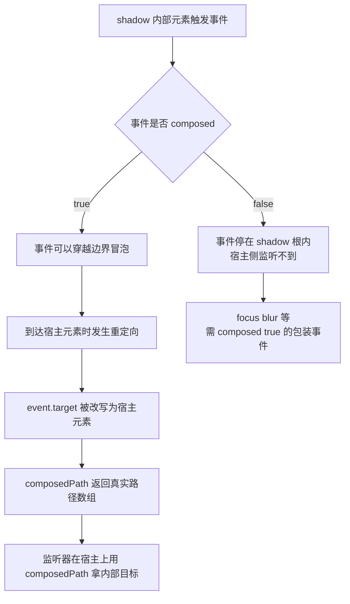

### H5-098：自定义元素"升级"是怎么回事？customized built-in element 现状如何？
**答**：
- 升级：元素标签先于 `customElements.define` 出现在文档中，define 之后浏览器把它**补建成**自定义元素实例（调用 constructor），`customElements.whenDefined` 可等待。
- `customElements.get(name)` 查已注册类；`upgrade(node)` 手动补升；define 前的元素是 `HTMLUnknownElement` 或普通 HTMLElement。
- customized built-in（`is="my-button"` 扩展原生 button）**Safari 拒绝实现**，兼容性不可用；跨浏览器方案是 wrapper（普通自定义元素内包原生控件）。
- constructor 约束：不能访问 attributes/子元素（升级时属性还没就绪），只做 shadowRoot 挂载；把 DOM 相关逻辑放 `connectedCallback`。
- 重复 define 同名/同 tag 会抛错，多入口 bundle 需守卫 `if (!customElements.get(name))`。

```html
<my-card title="先写标签，后定义"></my-card>
<button is="count-btn">native-is 扩展（Safari 不支持）</button>

<script>
  // 防重复注册守卫：多 chunk 打包场景必备
  if (!customElements.get('my-card')) {
    customElements.define('my-card', class extends HTMLElement {
      constructor() {
        super();
        console.log('升级：constructor 只建 shadow');
        this.attachShadow({ mode: 'open' }).innerHTML = `
          <div class="card"><slot></slot>
            <b class="t"></b></div>`;
      }
      connectedCallback() {
        // 属性读取放这里：constructor 阶段 attribute 未就绪
        this.shadowRoot.querySelector('.t').textContent = this.getAttribute('title') ?? '';
      }
    });
  }

  // 升级时序演示
  console.log(customElements.get('my-card'));  // class（已注册）
  customElements.whenDefined('my-card').then(() => {
    document.querySelectorAll('my-card').forEach(el =>
      console.log('确认升级完成：', el.shadowRoot !== null));
  });

  // 手动升级游离节点（innerHTML 里的未定义标签）
  const tmp = document.createElement('div');
  tmp.innerHTML = '<my-card title="手动升级"></my-card>';
  customElements.upgrade(tmp.firstElementChild);
</script>
```

### H5-099：Shadow DOM 的样式边界如何工作？::part 解决什么问题？
**答**：
- 默认完全隔离：外部 CSS 选择器进不来，内部样式漏不出去；可穿透的只有**继承属性**（color、font 等）与 CSS 自定义属性（变量）。
- 对外暴露定制点的三个层级：CSS 变量（粒度粗、最常用）→ `::part(name)`（按部件定向，样式可完全重写）→ `<slot>` 内容区域样式。
- `::part` 用法：shadow 内元素标 `part="btn"`，外部 `my-dialog::part(btn) { color: red }`；支持 `::part(btn):hover` 与复合 `::part(a b)`。
- `::part` 边界：不能选中 part 内部的子元素（需 `part` 层级命名或配合 `::slotted`）；`exportparts` 可跨多层 shadow 转发。
- `:host` 控制宿主自身样式（优先级低于外部对宿主的规则），`:host-context()` 按祖先条件匹配。

```html
<my-dialog>
  <span slot="title">删除确认</span>
</my-dialog>

<script>
  customElements.define('my-dialog', class extends HTMLElement {
    connectedCallback() {
      if (!this.shadowRoot) {
        this.attachShadow({ mode: 'open' }).innerHTML = `
          <style>
            :host { display: block; font: inherit; }      /* 宿主外观 */
            .panel { border: 1px solid var(--dlg-border, #ddd); }
            .actions button { padding: var(--dlg-pad, 6px 16px); }
          </style>
          <div class="panel">
            <p><slot name="title"></slot></p>
            <div class="actions">
              <button part="cancel-btn">取消</button>
              <button part="ok-btn" class="primary">确定</button>
            </div>
          </div>`;
      }
    }
  });
</script>

<style>
  /* 层级 1：CSS 变量定制 */
  my-dialog { --dlg-border: #1677ff33; --dlg-pad: 8px 20px; }

  /* 层级 2：::part 精确定向，含伪类 */
  my-dialog::part(ok-btn) { background: #d33; color: #fff; border: none; }
  my-dialog::part(ok-btn):hover { background: #b22; }
  my-dialog::part(cancel-btn) { background: #eee; }
</style>
```

### H5-100：事件的 retarget 与 composedPath 是什么？如何在宿主侧拿到 shadow 内的真实点击目标？
**答**：
- shadow 边界上冒泡的事件发生 **retarget**：宿主外监听时 `event.target` 永远是宿主元素（内部元素被"隐藏"），这是封装隐私的机制。
- `event.composed` 为 true 的事件才能**穿越**边界（click、input、keydown 等 UI 事件）；`focus/blur/mouseenter` 是 false，替代品是 `focusin/focusout/mouseenter 的 composed 版`（focusin composed 为 true）。
- `event.composedPath()` 返回真实传播路径数组（含 shadow 内节点），**宿主侧监听器里调用它**即可拿到真实目标做委托。
- 自定义事件默认 composed: false，需要跨边界时 `new CustomEvent(evt, { composed: true, bubbles: true })`。
- 判断组件内部结构是否被窥探：composedPath 在 mode: 'closed' 的 shadow 外部调用只返回 `[host, ...]`。

```html
<user-list></user-list>

<script>
  customElements.define('user-list', class extends HTMLElement {
    connectedCallback() {
      this.attachShadow({ mode: 'open' }).innerHTML = `
        <ul>
          <li data-id="1">张三</li>
          <li data-id="2">李四</li>
        </ul>`;
      // 组件内部：直接委托，正常 target
      this.shadowRoot.addEventListener('click', (e) => {
        console.log('内部视角 target：', e.target.textContent); // 张三
      });
    }
  });
</script>

<script>
  // 宿主侧：target 被 retarget 成组件本身
  document.querySelector('user-list').addEventListener('click', (e) => {
    console.log('外部视角 target：', e.target.tagName);       // USER-LIST
    console.log('retarget 了：', e.target !== e.composedPath()[0]);

    // composedPath 第 0 项是真实点击的节点（open shadow 可见）
    const real = e.composedPath()[0];
    if (real.matches?.('li')) {
      console.log('真实目标：', real.dataset.id, real.textContent);
    }
  });

  // 跨边界派发自定义事件：必须 composed + bubbles
  customElements.define('send-box', class extends HTMLElement {
    connectedCallback() {
      this.attachShadow({ mode: 'open' }).innerHTML = `
        <button>发送</button>`;
      this.shadowRoot.querySelector('button').onclick = () => {
        this.dispatchEvent(new CustomEvent('send', {
          detail: { text: 'hi' },
          bubbles: true,       // 能沿 DOM 冒泡
          composed: true,      // 能穿越 shadow 边界
        }));
      };
    }
  });
  document.addEventListener('send', (e) => console.log('收到：', e.detail.text));
</script>
```

### H5-101：adoptedStyleSheets 与 Constructable Stylesheet 如何避免样式重复解析？
**答**：
- `new CSSStyleSheet()` 构造样式表，`replaceSync(css)` 填充，再挂到 `shadowRoot.adoptedStyleSheets = [...old, sheet]`。
- 核心价值：**一份 CSSStyleSheet 实例可被任意多个 shadowRoot 共用**，浏览器只解析一次，相比每个组件的 `<style>` 标签解析 N 次成本大降。
- 运行时可换肤/主题切换：改同一个 sheet 的 replace 内容，所有组件即时生效，无需逐组件改 DOM。
- 与 `<style>` 的区别：adoptedStyleSheets 是引用数组，可增删可排序（优先级按数组顺序），`<style>` 标签一旦插入是独立的。
- 兼容性：Chrome 73+、Safari 16.4+、Firefox 101+，现代浏览器已可用，老环境需回退 `<style>` 注入。

```javascript
// 1) 构造一次，全站组件共用
const baseSheet = new CSSStyleSheet();
baseSheet.replaceSync(`
  :host { display: block; box-sizing: border-box; }
  .title { font-weight: 600; margin: 0 0 8px; }
`);

const btnSheet = new CSSStyleSheet();
btnSheet.replaceSync(`
  button { border: 1px solid #ddd; border-radius: 4px; padding: 6px 14px; cursor: pointer; }
`);

function defineCard() {
  class MyCard extends HTMLElement {
    connectedCallback() {
      if (!this.shadowRoot) {
        this.attachShadow({ mode: 'open' });
        this.shadowRoot.innerHTML = `<h3 class="title"><slot name="t"></slot></h3><slot></slot>`;
        // 2) 数组挂载：引用共享，顺序即优先级
        this.shadowRoot.adoptedStyleSheets = [baseSheet, btnSheet];
      }
    }
  }
  if (!customElements.get('my-card')) customElements.define('my-card', MyCard);
}
defineCard();

// 3) 主题热切换：只 replace 一份 sheet，所有卡片同步变化
function setTheme(dark) {
  baseSheet.replaceSync(`
    :host { display: block; color: ${dark ? '#eee' : '#222'};
            background: ${dark ? '#222' : '#fff'}; }
    .title { font-weight: 600; margin: 0 0 8px; }
  `);
}

// 4) 兼容回退：不支持时退回 style 标签注入
function ensureStyles(root, css) {
  if ('adoptedStyleSheets' in Document.prototype) return false;
  const s = document.createElement('style');
  s.textContent = css;
  root.prepend(s);
  return true;
}
```

### H5-102：slot 的 change 事件与动态分发怎么处理？被分发节点归属谁？
**答**：
- `<slot>` 是"投影占位"：**被分发节点始终属于 light DOM**（事件冒泡起点、样式来源都是原始位置），slot 只决定"显示在哪"。
- `slotchange` 事件在**分配结果变化**时触发（增删节点、slot 属性改名、display:none 不算），`event.target.assignedElements/nodes` 拿到当前分发内容。
- 动态分发典型用途：tabs 组件监听新增 tab 并自动注册、列表组件对新子项补 class、校验 slot 内容合法性并告警。
- 反向查询：`element.assignedSlot` 查自己被分到哪个 slot；`slot.assignedElements({ flatten: true })` 含 fallback 内容。
- fallback：slot 标签内的子节点是"空位默认内容"，有分发内容时不渲染。

```html
<my-tabs>
  <button slot="tab">第一个</button>
  <button slot="tab">第二个</button>
  <section slot="panel">面板 A</section>
  <section slot="panel">面板 B</section>
</my-tabs>

<script>
  customElements.define('my-tabs', class extends HTMLElement {
    connectedCallback() {
      this.attachShadow({ mode: 'open' }).innerHTML = `
        <div class="tabbar"><slot name="tab"></slot></div>
        <slot name="panel"></slot>
        <slot>无内容时的默认文案</slot>`;

      // 监听分配变化：外部动态增删 tab 时自动感知
      const tabSlot = this.shadowRoot.querySelector('slot[name=tab]');
      tabSlot.addEventListener('slotchange', (e) => {
        const tabs = e.target.assignedElements();
        console.log('当前 tab 数：', tabs.length);
        tabs.forEach((tab, i) => {
          tab.classList.toggle('active', i === 0);
          tab.addEventListener('click', () => this.show(i));
        });
      });

      // 动态新增 tab：slotchange 会再次触发
      setTimeout(() => {
        const b = document.createElement('button');
        b.slot = 'tab';
        b.textContent = '第三个（JS 追加）';
        this.appendChild(b);
      }, 1000);
    }
    show(i) {
      this.querySelectorAll('[slot=panel]').forEach((p, idx) =>
        p.hidden = idx !== i);
    }
  });
</script>

<script>
  // 反向查询：light DOM 元素查自己被分到哪
  const btn = document.querySelector('my-tabs button');
  setTimeout(() => console.log('被分到：', btn.assignedSlot?.name), 500);
</script>
```

### H5-103：form-associated custom elements 怎么让自定义控件接入原生表单？
**答**：
- 三件套：静态 `formAssociated = true` → `attachInternals(this)` 拿 `ElementInternals` → 用 `setValidity/setFormValue` 把自定义控件"变成"真正的表单字段。
- 接入后组件获得原生待遇：参与表单提交序列化、`form.reset()`、`:invalid` 匹配、form 属性跨表单关联、label 点击聚焦。
- `internals.setFormValue(value, state?)`：value 进提交数据，state 存还原状态（如多字段组合控件）；值为 null 则该字段不提交。
- 校验：`internals.setValidity({ valueMissing: true }, '请选择日期')` 标错；`checkValidity/reportValidity` 走原生链路。
- 生命周期扩展：`formAssociatedCallback/formDisabledCallback/formResetCallback` 响应表单级变化。

```html
<form id="f">
  <label for="rating">评分</label>
  <!-- 自定义控件：看起来是星星，提交时是真正的 rating 字段 -->
  <star-rating id="rating" name="rating" required></star-rating>
  <button>提交</button>
</form>

<script>
  customElements.define('star-rating', class extends HTMLElement {
    static formAssociated = true;            // 1) 声明关联

    constructor() {
      super();
      this.internals = this.attachInternals();  // 2) ElementInternals
      this.attachShadow({ mode: 'open' }).innerHTML = `
        <span role="radiogroup" aria-label="评分">
          ${[1,2,3,4,5].map(n =>
            `<button type="button" data-v="${n}" aria-label="${n} 星">★</button>`).join('')}
        </span>`;
      this.shadowRoot.addEventListener('click', (e) => {
        const v = e.target.dataset?.v;
        if (v) this.value = v;
      });
      this._value = '';
    }

    get value() { return this._value; }
    set value(v) {
      this._value = v;
      // 3) 值进表单序列化
      this.internals.setFormValue(v);
      // 4) 校验接入原生体系
      this.internals.setValidity(
        this.required && !v ? { valueMissing: true } : {},
        this.required && !v ? '请选择评分' : ''
      );
      this.#paint(v);
    }

    get required() { return this.hasAttribute('required'); }
    #paint(v) {
      [...this.shadowRoot.querySelectorAll('button')].forEach(b =>
        b.style.opacity = b.dataset.v <= v ? 1 : 0.25);
    }

    // 表单级生命周期
    formResetCallback() { this.value = ''; }
    formDisabledCallback(disabled) {
      this.shadowRoot.style.pointerEvents = disabled ? 'none' : '';
    }
  });
</script>

<script>
  // 组件获得原生待遇：checkValidity、label 关联全部可用
  const rating = document.getElementById('rating');
  form.addEventListener('submit', (e) => {
    e.preventDefault();
    if (!rating.checkValidity()) return rating.reportValidity(); // 原生气泡
    console.log(new FormData(form).get('rating'));               // 序列化成功
  });
</script>
```

### H5-104：light DOM 与 shadow DOM 混合渲染策略怎么选？
**答**：
- 决策轴：内容是否需要 SEO/服务端渲染、是否需要外部样式覆盖、是否需要全局事件委托命中。
- **shadow-only**：UI 原子组件（开关、日历）——完全封装最省心；**light-only**：内容型组件（文章卡片、列表）——利于 SEO 与站点统一样式。
- 混合模式 A"shadow 外壳 + light 内容"：逻辑壳在 shadow（样式封装），内容 slot 全部投影（SEO 可抓、可被全局委托命中）。
- 混合模式 B"关键结构进 light + 交互浮层进 shadow"：表格数据在 light（表格样式复用），弹层/日历浮窗进 shadow（防样式污染）。
- 反模式警告：把整页内容塞进 shadow 后再 wondering 为什么全局 CSS 框架失效；`display: contents` 滥用导致无障碍树结构混乱。

```html
<!-- 混合模式 A：数据行在 light DOM（SEO + 全局委托可命中），控件壳在 shadow -->
<user-row data-id="42">
  <td>张三</td>
  <td>zhangsan@example.com</td>
</user-row>

<table id="users"><tbody></tbody></table>

<script>
  customElements.define('user-row', class extends HTMLElement {
    connectedCallback() {
      // shadow 只承载"行为壳"：行首操作按钮，样式完全封装
      this.attachShadow({ mode: 'open' }).innerHTML = `
        <style>
          :host { display: contents; }              /* 融入表格行布局 */
          .ops button { margin-right: 4px; }
        </style>
        <td class="ops">
          <button data-act="edit">编辑</button>
          <button data-act="del">删除</button>
        </td>
        <slot></slot>                                <!-- light 内容原位投影 -->`;

      this.shadowRoot.addEventListener('click', (e) => {
        this.dispatchEvent(new CustomEvent('row-action', {
          detail: { id: this.dataset.id, act: e.target.dataset.act },
          bubbles: true, composed: true,
        }));
      });
    }
  });
</script>

<script>
  // 全局委托依然命中 light DOM 内容（若内容也在 shadow 里就抓不到了）
  document.getElementById('users').addEventListener('click', (e) => {
    if (e.target.matches('td')) console.log('点击单元格：', e.target.textContent);
  });
  document.addEventListener('row-action', (e) =>
    console.log('行操作：', e.detail));
</script>
```

### H5-105：Web Components 在 Vue/React 中如何互操作？有哪些已知坑？
**答**：
- 通用前提：自定义元素在框架看来是"普通 DOM 标签"，**属性传字符串、事件靠 addEventListener**，与框架数据流存在阻抗失配。
- Vue 3 原生支持最好：`compilerOptions.isCustomElement` 声明后可直接模板使用，props/attrs 自动透传，`@event` 监听自定义事件正常工作。
- React 19 起原生支持自定义元素（属性可传对象/函数、事件监听）；React 18 及以前需手写 ref + addEventListener 的 wrapper 组件。
- 高频坑一：复杂数据只能走 **property** 而非 attribute，框架如果默认设 attribute 会导致 `[object Object]`——组件内应同时实现 attribute 反序列化或框架侧强制 property。
- 高频坑二：shadow 内样式与框架 CSS 隔离，框架的全局 reset 不会进入组件，必要时用 adoptedStyleSheets 注入主题变量。

```javascript
// ===== React 18：手写 wrapper（React 19 可省略此包装）=====
import { useEffect, useRef } from 'react';

function ReactWrapper({ value, onChange, children }) {
  const ref = useRef(null);
  useEffect(() => {
    const el = ref.current;
    const handler = (e) => onChange?.(e.detail);
    el.addEventListener('value-change', handler);      // 自定义事件监听
    return () => el.removeEventListener('value-change', handler);
  }, [onChange]);
  useEffect(() => {
    ref.current.value = value;                          // 复杂数据走 property
  }, [value]);
  return <my-color-picker ref={ref}>{children}</my-color-picker>;
}

// ===== Vue 3：声明后直接用 =====
// main.js
// const app = createApp(App);
// app.config.compilerOptions.isCustomElement = (tag) => tag.startsWith('my-');

// 组件模板中：
// <my-color-picker :value="color" @value-change="color = $event.detail" />

// ===== 组件侧配合：attribute 序列化 + property 双通道 =====
customElements.define('my-color-picker', class extends HTMLElement {
  set value(v) { this._v = v; this.#render(v); }
  get value() { return this._v; }
  // attribute 只承载可序列化形态（React18/Vue 传字符串时的兜底）
  static get observedAttributes() { return ['value']; }
  attributeChangedCallback(_, old, val) {
    if (old !== val && typeof val === 'string') this.value = val;
  }
  #render(v) {
    this.dispatchEvent(new CustomEvent('value-change', {
      detail: v, bubbles: true, composed: true,
    }));
  }
});
```

## 十九、可访问性与国际化深入

### H5-106：ARIA 规则总纲是什么？无障碍树如何由 DOM 计算而来？
**答**：
- 无障碍树（Accessibility Tree）= 浏览器把 DOM + CSS 显示状态（display:none 剔除、visibility:hidden 部分保留语义）翻译成读屏可用的"角色-名称-状态"树；ARIA 是人工修正这棵树的手段。
- 第一规则：**能用原生元素就不用 ARIA**——原生 button 自带 role/键盘/焦点语义，`<div role="button" tabindex="0">` 要手工补齐所有行为。
- 五大规则：role 不改变原生语义的场合别乱用（li 上加 role 破坏列表）；所有交互组件必须有可编程的名称（aria-label/labelledby）；状态用 aria-expanded/pressed/current 动态维护；可见性变化必须让读屏感知（focus/live region）；不要用 aria-hidden 藏可聚焦元素。
- 命名优先级：`aria-labelledby` > `aria-label` > 原生 label > 内容文本；`aria-hidden="true"` 只对无障碍树隐藏，仍可被聚焦（所以必须配合 tabindex=-1）。
- 验证工具：DevTools 无障碍面板、axe、Lighthouse，最终以真实读屏（VoiceOver/NVDA）走查为准。

```html
<!-- 反例：div 假按钮，读屏不知道它可点击、Tab 键够不到 -->
<div class="btn" onclick="save()">保存</div>

<!-- 正例：原生 button 一行顶三行 -->
<button onclick="save()">保存</button>

<!-- 确需 ARIA 的场景：自绘开关组件，补齐角色-状态-名称-键盘 -->
<div role="switch"
     class="switch"
     tabindex="0"
     aria-checked="false"
     aria-label="接收营销邮件"
     data-on="false">
  <span class="knob"></span>
</div>

<script>
  const sw = document.querySelector('.switch');
  function toggle() {
    const on = sw.getAttribute('aria-checked') === 'true';
    sw.setAttribute('aria-checked', String(!on));   // 状态进无障碍树
    sw.dataset.on = String(!on);
  }
  sw.addEventListener('click', toggle);
  sw.addEventListener('keydown', (e) => {           // ARIA 只补语义，行为要自己写
    if (e.key === ' ' || e.key === 'Enter') { e.preventDefault(); toggle(); }
  });
</script>

<script>
  // 用 JS 观察无障碍树变化（Chromium DevTools 协议示意）：
  // aria-hidden 藏装饰图标，避免读屏噪音
  document.querySelectorAll('.icon-decorative')
    .forEach(el => el.setAttribute('aria-hidden', 'true'));
</script>
```

### H5-107：tabindex 的 -1、0、正整数各自语义是什么？roving tabindex 怎么实现？
**答**：
- `tabindex="0"`：加入 Tab 序（按 DOM 顺序），用于"本身不可聚焦但需要可达"的组件容器；`tabindex="-1"`：**仅可编程聚焦**（`focus()` 可达、Tab 跳过），用于"点击后聚焦但不进 Tab 序"的元素。
- 正整数：按数值手动排序 Tab 序——**反模式**，值一大 Tab 顺序与视觉顺序脱节，应通过调整 DOM 顺序解决；只允许在极特殊场景（如多列表交叉）谨慎使用。
- 全局规则：Tab 序 = 正整数（按值）→ tabindex=0 与原生可聚焦元素（按 DOM）。
- roving tabindex 模式（工具栏/表格/单选组标配）：组内多子项中**只有一个 tabindex=0**，方向键移动时把 0 挪给下一项、旧项改 -1，保证"一次 Tab 进组、方向键在组内移动、一次 Tab 出组"。
- 焦点丢失检测：`document.activeElement` 与 `:focus-visible` 配合做样式；组件卸载记得把焦点还回合理位置（aria 焦点管理红线）。

```html
<div class="toolbar" role="toolbar" aria-label="格式工具">
  <button tabindex="0" data-idx="0">B</button>
  <button tabindex="-1" data-idx="1">I</button>
  <button tabindex="-1" data-idx="2">U</button>
</div>

<script>
  // roving tabindex：一次 Tab 进入组，方向键移动，一次 Tab 离开
  const toolbar = document.querySelector('.toolbar');
  const buttons = [...toolbar.querySelectorAll('button')];

  toolbar.addEventListener('keydown', (e) => {
    const dirs = { ArrowRight: 1, ArrowLeft: -1, ArrowUp: -1, ArrowDown: 1 };
    if (!(e.key in dirs)) return;
    e.preventDefault();

    const cur = buttons.indexOf(document.activeElement);
    const next = (cur + dirs[e.key] + buttons.length) % buttons.length;

    buttons.forEach((b, i) => b.tabIndex = i === next ? 0 : -1); // 焦点令牌转移
    buttons[next].focus();                            // -1 的价值：可编程聚焦
  });

  // tabindex=-1 的另一用途：模态框关闭后焦点归还触发按钮
  let lastTrigger = null;
  dialog.addEventListener('close', () => {
    (lastTrigger ?? document.body).focus();           // Tab 序外的元素也能 focus
  });
  openBtn.addEventListener('click', () => { lastTrigger = openBtn; dialog.showModal(); });
</script>

<style>
  /* 焦点可见性：鼠标点击不出圈，键盘导航出圈 */
  button:focus:not(:focus-visible) { outline: none; }
  button:focus-visible { outline: 2px solid #1677ff; outline-offset: 2px; }
</style>
```

### H5-108：live region 如何播报动态内容？aria-live 三档与 busy 怎么用？
**答**：
- live region 让"非焦点移动的 DOM 更新"被读屏自动播报：`aria-live="polite"`（等空闲再说）、`assertive`（打断，慎用）、`off`。
- 支撑属性：`aria-atomic="true"` 整体播报（改一个字播全部）；`aria-relevant` 控制增删文本哪类变化触发；`role="status/alert/log/timer"` 自带 live 语义（alert=assertive，status=polite）。
- 播报条件：区域**必须先存在于 DOM**，后改内容——动态创建节点再塞文本经常不播；推荐页面常驻一个隐藏播报器。
- `aria-busy="true"`：批量更新时先置忙，全部就绪后改 false，避免读屏逐条打断式播报。
- 典型场景：搜索结果条数、表单提交结果、购物车数量、倒计时进度、聊天新消息（log）。

```html
<!-- 常驻播报器：视觉隐藏但对读屏可见 -->
<div id="announcer" class="sr-only"
     aria-live="polite" aria-atomic="true"></div>
<div id="alert-zone" role="alert"></div>   <!-- role=alert 隐含 aria-live=assertive -->

<style>
  .sr-only {
    position: absolute; width: 1px; height: 1px;
    margin: -1px; padding: 0; overflow: hidden;
    clip: rect(0 0 0 0); white-space: nowrap; border: 0;
  }
</style>

<script>
  const announcer = document.getElementById('announcer');

  // 统一播报入口：先清空再改写，确保相同文案也重新播报
  let announceTimer;
  function announce(text) {
    clearTimeout(announceTimer);
    announcer.textContent = '';
    announceTimer = setTimeout(() => { announcer.textContent = text; }, 50);
  }

  // 场景 1：搜索结果
  searchForm.addEventListener('submit', async (e) => {
    e.preventDefault();
    const { total } = await search(searchForm.q.value);
    announce(`搜索完成，共 ${total} 条结果`);
  });

  // 场景 2：批量更新用 busy 包裹
  list.setAttribute('aria-busy', 'true');
  const items = await loadItems();
  list.replaceChildren(...items.map(renderItem));
  list.setAttribute('aria-busy', 'false');      // 就绪后一次性播报

  // 场景 3：错误走 alert 区（assertive，立即打断）
  function showError(msg) {
    const zone = document.getElementById('alert-zone');
    zone.textContent = '';                       // 重置以重播
    zone.textContent = msg;
  }
</script>
```

### H5-109：skip link 与地标区域如何搭出"可跳读"的页面骨架？
**答**：
- skip link：页首"跳到主内容"的隐藏链接，获得焦点才显示，让键盘用户每次翻页**跳过几十个导航链接**；目标用 `href="#main"` 且 main 有 `tabindex="-1"`。
- 地标：`header/nav/main/aside/footer` 自动映射 landmark role；同类型地标多个时**必须加可区分名称**（`aria-label="主导航"`、"页脚导航"），否则读屏菜单里全是"navigation"。
- `main` 每页一个且不能嵌套在 header/nav/footer/article/aside 里；重复的页头页脚导航在模板层保持一致，读屏用户依赖记忆位置。
- 常见漏项：`main` 没有 skip link、导航没区分名、装饰区块滥用 aria-label 制造地标噪音（div 不是地标，别强加 role）。
- 走查法：用 VoiceOver 转子（VO+U）看地标列表，应能"header → 导航 → main → footer"一次读完主路径。

```html
<body>
  <!-- skip link：第一个可聚焦元素 -->
  <a class="skip-link" href="#main">跳到主内容</a>

  <header>
    <nav aria-label="主导航">
      <ul><li><a href="/">首页</a></li><li><a href="/products">产品</a></li></ul>
    </nav>
  </header>

  <!-- main：目标点，tabindex=-1 使其可被链接聚焦 -->
  <main id="main" tabindex="-1">
    <h1>产品列表</h1>
    <aside aria-label="筛选器">
      <!-- 筛选表单 -->
    </aside>
    <section aria-labelledby="list-title">
      <h2 id="list-title">全部商品</h2>
    </section>
  </main>

  <footer>
    <nav aria-label="页脚导航">         <!-- 与主导航区分名称 -->
      <ul><li><a href="/about">关于</a></li></ul>
    </nav>
  </footer>

  <style>
    .skip-link {
      position: absolute;
      left: -9999px;                    /* 隐藏但可聚焦 */
      background: #fff; color: #1677ff;
      padding: 8px 16px; z-index: 100;
    }
    .skip-link:focus {
      left: 8px; top: 8px;              /* 键盘 Tab 到达时出现 */
    }
    main:focus { outline: none; }       /* 跳转目标不画焦点框 */
  </style>
```

### H5-110：lang 与 dir 如何支撑多语言与 RTL 布局？
**答**：
- `lang` 影响三件事：读屏**发音引擎选择**、断行/连字符规则（`hyphens: auto` 依赖 lang）、字体与标点渲染选择；缺失 lang 的中文页 VoiceOver 常用英文音素硬读。
- `dir="rtl"` 是布局方向开关：块级流向、flex/grid 主轴起点、text-align 默认值全部镜像；**逻辑属性**（margin-inline-start、padding-block、inset-inline、text-align: start）自动适配，物理属性（left/right）不会。
- 局部覆盖：段落内混排外语 `<span lang="en">`、数字与代码块强制 `dir="ltr"`，避免标点与阅读顺序错乱。
- `:dir()` 伪类与 `dir` 属性选择器 `[dir=rtl]` 用于少量无法用逻辑属性表达的特例样式。
- 测试要点：翻转后箭头/进度条/关闭按钮方向、emoji 与变量插值的拼接顺序（用 CSS logical 而非字符串翻转）。

```html
<html lang="zh-CN" dir="ltr">
<head>
  <style>
    /* 全部使用逻辑属性：RTL 下自动镜像 */
    .card {
      padding-inline: 16px;
      margin-block: 8px;
      border-inline-start: 4px solid #1677ff;
      text-align: start;
    }
    .breadcrumb li::after {
      content: '/';                       /* 分隔符位置随方向自动变化 */
      margin-inline: 8px;
    }
    /* 极少数需要方向特判的样式 */
    .back-icon { transform: scaleX(1); }
    [dir="rtl"] .back-icon { transform: scaleX(-1); }  /* 返回箭头镜像 */
  </style>
</head>
<body dir="rtl" lang="ar">
  <!-- RTL 示例：阿拉伯语页面 -->
  <article lang="ar" dir="rtl">
    <h1>مرحبا</h1>
    <!-- 混排：内嵌英文术语局部还原 LTR -->
    <p>استخدم <span lang="en" dir="ltr">position: sticky</span> في الشبكة.</p>
    <!-- 代码块/公式：强制 LTR，避免标点错乱 -->
    <pre dir="ltr" lang="en">const x = a < b ? 1 : 0;</pre>
  </article>
</body>
</html>

<script>
  // 动态切换语言方向（i18n 框架的底层动作）
  function setLocale(locale) {
    const rtl = ['ar', 'he', 'fa', 'ur'].some(l => locale.startsWith(l));
    document.documentElement.lang = locale;
    document.documentElement.dir = rtl ? 'rtl' : 'ltr';
  }
  setLocale('ar');   // 整站布局自动镜像
</script>
```

### H5-111：颜色对比度要求是什么？prefers-contrast 与forced-colors 如何适配？
**答**：
- WCAG AA 门槛：正文**至少 4.5:1**、大字号（≥18.66px 粗体或 ≥24px）3:1、UI 组件边界与图形 3:1；AAA 分别 7:1 与 4.5:1。
- 高频翻车点：占位符灰色对白底不足 4.5:1、disabled 虽然豁免但别拿它做常态、浅色主题里的次级文字 (#999) 压线失败。
- 媒体查询适配：`prefers-contrast: more` 用户要求更高对比——加深文字、加粗边框；`prefers-color-scheme` 深色主题下重算对比。
- `forced-colors: active`（Windows 高对比度模式）：浏览器强制用系统色替换颜色，代码职责变为**保住结构线索**——`forced-color-adjust: none` 谨慎使用，边框/焦点环别删。
- 验证工具：DevTools 颜色拾取器自带对比度读数与 AA/AAA 标记；axe 的 color-contrast 规则批量扫描。

```css
/* 1) 基础：达标对比的调色板（白底正文 #333 ≈ 12.6:1） */
:root {
  --text: #333;
  --text-secondary: #595959;    /* 7:1，稳过 AA */
  --placeholder: #6e6e6e;       /* ≥4.5:1，替代常见的 #999 */
  --border: #767676;            /* UI 组件 3:1 门槛 */
}

/* 2) 用户系统级要求更高对比时 */
@media (prefers-contrast: more) {
  :root { --text: #000; --text-secondary: #1a1a1a; --border: #000; }
  .card { border-width: 2px; }
  a { text-decoration: underline; }        /* 对比之外再加非颜色线索 */
}

/* 3) 深色主题下重算，别只反转颜色 */
@media (prefers-color-scheme: dark) {
  :root { --text: #e8e8e8; --text-secondary: #b3b3b3; }
}

/* 4) Windows 高对比度模式：保结构，放行系统配色 */
@media (forced-colors: active) {
  .btn { border: 1px solid ButtonText; }   /* 用系统色变量保住按钮轮廓 */
  :focus-visible { outline: 3px solid Highlight; }
  .chart-bar { forced-color-adjust: none; } /* 仅图表保自有配色 */
}
```

```html
<!-- 落地自检：占位符与禁用态的对比处理 -->
<input placeholder="请输入手机号" style="color: var(--text);">
<style>
  ::placeholder { color: var(--placeholder); opacity: 1; } /* opacity 别再打折 */
  button:disabled { color: var(--text-secondary); }        /* 豁免但别过淡 */
</style>
```

## 二十、综合与现代 API

### H5-112：Document Picture-in-Picture 与视频画中画的区别是什么？
**答**：
- 视频 PiP（H5-069）悬浮窗里**只有 video 元素**；Document PiP 打开一个可承载**任意 HTML** 的迷你窗口（自绘字幕、控制面板、白板批注）。
- 用法：`documentPictureInPicture.requestWindow({ width, height })` 返回新 window → 把元素 move 过去（appendChild 即移动节点）→ 关闭时搬回原容器。
- 新窗口继承 opener 的样式表需手动 copyStyleSheets（旧实现）或复制 style 标签；事件与主窗口同一个 JS 上下文。
- 仅 Chrome/Edge 桌面版支持，需用户手势；窗口关闭触发 `pagehide`/`windowClose` 时机要做元素归还。
- 典型用途：会议软件的悬浮参会者列表、带自定义字幕样式的播放器、跟随播放的控制条。

```html
<div id="player-ui">
  <video src="/media/lesson.mp4" controls muted playsinline></video>
  <div class="captions">默认字幕区域</div>
  <button id="doc-pip">字幕画中画</button>
</div>

<script>
  const ui = document.getElementById('player-ui');
  const captions = ui.querySelector('.captions');
  let pipWin = null;

  document.getElementById('doc-pip').addEventListener('click', async () => {
    if (!('documentPictureInPicture' in window)) return alert('仅 Chromium 桌面版支持');

    if (pipWin) return pipWin.close();

    // 1) 请求迷你窗口（需用户手势内调用）
    pipWin = await documentPictureInPicture.requestWindow({ width: 360, height: 120 });

    // 2) 同步样式：把主文档样式表克隆进新窗口
    [...document.styleSheets].forEach((sheet) => {
      try {
        const style = pipWin.document.createElement('style');
        style.textContent = [...sheet.cssRules].map(r => r.cssText).join('\n');
        pipWin.document.head.append(style);
      } catch {}                       // 跨域样式表跳过
    });

    // 3) 移动节点：appendChild 即 move，事件绑定不丢
    pipWin.document.body.append(captions);

    // 4) 窗口被用户关闭时把元素搬回来
    pipWin.addEventListener('pagehide', () => {
      ui.querySelector('video').after(captions);
      pipWin = null;
    });
  });
</script>
```

### H5-113：View Transitions API 如何实现"同一文档"平滑过渡？
**答**：
- 原理：`document.startViewTransition(callback)` 先对旧状态**截图**（快照树），执行回调渲染新状态后再截新图，两组快照间用 CSS 动画交叉过渡。
- 免费能力：不写任何 CSS 也有默认淡入淡出；给元素 `view-transition-name: hero` 后该元素独立成快照对，可做共享元素飞入（FLIP 的官方版）。
- 定制动画：`::view-transition-old/new(name)` 伪元素可改动画、位移、时长；`::view-transition-group` 控制容器轨迹。
- 约束：回调必须是异步渲染（DOM 更新放进去或 async 函数）；旧快照是"静态图"，动画期间原元素不可交互；Safari 18+/Chrome 111+ 支持。
- SPA 场景：与框架路由结合——在路由切换函数里包一层 startViewTransition；MPA 靠 `@view-transition { navigation: auto }` 跨文档过渡。

```css
/* 共享元素：两屏同名的元素自动"飞行" */
.hero-img { view-transition-name: hero; }
.list-thumb { view-transition-name: hero; }   /* 列表小图与详情大图同名 */

/* 默认交叉过渡的定制：时长与缓动 */
::view-transition-old(root),
::view-transition-new(root) {
  animation-duration: 0.35s;
  animation-timing-function: cubic-bezier(0.22, 1, 0.36, 1);
}
```

```javascript
// 点击列表项 -> 详情页：大图从缩略图位置飞入
async function openDetail(id) {
  const update = async () => {
    const detail = await fetchDetail(id);       // 数据请求放过渡里
    renderDetail(detail);
    history.pushState({ id }, '', `/detail/${id}`);
  };

  if (!document.startViewTransition) return update();  // 降级：直接切换
  const transition = document.startViewTransition(update);

  // 过渡完成 promise：可串后续逻辑（埋点等）
  await transition.finished;
  track('view-transition-done');
}
```

### H5-114：Popover API 如何用声明式属性做出浮层？与 dialog 的分工？
**答**：
- 三件套：`popover` 属性（auto/manual）标定浮层、`popovertarget` 属性绑定触发按钮、浏览器自动管理显示/隐藏与**顶层渲染**（无 z-index 战争、不裁剪于 overflow）。
- `auto` 模式自带"轻关闭"（light dismiss：点外部/Esc 关闭）与互斥（同开一个新 auto popover 会关旧的）；`manual` 不自动关闭，适合通知横幅。
- 事件：`beforetoggle/toggle`，`e.newState/e.oldState` 为 shown/hidden；样式用 `:popover-open` 匹配展开态，`@starting-style` 做入场过渡。
- 与 dialog 分工：popover 是**非模态**轻浮层（菜单、tooltip、选择器），不阻断页面交互；dialog `showModal()` 是模态（含焦点陷阱与 ::backdrop），表单确认类场景用它。
- 兼容：Chrome 114+、Safari 17+、Firefox 125+，主流可用；旧环境需 polyfill 或组件库。

```html
<!-- 声明式下拉菜单：零 JS -->
<button popovertarget="menu">更多操作</button>

<div id="menu" popover>
  <ul>
    <li><button>重命名</button></li>
    <li><button>移动到…</button></li>
    <li><button class="danger">删除</button></li>
  </ul>
</div>

<style>
  #menu {
    inset: auto;                            /* 覆盖默认全屏定位，交给 anchor 或手写 */
    margin: 0; padding: 4px;
    border: 1px solid #ddd; border-radius: 8px;
    box-shadow: 0 8px 24px #0002;
  }
  /* 入场过渡：starting-style 定义起始态 */
  #menu {
    opacity: 1; transform: translateY(0);
    transition: opacity .2s, transform .2s, display .2s allow-discrete;
  }
  @starting-style { #menu { opacity: 0; transform: translateY(-4px); } }
</style>

<script>
  const menu = document.getElementById('menu');
  // 状态事件：埋点或联动逻辑
  menu.addEventListener('toggle', (e) => {
    console.log(`popover ${e.oldState} -> ${e.newState}`);
  });
  // 程序化控制
  // menu.showPopover(); menu.hidePopover(); menu.togglePopover();
</script>
```

### H5-115：dialog 元素与 ::backdrop 的正确用法与坑。
**答**：
- 三种打开方式语义不同：`show()` 非模态（仍在文档流、无遮罩）、`showModal()` 模态（进入 top layer、自动 ::backdrop、焦点陷阱、Esc 触发 cancel 可关闭）。
- 关闭：`close(returnValue)` 携带返回值；表单 `method="dialog"` 提交即关闭并写入 returnValue，是最优雅的确认框模式。
- 样式：`dialog::backdrop` 做遮罩；`dialog[open]` 控制展开态；入场动画用 `@starting-style` + transition（display 不可动画需 `allow-discrete`）。
- 焦点管理自动完成：打开时聚焦第一个可聚焦元素或 `autofocus` 元素；关闭后焦点归还触发者（现代浏览器已内置）。
- 坑：`showModal()` 要求 dialog 在文档中；`cancel` 事件不 `preventDefault()` 则 Esc 直接关；关闭动画需要监听 `animationend` 延迟移除 open。

```html
<button id="open">打开确认框</button>

<dialog id="confirm-dialog">
  <form method="dialog">                       <!-- 提交即关闭 -->
    <p>确认删除该文件？</p>
    <menu>
      <button value="cancel" formnovalidate>取消</button>
      <button value="confirm" autofocus>确认删除</button>
    </menu>
  </form>
</dialog>

<style>
  dialog {
    border: none; border-radius: 12px;
    padding: 24px 32px;
    box-shadow: 0 12px 40px #0003;
  }
  /* 遮罩：只能作用于 ::backdrop，写在 dialog 上无效 */
  dialog::backdrop {
    background: #0009;
    backdrop-filter: blur(2px);
  }
  /* 入场动画 */
  dialog[open] { animation: pop .25s ease-out; }
  @keyframes pop {
    from { opacity: 0; transform: translateY(12px) scale(.96); }
  }
</style>

<script>
  const dlg = document.getElementById('confirm-dialog');
  document.getElementById('open').addEventListener('click', () => dlg.showModal());

  // Esc / 关闭按钮都会走 close，returnValue 区分结果
  dlg.addEventListener('close', () => {
    const result = dlg.returnValue;            // "confirm" | "cancel"
    console.log('用户选择：', result);
    if (result === 'confirm') doDelete();
  });

  // 拦截 Esc：确认框要求显式选择时
  dlg.addEventListener('cancel', (e) => e.preventDefault());
</script>
```

### H5-116：details 的 name 属性联动与原生手风琴实践。
**答**：
- `<details name="group">`：同名 details 组成**互斥手风琴**，展开一个自动收起其他，零 JS 实现 FAQ/侧栏菜单。
- 展开状态：`open` 属性（可 SSR 预置）；`toggle` 事件监听展开收起做埋点或联动。
- 动画方案：`::details-content` 伪元素（新）+ `interpolate-size: allow-keywords` 让 height: auto 可过渡；旧方案用 grid-template-rows 0fr/1fr 技巧包裹内容。
- 语义与无障碍：自带 `role="button"` + aria-expanded 映射，键盘可用；summary 内容决定可读名称。
- 边界：name 联动只在同文档同树生效；需要"可搜索展开"场景在 hash/锚点里控制 open。

```html
<style>
  /* 平滑展开：新特性组合（Chrome 129+），不支持则瞬时展开 */
  details {
    interpolate-size: allow-keywords;
  }
  details::details-content {
    block-size: 0;
    overflow: hidden;
    transition: block-size .3s, content-visibility .3s allow-discrete;
  }
  details[open]::details-content {
    block-size: auto;
  }
  summary {
    cursor: pointer;
    list-style: none;                       /* 去默认三角，自绘箭头 */
    display: flex; justify-content: space-between;
  }
  summary::after { content: '+'; transition: rotate .3s; }
  details[open] summary::after { rotate: 45deg; }
</style>

<!-- name 相同：天然互斥手风琴 -->
<details name="faq">
  <summary>支持哪些支付方式？</summary>
  <p>支持微信、支付宝与银行卡。</p>
</details>
<details name="faq">
  <summary>发货周期多久？</summary>
  <p>现货 48 小时内发货。</p>
</details>
<details name="faq" open>
  <summary>默认展开的一项</summary>
  <p>预置 open 属性即可。</p>
</details>

<script>
  // toggle 事件：只播报一次的展开埋点
  document.querySelectorAll('details[name=faq]').forEach((d) => {
    d.addEventListener('toggle', () => {
      if (d.open) track('faq-open', d.querySelector('summary').textContent);
    });
  });
</script>
```

### H5-117：search 元素是什么？为什么表单搜索框要用它包起来？
**答**：
- `<search>` 是 HTML 5.4 后引入的分区元素，语义为"**搜索或过滤界面**"，映射 landmark role=search。
- 价值：读屏的地标菜单出现"搜索"入口，用户可直接跳转；之前普遍的 `<div role="search">` 写法被标准化替代。
- 用法：包住搜索表单/过滤控件区（type=search 的 input 只是控件，search 元素才是"区域"）。
- 每页可有多个 search 地标但需 aria-label 区分（全局搜索、表格过滤）。
- 注意别滥用：一次性的按钮触发动作不构成"搜索区域"，普通表单无需包裹。

```html
<!-- 站点全局搜索：landmark 化 -->
<search aria-label="全站搜索">
  <form action="/search">
    <label for="q">搜索</label>
    <input id="q" type="search" name="q"
           inputmode="search" enterkeyhint="search"
           placeholder="搜索文章、标签…">
    <button>搜索</button>
  </form>
</search>

<main>
  <!-- 表格过滤区：第二个 search 地标，命名区分 -->
  <search aria-label="订单过滤">
    <input type="search" name="order-no" placeholder="按订单号过滤">
    <select name="status"><option>全部状态</option></select>
  </search>

  <table id="orders"><!-- 过滤结果 --></table>
</main>

<script>
  // 过滤防抖：search 元素内部的事件委托
  const filterBox = document.querySelector('search[aria-label=订单过滤]');
  let timer;
  filterBox.addEventListener('input', (e) => {
    clearTimeout(timer);
    timer = setTimeout(() => reloadOrders(new FormData(e.target.closest('form'))), 300);
  });
</script>
```

### H5-118：scrollend 事件解决什么问题？与 scroll + debounce 的差别？
**答**：
- `scroll` 是高频过程事件，"滚动停止"只能靠 debounce 猜测；`scrollend` 是浏览器**官方定义的停止时机**，语义准确、无抖动误判（如惯性滚动、轨道板）。
- 支持前降级：`'onscrollend' in window` 检测，不支持时回退防抖方案；Chrome 114+、Firefox 109+ 已支持。
- 典型场景：轮播翻页后加载对应数据、滚动监听埋点停止上报、无限滚动防抖加载、滚动吸附后的高亮同步。
- 注意 scrollend 不区分"用户停止"与"代码 scrollTo 停止"（都会触发）；需要区分时打标 flag。
- 与 CSS scroll-snap 组合：snap 结束即 scrollend，做"对齐后记录索引"最省事。

```javascript
const scroller = document.getElementById('carousel');

function loadSlide(index) { console.log('加载幻灯片数据：', index); }

if ('onscrollend' in window) {
  // 原生停止事件：无需猜测
  scroller.addEventListener('scrollend', () => {
    const idx = Math.round(scroller.scrollLeft / scroller.clientWidth);
    loadSlide(idx);
  });
} else {
  // 降级：scroll + 防抖
  let timer;
  scroller.addEventListener('scroll', () => {
    clearTimeout(timer);
    timer = setTimeout(() => {
      const idx = Math.round(scroller.scrollLeft / scroller.clientWidth);
      loadSlide(idx);
    }, 120);
  }, { passive: true });
}

// 程序滚动也会触发 scrollend：用 flag 区分人为触发
let programmatic = false;
function scrollToSlide(i) {
  programmatic = true;
  scroller.scrollTo({ left: i * scroller.clientWidth, behavior: 'smooth' });
}
scroller.addEventListener('scrollend', () => {
  if (programmatic) { programmatic = false; return; }
  track('user-scroll-stop');
});
```

### H5-119：Web Share API 如何调起系统分享面板？能力检测怎么写？
**答**：
- `navigator.share({ title, text, url, files })` 调起**操作系统原生分享面板**（微信、系统分享目标等），是移动端替代自绘分享菜单的标准方案。
- 强约束：必须在**用户手势**内调用；不支持的浏览器直接抛错，必须 `'share' in navigator` 检测并降级。
- 分享文件：`files` 传 File 数组 + `navigator.canShare({ files })` 预检（canShare 比 in navigator 更准，能验证具体数据是否可分享）。
- `navigator.share` 之外还有接收侧：Web Share Target（PWA manifest 声明，让本站出现在别人的分享面板里）。
- 降级链：canShare false → 复制链接 + toast（clipboard API，见 H5-035）。

```javascript
async function sharePage() {
  const data = {
    title: '前端面试工程',
    text: '75 道 HTML5 进阶面试题',
    url: location.href,
  };

  // 1) 能力检测：share 存在 + 数据可分享
  if (navigator.canShare?.(data)) {
    try {
      await navigator.share(data);            // 必须在 click 手势里
      return;
    } catch (err) {
      if (err.name === 'AbortError') return;  // 用户取消，静默
      console.warn('分享失败：', err);
    }
  }

  // 2) 降级：复制链接
  await navigator.clipboard.writeText(data.url);
  toast('链接已复制，去粘贴给朋友吧');
}

shareBtn.addEventListener('click', sharePage);

// 3) 分享文件（图片）：canShare 预检 files
async function shareImage(blob, name) {
  const file = new File([blob], name, { type: blob.type });
  if (navigator.canShare?.({ files: [file] })) {
    await navigator.share({ files: [file], title: name });
  } else {
    downloadFallback(blob, name);
  }
}
```

### H5-120：Credential Management 与 passkey 的前端流程概览。
**答**：
- passkey = 基于 WebAuthn 的免密登录凭据：**公私钥对**，私钥留在设备/密码管理器，服务端只存公钥；`navigator.credentials` 是前端入口。
- 注册流程：服务端下发 challenge + userId → `navigator.credentials.create({ publicKey })` 弹出生物识别/PIN → 返回 attestation（公钥）交给服务端存库。
- 登录流程：服务端下发 challenge + allowCredentials → `navigator.credentials.get({ publicKey })` → 返回 assertion（签名）由服务端验签。
- 条件 UI（conditional mediation）：`get({ mediation: 'conditional' })` 在**用户名输入框自动填充**出已存 passkey，无感登录（配合 `autocomplete="username webauthn"`）。
- 支持检测：`window.PublicKeyCredential` 存在性 + `PublicKeyCredential.isUserVerifyingPlatformAuthenticatorAvailable()` 判断本机认证器；需 HTTPS。

```javascript
// 1) 能力检测
async function passkeySupported() {
  if (!window.PublicKeyCredential) return false;
  return PublicKeyCredential.isUserVerifyingPlatformAuthenticatorAvailable();
}

// 2) 注册：服务端先给 challenge
async function registerPasskey() {
  const options = await fetch('/api/webauthn/register-options')
    .then(r => r.json());                     // challenge, user, rp 等

  const credential = await navigator.credentials.create({
    publicKey: {
      ...options,
      challenge: base64ToBuffer(options.challenge),
      user: { ...options.user, id: base64ToBuffer(options.user.id) },
    },
  });

  // 上报公钥凭据（ArrayBuffer 序列化为 base64url）
  await fetch('/api/webauthn/register', {
    method: 'POST',
    body: JSON.stringify(serialize(credential)),
  });
}

// 3) 登录（含条件 UI：输入框自动填充 passkey）
async function conditionalLogin(inputEl) {
  const options = await fetch('/api/webauthn/login-options').then(r => r.json());
  try {
    const assertion = await navigator.credentials.get({
      mediation: 'conditional',               // 无感条件 UI
      publicKey: {
        ...options,
        challenge: base64ToBuffer(options.challenge),
      },
    });
    await fetch('/api/webauthn/verify', { method: 'POST', body: JSON.stringify(serialize(assertion)) });
  } catch { /* 用户未选择，静默 */ }
}

function base64ToBuffer(b64) {
  return Uint8Array.from(atob(b64.replace(/-/g, '+').replace(/_/g, '/')), c => c.charCodeAt(0));
}
```

### H5-121：WebOTP 如何实现短信验证码自动填充？
**答**：
- 原理：短信按约定格式携带**域名绑定串**（`@your-domain #123456`），浏览器校验短信来源与页面域匹配后，把验证码直接递给页面。
- 前端调用：`navigator.credentials.get({ otp: { transport: ['sms'] }, signal })`，返回 `{ code }`；需在用户手势链路里发起（进入验证码页时）。
- 输入框标配 `autocomplete="one-time-code"`：iOS Safari 不支持 WebOTP JS 但支持该提示词，从键盘上方直接点填——两者同时部署覆盖双平台。
- AbortController 控制等待窗口：页面离开或倒计时结束 `controller.abort()`，避免悬挂的 get 请求。
- 限制：仅 Android Chrome 系完整支持、需 HTTPS、短信格式必须精确（域名+井号+验证码，末尾可加品牌名）。

```html
<!-- 双平台覆盖：one-time-code 提示词 + WebOTP JS -->
<input id="otp" name="otp" type="text" inputmode="numeric"
       pattern="\d{6}" maxlength="6"
       autocomplete="one-time-code" required>
<button>提交</button>

<script>
  const ac = new AbortController();

  // 1) WebOTP：Android Chrome 自动填充
  if ('OTPCredential' in window) {
    (async () => {
      try {
        const otp = await navigator.credentials.get({
          otp: { transport: ['sms'] },
          signal: ac.signal,
        });
        document.getElementById('otp').value = otp.code;   // 直接回填
        document.getElementById('otp').dispatchEvent(new Event('input')); // 触发自动提交
      } catch (err) {
        // AbortError：页面离开或超时；NotAllowedError：非手势调用
        if (err.name !== 'AbortError') console.warn('WebOTP 失败：', err);
      }
    })();
  }

  // 2) 离开页面时取消等待
  window.addEventListener('pagehide', () => ac.abort());
  // 验证码 60 秒失效同样取消
  setTimeout(() => ac.abort(), 60_000);

  // 3) 自动提交
  document.getElementById('otp').addEventListener('input', (e) => {
    if (e.target.value.length === 6) e.target.form?.requestSubmit();
  });
</script>
```

对应短信格式（服务端下发）：

```text
【示例商城】您的验证码为 123456。

@shop.example.com #123456
```

### H5-122：Payment Request API 的流程与现状如何？
**答**：
- 模型：`new PaymentRequest(methodData, details, options)` → `canMakePayment()` 探测 → `show()` 弹出**浏览器/系统级支付面板**（Apple Pay、Google Pay、保存的卡）→ `paymentresponse` 回调交给服务端处理 → `complete('success'|'fail')` 收尾。
- 收益：免自绘收银台、复用系统级免密支付与卡管理、脱敏（商家拿不到完整卡号）；用户地址/联系方式可由浏览器代填（options.requestShipping/requestPayerEmail）。
- 现状：Apple Pay 场景强（Safari 必经之路），Chrome 系与 Google Pay 集成良好；部分平台已推荐直接用支付服务商 SDK（其底层仍可能走 Payment Request）。
- 必须在用户手势内 `show()`；`details` 金额变动（改地址重算运费）用 `paymentRequest.addEventListener('shippingaddresschange')`。
- 永远要有降级收银台：canMakePayment false 或 API 异常时回退到自建支付页。

```javascript
const methods = [
  { supportedMethods: 'basic-card' },                       // 通用卡
  // { supportedMethods: 'https://apple.com/apple-pay' },   // Apple Pay 配置对象
];

const details = {
  id: 'order-20261107-001',
  total: { label: '应付总额', amount: { currency: 'CNY', value: '199.00' } },
  displayItems: [
    { label: '机械键盘', amount: { currency: 'CNY', value: '189.00' } },
    { label: '运费', amount: { currency: 'CNY', value: '10.00' } },
  ],
};

const request = new PaymentRequest(methods, details, {
  requestShipping: false,
  requestPayerEmail: true,
});

checkoutBtn.addEventListener('click', async () => {
  if (!window.PaymentRequest || !(await request.canMakePayment())) {
    return location.href = '/checkout/fallback';            // 降级收银台
  }

  const response = await request.show();                    // 系统支付面板

  try {
    const { success } = await fetch('/api/pay', {
      method: 'POST',
      body: JSON.stringify(serializePayment(response)),
    }).then(r => r.json());
    await response.complete(success ? 'success' : 'fail');
    if (success) location.href = `/paid/${details.id}`;
  } catch {
    await response.complete('fail');
  }
});

// 收货地址变化重算运费：更新 details 再调 updateWith
request.addEventListener('shippingaddresschange', async (e) => {
  e.updateWith((async () => {
    const freight = await calcFreight(request.shippingAddress);
    details.displayItems[1].amount.value = freight;
    details.total.amount.value = String(189 + Number(freight));
    return details;
  })());
});
```

### H5-123：Badging API 与 Contact Picker 各解决什么小需求？
**答**：
- Badging：`navigator.setAppBadge(n)` 在**应用图标**上显示数字角标（PWA/已安装站点的任务栏、Dock 图标），`clearAppBadge()` 清除；用于未读数、待办数提醒，比标题栏 "(3)" 更醒目。
- Badging 仅在已安装的 PWA（或桌面快捷方式）中生效，Chromium 系为主；需用户安装后再触发，页面里直接调用通常无效。
- Contact Picker：`navigator.contacts.select(props, { multiple })` 弹出**系统通讯录选择器**，用户点选后才返回所选联系人字段（姓名/电话/邮箱/地址/图标）。
- 设计原则：网站**永远无法**静默读取通讯录，必须用户手势触发 + 逐次选择；不可保存选择结果供下次免授权使用。
- 场景：邀请好友（取手机号）、转账收款人（选联系人）、邀请邮件群发。

```javascript
// 1) Badging：PWA 未读消息角标
function syncBadge(unreadCount) {
  if (!('setAppBadge' in navigator)) return;   // 能力检测
  unreadCount > 0
    ? navigator.setAppBadge(unreadCount).catch(() => {})
    : navigator.clearAppBadge().catch(() => {});
}
// push 推送到达时
self.addEventListener('push', () => { /* SW 内同样可 setAppBadge */ });

// 2) Contact Picker：邀请好友
inviteBtn.addEventListener('click', async () => {
  if (!('contacts' in navigator) || !window.ContactsManager) {
    return showInviteLink();                   // 降级：复制邀请链接
  }

  try {
    const contacts = await navigator.contacts.select(
      ['name', 'tel'],                         // 只请求需要的字段
      { multiple: true },                      // 可多选
    );

    const invitees = contacts.map((c) => ({
      name: c.name?.[0] ?? '未命名',
      phone: c.tel?.[0],
    }));
    await fetch('/api/invite', {
      method: 'POST',
      body: JSON.stringify({ invitees }),
    });
  } catch (err) {
    if (err.name !== 'AbortError') console.warn('通讯录选择失败：', err);
  }
});
```

### H5-124：WebTransport 与 WebSocket 的对比与选型。
**答**：
- WebSocket：单条 TCP 连接上的全双工文本/二进制通道，生态成熟；痛点是**队头阻塞**（TCP 层丢包阻塞所有消息）、无多路复用、仅客户端拉起连接。
- WebTransport 基于 **HTTP/3（QUIC）**：多个独立 stream（可靠有序 + 不可靠 datagram），单条丢包不阻塞其他流；支持服务端发起流、连接迁移（换网不断连）、0-RTT 恢复。
- 选型：普通实时聊天/推送 → WebSocket 够用且生态好；云游戏/实时音视频控制面/高频小消息 → WebTransport 的不可靠 datagram 与多流优势明显。
- 两者互补：WebTransport 需 HTTP/3 网络可达（部分企业网络封 UDP 会失败），WebSocket 可回退；生产建议 WebTransport 优先 + WebSocket 兜底。
- 均需 HTTPS；WebTransport 证书校验还有 WebAssembly 场景的 raw 细节，服务端生态（如 quic-go、aioquic）仍在完善。

```javascript
// WebTransport：多流 + 不可靠数据报
async function wtDemo() {
  const transport = new WebTransport('https://rtc.example.com:4433/session');
  await transport.ready;                        // 连接就绪（失败走 closed）

  // 1) 可靠有序双向流：控制信令
  const stream = await transport.createBidirectionalStream();
  const writer = stream.writable.getWriter();
  const reader = stream.readable.getReader();
  await writer.write(new TextEncoder().encode(JSON.stringify({ type: 'join' })));

  // 2) 不可靠数据报：每帧位置信息，丢了也不要紧（不上 TCP 队头阻塞）
  const pos = new DataView(new ArrayBuffer(8));
  pos.setFloat32(0, player.x);
  pos.setFloat32(4, player.y);
  transport.datagrams.writable.getWriter().write(pos);

  // 3) 服务端主动推送流
  transport.incomingBidirectionalStreams.getReader().read().then(({ value }) => {
    // value 是服务端发起的双向流
  });

  // 4) 关闭与异常
  transport.closed.then((info) => console.log('正常关闭', info))
    .catch((err) => console.error('异常关闭', err));
}

// WebSocket 对照（兜底通道）
function wsFallback() {
  const ws = new WebSocket('wss://rtc.example.com/ws');
  ws.onmessage = (e) => handle(JSON.parse(e.data));
  ws.onclose = () => setTimeout(wsFallback, 1000);  // 手动重连（WebTransport 有连接迁移）
  return ws;
}
```

### H5-125：HTML5 特性检测的"万能模式"与 polyfill 策略如何收束？
**答**：
- 四层检测顺序：**属性存在**（`'popover' in HTMLElement.prototype`）→ **构造器/方法存在**（`window.PaymentRequest`）→ **行为探测**（`canMakePayment()`、建一个 canvas 试 `getContext('webgl')`）→ **能力参数校验**（`canShare({files})`）。
- 永远检测"能力"而不是"浏览器名"：UA 嗅探只保留给"修特定浏览器 bug"的最后手段。
- polyfill 策略分级：**语法类**（ES 特性）交给 core-js/babel；**API 类**优先按需引入官方 polyfill（loading=lazy、dialog、popover、structuredClone）；**不可 polyfill 的**（MSE、WebTransport、USB 硬件）只能渐进增强 + 降级 UI。
- 引入方式：`<script nomodule>`/动态 import 按 feature flag 加载，polyfill 也应懒加载，别为 1% 用户拖慢 99% 首屏。
- 收束心法：新特性先问"不支持时页面还能用吗"——答案决定它是"锦上添花直接用"还是"关键路径需要检测+降级+polyfill"。

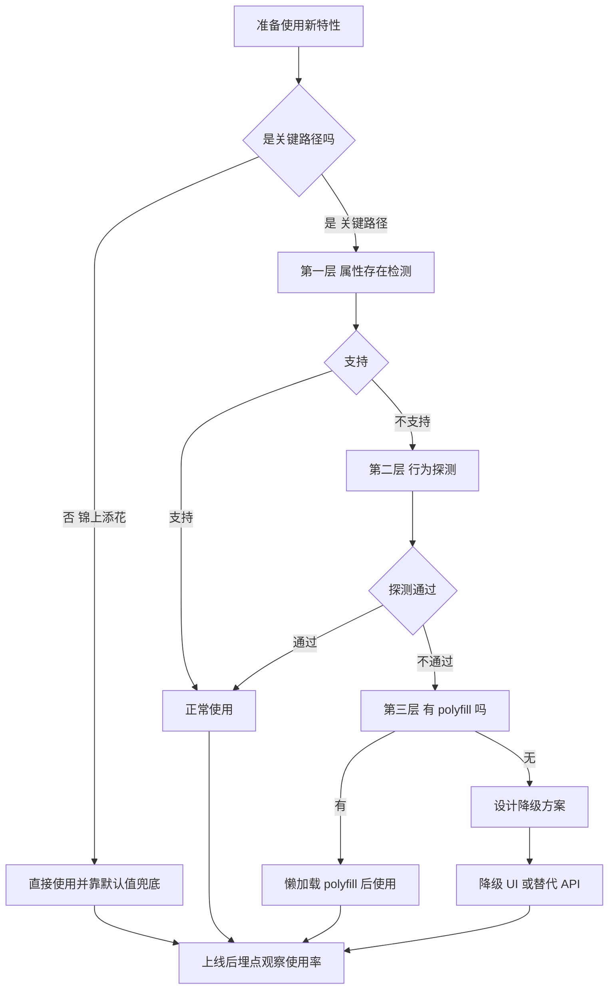

```javascript
// 万能检测工具：按层级封装
const support = {
  // 第一层：属性存在
  hasPopover: 'popover' in HTMLElement.prototype,
  hasDialog: typeof HTMLDialogElement === 'function',

  // 第二层：构造器 + 方法探测
  async payment() {
    if (!window.PaymentRequest) return false;
    try {
      const req = new PaymentRequest(
        [{ supportedMethods: 'basic-card' }],
        { total: { label: 't', amount: { currency: 'CNY', value: '0.01' } } }
      );
      return await req.canMakePayment();       // 行为级：有可用支付方式才算
    } catch { return false; }
  },

  // 第三层：能力参数校验
  canShareFiles(files) { return navigator.canShare?.({ files }) ?? false; },
};

// polyfill 懒加载：仅在需要时动态 import
async function ensurePopover() {
  if (support.hasPopover) return;
  await import('@oddbird/popover-polyfill');   // 官方推荐的按需 polyfill
}

// 不可 polyfill 的能力：渐进增强 + 降级
async function playStreaming(video, url) {
  if (window.MediaSource && MediaSource.isTypeSupported('video/mp4; codecs="avc1.64001f"')) {
    return msePlay(video, url);                // MSE 流式
  }
  if (video.canPlayType('application/vnd.apple.mpegurl')) {
    video.src = url.replace('.mp4', '.m3u8');  // iOS 原生 HLS
    return video.play();
  }
  video.src = url;                             // 最终降级：整文件直出
  return video.play();
}

// 反模式备忘：不要这样写
// const isChrome = /Chrome/.test(ua);         // UA 嗅探不可维护
// if (isChrome) enableShare();
```

## 二十一、Canvas 高级渲染

### H5-126：单个 canvas 卡顿，为什么"分层 canvas"能解决？怎么设计？
**答**：
- 把"几乎不变"的背景/静态图形与"每帧变化"的动态元素画到**叠加的多个 canvas**（CSS 绝对定位叠放），动态层每帧只 clear + 重绘自己，静态层一次绘制后不再动。
- 核心收益：重绘面积从"整画布"缩小到"脏区域"，静态层不需要每帧重放几百条绘制指令。
- 配合技巧：透明背景用 `clearRect` 而不是盖色；给不需要交互的层设 `pointer-events: none`；事件层单独拆一层，拾取逻辑与渲染解耦。
- 判断标准：重绘内容 < 画布面积 30%、或静态元素指令数很大（网格、背景纹理）时收益最大；元素极少时多层反而增加合成成本。
- 极致方案：脏矩形——只 clearRect/重绘变化区域，配合分层把"整帧"变"局部帧"。

```html
<div class="stage">
  <canvas id="bg" class="layer"></canvas>   <!-- 静态层：只画一次 -->
  <canvas id="fx" class="layer"></canvas>   <!-- 动态层：每帧重绘 -->
</div>
<style>
  .stage { position: relative; width: 480px; height: 320px; }
  .layer { position: absolute; inset: 0; }
  #fx { pointer-events: none; }  /* 动态层不接事件，穿透到静态层 */
</style>
<script>
const dpr = devicePixelRatio || 1;
function setup(canvas) {
  canvas.width = 480 * dpr;
  canvas.height = 320 * dpr;
  canvas.getContext('2d').scale(dpr, dpr);
}
const bg = document.getElementById('bg'), fx = document.getElementById('fx');
setup(bg); setup(fx);

// 静态层：网格背景只在初始化/尺寸变化时画一次
{
  const c = bg.getContext('2d');
  c.strokeStyle = '#e5e7eb';
  c.beginPath();
  for (let x = 0; x <= 480; x += 24) { c.moveTo(x, 0); c.lineTo(x, 320); }
  for (let y = 0; y <= 320; y += 24) { c.moveTo(0, y); c.lineTo(480, y); }
  c.stroke();
}

// 动态层：小球动画每帧只清空自己这一层，静态层完全不受影响
const ball = { x: 40, y: 40, vx: 2.4, vy: 1.8 };
function frame() {
  const c = fx.getContext('2d');
  c.clearRect(0, 0, 480, 320);          // 透明清屏，不遮挡静态层
  ball.x += ball.vx; ball.y += ball.vy;
  if (ball.x < 8 || ball.x > 472) ball.vx *= -1;
  if (ball.y < 8 || ball.y > 312) ball.vy *= -1;
  c.beginPath(); c.arc(ball.x, ball.y, 8, 0, Math.PI * 2);
  c.fillStyle = '#2563eb'; c.fill();
  requestAnimationFrame(frame);
}
frame();
</script>
```

### H5-127：save/restore 的状态栈怎么用？不成对会出什么问题？
**答**：
- `save()` 把 fillStyle/strokeStyle/变换矩阵/裁剪区/阴影/字体等状态压栈，`restore()` 弹栈恢复；栈是 LIFO，保存顺序和恢复顺序必须严格配对。
- 不成对的后果：变换跨帧/跨分支累积（图形越转越歪）、`clip()` 裁剪区越缩越小、样式"泄漏"到后面的绘制。
- 配对原则：进入绘制分支先 save，离开前必 restore（try/finally 思维）；深层递归绘制里可用 `setTransform` 直接重置兜底。
- 注意：restore 只恢复"状态"，不恢复画布像素——清像素用 clearRect；`clip()` 属于状态的一部分，在 save/restore 之间使用。

```javascript
const ctx = canvas.getContext('2d');

// 反模式：不成对 —— rotate 会跨调用累积，图形越画越歪
function drawBad(angle) {
  ctx.rotate(angle);          // 没有 save，状态泄漏到下一次调用
  ctx.fillRect(0, 0, 50, 50);
}

// 正解 1：进入分支即 save，退出前 restore（try/finally 思维）
function drawSafe(angle) {
  ctx.save();                 // 快照当前状态
  try {
    ctx.translate(100, 100);
    ctx.rotate(angle);
    ctx.fillStyle = '#2563eb';
    ctx.fillRect(-25, -25, 50, 50);
  } finally {
    ctx.restore();            // 提前 return / 异常都不会泄漏状态
  }
}

// 正解 2：深层递归（树形结构绘制）里，用 setTransform 直接重置兜底
function resetToBase(dpr) {
  ctx.setTransform(dpr, 0, 0, dpr, 0, 0);  // 不依赖栈深度，强制回到基准
}

// 裁剪也属于状态：save 里 clip、restore 释放，否则裁剪区会叠加收紧
ctx.save();
ctx.beginPath();
ctx.arc(60, 60, 50, 0, Math.PI * 2);
ctx.clip();                    // 只能画进圆内
ctx.fillStyle = '#f59e0b';
ctx.fillRect(0, 0, 120, 120);
ctx.restore();                 // 释放裁剪

// 记住两点：
// 1) restore 不恢复像素 —— 清像素用 clearRect
// 2) save/restore 数量不匹配时浏览器不报错，靠"进分支必配对"的纪律保证
```

### H5-128：如何用贝塞尔曲线把折线画成平滑曲线？
**答**：
- 中点法（二次贝塞尔）：以相邻数据点的**中点为锚点、数据点本身为控制点**，用 `quadraticCurveTo` 拼接——曲线必过中点、不穿过数据点，视觉平滑且无过冲，是折线图/签名板最常用方案。
- 三次贝塞尔：Catmull-Rom 转贝塞尔，控制点由相邻四点推出，张力系数可调，适合需要曲线"贴着数据点走"的场景。
- 拼接要点：整条曲线放在同一次 `beginPath` 中，避免段间接缝毛刺；起点 moveTo 到第一个中点/数据点。
- 控制点离得越远曲线越"冲"，用张力系数收敛；实时输入（签名）用中点法，静态拟合用 Catmull-Rom。

```javascript
// 方案 1：中点法平滑 —— 数据点是控制点，相邻点中点是锚点
function smoothLine(ctx, pts) {
  if (pts.length < 2) return;
  ctx.beginPath();
  ctx.moveTo(pts[0].x, pts[0].y);
  if (pts.length === 2) { ctx.lineTo(pts[1].x, pts[1].y); ctx.stroke(); return; }
  for (let i = 1; i < pts.length - 1; i++) {
    const midX = (pts[i].x + pts[i + 1].x) / 2;
    const midY = (pts[i].y + pts[i + 1].y) / 2;
    // 当前数据点作控制点，中点作终点：曲线必过中点，视觉平滑
    ctx.quadraticCurveTo(pts[i].x, pts[i].y, midX, midY);
  }
  ctx.lineTo(pts[pts.length - 1].x, pts[pts.length - 1].y);
  ctx.stroke();
}

// 方案 2：Catmull-Rom 转三次贝塞尔，t 是张力系数（1 为标准）
function catmullRom(ctx, pts, t = 1) {
  ctx.beginPath();
  ctx.moveTo(pts[0].x, pts[0].y);
  for (let i = 0; i < pts.length - 1; i++) {
    const p0 = pts[i - 1] ?? pts[i];
    const p1 = pts[i], p2 = pts[i + 1];
    const p3 = pts[i + 2] ?? p2;
    ctx.bezierCurveTo(
      p1.x + ((p2.x - p0.x) / 6) * t, p1.y + ((p2.y - p0.y) / 6) * t,
      p2.x - ((p3.x - p1.x) / 6) * t, p2.y - ((p3.y - p1.y) / 6) * t,
      p2.x, p2.y
    );
  }
  ctx.stroke();
}

smoothLine(ctx, [{ x: 20, y: 100 }, { x: 90, y: 40 }, { x: 160, y: 120 }, { x: 240, y: 60 }]);
catmullRom(ctx, [{ x: 20, y: 180 }, { x: 90, y: 140 }, { x: 160, y: 200 }, { x: 240, y: 150 }], 0.8);
```

### H5-129：measureText 与文本基线有哪些必踩的坑？
**答**：
- `measureText` 返回 TextMetrics：`width`、`actualBoundingBoxAscent/Descent`（真实墨迹边界）、`fontBoundingBoxAscent/Descent`（字体度量边界）——做视觉居中要用前者，不是后者。
- `textBaseline` 默认 `alphabetic` 是"拉丁字母底座"，中英文/不同字体视觉高度不一致，导致"明明垂直居中了但看起来偏"。
- 截断省略号不要逐字累加测量，二分查找 `O(log n)`；每帧改 `font` 会触发字体度量重算，按 font 分组绘制并缓存测量结果。
- 高分屏下 canvas 文本会因缩放发虚，绘制前 `scale(dpr)` 是前提。

```javascript
const ctx = canvas.getContext('2d');

// 1) 基线：默认 alphabetic 是"字母底座"，中英文视觉高度不一致
ctx.font = '16px sans-serif';
ctx.textBaseline = 'alphabetic';
ctx.fillText('Hello 文本', 10, 30);

// 2) 真正的"视觉垂直居中"要用真实墨迹边界 actualBoundingBox
function drawCentered(c, text, cx, cy) {
  const m = c.measureText(text);
  const inkH = m.actualBoundingBoxAscent + m.actualBoundingBoxDescent; // 墨迹高
  c.fillText(text, cx - m.width / 2, cy + inkH / 2 - m.actualBoundingBoxDescent);
}
ctx.strokeStyle = '#ddd';
ctx.beginPath(); ctx.moveTo(0, 30); ctx.lineTo(240, 30); ctx.stroke(); // 参考线
drawCentered(ctx, '对勾 OK', 120, 30);

// 3) 宽度截断（省略号）：二分比逐字累加快得多
function ellipsis(c, text, maxW) {
  if (c.measureText(text).width <= maxW) return text;
  let lo = 0, hi = text.length;
  while (lo < hi) {
    const mid = (lo + hi + 1) >> 1;
    if (c.measureText(text.slice(0, mid) + '…').width <= maxW) lo = mid;
    else hi = mid - 1;
  }
  return text.slice(0, lo) + '…';
}
console.log(ellipsis(ctx, '这是一段很长很长的文本需要截断', 120));

// 4) 性能：font 切换触发度量重算，按 font 分组绘制并缓存测量结果
const cache = new Map();
function textW(c, t) {
  if (!cache.has(t)) cache.set(t, c.measureText(t).width);
  return cache.get(t);
}
```

### H5-130：createPattern 平铺与渐变（linear/radial）的正确用法与坑？
**答**：
- 渐变坐标定义在**当前坐标系**里：translate/scale 画布时旧渐变对象不会跟着"想象中"移动——元素位置变化时按目标矩形重建渐变，不要复用。
- `addColorStop` 位置必须 0~1 且 stop 是按添加顺序应用的；径向渐变是"内圆到外圆"插值，常用于高光/光晕。
- `createPattern` 的源可以是 Image/Canvas/Video；Image 必须等 `onload`，Canvas 可立即使用。
- pattern 的平铺原点跟随当前变换矩阵——想让纹理"固定"需重置变换后绘制。

```javascript
const ctx = canvas.getContext('2d');

// 1) 线性渐变：坐标定义在"当前坐标系"
const g = ctx.createLinearGradient(10, 10, 210, 10);
g.addColorStop(0, '#3b82f6');
g.addColorStop(1, '#ef4444');
ctx.fillStyle = g;
ctx.fillRect(10, 10, 200, 60);

// 2) 缩放/移动元素时不要复用旧渐变对象 —— 按目标矩形重建
function gradientFor(x, y, w) {
  const lg = ctx.createLinearGradient(x, y, x + w, y);
  lg.addColorStop(0, '#3b82f6');
  lg.addColorStop(1, '#ef4444');
  return lg;
}

// 3) 径向渐变：内圆到外圆插值，做高光/光晕
const rg = ctx.createRadialGradient(110, 130, 2, 110, 130, 44);
rg.addColorStop(0, 'rgba(255,255,255,.9)');
rg.addColorStop(1, 'rgba(255,255,255,0)');
ctx.fillStyle = rg;
ctx.fillRect(66, 86, 88, 88);

// 4) pattern 平铺：源是 canvas 可立即用；是 Image 必须等 onload
const tile = document.createElement('canvas');
tile.width = tile.height = 16;
const tc = tile.getContext('2d');
tc.strokeStyle = '#94a3b8';
tc.beginPath(); tc.moveTo(0, 16); tc.lineTo(16, 0); tc.stroke();   // 斜线纹理
const p = ctx.createPattern(tile, 'repeat');   // repeat/repeat-x/no-repeat...
ctx.fillStyle = p;
ctx.fillRect(10, 190, 200, 60);
// 坑：pattern 的平铺原点跟随当前变换矩阵 —— translate 后纹理会"跟着动"，
// 需要"固定纹理"时：save 重置变换，在目标位置重画，restore
```

### H5-131：shadowBlur 为什么慢？阴影有哪些优化手段？
**答**：
- 阴影（`shadowBlur/shadowColor/shadowOffset*`）在绘制时触发**逐像素高斯模糊**，代价随 blur 半径增长，每帧对多个元素各自模糊时帧率崩塌。
- 优化 1：静态元素把"本体+阴影"预渲染进离屏 canvas，之后只是一次 `drawImage`（模糊只发生一次）。
- 优化 2：动态元素共享同一组 shadow 设置批量绘制，减少状态切换；优化 3：能走 DOM 的阴影用 CSS `box-shadow`（GPU 合成）；优化 4：降低 blur、缩小阴影元素数量、减少阴影层数。
- 用完记得关闭：`shadowColor = 'transparent'; shadowBlur = 0`，否则状态泄漏继续吃性能。

```javascript
const ctx = canvas.getContext('2d');
const dpr = devicePixelRatio || 1;
const shapes = [{ x: 20, y: 20, w: 80, h: 60 }, { x: 140, y: 20, w: 80, h: 60 }];

// 慢的写法：每个元素各自触发一次高斯模糊
function slowShadows() {
  for (const s of shapes) {
    ctx.shadowColor = 'rgba(0,0,0,.35)';
    ctx.shadowBlur = 20;              // blur 越大越贵，且按元素次数重复
    ctx.shadowOffsetY = 4;
    ctx.fillRect(s.x, s.y, s.w, s.h);
  }
  ctx.shadowColor = 'transparent'; ctx.shadowBlur = 0;   // 用完必须关
}

// 优化 1：静态元素把"本体+阴影"预渲染进离屏 canvas，之后只是 drawImage
function makeShadowSprite(w, h, pad = 24, blur = 20) {
  const off = document.createElement('canvas');
  off.width = (w + pad * 2) * dpr; off.height = (h + pad * 2) * dpr;
  const c = off.getContext('2d');
  c.scale(dpr, dpr);
  c.shadowColor = 'rgba(0,0,0,.35)';
  c.shadowBlur = blur; c.shadowOffsetY = 4;
  c.fillStyle = '#fff';
  c.fillRect(pad, pad, w, h);        // 模糊只发生这一次
  return { canvas: off, pad };
}
const sprite = makeShadowSprite(80, 60);
for (const s of shapes) {
  ctx.drawImage(sprite.canvas, s.x - sprite.pad, s.y - sprite.pad,
                sprite.canvas.width / dpr, sprite.canvas.height / dpr);
}

// 优化 2：动态元素必须实时画阴影时，共享同一组 shadow 设置批量绘制
ctx.shadowColor = 'rgba(0,0,0,.35)'; ctx.shadowBlur = 20; ctx.shadowOffsetY = 4;
ctx.fillStyle = '#fff';
for (const s of shapes) ctx.fillRect(s.x, s.y + 100, s.w, s.h);  // 一次设置连画
ctx.shadowColor = 'transparent'; ctx.shadowBlur = 0;
// 优化 3：纯 DOM 场景直接用 CSS box-shadow（合成器处理），别用 canvas 画阴影
```

### H5-132：canvas 内元素命中检测有哪些方案？如何对比选型？
**答**：
- **isPointInPath**：保留矢量路径语义、精确，但每元素一次调用 O(n)，路径需要重建一遍；适合元素少、形状复杂（不规则多边形）。
- **几何计算**：自己写圆/矩形相交，最快；配合"包围盒粗筛 + 精确判定"两级可撑到海量元素；缺点是每种图形都要写逻辑。
- **像素拾取缓冲（picking buffer）**：把每个元素用"id 编码成的颜色"画到离屏 canvas，命中时读 1 像素反查 id——O(1) 查询且形状任意，代价是场景变化时重画缓冲。
- 选型口诀：少量复杂路径 isPointInPath；大量规则图形几何 + 空间索引；元素极多或形状任意用拾取缓冲；实际项目常见"包围盒粗筛 + 上述精判"组合。

```javascript
const dpr = devicePixelRatio || 1;
const shapes = [
  { type: 'rect', x: 10, y: 10, w: 80, h: 50 },
  { type: 'circle', cx: 180, cy: 60, r: 40 },
];

function buildPath(c, s) {
  if (s.type === 'rect') c.rect(s.x, s.y, s.w, s.h);
  if (s.type === 'circle') c.arc(s.cx, s.cy, s.r, 0, Math.PI * 2);
}

// 方案 A：isPointInPath —— 保留矢量路径，精确，元素少时用
function hitByPath(ctx, x, y) {
  for (let i = shapes.length - 1; i >= 0; i--) {   // 倒序：先命中最上层
    ctx.beginPath();
    buildPath(ctx, shapes[i]);
    if (ctx.isPointInPath(x, y)) return shapes[i];
  }
  return null;
}

// 方案 B：几何计算 —— 最快；先包围盒粗筛再精确判定
function hitByGeometry(x, y) {
  for (let i = shapes.length - 1; i >= 0; i--) {
    const s = shapes[i];
    if (s.type === 'rect' &&
        x >= s.x && x <= s.x + s.w && y >= s.y && y <= s.y + s.h) return s;
    if (s.type === 'circle') {
      if ((x - s.cx) ** 2 + (y - s.cy) ** 2 > (s.r + 6) ** 2) continue; // 粗筛+容差
      return s;
    }
  }
  return null;
}

// 方案 C：像素拾取缓冲 —— 每个元素用唯一颜色画到离屏，读点反查 id
function buildPickBuffer() {
  const pick = document.createElement('canvas');
  pick.width = canvas.width; pick.height = canvas.height;
  const c = pick.getContext('2d', { willReadFrequently: true });
  shapes.forEach((s, i) => {
    c.fillStyle = '#' + (i + 1).toString(16).padStart(6, '0');  // id 编码成颜色
    c.beginPath(); buildPath(c, s); c.fill();
  });
  return (x, y) => {
    const d = c.getImageData(x * dpr, y * dpr, 1, 1).data;
    if (d[3] === 0) return null;                       // 透明 = 没命中
    const idx = (d[0] << 16 | d[1] << 8 | d[2]) - 1;
    return shapes[idx] ?? null;
  };
}

const ctx = canvas.getContext('2d');
console.log(hitByPath(ctx, 40, 30));   // rect
console.log(hitByGeometry(180, 60));   // circle
const pickHit = buildPickBuffer();
console.log(pickHit(40, 30));          // rect
```

## 二十二、Canvas 工程化

### H5-133：画布应用为什么必须把"图形数据模型"与"渲染"分离？
**答**：
- 数据层保存形状对象数组（id/type/props），渲染层是纯函数 `render(scene, viewport)`——数据变了才标记 dirty，rAF 里统一重绘（单向数据流：操作 → 改数据 → 标脏 → 合帧渲染）。
- 没有分离的后果：`fillRect` 画完就丢，选中、撤销、导出、协作全要靠"猜像素"或全图 diff。
- 分离的红利：命中检测查数据而不是像素；撤销重做建立在模型快照/命令上；序列化（保存/复制）天然可得；协作只同步"操作"。
- 渲染函数保持纯函数（相同数据必画出相同画面），可测试、可重放、可迁移到离屏/WebGL。

```javascript
// 数据模型：一切操作只改数据，不碰 ctx
let shapes = [];
let nextId = 1;
const addRect = (x, y, w, h) =>
  shapes.push({ id: nextId++, type: 'rect', x, y, w, h, fill: '#3b82f6' });
const moveShape = (id, dx, dy) => {
  const s = shapes.find((v) => v.id === id);
  if (s) { s.x += dx; s.y += dy; }
};

// 渲染层：纯函数 —— 相同数据必画出相同画面（可测试、可重放）
function render(ctx, scene) {
  ctx.clearRect(0, 0, 480, 320);
  for (const s of scene) {
    ctx.fillStyle = s.fill;
    ctx.fillRect(s.x, s.y, s.w, s.h);
  }
}

// 单向数据流：修改只标脏，rAF 合帧渲染（一帧内多次修改只画一次）
let dirty = true;
const invalidate = () => { dirty = true; };
function tick(ctx) {
  if (dirty) { render(ctx, shapes); dirty = false; }
  requestAnimationFrame(() => tick(ctx));
}

// 分离的红利 1：命中检测查数据而不是像素
const pick = (x, y) =>
  [...shapes].reverse().find((s) =>
    x >= s.x && x <= s.x + s.w && y >= s.y && y <= s.y + s.h);

// 分离的红利 2：序列化 / 撤销快照 / 协作同步全部免费获得
const serialize = () => JSON.stringify(shapes);

addRect(20, 20, 80, 60);
invalidate();
// 反模式：ctx.fillRect 画完就丢 —— 之后选中、撤销、导出都要靠"猜像素"
```

### H5-134：撤销重做的命令模式与快照方案怎么对比实现？
**答**：
- **命令模式**：每个操作封装 `do/undo`（对模型的正/逆操作），内存小、可合并连续输入（笔画/打字合并为一条历史），但每个操作都要写逆逻辑、易漏（对象替换类操作逆操作难写）。
- **快照模式**：操作后序列化整个场景压栈，实现简单、绝对正确，代价是内存——用栈深上限 + JSON 结构共享缓解。
- 混合策略：几何/结构操作用命令，文本输入用快照或"操作间隔 <500ms 合并"；redo 栈在新操作提交时清空。
- 面试常追问：撤销栈与协作同步的关系——协作场景撤销应撤销"自己的操作"，需要按 clientId 分组。

```javascript
// 方案 A：命令模式 —— 每个操作带 do/undo，内存小，可合并连续操作
class History {
  #undoStack = []; #redoStack = [];
  exec(cmd) { cmd.do(); this.#undoStack.push(cmd); this.#redoStack.length = 0; }
  undo() { const c = this.#undoStack.pop(); if (c) { c.undo(); this.#redoStack.push(c); } }
  redo() { const c = this.#redoStack.pop(); if (c) { c.do(); this.#undoStack.push(c); } }
  // 输入类操作合并：同 key 且间隔 < 500ms 的连续操作并进栈顶命令，不算新历史
  // coalesce(key, ms = 500) { ... }
}

let shapes = [{ id: 1, x: 0, y: 0 }];
const moveCmd = (shape, dx, dy) => ({
  do: () => { shape.x += dx; shape.y += dy; },
  undo: () => { shape.x -= dx; shape.y -= dy; },
});
const addCmd = (shape) => ({
  do: () => shapes.push(shape),
  undo: () => { shapes = shapes.filter((s) => s !== shape); },
});

// 方案 B：快照模式 —— 序列化整个场景，绝对正确，代价是内存
class SnapshotHistory {
  #stack = []; #index = -1;
  constructor(get, set, limit = 50) { this.get = get; this.set = set; this.limit = limit; }
  commit() {
    this.#stack = this.#stack.slice(0, this.#index + 1);   // 截断 redo 分支
    this.#stack.push(JSON.stringify(this.get()));
    if (this.#stack.length > this.limit) this.#stack.shift();  // 栈深上限控内存
    this.#index = this.#stack.length - 1;
  }
  undo() { if (this.#index > 0) this.set(JSON.parse(this.#stack[--this.#index])); }
  redo() {
    if (this.#index < this.#stack.length - 1)
      this.set(JSON.parse(this.#stack[++this.#index]));
  }
}

// 实务选型：小场景快照省心；大场景命令 + 输入合并；
// 折中：快照 + 增量 diff（只存变化的形状 id 与新旧值）
```

### H5-135：画布缩放平移如何封装视口变换矩阵？
**答**：
- 核心是两套坐标系互转：`toWorld = (屏幕坐标 - 偏移) / 缩放`，`toScreen` 相反；所有命中检测、吸附、绘制都在"世界坐标"进行，视口只是投影。
- 缩放关键：以鼠标位置为**不动点**——先算鼠标下的世界坐标，改 scale 后把该世界坐标再映射回同一屏幕点。
- 绘制时 `ctx.setTransform(dpr*scale, 0, 0, dpr*scale, dpr*offsetX, dpr*offsetY)`；"屏幕尺寸"元素（选择框、线宽）要除回 scale 补偿。
- 复杂场景（旋转/斜切）升级为 DOMMatrix，逆矩阵 `matrix.inverse()` 反解世界坐标；HUD 层（标尺、参考线）永远用屏幕坐标绘制。

```javascript
// 视口：scale + 偏移；屏幕坐标 ↔ 世界坐标 互转是一切的根
const viewport = { scale: 1, x: 0, y: 0 };
const toWorld  = (sx, sy) => ({ x: (sx - viewport.x) / viewport.scale,
                                y: (sy - viewport.y) / viewport.scale });
const toScreen = (wx, wy) => ({ x: wx * viewport.scale + viewport.x,
                                y: wy * viewport.scale + viewport.y });

// 缩放要点：以鼠标位置为"不动点" —— 鼠标下的世界点缩放前后屏幕位置不变
canvas.addEventListener('wheel', (e) => {
  e.preventDefault();
  const rect = canvas.getBoundingClientRect();
  const sx = e.clientX - rect.left, sy = e.clientY - rect.top;
  const before = toWorld(sx, sy);                       // 先记世界坐标
  const factor = Math.exp(-e.deltaY * 0.001);           // 指数缩放，手感平滑
  viewport.scale = Math.min(8, Math.max(0.1, viewport.scale * factor));
  viewport.x = sx - before.x * viewport.scale;          // 反推偏移
  viewport.y = sy - before.y * viewport.scale;
  scheduleRender();
}, { passive: false });

// 绘制：世界层走视口矩阵；HUD 层（选择框/标尺）回到屏幕坐标
const dpr = devicePixelRatio || 1;
function render(ctx) {
  ctx.setTransform(dpr * viewport.scale, 0, 0, dpr * viewport.scale,
                   dpr * viewport.x, dpr * viewport.y);
  ctx.lineWidth = 1 / viewport.scale;     // 屏幕上恒定 1px 的补偿写法
  for (const s of shapes) drawShape(ctx, s);   // 全部用世界坐标绘制

  ctx.setTransform(dpr, 0, 0, dpr, 0, 0);      // HUD：屏幕坐标系
  drawSelectionBox(ctx, toScreen(sel.x, sel.y), sel.w * viewport.scale);
}

// 平移：空格/中键/双指拖动，直接改 viewport.x/y；
// 需要旋转时升级 DOMMatrix：viewport.matrix.inverse() 反解世界坐标
let pan = null;
canvas.addEventListener('pointerdown', (e) => {
  if (e.button === 1 || spaceHeld) pan = { x: e.clientX, y: e.clientY };
});
canvas.addEventListener('pointermove', (e) => {
  if (!pan) return;
  viewport.x += e.clientX - pan.x;
  viewport.y += e.clientY - pan.y;
  pan = { x: e.clientX, y: e.clientY };
  scheduleRender();
});
addEventListener('pointerup', () => (pan = null));
```

### H5-136：网格吸附与对齐参考线如何实现？
**答**：
- 网格吸附 = 把候选坐标向网格步长取整，但要带**吸附半径**阈值——距离足够近才吸，而不是无条件取整（否则无法放在半格位置）。
- 对齐参考线：拖动时收集其它元素的 key 坐标（左/中/右、上/中/下），与拖动元素的关键坐标比较，差值 < 阈值时吸附并记录参考线用于绘制，松手清除。
- 多个候选同时命中时取差值最小的一个；元素量大时对候选坐标排序后二分找最近点。
- 渲染在 HUD 层（屏幕坐标），参考线颜色洋红、1px，只读不参与命中。

```javascript
const GRID = 8;          // 网格步长
const SNAP = 5;          // 吸附半径 px

// 1) 网格吸附：阈值内才吸附，不是无条件取整
const snapToGrid = (v) => Math.round(v / GRID) * GRID;
function snapMove(pos) {
  const g = snapToGrid(pos);
  return Math.abs(pos - g) <= SNAP ? g : pos;
}

// 2) 收集其它元素的候选线：垂直线（x）与水平线（y）
function collectGuides(shapes, excludeId) {
  const v = [], h = [];
  for (const s of shapes) {
    if (s.id === excludeId) continue;
    v.push(s.x, s.x + s.w / 2, s.x + s.w);      // 左 中 右
    h.push(s.y, s.y + s.h / 2, s.y + s.h);      // 上 中 下
  }
  return { v: [...new Set(v)], h: [...new Set(h)] };
}

// 3) 吸附计算：拖动元素的 左/中/右 分别对候选线找最小差值
function applyAlign(guides, box) {
  const bestSnap = (cands, vals) => {
    let best = null;
    for (const v of vals) for (const c of cands) {
      const d = c - v;
      if (Math.abs(d) <= SNAP && (!best || Math.abs(d) < Math.abs(best.d)))
        best = { d, at: c };
    }
    return best;
  };
  const x = bestSnap(guides.v, [box.x, box.x + box.w / 2, box.x + box.w]);
  const y = bestSnap(guides.h, [box.y, box.y + box.h / 2, box.y + box.h]);
  return {
    dx: x?.d ?? 0, dy: y?.d ?? 0,
    lines: [
      ...(x ? [{ axis: 'v', pos: x.at }] : []),
      ...(y ? [{ axis: 'h', pos: y.at }] : []),
    ],
  };
}

// 用法：拖动事件里 —— 先算原始位移，再叠加吸附修正
// const guides = collectGuides(shapes, dragId);
// const align = applyAlign(guides, dragBox);
// dragShape.x += dx + align.dx;  dragShape.y += dy + align.dy;
// 渲染：align.lines 画到 HUD 层（洋红 1px 竖线/横线），松手清空
// 元素多时：候选坐标先排序，bestSnap 内改二分查找最近值
```

### H5-137：画布内容如何导出为 PNG/JPG/SVG 与裁剪选区？
**答**：
- 位图导出用 `canvas.toBlob(type, quality)`（异步、内存友好）；JPG 无透明通道，导出前先铺白底否则黑底；高分屏导出注意 dpr。
- 裁剪选区：`drawImage` 从主画布按"源矩形（乘 dpr）→ 目标矩形"拷贝到新 canvas。
- SVG 导出是"数据/渲染分离"的红利：数据模型是矢量，直接把场景序列化成 `<svg>` 字符串，无损缩放且可二次编辑。
- 大坑：画过跨域图片的 canvas 被污染，`toBlob` 抛 SecurityError——图片加 `crossOrigin='anonymous'` 且服务端允许 CORS。

```javascript
// 1) 位图导出 + 裁剪选区
const dpr = devicePixelRatio || 1;
async function exportPNG(rect) {
  const out = document.createElement('canvas');
  out.width = rect ? rect.w : canvas.width;
  out.height = rect ? rect.h : canvas.height;
  const c = out.getContext('2d');
  if (rect) {
    // 裁剪：从主画布拷贝源区域（源坐标要乘 dpr 回到物理像素）
    c.drawImage(canvas, rect.x * dpr, rect.y * dpr, rect.w * dpr, rect.h * dpr,
                0, 0, rect.w, rect.h);
  } else {
    c.drawImage(canvas, 0, 0);
  }
  return new Promise((res) => out.toBlob(res, 'image/png'));
}
async function exportJPG() {
  const out = document.createElement('canvas');
  out.width = canvas.width; out.height = canvas.height;
  const c = out.getContext('2d');
  c.fillStyle = '#fff'; c.fillRect(0, 0, out.width, out.height); // JPG 无透明，先铺底
  c.drawImage(canvas, 0, 0);
  return new Promise((res) => out.toBlob(res, 'image/jpeg', 0.85));
}

// 2) SVG 导出：数据模型是矢量，直接序列化（数据/渲染分离的红利）
function exportSVG(scene) {
  const body = scene.map((s) =>
    `<rect x="${s.x}" y="${s.y}" width="${s.w}" height="${s.h}" fill="${s.fill}"/>`
  ).join('');
  return `<svg xmlns="http://www.w3.org/2000/svg" viewBox="0 0 480 320">${body}</svg>`;
}

// 3) 下载触发：createObjectURL + a[download]，用完 revoke
function download(blob, name) {
  const url = URL.createObjectURL(blob);
  const a = Object.assign(document.createElement('a'), { href: url, download: name });
  a.click();
  setTimeout(() => URL.revokeObjectURL(url), 0);
}

// 坑：画过跨域图片的 canvas 已"污染"，toBlob 抛 SecurityError；
// 解法：img.crossOrigin = 'anonymous' + 服务端返回 CORS 头
```

### H5-138：万级图形渲染的优化路径有哪些？
**答**：
- Canvas 2D 的瓶颈通常是"**状态切换 + 路径重放**"而非像素填充：按 fillStyle/strokeStyle 排序分组，同色元素 accumulate 到同一个 Path 后一次 fill/stroke。
- 视口裁剪（culling）+ 空间索引：网格哈希/四叉树把"遍历全部元素"变"只查附近格子"，相交测试后只画可见元素。
- 静态元素离屏缓存整块 drawImage；缩小时启用 LOD（跳过文本/细节、只画包围盒）；关闭抗锯齿（`ctx.imageSmoothingEnabled`、缩小画面）。
- 仍然不够（10 万+ 元素/粒子）才升级 WebGL 批渲染（PixiJS/Three.js），或对静态大区域做分块缓存。

```javascript
// 万级图形优化路径（按收益排序）

// 1) 减少状态切换：按样式分组，同色元素 accumulate 后一次 fill
function renderGrouped(ctx, shapes) {
  const byFill = new Map();
  for (const s of shapes) {
    if (!byFill.has(s.fill)) byFill.set(s.fill, []);
    byFill.get(s.fill).push(s);
  }
  for (const [fill, list] of byFill) {
    ctx.fillStyle = fill;                 // 每组只切一次状态
    ctx.beginPath();
    for (const s of list) ctx.rect(s.x, s.y, s.w, s.h);   // 累积子路径
    ctx.fill();                           // 一次 fill 画完全组
  }
}

// 2) 空间索引：网格哈希把"遍历全部"变"只查附近格子"
class GridIndex {
  constructor(cell = 64) { this.cell = cell; this.map = new Map(); }
  insert(s) {
    const x0 = Math.floor(s.x / this.cell), x1 = Math.floor((s.x + s.w) / this.cell);
    const y0 = Math.floor(s.y / this.cell), y1 = Math.floor((s.y + s.h) / this.cell);
    for (let cx = x0; cx <= x1; cx++)
      for (let cy = y0; cy <= y1; cy++) {
        const k = cx + ',' + cy;
        if (!this.map.has(k)) this.map.set(k, new Set());
        this.map.get(k).add(s);
      }
  }
  query(x0, y0, x1, y1) {                 // 返回视口附近候选（再精确判交）
    const out = new Set();
    for (let cx = Math.floor(x0 / this.cell); cx <= Math.floor(x1 / this.cell); cx++)
      for (let cy = Math.floor(y0 / this.cell); cy <= Math.floor(y1 / this.cell); cy++) {
        const set = this.map.get(cx + ',' + cy);
        if (set) for (const s of set) out.add(s);
      }
    return out;
  }
}

// 3) 视口裁剪：索引查询 → 包围盒精确判交 → 只画可见
const index = new GridIndex(64);
shapes.forEach((s) => index.insert(s));
function renderVisible(ctx, view) {
  for (const s of index.query(view.x, view.y, view.x + view.w, view.y + view.h)) {
    if (s.x + s.w < view.x || s.x > view.x + view.w) continue;   // 精确判交
    drawShape(ctx, s);
  }
}

// 4) 静态层离屏缓存整块 drawImage；5) 缩小时 LOD 略过细节；
// 6) 仍不够 → WebGL 批渲染。经验：先 profile，瓶颈在指令重放才值得迁移图形栈
```

## 二十三、音视频工程

### H5-139：getUserMedia 的约束怎么写？ideal 与 exact 有什么区别？
**答**：
- 约束分三档：`ideal`（尽量满足，取最近支持值）、`min/max`（硬边界）、`exact`（必须满足，否则抛 `OverconstrainedError`）。
- 常用字段：`width/height/frameRate`、`facingMode`（'user'/'environment' 前后摄）、音频的 `echoCancellation/noiseSuppression`。
- 运行时调整用 `track.applyConstraints()`（软约束热生效），`track.getSettings()` 查真实生效参数。
- 错误要分类处理：`NotAllowedError` 权限拒绝、`NotFoundError` 无设备、`OverconstrainedError` 约束冲突——给用户的提示完全不同。
- 移动端切换前后摄：必须先 `stop` 旧 track 再重新 `getUserMedia`，摄像头无法被两个流同时占用。

```html
<video id="cam" autoplay playsinline muted></video>
<button id="switch">切换前后摄像头</button>
<script>
let stream, facing = 'user';

async function open(mode = 'user') {
  // ideal：尽量满足；exact：必须满足否则 OverconstrainedError；min/max：硬边界
  const constraints = {
    video: {
      width: { ideal: 1280 },
      height: { ideal: 720 },
      frameRate: { ideal: 30, min: 15 },     // min 是硬底线
      facingMode: mode,                      // 'user' | 'environment'
    },
    audio: { echoCancellation: true, noiseSuppression: true },
  };
  try {
    stream = await navigator.mediaDevices.getUserMedia(constraints);
  } catch (e) {
    // NotAllowedError 权限拒绝 / NotFoundError 无设备 / OverconstrainedError 约束冲突
    if (e.name === 'NotAllowedError') alert('请在浏览器设置中授权摄像头');
    else if (e.name === 'NotFoundError') alert('未检测到摄像头');
    else throw e;
  }
  document.getElementById('cam').srcObject = stream;
}

// 运行时热调整（不重开设备）：applyConstraints 软约束
async function upgrade() {
  const track = stream.getVideoTracks()[0];
  await track.applyConstraints({ width: { ideal: 1920 } });
  console.log('实际生效参数', track.getSettings());   // 真实能力
}

// 切换前后摄：旧 track 必须 stop，移动端无法同时占用
document.getElementById('switch').onclick = async () => {
  stream?.getTracks().forEach((t) => t.stop());
  facing = facing === 'user' ? 'environment' : 'user';
  await open(facing);
};
open();
</script>
```

### H5-140：getDisplayMedia + MediaRecorder 屏幕录制的全流程？
**答**：
- 流程：`getDisplayMedia({video, audio})` 拿屏幕流（用户在系统弹层选屏幕/窗口/标签页，网页无选择权）→ `new MediaRecorder(stream, {mimeType})` → `ondataavailable` 收 chunk → `onstop` 合成 Blob → `createObjectURL` 触发下载。
- mimeType 用 `isTypeSupported` 探测降级（vp9 → vp8 → 默认），`start(timeslice)` 定时分片防内存峰值与崩溃丢全部数据。
- 必须监听 `track.onended`：用户随时可能点浏览器自带的"停止共享"，Web 应用不感知这个 UI。
- 必须**用户手势触发**；Safari 支持 `video/mp4` 优先，其余多为 webm；只能录屏音频（audio: true 表示尝试采集系统声音，能否勾选由浏览器决定）。

```html
<button id="rec">开始录屏</button>
<a id="dl" hidden>下载录像</a>
<script>
const pickMime = () =>
  ['video/webm;codecs=vp9,opus', 'video/webm;codecs=vp8,opus', 'video/webm']
    .find((t) => MediaRecorder.isTypeSupported(t)) || '';

document.getElementById('rec').onclick = async function () {
  // 用户在系统弹层里选"整个屏幕 / 窗口 / 标签页"，网页拿不到选择权
  const stream = await navigator.mediaDevices.getDisplayMedia({
    video: { frameRate: 30 },
    audio: true,          // 尝试采集系统声音，能否勾选由浏览器与用户决定
  });
  const chunks = [];
  const rec = new MediaRecorder(stream, {
    mimeType: pickMime(),
    videoBitsPerSecond: 5e6,
  });
  rec.ondataavailable = (e) => { if (e.data.size) chunks.push(e.data); };
  rec.onstop = () => {
    const blob = new Blob(chunks, { type: rec.mimeType });
    const a = document.getElementById('dl');
    a.href = URL.createObjectURL(blob);
    a.download = 'screen.' + (rec.mimeType.includes('mp4') ? 'mp4' : 'webm');
    a.hidden = false;
  };
  // 关键：用户随时可能点浏览器自带的"停止共享"按钮 —— 只能靠 track 事件感知
  stream.getVideoTracks()[0].onended = () => {
    if (rec.state !== 'inactive') rec.stop();
  };
  rec.start(1000);        // 每秒落一个 chunk：防内存峰值，崩溃时不丢全部
  this.textContent = '停止';
  this.onclick = () => rec.state !== 'inactive' && rec.stop();
};
</script>
```

### H5-141：AnalyserNode 实现录音可视化波形怎么做？
**答**：
- 链路：`getUserMedia` → `AudioContext` → `createAnalyser(fftSize)` → `createMediaStreamSource.connect(analyser)`；`fftSize` 决定时域数据点数。
- 每帧 rAF 里 `getByteTimeDomainData` 画波形（128 是静音中线），或 `getByteFrequencyData` 画频谱柱状图。
- `AudioContext` 必须在用户手势内 `resume()`，否则 iOS 上静默无输出。
- 停止时三步都要做：断开源节点、`track.stop()` 释放麦克风（指示灯熄灭）、`close()` AudioContext。

```html
<canvas id="wave" width="400" height="100"></canvas>
<button id="start">开始录音可视化</button>
<script>
document.getElementById('start').onclick = async function () {
  const stream = await navigator.mediaDevices.getUserMedia({ audio: true });
  const actx = new AudioContext();
  await actx.resume();                       // 必须在用户手势内 resume
  const analyser = actx.createAnalyser();
  analyser.fftSize = 2048;                   // 时域数据点数 = fftSize
  actx.createMediaStreamSource(stream).connect(analyser);

  const data = new Uint8Array(analyser.fftSize);
  const canvas = document.getElementById('wave');
  const ctx = canvas.getContext('2d');

  function draw() {
    analyser.getByteTimeDomainData(data);    // 波形；getByteFrequencyData 是频谱
    ctx.fillStyle = '#0f172a';
    ctx.fillRect(0, 0, canvas.width, canvas.height);
    ctx.strokeStyle = '#34d399';
    ctx.beginPath();
    const step = canvas.width / data.length;
    for (let i = 0; i < data.length; i++) {
      const y = (data[i] / 255) * canvas.height;   // 128 是静音中线
      i === 0 ? ctx.moveTo(0, y) : ctx.lineTo(i * step, y);
    }
    ctx.stroke();
    if (stream.getAudioTracks()[0].readyState === 'live') requestAnimationFrame(draw);
  }
  draw();

  // 停止三件套：断源 + stop tracks + close context
  this.onclick = () => {
    stream.getTracks().forEach((t) => t.stop());   // 麦克风指示灯熄灭
    actx.close();
  };
};
</script>
```

### H5-142：WebAudio 音效播放池怎么做？移动端为什么要"解锁"音频上下文？
**答**：
- iOS/部分安卓要求 `AudioContext` 必须在**用户手势内** `resume()`，否则处于 suspended 状态播放静音——所以首次点击要做"解锁"。
- `AudioBuffer` 解码一次后复用；`AudioBufferSourceNode` 是一次性对象（播完即弃），所谓"播放池"实际是**并发上限控制 + 活跃 source 集合管理**。
- 多音效重叠：直接创建多个 source，用 `GainNode` 独立控音量；`playbackRate` 可做随机变调避免重复感。
- 对比 `<audio>`：WebAudio 延迟低、可精控混音/变速/空间化，但必须有解锁流程；`<audio>` 简单但延迟与调度粗。

```html
<button id="fire">播放音效（可叠加）</button>
<script>
class SoundPool {
  #ctx; #buffers = new Map(); #active = new Set(); #maxVoices = 5;
  async unlock() {                 // 必须在用户手势内调用一次
    this.#ctx ??= new (window.AudioContext || window.webkitAudioContext)();
    if (this.#ctx.state === 'suspended') await this.#ctx.resume();  // iOS 关键
  }
  async load(name, url) {
    const res = await fetch(url);
    // decodeAudioData 一次解码，之后播放零解码开销
    this.#buffers.set(name, await this.#ctx.decodeAudioData(await res.arrayBuffer()));
  }
  play(name, { volume = 1, rate = 1 } = {}) {
    const buf = this.#buffers.get(name);
    if (!buf || this.#active.size >= this.#maxVoices) return;   // 并发上限
    const src = this.#ctx.createBufferSource();   // source 是一次性对象，播完即弃
    src.buffer = buf;
    src.playbackRate.value = rate;
    const gain = this.#ctx.createGain();
    gain.gain.value = volume;
    src.connect(gain).connect(this.#ctx.destination);
    this.#active.add(src);
    src.onended = () => { this.#active.delete(src); src.disconnect(); };
    src.start();
  }
}
const pool = new SoundPool();
document.getElementById('fire').onclick = async () => {
  await pool.unlock();             // 第一次点击：解锁 + 预加载
  await pool.load('hit', '/sfx/hit.mp3').catch(() => {});
  pool.play('hit', { volume: 0.6, rate: 0.95 + Math.random() * 0.1 });  // 变调去重复感
};
</script>
```

### H5-143：视频 seek 为什么会"卡一下"？前端如何优化？
**答**：
- 根因：seek 目标帧前若无关键帧，解码器要从上一个关键帧逐帧解码到目标帧——GOP（关键帧间隔）越长随机 seek 越慢，根本优化在服务端转码（GOP 控制在 1~2s）。
- `seeked` 事件只代表解码完成，画面可能尚未渲染；精确"看到目标帧"用 `requestVideoFrameCallback` 等真实呈现。
- `fastSeek()` 快速但低精度（跳到目标附近关键帧），适合拖动预览。
- 进度条缩略图不要反复 seek 主视频：预生成雪碧图按时间取背景位置，零解码成本。

```html
<video id="v" controls preload="metadata" src="movie.mp4"></video>
<div id="tip"></div>
<script>
const v = document.getElementById('v');

// 1) 精确 seek：seeked 只代表解码完成，画面可能还没渲染；
//    requestVideoFrameCallback 等"真正渲染出目标帧"
function preciseSeek(t) {
  return new Promise((resolve) => {
    const onSeeked = () => {
      if ('requestVideoFrameCallback' in v) {
        v.requestVideoFrameCallback(() => resolve());   // 新帧真正呈现
      } else resolve();
    };
    v.addEventListener('seeked', onSeeked, { once: true });
    v.currentTime = t;
  });
}

// 2) 快速但低精度：fastSeek 跳到目标附近的关键帧（部分浏览器支持）
function fastSeek(t) { v.fastSeek ? v.fastSeek(t) : (v.currentTime = t); }

// 3) 缩略图预览不 seek 主视频：预生成雪碧图，按时间换 background-position
const cols = 10, fw = 160, fh = 90;
function seekPreview(el, t, duration) {
  const total = cols * 10;
  const idx = Math.min(total - 1, Math.floor((t / duration) * total));
  el.style.backgroundImage = 'url(sprite.jpg)';   // 10 行 x 10 列帧图
  el.style.width = fw + 'px'; el.style.height = fh + 'px';
  el.style.backgroundPosition =
    `-${(idx % cols) * fw}px -${Math.floor(idx / cols) * fh}px`;
}

// 4) 拖动进度条节流：input 高频触发只做预览，change/落点才真正 seek
// 根本优化在服务端：转码时把 GOP 控制在 1~2s，或另出一条长 GOP 关键帧流供专业播放器
</script>
```

### H5-144：flv.js 与 hls.js 如何选型？直播延迟差多少？
**答**：
- **HLS**（.m3u8 + ts/fMP4 切片）：CDN 与生态最友好、Safari 原生支持，延迟 6~30s（LL-HLS 可压到 2s 左右）；点播/兼容性场景首选。
- **HTTP-FLV**：延迟 1~3s，国内直播 CDN 主流；浏览器不原生支持，靠 flv.js 基于 MSE 实时转封装。
- 都基于 MSE（MediaSource Extensions）——iPhone 上不支持 MSE，只能走原生 HLS，这是选型必须写进结论的平台约束。
- 超低延迟（连麦、<1s）直接上 WebRTC；两者都要处理 fatal 错误自动重连，直播场景没有恢复逻辑等于不可用。

```html
<!-- 选型口径：
     HLS  m3u8 切片   延迟 6~30s  LL-HLS 约 2s   CDN 生态最广  Safari 原生
     FLV  http-flv 流  延迟 1~3s                国内直播 CDN 主流  靠 MSE 转封装
     WebRTC            延迟 1s 内               连麦 超低延迟 成本高
     点播优先 HLS（兼容/CDN/缓存友好），低延迟直播选 http-flv，连选用 WebRTC -->
<video id="player" controls autoplay muted></video>
<script src="https://cdn.example.com/hls.min.js"></script>
<script src="https://cdn.example.com/flv.min.js"></script>
<script>
const video = document.getElementById('player');

function play(url) {
  if (url.endsWith('.m3u8')) {
    if (video.canPlayType('application/vnd.apple.mpegurl') && !window.Hls) {
      video.src = url;                       // iOS Safari 原生 HLS
    } else {
      const hls = new Hls({ lowLatencyMode: true, backBufferLength: 30 });
      hls.loadSource(url);
      hls.attachMedia(video);                // MSE：hls.js 拉切片转 fMP4 喂给 video
      hls.on(Hls.Events.ERROR, (_, data) => {
        if (data.fatal) hls.startLoad();     // 直播必须做 fatal 恢复，否则卡死
      });
    }
  } else if (url.endsWith('.flv')) {
    const flv = flvjs.createPlayer({ type: 'flv', isLive: true, url });
    flv.attachMediaElement(video);           // flv.js 实时转封装进 MSE
    flv.load();
    flv.on(flvjs.Events.ERROR, () => flv.unload());
  } else {
    video.src = url;                         // 普通 mp4 直出
  }
}
// 共同前提：MSE。iPhone 不支持 MSE 只能原生 HLS（延迟受切片策略限制）——
// 这是选型时必须写进结论的平台约束
</script>
```

### H5-145：音视频不同步一般怎么处理？
**答**：
- 自研播放器（MSE + WebAudio/WASM 解码）才需要自己做同步；直接用 `<video>` 元素时浏览器内部已完成同步。
- 同步模型：**音频做主时钟**（人耳对音断更敏感），每帧对比视频 pts 与音频时钟——超前则等待、落后超阈值则丢帧直追、小幅偏差微调播放速率（0.98~1.02）平滑消除。
- 常见偏差来源：解码耗时抖动、seek 后未重置时间基线、直播流时间戳跳跃/回退（需 DTS 突变检测后重建基线）。
- Web 平台实践：MSE 的 appendWindow/时间戳由 muxer 层保证单调；业务侧更多是"进度条显示与真实播放位置对齐"这类轻量同步。

```javascript
// 自研播放器（MSE + WebAudio）的同步模型：音频是主时钟
class AVSync {
  constructor(audioClock) {
    this.audioClock = audioClock;          // 返回当前音频播放时刻
    this.waitWhen = 0.04;                  // 视频领先 40ms 就等待
    this.dropWhen = 0.12;                  // 视频落后 120ms 就丢帧直追
  }
  tick(videoPts) {
    const drift = videoPts - this.audioClock();   // 视频相对音频的偏差
    if (drift > this.waitWhen) return 'wait';     // 视频超前：这帧先不画
    if (drift < -this.dropWhen) return 'drop';    // 落后太多：丢帧直追
    return 'render';
  }
  // 小幅偏差用微调速率消除，避免肉眼可见的跳帧
  adjustRate(drift) {
    return 1 + Math.max(-0.02, Math.min(0.02, drift / 10));
  }
}

// 平台结论（答题要点）：
// 1) 直接用 <video> 元素：浏览器内部已做音视频同步，前端无需干预
// 2) Web 平台真实偏差多来自"直播流时间戳跳跃/回退"——检测 DTS 突变后重建基线
// 3) seek 后必须重置时间基线，否则 drift 计算全错
// 4) 只有 WASM 软解 + 自渲染（绕开 video 元素）才真正需要上面这套主时钟逻辑
const sync = new AVSync(() => audioCtx.currentTime);
// 渲染循环里：
// const action = sync.tick(nextFrame.pts);
// if (action === 'render') drawFrame(nextFrame);
// if (action === 'drop') skipToLatestFrame();
// videoEl.playbackRate = sync.adjustRate(drift);
```

## 二十四、图形与动画 API

### H5-146：requestAnimationFrame 深入：与 vsync、后台标签页的关系？
**答**：
- rAF 回调在"**下一次重绘之前**"执行，与显示器 vsync 对齐（60/120Hz），由浏览器统一调度、天然节流；一帧内多次调用 rAF 只会注册一次回调。
- 回调参数是 `DOMHighResTimeStamp`，与 `performance.now()` 同源——动画逻辑必须用**时间差 delta** 计算，不能假设固定 16.7ms（高刷屏与掉帧都会打破假设）。
- 页面不可见时 rAF 被暂停（省电），恢复时**不补帧**——倒计时/物理模拟要用绝对时间，不能用帧数累加。
- 对比 setTimeout：rAF 与渲染对齐无掉帧堆积；高频 DOM 更新包一层 rAF 可防"一帧多次重排"。

```javascript
// 1) 与 vsync 对齐：60Hz 每 16.7ms 一次，120Hz 每 8.3ms —— 逻辑必须用 delta
let last = performance.now();
function loop(now) {
  const dt = now - last;          // 真实时间差
  last = now;
  physics(dt);                    // 速度按 dt 计算，不同刷新率表现一致
  requestAnimationFrame(loop);
}
requestAnimationFrame(loop);

// 2) 后台标签页：rAF 暂停且不补帧 —— 倒计时用绝对时间，回来也不会错
const deadline = performance.now() + 60_000;    // 60 秒倒计时
function tick(now) {
  const remain = Math.max(0, deadline - now);    // 用时间差，帧数累加会出错
  render(remain);
  requestAnimationFrame(tick);
}

// 3) rAF 节流器：把高频操作合并到"下一次重绘前"执行一次
const pending = new Set();
let scheduled = false;
function rafThrottle(fn) {
  pending.add(fn);
  if (scheduled) return;
  scheduled = true;
  requestAnimationFrame(() => {
    scheduled = false;
    const fns = [...pending];
    pending.clear();
    for (const f of fns) f(performance.now());
  });
}

// 4) 与 visibilitychange 组合：不可见时主动停掉昂贵逻辑
document.addEventListener('visibilitychange', () => {
  if (document.hidden) pauseSimulation(); else resumeSimulation();
});
```

### H5-147：Web Animations API 的 element.animate 全参数与适用场景？
**答**：
- `animate(keyframes, options)`：keyframes 支持多属性与 `offset` 偏移；options 有 duration/delay/easing/fill/iterations/direction/composite/composite 偏移等。
- 返回 `Animation` 对象，是相对 CSS 的核心增量：`pause/play/reverse/finish/cancel`、`playbackRate`、精确的 `finished/onfinish` 回调、`commitStyles()` 把最终值固化到内联样式。
- `fill: 'forwards'` 长期占住样式会堆积（动画对象不释放），结束后 commitStyles + cancel 是标准收尾。
- 只有 transform/opacity/filter 走合成器线程；width/top 仍触发重排。适用场景：动态生成、精确回调、组合编排、可中断的交互动画。

```javascript
const el = document.querySelector('.card');

const anim = el.animate(
  [
    { transform: 'translateY(20px) scale(.95)', opacity: 0 },
    { transform: 'translateY(0) scale(1)', opacity: 1 },
  ],
  {
    duration: 300,
    delay: 100,
    easing: 'cubic-bezier(.22,1,.36,1)',
    fill: 'backwards',        // delay 期间应用第一帧样式，防闪烁
    iterations: 1,
    direction: 'normal',
    composite: 'replace',     // 'add'/'accumulate' 可与已有 transform 叠加
  }
);

// Animation 对象：可编程控制，这是相对 CSS transition 的核心增量
anim.pause();
anim.playbackRate = 1.5;
anim.onfinish = () => console.log('结束于', anim.currentTime);   // 精确回调
anim.reverse();               // 倒放，做"取消"动效
// anim.cancel();            // 立即移除效果

// fill: forwards 会长期占住样式，动画对象不释放 —— 结束后固化并取消
function animateAndCommit(el, keyframes, opts) {
  const a = el.animate(keyframes, { ...opts, fill: 'forwards' });
  return a.finished.then(() => {
    a.commitStyles();          // 把最终值写入内联 style
    a.cancel();                // 释放动画对象
  });
}

// keyframes 支持 offset 精确控制中间态
el.animate(
  [
    { transform: 'scale(1)', offset: 0 },
    { transform: 'scale(1.15)', offset: 0.6 },    // 前 60% 放大
    { transform: 'scale(1)', offset: 1 },
  ],
  { duration: 400 }
);
// 注意：只有 transform/opacity/filter 走合成器；width/top 仍会触发重排
```

### H5-148：FLIP 动画技术是什么？如何完整实现？
**答**：
- FLIP = **First**（变更前记录位置）→ **Last**（执行 DOM 变更后取新位置）→ **Invert**（用 transform 反向平移缩放，使元素"看起来没动"）→ **Play**（下一帧移除反向 transform，触发过渡）。
- 解决的问题：DOM 重排（列表重排/过滤/树折叠）后元素位置突变，而 transition 只对"属性变化"生效、对"位置突变"无效。
- 实现用 `element.animate()` 比 transition 干净：首帧即反向、末帧归位，无需 rAF/transitionend 清理。
- 注意只动 transform/opacity 保证合成器执行；嵌套滚动容器中 rect 是视口坐标，父容器也在动时要把父级位移减掉。

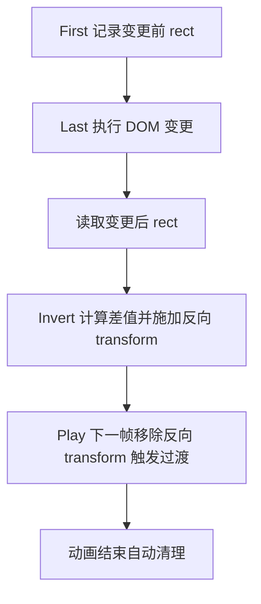

```javascript
function flip(elements, mutate, duration = 300) {
  // First：变更前快照每个元素的位置
  const first = new Map(elements.map((el) => [el, el.getBoundingClientRect()]));
  mutate();                                   // Last：真正的 DOM 变更

  for (const el of elements) {
    const f = first.get(el);
    const l = el.getBoundingClientRect();     // Last 位置
    const dx = f.left - l.left;
    const dy = f.top - l.top;
    const sx = l.width ? f.width / l.width : 1;
    const sy = l.height ? f.height / l.height : 1;
    if (!dx && !dy && sx === 1 && sy === 1) continue;

    // Invert + Play：首帧从旧位置"看起来没动"，末帧自然归位
    el.animate(
      [
        {
          transformOrigin: '0 0',
          transform: `translate(${dx}px, ${dy}px) scale(${sx}, ${sy})`,
        },
        { transformOrigin: '0 0', transform: 'none' },
      ],
      { duration, easing: 'cubic-bezier(.22,1,.36,1)' }
    );
  }
}

// 用法：列表重排 / 过滤 / 折叠展开 —— 只要"DOM 变了但希望平滑过渡"都适用
const list = document.getElementById('list');
document.getElementById('shuffle').onclick = () =>
  flip([...list.children], () =>
    list.append(...[...list.children].sort(() => Math.random() - 0.5)));

// 坑 1：rect 是视口坐标，嵌套滚动容器里父级也在动时要把父级位移减掉
// 坑 2：只动 transform/opacity 才走合成器
// 坑 3：FLIP 期间禁用会干扰的 CSS transition，避免双重动画
```

### H5-149：Scroll-driven Animations（CSS scroll-timeline）怎么用？
**答**：
- 现代语法：`animation-timeline: scroll()`（滚动容器进度做时间轴）或 `view()`（元素进出视口的进度做时间轴），配合 `animation-range`（entry/cover/exit 区间）控制起止。
- 全程合成器驱动、零 JS——阅读进度条、视差、逐段高亮这类"进度映射"动画的最佳方案，替代监听 scroll 手算。
- `animation-duration: auto` 或 `linear both` 配合：时间轴替代时间驱动，动画进度 = 滚动进度。
- 降级：`@supports not (animation-timeline: scroll())` 包裹回退样式，保证不支持时内容可用。

```css
/* 1) scroll()：以滚动容器的滚动进度作为时间轴 */
.hero h1 {
  animation: fade-slide linear both;
  animation-timeline: scroll(root);       /* root = 文档滚动条 */
  animation-range: 0 60vh;                /* 滚过 0~60vh 区间完成动画 */
}
@keyframes fade-slide {
  from { opacity: 0; transform: translateY(40px); }
  to   { opacity: 1; transform: none; }
}

/* 2) view()：元素自身进入/离开视口的进度 */
figure.reveal {
  animation: reveal linear both;
  animation-timeline: view();
  animation-range: entry 0% cover 40%;    /* 从开始进入到占据视口 40% 之间 */
}
@keyframes reveal {
  from { opacity: 0; translate: 0 30px; }
  to   { opacity: 1; translate: 0 0; }
}

/* 3) 实用案例：顶部阅读进度条（原来要监听 scroll + 算高度，现在零 JS） */
#progress {
  position: fixed; inset: 0 100% 0 0;     /* right: 100% 起点为 0 宽 */
  background: #2563eb;
  transform-origin: 0 50%;
  animation: grow linear;
  animation-timeline: scroll(root);
}
@keyframes grow { from { scale: 0 1; } to { scale: 1 1; } }

/* 4) 降级：不支持时保证内容可用 */
@supports not (animation-timeline: scroll()) {
  .hero h1, figure.reveal { opacity: 1; }
}
/* 对照 JS 方案：IntersectionObserver + rAF 手算进度 —— 能做但每帧在主线程，
   代码量数倍；进度条/视差/逐段高亮这类"进度映射"首选 CSS 时间轴 */
```

### H5-150：CSS Houdini 的 Paint Worklet 是什么？有什么用？
**答**：
- Paint API 允许用 JS 注册自定义"绘制函数"：`CSS.paintWorklet.addModule()` 注册模块，worklet 内 `registerPaint(name, class)`，CSS 里 `background: paint(name)` 直接使用。
- paint 代码运行在**独立线程**、与主线程隔离，随布局/尺寸变化自动重绘——适合复杂背景（圆角虚线框、噪点纹理、聊天气泡）且性能好。
- 类里声明 `inputProperties` 可读取 CSS 自定义属性作为参数，实现"可配置"的绘制。
- 兼容性：仅 Chromium 完整支持，生产必须特性检测 + CSS 降级；模块必须是同源（可用 Blob URL 内联）。

```html
<style>
  .card {
    --dash-color: #2563eb;
    --dash-length: 10px;
    padding: 24px;
    /* 降级：不支持 paint() 时退回普通虚线边框 */
    border: 2px dashed #2563eb;
  }
  @supports (background: paint(dashed-box)) {
    .card { border: none; background: paint(dashed-box); }
  }
</style>
<div class="card">Houdini 虚线边框卡片</div>
<script>
// Paint Worklet 必须是独立模块；这里用 Blob URL 内联演示
const worklet = `
  class DashedBox {
    static get inputProperties() {
      return ['--dash-color', '--dash-length'];   // 可读取的 CSS 变量
    }
    paint(ctx, geom, props) {
      ctx.strokeStyle = props.get('--dash-color').toString();
      ctx.lineWidth = 2;
      const len = parseInt(props.get('--dash-length')) || 8;
      ctx.setLineDash([len, 6]);
      ctx.strokeRect(1, 1, geom.width - 2, geom.height - 2);
    }
  }
  registerPaint('dashed-box', DashedBox);
`;
if ('paintWorklet' in CSS) {
  CSS.paintWorklet.addModule(
    URL.createObjectURL(new Blob([worklet], { type: 'text/javascript' })));
}
// 面试要点：
// 1) paint() 跑在独立线程、随布局自动重绘，适合复杂背景
// 2) 参数通过 CSS 自定义属性传入 —— 样式即可配置
// 3) 仅 Chromium 完整支持，必须 @supports 降级
// 4) Houdini 家族还包括 Properties and Values（注册可动画的自定义属性）、
//    Layout Worklet（自定义布局）、Parser/Typed OM —— Paint 是落地最多的一个
</script>
```

### H5-151：什么时候上 WebGL/WebGPU？与 Canvas 2D 的边界如何判断？
**答**：
- Canvas 2D：元素数千以内、无需着色器、迭代速度优先——API 简单、调试直观，是默认选项。
- WebGL：元素数万级（批渲染一次画完）、需要滤镜/混合/粒子/3D；用 PixiJS/Three.js 封装后成本可控。
- WebGPU：compute shader、更大吞吐、更现代的 API 设计；生态尚在成长，新项目可评估。
- 决策依据是 profile 结果：瓶颈在"JS 逻辑/布局"先优化数据结构与脏区域；瓶颈在"绘制指令重放/状态切换"WebGL 批渲染收益巨大；瓶颈在"纹理上传/像素读回"先减少 getImageData/toDataURL。

```javascript
// 选型判断树（答题口径）
function pickRenderer(scene) {
  const n = scene.count;
  const needsShader = scene.effects.some((e) =>
    ['blur', 'glow', 'particles', '3d'].includes(e));
  if (n < 2000 && !needsShader) return 'Canvas 2D';            // 默认选项
  if (n < 200000) return 'WebGL（用 PixiJS 或 Three.js 封装）';  // 批渲染/着色器
  return 'WebGPU（compute 大吞吐）或服务端渲染';
}

// 先 profile 判断瓶颈在哪，再决定是否升级图形栈
async function profile(canvas) {
  const t0 = performance.now();
  for (let i = 0; i < 60; i++) renderFrame(canvas);            // 跑 60 帧
  const perFrame = (performance.now() - t0) / 60;
  console.log('ms/frame =', perFrame.toFixed(2));
  // perFrame > 16.7 才需要优化：
  //   瓶颈是 JS 逻辑/布局       → 先优化数据结构与脏区域，别急着上 WebGL
  //   瓶颈是绘制指令重放状态多  → WebGL 批渲染收益巨大
  //   瓶颈是纹理上传/像素读回   → 减少 getImageData / toDataURL 频率
}

// 中间路线：整体保留 Canvas 2D，把热点区域（万级粒子/滤镜）拆成
// WebGL 层叠加（分层 canvas），避免整站迁移；
// WebGPU 生态（Three.js WebGPURenderer 等）在成熟中，新项目可评估
```

## 二十五、表单与输入工程

### H5-152：受控表单（React/Vue）与原生校验如何协作？
**答**：
- 两条路线：**完全托管**（novalidate + 自研规则库，UI 可控但要重造规则与无障碍）与**混合**（保留 required/pattern/type 等原生约束，JS 读取 `validity` 渲染自定义 UI）。
- 推荐混合：规则声明在 HTML（可序列化、渐进增强），展示层用 `:user-invalid`/`:user-valid` 伪类渲染错误态，不写 JS 也基本工作。
- 关键 API：`checkValidity()` 汇总校验、`reportValidity()` 触发原生气泡、`setCustomValidity()` 把异步/跨字段校验结果写回原生体系。
- `novalidate` 只是关掉"提交时自动拦截"，validity 状态与伪类依旧工作——这是"托管 UI 但保留原生语义"的开关。

```html
<form id="signup" novalidate>
  <input name="email" type="email" required
         autocomplete="email" placeholder="邮箱">
  <input name="pwd" type="password" required minlength="8"
         autocomplete="new-password" placeholder="密码">
  <p class="err" id="err"></p>
  <button>注册</button>
</form>
<style>
  /* 原生约束仍然生效，样式层用伪类渲染错误态（无 JS 也工作） */
  input:user-invalid { border-color: #ef4444; }
  input:user-valid   { border-color: #10b981; }
</style>
<script>
const form = document.getElementById('signup');
const err = document.getElementById('err');

// 混合模式：规则交给 HTML（required/minlength/type），展示与提交交给 JS
form.addEventListener('submit', (e) => {
  e.preventDefault();                       // novalidate 后提交拦截由我们接管
  if (!form.checkValidity()) {
    const first = form.querySelector(':invalid');
    err.textContent = humanize(first);      // 自定义文案，覆盖浏览器默认气泡
    first.focus();
    return;
  }
  err.textContent = '';
  submit(new FormData(form));
});

// 异步/跨字段校验：结果仍写回原生体系，保持语义与无障碍一致
form.email.addEventListener('change', async (e) => {
  const taken = await checkEmailTaken(e.target.value);
  e.target.setCustomValidity(taken ? '该邮箱已注册' : '');
});

function humanize(input) {
  const v = input.validity;
  if (v.valueMissing) return '请填写' + (input.labels[0]?.textContent ?? '该项');
  if (v.typeMismatch) return '格式不正确';
  if (v.tooShort) return `至少 ${input.minLength} 个字符`;
  return input.validationMessage;           // 兜底用浏览器提供的消息
}
async function checkEmailTaken() { return false; }
function submit() {}
// 要点：novalidate 只关"提交时自动拦截"，validity 状态与伪类依旧工作；
// 完全自研（React 受控 + yup）适用于复杂联动场景，但要自己补无障碍与错误播报
</script>
```

### H5-153：contenteditable 如何用 Selection/Range 实现富文本操作？
**答**：
- 读取选区：`document.getSelection()` 可能含多个 Range，编辑器场景取 `getRangeAt(0)`；`collapsed` 表示光标无选中。
- 常用操作：`extractContents()` 摘出片段 + `insertNode()` 插入包裹节点（加粗/高亮/链接），跨元素选区直接 `surroundContents` 会抛错，需先摘出再插入。
- 插入后 `collapseToEnd()` 处理光标，`normalize()` 合并被拆碎的文本节点。
- 输入法安全：`compositionstart ~ compositionend`（中文输入）期间不要改 DOM，否则输入被打断——这是 contenteditable 第一大坑。

```html
<div id="editor" contenteditable="true">选中一些文字试试</div>
<button id="link">把选区变成链接</button>
<button id="hl">高亮选区</button>
<script>
const ed = document.getElementById('editor');
const scheduleSave = (html) => console.log('防抖保存', html.length);

// 1) 读取当前选区：Selection 可能含多个 Range，编辑器取第一个
const sel = () => document.getSelection();
const range = () => (sel().rangeCount ? sel().getRangeAt(0) : null);

document.getElementById('link').onclick = () => {
  const r = range();
  if (!r || r.collapsed) return;
  const a = document.createElement('a');
  a.href = 'https://example.com';
  try {
    r.surroundContents(a);        // 选区跨节点时会抛错
  } catch {
    a.appendChild(r.extractContents());   // 兜底：摘出片段再包裹
    r.insertNode(a);
  }
  sel().removeAllRanges();
};

// 2) 高亮：mark 包裹，跨元素时 extract 再 insert
document.getElementById('hl').onclick = () => {
  const r = range();
  if (!r || r.collapsed) return;
  const mark = document.createElement('mark');
  mark.appendChild(r.extractContents());
  r.insertNode(mark);
  ed.normalize();                 // 合并被拆碎的文本节点
  sel().collapseToEnd();          // 光标移到插入内容之后
};

// 3) 输入法安全：composition 期间不要改 DOM，否则中文输入被打断
ed.addEventListener('compositionstart', () => (ed.dataset.lock = '1'));
ed.addEventListener('compositionend', () => delete ed.dataset.lock);
ed.addEventListener('input', () => {
  if (ed.dataset.lock) return;    // 组合期间只记录不处理
  scheduleSave(ed.innerHTML);
});

// execCommand('bold') 一行搞定但已废弃且行为不可控；
// 现代做法是以上 Range 操作，产品级富文本用 ProseMirror/Lexical 自持数据模型
</script>
```

### H5-154：autocomplete 的 token 语义如何指导表单自动填充？
**答**：
- `autocomplete` 是受控词表（HTML 标准 autofill 章节）：`email/name/tel/street-address/cc-number/one-time-code` 等，浏览器据此匹配密码库、联系人、短信验证码——**写错 token 等于关闭自动填充**。
- token 支持组合：`shipping postal-code`、`billing cc-exp` 控制"归属区域"；`section-` 前缀区分多组同义字段。
- 密码管理器锚点：`username` + `current-password`（登录）vs `new-password`（注册，触发"生成强密码"并阻止误填旧密码）。
- 高频考点：短信验证码框用 `autocomplete="one-time-code"` + `inputmode="numeric"`，iOS 键盘才会弹出"来自短信"的建议。

```html
<!-- autocomplete token 决定浏览器能否自动填充 —— 写错就失去免输能力 -->
<form autocomplete="on">
  <!-- 基础字段：token 是受控词表，拼错 = 浏览器按 off 处理 -->
  <input name="email" type="email" autocomplete="email">
  <input name="name" type="text" autocomplete="name">
  <input name="tel" type="tel" autocomplete="tel">

  <!-- 结账地址：token 组合控制归属 -->
  <input name="addr1" autocomplete="shipping street-address">
  <input name="city" autocomplete="shipping address-level2">
  <input name="zip" autocomplete="shipping postal-code">

  <!-- 登录/注册：密码管理器的锚点 -->
  <input name="u" autocomplete="username">
  <input name="p" type="password" autocomplete="current-password">
  <!-- 注册页新密码用 new-password：阻止误填旧密码，并触发"生成强密码" -->

  <!-- 短信验证码：one-time-code 让 iOS 键盘弹出"来自短信"建议 -->
  <input name="otp" inputmode="numeric" autocomplete="one-time-code">

  <!-- 支付卡（真实场景一般在 iframe 内托管） -->
  <input name="cc" autocomplete="cc-number">

  <!-- 该关的时候显式关闭：避免密码管理器误填敏感框 -->
  <input name="secret" type="password" autocomplete="off">
</form>
<script>
// 面试要点：
// 1) type 与 autocomplete 协同：email/tel/url 提供"类型键盘"，token 提供"填充来源"
// 2) token 组合格式：section-x modifier 限定词（如 shipping postal-code）
// 3) one-time-code 前置条件：验证码短信在同一设备收到才可自动填充
// 4) name 属性与 token 一致性是密码管理器识别页面的辅助信号
// 5) autocomplete="off" 在密码框上常被浏览器忽略 —— 用 new-password 才能真正控制
</script>
```

### H5-155：visualViewport 如何解决软键盘遮挡输入框？
**答**：
- `window.visualViewport` 暴露"可见视口"的 `offsetTop/height/scale` 及 `resize/scroll` 事件；键盘弹出时 layout viewport 不变（iOS）但可见视口变小。
- 键盘高度近似 = `window.innerHeight - vv.height`；把输入区用 transform 平移到可见视口底部，同时处理 `vv.offsetTop`（页面在可视窗口内滚动）。
- iOS 键盘不改变 layout viewport，`position: fixed` 元素会被遮——这是与安卓最大的差异；安卓多数会 resize layout viewport。
- 两个防御：`vv.scale > 1`（双指缩放）时跳过调整避免误判；事件防抖。兜底方案：focus 时 `scrollIntoView({block:'center'})`。

```html
<div class="input-bar" id="bar"><input placeholder="聊一句…"></div>
<style>
  .input-bar { position: fixed; left: 0; right: 0; bottom: 0;
               background: #fff; padding: 8px; border-top: 1px solid #eee; }
</style>
<script>
// visualViewport：键盘弹出后"真正可见"的区域
const vv = window.visualViewport;
const bar = document.getElementById('bar');

function layout() {
  if (!vv) return;
  if (vv.scale > 1) return;                 // 双指缩放时跳过，避免误判键盘
  // 键盘高度 ≈ layout viewport 高度 - 可见视口高度
  const keyboard = Math.max(0, window.innerHeight - vv.height);
  // iOS：fixed 元素相对 layout viewport，会被键盘盖住 → 平移补偿
  bar.style.transform =
    `translateY(${-(keyboard + vv.offsetTop)}px)`;
}
vv?.addEventListener('resize', layout);     // 键盘弹收
vv?.addEventListener('scroll', layout);     // 页面在可视窗口内滚动
window.addEventListener('resize', layout);  // 兜底：安卓上 window 也变
layout();

// 平台差异（答题要点）：
// 1) iOS 键盘不改变 window.innerHeight / layout viewport → position:fixed 被遮
// 2) Android 多数会 resize layout viewport → window resize 就能处理
// 3) visualViewport 是统一答案，但要同时监听 resize/scroll 且防抖
// 兜底方案：输入框 focus 时 scrollIntoView({ block: 'center' })，简单可靠
</script>
```

### H5-156：文件选择自定义 UI 与拖拽上传如何统一？目录怎么遍历？
**答**：
- 统一模式：隐藏原生 `input[type=file]`，自定义按钮触发 `click()`；拖拽 drop 与 input change 都汇入**同一条 File 列表 → 上传管线**。
- 目录信息只在 `e.dataTransfer.items` 里：`item.webkitGetAsEntry()` 拿 FileSystemEntry，`isDirectory` 时用 `createReader().readEntries()` 递归遍历。
- 大坑：`readEntries` 每次最多返回 **100 条**，返回**空数组**才代表读完——必须循环调用。
- `webkitdirectory` 属性让 input 直接选文件夹（`webkitRelativePath` 保留路径）；拖拽场景没有原生 input 等价物，只能走 entry 遍历。

```html
<input type="file" id="picker" multiple hidden>
<button id="pick">选择文件</button>
<div id="dropzone">或把文件/文件夹拖到这里</div>
<ul id="list"></ul>
<script>
// 统一入口：无论点击还是拖拽，都汇入 addFiles 再走上传管线
function addFiles(list) {
  for (const f of list) {
    const li = document.createElement('li');
    li.textContent = `${f.webkitRelativePath || f.name} — ${(f.size / 1024).toFixed(1)}KB`;
    document.getElementById('list').append(li);
  }
}

// 1) 自定义 UI：隐藏原生 input，按钮触发 click
document.getElementById('pick').onclick = () =>
  document.getElementById('picker').click();
document.getElementById('picker').onchange = (e) => addFiles([...e.target.files]);

// 2) 拖拽：dataTransfer.items 才有"目录"信息，files 只是平铺列表
const dz = document.getElementById('dropzone');
dz.addEventListener('dragover', (e) => { e.preventDefault(); });
dz.addEventListener('drop', async (e) => {
  e.preventDefault();
  const entries = [...e.dataTransfer.items]
    .map((it) => it.webkitGetAsEntry?.())
    .filter(Boolean);
  const all = [];
  await Promise.all(entries.map((en) => walk(en, all)));
  addFiles(all);
});

// 3) 目录递归：isFile 直接拿 File；isDirectory 用 reader 分批读
function walk(entry, out) {
  return new Promise((resolve) => {
    if (entry.isFile) {
      entry.file((f) => { out.push(f); resolve(); }, resolve);
    } else if (entry.isDirectory) {
      const reader = entry.createReader();
      const readBatch = () =>
        reader.readEntries(async (batch) => {
          // 大坑：readEntries 每次最多返回 100 条，返回空数组才是读完
          if (!batch.length) return resolve();
          await Promise.all(batch.map((e2) => walk(e2, out)));
          readBatch();
        }, resolve);
      readBatch();
    } else resolve();
  });
}
</script>
```

### H5-157：粘贴富文本时如何用 clipboardData 清洗？
**答**：
- `paste` 事件里 `e.clipboardData.getData('text/html')` 保留结构、`getData('text/plain')` 兜底；`e.preventDefault()` 拦下默认的"原样插入"。
- 清洗流程：`DOMParser` 解析 → 白名单标签过滤（非白名单**展开文本内容**而不是直接丢，保住段落内文字）→ 白名单属性（a.href、img.src/alt）→ 移除 script/style/事件属性。
- 图片粘贴（截图）：`clipboardData.items` 里直接有 `image/png` 文件，取 `getAsFile()` 上传。
- 复制方向也能定制：`setData` 同时写 text/plain 与 text/html 双格式，甚至写内部协议 JSON（内部粘贴识别协议、外部降级 HTML）。

```html
<div id="editor" contenteditable="true">粘贴富文本试试</div>
<script>
const ALLOWED = { P: 1, BR: 1, B: 1, STRONG: 1, EM: 1, I: 1, U: 1, A: 1,
                  UL: 1, OL: 1, LI: 1, IMG: 1, H1: 1, H2: 1, H3: 1, BLOCKQUOTE: 1 };
const KEEP_ATTR = { A: ['href', 'title'], IMG: ['src', 'alt'] };

document.getElementById('editor').addEventListener('paste', (e) => {
  e.preventDefault();                        // 拦下默认的"原样插入"
  const dt = e.clipboardData;
  const html = dt.getData('text/html');
  const text = dt.getData('text/plain');

  // 截图粘贴：items 里直接有 image/png
  const imageItem = [...dt.items].find((i) => i.type.startsWith('image/'));
  if (imageItem) return insertImage(imageItem.getAsFile());

  if (html) insertNode(sanitize(html));      // 有 HTML 用清洗后的结构
  else if (text) document.execCommand('insertText', false, text);  // 纯文本兜底
});

function sanitize(html) {
  const doc = new DOMParser().parseFromString(html, 'text/html');
  clean(doc.body);
  return doc.body;
}
function clean(node) {
  [...node.children].forEach((child) => {
    clean(child);
    if (!ALLOWED[child.tagName]) {
      // 非白名单：展开文本内容而不是直接丢（style/script 除外）
      if (child.tagName !== 'SCRIPT' && child.tagName !== 'STYLE')
        child.replaceWith(...child.childNodes);
      else child.remove();
      return;
    }
    // 白名单标签：只保留必要属性
    [...child.attributes].forEach((a) => {
      if (!KEEP_ATTR[child.tagName]?.includes(a.name)) child.removeAttribute(a.name);
    });
  });
}
function insertNode(node) {
  const sel = document.getSelection();
  const r = sel.getRangeAt(0);
  r.deleteContents();
  r.insertNode(node);
  sel.collapseToEnd();
}
function insertImage(file) {
  const img = new Image();
  img.src = URL.createObjectURL(file);       // 实际项目：先上传再插 URL
  insertNode(img);
}
</script>
```

## 二十六、文档与可编辑

### H5-158：execCommand 为什么废弃？现代替代路径是什么？
**答**：
- execCommand 是"浏览器内置编辑命令"（bold/insertHTML/undo），无规范、跨浏览器行为不一致、不可定制数据模型，已被标记 deprecated（短期仍可用）。
- 它唯一的价值：免费获得**原生 undo/redo 栈**（尤其 `insertText`），过渡期轻量场景仍划算。
- 现代替代 1：小需求——Range/Selection 手工操作 + 自己管理 undo；替代 2：产品级——ProseMirror/Slate/Lexical 这类"自持文档模型"编辑器，DOM 只是投影，协作/撤销建立在模型上。
- 面试口径：只做"能打字+少量样式"用 execCommand/Range 够用；要 schema、协同、版本必须自持模型。

```html
<div id="ed" contenteditable="true">execCommand 的定位与现代替代</div>
<script>
// execCommand：浏览器内置编辑命令，无标准、行为不一致、不可扩展（已废弃但短期可用）
const ed = document.getElementById('ed');

// 仍可用的场景（过渡期）：纯文本/轻量编辑 —— 免费获得原生 undo 栈
function insertText(text) {
  document.execCommand('insertText', false, text);   // 保留原生 undo/redo！
}

// 现代替代 1：Range/Selection 手工操作 + 自己管理历史
const undoStack = [];
function boldByRange() {
  const sel = document.getSelection();
  const r = sel.getRangeAt(0);
  const b = document.createElement('strong');
  b.appendChild(r.extractContents());
  r.insertNode(b);
  sel.collapseToEnd();
  undoStack.push({ type: 'wrap', node: b });   // 自己记历史
}

// 现代替代 2：数据模型优先的编辑器（ProseMirror / Slate / Lexical）
// 共同思想：文档是受 schema 约束的数据结构，DOM 只是投影；
// 变更走事务（transaction），协作（OT/CRDT）建立在模型而非 DOM 上
const modelDoc = {
  type: 'doc',
  content: [
    { type: 'paragraph',
      content: [{ type: 'text', text: 'hello', marks: [{ type: 'strong' }] }] },
  ],
};
// 加粗 = 模型上的 mark 操作 —— 可序列化、可协作、可做版本 diff

// 面试口径：
// 1) 轻量编辑 → execCommand/Range 够用，记住它是遗产 API
// 2) 要 schema/协同/版本 → 必须自持模型编辑器
// 3) 中间态：contenteditable=false 嵌入块（@提及、卡片）用 Range 逻辑单独处理
</script>
```

### H5-159：MutationObserver 深入：配置项、旧值与批量回调？
**答**：
- 配置项：`childList`（子节点增删）、`attributes` + `attributeFilter`（属性白名单）、`characterData`（文本变更）、`subtree`（扩展到全部后代——不加只观察直接子级！）、`attributeOldValue/characterDataOldValue`（记录旧值，不开恒为 null）。
- 回调是**批**的：一次同步代码引发的 N 个变更合并为一次回调、N 条 MutationRecord；时机是微任务（DOM 变更后、渲染前）。
- 坑：被移除节点的内部后续变更不再产生记录（脱离观察树）；class 连改 3 次产生 3 条 record，做脏标记时要按 target 去重合并。
- `takeRecords()` 可同步取走未回调的记录，`disconnect()` 停止观察；与 ResizeObserver（尺寸）/IntersectionObserver（可见性）各管一维。

```javascript
// 深入 MutationObserver：配置、旧值、批量回调
const target = document.querySelector('.list');

const mo = new MutationObserver((records, observer) => {
  // 回调是"批"的：一次同步代码引发的 N 个变更 → 一次回调 N 条 record
  // 时机：微任务，DOM 变更后、渲染前
  for (const r of records) {
    switch (r.type) {
      case 'childList':
        console.log('节点增删', r.addedNodes, r.removedNodes, '于', r.target);
        break;
      case 'attributes':
        // oldValue 需要 attributeOldValue: true，否则恒为 null
        console.log('属性', r.attributeName, r.oldValue, '->',
                    r.target.getAttribute(r.attributeName));
        break;
      case 'characterData':
        console.log('文本', r.oldValue, '->', r.target.data);
        break;
    }
  }
});

mo.observe(target, {
  childList: true,          // 子节点增删
  subtree: true,            // 扩展到所有后代（不加只看直接子级！）
  attributes: true,         // 属性变更
  attributeFilter: ['class', 'data-state'],   // 白名单降噪
  attributeOldValue: true,  // 记录旧属性值
  characterData: true,      // 文本节点内容变更（同样依赖 subtree 覆盖深层）
  characterDataOldValue: true,
});

// 坑 1：被 remove 的节点其内部后续变更不再产生记录（脱离观察树）
// 坑 2：批处理需要自己合并 —— class 连改 3 次有 3 条 record，做脏标记要按目标去重
function coalesce(records) {
  const touched = new Set();
  for (const r of records) touched.add(r.target);
  return [...touched];      // 去重后再触发重渲染
}

// 坑 3：disconnect 前可用 takeRecords() 同步取走未回调的记录（收尾用）
const pendingRecords = mo.takeRecords();
mo.disconnect();

// 典型场景：虚拟列表检测 DOM 被外部改动、编辑器检测粘贴注入、
// 与 ResizeObserver（尺寸）/IntersectionObserver（可见性）各管一维
```

### H5-160：Range API 全解：创建、定位、删除、复制选区？
**答**：
- 定位模型：`setStart/setEnd(容器, 偏移)`——偏移对文本节点是"字符位置"，对元素节点是"第几个子节点"，这是理解 Range 的根。
- 内容操作三兄弟：`deleteContents()`（删除区间、保留容器）、`extractContents()`（摘出成 DocumentFragment，剪切）、`cloneContents()`（复制不动原文档）；`insertNode()` 插入后常需 `normalize()` 合并碎文本。
- 与选区联动：`selection.removeAllRanges() + addRange(range)` 设置；`range.collapse()` 折叠成光标。
- 复制富文本到剪贴板：`ClipboardItem` 同时写 text/plain 与 text/html 双格式。

```html
<p id="para">Range API 可以精确描述文档中的一个片段。</p>
<script>
const p = document.getElementById('para');
const textNode = p.firstChild;

// 1) 创建与定位：偏移对文本节点是"字符"，对元素节点是"第几个子节点"
const r = document.createRange();
r.setStart(textNode, 0);        // 段落开头
r.setEnd(textNode, 5);          // 第 5 个字符后
console.log(r.toString());      // 'Range'（offset 5 不含第 6 个字符）

// 2) 选区交互：把 range 设为当前选区
const sel = document.getSelection();
sel.removeAllRanges();
sel.addRange(r);

// 3) 内容操作：deleteContents 清空区间保留容器；extractContents 摘出 fragment
// r.deleteContents();                    // 删除
// const frag = r.extractContents();      // 剪切：frag 可再插入别处
const div = document.createElement('div');
div.appendChild(r.cloneContents());      // 复制：不动原文档
console.log(div.innerHTML);

// 4) 插入节点：insertNode 后 normalize 合并碎文本节点，避免后续偏移错乱
const mark = document.createElement('mark');
mark.textContent = '[插]';
r.insertNode(mark);
p.normalize();

// 5) 复制选区到剪贴板：富文本走 ClipboardItem 双格式
async function copySelectionHTML() {
  const cur = sel.getRangeAt(0);
  const box = document.createElement('div');
  box.appendChild(cur.cloneContents());
  const item = new ClipboardItem({
    'text/plain': new Blob([cur.toString()], { type: 'text/plain' }),
    'text/html': new Blob([box.innerHTML], { type: 'text/html' }),
  });
  await navigator.clipboard.write([item]);
}

// 6) 其它常用：selectNodeContents、collapse 折叠成光标、
//    compareBoundaryPoints/comparePoint 判断"光标是否在某容器内"——编辑器最常用
</script>
```

### H5-161：contenteditable 光标位置如何保存与恢复？
**答**：
- 光标 = (容器节点, 偏移)。框架重渲染会重建 DOM，直接保存 Range 引用会失效——要**序列化成"树路径 + 偏移"**：从容器向上收集到根的子节点索引路径。
- 恢复：按路径重新定位容器 → `setStart/setEnd` → `removeAllRanges + addRange`；路径失效（DOM 被改）时返回 null 让调用方降级到"光标落开头/结尾"。
- 简易方案：同文档未重渲染时直接保存 Range 对象引用即可，编辑器内核（未走框架 vdom）常用这招。
- 红线：`compositionstart ~ end`（输入法组合）期间禁止恢复选区，否则中文输入被打断。

```html
<div id="ed" contenteditable="true">编辑后焦点离开再回来，光标应复原</div>
<script>
const ed = document.getElementById('ed');

// 光标位置 = (容器, 偏移)。框架重渲染会重建 DOM 节点，
// 保存 Range 引用会失效 —— 序列化成"树路径 + 偏移"
function serializePos(node, root) {
  const path = [];
  let cur = node;
  while (cur !== root) {
    const parent = cur.parentNode;
    path.unshift([...parent.childNodes].indexOf(cur));
    cur = parent;
  }
  return path;
}
function deserializePos(path, root) {
  let cur = root;
  for (const i of path) {
    cur = cur.childNodes[i];
    if (!cur) return null;      // 路径失效（DOM 被改）：调用方降级处理
  }
  return cur;
}

function saveSelection(root) {
  const sel = document.getSelection();
  if (!sel.rangeCount || !root.contains(sel.anchorNode)) return null;
  const r = sel.getRangeAt(0);
  return {
    startPath: serializePos(r.startContainer, root),
    startOffset: r.startOffset,
    endPath: serializePos(r.endContainer, root),
    endOffset: r.endOffset,
  };
}

function restoreSelection(root, saved) {
  if (!saved) return;
  const s = deserializePos(saved.startPath, root);
  const e = deserializePos(saved.endPath, root);
  if (!s || !e) return;
  const r = document.createRange();
  r.setStart(s, saved.startOffset);
  r.setEnd(e, saved.endOffset);
  const sel = document.getSelection();
  sel.removeAllRanges();
  sel.addRange(r);
}

// 用法：输入前存，重渲染后恢复（框架场景在 effect/nextTick 里恢复）
let saved = null;
ed.addEventListener('beforeinput', () => { saved = saveSelection(ed); });
// ...重新渲染 innerHTML 之后：
// restoreSelection(ed, saved);

// 注意事项：
// 1) compositionstart~end（中文输入法）期间禁止恢复选区，否则输入被打断
// 2) 未重渲染的简单场景可直接保存 Range 对象引用
// 3) 富文本框架里这一步由内核自动处理（模型 → 视图映射）
</script>
```

### H5-162：从 Word/Excel 粘贴的数据如何解析？
**答**：
- Excel 粘贴：`text/plain` 是 **TSV**（\t 分列、\n 分行）——最可靠的数据通道，直接 split 转表格数据；`text/html` 里有带样式的 `<table>` 可选保留。
- Word 粘贴：`text/html` 是"堆料"——`mso-*` 样式、`o:p` 等命名空间私有标签、条件注释、class 垃圾，需要清洗（解析 → 剥私有标签 → 白名单属性）。
- Word 图片：HTML 里的 img.src 常是本地引用，真实图片在 `clipboardData.items` 的 `image/*` 里——要走上传换 URL。
- 完整产品的清洗目标是映射到编辑器 schema（段落/表格/列表），而不是保留 Word 样式。

```html
<div id="ed" contenteditable="true">从 Word/Excel 粘贴内容试试</div>
<script>
document.getElementById('ed').addEventListener('paste', (e) => {
  e.preventDefault();
  const dt = e.clipboardData;
  const html = dt.getData('text/html');
  const plain = dt.getData('text/plain');

  // Excel：text/plain 是 TSV（\t 分列 \n 分行）—— 最可靠的数据通道
  if (looksLikeTSV(plain)) return insertTable(parseTSV(plain));

  // Word：text/html 是 mso 样式 + 私有标签的"堆料"，清洗后插入
  if (html) insertNode(cleanOffice(html));
});

function looksLikeTSV(text) {
  const lines = text.replace(/\r/g, '').split('\n').filter(Boolean);
  return lines.length > 1 || lines[0]?.includes('\t');
}
function parseTSV(text) {
  return text.replace(/\r/g, '').split('\n')
    .filter((l) => l.length)
    .map((l) => l.split('\t'));
}
function insertTable(rows) {
  const table = document.createElement('table');
  table.border = 1;
  for (const row of rows) {
    const tr = table.insertRow();
    for (const cell of row) tr.insertCell().textContent = cell;
  }
  insertNode(table);
}

// Word 清洗：剥掉 Office 私有内容，只留结构
function cleanOffice(html) {
  const doc = new DOMParser().parseFromString(html, 'text/html');
  doc.querySelectorAll('style, script').forEach((n) => n.remove());
  [...doc.body.querySelectorAll('*')].forEach((el) => {
    if (el.localName.includes(':')) return el.remove();  // o:p、w:xxx 私有标签
    [...el.attributes].forEach((a) => {
      // mso-* 属性 / class / style 全部剥掉
      if (a.name.startsWith('mso') || a.name === 'class' || a.name === 'style')
        el.removeAttribute(a.name);
    });
  });
  doc.querySelectorAll('img').forEach((img) => img.remove());  // 演示简化
  return doc.body;
}
function insertNode(node) {
  const sel = document.getSelection();
  const r = sel.getRangeAt(0);
  r.deleteContents();
  r.insertNode(node);
  sel.collapseToEnd();
}
// 完整产品做法：保留表格/列表结构 → items 里的 image/* 上传换 src →
// Word 样式（加粗/字号在 span style 里）二次解析映射到编辑器 schema
</script>
```

## 二十七、SVG 工程化

### H5-163：SMIL/CSS/JS/WAAPI 四种 SVG 动画方案怎么选？
**答**：
- **SMIL**（`<animate>`/`<animateTransform>`/`animateMotion`）：声明式、独立于 CSS、可做"沿路径运动"与 d 属性动画；官方曾标记 deprecated 但实际不弃用，缺点是无交互控制。
- **CSS**：transform/opacity 动画性能最好、可配合 :hover 交互；`offset-path` 可替代 animateMotion；缺点是 x/y/width 等属性动画会触发布局。
- **WAAPI**：元素级控制（暂停/倒放/调速/精确回调），SVG 图形也是元素所以完全适用；编排复杂交互动效首选。
- **JS（rAF）**：物理模拟、手势驱动、复杂绑定的兜底。选型：装饰循环动效 CSS、路径跟随 SMIL/offset-path、可编程控制 WAAPI、复杂逻辑 JS。

```html
<svg width="220" height="90" viewBox="0 0 220 90">
  <!-- 方案 1 SMIL：声明式，可做"沿路径运动"，不依赖 CSS/JS -->
  <circle r="4" fill="#2563eb">
    <animateMotion dur="3s" repeatCount="indefinite"
                   path="M10 40 C 60 0, 160 80, 210 40" />
  </circle>

  <!-- 方案 2 CSS：transform/opacity 动画性能最好 -->
  <rect x="10" y="62" width="30" height="10" fill="#10b981" class="pulse"/>
  <style>
    .pulse { transform-origin: 25px 67px; animation: pulse 1.5s infinite; }
    @keyframes pulse { 50% { transform: scale(1.6); opacity: .4; } }
  </style>

  <!-- 方案 3 JS/rAF：完全控制（物理、缓动、交互打断） -->
  <rect id="bar" x="60" y="20" width="10" height="40" fill="#f59e0b"/>
  <script>
    const bar = document.getElementById('bar');
    let t0 = performance.now();
    (function tick(now) {
      const t = (now - t0) / 1000;
      bar.setAttribute('transform', 'rotate(' + (Math.sin(t) * 20).toFixed(2) + ' 65 40)');
      requestAnimationFrame(tick);
    })(t0);
  </script>
</svg>
<script>
// 方案 4 WAAPI：元素级控制（暂停/倒放/合成），SVG 图形也是元素
document.querySelector('.pulse').animate(
  [{ transform: 'scale(1)' }, { transform: 'scale(1.6)' }, { transform: 'scale(1)' }],
  { duration: 1500, iterations: Infinity }
);

// 选型口径：
// 1) 装饰性循环动效 → CSS（GPU、零 JS）
// 2) 沿任意路径运动 → SMIL animateMotion；新项目也可用 CSS offset-path 替代
// 3) 需要精确回调/暂停/倒放/编排 → WAAPI
// 4) 需要物理模拟、手势驱动、复杂数据绑定 → JS（rAF）或 GSAP/D3
// 5) d 属性（形状）动画：SMIL 或 JS 插值；CSS 的 d:path() 要求路径结构兼容
</script>
```

### H5-164：SVG 路径 morphing（d 属性插值）怎么做？
**答**：
- 前提：两条 path 的**命令序列结构一致**（同数量、同类型命令与点数）——不一致时先归一化（统一采样为等点数折线，或用 flubber/GSAP MorphSVG 自动处理）。
- CSS 路线：`d: path()` 支持插值动画（Chromium/新版 Firefox），但同样要求结构兼容。
- JS 路线（通用）：把 d 字符串解析成数字数组，逐位 lerp 插值后拼回；这是理解 morph 的本质——"把形状归一化成等长参数序列"。
- 归一化思路：flatten 全部曲线为折线（采样 N 点）→ 逐点插值 → 可选拟合回曲线；起点对齐（从最近点开始重排）可减少"翻转"。

```javascript
// d 属性 morphing：核心是"两条路径的命令序列结构一致"后逐点插值
function lerp(a, b, t) { return a + (b - a) * t; }

// 两个同结构路径（M + C + S，点数相同）
const from = 'M10,50 C40,10 80,90 110,50 S180,10 210,50';
const to   = 'M10,50 C40,90 80,10 110,50 S180,90 210,50';

// CSS 路线（Chromium/Firefox 新版）：d 支持插值，要求结构完全兼容
const style = document.createElement('style');
style.textContent = `
  #morph { animation: morph 2s infinite alternate ease-in-out; }
  @keyframes morph {
    from { d: path('${from}'); }
    to   { d: path('${to}'); }
  }
`;
document.head.append(style);

// JS 路线（通用）：解析成数字数组后按位插值 —— 生产用 flubber/GSAP MorphSVG
function parseNumbers(d) {
  return d.match(/-?\d+(\.\d+)?/g).map(Number);
}
function groupSize(cmd) {
  return { M: 2, L: 2, C: 6, S: 4, Q: 4, T: 2, H: 1, V: 1, Z: 0 }[cmd] ?? 0;
}
function morphD(fromD, toD, t) {
  const a = parseNumbers(fromD), b = parseNumbers(toD);
  if (a.length !== b.length) throw new Error('结构不一致：先归一化采样点数');
  const letters = fromD.match(/[A-Za-z]/g);
  let i = 0;
  return letters.map((L) => {
    let s = L;
    for (let k = 0; k < groupSize(L); k++) {
      s += ' ' + lerp(a[i], b[i], t).toFixed(2);
      i++;
    }
    return s;
  }).join(' ');
}
console.log(morphD(from, to, 0.5));   // 中间态

// 结构不一致时的归一化思路（面试讲清即可）：
// 1) 全部转成折线（flatten 采样 N 点）→ 点数一致 → 逐点 lerp → 可选拟合回曲线
// 2) 起点对齐：从"距离最近点"开始重排采样序，减少交叉翻转
// 3) flubber / GSAP MorphSVG 内部做的就是这套归一化 + 插值
```

### H5-165：大型 SVG（数千节点）性能怎么优化？
**答**：
- 减量：合并 path、删不可见滤镜/渐变、`<use>` 复用 `<defs>` 里的定义，让 5000 个节点共享一份形状。
- 视口裁剪：只挂载可见区域的节点（数据 5000，DOM 常驻 ~200），平移缩放时 rAF 节流重算可见集。
- 动画属性只走 transform/opacity（合成器友好），避免 x/y/width 触发重布局；批量改样式用 class/CSS 变量，不要 JS 逐元素 setAttribute。
- 终局判断：SVG 胜在矢量缩放与 DOM 交互；若元素总量恒定巨大且不需要矢量交互，SVG 本身就是错误选型——换 Canvas。

```html
<style>
  /* 动画只走 transform/opacity：SVG 的 x/y/width 会触发重布局 */
  .node { transition: transform .2s; will-change: transform; }
</style>
<svg id="big" width="600" height="400" viewBox="0 0 600 400">
  <!-- <use> 复用定义：5000 个节点共享一份 <defs> 里的形状 -->
  <defs>
    <g id="nodeShape">
      <rect width="60" height="24" rx="4"/>
      <circle cx="30" cy="-6" r="3"/>
    </g>
  </defs>
  <g id="viewport"></g>
</svg>
<script>
const vp = document.getElementById('viewport');
const NS = 'http://www.w3.org/2000/svg';

// 数据 5000 个节点，DOM 常驻只有视口内的 ~200 个
const nodes = Array.from({ length: 5000 }, (_, i) => ({
  id: i, x: (i % 80) * 80, y: Math.floor(i / 80) * 40,
}));
const scale = 1, tx = 0, ty = 0;

function render() {
  // 1) 视口裁剪：把屏幕视口换算成世界坐标盒
  const wx0 = -tx / scale, wy0 = -ty / scale;
  const wx1 = (600 - tx) / scale, wy1 = (400 - ty) / scale;
  const visible = nodes.filter((n) =>
    n.x + 60 > wx0 && n.x < wx1 && n.y + 24 > wy0 && n.y < wy1);

  // 2) 整体替换，避免逐节点 diff 的 GC 压力
  const frag = document.createDocumentFragment();
  for (const n of visible) {
    const use = document.createElementNS(NS, 'use');
    use.setAttribute('href', '#nodeShape');
    use.setAttribute('transform', 'translate(' + n.x + ',' + n.y + ')');
    use.setAttribute('class', 'node');
    frag.append(use);
  }
  vp.replaceChildren(frag);
}
render();

// 其余优化点：
// 3) 平移缩放时 rAF 节流重算可见集（scroll/resize 同理）
// 4) 改样式用 class/CSS 变量批量生效，避免 JS 逐元素 setAttribute
// 5) 涉及滤镜/大渐变的分组整体降级或离屏光栅化
// 终局判断：元素恒定巨大且不需矢量交互 → SVG 是错误选型，换 Canvas
</script>
```

### H5-166：SVG 图标系统（symbol/use/组件化）怎么搭？
**答**：
- 雪碧图：`<svg hidden>` 内含多个 `<symbol id viewBox>`，使用处 `<use href="#id">`；一份定义全局复用，无重复字节。
- 颜色走 `currentColor`（继承文字颜色）；尺寸用 `width:1em;height:1em` 跟随字号 + viewBox 等比自适应；多色图标用 CSS 变量传参。
- 组件化：构建期（vite-plugin-svg-icons/svgr）把 .svg 文件编译成框架组件，业务只 `import { IconSearch }`。
- 关键限制：`<use>` 的内容在 shadow 边界里，外部 CSS 选择器穿不进去——传参只能靠继承属性与 CSS 变量；a11y 上装饰图标 aria-hidden、有语义图标加 title。

```html
<!-- 图标系统三件套：symbol 定义 + use 引用 + 构建期组件化 -->
<svg hidden aria-hidden="true">
  <symbol id="icon-search" viewBox="0 0 24 24">
    <path fill="currentColor" d="M10 2a8 8 0 105.3 14l4.9 4.9 1.4-1.4-4.9-4.9A8 8 0 0010 2zm0 2a6 6 0 110 12 6 6 0 010-12z"/>
  </symbol>
  <symbol id="icon-close" viewBox="0 0 24 24">
    <path fill="none" stroke="currentColor" stroke-width="2" d="M6 6l12 12M18 6L6 18"/>
  </symbol>
</svg>

<!-- 使用处：size=1em 跟随字号，颜色跟随 currentColor -->
<style>
  .icon { width: 1em; height: 1em; vertical-align: -0.125em; }
  button { color: #2563eb; font-size: 20px; }   /* 图标自动同色 */
  .icon-multi { --icon-accent: #f59e0b; }       /* 多色图标用变量传参 */
</style>
<button type="button">
  <svg class="icon" aria-hidden="true"><use href="#icon-search"/></svg> 搜索
</button>

<script>
// 组件化：构建期把 .svg 文件编译成框架组件（svgr / vite-plugin-svg-icons 的产物）
function Icon({ name, size }) {
  return {
    template: `<svg class="icon" :style="{fontSize: size + 'px'}" aria-hidden="true">
                 <use :href="'#icon-' + name"/>
               </svg>`,
    props: ['name', 'size'],
  };
}
// 关键工程点：
// 1) 颜色统一走 currentColor，多色图标用 CSS 变量（--icon-accent）
// 2) use 内容在 shadow 边界里，外部选择器穿不进去 —— 传参只能靠继承属性/变量
// 3) 雪碧图内联进首屏 HTML（避免额外请求）；路由级图标按需拆分
// 4) a11y：装饰性图标 aria-hidden；有语义的图标加 <title> + role="img"
</script>
```

### H5-167：SVG 水印与防盗有哪些手段？边界在哪？
**答**：
- 覆盖层水印：SVG `<pattern>` 平铺半透明文字 + `pointer-events: none` + 高 z-index，不挡交互且缩放不变糊；动态内容（用户 UID）写进 text 用于溯源。
- 导出水印：把水印画进位图（canvas 绘制时叠加旋转平铺文字），导出的文件自带溯源。
- 防抓取手段：禁右键/拖拽、`user-select: none`、SVG 转 `<canvas>`/切片、拆分 `<use>` 提高抓取成本。
- 边界（必答）：前端手段只能提高门槛，**无法防截屏/录屏/保存页面**——真正防泄露靠服务端按需加水印 + 权限体系；"水印 DOM 被删"可用 MutationObserver 重建，但对抗成本有限。

```html
<style>
  #wm { position: fixed; inset: 0; pointer-events: none; z-index: 9999; }
</style>
<!-- 覆盖层水印：SVG pattern 平铺 + pointer-events none，不挡交互 -->
<svg id="wm" width="100%" height="100%">
  <defs>
    <pattern id="tile" width="180" height="110" patternUnits="userSpaceOnUse"
             patternTransform="rotate(-20)">
      <text id="wm-text" x="10" y="55" fill="rgba(0,0,0,.06)" font-size="14">
        内部资料 UID-1001
      </text>
    </pattern>
  </defs>
  <rect width="100%" height="100%" fill="url(#tile)"/>
</svg>
<script>
// 1) 动态水印：把用户身份写进 pattern（泄露溯源）
function stampWatermark(uid) {
  document.getElementById('wm-text').textContent = '内部资料 UID-' + uid;
}
stampWatermark(1001);

// 2) 导出图片时把水印画进位图（覆盖层只防"看"，不进文件）
function exportWithWatermark(sourceCanvas) {
  const out = document.createElement('canvas');
  out.width = sourceCanvas.width; out.height = sourceCanvas.height;
  const c = out.getContext('2d');
  c.drawImage(sourceCanvas, 0, 0);
  c.rotate(-0.35);
  c.fillStyle = 'rgba(0,0,0,.08)';
  c.font = '28px sans-serif';
  for (let x = -out.height; x < out.width; x += 240)
    for (let y = 0; y < out.height * 2; y += 150)
      c.fillText('内部资料 UID-1001', x, y);
  return out;
}

// 3) 水印 DOM 被删的守护（对抗成本有限，但面试常追问）
new MutationObserver(() => {
  if (!document.getElementById('wm')) location.reload();   // 演示：极端处理
}).observe(document.body, { childList: true });

// 防盗边界（必答）：
// 前端手段（禁右键 / user-select / 拆 use / SVG 转图片）只是提高门槛；
// 截屏、录屏、保存页面无法真正阻止 —— 真正防泄露靠服务端按需加水印 + 权限体系
</script>
```

### H5-168：D3 的核心思想（selection/scale/axis）是什么？
**答**：
- **数据驱动文档**：`selection.data(join)` 把数据数组绑到 DOM 集合，enter/update/exit 三态分别处理新增/更新/删除——这是 D3 一切图表的骨架。
- **scale** 是"数据域 → 视觉域"的映射函数（linear/band/time/log），图表里所有坐标都应该是 scale 的输出而不是手算。
- **axis/shape 生成器**：基于 scale 生成刻度、path、arc、line——D3 不封装图表，只提供这些原语，与 ECharts（开箱即用）定位相反。
- 现代姿势：与框架配合时"D3 算坐标、React/Vue 管 DOM"；完整接管 DOM 的 select 方式与 vdom 会打架。

```html
<svg id="chart" width="320" height="200"></svg>
<script>
// D3 三大原语：selection（数据绑定）、scale（映射）、axis（坐标轴）
const data = [30, 80, 45, 95, 60, 20];
const W = 320, H = 200, M = { top: 10, right: 10, bottom: 24, left: 24 };
const NS = 'http://www.w3.org/2000/svg';

// scale：数据域 [0, max] → 值域（屏幕 y 向下，所以反向）
const yMax = Math.max(...data);
const scaleY = (v) => (H - M.top - M.bottom) * (1 - v / yMax) + M.top;
// band scale：类别 → x 位置（手写演示，D3 里是 d3.scaleBand）
const step = (W - M.left - M.right) / data.length;
const scaleX = (i) => M.left + i * step + step * 0.15;

// selection.data join 思想：enter 新增 / update 更新 / exit 删除
const svg = document.getElementById('chart');
// enter：缺多少补多少
for (let i = svg.querySelectorAll('rect').length; i < data.length; i++) {
  svg.append(document.createElementNS(NS, 'rect'));
}
// update：绑数据 + 写属性
[...svg.querySelectorAll('rect')].forEach((r, i) => {
  r.setAttribute('x', scaleX(i));
  r.setAttribute('y', scaleY(data[i]));
  r.setAttribute('width', step * 0.7);
  r.setAttribute('height', H - M.bottom - scaleY(data[i]));
  r.setAttribute('fill', '#2563eb');
});
// exit：多了就删
[...svg.querySelectorAll('rect')].slice(data.length).forEach((r) => r.remove());

// axis 本质：基于 scale 生成"刻度线 + 文本"的 g（D3 里一行 d3.axisBottom(scale)）
// 面试口径：
// 1) D3 不出图表只出原语：join 模型 + 映射函数 + 形状生成器（path/arc/line）
// 2) 与框架配合：D3 负责"算"（scale/layout），React/Vue 负责"画"（渲染）
// 3) 标准统计图优先 ECharts/Recharts，需要深度定制交互/布局再上 D3
</script>
```

## 二十八、Web Components 实战

### H5-169：不用框架如何架构一个 Web Components 组件库？
**答**：
- 样式层：**constructable stylesheet**（`new CSSStyleSheet()` + `adoptedStyleSheets`）全库共享一份样式表，省内存且可热替换；主题用 CSS 变量穿透 Shadow DOM，变体只是改变量值。
- 组件层：统一基类封装 attribute↔property 映射、批渲染、事件解绑这些模板代码（这就是手写一个微型 lit）；对外用 `::part` 暴露样式钩子。
- 工程层：TS + 构建产 ESM，`package.json exports` 按组件分包支持 tree-shaking；测试用 @open-wc/testing + Playwright 快照。
- SSR：提供 Declarative Shadow DOM 服务端渲染（见 H5-173）；文档用 demo 页/Storybook。

```javascript
// 无框架组件库：样式层 + 基类层 + 主题变量

// 1) 样式层：constructable stylesheet 全库共享一份
const sheet = new CSSStyleSheet();
sheet.replaceSync(`
  :host { display: inline-block;
          --btn-bg: #2563eb; --btn-fg: #fff; --btn-radius: 6px; }
  button { background: var(--btn-bg); color: var(--btn-fg);
           border: 0; padding: 8px 16px; border-radius: var(--btn-radius);
           cursor: pointer; font: inherit; }
  button:hover { filter: brightness(1.1); }
`);

// 2) 基类：封装 attribute 映射 / 批渲染 / 事件绑定（手写微型 lit）
class XElement extends HTMLElement {
  #props = {};
  #scheduled = false;
  constructor() {
    super();
    this.attachShadow({ mode: 'open' });
    this.shadowRoot.adoptedStyleSheets = [sheet];
    this.shadowRoot.addEventListener('click', (e) => {
      const act = e.target.closest('[data-action]')?.dataset.action;
      if (act) this[act]?.();
    });
  }
  connectedCallback() { this.#flush(); }
  #flush() {
    if (this.#scheduled) return;
    this.#scheduled = true;
    queueMicrotask(() => {
      this.#scheduled = false;
      this.shadowRoot.innerHTML = this.render();
    });
  }
  render() { return ''; }
}

// 3) 具体组件：变体只是切 CSS 变量值，样式规则不变
class XButton extends XElement {
  static observedAttributes = ['variant'];
  attributeChangedCallback(_, __, variant) {
    this.style.setProperty('--btn-bg',
      variant === 'danger' ? '#ef4444' : variant === 'ghost' ? '#94a3b8' : '#2563eb');
  }
  render() {
    return `<button part="main" data-action="click"><slot></slot></button>`;
  }
  click() { this.dispatchEvent(new CustomEvent('x-click', { bubbles: true })); }
}
customElements.define('x-button', XButton);

// 组件库清单（面试要点）：
// 1) constructable stylesheet 复用 + CSS 变量主题 + ::part 样式钩子
// 2) 基类统一管理 attribute/property 映射与批渲染 —— 这就是手写微型 lit
// 3) 构建：TS + esbuild 产 ESM，exports 按组件分包支持 tree-shaking
// 4) SSR 提供 Declarative Shadow DOM（见 H5-173）；文档 demo 页 / Storybook
```

### H5-170：lit 的核心思想（装饰器/响应式属性/模板）是什么？
**答**：
- **响应式属性系统**：`@property` 声明 attribute↔property 映射与类型转换，属性变更触发批处理的渲染更新（微任务调度）。
- **lit-html 模板引擎**：模板字符串被解析成"静态部分 + 动态插值点"，更新时只改 `${}` 处的文本/属性/事件，不重建 DOM——与 innerHTML 全量替换的本质区别。
- 装饰器是糖：`@customElement` 注册、`@state` 私有响应式状态、指令（`repeat`/`classMap`/`ifDefined`）处理常见模式。
- 面试可以手写 20 行还原它的机制骨架来证明理解深度。

```javascript
// 手写 20 行还原 lit 的机制骨架
class ReactiveElement extends HTMLElement {
  static properties = {};               // 声明响应式属性
  #props = {};
  #scheduled = false;
  constructor() {
    super();
    this.attachShadow({ mode: 'open' });
    for (const [name, cfg] of Object.entries(this.constructor.properties)) {
      // attribute ↔ property 映射（converter 做类型转换）
      Object.defineProperty(this, name, {
        get: () => this.#props[name],
        set: (v) => {
          const old = this.#props[name];
          this.#props[name] = v;
          if (old !== v) {                    // 变更才触发
            if (cfg.reflect) this.setAttribute(name, String(v));
            this.#schedule();
          }
        },
        configurable: true,
      });
      if (this.hasAttribute(name))
        this[name] = cfg.converter(this.getAttribute(name));
    }
  }
  #schedule() {                               // 微任务批处理：一轮只渲染一次
    if (this.#scheduled) return;
    this.#scheduled = true;
    queueMicrotask(() => {
      this.#scheduled = false;
      const t = this.render?.() ?? '';
      this.shadowRoot.innerHTML = typeof t === 'string' ? t : t.join('');
      // 真正的 lit-html：模板克隆 + 带标记注释定位动态点，只 diff ${} 处
      this.shadowRoot.addEventListener('click', (e) => {
        const act = e.target.closest('[data-action]')?.dataset.action;
        if (act) this[act]?.();
      }, { once: true });
    });
  }
  render() { return ''; }
}

class MyCounter extends ReactiveElement {
  static properties = { count: { converter: Number, reflect: true } };
  constructor() { super(); this.count = 0; }
  render() {
    return `<button data-action="inc">count is ${this.count}</button>`;
  }
  inc() { this.count++; }
}
customElements.define('my-counter', MyCounter);
// 面试口径：lit = 响应式属性系统 + lit-html 模板引擎（静态/动态分离，局部更新）
//          + 装饰器糖（@customElement/@property/@state）+ 指令系统（repeat/classMap）
```

### H5-171：微前端场景下 Web Components 如何做集成层？
**答**：
- 契约：子应用把入口封装成自定义元素（内部完成挂载/路由/卸载），主应用只认 `<micro-app-xxx>` 标签——**与框架无关**，主应用不需要知道子应用是 Vue 还是 React。
- 输入输出协议：attribute 传可序列化输入，CustomEvent 输出（必须 `composed: true` 才能穿出 Shadow DOM），复杂共享状态走全局 context。
- 样式隔离靠 Shadow DOM 或子应用 scoped；坑：Shadow DOM 内的 portal/modal 要挂到宿主文档、全局对象（window/router）需要包装。
- 与 qiankun 等 JS 沙箱方案对比：WC 自带样式边界但**没有 JS 沙箱**，复杂场景两者结合；共享依赖用 externals 避免每个子应用带一份框架。

```javascript
// 子应用出口：把整个子应用包成一个自定义元素 —— 与主框架解耦的契约
class MicroApp extends HTMLElement {
  static observedAttributes = ['user-id'];
  connectedCallback() {
    if (this.mounted) return;          // 防重复挂载（微前端常见坑）
    this.mounted = true;
    this.host = document.createElement('div');
    this.append(this.host);
    // 子应用内部完成 createApp/mount（以 Vue 为例）
    // this.app = createApp(UserModule).mount(this.host);
    this.dispatchEvent(new CustomEvent('app:ready', { bubbles: true, composed: true }));
  }
  disconnectedCallback() {
    this.app?.unmount();               // 卸载必须彻底：定时器/全局事件/路由副作用
    this.mounted = false;
  }
  attributeChangedCallback(name, _, val) {
    // attribute 输入：主应用改属性 → 子应用响应
    if (name === 'user-id' && this.app) this.app.updateProps({ userId: val });
  }
}
customElements.define('micro-app-user', MicroApp);

// 输出协议：CustomEvent 必须 composed: true 才能穿出 Shadow DOM
function emit(name, detail) {
  this.dispatchEvent(new CustomEvent(name, {
    bubbles: true, composed: true, detail,
  }));
}
// emit.call(this, 'app:navigate', { path: '/orders' });

// 主应用侧：像用普通标签一样集成，完全不知道子应用用什么框架
document.body.insertAdjacentHTML('beforeend',
  '<micro-app-user user-id="42"></micro-app-user>');
document.addEventListener('app:navigate', (e) => {
  console.log('主应用路由接管', e.detail.path);
});

// 面试口径：
// 1) WC 做微前端壳的优势：浏览器原生契约（define 即隔离边界）、框架无关
// 2) 样式隔离靠 Shadow DOM 或构建期 scoped；Shadow 内 portal/modal 要挂宿主文档
// 3) 共享依赖用 externals，避免每个子应用带一份 Vue/React
// 4) 与 qiankun 对比：WC 有样式边界但没有 JS 沙箱，复杂场景两者结合
```

### H5-172：Shadow DOM 内的表单控件如何参与校验与提交？ElementInternals？
**答**：
- 问题：Shadow DOM 里包一个真 input，`FormData` 拿不到值、原生校验也不认识这个自定义元素。
- 解法：元素声明 `static formAssociated = true`，构造器里 `attachInternals()` 拿到与表单的内部通道。
- 四个能力：`setFormValue()` 参与提交与 FormData；`setValidity(validity, message, anchor)` 把内部 input 的校验状态上抛（anchor 指向真实输入框，原生气泡定位正确）；`formResetCallback` 联动重置；`formDisabledCallback` 联动禁用。
- 效果：`<x-input required>` 像原生控件一样被 `checkValidity/reportValidity/:invalid/:user-invalid` 识别，无障碍语义完整。

```html
<form id="f">
  <x-input name="email" required></x-input>
  <button>提交</button>
</form>
<script>
// ElementInternals：自定义控件接入原生表单体系
class XInput extends HTMLElement {
  static formAssociated = true;          // 1) 声明为 form-associated
  #internals;
  #input;
  constructor() {
    super();
    this.#internals = this.attachInternals();   // 2) 拿到与表单的内部通道
    this.attachShadow({ mode: 'open' }).innerHTML = `
      <style>
        input { border: 1px solid #ccc; padding: 6px; border-radius: 4px; }
        :host(:invalid) input { border-color: #ef4444; }
      </style>
      <input type="email" placeholder="邮箱"/>`;
    this.#input = this.shadowRoot.querySelector('input');
    this.#input.addEventListener('input', () => this.#sync());
  }
  #sync() {
    // 3) 参与提交：值写入表单，FormData 能取到
    this.#internals.setFormValue(this.#input.value);
    // 4) 参与校验：把内部 input 的校验状态"上抛"给宿主元素
    //    anchor 指向真实输入框，浏览器错误气泡会正确定位
    const v = this.#input.validity;
    this.#internals.setValidity(
      v, v.valid ? '' : this.#input.validationMessage, this.#input);
  }
  // 表单重置联动
  formResetCallback() { this.#input.value = ''; this.#sync(); }
  // 禁用联动：宿主所在的表单禁用时同步到内部 input
  formDisabledCallback(disabled) { this.#input.disabled = disabled; }
}
customElements.define('x-input', XInput);

// 现在它就是"原生控件"：FormData / checkValidity / :invalid / reportValidity 全部工作
document.getElementById('f').onsubmit = (e) => {
  e.preventDefault();
  console.log(new FormData(e.target).get('email'));   // x-input 的值
  if (!e.target.checkValidity()) e.target.reportValidity();
};
</script>
```

### H5-173：Declarative Shadow DOM 如何解决组件的 SSR/首屏/SEO？
**答**：
- DSD：HTML 里直接内联 `<template shadowrootmode="open">`，样式与结构随 HTML 一起到达——**无 JS 也有完整渲染**，爬虫与无 JS 环境可见。
- 客户端水合：`customElements.define` 时若 `this.shadowRoot` 已存在（DSD 创建的）就不再重建，直接复用。
- SSR 侧：旧 `innerHTML` 不解析 DSD，要用 `setHTMLUnsafe/parseHTMLUnsafe`；框架化方案是 lit 的 `@lit-labs/ssr` 自动注入 DSD。
- 附带收益：样式与 DOM 同到达，避免 FOUC；旧浏览器用 polyfill（遍历 template[shadowrootmode] 手动 attachShadow）。

```html
<!-- Declarative Shadow DOM：HTML 传输时自带 shadow 结构，无 JS 也有样式与封装 -->
<x-card>
  <template shadowrootmode="open">
    <style>
      :host { display: block; border: 1px solid #e5e7eb; border-radius: 8px;
              padding: 12px; }
      h3 { margin: 0 0 6px; color: #2563eb; }
    </style>
    <h3><slot name="title">默认标题</slot></h3>
    <p><slot></slot></p>
  </template>
  <span slot="title">服务端渲染的卡片</span>
  这段内容在 light DOM，爬虫与无 JS 环境都能读到
</x-card>
<script>
class XCard extends HTMLElement {
  connectedCallback() {
    // 水合：DSD 已创建 shadowRoot —— 只有不存在的（纯 CSR 场景）才补建
    if (this.shadowRoot) return;          // DSD 场景：直接复用，防重复注入
    this.attachShadow({ mode: 'open' }).innerHTML = `
      <style>h3 { color: #2563eb; }</style>
      <h3><slot name="title"></slot></h3><p><slot></slot></p>`;
  }
}
customElements.define('x-card', XCard);
</script>
<script>
// SSR 侧（Node）：手写解析 DSD 用 parseHTMLUnsafe，
// 旧 innerHTML 会把 template[shadowrootmode] 当普通模板忽略
const parsed = Document.parseHTMLUnsafe(
  '<x-card><template shadowrootmode="open"><style>:host{color:red}</style>' +
  'hi</template>content</x-card>');
console.log(parsed.querySelector('x-card').shadowRoot !== null);  // true

// 面试口径：
// 1) SEO 与首屏：内容与样式在 HTML 响应里完整可见，无 JS 也有首屏
// 2) 服务端用序列化器（lit 的 @lit-labs/ssr）自动注入 DSD
// 3) 水合：define 时检测 shadowRoot 已存在就复用，不重复 attach
// 4) 附带收益：样式与 DOM 同到达，避免 FOUC；旧浏览器用 polyfill 兜底
</script>
```

## 二十九、无障碍工程实践

### H5-174：Modal 的焦点陷阱怎么实现？
**答**：
- 打开时记住 `document.activeElement`，焦点移入 modal（首个可聚焦元素或 `tabindex=-1` 的标题）；关闭后焦点归还触发元素——焦点不归还是最高频的无障碍缺陷。
- Tab 循环：keydown 捕获 Tab，收集容器内可见可聚焦元素，正向往尾则跳头、Shift+Tab 向头则跳尾。
- 屏蔽外部：给背景元素设置 `inert`（整树不可聚焦不可点击，强于 aria-hidden）；`<dialog>.showModal()` 原生自带焦点陷阱 + Esc，优先用原生。
- 配套：`role="dialog" aria-modal="true" aria-labelledby` 指向标题；Esc 关闭；动态内容变化时焦点不丢失。

```javascript
class Modal {
  static FOCUSABLE =
    'a[href], button:not([disabled]), input, select, textarea, [tabindex]:not([tabindex="-1"])';
  #lastActive = null;
  constructor(dialog) { this.dialog = dialog; }

  open() {
    this.#lastActive = document.activeElement;      // 记住触发者
    this.dialog.hidden = false;
    // 屏蔽外部交互：inert 让背景整树不可聚焦不可点击（强于 aria-hidden）
    for (const el of document.body.children)
      if (el !== this.dialog.parentElement) el.inert = true;
    // 焦点落标题（tabindex=-1 可聚焦但不进 Tab 链）或第一个控件
    (this.dialog.querySelector('[autofocus]') ??
     this.dialog.querySelector('h2')).focus();
    this.#bind();
  }
  close() {
    this.dialog.hidden = true;
    for (const el of document.body.children) el.inert = false;
    this.#lastActive?.focus();                      // 焦点归还触发者
  }
  #bind() {
    this.dialog.addEventListener('keydown', (e) => {
      if (e.key === 'Escape') return this.close();
      if (e.key !== 'Tab') return;
      const items = [...this.dialog.querySelectorAll(Modal.FOCUSABLE)]
        .filter((el) => el.offsetParent !== null);   // 排除隐藏元素
      if (!items.length) return e.preventDefault();
      const first = items[0], last = items[items.length - 1];
      if (e.shiftKey && document.activeElement === first) {
        last.focus(); e.preventDefault();            // 反向到头 → 回到最后
      } else if (!e.shiftKey && document.activeElement === last) {
        first.focus(); e.preventDefault();           // 正向到头 → 回到第一个
      }
    });
  }
}
// 配套 HTML：role="dialog" aria-modal="true" aria-labelledby="dlg-title"
// 原生替代：<dialog>.showModal() 自带焦点陷阱 + Esc + inert 效果，优先用原生
```

### H5-175：数据网格的键盘导航（方向键遍历）如何实现？
**答**：
- **roving tabindex**：整表只有"当前格"`tabindex=0`，其余 `-1`——Tab 只进表格一次，方向键在网格内移动焦点锚。
- keydown 处理方向键/Home/End：计算目标行列 → 移动 roving tabindex → `focus()` → `scrollIntoView({block:'nearest'})` 跟随滚动。
- 扩展：Shift+方向键扩展选区（配 `aria-selected`）；单元格内有控件时用 WAI-ARIA grid 标准的"导航/交互"双模式（Enter 进入交互、Escape 回导航）。
- 语义：容器 `role="grid"`、行 `role="row"`、单元格 `role="gridcell"`，读屏才能正确播报行列结构。

```html
<div id="grid" role="grid" aria-label="数据表" style="width:320px"></div>
<script>
const grid = document.getElementById('grid');
const ROWS = 5, COLS = 4;
let cur = { r: 0, c: 0 };

// roving tabindex：方向键移动"焦点锚"，整表只有 1 个 tab 停靠点
const cellAt = (r, c) => grid.children[r]?.children[c];
function setRoving() {
  grid.querySelectorAll('[tabindex="0"]').forEach((el) => (el.tabIndex = -1));
  const el = cellAt(cur.r, cur.c);
  if (el) el.tabIndex = 0;
}

// 方向键导航 + Home/End + 滚动跟随
grid.addEventListener('keydown', (e) => {
  const move = { ArrowUp: [-1, 0], ArrowDown: [1, 0],
                 ArrowLeft: [0, -1], ArrowRight: [0, 1] }[e.key];
  if (move) {
    e.preventDefault();
    cur = {
      r: Math.min(ROWS - 1, Math.max(0, cur.r + move[0])),
      c: Math.min(COLS - 1, Math.max(0, cur.c + move[1])),
    };
    setRoving();
    const el = cellAt(cur.r, cur.c);
    el.focus();
    el.scrollIntoView({ block: 'nearest', inline: 'nearest' });   // 跟随滚动
  }
  if (e.key === 'Home') { e.preventDefault(); cur.c = 0; setRoving(); cellAt(cur.r, 0).focus(); }
  if (e.key === 'End')  { e.preventDefault(); cur.c = COLS - 1; setRoving(); cellAt(cur.r, COLS - 1).focus(); }
  // 进阶：Shift+方向 扩展选区并同步 aria-selected；
  // 单元格内有控件时 Enter 进入交互模式、Escape 回到导航模式（ARIA grid 双模式）
});

// 初始化：建 20 个单元格，全部 tabindex=-1，只有 0,0 是 0
for (let r = 0; r < ROWS; r++) {
  const row = document.createElement('div');
  row.role = 'row';
  row.style.cssText = 'display:flex;height:32px;';
  for (let c = 0; c < COLS; c++) {
    const cell = document.createElement('div');
    cell.role = 'gridcell';
    cell.textContent = `R${r}C${c}`;
    cell.tabIndex = r === 0 && c === 0 ? 0 : -1;
    cell.style.cssText = 'width:80px;border:1px solid #eee;padding:4px;';
    row.append(cell);
  }
  grid.append(row);
}
setRoving();
</script>
```

### H5-176：屏幕阅读器测试怎么做？VoiceOver/NVDA 实操要点？
**答**：
- 工具：macOS **VoiceOver**（Cmd+F5 开启，VO+方向键逐元素导航，VO+A 全页朗读，VO+U 转子跳地标/标题/表单控件）；Windows **NVDA**（免费标准，Insert+方向键，NVDA+F7 元素列表）。
- 测试脚本：核心流程"**纯键盘 + 闭眼**"走一遍——能否知道焦点在哪、操作结果被播报了吗、错误提示能听到吗。
- 高频听感问题：图标按钮只读出"图形 147"、弹窗打开后焦点还在背景、动态内容无 aria-live 播报、装饰图读出文件名。
- 自动化只能覆盖 30~40% 静态问题（对比度/标签缺失），朗读体验必须真机听；文档化"读屏走查清单"纳入上线前检查。

```html
<!-- 无障碍自检清单 + 运行时自检桩：自动化查 30%，剩余靠真实读屏走查 -->

<!-- 坑 1：装饰图必须 alt=""，否则读屏读出文件名 -->

<label for="q">搜索</label><input id="q" type="search">
<!-- 坑 2：placeholder 不是 label；label 必须显式关联 -->

<div role="status" aria-live="polite" id="live"></div>
<!-- 坑 3：动态结果要 aria-live 播报，否则读屏用户不知道页面变了 -->

<script>
// 实操方法（答题主线）：
// 1) VoiceOver（macOS）：Cmd+F5 开启；VO+←/→ 逐元素导航；VO+A 连续朗读全页；
//    转子（VO+U）按地标/标题/表单控件跳转 —— 用来验证地标结构是否可用
// 2) NVDA（Windows 免费标准）：Insert+方向键；NVDA+F7 列出地标/标题/链接；
//    表单模式与浏览模式自动切换（focus 模式）
// 3) 测试脚本：核心流程"纯键盘 + 闭眼"走一遍，记录听感问题清单
// 4) 高频听感缺陷：图标按钮无 aria-label、弹窗焦点不进入、错误提示不播报

// 运行时快速自检（覆盖率有限，只是第一道网）
const issues = [];
document.querySelectorAll('img').forEach((img) => {
  if (!img.hasAttribute('alt')) issues.push({ type: 'img-alt', html: img.outerHTML });
});
document.querySelectorAll('input,select,textarea').forEach((el) => {
  const labeled = el.labels?.length || el.getAttribute('aria-label') ||
    el.getAttribute('aria-labelledby');
  if (!labeled) issues.push({ type: 'missing-label', html: el.outerHTML });
});
console.table(issues);
// 严谨方案见 H5-178：axe-core 规则引擎跑全量 WCAG 规则
</script>
```

### H5-177：图表如何做到可访问？
**答**：
- 三层降级：1) 容器 `role="img"` + **结论式** aria-label（"Q4 最高，全年 580 万"而不是"柱状图"）；2) `<table class="sr-only">` 数据表降级提供完整数值；3) 交互图表数据点可聚焦、tooltip 键盘可达。
- 颜色之外提供第二编码（形状/纹理/标签），服务色盲用户；对比度达标。
- canvas 图表需要手动维护等价 DOM；动态刷新用 aria-live 播报变化摘要。
- 动画别抢焦点、别在 `prefers-reduced-motion` 下仍然狂动。

```html
<!-- 可访问图表：结论式 aria-label + 数据表降级 + 交互层可达 -->
<figure>
  <div id="chart" role="img"
       aria-label="2024 年销售额按季度：Q1 120 万，Q2 150 万，Q3 130 万，Q4 180 万。全年合计 580 万，Q4 最高。"></div>

  <!-- 降级 1：数据表（sr-only），读屏可逐行读取完整数值 -->
  <table class="sr-only">
    <caption>2024 年季度销售额</caption>
    <tr><th>季度</th><td>Q1</td><td>Q2</td><td>Q3</td><td>Q4</td></tr>
    <tr><th>销售额（万）</th><td>120</td><td>150</td><td>130</td><td>180</td></tr>
  </table>
</figure>
<style>
  .sr-only { position: absolute; width: 1px; height: 1px; overflow: hidden;
             clip-path: inset(50%); white-space: nowrap; }
  #chart { position: relative; height: 160px; }
  .bar:focus-visible { outline: 2px solid #2563eb; }
</style>
<script>
// 降级 2：canvas/SVG 图表给数据点补可聚焦的等价 DOM
const data = [['Q1', 120], ['Q2', 150], ['Q3', 130], ['Q4', 180]];
const chart = document.getElementById('chart');
data.forEach(([q, v], i) => {
  const bar = document.createElement('div');
  bar.tabIndex = 0;                                  // 键盘可达
  bar.setAttribute('role', 'listitem');
  bar.setAttribute('aria-label', `${q} 销售额 ${v} 万`);
  bar.className = 'bar';
  bar.style.cssText =
    `position:absolute;left:${i * 60}px;bottom:0;width:40px;` +
    `height:${v / 2}px;background:#2563eb;`;
  bar.addEventListener('focus', () => showTooltip(bar, `${q}: ${v} 万`));
  bar.addEventListener('blur', hideTooltip);
  chart.append(bar);
});
function showTooltip() {}
function hideTooltip() {}

// 设计要点（答题口径）：
// 1) aria-label 写"结论"不是"图形类型" —— 读屏用户要的是洞察
// 2) 颜色之外提供第二编码（形状/纹理/标签），服务色盲用户
// 3) tooltip 必须键盘可达（focus 触发），不能只有 hover
// 4) 动态刷新数据用 aria-live 播报变化摘要；prefers-reduced-motion 下关动画
</script>
```

### H5-178：axe-core 如何集成到开发流与 CI？
**答**：
- 运行时：`axe.run(document)` 返回 violations 数组，每条带 rule id/impact/WCAG 标签/失败节点选择器/修复文档链接。
- CI：Playwright + `@axe-core/playwright` 对每个页面扫描，`wcag2a/2aa` 级别 + serious/critical 失败阻断合入。
- 局部扫描：`include('.modal')`/`exclude()` 缩小范围降噪；已知误报 `disableRules` 白名单但要写明理由。
- 边界：规则覆盖约 30~40%（静态可判定项），焦点管理/读屏体验仍需人工（H5-176）。

```javascript
// CI 集成：Playwright + axe-core，构建失败 = 有严重无障碍违规
// npm i -D @playwright/test @axe-core/playwright
const { test, expect } = require('@playwright/test');
const AxeBuilder = require('@axe-core/playwright').default;

test('首页无严重无障碍问题', async ({ page }) => {
  await page.goto('https://example.com');
  const results = await new AxeBuilder({ page })
    .withTags(['wcag2a', 'wcag2aa', 'wcag21a', 'wcag21aa'])  // 按合规等级过滤
    // .disableRules(['color-contrast'])  // 已知误报白名单，需注明理由
    .analyze();

  const blocking = results.violations.filter(
    (v) => v.impact === 'critical' || v.impact === 'serious');
  // 每条违规自带：规则 id、影响级别、WCAG 标签、失败节点选择器、修复文档
  expect(blocking, JSON.stringify(blocking.map((v) => ({
    id: v.id, impact: v.impact, nodes: v.nodes.map((n) => n.target),
  })), null, 2)).toEqual([]);
});

// 开发期快捷用法：控制台引入 axe 即扫
async function quickAudit() {
  const axe = (await import('https://cdn.skypack.dev/axe-core')).default;
  const r = await axe.run(document, { resultTypes: ['violations'] });
  for (const v of r.violations) {
    console.warn(`[${v.impact}] ${v.help} -> ${v.nodes[0].target}`);
  }
}
// 工程要点：
// 1) 规则覆盖约 30~40%（静态可判定项），焦点管理/读屏体验必须人工走查
// 2) 局部组件扫描 AxeBuilder.include('.modal')，避免整页噪音
// 3) 分级处理：critical/serious 阻断合入，moderate 开 issue 跟踪
```

## 三十、综合案例

### H5-179：设计一个在线画板（Canvas 全技术栈整合）
**答**：
- 架构：**分层 canvas**（已提交笔画层 + 正在绘制层）+ 数据模型（笔画数组）+ rAF 合帧渲染；Pointer Events 统一鼠标/触摸/笔。
- 体验关键：`getCoalescedEvents()` 拿被合并的高频采样点（快速运笔不丢细节）；中点法平滑曲线；压感 `e.pressure` 决定笔宽。
- 撤销：笔画可序列化入历史栈，undo = 弹栈 + 主层重放（量大时换增量擦除或分层缓存）。
- 协作概览：WebSocket 广播**矢量笔画指令**而非位图，服务端定序；新加入者先拉快照再追增量；冲突按 clientId+seq 重放。
- 性能：`touch-action: none` 防手势冲突、dpr 适配、撤销栈上限、协作消息合并。

```html
<div class="board">
  <canvas id="main"></canvas>   <!-- 已提交笔画层 -->
  <canvas id="live"></canvas>   <!-- 正在绘制层，每帧重绘 -->
</div>
<style>
  .board { position: relative; height: 320px; }
  canvas { position: absolute; inset: 0; touch-action: none; }  /* 禁掉默认手势 */
</style>
<script>
const dpr = devicePixelRatio || 1;
function layer(sel) {
  const c = document.querySelector(sel);
  c.width = c.clientWidth * dpr; c.height = c.clientHeight * dpr;
  const ctx = c.getContext('2d');
  ctx.scale(dpr, dpr);
  return { c, ctx };
}
const main = layer('#main'), live = layer('#live');
const pt = (e) => {
  const r = e.target.getBoundingClientRect();
  return { x: e.clientX - r.left, y: e.clientY - r.top };
};
const syncBroadcast = (s) => { /* ws.send(JSON.stringify(s)) 协作同步 */ };

// 1) Pointer Events 统一鼠标/触摸/笔，压感来自 e.pressure
const history = [];
let current = null;

live.c.addEventListener('pointerdown', (e) => {
  live.c.setPointerCapture(e.pointerId);
  current = { points: [pt(e)], color: '#111', width: 3 + e.pressure * 5 };
});
live.c.addEventListener('pointermove', (e) => {
  if (!current) return;
  // getCoalescedEvents：拿到被浏览器合并的高频采样点，快速运笔不丢细节
  for (const ev of e.getCoalescedEvents?.() ?? [e]) current.points.push(pt(ev));
  dirty = true;
});
addEventListener('pointerup', () => {
  if (!current) return;
  drawStroke(main.ctx, current);            // 提交到主层
  history.push(current);
  syncBroadcast(current);                   // 协作：发矢量笔画，不是位图
  current = null;
  live.ctx.clearRect(0, 0, live.c.clientWidth, live.c.clientHeight);
});

// 2) 渲染节流：数据变更 → rAF 合帧
let dirty = false;
(function tick() {
  if (dirty && current) {
    dirty = false;
    live.ctx.clearRect(0, 0, live.c.clientWidth, live.c.clientHeight);
    drawStroke(live.ctx, current);
  }
  requestAnimationFrame(tick);
})();

// 3) 中点法平滑绘制（见 H5-128）
function drawStroke(ctx, s) {
  ctx.strokeStyle = s.color;
  ctx.lineWidth = s.width;
  ctx.lineCap = ctx.lineJoin = 'round';
  ctx.beginPath();
  const p = s.points;
  ctx.moveTo(p[0].x, p[0].y);
  for (let i = 1; i < p.length - 1; i++) {
    ctx.quadraticCurveTo(p[i].x, p[i].y,
      (p[i].x + p[i + 1].x) / 2, (p[i].y + p[i + 1].y) / 2);
  }
  ctx.stroke();
}

// 4) 撤销：重放历史（笔画可序列化；量大时换增量擦除/分层缓存）
function undo() {
  history.pop();
  main.ctx.clearRect(0, 0, main.c.clientWidth, main.c.clientHeight);
  history.forEach((s) => drawStroke(main.ctx, s));
}

// 5) 协作概览：WebSocket 广播笔画指令（矢量），服务端定序广播；
//    新加入者先拉全量快照再追增量；笔画带 clientId+seq，按服务端顺序重放
// 6) 性能清单：分层 canvas + rAF 合帧 + 撤销栈上限 + touch-action: none
</script>
```

### H5-180：设计一个图片编辑器（裁剪/滤镜/导出）
**答**：
- 管线：原图 → 操作栈（滤镜/裁剪…）→ 导出；滤镜优先 `ctx.filter`（浏览器 GPU 实现），自定义卷积（锐化/模糊）走 `getImageData` 像素处理。
- 裁剪：pointer 交互选区（相对比例坐标），确认时 `drawImage` 源区域到新画布。
- iPhone 竖拍 EXIF 方向问题：`createImageBitmap(file, { imageOrientation: 'from-image' })` 校正。
- 性能：交互用缩小副本（≤2048px），导出时才对原图**重放操作栈**；撤销 = 重放前 N 步；跨域图 `crossOrigin='anonymous'` 防画布污染。

```javascript
// 图片编辑器核心管线：原图 → 滤镜 → 裁剪 → 导出（操作栈模式）
const img = new Image();
img.crossOrigin = 'anonymous';                 // 防画布污染，需服务端 CORS
img.src = 'photo.jpg';
await img.decode();

// 1) 滤镜：优先 ctx.filter（GPU 实现）；自定义卷积（示例：锐化）走像素处理
function drawWithFilter(ctx, source, css) {
  ctx.filter = css;                            // 如 'grayscale(1) contrast(1.2)'
  ctx.drawImage(source, 0, 0);
  ctx.filter = 'none';
}
function sharpen(ctx, w, h) {                  // 3x3 锐化卷积核
  const src = ctx.getImageData(0, 0, w, h);
  const out = ctx.createImageData(w, h);
  const k = [0, -1, 0, -1, 5, -1, 0, -1, 0];
  for (let y = 1; y < h - 1; y++)
    for (let x = 1; x < w - 1; x++) {
      const o = (y * w + x) * 4;
      out.data[o + 3] = src.data[o + 3];       // alpha 直拷
      for (let c = 0; c < 3; c++) {
        let sum = 0, i = 0;
        for (let ky = -1; ky <= 1; ky++)
          for (let kx = -1; kx <= 1; kx++)
            sum += src.data[((y + ky) * w + (x + kx)) * 4 + c] * k[i++];
        out.data[o + c] = sum;
      }
    }
  ctx.putImageData(out, 0, 0);
}

// 2) 裁剪：交互选区存相对比例（0~1），确认时按源图尺寸换算
function crop(source, rect /* {x,y,w,h} 0~1 */) {
  const out = document.createElement('canvas');
  out.width = rect.w * source.width;
  out.height = rect.h * source.height;
  out.getContext('2d').drawImage(source,
    rect.x * source.width, rect.y * source.height,
    out.width, out.height, 0, 0, out.width, out.height);
  return out;
}

// 3) 操作栈 + 重放：交互用预览副本，导出时对原图全量重放（保证清晰度）
const ops = [];                                // [{type:'filter',css} | {type:'crop',rect}]
async function exportImage() {
  // iPhone 竖拍 EXIF 方向校正
  const bitmap = await createImageBitmap(img, { imageOrientation: 'from-image' });
  let cur = bitmap;
  for (const op of ops) {
    if (op.type === 'filter') {
      const c = document.createElement('canvas');
      c.width = cur.width; c.height = cur.height;
      drawWithFilter(c.getContext('2d'), cur, op.css);
      cur = c;
    } else if (op.type === 'crop') cur = crop(cur, op.rect);
  }
  return new Promise((res) => cur.toBlob(res, 'image/jpeg', 0.9));
}
// 4) 性能：交互预览用 ≤2048px 缩小副本；undo = 重放前 N 步；
//    像素级操作按需 willReadFrequently；导出格式按用途选（jpeg/png/webp）
```

### H5-181：设计一个视频播放器组件（自定义控制条/全屏/快捷键/倍速）
**答**：
- 用原生事件驱动状态机：`waiting/playing/pause/ended/error` 映射 UI 状态（缓冲圈、播放键图标），不要自己发明状态。
- 控制条：进度条 input 时预览、落点才 seek（防高频 seek 卡顿）；`timeupdate` 更新时间与进度；倍速直接 `playbackRate`。
- 快捷键：空格播放暂停、←/→ 快退快进、F 全屏；先排除输入框焦点（`e.target.matches('input,...')`）。
- 全屏：容器 `requestFullscreen()`（控制条一起全屏），iOS Safari 降级 `video.webkitEnterFullscreen()`（元素级）；自动隐藏控制条：3s 无操作 + 播放中隐藏，hover/focus 恢复。

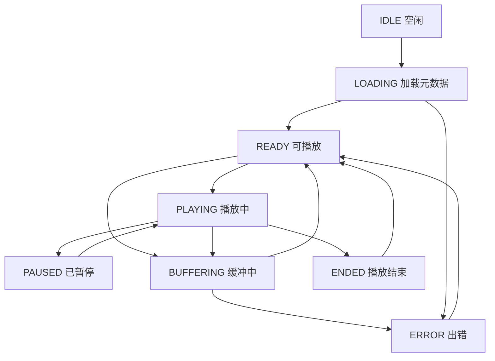

```html
<div class="player" id="player">
  <video id="v" src="movie.mp4" playsinline></video>
  <div class="controls">
    <button id="play">播放</button>
    <input id="seek" type="range" value="0" min="0" max="100" step="0.1">
    <span id="time">0:00</span>
    <select id="rate">
      <option>0.5</option><option selected>1</option>
      <option>1.5</option><option>2</option>
    </select>
    <button id="fs">全屏</button>
  </div>
</div>
<style>
  .controls { opacity: 0; transition: .2s; }
  .player:hover .controls, .player:focus-within .controls { opacity: 1; }
  .player.hide-cursor { cursor: none; }
  .player:fullscreen video { width: 100vw; height: calc(100vh - 48px); object-fit: contain; }
</style>
<script>
const player = document.getElementById('player');
const v = document.getElementById('v');
const fmt = (s) => `${Math.floor(s / 60)}:${String(Math.floor(s % 60)).padStart(2, '0')}`;

// 状态机见上图：原生事件驱动 UI 状态，不自造状态
v.addEventListener('waiting', () => player.classList.add('buffering'));   // 缓冲
v.addEventListener('playing', () => player.classList.remove('buffering'));
v.addEventListener('timeupdate', () => {
  seek.value = (v.currentTime / (v.duration || 1)) * 100;
  time.textContent = fmt(v.currentTime);
});
v.addEventListener('ended', () => (play.textContent = '重播'));

// 进度条：input 高频只预览，change/落点才 seek，防高频 seek 卡顿
seek.oninput = () => { seekDragging = true; };
seek.onchange = () => {
  v.currentTime = (seek.value / 100) * (v.duration || 0);
  seekDragging = false;
};
rate.onchange = () => (v.playbackRate = +rate.value);   // 倍速

// 快捷键：先排除输入框焦点
let seekDragging = false;
addEventListener('keydown', (e) => {
  if (e.target.matches('input,textarea,select')) return;
  if (e.code === 'Space') { e.preventDefault(); togglePlay(); }
  if (e.key === 'ArrowRight') v.currentTime += 5;
  if (e.key === 'ArrowLeft') v.currentTime -= 5;
  if (e.key.toLowerCase() === 'f') toggleFS();
});

const togglePlay = () => (v.paused ? v.play().catch(() => {}) : v.pause());
play.onclick = togglePlay;
function toggleFS() {
  if (document.fullscreenElement) return document.exitFullscreen();
  if (player.requestFullscreen) player.requestFullscreen();   // 容器全屏：控制条一起
  else v.webkitEnterFullscreen?.();     // iOS Safari 只有元素级全屏
}
fs.onclick = toggleFS;

// 自动隐藏控制条：播放中 3s 无操作隐藏
let hideTimer;
player.addEventListener('pointermove', () => {
  player.classList.remove('hide-cursor');
  clearTimeout(hideTimer);
  if (!v.paused) hideTimer = setTimeout(() => player.classList.add('hide-cursor'), 3000);
});
</script>
```

### H5-182：设计一个弹幕系统（Canvas 渲染池/防遮挡/发送）
**答**：
- 渲染：Canvas 而非 DOM（同屏千条弹幕 DOM 撑不住）；时间驱动（速度 × dt）而非帧驱动；对象池复用弹幕对象，避免 GC 抖动。
- 弹道分配：每条弹幕入"通道"，新弹幕选**尾部已离开右侧最远**的通道；通道满时随机或排队丢弃。
- 可读性：描边 + 半透明降低遮挡感；防遮挡进阶是"智能防挡"——把视频主体区域（人像分割）设为禁区让弹幕绕行；产品侧配合半屏模式与密度限流。
- 发送：输入回车 → 本地立即渲染（金色标记"自己"）+ 上行服务端广播；接收端节流渲染。

```html
<div class="player">
  <video src="live.mp4" muted autoplay></video>
  <canvas id="danmu" width="480" height="180"></canvas>
</div>
<style>
  .player { position: relative; width: 480px; }
  #danmu { position: absolute; top: 0; left: 0; pointer-events: none; }
</style>
<script>
const layer = document.getElementById('danmu');
const ctx = layer.getContext('2d');
const W = layer.width, H = layer.height;
const LANES = 5, LANE_H = 36;
const pool = [], active = [];                 // 对象池复用，避免 GC 抖动
const acquire = () => pool.pop() ?? {};

// 1) 弹道分配：选"最空"通道 —— 该通道弹幕尾部离右侧最远
function pickLane(now) {
  let best = 0, bestGap = -1;
  for (let l = 0; l < LANES; l++) {
    let minTail = W;
    for (const d of active) if (d.lane === l) {
      const tail = W - (now - d.t0) * d.speed + d.text.length * d.fontSize;
      if (tail < minTail) minTail = tail;
    }
    if (minTail > bestGap) { bestGap = minTail; best = l; }
  }
  return best;
}

function send(text, { self = false } = {}) {
  const fontSize = self ? 28 : 20;
  active.push(Object.assign(acquire(), {
    text, fontSize,
    speed: 90 + Math.random() * 60,           // px/s
    lane: pickLane(performance.now()),
    t0: performance.now(),
    color: self ? '#ffd700' : '#fff',
  }));
}

// 2) 渲染循环：时间驱动（速度 x dt），出屏回收进池
let last = performance.now();
function frame(now) {
  ctx.clearRect(0, 0, W, H);
  for (let i = active.length - 1; i >= 0; i--) {
    const d = active[i];
    const x = W - (now - d.t0) * d.speed;
    if (x < -d.text.length * d.fontSize - 20) {
      pool.push(d); active.splice(i, 1); continue;       // 出屏回收
    }
    ctx.font = `${d.fontSize}px sans-serif`;
    ctx.lineWidth = 3;
    ctx.strokeStyle = 'rgba(0,0,0,.6)';                  // 描边保证可读性
    ctx.globalAlpha = 0.85;                              // 半透明降低遮挡感
    ctx.strokeText(d.text, x, d.lane * LANE_H + 26);
    ctx.fillStyle = d.color;
    ctx.fillText(d.text, x, d.lane * LANE_H + 26);
  }
  ctx.globalAlpha = 1;
  requestAnimationFrame(frame);
}
requestAnimationFrame(frame);

// 3) 发送：本地立即渲染（金色标记"自己"）+ 上行服务端广播
document.getElementById('send').addEventListener('click', () => {
  const text = input.value.trim();
  if (!text) return;
  send(text, { self: true });
  ws.send(JSON.stringify({ type: 'danmu', text }));
});
// 4) 防遮挡：热门时刻降密度（发送节流）+ 半屏模式 + 智能防挡（人像分割禁区绕行）
// 5) 暂停：视频 pause 时冻结 now 基线（记录暂停时刻，恢复时平移所有 t0）
</script>
```

### H5-183：设计一个拖拽看板（HTML5 DnD vs Pointer Events 选型）
**答**：
- 选型结论：看板这种需要**自定义拖动影像、自动滚动、触屏支持**的场景选 Pointer Events 自实现；原生 HTML5 DnD 适合"少量、桌面端、整元素拖动"（如拖文件进浏览器）。
- 原生 DnD 优点：dragstart/dragover/drop 语义齐全、与文件拖入统一；缺点：触屏不支持、拖动影像是浏览器截图不可定制、drop 目标判定与自动滚动都要 hack。
- Pointer 方案核心：pointerdown 记录偏移 → clone 一个 fixed 定位的 ghost 跟随 → `elementFromPoint` 找目标列 → 与列内卡片中点比较算插入位 → pointerup 提交。
- 体验细节：ghost `pointer-events:none` 防挡 elementFromPoint、原卡片半透明占位、拖动时列表 `touch-action: none`。

```html
<div class="board">
  <ul class="col" data-col="todo">
    <li data-id="1">需求 A</li>
    <li data-id="2">需求 B</li>
  </ul>
  <ul class="col" data-col="doing"></ul>
</div>
<style>
  .board { display: flex; gap: 16px; }
  .col { width: 200px; min-height: 200px; background: #f1f5f9;
         padding: 8px; list-style: none; touch-action: none; }
  li { background: #fff; padding: 8px; margin-bottom: 8px;
       box-shadow: 0 1px 2px rgba(0,0,0,.1); }
</style>
<script>
// 方案：Pointer Events + transform ghost（看板推荐）
let drag = null;

document.addEventListener('pointerdown', (e) => {
  const card = e.target.closest('[data-id]');
  if (!card) return;
  const rect = card.getBoundingClientRect();
  drag = {
    card,
    ox: e.clientX - rect.left, oy: e.clientY - rect.top,
    ghost: card.cloneNode(true),
  };
  Object.assign(drag.ghost.style, {
    position: 'fixed', pointerEvents: 'none',       // 不挡 elementFromPoint
    width: rect.width + 'px', zIndex: 999, opacity: .85, margin: 0,
  });
  document.body.append(drag.ghost);
  card.style.opacity = .3;                          // 原位半透明占位
});

document.addEventListener('pointermove', (e) => {
  if (!drag) return;
  drag.ghost.style.left = e.clientX - drag.ox + 'px';
  drag.ghost.style.top = e.clientY - drag.oy + 'px';
  // 目标列与插入位：与列内卡片中点比较
  const col = document.elementFromPoint(e.clientX, e.clientY)?.closest('.col');
  if (col) {
    const cards = [...col.querySelectorAll('[data-id]')]
      .filter((c) => c !== drag.card);
    const next = cards.find((c) =>
      e.clientY < c.getBoundingClientRect().top + c.offsetHeight / 2);
    next ? col.insertBefore(drag.card, next) : col.append(drag.card);
  }
});

document.addEventListener('pointerup', () => {
  if (!drag) return;
  drag.card.style.opacity = '';
  drag.ghost.remove();
  persist(drag.card.dataset.id, drag.card.closest('.col').dataset.col);
  drag = null;
});
function persist(cardId, colName) { console.log('上报', cardId, '->', colName); }

// 选型对比（答题口径）：
// 原生 HTML5 DnD：dragstart/dragover/drop 语义齐全、与文件拖入统一；
//   缺点：触屏不支持、拖动影像是浏览器截图不可定制、自动滚动要 hack
// Pointer Events：全平台、ghost 完全可控、可加键盘替身（ARIA 拖拽）；
//   代价：拖拽语义全部自己实现
</script>
```

### H5-184：设计一个文件管理器（树/列表/多选/拖拽上传）
**答**：
- 结构：左侧目录树（懒加载——点开才请求子目录）+ 右侧文件列表（虚拟滚动扛万级条目）。
- 多选模型：Set 存选中 id + **锚点**记录；点击=单选、Ctrl/⌘=增减、Shift=锚点到当前的范围选择。
- 拖拽双通道：外部文件拖入走 DataTransfer items 目录遍历（H5-156）→ 统一上传管线（大文件分片 H5-033）；内部移动用自定义 MIME 类型（`application/x-nodes`）携带多选集合，drop 到目录调 move。
- 键盘：方向键 roving tabindex、Ctrl+A 全选、F2 重命名、Delete 回收站化删除。

```javascript
// 文件管理器：树（目录）+ 列表（文件）+ 多选 + 拖拽上传/移动
const state = { selected: new Set(), anchor: null, nodes: new Map() };
const api = {
  list: async (dirId) => [{ id: 'f1', name: 'a.txt', dir: dirId }],   // stub
  upload: async () => {}, move: async () => {},
};

// 1) 左侧树：懒加载 —— 点开才请求子目录
async function loadChildren(dirId, treeNode) {
  const kids = await api.list(dirId);
  for (const n of kids) state.nodes.set(n.id, n);
  treeNode.append(...kids.map(renderTreeNode));
}
function renderTreeNode() { return document.createElement('div'); }

// 2) 列表多选：点击=单选，Ctrl/⌘=增减，Shift=范围选（锚点模式）
list.addEventListener('click', (e) => {
  const row = e.target.closest('[data-id]');
  if (!row) { state.selected.clear(); return paintSelection(); }
  const id = row.dataset.id;
  if (e.shiftKey && state.anchor) {
    const rows = [...list.querySelectorAll('[data-id]')];
    const a = rows.indexOf(rows.find((r) => r.dataset.id === state.anchor));
    const b = rows.indexOf(row);
    state.selected = new Set(rows.slice(Math.min(a, b), Math.max(a, b) + 1)
      .map((r) => r.dataset.id));
  } else if (e.metaKey || e.ctrlKey) {
    state.selected.has(id) ? state.selected.delete(id) : state.selected.add(id);
    state.anchor = id;
  } else {
    state.selected = new Set([id]);
    state.anchor = id;
  }
  paintSelection();
});
function paintSelection() {
  for (const row of list.querySelectorAll('[data-id]'))
    row.classList.toggle('sel', state.selected.has(row.dataset.id));
}

// 3) 拖拽：外部文件（含目录）与内部移动双通道
list.addEventListener('dragstart', (e) => {
  // 多选拖拽：把整个选中集放进自定义类型
  e.dataTransfer.setData('application/x-nodes', JSON.stringify([...state.selected]));
});
tree.addEventListener('drop', async (e) => {
  e.preventDefault();
  const dirId = e.target.closest('[data-dir]')?.dataset.dir;
  const inner = e.dataTransfer.getData('application/x-nodes');
  if (inner) return api.move(JSON.parse(inner), dirId);          // 内部移动
  // 外部文件：items 目录遍历（见 H5-156）后统一上传，大文件走分片（H5-033）
  const entries = [...e.dataTransfer.items].map((i) => i.webkitGetAsEntry?.());
  const files = [];
  for (const en of entries.filter(Boolean)) await walkEntry(en, files);
  await Promise.all(files.map((f) => api.upload(dirId, f)));
});
async function walkEntry(entry, out) { /* 递归遍历，同 H5-156 */ }

// 4) 键盘：上下 roving tabindex、Ctrl+A 全选、F2 重命名、Delete 删除（回收站化）
// 5) 大目录：虚拟滚动（1 万+ 文件）；排序/过滤在内存索引上做，不逐次请求
```

### H5-185：设计一个网页版 Excel（虚拟滚动/选区/复制粘贴）
**答**：
- 数据模型：`Map<"r:c", value>` 只存非空单元格——10 万行也占不了多少内存；渲染层与数据分离。
- 虚拟滚动：撑出真实滚动高度的 spacer，只渲染可视窗口的 ~20 行 DOM，scroll 事件 rAF 节流重算。
- 选区：pointerdown 定锚点、按住移动扩展矩形选区；编辑用单个复用的浮动 input（双击/Enter 进入）。
- 剪贴板协议：copy 时按选区生成 **TSV** 写入 text/plain（与 Excel/WPS 双向兼容）；paste 时解析 TSV 从锚点展开。
- 公式概览：单元格存公式字符串，求值 = 解析引用（=A1+B2）建依赖图 + 拓扑排序，DFS 检测循环引用。

```html
<div id="sheet" tabindex="0"></div>
<style>
  #sheet { position: relative; overflow: auto; height: 320px; width: 840px;
           font: 13px/32px sans-serif; background: #fff; }
  .row { position: absolute; left: 0; display: flex; height: 32px; }
  .cell { width: 96px; flex: none; padding: 0 6px; white-space: nowrap;
          border-right: 1px solid #eee; border-bottom: 1px solid #eee; }
  .cell.sel { background: #dbeafe; }
</style>
<script>
// 三大件：数据模型 Map<r,c,value> + 虚拟滚动 + 选区/剪贴板
const data = new Map();               // key: "r:c"，10 万格只存非空
const ROWS = 10000, COLS = 8, ROW_H = 32;
const sheet = document.getElementById('sheet');

// 1) 虚拟滚动：spacer 撑出真实滚动条，只渲染可视 ~20 行
const spacer = document.createElement('div');
spacer.style.height = ROWS * ROW_H + 'px';
sheet.append(spacer);
sheet.addEventListener('scroll', () => requestAnimationFrame(paintVisible));
function paintVisible() {
  const r0 = Math.floor(sheet.scrollTop / ROW_H);
  const r1 = Math.ceil((sheet.scrollTop + sheet.clientHeight) / ROW_H);
  sheet.querySelectorAll('.row').forEach((n) => n.remove());
  for (let r = r0; r < r1; r++) {
    const row = document.createElement('div');
    row.className = 'row';
    row.style.top = r * ROW_H + 'px';           // 内容坐标，随容器自然滚动
    for (let c = 0; c < COLS; c++) {
      const cell = document.createElement('div');
      cell.className = 'cell';
      cell.dataset.r = r; cell.dataset.c = c;
      cell.textContent = data.get(`${r}:${c}`) ?? '';
      row.append(cell);
    }
    sheet.append(row);
  }
}
paintVisible();

// 2) 选区：pointerdown 定锚点，按住移动扩展矩形
let anchor = null, selRect = null;
sheet.addEventListener('pointerdown', (e) => {
  const cell = e.target.closest('.cell'); if (!cell) return;
  anchor = { r: +cell.dataset.r, c: +cell.dataset.c };
  setSelection(anchor, anchor);
});
sheet.addEventListener('pointermove', (e) => {
  if (!anchor || !(e.buttons & 1)) return;
  const cell = e.target.closest('.cell'); if (!cell) return;
  setSelection(anchor, { r: +cell.dataset.r, c: +cell.dataset.c });
});
function setSelection(a, b) {
  selRect = {
    minR: Math.min(a.r, b.r), maxR: Math.max(a.r, b.r),
    minC: Math.min(a.c, b.c), maxC: Math.max(a.c, b.c),
  };
  for (const el of sheet.querySelectorAll('.cell')) {
    const r = +el.dataset.r, c = +el.dataset.c;
    el.classList.toggle('sel',
      r >= selRect.minR && r <= selRect.maxR && c >= selRect.minC && c <= selRect.maxC);
  }
}

// 3) 剪贴板协议：copy 生成 TSV（与 Excel 双向兼容），paste 解析 TSV 展开
sheet.addEventListener('copy', (e) => {
  const { minR, minC, maxR, maxC } = selRect;
  const lines = [];
  for (let r = minR; r <= maxR; r++)
    lines.push(Array.from({ length: maxC - minC + 1 },
      (_, i) => data.get(`${r}:${minC + i}`) ?? '').join('\t'));
  e.clipboardData.setData('text/plain', lines.join('\n'));
  e.preventDefault();
});
sheet.addEventListener('paste', (e) => {
  if (!anchor) return;
  const tsv = e.clipboardData.getData('text/plain');
  tsv.replace(/\r/g, '').split('\n').forEach((line, dr) =>
    line.split('\t').forEach((v, dc) =>
      data.set(`${anchor.r + dr}:${anchor.c + dc}`, v)));
  paintVisible();
  e.preventDefault();
});

// 4) 公式概览：单元格存公式串，求值 = 解析引用建依赖图 + 拓扑排序，
//    DFS 检测循环引用；编辑用单个复用浮动 input（双击/Enter 进入）
// 5) 性能：rAF 合帧渲染；输入态只重渲染编辑格；10 万行虚拟化下 DOM 恒定 ~200
</script>
```

### H5-186：设计一个思维导图（SVG 连线/拖拽/缩放）
**答**：
- 数据是树，视图是"布局算法 + SVG 渲染"：先序遍历分配 y（叶子均匀堆叠、父节点居中于子节点），x = 深度 × 层距。
- 连线用**水平方向三次贝塞尔**（控制点横向拉出），比折线自然；节点用 `foreignObject` 包 contenteditable 实现就地编辑。
- 拖拽改父：pointer 拖动 → 命中检测目标节点 → 校验无环（不能挂到自己的后代）→ 更新 children → 重排重绘。
- 缩放平移：整个内容包在 `<g transform="translate(tx,ty) scale(s)">`，矢量无损；大图折叠子树（不渲染子分支）+ 视口裁剪。

```html
<svg id="map" width="600" height="400" style="background:#fafafa"></svg>
<script>
// 思维导图：树数据 + 布局算法 + SVG 连线 + 缩放
const tree = {
  id: 'root', text: 'HTML5', parent: null, children: [
    { id: 'a', text: 'Canvas', parent: null, children: [] },
    { id: 'b', text: 'SVG', parent: null,
      children: [{ id: 'b1', text: '图标', parent: null, children: [] }] },
  ],
};

// 1) 布局：右向树 —— 叶子均匀分配 y，父节点居中于子节点，x = 深度 x 层距
const positioned = [];
function layout(node, depth, yRef) {
  node.depth = depth;
  if (!node.children.length) {
    node.y = yRef.v; yRef.v += 40;                       // 叶子行高 40
  } else {
    for (const k of node.children) layout(k, depth + 1, yRef);
    node.y = (node.children[0].y +
              node.children[node.children.length - 1].y) / 2;
  }
  node.x = depth * 200;
  positioned.push(node);
}
layout(tree, 0, { v: 60 });

// 2) 渲染：连线三次贝塞尔（横向控制点），节点用 foreignObject 就地编辑
const NS = 'http://www.w3.org/2000/svg';
const svg = document.getElementById('map');
const byId = new Map(positioned.map((n) => [n.id, n]));
for (const n of positioned) {
  for (const child of n.children) {
    const c = byId.get(child.id);
    const p = document.createElementNS(NS, 'path');
    const x1 = n.x + 160, y1 = n.y + 16, x2 = c.x, y2 = c.y + 16;
    p.setAttribute('d',
      `M${x1},${y1} C${x1 + 60},${y1} ${x2 - 60},${y2} ${x2},${y2}`);
    p.setAttribute('fill', 'none');
    p.setAttribute('stroke', '#94a3b8');
    svg.append(p);
  }
  const fo = document.createElementNS(NS, 'foreignObject');
  fo.setAttribute('x', n.x); fo.setAttribute('y', n.y);
  fo.setAttribute('width', 160); fo.setAttribute('height', 32);
  const div = document.createElement('div');
  div.contentEditable = 'true';
  div.textContent = n.text;
  div.onblur = () => { n.text = div.textContent; save(n.id, n.text); };
  fo.append(div);
  svg.append(fo);
}
function save() {}

// 3) 拖拽改父：拖节点 → 命中目标节点 → 校验无环（不能挂自己后代）→ 更新 children 重排
// 4) 缩放平移：内容包 <g transform="translate(tx,ty) scale(s)">，wheel 改 s 与 tx/ty
//    缩放不动点算法同 H5-135；矢量无损
// 5) 大图：折叠子树（children 不渲染）+ 视口裁剪；导出走 SVG 序列化或 canvas 截图
</script>
```

### H5-187：设计一个扫码组件（相机 + BarcodeDetector）
**答**：
- 链路：`getUserMedia` 后置摄像头 → video 播放 → 周期性把帧画到离屏 canvas → `BarcodeDetector.detect()` 解码。
- 兼容红线：`BarcodeDetector` 在 iOS 缺失——必须 jsQR/ZXing 库兜底（`getImageData` 传入解析）。
- 性能：解码耗 CPU，150~200ms 节流轮询；取景框裁剪只解码框内区域；识别成功立即 `clearInterval` + `track.stop()` 释放摄像头。
- 体验细节：安卓可用 `track.applyConstraints({advanced:[{torch:true}]})` 开手电筒；权限拒绝降级为"手动输入/上传图片识别"（图片走同一 detect 流程）。

```html
<video id="cam" autoplay playsinline muted style="width:320px"></video>
<button id="scan">开始扫码</button>
<p id="result"></p>
<script>
document.getElementById('scan').onclick = async () => {
  // 能力探测：BarcodeDetector 在 iOS 缺失，必须 jsQR 兜底
  let detector = null;
  if ('BarcodeDetector' in window) {
    detector = new BarcodeDetector({ formats: ['qr_code', 'ean_13'] });
  }

  const stream = await navigator.mediaDevices.getUserMedia({
    video: { facingMode: { ideal: 'environment' },        // 后置摄像头
             width: { ideal: 1280 }, height: { ideal: 720 } },
  });
  const video = document.getElementById('cam');
  video.srcObject = stream;
  await video.play();

  // 取景框只解码框内区域：减少解码面积提升速度
  const canvas = document.createElement('canvas');
  const ctx = canvas.getContext('2d', { willReadFrequently: true });

  // 节流轮询：解码耗 CPU，150~200ms 一次足够
  const timer = setInterval(async () => {
    if (video.readyState < 2) return;
    canvas.width = video.videoWidth; canvas.height = video.videoHeight;
    ctx.drawImage(video, 0, 0);
    try {
      let text = null;
      if (detector) {
        const codes = await detector.detect(canvas);      // 直接支持 canvas 源
        text = codes[0]?.rawValue;
      } else {
        const img = ctx.getImageData(0, 0, canvas.width, canvas.height);
        const r = jsQR(img.data, img.width, img.height);  // iOS 兜底库
        text = r?.data;
      }
      if (text) {
        clearInterval(timer);                             // 成功立刻停轮询
        stream.getTracks().forEach((t) => t.stop());      // 释放摄像头
        document.getElementById('result').textContent = text;
      }
    } catch { /* 单帧解码失败忽略，下轮重试 */ }
  }, 150);

  // 体验细节：
  // 安卓开手电筒：track.applyConstraints({ advanced: [{ torch: true }] })
  // 权限拒绝降级：手动输入 / 上传图片识别（图片文件走同一 detect 流程）
};
</script>
```

### H5-188：设计一个 Markdown 编辑器（分屏预览/同步滚动）
**答**：
- 渲染管线：input 防抖（~150ms）→ `marked.parse()` → **DOMPurify 清洗**（用户 markdown 不可信，XSS 防线必须前置）→ 更新预览。
- 同步滚动：核心是**源行号 ↔ 预览元素**的映射表（渲染时给每个块级元素记 data-src-line），双向跟随 + `rendering` 互斥锁防"滚动乒乓"。
- 工具栏插入（加粗/列表）：操作 textarea 的 `selectionStart/End` 在文本层完成，插完 `setSelectionRange` 恢复光标并触发 input。
- 进阶：CodeMirror 6 做编辑器（行号/高亮/大文件性能）、图片粘贴上传、`prefers-color-scheme` 双主题。

```html
<div class="split">
  <textarea id="md"># 标题</textarea>
  <div id="preview" class="preview"></div>
</div>
<style>
  .split { display: flex; height: 320px; }
  #md { flex: 1; font: 14px/21px monospace; padding: 12px; }
  .preview { flex: 1; overflow: auto; padding: 12px; border-left: 1px solid #eee; }
</style>
<script src="https://cdn.example.com/marked.min.js"></script>
<script src="https://cdn.example.com/purify.min.js"></script>
<script>
const editor = document.getElementById('md');
const preview = document.getElementById('preview');
let rendering = false;                       // 互斥锁防"滚动乒乓"

// 1) 渲染管线：防抖 + XSS 防线（用户 markdown 不可信，必须 sanitize）
let timer;
editor.addEventListener('input', () => {
  clearTimeout(timer);
  timer = setTimeout(() => {
    // DOMPurify 清洗是必须项，不是可选项
    preview.innerHTML = DOMPurify.sanitize(marked.parse(editor.value));
    buildLineMap();
  }, 150);
});

// 2) 同步滚动：源行号 ↔ 预览元素映射（marked lexer 提供 token 位置，简化演示）
let lineMap = [];                            // [{ src: 12, el }]
function buildLineMap() {
  lineMap = [...preview.querySelectorAll('h1,h2,h3,p,li,pre,blockquote')]
    .map((el) => ({ src: +el.dataset.srcLine || lineOf(el), el }));
}
function lineOf() { return 0; }              // 实际由渲染阶段写入 data-src-line
function syncScroll(from) {
  if (rendering) return;
  rendering = true;
  if (from === 'editor') {
    const line = Math.floor(editor.scrollTop / 21);           // 近似行号
    const hit = lineMap.filter((m) => m.src <= line).pop();
    if (hit) preview.scrollTop = hit.el.offsetTop - 16;
  } else {
    const hit = lineMap.find((m) => m.el.offsetTop >= preview.scrollTop);
    if (hit) editor.scrollTop = hit.src * 21;
  }
  requestAnimationFrame(() => (rendering = false));
}
editor.addEventListener('scroll', () => syncScroll('editor'));
preview.addEventListener('scroll', () => syncScroll('preview'));

// 3) 工具栏插入：文本层操作 selectionStart/End，不走 DOM
function wrapSelection(before, after = before) {
  const [s, e] = [editor.selectionStart, editor.selectionEnd];
  const v = editor.value;
  editor.value = v.slice(0, s) + before + v.slice(s, e) + after + v.slice(e);
  editor.setSelectionRange(s + before.length, e + before.length);
  editor.dispatchEvent(new Event('input'));  // 触发渲染管线
  editor.focus();
}
document.getElementById('bold')?.addEventListener('click', () => wrapSelection('**'));
// 4) 进阶：CodeMirror 6 做编辑器、粘贴图片上传、暗色主题跟随 prefers-color-scheme
</script>
```

### H5-189：设计一个验证码组件（滑块/点选/canvas 图形）
**答**：
- 三类组件：canvas 图形码（前端绘制干扰线/旋转字符）、滑块（采集拖动轨迹）、点选（采集点击坐标序列）——**共同原则：前端只采集与展示，判定在服务端**（缺口真值、轨迹特征都在服务端校验）。
- 图形码绘制：字符随机旋转/基线抖动/颜色 + 干扰线噪点对抗 OCR；答案由服务端生成下发。
- 滑块：pointermove 采样轨迹 `{x, t}` 序列上送，服务端判断是否人手特征（匀速直线 = 机器）；缺口位置是服务端下发的随机值。
- 安全口径：任何纯前端验证码都可被绕过，前端组件的价值是"采集高质量行为数据 + 用户体验"。

```html
<canvas id="cap" width="260" height="80"></canvas>
<div class="slider"><div class="handle" id="handle"></div></div>
<script>
// 1) 图形验证码（服务端生成答案，前端仅展示；这里演示绘制）
function drawCaptcha(text) {
  const c = document.getElementById('cap').getContext('2d');
  c.fillStyle = '#f1f5f9';
  c.fillRect(0, 0, 260, 80);
  for (let i = 0; i < text.length; i++) {
    c.save();
    c.translate(30 + i * 52, 40 + (Math.random() * 16 - 8));   // 基线抖动
    c.rotate((Math.random() - 0.5) * 0.6);                      // 随机旋转
    c.font = `${28 + Math.random() * 10}px serif`;
    c.fillStyle = `hsl(${Math.random() * 360},60%,35%)`;
    c.fillText(text[i], 0, 0);
    c.restore();
  }
  for (let i = 0; i < 5; i++) {                                 // 干扰线
    c.strokeStyle = 'rgba(0,0,0,.15)';
    c.beginPath();
    c.moveTo(Math.random() * 260, Math.random() * 80);
    c.lineTo(Math.random() * 260, Math.random() * 80);
    c.stroke();
  }
}
drawCaptcha('K7QX');   // 真实答案在服务端，这里只演示展示层

// 2) 滑块：pointermove 采样轨迹，判定在服务端
const handle = document.getElementById('handle');
let dragging = false, start = 0;
const track = [];
handle.addEventListener('pointerdown', (e) => {
  dragging = true; start = e.clientX;
  handle.setPointerCapture(e.pointerId);
});
handle.addEventListener('pointermove', (e) => {
  if (!dragging) return;
  handle.style.transform = `translateX(${e.clientX - start}px)`;
  track.push({ x: e.clientX - start, t: performance.now() });   // 轨迹采样
});
handle.addEventListener('pointerup', () => {
  dragging = false;
  // 上送：轨迹（速度曲线特征）、耗时、缺口位置 —— 真值与判定都在服务端
  fetch('/api/captcha/verify', {
    method: 'POST',
    body: JSON.stringify({ track, duration: performance.now() }),
  });
});
// 点选验证码：canvas 渲染图片 + 按顺序采集点击坐标 [{x,y},...] 上送
// 安全口径：任何纯前端验证码都可被绕过，前端只负责"采集与展示"
</script>
```

### H5-190：设计一个签名板（笔迹平滑/压感模拟）
**答**：
- 输入：Pointer Events + `setPointerCapture`；`getCoalescedEvents()` 拿高频真实采样点——签名笔画快，60Hz 合并点会让曲线"切角"。
- 平滑：中点法 `quadraticCurveTo`；笔宽**逐段变化**（签名美学核心），所以每段单独 stroke 而不是一条 path。
- 压感：真笔 `e.pressure`；鼠标/手指用**速度模拟**——写越快越细（人的运笔规律），速度 = 相邻点距离/时间差。
- 工程：透明背景 PNG 导出（合成到合同 PDF 可叠加）、笔画数据序列化入库支持重放、手掌误触防护（只接受 pen 或忽略下半屏 touch）。

```html
<canvas id="sign" width="480" height="240" style="touch-action:none;border:1px dashed #ccc"></canvas>
<script>
const canvas = document.getElementById('sign');
const ctx = canvas.getContext('2d');
let stroke = null;

canvas.addEventListener('pointerdown', (e) => {
  canvas.setPointerCapture(e.pointerId);
  stroke = { pts: [pt(e)] };
});
canvas.addEventListener('pointermove', (e) => {
  if (!stroke) return;
  // getCoalescedEvents：拿到被合并的高频真实采样点，快笔不丢细节
  for (const ev of e.getCoalescedEvents?.() ?? [e]) stroke.pts.push(pt(ev));
  drawLive();
});
addEventListener('pointerup', () => { stroke = null; exportSign(); });

function pt(e) {
  const r = canvas.getBoundingClientRect();
  return { x: e.clientX - r.left, y: e.clientY - r.top,
           p: e.pressure || 0.5, type: e.pointerType, t: e.timeStamp };
}

// 笔宽 = 基础宽 x（压感 或 速度模拟）：写越快越细 —— 人的运笔规律
function widthAt(prev, cur) {
  const dist = Math.hypot(cur.x - prev.x, cur.y - prev.y);
  const speed = dist / Math.max(1, cur.t - prev.t);       // px/ms
  const speedW = Math.max(0.4, 1.6 - speed * 0.9);
  const factor = cur.type === 'pen' ? cur.p * 2 : speedW;
  return 2 + 4 * factor;
}

// 中点法平滑 + 逐段变宽：变宽无法在单条 path 里实现，每段单独 stroke
function drawLive() {
  const pts = stroke.pts, n = pts.length;
  if (n < 3) return;
  for (let i = 2; i < n; i++) {
    const a = pts[i - 2], b = pts[i - 1], c = pts[i];
    const m1 = { x: (a.x + b.x) / 2, y: (a.y + b.y) / 2 };
    const m2 = { x: (b.x + c.x) / 2, y: (b.y + c.y) / 2 };
    ctx.beginPath();
    ctx.lineWidth = widthAt(a, b);
    ctx.lineCap = ctx.lineJoin = 'round';
    ctx.moveTo(m1.x, m1.y);
    ctx.quadraticCurveTo(b.x, b.y, m2.x, m2.y);
    ctx.stroke();
  }
}

// 导出：透明背景 PNG（合成到合同 PDF 时可叠加）
function exportSign() {
  canvas.toBlob((b) => console.log('签名 PNG', b), 'image/png');
}
// 工程点：Retina dpr 适配；笔画数据 {points,width} 入库支持重放与撤销；
// 手掌误触防护：只接受 pen，或忽略 pointerType=touch 且 y 在下半区的点
</script>
```

### H5-191：设计一个屏幕共享协作标注层
**答**：
- 结构：共享画面（getDisplayMedia 或远端流）之上叠一层全屏透明 canvas，标注模式开启时接收 pointer 事件。
- **坐标协议关键设计**：所有操作用"相对比例"（0~1）传输，与双方分辨率/窗口尺寸解耦，远端按自己的画布尺寸还原。
- 同步：操作（begin/move/end）走 WebSocket 广播，带 id 去重定序；撤销 = 操作日志弹出栈顶 + 两端全量重放，保证最终一致。
- 工具集：画笔（逐点）、矩形/箭头（拖拽预览）、激光笔（只发位置、1s 衰减消失）；非标注模式下 `pointer-events: none` 不干扰操作。

```html
<div class="stage">
  <video src="screen.webm" autoplay muted></video>
  <canvas id="overlay" width="480" height="270"></canvas>
</div>
<style>
  .stage { position: relative; width: 480px; }
  #overlay { position: absolute; inset: 0; width: 100%; height: 100%;
             pointer-events: none; }   /* 非标注模式不干扰 */
  #overlay.active { pointer-events: auto; }
</style>
<script>
const overlay = document.getElementById('overlay');
const ctx = overlay.getContext('2d');
let drawing = null;
const ops = [];                       // 操作日志：撤销/重放的基础
const sendOp = (op) => { /* ws.send 定序广播，远端按 op 还原 */ };

overlay.addEventListener('pointerdown', (e) => {
  overlay.setPointerCapture(e.pointerId);
  drawing = { tool: 'pen', from: rel(e), to: rel(e), id: crypto.randomUUID() };
  sendOp({ type: 'begin', op: drawing });
});
overlay.addEventListener('pointermove', (e) => {
  if (!drawing) return;
  drawing.to = rel(e);
  renderLocal(drawing);
});
overlay.addEventListener('pointerup', () => {
  if (!drawing) return;
  ops.push(drawing);                  // 定稿进操作日志
  sendOp({ type: 'end', op: drawing });
  drawing = null;
});

// 坐标协议关键：全部用"相对比例"（0~1），与双方屏幕分辨率解耦
function rel(e) {
  const r = overlay.getBoundingClientRect();
  return { x: (e.clientX - r.left) / r.width,
           y: (e.clientY - r.top) / r.height };
}
// 远端/本地渲染：收到 op 后 scale 回自己的画布尺寸
function renderLocal(op) {
  const w = overlay.width, h = overlay.height;
  ctx.strokeStyle = '#ef4444'; ctx.lineWidth = 4; ctx.lineCap = 'round';
  ctx.beginPath();
  ctx.moveTo(op.from.x * w, op.from.y * h);
  if (op.tool === 'pen') ctx.lineTo(op.to.x * w, op.to.y * h);
  if (op.tool === 'rect')
    ctx.rect(op.from.x * w, op.from.y * h,
             (op.to.x - op.from.x) * w, (op.to.y - op.from.y) * h);
  ctx.stroke();
}
// 撤销：ops.pop() + 清屏全量重放，两端最终一致
// 激光笔：只广播位置，本地画亮点并 1s 内衰减消失（不进操作日志）
// 指针同步进阶：广播自己鼠标位置画"跟随光标"，多人协作更直观
</script>
```

### H5-192：设计一个 H5 活动页引擎（动画时间轴/组件协议）
**答**：
- 核心：**页面 = 组件协议 JSON**（运营后台可视化产出）+ 运行时渲染器；协议要带 `schemaVersion` 做向后兼容迁移。
- 组件协议：type/props（位置、资源）+ animations（property、keyframes、easing、delay）；时间轴用 WAAPI 声明（offset 归一化 keyframes），delay 错开形成编排。
- 适配：设计稿基准（750 宽）+ 等比 scale；场景触发用 IntersectionObserver（滚到第几屏播放）。
- 工程红线：只 animate transform/opacity；首屏组件优先渲染 + 大图预加载队列；组件级曝光/点击埋点协议统一上报（运营闭环）。

```javascript
// H5 活动页引擎 = 组件协议 JSON + 运行时渲染 + WAAPI 时间轴
const pageSchema = {
  schemaVersion: 2,                          // 协议版本：运行时做向后兼容迁移
  width: 750, height: 1600,                  // 设计稿基准
  components: [
    { type: 'text', props: { text: '618 大促', x: 40, y: 120 },
      animations: [
        { property: 'y', keyframes: [
            { t: 0, value: 260 }, { t: 600, value: 120 }],
          easing: 'easeOutBack', delay: 0 },
      ] },
    { type: 'image', props: { src: 'banner.png', x: 0, y: 400 },
      animations: [
        { property: 'opacity', keyframes: [
            { t: 0, value: 0 }, { t: 400, value: 1 }],
          delay: 300 },
      ] },
  ],
};

function mount(schema, root) {
  // 等比缩放适配：750 设计稿基准
  const scale = Math.min(1, innerWidth / schema.width);
  const stage = document.createElement('div');
  stage.style.cssText =
    `position:relative;width:${schema.width}px;height:${schema.height}px;` +
    `transform:scale(${scale});transform-origin:0 0;`;
  root.append(stage);

  for (const comp of schema.components) {
    const el = renderComponent(comp);        // 按 type 分发（text/image/button...）
    el.style.cssText +=
      `position:absolute;left:${comp.props.x}px;top:${comp.props.y}px;`;
    stage.append(el);
    // WAAPI 时间轴：keyframes 的 t 归一化为 offset，delay 编排
    for (const a of comp.animations ?? []) {
      const last = a.keyframes[a.keyframes.length - 1].t;
      const kf = a.keyframes.map((k) => ({
        [a.property === 'y' ? 'transform' : a.property]:
          a.property === 'y'
            ? `translateY(${k.value - comp.props.y}px)` : k.value,
        offset: k.t / last,
      }));
      el.animate(kf, {
        duration: last, delay: a.delay ?? 0,
        fill: 'backwards',                   // delay 期间应用首帧，防闪烁
        easing: a.easing ?? 'ease',
      });
    }
  }
}
function renderComponent(comp) {
  const el = document.createElement('div');
  if (comp.type === 'text') el.textContent = comp.props.text;
  if (comp.type === 'image') {
    const img = document.createElement('img');
    img.src = comp.props.src; el.append(img);
  }
  return el;
}
mount(pageSchema, document.body);
// 关键设计点：
// 1) 协议带 schemaVersion，运行时迁移旧版本
// 2) 场景触发（滚到第几屏/点击）用 IntersectionObserver + 事件协议
// 3) 性能红线：只 animate transform/opacity；首屏组件优先 + 大图预加载队列
// 4) 埋点协议：组件级曝光/点击统一上报，形成运营闭环
```

### H5-193：设计一个离线笔记应用（IndexedDB + 同步冲突）
**答**：
- 离线三板斧：数据本地化（IndexedDB）+ 资源本地化（Service Worker 缓存 App Shell）+ 同步策略。
- 本地优先：一切写操作先落 IDB（带 `updated_at` + `dirty` 标记），UI 即时反馈；防抖批量上送。
- 同步协议：push 本地 dirty 记录、pull 服务端变更；冲突解决三选一——**字段级合并**（标题/正文分开比）、**副本保留**（冲突版本存成两条让用户手动合并，最安全）、**CRDT**（Yjs/Automerge 字符级自动合并，协作的正解）。
- 关键字段：`base_updated_at` 记录"本地基于哪个服务端版本修改"，用于检测真冲突（服务端已前进而本地也改了）。

```javascript
// 离线笔记：IndexedDB 存储 + 同步冲突处理（以 idb 库风格演示）
async function openDB() {
  const req = indexedDB.open('notes', 1);
  req.onupgradeneeded = () => {
    const store = req.result.createObjectStore('notes', { keyPath: 'id' });
    store.createIndex('dirty', 'dirty');       // 上送队列索引
  };
  return req;
}
const dbp = openDB();

// 1) 本地优先：写操作先落 IDB（updated_at + dirty 标记），UI 即时反馈
async function saveNote(note) {
  const db = await dbp;
  const tx = db.transaction('notes', 'readwrite');
  tx.objectStore('notes').put({
    ...note, updated_at: Date.now(), dirty: true,
    base_updated_at: note.base_updated_at ?? 0,   // 本地基于的服务端版本
  });
  scheduleSync();                                 // 防抖批量上送
}

// 2) 同步：push dirty + pull 远端，冲突用 base_updated_at 检测
async function sync() {
  const db = await dbp;
  const tx = db.transaction('notes', 'readwrite');
  const dirty = [];
  const req = tx.objectStore('notes').index('dirty').openCursor();
  req.onsuccess = async (e) => {
    const cur = e.target.result;
    if (!cur) return;
    dirty.push(cur.value);
    cur.continue();
  };
  for (const local of dirty) {
    const remote = await api.getNote(local.id).catch(() => null);
    let payload = local;
    // 真冲突：服务端在本地基线之后又被别人改过
    if (remote && remote.updated_at > local.base_updated_at &&
        remote.updated_at !== local.updated_at) {
      payload = resolveConflict(local, remote);
    }
    await api.putNote(payload);
    const wtx = (await dbp).transaction('notes', 'readwrite');
    wtx.objectStore('notes').put({
      ...payload, dirty: false, base_updated_at: Date.now(),
    });
  }
}

// 3) 冲突解决三选一（产品决策，面试要讲清取舍）：
function resolveConflict(local, remote) {
  // a. 字段级合并：标题/正文分开比（多数笔记产品这么做）
  if (local.title !== remote.title) return { ...remote, title: local.title };
  // b. 副本保留：冲突版本存成两条，用户手动合并 —— 最安全
  return { ...remote,
    duplicate: { ...local, id: crypto.randomUUID() } };
}
// c. CRDT（Yjs/Automerge）：字符级自动合并，冲突不再存在 —— 协作编辑的正解
const scheduleSync = (() => { let t; return () => { clearTimeout(t); t = setTimeout(sync, 2000); }; })();
// 4) Service Worker：App Shell + 静态资源 precache，API 失败回退缓存
// self.addEventListener('fetch', (e) => {
//   e.respondWith(fetch(e.request).catch(() => caches.match(e.request)));
// });
```

### H5-194：设计一个网页截屏工具（html2canvas 原理概览）
**答**：
- 原理一句话：**在浏览器渲染引擎之外，用 JS 重演渲染管线**——克隆 DOM → 逐元素读 computed style 与几何信息 → 映射成 Canvas 绘制指令 → 按层叠上下文排序重放到离屏 canvas。
- 核心资产是"CSS 属性 → Canvas 指令"映射表（背景/边框/圆角/阴影/文本 fillText/图片 drawImage）与**层叠上下文排序**（z-index/transform/opacity 创建新上下文）——还原度与性能的大头。
- 局限：跨域图片受 CORS 限制会空白、iframe 内容不可读、部分滤镜/混合模式不支持、外部字体必须已加载。
- 替代方案：dom-to-image（foreignObject 序列化，快但字体坑多）；保真度上限是服务端 Puppeteer 截图。

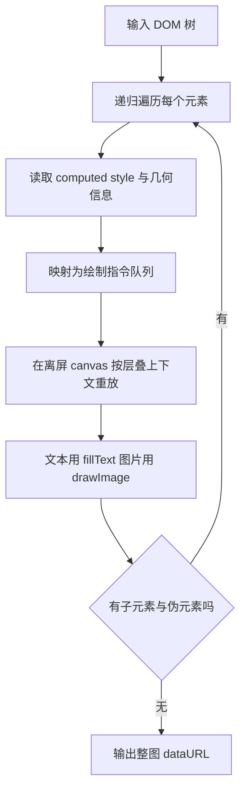

```javascript
// html2canvas 原理 = 用浏览器之外的方式重演渲染管线
// 1) 克隆：目标 DOM 克隆到同尺寸 iframe（隔离样式，避免页面样式污染）
// 2) 遍历：每个元素读 getComputedStyle + getBoundingClientRect
// 3) 翻译：CSS 属性 → Canvas 指令映射表（核心资产）
const PAINTERS = {
  'background-color': (ctx, v, box) => { ctx.fillStyle = v; ctx.fillRect(0, 0, box.w, box.h); },
  'border-radius': (ctx, v, box) => { roundRectPath(ctx, box, v); },
  'box-shadow': (ctx, v, box) => { /* 解析 shadow 语法后画模糊矩形 */ },
  color: (ctx, v, box, el) => {
    // 文本：逐文本节点按字体/基线 fillText（保证换行一致），不是读 innerText
    for (const line of layoutText(el))
      ctx.fillText(line.text, line.x, line.y);
  },
};
function layoutText() { return []; }
function roundRectPath() {}

// 4) 层叠上下文：按 stacking context 排序绘制（z-index/transform/opacity 创建新上下文）
//    —— 这是还原度的大头，也是 html2canvas 慢的原因
// 5) 图片资源：img/背景图重新请求并转 dataURL（受 CORS 限制，跨域图会空白）
// 6) 不支持：iframe 内容、部分滤镜/混合模式、未加载的外部字体

// 业务用法：
async function screenshot(el) {
  const canvas = await html2canvas(el, {
    scale: devicePixelRatio,
    useCORS: true,               // 跨域图走 CORS
    backgroundColor: '#ffffff',
    logging: false,
  });
  return canvas.toDataURL('image/png');
}
// 替代方案概览：
// dom-to-image：SVG foreignObject + 序列化 —— 更快但字体/跨域坑多
// 服务端 Puppeteer screenshot：保真度上限的选择（有服务端预算时优先）
```

### H5-195：设计一个无限画布（Figma 式视口/渲染 culling）
**答**：
- 视口模型：`{scale, x, y}` 矩阵 + 世界/屏幕坐标互转（H5-135）；缩放以鼠标为不动点，平移直接改偏移，输入用 Pointer Events + wheel。
- 渲染 culling：世界坐标视口盒 → 网格哈希/四叉树查询可见元素 → 只画可见集；缩放小时 LOD 降级（文本只画色块，再小只画包围盒）。
- "无限"的本质是**重绘成本恒定**：静态内容按 256px 世界块分块缓存（tile），任何块只在内容变化时失效重绘，平移时 drawImage 拼块。
- 分层：内容层（世界系）+ HUD 层（屏幕系：选择框/参考线/小地图）；一帧内多次输入合并到 rAF 渲染。

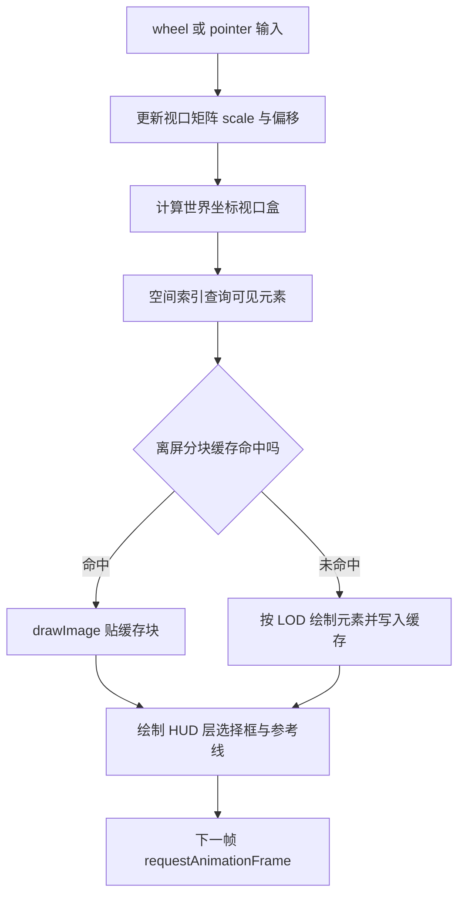

```javascript
// Figma 式无限画布：视口矩阵 + 空间索引 + culling + 分块缓存
const viewport = { scale: 1, x: 0, y: 0 };
const toWorld = (sx, sy) => ({ x: (sx - viewport.x) / viewport.scale,
                               y: (sy - viewport.y) / viewport.scale });
const index = new GridIndex(256);            // 网格哈希，见 H5-138

// 1) 平移：直接改偏移；缩放不动点见 H5-135
let pan = null;
canvas.addEventListener('pointerdown', (e) => {
  if (e.button === 1 || spaceHeld) pan = { x: e.clientX, y: e.clientY };
});
canvas.addEventListener('pointermove', (e) => {
  if (!pan) return;
  viewport.x += e.clientX - pan.x;
  viewport.y += e.clientY - pan.y;
  pan = { x: e.clientX, y: e.clientY };
  scheduleFrame();                           // 合帧：一帧最多渲染一次
});
addEventListener('pointerup', () => (pan = null));

// 2) 渲染：视口盒 → 索引查询 → 只画可见 + LOD
const dpr = devicePixelRatio || 1;
function render(ctx) {
  ctx.setTransform(dpr * viewport.scale, 0, 0, dpr * viewport.scale,
                   dpr * viewport.x, dpr * viewport.y);
  const w0 = toWorld(0, 0), w1 = toWorld(canvas.clientWidth, canvas.clientHeight);
  for (const el of index.query(w0.x, w0.y, w1.x, w1.y)) {
    drawEl(ctx, el, viewport.scale);         // LOD：scale 小时降级细节
  }
  ctx.setTransform(dpr, 0, 0, dpr, 0, 0);    // HUD 层：屏幕系（选择框/参考线/小地图）
  drawHUD(ctx);
}

// 3) 分块缓存：静态内容按 256px 世界块预渲染 —— "无限"的关键，重绘成本恒定
const TILE = 256;
const tiles = new Map();                     // key "bx,by" -> canvas
function drawTiles(ctx) {
  const [bx0, by0, bx1, by1] = visibleTileRange();
  for (let bx = bx0; bx <= bx1; bx++)
    for (let by = by0; by <= by1; by++) {
      const k = bx + ',' + by;
      if (!tiles.has(k)) tiles.set(k, buildTile(bx, by));   // 块只在内容变化时失效
      ctx.drawImage(tiles.get(k), bx * TILE, by * TILE);
    }
}
function visibleTileRange() { return [0, 0, 4, 3]; }
function buildTile(bx, by) { return document.createElement('canvas'); }
function drawEl() {}
function drawHUD() {}
function scheduleFrame() { /* rAF 合帧渲染 */ }
const spaceHeld = false;

// 4) 编辑状态细节对齐 Figma：空格平移、滚轮缩放、拾取两级检测（粗筛+精确）；
// 5) 数据量极大时 tile 服务端化/按视口预取，前端只保留窗口附近块
```

### H5-196：设计一个语音输入组件
**答**：
- 双方案：1) **Web Speech API**（webkitSpeechRecognition，Chromium 支持，浏览器自带识别零成本，`interimResults` 实现"边说边上屏"）；2) **MediaRecorder 录音 + 服务端 ASR**（iOS/自建 ASR 的路径，语种/热词可控，可流式 WebSocket 边录边传）。
- 交互细节：按住说话（pointerdown/up）+ 上滑取消；interim 结果灰显、final 结果替换落框。
- 辅助反馈：AnalyserNode 检测音量（"说话太轻"提示）、静音自动断句（VAD）、权限拒绝的引导文案。
- 兜底链：Web Speech 不可用 → 录音上送 → 手动输入。

```html
<button id="mic">按住说话</button>
<p id="status"></p>
<script>
const mic = document.getElementById('mic');
const statusEl = document.getElementById('status');
let rec, chunks = [];

// 方案 1：Web Speech API（Chromium，自带识别，零服务成本）
function startWebSpeech() {
  const SR = window.SpeechRecognition || window.webkitSpeechRecognition;
  if (!SR) return false;
  rec = new SR();
  rec.lang = 'zh-CN';
  rec.continuous = true;          // 连续识别
  rec.interimResults = true;      // 中间结果 —— "边说边上屏"的体验关键
  rec.onresult = (e) => {
    let final = '', interim = '';
    for (const r of e.results)
      r.isFinal ? (final += r[0].transcript) : (interim += r[0].transcript);
    statusEl.textContent = interim;              // interim 灰显
    if (final) insertToInput(final);             // final 替换落输入框
  };
  rec.onerror = (e) => (statusEl.textContent = '识别失败 ' + e.error);
  rec.start();
  return true;
}

// 方案 2：MediaRecorder 录音 + 服务端 ASR（iOS / 自建 ASR 的路径）
mic.addEventListener('pointerdown', async () => {
  if (startWebSpeech()) return;
  const stream = await navigator.mediaDevices.getUserMedia({ audio: true });
  rec = new MediaRecorder(stream, { mimeType: 'audio/webm' });
  chunks = [];
  rec.ondataavailable = (e) => chunks.push(e.data);
  rec.start(250);                 // 250ms 一片：流式上送可走 WebSocket 边录边传
  mic.textContent = '松开结束';
});
mic.addEventListener('pointerup', () => {
  mic.textContent = '按住说话';
  if (!rec || rec.state !== 'recording') return;
  rec.onstop = async () => {
    const blob = new Blob(chunks, { type: 'audio/webm' });
    const text = await ASR.transcribe(blob);   // 服务端 ASR
    insertToInput(text);
  };
  rec.stop();
});
function insertToInput(text) { console.log('插入', text); }
const ASR = { transcribe: async (b) => '识别结果' };

// 辅助反馈：AnalyserNode 音量检测（"说话太轻"）、静音自动断句（VAD）、
// 权限拒绝的引导文案；兜底链：Web Speech → 录音上送 → 手动输入
</script>
```

### H5-197：设计一个 emoji 选择器（分类/搜索/最近使用）
**答**：
- 数据：emoji 按 CLDR 分组（笑脸/手势/动物…），**关键词索引构建期生成**（emoji-data/CLDR 短名），不要运行时全量正则。
- 最近使用：localStorage 存频次 Top16，使用时置顶并去重。
- 搜索：关键词表匹配（中英文）+ Unicode 短名；皮肤色用 modifier 序列（基础 emoji + U+1F3FB~1F3FF）长按弹出。
- 工程：几千个 emoji 的渲染用分区懒渲染/content-visibility；插入操作 textarea 的 value + selectionStart 保持光标；不同平台字形不同，可指定字体栈统一风格。

```javascript
// emoji 选择器：数据分组 + 搜索 + 最近使用
const DATA = [
  { group: '笑脸', emojis: ['😀','😃','😄','😁','😆','😅','😂','🤣'] },
  { group: '手势', emojis: ['👍','👎','👌','✌️','🤞','👏','🙏'] },
  { group: '动物', emojis: ['🐶','🐱','🦊','🐻','🐼','🐨'] },
];
// 关键词索引：构建期由 emoji-data / CLDR 短名生成，别运行时全量正则
const KEYWORDS = {
  '😀': ['笑脸', '开心', 'grinning'],
  '👍': ['赞', ' thumbs up'],
  '🐶': ['狗', 'dog'],
};

// 1) 最近使用：localStorage 存 Top16，使用时置顶去重
const recent = () => JSON.parse(localStorage.getItem('emoji-recent') ?? '[]');
function use(emoji) {
  const r = [emoji, ...recent().filter((e) => e !== emoji)].slice(0, 16);
  localStorage.setItem('emoji-recent', JSON.stringify(r));
  render();
  return emoji;                  // 插入由调用方决定（输入框/聊天框）
}

// 2) 搜索：关键词表匹配（中英文 + Unicode 短名）
function search(q) {
  q = q.trim().toLowerCase();
  if (!q) return DATA.flatMap((g) => g.emojis);
  return Object.entries(KEYWORDS)
    .filter(([, ks]) => ks.some((k) => k.toLowerCase().includes(q)))
    .map(([e]) => e);
}

// 3) 渲染：几千个 emoji 分区懒渲染（每组的容器 content-visibility: auto）
const grid = document.getElementById('grid');
function render(list = search(searchInput.value)) {
  grid.replaceChildren(...list.map((e) => {
    const b = document.createElement('button');
    b.className = 'emoji';
    b.textContent = e;
    b.setAttribute('aria-label', KEYWORDS[e]?.[0] ?? e);   // 可访问性
    b.onclick = () => insertToInput(use(e));
    return b;
  }));
}
render();

// 4) 插入保持光标：操作 textarea 的 value + selectionStart
function insertToInput(emoji) {
  const ta = document.querySelector('textarea');
  const s = ta.selectionStart;
  ta.value = ta.value.slice(0, s) + emoji + ta.value.slice(ta.selectionEnd);
  ta.setSelectionRange(s + emoji.length, s + emoji.length);
  ta.focus();
}
// 5) 工程点：
// - 皮肤色：modifier 序列（基础 emoji + U+1F3FB~1F3FF）长按弹出
// - 平台字形差异：字体栈 Apple Color Emoji → Noto Color Emoji 统一风格
// - 分区懒渲染 / content-visibility: auto 扛几千个节点的首屏
```

### H5-198：设计一个全屏滚动页（scroll snap vs JS 方案）
**答**：
- 首选 **CSS scroll-snap**：`scroll-snap-type: y mandatory` + 每屏 `scroll-snap-align: start` + `scroll-snap-stop: always`（防一次惯性滑过多屏）——原生滚动（触摸惯性/键盘 PgDn/无障碍滚动全兼容）、零 JS。
- JS 方案（滚动劫持）适用：逐屏转场动画序列、拖拽翻页、翻书效果等 snap 表达不了的需求；代价是自己补齐键盘/触屏/无障碍。
- 进度回调：两种方案都用 IntersectionObserver（threshold 0.6）触发每屏进入动画。
- 无障碍红线：尊重 `prefers-reduced-motion`；JS 方案必须实现键盘翻页，且不能破坏读屏的线性浏览。

```html
<div class="scroller" id="scroller">
  <section style="background:#dbeafe">第 1 屏</section>
  <section style="background:#fee2e2">第 2 屏</section>
  <section style="background:#dcfce7">第 3 屏</section>
</div>
<style>
  /* 方案 1（推荐）：scroll-snap —— 原生滚动，零 JS，键盘/触屏/无障碍全兼容 */
  .scroller {
    height: 100vh;
    overflow-y: auto;
    scroll-snap-type: y mandatory;   /* 强制吸附：中途松手也会落位 */
  }
  section {
    height: 100vh;
    scroll-snap-align: start;        /* 每屏顶对齐 */
    scroll-snap-stop: always;        /* 阻止一次惯性滑过多屏 */
    display: grid; place-items: center; font-size: 32px;
  }
  .scroller::-webkit-scrollbar { width: 0; }   /* 活动页常隐藏滚动条 */
  @media (prefers-reduced-motion: reduce) {
    .scroller { scroll-behavior: auto; }
  }
</style>
<script>
// 逐屏进入动画（两种方案通用）：IntersectionObserver 触发
const io = new IntersectionObserver((entries) => {
  for (const en of entries)
    if (en.isIntersecting) en.target.animate(
      [{ opacity: 0, transform: 'translateY(40px)' }, { opacity: 1, transform: 'none' }],
      { duration: 500, easing: 'ease-out' });
}, { threshold: 0.6 });
document.querySelectorAll('section').forEach((s) => io.observe(s));

// 方案 2（对照）：JS 滚动劫持 —— 仅当 snap 表达不了（拖拽翻页/转场序列）才用
// const sections = [...document.querySelectorAll('section')];
// let idx = 0, locking = false;
// addEventListener('wheel', (e) => {
//   if (locking) return;
//   locking = true;
//   idx = Math.min(sections.length - 1, Math.max(0, idx + (e.deltaY > 0 ? 1 : -1)));
//   scrollTo({ top: idx * innerHeight, behavior: 'smooth' });
//   setTimeout(() => (locking = false), 700);     // 锁定期防连滚
// }, { passive: true });
// JS 方案必须自己补齐：触屏 touchstart/touchend 判滑、键盘 Arrow/PageUp/Down、
// prefers-reduced-motion 关动画 —— 无障碍红线
</script>
```

### H5-199：设计一个日历组件（月/周视图切换与手势）
**答**：
- 数据层：`monthMatrix(year, month)` 生成固定 6 行 x 7 列（42 格，高度稳定不跳动），处理周起始偏移与跨月置灰。
- 周/月切换：同一份数据的两种投影——周视图 = 月矩阵中"当前日期所在行"的切片；切换动画用 **FLIP**（6 行折叠成 1 行平滑过渡）。
- 手势：横向滑动翻月（touchstart/end 位移阈值 + 方向判定）；周模式下上滑展开月视图。
- 工程：日期全部本地时区构造（new Date(y, m, d) 避免时区坑）、事件点渲染（多事件 +2 折叠）、星期头用 `Intl.DateTimeFormat` 国际化、grid role + 方向键导航（H5-175）。

```html
<div id="calendar">
  <div id="cal-head"><button id="toggle">切换周/月</button></div>
  <div id="cal-grid"></div>
</div>
<style>
  #cal-grid { display: grid; grid-template-columns: repeat(7, 44px); }
  .cell { height: 44px; display: grid; place-items: center; }
  .cell.dim { color: #cbd5e1; }        /* 跨月置灰 */
  .cell.today { background: #dbeafe; border-radius: 50%; }
</style>
<script>
const grid = document.getElementById('cal-grid');
const state = { mode: 'month', cursor: new Date() };

// 1) 数据层：固定 6 行 x 7 列 —— 高度稳定不跳动；周起始周一
function monthMatrix(year, month, weekStart = 1) {
  const first = new Date(year, month, 1);        // 本地时区构造，避免时区坑
  const start = new Date(first);
  start.setDate(1 - ((first.getDay() - weekStart + 7) % 7));
  const cells = [];
  for (let i = 0; i < 42; i++) {
    const d = new Date(start);
    d.setDate(start.getDate() + i);
    cells.push({ date: d, inMonth: d.getMonth() === month,
                 isToday: d.toDateString() === new Date().toDateString() });
  }
  return cells;
}

// 2) 周/月切换：同一份数据的两种投影 —— 周视图是当前行的切片
function visibleCells() {
  const m = monthMatrix(state.cursor.getFullYear(), state.cursor.getMonth());
  if (state.mode === 'month') return m;
  const idx = m.findIndex((c) =>
    c.date.toDateString() === state.cursor.toDateString());
  const row = Math.floor(idx / 7);
  return m.slice(row * 7, row * 7 + 7);
}
function render() {
  grid.replaceChildren(...visibleCells().map((c) => {
    const el = document.createElement('div');
    el.className = 'cell' + (c.inMonth ? '' : ' dim') + (c.isToday ? ' today' : '');
    el.textContent = c.date.getDate();
    return el;
  }));
}
render();

// 3) 切换动画：FLIP（H5-148）—— 6 行折叠成 1 行平滑过渡
document.getElementById('toggle').onclick = () => {
  const els = [...grid.children];
  const first = els.map((el) => el.getBoundingClientRect());
  state.mode = state.mode === 'month' ? 'week' : 'month';
  render();
  [...grid.children].forEach((el, i) => {
    const f = first[Math.min(i, first.length - 1)];
    const l = el.getBoundingClientRect();
    el.animate(
      [{ transform: `translateY(${f.top - l.top}px)` }, { transform: 'none' }],
      { duration: 250, easing: 'ease-out' });
  });
};

// 4) 手势：横向滑动翻月；周模式上滑展开月
let sx = 0, sy = 0;
grid.addEventListener('touchstart', (e) =>
  ({ x: sx, y: sy } = { x: e.touches[0].clientX, y: e.touches[0].clientY }),
  { passive: true });
grid.addEventListener('touchend', (e) => {
  const dx = e.changedTouches[0].clientX - sx;
  const dy = e.changedTouches[0].clientY - sy;
  if (Math.abs(dx) > 50 && Math.abs(dx) > Math.abs(dy)) {
    state.cursor.setMonth(state.cursor.getMonth() + (dx < 0 ? 1 : -1));   // 左滑下月
    render();
  } else if (state.mode === 'week' && dy < -50) {
    document.getElementById('toggle').click();   // 上滑展开月
  }
});

// 5) 工程：星期头用 Intl.DateTimeFormat 国际化；事件点多事件 +2 折叠；
//    grid role + 方向键导航（见 H5-175）
</script>
```

### H5-200：设计一个富媒体聊天输入框（@提及/文件/emoji/语音混合输入）
**答**：
- 核心：`contenteditable` 混排（文本 + @提及 chip + emoji）；提及节点 `contentEditable='false'` 保证整体删除不被拆散，`data-uid` 携带身份。
- 文件/图片：粘贴（截图高频）与拖拽统一走 addFiles → 预览卡条（可删除）→ 发送时上传；语音按住说话（H5-196），上滑取消。
- 序列化协议：发送时把 contenteditable 内容序列化为 `[{type:'text'|'mention', ...}]`，纯文本等价物用于搜索/推送预览。
- 交互细节：Enter 发送 Shift+Enter 换行（移动端相反）、草稿本地暂存、超长折叠、@弹出候选人面板（keyup 检测 '@'）。

```html
<div class="composer">
  <div id="attachments"></div>       <!-- 已选文件/图片预览条 -->
  <div id="editor" contenteditable="true"></div>
  <button id="emoji">😀</button>
  <button id="file">📎</button>
  <button id="voice">按住说话</button>
</div>
<style>
  .composer { border: 1px solid #e5e7eb; border-radius: 8px; padding: 8px; }
  #editor { min-height: 40px; outline: none; }
  .mention { background: #dbeafe; border-radius: 4px; padding: 0 4px; color: #2563eb; }
  #attachments img { width: 64px; height: 64px; object-fit: cover; margin-right: 4px; }
</style>
<script>
const ed = document.getElementById('editor');

// 1) @提及：keyup 检测 '@' 弹面板；插入不可拆分的提及 chip
ed.addEventListener('keyup', (e) => {
  const sel = document.getSelection();
  if (e.key === '@' && sel.isCollapsed) openMentionPopup(insertMention);
});
function insertMention(user) {
  const chip = document.createElement('span');
  chip.contentEditable = 'false';          // 整体删除/不可内部编辑
  chip.className = 'mention';
  chip.dataset.uid = user.id;
  chip.textContent = '@' + user.name;
  const sel = document.getSelection();
  sel.getRangeAt(0).insertNode(chip);
  const sp = document.createTextNode('\u00A0');   // chip 后留空格继续打字
  chip.after(sp);
  sel.collapse(sp, 1);
}
function openMentionPopup(cb) { cb({ id: 'u1', name: '张三' }); }

// 2) 文件/图片：粘贴与拖拽统一走 addFiles（截图粘贴高频）
async function addFiles(files) {
  for (const f of files) {
    const item = f.type.startsWith('image/')
      ? makeImageCard(f) : makeFileCard(f);   // 预览卡带删除按钮
    document.getElementById('attachments').append(item);
  }
}
function makeImageCard(f) {
  const img = new Image();
  img.src = URL.createObjectURL(f);
  return img;
}
function makeFileCard(f) {
  const d = document.createElement('span');
  d.textContent = f.name;
  return d;
}
ed.addEventListener('paste', (e) => {
  const img = [...e.clipboardData.items].find((i) => i.type.startsWith('image/'));
  if (img) { e.preventDefault(); addFiles([img.getAsFile()]); }
});

// 3) emoji：插入文本节点，保持光标
document.getElementById('emoji').onclick = () => {
  const r = document.getSelection().getRangeAt(0);
  r.insertNode(document.createTextNode('😀'));
  document.getSelection().collapseToEnd();
};

// 4) 语音：按住说话（方案见 H5-196），上滑取消，松开生成语音条 + 转文字预览

// 5) 发送序列化：contenteditable 内容 → 消息协议
function serialize() {
  return [...ed.childNodes].map((n) =>
    n.nodeType === 3 ? { type: 'text', text: n.textContent }
    : n.classList?.contains('mention')
      ? { type: 'mention', uid: n.dataset.uid }
      : { type: 'text', text: n.textContent });
}
// Enter 发送 Shift+Enter 换行（移动端相反）；草稿 localStorage 暂存；
// 发送时拼装 { text: serialize(), attachments: [...pendingFiles] }
</script>
```
