# CSS 面试题库（200 题）

本文件是前端面试工程中的 CSS 题库，覆盖盒模型、BFC、层叠上下文、Flex/Grid 布局、移动端适配、动画与渲染性能、CSS 工程化等核心考点，进阶篇（CSS-061 起）补充选择器进阶、布局实战、响应式设计系统、动画工程、视觉图形、排版、组件样式模式、CSS 架构、性能渲染与新特性兼容十个专题，高级篇（CSS-131 起）补充经典布局全解、Flex/Grid 深水区、动效实战、复杂组件还原、主题与设计系统、移动端深坑、CSS 与 JS 协作、调试质量与综合体系十个专题。每题配有与题目一一对应的可运行代码示例，答案采用要点式归纳，适合系统复习与面试前快速过题。

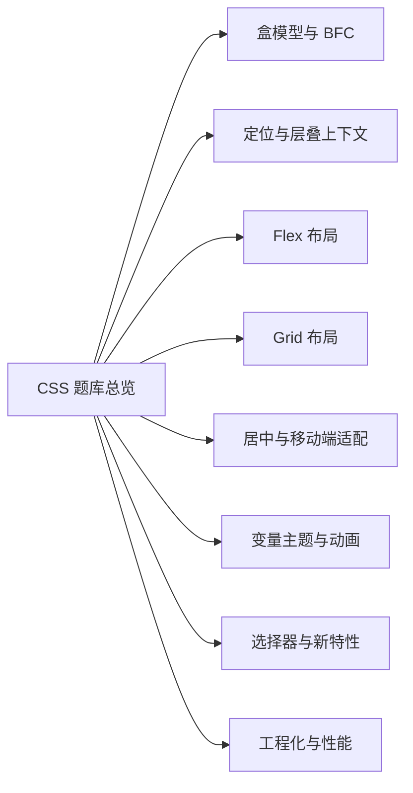

## 目录

- 一、盒模型与 margin（CSS-001 ~ CSS-008）
- 二、BFC 与 IFC（CSS-009 ~ CSS-012）
- 三、定位与层叠上下文（CSS-013 ~ CSS-018）
- 四、Flex 布局（CSS-019 ~ CSS-027）
- 五、Grid 布局（CSS-028 ~ CSS-033）
- 六、居中方案（CSS-034 ~ CSS-037）
- 七、移动端适配与媒体查询（CSS-038 ~ CSS-042）
- 八、CSS 变量与主题切换（CSS-043 ~ CSS-045）
- 九、transition、animation 与渲染性能（CSS-046 ~ CSS-051）
- 十、伪类伪元素、优先级与继承（CSS-052 ~ CSS-056）
- 十一、CSS 工程化与性能（CSS-057 ~ CSS-060）
- 十二、选择器进阶（CSS-061 ~ CSS-066）
- 十三、布局专题实战（CSS-067 ~ CSS-074）
- 十四、响应式设计系统（CSS-075 ~ CSS-081）
- 十五、动画工程（CSS-082 ~ CSS-088）
- 十六、视觉与图形（CSS-089 ~ CSS-095）
- 十七、文字排版（CSS-096 ~ CSS-101）
- 十八、组件样式模式（CSS-102 ~ CSS-108）
- 十九、CSS 架构方法（CSS-109 ~ CSS-115）
- 二十、性能与渲染（CSS-116 ~ CSS-121）
- 二十一、新特性与兼容（CSS-122 ~ CSS-130）
- 二十二、经典布局题全解（CSS-131 ~ CSS-138）
- 二十三、Flex 深水区（CSS-139 ~ CSS-145）
- 二十四、Grid 深水区（CSS-146 ~ CSS-152）
- 二十五、动效实战案例（CSS-153 ~ CSS-159）
- 二十六、复杂组件样式还原（CSS-160 ~ CSS-166）
- 二十七、主题与设计系统落地（CSS-167 ~ CSS-172）
- 二十八、移动端深坑全解（CSS-173 ~ CSS-178）
- 二十九、CSS 与 JS 协作（CSS-179 ~ CSS-184）
- 三十、调试与质量（CSS-185 ~ CSS-190）
- 三十一、综合与体系（CSS-191 ~ CSS-200）

## 一、盒模型与 margin

### CSS-001：标准盒模型和 IE 盒模型有什么区别？如何切换？

**答**：
- 标准盒模型（content-box）：`width` 只包含内容区，总宽度 = width + padding + border。
- IE 盒模型（border-box）：`width` 已包含 padding 和 border，实际内容区被压缩。
- 通过 `box-sizing: border-box` 切换，切到 border-box 后布局计算更直观。
- 现代工程默认全局使用 border-box，避免加 padding 导致元素变宽。

```css
.box-standard {
  box-sizing: content-box; /* 默认值，width 只算内容 */
  width: 200px;
  padding: 20px;
  border: 5px solid #333;
  /* 实际占用宽度 = 200 + 20*2 + 5*2 = 250px */
}

.box-ie {
  box-sizing: border-box; /* width 含 padding 与 border */
  width: 250px;
  padding: 20px;
  border: 5px solid #333;
  /* 实际占用宽度 = 250px，内容区被压缩为 200px */
}
```

### CSS-002：一个元素的最终占用宽度如何计算？

**答**：
- content-box 下：占用宽度 = width + padding-left/right + border-left/right。
- `margin` 只影响元素与外部的间距，会撑开占位但不绘制背景，也不算进内容宽度。
- 行内非替换元素的 padding 左右生效、上下不参与行高计算，容易踩坑。
- 用 DevTools 的 Computed 面板可以直接看到各部分尺寸分解。

```css
.card {
  box-sizing: content-box;
  width: 300px;          /* 内容宽 */
  padding: 10px 20px;    /* 左右各 20 */
  border: 2px solid #096;
  margin: 0 15px;        /* 不计入内容宽度，但占位 */
}
/* 视觉宽度 = 300 + 40 + 4 = 344px
   水平占位 = 344 + 30 = 374px */
```

### CSS-003：相邻兄弟元素的 margin 合并是怎么回事？如何避免？

**答**：
- 垂直方向上相邻块级元素的 `margin-bottom` 与 `margin-top` 会合并，取较大值而不是相加。
- 水平方向的 margin 永远不合并。
- 避免方式：让两元素不处于同一 BFC、改用 flex/grid 容器（子元素间不合并）、或只使用单侧 margin。
- 工程上推荐统一用 `margin-bottom` 单方向间距，从源头规避。

```css
/* HTML: <div class="a">A</div><div class="b">B</div> */
.a { margin-bottom: 30px; }
.b { margin-top: 20px; }
/* A 与 B 之间间距是 30px（取较大值），不是 50px */

/* 解决方案一：外层用 flex 容器 */
.list {
  display: flex;
  flex-direction: column;
}
.list > .item { margin: 10px 0; } /* flex 子项间不合并 */

/* 解决方案二：BFC 包裹 */
.bfc-wrap { overflow: hidden; }
```

### CSS-004：父子元素 margin 塌陷的原因与解决方案？

**答**：
- 父元素没有 border、padding 或行内内容分隔时，第一个子元素的 `margin-top` 会“穿透”到父元素外，表现为父元素被一起推下去。
- 本质是父元素与子元素的上边界相邻，属于外边距合并的一种。
- 解决：给父元素建立 BFC、加 `padding-top` 或 `border-top` 分隔、改用 padding 撑间距。
- 推荐习惯：间距一律用父元素 padding 或 gap，而不是第一个子元素的 margin。

```css
/* 问题代码 */
.parent {
  background: #eee;
}
.parent > .child {
  margin-top: 50px; /* 穿透出去，父元素整体下移 50px */
}

/* 方案一：父元素建立 BFC */
.parent { overflow: hidden; }

/* 方案二：padding 分隔 */
.parent { padding-top: 1px; }

/* 方案三：伪元素分隔（不产生多余 DOM） */
.parent::before {
  content: "";
  display: table;
}
```

### CSS-005：空块级元素的 margin 合并是什么现象？

**答**：
- 一个没有内容、没有 border/padding/height 的空块级元素，它自己的 `margin-top` 和 `margin-bottom` 会合并为一个值。
- 它还会和前后兄弟的 margin 继续合并，导致间距“消失”。
- 解决：给它最小高度、border、padding，或加 `overflow: hidden` 建立 BFC。
- 该题常用于考察对 margin 合并三个条件（相邻/父子/空元素）的完整记忆。

```css
.prev { margin-bottom: 40px; }

.empty {
  margin-top: 30px;
  margin-bottom: 30px;
  /* 空元素自身合并为 30px，再与上方 40px 合并 → 40px */
}

.next { margin-top: 20px; } /* 再合并仍为 40px */

/* 修复：阻断合并 */
.empty.fixed {
  overflow: hidden; /* 建立 BFC，自身上下 margin 不再合并 */
}
```

### CSS-006：负 margin 有哪些实际应用？

**答**：
- 负 `margin-top/left` 会把元素向上/向左拉，负 `margin-bottom/right` 会让后续元素贴上来。
- 经典应用：等高多列布局、圣杯/双飞翼布局的中间列让位。
- 消除列表最后一项的多余间距：给容器加负 margin-bottom 抵消。
- 配合 `padding` 可以实现“撑大自身但不改变内容宽度”的视觉扩展（如输入框 focus 外扩）。

```css
/* 应用一：列表末项多余间距抵消 */
.tag-list {
  margin-right: -10px; /* 抵消每个 tag 的右边距 */
  overflow: hidden;
}
.tag-list .tag {
  float: left;
  margin-right: 10px;
  margin-bottom: 10px;
}

/* 应用二：双飞翼布局，中间列优先渲染 */
.main { float: left; width: 100%; }
.sub  { float: left; width: 190px; margin-left: -100%; }
.extra{ float: left; width: 230px; margin-left: -230px; }
```

### CSS-007：padding 的百分比是相对什么计算的？如何用它实现固定宽高比？

**答**：
- padding 的百分比无论上下左右，都是相对**父元素的宽度**计算的。
- 老方案 `padding-top: 50%` 配合 `height: 0` 可以实现 2:1 占位框。
- 现代方案直接用 `aspect-ratio: 16 / 9`，语义更清晰。
- 面试时应能说出两种方案的演进关系与兼容性差异。

```css
/* 旧方案：padding-top 百分比占位，实现 16:9 */
.ratio-box {
  position: relative;
  height: 0;
  padding-top: 56.25%; /* 相对父宽，100/16*9 */
}
.ratio-box > .content {
  position: absolute;
  inset: 0;
}

/* 新方案：aspect-ratio */
.ratio-modern {
  aspect-ratio: 16 / 9;
  width: 100%;
}
```

### CSS-008：为什么工程中普遍使用 box-sizing: border-box 全局重置？

**答**：
- content-box 下改 padding 就会改变元素总宽，栅格与弹性布局很容易被撑破。
- border-box 让 `width` 所见即所得，配合百分比宽度做加减法更直观。
- 现代重置常用 `box-sizing: border-box` + 继承，避免第三方组件被波及时难以覆盖。
- 注意 `min-width/max-width` 同样受 `box-sizing` 影响（计算方式与 `width` 一致），重点还是统一心智模型。

```css
/* 现代重置写法：继承式 border-box */
*,
*::before,
*::after {
  box-sizing: border-box;
}

/* 更稳妥：允许第三方组件改回 content-box */
html {
  box-sizing: border-box;
}
*, *::before, *::after {
  box-sizing: inherit;
}
```

## 二、BFC 与 IFC

### CSS-009：什么是 BFC？触发条件有哪些？

**答**：
- BFC（Block Formatting Context）块级格式化上下文，是一块独立的渲染区域，内部布局不影响外部。
- 触发条件：根元素、`float` 非 none、`position: absolute/fixed`、`display: inline-block/table-cell/flex/grid/flow-root`。
- `overflow: hidden/auto/scroll` 也可触发，但可能裁剪内容或产生滚动条。
- `display: flow-root` 是无副作用的专用触发方式，现代浏览器首选。
- BFC 三大特性：隔离 margin 合并、包含浮动、不与浮动元素重叠。

```css
/* 各种触发 BFC 的方式 */
.bfc-root   { display: flow-root; }      /* 推荐，无副作用 */
.bfc-overflow { overflow: auto; }         /* 可能有滚动条 */
.bfc-float  { float: left; }              /* 影响文档流 */
.bfc-abs    { position: absolute; }       /* 脱离文档流 */
.bfc-flex   { display: flex; }            /* 内部变成 flex 格式化上下文 */
.bfc-table  { display: table-cell; }
```

### CSS-010：如何用 BFC 解决 margin 塌陷和高度塌陷？

**答**：
- margin 塌陷：给父元素建 BFC，父子 margin 不再合并，子元素 margin 被包含在内。
- 高度塌陷：子元素浮动后父元素高度为 0，BFC 容器在计算高度时会把浮动子元素包含进来。
- 对比 `clear: both` 的伪元素方案：BFC 是“包含”，clear 是“让开”，语义不同。
- 两种场景都推荐 `display: flow-root` 一行解决。

```css
/* 场景一：margin 塌陷 */
.parent-margin {
  display: flow-root;  /* 子元素 margin-top 不再穿透 */
  background: #f5f5f5;
}
.parent-margin > .child { margin-top: 40px; }

/* 场景二：浮动导致父元素高度塌陷 */
.parent-float {
  display: flow-root;  /* 高度被浮动子元素撑起 */
}
.parent-float > .left {
  float: left;
  width: 200px;
  height: 100px;
  background: #096;
}
```

### CSS-011：清除浮动有哪些方式？BFC 方案和 clear 方案的区别？

**答**：
- 方式一：伪元素 `::after { content: ""; display: block; clear: both; }`，最经典。
- 方式二：父元素建立 BFC（flow-root / overflow: hidden）。
- 方式三：在末尾添加空标签 `clear: both`，已过时，产生无意义 DOM。
- 区别：clear 让浮动元素之后的盒子“下移让开”，BFC 让容器真正“包住”浮动，可继续利用浮动特性排版。
- 现代布局优先用 flex/grid，浮动只在文字环绕等场景使用。

```css
/* 方案一：伪元素清除（clear 思路） */
.clearfix::after {
  content: "";
  display: block;
  clear: both;
}

/* 方案二：BFC 包含浮动 */
.bfc-clear {
  display: flow-root;
}

/* 演示结构 */
/* <div class="clearfix">
     <div style="float:left; width:100px; height:100px;">浮动块</div>
   </div>
   <p>后续内容</p> */
```

### CSS-012：IFC 是什么？行内元素的排版规则有哪些？

**答**：
- IFC（Inline Formatting Context）行内格式化上下文，由一行内多个行内级元素构成行盒（line box）。
- 行内元素水平方向用 margin/padding，垂直方向的 padding 不影响布局高度，margin 上下无效。
- 行盒高度由最高的 inline-level 盒决定，`vertical-align` 控制行内盒子在行盒内的对齐。
- 经典坑：图片下方出现空隙，因为图片默认按 baseline 对齐，底部到行盒底缘有 descent 空隙。

```css
/* 经典坑：img 底部 4px 左右空隙 */
.img-wrap {
  font-size: 0;        /* 解法一：去掉 baseline 空隙来源 */
}
.img-wrap img {
  display: block;      /* 解法二：变成块级 */
}
.img-wrap img.valign {
  vertical-align: top; /* 解法三：改对齐方式 */
}

/* 行内元素 padding 的行为 */
span.demo {
  padding: 10px;       /* 左右撑开布局，上下只是视觉绘制 */
  background: #fc0;
}
```

## 三、定位与层叠上下文

### CSS-013：position 各取值的含义与使用场景？

**答**：
- `static`：默认值，不参与定位，z-index 无效。
- `relative`：相对自身原位置偏移，不脱离文档流，常用作 absolute 的定位参照。
- `absolute`：脱离文档流，相对最近的非 static 祖先定位。
- `fixed`：相对视口定位，脱离文档流；祖先有 transform/filter 时会失效（参照该祖先）。
- `sticky`：粘性定位，在滚动范围内“吸顶/吸边”，必须指定 top/bottom 等阈值。

```css
.nav {
  position: sticky;   /* 滚动吸顶 */
  top: 0;
  z-index: 100;
  background: #fff;
}

.badge {
  position: absolute; /* 配合父级 relative */
  top: -8px;
  right: -8px;
}
.card { position: relative; }

.back-top {
  position: fixed;    /* 相对视口 */
  right: 20px;
  bottom: 20px;
}
```

### CSS-014：absolute 元素的包含块是怎么确定的？

**答**：
- 默认规则：最近的 `position` 非 static 的祖先元素的 padding box。
- 若祖先是 `transform`、`perspective`、`filter`、`will-change` 等，则该祖先成为包含块，即使它是 static。
- `position: fixed` 的包含块通常是视口，但存在上述属性祖先时改为那个祖先。
- 理解包含块才能解释“transform 导致 fixed 失效”这类高频问题。

```css
/* HTML: <div class="outer"><div class="inner">fixed?</div></div> */
.outer {
  transform: translateZ(0); /* 创建了包含块 */
}
.inner {
  position: fixed;
  top: 0;
  left: 0;
  /* 实际相对 .outer 定位，而不是视口 */
}
```

### CSS-015：sticky 的生效条件？哪些场景会失效？

**答**：
- 必须显式设置 `top/bottom/left/right` 中的至少一个阈值。
- 元素在其最近的滚动祖先内吸附，且**不能超出父容器的边界**，父容器滚出视口时随之消失。
- 祖先设置 `overflow: hidden/auto/scroll` 会改变滚动容器，常导致 sticky 失效。
- 表格中的 `thead th { position: sticky }` 是典型应用，注意父级不能有 overflow 裁剪。

```css
/* 生效示例 */
.sidebar {
  position: sticky;
  top: 20px;          /* 距视口 20px 时吸附 */
  align-self: flex-start; /* flex 子项需此项，防止被拉伸 */
}

/* 失效示例一：没有阈值 */
.bad-sticky-1 { position: sticky; }

/* 失效示例二：父容器 overflow 裁剪 */
.scroll-wrap { overflow: hidden; }
.scroll-wrap .bad-sticky-2 { position: sticky; top: 0; }
```

### CSS-016：z-index 在什么情况下会失效？

**答**：
- `position: static` 的普通元素上 z-index 无效。
- 只有定位元素或 flex/grid 子项的 z-index 才参与排序。
- 父元素创建了新的层叠上下文时，子元素 z-index 只在父上下文内部比较，表现为“失效”。
- 排查思路：逐级向上找是谁创建了层叠上下文，把 z-index 提升到正确层级或去掉干扰属性。

```css
/* 失效场景一：static 元素 */
.static-box { z-index: 999; } /* 无效 */

/* 失效场景二：被父级层叠上下文隔离 */
.mask-parent {
  transform: translateZ(0); /* 创建层叠上下文，z-index: auto */
}
.mask-parent .mask {
  position: absolute;
  z-index: 9999; /* 只在 mask-parent 内部比较，
                    无法盖住 mask-parent 之外 z-index 更高的兄弟 */
}
```

### CSS-017：层叠顺序是什么？同一层叠上下文中元素如何叠放？

**答**：
- 同一层叠上下文内按七级顺序叠放，z-index 数值只影响后两级。
- 决定因素：层叠等级 > 层叠顺序 > DOM 顺序，二者都相同时后来者居上。
- 创建层叠上下文的常见属性：根元素、z-index 非 auto 的定位元素、opacity < 1、transform、filter、isolation: isolate。
- `isolation: isolate` 是一个“无副作用”的创建方式，常用于隔离混合模式。

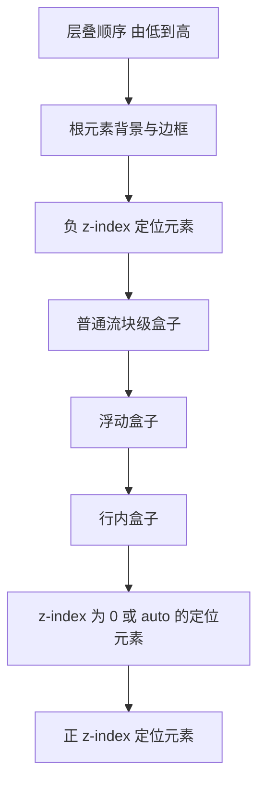

```css
.a { position: absolute; z-index: -1; }  /* 位于普通流之下 */
.b { position: relative; z-index: auto; }/* 与普通流之上、负 z 之上 */
.c { opacity: 0.99; position: relative; }/* opacity<1 创建新上下文 */
```

### CSS-018：为什么给父元素加 transform 后子元素的 fixed 定位会失效？

**答**：
- transform/perspective/filter 等属性会让该元素成为后代 fixed/absolute 元素的包含块。
- 于是 fixed 不再相对视口，而是相对这个带 transform 的祖先。
- 这也是弹窗组件挪到 body 下渲染（portal）的原因之一：避免祖先的 transform 污染。
- 反向利用：全屏遮罩只想覆盖某个卡片时，可以故意在卡片上加 transform。

```css
/* 失效场景 */
.modal-host {
  transform: scale(1); /* 即使值不变也生效 */
}
.modal-host .modal-mask {
  position: fixed;
  inset: 0;            /* 期望盖住视口，实际只盖住 modal-host */
  background: rgba(0,0,0,.5);
}

/* 主动利用：遮罩只覆盖卡片 */
.card { transform: translateZ(0); }
.card .card-mask { position: fixed; inset: 0; }
```

## 四、Flex 布局

### CSS-019：flex 容器、项目、主轴与交叉轴的基本概念？

**答**：
- `display: flex` 的元素是 flex 容器，其直接子元素自动成为 flex 项目。
- 主轴由 `flex-direction` 决定（默认 row 水平向右），交叉轴垂直于主轴。
- `justify-content` 管主轴对齐，`align-items` 管交叉轴对齐。
- 项目默认不换行（nowrap）。默认 `min-width: auto` 会让项目收缩时不小于内容最小宽度（min-content），想让它继续压缩需显式设 `min-width: 0`。

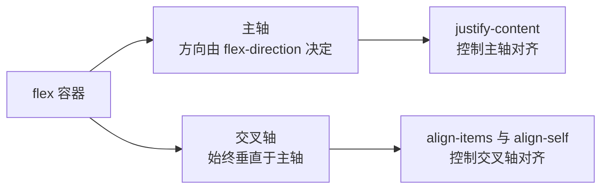

```css
.container {
  display: flex;
  flex-direction: row;    /* 主轴水平，交叉轴垂直 */
  justify-content: space-between; /* 主轴：两端对齐 */
  align-items: center;    /* 交叉轴：垂直居中 */
}
.item { flex: 1; }        /* 均分剩余空间 */
```

### CSS-020：justify-content 各取值的区别？

**答**：
- `flex-start/flex-end/center`：起点对齐/终点对齐/居中。
- `space-between`：两端贴边，中间等分剩余空隙。
- `space-around`：每个项目两侧空隙相等，所以项目之间空隙是边缘的两倍。
- `space-evenly`：所有空隙（含边缘）完全相等。
- 剩余空间不足时这些都收拢为 flex-start，配合 overflow 处理。

```css
.demo {
  display: flex;
  gap: 8px;
}
.demo.start  { justify-content: flex-start; }
.demo.center { justify-content: center; }
.demo.between{ justify-content: space-between; }
.demo.around { justify-content: space-around; }
.demo.evenly { justify-content: space-evenly; }
/* 三个子项宽度 100，容器 500，剩余 200：
   between 边缘 0 / 中间 100
   around 边缘 33.3 / 中间 66.7
   evenly 边缘 50 / 中间 50 */
```

### CSS-021：align-items 与 align-self 的关系？

**答**：
- `align-items` 是容器属性，设置所有项目的交叉轴对齐方式，默认 `stretch`。
- `align-self` 是项目属性，可单独覆盖某个项目的对齐，默认 `auto`（继承容器的 align-items）。
- `stretch` 只在项目交叉轴尺寸为 auto 时生效，设置了 height 就不再拉伸。
- `baseline` 按文本基线对齐，常用于图文混排的对齐微调。

```css
.row {
  display: flex;
  height: 120px;
  align-items: center; /* 全部垂直居中 */
}
.row .top    { align-self: flex-start; }
.row .bottom { align-self: flex-end; }
.row .full   { align-self: stretch; } /* 单独拉伸占满 */
.row .text   { align-self: baseline; }
```

### CSS-022：align-content 什么时候才生效？

**答**：
- 只在容器**换行**（`flex-wrap: wrap` 或 wrap-reverse）且交叉轴有剩余空间时生效。
- 作用对象是“多根轴线”，即多行整体在交叉轴上的分布。
- 单行 flex 布局设置它没有任何效果，这是高频易错点。
- 常用组合：`flex-wrap: wrap` + `align-content: flex-start` 解决多行卡片列表被拉开的问题。

```css
.grid-cards {
  display: flex;
  flex-wrap: wrap;
  height: 600px;
  align-content: flex-start; /* 多行整体靠上，而不是默认 stretch 拉开 */
  gap: 16px;
}
.grid-cards .card {
  width: calc((100% - 32px) / 3);
}
/* 若去掉 align-content，行数少时行间距会被自动拉大 */
```

### CSS-023：flex-grow、flex-shrink、flex-basis 分别如何工作？

**答**：
- `flex-basis` 定义分配剩余空间前项目的主轴基准尺寸，auto 时取 width/height。
- `flex-grow` 按“份数”分配正剩余空间：各项目分得 剩余 × 自身份数 / 总份数。
- `flex-shrink` 在空间不足时按“份数 × 基准尺寸”加权收缩，默认 1，0 表示不收缩。
- 面试常考计算题：总份数、加权收缩的权重是 grow×basis 而不是单纯份数。

```css
/* grow 示例：容器 600px，两项 basis 各 200px，剩余 200px */
.bar { display: flex; }
.bar .a { flex: 2 0 200px; } /* 分 2/3 → 多拿 133.3，最终 333.3 */
.bar .b { flex: 1 0 200px; } /* 分 1/3 → 多拿 66.7，最终 266.7 */

/* shrink 示例：容器 400px，两项 basis 各 300px，超 200px */
.shrink-bar { display: flex; width: 400px; }
.shrink-bar .x { flex: 1 1 300px; } /* 权重 300 */
.shrink-bar .y { flex: 1 2 300px; } /* 权重 600 */
/* x 收缩 200 × 300/900 ≈ 66.7 → 233.3；y 收缩 133.3 → 166.7 */
```

### CSS-024：flex:1、flex:auto、flex:none 的区别？

**答**：
- `flex: 1` = `1 1 0%`：完全忽略内容尺寸，按 grow 份数严格均分。
- `flex: auto` = `1 1 auto`：先按内容分配，再均分剩余空间，各项基础尺寸不同。
- `flex: none` = `0 0 auto`：固定内容尺寸，不伸不缩。
- `flex: initial` = `0 1 auto`：不伸但可缩，即默认值。
- 布局诉求“等分”用 flex:1，“自适应内容但瓜分剩余”用 auto。

```css
.eq   { flex: 1; }    /* 1 1 0%   严格等分 */
.grow { flex: auto; } /* 1 1 auto 内容优先 */
.fixed{ flex: none; } /* 0 0 auto 固定尺寸，如固定侧栏 */
/* 经典三栏：固定侧栏 + 自适应主区 */
.layout { display: flex; }
.layout .side  { flex: none; width: 220px; }
.layout .main  { flex: 1; min-width: 0; }
```

### CSS-025：flex-basis 与 width 谁优先生效？

**答**：
- 主轴为水平时，`flex-basis` 优先于 `width`；basis 为 `auto` 时才回退到 width。
- 主轴为垂直（column）时，basis 优先于 `height`。
- `flex-basis: 0` 与 `auto` 是 flex:1 和 flex:auto 行为差异的根源。
- min-width/max-width 仍会约束最终结果，优先级高于 basis 与 width。

```css
.item {
  width: 300px;
  flex-basis: 200px; /* 生效：主轴基准取 200 而非 300 */
}
.item-auto {
  width: 300px;
  flex-basis: auto;  /* 回退使用 width = 300 */
}
.item-max {
  flex: 1 0 500px;
  max-width: 400px;  /* 最终被 max-width 限制在 400 */
}
```

### CSS-026：flex 子项内容过长把容器撑爆怎么办？min-width: 0 的作用？

**答**：
- flex 子项默认 `min-width: auto`，即不允许收缩到内容最小宽度以下，长文本/长表格会撑破容器。
- 解决：给需要收缩的子项设置 `min-width: 0`（垂直方向对应 `min-height: 0`）。
- 文本溢出配合 `overflow: hidden` + `text-overflow: ellipsis` 才能生效。
- 这是“flex + ellipsis 不生效”类 bug 的标准答案。

```css
/* HTML: <div class="chat"><div class="side">侧栏</div><div class="msg">超长的消息文本超长的消息文本…</div></div> */
.chat {
  display: flex;
  width: 100%;
}
.chat .side { flex: none; width: 120px; }
.chat .msg {
  flex: 1;
  min-width: 0;              /* 关键：允许收缩到内容以下 */
  white-space: nowrap;
  overflow: hidden;
  text-overflow: ellipsis;   /* 没有 min-width:0 时这行不生效 */
}
```

### CSS-027：为什么 flex 布局中 margin: auto 可以实现居中？

**答**：
- flex 容器内 `margin: auto` 会吸收该方向上的**全部剩余空间**，优先级高于 justify-content/align-items 的分配。
- 由此可得多种局部对齐技巧：`margin-left: auto` 把项目推到最右。
- 相比 absolute + transform 居中，它不脱离文档流、无需已知尺寸。
- 多个 auto margin 时剩余空间被均分，可实现非对称排版。

```css
.modal-row {
  display: flex;
  height: 300px;
}
.modal-row .box {
  margin: auto;      /* 水平 + 垂直同时居中 */
  width: 200px;
}

/* 技巧：最后一项推到最右 */
.toolbar { display: flex; gap: 8px; }
.toolbar .spacer-free { margin-left: auto; }
```

## 五、Grid 布局

### CSS-028：fr 单位与 repeat、minmax、auto-fill 如何配合实现响应式列？

**答**：
- `fr` 表示剩余空间的份数，`grid-template-columns: 1fr 2fr` 即 1:2 分配。
- `repeat(auto-fill, minmax(200px, 1fr))` 是响应式卡片栅格的万能模板：列宽最小 200px，能放几列放几列，剩余均分。
- `auto-fill` 尽可能多地创建轨道（空轨道保留），`auto-fit` 会折叠空轨道让内容拉伸填满。
- minmax 限定轨道尺寸范围，避免过窄或过宽。

```css
/* 响应式卡片栅格：无需媒体查询 */
.cards {
  display: grid;
  grid-template-columns: repeat(auto-fill, minmax(220px, 1fr));
  gap: 16px;
}

/* 1:2 两列 */
.split {
  display: grid;
  grid-template-columns: 1fr 2fr;
}

/* auto-fill 与 auto-fit 的差异在项目少时可见 */
.fill  { display: grid; grid-template-columns: repeat(auto-fill,  minmax(100px, 1fr)); }
.fit   { display: grid; grid-template-columns: repeat(auto-fit,   minmax(100px, 1fr)); }
```

### CSS-029：grid-template-areas 如何实现经典页面布局？

**答**：
- 给每个网格区域命名，项目用 `grid-area` 对号入座，布局一目了然。
- 同名区域自动合并成一个矩形块，必须保证每行字符串的列数一致。
- 响应式改版只需改容器一行模板，项目代码完全不动。
- 空区域用 `.` 占位。

```css
/* HTML: header / nav / main / aside / footer 五个语义标签 */
.page {
  display: grid;
  grid-template-areas:
    "header header header"
    "nav    main   aside"
    "footer footer footer";
  grid-template-columns: 200px 1fr 260px;
  grid-template-rows: 64px 1fr 80px;
  min-height: 100vh;
  gap: 12px;
}
.page > header { grid-area: header; }
.page > nav    { grid-area: nav; }
.page > main   { grid-area: main; }
.page > aside  { grid-area: aside; }
.page > footer { grid-area: footer; }
```

### CSS-030：gap 与 margin 方案相比好在哪？

**答**：
- `row-gap/column-gap`（或简写 gap）在轨道与项目之间产生固定间距，首尾不产生多余空白。
- 用 margin 实现同样效果需要 `nth-child` 去边距或负 margin 技巧，代码更脆弱。
- flex 与 grid 都支持 gap，多行换行场景下不用处理行尾对齐问题。
- gap 参与容器尺寸计算，配合 fr 与 auto-fill 时结果精确。

```css
/* margin 方案的繁琐 */
.list-margin { display: flex; flex-wrap: wrap; margin: -8px; }
.list-margin .item { margin: 8px; width: calc(25% - 16px); }

/* gap 方案 */
.list-gap {
  display: grid;
  grid-template-columns: repeat(4, 1fr);
  gap: 16px;            /* 行列间距都为 16 */
}
.list-gap .item { /* 无需任何 margin 计算 */ }
```

### CSS-031：隐式轨道与 grid-auto-rows、grid-auto-flow 是什么？

**答**：
- 超出 `grid-template-*` 定义范围的单元格会落入隐式轨道，尺寸由 `grid-auto-rows/auto-columns` 决定。
- `grid-auto-flow: row/column/dense` 控制自动放置算法的方向，`dense` 会回填空隙。
- 列表长度不定时常用 `grid-auto-rows: minmax(100px, auto)` 统一隐式行。
- dense 适合瀑布流式填充，但会改变视觉顺序，注意可访问性。

```css
.masonry {
  display: grid;
  grid-template-columns: repeat(3, 1fr);
  grid-auto-rows: 10px;    /* 隐式行做最小刻度 */
  grid-auto-flow: dense;   /* 自动回填空隙 */
}
.masonry .item {
  grid-row: span 6;        /* 用行数近似瀑布流高度 */
}
.masonry .tall { grid-row: span 12; }
```

### CSS-032：Grid 中的对齐属性 place-items、place-content、place-self 区别？

**答**：
- `place-items`：容器属性，设置所有项目在其格子内的对齐（align-items + justify-items 简写）。
- `place-content`：容器属性，当容器比所有轨道总和大时，控制整个“轨道组”的对齐。
- `place-self`：项目属性，单个项目在所属格子内的对齐。
- 记忆：items 管“项目在格子里”，content 管“格子整体在容器里”，self 管“单个项目”。

```css
.board {
  display: grid;
  grid-template-columns: repeat(3, 120px);
  width: 600px;
  height: 400px;
  place-content: center;      /* 整组轨道在容器内居中 */
  place-items: center;        /* 每个项目在自己格子内居中 */
}
.board .special { place-self: start end; } /* 垂直 start，水平 end */
```

### CSS-033：如何用 Grid 实现圣杯布局？

**答**：
- 三行结构：顶部 header、中部三栏（左中右）、底部 footer，中栏自适应。
- 用 `grid-template-areas` 命名比浮动/负 margin 版本简洁一个量级。
- 中栏左右固定宽度，中间 1fr，天然等高（行高由最高列决定）。
- 窄屏时改一下模板字符串即可变单列，无需改 HTML。

```css
.holy-grail {
  display: grid;
  grid-template:
    "header header header" 60px
    "left   main   right"  1fr
    "footer footer footer" 50px
    / 180px 1fr 180px;   /* rows / columns 一次性定义 */
  min-height: 100vh;
}
.holy-grail > header { grid-area: header; }
.holy-grail > .left  { grid-area: left; }
.holy-grail > main   { grid-area: main; }
.holy-grail > .right { grid-area: right; }
.holy-grail > footer { grid-area: footer; }

@media (max-width: 768px) {
  .holy-grail {
    grid-template:
      "header" 60px
      "main"   1fr
      "left"   auto
      "right"  auto
      "footer" 50px
      / 1fr;
  }
}
```

## 六、居中方案

### CSS-034：水平居中有哪些方案？分别适用于什么元素？

**答**：
- 行内/行内块元素：父元素 `text-align: center`。
- 块级元素且有定宽：`margin: 0 auto`。
- 任意元素：flex 容器 `justify-content: center`，或 grid `justify-items: center`。
- absolute 元素：`left: 0; right: 0; margin: auto` 需要定宽，未知宽高用 transform 方案（见下一题）。

```css
/* 行内内容居中 */
.text-center { text-align: center; }

/* 定宽块级居中 */
.block-center {
  width: 400px;
  margin: 0 auto;
}

/* 任意元素：flex */
.flex-center { display: flex; justify-content: center; }
```

### CSS-035：未知宽高的元素如何一行代码水平垂直居中？

**答**：
- `display: grid` + `place-items: center`（或 `place-content: center`）是最短写法。
- flex 版本：`display: flex; justify-content: center; align-items: center`。
- absolute 版本：`inset: 0; margin: auto` 需要内容有确定尺寸；未知尺寸用 `translate(-50%, -50%)`。
- 面试建议给出至少三种并说明适用差异（是否影响兄弟元素、是否脱离文档流）。

```css
/* 方案一：grid，一行搞定 */
.parent { display: grid; place-items: center; }

/* 方案二：flex */
.parent-flex {
  display: flex;
  justify-content: center;
  align-items: center;
}

/* 方案三：absolute + translate，未知宽高 */
.parent-abs { position: relative; }
.child-abs {
  position: absolute;
  left: 50%;
  top: 50%;
  transform: translate(-50%, -50%);
}
```

### CSS-036：absolute 定位的元素如何水平垂直居中（已知和未知宽高）？

**答**：
- 已知宽高：`left/top: 50%` + 负 margin（宽高的一半），兼容性最好。
- 未知宽高：`transform: translate(-50%, -50%)`，注意 transform 会创建层叠上下文。
- 弹性法：四个方向都设 0 + `margin: auto`，元素需要有明确 width/height。
- 需要动画时推荐保留 translate 方案并把动画放在 transform 上，减少重排。

```css
.overlay { position: relative; }

/* 已知宽高 300x200 */
.known {
  position: absolute;
  left: 50%; top: 50%;
  width: 300px; height: 200px;
  margin: -100px 0 0 -150px;
}

/* 未知宽高 */
.unknown {
  position: absolute;
  left: 50%; top: 50%;
  transform: translate(-50%, -50%);
}

/* 四方向归零 + auto */
.stretch-center {
  position: absolute;
  inset: 0;
  margin: auto;
  width: max-content;   /* 需要确定尺寸 */
  height: max-content;
}
```

### CSS-037：不用 flex/grid 的传统垂直居中方案有哪些？

**答**：
- 单行文本：`line-height` 等于容器高度。
- 多行文本或未知高度：`display: table-cell; vertical-align: middle`。
- 伪元素幽灵节点法：`::before` 撑起 inline-block 全高，内容 vertical-align: middle。
- absolute + translate 也属于传统方案，见上一题。

```css
/* 单行文本 */
.one-line {
  height: 48px;
  line-height: 48px;
}

/* table-cell */
.cell {
  display: table-cell;
  vertical-align: middle;
  height: 200px;
}

/* 幽灵节点法 */
.ghost {
  text-align: center;
  height: 300px;
}
.ghost::before {
  content: "";
  display: inline-block;
  height: 100%;
  vertical-align: middle;
}
.ghost > .inner {
  display: inline-block;
  vertical-align: middle;
}
```

## 七、移动端适配与媒体查询

### CSS-038：rem 适配方案如何实现？postcss-pxtorem 在其中扮演什么角色？

**答**：
- rem 相对根元素 `font-size`，设计稿适配的核心是“按屏宽动态设置 html 的 font-size”。
- JS 方案：`html.style.fontSize = clientWidth / 设计稿宽度 * 基准值`，如 375 稿对应 37.5px。
- postcss-pxtorem 在构建期把 px 自动换算成 rem，开发者仍按设计稿写 px。
- 简化方案：`html { font-size: calc(100vw / 7.5) }`，750 稿下 1rem = 100px，无需 JS。

```css
/* 纯 CSS 方案：750 设计稿，1rem = 100px */
html {
  font-size: calc(100vw / 7.5);
}
.title {
  font-size: 0.32rem;   /* 对应设计稿 32px */
  padding: 0.24rem;     /* 对应设计稿 24px */
}
/* 需要限制最大字号时叠加媒体查询 */
@media (min-width: 560px) {
  html { font-size: 75px; }
}
```

```javascript
// JS 动态方案（flexible 思路）
function setRem() {
  const designWidth = 375;
  const baseSize = 37.5; // 375 稿下 1rem = 37.5px，配 pxtorem rootValue: 37.5
  const scale = document.documentElement.clientWidth / designWidth;
  document.documentElement.style.fontSize = baseSize * Math.min(scale, 3) + 'px';
}
setRem();
window.addEventListener('resize', setRem);
```

### CSS-039：vw/vh 与 rem 方案相比有什么优劣？

**答**：
- vw 直接绑定视口宽度，1vw = 视口宽的 1%，无 JS、无根字号，链路更简单。
- rem 可以通过限制根字号范围避免大屏元素过大，vw 需要配合 clamp/max。
- vh 在移动端受地址栏收展影响，可用 dvh（dynamic viewport height）改善。
- 工程上常混合：布局用 vw/rem，文本用 clamp 做流式排版。

```css
/* vw 版本：750 设计稿 1vw = 7.5px，换算系数 100/7.5 */
.title {
  font-size: 4.27vw; /* 32px @375 */
}

/* 用 clamp 限制极端屏幕 */
.banner-title {
  font-size: clamp(20px, 4.27vw, 40px);
}

/* 移动端 100vh 问题 */
.full-screen {
  height: 100dvh;           /* 动态视口高度，地址栏收展自适应 */
  /* 兼容回退 */
  height: 100vh;
}
```

### CSS-040：移动端 1px 边框问题的成因与解决方案？

**答**：
- 成因：CSS 的 1px 是逻辑像素，dpr = 2/3 的屏幕上物理像素为 2px/3px，视觉偏粗。
- 方案一：伪元素绘制 200% 尺寸再 `transform: scale(0.5)` 缩回。
- 方案二：`border: 0.5px`（Safari 8+ / 新版 Chrome 支持降级需检测）。
- 方案三：viewport 缩放方案（根缩放 + 反向缩放），实现复杂现已少用。
- 推荐伪元素方案，可配 SCSS mixin 复用并支持单边控制。

```css
/* 方案一：伪元素 + scale（推荐） */
.hairline {
  position: relative;
}
.hairline::after {
  content: "";
  position: absolute;
  left: 0;
  top: 0;
  width: 200%;
  height: 200%;
  border: 1px solid #ddd;
  border-radius: 8px;
  transform: scale(0.5);          /* 视觉 0.5px 逻辑边框 */
  transform-origin: 0 0;
  box-sizing: border-box;
  pointer-events: none;
}

/* 方案二：0.5px 直接声明 */
.thin {
  border-bottom: 0.5px solid #ddd;
}
```

### CSS-041：媒体查询的语法与常用断点如何设计？

**答**：
- 语法：`@media (条件) and (条件) { ... }`，支持 min-width/max-width、orientation、prefers-reduced-motion 等。
- 移动优先：默认写移动样式，用 `min-width` 逐级增强，是主流工程实践。
- 断点应由设计系统和内容决定，常见 640/768/1024/1280/1536。
- 逻辑属性与 `min()`/`max()`/`clamp()` 能替代部分媒体查询，减少断点数量。

```css
/* 移动优先 */
.container { padding: 12px; }

@media (min-width: 768px) {
  .container { padding: 24px; max-width: 720px; margin: 0 auto; }
}
@media (min-width: 1024px) {
  .container { max-width: 960px; }
}

/* 组合条件：横屏且窄屏才换布局 */
@media (max-width: 900px) and (orientation: landscape) {
  .player { flex-direction: row; }
}

/* 尊重系统减少动效偏好 */
@media (prefers-reduced-motion: reduce) {
  * { animation: none !important; transition: none !important; }
}
```

### CSS-042：viewport meta 标签各参数含义？dpr 与适配方案如何演进？

**答**：
- `width=device-width`：布局视口等于设备逻辑宽度，移动端适配的前提。
- `initial-scale=1`：初始缩放；`maximum-scale/user-scalable` 控制缩放，禁用缩放损害可访问性，应慎用。
- `viewport-fit=cover` 配合 env(safe-area-inset-*) 处理刘海屏安全区。
- 适配演进：固定 320 布局 → rem flexible（dpr 缩放 viewport）→ vw/clamp 流式方案，dpr 只剩 1px 问题等少数场景需要关心。

```html
<!-- 标准移动端 viewport -->
<meta name="viewport" content="width=device-width, initial-scale=1, viewport-fit=cover" />

<style>
  /* 刘海屏安全区适配 */
  .tab-bar {
    position: fixed;
    bottom: 0;
    padding-bottom: env(safe-area-inset-bottom);
  }
  .full-bleed {
    padding-left: env(safe-area-inset-left);
  }
</style>
```

## 八、CSS 变量与主题切换

### CSS-043：CSS 自定义属性如何定义和使用？var() 的回退值怎么写？

**答**：
- 以 `--` 开头声明，`var(--name)` 读取；声明和读取都遵循级联与继承。
- `var(--name, fallback)` 提供回退值，fallback 里还可以再嵌套 var。
- 自定义属性可以被 JS 读写（`getPropertyValue` / `setProperty`），是运行时主题的基础。
- 作用域：`:root` 全局，组件内局部覆盖，子元素继承。

```css
:root {
  --brand: #409eff;
  --gap: 12px;
}
.btn {
  color: var(--brand);
  padding: 8px var(--gap);
  /* 回退值 */
  border-color: var(--btn-border, currentColor);
}
.btn--danger {
  /* 局部覆盖 */
  --brand: #f56c6c;
}

:root {
  /* 嵌套回退 */
  --line: var(--line-strong, var(--brand, #ccc));
}
```

```javascript
// JS 动态读写 CSS 变量
const root = document.documentElement;
root.style.setProperty('--brand', '#67c23a');
console.log(getComputedStyle(root).getPropertyValue('--brand'));
```

### CSS-044：CSS 变量与 Sass/Less 变量的本质区别？

**答**：
- Sass/Less 变量在**编译期**替换为字面量，产物中不存在；CSS 变量在**运行时**生效，保留在产物里。
- CSS 变量遵循级联与继承，可按 DOM 子树局部覆盖；预处理器变量无作用域概念进入 CSS 后不可变。
- CSS 变量能被 JS 读写、能进 media query 里重定义，预处理器变量不行。
- 组合用法：预处理器负责 mixin/嵌套，运行时动态性交给原生变量。

```scss
// Sass：编译期
$primary: #409eff;
.a { color: $primary; }       // 产物: color: #409eff，变量消失
@media (prefers-color-scheme: dark) {
  // $primary 无法在此被“换成另一个 Sass 变量后再被组件感知”
}

// CSS 变量：运行时
:root { --primary: #409eff; }
.b { color: var(--primary); }
@media (prefers-color-scheme: dark) {
  :root { --primary: #79bbff; } // .b 自动跟随，无需重新编译
}
```

### CSS-045：如何用 CSS 变量实现暗黑模式主题切换？

**答**：
- 在 `:root` 定义亮色 token，`[data-theme="dark"]` 下重定义同名 token。
- HTML 根元素挂 `data-theme`，JS 一行切换，全站自动生效。
- 可用 `prefers-color-scheme` 读取系统偏好作为默认值，用户手动选择存 localStorage。
- 切换动画可用 `view-transition` 或简单的 transition on color/background。

```css
:root {
  --bg: #ffffff;
  --text: #1f2328;
  --card: #f6f8fa;
}
[data-theme="dark"] {
  --bg: #0d1117;
  --text: #e6edf3;
  --card: #161b22;
}
body {
  background: var(--bg);
  color: var(--text);
  transition: background 0.3s, color 0.3s;
}
.card { background: var(--card); }
```

```javascript
// 初始化：系统偏好 + 用户选择
const saved = localStorage.getItem('theme');
const system = matchMedia('(prefers-color-scheme: dark)').matches ? 'dark' : 'light';
document.documentElement.dataset.theme = saved || system;

document.querySelector('#theme-toggle').addEventListener('click', () => {
  const next = document.documentElement.dataset.theme === 'dark' ? 'light' : 'dark';
  document.documentElement.dataset.theme = next;
  localStorage.setItem('theme', next);
});
```

## 九、transition、animation 与渲染性能

### CSS-046：transition 的四个子属性？哪些属性可以被过渡？

**答**：
- 四子属性：`transition-property`、`duration`、`timing-function`、`delay`，简写时 duration 在 delay 前。
- 可过渡的是“有中间值”的属性：长度、颜色、透明度、transform 等；display、visibility 是离散属性，默认无过渡（visibility 在过渡期结束时才切换；display 需配合 `transition-behavior: allow-discrete` 才可参与过渡）。
- 可用 `transition: all` 但性能差且易误伤，推荐显式列出属性。
- 高度 auto 无法过渡，需要用 grid-template-rows: 0fr/1fr 或 JS 计算等技巧。

```css
.btn {
  background: #409eff;
  color: #fff;
  /* property duration timing-function delay */
  transition: background 0.25s ease-out 0s,
              transform 0.25s ease;
}
.btn:hover {
  background: #337ecc;
  transform: translateY(-2px);
}

/* 高度 auto 过渡的 grid 技巧 */
.collapse {
  display: grid;
  grid-template-rows: 0fr;
  transition: grid-template-rows 0.3s;
}
.collapse.open { grid-template-rows: 1fr; }
.collapse > .inner { overflow: hidden; min-height: 0; }
```

### CSS-047：animation 与 @keyframes 的用法？常用子属性有哪些？

**答**：
- `@keyframes` 定义关键帧，`animation` 应用到元素；简写顺序 duration 与 delay 同 transition。
- 常用子属性：name、duration、timing-function、delay、iteration-count、direction、fill-mode、play-state。
- `fill-mode: forwards` 让动画停留在最后一帧，`backwards` 应用 delay 期间的第一帧样式。
- `direction: alternate` 来回播放，`play-state: paused` 配合 JS 做播放控制。

```css
@keyframes fade-slide-in {
  from {
    opacity: 0;
    transform: translateY(16px);
  }
  to {
    opacity: 1;
    transform: translateY(0);
  }
}

.toast {
  animation: fade-slide-in 0.3s ease-out 0.1s both;
  /* both = backwards + forwards：延迟期间就位 + 结束保持 */
}

.carousel-track {
  animation: scroll 8s linear infinite alternate;
  animation-play-state: running;
}
.carousel-track.paused { animation-play-state: paused; }
@keyframes scroll {
  from { transform: translateX(0); }
  to   { transform: translateX(-50%); }
}
```

### CSS-048：transition 为什么有时不生效？

**答**：
- 起点/终点状态未变化，或属性值本身不可过渡（display: none ↔ block、height: auto）。
- 初始渲染时添加的 class：元素尚未完成首次样式计算，transition 不会触发，需强制 reflow 或下一帧再改。
- 简写覆盖：后面的 `transition` 声明整体覆盖前面的，导致属性丢失。
- 元素在 transition 期间被 display: none 或脱离文档流会直接终止。

```css
/* 错误示例：display 突变无法过渡 */
.dropdown { display: none; opacity: 0; transition: opacity 0.2s; }
.dropdown.open { display: block; opacity: 1; } /* 没有 opacity 过渡效果 */

/* 修复：用 visibility + pointer-events */
.dropdown-fixed {
  opacity: 0;
  visibility: hidden;
  pointer-events: none;
  transition: opacity 0.2s, visibility 0.2s;
}
.dropdown-fixed.open {
  opacity: 1;
  visibility: visible;
  pointer-events: auto;
}
```

```javascript
// 初始渲染问题：强制一帧后再触发
el.classList.add('fade-enter');            // 初始态
void el.offsetHeight;                      // 强制 reflow
el.classList.add('fade-enter-active');     // 终态，transition 正常触发
```

### CSS-049：为什么动画推荐用 transform 和 opacity 而不是 top/left？

**答**：
- top/left/margin 改变布局，每帧触发 Layout + Paint，代价高且掉帧。
- transform/opacity 在合成阶段处理，由 GPU 执行，通常跳过 Layout/Paint。
- 合成动画还能脱离主线程在合成器线程运行，页面卡顿时依然流畅。
- 需要位移的动画一律用 `transform: translate()` 替代 left/top。

```css
/* 差：每帧重排 */
.bad-move {
  position: absolute;
  transition: left 0.3s, top 0.3s;
}
.bad-move.active { left: 100px; top: 50px; }

/* 好：仅合成 */
.good-move {
  position: absolute;
  left: 0; top: 0;             /* 位置只设置一次 */
  transition: transform 0.3s;
  will-change: transform;      /* 提前提示，见下一题 */
}
.good-move.active { transform: translate(100px, 50px); }
```

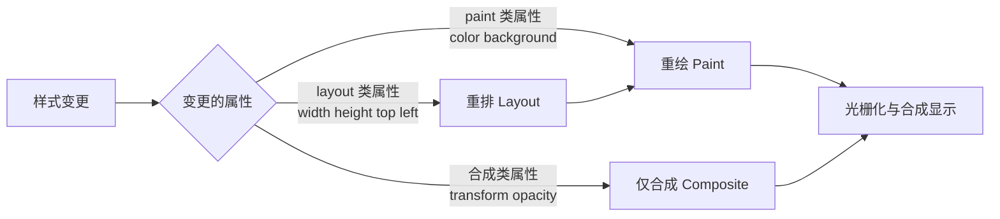

### CSS-050：合成层是什么？will-change 如何正确使用？

**答**：
- 合成层（compositing layer）是浏览器为提升渲染效率拆分的独立图层，各有自己的纹理，合成时互不重绘。
- 促升条件：3D transform、will-change、opacity < 1 + 动画、video/canvas、fixed 元素等。
- `will-change: transform` 提前告知浏览器做优化，但层是稀缺资源：只加在少量动效元素上，动画结束移除。
- 层爆炸（layer explosion）：滥用导致显存暴涨、初始化变慢，比不掉帧更糟。

```css
/* 正确：精确声明、及时回收 */
.modal-enter {
  will-change: transform, opacity;
  transform: translateY(20px);
  opacity: 0;
}
.modal-enter.active {
  transform: translateY(0);
  opacity: 1;
}
/* JS 在 transitionend 后移除 will-change 与 modal-enter 类 */

/* 错误：全局滥用 */
* { will-change: transform; } /* 层爆炸，禁止 */
```

### CSS-051：重排与重绘的关系？如何减少？

**答**：
- 渲染流水线：JS → Style → Layout → Paint → Composite；重排（Layout）必然引发重绘，重绘不一定重排。
- 一次性读写分离：循环里交替读写 `offsetTop` 与 style 会强制同步布局（layout thrashing）。
- 批量修改用 DocumentFragment、class 切换、或读写缓存。
- 动画与滚动监听用 transform 和 rAF，读取布局统一在帧首进行。

```javascript
// 差：读写交替造成强制同步布局
items.forEach((el) => {
  const top = el.offsetTop;      // 读
  el.style.top = top + 10 + 'px'; // 写，下一轮读又要重排
});

// 好：读写分离
const tops = items.map((el) => el.offsetTop);  // 全部读
items.forEach((el, i) => {
  el.style.transform = `translateY(${tops[i] + 10}px)`; // 全部写
});
```

```css
/* 用 class 批量切换，避免逐条设置 style */
.list-updating .item { opacity: 0.5; transform: scale(0.98); }
```

## 十、伪类伪元素、优先级与继承

### CSS-052：伪类与伪元素的区别？::before 为什么必须写 content？

**答**：
- 伪类描述元素的**状态或位置**（:hover、:nth-child），单个冒号；伪元素创建**不存在的虚拟元素**（::before、::after、::placeholder），双冒号。
- ::before/::after 是真实生成在 DOM 内的盒子，不写 `content` 则整个伪元素不渲染。
- 经典应用：清除浮动伪元素、图标、字数统计 `content: attr(data-count)`。
- 伪元素不能被 JS 直接选中，只能通过改宿主类间接控制。

```css
/* 伪类：状态 */
.link:hover { color: #409eff; }
.item:nth-child(2n) { background: #fafafa; }

/* 伪元素：生成内容，content 必需 */
.tag::before {
  content: "#";           /* 缺了这行整个规则无效 */
  color: #999;
}
.badge::after {
  content: attr(data-count); /* 读取宿主属性 */
}

/* 用伪元素实现箭头 */
.arrow::after {
  content: "";
  display: inline-block;
  width: 6px;
  height: 6px;
  border-right: 1px solid #333;
  border-bottom: 1px solid #333;
  transform: rotate(-45deg);
}
```

### CSS-053：选择器优先级如何计算？!important 的注意事项？

**答**：
- 优先级四元组：内联 style(1,0,0,0) > ID(0,1,0,0) > 类/伪类/属性(0,0,1,0) > 元素/伪元素(0,0,0,1)，高位胜出。
- `!important` 覆盖正常级联；同一声明都带 important 时再比优先级，再比源码顺序。
- `:is()`/`:not()` 取**参数中最高的**优先级，`:where()` 优先级恒为 0。
- 工程规范：禁用 !important，用提高选择器层级或调整加载顺序解决冲突。

```css
/* 优先级对比 */
#nav .item            {}  /* 0,1,1,0 */
.nav .item:hover      {}  /* 0,0,3,0  ID 位更高，上面赢 */
div span              {}  /* 0,0,0,2 */
.item                 {}  /* 0,0,1,0  赢过上一行 */

/* :is 取参数最高优先级 */
:is(#footer, .footer) .link { color: red; }  /* 按 #footer 计算 0,1,1,0 */
:where(#footer, .footer) .link { color: red; } /* 恒为 0,0,1,0 */

/* important 覆盖内联样式，但内联也能加 important */
.text { color: blue !important; }
/* <p class="text" style="color: red"> → blue 生效 */
```

### CSS-054：继承与 initial、inherit、unset、revert 的区别？

**答**：
- 可继承属性：color、font-*、line-height、text-align、visibility 等；盒模型尺寸类大多不可继承。
- `inherit`：强制继承父值（即使该属性默认不可继承）。
- `initial`：恢复到规范初始值，如 color: initial 是黑色而非主题色。
- `unset`：可继承属性等同 inherit，不可继承属性等同 initial。
- `revert`：回退到浏览器默认样式/用户样式，最接近“取消我的所有作者样式”。

```css
/* 继承演示 */
.parent { color: #333; border: 1px solid #999; }
.child  { color: inherit; }  /* #333，color 本身可继承 */
.child  { border: inherit; } /* 强制继承边框（默认不继承） */

.link { color: var(--brand); }
.link.reset-initial { color: initial; } /* 黑色，不是 var(--brand) */
.link.reset-unset   { color: unset; }   /* color 可继承 → 等同 inherit */
.btn { all: unset; } /* 清除按钮 UA 样式，重新自定义 */
.btn { all: revert; } /* 回到浏览器默认按钮外观 */
```

### CSS-055：容器查询 @container 是什么？和媒体查询相比解决什么问题？

**答**：
- 媒体查询看的是**视口**，容器查询看的是**最近容器祖先的尺寸**，实现真正的组件级响应式。
- 先用 `container-type: inline-size` 声明容器，再用 `@container (min-width: 400px)` 查询。
- 查询单位 cqw/cqh 相对容器尺寸（1cqw = 容器宽的 1%）。
- 典型场景：同一个卡片组件在侧栏窄、在主区宽时展示不同密度，无需业务方传 prop。

```css
/* 声明容器 */
.card-slot {
  container-type: inline-size;
  container-name: card;
}

/* 容器内响应式 */
.card {
  display: flex;
  flex-direction: column;
  gap: 8px;
}
@container card (min-width: 420px) {
  .card {
    flex-direction: row;
    align-items: center;
  }
  .card .thumb { width: 96px; height: 96px; }
}

/* cqw 单位：标题随容器缩放 */
.card h3 { font-size: clamp(14px, 5cqw, 22px); }
```

### CSS-056：:has() 选择器能做什么？

**答**：
- `:has()` 是“父级/前向”选择器：根据**后代或后续兄弟**是否存在来匹配当前元素。
- 典型应用：包含图片的卡片加特殊样式、表单某项非法时高亮整个 fieldset。
- 可与 :not 组合，如 `div:not(:has(p))`。
- 注意性能与兼容基线，避免在大范围选择器上滥用。

```css
/* 含图的卡片：横向布局 */
.card:has(img) { flex-direction: row; }

/* 表单联动：有 invalid 输入时整组标红 */
fieldset:has(input:invalid) {
  border-color: #f56c6c;
}
fieldset:has(input:invalid) .hint { display: block; }

/* 兄弟联动：勾选后展开面板 */
.expand:has(+ .panel) .arrow { transform: rotate(90deg); }

/* 无段落时隐藏容器 */
.section:not(:has(p)) { display: none; }
```

## 十一、CSS 工程化与性能

### CSS-057：CSS Modules 如何解决样式冲突？composes 怎么用？

**答**：
- 构建时把类名编译成 `文件名__类名__hash` 的唯一标识，天然局部作用域，无全局污染。
- JS 侧 `import styles from './a.module.css'` 引用编译后的真实类名。
- `composes` 复用同文件或其他文件（来自 foundation）的类，实现类似继承。
- 缺点：动态类名拼接不便、与 UI 库全局样式对接需要 :global。

```css
/* Button.module.css */
.btn {
  padding: 8px 16px;
  border-radius: 4px;
}
.primary {
  composes: btn;                 /* 复用同文件 */
}
.outline {
  composes: btn from "./base.css"; /* 跨文件复用 */
}

/* :global 逃逸 */
.wrapper :global(.ant-btn) {
  margin-right: 8px;
}
```

```javascript
// Button.jsx
import styles from './Button.module.css';
// styles.primary === "Button_primary__1x2y3"（编译后唯一名）
export function Button({ type = 'primary', children }) {
  return <button className={styles[type]}>{children}</button>;
}
```

### CSS-058：CSS-in-JS 的原理与优缺点？

**答**：
- 运行时方案（styled-components/emotion）在 JS 里写样式，运行时生成唯一类名并注入 `<style>` 标签。
- 优点：天然组件作用域、可读 props/主题做动态样式、无全局冲突。
- 缺点：运行时开销（解析与序列化）、SSR 需要样式提取、包体积、与 React Server Components 存在兼容问题。
- 趋势：编译时方案（vanilla-extract、linaria、panda-css）在构建期产出静态 CSS，规避运行时成本。

```javascript
// styled-components：运行时方案
import styled from 'styled-components';

const Button = styled.button`
  background: ${(p) => (p.$variant === 'danger' ? '#f56c6c' : '#409eff')};
  color: #fff;
  padding: 8px 16px;
`;

export default () => <Button $variant="danger">删除</Button>;
```

```typescript
// vanilla-extract：编译时方案，构建期产出 .css 文件
import { style } from '@vanilla-extract/css';

export const button = style({
  padding: '8px 16px',
  selectors: {
    '&[data-variant="danger"]': { background: '#f56c6c' },
  },
});
```

### CSS-059：原子化 CSS（Tailwind）的原理与取舍？

**答**：
- 每个工具类只包含一条 CSS 声明（如 .flex、.pt-4），页面里按需组合，类名即样式。
- JIT 按需生成：扫描模板字符串中出现过的类名，只产出用到的 CSS，产物极小。
- 优点：无命名负担、样式一致性强（设计 token 约束）、删组件即删样式。
- 缺点：HTML 侵入性强、复杂状态类名冗长、团队需适应“不再写语义化 class”。

```html
<!-- Tailwind：类名组合 -->
<button class="inline-flex items-center gap-2 rounded-md bg-blue-500
               px-4 py-2 text-sm font-medium text-white
               hover:bg-blue-600 disabled:opacity-50">
  提交
</button>

<!-- 复杂状态可用 @apply 收敛到组件层 -->
<style>
  .btn-submit {
    @apply inline-flex items-center rounded-md bg-blue-500 px-4 py-2 text-white hover:bg-blue-600;
  }
</style>
```

```javascript
// tailwind.config.js：设计 token 约束
export default {
  content: ['./src/**/*.{js,jsx,ts,tsx}'],
  theme: {
    extend: {
      colors: { brand: '#409eff' },
      spacing: { 4.5: '18px' },
    },
  },
};
```

### CSS-060：CSS 层面有哪些性能优化手段？

**答**：
- 关键渲染路径：首屏样式内联或 preload，避免大量 @import 串行阻塞。
- 选择器效率：避免过深层级与通配后代选择器，现代浏览器影响已小但仍有解析成本。
- 减少重排重绘：动画用 transform/opacity、批量读写、contain: layout/paint 隔离子树。
- 资源层面：按需加载路由样式、purge 未使用样式、字体 font-display: swap、大图 lazy 加载。
- 用 Chrome DevTools Performance 与 Coverage 面板定位无用样式与长任务。

```css
/* 1. 现代等价清除浮动/布局隔离 */
.component {
  contain: layout paint;   /* 隔离内部布局与绘制影响 */
  content-visibility: auto; /* 视口外跳过渲染，长列表利器 */
  contain-intrinsic-size: auto 500px; /* 占位尺寸防跳动 */
}

/* 2. 动画只碰合成属性 */
.hover-lift { transition: transform 0.2s; }
.hover-lift:hover { transform: translateY(-4px); }

/* 3. 字体加载体验 */
@font-face {
  font-family: "Inter";
  src: url("/fonts/inter.woff2") format("woff2");
  font-display: swap;
}
```

---

## 十二、选择器进阶

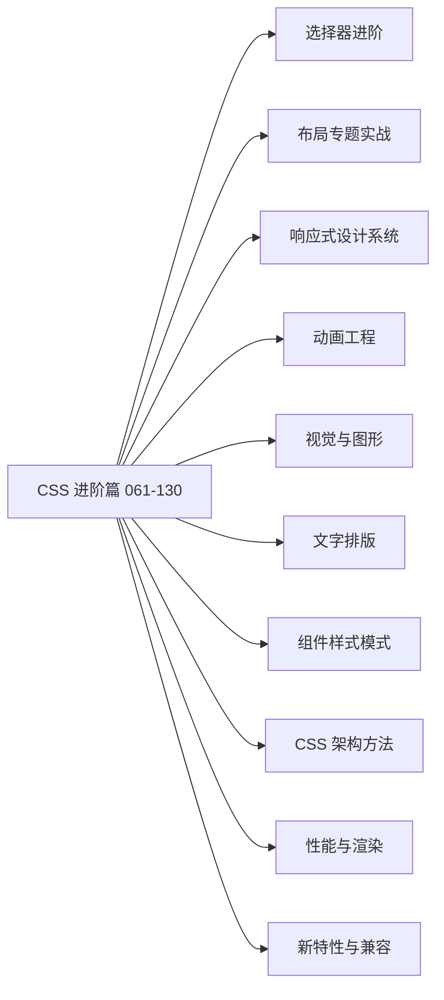

### CSS-061：:is() 和 :where() 有什么区别？为什么说 :where() 更适合写默认样式？

**答**：
- 两者都用于缩短选择器列表，`:is(h1, h2, h3)` 等价于逐个写出，且支持在复杂选择器中间嵌套。
- 核心差异在优先级：`:is()` 取参数中优先级最高的一条来计算；`:where()` 优先级恒为 0。
- 因此默认样式写 `:where()`，业务代码任何类选择器都能直接覆盖，无需 !important。
- 参数只能是复合选择器列表，不能包含伪元素。
- 均已进入 Baseline，现代浏览器可直接使用。

```css
/* :is() 优先级跟随参数中最高的那条（这里是 .nav a，0-1-1） */
:is(.nav, footer) a { color: #409eff; }

/* :where() 优先级恒为 0，任何普通类都能覆盖它 */
:where(h1, h2, h3) {
  margin-block: 0.5em;
  font-weight: 600;
}

/* 业务覆盖无需提高优先级 */
h2 { margin-block: 1em; } /* 轻松覆盖 :where 的 0.5em */
```

### CSS-062：:has() 有哪些高级用法？表单联动怎么做？

**答**：
- 父选择器能力：根据后代/后续兄弟的状态选中祖先，如 `.card:has(img)` 只给带图的卡片加布局。
- 表单联动：`label:has(+ input:user-invalid)` 让错误提示随输入状态显隐，纯 CSS 无 JS。
- 兄弟联动：`.form-item:has(input:focus)` 高亮整个表单项容器。
- 性能注意：`:has()` 会让祖先参与匹配，避免在文档根节点上写大范围 `:has()` 扫描。
- 用 `@supports selector(:has(*))` 做渐进增强，不支持时 JS 兜底加类。

```css
/* 1. 表单联动：输入不合法时，前面的 label 变红并显示提示 */
.field { display: flex; flex-direction: column; gap: 4px; }
.field .error { display: none; color: var(--color-danger); }
.field:has(input:user-invalid) .error { display: block; }
.field:has(input:user-invalid) label { color: var(--color-danger); }

/* 2. 父选择器：卡片内没有图片时用紧凑布局 */
.card:has(> img) .card-body { padding: 16px; }
.card:not(:has(> img)) { grid-template-rows: auto; }

/* 3. 全局暗色开关：勾选后影响整页 */
body:has(#dark-toggle:checked) { --bg: #111; --fg: #eee; }
```

### CSS-063：如何用 ::part 穿透 Shadow DOM 给 Web Components 做主题？

**答**：
- Shadow DOM 内部样式与外部完全隔离，外部选择器无法直接命中内部节点。
- 组件作者在内部元素上声明 `part="foo"`，外部用 `.host::part(foo)` 定向覆盖。
- `::part()` 不能继续写后代组合器，需要暴露多个 part，或用 `exportparts` 向外转发。
- `::theme` 已被规范废弃，不要在生产中使用。
- 主题化第三方 Web Components（设计系统组件库）时这是官方推荐的唯一通道。

```html
<!-- 组件内部：标记可定制部分并对外转发 -->
<template id="tpl">
  <style>/* 组件私有样式，外部不可见 */</style>
  <div part="card" exportparts="card: outer-card">
    <h3 part="title">标题</h3>
    <p part="body">内容</p>
  </div>
</template>
```

```css
/* 外部页面：定向覆盖组件暴露的 part */
fancy-card::part(card) {
  border: 1px solid var(--border-color);
  border-radius: 12px;
}
fancy-card::part(title) { font-size: 18px; }
fancy-card:hover::part(title) { color: var(--brand); }
```

### CSS-064：属性选择器在工程中如何配合 data-* 做状态样式？

**答**：
- 用 `[data-state="open"]` 表达组件状态，JS 只改 data 属性，样式切换全在 CSS 层。
- 与 class 变体相比语义更清晰，且天然支持枚举校验与 TS 常量约束。
- 布尔态可省略值：`[data-disabled]` 匹配存在即可。
- 多个状态维度正交组合：`[data-variant][data-size]` 互不干扰。
- 可与 CSS 变量联用，把"状态 → token 映射"收敛到一处。

```css
/* 状态样式：JS 只负责 setAttribute，不再拼 className */
.dialog[data-state="open"]    { opacity: 1; visibility: visible; }
.dialog[data-state="closed"]  { opacity: 0; visibility: hidden; }
.dialog[data-variant="modal"] { position: fixed; inset: 0; }

/* 布尔态 + 组合维度 */
.btn[data-disabled] { opacity: 0.5; cursor: not-allowed; }
.btn[data-variant="primary"][data-size="lg"] {
  --btn-pad: 12px 24px;
  --btn-fs: 16px;
}
```

```javascript
// 状态管理侧：只改属性，样式自动跟随
el.dataset.state = visible ? 'open' : 'closed';
```

### CSS-065：:focus-visible 与 :focus-within 有什么区别？各适合什么场景？

**答**：
- `:focus-visible` 由浏览器判断"用户是否应该看到焦点环"：键盘 Tab 导航匹配，鼠标点击通常不匹配。
- `:focus-within` 是自身或任意后代持有焦点即匹配，适合把焦点态映射到容器。
- 自定义 focus 样式一律写在 `:focus-visible` 上，避免鼠标点击出现难看的焦点环。
- 输入框组（前缀图标 + input）用 `:focus-within` 整体高亮。
- 出于可访问性，绝不能只写 `outline: none` 而不提供 `:focus-visible` 替代。

```css
/* 键盘导航才显示焦点环，鼠标点击不打扰视觉 */
.btn:focus-visible {
  outline: 2px solid var(--brand);
  outline-offset: 2px;
}
.btn:focus:not(:focus-visible) { outline: none; }

/* 输入组：input 获得焦点，整个分组高亮 */
.input-group {
  display: flex; align-items: center;
  border: 1px solid var(--border-color);
}
.input-group:focus-within {
  border-color: var(--brand);
  box-shadow: 0 0 0 3px color-mix(in srgb, var(--brand) 20%, transparent);
}
```

### CSS-066：:user-invalid 解决了 :invalid 的什么问题？

**答**：
- `:invalid` 在页面加载、用户尚未输入时就匹配（如 required 空值），导致"一进页面就报错"。
- `:user-invalid` 只在用户交互过且当前值不合法时匹配；`:user-valid` 同理。
- 适合做错误提示的入场动画：先有交互，再淡入错误态，体验更自然。
- 兼容：Chrome 119+ / Safari 16.5+ / Firefox 88+，老浏览器用 `:invalid` 兜底逻辑。
- 配合 `:placeholder-shown` 可以区分"还没填"和"填错了"。

```css
.field input {
  border: 1px solid var(--border-color);
  transition: border-color 0.2s, box-shadow 0.2s;
}

/* 只有用户真的输错了才标红，避免初始页面全红 */
.field input:user-invalid {
  border-color: var(--color-danger);
  box-shadow: 0 0 0 3px color-mix(in srgb, var(--color-danger) 15%, transparent);
}

/* 错误提示随交互淡入 */
.field .error {
  opacity: 0;
  transform: translateY(-2px);
  transition: opacity 0.2s;
}
.field:has(input:user-invalid) .error { opacity: 1; transform: none; }
```

## 十三、布局专题实战

### CSS-067：用现代 CSS 一行解决圣杯/双飞翼布局？

**答**：
- 传统圣杯/双飞翼靠 float + 负 margin + padding hack，中列 DOM 顺序还要提前。
- Grid 用 `grid-template-areas` 一次声明三区，行高 `100vh`，天然顺序分离。
- 中列写 `minmax(0, 1fr)` 防止长内容把布局撑爆（对应 flex 的 min-width: 0 问题）。
- 响应式降级只需重写 areas，无需改 DOM。

```css
.holy-grail {
  display: grid;
  grid-template-areas: "header header header" "aside main extra" "footer footer footer";
  grid-template-columns: 200px minmax(0, 1fr) 200px;
  grid-template-rows: auto 1fr auto;
  min-height: 100vh;
}
.holy-grail > header { grid-area: header; }
.holy-grail > aside  { grid-area: aside; }
.holy-grail > main   { grid-area: main; }
.holy-grail > .extra { grid-area: extra; }
.holy-grail > footer { grid-area: footer; }

@media (max-width: 768px) {
  .holy-grail {
    grid-template-areas: "header" "main" "aside" "extra" "footer";
    grid-template-columns: minmax(0, 1fr);
  }
}
```

### CSS-068：Sticky Footer 有哪几种实现方案？

**答**：
- 目标：内容不足一屏时 footer 贴底，内容超屏时 footer 正常跟随。
- Flex 方案：容器 `min-height: 100dvh`，主内容 `flex: 1` 撑开剩余空间。
- Grid 方案：`grid-template-rows: auto 1fr auto`，语义更直观。
- 用 `dvh` 替代 `vh` 规避 iOS 键盘弹出时视口变化导致的跳动。
- 老式 `calc(100vh - footer高度)` 硬编码方案已不推荐。

```css
/* 方案一：Flex */
.layout-flex {
  display: flex; flex-direction: column;
  min-height: 100dvh;
}
.layout-flex > main { flex: 1; }

/* 方案二：Grid */
.layout-grid {
  display: grid;
  grid-template-rows: auto 1fr auto;
  min-height: 100dvh;
}

/* footer 无需任何特殊样式，自然贴底或跟随 */
footer { padding: 16px; background: var(--bg-sunken); }
```

### CSS-069：九宫格有哪些实现方式？gap 相比老 margin 方案好在哪？

**答**：
- Grid：`grid-template-columns: repeat(3, 1fr)` + `gap`，最简洁。
- Flex：`flex-wrap: wrap` + 子项宽度 1/3 减 margin，需要 `nth-child(3n)` 去右边距。
- 老 margin 方案的痛点：末行元素去边距要写反直觉的负 margin 容器或复杂 nth 规则。
- `gap` 不作用于边缘，行列间距天然均匀，还支持不等宽 `repeat(3, 1fr 2fr)`。
- 移动端常见 2 列改 3 列，只需重写一个声明。

```css
/* 推荐：Grid + gap */
.grid9 {
  display: grid;
  grid-template-columns: repeat(3, 1fr);
  gap: 12px;
}

/* 对比：Flex + margin 老方案，需要去边距 hack */
.flex9 { display: flex; flex-wrap: wrap; margin: -6px; }
.flex9 > .cell {
  flex: 0 0 calc(33.333% - 12px);
  margin: 6px;
  aspect-ratio: 1;
}
/* 老方案里 3n 去右边距、末行去下边距的规则在 gap 方案中完全消失 */
```

### CSS-070：纯 CSS 瀑布流 columns 与 JS 实现各有什么问题？

**答**：
- `columns: 4` + `break-inside: avoid` 即可瀑布流，零 JS、自动平衡列高。
- 致命缺陷：内容按"列"填充（先填满第 1 列再第 2 列），读序与预期不符。
- JS 方案（按最短列放置）：读序正确、可控性强，但需要监听 resize 重算。
- Grid masonry 提案落地前，信息流场景选 JS，图片墙场景 columns 可接受。
- columns 还有分页截断、子元素动画成本高等次要问题。

```css
/* 纯 CSS：注意填充顺序是纵向的 */
.masonry-css {
  columns: 4 240px;
  column-gap: 16px;
}
.masonry-css > .item {
  break-inside: avoid;      /* 防止卡片被切断 */
  margin-bottom: 16px;
}
```

```javascript
// JS 方案：按最短列放置，保证横向读序（核心思路）
function layout(items, colCount) {
  const heights = new Array(colCount).fill(0);
  items.forEach((item) => {
    const i = heights.indexOf(Math.min(...heights)); // 找最短列
    item.style.transform = `translate(${i * colWidth}px, ${heights[i]}px)`;
    heights[i] += item.offsetHeight + gap;
  });
}
window.addEventListener('resize', () => layout(items, getColCount()));
```

### CSS-071：固定侧边栏 + 自适应内容区有哪些写法？如何支持折叠动画？

**答**：
- Flex：侧栏 `flex: none` 固定宽，内容 `flex: 1` 并必须加 `min-width: 0` 防内容撑爆。
- Grid：`grid-template-columns: var(--sidebar-w) minmax(0, 1fr)` 一行搞定。
- 折叠动画：把侧栏宽度抽成 CSS 变量，切换时变量过渡即可带动布局（Grid 轨道可动画）。
- 侧栏内部如果也要吸顶滚动，单独 `overflow: auto`。

```css
.app-shell {
  display: grid;
  grid-template-columns: var(--sidebar-w, 240px) minmax(0, 1fr);
  transition: grid-template-columns 0.3s cubic-bezier(0.4, 0, 0.2, 1);
}
.app-shell[data-collapsed] { --sidebar-w: 64px; }

.sidebar {
  overflow: auto;
  position: sticky;
  top: 0;
  height: 100dvh;
}

.main {
  min-width: 0;      /* 关键：允许内容区收缩，长代码块/表格不再撑破布局 */
  overflow-x: hidden;
}
```

### CSS-072：上下两栏固定、中间滚动的布局，Flex 与 Grid 怎么写？

**答**：
- Flex：容器 `height: 100dvh` 纵向排列，header/footer `flex: none`，main `flex: 1; overflow: auto`。
- Grid：`grid-template-rows: auto 1fr auto`，main 自身滚动。
- 嵌套场景的坑：main 里再套 flex 纵向布局时，子项要 `min-height: 0` 才能正确收缩出滚动条。
- 页面级禁滚 `overflow: hidden`，把滚动收敛到 main，避免双层滚动条。

```css
/* 方案一：Flex */
.page-flex {
  display: flex; flex-direction: column;
  height: 100dvh;
  overflow: hidden;      /* 滚动只发生在 main */
}
.page-flex > header, .page-flex > footer { flex: none; }
.page-flex > main { flex: 1; overflow-y: auto; }

/* 方案二：Grid */
.page-grid {
  display: grid;
  grid-template-rows: auto 1fr auto;
  height: 100dvh;
  overflow: hidden;
}
.page-grid > main { overflow-y: auto; }

/* 嵌套时防收缩失效：中间层的纵向 flex 子项必须 min-height: 0 */
.page-grid > main > .inner { display: flex; flex-direction: column; min-height: 0; }
```

### CSS-073：等高卡片为什么按钮对不齐？stretch 与 align-items 有什么陷阱？

**答**：
- flex 默认 `align-items: stretch` 已让卡片等高，但一行代码 `align-items: center` 就会覆盖成各自高度。
- 卡片等高后，内容长短不同导致 footer 位置参差：给 footer 加 `margin-top: auto` 把它推到底部。
- Grid 单行同样自动等高；多行不等高时用 `grid-auto-rows: 1fr` 强制每行等分。
- 图片/标题占位高度用 `aspect-ratio` 或固定 min-height 锁定，从源头减少参差。

```css
.card-list {
  display: grid;
  grid-template-columns: repeat(auto-fill, minmax(260px, 1fr));
  gap: 16px;
  align-items: stretch;  /* 默认已等高，别写成 center */
}

.card {
  display: flex; flex-direction: column;
  height: 100%;
}
.card .thumb { aspect-ratio: 16 / 9; }        /* 占位锁定，防高度参差 */
.card .desc  { flex: 1; }                      /* 中间内容吃掉剩余空间 */
.card footer { margin-top: auto; }             /* 按钮一律沉底对齐 */

/* 多行场景：每行内部也等高 */
.card-list.even-rows { grid-auto-rows: 1fr; }
```

### CSS-074：shape-outside 如何实现文字环绕图形？

**答**：
- `shape-outside` 定义浮动元素外部的环绕形状，文字沿形状排布，而非沿盒子边框。
- 必须配合 `float`，且元素要有实际尺寸（或用渐变的 alpha 通道推导）。
- 支持 `circle()` / `ellipse()` / `inset()` / `polygon()` 与图片 alpha。
- `shape-margin` 控制文字与形状的最小间距。
- 适合杂志式图文混排、头像环绕等场景，纯装饰性内容注意加 `aria-hidden`。

```css
/* 圆形头像环绕：文字沿圆弧排布 */
.avatar {
  float: left;
  width: 120px; height: 120px;
  border-radius: 50%;
  shape-outside: circle(50%);
  shape-margin: 16px;
  margin-right: 8px;
}

/* 多边形：斜切图文分界 */
.diagonal-float {
  float: left;
  width: 200px; height: 200px;
  background: linear-gradient(135deg, var(--brand), transparent);
  shape-outside: polygon(0 0, 100% 0, 0 100%);
  clip-path: polygon(0 0, 100% 0, 0 100%);
}

.article p { text-align: justify; }
```

## 十四、响应式设计系统

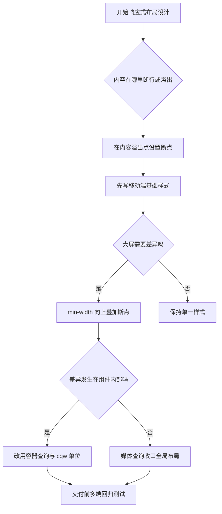

### CSS-075：断点设计的方法论是什么？移动优先和内容优先怎么落地？

**答**：
- 移动优先：基础样式写最小屏，用 `min-width` 向上叠加，代码增量方向与视口一致。
- 内容优先：断点应设在"内容开始断掉/溢出"的宽度，而不是照抄 iPhone/iPad 尺寸表。
- 断点数量控制在 3~5 个，命名语义化（sm/md/lg/xl），禁止散落魔法数字。
- 全局栅格、导航等页面级差异用媒体查询；组件内部差异交给容器查询。
- 决策流程见上方 flowchart：先找内容断点，再决定媒体查询还是容器查询。

```css
/* 移动优先 + 语义断点，用 CSS 变量收口（配合 PostCSS 自定义媒体或直接书写） */
.card-list { grid-template-columns: 1fr; }              /* 基础：小屏单列 */

@media (min-width: 48em) {                               /* md：内容开始断掉处 */
  .card-list { grid-template-columns: repeat(2, 1fr); }
}
@media (min-width: 75em) {                               /* xl：侧栏出现 */
  .card-list { grid-template-columns: repeat(3, 1fr); }
}
```

### CSS-076：clamp() 流式排版的黄金公式是什么？

**答**：
- `clamp(min, preferred, max)`：首选值随视口线性缩放，被 min/max 夹住。
- 黄金公式：`clamp(rem最小值, rem基础值 + 每px视口斜率 * 1vw, rem最大值)`，斜率 = (max-min) / (最大视口-最小视口)。
- 用 rem 做夹持端可继承用户浏览器字号设置，保住无障碍。
- 标题适合流式缩放；正文建议固定字号，避免可读性波动。
- 在线工具生成系数后 固化进 token，不手算。

```css
/* clamp(2rem, 1rem + 3vw, 3.5rem)：320px 时约 2rem，1280px 时到 3.5rem 封顶 */
:root {
  --fs-display: clamp(2rem, 1rem + 3vw, 3.5rem);
  --fs-h1:      clamp(1.5rem, 1.1rem + 1.5vw, 2.25rem);
  --fs-h2:      clamp(1.25rem, 1rem + 0.8vw, 1.6rem);
}

/* 正文保持固定，只有标题流式 */
h1 { font-size: var(--fs-h1); }
h2 { font-size: var(--fs-h2); }
p  { font-size: 1rem; line-height: 1.75; }
```

### CSS-077：容器查询单位 cqw/cqh 是什么？怎么实现"组件级响应式"？

**答**：
- `cqw/cqh/cqi/cqb` 相对最近的查询容器：1cqw = 容器宽度的 1%，与 vw 之于视口同理。
- 必须先有 `container-type: inline-size` 声明，单位才会解析；没有容器时回退为小视口值。
- 同一个卡片组件放进窄侧栏自动变紧凑，放进宽内容区自动展开，无需媒体查询。
- `cqi` 是逻辑内联轴方向，与 RTL 配合更稳。
- 配合 `@container` 一起构成组件级响应式的完整闭环。

```css
.widget-wrapper { container-type: inline-size; }

.widget {
  /* 字号与间距随容器宽度缩放，而非视口 */
  font-size: clamp(0.875rem, 2cqi + 0.5rem, 1.125rem);
  padding: 4cqi;
  display: grid;
  grid-template-columns: 1fr;
  gap: 2cqi;
}

@container (min-width: 480px) {
  .widget { grid-template-columns: auto minmax(0, 1fr); }
}
```

### CSS-078：逻辑属性 margin-inline 如何简化 RTL 适配？

**答**：
- `margin-inline` / `padding-block` / `inset-inline-start` 等逻辑属性按"起止方向"而非物理左右定义。
- 页面切 `dir="rtl"` 时逻辑属性自动镜像，一套样式同时服务 LTR/RTL，不用维护两份。
- 文本对齐用 `text-align: start/end`，定位用 `inset-inline-start`，边框用 `border-inline-start`。
- 混用物理属性（left/right）与逻辑属性时注意层叠覆盖关系，团队内约定统一用逻辑属性。
- 现代浏览器全面支持，Arabic/Hebrew 国际化项目的标配。

```css
/* 一套样式，LTR 与 RTL 自动镜像 */
.card {
  margin-inline: auto;                 /* 物理上等于左右 auto */
  padding-inline: 16px;
  border-inline-start: 3px solid var(--brand);
  text-align: start;                   /* LTR 时左对齐，RTL 时右对齐 */
}

.badge {
  position: absolute;
  inset-inline-start: 8px;             /* LTR 的 left / RTL 的 right */
  inset-block-start: 8px;
}

/* RTL 只需关心内容本身差异 */
[dir="rtl"] .arrow-icon { transform: scaleX(-1); }
```

### CSS-079：暗黑模式有哪三种实现方式？各自优劣与推荐组合？

**答**：
- 方案一 `prefers-color-scheme` 媒体查询：跟随系统、零 JS，但用户无法手动覆盖。
- 方案二 class 切换：`html.dark` 挂类，灵活可存 localStorage，但需要 JS 初始化防闪烁。
- 方案三 CSS 变量分层：语义 token 两套取值，组件只引用语义变量，切换成本最低。
- 推荐组合：变量承载主题 + 媒体查询做默认值 + class 做手动覆盖（`html[data-theme="light"]` 逆向强制）。
- 切换时给根元素加过渡，但注意大范围 color 过渡的性能成本。

```css
/* 语义 token 只定义一次映射，两套主题只换值 */
:root {
  --bg-surface: #fff;
  --fg-primary: #1f2329;
  --color-scheme: light;
}
@media (prefers-color-scheme: dark) {
  :root:not([data-theme="light"]) {          /* 用户手动强制亮色时不跟随系统 */
    --bg-surface: #17181a;
    --fg-primary: #e8e9ea;
    --color-scheme: dark;
  }
}
:root[data-theme="dark"] {
  --bg-surface: #17181a;
  --fg-primary: #e8e9ea;
  --color-scheme: dark;
}

body {
  background: var(--bg-surface);
  color: var(--fg-primary);
  color-scheme: var(--color-scheme);          /* 原生控件滚动条一起换肤 */
}
```

```javascript
// 初始化：内联在 head 里防 FOUC
const saved = localStorage.getItem('theme');
if (saved) document.documentElement.dataset.theme = saved;
```

### CSS-080：图片响应式如何用 object-fit 与占位比防抖动？

**答**：
- `object-fit: cover` 裁剪填满并保持比例，`contain` 完整显示留白，是替代 background-image 的语义化方案。
- 提前用 `aspect-ratio` 锁定占位高度，图片加载前后布局零跳动（消除 CLS）。
- `object-position` 控制裁剪焦点，如人像偏上 `50% 20%`。
- 多分辨率供给配合 ``，让浏览器自选最合适资源。
- 懒加载图片给 `loading="lazy"` + `decoding="async"`。

```html

```

```css
.cover-img {
  width: 100%;
  aspect-ratio: 16 / 9;   /* 与 width/height 属性一致，占位防 CLS */
  object-fit: cover;      /* 比例不符时裁剪填充 */
  object-position: 50% 20%;
  background: var(--bg-sunken);  /* 加载前占位底色 */
}
```

### CSS-081：safe-area 与刘海屏适配，env() 怎么用全？

**答**：
- 刘海/圆角/Home 条会遮挡内容，`env(safe-area-inset-*)` 给出四边安全区距离。
- 前提：viewport meta 加 `viewport-fit=cover`，页面铺满后才有安全区可言。
- 四个值：`top / bottom / left / right`，常用于 fixed 顶栏、底部 TabBar、全屏弹窗。
- 用 `max()` 包裹实现"有安全区就加上，没有就用默认值"的兜底；老设备 env 不支持时回退值生效。
- 配合 `@supports (padding: max(0px))` 可进一步收束旧浏览器行为。

```html
<meta name="viewport" content="width=device-width, initial-scale=1, viewport-fit=cover">
```

```css
/* 顶部导航：避开刘海 */
.app-header {
  position: fixed; inset-inline: 0; top: 0;
  padding-top: max(12px, env(safe-area-inset-top));
}

/* 底部 TabBar：避开 Home 条 */
.tabbar {
  padding-bottom: max(8px, env(safe-area-inset-bottom));
}

/* 横屏时左右也要避让 */
.fullscreen-dialog {
  padding-inline: max(16px, env(safe-area-inset-left), env(safe-area-inset-right));
}
```

## 十五、动画工程

### CSS-082：animation-timing 曲线怎么设计？cubic-bezier 如何调出回弹？

**答**：
- `cubic-bezier(x1, y1, x2, y2)` 用两个控制点描述进度-时间曲线，x 限 0~1，y 可以超出产生过冲。
- y > 1 即"冲过头再回来"，是 CSS 里模拟 spring 回弹的通用手法，如 `cubic-bezier(0.34, 1.56, 0.64, 1)`。
- 进场用 ease-out（快进缓停），退场用 ease-in，位移切换用 ease-in-out；默认 ease 反而多数场景不合适。
- Chrome DevTools 中点击 timing 图标可拖拽贝塞尔手柄实时预览，调好再固化。
- 多属性动画可各自指定 timing，让位移与透明度节奏分离更高级。

```css
/* 常用曲线 token 化，全站统一动效语言 */
:root {
  --ease-out:    cubic-bezier(0.22, 1, 0.36, 1);   /* 进场：快进缓停 */
  --ease-in:     cubic-bezier(0.64, 0, 0.78, 0);   /* 退场 */
  --ease-spring: cubic-bezier(0.34, 1.56, 0.64, 1); /* 回弹：y 超过 1 产生过冲 */
}

.toast-enter  { animation: slide-up 0.3s var(--ease-out) both; }
.toast-leave  { animation: slide-up 0.25s var(--ease-in) both reverse; }

.pop-confirm {
  animation: pop 0.4s var(--ease-spring) both;
}
@keyframes pop {
  from { transform: scale(0.6); opacity: 0; }
  to   { transform: scale(1);   opacity: 1; }
}
```

### CSS-083：一个元素上多段动画如何编排？animation-composition 和负 delay 是什么？

**答**：
- 同一元素多动画用逗号分隔同时声明，各自独立控制时长与 delay。
- 两个动画都改 transform 时默认后者 replace 覆盖前者，`animation-composition: add/accumulate` 改为叠加或累加。
- 负 delay 让动画"提前开始"，是多个元素错峰入场（波浪 loading、列表渐入）的核心技巧。
- `animation-fill-mode: both` 保证 delay 期间与结束后都保持关键帧状态。

```css
/* 错峰入场：5 个元素依次延迟 -0.15s 的整数倍，刷新即波浪 */
.stagger > li {
  animation: fade-in 0.5s var(--ease-out) both;
}
.stagger > li:nth-child(1) { animation-delay: 0s; }
.stagger > li:nth-child(2) { animation-delay: -0.4s; } /* 负值：跳过前段直接从中间开始 */
.stagger > li:nth-child(3) { animation-delay: -0.25s; }

/* composition：两个动画的 transform 叠加而不是覆盖 */
.orbit {
  animation: spin 2s linear infinite, bounce 0.5s ease-in-out infinite alternate;
  animation-composition: add;
}
@keyframes spin   { to { transform: rotate(360deg); } }
@keyframes bounce { to { transform: translateY(-12px); } }
```

### CSS-084：steps() 逐帧动画怎么做雪碧图走路动画？

**答**：
- `steps(n)` 把一段动画切成 n 个跳变帧，帧与帧之间无过渡，是逐帧动画的本质。
- 经典应用：雪碧图 + `background-position` 平移 + steps，实现人物走路/加载角色动画。
- 计算要点：8 帧雪碧图共 8 个展示位置（0 到 -700px，帧宽 100px），用 `steps(7)` 走完 7 次跳变正好停住。
- `steps(n, jump-start/jump-end)` 决定跳变发生在区间头还是尾；`jump-none` 两端都不跳。
- `animation-iteration-count: infinite` 循环，`infinite alternate` 可做往返帧。

```css
/* 雪碧图：横向 8 帧，每帧 100px，总宽 800px */
.walker {
  width: 100px; height: 120px;
  background: url("/sprites/walk.png") 0 0 / 800px 120px no-repeat;
  animation: walk 0.8s steps(7) infinite;  /* 7 次跳变覆盖 8 个位置 */
}
@keyframes walk {
  from { background-position: 0 0; }
  to   { background-position: -700px 0; }  /* -100px * 7 = 第 8 帧位置 */
}

/* 停止时定在最后一帧：加 fill-mode 并去掉 infinite，或用 paused 类 */
.walker.paused { animation-play-state: paused; }
```

### CSS-085：滚动驱动动画 scroll-timeline 怎么用？

**答**：
- `animation-timeline: scroll()` 建立匿名滚动时间线，动画进度跟随滚动位置而非时间。
- `scroll(nearest root block)` 可指定参照滚动容器与轴向；`view()` 则跟随元素进出视口的进度。
- 经典场景：顶部阅读进度条、视差背景、图片进入视口时 reveal。
- 时间线跨层级共享用 `timeline-scope` 把子树的命名时间线提升到公共祖先。
- Chrome 115+ 支持，用 `@supports not (animation-timeline: scroll())` 降级，JS IntersectionObserver 兜底。

```css
/* 顶部阅读进度条：进度 = 文档滚动比例 */
.progress {
  position: fixed;
  inset-block-start: 0;
  inset-inline-start: 0;
  width: 100%; height: 4px;
  background: var(--brand);
  transform-origin: 0 50%;
  transform: scaleX(0);
  animation: grow linear both;
  animation-timeline: scroll(root block); /* 进度绑定整页滚动 */
}
@keyframes grow { to { transform: scaleX(1); } }

/* 图片进入视口渐显：进度跟随自身可见比例 */
.reveal img {
  animation: reveal linear both;
  animation-timeline: view(block);
  animation-range: entry 0% cover 40%;    /* 进入视口到覆盖 40% 之间播放 */
}
@keyframes reveal { from { opacity: 0; transform: translateY(24px); } }

@supports not (animation-timeline: scroll()) {
  .progress { display: none; }            /* 降级：直接隐藏进度条 */
}
```

### CSS-086：View Transitions 如何做入场退场与共享元素过渡？

**答**：
- 调用 `document.startViewTransition(callback)`，浏览器对新旧两帧 DOM 截图并交叉淡切。
- 每次过渡产出 `::view-transition-old/new` 伪元素树，可整体或按 name 定制动画。
- 给元素加 `view-transition-name`（须全页唯一）即变成共享元素，新旧状态间平滑飞行。
- SPA 路由切换、列表重排、主题换肤都适合；不支持时 API 不存在，自动退化为直接切换。
- 记得对 `prefers-reduced-motion` 用户跳过或简化过渡。

```html
<div class="card" id="hero">详情卡</div>
<script>
  btn.addEventListener('click', () => {
    if (!document.startViewTransition) return updateDOM(); // 不支持直接切换
    document.startViewTransition(() => updateDOM());
  });
</script>
```

```css
/* 共享元素：新旧页面间飞行 */
#hero { view-transition-name: hero-card; }

/* 全局默认交叉淡切，改短更利落 */
::view-transition-old(root),
::view-transition-new(root) {
  animation-duration: 0.25s;
}

/* 退场滑出、入场滑入 */
::view-transition-old(hero-card) { animation: slide-out 0.25s both; }
::view-transition-new(hero-card) { animation: slide-in 0.3s both; }
@keyframes slide-out { to { transform: translateX(-100%); opacity: 0; } }
@keyframes slide-in  { from { transform: translateX(100%); opacity: 0; } }
```

### CSS-087：FLIP 技术如何在 CSS 中落地？

**答**：
- FLIP = First 记录起始位置 → Last 应用最终布局 → Invert 用 transform 反向回置 → Play 过渡归零。
- 纯 CSS 无法感知布局前后差异，必须 JS 测量 + transform 过渡配合。
- 只动 transform，全程走合成层，列表重排、卡片换位、拖拽排序的黄金方案。
- 可用 WAAPI `element.animate()` 即用即弃，不污染样式表。
- 与 View Transitions 的关系：VT 是浏览器内置的自动化 FLIP，手写 FLIP 用于更细粒度控制。

```javascript
// 列表重排 FLIP：sortDOM() 内部重排，外部负责过渡
function flip(container, sortDOM) {
  const first = new Map(
    [...container.children].map((el) => [el, el.getBoundingClientRect().top])
  );
  sortDOM(); // Last：真正改变布局

  [...container.children].forEach((el) => {
    const dy = first.get(el) - el.getBoundingClientRect().top; // Invert：反向回置
    if (!dy) return;
    el.animate(
      [{ transform: `translateY(${dy}px)` }, { transform: 'translateY(0)' }],
      { duration: 300, easing: 'cubic-bezier(0.22, 1, 0.36, 1)' } // Play：过渡归零
    );
  });
}
```

### CSS-088：prefers-reduced-motion 的系统性处理方案是什么？

**答**：
- 系统级开关：媒体查询读取用户的"减少动态效果"设置，全局收敛动画行为。
- 不是一刀切禁用：位移/缩放类动画替换为 opacity 淡入，保留反馈但去除眩晕源。
- token 化处理：定义 `--motion-duration/--motion-distance` 变量，reduced 时统一归零。
- JS 动画（WAAPI、canvas、滚动劫持）用 `matchMedia` 同步判断，与 CSS 行为一致。
- view transitions、平滑滚动等隐式动效也要纳入同一开关。

```css
:root { --motion-duration: 0.3s; --motion-distance: 24px; }

@media (prefers-reduced-motion: reduce) {
  :root { --motion-duration: 0.01s; --motion-distance: 0px; }
  html { scroll-behavior: auto; }          /* 关闭平滑滚动 */
  *, *::before, *::after {
    animation-duration: var(--motion-duration) !important;
    transition-duration: var(--motion-duration) !important;
    animation-iteration-count: 1 !important; /* 停掉无限循环动画 */
  }
}

/* 淡入类保留：只用 opacity，不产生位移 */
.fade-in { animation: fade var(--motion-duration) both; }
@keyframes fade { from { opacity: 0; } }
```

```javascript
// JS 动画与 CSS 保持同一开关
const reduced = matchMedia('(prefers-reduced-motion: reduce)');
el.animate([{ opacity: 0 }, { opacity: 1 }],
  { duration: reduced.matches ? 0 : 300 });
reduced.addEventListener('change', syncMotionPreference);
```

## 十六、视觉与图形

### CSS-089：conic-gradient 有哪些高级用法？饼图和棋盘格怎么画？

**答**：
- `conic-gradient(from 角度 at 位置)` 按角度扫色，一段一段写色标即成饼图/圆环。
- 棋盘格：0/90/180/270 度四段双色 + `background-size` 重复平铺，两行代码。
- 圆环进度：conic-gradient 扇形 + `mask` 径向挖洞，配 `@property` 注册角度变量即可动画。
- 相邻色标写成同值即得硬边界分段，无需多元素叠加。

```css
/* 1. 饼图：三段占比 40% / 35% / 25% */
.pie {
  width: 160px; aspect-ratio: 1; border-radius: 50%;
  background: conic-gradient(
    var(--c1) 0 40%,
    var(--c2) 40% 75%,
    var(--c3) 75% 100%
  );
}

/* 2. 圆环进度：扇形 + mask 挖洞 */
.ring {
  border-radius: 50%;
  background: conic-gradient(var(--brand) calc(var(--pct) * 1%), transparent 0);
  mask: radial-gradient(circle, transparent 58%, #000 59%);
}

/* 3. 棋盘格：透明占位背景 */
.checker {
  background: conic-gradient(#eee 0 25%, transparent 0 50%, #eee 0 75%, transparent 0);
  background-size: 24px 24px;
}
```

### CSS-090：径向渐变如何做出光效？鼠标跟随 spotlight 怎么实现？

**答**：
- `radial-gradient(circle at x y, 高光色, 透明)` 定义中心光源，at 位置可用 CSS 变量驱动。
- 按钮高光：叠一层顶部椭圆白光模拟玻璃质感。
- 鼠标跟随 spotlight：JS 只更新 `--mx/--my` 两个变量，光斑位置过渡全交给 CSS。
- 多层背景叠加 radial + linear 可一次声明，注意先写的层在上。

```css
.glow-card {
  background:
    radial-gradient(120px circle at var(--mx, 50%) var(--my, 50%),
      color-mix(in srgb, var(--brand) 25%, transparent), transparent 70%),
    linear-gradient(180deg, var(--bg-elevated), var(--bg-surface));
  border: 1px solid var(--border-color);
}

.btn-glossy {
  background:
    radial-gradient(120% 60% at 50% 0%, rgb(255 255 255 / 0.35), transparent 60%),
    linear-gradient(var(--brand), var(--brand-dark));
}

/* JS 只写变量，无 style 内联动画 */
card.addEventListener('pointermove', (e) => {
  const r = card.getBoundingClientRect();
  card.style.setProperty('--mx', `${e.clientX - r.left}px`);
  card.style.setProperty('--my', `${e.clientY - r.top}px`);
});
```

### CSS-091：clip-path 全场景怎么用？如何做形状过渡动画？

**答**：
- `polygon()` 画三角形/箭头/斜切卡，`circle()/ellipse()` 画圆与椭圆，`inset()` 做缺角与圆角裁剪。
- 两端关键帧的顶点数一致时，clip-path 可直接 transition，实现形状 morph。
- 头像变圆、卡片展开、图片揭示动画都是 clip-path 过渡的典型场景。
- 裁剪不改变布局占位（不同于 display），过渡期间无重排，性能好。
- 老浏览器需 `-webkit-clip-path`，现代浏览器可省。

```css
/* 1. 三角形提示 */
.tri { width: 20px; height: 20px; background: var(--bg-elevated);
       clip-path: polygon(0 0, 100% 0, 50% 100%); }

/* 2. 头像：方形 hover 变圆（顶点语义匹配的 morph） */
.avatar-morph {
  clip-path: inset(0 round 4px);
  transition: clip-path 0.4s var(--ease-out);
}
.avatar-morph:hover { clip-path: inset(0 round 50%); }

/* 3. 图片揭示：对角线展开 */
.reveal-clip {
  clip-path: polygon(0 0, 0 0, 0 100%, 0 100%);
  transition: clip-path 0.6s var(--ease-out);
}
.reveal-clip.is-in {
  clip-path: polygon(0 0, 100% 0, 100% 100%, 0 100%);
}
```

### CSS-092：mask 如何实现列表渐隐与刮刮卡效果？

**答**：
- mask 用图像（含渐变）的 alpha 通道控制元素可见度，黑透白显（默认 luminance/alpha 视类型）。
- 渐隐列表：上下边缘用 `linear-gradient` 的 mask 淡出，比裁切+遮挡元素干净得多。
- 刮刮卡：上层 canvas 被涂抹后其透明区域"擦除"，下层内容透出——mask 每帧跟随 canvas 合成。
- mask 支持多层叠加与 `-webkit-mask` 前缀，长列表渐隐注意 mask 不参与重排、成本可控。

```css
/* 1. 列表两端渐隐 */
.fade-list {
  overflow-y: auto;
  mask-image: linear-gradient(transparent, #000 8%, #000 92%, transparent);
}

/* 2. 单行超长文本渐隐省略（替代省略号） */
.fade-text {
  white-space: nowrap; overflow: hidden;
  mask-image: linear-gradient(90deg, #000 85%, transparent);
}

/* 3. 刮刮卡：canvas 涂抹擦除覆盖层 */
.scratch-wrap { position: relative; }
.scratch-prize { position: absolute; inset: 0; }
.scratch-canvas { position: absolute; inset: 0; touch-action: none; }
/* JS 在 canvas 上以 destination-out 画圆即"刮开"，canvas 自身即 mask */
```

### CSS-093：background 多层叠加有哪些工程技巧？

**答**：
- 多背景用逗号分隔，先声明的层绘制在最上方，position/size 逐层对应。
- 纯 CSS 网格线：两条 linear-gradient 1px 线 + background-size 重复。
- 角标：radial/linear 渐变放在四角 position 上，省掉四个伪元素。
- 半透明遮罩：`linear-gradient(rgb(0 0 0 / .5), ...)` 叠在图上，替代额外遮罩元素。

```css
/* 1. 纯 CSS 表格线网格 */
.grid-bg {
  background-image:
    linear-gradient(var(--border-color) 1px, transparent 1px),
    linear-gradient(90deg, var(--border-color) 1px, transparent 1px);
  background-size: 40px 40px;
}

/* 2. 四角圆点角标：一个元素完成 */
.corners {
  background-image: radial-gradient(circle, var(--brand) 3px, transparent 3px);
  background-repeat: no-repeat;
  background-position: top left, top right, bottom left, bottom right;
  background-size: 8px 8px;
}

/* 3. 图上遮罩 + 底部渐变压暗，保证白字可读 */
.hero {
  background-image:
    linear-gradient(transparent 40%, rgb(0 0 0 / 0.6)),
    url("/images/hero.avif");
  background-size: cover;
  background-position: center;
}
```

### CSS-094：如何设计层级化的阴影系统？霓虹效果怎么堆？

**答**：
- 阴影表达"海拔"：y 偏移大 + 模糊大 + 透明度低 = 更高海拔，按 1~5 层级出 token。
- 单层阴影生硬，多层叠加（锐利近影 + 柔和远影）最接近真实光照。
- 霓虹：同色系多层 spread 递增的光晕 + 内层高亮，配合发光文本用 text-shadow。
- `inset` 阴影做按压/凹陷态；hover 时切换海拔 token 即"抬升"。
- 阴影色用 `color-mix` 从主题色派生，避免写死黑色导致暗色模式下突兀。

```css
/* 海拔 token：多层叠加，锐影 + 柔影 */
:root {
  --shadow-1: 0 1px 2px rgb(0 0 0 / 0.08), 0 1px 3px rgb(0 0 0 / 0.06);
  --shadow-2: 0 2px 4px rgb(0 0 0 / 0.08), 0 4px 12px rgb(0 0 0 / 0.08);
  --shadow-3: 0 4px 8px rgb(0 0 0 / 0.1),  0 12px 32px rgb(0 0 0 / 0.12);
}

.card { box-shadow: var(--shadow-1); transition: box-shadow 0.25s, transform 0.25s; }
.card:hover { box-shadow: var(--shadow-3); transform: translateY(-2px); }
.btn:active { box-shadow: inset 0 2px 4px rgb(0 0 0 / 0.2); } /* 按压凹陷 */

/* 霓虹发光：多层同色 spread 递增 */
.neon {
  color: var(--neon-color);
  text-shadow:
    0 0 4px var(--neon-color),
    0 0 12px var(--neon-color),
    0 0 24px color-mix(in srgb, var(--neon-color) 60%, transparent);
}
```

### CSS-095：filter 与 backdrop-filter 毛玻璃怎么用？性能上要注意什么？

**答**：
- `filter` 作用于元素自身渲染结果；`backdrop-filter` 作用于元素"背后的内容"，毛玻璃即 blur + 半透明背景。
- backdrop-filter 会截取背后区域并逐帧重采样，大面积使用或放在滚动容器内代价显著。
- 控制成本：限定小面积（导航、弹窗头部），加 `border-radius` 与 `contain` 减少重采样范围，避免与 fixed 大背景叠加。
- backdrop-filter 会为元素创建合成层，多个实例叠在长列表滚动区是最常见的卡顿来源。
- 提供无模糊降级：`@supports not` 时加深背景透明度保证可读性。

```css
/* 毛玻璃导航：限定高度的小面积使用 */
.glass-nav {
  position: sticky; top: 0;
  background: color-mix(in srgb, var(--bg-surface) 65%, transparent);
  backdrop-filter: blur(12px) saturate(1.4);
  -webkit-backdrop-filter: blur(12px) saturate(1.4);
}

@supports not (backdrop-filter: blur(1px)) {
  .glass-nav { background: var(--bg-surface); } /* 降级：不透明背景保证对比度 */
}

/* 反例警示：不要在长列表每一项上用 backdrop-filter
.list-item { backdrop-filter: blur(8px); }  ← 滚动时逐项重采样，必然掉帧 */
```

## 十七、文字排版

### CSS-096：多行截断 -webkit-line-clamp 的原理与替代方案？

**答**：
- 标准写法三件套：`display: -webkit-box` + `-webkit-box-orient: vertical` + `-webkit-line-clamp: N`，配合 `overflow: hidden`。
- 原理：webkit 私有的旧版弹性盒模型按行盒裁剪并追加省略号，现已写入规范成为正式标准。
- 替代一：`max-height = 行高 × N` + overflow hidden（无省略号）；替代二：::after 渐隐；替代三：JS 按字符测量。
- 单行截断仍是 `white-space: nowrap + text-overflow: ellipsis + overflow: hidden` 三件套。
- clamp 区域若参与动画，注意旧内核渲染层重建的开销。

```css
/* 多行截断（现代浏览器直接可用，已是标准） */
.clamp-2 {
  display: -webkit-box;
  -webkit-box-orient: vertical;
  -webkit-line-clamp: 2;
  overflow: hidden;
}

/* 替代：max-height 方案，无省略号但无私有前缀 */
.clamp-max {
  overflow: hidden;
  max-height: calc(1.6em * 3); /* 行高 1.6 × 3 行 */
}

/* 单行截断 */
.ellipsis {
  white-space: nowrap;
  overflow: hidden;
  text-overflow: ellipsis;
}
```

### CSS-097：word-break、overflow-wrap、white-space 三件套的适用矩阵是什么？

**答**：
- `white-space` 控制"是否换行与折叠空白"：nowrap 不换行、pre 保留原样、pre-wrap 保留且换行。
- `word-break: break-all` 任意字符处断（CJK/长数字串），`keep-all` 禁止 CJK 内断。
- `overflow-wrap: break-word` 仅在单词放不下时才断；`anywhere` 额外把断点计入 min-content，容器可收缩更彻底。
- 场景矩阵：长 URL 用 overflow-wrap anywhere；中英混排默认即可；代码块 pre-wrap；数字串防溢出 break-all。
- 三者可叠加使用，先由 white-space 决定换不换，再由 word-break/overflow-wrap 决定在哪断。

```css
/* 长英文单词/URL：放不下才断，且参与最小宽度计算 */
.long-url { overflow-wrap: anywhere; }

/* 长数字串/验证码：任意位置断开防溢出 */
.otp-code { word-break: break-all; }

/* 代码块：保留空格与换行，超长仍可断 */
pre.code {
  white-space: pre-wrap;
  overflow-wrap: break-word;
}

/* 单行展示 + 悬停看全文 */
.tag { white-space: nowrap; overflow: hidden; text-overflow: ellipsis; }

/* CJK 标点禁则 + 不在单词内断 */
.article { word-break: normal; overflow-wrap: break-word; line-break: strict; }
```

### CSS-098：::first-letter 首字下沉怎么做？

**答**：
- `::first-letter` 匹配块级容器首行首个字母（含紧邻标点），可独立设置字号/浮动/颜色。
- 首字下沉两板斧：`initial-letter: 3`（Chrome/Safari 支持，自动占 3 行）或 `float: left + font-size`（兼容全）。
- `::first-line` 可给首行整行加样式，常与 first-letter 搭配。
- 只对块级容器生效，行内元素与 display: contents 无效。

```css
/* 兼容方案：float 下沉 */
.article > p:first-of-type::first-letter {
  float: left;
  font-size: 3.2em;
  line-height: 1;
  padding-inline-end: 8px;
  font-weight: 600;
  color: var(--brand);
}

/* 现代方案：initial-letter 精确占 N 行，无需算行高 */
@supports (initial-letter: 3) {
  .article > p:first-of-type::first-letter {
    float: none;
    initial-letter: 3 3;   /* 占 3 行，基线对齐第 3 行 */
    font-size: unset;
  }
}

/* 首行整体加粗 */
.article > p::first-line { font-weight: 600; }
```

### CSS-099：writing-mode 竖排文字有哪些实战用法？

**答**：
- `writing-mode: vertical-rl` 竖排（从右列向左），`vertical-lr` 从左向右；配合 `text-orientation` 控制字姿。
- 典型场景：中文古籍风排版、侧边目录/页签文字、图表 Y 轴标签（比 rotate 更语义化）。
- 竖排下逻辑属性含义不变：`margin-inline-start` 仍指"行首方向"，RTL/竖排一套代码。
- `text-orientation: upright` 让拉丁字母直立，`mixed`（默认）旋转 90 度。
- 表格斜表头建议用 writing-mode 而非 transform rotate，不占额外空间且参与布局。

```css
/* 1. 侧边竖排标题 */
.vertical-title {
  writing-mode: vertical-rl;
  text-orientation: upright;   /* 中文直立，英文数字也直立 */
  letter-spacing: 0.35em;
}

/* 2. 图表 Y 轴标签：无需旋转，天然参与 flex 布局 */
.axis-y {
  writing-mode: vertical-rl;
  transform: rotate(180deg);   /* 让文字自下而上读 */
}

/* 3. 斜表头 */
.th-slant {
  writing-mode: vertical-rl;
  height: 72px;
}
```

### CSS-100：字体渲染优化有哪些手段？系统字体栈怎么写？

**答**：
- `-webkit-font-smoothing: antialiased`（macOS 上更细的字重渲染）与 `text-rendering: optimizeLegibility`（启用连字/字距，长文有性能成本）。
- 现代系统字体栈：`system-ui` 打头 + 各平台兜底（-apple-system / Segoe UI / PingFang SC / Microsoft YaHei），零网络请求。
- 中文字体栈把西文字体放前面，让拉丁字符走西文字体、中文回退，混排更精致。
- `font-feature-settings: "tnum"` 开启等宽数字，表格/倒计时数字不跳动。
- 自定义字体配 `font-display: swap` 与本地回退字体度量对齐（size-adjust）防布局跳动。

```css
/* 系统字体栈：西文优先，中文回退 */
:root {
  --font-sans: system-ui, -apple-system, "Segoe UI", Roboto,
               "PingFang SC", "Hiragino Sans GB", "Microsoft YaHei", sans-serif;
  --font-mono: ui-monospace, "SF Mono", Menlo, Consolas, monospace;
}
body {
  font-family: var(--font-sans);
  -webkit-font-smoothing: antialiased;
  text-rendering: optimizeSpeed; /* 长列表页面用 speed，阅读页可用 optimizeLegibility */
}

/* 表格数字不抖动 */
table, .counter { font-feature-settings: "tnum"; font-variant-numeric: tabular-nums; }

/* 自定义字体：swap + 度量对齐防跳动 */
@font-face {
  font-family: "Inter";
  src: url("/fonts/inter.woff2") format("woff2");
  font-display: swap;
  size-adjust: 105%;
  ascent-override: 96%;
}
```

### CSS-101：文字描边与 text-shadow 高级效果怎么实现？

**答**：
- `-webkit-text-stroke` 描边宽度沿字形居中分布，会"吃掉"字重，细描边配大字号使用。
- 纯 text-shadow 多向偏移叠加可模拟描边（8 方向 1px），不侵蚀字形但代码冗长。
- 空心字：`-webkit-text-fill-color: transparent` + stroke，或 background-clip: text。
- 发光、立体、长投影都是 text-shadow 多层堆叠的应用。
- `paint-order: stroke fill` 可让描边画在填充之下（SVG/部分浏览器支持），恢复完整字重。

```css
/* 空心描边大字 */
.outline-text {
  font-size: clamp(3rem, 10vw, 6rem);
  font-weight: 800;
  -webkit-text-stroke: 1.5px var(--brand);
  -webkit-text-fill-color: transparent;
}

/* 描边画在填充外，不侵蚀字重（支持的浏览器） */
.painted-stroke {
  -webkit-text-stroke: 6px var(--brand);
  paint-order: stroke fill;
  color: #fff;
}

/* 长投影：多层同向递进 */
.long-shadow {
  text-shadow:
    1px 1px 0 var(--brand-dark), 2px 2px 0 var(--brand-dark),
    3px 3px 0 var(--brand-dark), 4px 4px 0 var(--brand-dark),
    5px 5px 0 var(--brand-dark);
}
```

## 十八、组件样式模式

### CSS-102：CSS 变量主题如何做基础/语义/组件三层 token 分层？

**答**：
- 基础层 primitive：与业务无关的原始刻度（gray-100、space-4），不直接被组件引用。
- 语义层 semantic：承载业务含义（bg-surface、text-primary、border-strong），组件唯一引用层。
- 组件层 component：组件私有 token（btn-bg、btn-pad），从语义层派生，收敛局部默认值。
- 主题切换只重定义语义层到基础层的映射，组件层与组件代码零改动。
- 三层结构是暗黑模式、多品牌换肤能"低成本扩展"的根本原因。

```css
/* 1. 基础层：原始刻度 */
:root {
  --gray-0: #fff;  --gray-9: #17181a;
  --blue-5: #409eff;
  --space-2: 8px;  --space-4: 16px;
}

/* 2. 语义层：主题切换只动这里 */
:root {
  --bg-surface: var(--gray-0);
  --fg-primary: var(--gray-9);
  --color-accent: var(--blue-5);
  --radius-md: 8px;
}

/* 3. 组件层：从语义层派生 */
.btn {
  --btn-bg: var(--color-accent);
  --btn-pad: var(--space-2) var(--space-4);
  background: var(--btn-bg);
  padding: var(--btn-pad);
  border-radius: var(--radius-md);
}
```

### CSS-103：data-attribute 风格的 BEM 变体怎么组织？

**答**：
- 用 `block__element[data-variant="x"]` 替代 `block__element--modifier`，状态即数据。
- 正交维度分离：variant（外观）、size（尺寸）、state（交互态）各占一个 data 属性，组合不爆炸。
- JS 侧不再拼类名字符串，`dataset` 赋值即可，杜绝"忘写某个 modifier 类"类 bug。
- 与传统 BEM 的 `--modifier` 可共存，团队约定一种为主。
- 状态型样式（loading/disabled）优先 data 属性，纯外观修饰可保留 modifier。

```css
/* 外观维度 */
.btn[data-variant="primary"]   { --btn-bg: var(--color-accent); --btn-fg: #fff; }
.btn[data-variant="ghost"]     { --btn-bg: transparent; --btn-fg: var(--fg-primary); }

/* 尺寸维度：与外观正交组合 */
.btn[data-size="sm"] { --btn-pad: 4px 10px; --btn-fs: 12px; }
.btn[data-size="lg"] { --btn-pad: 12px 24px; --btn-fs: 16px; }

/* 状态维度：JS 只改 dataset */
.btn[data-loading] { pointer-events: none; opacity: 0.7; }
.btn[data-disabled] { opacity: 0.4; cursor: not-allowed; }

.btn {
  background: var(--btn-bg); color: var(--btn-fg);
  padding: var(--btn-pad, 8px 16px); font-size: var(--btn-fs, 14px);
}
```

### CSS-104：cva（class variance authority）思想如何用纯 CSS 实现组件变体系统？

**答**：
- cva 核心：把组件样式拆成 base + 各维度 variant 声明，由"变体组合"生成最终样式。
- CSS 侧等价实现：base 类 + 属性选择器声明各维度，组合自动生效，无 JS 运行时。
- 复合条件用 `[data-a="x"][data-b="y"]` 组合选择器表达，等价 cva 的 compound variants。
- 复杂默认值继承链用 CSS 变量：子维度缺省时回退到父维度值。
- 适合设计系统 Button/Input/Tag 这类维度清晰的原子组件。

```css
/* base：所有变体共享 */
.btn {
  display: inline-flex; align-items: center; gap: 6px;
  border-radius: var(--radius-md);
  transition: background 0.2s, transform 0.1s;
}

/* variants：维度一（意图）× 维度二（尺寸）正交声明 */
.btn[data-intent="danger"]  { --btn-bg: var(--color-danger); --btn-fg: #fff; }
.btn[data-intent="neutral"] { --btn-bg: var(--bg-sunken);    --btn-fg: var(--fg-primary); }
.btn[data-size="md"]        { --btn-pad: 8px 16px; }

/* compound variant：组合条件的专门规则 */
.btn[data-intent="danger"][data-size="md"] {
  font-weight: 600; /* 危险按钮中尺寸强调 */
}

/* defaultVariants：缺失维度时的回退 */
.btn:not([data-size]) { --btn-pad: 8px 16px; }
.btn:not([data-intent]) { --btn-bg: var(--color-accent); --btn-fg: #fff; }
```

### CSS-105：Skeleton 骨架屏的 shimmer 动画怎么实现？

**答**：
- 结构：占位块（灰底圆角）+ 一层斜向高光渐变左右平移，即 shimmer 扫光。
- 高光用 `linear-gradient(100deg, transparent, 白色半透明, transparent)` 平铺 200% 宽度做 background-position 动画。
- 只动 background-position 或 transform，走合成层不重排。
- 骨架布局要与真实内容一致（标题/头像/行高对齐），否则加载完成会跳动。
- 无障碍：容器加 `aria-busy="true"`，骨架块对读屏隐藏。

```html
<div class="skeleton-card" aria-busy="true">
  <div class="sk sk-avatar" aria-hidden="true"></div>
  <div class="sk sk-line" style="--w: 70%" aria-hidden="true"></div>
  <div class="sk sk-line" style="--w: 45%" aria-hidden="true"></div>
</div>
```

```css
.sk {
  position: relative;
  overflow: hidden;
  background: var(--bg-sunken);
  border-radius: 6px;
}
.sk::after {
  content: "";
  position: absolute; inset: 0;
  transform: translateX(-100%);
  background: linear-gradient(
    100deg, transparent 20%,
    rgb(255 255 255 / 0.55) 50%, transparent 80%
  );
  animation: shimmer 1.4s infinite;
}
@keyframes shimmer { to { transform: translateX(100%); } }

.sk-avatar { width: 44px; height: 44px; border-radius: 50%; }
.sk-line   { height: 14px; width: var(--w, 100%); margin-block: 8px; }
```

### CSS-106：Badge/Tag 超出后如何自适应（99+ 与胶囊收缩）？

**答**：
- 数字徽标"99+"由 JS 计算文本、CSS 只负责展示，纯 CSS 无法比较数值大小。
- 胶囊自适应：`min-width: 20px` 圆点态，内容出现后 `padding-inline: 6px` 自动撑开，border-radius: 999px 两态通吃。
- 绝对定位徽标注意父容器 `overflow` 裁剪，必要时挂在不被裁剪的锚点上。
- 多字符 Tag 超宽用 max-width + 单行截断兜底。

```css
/* 1. 胶囊徽标：圆点 → 数字 自适应 */
.badge {
  position: absolute;
  inset-block-start: -4px;
  inset-inline-end: -4px;
  min-width: 18px; height: 18px;
  padding-inline: 5px;          /* 内容撑开成胶囊 */
  border-radius: 999px;
  display: inline-flex; align-items: center; justify-content: center;
  font-size: 11px;
  background: var(--color-danger); color: #fff;
}
.badge:empty { padding-inline: 0; }  /* 无文本时收缩为圆点 */

/* 2. 长文本 Tag 兜底 */
.tag {
  max-width: 160px;
  white-space: nowrap; overflow: hidden; text-overflow: ellipsis;
}
```

```javascript
// 数值封顶由 JS 决定，CSS 展示
const label = count > 99 ? '99+' : String(count);
badgeEl.textContent = count > 0 ? label : '';
```

### CSS-107：组件的空态/加载/错误三态样式如何规范？

**答**：
- 统一用 `data-state="loading | empty | error | done"` 驱动，四态互斥、样式收敛在一处。
- 视觉规范：loading 用骨架/spinner、empty 用插画+行动点、error 用语义色+重试按钮。
- 语义色走 token（--color-success/warning/danger），各态图标尺寸与间距对齐同一节奏。
- 异步反馈给 `aria-live="polite"`，状态变化读屏可感知。
- 骨架屏在 error 态立即卸载，避免"闪骨架再报错"的双重等待感。

```css
.panel { min-height: 240px; }
.panel[data-state="loading"] .panel-body { visibility: hidden; } /* 骨架顶替真实内容 */
.panel[data-state="error"]  { border: 1px dashed var(--color-danger); }
.panel[data-state="empty"]  .panel-body { display: none; }

.state-hint {
  display: none;
  flex-direction: column; align-items: center; gap: 12px;
  padding: 40px 0;
  color: var(--fg-secondary);
}
.panel[data-state="empty"] .state-hint-empty,
.panel[data-state="error"] .state-hint-error { display: flex; }
.panel[data-state="error"] .state-icon { color: var(--color-danger); }
```

```html
<div class="panel" data-state="loading" aria-live="polite">
  <div class="skeleton-card">…骨架…</div>
  <div class="state-hint state-hint-empty">暂无数据</div>
  <div class="state-hint state-hint-error">加载失败 <button>重试</button></div>
  <div class="panel-body">真实内容</div>
</div>
```

### CSS-108：各框架的深度选择器怎么写？scoped 样式的原理是什么？

**答**：
- Vue scoped 原理：给该组件每个元素加 `data-v-xxx` 属性，选择器编译为 `.foo[data-v-xxx]`，实现隔离。
- 穿透子组件：Vue 3 用 `:deep()`（旧版 `>>>` 与 `/deep/` 已废弃）；只想命中插槽内容用 `:slotted()`。
- CSS Modules 里用 `:global(.foo)` 逃逸哈希；原生 Shadow DOM 天然隔离，靠 ::part 穿透。
- 深度选择器是逃生舱：优先用 props/插槽/CSS 变量定制第三方组件，实在不行再 `:deep()`。
- 深度选择器会破坏隔离边界，团队应约定只允许覆盖第三方组件库。

```vue
<!-- Vue 3 SFC -->
<style scoped>
/* 本组件元素正常隔离 */
.title { color: var(--fg-primary); }

/* 穿透第三方组件内部：编译为 [data-v-x] .el-input__inner */
:deep(.el-input__inner) { height: 36px; }

/* 只作用于父组件传入的插槽内容 */
:slotted(.slot-item) { padding: 4px 8px; }

/* 全局一条（谨慎） */
:global(body) { overflow-x: hidden; }
</style>
```

```css
/* CSS Modules（React 生态）中的等价写法 */
.wrapper :global(.third-party-inner) { color: var(--brand); }
/* 编译后：.wrapper_hash .third-party-inner —— 内部类不哈希 */
```

## 十九、CSS 架构方法

### CSS-109：BEM 命名规范全解？有哪些实践变体与取舍？

**答**：
- 结构 `block__element--modifier`：block 独立语义单元，element 是 block 内组成部分，modifier 表状态或外观。
- 禁止 element 再嵌 element（`.block__el1__el2` 错误），层级关系只体现在 DOM，不体现在类名。
- modifier 两种用法：单独挂 `.btn--disabled`，或组合挂 `.btn.btn--disabled`（配合块级选择器提升稳定性）。
- SASS 的 `&__el {}`、`&--mod {}` 嵌套生成可保持源码结构清晰。
- 取舍：类名冗长但零冲突、可预测；与 SUIT/AMCSS（data 属性）等变体可按团队混用。

```scss
// SASS 中的 BEM 书写
.card {
  background: var(--bg-surface);
  border-radius: var(--radius-md);

  &__header { padding: var(--space-4); }

  &__body  { padding: 0 var(--space-4); }

  &--featured {
    border-color: var(--color-accent);
  }

  // 组合式 modifier：确保只作用于 .card 自身
  &.is-selected {
    outline: 2px solid var(--color-accent);
  }
}
```

```html
<div class="card card--featured is-selected">
  <div class="card__header">标题</div>
  <div class="card__body">内容</div>
</div>
```

### CSS-110：ITCSS 分层架构是什么？如何与 @layer 结合落地？

**答**：
- ITCSS 按影响力从大到小倒序分层：Settings → Tools → Generic → Elements → Objects → Components → Utilities。
- 后写的层覆盖先写的层，靠"源顺序"而非选择器优先级解决冲突，全项目可告别 !important 军备竞赛。
- Utilities 在最底层，保证工具类永远能覆盖组件样式。
- 原生 `@layer` 让 ITCSS 从"目录约定"升级为"浏览器强制的级联顺序"，第三方样式可显式压到低层。
- 典型落点：reset 归 generic、原子类归 utilities、第三方库样式单独一层且置于 components 之前。

```css
/* @layer 落地 ITCSS：一次声明固定层序 */
@layer generic, vendor, objects, components, utilities;

@layer generic {
  *, *::before, *::after { box-sizing: border-box; }
  body { margin: 0; }
}

@layer components {
  .btn { padding: 8px 16px; background: var(--color-accent); }
}

@layer utilities {
  .mt-0 { margin-top: 0 !important; } /* 即使不用 important 也已高于 components */
}

/* 层外样式（如临时实验代码）优先级高于所有层，注意收敛 */
```

### CSS-111：ACSS/原子化理念与 Tailwind 实践的取舍是什么？

**答**：
- ACSS：每个类一个职责（.mt-4、.text-sm），样式零冲突、产物可按需、删除模板即删除样式。
- 代价：HTML 类名冗长、语义丢失、复杂选择器（如兄弟联动）表达困难。
- Tailwind 实践取舍：原子类做"原子"，重复组合用组件抽象（React 组件/@apply）收口，而非无限复制。
- 动态拼接类名必须整串出现（白名单/safelist），否则 JIT 扫描不到。
- 适合中大型团队统一 token 与视觉节奏；小项目或强主题换肤场景成本收益需评估。

```javascript
// tailwind 配置：token 即配置，团队视觉一致性来源
export default {
  content: ['./src/**/*.{js,ts,jsx,tsx}'],
  safelist: [{ pattern: /^bg-(blue|red|green)-(100|500|900)$/ }], // 动态类白名单
  theme: {
    extend: {
      spacing: { 18: '4.5rem' },
      colors: { brand: { DEFAULT: '#409eff', dark: '#2b7fd4' } },
    },
  },
};
```

```html
<!-- 原子类组合，重复组合交给组件抽象 -->
<button class="inline-flex items-center gap-1 rounded bg-brand px-4 py-2
               text-white text-sm font-medium hover:bg-brand-dark
               disabled:opacity-50">
  确定
</button>
```

### CSS-112：运行时 CSS-in-JS 与 zero-runtime 方案的原理与趋势？

**答**：
- 运行时方案（styled-components/emotion）：组件渲染时拼出类名、注入 `<style>`，能力最强（props 驱动样式、主题上下文）。
- 代价：包体与运行时开销、SSR 需要样式抽取配合、React Server Components 场景受限（序列化不了闭包样式）。
- zero-runtime（vanilla-extract/linaria/panda）：构建期求值产出静态 CSS + 类型化类名/变量，运行时零成本。
- 趋势：React 官方明确建议 RSC 场景避免运行时 CSS-in-JS，社区向 zero-runtime 与 Tailwind 迁移。
- 选型：强动态主题/设计系统用 zero-runtime 类型化 token；轻量交互页面 Tailwind 或原生 @layer 足够。

```javascript
// zero-runtime 示例（vanilla-extract）：构建期执行，产物是静态 CSS
import { style, createVar } from '@vanilla-extract/css';

export const accentVar = createVar(); // 类型化 CSS 变量

export const button = style({
  background: accentVar,
  padding: '8px 16px',
  borderRadius: 8,
  selectors: {
    '&:hover': { filter: 'brightness(0.95)' },
    '&[data-disabled]': { opacity: 0.4, pointerEvents: 'none' },
  },
});
// 运行时拿到的 button 就是一个类名字符串，无任何运行时 CSS 引擎
```

### CSS-113：@layer 级联层如何影响优先级？与 !important 怎么交互？

**答**：
- `@layer a, b;` 预声明层序，后声明的层在 normal 场景整体胜出——层序优先于选择器优先级。
- 层内仍按常规优先级比较；层与层之间只看声明顺序，一层之内再激烈竞争也赢不过后层。
- 未分层样式（layer 外）优先级高于所有分层的 normal 声明，适合放"必须生效"的补丁（但要收敛）。
- `!important` 反转层序：最早声明的层的 important 反而最强，且分层的 important 高于未分层 important。
- 工程价值：给第三方样式归入低层压权、reset 归 base 层、组件层互不打架。

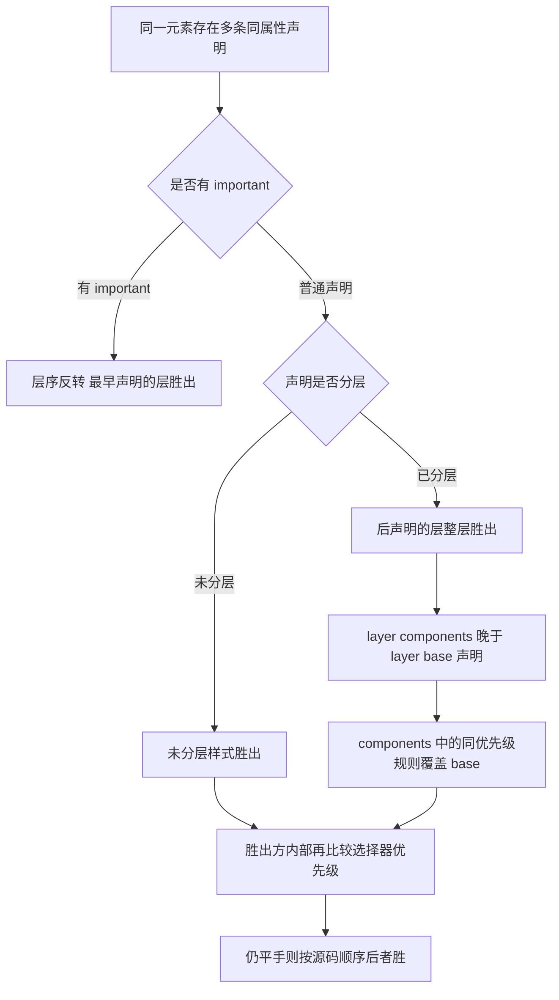

```css
/* 1. 声明层序：base 最低，utilities 最高 */
@layer reset, base, vendor, components, utilities;

@layer reset { a { color: inherit; } }
@layer base { a { color: var(--color-link); text-decoration: none; } }
@layer vendor { /* 第三方库样式整体压到 base 之上、components 之下 */ }
@layer components { .nav-link { color: var(--brand); } }
@layer utilities { .text-red { color: var(--color-danger); } }
/* .nav-link.text-red：utilities 层胜，无需提高选择器优先级 */

/* 2. important 反转：reset 层的 important 最强 */
@layer reset { * { box-sizing: border-box !important; } }

/* 3. 引入第三方 CSS 时指定归层 */
@import url("antd.css") layer(vendor);
```

### CSS-114：CSS Modules 的组合与全局样式如何管理？

**答**：
- 每个文件独立作用域，导入即拿到哈希后的类名映射对象，杜绝全局冲突。
- `composes` 在编译期把多个类拼接为一个 class 字符串，实现"继承式复用"且零运行时。
- 跨文件组合 `composes: base from "./base.module.css"` 生成多类名，注意不能出现在条件分支里。
- `:global()` 局部逃逸写全局样式，反过来 `:local` 显式声明哈希。
- 全局基础样式与模块样式的边界：reset/token/字体归全局入口文件，一切组件样式走模块。

```css
/* base.module.css */
.base {
  display: inline-flex; align-items: center;
  border-radius: var(--radius-md);
}
```

```css
/* Button.module.css */
.primary {
  composes: base from "./base.module.css"; /* 编译后 class="base_hash primary_hash" */
  background: var(--color-accent);
  color: #fff;
}
/* 全局逃逸：命中第三方类 */
.wrapper :global(.ant-input) { border-radius: 0; }
```

```javascript
import styles from './Button.module.css';
// styles.primary === "base_hash primary_hash"
button.className = styles.primary;
```

### CSS-115：设计系统与 CSS 的接口如何设计？token 怎么流转？

**答**：
- 单一来源：token 以 JSON/DSL 维护（颜色/字号/间距/圆角/阴影/动效六类），平台产物由它生成。
- 流转链路：token.json → style-dictionary/Style Tokens → CSS 变量 + TS 常量 + iOS/Android 主题。
- CSS 侧契约：组件只允许引用语义层变量，禁止写裸值，lint（stylelint token 规则）强制。
- 命名分层与版本化：语义 token 变更走 semver，破坏性重命名进 changelog。
- 跨端一致性的关键：同一 token 源 + 各平台生成器，而不是各端手抄色值。

```json
// tokens/semantic.json —— 单一来源
{
  "color": {
    "bg": { "surface": { "value": "{color.gray.0}" } },
    "fg": { "primary": { "value": "{color.gray.9}" } },
    "accent": { "value": "{color.blue.5}" }
  },
  "space": { "2": { "value": "8px" }, "4": { "value": "16px" } }
}
```

```css
/* style-dictionary 生成的 CSS（勿手改） */
:root {
  --color-bg-surface: #ffffff;
  --color-fg-primary: #17181a;
  --color-accent: #409eff;
  --space-2: 8px;
  --space-4: 16px;
}
```

```javascript
// 同源生成的 TS 常量，供 JS 动画/图表使用
export const token = { space: { 2: '8px', 4: '16px' } };
```

## 二十、性能与渲染

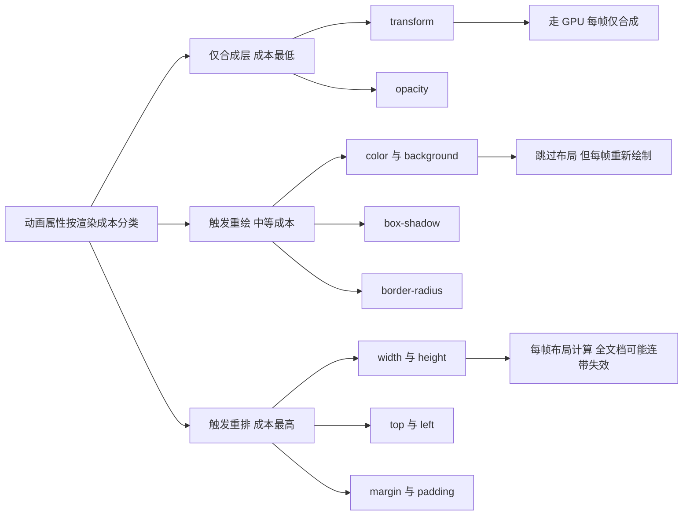

### CSS-116：从 CSS 视角，哪些属性触发重排、重绘或仅合成？

**答**：
- 仅合成（走 GPU）：`transform`、`opacity`，动画首选。
- 触发重绘：`color/background/box-shadow/border-radius/visibility/text-decoration` 等外观属性，跳过布局但仍要重新绘制。
- 触发重排：一切几何属性（width/height/margin/padding/top/left/font-size），改动沿文档流向上向下传播，成本最高。
- 排查依据见上方分类图：优先把动画属性迁移到 transform/opacity 轴（如 left 位移改 translateX）。
- 读写交错会强制同步布局（layout thrashing），批量改样式或用 class 切换。

```css
/* 1. 反例：动画 left/top 每帧重排 */
.bad-slide { animation: bad 0.3s; }
@keyframes bad { from { left: -100px; } to { left: 0; } }

/* 2. 正解：改用 transform，仅合成 */
.good-slide { position: relative; animation: good 0.3s both; }
@keyframes good { from { transform: translateX(-100px); } to { transform: translateX(0); } }

/* 3. 宽度动画改为 scaleX，布局零参与 */
.progress-fill { transform-origin: 0 50%; transition: transform 0.3s; }
.progress-fill.is-full { transform: scaleX(1); }
```

### CSS-117：合成层提升有哪些样式手段？will-change 滥用怎么治理？

**答**：
- 提升手段：`will-change: transform`、`transform: translateZ(0)`、`opacity < 1`、`position: fixed`、`filter/mask` 等都会创建合成层。
- 每个合成层都要独立位图与内存（大图放大十倍内存也放大），层爆炸是滚动卡顿与崩溃的常见根因。
- 治理原则：只给"确定要动画的元素"提升；动画开始前加 will-change，结束后移除（或由动画库托管）。
- translateZ(0) 强提是历史 hack，现代浏览器会自动为运行中动画提升，无脑全站加是反模式。
- 审计工具：DevTools Layers 面板逐层看内存与尺寸，Memory 面板看层树总量。

```css
/* 1. 正确用法：预告即将发生的动画，动完即撤 */
.carousel-track { transition: transform 0.4s var(--ease-out); }
.carousel-track.is-animating { will-change: transform; }

/* 2. 反例：全站无脑提升，内存白花 */
/* .card, .list-item, .badge, .modal { transform: translateZ(0); } ← 禁止 */

/* 3. 动画结束移除（JS 侧） */
track.addEventListener('transitionend', () => {
  track.classList.remove('is-animating'); // 释放合成层
}, { once: true });
```

### CSS-118：content-visibility 优化长列表的原理与实测注意点？

**答**：
- `content-visibility: auto` 让视口外子树跳过布局与绘制，接近"按需渲染"，首屏渲染时间可降数倍。
- 必须配 `contain-intrinsic-size`（如 `auto 500px`）给出占位高度，否则滚动条乱跳、锚点错位。
- `auto` 状态下浏览器保留最近渲染结果，来回滚动不闪烁；`hidden` 则完全跳过（适合折叠面板）。
- 实测注意：视口附近内容进入时仍有一次性布局成本；大量图片场景配合 lazy 加载。
- 与虚拟滚动的取舍：content-visibility 零 JS、DOM 全保留（利于搜索/无障碍），超长列表（万级）仍推荐虚拟滚动。

```css
/* 长列表项：视口外跳过渲染 */
.feed-item {
  content-visibility: auto;
  contain-intrinsic-size: auto 320px; /* 估算高度，接近真实值防跳动 */
}

/* 折叠面板：隐藏内容完全跳过渲染 */
details .panel-inner {
  content-visibility: hidden;
  contain-intrinsic-size: auto 400px;
}
details[open] .panel-inner { content-visibility: visible; }
```

### CSS-119：选择器性能如何测量？style invalidation 是什么？

**答**：
- 测量入口：DevTools Performance 录制中看 Recalculate Style 事件时长与影响元素数；Style 面板的 selector 统计可看各选择器匹配耗时。
- 匹配方向：选择器从右向左匹配，`.a .b .c .d` 最右的 `.d` 命中数决定扫描起点。
- 真正的现代瓶颈是"样式失效"（style invalidation）：DOM/类名一变，浏览器要算哪些节点受影响，宽泛选择器（`div *`、深层后代链）扩大失效范围。
- 收敛手段：缩短选择器深度、用 class 直击目标、把状态写在近邻（data 属性）而非祖先链。
- 没有证据不优化：先测量再动手，多数页面样式计算 <2ms，过早优化无意义。

```css
/* 1. 反例：深层后代链，失效范围大 */
/* .page .content .list .item .meta .time { color: var(--fg-secondary); } */

/* 2. 正解：单一类直击，失效范围最小 */
.meta-time { color: var(--fg-secondary); }

/* 3. 状态联动写在近邻，而非祖先扫描 */
.item[data-active] .meta-time { color: var(--brand); }

/* 4. 属性选择器窄域：限定在组件根内，避免全文档属性扫描 */
.card[data-collapsed] .card-body { display: none; }
```

### CSS-120：动画卡顿的排查流程是什么？layer border 工具怎么用？

**答**：
- 三步定位：DevTools Rendering 开启 Paint flashing（绿块=重绘）与 Layout Shift regions（蓝块=重排）看动画期间刷屏范围。
- 开启 Layer borders 看哪些元素被提升为合成层、层尺寸是否异常（超大层=内存与光栅化负担）。
- Performance 录制：动画每帧应只出现 Composite Layers；若出现 Recalculate Style/Layout，说明动了非合成属性。
- 常见元凶：大面积 box-shadow/filter blur 动画、滚动容器内 backdrop-filter、图片尺寸未定导致的反复布局。
- 修复路径：属性迁到 transform/opacity、限制效果面积、加 will-change 到动画元素、大图降分辨率。

```css
/* 排查辅助：devtools 之外的代码级探针（仅调试用） */
* { outline: 1px solid transparent; } /* 需要时改为 red 观察布局范围 */

/* 元凶一：大面积阴影动画 → 改为 opacity 淡入的影子层 */
.hover-card::after {
  content: ""; position: absolute; inset: 0;
  box-shadow: var(--shadow-3);
  opacity: 0; transition: opacity 0.25s; /* 只动 opacity */
}
.hover-card:hover::after { opacity: 1; }

/* 元凶二：blur 动画 → 降级为静态模糊 + 透明度 */
.modal-backdrop {
  backdrop-filter: blur(8px);
  transition: opacity 0.3s; /* 不动画 blur 值本身 */
}
```

### CSS-121：CSS 文件如何组织与做请求优化？Critical CSS 怎么提取？

**答**：
- 组织：按 @layer/ITCSS 分层分文件，构建期合并；路由级样式按需拆分，避免单包巨型 CSS。
- 请求优化：杜绝 @import 串行链；`<link rel="preload">` 关键样式，非首屏样式异步加载。
- Critical CSS：提取首屏必需样式内联进 `<head>`，剩余样式 `media="print"` + onload 切换或 `rel=preload` 异步注入，消除渲染阻塞。
- 工具链：critters（beasties）构建期自动内联，penthouse 抽取关键规则。
- 同时砍体积：purge 未用类、压缩、字体子集化。

```html
<!-- 关键样式内联，其余异步 -->
<style>/* critters 提取的首屏规则：布局骨架、header、hero */</style>
<link rel="preload" href="/main.css" as="style" onload="this.rel='stylesheet'">
<noscript><link rel="stylesheet" href="/main.css"></noscript>
```

```css
/* 反例：@import 串行阻塞（浏览器要下完 a.css 才知道还要下 b.css） */
/* a.css */
/* @import url("./b.css"); ← 移除，构建期合并或改用 link */

/* 正解：构建产物单文件，路由样式独立 chunk 由框架按需注入 */
```

## 二十一、新特性与兼容

### CSS-122：@container 深入：命名容器、尺寸查询与 style 查询怎么用？

**答**：
- 命名容器：`container: card / inline-size` 命名 + 类型，`@container card (min-width: 400px)` 精确指向，避免命中错误祖先。
- `container-type: inline-size` 只锁定内联轴（最常用，避免高度循环依赖）；`size` 双轴锁定，要求容器有确定高度。
- style 查询：`@container style(--theme: dark)` 基于容器 CSS 变量值切换样式，"变量即状态机"。
- style 查询暂不支持计算到任意表达式自由度有限，以变量字面值比较为主。
- 与 cqw/cqi 单位、fallback 变量配合，构成完整的组件级响应式体系。

```css
/* 命名容器 */
.dashboard-widget {
  container: widget / inline-size;
}

/* 尺寸查询：指向指定命名容器 */
@container widget (min-width: 480px) {
  .widget-body { grid-template-columns: auto minmax(0, 1fr); }
}

/* style 查询：按容器变量值切换，主题随容器而非页面 */
.card-scope { container-type: inline-size; --theme: light; }
@container style(--theme: dark) {
  .card { --bg-surface: #17181a; --fg-primary: #e8e9ea; }
}
/* JS 只改容器变量：scope.style.setProperty('--theme', 'dark') */
```

### CSS-123：:has() 的兼容策略与渐进增强怎么做？

**答**：
- Baseline 2023：Chrome 105+ / Safari 15.4+ / Firefox 121+ 均已支持，主要缺口在老旧国内内核。
- 检测：`@supports selector(:has(*))` 精确判断（注意 `@supports (:has(a))` 写法跨浏览器有坑，用 selector() 包裹最稳）。
- 增强模式：无 :has() 时功能正常但缺少"联动美化"；有 :has() 时增强为纯 CSS 联动。
- 关键交互（显隐/校验）不要只依赖 :has()，用 JS 加 data 属性双保险。
- 降级思路与 :focus-visible、容器查询一致：能力检测 + 基础可用 + 增强分支。

```css
/* 增强：表单错误联动（支持 :has 的浏览器） */
@supports selector(:has(*)) {
  .field:has(input:user-invalid) { border-color: var(--color-danger); }
}

/* 基础：所有浏览器都保留 JS 驱动的 data-state 通道 */
.field[data-invalid] { border-color: var(--color-danger); }
```

```javascript
// JS 兜底：不支持 :has 的环境监听事件改 data 属性
if (!CSS.supports('selector(:has(*))')) {
  input.addEventListener('input', () => {
    field.dataset.invalid = String(!input.checkValidity() && input.matches(':user-invalid'));
  });
}
```

### CSS-124：subgrid 解决什么问题？怎么用？

**答**：
- 问题：嵌套 Grid 的子网格轨道与父网格对不上，卡片内标题/正文/按钮无法跨卡对齐。
- `grid-template-rows: subgrid`（或 columns）让子元素继承父网格的对应轨道定义，共享行高。
- 子元素占多行用 `grid-row: span 3`，内部再按继承轨道摆放，天然跨卡对齐。
- Baseline 2023，三大家族全支持；不支持的环境回退为普通轨道（布局仍可用，仅对齐退化）。

```css
.cards {
  display: grid;
  grid-template-columns: repeat(3, 1fr);
  gap: 16px;
}

.card {
  display: grid;
  grid-row: span 3;
  grid-template-rows: subgrid;  /* 三段行高继承父网格，跨卡严格对齐 */
  gap: 8px;
}

.card h3 { grid-row: 1; }      /* 标题行 */
.card p  { grid-row: 2; }      /* 内容行 */
.card footer { grid-row: 3; }  /* 按钮行：所有卡片底部对齐 */
```

### CSS-125：masonry 布局的提案现状如何？现阶段怎么选型？

**答**：
- 现状：`grid-template-rows: masonry` 仍处提案阶段，Chrome 以 flag 形式实验，未进 Baseline。
- 争议点：条目排列顺序（优先列序还是读序）与 WebKit 的 item-flow 整合方案尚未定论，API 可能变化。
- 可用替代一：CSS `columns`（纯 CSS 但纵向读序）；替代二：Grid 双列/多列手动分配；替代三：JS 最短列算法（读序正确）。
- 选型建议：内容顺序重要的信息流用 JS 或 grid；读序不敏感的图片墙用 columns；提案落地前不写依赖 masonry 关键布局的代码。

```css
/* 现阶段可用：columns 方案（读序纵向） */
.gallery {
  columns: 4 220px;
  column-gap: 16px;
}
.gallery img {
  width: 100%;
  margin-bottom: 16px;
  break-inside: avoid;
  display: block;
}

/* 未来可期（实验 flag 下） */
@supports (grid-template-rows: masonry) {
  .gallery-future {
    display: grid;
    grid-template-columns: repeat(4, 1fr);
    grid-template-rows: masonry;
    gap: 16px;
  }
}
```

### CSS-126：color-mix() 与相对颜色语法如何派生颜色？

**答**：
- `color-mix(in 色彩空间, A p1%, B p2%)` 按比例混合两色，派生 hover/disabled/border 色不再手调。
- 相对颜色语法：`hsl(from var(--c) h s calc(l - 10%))` 从基准色解构出各分量再重组，做明暗阶梯。
- in oklch 混合比 in srgb 更符合感知（中间色不发灰）。
- 配合 CSS 变量实现"一个主色派生整套语义色"，主题只需改一个变量。
- 两者均已 Baseline，可与 color-mix 嵌套使用。

```css
:root { --brand: #409eff; }

.btn {
  background: var(--brand);
  border-color: color-mix(in oklch, var(--brand) 70%, black); /* 边框：加深 */
}
.btn:hover {
  background: color-mix(in oklch, var(--brand) 85%, white);   /* hover：提亮 */
}
.btn[data-disabled] {
  background: color-mix(in srgb, var(--brand) 40%, transparent);
}

/* 相对颜色语法：从主色解构出明度阶梯 */
:root {
  --brand-dark:  oklch(from var(--brand) calc(l - 0.15) c h);
  --brand-light: oklch(from var(--brand) calc(l + 0.15) c h);
  --brand-bg:    hsl(from var(--brand) h s calc(l * 100% + 40%) / 15%);
}
```

### CSS-127：oklch 色彩空间有什么优势？怎么用它建设计色板？

**答**：
- oklch 三轴：L 感知亮度、C 彩度、H 色相；同 L 值的颜色"看起来一样亮"，这是 sRGB/hsl 做不到的。
- 等亮度性让无障碍对比度可预测：L 固定阶梯生成色阶，WCAG 对比度控制从试错变成计算。
- 广色域：可表达 P3 范围颜色，过渡插值更平滑不发灰。
- 工程实践：主色定 oklch(L C H)，同 C/H 变 L 生成 50~900 色阶，语义 token 引用色阶。
- 需要兼容 sRGB 时由浏览器自动映射降级，无需手动双写。

```css
/* 品牌主色与等亮度色阶：只动 L，C/H 不变 */
:root {
  --brand-500: oklch(0.62 0.19 255);   /* 主色 */
  --brand-100: oklch(0.92 0.05 255);   /* 同色相提亮 */
  --brand-700: oklch(0.45 0.17 255);   /* 同色相压暗，文字可读 */
  --brand-900: oklch(0.3 0.12 255);
}

/* 语义 token：白字按钮用 700 保证对比度 */
.btn-primary {
  background: var(--brand-500);
  color: white;
}
.btn-primary:hover { background: var(--brand-700); }

/* 互补色/邻近色：只转 H */
:root {
  --accent-complement: oklch(0.62 0.19 calc(255 + 180));
}
```

### CSS-128：text-wrap balance 与 pretty 解决什么问题？

**答**：
- `text-wrap: balance`：让多行文本各行长度的差距最小化，标题不再"头重脚轻"（第一行爆满、第二行孤字）。
- `text-wrap: pretty`：避免段落末行出现过短孤行，优化段落排版节奏。
- balance 建议只用于 ≤6 行的标题/按钮文案，行数多时有计算成本；正文段落用 pretty。
- 两者都是渐进增强：不支持时回退默认换行，页面完全正常。
- 配合 `text-box-trim`（块首尾裁空）可进一步精修排版。

```css
/* 标题平衡换行 */
h1, h2, .hero-copy {
  text-wrap: balance;
}

/* 正文防孤行 */
.article p {
  text-wrap: pretty;
  max-width: 65ch;   /* 每行 60~75 字符的最佳阅读宽度 */
}

/* 按钮/标签文案：不支持时无副作用 */
.btn { text-wrap: balance; }
```

### CSS-129：@property 注册自定义属性有什么用？怎么让渐变动起来？

**答**：
- 未注册的自定义属性是"无类型字符串"，浏览器无法插值，transition/animation 直接跳变。
- `@property --x { syntax: "<angle>"; ... }` 注册类型后，变量获得类型、初始值与继承语义，可参与过渡与动画。
- 经典应用：渐变角度动画、数字滚动（<integer>）、圆环进度（<percentage>）。
- `inherits: false` 控制是否继承；`initial-value` 在 syntax 非通配时必填。
- Baseline 2024，用 `@supports` 或 CSS.registerProperty 降级处理老内核。

```css
/* 注册角度变量：字符串变成可插值的 <angle> */
@property --angle {
  syntax: "<angle>";
  initial-value: 0deg;
  inherits: false;
}

/* 渐变旋转动画：注册前这里只能瞬移，注册后平滑旋转 */
.conic-spin {
  background: conic-gradient(from var(--angle), var(--c1), var(--c2), var(--c1));
  animation: rotate-hue 3s linear infinite;
}
@keyframes rotate-hue { to { --angle: 360deg; } }

/* 数字滚动：注册 <integer> 后 counter 展示可过渡 */
@property --num {
  syntax: "<integer>";
  initial-value: 0;
  inherits: false;
}
.counter {
  transition: --num 1s;
  counter-reset: num var(--num);
}
.counter::after { content: counter(num); }
.counter.is-final { --num: 1024; }
```

### CSS-130：@supports 的全部用法与优雅降级收束方案？

**答**：
- 基本形：`@supports (display: grid)`；否定：`not`；组合：`and / or` 括号分组。
- 选择器检测：`@supports selector(:has(a))` / `selector(::part(x))`，判断新选择器可用性。
- 工程模式：默认写"基线样式保证可用"，`@supports` 内只放增强分支——所有增强都是增益而非依赖。
- 与 caniuse/Browserslist 联动：构建期决定 polyfill 与前缀，运行期 @supports 处理"能检测到的能力"。
- 收束原则：能力检测优先于 UA 嗅探；降级路径必须有 QA 验证；文档化每个增强分支的最低版本。

```css
/* 1. 增强分支：Grid 可用才上 Grid，否则默认块级布局兜底 */
.layout { display: block; }
@supports (display: grid) {
  .layout {
    display: grid;
    grid-template-columns: 240px minmax(0, 1fr);
  }
}

/* 2. 组合与否定 */
@supports not (backdrop-filter: blur(1px)) {
  .glass { background: var(--bg-surface); } /* 降级：不透明底 */
}
@supports (color: oklch(0.7 0.1 200)) and (selector(:has(*))) {
  .next-gen { /* 新能力组合生效区 */ }
}

/* 3. JS 侧同一套能力检测，行为与 CSS 对齐 */
if (CSS.supports('display', 'grid')) initGridLayout();
```

## 二十二、经典布局题全解

### CSS-131：左右固定中间自适应的三栏布局有哪 5 种实现？如何对比选型？

**答**：
- flex：首选，`flex: 1` 一行解决，子项天然等高。
- grid：声明式最强，`grid-template-columns: 200px 1fr 200px` 直接完成。
- float：兼容老浏览器的遗留方案，中间栏要留出两侧 margin，DOM 顺序可让 main 在前（利于 SEO）。
- absolute：父级 relative + 两侧绝对定位，脱离文档流，父级高度塌陷需自行处理。
- table/table-cell：IE8 时代方案，现仅用于维护遗留代码；选型上 flex/grid 优先。

```css
/* 公共结构：.left 200px、.right 200px、.main 自适应 */

/* 1. flex（首选） */
.flex-layout { display: flex; }
.flex-layout .left,
.flex-layout .right { width: 200px; flex-shrink: 0; }
.flex-layout .main { flex: 1; min-width: 0; } /* 防内容撑破 */

/* 2. grid */
.grid-layout { display: grid; grid-template-columns: 200px 1fr 200px; }

/* 3. float + margin：main 在 DOM 前面，SEO 友好 */
.float-layout .main { margin: 0 210px; }
.float-layout .left  { float: left;  width: 200px; }
.float-layout .right { float: right; width: 200px; }
.float-layout::after { content: ""; display: block; clear: both; }

/* 4. absolute：父级 relative，两侧绝对定位 */
.abs-layout { position: relative; padding: 0 210px; }
.abs-layout .left,
.abs-layout .right { position: absolute; top: 0; width: 200px; }
.abs-layout .left  { left: 0; }
.abs-layout .right { right: 0; }

/* 5. table-cell：老项目兼容方案 */
.table-layout { display: table; width: 100%; }
.table-layout > div { display: table-cell; vertical-align: top; }
.table-layout .left,
.table-layout .right { width: 200px; }
```

### CSS-132：顶部导航 + 侧边栏 + 内容区的后台布局怎么完整实现？

**答**：
- grid-template 的“命名区域 + 行列尺寸”写法一次声明整个骨架，可读性最高。
- 各区域各自 `overflow-y: auto`，滚动互不影响；顶栏和侧栏不随内容滚。
- 高度用 `100dvh` 兜底 `100vh`，规避移动端地址栏问题。
- 窄屏下只改 grid-template 即可整体重排，侧栏隐藏，媒体查询里零布局逻辑重写。

```css
/* 结构：.admin > header.admin-header + aside.admin-aside + main.admin-main */
.admin {
  display: grid;
  grid-template:
    "header header" 56px
    "aside  main"   1fr
    / 220px 1fr;
  height: 100vh;
  height: 100dvh;
}
.admin-header { grid-area: header; }
.admin-aside  { grid-area: aside; overflow-y: auto; }
.admin-main   { grid-area: main;  overflow-y: auto; }

/* 窄屏重排：侧栏收起，内容铺满 */
@media (max-width: 768px) {
  .admin { grid-template: "header" 56px "main" 1fr / 1fr; }
  .admin-aside { display: none; }
}
```

### CSS-133：上中下三段布局，头尾固定、中间可滚，怎么实现？

**答**：
- 经典 flex 纵向布局：header/footer `flex-shrink: 0` 锁定，中间 `flex: 1` 吃满剩余高度。
- 中间滚动区必须加 `min-height: 0`，否则 flex 子项默认 `min-height: auto` 会被内容撑爆、不出现滚动条。
- 移动端高度用 `100dvh`，避免地址栏收展造成的跳动。
- 页面级滚动交给 `.page-body` 而不是 body，还能顺带解决 overscroll 联动问题。

```css
/* 结构：.page > header.page-header + div.page-body + footer.page-footer */
.page {
  display: flex;
  flex-direction: column;
  height: 100vh;
  height: 100dvh;
}
.page-header,
.page-footer { flex-shrink: 0; }
.page-body {
  flex: 1;
  min-height: 0;      /* 关键：允许收缩，否则不会出现滚动条 */
  overflow-y: auto;
  -webkit-overflow-scrolling: touch;
}
```

### CSS-134：瀑布流布局怎么实现？columns 和 grid 两种方案各有什么坑？

**答**：
- columns 方案：`columns: 4 240px` + `break-inside: avoid`，纯 CSS 零 JS；但填充顺序是纵向的（先填满第一列），列表有顺序语义时不可接受。
- grid row span 方案：先按普通网格排（顺序正确），用 JS 把每个 item 的高度换算成 `grid-auto-rows` 的整数倍，设为 `--span`；顺序与视觉双正确，需要少量 JS。
- 通用坑：图片未加载完成时高度为 0，必须等图片加载后再测高（或预设宽高比占位）。
- 列间距 gap 两方案都支持；columns 方案的 item 底部 margin 在断列处会被裁掉，用 padding 代替。

```css
/* 方案一：columns，纯 CSS，顺序为纵向填充 */
.masonry-columns {
  columns: 4 240px;   /* 4 列，每列最小 240px，自动降列 */
  column-gap: 16px;
}
.masonry-columns .item {
  break-inside: avoid;      /* 禁止卡片被拆到两列 */
  margin-bottom: 16px;
}

/* 方案二：grid row span，顺序正确，JS 只负责算跨度 */
.masonry-grid {
  display: grid;
  grid-template-columns: repeat(4, 1fr);
  grid-auto-rows: 8px;      /* 最小跨度单位，决定纵向颗粒度 */
  gap: 0 16px;
}
.masonry-grid .item {
  grid-row-end: span var(--span, 12);
}
/* JS：item.style.setProperty('--span', Math.ceil((h + 16) / 8))
   h 为卡片实际高度（含底边距），渲染/图片 onload 后重算 */
```

### CSS-135：时间轴布局（左侧竖线 + 节点圆点 + 右侧内容）怎么实现？

**答**：
- 容器画一条贯穿的竖线：伪元素 absolute 定位在 left 固定处，`top: 0; bottom: 0` 自动贯通。
- 每个节点用伪元素画圆点，`position: absolute` 压在线上，`background: #fff` 遮住穿过圆点的那段线。
- 节点间间距用 `padding-bottom` 而不是 margin，避免最后多出空隙不好控制。
- 需要最后一节点“断线”效果时，给 `.node:last-child` 的容器线用 `bottom: calc(100% - 圆点位置)` 或单独覆盖。

```css
/* 结构：ul.timeline > li.node，节点内左侧时间 + 右侧内容 */
.timeline {
  position: relative;
  padding-left: 24px;
}
.timeline::before {
  content: "";
  position: absolute;
  left: 7px;
  top: 4px;
  bottom: 0;
  border-left: 2px solid #ddd;
}
.node {
  position: relative;
  padding-bottom: 24px;
}
.node::before {
  content: "";
  position: absolute;
  left: -24px;
  top: 4px;
  width: 12px;
  height: 12px;
  border-radius: 50%;
  background: #fff;          /* 遮住竖线 */
  border: 2px solid #096;
  box-sizing: border-box;
}
.node:last-child { padding-bottom: 0; }
.node.done::before { background: #096; } /* 已完成节点实心 */
```

### CSS-136：聊天气泡布局怎么做到宽度自适应 + 左右方向对齐？

**答**：
- 外层纵向 flex 排消息行，每行 `align-items: flex-end` 让头像贴气泡底部。
- 自己的消息行用 `flex-direction: row-reverse` 翻转，头像右置、气泡左对齐自身。
- 气泡 `width: fit-content` + `max-width: 72%`：短文本收缩到内容宽，长文本不超屏。
- 必须 `overflow-wrap: anywhere` 防长英文/URL 把气泡撑破；`min-width: 0` 在 flex 子项上同样要记得加。

```css
/* 结构：.chat > .row（.avatar + .bubble），自己的消息加 .self */
.chat {
  display: flex;
  flex-direction: column;
  gap: 12px;
  padding: 12px;
}
.row {
  display: flex;
  align-items: flex-end;
  gap: 8px;
  min-width: 0;
}
.row.self { flex-direction: row-reverse; } /* 头像在右，气泡跟右 */

.avatar { width: 36px; height: 36px; border-radius: 50%; flex-shrink: 0; }
.bubble {
  width: fit-content;
  max-width: 72%;
  min-width: 0;
  padding: 8px 12px;
  border-radius: 12px;
  background: #f2f3f5;
  overflow-wrap: anywhere;   /* 长 URL/英文强制断行 */
}
.row.self .bubble { background: #95ec69; }
```

### CSS-137：表单的 label 有哪几种对齐方案？各自适用场景？

**答**：
- 顶对齐（label 在输入框上方）：标签与输入框阅读视线最短，移动端和长表单首选；纵向占用高。
- 左对齐（固定宽度列）：label 右对齐 + 输入框左对齐形成两列，桌面后台最常见；label 过长会挤压空间。
- 内嵌浮动 label（Material 风格）：label 融入输入框，聚焦或已有值时上浮缩小，靠 `:focus` 与 `:not(:placeholder-shown)` 两个状态驱动。
- 内嵌方案要求 label 写在 input 之后（兄弟选择器向后看），且 input 必须带 placeholder=" "。

```css
/* 方案一：顶对齐，移动端首选 */
.form-top .field { display: flex; flex-direction: column; gap: 4px; }

/* 方案二：左对齐，固定 label 列宽，输入框纵向对齐 */
.form-left .field {
  display: grid;
  grid-template-columns: 96px 1fr;
  align-items: center;
  gap: 12px;
}
.form-left label { text-align: right; }

/* 方案三：内嵌浮动 label，DOM 顺序 input 在前 label 在后 */
.form-inline .field { position: relative; }
.form-inline input { padding: 14px 12px 4px; }
.form-inline label {
  position: absolute;
  left: 12px;
  top: 50%;
  transform: translateY(-50%);
  color: #999;
  transition: all .2s;
  pointer-events: none;
}
.form-inline input:focus + label,
.form-inline input:not(:placeholder-shown) + label {
  top: 12px;
  transform: none;
  font-size: 12px;
  color: #096;
}
```

### CSS-138：flex 多列等间距换行时最后一行不靠左怎么办？

**答**：
- 病灶：`flex-wrap` + `justify-content: space-between` 时，最后一行元素不足会两端撑开，间距错乱。
- 解法一（首选）：改 grid `repeat(auto-fill, minmax(220px, 1fr))`，空位由网格轨道天然占住，完全无 JS。
- 解法二：flex + `gap`，item 宽度用 `calc((100% - (n-1) × gap) / n)` 精确算出，最后一行自然靠左。
- 解法三（补位法）：往列表尾部塞 n 个 `visibility: hidden` 占位元素撑住 space-between，适合不便换 grid 的存量代码。

```css
/* 问题复现：最后一行只剩 2 个时被 space-between 推到两端 */
.bad {
  display: flex;
  flex-wrap: wrap;
  justify-content: space-between;
}
.bad .item { width: 220px; }

/* 解法一：grid auto-fill，空轨道自动占位（首选） */
.good-grid {
  display: grid;
  grid-template-columns: repeat(auto-fill, minmax(220px, 1fr));
  gap: 16px;
}

/* 解法二：flex + gap + calc 宽度，每行固定 4 个 */
.good-flex {
  display: flex;
  flex-wrap: wrap;
  gap: 16px;
}
.good-flex .item {
  /* (100% - 3 × 16px) / 4，gap 实际参与宽度分配 */
  flex: 0 1 calc((100% - 48px) / 4);
}
```

## 二十三、Flex 深水区

### CSS-139：flex-basis 和 width 谁的优先级高？content 关键字是什么语义？

**答**：
- `flex-basis` 有确定值（非 auto）时优先于 width，width 完全被忽略。
- `flex-basis: auto`（默认）时回退读取 width；width 也没写则用 content 尺寸。
- `flex-basis: content` 显式声明“以内容尺寸为基准”，无视 width，适合让按钮/标签按文字自适应。
- 基准值仍受 `min-width/max-width` 截断；`flex: 1` 复合写法等价 `flex: 1 1 0%`，basis 归零后宽度完全由 grow 比例决定。

```css
.item {
  width: 100px;
  flex-basis: 300px;    /* 有值优先：width: 100px 被忽略 */
  flex-grow: 1;
}
.item-auto {
  /* basis 为 auto，回退用 width */
  width: 120px;
}
.item-content {
  flex-basis: content;  /* 以内容尺寸为基准，无视任何 width */
  flex-shrink: 0;
}
.item-flex1 { flex: 1; } /* 等价 flex: 1 1 0%，宽度完全按 grow 比例分 */
/* 以上基准都会再被 min-width / max-width 截断 */
```

### CSS-140：flex-grow 的分配怎么计算？请给出完整例题与数学过程。

**答**：
- 核心公式：剩余空间 = 容器主轴尺寸 − Σ flex-basis；每份份额 = 剩余空间 ÷ Σ flex-grow；子项最终宽 = basis + 份额 × 自身 grow。
- 空间不足时走 shrink：每项收缩量 = 亏损 × (自身 shrink × 自身 basis) ÷ Σ(shrink × basis)，即“基准越大缩得越多”。
- 结果还要过 `min-width / max-width` 截断，被截断项让出的空间会在其余子项间二次分配。
- 面试压轴常考“带 max-width 的二次分配”，务必会推两轮。

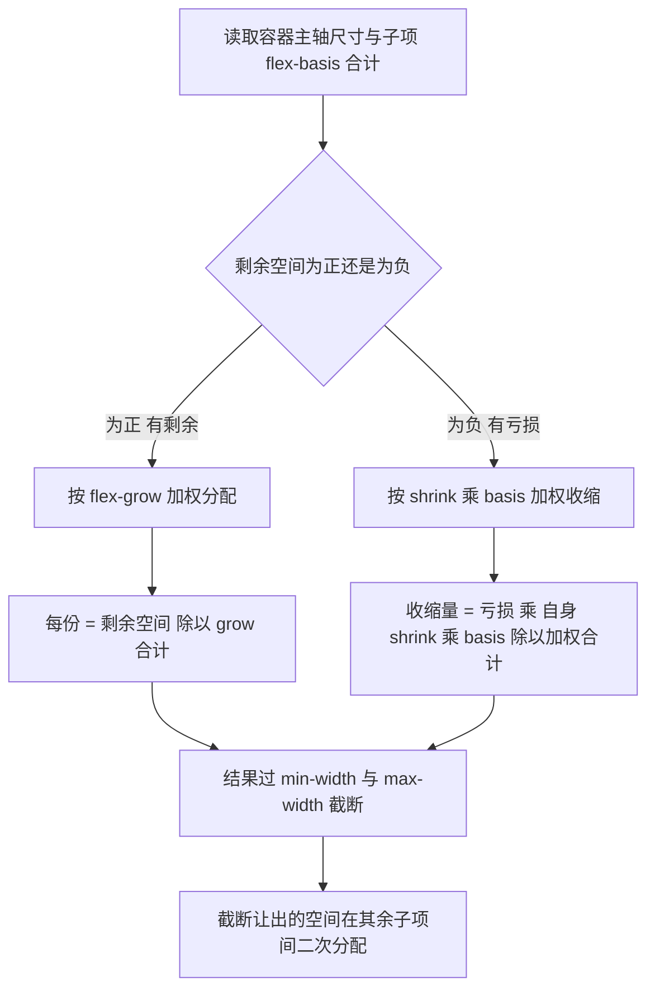

```css
/* 例题：容器 900px，三个子项
   A：flex-basis 200px，flex-grow 1
   B：flex-basis 200px，flex-grow 1
   C：flex-basis 400px，flex-grow 2

   第一步：basis 合计 = 200 + 200 + 400 = 800px
   第二步：剩余空间 = 900 - 800 = 100px
   第三步：grow 合计 = 1 + 1 + 2 = 4，每份 = 100 / 4 = 25px
   第四步：A = 200 + 25×1 = 225px
           B = 200 + 25×1 = 225px
           C = 400 + 25×2 = 450px
   校验：225 + 225 + 450 = 900px，恰好铺满 */
.container { display: flex; width: 900px; }
.a { flex: 1 1 200px; }
.b { flex: 1 1 200px; }
.c { flex: 2 1 400px; }
```

### CSS-141：为什么 flex 子项里的文本省略号失效？min-width: 0 是怎么救场的？

**答**：
- flex 子项默认 `min-width: auto`：不能收缩到内容最小尺寸以下，长文本把子项撑开，ellipsis 永远不触发。
- `min-width: 0` 显式把下限归零，子项才被允许压到内容以下，`overflow: hidden` 才能生效。
- 常见组合：文本项 `flex: 1; min-width: 0` + 按钮项 `flex-shrink: 0`，形成“文本可截断、按钮不变形”的标准工具栏。
- 纵向同理是 `min-height: 0`（滚动容器失效的元凶）。

```css
/* 问题结构：.card-row > .title（要省略号） + .btn（固定宽） */
.card-row {
  display: flex;
  gap: 12px;
  align-items: center;
}
.card-row .title {
  flex: 1;
  min-width: 0;          /* 关键一行：把 auto 下限改回 0 */
  white-space: nowrap;
  overflow: hidden;
  text-overflow: ellipsis;
}
.card-row .btn {
  flex-shrink: 0;        /* 按钮永远完整 */
}
/* 没写 min-width: 0 时，.title 被"标题很长很长..."撑到内容宽，
   父容器溢出，ellipsis 不出现 */
```

### CSS-142：margin: auto 在 flex 容器里的语义和块级流里有什么不同？

**答**：
- 常规流里 `margin: auto` 只在水平方向吸收剩余空间；flex 容器里 auto 边距会**平分主轴与交叉轴的剩余空间**，`margin: auto` 直接实现水平垂直居中。
- 单侧 auto 是“对齐利器”：`margin-right: auto` 把自身之后的元素全部推到另一端，比 justify-content 更局部、更灵活。
- 剩余空间分配优先级：`justify-content` 先于 auto margin——但只要存在 auto margin，justify-content 就没有剩余空间可分，实际由 auto 接管。
- 经典应用：`margin-top: auto` 把底部操作栏推到 column 布局最下方。

```css
/* 用法一：单侧 auto 做导航分区 */
.nav { display: flex; align-items: center; }
.nav .logo { margin-right: auto; }   /* logo 后的所有项被推到右侧 */
.nav .actions { margin-left: 12px; }

/* 用法二：margin auto 四向平分 = 水平垂直居中 */
.center-demo {
  display: flex;
  height: 200px;
  background: #f5f5f5;
}
.center-demo .box { margin: auto; }

/* 用法三：底部操作栏固定推到底 */
.dialog {
  display: flex;
  flex-direction: column;
  height: 320px;
}
.dialog .foot { margin-top: auto; }  /* 剩余高度全给上面，foot 贴底 */
```

### CSS-143：order 属性做视觉重排有什么可访问性代价？

**答**：
- order 只改视觉顺序，DOM 顺序不变：Tab 键焦点顺序、屏幕阅读器朗读顺序仍按 DOM 走，视觉与交互顺序割裂。
- 典型事故：order 把“提交按钮”视觉前置，但键盘用户按 Tab 却先落到其他按钮。
- 原则：能用 DOM 顺序解决的不要用 order；order 留给“小幅度视觉微调”（如置顶卡片 `order: -1`）并配合 aria 或语义验证。
- 自动化审计（axe/Lighthouse）会把“焦点顺序与视觉顺序不一致”标为问题，媒体查询重排优先用 grid-template-areas 或 flex-direction。

```css
/* 视觉重排：main 视觉在前，aside 与 ad 依次在后 */
.page { display: flex; }
.page .main  { order: 1; flex: 1; }
.page .aside { order: 2; width: 220px; }
.page .ad    { order: 3; width: 120px; }

/* 置顶卡片：小幅视觉调整，DOM 仍在原位 */
.feed { display: flex; flex-direction: column; }
.feed .pin { order: -1; background: #fffbe6; }

/* 风险演示：DOM 顺序是 aside → main，但视觉 main 在前，
   键盘 Tab 先进 aside 里的链接 —— 与用户看到的顺序相反 */
```

### CSS-144：writing-mode 下 flex 的主轴方向怎么变？

**答**：
- flex 的 row/column 是**逻辑方向**：`writing-mode: vertical-rl` 下主轴变成纵向、交叉轴变成横向，gap/对齐全部跟着逻辑轴走。
- vertical-rl 与 vertical-lr 只是行块堆叠方向相反（右起 vs 左起），不影响 flex 轴定义。
- 子元素可单独切回 `writing-mode: horizontal-tb` 做“竖排版式里嵌横排”（如竖排海报里的英文数字）。
- 兼容注意：老 Safari 对 vertical writing-mode 的 flex 支持有缺陷，竖排布局优先用 grid 验证。

```css
.poster { writing-mode: vertical-rl; }  /* 整体竖排，从右往左 */

/* 竖排容器里的 flex：主轴纵向排列，gap 沿纵向 */
.v-layout {
  display: flex;
  writing-mode: vertical-rl;
  gap: 24px;
  height: 300px;
}
.v-layout .col { flex: 1; } /* 每列沿交叉轴（横向）等分 */

/* 竖排版式里嵌回横排：数字/英文更易读 */
.v-layout .num {
  writing-mode: horizontal-tb;
  unicode-bidi: plaintext;
}
```

### CSS-145：嵌套 flex 的对齐如何跨层传递？为什么会“居中失效”？

**答**：
- 默认 `align-items: stretch` 让子容器被拉满交叉轴，子容器内部的对齐才有完整空间可用——这是对齐“传递”的隐含前提。
- 陷阱：外层设了 `align-items: center`，子容器高度塌缩为内容高，子容器内的 `height: 100%`、内部 stretch 全部失效。
- 修正思路：需要“外层整体居中 + 内部撑满”时，给子容器 `align-self: stretch`，把居中下沉到子容器内部去做。
- 排查口诀：先看每层的高度来源（stretch 还是内容），再看对齐作用在哪个轴。

```css
.outer { display: flex; height: 300px; background: #f5f5f5; }

/* 正常：默认 stretch，.inner 撑满高度，内部居中有完整空间 */
.inner {
  flex: 1;
  display: flex;
  align-items: center;      /* 内容在自身内部垂直居中 */
  justify-content: center;
}

/* 陷阱：外层 center 让 .inner 塌缩为内容高，
   内部看起来"也居中了"是巧合，一旦内容复杂立刻错位 */
.outer-trap { align-items: center; }

/* 修正：既要外层约束高度，又要内部完整空间 */
.outer-fix { align-items: center; }
.outer-fix .inner { align-self: stretch; } /* 该子项单独撑满 */
```

## 二十四、Grid 深水区

### CSS-146：fr 单位与 auto 在 grid 轨道分配中是怎么算的？

**答**：
- 分配顺序：固定尺寸轨道（px）→ 内容驱动轨道（auto/min-content 等）→ 剩余空间才轮到 fr 按比例瓜分。
- auto 轨道先按内容（max-content）拿自己的份额，fr 只分剩下的；auto 也有 `minmax(auto, 1fr)` 语义参与竞争。
- `1fr` 实际是 `minmax(auto, 1fr)`：内容的最小尺寸会撑破轨道导致溢出；`minmax(0, 1fr)` 才是“严格等分可收缩”。
- 面试答法：先讲三段式分配，再补 minmax(0,1fr) 的溢出坑，基本是标准满分结构。

```css
.grid {
  display: grid;
  grid-template-columns: 100px auto 1fr 2fr;
  width: 900px;
}
/* 分配过程：
   1. 100px 固定轨道先占 100px
   2. auto 轨道按内容取宽（设内容 180px）
   3. 剩余 900 - 100 - 180 = 620px，由 1fr + 2fr = 3 份瓜分
      → 1fr ≈ 206.67px，2fr ≈ 413.33px */

/* 坑：1fr 含 minmax(auto, ...)，超长内容会撑破列 */
.overflow-demo { display: grid; grid-template-columns: 1fr 1fr; }
/* 修正：严格等分且可收缩 */
.fixed { display: grid; grid-template-columns: minmax(0, 1fr) minmax(0, 1fr); }
```

### CSS-147：grid 自动放置算法 sparse 和 dense 有什么区别？

**答**：
- 默认 sparse：游标只向前走，遇到放不下的大块就跳过留洞，绝不开倒车——结果 DOM 顺序与位置一致但可能有空洞。
- `dense`：每放一个 item 都从头扫描网格，能塞进之前的空洞就回填——网格更紧凑，但元素位置不再跟随 DOM 顺序。
- dense 的代价：视觉顺序与 DOM/读屏顺序脱节，且布局计算量增大；只适合“卡片大小不一、无强顺序语义”的图库类页面。
- 面试加分：能描述“跨行卡片 + sparse 留洞”的具体复现场景。

```css
/* 复现：第 2 个 item 高度跨 2 行，sparse 下第 3、4 个绕过它，
   第 5 个无法回填第 2 个留下的空洞 */
.grid-sparse {
  display: grid;
  grid-template-columns: repeat(3, 1fr);
  grid-auto-rows: 80px;
  grid-auto-flow: row;            /* 默认 sparse */
}
.grid-sparse .tall { grid-row: span 2; }

/* dense：后续小卡片回填空洞，网格更满 */
.grid-dense {
  display: grid;
  grid-template-columns: repeat(3, 1fr);
  grid-auto-rows: 80px;
  grid-auto-flow: row dense;
}
.grid-dense .tall { grid-row: span 2; }
/* 注意：dense 打乱视觉顺序，带顺序语义的列表禁用 */
```

### CSS-148：grid 的 span 跨轨与命名线定位怎么配合使用？

**答**：
- 命名线：在 grid-template-columns 里用 `[name]` 给线命名，同名可重复（自动 name1/name2），定位写 `grid-column: full-start / full-end`。
- span：`grid-column: span 2` 表示“占两轨，具体位置交给自动放置”，与命名线可以混写 `content-start / span 2`。
- 负数线索引从末尾往前数（-1 是最后一条线），动态列数时特别有用。
- 排版系统（全宽通栏 + 居中内容列）是命名线的经典落地。

```css
.layout {
  display: grid;
  grid-template-columns:
    [full-start] minmax(1rem, 1fr)
    [content-start] minmax(0, 720px)
    [content-end] minmax(1rem, 1fr)
    [full-end];
}
.layout .hero    { grid-column: full-start / full-end; }    /* 全宽通栏 */
.layout .article { grid-column: content-start / content-end; } /* 居中正文 */
.layout .wide    { grid-column: content-start / span 2; }   /* 混用 span */
.layout .tail    { grid-column: -2 / -1; }                  /* 最后一列 */

/* 同名线重复时自动带序号：row-start 1 / row-start 2 */
.rows {
  grid-template-rows: [row-start] 80px [row-start] 80px [row-start] 80px;
}
.rows .pick { grid-row: row-start 2 / row-start 4; }
```

### CSS-149：如何用 grid-template-areas 做响应式重排？

**答**：
- 把区域命名成“地图”，组件只挂 `grid-area: 名字`；响应式只需在每个断点重画地图，组件声明零改动。
- 这是“结构与断点解耦”的最佳实践：新增断点 = 新增一张地图，不碰任何组件选择器。
- 注意：同一区域名必须连成矩形，L 形区域非法会整条声明失效。
- 与 order 相比，areas 重排不影响可访问性（不改变 DOM），配合媒体查询是后台/门户页标准方案。

```css
/* 结构：.dash > nav + main + aside，三者只声明 grid-area */
.dash {
  display: grid;
  gap: 12px;
  grid-template-areas:
    "nav  main"
    "nav  side";
  grid-template-columns: 220px 1fr;
  grid-template-rows: 1fr auto;
  min-height: 100dvh;
}
.dash nav  { grid-area: nav; }
.dash main { grid-area: main; }
.dash aside { grid-area: side; }

/* 断点重排：只换地图，组件不动 */
@media (max-width: 768px) {
  .dash {
    grid-template-areas:
      "nav"
      "main"
      "side";
    grid-template-columns: 1fr;
    grid-template-rows: 56px 1fr auto;
  }
}
```

### CSS-150：grid 的 justify/align/place 六件套各自管什么？

**答**：
- 双轴两层：`justify-*` 管 inline（水平）轴，`align-*` 管 block（垂直）轴；`place-*` 是两者简写（先 align 后 justify）。
- 容器级 `justify-content/align-content`：分配“轨道整体”在容器内的多余空间。
- 项目级 `justify-self/align-self`：分配“项目”在所处网格区域内的空间；简写 `place-self`。
- 记忆法：content 分给轨道、items 分给项目；与 flex 的差别是 grid 独有 `justify-items/justify-self`（flex 只有 align-self，没有 inline 轴的单项对齐）。

```css
.grid {
  display: grid;
  grid-template-columns: repeat(3, 100px);  /* 轨道总宽 300px */
  grid-template-rows: 80px;
  height: 400px;
  justify-content: center;  /* 整组轨道在容器内水平居中 */
  align-content: center;    /* 轨道垂直居中 */
  place-content: center;    /* 上面两行的简写 */
  gap: 8px;
}
.cell {
  justify-self: center;  /* 项目在所在区域内水平居中 */
  align-self: end;       /* 项目贴区域底部 */
  /* place-self: end center; 先 align 后 justify 的简写 */
}
/* 全部项目统一设置等价于容器上写 align-items / justify-items */
.grid-uniform { align-items: center; justify-items: center; }
```

### CSS-151：隐式轨道是什么？如何控制超出显式网格后的行为？

**答**：
- 显式轨道由 grid-template-* 声明；项目放不下或用行号线索引超出时，浏览器自动生成的轨道是隐式轨道。
- 隐式轨道尺寸由 `grid-auto-rows / grid-auto-columns` 控制，默认 auto（按内容撑）——卡片流高度参差就是它没管住。
- `grid-auto-rows: minmax(120px, auto)` 给隐式行设上下限；固定 `grid-auto-rows: 80px` 可做瀑布流跨度基准。
- 流向控制 `grid-auto-flow: row / column / dense` 决定隐式轨道往哪个方向长。

```css
.grid {
  display: grid;
  grid-template-columns: repeat(3, 1fr);
  grid-template-rows: 120px 120px;       /* 显式：只有两行 */
  grid-auto-rows: minmax(120px, auto);   /* 第 3 行起走隐式行，受此控制 */
  grid-auto-flow: row dense;             /* 多余项目按行填充并回填空洞 */
  gap: 8px;
}

/* 隐式轨道没控制住的典型症状：第 7、8 张卡片把行高撑得参差不齐。
   控制方案一：auto-rows 定高 + 内容 overflow 裁剪 */
.card {
  overflow: hidden;
}
/* 控制方案二：容器整体滚动，隐式行统一 80px */
.scroll-grid {
  display: grid;
  grid-template-columns: repeat(3, 1fr);
  grid-auto-rows: 80px;
  max-height: 400px;
  overflow-y: auto;
}
```

### CSS-152：如何用 grid 实现日历布局（7 列 + 事件跨行跨列）？

**答**：
- 骨架：`repeat(7, 1fr)` 七列 + `grid-auto-rows` 定行高，日期格子按“第几周第几天”用 CSS 变量定位 `--col/--row`。
- 跨天事件：`grid-column: var(--col) / span var(--span)` 横向延伸，`--span` 由 JS 按天数算出。
- 事件层压在日期层上：两个层各自 `grid-row` 定位，事件 `z-index` 抬高。
- 全月固定 6 行时高度稳定；不固定行数时用隐式行 auto-rows 兜底。

```css
/* 结构：.calendar > 42 个 .day + 若干 .event
   JS 为每个元素计算 --col 列号 1~7、--row 行号、--span 跨越天数 */
.calendar {
  display: grid;
  grid-template-columns: repeat(7, 1fr);
  grid-auto-rows: 64px;          /* 每周一行，行高固定 */
  gap: 1px;
  background: #e5e7eb;           /* 缝隙当分割线 */
}
.calendar .day {
  background: #fff;
  grid-column: var(--col);
  grid-row: var(--row);
  padding: 4px;
  font-size: 12px;
}
/* 跨天事件：从起始列横向 span N 天 */
.calendar .event {
  grid-column: var(--col) / span var(--span, 1);
  grid-row: var(--row);
  z-index: 1;                    /* 压在日期格上方 */
  align-self: center;
  margin: 0 2px;
  padding: 2px 6px;
  border-radius: 4px;
  background: #096;
  color: #fff;
  font-size: 12px;
  overflow: hidden;
  white-space: nowrap;
  text-overflow: ellipsis;
}
/* 示例：周三开始持续 3 天的事件
   style="--col: 3; --row: 2; --span: 3" */
```

## 二十五、动效实战案例

### CSS-153：height: auto 无法过渡，下拉菜单展开动画怎么做？

**答**：
- 困境：transition 需要起止都是确定值，auto ↔ 固定 px 只有一端确定，动画直接跳变。
- 现代方案：容器 `grid-template-rows: 0fr ↔ 1fr`，fr 轨道可以插值；内层 `min-height: 0 + overflow: hidden` 让内容被轨道裁剪。
- 效果等同 height auto 动画且零 JS 测量；Baseline 已覆盖主流浏览器，旧内核降级为 max-height 方案或直接瞬切。
- 配合 `visibility` 延迟切换，保证收起后不可聚焦。

```css
/* 结构：.dropdown > .panel > 真实内容 */
.dropdown {
  display: grid;
  grid-template-rows: 0fr;              /* 收起：轨道高 0 */
  transition: grid-template-rows .3s ease, visibility .3s;
  visibility: hidden;                   /* 收起后不可聚焦不可读屏 */
}
.dropdown.open {
  grid-template-rows: 1fr;              /* 展开：轨道吃满内容高 */
  visibility: visible;
}
.dropdown > .panel {
  overflow: hidden;                     /* 内容被 0fr 轨道裁掉 */
  min-height: 0;                        /* 允许轨道收缩，关键 */
}
/* 旧内核降级：max-height 给一个足够大的固定值近似动画 */
.dropdown-fallback > .panel {
  max-height: 0;
  overflow: hidden;
  transition: max-height .3s;
}
.dropdown-fallback.open > .panel { max-height: 400px; }
```

### CSS-154：数字滚动动画（计数器从 0 滚到目标值）怎么实现？

**答**：
- 原理：`@property` 把 `--num` 注册成 `<integer>`，浏览器才能对它做 transition/animation 插值。
- 展示层用 `counter-reset: num var(--num)` + `::after { content: counter(num) }` 把变量渲染成数字。
- 触发即切状态：给元素加 `.is-final` 类，transition 驱动 --num 平滑变化，无需 rAF 循环。
- 细节：`font-variant-numeric: tabular-nums` 等宽数字防抖动；未注册变量时该方案退化为直接跳变。

```css
/* 注册整型变量，字符串才能插值 */
@property --num {
  syntax: "<integer>";
  initial-value: 0;
  inherits: false;
}
.counter {
  font-variant-numeric: tabular-nums; /* 等宽数字，宽度不抖 */
  transition: --num 1.2s ease-out;
  counter-reset: num var(--num);
}
.counter::after { content: counter(num); }
/* JS 触发：el.classList.add('is-final') 即滚动到 2026 */
.counter.is-final { --num: 2026; }
```

### CSS-155：进度环动画（conic-gradient + @property）怎么实现？

**答**：
- 环 = conic-gradient 双色扇形 + 同心圆内盖（伪元素画白圆挖洞）。
- `--p` 注册为 `<percentage>` 后可过渡，JS 只需改一个变量，角度、文字全部联动。
- 内径大小由内盖尺寸控制；描边风格可改用双层 conic + mask 更灵活。
- 兼容：不支持 @property 的内核直接呈现最终角度（跳变但不报错），属安全降级。

```css
@property --p {
  syntax: "<percentage>";
  initial-value: 0%;
  inherits: false;
}
.ring {
  position: relative;
  width: 96px;
  height: 96px;
  border-radius: 50%;
  background: conic-gradient(#096 var(--p), #e8e8e8 0);
  display: grid;
  place-items: center;
  transition: --p 1s ease-out;
}
/* 同心白圆挖出环 */
.ring::before {
  content: "";
  width: 72px;
  height: 72px;
  border-radius: 50%;
  background: #fff;
}
.ring .val {
  position: absolute;
  font-size: 20px;
}
/* JS：ring.style.setProperty('--p', '80%') 平滑滚到 80% */
.ring.is-80 { --p: 80%; }
```

### CSS-156：卡片 3D 翻转效果的完整实现与关键属性？

**答**：
- 三件套：父级 `perspective` 提供透视、翻转层 `transform-style: preserve-3d` 保持 3D 上下文、两面 `backface-visibility: hidden` 让背面消失。
- 背面预先 `rotateY(180deg)` 与正面完全重叠，翻转时正反面自然交替。
- 翻转层必须有确定尺寸（父级定尺寸，翻转层 inset: 0 或 height: 100%）。
- 性能：整个翻转只动 transform，合成器动画；Safari 老版本 preserve-3d 需注意不被 overflow/opacity 打断。

```css
/* 结构：.flip > .flip-inner > .face-front + .face-back */
.flip {
  width: 240px;
  height: 320px;
  perspective: 800px;      /* 透视距离，决定翻转的纵深感 */
}
.flip-inner {
  position: relative;
  width: 100%;
  height: 100%;
  transform-style: preserve-3d;   /* 关键：让子元素共享 3D 空间 */
  transition: transform .6s ease;
}
.flip:hover .flip-inner,
.flip.flipped .flip-inner { transform: rotateY(180deg); }

.face {
  position: absolute;
  inset: 0;
  backface-visibility: hidden;    /* 关键：转到背面时隐藏 */
  border-radius: 12px;
  display: grid;
  place-items: center;
}
.face-front { background: #fff; border: 1px solid #ddd; }
.face-back  { background: #096; color: #fff; transform: rotateY(180deg); }
```

### CSS-157：offset-path 路径动画怎么做？和传统位移动画差在哪？

**答**：
- `offset-path: path(...)` 把元素锚定到一条 SVG 路径上，`offset-distance` 从 0% 到 100% 即沿路径运动。
- 传统 keyframes 位移动画只能折线近似曲线且帧数有限；offset-path 是真实贝塞尔轨迹，配合 `offset-rotate: auto` 元素自动沿切线转向。
- 也可引用 SVG 里的 `<path id>`（`offset-path: url(#p)`），设计稿路径可直接复用。
- 兼容：Chrome/Firefox 良好，Safari 较新版本支持；降级方案是拆解 keyframes 模拟。

```css
.orb {
  width: 24px;
  height: 24px;
  border-radius: 50%;
  background: #096;
  /* 贝塞尔曲线路径，坐标系以元素容器左上角为原点 */
  offset-path: path("M 10 80 C 40 10 65 10 95 80 S 150 150 180 80");
  offset-distance: 0%;
  offset-rotate: auto;      /* 自动沿切线旋转，reverse 为反向 */
  animation: fly 4s linear infinite;
}
@keyframes fly {
  to { offset-distance: 100%; }
}
/* 定点停靠：offset-distance: 50% + transition 即可做路径进度条 */
.orb-halt { offset-distance: 50%; transition: offset-distance 1s; }
```

### CSS-158：View Transitions API 怎么做页面切换转场？

**答**：
- 文档级转场：JS 用 `document.startViewTransition(callback)` 包住 DOM 更新，浏览器对旧新状态各拍一张快照，通过 `::view-transition-old(root)` / `new(root)` 交叉过渡。
- 元素级共享转场：新旧页面同一元素标同名 `view-transition-name`，浏览器自动做位置/尺寸/形状插值（列表缩略图 → 详情大图）。
- CSS 只负责定义转场样式，时机由 JS 控制；两者天然分层。
- MPA 也支持（`@view-transition { navigation: auto }`）；name 必须页面内唯一，否则转场跳过。

```css
/* 1. 文档级：自定义默认交叉转场 */
::view-transition-old(root) { animation: vt-out .25s both; }
::view-transition-new(root) { animation: vt-in  .25s both; }
@keyframes vt-out { to { opacity: 0; } }
@keyframes vt-in  { from { opacity: 0; } }

/* 2. 元素级共享转场：列表图与详情图同名，自动插值 */
.card-img   { view-transition-name: hero-img; contain: paint; }
.detail-img { view-transition-name: hero-img; contain: paint; }

/* 3. MPA 跨页面转场（同源） */
@view-transition { navigation: auto; }
/* JS 触发 SPA 转场：
   document.startViewTransition(() => renderDetail(id)); */
```

### CSS-159：按钮涟漪效果怎么用 JS 坐标 + CSS 动画实现？

**答**：
- JS 负责算坐标：pointerdown 的 `clientX/clientY` 减按钮 `getBoundingClientRect` 得点击点在按钮内的位置。
- CSS 负责动画：一个圆形 span 从 scale(0) 放大到 cover 按钮并淡出，`animationend` 后由 JS 移除节点。
- 半径取 `max(width, height) × 2` 保证任意角度点击都能铺满。
- 按钮要 `overflow: hidden + position: relative`，涟漪 `pointer-events: none` 防劫持点击。

```html
<button class="btn">涟漪按钮</button>
<style>
  .btn {
    position: relative;
    overflow: hidden;          /* 涟漪裁剪在按钮内 */
    padding: 10px 24px;
    border: none;
    border-radius: 6px;
    background: #096;
    color: #fff;
  }
  .btn .ripple {
    position: absolute;
    border-radius: 50%;
    background: rgba(255, 255, 255, .5);
    transform: scale(0);
    animation: ripple .6s ease-out forwards;
    pointer-events: none;      /* 不劫持点击 */
  }
  @keyframes ripple {
    to { transform: scale(4); opacity: 0; }
  }
</style>
<script>
  document.querySelector('.btn').addEventListener('pointerdown', e => {
    const btn = e.currentTarget;
    const rect = btn.getBoundingClientRect();
    const size = Math.max(rect.width, rect.height) * 2;
    const r = document.createElement('span');
    r.className = 'ripple';
    r.style.cssText = `
      width: ${size}px; height: ${size}px;
      left: ${e.clientX - rect.left - size / 2}px;
      top: ${e.clientY - rect.top - size / 2}px;`;
    btn.appendChild(r);
    r.addEventListener('animationend', () => r.remove());
  });
</script>
```

## 二十六、复杂组件样式还原

### CSS-160：纯 CSS 实现 iOS 风格开关 Switch 的完整思路？

**答**：
- 结构：隐藏的 checkbox 提供状态 + label 提供点击区域 + 轨道/滑块用 span 绘制。
- 状态驱动：`:checked + .track` 变色，`:checked + .track .thumb` 位移，transition 补间。
- 隐藏 input 必须保留可聚焦性（opacity: 0 而非 display: none），配 `:focus-visible` 外圈保证键盘可达。
- 滑块位移量 = 轨道宽 − 滑块宽 − 2 × margin，写死数值即可；触屏无需 JS。

```html
<label class="switch">
  <input type="checkbox">
  <span class="track"><span class="thumb"></span></span>
</label>
<style>
  .switch { display: inline-flex; cursor: pointer; }
  .switch input {
    position: absolute;     /* 视觉隐藏但保留可聚焦 */
    opacity: 0;
    width: 0; height: 0;
  }
  .track {
    display: block;
    width: 48px; height: 28px;
    border-radius: 14px;
    background: #ddd;
    transition: background .2s;
  }
  .thumb {
    display: block;
    width: 24px; height: 24px;
    margin: 2px;
    border-radius: 50%;
    background: #fff;
    box-shadow: 0 1px 3px rgba(0,0,0,.3);
    transition: transform .2s;
  }
  .switch input:checked + .track { background: #4cd964; }
  .switch input:checked + .track .thumb { transform: translateX(20px); }
  .switch input:focus-visible + .track {
    outline: 2px solid #096;
    outline-offset: 2px;
  }
</style>
```

### CSS-161：星级评分组件，hover 预览与半星选中怎么实现？

**答**：
- 亮层/暗层叠放：两层 ★★★★★，亮层 `overflow: hidden` 用宽度控制显示比例，暗层垫底。
- 半星：10 个 radio 表示 0.5 步进，`:checked` 映射 width 10%~100%，`:checked` 影响后面的兄弟层。
- hover 预览：label 反向排列（row-reverse）铺在星星上，`label:hover ~ .lit` 用相邻选择器临时改宽度，鼠标离开回落到选中值。
- 触屏无 hover，直接点击对应半星 label；纯 CSS 方案的键盘操作靠 radio 原生焦点。

```html
<!-- 10 个 radio：r10 = 0.5 星，r9 = 1 星，…… r1 = 5 星 -->
<div class="rate">
  <input type="radio" name="r" id="r1"><input type="radio" name="r" id="r2">
  <input type="radio" name="r" id="r3"><input type="radio" name="r" id="r4">
  <input type="radio" name="r" id="r5"><input type="radio" name="r" id="r6">
  <input type="radio" name="r" id="r7"><input type="radio" name="r" id="r8">
  <input type="radio" name="r" id="r9"><input type="radio" name="r" id="r10">
  <div class="lit">★★★★★</div>
  <div class="dim">★★★★★</div>
</div>
<style>
  .rate { position: relative; display: inline-block; font-size: 28px; line-height: 1; }
  .rate input { position: absolute; opacity: 0; pointer-events: none; }
  .dim { color: #ddd; }
  .lit {
    position: absolute;
    left: 0; top: 0;
    color: #ffb400;
    overflow: hidden;
    white-space: nowrap;
    width: var(--w, 0);        /* 亮层宽度 = 选中比例 */
  }
  /* 选中态映射：半星步进 10% */
  #r1:checked  ~ .lit { width: 100%; }
  #r2:checked  ~ .lit { width: 90%; }
  #r3:checked  ~ .lit { width: 80%; }
  #r4:checked  ~ .lit { width: 70%; }
  #r5:checked  ~ .lit { width: 60%; }
  #r6:checked  ~ .lit { width: 50%; }
  #r7:checked  ~ .lit { width: 40%; }
  #r8:checked  ~ .lit { width: 30%; }
  #r9:checked  ~ .lit { width: 20%; }
  #r10:checked ~ .lit { width: 10%; }
  /* hover 预览：label 以 row-reverse 铺满星星区域，
     每个 label 覆盖半星宽度，:hover ~ .lit 临时提升宽度 */
  #r1:hover ~ .lit,  #r2:hover ~ .lit,  #r3:hover ~ .lit,
  #r4:hover ~ .lit,  #r5:hover ~ .lit,  #r6:hover ~ .lit,
  #r7:hover ~ .lit,  #r8:hover ~ .lit,  #r9:hover ~ .lit,
  #r10:hover ~ .lit { transition: none; }
</style>
```

### CSS-162：步骤条（连接线 + 圆点状态）怎么还原？

**答**：
- 连接线画在每个 step 的伪元素上：`left: -50%; width: 100%` 让线段正好从上一个圆点中心连到当前圆点中心。
- 第一个 step 用 `:first-child::before` 隐藏掉头部多余的线。
- 三种状态：done 实心绿 + 连接线也变绿、current 实心绿 + 外发光、待办灰色。
- 圆点 z-index 高于线，且自带背景色，保证线不穿过圆点。

```css
/* 结构：ul.steps > li.step（.dot + .label），状态类 done/current */
.steps { display: flex; }
.step {
  flex: 1;
  text-align: center;
  position: relative;
}
/* 连接线：从上一个圆点中心到当前圆点中心 */
.step::before {
  content: "";
  position: absolute;
  top: 14px;                 /* 圆点垂直中心 */
  left: -50%;
  width: 100%;
  border-top: 2px solid #ddd;
  z-index: 0;
}
.step:first-child::before { display: none; }

.step .dot {
  position: relative;
  z-index: 1;                /* 圆点压住线 */
  display: inline-flex;
  align-items: center;
  justify-content: center;
  width: 28px; height: 28px;
  border-radius: 50%;
  background: #ddd;
  color: #fff;
}
.step.done .dot,
.step.current .dot { background: #096; }
.step.done::before { border-color: #096; }  /* 已走的线段也变绿 */
.step.current .dot { box-shadow: 0 0 0 4px rgba(0,153,102,.2); }
```

### CSS-163：Tab 下划线滑动跟随怎么实现（JS 测量 + transform）？

**答**：
- 下划线是独立定位元素，JS 读取当前 tab 的 `offsetLeft/offsetWidth`，用 transform 移动过去。
- 只动 transform（含宽度 scaleX 或直接 width），走合成/绘制，不触发重排。
- 需要响应字体加载、resize、切 tab 三个时机重算；用 rAF 节流。
- 初始渲染未布局完成时先隐藏下划线，首次测量后再显示，避免闪跳。

```html
<div class="tabs">
  <button class="tab is-active">首页</button>
  <button class="tab">发现</button>
  <button class="tab">我的</button>
  <span class="ink"></span>
</div>
<style>
  .tabs { position: relative; display: flex; gap: 24px; }
  .tab {
    padding: 12px 4px;
    border: none;
    background: none;
    font-size: 15px;
    color: #666;
  }
  .tab.is-active { color: #096; font-weight: 600; }
  .ink {
    position: absolute;
    bottom: 0; left: 0;
    height: 3px;
    width: 0;
    border-radius: 2px;
    background: #096;
    opacity: 0;                 /* 首测前隐藏防闪跳 */
    transition: transform .3s, width .3s;
  }
</style>
<script>
  const tabs = document.querySelectorAll('.tab');
  const ink = document.querySelector('.ink');
  function moveInk(target) {
    ink.style.width = target.offsetWidth + 'px';
    ink.style.transform = `translateX(${target.offsetLeft}px)`;
    ink.style.opacity = '1';
  }
  tabs.forEach(tab => tab.addEventListener('click', () => {
    document.querySelector('.tab.is-active')?.classList.remove('is-active');
    tab.classList.add('is-active');
    moveInk(tab);
  }));
  // 三个重算时机：字体就绪、窗口变化、首次进入
  document.fonts.ready.then(() => moveInk(document.querySelector('.tab.is-active')));
  window.addEventListener('resize', () =>
    requestAnimationFrame(() => moveInk(document.querySelector('.tab.is-active'))));
</script>
```

### CSS-164：Tooltip 的小箭头用边框法还是 clip-path 法？如何对比？

**答**：
- 边框法（经典）：transparent 边框拼三角形，兼容到上古浏览器；缺点是只能做实心三角，带边框/阴影的气泡要两个三角叠放模拟。
- clip-path 法（现代）：`clip-path: polygon(...)` 直接裁剪一个带边框气泡的伪元素，或裁剪投影层，箭头可带边框与阴影。
- 更彻底的做法：伪元素正方形 rotate 45° 一半露出气泡外，配同色边框，天然带边框阴影。
- 选型：内部系统/新项目 clip-path 或 rotate 法；需要兼容老内核的库组件用边框法。

```css
/* 方案一：边框法，兼容性最强 */
.tip-border {
  position: relative;
  background: #333;
  color: #fff;
  padding: 6px 10px;
  border-radius: 4px;
}
.tip-border::after {
  content: "";
  position: absolute;
  bottom: -10px;
  left: 50%;
  margin-left: -5px;
  border: 5px solid transparent;
  border-top-color: #333;    /* 只留上边框形成下箭头 */
}

/* 方案二：clip-path 裁剪伪元素，箭头可带阴影 */
.tip-clip {
  position: relative;
  background: #333;
  color: #fff;
  padding: 6px 16px;
  border-radius: 4px;
  filter: drop-shadow(0 2px 4px rgba(0,0,0,.3));
}
.tip-clip::after {
  content: "";
  position: absolute;
  bottom: -8px;
  left: 50%;
  width: 16px;
  height: 8px;
  transform: translateX(-50%);
  background: #333;
  clip-path: polygon(0 0, 100% 0, 50% 100%);  /* 裁出三角 */
}
/* filter 加在带 clip-path 的整体上，箭头阴影随裁剪形状走 */
```

### CSS-165：环形文字（文字绕圆排列）怎么实现？

**答**：
- 每个字符一个 span，`transform-origin` 设在圆心方向，通过 `rotate(角度) translateY(-半径)` 摆到圆周。
- 推导：字符先绕自身旋转对齐切线，再沿 Y 轴平移半径距离；origin 固定后 rotate 的轨迹就是圆。
- 整层做 `animation: rotate` 即整体绕圆流动；字符间距由总角度/字符数决定。
- 纯装饰用 aria-hidden 隐藏读屏重复朗读；也可用 SVG `<textPath>` 实现同样效果（路径更自由）。

```css
/* HTML：10 个 span，style="--i: 0" 到 "--i: 9" */
.ring-text {
  position: relative;
  width: 200px;
  height: 200px;
  animation: spin 12s linear infinite;  /* 整体绕圆流动 */
}
.ring-text span {
  position: absolute;
  left: 50%;
  top: 0;
  transform-origin: 0 100px;   /* 旋转圆心 = 容器中心 */
  transform: rotate(calc(var(--i) * 36deg));  /* 360 / 10 */
}
.ring-text span::after {
  content: attr(data-ch);
  display: block;
  transform: translateY(0);
}
@keyframes spin { to { transform: rotate(360deg); } }
/* SVG textPath 替代方案：
   <path id="circle" d="M 100 20 A 80 80 0 1 1 99 20" fill="none"/>
   <text><textPath href="#circle">环形文字内容</textPath></text> */
```

### CSS-166：聊天气泡的时间戳如何自适应收进右下角（min-content 技巧）？

**答**：
- 目标：短消息时时间戳贴在文本右侧同一行，长消息换行后收进气泡右下角。
- 经典手法：文本末尾放一个与时间戳同宽的隐形浮动占位（`float: right; height: 0`），最后一行文字自动绕开右下角，时间戳 absolute 定位到该空位。
- `visibility: hidden` 占位必须用与时间戳相同的字号内容，宽度才一致。
- 本质是利用 float 的避让规则给 absolute 元素腾位置，比 JS 测量行数稳定得多。

```css
/* 结构：.msg > .text + .time */
.msg {
  position: relative;
  width: fit-content;
  max-width: 72%;
  padding: 8px 12px;
  border-radius: 12px;
  background: #f2f3f5;
  overflow-wrap: anywhere;
}
/* 隐形占位：内容与时间戳完全一致，宽度即时间戳宽度 */
.msg .text::after {
  content: "08:30";
  visibility: hidden;
  float: right;              /* 最后一行文字自动绕开右下角 */
  height: 0;
  margin-left: 8px;
  font-size: 12px;
}
.msg .time {
  position: absolute;        /* 落在占位腾出的空位上 */
  right: 12px;
  bottom: 6px;
  font-size: 12px;
  color: #999;
  white-space: nowrap;
}
```

## 二十七、主题与设计系统落地

### CSS-167：多品牌主题切换的 CSS 架构怎么设计（运行时换肤）？

**答**：
- 分层：token 层（变量定义）→ 组件层（只读变量）→ 换肤层（data 属性覆盖 token）。组件永不写死颜色。
- 每个品牌用 `:root[data-brand=x]` 覆盖一组 token，组件层零改动。
- 派生色（hover、浅底、透明度）用 `color-mix()` 从主色计算，品牌切换时自动跟随，避免每品牌重复定义全套色板。
- 运行时换肤只需一行 JS 改 data 属性；预构建所有品牌 CSS 还是运行时算派生色，按品牌数量权衡。

```css
/* 1. token 层：默认品牌 */
:root {
  --brand: #096;
  /* 派生色由 color-mix 计算，品牌切换自动跟随 */
  --brand-weak: color-mix(in srgb, var(--brand) 12%, white);
  --brand-hover: color-mix(in srgb, var(--brand) 85%, black);
}

/* 2. 换肤层：其余品牌只覆盖主色这一个源头 */
:root[data-brand="b"] { --brand: #f60; }
:root[data-brand="c"] { --brand: #7c3aed; }

/* 3. 组件层：只读变量，永不出现具体色值 */
.btn-primary {
  background: var(--brand);
  color: #fff;
  border-radius: var(--radius, 6px);
}
.btn-primary:hover { background: var(--brand-hover); }
.card-tag { background: var(--brand-weak); color: var(--brand); }

/* 4. 运行时换肤一行 JS：
   document.documentElement.dataset.brand = 'b'; */
```

### CSS-168：暗黑模式里图片、阴影、半透明层要怎么适配？

**答**：
- 颜色之外三大件：图片降亮度（filter: brightness）防刺眼、阴影从“浅黑投影”换成“更深的黑 + 无发光”、半透明浮层底色和边框都要重定。
- 三态主题（light/dark/auto）：默认跟系统 `prefers-color-scheme`，用户强制值用 `data-theme` 覆盖，选择器上做优先级组合。
- 半透明叠加色用 `color-mix(in srgb, ...)` 或 oklch 直接在暗色基上派生，避免维护两套色值。
- 验收要点：纯黑背景上避免纯白文字（视觉振动），用 #eee 级灰阶。

```css
:root {
  --bg: #fff;
  --fg: #333;
  --shadow: 0 2px 12px rgba(0, 0, 0, .08);
}
/* auto：跟系统，但用户显式选 light 时不覆盖 */
@media (prefers-color-scheme: dark) {
  :root:not([data-theme="light"]) {
    --bg: #121212;
    --fg: #eee;
    --shadow: 0 2px 16px rgba(0, 0, 0, .6);  /* 暗底阴影更深 */
  }
}
/* 强制暗色 */
:root[data-theme="dark"] {
  --bg: #121212;
  --fg: #eee;
  --shadow: 0 2px 16px rgba(0, 0, 0, .6);
}
body { background: var(--bg); color: var(--fg); }
.card { box-shadow: var(--shadow); }

/* 图片暗黑降亮度，logo 等反白资源用 data-no-dim 豁免 */
@media (prefers-color-scheme: dark) {
  :root:not([data-theme="light"]) img:not([data-no-dim]) {
    filter: brightness(.85);
  }
  /* 半透明浮层：在暗色基上派生 */
  :root:not([data-theme="light"]) .overlay {
    background: color-mix(in srgb, var(--bg) 88%, transparent);
  }
}
```

### CSS-169：设计 Token 如何构建成 CSS 变量（style-dictionary 思想）？

**答**：
- 单一来源：token 以 JSON/YAML 维护（颜色/字号/间距/圆角/阴影五类），设计工具与代码共用。
- 构建期 transform：命名 camelCase → kebab-case、值校验、别名解析（brand.500 → #009966），再按平台输出 css/scss/js/ios/android。
- 输出契约：CSS 输出 `:root` 变量文件，JS 输出 es6 常量（图表库等消费），两端永不手写颜色。
- 版本治理：token 变更走 code review，语义 token（text-primary）与原始 token（gray-500）分层，组件只允许用语义层。

```javascript
// build-tokens.js —— style-dictionary 的最小工作集
const StyleDictionary = require('style-dictionary');

StyleDictionary.extend({
  source: ['tokens/**/*.json'],   // token 单一来源
  platforms: {
    css: {
      transformGroup: 'css',      // 命名转换与值校验
      buildPath: 'dist/',
      files: [{
        destination: 'tokens.css',
        format: 'css/variables',
        options: { selector: ':root' },
      }],
    },
    js: {
      transformGroup: 'js',       // 供 JS 侧（图表库/Canvas）消费
      buildPath: 'dist/',
      files: [{ destination: 'tokens.js', format: 'javascript/es6' }],
    },
  },
}).buildAllPlatforms();

/* token 源文件结构（tokens/color.json）：
{
  "color": {
    "gray": { "500": { "value": "#6b7280" } },
    "brand": { "500": { "value": "#009966" } },
    "text": { "primary": { "value": "{color.gray.500}" } }  // 别名引用
  }
}
输出 dist/tokens.css：
:root { --color-brand-500: #009966; --color-text-primary: #6b7280; } */
```

### CSS-170：组件密度调节（compact/comfortable）怎么落地？

**答**：
- 密度本质是一组尺寸 token：控件高度、内边距、行高、字号，所有组件按 token 布局，不写死 px。
- 切换密度 = 在根节点换一组变量（`data-density="compact"`），全站即时生效，无组件级改动。
- 组件内部需要派生时用 `calc()` 基于密度 token 计算，禁止引入新的魔法数字。
- 交互细节：compact 下触控目标仍需满足最小 44px 触区（用 padding 透明区扩展），无障碍不因密度妥协。

```css
:root {
  --ctrl-h: 40px;      /* 控件高度 */
  --gap: 16px;         /* 常规间距 */
  --fs: 14px;          /* 正文字号 */
  --row-pad: 12px;     /* 表格行内边距 */
}
[data-density="compact"] {
  --ctrl-h: 28px;
  --gap: 8px;
  --fs: 12px;
  --row-pad: 6px;
}
[data-density="comfortable"] { /* 即默认，显式声明便于覆盖 */ }

/* 组件只读 token */
.btn {
  height: var(--ctrl-h);
  padding-inline: calc(var(--gap) / 2);
  font-size: var(--fs);
}
.table-row { padding-block: var(--row-pad); }
.form-item { margin-bottom: var(--gap); }

/* compact 下保证触控区：透明 padding 扩大命中范围 */
[data-density="compact"] .icon-btn {
  min-width: 44px;
  min-height: 44px;
  box-sizing: content-box;
}
/* JS 切换：root.dataset.density = 'compact'，全站即时生效 */
```

### CSS-171：文字与背景对比度如何做无障碍自动配色？

**答**：
- 提案方案 `color-contrast(底色 vs 候选1, 候选2)`：浏览器自动选对比度最高的候选色，尚在草案，仅实验内核可用。
- 现行主方案：token 设计时**成对定义**“背景色 + 其上的文字色”（--bg/--on-bg），由设计师或脚本保证 4.5:1（正文）/3:1（大字）。
- 工程兜底：构建期用 wcag-contrast 类脚本校验所有 token 对，不达标 CI 直接失败；运行时可用 JS 算亮度动态选黑/白字。
- 按钮底色可配置（用户选色）场景必须走运行时计算，纯 token 方案覆盖不了。

```css
/* 提案（实验环境）：
@supports (color: color-contrast(#000 vs #fff, #000)) {
  .tag { color: color-contrast(var(--tag-bg) vs #fff, #111); }
} */

/* 现行方案一：token 成对定义，语义锁定 */
:root {
  --brand: #096;
  --on-brand: #fff;            /* 设计保证 4.5:1 以上 */
  --warn: #ffd600;
  --on-warn: #1a1a1a;          /* 黄底必须配深字 */
}
.btn { background: var(--brand); color: var(--on-brand); }
.badge-warn { background: var(--warn); color: var(--on-warn); }

/* 品牌切换时成对覆盖 */
:root[data-brand="b"] { --brand: #ffd600; --on-brand: #1a1a1a; }
```

```javascript
// 现行方案二：运行时按亮度动态选前景（用户自定义底色场景）
function luminance(hex) {
  const [r, g, b] = [1, 3, 5].map(i => parseInt(hex.slice(i, i + 2), 16) / 255)
    .map(c => c <= 0.03928 ? c / 12.92 : ((c + 0.055) / 1.055) ** 2.4);
  return 0.2126 * r + 0.7152 * g + 0.0722 * b;
}
function pickForeground(bg) {
  // 与黑白的相对亮度差比较，WCAG 对比度公式
  const l = luminance(bg);
  return (l + 0.05) / 0.05 > 0.05 / (l + 0.05) * 1 ? (l > 0.179 ? '#111' : '#fff') : '#111';
}
tag.style.background = userColor;
tag.style.color = luminance(userColor) > 0.179 ? '#111' : '#fff';
```

### CSS-172：打印样式专项（@media print）要注意哪些点？

**答**：
- 隐藏交互件（nav/按钮/侧栏广告），正文黑字白底；链接打印后丢失可点击性，用 `::after content: attr(href)` 补 URL。
- 分页三控：`break-inside: avoid` 防元素被拦腰截断、`break-before: page` 章节起新页、`break-after: avoid` 让标题不孤行。
- 表格跨页：`thead { display: table-header-group }` 让表头每页重复。
- `@page` 控制纸张边距与尺寸；配色打印成本高，默认去掉大面积底色，`print-color-adjust` 仅在必须保留底色时使用。

```css
@media print {
  /* 1. 隐藏交互与辅助元素 */
  nav, .sidebar, button, .ads, .comment-form { display: none; }

  /* 2. 打印友好配色 */
  body { color: #000; background: #fff; }
  a { text-decoration: none; color: inherit; }
  a[href]::after { content: " (" attr(href) ")"; }  /* 补链接地址 */

  /* 3. 分页控制 */
  article { break-inside: avoid; }
  h2 { break-after: avoid; }          /* 标题不与内容分离 */
  .chapter { break-before: page; }    /* 每章新起一页 */
  table { break-inside: avoid; }
  thead { display: table-header-group; }  /* 跨页重复表头 */

  /* 4. 纸张设置 */
  @page { size: A4; margin: 2cm; }
  /* 必须保留底色的元素（如色卡） */
  .swatch { print-color-adjust: exact; -webkit-print-color-adjust: exact; }
```
}

## 二十八、移动端深坑全解

### CSS-173：键盘弹起把输入框遮挡，有哪些解决方案（visualViewport）？

**答**：
- 病灶：iOS 上键盘弹起不改 layout viewport，`position: fixed` 的底栏仍在“视口底部”但被键盘盖住。
- 核心方案：监听 `visualViewport` 的 resize/scroll，`window.innerHeight - vv.height - vv.offsetTop` 即键盘遮挡高度，用 translateY 抵消。
- 辅助方案：聚焦时 `scrollIntoView({ block: 'center' })`；纯展示页可改用“键盘弹起时把 fixed 改 static”的布局降级。
- Android 键盘默认会压缩视口，通常自动正确；iOS Safari 15+ 的 interactive-widget 也值得在 meta 上声明。

```html
<input class="ipt" placeholder="请输入">
<div class="chat-box">底部输入条</div>
<style>
  .chat-box {
    position: fixed;
    left: 0; right: 0; bottom: 0;
    padding: 12px;
    background: #fff;
    border-top: 1px solid #eee;
    transition: transform .1s;   /* 可选：跟随更顺滑 */
  }
</style>
<script>
  const box = document.querySelector('.chat-box');
  const vv = window.visualViewport;
  function sync() {
    if (!vv) return;
    // 键盘遮挡高度 = 布局视口高 - 可视视口高 - 可视视口偏移
    const overlap = Math.max(0, window.innerHeight - vv.height - vv.offsetTop);
    box.style.transform = `translateY(-${overlap}px)`;
  }
  if (vv) {
    vv.addEventListener('resize', sync);
    vv.addEventListener('scroll', sync);
    sync();
  }
  // 辅助：聚焦时把输入框滚到可视区中部
  document.querySelector('.ipt').addEventListener('focus', e =>
    e.target.scrollIntoView({ block: 'center' }));
</script>
```

### CSS-174：iOS 橡皮筋效果与 overscroll-behavior 局部滚动怎么处理？

**答**：
- 橡皮筋是 iOS 全局滚动到边界后的回弹动画；整页禁用思路是 body 不滚动，滚动交给内部容器。
- `overscroll-behavior: contain`：滚动链到边界后不再传给父级/页面，阻断“弹窗内滚到底把背后列表也拖动”。
- `overscroll-behavior: none`：更彻底，边界回弹/Glow 动画也取消；`auto` 为默认联动。
- 注意 iOS Safari 对 none 的支持在较新版本才完整，老版本需 JS touchmove 阻止默认行为兜底。

```css
/* 全局禁橡皮筋：body 不滚，内部容器滚动 */
html, body { height: 100%; overflow: hidden; }
.app {
  height: 100%;
  overflow-y: auto;
  -webkit-overflow-scrolling: touch;
  overscroll-behavior: contain;  /* 到边界不传导给页面 */
}

/* 弹窗内滚动区：滚到底不拖动背后内容 */
.modal-scroll {
  max-height: 60vh;
  overflow-y: auto;
  overscroll-behavior: contain;
}

/* 下拉刷新区域：彻底关闭边界效果 */
.feed {
  overscroll-behavior-y: none;
}
```

### CSS-175：100vh 在移动端有什么问题？dvh/svh/lvh 怎么选？

**答**：
- 问题：iOS Safari 的 100vh 按“地址栏收起后的最大视口”计算，地址栏展开时底部被裁掉一截。
- `svh`（small）：地址栏展开时的最小视口，任何时刻都完整可见——适合 hero 区、首屏。
- `lvh`（large）：地址栏收起后的最大视口，滚动中被裁——适合背景图/视频等不怕裁切的场景。
- `dvh`（dynamic）：随地址栏实时变化，最精确但滚动中会抖动，注意配 transition 或避免贴底元素。
- 兼容写法：先写 100vh 再写新单位覆盖，老内核自动回退。

```css
/* 首屏内容：永远完整可见，选 svh */
.hero {
  height: 100vh;
  height: 100svh;   /* 地址栏展开时的最小高度 */
}
/* 全屏背景：允许被地址栏裁切，选 lvh，无跳动 */
.bg-cover {
  height: 100vh;
  height: 100lvh;
  background: url(bg.jpg) center / cover;
}
/* 沉浸式布局：跟随地址栏动态变化，选 dvh */
.immersive {
  height: 100vh;
  height: 100dvh;
  display: flex;
  flex-direction: column;
}
.immersive .foot { margin-top: auto; }  /* 贴底元素注意 dvh 抖动 */
/* 老内核：仅支持第一行 100vh，回退为旧有行为 */
```

### CSS-176：点透事件与 300ms touch 延迟的历史成因和现代方案？

**答**：
- 历史成因：浏览器用 300ms 等待判断是否双击缩放，touchend 后 300ms 才合成 click。
- 点透：上层元素 touchend 后被 JS 移除/隐藏，300ms 后合成的 click 落到下层新元素上，误触发下层点击。
- 现代方案：声明 `meta viewport width=device-width` 或 `touch-action: manipulation` 后延迟被移除，交互统一用 click 即可（无需 fastclick 类 polyfill）。
- 遗留代码里若仍有 touchend 模拟点击：遮罩关闭延迟 300ms 再移除 DOM，或在 touchend 里 `preventDefault()` 阻止合成 click。

```css
/* 一行消除 300ms 延迟：允许单指平移缩放，但排除双击缩放判定 */
.page {
  touch-action: manipulation;
}
.carousel {
  /* 滑动场景精确声明：仅水平滑动交给浏览器 */
  touch-action: pan-y;
}
```

```javascript
// 遗留代码兜底：touchend 模拟点击时阻断合成 click，避免点透
overlay.addEventListener('touchend', e => {
  e.preventDefault();          // 阻止 300ms 后的合成 click
  closeOverlay();              // 自己执行关闭逻辑
});
// 或者：关闭动作延迟到 click 事件后再移除 DOM
mask.addEventListener('click', () => {
  mask.style.visibility = 'hidden';
  setTimeout(() => mask.remove(), 350);  // 越过合成 click 窗口
});
```

### CSS-177：移动端 1px 边框有哪几种实现方案？如何对比？

**答**：
- 成因：DPR > 1 时 CSS 的 1px 实际渲染为 2/3 物理像素，设计稿的“发丝线”需要更细。
- 方案一 transform scale：伪元素画 1px 再 `scaleY(0.5)`，兼容性最好，缺点是写法繁琐、圆角需要同样处理。
- 方案二直接写 `0.5px`：iOS 8+ 与现代 Chrome 支持物理像素级渲染，最简单，老 Android 可能被渲染成 0 或 1。
- 方案三背景渐变模拟：`linear-gradient` 画半像素色带，四边都行但要占 background 位。
- 选型：新项目优先 0.5px + @supports 检测，兼容场景用 scale 伪元素。

```css
/* 方案一：transform scale，兼容性最好 */
.hairline { position: relative; }
.hairline::after {
  content: "";
  position: absolute;
  left: 0; top: 0;
  width: 100%;
  height: 1px;
  background: #ddd;
  transform: scaleY(.5);
  transform-origin: 0 0;
  pointer-events: none;
}

/* 方案二：直接 0.5px，现代内核最简单 */
.modern { border-bottom: .5px solid #ddd; }

/* 方案三：渐变画半像素线，不占 border 位 */
.bg-hairline {
  background:
    linear-gradient(#ddd, #ddd) top left / 100% .5px no-repeat,
    #fff;
}

/* 方案四：viewport 缩放方案（整个页面 rem + initial-scale=0.5），
   1px 物理线全局生效，但需要整页适配方案配合，改造量大 */
```

### CSS-178：safe-area 怎么做全场景适配（底部横条、刘海、横屏）？

**答**：
- 前提：meta viewport 加 `viewport-fit=cover`，页面才允许延伸进刘海与底部横条区域，env() 才有非零值。
- 四个方向：`safe-area-inset-top/bottom/left/right`，用 `calc(常量 + env(...))` 叠加到 padding 上。
- 降级：`max(12px, env(safe-area-inset-bottom))` 同时满足“无刘海机型保底 12px”与“有刘海取更大值”，老内核 env 解析失败时整条声明失效，需要再写一行兜底。
- 场景映射：底部 TabBar 用 bottom、顶部 banner 用 top、横屏全屏视频用 left/right。

```css
/* 前提：<meta name="viewport" content="width=device-width, initial-scale=1, viewport-fit=cover"> */

/* 底部 TabBar：避开 Home Indicator */
.tabbar {
  position: fixed;
  left: 0; right: 0; bottom: 0;
  padding-bottom: 12px;
  padding-bottom: max(12px, env(safe-area-inset-bottom));
}

/* 顶部 banner：避开刘海/状态栏 */
.banner {
  padding-top: 8px;
  padding-top: max(8px, env(safe-area-inset-top));
}

/* 横屏全屏：左右两侧避让 */
.landscape-stage {
  padding-left: max(16px, env(safe-area-inset-left));
  padding-right: max(16px, env(safe-area-inset-right));
}

/* 老内核兜底：max() 整条失效时回退到上一行常量声明 */
```

## 二十九、CSS 与 JS 协作

### CSS-179：getComputedStyle 读到的值有什么特点？自定义属性怎么读？

**答**：
- 普通属性返回**解析后的绝对值**：auto 会变成实际像素值，相对单位会被换算成 px，颜色返回 rgb/rgba。
- 自定义属性返回**声明原样字符串**（含空格），需要 trim/parseFloat 自己处理。
- 读样式会触发强制同步布局（若存在待处理的写操作），务必“先批量读、后批量写”避免布局抖动。
- 写自定义属性用 `el.style.setProperty('--x', v)`，支持继承级联，比直接改十几个 style 属性干净得多。

```javascript
const el = document.querySelector('.card');
const cs = getComputedStyle(el);

// 普通属性：解析后的绝对值
cs.width;            // "320px"（即使是 auto 也会算出实际值）
cs.marginTop;        // "0px"
cs.color;            // "rgb(0, 153, 102)"

// 自定义属性：声明原样字符串
const theme = cs.getPropertyValue('--theme').trim();  // "dark"
const gap = parseFloat(cs.getPropertyValue('--gap')); // "16px" → 16

// 避免布局抖动：批量读后再批量写
const widths = cards.map(c => getComputedStyle(c).width);   // 读阶段
cards.forEach((c, i) => c.style.width = widths[i]);         // 写阶段

// 写自定义属性
el.style.setProperty('--theme', 'light');
el.style.setProperty('--gap', '24px', 'important');
```

### CSS-180：JS 动态注入样式与直接改类，如何选择？

**答**：
- 原则：**离散状态用类，连续量用变量/内联，运行时未知的选择器才注入样式**。
- 改类（90% 场景）：浏览器可缓存类名对应规则、便于主题化与调试、动画可走 CSS transition。
- `style.setProperty('--x')`：拖拽坐标、进度条等每帧变化的连续量，写变量比拼整个 style 字符串快且不动其他属性。
- 注入 `<style>`/CSSOM：动态生成的组件（hash 类名）、按配置生成的规则集；高频路径用 `sheet.insertRule` 优于 innerHTML 重建。

```javascript
// 1. 离散状态：改类是标准答案
el.classList.add('is-open');
el.classList.toggle('is-active', cond);

// 2. 连续量：CSS 变量承载，CSS 侧 calc 消费
box.style.setProperty('--x', e.clientX + 'px');
box.style.setProperty('--progress', String(ratio));

// 3. 运行时未知选择器：注入样式表
const style = document.createElement('style');
style.textContent = `.widget-${hash} { width: ${cfg.width}px; }`;
document.head.appendChild(style);

// 4. 高频批量规则：CSSOM API
const sheet = style.sheet;
sheet.insertRule(`.widget-${hash} .item { color: ${cfg.color}; }`, sheet.cssRules.length);

// 5. 反例：每帧拼 style.transform 字符串覆盖全部内联样式
// el.style.cssText = `transform: translateX(${x}px)`  // 会清掉其他内联样式
```

### CSS-181：如何用 CSS 变量做 JS 与 CSS 的通信接口？

**答**：
- 变量是天然的双向总线：JS → CSS 下发配置（主题/密度/尺寸），CSS → JS 回读当前值（JS 逻辑与 CSS 布局用同一 token）。
- 变量有继承：设在父组件实例上的变量只影响子树，天然支持“组件级配置”而无需 prop 钻透到 CSS。
- 配合 @property 注册类型后，变量本身可 transition，主题切换能带动画。
- 相比 JS 直改 style 属性：变量不破坏组件封装、SSR 安全、可被 DevTools 检视。

```javascript
// JS → CSS：配置下发
function applyConfig({ primary, radius, density }) {
  const s = document.documentElement.style;
  s.setProperty('--brand', primary);
  s.setProperty('--radius', radius + 'px');
  s.dataset.density = density;          // 非数值配置走 data 属性
}

// 组件实例级下发：变量继承，只影响子树
card.style.setProperty('--elevation', '3');

// CSS → JS：回读同一 token，JS 动画与 CSS 布局共用一套尺寸
const gap = parseFloat(
  getComputedStyle(document.body).getPropertyValue('--gap')
);
drawer.style.transform = `translateX(-${gap * 2}px)`;

// 响应式读取：ResizeObserver + 变量，让 JS 行为跟随 CSS 布局
const ro = new ResizeObserver(entries => {
  const w = entries[0].contentRect.width;
  list.classList.toggle('is-compact', w < parseFloat(
    getComputedStyle(list).getPropertyValue('--compact-at') || 320
  ));
});
ro.observe(list);
```

### CSS-182：element.animate（WAAPI）与 CSS 动画如何分工协调？

**答**：
- WAAPI 适合：起止值由 JS 计算的动画、需要暂停/反向/变速、需要 `finished` Promise 做时序编排的动画。
- CSS 适合：hover 态、循环装饰动画、纯状态切换——声明式、零 JS。
- 桥梁 API：`element.getAnimations()` 能把 CSS 动画也抓过来统一控制（暂停、updatePlaybackRate），调试与全局动效开关很实用。
- 性能上两者一致（都走合成器可加速 transform/opacity）；WAAPI `fill: forwards` 会永久占住样式，结束记得 `commitStyles()` 或取消。

```javascript
// WAAPI：JS 计算起止 + 时序编排
const anim = el.animate(
  [
    { transform: 'translateX(0)', opacity: 1 },
    { transform: `translateX(${targetX}px)`, opacity: .6 },
  ],
  { duration: 300, easing: 'ease-out', fill: 'forwards' }
);
await anim.finished;          // Promise 时机，精确于 setTimeout
anim.commitStyles();          // 固化最终状态到内联样式
anim.cancel();                // 释放 fill 占用

// 控制能力：暂停/反向/变速
anim.pause();
anim.play();
anim.reverse();
anim.updatePlaybackRate(2);

// 桥梁：接管页面上的 CSS 动画，全局开关
document.getAnimations().forEach(a => {
  a.pause();                  // 演示模式全部暂停
  // a.updatePlaybackRate(0.5);
});

// 分工：hover/循环用 CSS；入场链路、物理推算用 WAAPI
```

### CSS-183：如何用 IntersectionObserver 驱动滚动入场动画？

**答**：
- 分工：IO 负责“何时可见”的判断，CSS 负责“可见后怎么动”——JS 只加一个状态类，动画细节全部留在样式层。
- `threshold` 控制露出比例，`rootMargin` 提前/延迟触发（负值底部收缩 = 元素进入视口内一段距离才触发）。
- 一次性入场用 `unobserve` 释放；需要往返动画时观察离场 `!isIntersecting` 移除类。
- 优于 scroll 监听：异步批量回调不在滚动帧内执行，无性能税。

```javascript
const io = new IntersectionObserver(entries => {
  for (const e of entries) {
    if (e.isIntersecting) {
      e.target.classList.add('in-view');  // CSS 接管动画
      io.unobserve(e.target);             // 一次性入场即释放
    }
  }
}, {
  threshold: 0.15,                 // 露出 15% 触发
  rootMargin: '0px 0px -40px 0px', // 底部提前 40px 收缩
});
document.querySelectorAll('.reveal').forEach(el => io.observe(el));

// 反向需求：离开视口移除状态（如悬浮吸附条）
const io2 = new IntersectionObserver(([e]) => {
  header.classList.toggle('is-stuck', !e.isIntersecting);
}, { threshold: 0 });
io2.observe(sentinel);
```

```css
/* 与 CSS-183 对应：动画细节全在 CSS */
.reveal {
  opacity: 0;
  transform: translateY(24px);
  transition: opacity .5s ease, transform .5s ease;
}
.reveal.in-view {
  opacity: 1;
  transform: none;
}
/* 尊重系统减弱动效设置 */
@media (prefers-reduced-motion: reduce) {
  .reveal { opacity: 1; transform: none; transition: none; }
}
```

### CSS-184：JS 与 CSS 的断点如何统一管理（matchMedia）？

**答**：
- 两侧断点必须同源：单一配置（构建期共享的 breakpoints 常量）同时生成 CSS 媒体查询与 JS 判断，或反向由 CSS 变量提供数值。
- 运行时监听：`matchMedia(query).addEventListener('change')`，回调拿 `e.matches`；老浏览器用 addListener。
- 初始状态别忘了同步一次（change 只在变化时触发）。
- 典型用途：JS 侧的轮播是否启用、虚拟列表列数、事件节流策略随断点切换，与 CSS 布局保持同一步调。

```javascript
// 方案一：构建期共享 breakpoints 常量（tailwind/PostCSS 同源配置）
const BP = { md: 768, lg: 1208 };
const mq = window.matchMedia(`(max-width: ${BP.md}px)`);
function sync(e) {
  isMobile = e.matches;
  renderNav();          // JS 行为与 CSS 断点同步
}
mq.addEventListener('change', sync);   // 老浏览器：mq.addListener(sync)
sync(mq);                              // 初始状态必须同步一次

// 方案二：CSS 变量提供断点数值，JS 动态构造查询
const bp = getComputedStyle(document.documentElement)
  .getPropertyValue('--bp-md');        // "768px"
const mq2 = matchMedia(`(max-width: ${bp})`);
mq2.addEventListener('change', e => {
  grid.setColumns(e.matches ? 1 : 3);
});

// 方案三：一次性判断（非监听场景）
if (matchMedia('(prefers-reduced-motion: reduce)').matches) skipIntro();
```

## 三十、调试与质量

### CSS-185：DevTools Styles 面板怎么精读（划线规则、继承链、层叠视图）？

**答**：
- 被划线的属性三种来源：被更高优先级/更后规则覆盖、缩写属性展开后被单项覆盖、继承值被更近祖先拦截——排查“样式不生效”先看划线。
- Computed 面板看最终值与继承链（inherited from ... 逐层上溯），Styles 面板看声明与来源文件。
- `:hov` 按钮强制伪类状态，Filter 按属性过滤，`@layer` 分组标题显示层级归属——层叠视图把“谁赢了”讲清楚。
- element.style 是内联优先级区，顶部还有 UA 样式与 user-agent shadow 部分，优先级链路完整可见。

```css
/* Styles 面板表现对照 */
.card { color: #333; }              /* 与后续规则同优先级，按书写顺序 */
.card {
  color: #666;                      /* 覆盖上一条，上一条被划线 */
  font-size: 14px;
}
.card {
  font-weight: bold;                /* 单属性声明在前 */
}
.card {
  font: 14px/1.5 sans-serif;        /* 后写的缩写把 font-weight 重置为 normal，上一条被划线 */
}

/* 继承链示例：Computed 面板中 .card 的 color
   显示 inherited from .wrap —— .card 未声明 color 时生效 */
.wrap { color: #999; }

/* 层叠视图：面板按 layer 分组显示 */
@layer base { .card { padding: 8px; } }
@layer components { .card { padding: 12px; } }  /* 后声明的层胜出 */
```

### CSS-186：合成层（Compositing Layers）怎么调试“层爆炸”？

**答**：
- 层爆炸：transform/filter/will-change 等把大量元素提升为合成层，每层占独立显存（尺寸 × 4 字节），滚动卡顿、内存暴涨。
- 调试入口：Layers 面板看层数量、尺寸、内存占比与提升原因；Rendering 面板开 paint flashing 看重绘区域。
- 原则：只有确实要跑合成器动画（transform/opacity）的元素才值得单独成层；静态元素上 `will-change` 是纯浪费。
- 修复：列表项动画结束移除 will-change（或只在 `.animating` 态声明）、限制提升范围到动画元素本身、超大图降尺寸。

```css
/* 反面教材：1000 个列表项全部常驻合成层 */
.list-item {
  will-change: transform;   /* 滥用：层爆炸元凶 */
}

/* 正确：动画进行中才提升，结束回落 */
.list-item.animating {
  will-change: transform;   /* JS 加类前提升，动画结束移除类 */
}
/* 或者：不给提示，直接让合成器动画自动触发提升 */
.list-item {
  transition: transform .3s;
}
.list-item:hover { transform: translateY(-2px); }

/* 排查对照表（Layers 面板观察）：
   transform: translateZ(0)      → 强制提升
   position: fixed               → 可能提升
   filter / backdrop-filter      → 提升
   3D transform / will-change    → 提升
   单层内存 = 宽 × 高 × 4 字节，超大背景图单独成层最危险 */
```

### CSS-187：CSS 代码审查清单里有哪些常见坏味道？

**答**：
- `!important` 超过个位数：优先级战争失控，应改用 @layer 与选择器结构治理。
- 深层后代选择器（4 层以上）：与 DOM 结构强耦合，复用为 0，应提取语义类。
- 魔法数字（负 margin 微调、离谱 z-index）：用 token 与白名单约束。
- 死代码：无人引用的类、注释掉的样式块、重复声明未使用的变量——靠 stylelint 与覆盖率工具清出。

```css
/* 坏味道 1：important 战争 */
.x { color: red !important; }
.x.y { color: blue !important; }

/* 坏味道 2：结构耦合的深嵌套 */
.sidebar .content ul li a span { font-size: 12px; }

/* 坏味道 3：魔法数字 */
.modal { margin-top: -37px; }        /* 为什么是 37 */
.z-fix { z-index: 99999; }

/* 坏味道 4：死代码与重复 token */
:root { --old-brand: #09f; }         /* 无人引用 */
.unused-legacy { float: left; }      /* 已无 DOM 使用 */

/* 对应的整改写法 */
.sidebar-link { font-size: var(--fs-sm, 12px); }      /* 语义类 + token */
.modal-offset { margin-top: calc(-1 * var(--header-h)); } /* 派生而非凑数 */
/* z-index 白名单交给 stylelint 约束（见 CSS-190） */
```

### CSS-188：样式隔离方案有哪些？从 iframe 到 Shadow DOM 怎么选？

**答**：
- 隔离强度排序：iframe（文档级）> Shadow DOM（树级）> CSS Modules/Scoped（编译期改名）> BEM/namespace（纯约定）。
- iframe：最强隔离与最贵成本（多文档、内存、通信、弹窗裁剪），适合微前端与富文本编辑器。
- Shadow DOM：运行时真隔离，但全局继承属性（color 等）、@font-face、选择器穿透（:host、::part）需要专门处理。
- 选型：微前端用 iframe/Shadow；组件库用 CSS Modules 或 Shadow；应用内部用 BEM + @layer。

```javascript
// 1. Shadow DOM：树级隔离
class MyWidget extends HTMLElement {
  connectedCallback() {
    const root = this.attachShadow({ mode: 'open' });
    root.innerHTML = `
      <style>
        :host { display: block; }       /* 宿主元素自身的样式出口 */
        p { color: red; }               /* 与外部完全隔离 */
        ::slotted(span) { color: blue; } /* 插槽内容的有限控制 */
      </style>
      <p>隔离内容</p>
      <slot></slot>`;
  }
}
customElements.define('my-widget', MyWidget);
// 暴露主题钩子：外部用 my-widget::part(title) { ... } 定制内部

// 2. CSS Modules：构建期 hash，同文档但类名唯一
// import s from './widget.module.css'  →  s.title === "Widget_title__x1"

// 3. iframe：文档级隔离，适合完全不受宿主样式影响的场景
// iframe.srcdoc = '<style>p{color:red}</style><p>独立文档</p>'
```

### CSS-189：视觉回归测试怎么接入（截图 diff 流程）？

**答**：
- 流程：首次生成基线截图 → CI 每次跑对比 → diff 超阈值失败 → 上传 diff 图人工确认 → 确认无问题后更新基线。
- 稳定性三要素：固定视口与主题、等待字体就绪（document.fonts.ready）、禁用动画与光标。
- 阈值：`maxDiffPixelRatio` 放行亚像素级渲染差异；组件级截图（locator.screenshot）比整页更稳。
- 适用边界：核心页面 + 组件库全量快照；营销页高频改版场景收益低。

```javascript
// card.spec.js —— Playwright 视觉回归
const { test, expect } = require('@playwright/test');

test('card 组件视觉快照', async ({ page }) => {
  await page.setViewportSize({ width: 1280, height: 720 });
  await page.goto('/components/card');
  await page.evaluate(() => document.fonts.ready);  // 字体就绪
  await page.addStyleTag({                          // 冻结动画防抖
    content: '*, *::before, *::after { animation: none !important; transition: none !important; }',
  });
  await expect(page.locator('.card')).toHaveScreenshot('card.png', {
    maxDiffPixelRatio: 0.01,   // 1% 容差放行渲染噪声
    animations: 'disabled',
    caret: 'hide',             // 输入框光标隐藏
  });
});
/* CI 流程：
   1. 无基线 → 生成 card.png 入库
   2. 有基线 → diff，超阈值失败并产出 card-diff.png
   3. 人工确认变更合法 → playwright test --update-snapshots 更新基线 */
```

### CSS-190：stylelint 规则怎么定制落地到团队？

**答**：
- 起步用 stylelint-config-standard 兜底，再叠加团队硬约束：颜色必须走 token、z-index 白名单、BEM 命名正则。
- 高价值规则：`declaration-no-important`（堵 important 战争）、`max-nesting-depth`（防深嵌套）、`no-descending-specificity`（防优先级倒挂）。
- 用 message 字段把“为什么”写进报错，规则才有教育意义；配合 lint-staged 只查增量。
- 与 Prettier 分工：stylelint 管质量规则（写什么），Prettier 管格式（怎么写），互不重叠。

```javascript
// .stylelintrc.js —— 团队定制示例
module.exports = {
  extends: ['stylelint-config-standard'],
  rules: {
    // 颜色一律走 token 变量，禁止裸 hex
    'color-no-hex': [true, { message: '颜色请使用 CSS 变量 token，见 tokens.css' }],
    'alpha-value-notation': 'percentage',

    // z-index 白名单，终结层级战争
    'declaration-property-value-allowed-list': {
      'z-index': ['0', '1', '10', '100', '999'],
    },

    // BEM 命名：block__element--modifier
    'selector-class-pattern':
      '^([a-z][a-z0-9]*(-[a-z0-9]+)*)(__([a-z][a-z0-9]*(-[a-z0-9]+)*))?(--[a-z0-9-]+)?$',

    'max-nesting-depth': 3,             // 防结构深耦合
    'no-descending-specificity': true,  // 防优先级倒挂
    'declaration-no-important': true,   // 堵 important 战争
    'comment-empty-line-before': 'always',
  },
  ignoreFiles: ['dist/**', 'coverage/**', '**/legacy/**'],
};
```

## 三十一、综合与体系

### CSS-191：不写 JS 能实现哪些交互组件？各自的最佳实现路径？

**答**：
- 手风琴：`details/summary` 原生元素，键盘可达性免费；旧内核用 checkbox hack。
- Tabs：radio + label + `:checked ~` 控制面板显隐；`:target` 方案支持锚点直达但有 URL 副作用。
- Modal：checkbox hack + label 做遮罩关闭；现代方案是 `<dialog>` + `:modal` 伪类（仍非 JS 可做焦点陷阱，严格无 JS 场景用 hack）。
- 共同边界：无 JS 方案拿不到焦点陷阱、动态内容与动画时序精细控制，键盘可达性必须实测。

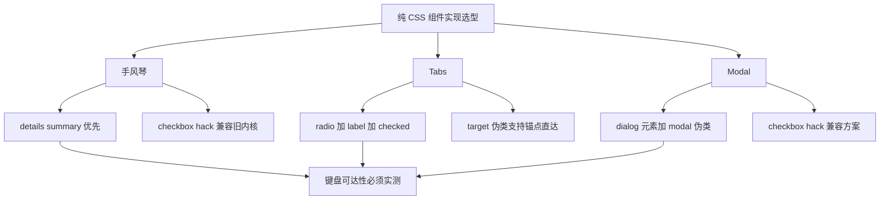

```html
<!-- 手风琴：details 原生 -->
<details>
  <summary>问题标题</summary>
  <p>答案内容，展开收起全由浏览器接管</p>
</details>

<!-- Tabs：radio 驱动 -->
<section class="css-tabs">
  <input type="radio" name="t" id="t1" checked><label for="t1">Tab 1</label>
  <input type="radio" name="t" id="t2"><label for="t2">Tab 2</label>
  <div class="panel p1">面板一</div>
  <div class="panel p2">面板二</div>
</section>
<style>
  .css-tabs input { position: absolute; opacity: 0; }
  .panel { display: none; }
  #t1:checked ~ .p1,
  #t2:checked ~ .p2 { display: block; }
  #t1:checked ~ label[for="t1"],
  #t2:checked ~ label[for="t2"] { color: #096; border-bottom: 2px solid #096; }
</style>

<!-- Modal：checkbox hack -->
<input type="checkbox" id="m" class="modal-toggle">
<label for="m" class="modal-mask"></label>
<div class="modal">内容 <label for="m">关闭</label></div>
<style>
  .modal-toggle { position: absolute; opacity: 0; }
  .modal, .modal-mask { display: none; }
  .modal-toggle:checked ~ .modal,
  .modal-toggle:checked ~ .modal-mask { display: block; }
  .modal-mask { position: fixed; inset: 0; background: rgba(0,0,0,.4); }
  .modal { position: fixed; inset: 20% 25%; background: #fff; border-radius: 8px; }
</style>
```

### CSS-192：CSS 动画的性能预算与帧率监控怎么做？

**答**：
- 预算基线：交互动画响应 ≤ 100ms、过渡 200~300ms、每帧主线程脚本 ≤ 8ms（60fps 留一半给渲染）。
- 监控手段：rAF 间隔统计（越 16.7ms 越掉帧）、PerformanceObserver 的 longtask、DevTools Performance 面板回放。
- 只允许 transform/opacity/filter 进合成器；width/top/left 触发 layout 的动画属性一律白名单拦截。
- 生产监控：采样上报掉帧率与 longtask 分布，配合 CI 里的 trace 对比防劣化。

```javascript
// 1. 帧率监控：rAF 间隔统计
let last = performance.now(), frames = 0, dropped = 0;
function tick(now) {
  const dt = now - last;
  last = now;
  frames++;
  if (dt > 20) dropped++;               // 预算 50fps，超过即掉帧
  requestAnimationFrame(tick);
}
requestAnimationFrame(tick);
setInterval(() => {
  report('fps', { rate: dropped / frames });  // 采样上报
  frames = 0; dropped = 0;
}, 5000);

// 2. 长任务监控：主线程阻塞来源
new PerformanceObserver(list => {
  for (const e of list.getEntries()) report('longtask', e.duration);
}).observe({ entryTypes: ['longtask'] });

// 3. 动画属性白名单（审查脚本示意）
const okProps = ['transform', 'opacity', 'filter'];
function auditAnimation(name) {
  const keyframes = document.getAnimations()
    .find(a => a.animationName === name)?.effect?.getKeyframes() || [];
  for (const kf of keyframes) {
    for (const prop of Object.keys(kf)) {
      if (!okProps.includes(prop) && prop !== 'offset' &&
          prop !== 'easing' && prop !== 'composite') {
        console.warn(`动画 ${name} 使用了非合成属性 ${prop}`);
      }
    }
  }
}
```

### CSS-193：大型项目样式治理，从混乱走向 @layer 体系的路线是什么？

**答**：
- 路线五步：审计现状（重复度/优先级战争/死代码）→ 建立 token → 用 @layer 建立层级框架 → 存量样式整体沉入 legacy 层 → 门禁固化（stylelint + CI）。
- @layer 的战略价值：层级顺序声明一次，全站覆盖关系可预期，`!important` 从机制上失去必要性。
- 存量迁移零风险：旧规则原样搬进 legacy 层（优先级最低），新体系天然赢，逐模块搬迁无需一次性重构。
- 终态：reset < base < legacy < components < utilities，utilities 放最外层保证工具类永远可覆盖。

```css
/* 1. 层级框架：顺序即优先级，全站只声明一次 */
@layer reset, base, legacy, components, utilities;

/* 2. reset 层：最低优先级 */
@layer reset {
  *, *::before, *::after { box-sizing: border-box; margin: 0; }
}

/* 3. base 层：元素级默认 */
@layer base {
  body { font: 14px/1.5 var(--font-sans); color: var(--fg); }
}

/* 4. legacy 层：存量样式原样搬入，优先级低于新体系，逐步退役 */
@layer legacy {
  .old-card { float: left; width: 220px; background: #eee; }
}

/* 5. components 层：只消费 token 的新组件 */
@layer components {
  .btn { padding: calc(var(--gap) / 2) var(--gap); border-radius: var(--radius); }
}

/* 6. utilities 层：最高，工具类永远能覆盖组件 */
@layer utilities {
  .p-4 { padding: var(--gap); }
  .hidden { display: none !important; }  /* 收敛后仅此一处允许 important */
}
```

### CSS-194：px / em / rem / vw 如何选型？给出一棵决策树。

**答**：
- px：像素级精确、不参与缩放——边框、发丝线、阴影偏移、图标内部细节。
- rem：跟随根字号——全局字号、间距、组件尺寸，无障碍（用户放大根字号）的第一受益者。
- em：跟随自身字号——组件内部相对尺寸（按钮内边距随字号缩放）。
- vw/vh/dvh：视口驱动——流式排版 clamp()、全屏容器；断点内固定还是流式是分水岭。

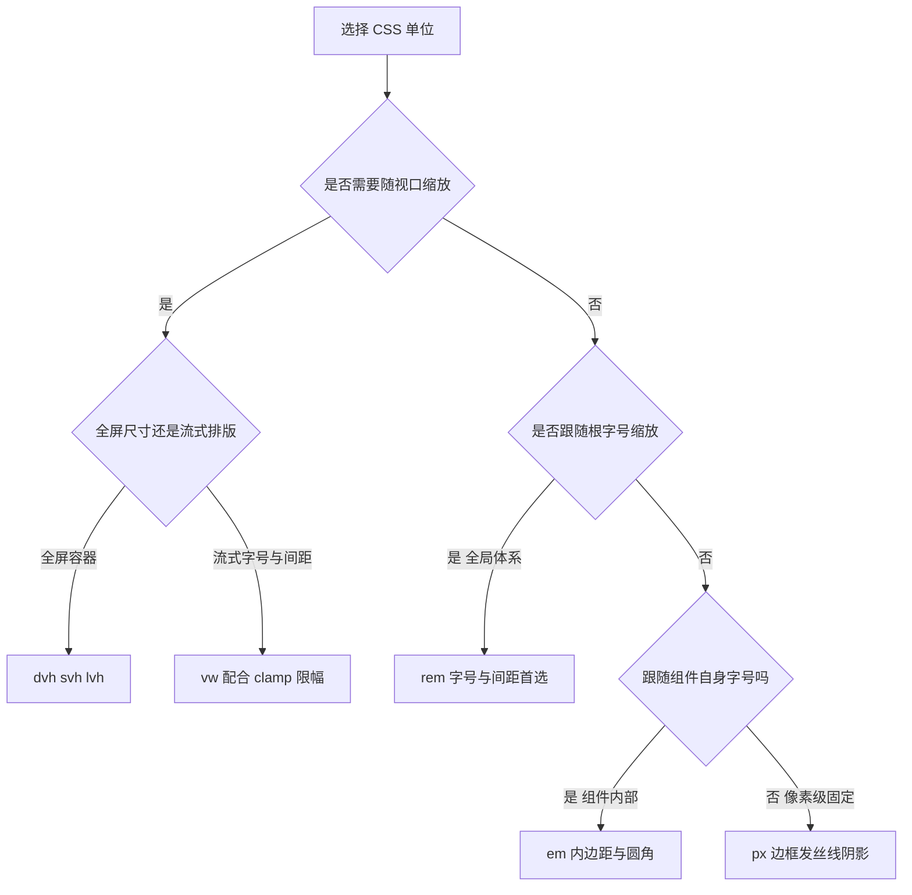

```css
/* px：像素级细节 */
.icon-border { border: 1px solid var(--line); }
.hairline { box-shadow: inset 0 -1px 0 var(--line); }

/* rem：全局体系，用户调根字号时整体缩放 */
body { font-size: 1rem; }
.section { padding: 2rem 1.5rem; }
h1 { font-size: 1.75rem; }

/* em：组件内部相对自身字号 */
.btn {
  font-size: .875rem;
  padding: .5em 1.25em;   /* 字号变大 padding 同步变大 */
  border-radius: .25em;
}

/* vw + clamp：流式排版，320px 屏与 1280px 屏都落在舒适区间 */
.hero-title { font-size: clamp(1.5rem, 4vw, 3rem); }

/* dvh：全屏容器 */
.stage { height: 100dvh; }
```

### CSS-195：@supports 渐进增强的实战实例集？

**答**：
- 总范式：基线样式写在 @supports 外保证可用，每个增强分支独立成块、独立失效、互不依赖。
- 增强 1：backdrop-filter 毛玻璃降级为半透明纯色；增强 2：:has 父级联动（表单校验态）；增强 3：animation-timeline 滚动驱动。
- 选择器检测 `@supports selector(:has(*))` 与属性检测组合使用；JS 侧用 CSS.supports 保持同一判断。
- 降级分支必须有 QA 覆盖：增强失效时的页面就是大量老用户看到的页面。

```css
/* 基线：所有目标浏览器可用 */
.glass { background: rgba(255, 255, 255, .9); }
.form .submit { opacity: 1; }

/* 增强 1：毛玻璃，不支持则保持基线半透明 */
@supports (backdrop-filter: blur(8px)) {
  .glass {
    background: rgba(255, 255, 255, .6);
    backdrop-filter: blur(8px);
  }
}

/* 增强 2：:has 表单联动，不支持时按钮永远可点 */
@supports selector(:has(*)) {
  .form:has(input:invalid) .submit {
    opacity: .5;
    pointer-events: none;
  }
}

/* 增强 3：滚动驱动动画，不支持则回到 JS/普通动画 */
@supports (animation-timeline: scroll()) {
  .progress-bar {
    animation: grow linear;
    animation-timeline: scroll();
  }
  @keyframes grow { from { transform: scaleX(0); } to { transform: scaleX(1); } }
}

/* JS 侧同一套检测，行为对齐 */
if (CSS.supports('backdrop-filter', 'blur(8px')) initGlass();
```

### CSS-196：CSS 命名冲突治理经历了哪几个阶段？最终如何收束？

**答**：
- 阶段一全局裸类：必然冲突；阶段二 BEM 手工命名空间：靠约定，防冲突但选择器冗长。
- 阶段三 CSS Modules：构建期 hash 类名，import 即唯一，工程化主流；阶段四 Shadow DOM：运行时真隔离，成本最高。
- 收束（阶段五）：@layer 把“冲突解决”从命名层面转移到层级层面——同名类也能靠 layer 顺序裁决。
- 实践组合：Modules 管唯一性、layer 管覆盖关系、token 管值的一致性，三者互补而非互斥。

```css
/* 阶段一：全局裸类，谁后加载谁赢，冲突随机 */
.title { font-size: 20px; }

/* 阶段二：BEM 手工命名空间 */
.page-header__title--large { font-size: 28px; }

/* 阶段三：CSS Modules（构建期 hash）
   import styles from './header.module.css'
   .title 编译为 .Header_title__3xK，天然唯一 */
.header-title { font-size: 20px; }

/* 阶段四：Shadow DOM 运行时隔离（见 CSS-188） */

/* 阶段五：@layer 收束 —— 覆盖关系由层裁决，而非命名 */
@layer vendor, base, app;
@layer vendor  { .title { font-size: 20px; } }   /* 第三方样式 */
@layer base    { .title { font-size: 16px; } }
@layer app     { .title { font-size: 18px; } }   /* app 层必赢，无需更高优先级 */
```

### CSS-197：绘制像素级 UI（设计稿还原）的 checklist 有哪些？

**答**：
- 基准换算统一：确定设计稿宽度与换算系数（rem 基准或 vw 公式），全项目一个换算入口，禁止手算散落。
- 文字三要素逐项核对：font-size/line-height/letter-spacing 用标注值，行高不靠 padding 凑。
- 色值与阴影取 token：圆角、阴影、渐变逐档比对 token 表，禁止目测近似。
- 验收手段：DevTools 盒模型对照标注、临时 outline 描边查对齐、四档分辨率截图比对。

```css
/* 1. 换算入口唯一：375 稿，html font-size = 100 * (100vw / 375)，1rem = 100px */
/* 根字号由脚本或 vw 设置：html { font-size: 26.67vw } 并在 768px 以上钳制 */

/* 2. 文字按标注三要素 */
.title {
  font-size: 16px;
  line-height: 24px;       /* 标注 24px，不用 padding 凑 */
  letter-spacing: .2px;
}

/* 3. 视觉细节走 token，逐档核对 */
.card {
  border-radius: var(--radius-md);      /* 8px，与标注一致 */
  box-shadow: 0 2px 4px rgba(0, 0, 0, .08);
  background: linear-gradient(180deg, #fff 0%, #fafafa 100%);
}

/* 4. 调试描边：对齐误差 1px 内可定位到具体元素 */
.debug-outline * { outline: 1px solid rgba(255, 0, 0, .2); }

/* 5. 验收分辨率档位：375 / 414 / 768 / 1280 各截一图比对 */
```

### CSS-198：CSS 的设计模式有哪些分层（状态类/修饰类/布局类）？

**答**：
- 布局类：只管排布（display/gap/定位），不含颜色字体——可套用在任意业务组件上。
- 外观类：默认视觉（背景、圆角、阴影），修饰类改外观变体（--bordered/--ghost），状态类表达瞬时状态（is-/has- 前缀）。
- 层级约定：布局 < 外观 < 修饰 < 状态，同级内靠书写顺序，跨级靠层（@layer），不靠 important。
- is-/has- 前缀的价值：一眼区分“数据驱动状态”与“设计变体”，JS 只操作状态类，不碰修饰类。

```css
/* 布局类：与视觉完全解耦 */
.layout-split { display: flex; gap: var(--gap); }
.layout-stack { display: flex; flex-direction: column; gap: var(--gap-sm); }

/* 外观类：组件默认视觉 */
.card {
  background: var(--bg-surface);
  border-radius: var(--radius-md);
  box-shadow: var(--shadow-sm);
}

/* 修饰类：设计变体，用 -- 双横线 */
.card--bordered { border: 1px solid var(--line); }
.card--ghost    { background: transparent; box-shadow: none; }

/* 状态类：JS/数据驱动，用 is- has- 前缀 */
.card.is-active  { box-shadow: 0 0 0 2px var(--brand); }
.card.has-error  { border-color: var(--danger); }
.card.is-loading { pointer-events: none; opacity: .6; }

/* 层级：布局 < 外观 < 修饰 < 状态，状态类总是最后书写 */
```

### CSS-199：如何跟进 CSS 新特性（风险矩阵与升级策略）？

**答**：
- 三档风险：Baseline 已就绪（生产可用）、有限支持（渐进增强分支）、实验阶段（flag 环境）——每个特性先归档再使用。
- 信息源：web.dev Baseline、caniuse、Chrome/WebKit 发布说明；工程侧用 browserslist 锁定目标，特性可用性由 @supports 运行时兜底。
- 升级策略：低风险直接用；中风险加增强分支并验证降级；高风险放内测开关后面，观察两个大版本再评估。
- 收尾动作：每个引入的新特性登记“最低支持版本与降级路径”，进回归清单。

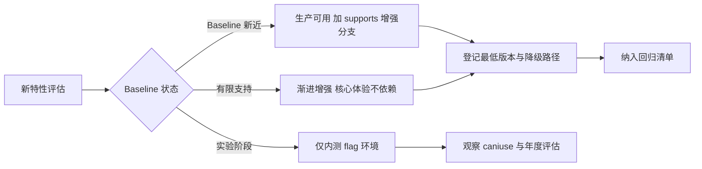

```css
/* 低风险：Baseline 已就绪，直接使用 */
:has(.selected) { outline: 1px solid var(--brand); }

/* 中风险：增强分支 + 基线保底 */
.container-card { display: block; }
@supports (container-type: inline-size) {
  .container-card { container-type: inline-size; }
  @container (min-width: 400px) {
    .container-card .body { columns: 2; }
  }
}

/* 高风险：实验特性，开关控制 + @supports 双保险 */
.experimental-scroll { scroll-timeline: --page block; }
@supports (animation-timeline: --page) {
  .experimental-scroll .bar { animation-timeline: --page; }
}
/* 使用前提：产品开关 experimentalCss 打开才渲染该 DOM */
```

### CSS-200：CSS 知识体系如何收束成“布局 / 视觉 / 动效 / 架构”四象限？

**答**：
- 布局象限：盒模型 → 层叠上下文 → Flex/Grid → 响应式与容器查询，答题链路自底向上。
- 视觉象限：颜色系统 → 渐变/滤镜/混合 → clip-path/mask → 文字排版。
- 动效象限：transition/animation → WAAPI/View Transition → 合成层与性能预算。
- 架构象限：token → 命名 → @layer/隔离 → 工具链与质量门禁；四象限互为支撑，面试答题先定位象限再展开。

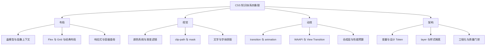

```css
/* 四象限速查卡：每象限一个代表性代码锚点 */
/* 布局象限 */
.layout-key {
  display: grid;
  grid-template-columns: repeat(auto-fit, minmax(200px, 1fr));
}
/* 视觉象限 */
.visual-key {
  background: linear-gradient(to right, var(--c1), var(--c2));
  clip-path: inset(0 round 12px);
}
/* 动效象限 */
.motion-key { transition: transform .2s ease, opacity .2s ease; }
/* 架构象限 */
.arch-key { --token-first: design-decision; }
```

### CSS-201：容器查询进阶：container-type 两种模式与 @container 完整语法怎么用？

**答**：
- `container-type: inline-size` 是默认推荐：只对行向尺寸建立容器，元素高度仍由内容撑开；`size` 模式对宽高同时建立 containment，**元素尺寸不能再依赖内容**（高度必须显式给定，否则塌陷），只在确需按高度查询时使用。
- 语法全景：范围比较写法 `@container (400px <= width <= 800px)`；未命名的 `@container (...)` 查询**最近**的祖先容器，命名 `container-name` 后用 `@container card (...)` 精确指向，避免被外层容器"截胡"。
- style 查询 `@container style(--theme: dark)`：按容器上的自定义属性值切换子孙样式（无需给容器换 class）。2025-2026 口径：Chrome/Edge 111+、Safari 18+ 支持，**Firefox 尚未支持**——只能当渐进增强；尺寸容器查询才是 Baseline（CSS-055）。
- 核心价值：查询条件从"页面级断点"变成"组件自带的布局状态"，同一组件放进侧栏、主区、弹层自动适配，业务方不再传 `size` prop。

```css
/* container-type 两种模式：size 会切断"高度由内容决定" */
.side-item {
  container-type: inline-size;   /* 推荐：高度仍由内容撑开 */
}
.stage {
  container-type: size;          /* 宽高都参与查询，但必须显式给尺寸 */
  height: 300px;                 /* 不给高度会塌陷为 0，内部查询永远不命中 */
}

/* 范围语法 + 命名容器精确指向 */
.page { container-type: inline-size; container-name: page; }
.widget { container-type: inline-size; container-name: widget; }

@container widget (400px <= width <= 800px) {
  .widget .body { display: grid; grid-template-columns: 1fr 1fr; }
}
/* 写 widget 就查 widget，不会被最近的 page 容器命中 */

/* style 查询：容器换自定义属性，子孙自动联动（Firefox 不支持，渐进增强） */
.card-slot { --theme: dark; }
@container style(--theme: dark) {
  .card { background: #1f2937; color: #f9fafb; }
}
```

### CSS-202：cqw / cqh 等容器单位怎么用？与 vw / rem 是什么关系？

**答**：
- 六个单位：`cqw/cqh`（容器宽/高的 1%）、`cqi/cqb`（行向/块向）、`cqmin/cqmax`（两者较小/较大值的 1%）；未命中任何容器祖先时**回退为小视口单位**（cqw → svw），不会失效成 0。
- 与 CSS-194 的单位体系对比：vw 跟随视口、rem 跟随根字号，容器单位**跟随最近的容器祖先**——嵌套容器里每层组件各用各的参照，这是"组件级流式排版"的基础。
- 常见误区：cqw 参照的是**最近的容器祖先**，与 `container-name` 无关——元素在 named 容器外时单位不会改去找同名容器。
- 典型用法：`clamp()` 做容器级流式字号，替代"靠媒体查询猜组件所在区域"的写法；配合 `@container` 查询，断点与排版共用同一容器参照。

```css
/* 容器级流式排版：标题随"卡片宽度"而非视口缩放 */
.card-slot {
  container-type: inline-size;
}

.card-title {
  /* 侧栏 240px：约 14px；主区 600px：被钳制在 22px */
  font-size: clamp(14px, 4cqw, 22px);
}

/* 嵌套容器：内层组件用自己的容器做参照，互不干扰 */
.page        { container-type: inline-size; }
.page .aside { width: 25cqw; }                /* 相对 page */
.aside       { container-type: inline-size; } /* aside 自己也是容器 */
.aside h4    { font-size: 5cqw; }             /* 相对 aside，不相对 page */

/* 无容器祖先时的回退：cqw 退化为 svw，页面兜底布局仍然成立 */
.orphan { padding: 2cqw; }                     /* 没有容器祖先 ≈ padding: 2svw */

/* 极小容器的防失控写法：cqmin 保证小尺寸下不爆炸 */
.badge { font-size: max(12px, 3cqmin); }
```

### CSS-203：容器查询与媒体查询如何分工？不支持时怎么渐进降级？

**答**：
- 分工决策树：**随视口变的**（页面骨架、导航折叠、页脚栅格）用媒体查询；**随所在容器变的**（可复用卡片、表单块、嵌入式 widget）用容器查询——两者是互补而非替代，"组件该不该变形"由容器回答。
- `container-type` 的代价：会给容器建立 containment（布局包含），容器内部布局与外部解耦；代价很小，但不要把 `size` 模式套在"高度靠内容撑"的容器上（见 CSS-201 的塌陷问题）。
- 2025-2026 支持口径：尺寸容器查询与 cq 单位自 2023 年起是 Baseline（Chrome/Edge 105、Firefox 110、Safari 16），可放心使用；需要兜底的只有 style 查询（Firefox 未支持）和 2023 年前的旧浏览器。
- 降级三段式：基线样式写在 `@container` 外保证可用 → `@supports (container-type: inline-size)` 内做增强覆盖 → 真旧的浏览器交给 JS ResizeObserver 挂状态类（或直接维持单列基线布局）。

```css
/* 1. 基线：所有浏览器可用（单列布局） */
.profile-card { display: flex; flex-direction: column; }

/* 2. 增强：容器够宽时横向排布 */
@supports (container-type: inline-size) {
  .profile-slot { container-type: inline-size; }
  @container (min-width: 480px) {
    .profile-card { flex-direction: row; align-items: center; }
    .profile-card .avatar { width: 72px; height: 72px; }
  }
}
/* 不支持容器查询的浏览器：永远落在基线单列，功能不缺失 */

/* 3. JS 兜底（仅旧浏览器需要）：ResizeObserver 挂状态类 */
```

```javascript
// 仅当浏览器不支持容器查询时才启用（2023 年后的引擎不会走到这里）
if (!CSS.supports('container-type', 'inline-size')) {
  const ro = new ResizeObserver(([entry]) => {
    const wide = entry.contentRect.width >= 480;
    entry.target.classList.toggle('is-wide', wide);   // .is-wide 携带横向布局样式
  });
  document.querySelectorAll('.profile-slot').forEach((el) => ro.observe(el));
}
```
