# JavaScript 面试题库（140 题）

本文件是前端面试工程中的 JavaScript 题库，覆盖数据类型与隐式转换、作用域与闭包、this 与 call/apply/bind、原型与继承、class、Promise 与 async/await、事件循环、ES6+ 新特性、Map/Set/WeakMap、Proxy/Reflect、模块化、手写实现、内存与 GC、严格模式、迭代器、正则、错误处理、事件委托与 requestAnimationFrame 等考点。每题配有与题目一一对应的代码示例，答案采用要点式归纳。

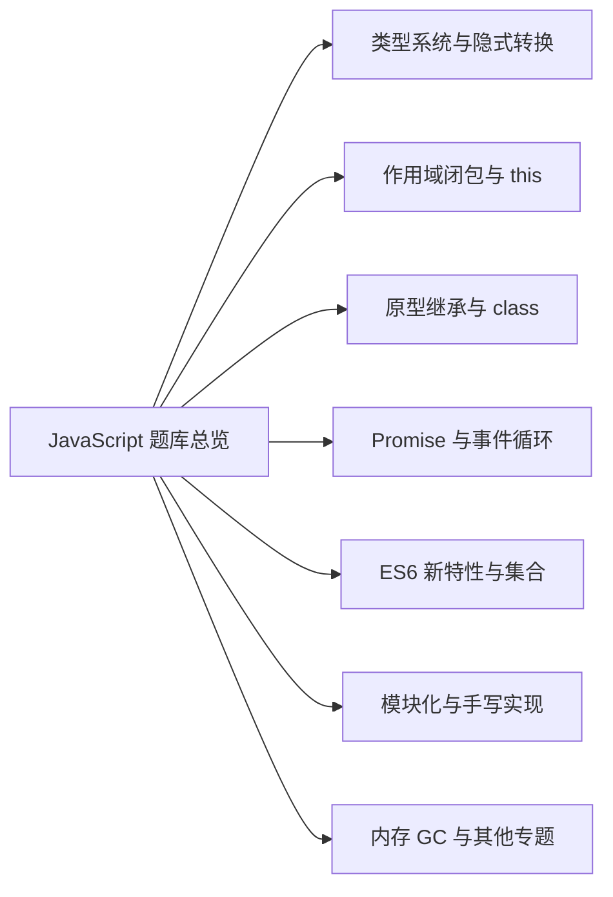

## 目录

- 一、数据类型与隐式转换（JS-001 ~ JS-010）
- 二、作用域与闭包（JS-011 ~ JS-018）
- 三、this 与 call/apply/bind（JS-019 ~ JS-025）
- 四、原型、继承与 class（JS-026 ~ JS-033）
- 五、Promise 与异步（JS-034 ~ JS-042）
- 六、事件循环与宏微任务（JS-043 ~ JS-048）
- 七、ES6+ 新特性（JS-049 ~ JS-057）
- 八、Map/Set/WeakMap 与 Proxy/Reflect（JS-058 ~ JS-063）
- 九、模块化（JS-064 ~ JS-066）
- 十、手写实现（JS-067 ~ JS-072）
- 十一、内存、严格模式与其他专题（JS-073 ~ JS-080）
- 十二、手写实现进阶（JS-081 ~ JS-088）
- 十三、异步编程深水区（JS-089 ~ JS-095）
- 十四、对象与元编程（JS-096 ~ JS-102）
- 十五、函数式编程（JS-103 ~ JS-108）
- 十六、类型系统与运行时（JS-109 ~ JS-114）
- 十七、浏览器交互与存储（JS-115 ~ JS-120）
- 十八、错误处理与调试（JS-121 ~ JS-126）
- 十九、模块化与工程（JS-127 ~ JS-140）
- 二十、综合输出题压轴（JS-141 ~ JS-146）
- 二十一、手写轮子压轴（JS-147 ~ JS-153）
- 二十二、数据结构与算法思维在 JS（JS-154 ~ JS-159）
- 二十三、DOM 与事件深入（JS-160 ~ JS-165）
- 二十四、浏览器 API 编程（JS-166 ~ JS-171）
- 二十五、工程与规范（JS-172 ~ JS-177）
- 二十六、内存与性能（JS-178 ~ JS-183）
- 二十七、综合设计题（JS-184 ~ JS-200）

## 一、数据类型与隐式转换

### JS-001：JavaScript 有哪些数据类型？typeof 的返回值有什么坑？

**答**：
- 基本类型 7 种：number、string、boolean、undefined、symbol、bigint、null；引用类型 object。
- `typeof null` 返回 `"object"`，是历史遗留 bug，无法修复。
- `typeof fn` 返回 `"function"`，其余对象都返回 `"object"`。
- `typeof` 对未声明变量不报错，返回 `"undefined"`，可用于安全探测。

```javascript
console.log(typeof 1);            // "number"
console.log(typeof 'a');          // "string"
console.log(typeof true);         // "boolean"
console.log(typeof undefined);    // "undefined"
console.log(typeof null);         // "object"  经典坑
console.log(typeof Symbol());     // "symbol"
console.log(typeof 10n);          // "bigint"
console.log(typeof {});           // "object"
console.log(typeof []);           // "object"  数组需要 Array.isArray
console.log(typeof function(){}); // "function"
console.log(typeof notDeclared);  // "undefined" 不报错
```

### JS-002：判断数据类型有哪几种方法？各自适用场景？

**答**：
- `typeof`：区分基本类型与 function，无法细分对象。
- `instanceof`：判断引用类型的原型链，跨 iframe 失效。
- `Object.prototype.toString.call(x)`：最通用，返回 `"[object Array]"` 等内部标签。
- `Array.isArray`：判断数组的最可靠方式；判断整数可用 `Number.isInteger`。

```javascript
const arr = [];
console.log(arr instanceof Array);                        // true
console.log(arr instanceof Object);                       // true，沿原型链
console.log(Object.prototype.toString.call(arr));         // "[object Array]"
console.log(Object.prototype.toString.call(null));        // "[object Null]"
console.log(Object.prototype.toString.call(new Date()));  // "[object Date]"
console.log(Array.isArray(arr));                          // true

// instanceof 跨 iframe 失效示例
// iframe 里的数组 instanceof 父页面 Array === false
```

### JS-003：`==` 的隐式转换规则是什么？为什么推荐 `===`？

**答**：
- null 与 undefined 相等且只与彼此相等；NaN 与任何值都不相等。
- 数字与字符串比较时，字符串转数字；布尔值先转数字再比。
- 对象与原始值比较时，对象先走 ToPrimitive（valueOf → toString）。
- `===` 不做类型转换，规则简单可预测，规范约定除 `x == null` 外一律用 `===`。

```javascript
console.log(1 == '1');            // true，字符串转数字
console.log(true == 1);           // true，布尔转数字
console.log(null == undefined);   // true，特例
console.log(null == 0);           // false，null 只等于 undefined
console.log(NaN == NaN);          // false
console.log('' == 0);             // true，'' 转数字为 0
console.log([1] == 1);            // true，ToPrimitive 后 '1' == 1
console.log([1] == '1');          // true
```

### JS-004：`+` 运算符的转换规则是什么？

**答**：
- 两边任一为字符串则执行拼接，另一方 ToPrimitive 后转字符串。
- 对象参与时先 ToPrimitive（默认 hint 下 valueOf 优先，valueOf 返回原始值即用，否则 toString）。
- 其他情况按数字相加；`+x` 是转数字的快捷方式。
- 注意 Date 的 ToPrimitive 特殊：hint default 时 toString 优先。

```javascript
console.log(1 + '2');        // "12"，字符串拼接
console.log(1 + 2);          // 3
console.log('a' + 1);        // "a1"
console.log(1 + true);       // 2，true 转 1
console.log(1 + null);       // 1，null 转 0
console.log(1 + undefined);  // NaN

const obj = {
  valueOf() { return 10; },
  toString() { return 'obj'; },
};
console.log(obj + 1);        // 11，valueOf 优先
console.log(`${obj}`);       // "obj"，模板串触发 toString

console.log(+'3.14');        // 3.14，一元 + 转数字
console.log(new Date() + 1); // 字符串拼接，Date 的 toString 优先
```

### JS-005：为什么 `[] == ![]` 结果是 true？还有哪些经典比较题？

**答**：
- `![]` 先计算，空数组是 truthy，所以 `![]` 为 `false`。
- 于是变成 `[] == false`，布尔转数字得 `[] == 0`。
- `[]` ToPrimitive 得 `''`，`'' == 0` 转数字后 `0 == 0` 为 true。
- 该题考察运算符优先级（! 高于 ==）与 ToPrimitive 的完整链路。

```javascript
console.log([] == ![]);        // true
// 推导：![] → false；[] == false → [] == 0 → '' == 0 → 0 == 0

console.log({} + []);          // "[object Object]"
console.log([] + {});          // "[object Object]"
console.log([] + []);          // ""，两个都转 ''
console.log(0.1 + 0.2 === 0.3);// false，浮点精度
console.log('5' + 3);          // "53"
console.log('5' - 3);          // 2，- 只有数字语义
```

### JS-006：如何正确判断 NaN？

**答**：
- `NaN !== NaN`，是唯一不等于自身的值，可用 `x !== x` 判断。
- 全局 `isNaN` 会先把参数转数字，`isNaN('abc')` 也为 true，语义是“转换为 NaN 吗”。
- `Number.isNaN` 不做转换，只对真正的 NaN 返回 true，推荐使用。
- `Number.isNaN` 与 `Object.is(NaN, NaN)` 都能正确判断，后者还区分 +0/-0。

```javascript
console.log(NaN === NaN);          // false
console.log(isNaN('abc'));         // true，'abc' 转数字失败
console.log(isNaN('123'));         // false
console.log(Number.isNaN('abc'));  // false，不转换
console.log(Number.isNaN(NaN));    // true
console.log(Object.is(NaN, NaN));  // true
console.log(Object.is(+0, -0));    // false，=== 会返回 true

function isRealNaN(x) {
  return x !== x; // NaN 独有的自反性缺口
}
```

### JS-007：null 和 undefined 的区别与使用场景？

**答**：
- undefined：变量已声明未赋值、函数缺参、对象缺属性、无 return 的函数返回值——系统级“没有值”。
- null：语义明确的“空值”，由开发者主动赋值，如清空引用、初始化对象占位。
- `typeof undefined === 'undefined'`，`typeof null === 'object'`。
- `null == undefined` 为 true 但 `null === undefined` 为 false；JSON 序列化会丢掉 undefined 属性而保留 null。

```javascript
let a;
console.log(a);            // undefined
function f(x) { return x; }
console.log(f());          // undefined
const o = { key: null };
console.log('missing' in o, 'key' in o); // false true

console.log(JSON.stringify({ u: undefined, n: null })); // {"n":null}

// 工程约定：参数默认用默认值语法，清空引用用 null
let cache = null;
cache = fetchData();
```

### JS-008：Symbol 和 BigInt 分别解决什么问题？

**答**：
- Symbol 创建全局唯一的值，主要用途：对象“隐藏”键名、防止属性冲突、定义协议（Symbol.iterator、Symbol.toPrimitive）。
- `Symbol.for` 注册全局可复用的 symbol，`Symbol.keyFor` 反查。
- BigInt 表示任意精度整数，解决 number 超过 `Number.MAX_SAFE_INTEGER` 后的精度丢失。
- BigInt 与 number 不能直接混合运算，序列化 JSON 也不支持，需要转字符串。

```javascript
const id = Symbol('id');
const user = { [id]: 42, name: 'Tom' };
console.log(Object.keys(user));   // ["name"]，symbol 键不进常规枚举
console.log(user[id]);            // 42

const s1 = Symbol.for('app.key');
const s2 = Symbol.for('app.key');
console.log(s1 === s2);           // true，全局注册表

console.log(9007199254740993 === 9007199254740992); // true，精度丢失
console.log(9007199254740993n === 9007199254740992n); // false
console.log(1n + 1);              // TypeError，不能混算
console.log(1n + BigInt(1));      // 2n
```

### JS-009：Number()、parseInt()、parseFloat() 的区别？

**答**：
- `Number(x)` 整体转换，包含任何非数字字符就返回 NaN；`undefined` → NaN，`null` → 0，`''` → 0。
- `parseInt(str, radix)` 从头解析，遇到非法字符停止，解析空串得到 NaN，务必传进制参数。
- `parseFloat` 只支持十进制，识别第一个小数点与科学计数法。
- 隐式转换走与 Number 相同的 ToNumber 规则，`'12abc' * 1` 是 NaN 而 `parseInt('12abc')` 是 12。

```javascript
console.log(Number('12.3'));      // 12.3
console.log(Number('12px'));      // NaN
console.log(Number(''));          // 0
console.log(Number(null));        // 0
console.log(Number(undefined));   // NaN
console.log(Number(true));        // 1

console.log(parseInt('12px'));    // 12
console.log(parseInt('3.9'));     // 3，截断不四舍五入
console.log(parseInt('0x1f'));    // 31，识别 16 进制
console.log(parseInt('08'));      // 8，ES5+ 默认十进制
console.log(parseFloat('3.14px'));// 3.14
console.log(parseFloat('1e3px')); // 1000
```

### JS-010：基本类型与引用类型在赋值和传参上有什么差异？

**答**：
- 基本类型按值存储，赋值/传参是拷贝，互不影响。
- 引用类型变量存的是堆地址，赋值/传参共享同一个对象，修改可见。
- 函数传参都是“按值传递”，值可能是引用的拷贝，重新赋值形参不影响外部。
- 比较时基本类型比值，引用类型比地址，所以两个“内容相同”的对象不相等。

```javascript
let a = 1;
let b = a;
b = 2;
console.log(a); // 1，基本类型拷贝

const o1 = { n: 1 };
const o2 = o1;
o2.n = 2;
console.log(o1.n); // 2，共享引用

function reassign(obj) { obj = { n: 9 }; }   // 重指向，外部不变
function mutate(obj)    { obj.n = 9; }       // 修改内容，外部可见
reassign(o1);
console.log(o1.n); // 2
mutate(o1);
console.log(o1.n); // 9

console.log([] === []);        // false，地址不同
console.log('a' === 'a');      // true
```

## 二、作用域与闭包

### JS-011：var、let、const 的区别？什么是暂时性死区？

**答**：
- var 函数作用域、存在变量提升（提升并初始化为 undefined）、可重复声明、挂到全局对象。
- let/const 块级作用域，提升但不初始化，声明前访问报 ReferenceError，即暂时性死区（TDZ）。
- const 声明时必须初始化且引用不可重新赋值，但对象内容仍可修改。
- 循环中的 let 每次迭代创建新绑定，这是 `for(let i...)` 闭包能拿到正确 i 的原因。

```javascript
console.log(a); // undefined，var 提升并初始化
var a = 1;

console.log(b); // ReferenceError，TDZ
let b = 2;

for (var i = 0; i < 3; i++) setTimeout(() => console.log(i)); // 3 3 3
for (let j = 0; j < 3; j++) setTimeout(() => console.log(j)); // 0 1 2

const list = [];
list.push(1);    // 允许，修改内容
// list = [];    // TypeError，禁止重指向
```

### JS-012：什么是词法作用域和作用域链？

**答**：
- 词法作用域：作用域由代码书写位置决定，在编译期确定，与调用位置无关。
- 函数查找变量沿自身 → 外层函数 → 全局的链条进行，即作用域链。
- eval 与 with 会破坏词法作用域，严格模式禁用 with。
- 动态作用域（如 bash）按调用栈查找，this 的绑定更像动态作用域的表现。

```javascript
const x = 'global';
function outer() {
  const x = 'outer';
  function inner() {
    console.log(x); // 'outer'，由书写位置决定
  }
  return inner;
}
const fn = outer();
fn(); // 'outer'，与在哪里调用无关

function caller() {
  const x = 'caller'; // 不影响 inner 的查找链
  outer();
}
```

### JS-013：什么是闭包？它的原理是什么？

**答**：
- 闭包是函数与其词法环境的组合：内部函数引用了外部函数的变量，且外部函数返回后变量依然存活。
- 原理：函数创建时保存对外层词法环境的引用，只要函数可达，环境就不会被回收。
- 闭包让变量“私有化”，是模块模式、函数工厂、高阶函数的基础。
- 每次调用外部函数都会产生一个独立的环境实例。

```javascript
function makeCounter() {
  let count = 0;          // 被 makeCounter 的环境持有
  return {
    inc: () => ++count,
    get: () => count,
  };
}
const c1 = makeCounter();
const c2 = makeCounter(); // 独立闭包，互不影响
c1.inc();
c1.inc();
console.log(c1.get()); // 2
console.log(c2.get()); // 0
```

### JS-014：经典循环定时器输出题有哪些解法？

**答**：
- var 版本输出三个 3：i 是函数作用域单变量，回调执行时循环已结束。
- 解法一：`let` 声明，每轮迭代生成新绑定。
- 解法二：IIFE 包裹，把当轮 i 作为参数固化。
- 解法三：setTimeout 第三个参数传参，或绑定到函数。

```javascript
// 问题代码
for (var i = 0; i < 3; i++) {
  setTimeout(() => console.log('var:', i)); // 3 3 3
}

// 解法一：let
for (let j = 0; j < 3; j++) {
  setTimeout(() => console.log('let:', j)); // 0 1 2
}

// 解法二：IIFE
for (var k = 0; k < 3; k++) {
  ((n) => setTimeout(() => console.log('iife:', n)))(k); // 0 1 2
}

// 解法三：setTimeout 第三参数
for (var m = 0; m < 3; m++) {
  setTimeout((n) => console.log('arg:', n), 0, m); // 0 1 2
}
```

### JS-015：闭包有哪些实际应用？

**答**：
- 私有变量与模块模式：外部无法直接访问内部状态。
- 函数工厂与偏函数：固化部分参数生成新函数（柯里化基础）。
- once/memoize 等高阶函数：用闭包保存“是否执行过”或缓存。
- 事件回调携带局部状态，避免全局变量污染。

```javascript
// 1. 私有变量
function createWallet(initial) {
  let balance = initial; // 外部无法直接改
  return {
    deposit(n) { balance += n; },
    getBalance: () => balance,
  };
}

// 2. once
function once(fn) {
  let done = false;
  let result;
  return (...args) => {
    if (!done) { result = fn(...args); done = true; }
    return result;
  };
}
const init = once(() => console.log('init only once'));

// 3. 偏函数
const log = (level, msg) => console.log(`[${level}] ${msg}`);
const warn = log.bind(null, 'WARN');
```

### JS-016：闭包为什么会引起内存问题？如何避免？

**答**：
- 闭包持有的外部变量只要闭包可达就不会被 GC，等于变相的常驻内存。
- 风险场景：闭包引用大对象却只用一小部分、定时器/监听器里的闭包长期不清理。
- 避免：及时解除引用（置 null）、clearInterval、removeEventListener。
- Chrome DevTools 的 Memory 面板（Heap snapshot + Retainers）可定位被谁持有。

```javascript
// 泄漏示例：定时器闭包长期持有大数组
function leak() {
  const bigData = new Array(1e6).fill('x');
  setInterval(() => console.log(bigData.length), 1000); // bigData 无法回收
}

// 修复：需要的数据拷贝成小份，并保存 id 以便清理
function fixed() {
  const bigData = new Array(1e6).fill('x');
  const len = bigData.length; // 只留必要数据
  const timer = setInterval(() => console.log(len), 1000);
  return () => clearInterval(timer);
}
const stop = fixed();
// 组件卸载时 stop();
```

### JS-017：变量提升与函数提升的规则是什么？

**答**：
- 引擎在执行前做“编译”：var 声明提升并初始化为 undefined，函数声明整体提升（含函数体）。
- 同名时函数声明优先于变量声明，后面的赋值覆盖。
- 函数表达式的名字不提升，只有变量名提升且值为 undefined。
- let/const 提升但处于 TDZ，class 同理。

```javascript
foo();        // 'foo'，函数声明整体提升
bar();        // TypeError: bar is not a function
var bar = function () {};

function foo() { console.log('foo'); }

console.log(fn); // undefined，函数表达式的变量名提升
var fn = () => {};

// 同名覆盖
console.log(typeof dup); // "function"
var dup = 1;
function dup() {}
console.log(typeof dup); // "number"，赋值在后
```

### JS-018：IIFE 是什么？有哪些作用？

**答**：
- 立即执行函数：`(function () { ... })()`，定义即执行，常见写法还有 `!function(){}()`。
- 作用一：创建独立作用域，避免污染全局（ES5 时代的模块雏形）。
- 作用二：解决循环中闭包捕获问题（把循环变量按值固化）。
- 作用三：配合返回对象暴露接口，实现 reveal module 模式。

```javascript
// 模块模式
const counterModule = (function () {
  let count = 0; // 私有
  function increment() { count += 1; }
  function getCount() { return count; }
  return { increment, getCount }; // 只暴露接口
})();
counterModule.increment();
console.log(counterModule.getCount()); // 1

// 异步环境隔离 await
(async () => {
  const res = await fetch('/api/user');
  console.log(await res.json());
})();
```

## 三、this 与 call/apply/bind

### JS-019：this 的绑定规则与优先级是什么？

**答**：
- 四条规则：默认绑定（非严格 window、严格 undefined）、隐式绑定（obj.fn() 指向 obj）、显式绑定（call/apply/bind）、new 绑定。
- 优先级：new > 显式 > 隐式 > 默认；箭头函数没有自己的 this，定义时捕获外层。
- 隐式丢失最常见：把对象方法赋给变量或作为回调传入，this 变回默认绑定。
- 排查口诀：先看调用形式，再看是否箭头函数，最后看是否被 bind 过。

```javascript
function show() { console.log(this); }

show();                     // window（严格模式 undefined）
const obj = { name: 'obj', show };
obj.show();                 // obj，隐式绑定

const lost = obj.show;
lost();                     // window，隐式丢失

const bound = show.bind({ name: 'bound' });
new bound();                // {name:'bound'} 的实例？new 优先于 bind，
                            // this 是新创建的实例

setTimeout(obj.show, 100);  // window，作为回调丢失
setTimeout(() => obj.show(), 100); // obj，箭头包裹保住隐式绑定
```

### JS-020：call、apply、bind 有什么区别？

**答**：
- 三者都能显式指定 this；call 逐个传参、apply 传参数数组。
- bind 返回绑定了 this 的新函数，可预设参数（偏函数），不立即执行。
- bind 的绑定是永久的，再次 call/apply 无法覆盖（new 除外）。
- 性能上直接 call 优于创建中间 bind 函数，但可读性优先。

```javascript
function greet(greeting, punctuation) {
  return `${greeting}, ${this.name}${punctuation}`;
}
const person = { name: 'Tom' };

console.log(greet.call(person, 'Hi', '!'));      // "Hi, Tom!"
console.log(greet.apply(person, ['Hey', '?']));  // "Hey, ?"

const boundGreet = greet.bind(person, 'Yo');
console.log(boundGreet('.'));                    // "Yo, Tom."

// 经典应用：类数组转数组
function fn() {
  const args = Array.prototype.slice.call(arguments); // 老写法
  const args2 = Array.from(arguments);                // 现代写法
  return [args.length, args2.length];
}
console.log(fn(1, 2, 3)); // [3, 3]
```

### JS-021：箭头函数的 this 与普通函数有什么不同？

**答**：
- 箭头函数没有自己的 this/arguments/super，this 沿词法作用域捕获定义处外层的 this。
- 不能用 call/apply/bind 改变箭头函数的 this，这些调用只影响参数。
- 不能作为构造函数（无 [[Construct]]），没有 prototype。
- 因此不适合作对象方法（this 不指向对象）和原型方法，适合回调保 this。

```javascript
const timer = {
  seconds: 0,
  start() {
    // start 是普通方法，this 是 timer
    setInterval(() => {
      this.seconds++; // 箭头函数捕获 start 的 this
    }, 1000);
  },
  wrongStart() {
    setInterval(function () {
      // this 是 window，报 NaN 递增
      console.log(this.seconds); // undefined
    }, 1000);
  },
};

// 对象字面量中的箭头函数
const obj = {
  name: 'obj',
  say: () => console.log(this.name), // this 是外层（模块/window），undefined
};

// 不能 new
const A = () => {};
// new A(); // TypeError: A is not a constructor
```

### JS-022：手写实现 Function.prototype.call？

**答**：
- 核心思路：把函数临时挂到目标对象上，借助隐式绑定调用后再删除。
- context 为 null/undefined 时指向全局对象（严格模式则传什么用什么）。
- 用 `Symbol` 避免属性名冲突，展开 rest 参数逐个传入。
- 返回值需要透传函数的执行结果。

```javascript
Function.prototype.myCall = function (context, ...args) {
  context = context ?? globalThis;            // 处理 null/undefined
  context = Object(context) ?? globalThis;    // 原始值包装为对象
  const key = Symbol('fn');
  context[key] = this;                        // this 是被调用的函数
  const result = context[key](...args);       // 隐式绑定
  delete context[key];
  return result;
};

function intro(city, job) {
  return `${this.name} - ${city} - ${job}`;
}
console.log(intro.myCall({ name: 'Tom' }, 'BJ', 'FE')); // Tom - BJ - FE
```

### JS-023：手写实现 Function.prototype.apply？

**答**：
- 与 call 唯一区别：第二个参数是数组或类数组，调用时展开。
- 参数需兼容 null/undefined（等价于不传参）。
- 类数组参数可用展开运算符展开，兼容老环境时用 for 循环。
- 同样要考虑 Symbol 键防冲突、返回值透传。

```javascript
Function.prototype.myApply = function (context, args) {
  context = context ?? globalThis;
  context = Object(context);
  const key = Symbol('fn');
  context[key] = this;
  let result;
  if (args == null) {
    result = context[key]();
  } else {
    result = context[key](...args); // 类数组也可展开（可迭代）
  }
  delete context[key];
  return result;
};

function sum(a, b, c) { return a + b + c + this.base; }
console.log(sum.myApply({ base: 100 }, [1, 2, 3])); // 106
console.log(sum.myApply({ base: 100 }, null));      // NaN，缺参相加
```

### JS-024：手写实现 Function.prototype.bind？如何处理 new 调用？

**答**：
- 返回一个新函数，内部用 apply 绑定 this 并拼接预设参数。
- new 调用绑函数时 this 应指向新实例：判断 `this instanceof bound`，并用原型链串联（Object.create）。
- 返回函数要与原函数同名（可选）、保持 length 语义可忽略。
- bind 后的函数也有 prototype 供 new 使用，需手动挂接。

```javascript
Function.prototype.myBind = function (context, ...presetArgs) {
  const fn = this;
  function bound(...laterArgs) {
    // new 调用时 this 是新实例，忽略绑定的 context
    return fn.apply(this instanceof bound ? this : context,
                    [...presetArgs, ...laterArgs]);
  }
  // 维持原型链，让 new bound() 得到原函数的原型能力
  bound.prototype = Object.create(fn.prototype);
  return bound;
};

function Person(name, age) {
  this.name = name;
  this.age = age;
}
Person.prototype.hi = function () { return `hi ${this.name}`; };

const BoundPerson = Person.myBind(null, 'Tom');
const p = new BoundPerson(18);
console.log(p.name, p.age, p.hi()); // Tom 18 "hi Tom"
```

### JS-025：new 操作符做了什么？如何手写模拟？

**答**：
- 四步：创建空对象、把对象的原型指向构造函数的 prototype、以该对象为 this 执行构造函数、决定返回值。
- 返回值规则：构造函数显式返回对象（含函数）时用它，否则返回新对象。
- `instanceof` 之所以成立，是因为第二步的原型指向。
- 手写实现可以完整还原这套流程。

```javascript
function myNew(Ctor, ...args) {
  const obj = Object.create(Ctor.prototype); // 1+2 步
  const result = Ctor.apply(obj, args);      // 3 步
  return (result !== null && (typeof result === 'object' || typeof result === 'function'))
    ? result
    : obj;                                   // 4 步
}

function Dog(name) {
  this.name = name;
  // return { fake: true }; // 若返回对象，new 的结果就是它
}
Dog.prototype.bark = () => 'woof';

const d = myNew(Dog, '旺财');
console.log(d.name);            // 旺财
console.log(d instanceof Dog);  // true
console.log(d.bark());          // woof
```

## 四、原型、继承与 class

### JS-026：什么是原型和原型链？

**答**：
- 每个函数都有 `prototype`（原型对象），内部含 constructor 指回函数。
- 每个对象都有 `[[Prototype]]`（可用 `__proto__`/`Object.getPrototypeOf` 访问）。
- 属性查找沿 `[[Prototype]]` 一路向上直到 null，这条链就是原型链。
- 对象自己的属性遮蔽原型上的同名属性；`__proto__` 已废弃，工程代码用 Object.create / setPrototypeOf。

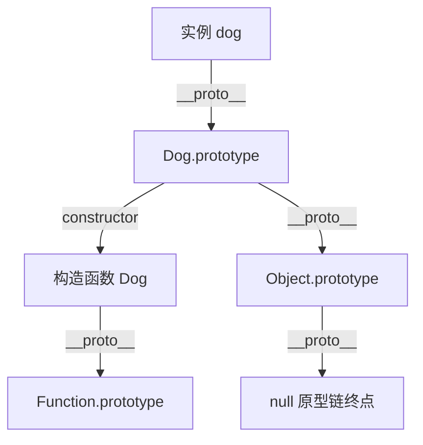

```javascript
function Dog(name) { this.name = name; }
Dog.prototype.bark = function () { return `${this.name}: woof`; };

const d = new Dog('旺财');
console.log(d.__proto__ === Dog.prototype);              // true
console.log(Dog.prototype.constructor === Dog);          // true
console.log(d.toString.__proto__ === Function.prototype);// 沿链向上

console.log(d.hasOwnProperty('name')); // true，自身属性
console.log(d.hasOwnProperty('bark')); // false，在原型上
```

### JS-027：hasOwnProperty 与 for...in 遍历有什么坑？

**答**：
- for...in 会遍历对象及**原型链上所有可枚举属性**，继承来的方法也会被列出。
- 安全做法：`Object.keys` / `Object.entries`（仅自身可枚举）或 for...in + hasOwnProperty 过滤。
- `hasOwnProperty` 可被覆盖，稳妥写法用 `Object.prototype.hasOwnProperty.call(o, k)`。
- Symbol 键用 `Object.getOwnPropertySymbols` 获取，常规枚举方法都不包含。

```javascript
const base = { inherited: 1 };
const obj = Object.create(base);
obj.own = 2;
obj[Symbol('s')] = 3;

for (const k in obj) console.log(k); // own, inherited —— 含原型属性

for (const k in obj) {
  if (Object.prototype.hasOwnProperty.call(obj, k)) {
    console.log('own:', k); // own
  }
}
console.log(Object.keys(obj));        // ["own"]，仅自身
console.log(Object.getOwnPropertySymbols(obj)); // [Symbol(s)]

// JSON.stringify 与 Object.keys 一样忽略 symbol
```

### JS-028：有哪些继承方式？最优方案是什么？

**答**：
- 原型链继承：引用类型属性被所有实例共享，无法传参。
- 借用构造函数：可传参、独立属性，但方法无法复用。
- 组合继承：调两次父构造函数，父原型上有冗余属性。
- 寄生组合式继承（ES5 最优）与 class extends 本质相同，只调一次父构造且原型干净。

```javascript
// 寄生组合式继承（ES5 最优解）
function Parent(name) {
  this.name = name;
  this.colors = ['red'];
}
Parent.prototype.say = function () { return this.name; };

function Child(name, age) {
  Parent.call(this, name); // 借用构造函数：实例属性独立
  this.age = age;
}
// 关键：子原型是“父原型的副本”，不经过 new Parent()
Child.prototype = Object.create(Parent.prototype);
Child.prototype.constructor = Child;

const c1 = new Child('Tom', 18);
c1.colors.push('blue');
const c2 = new Child('Jerry', 20);
console.log(c1.colors, c2.colors); // 独立，互不影响
console.log(c1.say());             // Tom
```

### JS-029：class 的本质是什么？与构造函数的差异？

**答**：
- class 本质仍是基于原型的语法糖：实例方法挂在 prototype 上，静态方法挂在类本身。
- 差异：class 内部默认严格模式；声明不提升（TDZ）；必须用 new 调用；方法不可枚举。
- constructor 在 new 时自动执行；类里所有方法默认绑定实例行为与普通原型方法一致。
- `typeof class` 仍是 `"function"`。

```javascript
class Animal {
  constructor(name) {
    this.name = name;          // 实例属性
  }
  speak() {                    // 挂在 Animal.prototype
    return `${this.name} makes a noise`;
  }
  static create(name) {        // 挂在 Animal 本身
    return new Animal(name);
  }
}

console.log(typeof Animal);                          // function
console.log(Animal.prototype.speak);                 // 函数
console.log(Object.keys(Animal.prototype));          // []，方法不可枚举
console.log(Animal.create('Cat').speak());           // Cat makes a noise

// 等价的 ES5 写法核心
// function Animal(name) { this.name = name }
// Animal.prototype.speak = function () {...}
```

### JS-030：class 的静态成员、私有字段与静态私有成员怎么用？

**答**：
- `static` 方法和属性属于类本身，通过 `Class.xxx` 访问，实例不可访问。
- 私有字段 `#field` 是语言级真私有，类外部无法访问，比 `_field` 约定强。
- `#field in obj` 可安全探测私有字段是否存在；私有方法与静态私有也支持。
- 静态块 `static {}` 可在类定义期做复杂初始化。

```javascript
class Counter {
  static instanceCount = 0;      // 静态属性
  #count = 0;                    // 私有字段
  static #secret = 'hidden';     // 静态私有

  increment() { this.#count += 1; }
  get value() { return this.#count; }

  static fromJSON(obj) {
    const c = new Counter();
    c.#count = obj.count ?? 0;
    return c;
  }
  static hasCounter(obj) { return #count in obj; }
}

const c = new Counter();
c.increment();
console.log(c.value);           // 1
// console.log(c.#count);       // SyntaxError，类外访问私有字段
console.log(Counter.instanceCount); // 0
```

### JS-031：extends 继承中 super 的行为与调用顺序？

**答**：
- 子类 constructor 必须先 `super(...)` 才能使用 this，否则 ReferenceError。
- super 调用父构造函数时，this 被隐式创建并绑定，随后父类在其上追加属性。
- 方法里的 `super.method()` 沿原型链找父类方法，且 this 仍是当前实例。
- `Object.getPrototypeOf(ChildClass) === ParentClass`，静态成员也会被继承。

```javascript
class Animal {
  constructor(name) {
    this.name = name;
  }
  speak() { return `${this.name} makes a noise`; }
}

class Dog extends Animal {
  constructor(name, breed) {
    super(name);              // 必须在 this 之前
    this.breed = breed;
  }
  speak() {
    return `${super.speak()} and woofs`; // this 仍是 Dog 实例
  }
  static defaultName() { return 'Dog'; }
  static create() { return new this(this.defaultName()); } // this 指向 Dog
}

const d = new Dog('旺财', '柴犬');
console.log(d.speak()); // 旺财 makes a noise and woofs
console.log(Object.getPrototypeOf(Dog) === Animal); // true
```

### JS-032：class 中的 getter/setter 与计算属性怎么用？

**答**：
- `get/set` 定义访问器属性，语法像属性、行为是函数，可做校验与派生值。
- 计算属性名 `[expr]` 允许用表达式/Symbol 定义方法或字段。
- 访问器只定义在 prototype 上，配合私有字段可暴露只读视图。
- 避免在 getter 内再次读取自身造成无限递归。

```javascript
class Temperature {
  #celsius = 0;
  constructor(c) { this.celsius = c; }

  get celsius() { return this.#celsius; }
  set celsius(v) {
    if (typeof v !== 'number' || Number.isNaN(v)) throw new TypeError('need number');
    this.#celsius = v;
  }
  get fahrenheit() { return this.#celsius * 1.8 + 32; } // 派生只读

  [Symbol.toPrimitive](hint) {                          // 计算属性名 + 协议
    return hint === 'string' ? `${this.#celsius}°C` : this.#celsius;
  }
}

const t = new Temperature(100);
console.log(`${t}`);      // 100°C
console.log(t.fahrenheit);// 212
// t.fahrenheit = 0;      // 静默失败（无 setter，严格模式报错）
```

### JS-033：Object.create、Object.assign 与原型操作怎么用？

**答**：
- `Object.create(proto, props)` 创建指定原型的新对象，`create(null)` 生成无原型对象，适合做纯字典。
- `Object.assign(target, ...src)` 拷贝**可枚举自有**属性，浅拷贝。
- `Object.setPrototypeOf` 修改原型（性能差，尽量在创建时定好）。
- `Object.freeze` 冻结对象防修改（浅层），`isFrozen` 检测。

```javascript
const proto = { greet() { return 'hi'; } };
const obj = Object.create(proto, {
  name: { value: 'Tom', enumerable: true, writable: true },
});
console.log(obj.greet()); // hi，来自原型

const dict = Object.create(null);
dict.key = 1;
console.log(dict.toString); // undefined，无原型污染风险

const merged = Object.assign({}, { a: 1 }, { b: 2, a: 9 });
console.log(merged); // { a: 9, b: 2 }，后面的覆盖前面

const nested = { a: { b: 1 } };
const copy = Object.assign({}, nested);
copy.a.b = 99;
console.log(nested.a.b); // 99，浅拷贝
```

## 五、Promise 与异步

### JS-034：Promise 解决了什么问题？有哪三种状态？

**答**：
- 解决回调地狱：把嵌套回调改为链式 then，错误统一走 catch。
- 三种状态：pending → fulfilled（有值）或 rejected（有原因），状态一旦改变不可逆。
- Promise 构造函数同步执行，resolve/reject 决定后续 then 走哪个分支。
- 一个 Promise 只能被改变一次，重复 resolve 无效。

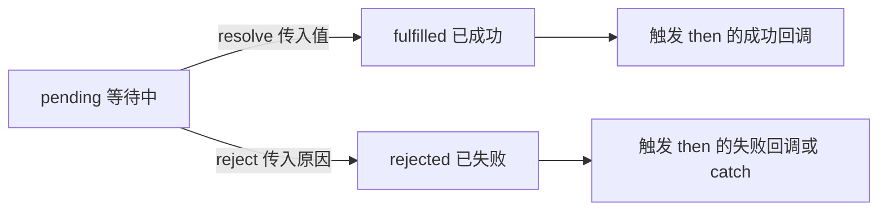

```javascript
function loadImage(src) {
  return new Promise((resolve, reject) => {
    const img = new Image();
    img.onload = () => resolve(img);
    img.onerror = () => reject(new Error(`load failed: ${src}`));
    img.src = src;
  });
}

loadImage('/a.png')
  .then((img) => console.log('loaded', img.width))
  .catch((err) => console.error(err.message))
  .finally(() => console.log('done')); // 无论成败都执行

const p = new Promise((resolve) => {
  resolve(1);
  resolve(2); // 无效，状态已凝固
});
```

### JS-035：then 的链式调用与返回值规则是什么？

**答**：
- then 返回**新 Promise**，因此可以链式续接；每个 then 独立注册成功/失败回调。
- 回调返回普通值 → 下一个 then 收到该值；返回 Promise → 被展开等待。
- 回调抛错 → 链条转入失败分支，最近的 catch 捕获。
- 返回值缺失时发生“值穿透”：非函数参数会被跳过并把值传给下一个 then。

```javascript
Promise.resolve(1)
  .then((v) => v + 1)                    // 返回普通值 2
  .then((v) => Promise.resolve(v * 10))  // 返回 Promise，被展开 → 20
  .then((v) => { throw new Error('boom'); }) // 抛错
  .catch((err) => 0)                     // 捕获并恢复 → 0
  .then('not a function')                // 值穿透，0 继续传递
  .then((v) => console.log(v));          // 0
```

### JS-036：catch 与 finally 的语义？错误如何沿链条冒泡？

**答**：
- catch 等价于 `then(null, onRejected)`，捕获链条上游任意一步的错误。
- 错误会跳过中间所有成功回调，直到最近的失败处理器；处理完链条恢复正常。
- catch 本身也可能抛错，需要后续再接 catch。
- finally 不接收参数、返回值透传，用于清理（关闭 loading、释放句柄）。

```javascript
function fetchData(fail) {
  return new Promise((resolve, reject) => {
    setTimeout(() => (fail ? reject(new Error('network')) : resolve('data')), 100);
  });
}

fetchData(true)
  .then((d) => console.log('A', d))      // 跳过
  .then((d) => console.log('B', d))      // 跳过
  .catch((err) => { console.error(err.message); return 'fallback'; })
  .then((d) => console.log('C', d))      // C fallback，链条恢复
  .finally(() => console.log('cleanup'))
  .catch(() => console.error('recovered from catch itself'));
```

### JS-037：Promise.all、allSettled、race、any 的区别？

**答**：
- all：全部成功才成功（结果按顺序），任一失败立即失败——适合强依赖聚合。
- allSettled：等全部落定，返回 `{status, value/reason}` 数组——适合容错聚合。
- race：第一个落定的结果（无论成败）——适合超时控制。
- any：第一个成功的结果，全部失败才拒绝（AggregateError）——适合多源竞争。

```javascript
const ok1 = Promise.resolve(1);
const ok2 = new Promise((r) => setTimeout(() => r(2), 100));
const bad = Promise.reject(new Error('boom'));

Promise.all([ok1, ok2]).then(console.log);        // [1, 2]，顺序与传入一致

Promise.allSettled([ok1, bad]).then(console.log);
// [{status:'fulfilled', value:1},
//  {status:'rejected', reason: Error: boom}]

// race 实现超时
function withTimeout(p, ms) {
  return Promise.race([
    p,
    new Promise((_, rej) => setTimeout(() => rej(new Error('timeout')), ms)),
  ]);
}

Promise.any([bad, ok2]).then(console.log);        // 2
Promise.any([bad]).catch((e) => console.log(e.name)); // AggregateError
```

### JS-038：async/await 的本质是什么？如何做错误处理？

**答**：
- async 函数返回 Promise，await 在其右侧等待 Promise，语法上是 generator + 自动执行器的封装。
- await 暂停当前 async 函数（不阻塞主线程），后续逻辑被注册为微任务。
- await 一个 rejected Promise 会抛出该原因，用 try/catch 或 `.catch` 捕获。
- 并发场景不要顺序 await，用 `Promise.all` 并行化。

```javascript
async function load() {
  try {
    const user = await fetch('/api/user').then((r) => r.json());
    // 串行：慢
    const orders = await fetch(`/api/orders?uid=${user.id}`).then((r) => r.json());
    return { user, orders };
  } catch (err) {
    console.error('load failed:', err);
    throw err; // 继续向上抛给调用方
  }
}

// 并行优化
async function loadFast() {
  const userP = fetch('/api/user').then((r) => r.json());
  const cfgP = fetch('/api/config').then((r) => r.json());
  const [user, cfg] = await Promise.all([userP, cfgP]); // 两个请求同时发出
  return { user, cfg };
}
```

### JS-039：await 的执行时机与“先 await 后代码”的关系？

**答**：
- `await p` 的行为：p 立即执行；其后的代码相当于 `p.then(后续)`，被排入微任务。
- await 右侧是普通值时也会产生一次微任务排队（等价 Promise.resolve 包装）。
- 多个 await 形成微任务接力，每段“await 之后的代码”严格按顺序执行。
- 面试常考：async 函数调用后立即返回 pending Promise，同步代码先于其 await 后续执行。

```javascript
async function async1() {
  console.log('async1 start');       // 2
  await async2();
  console.log('async1 end');         // 5，微任务
}
async function async2() {
  console.log('async2');             // 3
}
console.log('script start');         // 1
async1();
setTimeout(() => console.log('setTimeout')); // 6，宏任务
new Promise((r) => {
  console.log('promise');            // 4
  r();
}).then(() => console.log('promise then')); // 5 之后，微任务队列顺序
console.log('script end');           // 4.5（同步尾部）
// 输出：script start → async1 start → async2 → script end
//       → async1 end → promise then → setTimeout
```

### JS-040：Promise 的错误处理有哪些最佳实践？

**答**：
- 每个 Promise 链尾部都接 catch，避免 unhandledrejection。
- 不要在 Promise 构造函数里写 async 回调，内部抛错无法被外层捕获。
- then 里的同步异常也会进入失败分支，不需要手动 try/catch。
- 全局兜底：window 的 `unhandledrejection` 事件上报监控。

```javascript
// 反例：构造函数里用 async
new Promise(async (resolve) => {
  throw new Error('lost');   // 无法被 then 的失败分支捕获
});

// 正例
function task() {
  return new Promise((resolve, reject) => {
    setTimeout(() => reject(new Error('task failed')), 100);
  });
}
task()
  .then((r) => console.log(r))
  .catch((err) => console.error('caught:', err.message))
  .finally(() => console.log('cleanup'));

// 全局兜底（浏览器）
window.addEventListener('unhandledrejection', (e) => {
  reportToMonitor(e.reason);
  e.preventDefault();
});
// Node.js
process.on('unhandledRejection', (reason) => console.error(reason));
```

### JS-041：如何手写 Promise.all？

**答**：
- 返回新 Promise；入参为空可迭代时立即 resolve 空数组。
- 结果按**传入顺序**填充，与完成顺序无关：用索引写入结果数组。
- 计数全部成功后 resolve；任何一个失败立即 reject。
- 非 Promise 值需 `Promise.resolve` 包装。

```javascript
function promiseAll(iterable) {
  return new Promise((resolve, reject) => {
    const list = Array.from(iterable);
    const results = new Array(list.length);
    let count = 0;
    if (list.length === 0) return resolve(results);

    list.forEach((item, i) => {
      Promise.resolve(item).then(
        (value) => {
          results[i] = value;        // 按索引写入，保证结果顺序
          if (++count === list.length) resolve(results);
        },
        reject                       // 任一失败，整体立即 reject
      );
    });
  });
}

const delay = (ms, v) => new Promise((r) => setTimeout(() => r(v), ms));
promiseAll([1, Promise.resolve(2), delay(100, 3)])
  .then(console.log); // [1, 2, 3]，顺序与传入一致
```

### JS-042：async 函数的返回值与 await 包装规则？

**答**：
- async 函数 return 的值会被 `Promise.resolve` 包装；抛出的错误变成 rejected Promise。
- await 非 Promise 值时按该值处理，不会真的等一帧（规范上有一层 thenable 适配）。
- await thenable（带 then 方法的对象）会调用其 then。
- async 函数内部 return 另一个 Promise，最终结果以那个 Promise 的结果为准。

```javascript
async function num() { return 42; }
console.log(num() instanceof Promise); // true
num().then(console.log);               // 42

async function fail() { throw new Error('x'); }
fail().catch((e) => console.log(e.message)); // x

async function thenable() {
  return await {
    then(resolve) { setTimeout(() => resolve('thenable done'), 100); },
  };
}
thenable().then(console.log); // thenable done

async function chain() { return num(); }
chain().then(console.log); // 42，内层 Promise 被展开
```

## 六、事件循环与宏微任务

### JS-043：浏览器的事件循环机制是怎样的？

**答**：
- JS 单线程，同步任务在调用栈执行；异步任务完成后其回调进入任务队列。
- 每轮循环：执行完调用栈 → 清空**全部微任务** → 渲染检查（rAF、样式布局、paint）→ 取**一个宏任务**执行，如此往复。
- 微任务包括 Promise.then、MutationObserver、queueMicrotask。
- 宏任务包括 setTimeout/setInterval、I/O、UI 事件、script 整体代码。

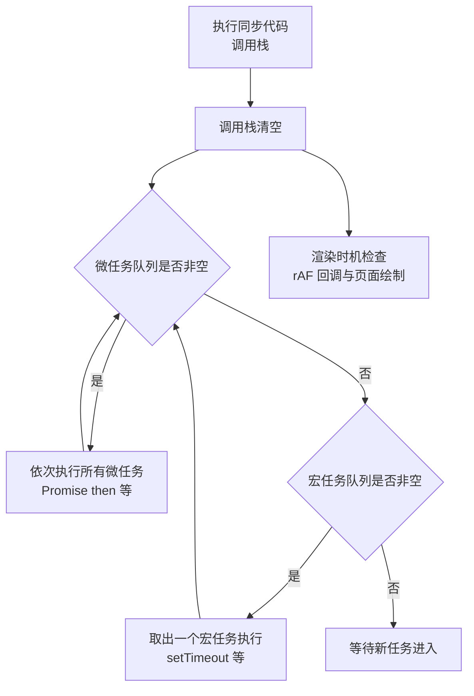

```javascript
console.log('1');
setTimeout(() => console.log('2'), 0);
Promise.resolve().then(() => console.log('3'));
queueMicrotask(() => console.log('4'));
console.log('5');
// 输出：1 5 3 4 2 —— 微任务优先于宏任务
```

### JS-044：宏任务与微任务分别有哪些？为什么要区分？

**答**：
- 微任务（更早、同轮清空）：Promise 回调、queueMicrotask、MutationObserver、process.nextTick（Node）。
- 宏任务（每轮一个）：setTimeout/setInterval、setImmediate（Node）、I/O、UI 事件回调。
- 区分的目的：微任务保证“当前逻辑结束后、渲染前”完成状态同步，避免 UI 中间态闪烁。
- 写代码的推论：微任务里再派生微任务会阻塞渲染（无限微任务饿死渲染）。

```javascript
setTimeout(() => console.log('macro'), 0);

Promise.resolve()
  .then(() => {
    console.log('micro 1');
    return Promise.resolve().then(() => console.log('micro 2'));
  })
  .then(() => console.log('micro 3'));

// 输出：micro 1 → micro 2 → micro 3 → macro

// 危险：无限微任务会饿死渲染与宏任务
// function loop() { Promise.resolve().then(loop); } // 不要这样做
```

### JS-045：经典执行顺序题：setTimeout、Promise、async 混合输出？

**答**：
- 分析套路：先走完同步代码，再按入队顺序执行微任务，最后宏任务。
- `await` 之后的代码是微任务；new Promise 构造函数体是同步的。
- 链式 then 每段各占一个微任务位次，先入队先执行。
- 多个 setTimeout 按 delay 与入队顺序排。

```javascript
console.log('start');                       // 同步 1

setTimeout(() => {
  console.log('timeout1');
  Promise.resolve().then(() => console.log('timeout1 then'));
}, 0);

setTimeout(() => console.log('timeout2'), 0);

Promise.resolve()
  .then(() => {
    console.log('then1');
    setTimeout(() => console.log('timeout3'), 0);
  })
  .then(() => console.log('then2'));

(async () => {
  console.log('async before await');        // 同步 2
  await null;
  console.log('async after await');         // 微任务
})();

console.log('end');                          // 同步 3

// 输出：
// start → async before await → end
// → then1 → async after await → then2
// → timeout1 → timeout1 then → timeout2 → timeout3
```

### JS-046：async/await 的微任务顺序题怎么分析？

**答**：
- 每个 await 相当于把“剩余代码”包进 then，await 几次就排几层微任务。
- await 一个已 resolve 的 Promise 也会让后续代码晚于当前同步代码执行。
- 多个并发 async 函数的 await 后续按各自 await resolve 的先后交错。
- 记忆：async2 内部再 await，会多一层微任务嵌套。

```javascript
async function a1() {
  console.log('a1 start');
  await a2();
  console.log('a1 end');   // 排在 a2 的后续之后
}
async function a2() {
  console.log('a2 start');
  await 0;
  console.log('a2 end');
}

a1();
Promise.resolve().then(() => console.log('then'));
console.log('sync');

// 输出：
// a1 start → a2 start → sync
// → a2 end → then → a1 end
// 解析：await 0 与 await a2() 各产生一跳微任务
```

### JS-047：setTimeout(fn, 0) 是立即执行吗？

**答**：
- 不是：它把回调排入宏任务，最早也要等同步代码和微任务全部结束。
- HTML 规范规定嵌套超过 5 层的 setTimeout 最小间隔 4ms。
- 页面后台标签页定时器被节流到 1s 以上，做动画绝不能用 setTimeout。
- 需要“尽快的异步”用 queueMicrotask 或 Promise；需要与渲染同频用 rAF。

```javascript
setTimeout(() => console.log('A'), 0);
Promise.resolve().then(() => console.log('B'));
console.log('C');
// 输出：C → B → A

// 实测最小延迟
let t0 = performance.now();
let n = 0;
function tick() {
  n++;
  if (n > 10) return console.log('avg delay:', (performance.now() - t0) / 10);
  setTimeout(tick, 0); // 嵌套 5 层后每次 ≈ 4ms
}
tick();
```

### JS-048：Node.js 事件循环与浏览器有什么差异？

**答**：
- Node 分六个阶段：timers → pending callbacks → poll → check（setImmediate）→ close callbacks。
- `process.nextTick` 优先级最高，在每阶段切换前清空，且先于 Promise 微任务。
- setTimeout 与 setImmediate 的先后受进入时机影响：主模块中顺序不确定，I/O 回调里 setImmediate 先执行。
- 浏览器没有多阶段概念，Node 有微任务/nextTick 队列在阶段间 drained 的规则。

```javascript
// Node.js 环境
setImmediate(() => console.log('immediate'));
setTimeout(() => console.log('timeout'), 0);
// 主模块中：顺序不确定（取决于 1ms 对齐）

require('fs').readFile(__filename, () => {
  setTimeout(() => console.log('timeout in io'), 0);
  setImmediate(() => console.log('immediate in io'));
  // I/O 回调内：immediate 先输出，进入 check 阶段
});

Promise.resolve().then(() => console.log('promise'));
process.nextTick(() => console.log('nextTick'));
// 输出顺序：nextTick → promise
```

## 七、ES6+ 新特性

### JS-049：解构赋值有哪些用法与默认值规则？

**答**：
- 数组按位置解构，对象按键名解构，支持嵌套、重命名与默认值。
- 默认值只在值严格等于 undefined 时生效（null 不触发）。
- 函数参数解构可同时给整参和内部字段默认值。
- 解构可用于交换变量、提取正则分组、遍历 Map。

```javascript
const { name: userName = 'anon', age = 18, city } = { name: null, city: 'BJ' };
console.log(userName, age, city); // null 18 "BJ"，null 不触发默认值

const [first, , third = 'x'] = [1, 2];
console.log(first, third);        // 1 "x"

const { profile: { addr = 'unknown' } = {} } = {}; // 嵌套 + 层级兜底
console.log(addr);

function render({ size = 'md', theme = 'light' } = {}) { // 参数整体默认 {}
  return `${size}-${theme}`;
}
console.log(render()); // md-light

let a = 1, b = 2;
[a, b] = [b, a];
```

### JS-050：展开运算符与剩余参数有哪些应用与坑？

**答**：
- 展开：数组/对象字面量展开、函数调用展开；剩余：收集函数参数与解构余项。
- 都是**浅拷贝**：嵌套对象仍共享引用。
- 展开对象时后写覆盖先写，可用于默认值合并。
- 剩余参数必须是最后一个参数，且不能出现在 setter 中。

```javascript
const base = { a: 1, nested: { b: 2 } };
const merged = { ...base, a: 99 };
console.log(merged);              // { a: 99, nested: {b:2} }
merged.nested.b = 3;
console.log(base.nested.b);       // 3，浅拷贝共享

const arr1 = [1, 2], arr2 = [3, 4];
console.log([...arr1, ...arr2]);  // [1,2,3,4]

function sum(...nums) {           // 剩余参数，真数组
  return nums.reduce((s, n) => s + n, 0);
}
console.log(sum(1, 2, 3));        // 6
console.log(Math.max(...arr2));   // 4

const [head, ...rest] = arr1;
const { a, ...others } = merged;
console.log(rest, others);        // [2] {nested: {b:3}}
```

### JS-051：可选链与空值合并如何使用？与 || 的区别？

**答**：
- `?.` 短路安全访问属性/方法/下标，左侧为 null/undefined 时返回 undefined 不报错。
- `??` 只把 null/undefined 视为“空”，0、''、false 都会保留；`||` 把所有 falsy 都当空。
- 两者可组合：`x?.y ?? 'default'`；`?.` 后不能接赋值目标。
- 注意 `a ?? (b || c)` 与 `a || b ?? c` 的混用需要括号，否则语法报错。

```javascript
const user = { profile: { name: 'Tom' } };

console.log(user?.profile?.name);   // Tom
console.log(user?.address?.city);   // undefined，不报错
console.log(user.say?.());          // 方法安全调用
console.log(user?.tags?.[0]);       // 安全下标

console.log(0 || 'default');        // default，0 是 falsy
console.log(0 ?? 'default');        // 0，?? 只认 null/undefined
console.log('' ?? 'default');       // ''
console.log(false || 'fallback');   // fallback

const count = user?.count ?? 0;     // 推荐组合
console.log(count);                 // 0

// 常见错误：a || b ?? c 需要 a ?? (b || c) 或 a || (b ?? c) 明确意图
```

### JS-052：模板字符串与标签模板是什么？

**答**：
- 模板字符串支持插值、多行与嵌套；插值可放任意表达式。
- 标签模板：`tag\`a${1}b\`` 把静态串与插值拆成参数传入 tag 函数。
- 核心应用：styled-components、i18n、防注入 SQL 拼接、DSL。
- 注意 `\`escaped\`` 转义与 String.raw 保留原始字符串。

```javascript
const name = 'Tom', score = 95;
console.log(`用户 ${name} 得分 ${score >= 90 ? '优秀' : '良好'}
换行直接写`);

function highlight(strings, ...values) { // 标签模板
  return strings.reduce((acc, s, i) =>
    `${acc}<em>${values[i - 1] ?? ''}</em>${s}`);
}
console.log(highlight`Hello ${name}, score ${score}!`);
// Hello <em>Tom</em>, score <em>95</em>!

console.log(String.raw`C:\Users\new\note`); // 保留反斜杠

// styled-components 的原理就是标签模板
// styled.div`color: ${p => p.color}`
```

### JS-053：函数默认参数与参数收集有哪些细节？

**答**：
- 默认参数按从左到右求值，后面的默认值可引用前面的参数。
- 传 undefined 才触发默认值，传 null 不触发。
- 默认值形成独立作用域，函数体内再声明同名变量不冲突（不同作用域）。
- 默认参数使函数 length 变短，可用于柯里化的参数计数。

```javascript
function f(a, b = a * 2, c = b + 1) {
  return [a, b, c];
}
console.log(f(2));       // [2, 4, 5]
console.log(f(2, undefined)); // [2, 4, 5]，undefined 触发默认
console.log(f(2, null));      // [2, null, 1]，null 不触发默认值，c = null + 1 = 1

function g(x = 'default') {
  let x2 = x; // x 在参数作用域
  return x2;
}
console.log(g.length); // 0，有默认值的参数不计入 length
console.log(((a, b = 1) => {}).length); // 1
```

### JS-054：对象增强写法与 Object.entries/fromEntries 有什么用？

**答**：
- 属性简写 `{ name }`、方法简写 `{ fn() {} }`、计算属性名 `{ [key]: v }`。
- `Object.entries` 把对象转 [key, value] 数组，配合解构遍历。
- `Object.fromEntries` 是 entries 的逆操作，Map 与对象互转利器。
- `Object.fromEntries` 不改变原对象，注意嵌套仍是浅层处理。

```javascript
const key = 'score';
const student = {
  name: 'Tom',            // 简写
  [`top_${key}`]: true,   // 计算属性名
  run() {},               // 方法简写
  get info() { return this.name; },
};

const obj = { a: 1, b: 2 };
for (const [k, v] of Object.entries(obj)) {
  console.log(k, v);
}

const doubled = Object.fromEntries(
  Object.entries(obj).map(([k, v]) => [k, v * 2])
);
console.log(doubled); // { a: 2, b: 4 }

// Map ↔ 对象互转
const m = new Map([['x', 1], ['y', 2]]);
const plain = Object.fromEntries(m);
const m2 = new Map(Object.entries(plain));
console.log(m2.get('x')); // 1
```

### JS-055：0.1 + 0.2 为什么不等于 0.3？如何处理精度问题？

**答**：
- JS 的 number 是 IEEE 754 双精度浮点，0.1、0.2 都是无限循环二进制的近似值，相加产生误差。
- 安全整数范围是 `Number.MAX_SAFE_INTEGER`（2^53 - 1），超出后精度丢失。
- 展示层用 `toFixed` / `Intl.NumberFormat`，计算层用整数化（分）或 decimal 库。
- 整数精度问题用 BigInt 解决。

```javascript
console.log(0.1 + 0.2);                  // 0.30000000000000004
console.log(0.1 + 0.2 === 0.3);          // false

// 误差容忍比较
function nearlyEqual(a, b, eps = Number.EPSILON) {
  return Math.abs(a - b) < eps;
}
console.log(nearlyEqual(0.1 + 0.2, 0.3)); // true

// 金额：以“分”为整数单位
const price = 1999;      // 19.99 元
const count = 3;
console.log(price * count / 100); // 59.97

console.log(Number.MAX_SAFE_INTEGER);   // 9007199254740991
console.log(9007199254740992 + 1 === 9007199254740992); // true，溢出
console.log((2n ** 53n + 1n) - 2n ** 53n);              // 1n，BigInt 正确
```

### JS-056：ES2020+ 有哪些实用新特性？

**答**：
- ES2020：可选链 `?.`、空值合并 `??`、globalThis、Promise.allSettled、String.matchAll、BigInt、dynamic import。
- ES2021：String.replaceAll、逻辑赋值运算符 `??= ||=`、WeakRef。
- ES2022：类私有字段 `#x`、顶层 await、`Object.hasOwn`、at()、error.cause。
- ES2023：`Array.prototype.findLast/toReversed/toSorted/toSpliced`（不可变数组方法）。
- ES2024：`Object.groupBy`/`Map.groupBy` 分组、`Promise.withResolvers()`、可调整大小的 ArrayBuffer（`resize()`）、`String.isWellFormed/toWellFormed`、正则 v 标志、`Atomics.waitAsync`。
- ES2025：`Set` 集合运算方法（union/intersection/difference/symmetricDifference 等）、`Iterator.prototype` 上的 map/filter/take 等迭代器helper、正则 `/d` 之外的重复命名捕获组、`RegExp.escape`。
- 面试加分点：能说出"你实际在业务里用过哪一两个"，如 `Promise.withResolvers` 简化手工 resolve/reject 暴露、`Object.groupBy` 替代手写 reduce 分组。

```javascript
// globalThis：跨环境取全局对象
console.log(globalThis.Math === Math); // true

// at() 负索引
const arr = [1, 2, 3];
console.log(arr.at(-1)); // 3

// replaceAll 与逻辑赋值
console.log('a-b-c'.replaceAll('-', '_')); // a_b_c
let cfg = { timeout: 0 };
cfg.timeout ??= 3000;  // 0 保留，??= 只在 null/undefined 时赋值
cfg.retries ||= 3;

// Object.hasOwn 与 error.cause
console.log(Object.hasOwn({ a: 1 }, 'a')); // true
try {
  throw new Error('outer', { cause: new Error('inner') });
} catch (e) {
  console.log(e.message, e.cause.message); // outer inner
}

// 不可变数组方法
console.log([3, 1, 2].toSorted());  // [1,2,3]，原数组不变
console.log([1, 2, 3].toReversed());
console.log([1, 2, 3, 4].findLast((n) => n % 2 === 0)); // 4

// ES2024：分组与 Promise.withResolvers
console.log(Object.groupBy([{ t: 'a' }, { t: 'b' }, { t: 'a' }], (x) => x.t));
// { a: [{t:'a'}, {t:'a'}], b: [{t:'b'}] }

function deferred() {
  const { promise, resolve, reject } = Promise.withResolvers();
  setTimeout(() => resolve('done'), 100);
  return promise;
}
deferred().then(console.log); // done

// ES2025：Set 集合运算
console.log([...new Set([1, 2, 3]).intersection(new Set([2, 3, 4]))]); // [2, 3]
```

### JS-057：structuredClone 与旧方案相比有什么优势？

**答**：
- `structuredClone` 原生深拷贝，支持循环引用、Map/Set/Date/RegExp/ArrayBuffer。
- 不支持函数、DOM 节点、Symbol 键、原型链（拷贝后变成普通对象）。
- 对比 JSON.parse(JSON.stringify)：后者丢 undefined/function/Symbol、日期变字符串、无法处理循环引用。
- 对比递归手写：原生实现更快更完整，但“保留类实例”需求仍需手写或库。

```javascript
const original = {
  date: new Date(),
  map: new Map([['k', 1]]),
  nested: { deep: [1, 2] },
};
original.self = original; // 循环引用

const cloned = structuredClone(original);
console.log(cloned.date instanceof Date);  // true
console.log(cloned.map instanceof Map);    // true
console.log(cloned.self === cloned);       // true，循环引用保留

// JSON 方案会挂掉
try {
  JSON.parse(JSON.stringify(original));
} catch (e) {
  console.log(e.name); // TypeError，循环引用
}

// 原型丢失
class Box { constructor() { this.v = 1; } }
const bc = structuredClone(new Box());
console.log(bc instanceof Box); // false
```

## 八、Map/Set/WeakMap 与 Proxy/Reflect

### JS-058：Map 与 Object 有什么区别？什么场景用 Map？

**答**：
- Map 的键可以是任意类型（对象、NaN、函数），Object 键只能是字符串/Symbol。
- Map 有 size、保持插入顺序、增删查为 O(1)，频繁增删性能更稳定。
- Map 可直接 for...of 遍历，Object 需要 Object.keys 转换。
- 键数量动态变化、需要顺序与频繁删除时选 Map；少量静态配置用 Object。

```javascript
const m = new Map();
const objKey = { id: 1 };
m.set(objKey, 'user object');
m.set(NaN, 'nan value');
m.set(1, 'number key');
console.log(m.get(objKey));  // user object
console.log(m.get(NaN));     // nan value，Map 内 NaN 相等
console.log(m.size);         // 3

for (const [k, v] of m) console.log(k, v); // 直接遍历

m.delete(1);
console.log(m.has(1));       // false

// 与对象互转见 JS-054；初始化传二维数组
const conf = new Map([['theme', 'dark'], ['lang', 'zh']]);
```

### JS-059：Set 有哪些典型应用？

**答**：
- 去重：`[...new Set(arr)]`，对基本类型直接有效。
- 集合运算：交集、并集、差集用 filter + has 实现。
- 成员存在性检查 O(1)，替代 `arr.includes` 的 O(n)。
- WeakSet 存对象标记“处理过”而不阻止回收。

```javascript
const arr = [1, 2, 2, 3, 'a', 'a'];
console.log([...new Set(arr)]); // [1, 2, 3, 'a']

const a = new Set([1, 2, 3]);
const b = new Set([2, 3, 4]);
const union     = new Set([...a, ...b]);
const intersect = new Set([...a].filter((x) => b.has(x)));
const diff      = new Set([...a].filter((x) => !b.has(x)));
console.log([...union], [...intersect], [...diff]);
// [1,2,3,4] [2,3] [1]

const big = new Set(Array.from({ length: 1e5 }, (_, i) => i));
console.time('set');
console.log(big.has(99999)); // O(1)
console.timeEnd('set');
```

### JS-060：WeakMap/WeakSet 的弱引用有什么用途？

**答**：
- 键必须是对象且为弱引用：键对象在别处无引用时可被 GC，WeakMap 不阻止回收。
- 不可遍历、没有 size/clear，正因为生命周期不可预测。
- 典型用途：给 DOM/组件实例附加元数据、私有数据存储、对象级缓存。
- 拿 WeakMap 当“对象 → 数据”侧表，避免污染对象本身。

```javascript
const metadata = new WeakMap();
const dom = document.querySelector('#app'); // 浏览器环境示例
metadata.set(dom, { mountedAt: Date.now() });
console.log(metadata.get(dom)); // {mountedAt: ...}
// dom 被移除且无其他引用后，metadata 中的条目可被整体回收

class Component {
  #state = new WeakMap(); // 实例私有状态（防止外部访问实例时顺带暴露）
  bind(el) {
    this.#state.set(el, { clicks: 0 });
  }
}

// 缓存场景：结果随 key 对象生命周期
const cache = new WeakMap();
function compute(obj) {
  if (!cache.has(obj)) cache.set(obj, heavyCalc(obj));
  return cache.get(obj);
}
function heavyCalc(o) { return Object.keys(o).length; }
```

### JS-061：Proxy 的基本用法与常用拦截器？

**答**：
- `new Proxy(target, handler)` 创建代理，外部操作先经过 handler 拦截。
- 常用 trap：get/set/has/deleteProperty/ownKeys/apply/construct。
- set 里可做校验与通知，是响应式系统（Vue3）的基础。
- 拦截的是代理对象上的操作，直接持有原 target 可绕过代理。

```javascript
function reactive(obj) {
  return new Proxy(obj, {
    get(target, key, receiver) {
      console.log(`get ${String(key)}`);
      return Reflect.get(target, key, receiver);
    },
    set(target, key, value, receiver) {
      const ok = Reflect.set(target, key, value, receiver);
      console.log(`set ${String(key)} = ${value}，触发更新`);
      return ok;
    },
    deleteProperty(target, key) {
      console.log(`delete ${String(key)}`);
      return Reflect.deleteProperty(target, key);
    },
  });
}

const state = reactive({ count: 0, user: { name: 'Tom' } });
state.count = 1;        // set count = 1，触发更新
state.user.name;        // get user（深层需要递归代理，Vue3 惰性处理）
delete state.count;
```

### JS-062：Reflect 是什么？为什么要与 Proxy 配合？

**答**：
- Reflect 把对象操作函数化：get/set/has/deleteProperty/defineProperty 等，返回值更友好（失败返回 false 而不报错）。
- 与 Proxy 配合：trap 内用 Reflect 执行默认行为，能正确传递 receiver、保证 this 与 getter 语义。
- 让“拦截 + 默认行为”的写法规范化，避免手动复制逻辑。
- 也用于探测：`Reflect.has(obj, key)` 等价 `key in obj`。

```javascript
const handler = {
  get(target, key, receiver) {
    if (!(key in target)) {
      console.warn(`missing key: ${String(key)}`);
      return undefined;
    }
    return Reflect.get(target, key, receiver); // 保持 receiver 语义
  },
  set(target, key, value, receiver) {
    if (typeof value === 'function') {
      throw new TypeError('not allowed');
    }
    return Reflect.set(target, key, value, receiver);
  },
};
const proxy = new Proxy({ a: 1 }, handler);
proxy.a;            // 1
proxy.missing;      // warn
// proxy.fn = () => {}; // TypeError

console.log(Reflect.has(proxy, 'a'));       // true
console.log(Reflect.ownKeys(proxy));        // ['a']，含 symbol
```

### JS-063：Proxy 与 Object.defineProperty 的区别？

**答**：
- defineProperty 只能劫持**已知属性**的读写，新增/删除属性无法感知（Vue2 需 $set）。
- Proxy 劫持整个对象级别操作：新增删除、has、ownKeys、函数调用都可拦截。
- defineProperty 兼容性更好（IE9+），Proxy 是 ES6（IE 不支持）。
- 数组索引与 length：defineProperty 处理繁琐，Proxy 天然支持。

```javascript
// Object.defineProperty：只能监听已有属性
const vue2like = {};
let inner = 0;
Object.defineProperty(vue2like, 'count', {
  get() { return inner; },
  set(v) { inner = v; console.log('dep update'); },
  enumerable: true,
});
vue2like.count = 1;      // 触发
vue2like.newKey = 2;     // 无法被监听

// Proxy：对象级监听
const vue3like = new Proxy({ count: 0 }, {
  set(t, k, v) {
    t[k] = v;
    console.log(`update ${String(k)}`);
    return true;
  },
  deleteProperty(t, k) {
    console.log(`remove ${String(k)}`);
    return delete t[k];
  },
});
vue3like.newKey = 2;   // update newKey
delete vue3like.count; // remove count

// 数组
const arrProxy = new Proxy([1, 2], { set(t, k, v) { t[k] = v; console.log('arr set', k, v); return true; } });
arrProxy[5] = 9;       // arr set 5 9
```

## 九、模块化

### JS-064：ESM 的 import/export 有哪些语法形式？

**答**：
- 命名导出：`export const x` / `export { a, b as c }`；默认导出：`export default`，一个模块只能一个。
- 导入：默认导入、命名导入、命名空间 `import * as ns`、副作用导入 `import './style.css'`。
- export 是**只读视图**（live binding）：导出值变化，导入方能看到更新。
- import 声明会被提升，必须位于模块顶层。

```javascript
// utils.js
export const version = '1.0';
export function format(s) { return s.trim(); }
export default class Logger { /* ... */ }
export { format as fmt }; // 重命名导出

// main.js
import Logger from './utils.js';            // 默认导入
import { version, fmt } from './utils.js';  // 命名导入
import * as utils from './utils.js';        // 命名空间
import './polyfill.js';                     // 副作用导入

// 动态导入（见 JS-066）
const mod = await import('./utils.js');

// live binding
// counter.js: export let n = 0; export function inc() { n++ }
// main.js: import { n, inc } from './counter.js'; inc(); console.log(n); // 1
```

### JS-065：CommonJS 与 ESM 的核心区别？

**答**：
- 加载时机：CJS 运行时同步 require，可条件加载；ESM 编译期静态分析，声明必须顶层。
- 输出：CJS 值的**拷贝**，导出后变化不可见；ESM 值的**只读引用**（live binding）。
- this：CJS 顶层 this 是 exports 对象；ESM 顶层 this 是 undefined。
- 循环依赖：两者都靠缓存缓解，ESM 靠静态结构提前暴露绑定，行为更可控。

```javascript
// counter.cjs —— CommonJS
let count = 0;
function inc() { count += 1; }
module.exports = { count, inc };

// main.cjs
const { count, inc } = require('./counter.cjs');
inc();
console.log(count); // 0，值拷贝，不随内部变化

// counter.mjs —— ESM
export let count = 0;
export function inc() { count += 1; }

// main.mjs
import { count, inc } from './counter.mjs';
inc();
console.log(count); // 1，live binding

// 条件加载差异
if (process.env.DEV) {
  const dev = require('./dev.cjs'); // CJS 可以
}
// const dev = await import('./dev.mjs'); // ESM 用动态 import
```

### JS-066：动态 import() 与代码分割如何配合？

**答**：
- `import(path)` 返回 Promise，运行时按需加载，可在任何位置调用（含条件与循环内）。
- 打包器据此切分 chunk：路由级懒加载、大依赖（编辑器、图表库）按需加载。
- 配合 webpack 的 magic comment 控制命名与预加载（webpackChunkName / prefetch）。
- 失败可 catch 并降级重试，适合做微前端/插件系统。

```javascript
// 路由懒加载
const routes = [
  { path: '/admin', component: () => import('./views/Admin.vue') },
];

// 交互触发的大依赖
button.addEventListener('click', async () => {
  try {
    const { default: Chart } = await import(
      /* webpackChunkName: "chart" */ './lib/chart.js'
    );
    new Chart(container, data);
  } catch (e) {
    console.error('chunk load failed, retry...');
  }
});

// 条件加载
if (window.matchMedia('(hover: hover)').matches) {
  await import('./hover-effect.js');
}
```

## 十、手写实现

### JS-067：如何手写浅拷贝？

**答**：
- 浅拷贝只复制第一层：`Object.assign({}, obj)`、展开 `{...obj}`、`arr.slice()` 都是浅拷贝。
- 手写要点：只遍历自有可枚举属性，保持数组与对象的区分。
- 嵌套引用类型仍是共享引用，这是浅拷贝与深拷贝的本质分界。
- 补充：`Array.from`、concat 也是数组浅拷贝的常用方式。

```javascript
function shallowClone(source) {
  if (source === null || typeof source !== 'object') return source;
  const clone = Array.isArray(source) ? [] : {};
  for (const key of Object.keys(source)) {
    clone[key] = source[key]; // 第一层拷贝，嵌套仍共享
  }
  return clone;
}

const src = { a: 1, list: [1, 2] };
const copy = shallowClone(src);
copy.a = 99;
console.log(src.a);       // 1，第一层独立
copy.list.push(3);
console.log(src.list);    // [1, 2, 3]，嵌套共享

// 等价内置方案
const c1 = Object.assign({}, src);
const c2 = { ...src };
const a1 = [1, [2]].slice();
const a2 = Array.from([1, [2]]);
```

### JS-068：如何手写深拷贝？如何处理循环引用与特殊对象？

**答**：
- 递归复制 + `WeakMap` 缓存已拷贝对象，解决循环引用并提升性能。
- Date/RegExp 直接 new，Map/Set 递归其元素，Symbol 键用 getOwnPropertySymbols 补齐。
- 函数与 DOM 通常直接返回引用或跳过（不可克隆）。
- 生产环境优先 structuredClone，手写版用于考察理解。

```javascript
function deepClone(value, cache = new WeakMap()) {
  if (value === null || typeof value !== 'object') return value;
  if (value instanceof Date)   return new Date(value);
  if (value instanceof RegExp) return new RegExp(value.source, value.flags);
  if (cache.has(value)) return cache.get(value); // 循环引用

  if (value instanceof Map) {
    const m = new Map();
    cache.set(value, m);
    value.forEach((v, k) => m.set(deepClone(k, cache), deepClone(v, cache)));
    return m;
  }
  if (value instanceof Set) {
    const s = new Set();
    cache.set(value, s);
    value.forEach((v) => s.add(deepClone(v, cache)));
    return s;
  }

  const clone = Array.isArray(value) ? [] : Object.create(Object.getPrototypeOf(value));
  cache.set(value, clone);
  const keys = [...Object.keys(value), ...Object.getOwnPropertySymbols(value)];
  for (const key of keys) {
    clone[key] = deepClone(value[key], cache);
  }
  return clone;
}

const obj = { n: 1, d: new Date(), list: [1, { x: 2 }] };
obj.self = obj;
const copied = deepClone(obj);
console.log(copied.self === copied);   // true，循环引用正确
console.log(copied.list[1] !== obj.list[1]); // true，深层独立
```

### JS-069：如何手写防抖 debounce？

**答**：
- 核心思路：每次触发都重置定时器，停止触发 delay 毫秒后才真正执行。
- 增强一：立即执行版（首次触发马上执行，之后静默）。
- 增强二：返回的函数带 cancel 方法，组件卸载时清理。
- 典型场景：搜索输入联想、resize 计算布局。

```javascript
function debounce(fn, wait = 300, { leading = false } = {}) {
  let timer = null;
  function debounced(...args) {
    if (timer) clearTimeout(timer);
    if (leading && !timer) {
      fn.apply(this, args);           // 首次立即执行
    }
    timer = setTimeout(() => {
      timer = null;
      if (!leading) fn.apply(this, args);
    }, wait);
  }
  debounced.cancel = () => {
    clearTimeout(timer);
    timer = null;
  };
  return debounced;
}

const search = debounce((kw) => console.log('search:', kw), 500);
search('j'); search('js'); search('javascript'); // 500ms 后只输出 javascript

const onResize = debounce(() => console.log('resize'), 200, { leading: true });
window.addEventListener('resize', onResize);
// 卸载时 onResize.cancel();
```

### JS-070：如何手写节流 throttle？

**答**：
- 核心思路：一段时间内只执行一次，时间戳版首沿触发、定时器版尾沿触发。
- 完整实现两者结合：首次立即执行 + 停止触发后再补一次。
- 典型场景：scroll 监听、按钮防重复点击、拖拽位置同步。
- 与防抖的区别：防抖“等停止”，节流“控频率”。

```javascript
function throttle(fn, interval = 200) {
  let last = 0;
  let timer = null;
  return function (...args) {
    const now = Date.now();
    const remaining = interval - (now - last);
    if (remaining <= 0) {
      clearTimeout(timer);
      timer = null;
      last = now;
      fn.apply(this, args);           // 时间戳命中：立即执行
    } else if (!timer) {
      timer = setTimeout(() => {      // 尾沿兜底：最后一次也执行
        last = Date.now();
        timer = null;
        fn.apply(this, args);
      }, remaining);
    }
  };
}

window.addEventListener('scroll', throttle(() => {
  console.log('scroll pos:', window.scrollY);
}, 300)); // 滚动期间最多每 300ms 输出一次，停止后补一次
```

### JS-071：如何手写函数柯里化 curry？

**答**：
- 柯里化：把 `f(a, b, c)` 转为 `f(a)(b)(c)` 任意组合，参数收集满 `fn.length` 才执行。
- 实现要点：收集参数，数量足够调用原函数，否则返回新的收集函数。
- 展开 rest 参数后 `fn.length` 需注意默认参数不计入。
- 应用：参数复用、延迟执行、配合偏函数简化调用。

```javascript
function curry(fn) {
  return function collect(...args) {
    if (args.length >= fn.length) {
      return fn.apply(this, args);
    }
    return (...more) => collect(...args, ...more); // 继续收集
  };
}

function add(a, b, c) { return a + b + c; }
const curriedAdd = curry(add);
console.log(curriedAdd(1)(2)(3)); // 6
console.log(curriedAdd(1, 2)(3)); // 6
console.log(curriedAdd(1)(2, 3)); // 6

// 参数复用
const log = curry((level, tag, msg) => `[${level}][${tag}] ${msg}`);
const errorLog = log('ERROR');
const apiError = errorLog('api');
apiError('timeout');  // [ERROR][api] timeout

// 支持 占位 的进阶版可用递归比较 args.length 与 fn.length
console.log(add.length, ((a, b = 1) => {}).length); // 3 1
```

### JS-072：如何手写 instanceof？

**答**：
- 原理：沿右侧构造函数的 prototype 在左侧对象的原型链上逐级查找。
- 找到相等返回 true，走到 null（原型链尽头）返回 false。
- 注意：基本类型直接返回 false；`Object.getPrototypeOf` 优于已废弃的 `__proto__`。
- 结合 JS-025 可知 new 的第 2 步正是 instanceof 成立的前提。

```javascript
function myInstanceof(left, right) {
  if (left === null || (typeof left !== 'object' && typeof left !== 'function')) {
    return false; // 基本类型必然不在原型链上
  }
  let proto = Object.getPrototypeOf(left);
  const target = right.prototype;
  while (proto !== null) {
    if (proto === target) return true;
    proto = Object.getPrototypeOf(proto);
  }
  return false;
}

function Animal() {}
function Dog() {}
Dog.prototype = Object.create(Animal.prototype); // 模拟继承

const d = new Dog();
console.log(myInstanceof(d, Dog));    // true
console.log(myInstanceof(d, Animal)); // true，沿链向上
console.log(myInstanceof(d, Array));  // false
console.log(myInstanceof('str', String)); // false，基本类型
console.log(myInstanceof(new String('s'), String)); // true
```

## 十一、内存、严格模式与其他专题

### JS-073：V8 的垃圾回收机制是怎样的？

**答**：
- 分代回收：新生代（Scavenge，复制算法，空间小、回收频繁）+ 老生代（标记清除 + 标记整理）。
- 新生代分 From/To 两个半区，存活对象在半区间复制，两轮存活后晋升老生代。
- 老生代用三色标记做增量标记，减少主线程停顿；碎片由标记整理消除。
- 引用计数法是早期 IE 的方案，循环引用是其泄漏根源，现代引擎不用。

```javascript
// 循环引用在现代引擎中可正常回收
function demo() {
  const a = {};
  const b = {};
  a.ref = b;
  b.ref = a; // 互相引用
  return a;
}
let x = demo();
x = null; // 整个环从 GC roots 不可达，标记清除可回收

// 触发手动观察（仅调试）
// Chrome DevTools Memory → Allocation instrumentation
// Node: node --expose-gc 后调用 global.gc()
```

### JS-074：常见内存泄漏场景有哪些？如何排查？

**答**：
- 高频场景：未清理的定时器与事件监听、闭包持有大对象、脱离 DOM 的引用、全局变量累积、无限增长缓存。
- Vue/React 组件卸载时必须清理：clearInterval、removeEventListener、AbortController.abort。
- 排查工具：Chrome Memory 面板拍堆快照对比（三次快照法）、Performance Monitor 看 JS heap 曲线。
- 代码层面：用 WeakMap/WeakSet 做对象级缓存，模块级 Map 提供容量上限。

```javascript
class Widget {
  constructor(el) {
    this.el = el;
    this.onClick = this.onClick.bind(this);
    this.timer = setInterval(this.onClick, 1000);
    el.addEventListener('click', this.onClick);
    this.abort = new AbortController();
    fetch('/api/data', { signal: this.abort.signal });
  }
  onClick() { console.log('tick'); }
  destroy() {         // 必须成对清理
    clearInterval(this.timer);
    this.el.removeEventListener('click', this.onClick);
    this.abort.abort();
    this.el = null;   // 解除 DOM 引用
  }
}

// 无上限缓存 → 改为 LRU 或 WeakMap
const cache = new Map();
const MAX = 500;
function memo(key, compute) {
  if (cache.size >= MAX) cache.delete(cache.keys().next().value); // 简易淘汰
  if (!cache.has(key)) cache.set(key, compute(key));
  return cache.get(key);
}
```

### JS-075：严格模式有哪些行为变化？

**答**：
- 未声明变量赋值直接抛 ReferenceError；对不可写属性赋值抛 TypeError。
- 普通函数独立调用时 this 是 undefined（非严格指向 window）。
- 禁用 with、eval 不再创建变量、arguments 不再与形参联动、删除变量报错。
- 函数重复参数名、八进制字面量语法报错；class 与 ESM 默认严格模式。

```javascript
'use strict';

x = 1;                       // ReferenceError，必须先声明

function fn() {
  console.log(this);         // undefined
}
fn();

// with (obj) {}             // SyntaxError
// var obj = {}; with (obj) {} // 同上

function dup(a, a) {}        // SyntaxError，重复参数名

const frozen = Object.freeze({ v: 1 });
try {
  frozen.v = 2;              // TypeError（非严格模式静默失败）
} catch (e) {
  console.log(e.name);
}

// 箭头函数不受影响：this 仍按词法捕获
const arrow = () => console.log(this); // 外层 this（模块下 undefined）
```

### JS-076：迭代器协议与 for...of 的关系？

**答**：
- 可迭代协议：对象实现 `Symbol.iterator` 方法，返回一个带 next() 的迭代器。
- next() 返回 `{ value, done }`，done 为 true 表示遍历结束。
- for...of、展开运算符、解构、Array.from 都消费可迭代对象。
- for...in 遍历可枚举字符串键，for...of 遍历值；普通对象默认不可迭代。

```javascript
const range = {
  from: 1,
  to: 3,
  [Symbol.iterator]() {          // 迭代器工厂
    let cur = this.from;
    const end = this.to;
    return {
      next() {
        return cur <= end
          ? { value: cur++, done: false }
          : { value: undefined, done: true };
      },
    };
  },
};

for (const n of range) console.log(n); // 1 2 3
console.log([...range]);               // [1, 2, 3]
const [x1, x2] = range;                // 解构也消费迭代器

// for...in 与 for...of 对比
const arr = ['a', 'b'];
for (const i in arr) console.log(i);    // '0' '1'，键
for (const v of arr) console.log(v);    // 'a' 'b'，值
// for (const v of { a: 1 });           // TypeError，普通对象不可迭代
```

### JS-077：正则表达式的基础用法有哪些？

**答**：
- 创建：字面量 `/pattern/flags` 或 `new RegExp(str)`；标志 g 全局、i 忽略大小写、m 多行、y 粘性、s 点匹配换行。
- 常用元字符：`.` 任意字符、`\d\w\s`、量词 `* + ? {n,m}`、字符类 `[abc]`、分组与捕获 `()`、非捕获 `(?:)`。
- 贪婪匹配取最多，`?` 修饰后变懒惰；边界用 `^ $ \b`。
- 常用 API：test/exec（含 lastIndex）、match/matchAll/replace/split。

```javascript
const re = /(\d{4})-(\d{2})-(\d{2})/g;

console.log(re.test('2024-01-15')); // true
const m = re.exec('at 2024-01-15 and 2024-02-20');
console.log(m[1], m[2], m[3]);      // 2024 01 15，捕获组

// 全局标志下 exec 依赖 lastIndex，推荐 matchAll
const all = [...'a1b22c333'.matchAll(/(\d+)/g)];
console.log(all.map((x) => x[1]));  // ['1','22','333']

// 贪婪 vs 懒惰
console.log('<div>1</div>'.match(/<.+>/)[0]);   // <div>1</div>，贪婪
console.log('<div>1</div>'.match(/<.+?>/)[0]);  // <div>，懒惰

// 常用工具正则
console.log(/^1[3-9]\d{9}$/.test('13800138000'));       // 手机号
console.log('  trim  '.replace(/^\s+|\s+$/g, ''));      // 手动 trim
console.log('get-user-info'.replace(/-(\w)/g, (_, c) => c.toUpperCase())); // getUserInfo
```

### JS-078：JavaScript 的错误处理体系是怎样的？

**答**：
- 内置错误类型：Error、TypeError、RangeError、ReferenceError、SyntaxError、URIError。
- `throw` 可抛任意值，但规范只抛 Error 实例（保留 stack 与 cause）。
- try/catch/finally：finally 总是执行，且其 return 会覆盖 try 的返回。
- 异步错误要分场景：Promise 用 catch，async/await 用 try/catch，回调式错误约定 error-first 参数。

```javascript
function parseJSON(json) {
  try {
    return JSON.parse(json);
  } catch (err) {
    throw new Error(`invalid json: ${err.message}`, { cause: err });
  }
}

try {
  parseJSON('{bad}');
} catch (e) {
  console.log(e instanceof Error, e.cause instanceof SyntaxError); // true true
} finally {
  console.log('cleanup always runs');
}

// finally 覆盖 return（了解即可）
function finallyReturn() {
  try { return 'try'; } finally { return 'finally'; }
}
console.log(finallyReturn()); // finally

// Node 进程级兜底
// process.on('uncaughtException', ...)
// 浏览器：window.addEventListener('error', handler)
```

### JS-079：什么是事件委托？为什么常绑定在 document 或容器上？

**答**：
- 利用事件冒泡，把子元素的监听统一挂到父容器，由 e.target 判断真正来源。
- 优点：减少监听器数量、动态新增子元素无需重新绑定。
- 注意 currentTarget（绑定的元素）与 target（实际触发的元素）的区别。
- 限制：focus/blur 等不冒泡的事件需用捕获或 focusin 替代；中间 stopPropagation 会阻断委托。

```html
<ul id="list">
  <li data-id="1">a</li>
  <li data-id="2">b</li>
  <!-- 动态新增的 li 也能被处理 -->
</ul>
```

```javascript
document.querySelector('#list').addEventListener('click', (e) => {
  const li = e.target.closest('li'); // closest 容错内部嵌套元素
  if (!li || !e.currentTarget.contains(li)) return;
  console.log('clicked id:', li.dataset.id);
  console.log(e.currentTarget.id, e.target.textContent); // list 与具体 li
});

// 动态新增自动生效
const li = document.createElement('li');
li.dataset.id = '3';
li.textContent = 'c';
document.querySelector('#list').appendChild(li);
```

### JS-080：requestAnimationFrame 与 setTimeout 做动画有何区别？

**答**：
- rAF 在浏览器下一次重绘前执行，天然与屏幕刷新率（60/120Hz）对齐，不掉帧不撕裂。
- 页面隐藏/切后台时 rAF 自动暂停，省电省 CPU；setTimeout 会继续且被节流。
- 回调参数是高精度时间戳，应基于时间差计算进度而非固定步长。
- 需要“下下一帧”时嵌套两帧；时间控制类仍可用 setTimeout，动画一律 rAF。

```javascript
function animate(duration, onUpdate) {
  let start = null;
  function frame(now) {
    if (start === null) start = now;
    const progress = Math.min((now - start) / duration, 1); // 基于时间戳
    const eased = 1 - Math.pow(1 - progress, 3);            // easeOutCubic
    onUpdate(eased);
    if (progress < 1) requestAnimationFrame(frame);
  }
  requestAnimationFrame(frame);
}

const box = document.querySelector('.box');
animate(1000, (p) => {
  box.style.transform = `translateX(${p * 200}px)`;
});

// 事件循环位置：同步 → 微任务 → rAF → 下一次渲染 → 宏任务
requestAnimationFrame(() => console.log('rAF: 渲染前执行'));
setTimeout(() => console.log('timeout: 渲染后的宏任务'), 0);
```

## 十二、手写实现进阶

### JS-081：如何手写 Promise.allSettled 与 Promise.any？

**答**：
- allSettled：全部结算后按原顺序返回 `{ status, value/reason }`，永远 resolve。
- any：第一个成功即 resolve，全部失败才 reject 一个 `AggregateError`，errors 按原顺序收集。
- 共同点：用计数器而不是 `Promise.all` 包装，避免一个失败打断整体流程。
- 注意入参可能是普通值，统一 `Promise.resolve(p)` 兜底。

```javascript
function allSettled(promises) {
  return new Promise((resolve) => {
    const list = Array.from(promises);
    const results = new Array(list.length);
    let count = 0;
    if (list.length === 0) return resolve([]);
    list.forEach((p, i) => {
      Promise.resolve(p).then(
        (value) => { results[i] = { status: 'fulfilled', value }; done(); },
        (reason) => { results[i] = { status: 'rejected', reason }; done(); }
      );
    });
    function done() { if (++count === list.length) resolve(results); }
  });
}

function any(promises) {
  return new Promise((resolve, reject) => {
    const list = Array.from(promises);
    const errors = new Array(list.length);
    let count = 0;
    if (list.length === 0) {
      return reject(new AggregateError([], 'All promises were rejected'));
    }
    list.forEach((p, i) => {
      Promise.resolve(p).then(resolve, (reason) => { // 第一个成功直接兑现整体
        errors[i] = reason;
        if (++count === list.length) {
          reject(new AggregateError(errors, 'All promises were rejected'));
        }
      });
    });
  });
}

allSettled([Promise.resolve(1), Promise.reject(new Error('e'))])
  .then(console.log); // [{status:'fulfilled',value:1},{status:'rejected',reason:Error}]
any([Promise.reject(new Error('x')), Promise.resolve('first ok')])
  .then(console.log); // first ok
```

### JS-082：如何手写 Promise.race 与带超时的 race？

**答**：
- race：第一个结算（无论成败）的 promise 决定整体结果，其余被忽略但不会自动取消。
- 超时 race 是 race 最典型的应用：一个计时器 promise 与业务 promise 赛跑。
- 必须在 finally 里 clearTimeout，否则定时器泄漏、进程无法退出。
- race 不会真正“取消”慢的那一方，要彻底中断需配合 AbortController。

```javascript
function race(promises) {
  return new Promise((resolve, reject) => {
    for (const p of promises) Promise.resolve(p).then(resolve, reject); // 先到先得
  });
}

function withTimeout(promise, ms, label = 'timeout') {
  let timer;
  const timeout = new Promise((_, reject) => {
    timer = setTimeout(() => reject(new Error(`${label}: ${ms}ms 内未完成`)), ms);
  });
  return Promise.race([promise, timeout]).finally(() => clearTimeout(timer));
}

const slow = new Promise((r) => setTimeout(() => r('done'), 3000));
withTimeout(slow, 500, 'query').catch((e) => console.log(e.message)); // timeout: 500ms 内未完成

// race 与超时连用：多个镜像节点谁先返回用谁
race([withTimeout(fetch('/a'), 800, 'a'), withTimeout(fetch('/b'), 800, 'b')]);
```

### JS-083：如何手写 Promise.retry？指数退避怎么实现？

**答**：
- 核心结构：失败后 `setTimeout(run, delay)` 递归重试，成功或次数耗尽才终结。
- 指数退避：`delay = base * factor^(attempt-1)`，配合上限 maxDelay 防止无限增长。
- 生产建议：只对幂等/瞬时故障（网络抖动、限流）重试，业务错误直接抛出。
- 高级做法是“指数退避 + 抖动”（加随机量），避免大量客户端同时重试造成雪崩。

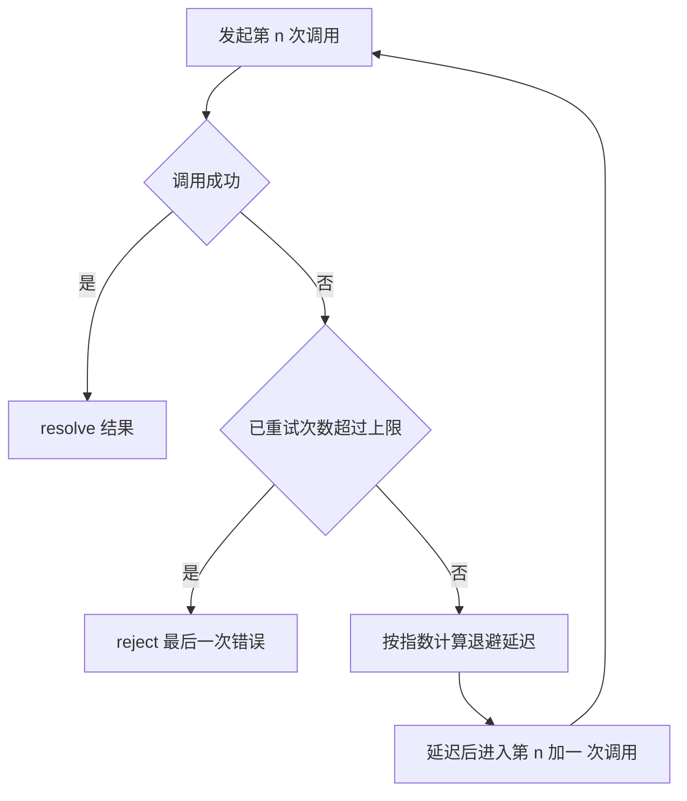

```javascript
function retry(task, { retries = 3, base = 200, factor = 2, maxDelay = 5000 } = {}) {
  return new Promise((resolve, reject) => {
    let attempt = 0;
    const run = () => {
      Promise.resolve()
        .then(task)
        .then(resolve)
        .catch((err) => {
          if (++attempt > retries) return reject(err); // 次数耗尽，抛最后一次错误
          const jitter = Math.random() * 100;           // 抖动：错开重试时间
          const delay = Math.min(base * factor ** (attempt - 1), maxDelay) + jitter;
          console.log(`第 ${attempt} 次失败，${Math.round(delay)}ms 后重试`);
          setTimeout(run, delay);
        });
    };
    run();
  });
}

let calls = 0;
const flaky = () => {
  if (++calls < 3) return Promise.reject(new Error('network glitch'));
  return Promise.resolve('ok after retry');
};
retry(flaky, { retries: 5, base: 100 }).then(console.log); // ok after retry
```

### JS-084：如何手写 promisify？回调转 Promise 的关键是什么？

**答**：
- 约定：node 风格回调第一个参数是 error，其余是结果（只取第一个结果值）。
- 实现：返回一个新函数，内部把原函数最后一个参数替换为 `err => err ? reject : resolve`。
- 保持 this 透传（`fn.call(this, ...)`），支持 `custom` 符号让特殊函数自定义包装行为。

```javascript
function promisify(fn) {
  function promisified(...args) {
    return new Promise((resolve, reject) => {
      fn.call(this, ...args, (err, data) => (err ? reject(err) : resolve(data)));
    });
  }
  // 仿照 util.promisify.custom：允许目标函数声明自己的 promise 版本
  promisified.custom = Symbol('promisify.custom');
  return promisified;
}

// 模拟一个 fs.readFile 风格 API
const readFileCb = (path, cb) => setTimeout(() => cb(null, `content of ${path}`), 50);
const readFile = promisify(readFileCb);
readFile('./a.txt').then(console.log); // content of ./a.txt

// 多结果回调：只 resolve 第一个结果（与 node 一致）
const multi = (cb) => setTimeout(() => cb(null, 'a', 'b'), 0);
promisify(multi)().then(console.log); // a

// 更通用的变体：全部结果以数组返回
const promisifyAll = (fn) => (...args) =>
  new Promise((resolve, reject) =>
    fn(...args, (err, ...rest) => (err ? reject(err) : resolve(rest.length > 1 ? rest : rest[0]))));
```

### JS-085：如何手写 EventEmitter？once 与通配符监听怎么实现？

**答**：
- 数据结构：`Map<event, Set<callback>>`，Set 天然去重，emit 时拷贝一份遍历防止“边遍历边删除”丢事件。
- once：包装一层，触发后自动 off；用 `_origin` 记录原回调，使 `off(event, 原回调)` 也能解绑。
- 通配符：注册 `user:*`，emit('user:created') 时前缀匹配即触发。
- emit 应返回是否有监听者（node 语义），方便调试未消费的事件。

```javascript
class EventEmitter {
  constructor() { this._events = new Map(); }

  on(event, cb) {
    if (!this._events.has(event)) this._events.set(event, new Set());
    this._events.get(event).add(cb);
    return this;
  }

  once(event, cb) {
    const wrap = (...args) => {
      this.off(event, wrap); // 触发一次后自动移除
      cb(...args);
    };
    wrap._origin = cb; // 记录原回调，让 off 能按原回调解绑
    return this.on(event, wrap);
  }

  off(event, cb) {
    const set = this._events.get(event);
    if (!set) return this;
    for (const item of set) if (item === cb || item._origin === cb) set.delete(item);
    if (set.size === 0) this._events.delete(event);
    return this;
  }

  emit(event, ...args) {
    let fired = false;
    for (const [key, set] of this._events) {
      const hit = key === event || (key.endsWith('*') && event.startsWith(key.slice(0, -1)));
      if (!hit) continue;
      for (const cb of [...set]) { cb(...args); fired = true; } // 拷贝防遍历中修改
    }
    return fired;
  }
}

const em = new EventEmitter();
em.on('user:*', (data) => console.log('通配符收到', data.type));
em.once('user:created', () => console.log('once 只执行一次'));
em.emit('user:created', { type: 'signup' }); // 两条都触发
em.emit('user:created', { type: 'signup' }); // 只剩通配符触发
console.log(em.emit('user:deleted', {}));    // true
console.log(em.emit('nothing', {}));         // false
```

### JS-086：如何手写 LRU 缓存？Map 版与双链表版怎么选？

**答**：
- LRU：容量满时淘汰“最久未使用”的条目，get/put 都要把 key 移到最新位置。
- Map 版：利用 Map 保持插入序的特性，get 时 delete 再 set 即移到末尾，淘汰时删第一个 key，全部 O(1)。
- 双链表版：同样 O(1) 且语义更直白（头部最新、尾部最旧），但代码量大、要小心指针。
- 实际工程优先 Map 版；面试常要求手写双链表版以考察指针操作与哨兵节点技巧。

```javascript
// 版本一：Map 插入序版（生产推荐）
class LRUCacheMap {
  constructor(capacity) { this.capacity = capacity; this.map = new Map(); }
  get(key) {
    if (!this.map.has(key)) return -1;
    const val = this.map.get(key);
    this.map.delete(key);
    this.map.set(key, val); // 重新插入 = 移动到最新位置
    return val;
  }
  put(key, value) {
    if (this.map.has(key)) this.map.delete(key);
    else if (this.map.size >= this.capacity) {
      this.map.delete(this.map.keys().next().value); // 第一个插入的最旧
    }
    this.map.set(key, value);
  }
}

// 版本二：哈希表 + 双向链表（哨兵节点）
class Node {
  constructor(k, v) { this.k = k; this.v = v; this.prev = null; this.next = null; }
}
class LRUCacheList {
  constructor(capacity) {
    this.capacity = capacity;
    this.map = new Map();
    this.head = new Node(); this.tail = new Node(); // 哨兵：免去边界判空
    this.head.next = this.tail; this.tail.prev = this.head;
  }
  _remove(n) { n.prev.next = n.next; n.next.prev = n.prev; }
  _toFront(n) {
    n.next = this.head.next; n.prev = this.head;
    this.head.next.prev = n; this.head.next = n;
  }
  get(key) {
    const n = this.map.get(key);
    if (!n) return -1;
    this._remove(n); this._toFront(n);
    return n.v;
  }
  put(key, value) {
    let n = this.map.get(key);
    if (n) { n.v = value; this._remove(n); this._toFront(n); return; }
    if (this.map.size >= this.capacity) {
      const last = this.tail.prev;      // 尾部即最旧
      this._remove(last); this.map.delete(last.k);
    }
    n = new Node(key, value);
    this.map.set(key, n); this._toFront(n);
  }
}

const c = new LRUCacheList(2);
c.put(1, 'a'); c.put(2, 'b');
console.log(c.get(1)); // 'a' → 1 变最新
c.put(3, 'c');         // 淘汰 2
console.log(c.get(2), c.get(3)); // -1 'c'
```

### JS-087：如何手写 mergePromise？把多个返回 Promise 的任务串行执行

**答**：
- 目标：任务数组按顺序逐个执行，前一个 resolve 后才跑下一个，最终按序收集全部结果。
- 核心技巧：用 `chain = chain.then(task).then(collect)` 把 then 链当作“执行队列”，天然保证串行。
- 不能用 `for + await` 直接放进 Promise 构造器里，否则任务在构建时就并行启动了。
- 结果顺序与任务顺序一致（因为是依次 push，而不是按下标写入）。

```javascript
function mergePromise(tasks) {
  const results = [];
  let chain = Promise.resolve(); // 空链头
  tasks.forEach((task) => {
    chain = chain
      .then(task)                            // 等上一个完成才执行 task
      .then((data) => { results.push(data); });
  });
  return chain.then(() => results);          // 全部完成后统一返回
}

const t = (ms, val) => () =>
  new Promise((r) => setTimeout(() => { console.log('执行', val); r(val); }, ms));

mergePromise([t(100, 'a'), t(50, 'b'), t(30, 'c')]).then((all) => {
  console.log('结果', all); // 依次打印 a b c，结果 ['a','b','c']
});

// 带错误中断语义的变体：任一失败立即整体 reject
function mergePromiseStrict(tasks) {
  return tasks.reduce(
    (chain, task) => chain.then(task),
    Promise.resolve()
  );
}
```

### JS-088：如何手写 sleep / delay / 可取消的 timeout 包装？

**答**：
- sleep：`new Promise(r => setTimeout(r, ms))`，是最基础的异步原语。
- delay：sleep 的函数版——延迟 n 毫秒后才执行原函数并透传参数。
- timeout 包装：race 一个定时器 reject，超时即抛错，finally 清理定时器。
- 可取消 sleep：暴露 cancel 句柄，取消时提前 resolve，用于竞态场景防止悬挂。

```javascript
const sleep = (ms) => new Promise((resolve) => setTimeout(resolve, ms));

// 延迟执行版函数
function delay(fn, ms) {
  return async (...args) => {
    await sleep(ms);
    return fn(...args);
  };
}
delay((x) => console.log('delayed', x), 100)('hello'); // 100ms 后输出

// 可取消的 sleep：防止“等到超时才反应”的竞态
function cancellableSleep(ms) {
  let resolveFn, timer;
  const promise = new Promise((resolve) => {
    resolveFn = resolve;
    timer = setTimeout(resolve, ms);
  });
  return {
    promise,
    cancel() { clearTimeout(timer); resolveFn(); }, // 提前兑现
  };
}

(async () => {
  const s = cancellableSleep(5000);
  setTimeout(() => s.cancel(), 100); // 100ms 后取消
  await s.promise;
  console.log('没有等满 5 秒');
})();

// 超时包装：把“可能永远挂起”的操作限时
function timeout(promise, ms) {
  let timer;
  const limit = new Promise((_, reject) => {
    timer = setTimeout(() => reject(new Error(`操作超时 ${ms}ms`)), ms);
  });
  return Promise.race([promise, limit]).finally(() => clearTimeout(timer));
}
```

## 十三、异步编程深水区

### JS-089：Promise 链的值穿透与错误冒泡逐例解析

**答**：
- then 的参数不是函数时发生“值穿透”：上一个结果原样传给下一个有效 then。
- 错误像异常一样沿链向下冒泡，跳过所有 fulfilled 回调，直到遇到第一个 onRejected 或 catch。
- catch 返回非抛出的值后，链会“恢复”为 fulfilled，后续正常 then 继续执行。
- 每一个 then 都产生全新 Promise，链上任何一环的返回值决定下一环拿什么。

```javascript
Promise.resolve(1)
  .then(2)              // 非函数 → 穿透，1 原样向下传
  .then(null)           // 继续穿透
  .then((v) => {
    console.log('拿到', v);          // 1 —— 穿透的值
    throw new Error('boom');          // 主动抛错
  })
  .then(() => console.log('被跳过'))  // 上游 rejected，此 fulfilled 回调不执行
  .catch((e) => {
    console.log('捕获', e.message);   // boom
    return 100;                        // catch 返回普通值 → 链恢复 fulfilled
  })
  .then((v) => console.log('恢复后', v))          // 100
  .then(() => { throw new Error('late'); })        // 再次出错
  .catch((e) => console.log('尾部兜底', e.message)); // late

// 穿透的等价形式：then(fn) 中 fn 决定下一环的值
Promise.resolve('a')
  .then((v) => v + 'b')
  .then('直接写值不算')   // 穿透：仍拿到 'ab'
  .then(console.log);      // ab
```

### JS-090：如何实现 async 并发限制器（p-limit）？

**答**：
- 核心状态：活跃数 activeCount、等待队列 queue、并发上限 concurrency。
- 提交任务：未达上限立即执行并 activeCount++；否则入队等待。
- 任务结算：无论成败都 activeCount-- 并从队首取下一个任务，保证槽位不泄漏。
- 返回值语义：limit(fn) 返回的 Promise 就是该任务本身的 Promise，可直接进 Promise.all。

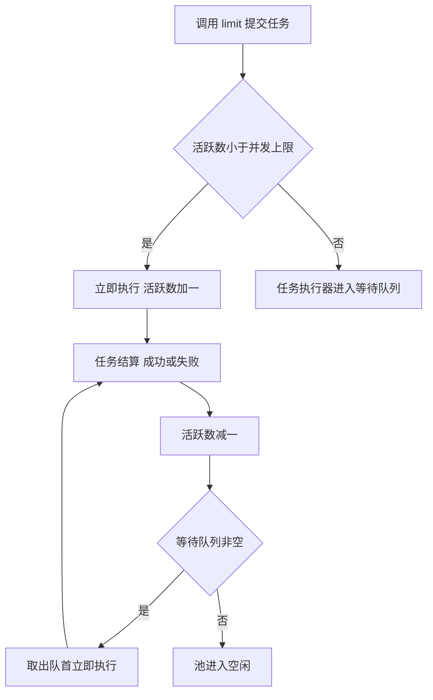

```javascript
function pLimit(concurrency) {
  if (!Number.isInteger(concurrency) || concurrency < 1) {
    throw new TypeError('concurrency 必须是正整数');
  }
  let activeCount = 0;
  const queue = [];

  const next = () => {
    activeCount -= 1;
    if (queue.length > 0) queue.shift()();
  };

  const run = (fn, resolve, reject) => {
    activeCount += 1;
    fn().then(resolve, reject).then(next); // 结算后释放槽位
  };

  return function limit(fn) {
    return new Promise((resolve, reject) => {
      const start = () => run(fn, resolve, reject);
      if (activeCount < concurrency) start();
      else queue.push(start);
    });
  };
}

const limit = pLimit(2);
const task = (id) => () =>
  new Promise((r) => setTimeout(() => {
    console.log('done', id);
    r(id);
  }, 100));

(async () => {
  const results = await Promise.all([1, 2, 3, 4, 5].map((i) => limit(task(i))));
  console.log('all', results); // done 输出永远两个一组
})();
```

### JS-091：如何用 AbortController 取消 fetch？级联取消怎么做？

**答**：
- `controller.signal` 传给 fetch，`controller.abort()` 后请求立即中断并抛 AbortError。
- 超时取消是最常见用法：定时器到点调 abort，注意 abort 可以携带原因。
- 级联取消：多个请求共享同一个 signal，主控制器 abort 一次全部中断。
- 取消后所有依赖该任务的 await 都会以 AbortError 结束，需要按 `e.name === 'AbortError'` 区分业务错误。

```javascript
// 1. 单个请求：超时取消
async function fetchWithTimeout(url, ms) {
  const controller = new AbortController();
  const timer = setTimeout(() => controller.abort(new DOMException('超时', 'TimeoutError')), ms);
  try {
    const res = await fetch(url, { signal: controller.signal });
    return await res.json();
  } catch (e) {
    if (e.name === 'AbortError') console.log('请求已取消');
    throw e;
  } finally {
    clearTimeout(timer);
  }
}

// 2. 级联取消：一个总开关控制一组请求
async function fetchAll(urls, budgetMs) {
  const parent = new AbortController();
  const timer = setTimeout(() => parent.abort(), budgetMs);
  try {
    return await Promise.all(
      urls.map((u) => fetch(u, { signal: parent.signal }).then((r) => r.json()))
    );
  } catch (e) {
    if (e.name === 'AbortError') console.log('整组请求被取消');
    throw e;
  } finally {
    clearTimeout(timer);
  }
}

// 3. 手动取消：用户切换页面时中断旧请求，避免过期响应覆盖新数据
let current;
function search(kw) {
  current?.abort();                    // 取消上一次
  current = new AbortController();
  return fetch(`/api?q=${kw}`, { signal: current.signal }).then((r) => r.json());
}
```

### JS-092：什么是微任务风暴？无限 then 链为什么会饿死渲染？

**答**：
- 事件循环要先把整个微任务队列清空才可能进入渲染与宏任务。
- 无限自我续接的 then 链会不停地向队首插入新微任务，队列永远不清空。
- 结果：页面冻结、点击无响应、rAF 与 setTimeout 全部无法执行。
- 解法：在分片处理中插入 `setTimeout`/`requestIdleCallback` 等宏任务，主动让出渲染机会。

```javascript
// 反面示例：微任务风暴 —— 页面会完全冻结
function microtaskStorm() {
  Promise.resolve().then(function loop() {
    return Promise.resolve().then(loop); // 每个 tick 又排入新微任务
  });
}
// microtaskStorm(); // 打开即冻结：同步 → 微任务 → 微任务 → ... 永远到不了渲染

// 同理：async 里的 await Promise.resolve() 也是微任务
async function storm2() {
  while (true) await Promise.resolve(); // 同样饿死渲染
}

// 正确做法：大计算分片，每片之间让出主线程
async function processInChunks(list, handler, size = 1000) {
  for (let i = 0; i < list.length; i += size) {
    list.slice(i, i + size).forEach(handler);
    // setTimeout 让出事件循环：渲染与输入事件得以处理
    await new Promise((r) => setTimeout(r, 0));
  }
}
processInChunks(Array(1e6).keys(), (i) => { /* 重计算 */ }, 10000);
```

### JS-093：什么是 thenable？自定义 thenable 对象有哪些行为与陷阱？

**答**：
- thenable：任何带 `then(resolve, reject)` 方法的对象，Promise 会递归展开它。
- resolve 状态锁定：then 内多次调用 resolve 只有第一次生效（Promise 状态不可逆）。
- 展开是异步的且会继续展开返回的 thenable，直到拿到普通值或抛错。
- 自引用 thenable 会触发原生 Promise 的死循环保护，reject 一个 TypeError。

```javascript
// 1. Promise 自动展开 thenable
const thenable = {
  then(resolve, reject) { setTimeout(() => resolve(42), 50); },
};
Promise.resolve(thenable).then((v) => console.log('展开得到', v)); // 42

// 2. 状态锁定：后续 resolve 全部无效
const multi = {
  then(resolve) {
    resolve(1);
    resolve(2);                          // 无效
    setTimeout(() => resolve(3), 0);     // 依旧无效
  },
};
Promise.resolve(multi).then((v) => console.log('只拿一次', v)); // 1

// 3. then 内抛错 → 整体 rejected
Promise.resolve({
  then(_resolve, reject) { reject(new Error('then 内报错')); },
}).catch((e) => console.log('捕获', e.message)); // then 内报错

// 4. 自引用 thenable：原生 Promise 有循环保护
const selfRef = {};
selfRef.then = (resolve) => resolve(selfRef); // resolve 自己 = 死循环
Promise.resolve()
  .then(() => selfRef)
  .catch((e) => console.log('保护触发', e instanceof TypeError)); // true
```

### JS-094：如何用 Promise 实现顺序依赖的 DAG 任务执行？

**答**：
- DAG：任务间有依赖关系但无环，被依赖者先完成，依赖者拿到它们的输出再执行。
- 关键技巧：递归 + Promise 缓存，每个节点的 Promise 只创建一次，被多个后继共享。
- `Promise.all(deps.map(exec))` 并行等待所有前置，天然让无依赖的分支并行。
- 缓存的是 Promise 而不是值，避免并发触发时重复执行同一任务。

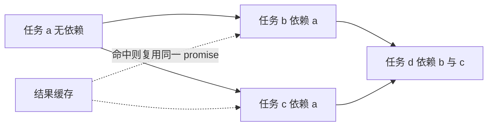

```javascript
const sleep = (ms) => new Promise((r) => setTimeout(r, ms));

// 任务图：a 无依赖；b、c 依赖 a；d 依赖 b 与 c
const graph = {
  a: () => sleep(100).then(() => 'A'),
  b: (a) => sleep(50).then(() => `B<-${a}`),
  c: (a) => sleep(80).then(() => `C<-${a}`),
  d: (b, c) => Promise.resolve(`${b} + ${c} => D`),
};

function runDAG(graph, deps) {
  const cache = {}; // 节点名 → 该节点的 Promise（单例）
  const exec = (name) => {
    if (name in cache) return cache[name];
    const p = Promise.all(deps[name].map(exec)) // 并行等待所有前置
      .then((args) => graph[name](...args));    // 前置结果作为参数
    cache[name] = p;
    return p;
  };
  return exec;
}

const deps = { a: [], b: ['a'], c: ['a'], d: ['b', 'c'] };
const exec = runDAG(graph, deps);
const t0 = Date.now();
exec('d').then((res) => console.log(res, `${Date.now() - t0}ms`));
// B<-A + C<-A => D，总耗时约 180ms 而非 230ms（b 与 c 并行）
```

### JS-095：异步迭代器与 for await...of 如何用于流处理？

**答**：
- 异步迭代器协议：对象实现 `[Symbol.asyncIterator]()`，返回 `{ next(): Promise<{value, done}> }`。
- `for await...of` 逐个 await 每一次 next，直到 done 为 true，天然匹配“数据逐步到达”的流。
- async generator（`async function*` + yield）是构造异步序列最简洁的方式。
- 中途 return/break 会自动调用 `iterator.return()`，适合做资源清理；Node 流、分页拉取都靠它。

```javascript
// async generator：模拟逐条到达的数据流
async function* numberStream(n) {
  for (let i = 1; i <= n; i++) {
    await new Promise((r) => setTimeout(r, 50)); // 模拟网络/IO 延迟
    yield i;
  }
}

(async () => {
  for await (const v of numberStream(3)) console.log('到达', v); // 1 2 3 逐个输出
})();

// 等价的手动消费
const it = numberStream(2);
it.next().then(({ value, done }) => console.log(value, done)); // 1 false

// 分页拉取的典型模式：一直取到没有下一页
async function* pagedFetch(path) {
  let page = 1;
  while (true) {
    const data = await Promise.resolve({ items: [page], hasMore: page < 3 }); // 模拟
    yield* data.items;
    if (!data.hasMore) return;
    page++;
  }
}
(async () => {
  const all = [];
  for await (const item of pagedFetch('/api/list')) all.push(item);
  console.log(all); // [1, 2, 3]
})();

// Node 流处理：for await (const chunk of readable) { ... }
// 中断时会自动调用 iterator.return 释放资源
```

## 十四、对象与元编程

### JS-096：属性描述符全解？get/set 与 value 为什么互斥？

**答**：
- 描述符分两类：数据描述符（value + writable）与访问器描述符（get + set），二者不能混合定义。
- 混用直接抛 TypeError；同一属性要么存值，要么走 getter/setter，不能两者兼得。
- enumerable 决定能否被 for-in/keys 枚举；configurable 为 false 后不能再改回，也不能删除。
- get/set 的 this 是访问属性的对象，可以借此实现“计算属性”或单向只读字段。

```javascript
const obj = {};

// 数据描述符：不可写、不可枚举、不可配置
Object.defineProperty(obj, 'value', {
  value: 1, writable: false, enumerable: false, configurable: false,
});
obj.value = 2;                              // 非严格模式静默失败
console.log(obj.value, Object.keys(obj));   // 1 [] — 不可枚举

// 访问器描述符：get/set
Object.defineProperty(obj, 'access', {
  get() { return this._v ?? 0; },
  set(v) { this._v = Math.max(0, v); },     // 借机做数据校验
  enumerable: true, configurable: true,
});
obj.access = -5;
console.log(obj.access); // 0 — setter 内的约束生效

// 互斥验证：get/set 与 value 混用直接抛 TypeError
try {
  Object.defineProperty(obj, 'bad', { get() {}, value: 1 });
} catch (e) {
  console.log(e instanceof TypeError); // true
}

// 查看描述符
console.log(Object.getOwnPropertyDescriptor(obj, 'access'));
// { get: f, set: f, enumerable: true, configurable: true } — 没有 value/writable
```

### JS-097：Object.defineProperty 与 Proxy 的拦截能力差在哪？

**答**：
- defineProperty 只能劫持“已存在的属性”的读写，监听不到新增属性、删除属性、数组索引赋值。
- Proxy 代理的是对象操作本身，新增/删除/has/枚举/函数调用全部可拦截（Vue3 弃用 defineProperty 的原因）。
- defineProperty 兼容性更好且性能开销更小；Proxy 无法 polyfill 到 ES5。
- defineProperty 改的是原对象，Proxy 返回代理对象，真实对象仍可被直接访问（要小心绕过）。

```javascript
// defineProperty：只针对"已有属性"
const legacy = { a: 1 };
Object.defineProperty(legacy, 'a', {
  get() { console.log('get a'); return 10; },
  set(v) { console.log('set a', v); },
});
legacy.a = 2;            // set a 2
legacy.b = 3;            // 新增属性：defineProperty 无法感知（Vue2 需要 $set）
console.log(legacy.b);   // 3 — 数据变了但拦截器没触发

// Proxy：拦截对象操作本身
const modern = new Proxy({ a: 1 }, {
  get(t, k, r)            { console.log('get', k); return Reflect.get(t, k, r); },
  set(t, k, v, r)         { console.log('set', k, v); return Reflect.set(t, k, v, r); },
  deleteProperty(t, k)    { console.log('delete', k); return Reflect.deleteProperty(t, k); },
});
modern.b = 1;    // set b 1 — 新增属性可拦截
delete modern.a; // delete a — 删除可拦截

// 数组差异
const arrProxy = new Proxy([], { set(t, k, v, r) { console.log('idx', k, v); return Reflect.set(t, k, v, r); } });
arrProxy[0] = 'x'; // idx 0 x — 数组索引赋值可拦截
```

### JS-098：Proxy 的 13 种 trap 怎么分类？常用组合是哪些？

**答**：
- 对象基本操作 6 个：get / set / has / deleteProperty / defineProperty / getOwnPropertyDescriptor。
- 原型与枚举 3 个：getPrototypeOf / setPrototypeOf / ownKeys（Object.keys、for-in 的底层）。
- 函数专属 3 个：apply / construct / 以及 targets 为函数时的调用拦截。
- 扩展控制 2 个：isExtensible / preventExtensions；13 种 trap 与 Reflect 的 13 个静态方法一一对应。

```javascript
const target = { a: 1 };
const handler = {
  // —— 基本操作 ——
  get(t, k, r)                { return Reflect.get(t, k, r); },            // p.k / p[k]
  set(t, k, v, r)             { return Reflect.set(t, k, v, r); },         // p.k = v
  has(t, k)                   { return Reflect.has(t, k); },               // 'a' in p
  deleteProperty(t, k)        { return Reflect.deleteProperty(t, k); },    // delete p.k
  defineProperty(t, k, d)     { return Reflect.defineProperty(t, k, d); }, // Object.defineProperty(p,...)
  getOwnPropertyDescriptor(t, k) { return Reflect.getOwnPropertyDescriptor(t, k); },
  // —— 原型与枚举 ——
  getPrototypeOf(t)           { return Reflect.getPrototypeOf(t); },       // Object.getPrototypeOf
  setPrototypeOf(t, p)        { return Reflect.setPrototypeOf(t, p); },
  ownKeys(t)                  { return Reflect.ownKeys(t); },              // Object.keys/for-in 底层
  // —— 函数专属：仅当 target 是函数时触发 ——
  apply(t, thisArg, args)     { return Reflect.apply(t, thisArg, args); }, // p()
  construct(t, args, nt)      { return Reflect.construct(t, args, nt); },  // new p()
  // —— 扩展控制 ——
  isExtensible(t)             { return Reflect.isExtensible(t); },         // Object.isExtensible
  preventExtensions(t)        { return Reflect.preventExtensions(t); },
};

const proxy = new Proxy(target, handler);
proxy.b = 2;
console.log('a' in proxy, Object.keys(proxy), Reflect.ownKeys(handler));

// 常用组合一：只读代理（set 与 deleteProperty 都抛错）
const readonly = new Proxy(target, {
  set() { throw new TypeError('只读对象'); },
  deleteProperty() { throw new TypeError('只读对象'); },
});

// 常用组合二：函数代理做日志/鉴权
const api = new Proxy(function rpc(path) { return `call ${path}`; }, {
  apply(t, thisArg, args) {
    console.log('调用前校验', args);
    return Reflect.apply(t, thisArg, args);
  },
});
console.log(api('/user')); // 调用前校验 ['/user'] → call /user
```

### JS-099：为什么 Proxy 内部必须配 Reflect？receiver 修正是关键

**答**：
- Proxy 的 trap 都带有 receiver 参数（最初发起访问的对象），Reflect 原样转发 receiver 才不丢信息。
- 若在 trap 里直接 `t[k]`，getter 的 this 会变成 target 而不是调用方，继承场景直接错乱。
- 典型场景：子类继承 Proxy 化的父类时，父 getter 读子类字段，只有 Reflect.get(t, k, receiver) 才能读到。
- Reflect 的方法与 trap 一一对应、返回值与操作语义一致（如 set 失败返回 false 而非抛错）。

```javascript
const parent = {
  get name() { return this._name ?? 'parent 默认值'; }, // getter 的 this 是关键
};
const child = Object.create(parent);
child._name = 'child 的值';

// 直接调用：getter 的 this 是 parent，读不到 child 的字段
console.log(Reflect.get(parent, 'name'));            // parent 默认值
// 传入 receiver：this 被修正为 child
console.log(Reflect.get(parent, 'name', child));     // child 的值

// 错误的 Proxy 写法：丢 receiver
const broken = new Proxy(parent, {
  get(t, k) { return t[k]; },                        // this 变成 t（parent）
});
const c1 = Object.create(broken);
c1._name = 'ok';
console.log(c1.name); // parent 默认值 — 错了

// 正确写法：Reflect 透传 receiver
const fixed = new Proxy(parent, {
  get(t, k, receiver) { return Reflect.get(t, k, receiver); },
});
const c2 = Object.create(fixed);
c2._name = 'ok';
console.log(c2.name); // ok — this 正确指向 c2
```

### JS-100：JSON.stringify 的高级用法有哪些？如何检测循环引用？

**答**：
- 处理顺序：toJSON 优先 → replacer 过滤/转换 → 按类型规则输出；undefined、函数、symbol 属性被忽略（数组中变 null）。
- replacer 数组是白名单（只保留指定 key）；replacer 函数对每个键值对调用，返回 undefined 表示丢弃。
- 第三个参数 space 控制缩进；NaN/Infinity 序列化为 null；BigInt 直接抛 TypeError。
- 循环引用原生会抛 TypeError，可在 replacer 里用 WeakSet 记录祖先对象实现“标记后继续”。

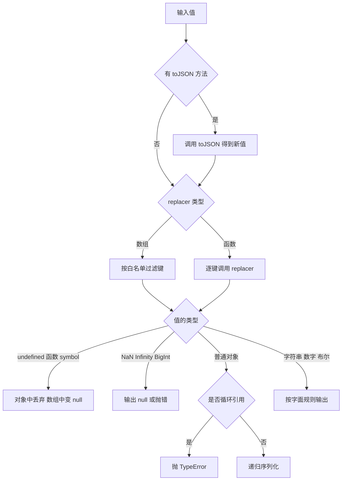

```javascript
const data = {
  name: 'x',
  toJSON() { return { name: 'serialized' }; }, // 1. toJSON 优先生效
  secret: Symbol('s'),                          // 2. symbol 属性被忽略
  fn: () => {},                                 // 3. 函数被忽略
  und: undefined,                               // 4. undefined 被忽略
  date: new Date(0),                            // 5. Date 自带 toJSON → ISO 字符串
};

console.log(JSON.stringify(data));
// {"name":"serialized","date":"1970-01-01T00:00:00.000Z"}

// replacer 数组：白名单（toJSON 之后的结果也要有该键）
console.log(JSON.stringify(data, ['name', 'date']));
// {"name":"serialized","date":"1970-01-01T00:00:00.000Z"}

// replacer 函数：首参是 key（根调用为空串），返回 undefined 即丢弃
console.log(JSON.stringify({ a: 1, b: 'hide' }, (k, v) => (k === 'b' ? undefined : v)));
// {"a":1}

// 循环引用检测：WeakSet 记录祖先，遇到重复即标记
function safeStringify(obj, space = 0) {
  const seen = new WeakSet();
  return JSON.stringify(obj, function (key, value) {
    if (typeof value === 'object' && value !== null) {
      if (seen.has(value)) return '[Circular]'; // 也可以直接抛出与原生一致
      seen.add(value);
    }
    return value;
  }, space);
}
const cyc = { self: null, arr: [] };
cyc.self = cyc; cyc.arr.push(cyc);
console.log(safeStringify(cyc)); // {"self":"[Circular]","arr":["[Circular]"]}
```

### JS-101：对象遍历方式有哪些？性能与语义差在哪？

**答**：
- for-in：含原型链上的可枚举字符串键，最“宽”也最慢，通常需要 hasOwnProperty 过滤。
- Object.keys/values/entries：仅自身可枚举字符串键，最常用。
- getOwnPropertyNames / getOwnPropertySymbols / Reflect.ownKeys：逐步扩大到不可枚举键与 symbol 键。
- 性能：keys 系列只走自身属性最快；for-in 需遍历整条原型链；entries 返回键值对免二次取值。

```javascript
const sym = Symbol('hidden');
const proto = { inherited: '来自原型' };
const obj = Object.create(proto);
Object.assign(obj, { a: 1, b: 2, [sym]: 'symbol 值' });
Object.defineProperty(obj, 'hidden', { value: 4, enumerable: false }); // 不可枚举

// 1. for-in：含原型链，不含 symbol 与不可枚举
for (const k in obj) console.log('for-in:', k); // a b inherited

// 2. keys/values/entries：仅自身可枚举字符串键
console.log(Object.keys(obj));    // ['a', 'b']
console.log(Object.entries(obj)); // [['a', 1], ['b', 2]] — 直接解构，免二次取值

// 3. 拿"全部"自身键
console.log(Object.getOwnPropertyNames(obj));    // ['a', 'b', 'hidden'] 含不可枚举
console.log(Object.getOwnPropertySymbols(obj));  // [Symbol(hidden)]
console.log(Reflect.ownKeys(obj));               // names + symbols 全集

// 4. for-of 直接迭代数组/Map/Set，语义与对象遍历不同
for (const [k, v] of Object.entries(obj)) console.log(k, '=', v);

// 经验法则：纯数据遍历用 entries；要防原型污染用 Object.create(null) 或 hasOwnProperty
console.log(Object.prototype.hasOwnProperty.call(obj, 'a')); // true
```

### JS-102：前端有哪些不可变性策略？freeze 与结构共享怎么理解？

**答**：
- Object.freeze 是浅冻结：只冻结第一层，嵌套对象仍可修改；递归 deepFreeze 才能完全只读。
- Immutable 思想：不原地修改，每次变更返回新对象，旧引用保持不变（时间旅行、React 比较优化都依赖它）。
- 结构共享：变更路径上的节点才复制，未变化的兄弟分支直接复用引用，避免整棵深拷贝。
- 工程实践：浅层用展开运算符，深层用 Immer（写时按需 copy-on-write）。

```javascript
// 1. 浅 freeze 的坑
const state = Object.freeze({ user: { name: 'a' } });
state.user.name = 'b';            // 嵌套对象没被冻结
console.log(state.user.name);     // b — 改成功了
// state.name = 'x' 会静默失败（严格模式抛错）

// 2. 递归冻结
function deepFreeze(obj) {
  if (obj && typeof obj === 'object' && !Object.isFrozen(obj)) {
    Object.freeze(obj);
    for (const v of Object.values(obj)) deepFreeze(v);
  }
  return obj;
}
deepFreeze(state);
try { state.user.name = 'c'; } catch (e) {
  console.log('冻结生效', e instanceof TypeError); // 严格模式 true
}

// 3. Immutable 思想：返回新对象，旧引用不动
const v1 = { list: [1, 2, 3], meta: { count: 3 } };
const v2 = { ...v1, list: [...v1.list, 4] };     // 只复制变更路径
console.log(v1.list.length, v2.list.length);     // 3 4
console.log(v1.meta === v2.meta);                // true — 结构共享：meta 被复用

// 4. 数组的不可变更新
const nextList = v1.list.map((n) => (n === 2 ? 99 : n)); // map/filter/concat 天然不可变
console.log(v1.list, nextList); // [1,2,3] [1,99,3]
```

## 十五、函数式编程

### JS-103：什么是纯函数？副作用如何治理？

**答**：
- 纯函数：相同输入永远产生相同输出，且不产生可观察的副作用（不改参数、不动全局、不碰 IO）。
- 常见副作用：修改外部变量与参数、Math.random、Date.now、DOM/API 调用、console。
- 治理思路：把副作用“推到边界”——核心计算保持纯函数，IO 与状态变更集中在最后一步。
- 副作用通过依赖注入变得可测：把随机源、时钟作为参数传入。

```javascript
// 不纯：依赖并修改外部状态
let total = 0;
function addToTotal(n) { total += n; return total; } // 同样输入结果不同

// 纯：只依赖入参
const add = (a, b) => a + b;

// 副作用治理：核心逻辑纯化，副作用集中到边界
function calculateDiscount(price, user) {          // 纯计算，可随意测试
  return user.vip ? price * 0.8 : price;
}
function applyDiscount(cart) {                     // 副作用仅在"组装新对象"这一步
  return { ...cart, price: calculateDiscount(cart.price, cart.user) };
}

// 参数可变性也是副作用：不要原地改
const badSort = (arr) => arr.sort();               // sort 会改原数组！
const goodSort = (arr) => [...arr].sort();         // 拷贝后再排

// 随机/时间这类天然副作用：依赖注入后即可测试
const rollDice = (random = Math.random) => Math.floor(random() * 6) + 1;
console.log(rollDice(() => 0.99)); // 6 — 测试时结果可预测
const todayISO = (now = new Date) => now.toISOString().slice(0, 10); // 时钟注入
```

### JS-104：如何实现函数组合 compose 与管道 pipe？有哪些应用场景？

**答**：
- compose：从右到左执行，`compose(f, g)(x) = f(g(x))`，数学风格。
- pipe：从左到右执行，与数据流向一致，可读性更好，前端更常用。
- 实现：`reduce`（pipe）或 `reduceRight`（compose）串联函数。
- 场景：数据清洗链、表单校验链、中间件、状态转换（Redux reducer 前置处理）。

```javascript
const compose = (...fns) => (x) => fns.reduceRight((acc, fn) => fn(acc), x);
const pipe = (...fns) => (x) => fns.reduce((acc, fn) => fn(acc), x);

// 数据清洗链：每一步都是单一职责的纯函数
const trim    = (s) => s.trim();
const toLower = (s) => s.toLowerCase();
const wrap    = (s) => `<p>${s}</p>`;

const normalize = pipe(trim, toLower, wrap);
console.log(normalize('  Hello World  ')); // <p>hello world</p>
console.log(compose(wrap, toLower, trim)('  Hi  ')); // <p>hi</p>

// 增强版：支持第一个函数多参数
const pipeN = (...fns) => (...args) =>
  fns.reduce((acc, fn, i) => (i === 0 ? fn(...acc) : fn(acc)), args);
const pow = (a, b) => a ** b;
const double = (n) => n * 2;
console.log(pipeN(pow, double)(2, 3)); // 18

// 异步管道：每个环节允许返回 Promise
const pipeAsync = (...fns) => (x) =>
  fns.reduce((p, fn) => p.then(fn), Promise.resolve(x));
pipeAsync(
  () => Promise.resolve('user-1'),
  (id) => Promise.resolve({ id, name: 'tom' }),
  (u) => u.name.toUpperCase()
).then(console.log); // TOM
```

### JS-105：函子是什么？Maybe 与 Either 如何做错误处理？（简化版）

**答**：
- 函子：实现了 `map` 且持有值的容器，map 对内部值应用函数后返回新容器，不拆箱。
- Maybe：包装可能为空的值，空值时 map 直接跳过——把判空逻辑集中到容器里。
- Either：Left 表示错误、Right 表示成功，错误发生时 map 自动短路，最后用 fold 统一分支。
- 价值：错误处理从"散落的 if/try"变成"可组合的数据流"。

```javascript
// Maybe：处理 null / undefined
class Maybe {
  static of(x) { return new Maybe(x); }
  constructor(x) { this._value = x; }
  map(fn) { return this._value == null ? this : Maybe.of(fn(this._value)); }
  getOrElse(dv) { return this._value == null ? dv : this._value; }
}

const user = { address: null };
const city = Maybe.of(user.address)          // null
  .map((a) => a.city)                        // 空值自动跳过
  .map((c) => c.toUpperCase())
  .getOrElse('UNKNOWN');
console.log(city); // UNKNOWN — 没有任何 if 判断

// Either：区分错误与成功两条流水线
class Left {
  constructor(v) { this._value = v; }
  map() { return this; }                     // 错误继续传递，跳过计算
  fold(onLeft, _onRight) { return onLeft(this._value); }
}
class Right {
  constructor(v) { this._value = v; }
  map(fn) { return new Right(fn(this._value)); }
  fold(_onLeft, onRight) { return onRight(this._value); }
}
const Either = { of: (x) => new Right(x), left: (x) => new Left(x) };

const parseJSON = (s) => {
  try { return Either.of(JSON.parse(s)); }
  catch (e) { return Either.left(`解析失败: ${e.message}`); }
};
parseJSON('{"a":1}').fold(
  (err) => console.log('失败', err),
  (v) => console.log('成功', v.a)   // 成功 1
);
parseJSON('{bad}').fold(
  (err) => console.log('失败', err), // 失败 解析失败: ...
  (v) => console.log(v)
);
```

### JS-106：柯里化与部分应用的区别是什么？各有什么应用场景？

**答**：
- 柯里化：`f(a,b,c) → f(a)(b)(c)`，每次只吃一个参数，攒满形参个数才执行。
- 部分应用：一次固定任意个参数，返回等待剩余参数的函数，不要求逐个传递。
- 判定方法：`curry(f)(1,2)(3)` 与 `curry(f)(1)(2,3)` 都合法的是"宽松柯里化"。
- 场景：柯里化适合生成通用工具族（`match(reg)(str)`）；部分应用适合"配置固定后复用"。

```javascript
// 柯里化（宽松版：参数攒够才执行）
const curry = (fn) => {
  const curried = (...args) =>
    args.length >= fn.length ? fn(...args) : (...rest) => curried(...args, ...rest);
  return curried;
};
const add3 = (a, b, c) => a + b + c;
console.log(curry(add3)(1)(2)(3));   // 6
console.log(curry(add3)(1, 2)(3));   // 6 — 支持一次传多个

// 部分应用：固定任意前缀参数
const partial = (fn, ...preset) => (...rest) => fn(...preset, ...rest);
const request = (token, method, url) => `${method} ${url} token=${token}`;
const apiGet = partial(request, 'tk-001', 'GET');
console.log(apiGet('/api/user')); // GET /api/user token=tk-001

// 柯里化的典型场景：生成一组语义化工具
const match = curry((reg, s) => reg.test(s));
const hasSpace = match(/\s/);
const hasNumber = match(/\d/);
console.log(hasSpace('a b'), hasNumber('abc')); // true false

// 两者结合：curry 后先吃掉配置参数，就是"惰性部分应用"
const log = curry((level, tag, msg) => console.log(`[${level}][${tag}] ${msg}`));
const warnNet = log('WARN', 'network');
warnNet('timeout 3s'); // [WARN][network] timeout 3s
```

### JS-107：如何实现带 TTL 与容量上限的记忆化？

**答**：
- 基础记忆化：Map 以 `keyFn(args)` 为键缓存返回值，命中直接返回。
- TTL：记录写入时间戳，超过有效期作废重算，适合 token、配置等会过期的数据。
- 容量上限：超出 max 时按 Map 插入序淘汰最旧条目（简易 LRU 语义）。
- 异步函数注意：失败的结果不能缓存，Promise reject 后要清除对应缓存键。

```javascript
function memoize(fn, { ttl = Infinity, max = 100, keyFn = (args) => JSON.stringify(args) } = {}) {
  const cache = new Map(); // key → { value, expire }
  return function (...args) {
    const key = keyFn(args);
    const now = Date.now();
    const hit = cache.get(key);
    if (hit && (hit.expire === Infinity || now < hit.expire)) return hit.value;
    if (hit) cache.delete(key); // 过期条目清理

    const value = fn.apply(this, args);
    cache.set(key, { value, expire: ttl === Infinity ? Infinity : now + ttl });

    if (cache.size > max) cache.delete(cache.keys().next().value); // 淘汰最旧

    // 异步函数：失败不缓存，避免错误被"记住"
    if (value && typeof value.then === 'function') {
      value.catch(() => cache.delete(key));
    }
    return value;
  };
}

let calls = 0;
const getUser = memoize(
  async (id) => { calls++; return { id, at: Date.now() }; },
  { ttl: 500, max: 10 }
);

(async () => {
  const a = await getUser(1);
  const b = await getUser(1);        // 命中缓存
  console.log(a === b, calls);       // true 1
  await new Promise((r) => setTimeout(r, 600));
  await getUser(1);                  // TTL 过期重算
  console.log(calls);                // 2
})();
```

### JS-108：如何用 generator 实现惰性求值？

**答**：
- 惰性求值：只在被消费时才计算下一个元素，无穷序列因此可行。
- generator 的 yield 天然是"暂停点"，配合 for-of / 解构只拉动需要的部分。
- 惰性 map/filter/take 链条与数组版 API 同构，但中间结果从不落地。
- 对比：`arr.map().filter()` 会产生中间数组；惰性版本全程只有一个"当前元素"。

```javascript
function* fib() {
  let [a, b] = [0, 1];
  while (true) { yield a; [a, b] = [b, a + b]; } // 无穷序列
}

// 惰性集合操作：只在被拉动时计算
function* lazyMap(iter, fn)        { for (const v of iter) yield fn(v); }
function* lazyFilter(iter, pred)   { for (const v of iter) if (pred(v)) yield v; }
function* take(iter, n) {
  let i = 0;
  for (const v of iter) { if (i++ >= n) return; yield v; }
}

// 链式组合：斐波那契 ×10 后取能被 3 整除的前 3 个
const fibs = fib();
const pipeline = take(
  lazyFilter(lazyMap(fibs, (x) => x * 10), (x) => x % 3 === 0),
  3
);
console.log([...pipeline]); // [0, 30, 210] — 计算到第 11 项即停，不会无限跑

// 与急切求值对比：数组版必须先物化无穷数组，直接栈溢出/死循环
// [...fib()] ← 千万不要这么写

// 惰性分页的另一种用法：需要几页取几页
function* pages(fetchPage) {
  let p = 1;
  while (true) yield fetchPage(p++);
}
// take(pages(fetch), 2) 就只请求两页
```

## 十六、类型系统与运行时

### JS-109：`[] + {}` 系列经典隐式转换输出题全解

**答**：
- `+` 的规则：任一操作数是字符串或对象转出字符串 → 拼接；否则双方 ToNumber 后相加。
- 对象转原始值：无 hint 时先 valueOf 后 toString；数组 toString 是 join(',')。
- 特殊点：`{} + []` 在语句开头时 `{}` 被解析为空代码块，实际执行的是一元 `+[]` 得 0。
- `==` 比较时双方都转原始值再比；null 只与 undefined 宽松相等，NaN 与任何值都不等。

```javascript
console.log([] + []);  // ''          — [].toString() 是空串
console.log([] + {});  // '[object Object]' — {} toString
console.log({} + {});  // '[object Object][object Object]'
console.log({} + []);  // 表达式位置：'[object Object]'
// 陷阱：控制台里单独一行输入 {} + [] 输出 0！
// 因为行首 {} 被当作空块语句，真正执行的是一元 +[]，[] → '' → ToNumber → 0

console.log(1 + true);       // 2    — ToNumber(true) = 1
console.log('5' + 2);        // '52' — 有字符串走拼接
console.log('5' - 2);        // 3    — 减号只有数字语义
console.log(true + [1, 2]);  // 'true1,2' — [1,2].toString() = '1,2'
console.log([1] + [2]);      // '12'

console.log([] == false);    // true  — '' == false → 0 == 0
console.log([1] == 1);       // true  — '1' == 1
console.log(['0'] == false); // true  — '0' → 0，false → 0
console.log(null == undefined); // true  — 规范规定的唯一特例
console.log(null == 0, undefined == 0); // false false — null/undefined 只互相相等
console.log(NaN == NaN, NaN !== NaN);    // false true
```

### JS-110：Symbol 有哪些实战场景？

**答**：
- 伪私有属性：symbol 键不进入 Object.keys/for-in/JSON，外部“看不见”但反射仍可获取（非真私有）。
- 常量枚举：避免字符串值撞车，任何两个 Symbol 都不相等。
- 全局注册表：`Symbol.for(key)` 跨模块/跨 iframe 共享同一个 symbol，`Symbol.keyFor` 反查。
- 元编程钩子：`Symbol.toPrimitive`、`Symbol.iterator`、`Symbol.asyncIterator` 等注入语言行为。

```javascript
// 1. 伪私有属性
const _balance = Symbol('balance');
class Account {
  constructor(v) { this[_balance] = v; }
  get balance() { return this[_balance]; }
}
const acc = new Account(100);
console.log(Object.keys(acc));                  // [] — 常规枚举不可见
console.log(JSON.stringify(acc));               // {}
console.log(Object.getOwnPropertySymbols(acc)); // [Symbol(balance)] — 反射仍可拿到

// 2. 常量枚举：永不撞车
const Color = Object.freeze({
  RED: Symbol('red'),
  BLUE: Symbol('blue'),
});
console.log(Color.RED === Color.RED, Color.RED === Symbol('red')); // true false

// 3. 全局注册表：跨模块共享
const s1 = Symbol.for('app:theme');
const s2 = Symbol.for('app:theme');
console.log(s1 === s2, Symbol.keyFor(s1)); // true 'app:theme'

// 4. 元编程：自定义类型转换
const size = {
  [Symbol.toPrimitive](hint) {
    return hint === 'number' ? 42 : '42px';
  },
};
console.log(+size, `${size}`, size + ''); // 42 42px 42px
```

### JS-111：BigInt 如何用于金额处理？有哪些限制？

**答**：
- Number 的安全整数上限是 2^53-1，超过即精度丢失，金额/ID 大数必须用 BigInt。
- BigInt 只能表示整数，除法向零截断；金额应先统一转“最小单位（分）”的 BigInt 再运算。
- BigInt 与 Number 不能混算（抛 TypeError），需显式 BigInt()/Number() 转换。
- JSON.stringify 不支持 BigInt，序列化前要转字符串；展示时再做格式化。

```javascript
console.log(Number.MAX_SAFE_INTEGER); // 9007199254740991
console.log(9007199254740993 === 9007199254740992); // true — 精度丢失！
const big = 9007199254740993n;
console.log(big + 1n === 9007199254740994n); // true — BigInt 精确

// 混算限制
try { big + 1; } catch (e) { console.log(e instanceof TypeError); } // true
console.log(big + BigInt(1)); // 9007199254740994n

// 金额计算：以"分"为单位的 BigInt，展示时转字符串
function fenToYuan(fen) {
  const sign = fen < 0n ? '-' : '';
  const abs = fen < 0n ? -fen : fen;
  return `${sign}${abs / 100n}.${String(abs % 100n).padStart(2, '0')}`;
}
console.log(fenToYuan(123456789012345678n)); // 1234567890123456.78

// 除法截断：必须先统一单位
console.log(1n / 2n); // 0n — 不是 0.5n

// JSON 序列化：先转字符串
const order = { id: big, amountFen: '123456789012345678' };
console.log(JSON.stringify(order));
```

### JS-112：数值精度问题全解？toFixed 有什么陷阱？

**答**：
- 根源：IEEE 754 双精度用二进制存小数，0.1、0.2 都是无理近似，相加出现 0.30000000000000004。
- toFixed 按二进制近似值四舍五入：`(1.005).toFixed(2)` 得 '1.00'，不是 '1.01'。
- 安全整数：`Number.isSafeInteger` 判断是否在 ±(2^53-1) 内，超范围运算结果不可信。
- 修约方案：先放大为整数运算再缩回；或引入 Number.EPSILON 修正；重场景用 decimal.js/big.js。

```javascript
console.log((0.1 + 0.2) === 0.3);      // false
console.log((0.1 + 0.2).toFixed(20));  // 0.30000000000000004441
console.log((1.005).toFixed(2));       // 1.00 — 二进制里 1.005 略小于 1.005
console.log(Number.EPSILON);           // 2.220446049250313e-16 — 最小相对精度

// 整数安全
console.log(Number.isSafeInteger(2 ** 53));     // false
console.log(Number.isSafeInteger(2 ** 53 - 1)); // true

// 方案一：EPSILON 修正的修约
function roundTo(num, digits = 2) {
  const p = 10 ** digits;
  return Math.round((num + Number.EPSILON * Math.abs(num)) * p) / p;
}
console.log(roundTo(1.005, 2));      // 1.01
console.log(roundTo(0.1 + 0.2, 2));  // 0.3

// 方案二：decimal 思想 —— 转整数运算
function addDecimal(a, b) {
  const la = (String(a).split('.')[1] || '').length;
  const lb = (String(b).split('.')[1] || '').length;
  const p = 10 ** Math.max(la, lb);
  return (Math.round(a * p) + Math.round(b * p)) / p;
}
console.log(addDecimal(0.1, 0.2));   // 0.3
console.log(addDecimal(19.9, 0.1));  // 20
// 生产建议：金额一律用整数分存储 + BigInt，或直接上 decimal.js
```

### JS-113：toString 与 valueOf 的调用顺序是什么？

**答**：
- ToPrimitive 流程：先看 `Symbol.toPrimitive(hint)`；没有则按 hint 走——number 型先 valueOf 后 toString，string 型相反。
- 无 hint 的默认场景（`+`、`==`）：普通对象按 number 型顺序（先 valueOf）；Date 是特例，先 toString。
- valueOf 返回原始值即止；返回对象则继续调 toString；两者都返回对象才抛 TypeError。
- 记忆：`String(obj)`/模板串走 toString；`Number(obj)`/算术走 valueOf 优先。

```javascript
const obj = {
  valueOf()  { console.log('→ valueOf');  return 10; },
  toString() { console.log('→ toString'); return 'obj'; },
};

console.log(obj + 1);       // valueOf → 11（默认 hint，先 valueOf）
console.log(`${obj}`);      // toString → 'obj'（hint string）
console.log(String(obj));   // toString → 'obj'
console.log(Number(obj));   // valueOf → 10
console.log(obj == 10);     // valueOf → true
console.log(obj + '');      // valueOf → '10'（+ 默认仍是先 valueOf）

// Symbol.toPrimitive 优先级最高
const obj2 = {
  [Symbol.toPrimitive](hint) { return hint === 'string' ? 'str' : 'num'; },
  valueOf() { return 1; },
  toString() { return '2'; },
};
console.log(`${obj2}`, obj2 + 1); // str num

// Date 特例：默认 hint 先 toString
const d = new Date(0);
console.log(d + '');    // 'Thu Jan 01 1970 08:00:00 GMT+0800 ...'
console.log(Number(d)); // 0

// 都不返回原始值 → TypeError
const bad = { valueOf: () => ({}), toString: () => ({}) };
try { bad + 1; } catch (e) { console.log(e instanceof TypeError); } // true
```

### JS-114：WeakRef 与 FinalizationRegistry 的用途与边界？

**答**：
- WeakRef 持有对象的弱引用，`deref()` 在对象存活时返回它、被回收后返回 undefined。
- FinalizationRegistry 在对象被 GC 后回调注册的清理函数，可携带一个 heldValue 标识。
- 硬边界：GC 时机不确定且回调自身不保证及时运行，绝不能用于业务正确性逻辑。
- 缓存场景优先 WeakMap/WeakSet；WeakRef 只适合"大对象缓存失效后自动释放"这类优化。

```javascript
let target = { data: new Array(1e6).fill('x') };

const ref = new WeakRef(target);
const registry = new FinalizationRegistry((held) => {
  console.log('对象已回收，清理登记项：', held); // 时机不保证，仅做资源提示
});
registry.register(target, 'big-cache-entry');

console.log(ref.deref()?.data.length); // 1000000 — 还活着

// 解除强引用后，GC 随时可能回收
target = null;
setTimeout(() => {
  console.log('回收后 deref：', ref.deref()); // 可能是 undefined，也可能还没被回收
}, 100);

// 边界总结：
// 1. 不能用 deref 结果判断"是否已回收"——deref 本身会短暂复活引用
// 2. FinalizationRegistry 回调运行在 JS 里，清理逻辑本身也可能被 GC 拖延
// 3. WeakMap 不能遍历、WeakRef 不能可靠探测，都是"给 GC 的提示"而非控制手段
// 4. 正确姿势：缓存挂 WeakMap，注册表只用于关闭文件句柄等资源提示
```

## 十七、浏览器交互与存储

### JS-115：如何实现一个完整的 localStorage 封装？

**答**：
- 必备能力：命名空间前缀防冲突、JSON 序列化安全、TTL 过期、写满降级、跨页同步。
- 过期策略：value 包一层 `{ value, expire }`，读取时判断时间戳，过期即删并返回 null。
- `storage` 事件只在“其他”标签页触发（本页写入不触发本页监听），是跨页通信的标准通道。
- 容量超限（QuotaExceededError）要做淘汰或提示，序列化损坏要安全降级为 null。

```javascript
const store = {
  prefix: 'app:',
  _key(k) { return this.prefix + k; },

  set(key, value, expireMs = 0) {
    const item = { value, expire: expireMs ? Date.now() + expireMs : 0 };
    try {
      localStorage.setItem(this._key(key), JSON.stringify(item));
    } catch (e) {
      if (e.name === 'QuotaExceededError') {
        this._evictExpired();               // 先清本前缀的过期项再试一次
        try { localStorage.setItem(this._key(key), JSON.stringify(item)); } catch {}
      }
    }
  },

  get(key) {
    const raw = localStorage.getItem(this._key(key));
    if (raw === null) return null;
    try {
      const { value, expire } = JSON.parse(raw);
      if (expire && Date.now() > expire) { this.remove(key); return null; }
      return value;
    } catch {
      this.remove(key);                     // 数据损坏安全降级
      return null;
    }
  },

  remove(key) { localStorage.removeItem(this._key(key)); },

  _evictExpired() {
    for (let i = localStorage.length - 1; i >= 0; i--) {
      const k = localStorage.key(i);
      if (!k.startsWith(this.prefix)) continue;
      try {
        const { expire } = JSON.parse(localStorage.getItem(k));
        if (expire && Date.now() > expire) localStorage.removeItem(k);
      } catch { localStorage.removeItem(k); }
    }
  },
};

store.set('theme', 'dark');
store.set('token', 'abc', 60_000);          // 1 分钟过期
console.log(store.get('theme'));            // 'dark'

// 跨页同步：只在其他标签页触发
window.addEventListener('storage', (e) => {
  if (e.key === 'app:theme') {
    console.log('其他页面改了主题：', e.oldValue, '→', e.newValue);
  }
});
```

### JS-116：如何封装 cookie 操作？哪些安全属性必须掌握？

**答**：
- document.cookie 是字符串接口，读写都要 encodeURIComponent 防注入与特殊字符问题。
- 删除 = 设置一个已过期的 expires；domain/path 必须与写入时一致才能删干净。
- 安全三件套：HttpOnly（JS 读不到，XSS 防护）、Secure（仅 HTTPS 传输）、SameSite（CSRF 防护）。
- HttpOnly 只能由服务端 Set-Cookie 设置，前端封装永远管不到它。

```javascript
const cookie = {
  set(name, value, { days = 7, path = '/', domain, secure = true, sameSite = 'Lax' } = {}) {
    const exp = new Date(Date.now() + days * 864e5).toUTCString();
    let s = `${encodeURIComponent(name)}=${encodeURIComponent(value)}`
          + `; expires=${exp}; path=${path}; SameSite=${sameSite}`;
    if (domain) s += `; domain=${domain}`;
    if (secure) s += '; Secure';
    document.cookie = s; // 注意：一次只能写一个 cookie
  },

  get(name) {
    const prefix = encodeURIComponent(name) + '=';
    const found = document.cookie
      .split('; ')
      .find((c) => c.startsWith(prefix));
    // value 里可能含编码后的 '='，所以要按第一个 = 切
    return found ? decodeURIComponent(found.slice(prefix.length)) : null;
  },

  remove(name, path = '/') { this.set(name, '', { days: -1, path }); },
};

cookie.set('token', 'a=b&c', { days: 1 });
console.log(cookie.get('token')); // a=b&c
cookie.remove('token');

// SameSite 取值：
// Strict  — 完全禁止第三方携带（跳转过来也没有，体验有坑）
// Lax     — 默认值，顶级导航 GET 请求携带，其他第三方不带
// None    — 允许跨站携带，必须同时 Secure
console.log(document.cookie); // HttpOnly 的 cookie 不会出现在这里
```

### JS-117：如何实现 promise 化的 IndexedDB 简易封装？

**答**：
- IndexedDB 全程事件回调风格，封装思路：request 包 Promise，事务包函数。
- open 三件套：`onupgradeneeded` 建库建索引、`onsuccess` 拿 db、`onerror` 拿错误。
- 事务生命周期：事务在创建时就要声明读写模式，且离开事件循环后无法再挂请求。
- 所有异步操作统一走 `requestToPromise`，业务代码即可全部 async/await。

```javascript
function openDB(name, version, upgrade) {
  return new Promise((resolve, reject) => {
    const req = indexedDB.open(name, version);
    req.onupgradeneeded = (e) => upgrade(req.result, e); // 仅版本变化时触发
    req.onsuccess = () => resolve(req.result);
    req.onerror = () => reject(req.error);
  });
}

const toPromise = (req) => new Promise((resolve, reject) => {
  req.onsuccess = () => resolve(req.result);
  req.onerror = () => reject(req.error);
});

class IDBStore {
  constructor(db, storeName) { this.db = db; this.name = storeName; }

  _tx(mode, fn) {
    const tx = this.db.transaction(this.name, mode);
    return fn(tx.objectStore(this.name));
  }

  put(value, key)  { return toPromise(this._tx('readwrite', (s) => s.put(value, key))); }
  get(key)         { return toPromise(this._tx('readonly',  (s) => s.get(key))); }
  delete(key)      { return toPromise(this._tx('readwrite', (s) => s.delete(key))); }
  getAll()         { return toPromise(this._tx('readonly',  (s) => s.getAll())); }
}

(async () => {
  const db = await openDB('demo', 1, (db) => {
    if (!db.objectStoreNames.contains('kv')) db.createObjectStore('kv'); // 主键即 key
  });
  const users = new IDBStore(db, 'kv');
  await users.put({ name: 'tom', vip: true }, 'u-1');
  console.log(await users.get('u-1'));    // { name: 'tom', vip: true }
  console.log(await users.getAll());
  await users.delete('u-1');
})();
```

### JS-118：如何实现剪贴板复制？Clipboard API 与 execCommand 如何降级？

**答**：
- 优先 `navigator.clipboard.writeText`：异步、无 DOM 污染，但要求安全上下文（HTTPS/localhost）且页面获得焦点。
- 降级方案：临时 textarea + `document.execCommand('copy')`，API 已废弃但兼容性最广。
- 降级细节：textarea 必须存在、不可见、有选中内容；调用前同步选区，调用后立即清理。
- 读取剪贴板（readText）需要用户授权，失败要按 NotAllowedError 分类提示。

```javascript
async function copyText(text) {
  // 1. 现代 API
  if (navigator.clipboard && window.isSecureContext) {
    try {
      await navigator.clipboard.writeText(text);
      return true;
    } catch { /* 权限拒绝或环境限制 → 降级 */ }
  }
  // 2. 降级：execCommand
  const ta = document.createElement('textarea');
  ta.value = text;
  ta.setAttribute('readonly', '');
  ta.style.cssText = 'position:fixed;top:0;left:0;opacity:0;pointer-events:none';
  document.body.appendChild(ta);
  ta.select();
  ta.setSelectionRange(0, text.length); // iOS Safari 需要
  let ok = false;
  try {
    ok = document.execCommand('copy'); // 同步执行，返回是否成功
  } catch { ok = false; }
  ta.remove();
  return ok;
}

copyText('hello clipboard').then((ok) => console.log(ok ? '已复制' : '复制失败'));

// 读取剪贴板（需要用户手势与授权）
async function pasteFromClipboard() {
  try {
    return await navigator.clipboard.readText();
  } catch (e) {
    if (e.name === 'NotAllowedError') console.log('用户拒绝了授权');
    return null;
  }
}
```

### JS-119：URLSearchParams 的用法与手写 query 处理工具

**答**：
- URLSearchParams 自动处理编码解码、`+` 号空格、重复键，比 split('&') 手写解析健壮得多。
- get 取第一个值，getAll 取全部，has 判断存在（无值键返回空串）。
- toString 输出时自动编码，可直接拼到 url 后面；空值/undefined 过滤要在构建前做。
- `location.search` 只含 `?` 后部分；hash 路由时要自行解析 hash 中的 query。

```javascript
const qs = new URLSearchParams('a=1&a=2&name=%E5%BC%A0%E4%B8%89&flag');
console.log(qs.get('a'));     // '1'  — 只取第一个
console.log(qs.getAll('a'));  // ['1', '2']
console.log(qs.has('flag'));  // true
console.log(qs.get('flag'));  // ''   — 存在但无值
console.log(qs.get('name'));  // '张三' — 自动解码

// 修改与输出
qs.append('kw', 'a=1');            // 自动编码
console.log(qs.toString());        // a=1&a=2&name=...&flag=&kw=a%3D1

// 从对象构建：过滤空值是常见需求
function buildQuery(obj) {
  return new URLSearchParams(
    Object.entries(obj).filter(([, v]) => v !== undefined && v !== null && v !== '')
  ).toString();
}
console.log(buildQuery({ page: 1, kw: '手机 拍照', tag: null }));
// page=1&kw=手机+拍照（+ 表示空格）

// 解析当前页面（含 hash 路由场景）
function getQuery(search) {
  return Object.fromEntries(new URLSearchParams(search));
}
console.log(getQuery('?id=1&type=vip')); // { id: '1', type: 'vip' } — 全是字符串
```

### JS-120：如何基于 History API 实现前端手动路由？

**答**：
- 三件套：pushState / replaceState 修改地址不刷新页面，popstate 监听浏览器前进后退。
- 关键坑：pushState/replaceState 不会触发 popstate，必须手动调用渲染函数。
- 链接拦截：捕获 a 标签点击，preventDefault 后改走 pushState，实现 SPA 体验。
- state 可以携带自定义数据；刷新页面时由服务端兜底（history 模式必须配 nginx fallback）。

```javascript
class MiniRouter {
  constructor() { this.routes = new Map(); this.current = null; }

  register(path, handler) { this.routes.set(path, handler); return this; }

  push(path) {
    history.pushState({ path }, '', path); // 不触发 popstate！
    this._render(path);
  }

  replace(path) {
    history.replaceState({ path }, '', path);
    this._render(path);
  }

  back() { history.back(); } // 前进/后退会触发 popstate

  _render(path) {
    this.current = path;
    const handler = this.routes.get(path);
    handler ? handler(path) : console.log('404:', path);
  }
}

const router = new MiniRouter()
  .register('/',      () => console.log('渲染首页'))
  .register('/user',  () => console.log('渲染用户页'))
  .register('/about', () => console.log('渲染关于页'));

// 浏览器前进/后退 → popstate
window.addEventListener('popstate', (e) => {
  console.log('popstate, state =', e.state);
  router._render(location.pathname);
});

// 拦截链接点击 → 走 pushState
document.addEventListener('click', (e) => {
  const a = e.target.closest('a[data-link]');
  if (!a) return;
  e.preventDefault(); // 阻止真实跳转
  router.push(a.getAttribute('href'));
});

router.push('/user'); // 渲染用户页，地址栏变为 /user，无刷新
```

## 十八、错误处理与调试

### JS-121：前端全局错误捕获的完整方案是什么？

**答**：
- 三类来源要分开捕获：JS 同步/异步错误（error）、Promise 未处理拒绝（unhandledrejection）、资源加载错误。
- 资源错误（img/script/css）不冒泡，必须在捕获阶段监听，并用 `e.target !== window` 区分。
- 上报用 `navigator.sendBeacon` 或图片打点，避免 XHR 自身失败造成上报死循环。
- 跨域脚本报 "Script error."：需要 script 标签加 crossorigin 且服务端返回 CORS 头。

```javascript
// 1. JS 运行时错误 + 未捕获的异步回调错误
window.addEventListener('error', (e) => {
  if (e.target === window) {
    // ① JS 错误：message/lineno/colno/error.stack
    report({
      type: 'js',
      message: e.message,
      file: e.filename,
      line: e.lineno,
      col: e.colno,
      stack: e.error?.stack,
    });
  } else {
    // ② 资源加载错误：拿不到 message，只有目标元素
    report({
      type: 'resource',
      url: e.target.src || e.target.href,
      tag: e.target.tagName,
    });
  }
}, true); // 捕获阶段：资源错误不冒泡，必须 true

// 2. Promise 未处理拒绝
window.addEventListener('unhandledrejection', (e) => {
  report({ type: 'promise', reason: String(e.reason), stack: e.reason?.stack });
  e.preventDefault(); // 阻止控制台默认报错
});

// 3. 上报：sendBeacon 页面卸载也能送达，不阻塞关闭
function report(payload) {
  navigator.sendBeacon?.('/api/log', JSON.stringify({ ...payload, ts: Date.now() }));
}

// 验证：三类错误各自的归宿
setTimeout(() => { throw new Error('异步回调错误'); }, 0); // → window error
Promise.reject(new Error('未处理的 promise'));              // → unhandledrejection
const img = new Image(); img.src = '/not-exist.png';        // → 资源 error（捕获阶段）
try { new Error('同步错误会被 try/catch 拿到'); } catch {} // → 不进全局
```

### JS-122：错误堆栈如何解析？sourceMap 还原的原理是什么？

**答**：
- 生产环境堆栈来自压缩产物：`app.min.js:1:2345` 这样的行列无法直接定位源码。
- sourceMap 的 mappings 字段用 Base64 VLQ 编码了"产物行列 → 源码行列"的映射表。
- 方案：构建时不发布 .map（防源码泄露），只上传到监控平台，上报后在平台侧查表还原。
- 运行时解析用 `error.stack` 的格式正则提取帧信息，再交给 SourceMapConsumer 查询。

```javascript
// 解析 V8 堆栈格式：at 函数名 (文件:行:列)
function parseStack(stack) {
  return stack.split('\n').slice(1)
    .map((line) => {
      const m = line.match(/at\s+(.+?)\s+\(?([^()\s]+?):(\d+):(\d+)\)?/);
      return m && { fn: m[1], file: m[2], line: +m[3], col: +m[4] };
    })
    .filter(Boolean);
}

const stack = `TypeError: Cannot read properties of undefined
    at fetchUser (https://cdn/app.min.js:1:2345)
    at render (https://cdn/app.min.js:2:100)`;
console.log(parseStack(stack));
// [{ fn:'fetchUser', file:'.../app.min.js', line:1, col:2345 }, ...]

// 还原流程（在监控平台执行，不在浏览器）：
// import { SourceMapConsumer } from 'source-map';
// const consumer = await new SourceMapConsumer(sourcemapJSON);
// const pos = consumer.originalPositionFor({ line: 1, column: 2345 });
// → { source: 'src/user.js', line: 120, column: 8, name: 'fetchUser' }
// 再拉取 src/user.js 第 120 行附近代码即可展示给开发者

// 工程配套：
// 1. 构建：webpack devtool: 'hidden-source-map'（产出但不带注释引用）
// 2. 上传：CI 阶段把 .map 与版本号一起传到私有存储
// 3. 关联：上报时附带版本号，还原时按版本匹配 .map
```

### JS-123：如何设计自定义 Error 类体系？

**答**：
- 业务错误按"语义"分层：校验错误（400）、鉴权错误（401）、业务规则错误（200+biz 标记）、未知错误（500）。
- 统一基类携带 code/message/context，子类只补充语义；`instanceof` 做分层处理。
- ES2022 的 `new Error(msg, { cause })` 可串联原始错误，不丢根因。
- `Error.captureStackTrace?.(this, ctor)`（Node）裁剪内部帧；必须设 `this.name = 子类名`，否则堆栈首行显示 Error。

```javascript
class AppError extends Error {
  constructor(code, message, { cause, context } = {}) {
    super(message, { cause }); // ES2022：保留根因
    this.name = this.constructor.name; // 堆栈首行显示真实类名
    this.code = code;
    this.context = context;
    Error.captureStackTrace?.(this, this.constructor); // Node：隐藏内部帧
  }
}

class ValidationError extends AppError {}  // 用户输入问题 → 400
class AuthError extends AppError {}        // 未登录/无权限 → 401
class BizError extends AppError {}         // 业务规则拒绝 → 200 + biz 标记

function toResponse(err) {
  if (err instanceof ValidationError) return { status: 400, msg: err.message };
  if (err instanceof AuthError)       return { status: 401, msg: '请先登录' };
  if (err instanceof BizError)        return { status: 200, biz: true, msg: err.message };
  return { status: 500, msg: '系统异常' }; // 未知错误不向前端暴露细节
}

try {
  throw new ValidationError('1001', '手机号格式错误', {
    context: { field: 'phone', value: '123' },
    cause: new Error('regex not matched'),
  });
} catch (e) {
  console.log(e.name, e.code, toResponse(e));
  console.log(e.cause.message); // regex not matched — 根因不丢
}

// 包装链：底层错误转高层错误时挂 cause
async function loadUser(id) {
  try {
    return await Promise.resolve({ id });
  } catch (e) {
    throw new BizError('2001', '加载用户失败', { cause: e });
  }
}
```

### JS-124：异步错误在哪里捕获？捕获位置矩阵总结

**答**：
- 同步 try/catch 只能捕"同一事件循环内"的错误；Promise 内的 throw、回调里的异步错误它都碰不到。
- await 错误：try/catch 或 `.catch` 都可以，推荐 try/catch（作用域清晰）。
- then 链错误：必须由链上的 catch 处理，外层 try/catch 无效。
- 并发容器：Promise.all 一败俱败；allSettled 永不抛；`map(p => p.catch(e => e))` 把错误变值。

```javascript
// 1. ✗ 捕不到：Promise 内的 throw 与 try/catch 不在一个控制流
try {
  Promise.reject(new Error('x'));
} catch (e) { /* 永远进不来 */ }

// 2. ✓ await 错误：try/catch 有效（await 会把 rejection "还原"成异常）
async function demoAwait() {
  try {
    await Promise.reject(new Error('await 失败'));
  } catch (e) {
    console.log('await 捕获:', e.message);
  }
}
demoAwait();

// 3. ✓ then 链错误：链上 catch
function demoThen() {
  Promise.resolve().then(() => { throw new Error('链内错误'); })
    .catch((e) => console.log('链捕获:', e.message));
  // 外层 try/catch 包住这段代码也捕不到上面的 throw
}
demoThen();

// 4. ✗ 回调风格：错误在回调参数里
setTimeout(() => { throw new Error('回调错误'); }, 0);
// 只能被 window error 捕获，try/catch 无效

// 5. 并发容器的捕获策略对比
Promise.allSettled([Promise.reject(new Error('a')), Promise.resolve(2)])
  .then((rs) => console.log(rs.map((r) => r.status))); // ['rejected','fulfilled']

const guarded = [Promise.reject(new Error('e1')), Promise.resolve('ok')]
  .map((p) => p.catch((e) => e)); // 错误变值，all 不再短路
Promise.all(guarded).then(console.log); // [Error: e1, 'ok']
```

### JS-125：try/catch 的性能开销与使用边界？

**答**：
- 现代 V8 里 try/catch 本身近乎零开销；真正贵的是抛出过程——构建 Error 对象要采集堆栈。
- 用异常做控制流（循环里 throw 当 break）比正常判断慢一个数量级以上。
- 热路径（每帧执行/大循环）优先"返回错误值"而不是抛错；边界处（模块入口、API 层）用 try/catch 兜底。
- catch 子句不带绑定（`catch {}`，ES2019）可在确定不需要错误对象时减少噪音。

```javascript
function measure(label, fn) {
  const t = performance.now();
  fn();
  console.log(label, (performance.now() - t).toFixed(2), 'ms');
}

// 正常路径 + try/catch：几乎无开销
measure('正常返回 x1e5（带 try/catch）', () => {
  const f = () => 1;
  for (let i = 0; i < 1e5; i++) { try { f(); } catch {} }
});

// 抛错路径：构建堆栈非常昂贵（跑 1e3 次即可感知量级差异）
measure('抛错 x1e3', () => {
  const f = () => { throw new Error('boom'); };
  for (let i = 0; i < 1e3; i++) { try { f(); } catch {} }
});

// 边界示范：
// 1. ✗ 用异常做控制流
function findBad(list, target) {
  try { list.forEach((v) => { if (v === target) throw 'found'; }); }
  catch { return true; }
  return false;
}
// 2. ✓ 普通判断
const findGood = (list, target) => list.includes(target);

// 3. ✓ 返回错误值风格（热路径）
function parseSafe(s) {
  try { return { ok: true, value: JSON.parse(s) }; }
  catch { return { ok: false }; } // catch 不带绑定
}
console.log(parseSafe('{"a":1}'), parseSafe('{bad}'));
```

### JS-126：如何封装断言工具实现防御式编程？

**答**：
- assert(condition, message)：条件不成立即抛 AssertionError，让非法输入在入口处尽早爆炸（fail fast）。
- 断言错误要携带 actual/expected，调试时能直接看出差异。
- 常用派生：assert.equal（Object.is 语义，正确处理 NaN）、assert.type、assert.ok、assert.notEqual。
- 防御式编程哲学：公共 API 入口做断言，内部不变式靠断言保证，错误越早暴露修复成本越低。

```javascript
class AssertionError extends Error {
  constructor(message, actual, expected) {
    super(message);
    this.name = 'AssertionError';
    this.actual = actual;
    this.expected = expected;
  }
}

function assert(condition, message, { actual, expected } = {}) {
  if (!condition) {
    throw new AssertionError(message || '断言失败', actual, expected);
  }
}

assert.ok = (v, msg) => assert(Boolean(v), msg ?? `期望真值，实际 ${String(v)}`);
assert.equal = (a, e, msg) =>
  assert(Object.is(a, e), msg ?? `期望 ${String(e)}，实际 ${String(a)}`, { actual: a, expected: e });
assert.notEqual = (a, b, msg) => assert(!Object.is(a, b), msg ?? '不应相等');
assert.type = (v, t, msg) => assert(typeof v === t, msg ?? `期望类型 ${t}，实际 ${typeof v}`);

// 防御式编程：函数入口把契约写明
function transfer({ from, to, amount }) {
  assert.type(from, 'string', 'from 必须是字符串');
  assert.type(to, 'string', 'to 必须是字符串');
  assert.ok(amount > 0, 'amount 必须为正数');
  assert.notEqual(from, to, '不允许向自己转账');
  return { from, to, amount };
}

console.log(transfer({ from: 'a', to: 'b', amount: 100 }));
try { transfer({ from: 'a', to: 'b', amount: -1 }); }
catch (e) { console.log(e.name, e.message, e.actual); }
// AssertionError amount 必须为正数 -1

// Object.is 与 === 的差异：NaN 相等、±0 不等
console.log(Object.is(NaN, NaN), Object.is(0, -0)); // true false
```

## 十九、模块化与工程

### JS-127：ESM 的静态分析与 tree-shaking 是什么关系？

**答**：
- ESM 的 import/export 必须在顶层、路径必须是静态字符串 → 构建期即可确定完整依赖图。
- 依赖图确定后，打包器标记"导入了但未使用"的导出并在压缩时移除，即 tree-shaking。
- 破坏 shaking 的常见写法：动态属性访问 `utils[name]()`、模块顶层副作用、把导出挂到对象上再解构。
- `package.json` 的 `sideEffects: false` 与 `/*#__PURE__*/` 注释帮助打包器安全删除。

```javascript
// utils.js
// export const used   = () => 'use';
// export const unused = () => 'never';  // 未被引用 → 打包产物中消失

// main.js
import { used } from './utils.js'; // 静态可分析 → unused 被摇掉
console.log(used());

// 会破坏 tree-shaking 的写法：
// 1. 动态访问：静态分析不知道会用到哪个导出 → 全保留
//    import * as utils from './utils.js';
//    const fn = utils[name];
// 2. 顶层副作用：删除模块可能改变程序行为
//    utils.js 顶部：window.__init__ = true;
// 3. CommonJS：require 是运行时调用，无静态结构 → 无法摇

// package.json 声明（让打包器放心删除无引用文件）：
// {
//   "name": "lib",
//   "sideEffects": ["*.css", "./src/polyfill.js"], // 白名单外均无副作用
// }

// 副作用函数也可用内联注释标记可安全删除：
// const result = /*#__PURE__*/ createSomething();
```

### JS-128：循环依赖在 ESM 与 CommonJS 中的行为差异？

**答**：
- ESM：模块提升 + 活绑定（live binding），循环不报错，但访问"未初始化"的绑定会抛 TDZ ReferenceError。
- CJS：同步执行，第二次 require 命中缓存拿到"半成品 exports"的快照，不报错但可能拿到 undefined。
- 规避方式一致：循环双方都不要在模块顶层直接使用对方导出，延迟到函数调用时再访问。
- ESM 的活绑定：导出值变化后，导入方读到的永远是最新值；CJS 是值拷贝。

```javascript
// ===== 差异一：活绑定 vs 值快照 =====
// counter.mjs
//   export let count = 0;
//   export function inc() { count += 1; }
// main.mjs
//   import { count, inc } from './counter.mjs';
//   inc(); console.log(count); // 1 — 读到最新值（活绑定）

// counter.cjs
//   let count = 0;
//   module.exports = { count, inc() { count += 1; } };
// main.cjs
//   const { count, inc } = require('./counter.cjs');
//   inc(); console.log(count); // 0 — 解构拿到的是当时的值拷贝

// ===== 差异二：循环依赖输出题 =====
// a.mjs
//   import { b } from './b.mjs';
//   export const a = 'A';
//   console.log('a 执行，读到 b =', b);
// b.mjs
//   import { a } from './a.mjs';
//   export const b = 'B';
//   console.log('b 执行，读到 a =', a);   // ← TDZ！此刻 a.mjs 还没执行到 export const a

// 入口 import './a.mjs' 的求值顺序：
// a.mjs 开始 → 触发 b.mjs 求值 → b.mjs 顶层读 a → a 在 TDZ → ReferenceError
// 修复：b.mjs 改为函数内延迟访问
//   export function printA() { console.log(a); } // 调用时 a 已初始化 → 'A'

// ===== CJS 的循环：拿半成品快照 =====
// a.cjs: exports.a = 1; const { b } = require('./b.cjs'); console.log('a', b);
// b.cjs: const { a } = require('./a.cjs'); // 命中缓存，拿到 { a: 1 }
//        exports.b = 2;
// 特点：require('./a.cjs') 时 a.cjs 未执行完，此时它后续设置的导出拿不到
```

### JS-129：动态 import() 的语义与代码分割如何配合？

**答**：
- `import()` 返回 Promise（模块命名空间对象），可在任意位置调用：条件、循环、事件回调。
- 打包器以 import() 的目标为切分点生成独立 chunk，实现按需加载与路由级分割。
- 与静态 import 的区别：静态 import 在模块求值前完成加载且不可取消；import() 是运行时决策。
- 弱网下 chunk 加载会失败，要做重试兜底；配合 prefetch/preload 提示可优化体验。

```javascript
// 1. 事件触发按需加载
button.addEventListener('click', async () => {
  const { default: Chart } = await import('./chart.js'); // 点击才拉取
  new Chart(el);
});

// 2. 路由级代码分割
const routes = {
  '/home':  () => import('./pages/home.js'),
  '/admin': () => import('./pages/admin.js'), // 权限页独立分包
};

// 3. 失败重试：弱网 chunk 加载失败是线上常见问题
async function loadPage(name, retries = 2) {
  try {
    return await routes[name]();
  } catch (e) {
    if (retries > 0) return loadPage(name, retries - 1);
    throw new Error(`页面资源加载失败: ${name}`);
  }
}

// 4. 与预加载提示配合（不执行，只提前下载）
// <link rel="modulepreload" href="/chunks/admin.js">
// webpack: import(/* webpackPrefetch: true */ './next-page.js')

// 5. 模块命名空间对象的形态
import('./math.js').then((mod) => {
  console.log(Object.keys(mod));   // 所有具名导出 + default
  console.log(mod.default);
});
```

### JS-130：顶层 await 的使用场景与限制是什么？

**答**：
- 顶层 await 允许在 ESM 模块顶层直接 await，模块求值会暂停到 promise 结算。
- 语义：父模块等待所有依赖模块的顶层 await 完成后才求值——依赖链会被阻塞。
- 限制：只能在 ESM 中用（CJS 语法错误）；公共依赖慎用，会造成加载瀑布。
- 配合动态 import：调用方 `await import('./x.mjs')` 等待的是整个模块图完成求值。

```javascript
// config.mjs —— 模块自身变成异步求值
// const res = await fetch('/config.json');      // 顶层 await
// export const config = await res.json();

// main.mjs —— 拿到的 config 一定已就绪
// import { config } from './config.mjs';
// console.log(config.apiBase); // 不需要再 await

// 依赖链被阻塞的示意：
// main.mjs
//   import { config } from './config.mjs'; // 等待中
//   import { util } from './util.mjs';     // ← 无关模块也被推迟执行！
// 解法：config.mjs 导出 promise 而不是 await 它
//   export const configPromise = fetch('/config.json').then((r) => r.json());
//   // 需要配置的模块自己 await configPromise，无关模块不被阻塞

// 限制 1：CJS 中报错
// const data = await fetch('/x'); // SyntaxError（.cjs / require 链中）

// 限制 2：动态 import 的等待范围是整个模块图
async function boot() {
  const mod = await import('./config.mjs'); // 等到顶层 await 全部完成
  console.log('模块图就绪', Object.keys(mod));
}
boot();

// 典型应用：DB 连接、WASM 实例化、top-level 资源初始化
// const wasm = await WebAssembly.instantiateStreaming(fetch('/engine.wasm'));
// export const engine = wasm.instance;
```

### JS-131：import.meta 有哪些属性与用途？

**答**：
- import.meta 是 ESM 专属的元数据对象，属性由宿主环境注入，CJS 中不可用。
- 通用属性 `url`：当前模块的绝对 URL，配合 `new URL(path, import.meta.url)` 可替代 __dirname。
- Node 专属：`import.meta.dirname / filename / resolve()`（20.11+）；打包器注入 `env`（Vite）、`webpackHot` 等。
- 判断入口模块：Deno/Bun 的 `import.meta.main`；浏览器没有对应能力，需要入口约定。

```javascript
// 1. url：模块绝对地址（浏览器与 Node 通用）
console.log(import.meta.url); // file:///path/to/mod.mjs 或 https://cdn/mod.mjs

// 2. 由 url 推导资源路径 —— 替代 __dirname / __filename
const here = new URL('.', import.meta.url).href;              // 所在目录
const sibling = new URL('./data.json', import.meta.url).href; // 同目录文件
// fetch(sibling) 在浏览器 Worker 场景非常常用

// 3. Node 专属（20.11+）
// import.meta.dirname   // '/path/to'（替代 path.dirname(fileURLToPath(...))）
// import.meta.filename  // 'mod.mjs'
// import.meta.resolve('./other.js') // 返回解析后的 URL 字符串

// 4. 打包器注入
// Vite：import.meta.env.MODE / .DEV / .PROD / 自定义 VITE_ 变量
// if (import.meta.env.PROD) initSentry();

// 5. 查看宿主给了什么
console.log(Object.keys(import.meta)); // 浏览器通常 ['url']
```

### JS-132：模块联邦（Module Federation）在 JS 层面的原理是什么？

**答**：
- 核心思想：运行时从另一个独立构建的"远程容器"加载模块，而不是构建期打进来。
- 实现：远程站点暴露一个入口脚本，向全局注册容器对象；宿主按需 `container.get('模块名')`。
- 依赖协商：宿主与远程声明共享依赖（如 react）及版本范围，运行时谈判后只加载一份，解决双实例问题。
- 与动态 import 的区别：import() 的 chunk 是构建期已知的；联邦加载的是运行期才决定的第三方构建产物。

```javascript
// 简化版联邦加载器
function loadScript(src) {
  return new Promise((resolve, reject) => {
    if (document.querySelector(`script[src="${src}"]`)) return resolve();
    const s = document.createElement('script');
    s.src = src;
    s.onload = resolve;
    s.onerror = () => reject(new Error(`远程入口加载失败: ${src}`));
    document.head.appendChild(s);
  });
}

async function loadRemoteModule(entryUrl, moduleName) {
  await loadScript(entryUrl);                 // 1. 拉取远程入口脚本
  const container = window.__remoteContainer__; // 2. 远程脚本注册的全局容器
  if (!container) throw new Error('容器未注册');
  const factory = await container.get(moduleName); // 3. 按名取模块工厂（异步）
  return factory();                            // 4. 得到模块命名空间，用法同本地 import
}

// 宿主使用：远程团队独立构建、独立部署
loadRemoteModule('https://remote.app/remoteEntry.js', './ProductList')
  .then((mod) => mod.default(document.querySelector('#app')));

// 依赖协商示意（真实联邦内部机制）：
// 宿主声明 shared: { react: { singleton: true, requiredVersion: '^18' } }
// 远程声明同样依赖 → 运行时比较版本 → 复用宿主已加载的那一份
// 结果：两份代码共享一个 React 实例，hooks 不会因双实例报错
```

### JS-133：monorepo 中的模块解析有哪些规则与坑？

**答**：
- workspace 包以 package.json 的 name 作为 import 路径（如 `@app/shared`），解析器沿符号链接进真实目录。
- `exports` 字段是"导出白名单"：声明后外部只能 import 列出的子路径，深路径 import 会被拒绝。
- 优先级：exports 存在时，main/module/browser 全部被忽略（Node 12+ 与现代打包器一致）。
- 经典坑：peer 依赖版本不一致导致双实例（两份 react，hooks 报错）；符号链接的 realpath 差异影响打包器判断。

```javascript
// packages/shared/package.json
// {
//   "name": "@app/shared",
//   "exports": {
//     ".":       { "types": "./src/index.ts", "default": "./src/index.ts" },
//     "./utils": "./src/utils.js"
//   }
// }

// apps/web 内使用：
// import { api } from '@app/shared';       // ✓ 命中 "." 导出
// import { fmt } from '@app/shared/utils'; // ✓ 命中子路径白名单
// import x from '@app/shared/src/secret';  // ✗ 不在白名单 → ERR_PACKAGE_PATH_NOT_EXPORTED

// 查询解析结果（Node）：
// import.meta.resolve('@app/shared'); // 返回符号链接解析后的真实 URL

// 坑一：双实例问题
// shared 依赖 react@18，web 依赖 react@19 → node_modules 出现两份 react
// 症状：Invalid hook call。解法：统一版本 + peerDependencies + workspace 协议
// package.json: { "dependencies": { "react": "workspace:^" } }

// 坑二：TS 直接引 src 的项目
// monorepo 内常不预构建，靠 bundler/tsconfig paths 直指源码
// { "paths": { "@app/shared": ["../../packages/shared/src/index.ts"] } }

// 坑三：pnpm 符号链接 → 打包器 realpath 后判定包在 node_modules 外
// 需要配置 preserveSymlinks 或打包器的 resolve.preserveSymlinks 保持一致
console.log('monorepo 解析规则见上方注释');
```

### JS-134：如何手写简版模块加载器（define/require 思想）？

**答**：
- 核心结构：注册表（name → { deps, factory, exports, loaded }）+ require 的递归解析。
- 语义要点：依赖先于 factory 执行；exports 全局缓存（单例）；循环访问返回半成品。
- 与 ESM 的本质差异：这里是运行时依赖解析、依赖同步先执行；ESM 是静态解析 + 深度优先后序求值。
- 这也是 AMD（RequireJS）与 CJS require 的共同骨架，理解它就理解了模块系统的本质。

```javascript
const loader = {
  modules: new Map(), // name → { deps, factory, exports, loaded }

  define(name, deps, factory) {
    this.modules.set(name, { deps, factory, exports: {}, loaded: false });
  },

  require(name) {
    const mod = this.modules.get(name);
    if (!mod) throw new Error(`模块未注册: ${name}`);
    if (mod.loaded) return mod.exports;              // 缓存：模块单例
    const depExports = mod.deps.map((d) => this.require(d)); // 依赖先解析
    const result = mod.factory(...depExports);        // 再执行工厂
    mod.exports = result !== undefined ? result : mod.exports;
    mod.loaded = true;
    return mod.exports;
  },
};

// 注册两个模块，app 依赖 math
loader.define('math', [], () => ({
  add: (a, b) => a + b,
  pi: Math.PI,
}));
loader.define('app', ['math'], (math) => ({
  run: () => math.add(1, math.pi) | 0,
}));

console.log(loader.require('app').run()); // 4
console.log(loader.require('math') === loader.require('math')); // true — 单例

// 循环依赖的行为（与 CJS 一致：拿到半成品）
loader.define('x', ['y'], (y) => ({ useY: () => y.val })); // y 尚未加载完
loader.define('y', ['x'], () => ({ val: 'Y' })); // x.require(y) 时 y.exports 为 {}
// 依赖循环双方都应把访问延迟到函数内 —— 与 ESM/CJS 的结论殊途同归
```

### JS-135：如何手写 JSON.parse？递归与转义怎么处理？

**答**：
- 手写方案：游标 + 递归下降——一个 `parseValue` 按 `{`/`[`/`"`/t/f/n/数字 分派。
- 字符串解析要处理转义：`\n \t \r \b \f \" \\ \/` 与 `\uXXXX`（String.fromCharCode）。
- 数字用正则匹配完整 token（含小数与指数）后交给 Number。
- 结束后校验游标是否到尾，避免 `{"a":1}garbage` 被静默接受。

```javascript
function jsonParse(text) {
  let i = 0;
  const isWs = (ch) => ch === ' ' || ch === '\t' || ch === '\n' || ch === '\r';
  const skip = () => { while (i < text.length && isWs(text[i])) i++; };
  const fail = (msg) => { throw new SyntaxError(`${msg}（位置 ${i}）`); };

  function parseValue() {
    skip();
    const c = text[i];
    if (c === '{') return parseObject();
    if (c === '[') return parseArray();
    if (c === '"') return parseString();
    if (text.startsWith('true', i))  { i += 4; return true; }
    if (text.startsWith('false', i)) { i += 5; return false; }
    if (text.startsWith('null', i))  { i += 4; return null; }
    return parseNumber();
  }

  function parseObject() {
    const obj = {}; i++; skip();
    if (text[i] === '}') { i++; return obj; }
    while (true) {
      skip();
      if (text[i] !== '"') fail('对象键必须是字符串');
      const key = parseString(); skip();
      if (text[i] !== ':') fail('缺少冒号');
      i++;
      obj[key] = parseValue(); skip();
      if (text[i] === ',') { i++; continue; }
      if (text[i] === '}') { i++; return obj; }
      fail('对象格式错误');
    }
  }

  function parseArray() {
    const arr = []; i++; skip();
    if (text[i] === ']') { i++; return arr; }
    while (true) {
      arr.push(parseValue()); skip();
      if (text[i] === ',') { i++; continue; }
      if (text[i] === ']') { i++; return arr; }
      fail('数组格式错误');
    }
  }

  function parseString() {
    i++; let out = '';
    while (text[i] !== '"') {
      if (i >= text.length) fail('字符串未闭合');
      if (text[i] === '\\') {
        i++;
        const esc = text[i];
        if (esc === 'u') {
          out += String.fromCharCode(parseInt(text.slice(i + 1, i + 5), 16));
          i += 4;
        } else {
          out += { n: '\n', t: '\t', r: '\r', b: '\b', f: '\f' }[esc] ?? esc; // " \ / 走默认
        }
      } else {
        out += text[i];
      }
      i++;
    }
    i++; return out;
  }

  function parseNumber() {
    const m = /^-?(0|[1-9]\d*)(\.\d+)?([eE][+-]?\d+)?/.exec(text.slice(i));
    if (!m || m[0] === '') fail('非法数字');
    i += m[0].length;
    return Number(m[0]);
  }

  const result = parseValue();
  skip();
  if (i < text.length) fail('末尾有多余内容'); // 防止 {"a":1}xxx
  return result;
}

console.log(jsonParse('{"a":[1,2.5,true,null,"x\\n\\u4e2d"],"b":{"c":-3e2}}'));
// { a: [1, 2.5, true, null, 'x\n中'], b: { c: -300 } }
```

### JS-136：如何手写 JSON.stringify？特殊值如何处理？

**答**：
- 处理顺序与原生一致：replacer → toJSON → 按类型分派输出。
- 类型分派：undefined/函数/symbol 在对象属性中被过滤、在数组中变 null；NaN/Infinity → null；BigInt 抛 TypeError。
- 字符串要转义 `"` `\` 与控制字符；对象/数组递归并用 WeakSet 检测循环引用（与原生一致抛 TypeError）。
- 数组洞与 undefined 元素序列化为 null（这是数组与对象处理的关键差异）。

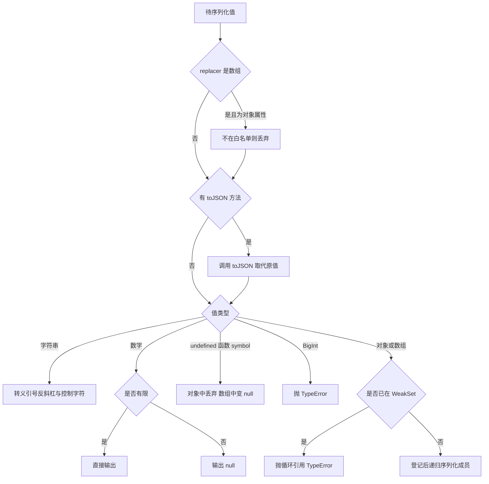

```javascript
function jsonStringify(value, replacer = null, space = 0) {
  const pad = typeof space === 'number' ? ' '.repeat(space) : typeof space === 'string' ? space : '';
  const seen = new WeakSet();
  const ESC = { '"': '\\"', '\\': '\\\\', '\b': '\\b', '\f': '\\f', '\n': '\\n', '\r': '\\r', '\t': '\\t' };
  const quote = (s) => '"' + s.replace(/["\\\b\f\n\r\t]/g, (ch) => ESC[ch]) + '"';

  function encode(val, key, insideArray) {
    // 1. replacer：数组 = 白名单（仅作用于对象属性，数组元素始终保留）
    if (Array.isArray(replacer) && !insideArray) {
      if (!replacer.includes(key)) return undefined;
    } else if (typeof replacer === 'function') {
      val = replacer(key, val); // 函数 replacer 可改写值，返回 undefined 即丢弃
    }
    // 2. toJSON 优先
    if (val && typeof val.toJSON === 'function') val = val.toJSON(key);

    // 3. 原始类型
    if (val === null) return 'null';
    switch (typeof val) {
      case 'boolean': return String(val);
      case 'string':  return quote(val);
      case 'number':  return Number.isFinite(val) ? String(val) : 'null'; // NaN/Infinity → null
      case 'bigint':
      case 'symbol':
      case 'function':
      case 'undefined':
        return undefined; // 由调用方决定：对象中丢弃 / 数组中变 null
    }

    // 4. 对象与数组：循环引用检测
    if (seen.has(val)) throw new TypeError('Converting circular structure to JSON');
    seen.add(val);
    let body;
    if (Array.isArray(val)) {
      const items = [];
      for (let idx = 0; idx < val.length; idx++) {
        const enc = encode(val[idx], String(idx), true);
        items.push(enc === undefined ? 'null' : enc); // 数组洞/undefined → null
      }
      body = `[${items.join(',')}]`;
    } else {
      const props = [];
      for (const [k, v] of Object.entries(val)) { // 仅自身可枚举字符串键
        const enc = encode(v, k, false);
        if (enc !== undefined) props.push(`${quote(k)}:${enc}`); // undefined 值丢弃
      }
      body = `{${props.join(',')}}`;
    }
    seen.delete(val);
    return body; // space 缩进排版此处从简，核心语义与原生一致
  }
  return encode(value, '', false);
}

console.log(jsonStringify({ a: undefined, b: 2, [Symbol('s')]: 1, fn() {} }));
// {"b":2} — undefined/函数/symbol 键被过滤（symbol 键本就不进 entries）
console.log(jsonStringify([1, undefined, function () {}, NaN]));
// [1,null,null,null] — 数组中全部变 null
console.log(jsonStringify({ d: new Date(0) })); // {"d":"1970-01-01T00:00:00.000Z"} — toJSON
const cyc = {}; cyc.self = cyc;
try { jsonStringify(cyc); } catch (e) { console.log(e instanceof TypeError); } // true
```

### JS-137：如何手写 new 与 Object.create 的完整版？

**答**：
- new 四步：以 `Constructor.prototype` 为原型建对象 → 以新对象为 this 执行构造函数 → 若构造函数返回引用类型则以它为准 → 否则返回新对象。
- “返回对象生效”这个规则常被忽略：返回原始值会被忽略，返回对象会覆盖默认实例。
- Object.create 完整版要支持第二参数（属性描述符），并对 proto 做类型校验。
- 验证手段：instanceof、getPrototypeOf、描述符检查。

```javascript
function myNew(Constructor, ...args) {
  // 1. 创建以构造函数 prototype 为原型的空对象
  const obj = Object.create(Constructor.prototype);
  // 2. 执行构造函数，this 绑定新对象
  const result = Constructor.apply(obj, args);
  // 3. 构造函数显式返回引用类型时，以返回值为准；返回原始值被忽略
  return result instanceof Object ? result : obj;
}

function Person(name) { this.name = name; }
function Overrider() { return { overridden: true }; } // 返回对象
function PrimitiveReturn() { return 42; }             // 返回原始值被忽略

console.log(myNew(Person, 'tom').name);              // tom
console.log(myNew(Overrider()));                     // { overridden: true }
console.log(myNew(PrimitiveReturn()) instanceof PrimitiveReturn); // true
console.log(myNew(Person, 'a') instanceof Person);   // true

// Object.create 完整版：支持描述符
function myCreate(proto, props) {
  if (proto === null || (typeof proto !== 'object' && typeof proto !== 'function')) {
    throw new TypeError('Object prototype may only be an Object or null');
  }
  function F() {}        // 临时构造器桥接原型
  F.prototype = proto;
  const obj = new F();
  if (props !== undefined) Object.defineProperties(obj, props);
  return obj;
}

const base = { greet() { return `hi ${this.name}`; } };
const ins = myCreate(base, {
  name: { value: 'tom', enumerable: true },
});
console.log(ins.greet());                                  // hi tom
console.log(Object.getPrototypeOf(ins) === base);          // true
console.log(Object.keys(ins));                             // ['name']
```

### JS-138：手写 call/apply/bind 完整版要注意什么？

**答**：
- call/apply 细节：this 为 null/undefined 时指向 globalThis；原始值要 Object 包装；用 Symbol 做临时键避免覆盖已有属性；用 defineProperty 避免 enumerable 污染 for-in。
- bind 细节：预设参数拼在实参前；`new bound()` 时 this 是新实例，必须把 this 透传给原函数而不是绑定的 ctx。
- new 兼容：`bound.prototype = Object.create(fn.prototype)`，让 `new bound()` 的实例 instanceof 原函数成立。
- 返回值都要透传。

```javascript
Function.prototype.myCall = function (ctx, ...args) {
  ctx = ctx == null ? globalThis : Object(ctx); // null/undefined → 全局；原始值包装
  const key = Symbol('fn');                     // 不覆盖已有属性
  Object.defineProperty(ctx, key, {             // 不可枚举，不污染 for-in
    value: this, enumerable: false, configurable: true, writable: true,
  });
  const result = ctx[key](...args);
  delete ctx[key];
  return result;
};

Function.prototype.myApply = function (ctx, args = []) {
  return this.myCall(ctx, ...(args ?? [])); // 复用 call，args 兜底空数组
};

Function.prototype.myBind = function (ctx, ...preset) {
  const fn = this;
  function bound(...args) {
    // new bound() 时 this 是新实例 → 透传给原函数；普通调用 → 用绑定的 ctx
    return fn.apply(this instanceof bound ? this : ctx, [...preset, ...args]);
  }
  if (fn.prototype) {
    bound.prototype = Object.create(fn.prototype); // new bound() 的原型链接回 fn
  }
  return bound;
};

function greet(g1, g2) { return `${this.name}: ${g1} ${g2}`; }
console.log(greet.myCall({ name: 'A' }, 'hi', 'yo'));    // A: hi yo
console.log(greet.myApply({ name: 'B' }, ['a', 'b']));   // B: a b
console.log(greet.myCall(null, 'x', 'y'));               // undefined: x y（globalThis.name）

// bind 的 new 兼容验证
const BoundGreet = greet.myBind({ name: 'C' }, 'hey');
console.log(new BoundGreet('z') instanceof greet); // true
// 普通调用走 ctx，new 调用走新实例
```

### JS-139：手写完整版 debounce？immediate 与 cancel 怎么加？

**答**：
- 基础版：每次触发清掉旧定时器重设，静默 wait 后执行，this 与参数透传。
- immediate：首次触发立即执行，之后 wait 内的调用被吞；定时器到期必须把 timer 置 null，否则永远无法再次立即触发。
- cancel：清定时器并复位状态，用于组件卸载等场景防止“迟到执行”。
- 附加 flush：跳过等待立即执行挂起的最后一次调用（可选增强）。

```javascript
function debounce(fn, wait = 300, { immediate = false } = {}) {
  let timer = null;

  function debounced(...args) {
    const callNow = immediate && timer === null; // 立即版：仅在"空闲期"首次触发
    if (timer) clearTimeout(timer);
    timer = setTimeout(() => {
      timer = null;                              // 复位，下一次才能再次立即触发
      if (!immediate) fn.apply(this, args);      // 普通版：静默期结束后执行最后一次
    }, wait);
    if (callNow) fn.apply(this, args);           // 立即版：先执行再进入冷却
  }

  debounced.cancel = () => {
    clearTimeout(timer);
    timer = null;                                // 复位状态，组件卸载防泄漏
  };
  debounced.flush = function (...args) {
    debounced.cancel();
    fn.apply(this, args);                        // 跳过等待直接执行
  };
  return debounced;
}

// 立即版演示：按钮防重复提交
const submit = debounce((tag) => console.log('提交', tag), 500, { immediate: true });
submit('a');          // 立即输出 提交 a
submit('b');          // 500ms 冷却期内，被吞
setTimeout(() => submit('c'), 600); // 冷却已过 → 立即输出 提交 c

// 普通版 + cancel：输入框搜索
const search = debounce((kw) => console.log('搜索', kw), 300);
search('j'); search('ja'); search('jav');
search.cancel();      // 用户离开页面 → 取消挂起的调用
// 300ms 后无输出
```

### JS-140：手写深拷贝完整版？循环引用、特殊对象与 symbol 键如何全兼容？

**答**：
- 主干递归 + WeakMap 缓存：缓存解决循环引用与同一对象被多处引用（拷贝后保持引用关系一致）。
- 特殊对象分类处理：Date/RegExp 直接构造；Map/Set 递归键值；数组按位拷贝（含洞）。
- 普通对象：`Object.create(proto)` 保留原型链；`Reflect.ownKeys` 拿到字符串键 + symbol 键（含不可枚举）。
- 函数与基本类型直接返回；访问器属性拷贝时保留函数引用而非求值。

```javascript
function deepClone(value, seen = new WeakMap()) {
  // 1. 基本类型与函数直接返回
  if (value === null || typeof value !== 'object') return value;
  // 2. 循环引用 / 重复引用：返回已拷贝的同一引用
  if (seen.has(value)) return seen.get(value);

  // 3. 特殊对象
  if (value instanceof Date)   return new Date(value.getTime());
  if (value instanceof RegExp) return new RegExp(value.source, value.flags);
  if (value instanceof Map) {
    const m = new Map();
    seen.set(value, m); // 先登记再递归，环引用才有效
    value.forEach((v, k) => m.set(deepClone(k, seen), deepClone(v, seen)));
    return m;
  }
  if (value instanceof Set) {
    const s = new Set();
    seen.set(value, s);
    value.forEach((v) => s.add(deepClone(v, seen)));
    return s;
  }
  if (Array.isArray(value)) {
    const arr = [];
    seen.set(value, arr);
    value.forEach((v, i) => (arr[i] = deepClone(v, seen))); // 洞位自动跳过
    return arr;
  }

  // 4. 普通对象：保留原型 + 全键拷贝（字符串 + symbol + 不可枚举）
  const obj = Object.create(Object.getPrototypeOf(value));
  seen.set(value, obj);
  for (const key of Reflect.ownKeys(value)) {
    const desc = Object.getOwnPropertyDescriptor(value, key);
    if (desc.get || desc.set) {
      Object.defineProperty(obj, key, desc); // 访问器：原样保留 getter/setter
    } else {
      obj[key] = deepClone(desc.value, seen); // 数据属性：递归拷贝
    }
  }
  return obj;
}

// 验证
const symKey = Symbol('meta');
const src = {
  n: 1,
  [symKey]: 'symbol 值',
  hidden: '不可枚举',
  d: new Date(0),
  reg: /abc/gi,
  map: new Map([['k', { v: 1 }]]),
  set: new Set([1, { x: 2 }]),
};
src.self = src;                 // 循环引用
Object.defineProperty(src, 'hidden', { enumerable: false });

const copy = deepClone(src);
console.log(copy === src);                       // false
console.log(copy.self === copy);                 // true — 环引用指向拷贝自身
console.log(copy.map.get('k') !== src.map.get('k')); // true — 深层也是新对象
console.log(copy[symKey], copy.d instanceof Date, copy.reg.flags); // symbol 值 true gi
console.log(Object.getOwnPropertyDescriptor(copy, 'hidden').enumerable); // false — 保留描述符
console.log(Object.getPrototypeOf(copy) === Object.getPrototypeOf(src)); // true — 原型一致
```

## 二十、综合输出题压轴

### JS-141：this 指向综合输出题？对象方法、箭头函数与回调三层嵌套怎么判断？

**答**：
- 判断顺序：看调用方式（谁调用指向谁）→ 箭头函数继承外层 this → 定时器回调中的普通函数独立调用。
- 箭头函数的 this 在定义时就固定为外层词法作用域的 this，与执行位置无关。
- 普通函数回调（如 `setTimeout(function(){})`）独立调用时，非严格指向 globalThis，严格为 undefined。
- 方法被提取赋值后再调用，this 丢失，回到独立调用规则。
- 输出顺序还需考虑宏任务：嵌套 `setTimeout` 的回调要等当前任务全部执行完才运行。

```javascript
const user = {
  name: 'outer',
  say() {
    console.log(1, this.name);          // user.say() → this 是 user → outer
    setTimeout(() => {
      console.log(2, this.name);        // 箭头函数继承 say 的 this → outer
      setTimeout(function () {
        console.log(3, this.name);      // 普通函数独立调用 → globalThis.name（浏览器为 ''，Node 为 undefined）
      }, 0);
      const inner = {
        name: 'inner',
        run() {
          console.log(4, this.name);    // inner.run() → inner
          const arrow = () => console.log(5, this.name); // 箭头继承 run 的 this → inner
          arrow();
          console.log(6, this.name);    // 仍是 run 的 this → inner
        },
      };
      inner.run();
      // 方法提取后独立调用：this 丢失（放在 run 外部调用，放 run 内部会无限递归调自己）
      const stolen = inner.run;
      stolen();
    }, 0);
  },
};
user.say();
// 输出顺序（非严格全局脚本）：
// 1 outer → 2 outer → 4 inner → 5 inner → 6 inner
// → 4 undefined → 5 undefined → 6 undefined → 3 undefined
// 关键：stolen() 独立调用后 this 丢失指向 globalThis，run 的三行 4/5/6 全部按丢失后的 this 再打一遍、
//       this.name 是 globalThis.name（Node 为 undefined；浏览器 window.name 默认是 ''）
// 第 3 行在嵌套宏任务中，要等当前定时器回调（2~7 行所在任务）完全结束后才执行
// 严格模式陷阱：ESM/class 内 stolen() 的 this 是 undefined，4 处直接 TypeError——严格化本身就是追问点
```

### JS-142：闭包计数与 IIFE 循环输出题？var、let、IIFE 三种写法输出有什么区别？

**答**：
- var 声明的 i 属于唯一的函数作用域，异步回调执行时循环已结束，读到的是最终值。
- IIFE 通过参数把每轮的值拷贝进独立的闭包作用域，是 ES5 时代的标准解法。
- let 让循环体每轮创建新的词法环境，效果等价于 IIFE，且是规范内置行为。
- 闭包计数器：外部拿不到 count 变量，只能通过暴露的方法读写，这就是闭包封装私有状态。

```javascript
// 1. var + 异步：所有回调共享同一个 i
for (var i = 0; i < 3; i++) {
  setTimeout(() => console.log('A', i));   // A 3 ｜ A 3 ｜ A 3 —— 回调执行时 i 已是 3
}
// 2. IIFE：每轮用参数 k 保存当时的值
for (var j = 0; j < 3; j++) {
  (function (k) {
    setTimeout(() => console.log('B', k)); // B 0 ｜ B 1 ｜ B 2
  })(j);
}
// 3. let：每轮迭代创建新的词法环境
for (let m = 0; m < 3; m++) {
  setTimeout(() => console.log('C', m));   // C 0 ｜ C 1 ｜ C 2
}
// 4. 闭包计数器：封装私有状态
function createCounter(start = 0, step = 1) {
  let count = start;                       // 外部无法直接访问
  return {
    inc: () => (count += step),
    dec: () => (count -= step),
    get: () => count,
  };
}
const c = createCounter(10, 5);
c.inc(); c.inc(); c.dec();
console.log(c.get());  // 20
```

### JS-143：原型链继承输出题？构造函数返回对象时 new 的结果有什么变化？

**答**：
- `new` 的返回值规则：构造函数显式返回一个对象时，new 的结果就是那个对象，`this` 上挂的属性全部丢弃。
- 返回原始值（数字/字符串等）时被忽略，正常返回 `this`。
- 原型链继承：`Object.create(Parent.prototype)` 让 Child 的原型链指向 Parent.prototype，方法得以复用。
- `Parent.call(this)` 借用构造函数，把 Parent 的实例属性复制到 Child 实例上。
- 重设原型后 `constructor` 丢失，必须手动修复，否则实例.constructor 指向 Parent。

```javascript
function Normal() { this.x = 1; }
function ReturnObj() { this.y = 2; return { z: 3 }; }   // 返回对象：new 的结果是它
function ReturnPrim() { this.w = 4; return 42; }        // 返回原始值：被忽略

console.log(new Normal().x);            // 1
const r = new ReturnObj();
console.log(r.y, r.z);                  // undefined 3 —— this.y 被整个丢弃
console.log(new ReturnPrim().w);        // 4 —— 原始返回值无效，正常返回 this

function Parent() { this.tag = 'P'; }
Parent.prototype.hello = function () { return 'hello-' + this.tag; };
function Child() {
  Parent.call(this);                    // 借用构造函数：继承实例属性
  this.tag = 'C';
}
Child.prototype = Object.create(Parent.prototype); // 原型链继承方法
Child.prototype.constructor = Child;    // 修复 constructor

const c = new Child();
console.log(c.hello());                 // hello-C
console.log(c instanceof Child);        // true
console.log(c instanceof Parent);       // true —— 原型链上有 Parent.prototype
console.log(c.constructor === Child);   // true（已手动修复）
console.log(Child.prototype.__proto__ === Parent.prototype); // true —— 链条关系
```

### JS-144：变量提升综合输出题？函数声明与 var 混合时优先级如何？

**答**：
- var 声明提升（值为 undefined），函数声明整体提升（声明+赋值一起），所以 `typeof fn` 在声明前就是 function。
- 同名冲突：函数声明优先于 var 声明提升；随后执行阶段的赋值会覆盖函数。
- 函数表达式只提升变量声明部分，赋值留在原地，声明前调用是 TypeError。
- 块级作用域中的函数声明在非严格模式下按 var 语义处理（Annex B 历史遗留），会泄漏到块外。

```javascript
console.log(typeof a);          // undefined：var a 声明提升但未赋值
var a = 1;
console.log(typeof b);          // function：函数声明整体提升
function b() { return 'b'; }
console.log(typeof c);          // undefined：函数表达式只提升 var c
var c = function () { return 'c'; };
console.log(typeof c);          // function：赋值已执行

// 经典陷阱：函数声明 vs 函数表达式同名
console.log(fn());              // 'declared'：函数声明优先提升，此时 fn 还是函数
var fn = function () { return 'expression'; };
function fn() { return 'declared'; }
console.log(fn());              // 'expression'：执行阶段的赋值覆盖了函数

// 块内函数声明（Annex B）：非严格模式下按 var 语义泄漏到块外
{
  function blockFn() {}
}
console.log(typeof blockFn);    // function（浏览器非严格实现）；严格模式下块级函数声明只在块内可见，这里输出 "undefined"
```

### JS-145：严格模式与非严格模式下 this 的差异输出题？class 里为什么 this 更容易报错？

**答**：
- 非严格模式独立调用时 this 被包装为 globalThis（浏览器是 window）；严格模式保持 undefined，不包装。
- `call(null/undefined)` 非严格下替换为 globalThis，严格下原样传递。
- 严格模式下原始值 this 不装箱：`call(42)` 的 this 就是数字 42；非严格会装箱成 Number 对象。
- class 内部自动启用严格模式，方法提取后独立调用 this 为 undefined，访问属性直接抛 TypeError。
- 严格模式的 this 规则让「无意的全局污染」和「隐式指向 window」在开发期就暴露为错误。

```javascript
function sloppy() {
  console.log('sloppy', this);   // globalThis（浏览器是 window）
}
function strict() {
  'use strict';
  console.log('strict', this);   // undefined：独立调用不包装全局
}
sloppy();
strict();
sloppy.call(null);   // 仍是 globalThis：null/undefined 被替换为全局
strict.call(null);   // null 原样传递
strict.call(42);     // 42：严格模式原始值不装箱

class Box {
  constructor() { this.v = 1; }
  get() { return this.v; }       // class 体内自动严格模式
}
const box = new Box();
const g = box.get;
try {
  g();                            // this === undefined
} catch (e) {
  console.log('class 方法提取调用报错：', e.message); // Cannot read properties of undefined
}
```

### JS-146：作用域+提升+闭包综合大杂烩输出题？如何逐行推导？

**答**：
- 第一步找提升：函数内所有 var 声明提升到函数顶部，即使写在 if 块里（var 没有块级作用域）。
- 提升的声明会遮蔽（shadow）外层同名变量，所以函数内读 x 时读到的是 undefined 而不是全局值。
- 闭包捕获的是变量本身（引用），不是值：内层函数执行时读到的是变量的最新值。
- 每次调用外层函数都产生新的作用域，因此两个闭包实例的计数互不影响。
- 推导套路：先画作用域提升草图 → 再按执行顺序逐行标注 → 最后考虑异步时序。

```javascript
var msg = 'global';
function outer() {
  console.log(1, msg);            // undefined —— 函数内 var msg 声明提升，遮蔽外层 'global'
  if (true) {
    var msg = 'block';            // var 无块级作用域，仍属于 outer 的函数作用域
  }
  console.log(2, msg);            // block
  let count = 0;                  // let 有块级作用域，但闭包仍能捕获它
  return function inner() {
    count += 1;                   // 引用 outer 作用域里的 count
    console.log(3, count, msg);   // 闭包捕获的是变量本身（最新值）
    return count;
  };
}
const a = outer();  // 执行 body：打印 1 undefined ｜ 2 block，并返回 inner
const b = outer();  // 再次执行：又打印 1 undefined ｜ 2 block —— 全新作用域
a();                // 3 1 block
a();                // 3 2 block —— a 的闭包累加
b();                // 3 1 block —— b 是独立闭包，count 从 0 开始
```

## 二十一、手写轮子压轴

### JS-147：手写 Promise 完整版？then 链、异步 resolve、错误冒泡怎么实现？

**答**：
- 三状态单向流转：pending 只能变成 fulfilled 或 rejected 一次，之后不可再变。
- pending 期间注册的 then 回调进队列，settle 后异步派发（queueMicrotask），保证 then 先注册再回调。
- then 返回新 Promise：onFulfilled 返回值作为新 Promise 的 value，handler 抛错则新 Promise rejected。
- 错误冒泡：没有传 onRejected 时 reason 原样透传给下一环，直到被 catch 接住——这就是链式的核心。
- 本版为可读性省略 thenable 二次展开与 allSettled/all 的完整规范细节，面试补上 all/race 即可加分。

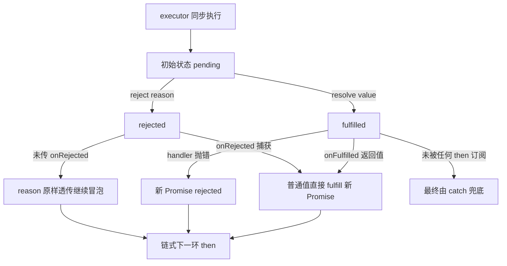

```javascript
const PENDING = 'pending', FULFILLED = 'fulfilled', REJECTED = 'rejected';

class MyPromise {
  constructor(executor) {
    this.state = PENDING;
    this.value = undefined;
    this.callbacks = [];                        // pending 期订阅的 then 回调
    const resolve = (value) => this._settle(FULFILLED, value);
    const reject  = (reason) => this._settle(REJECTED, reason);
    try { executor(resolve, reject); } catch (e) { reject(e); } // executor 同步抛错也走 reject
  }

  _settle(state, value) {
    if (this.state !== PENDING) return;         // 状态一旦定型不可再变
    this.state = state;
    this.value = value;
    queueMicrotask(() => {                      // 异步派发，保证 then 先注册
      const cbs = this.callbacks; this.callbacks = [];
      cbs.forEach((cb) => this._fire(cb));
    });
  }

  _fire({ onFulfilled, onRejected, resolve, reject }) {
    queueMicrotask(() => {
      try {
        const handler = this.state === FULFILLED ? onFulfilled : onRejected;
        if (typeof handler !== 'function') {    // 透传：值透传给下一环 / 错误继续冒泡
          return this.state === FULFILLED ? resolve(this.value) : reject(this.value);
        }
        resolve(handler(this.value));           // 返回普通值 → 新 Promise fulfilled
      } catch (e) { reject(e); }                // handler 抛错 → 新 Promise rejected
    });
  }

  then(onFulfilled, onRejected) {
    return new MyPromise((resolve, reject) => {
      const cb = { onFulfilled, onRejected, resolve, reject };
      this.state === PENDING ? this.callbacks.push(cb) : this._fire(cb);
    });
  }
  catch(onRejected) { return this.then(null, onRejected); }
  finally(fn) {
    return this.then(
      (v) => MyPromise.resolve(fn()).then(() => v),                       // 结果穿透
      (e) => MyPromise.resolve(fn()).then(() => { throw e; })             // 错误穿透
    );
  }
  static resolve(v) { return v instanceof MyPromise ? v : new MyPromise((r) => r(v)); }
  static reject(r)   { return new MyPromise((_, j) => j(r)); }
  static all(list) {
    return new MyPromise((resolve, reject) => {
      const out = []; let left = list.length;
      if (!left) return resolve(out);
      list.forEach((p, i) => MyPromise.resolve(p).then((v) => {
        out[i] = v; if (--left === 0) resolve(out); // 按原顺序收集
      }, reject));                                   // 任一失败立即 reject
    });
  }
  static race(list) {
    return new MyPromise((resolve, reject) => {
      list.forEach((p) => MyPromise.resolve(p).then(resolve, reject)); // 谁先定型用谁
    });
  }
}

// 验证：异步 resolve + then 链 + 错误冒泡 + catch 兜底
new MyPromise((resolve) => {
  setTimeout(() => resolve(1), 100);              // 异步 resolve：then 先注册、后派发
})
  .then((v) => { console.log('then1', v); return v + 1; })
  .then((v) => { console.log('then2', v); throw new Error('boom'); })
  .catch((e) => { console.log('catch', e.message); return 'recovered'; }) // 冒泡被接住
  .finally(() => console.log('finally'))
  .then((v) => console.log('then3', v));
// 输出：then1 1 → then2 2 → catch boom → finally → then3 recovered
```

### JS-148：手写 async/await 执行器？generator 如何被自动驱动？

**答**：
- 本质：async 函数是「generator + 自动执行器」的语法糖，await 对应 yield。
- 执行器用递归 step 驱动：`gen.next(v)` 拿到 { value, done }，把 value 包成 Promise，resolve 后把结果传回 next。
- 错误处理：Promise reject 时调用 `gen.throw(e)`，让错误在 generator 内部被 try/catch 捕获。
- done 为 true 时 resolve 最终返回值，整个执行器返回一个 Promise——与真 async 函数行为一致。

```javascript
function run(genFn) {
  return (...args) =>
    new Promise((resolve, reject) => {
      const gen = genFn(...args);
      const step = (method, arg) => {
        let result;
        try { result = gen[method](arg); }        // next 或 throw
        catch (e) { return reject(e); }           // generator 外抛错
        const { value, done } = result;
        if (done) return resolve(value);          // 执行完毕 → 整体 resolve
        Promise.resolve(value).then(
          (v) => step('next', v),                 // await 成功 → 继续推进
          (e) => step('throw', e)                 // await 失败 → 在 generator 内抛出
        );
      };
      step('next');
    });
}

// 用法：generator 版 async/await
const sleep = (ms) => new Promise((r) => setTimeout(r, ms));
const main = run(function* (uid) {
  try {
    const user = yield sleep(50).then(() => ({ id: uid, name: 'Alice' }));
    const posts = yield sleep(50).then(() => ['p1', 'p2']);
    return { user, posts };
  } catch (e) {
    return { error: e.message };                  // gen.throw 会落进这个 catch
  }
});
main(7).then((r) => console.log(JSON.stringify(r)));
// {"user":{"id":7,"name":"Alice"},"posts":["p1","p2"]}
```

### JS-149：手写 Virtual DOM patch？简化 diff 的核心逻辑是什么？

**答**：
- 三个核心函数：h 生成虚拟节点、render 把虚拟节点变成真实 DOM、patch 比较新旧虚拟节点并最小化更新。
- patch 四种情况：旧无新有→挂载；旧有新无→卸载；类型不同（tag/文本）→整节点替换；同类型→更新 props 后递归 diff 子节点。
- 同类型更新只改变化的属性：旧有新无的属性删除，值变化的设置，事件回调跳过 setAttribute。
- 简化版按位对比子节点；生产级实现（snabbdom/Vue）会引入 key 做 keyed diff，把复杂度降到 O(n)。

```javascript
function h(tag, props = {}, children = []) {
  return { tag, props, children, key: props.key ?? null };
}

function render(vnode) {
  if (typeof vnode === 'string' || typeof vnode === 'number') {
    return document.createTextNode(String(vnode));  // 文本节点
  }
  const el = document.createElement(vnode.tag);
  for (const [k, v] of Object.entries(vnode.props)) {
    if (k === 'key') continue;
    k.startsWith('on')
      ? el.addEventListener(k.slice(2).toLowerCase(), v)  // onClick → click
      : el.setAttribute(k, v);
  }
  vnode.children.forEach((c) => el.appendChild(render(c)));
  return el;
}

const isSame = (a, b) =>
  typeof a === typeof b &&
  (typeof a === 'string' ? a === b : a.tag === b.tag);  // 文本比内容，元素比 tag

function patch(parent, oldV, newV, index = 0) {
  if (oldV == null) return parent.appendChild(render(newV));        // 1. 挂载
  if (newV == null) return void parent.removeChild(parent.childNodes[index]); // 2. 卸载
  if (!isSame(oldV, newV)) {                                        // 3. 类型不同 → 替换
    return parent.replaceChild(render(newV), parent.childNodes[index]);
  }
  const el = parent.childNodes[index];                              // 4. 同类型 → 复用
  diffProps(el, oldV.props || {}, newV.props || {});
  const max = Math.max(oldV.children.length, newV.children.length); // 5. 递归 diff 子节点
  for (let i = 0; i < max; i++) patch(el, oldV.children[i], newV.children[i], i);
}

function diffProps(el, oldP, newP) {
  for (const k of Object.keys(oldP)) {
    if (!(k in newP) && !k.startsWith('on')) el.removeAttribute(k); // 删失效属性
  }
  for (const [k, v] of Object.entries(newP)) {
    if (oldP[k] !== v && k !== 'key' && !k.startsWith('on')) el.setAttribute(k, v); // 更新变化项
  }
}

// 验证
const container = document.getElementById('app');
let vOld = h('ul', { class: 'list' }, [h('li', {}, ['a']), h('li', {}, ['b'])]);
container.appendChild(render(vOld));
const vNew = h('ul', { class: 'list active' }, [h('li', {}, ['a']), h('li', {}, ['B'])]);
patch(container, vOld, vNew, 0);   // 只有第二个 li 的文本和 class 会更新
vOld = vNew;
```

### JS-150：手写 Vue 响应式 30 行版？依赖收集与发布订阅如何串起来？

**答**：
- 两个角色：Dep 是每个属性的依赖集合（发布者），Watcher 是订阅者，effect 函数首次执行时自动收集依赖。
- 收集时机：effect 执行中读取 `state.count` → 触发 getter → track 把当前 activeEffect 记录进该属性的 Set。
- 触发时机：赋值 `state.count = n` → setter → trigger 通知该属性 Set 里的所有 effect 重新执行，视图更新。
- targetMap 用 WeakMap 持有 target，对象被销毁时依赖表自动回收，避免泄漏。

```javascript
let activeEffect = null;
const targetMap = new WeakMap();   // target -> Map<key, Set<effect>>

function effect(fn) {
  activeEffect = fn;
  fn();                            // 首次执行 → 触发 getter → 完成依赖收集
  activeEffect = null;
}

function track(target, key) {      // getter 中调用：收集
  if (!activeEffect) return;
  let deps = targetMap.get(target);
  if (!deps) targetMap.set(target, (deps = new Map()));
  let set = deps.get(key);
  if (!set) deps.set(key, (set = new Set()));
  set.add(activeEffect);
}

function trigger(target, key) {    // setter 中调用：派发
  (targetMap.get(target)?.get(key) || []).forEach((fn) => fn());
}

function reactive(obj) {
  Object.keys(obj).forEach((key) => {
    let value = obj[key];
    Object.defineProperty(obj, key, {
      get() { track(obj, key); return value; },
      set(nv) {
        if (nv === value) return;  // 相同值不触发更新
        value = nv;
        trigger(obj, key);
      },
    });
  });
  return obj;
}

// 验证：视图自动更新
const state = reactive({ count: 0 });
effect(() => console.log('视图渲染：count =', state.count)); // 立即打印 count = 0
state.count = 1;   // 视图渲染：count = 1 —— setter → trigger → effect 重跑
state.count = 2;   // 视图渲染：count = 2
```

### JS-151：手写 observe + compile 的 MVVM 思想？

**答**：
- MVVM 三件套：Observer 递归劫持数据、Compile 解析模板里的插值与指令、Watcher 把两者连起来。
- Observer 对数据每个 key 做 defineProperty，set 时通知所有订阅该数据的更新函数。
- Compile 扫描 DOM，找到 `{{}}` 插值，为每个插值注册一个更新函数，数据变化时重算文本。
- 真正的 Vue 是「Compile 生成更新函数 + 数据变化精准通知对应 Watcher」，本例用简化广播演示数据到视图的单向流动。

```javascript
const updateFns = [];                 // 所有视图更新函数的队列

// Observer：递归劫持数据
function observe(data) {
  if (typeof data !== 'object' || data === null) return;
  Object.keys(data).forEach((key) => {
    let val = data[key];
    observe(val);                     // 深层对象也要劫持
    Object.defineProperty(data, key, {
      get() { return val; },
      set(nv) {
        val = nv;
        observe(nv);                  // 新赋值的对象同样劫持
        updateFns.forEach((fn) => fn()); // 简化广播：真实实现按 key 精准通知
      },
    });
  });
}

// Compile：解析模板中的插值，产出更新函数
function compile(el, data) {
  const render = () => {
    el.innerHTML = el.innerHTML.replace(/\{\{\s*([\w.]+)\s*\}\}/g, (_, path) => {
      const v = path.split('.').reduce((o, k) => (o == null ? o : o[k]), data);
      return v == null ? '' : v;
    });
  };
  updateFns.push(render);             // 数据变化时重新渲染
  render();                           // 首次渲染
}

// Mini MVVM 串起来
const vmData = { user: { name: 'Alice' }, age: 18 };
observe(vmData);
const root = document.createElement('div');
root.innerHTML = '<p>姓名 {{ user.name }} 年龄 {{ age }}</p>';
document.body.appendChild(root);
compile(root, vmData);                // 显示：姓名 Alice 年龄 18
vmData.age = 20;                      // 触发 setter → 广播 → 视图变为 年龄 20
```

### JS-152：手写带命名空间与通配符的发布订阅？

**答**：
- 命名空间事件如 `user:login`，通配符 `user:*` 监听整个 user 域，`*` 监听一切事件（适合日志/审计）。
- emit 时先精确匹配，再按命名空间前缀匹配通配符；通配回调额外收到事件名参数。
- off 支持精确移除某个回调、按事件名清空；on 返回取消函数方便组件卸载清理。
- 用 Map<string, Function[]> 存储，回调切片遍历避免「遍历时注销」导致漏执行或死循环。

```javascript
class Emitter {
  constructor() { this.map = new Map(); }
  on(event, fn) {
    const list = this.map.get(event) || [];
    list.push(fn);
    this.map.set(event, list);
    return () => this.off(event, fn);   // 返回取消订阅函数
  }
  off(event, fn) {
    const list = this.map.get(event);
    if (!list) return;
    if (fn) {
      const i = list.indexOf(fn);
      if (i > -1) list.splice(i, 1);
    } else {
      this.map.delete(event);           // 不传 fn → 清空该事件
    }
  }
  emit(event, ...args) {
    // 1. 精确匹配；slice 防止回调里 off 导致遍历跳项
    (this.map.get(event) || []).slice().forEach((fn) => fn(...args));
    // 2. 通配符：emit('user:login') 触发 'user:*' 与 '*'
    const prefix = event.split(':')[0];
    ['*', `${prefix}:*`].forEach((pattern) => {
      if (pattern !== event) {
        (this.map.get(pattern) || []).slice().forEach((fn) => fn(event, ...args));
      }
    });
  }
}

const bus = new Emitter();
bus.on('user:login', (p) => console.log('登录：', p.uid));
bus.on('user:*', (event, p) => console.log('审计：', event));
bus.on('*', (event) => console.log('日志：', event));
const offLogin = bus.on('user:login', () => console.log('临时监听'));
offLogin();                             // 用返回值取消订阅
bus.emit('user:login', { uid: 1 });
// 登录：1 ｜ 审计：user:login ｜ 日志：user:login
```

### JS-153：手写竞态控制 hook 工具？abort 与版本号双方案怎么封装？

**答**：
- 竞态场景：输入联想连续请求，先发后至的旧响应会覆盖新响应，必须丢弃过期结果。
- 版本号方案：每次调用自增 version，响应回来时 version 已变则视为过期——不中止请求，但结果作废，适合无法取消的场景。
- AbortController 方案：新请求发出前 abort 旧请求，真正中止网络传输，省流量，fetch/XHR 均支持。
- 统一封装后业务层只写 `try/catch StaleError`，两种方案可配置切换，过期一律静默丢弃。

```javascript
class StaleError extends Error {
  constructor() { super('stale response'); this.name = 'StaleError'; }
}

// 方案一：版本号（适用于无法取消的请求通道）
function withVersion(fetcher) {
  let version = 0;
  return async (...args) => {
    const current = ++version;
    const result = await fetcher(...args);
    if (current !== version) throw new StaleError(); // 已有更新的调用 → 本次作废
    return result;
  };
}

// 方案二：AbortController（真正中止请求，省流量）
function withAbort(fetcher) {
  let controller = null;
  return async (...args) => {
    controller?.abort();                              // 新请求前中止旧请求
    controller = new AbortController();
    try {
      return await fetcher(controller.signal, ...args);
    } catch (e) {
      if (e.name === 'AbortError') throw new StaleError(); // 中止统一转成过期错误
      throw e;
    }
  };
}

// 统一使用：输入联想
const searchAPI = (kw) => new Promise((r) => setTimeout(() => r(`结果-${kw}`), 100));
const search = withVersion(searchAPI);                // 换成 withAbort 即可切换方案

async function onInput(kw) {
  try {
    const res = await search(kw);
    console.log('渲染', res);
  } catch (e) {
    if (e instanceof StaleError) console.log('丢弃过期响应', kw); // 竞态结果静默丢弃
    else throw e;
  }
}
onInput('a');
onInput('ab');
onInput('abc');
// 100ms 后：渲染 结果-abc ｜ 丢弃过期响应 a ｜ 丢弃过期响应 ab
```

## 二十二、数据结构与算法思维在 JS

### JS-154：如何用对象和 Map 实现高频缓存与计数场景？

**答**：
- 计数：`map.set(k, (map.get(k) || 0) + 1)` 是词频统计的标准套路，一次遍历 O(n)。
- Top-K：计数完成后按值排序取前 N，数据量大时可用桶排序把复杂度降到 O(n)。
- 分组：reduce + Map 按任意键聚合，比对象分组更安全（键不会被原型属性污染）。
- Map 键可以是对象/NaN/任意类型，普通对象键只能是字符串——缓存「组件实例 → 数据」必须用 Map。
- 去重用 Set，保序去重 `[...new Set(arr)]` 是最简洁写法。

```javascript
// 1. 词频统计：Map 计数
const words = ['a', 'b', 'a', 'c', 'b', 'a'];
const freq = words.reduce((m, w) => m.set(w, (m.get(w) || 0) + 1), new Map());
console.log(Object.fromEntries(freq));   // { a: 3, b: 2, c: 1 }

// 2. Top-K：计数后按值排序
const top2 = [...freq.entries()].sort((x, y) => y[1] - x[1]).slice(0, 2);
console.log(top2);                        // [['a', 3], ['b', 2]]

// 3. 分组：Map 聚合
const users = [
  { name: 'A', dept: 'dev' }, { name: 'B', dept: 'ops' }, { name: 'C', dept: 'dev' },
];
const byDept = users.reduce((m, u) => {
  const list = m.get(u.dept) || [];
  list.push(u);
  m.set(u.dept, list);
  return m;
}, new Map());
console.log(byDept.get('dev').length);    // 2

// 4. 保序去重
console.log([...new Set(words)]);         // ['a', 'b', 'c']

// 5. memoize：Map 做结果缓存（键可以是任意类型）
function memoize(fn) {
  const cache = new Map();
  return (arg) => {
    if (!cache.has(arg)) cache.set(arg, fn(arg));
    return cache.get(arg);
  };
}
const slowSquare = memoize((n) => { console.log('计算了', n); return n * n; });
slowSquare(4);   // 计算了 4
slowSquare(4);   // 命中缓存，不再打印
```

### JS-155：链表结构在 JS 中如何实现与应用？LRU 的底层思想是什么？

**答**：
- 单向链表：节点存 value 与 next，插入删除 O(1)，但查找必须从头遍历 O(n)——JS 数组反而随机访问快。
- 反转链表三指针法：prev/cur/next 逐个翻转指向，是最高频链表手写题。
- LRU 的 O(1) 秘密：哈希表负责 O(1) 定位，双向链表负责 O(1) 摘除与头插，二者配合。
- 双向链表的优势：拿到任意节点引用即可 O(1) 摘除（无需找前驱），这正是 LRU 需要的。

```javascript
class Node {
  constructor(value) { this.value = value; this.next = null; }
}
class LinkedList {
  constructor() { this.head = null; this.size = 0; }
  append(value) {
    const node = new Node(value);
    if (!this.head) this.head = node;
    else {
      let cur = this.head;
      while (cur.next) cur = cur.next;   // 尾插需遍历 O(n)
      cur.next = node;
    }
    this.size++;
  }
  reverse() {                            // 三指针原地反转
    let prev = null, cur = this.head;
    while (cur) {
      const next = cur.next;             // 先存后继
      cur.next = prev;                   // 翻转指向
      prev = cur;                        // prev 前进
      cur = next;                        // cur 前进
    }
    this.head = prev;                    // 新头是原尾
  }
  toArray() {
    const out = []; let cur = this.head;
    while (cur) { out.push(cur.value); cur = cur.next; }
    return out;
  }
}
const list = new LinkedList();
list.append(1); list.append(2); list.append(3);
list.reverse();
console.log(list.toArray());   // [3, 2, 1]

// 双向链表节点：LRU O(1) 的底层支撑
class DNode {
  constructor(key, value) { this.key = key; this.value = value; this.prev = null; this.next = null; }
}
function moveToHead(head, node) {   // LRU 命中时的核心动作
  node.prev.next = node.next;       // O(1) 摘除：无需遍历找前驱
  node.next.prev = node.prev;
  node.next = head.next;            // 头插：最近使用的放头部
  node.prev = head;
  head.next.prev = node;
  head.next = node;
}
// 配合 Map<key, DNode>，get/put 都是 O(1)；链表尾部的节点即「最久未使用」，容量满时淘汰
```

### JS-156：栈与队列在前端有哪些实际应用？括号校验和任务队列怎么写？

**答**：
- 栈（后进先出）：括号/标签配对校验、撤销操作、路由回退、调用栈本身。
- 括号校验：左括号进栈，右括号弹栈配对，最终栈空才合法，O(n) 一趟完成。
- 队列（先进先出）：消息队列、任务队列、动画序列。
- 串行任务队列：用 Promise 链把异步任务串起来，`tail.then(task)` 保证顺序，catch 兜底防断链。

```javascript
// 1. 括号校验：栈的标志性应用
function isValid(s) {
  const pair = { ')': '(', ']': '[', '}': '{' };
  const stack = [];
  for (const ch of s) {
    if (ch in pair) {
      if (stack.pop() !== pair[ch]) return false;  // 弹出的必须匹配
    } else {
      stack.push(ch);                              // 左括号进栈
    }
  }
  return stack.length === 0;                       // 有剩余左括号也不合法
}
console.log(isValid('{[()]}'));  // true
console.log(isValid('{[(])}'));  // false
console.log(isValid('((('));     // false

// 2. 串行任务队列：Promise 链保证顺序
class TaskQueue {
  constructor() { this.tail = Promise.resolve(); }
  push(task) {
    this.tail = this.tail.then(task).catch((e) => console.error('任务失败：', e.message));
    return this.tail;                              // 返回链尾，外部可 await 整体
  }
}
const q = new TaskQueue();
q.push(() => new Promise((r) => setTimeout(() => { console.log('任务1'); r(); }, 100)));
q.push(() => console.log('任务2'));               // 任务1 完成后才执行，不会并发
q.push(() => { throw new Error('炸了'); });        // 单个失败不影响后续
q.push(() => console.log('任务4'));
// 输出：任务1 → 任务2 → 任务失败：炸了 → 任务4
```

### JS-157：树结构操作全家桶？扁平与树互转、查找、过滤怎么写？

**答**：
- 扁平转树：先建 Map 索引，再一遍遍历按 pid 挂接，O(n) 一次遍历，优于递归找父亲。
- 树转扁平：栈做前序展开，注意 push 子节点前 reverse 保持原顺序。
- 查找：DFS 递归即可；层级深怕爆栈时改 BFS 队列。
- 过滤：保留命中节点及其祖先链（菜单前端搜索的标准需求），用递归 reduce 自底向上组装。

```javascript
const flat = [
  { id: 1, pid: null, name: '根' },
  { id: 2, pid: 1, name: '子1' },
  { id: 3, pid: 1, name: '子2' },
  { id: 4, pid: 2, name: '孙1' },
];

// 1. 扁平 → 树：Map 索引 + 一遍挂接 O(n)
function listToTree(list) {
  const map = new Map(list.map((n) => [n.id, { ...n, children: [] }]));
  const tree = [];
  for (const node of map.values()) {
    const parent = map.get(node.pid);
    parent ? parent.children.push(node) : tree.push(node);
  }
  return tree;
}
const tree = listToTree(flat);

// 2. 树 → 扁平：栈前序展开
function treeToList(tree) {
  const out = [];
  const stack = tree.map((n) => ({ ...n }));
  while (stack.length) {
    const { children, ...node } = stack.pop();
    out.push(node);
    if (children?.length) stack.push(...children.slice().reverse()); // reverse 保序
  }
  return out;
}

// 3. 查找：DFS
function findNode(tree, pred) {
  for (const node of tree) {
    if (pred(node)) return node;
    const hit = findNode(node.children || [], pred);
    if (hit) return hit;
  }
  return null;
}
console.log(findNode(tree, (n) => n.id === 4)?.name);   // 孙1

// 4. 过滤：命中节点 + 祖先链都保留
function filterTree(tree, pred) {
  return tree.reduce((acc, node) => {
    const kids = filterTree(node.children || [], pred);
    if (pred(node) || kids.length) acc.push({ ...node, children: kids });
    return acc;
  }, []);
}
console.log(JSON.stringify(filterTree(tree, (n) => n.name.includes('孙'))));
// {"id":2,"pid":1,"name":"子1","children":[{"id":4,...,"name":"孙1"}]} —— 祖先「子1」被保留
```

### JS-158：时间复杂度在前端的实际意义？10 万条数据如何选型？

**答**：
- 前端主线程 50ms 就可能掉帧，O(n²) 在万级数据就开始致命，O(n) 十万级也毫秒级完成。
- 查找选型：数组 `indexOf/includes` O(n) → 改用 Set/Map `has/get` O(1)，这是最常见的一档性能提升。
- 去重选型：`filter + indexOf` O(n²) → `[...new Set(arr)]` O(n)。
- 嵌套循环是红线：两层 1 万 × 1 万 = 1 亿次操作必卡，第二层改哈希查询。
- 排序 10 万条 O(n log n) 约 170 万次比较，浏览器原生 sort 完全可接受；自己手写 O(n²) 排序才是事故。

```javascript
const big = Array.from({ length: 20000 }, (_, i) => i % 5000); // 2 万条演示，10 万更夸张

// 反面教材：filter + indexOf 去重 O(n²)
console.time('O-n2');
const slow = big.filter((v, i) => big.indexOf(v) === i);  // 2 万² = 4 亿次比较量级
console.timeEnd('O-n2');        // 通常数百毫秒起，10 万条直接卡死

// 正确选型：Set 去重 O(n)
console.time('O-n');
const fast = [...new Set(big)];
console.timeEnd('O-n');         // 通常 < 2ms
console.log(slow.length === fast.length, fast.length); // true 5000

// 查找选型对比
console.time('arr-includes');
big.includes(4999);
console.timeEnd('arr-includes'); // O(n)
const set = new Set(big);
console.time('set-has');
set.has(4999);
console.timeEnd('set-has');      // O(1)，差 3~4 个数量级

// 选型速查：频繁 has/get → Set/Map；保序去重 → Set；多维匹配 → 先建索引 Map 再单层遍历
```

### JS-159：对象引用与浅比较在框架 diff 中扮演什么角色？

**答**：
- JS 对象赋值是引用传递：改 `b.x` 连 `a.x` 一起变，框架 diff 对比引用发现「没变」，UI 不更新——这是状态不更新的头号原因。
- 浅比较（`===` 逐键比第一层）是 React.memo、shouldComponentUpdate 的核心，引用相等直接跳过渲染。
- 不可变更新：不原地修改，而是 `{...state, list: [...state.list, item]}` 换引用，让浅比较检测到变化。
- 深比较能识别内容变化但 O(n) 昂贵，框架默认不用；需要深语义时用 Immer 类库以「写时复制」实现。

```javascript
// 1. 引用赋值是同一个对象
const a = { x: 1 };
const b = a;
b.x = 2;
console.log(a.x);        // 2 —— a、b 是同一引用
console.log(a === b);    // true

// 2. 浅比较：React.memo / shouldComponentUpdate 的核心
function shallowEqual(o1, o2) {
  if (o1 === o2) return true;                        // 引用相等直接通过
  if (typeof o1 !== 'object' || typeof o2 !== 'object') return false;
  const k1 = Object.keys(o1), k2 = Object.keys(o2);
  if (k1.length !== k2.length) return false;
  return k1.every((k) => o1[k] === o2[k]);           // 只比第一层
}

// 3. 不可变更新让浅比较生效
const state = { list: [1, 2] };
const next1 = { ...state, list: [1, 2] };            // 浅拷贝 + 新壳
console.log(shallowEqual(state, next1));             // true → 跳过渲染（内容相同）
const next2 = { ...state, list: [1, 2, 3] };         // 换数组引用
console.log(shallowEqual(state, next2));             // false → 触发重渲染

// 4. 原地修改是 bug 之源
const arr = [1, 2];
const copy = arr;
arr.push(3);                                         // 原地修改
console.log(copy.length, arr === copy);              // 3 true —— copy 被连带改动，diff 检测不到
```

## 二十三、DOM 与事件深入

### JS-160：事件流三阶段与 stopPropagation 的深解？

**答**：
- 三阶段：捕获（window → target）→ 目标阶段 → 冒泡（target → window）；addEventListener 第三参 true 表示捕获阶段监听。
- 目标阶段的监听按注册顺序执行，此时捕获/冒泡标记不参与排序。
- `stopPropagation` 阻断事件继续传播（向上/向下），但同层后注册的监听仍会执行。
- `stopImmediatePropagation` 更狠：连同层后续监听一起拦掉。
- 应用：捕获阶段适合做全局埋点/兜底拦截，冒泡阶段适合事件委托。

```javascript
const box = document.getElementById('box');
const btn = document.getElementById('btn');

// 事件流演示
document.addEventListener('click', () => console.log('1 document 捕获'), true);
box.addEventListener('click', () => console.log('2 box 捕获'), true);
btn.addEventListener('click', () => console.log('3 btn 目标阶段（按注册顺序）'));
box.addEventListener('click', () => console.log('4 box 冒泡'));
document.addEventListener('click', () => console.log('5 document 冒泡'));
// 点击 btn 输出：1 → 2 → 3 → 4 → 5（捕获 window 向下，冒泡 target 向上）

// stopPropagation：阻断传播，同层不拦
btn.addEventListener('click', (e) => {
  e.stopPropagation();   // box/document 的冒泡监听不再收到
});
btn.addEventListener('click', () => console.log('我还会执行')); // 同层仍执行

// stopImmediatePropagation：同层也拦
const el = document.createElement('button');
el.addEventListener('click', (e) => e.stopImmediatePropagation());
el.addEventListener('click', () => console.log('不会执行'));   // 被同层拦截
el.click();
```

### JS-161：事件委托的边界？blur/focus/scroll 这些不冒泡的事件怎么办？

**答**：
- 不冒泡事件清单：focus/blur、mouseenter/mouseleave、scroll（容器自身滚动）、load/unload、media 系列事件。
- 方案一：换冒泡等价事件——focusin/focusout 代替 focus/blur，mouseover/mouseout 代替 enter/leave。
- 方案二：捕获阶段委托——所有事件都有捕获阶段，在 document 上 `addEventListener(type, fn, true)` 能截住不冒泡事件。
- 方案三：scroll 直接监听滚动容器自身，或用 IntersectionObserver 替代滚动位置检测。
- mouseover/out 委托时必须用 relatedTarget + contains 过滤「在子元素间移动」的误触发。

```javascript
// 方案一：focusin/focusout 是会冒泡的 focus/blur
document.addEventListener('focusin', (e) => {
  console.log('聚焦到', e.target.name);        // 可以在 document 层委托
});
document.addEventListener('focusout', (e) => {
  if (String(e.target.value).trim() === '') e.target.classList.add('error'); // 失焦校验
});

// 方案二：捕获阶段委托——blur 不冒泡但有捕获阶段
document.addEventListener('blur', (e) => {
  console.log('捕获阶段截住 blur：', e.target.name);
}, true);

// 方案三：scroll 只发生在滚动容器自身，直接监听它
const list = document.getElementById('list');
list.addEventListener('scroll', () => {
  const nearBottom = list.scrollTop + list.clientHeight >= list.scrollHeight - 50;
  if (nearBottom) console.log('接近底部，加载更多');
});

// mouseenter/leave 不冒泡 → mouseover/out 委托 + relatedTarget 过滤
list.addEventListener('mouseover', (e) => {
  const item = e.target.closest('.item');
  // relatedTarget 是「从哪个元素来」：仍在同一 item 内部移动则忽略
  if (item && !item.contains(e.relatedTarget)) item.classList.add('hover');
});
list.addEventListener('mouseout', (e) => {
  const item = e.target.closest('.item');
  if (item && !item.contains(e.relatedTarget)) item.classList.remove('hover');
});
```

### JS-162：自定义事件与合成事件的思想？框架事件系统是怎么工作的？

**答**：
- 原生自定义事件：`new CustomEvent(type, { bubbles, detail })` + `dispatchEvent`，detail 携带任意数据，解耦模块间通信。
- 合成事件是框架的事件包装：把原生事件统一委托到根节点，按虚拟 DOM 树的组件关系模拟捕获/冒泡。
- 合成事件的好处：跨浏览器行为一致、事件对象池复用省内存、可以统一拦截处理（如 React 17 后委托到 root 而非 document）。
- 关键差异：原生事件对象被池化后不能异步访问（React 16），需要 `e.persist()`；React 17 起移除了事件池。

```javascript
// 1. 原生自定义事件
const form = document.getElementById('form');
form.addEventListener('saved', (e) => {
  console.log('收到保存通知', e.detail.id);   // detail 是携带的数据
});
form.dispatchEvent(new CustomEvent('saved', {
  bubbles: true,                              // 允许冒泡，父级也能监听
  detail: { id: 42, at: Date.now() },
}));

// 2. 合成事件思想：框架把事件委托到根节点，统一包装后按组件树派发
const syntheticListeners = new Map();          // type -> [{selector, handler}]
function addSynthetic(type, selector, handler) {
  const list = syntheticListeners.get(type) || [];
  list.push({ selector, handler });
  syntheticListeners.set(type, list);
}
document.getElementById('root').addEventListener('click', (nativeEvent) => {
  for (const { selector, handler } of syntheticListeners.get('click') || []) {
    const target = nativeEvent.target.closest(selector);
    if (target) {
      handler({                                // 合成事件对象：抹平差异
        type: nativeEvent.type,
        target,                                // 稳定指向命中 selector 的元素
        nativeEvent,                           // 保留原始事件兜底
        preventDefault: () => nativeEvent.preventDefault(),
        stopPropagation: () => nativeEvent.stopPropagation(),
      });
    }
  }
});
// 整个页面只需要少量根级原生监听，成千上万的组件事件都在 Map 里管理
```

### JS-163：被动事件 passive 是什么原理？为什么能提升滚动性能？

**答**：
- 问题根源：浏览器在滚动前必须等待 touch/wheel 监听器执行完——因为你可能在里面 `preventDefault()` 阻止滚动。
- `{ passive: true }` 向浏览器承诺「绝不调用 preventDefault」，浏览器不必等监听器就能立即滚动，掉帧明显减少。
- Chrome 56+ 对 document 级的 touchstart/touchmove 默认 passive；wheel 需要显式声明。
- 需要阻止滚动的场景（弹层锁滚动）必须显式 `{ passive: false }`，否则 preventDefault 无效并报警告。
- 优先用 CSS（`overflow: hidden` / `overscroll-behavior`）解决滚动锁，性能与语义都更好。

```javascript
const body = document.body;

// passive 监听：只观察，不阻止 → 滚动零阻塞
body.addEventListener('wheel', (e) => {
  reportScroll(e.deltaY);          // 埋点/视差等只读场景
}, { passive: true });

// 需要阻止滚动的场景必须显式非 passive
let locked = false;
body.addEventListener('wheel', (e) => {
  if (locked) e.preventDefault();  // passive: false 才生效
}, { passive: false });

function lockScroll(on) {
  locked = on;
  // 更推荐 CSS 方案：不占监听器，浏览器原生处理
  document.documentElement.style.overflow = on ? 'hidden' : '';
}

// passive 写法速记：
// 1. 只读事件的监听器一律加 { passive: true }
// 2. touchstart/touchmove/wheel 默认是否 passive 因浏览器而异，别依赖默认值
// 3. passive 里调 preventDefault 不会报错，但会被忽略并在控制台告警
```

### JS-164：DOM 批量修改如何优化？DocumentFragment 与读写分离是什么？

**答**：
- 每次插入/读取布局属性都可能触发重排，循环里「读一次写一次」会造成布局抖动（layout thrashing）。
- DocumentFragment 是内存中的临时容器，拼装过程不进文档不重排，最后 appendChild 一次挂载。
- 读写分离：先批量读所有布局属性（只读不写），再批量写样式（只写不读），把 n 次重排压成 1 次。
- 批量读取本身不重排（缓存了布局），批量写完后布局只计算一次。
- 极端场景可离屏修改（display:none 下改完再显示），或直接改 className 一次性切换。

```javascript
// 反面教材：循环逐条插入 + 循环里交替读写
// for (...) { list.appendChild(row); console.log(list.scrollHeight); }

// 优化一：DocumentFragment 内存拼装，一次挂载
const list = document.getElementById('list');
const frag = document.createDocumentFragment();   // 不在文档中，操作零重排
for (let i = 0; i < 1000; i++) {
  const row = document.createElement('div');
  row.textContent = `row ${i}`;
  frag.appendChild(row);
}
list.appendChild(frag);                            // 只触发一次重排

// 优化二：读写分离，消灭布局抖动
const rows = [...document.querySelectorAll('.row')];
const heights = rows.map((r) => r.offsetHeight);   // 先批量读（此时布局只计算一次）
rows.forEach((r, i) => {
  r.style.height = `${heights[i] + 2}px`;          // 再批量写（写期间不读布局）
});
// 反例：读写交替 rows.forEach(r => r.style.height = r.offsetHeight + 2 + 'px')
// 每次写都会使下一次读强制重排 → n 次重排

// 优化三：display none 离屏批量修改（大改动时）
// container.style.display = 'none'; 批量改; container.style.display = '';
```

### JS-165：表单值同步与不可控输入如何处理？中文输入法要特殊对待吗？

**答**：
- input 事件实时触发（每次键入），change 事件失焦或提交时触发——搜索用 input，最终校验用 change。
- 中文输入法：拼音组合期间 input 会连续触发，必须用 compositionstart/end 屏蔽，在上屏后才触发搜索。
- 非受控 → 受控：程序赋值时要走原生 setter 并派发 input 事件，框架（尤其 React）才能感知值变化。
- React 重渲染会强制 value 回到 state，程序直接改 `el.value` 会被覆盖，这是「不可控输入」的根源。

```javascript
const input = document.getElementById('kw');

// 1. input 实时 vs change 失焦
input.addEventListener('input', (e) => console.log('实时：', e.target.value));
input.addEventListener('change', (e) => console.log('失焦触发：', e.target.value));

// 2. 中文输入法组合事件处理
let composing = false;
input.addEventListener('compositionstart', () => (composing = true));
input.addEventListener('compositionend', (e) => {
  composing = false;
  doSearch(e.target.value);        // 拼音上屏后才真正搜索
});
input.addEventListener('input', (e) => {
  if (!composing) doSearch(e.target.value);   // 英文/数字直输
});
function doSearch(kw) { console.log('搜索：', kw); }

// 3. 程序赋值要让框架感知（React 受控组件场景）
function setValue(el, value) {
  const setter = Object.getOwnPropertyDescriptor(
    window.HTMLInputElement.prototype, 'value'
  ).set;                           // 原生 setter：绕过 React 对 value 的劫持
  setter.call(el, value);
  el.dispatchEvent(new Event('input', { bubbles: true })); // 派发事件同步 state
}
setValue(input, 'hello');          // React 的 state 也能同步这次赋值
```

## 二十四、浏览器 API 编程

### JS-166：手写 fetch 封装完整版？超时、重试、拦截器、取消如何整合？

**答**：
- 超时：AbortController + setTimeout 主动 abort；外部传入的 signal 也要桥接进来，两路取消合并成一个信号。
- 重试：只对网络错误与 5xx 重试，4xx 属于确定性失败；用指数退避避免打崩服务。
- 拦截器：请求拦截器逐层加工配置（注入 token/traceId），响应拦截器统一剥壳、错误归一。
- 超时 abort 会抛 TimeoutError 命名异常，要与用户取消区分开，方便上层提示。

```javascript
class HttpError extends Error {
  constructor(status, body) { super(`HTTP ${status}`); this.status = status; this.body = body; }
}

class HttpClient {
  constructor({ baseURL = '', timeout = 10000, retry = 0 } = {}) {
    this.baseURL = baseURL;
    this.timeout = timeout;
    this.retry = retry;
    this.reqPipe = [];               // 请求拦截器
    this.resPipe = [];               // 响应拦截器
  }
  useRequest(fn)  { this.reqPipe.push(fn); return this; }
  useResponse(fn) { this.resPipe.push(fn); return this; }

  async request(url, { method = 'GET', body, headers = {}, signal } = {}) {
    // 1. 请求拦截器：逐层加工配置
    let config = { url: this.baseURL + url, method, body, headers };
    for (const fn of this.reqPipe) config = await fn(config);

    // 2. 超时与外部取消合并为同一个 AbortController
    const ac = new AbortController();
    const timer = setTimeout(
      () => ac.abort(new DOMException('请求超时', 'TimeoutError')),
      this.timeout
    );
    if (signal) signal.addEventListener('abort', () => ac.abort(signal.reason), { once: true });

    // 3. 指数退避重试：仅网络错误与 5xx
    for (let attempt = 0; ; attempt++) {
      try {
        const res = await fetch(config.url, {
          method: config.method,
          body: config.body ? JSON.stringify(config.body) : undefined,
          headers: { 'Content-Type': 'application/json', ...config.headers },
          signal: ac.signal,
        });
        clearTimeout(timer);
        const data = res.headers.get('content-type')?.includes('json')
          ? await res.json() : await res.text();
        if (!res.ok) {
          if (res.status >= 500 && attempt < this.retry) {
            await new Promise((r) => setTimeout(r, 2 ** attempt * 300));
            continue;                             // 5xx 退避后重试
          }
          throw new HttpError(res.status, data);  // 4xx 直接失败
        }
        // 4. 响应拦截器：剥壳与错误归一
        let out = data;
        for (const fn of this.resPipe) out = await fn(out, res);
        return out;
      } catch (e) {
        clearTimeout(timer);
        if (e instanceof HttpError) throw e;
        if (attempt < this.retry) {
          await new Promise((r) => setTimeout(r, 2 ** attempt * 300));
          continue;                               // 网络错误重试
        }
        throw e;
      }
    }
  }
}

// 用法
const getToken = () => localStorage.getItem('token') || '';
const http = new HttpClient({ baseURL: 'https://api.example.com', timeout: 5000, retry: 2 })
  .useRequest(async (c) => ({
    ...c,
    headers: { ...c.headers, Authorization: `Bearer ${getToken()}`, 'X-Trace-Id': crypto.randomUUID() },
  }))
  .useResponse(async (data) => {
    if (data?.code !== 0) throw new Error(data?.msg || '业务错误');
    return data.data;                             // 统一剥壳
  });
// const user = await http.request('/user/1', { signal: 页面离开的 signal });
```

### JS-167：Beacon 与埋点发送？unload 里发请求为什么不可靠？

**答**：
- unload/pagehide 里的异步 fetch 会被浏览器直接取消；同步 XHR 阻塞卸载且已被废弃。
- `navigator.sendBeacon(url, data)`：浏览器保证页面关闭后仍「尽力送达」，异步、不阻塞、不占主线程。
- 限制：只支持 POST、不能读响应、不能带自定义 header、单个请求上限约 64KB。
- 降级链：sendBeacon → fetch keepalive（同样可跨页面存活）→ 同步 XHR（最后手段）。
- 冲刷时机用 visibilitychange 的 hidden，比 unload 可靠（移动端 unload 经常不触发）。

```javascript
class BeaconTracker {
  constructor(url) {
    this.url = url;
    this.queue = [];
    // 页面隐藏即冲刷：比 unload 可靠（移动端 unload 常不触发，bfcache 场景也不走 unload）
    document.addEventListener('visibilitychange', () => {
      if (document.visibilityState === 'hidden') this.flush(true);
    });
  }
  track(event, props = {}) {
    this.queue.push({ event, props, ts: Date.now() });
    if (this.queue.length >= 10) this.flush();    // 攒批：满 10 条先发一批
  }
  flush(useBeacon = false) {
    if (!this.queue.length) return;
    const body = JSON.stringify(this.queue);
    if (useBeacon && navigator.sendBeacon) {
      // Blob 指定类型才会以 application/json 发送，字符串默认是 text/plain
      navigator.sendBeacon(this.url, new Blob([body], { type: 'application/json' }));
    } else {
      // 降级：keepalive 让 fetch 在页面关闭后仍可能送达（上限 64KB）
      fetch(this.url, {
        method: 'POST',
        body,
        headers: { 'Content-Type': 'application/json' },
        keepalive: true,
      }).catch(() => { /* 上报失败静默，绝不影响主流程 */ });
    }
    this.queue = [];
  }
}
const beacon = new BeaconTracker('/api/track');
beacon.track('page_view', { path: location.pathname });
```

### JS-168：IntersectionObserver 实战封装？曝光统计与懒加载怎么双用？

**答**：
- IntersectionObserver 异步监听元素与视口的交叉状态，替代 scroll 监听 + getBoundingClientRect，零重排开销。
- 曝光统计：进入视口达到 threshold 比例即算曝光，必须 unobserve 防止反复触发重复上报。
- 懒加载：`rootMargin: '200px'` 提前预加载，用户滚到时图片已就绪，体感无加载过程。
- 注意回调是批量 entries，要遍历处理；断开用 disconnect，单元素用 unobserve。

```javascript
// 封装一：一次性曝光（统计/首次可见）
function observeOnce(el, cb, { threshold = 0.5 } = {}) {
  const io = new IntersectionObserver((entries) => {
    for (const entry of entries) {
      if (entry.isIntersecting) {
        cb(entry);
        io.unobserve(entry.target);   // 一次性场景必须解除，否则重复回调
        io.disconnect();
      }
    }
  }, { threshold });                  // 至少 50% 可见才算曝光
  io.observe(el);
  return io;
}

// 场景一：信息流曝光统计
document.querySelectorAll('.feed-item').forEach((el) => {
  observeOnce(el, () => tracker.track('expose', { id: el.dataset.id }));
});

// 封装二：通用懒加载
function lazyLoad(selector, attr = 'data-src') {
  const io = new IntersectionObserver((entries) => {
    for (const entry of entries) {
      if (!entry.isIntersecting) continue;
      const img = entry.target;
      img.src = img.getAttribute(attr);  // 赋 src 这一刻才真正发起图片请求
      img.onload = () => img.classList.add('loaded');   // 淡入
      io.unobserve(img);
    }
  }, { rootMargin: '200px' });           // 提前 200px 预加载
  document.querySelectorAll(selector).forEach((el) => io.observe(el));
  return io;                             // SPA 路由切换时 io.disconnect()
}
// 
lazyLoad('img.lazy');
```

### JS-169：BroadcastChannel 如何封装跨标签页通信？

**答**：
- `new BroadcastChannel(name)`：同源的所有标签页（含 iframe）加入同一频道，postMessage 广播，其余页面 onmessage 接收。
- 自己发的消息自己收不到——天然的「通知其他页」语义，适合多标签登录态同步、主题切换、购物车同步。
- 与 storage 事件方案对比：BroadcastChannel 更快（内存直达）、可发结构化对象；storage 事件跨同源但只能存字符串且延迟一拍。
- 封装要点：消息带 id/timeStamp、订阅返回取消函数、用完 close 释放频道。

```javascript
class TabBus {
  constructor(channel) {
    this.id = crypto.randomUUID();          // 标识本标签页
    this.bc = new BroadcastChannel(channel);
    this.handlers = new Set();
    this.bc.onmessage = (e) => this.handlers.forEach((h) => h(e.data));
    this.bc.onmessageerror = (e) => console.warn('消息解析失败', e);
  }
  post(type, payload = {}) {
    this.bc.postMessage({                   // 统一信封：类型 + 载荷 + 来源
      type, payload,
      from: this.id,
      ts: Date.now(),
    });
  }
  sub(fn) {
    this.handlers.add(fn);
    return () => this.handlers.delete(fn);  // 返回取消订阅
  }
  destroy() { this.bc.close(); this.handlers.clear(); }
}

// 场景：多标签页登录态与主题同步
const bus = new TabBus('app-sync');
const off = bus.sub((msg) => {
  if (msg.type === 'logout') {
    console.log('其他标签页已退出，本页同步登出');
    location.href = '/login';
  }
  if (msg.type === 'theme') {
    document.documentElement.dataset.theme = msg.payload.theme;
  }
});
bus.post('theme', { theme: 'dark' });   // 其它同源标签页立即换肤，本页不收到
// 页面卸载时 bus.destroy() 释放频道
```

### JS-170：Web Worker 消息协议如何封装？怎么做到类型安全与 Promise 化？

**答**：
- 原生 postMessage 是裸的回调，多任务并发时无法区分回复归属——协议里带自增 id，主线程用 Map<id, {resolve,reject}> 配对。
- 消息信封：请求 `{ id, type, payload }`，响应 `{ id, ok, data | error }`，worker 端按 type 分发到 handlers 表。
- Promise 化后 `await api.call('sort', arr)`，与普通异步函数无异；传大数组用 transfer 列表零拷贝转移。
- terminate 时要 reject 所有 pending 的 Promise，避免调用方永远挂起。
- TS 下给 call 泛型化 `call<K extends keyof Handlers>(type: K, payload: Parameters<Handlers[K]>[0])` 即得完整类型安全。

```javascript
// ---------- worker.js ----------
self.onmessage = ({ data: { id, type, payload } }) => {
  const handlers = {
    sum: (nums) => nums.reduce((a, b) => a + b, 0),
    sort: (nums) => [...nums].sort((a, b) => a - b),
  };
  try {
    if (!handlers[type]) throw new Error(`未知指令 ${type}`);
    self.postMessage({ id, ok: true, data: handlers[type](payload) });
  } catch (e) {
    self.postMessage({ id, ok: false, error: e.message });
  }
};

// ---------- 主线程：Promise 化客户端 ----------
function createWorkerClient(makeWorker) {
  const worker = makeWorker();
  const pending = new Map();               // id -> { resolve, reject }
  let seq = 0;
  worker.onmessage = ({ data: { id, ok, data, error } }) => {
    const p = pending.get(id);
    if (!p) return;
    pending.delete(id);                    // 一次性：处理完即删
    ok ? p.resolve(data) : p.reject(new Error(error));
  };
  return {
    call(type, payload, transfer = []) {
      const id = ++seq;
      return new Promise((resolve, reject) => {
        pending.set(id, { resolve, reject });
        worker.postMessage({ id, type, payload }, transfer);
      });
    },
    terminate() {                          // 终止时清空所有等待者
      worker.terminate();
      pending.forEach((p) => p.reject(new Error('worker 已终止')));
      pending.clear();
    },
  };
}

// 用法：百万级数组计算不阻塞主线程
const workerCode = document.currentScript?.textContent; // 生产环境用独立 worker.js
const api = createWorkerClient(() => new Worker('worker.js'));
const big = Array.from({ length: 1e6 }, (_, i) => 1e6 - i);
api.call('sort', big).then((sorted) => console.log('最小值：', sorted[0]));
// 大数组可用 transfer 零拷贝：api.call('sort', big, [big.buffer])
```

### JS-171：URL 与 Blob 的生命周期？revokeObjectURL 不调用会怎样？

**答**：
- `URL.createObjectURL(blob)` 返回的 URL 生命周期挂靠在 document 上：不 revoke 就一直持有 Blob，直到页面卸载。
- SPA 中反复预览大文件（图片/视频）不 revoke = 每次都泄漏一份完整 Blob 内存。
- 规则：换图前 revoke 旧 URL；组件卸载 revoke；列表复用 img 的场景尤其要管理。
- dataURL（base64）无需 revoke 但体积 +33% 且解析慢，大文件一律用 objectURL。
- 手动 revoke 后再访问该 URL 报错，且已加载完成的 img 不受影响——加载完成即可安全释放。

```javascript
let currentUrl = null;

function previewFile(file) {
  const img = document.getElementById('preview');
  if (currentUrl) URL.revokeObjectURL(currentUrl);  // 换图前先释放旧 Blob
  currentUrl = URL.createObjectURL(file);           // 此刻 Blob 被页面引用
  img.src = currentUrl;
  img.onload = () => {
    // 可选优化：一次性预览且无需重载时，加载完成即可释放
    // URL.revokeObjectURL(currentUrl); currentUrl = null;
  };
}

function destroyPreview() {                          // 组件卸载/页面隐藏时兜底
  if (currentUrl) {
    URL.revokeObjectURL(currentUrl);
    currentUrl = null;                               // 置空防止误用已释放的 URL
  }
}
window.addEventListener('pagehide', destroyPreview);

// 列表场景：生成缩略图 URL 必须随元素销毁一起回收
const cache = new Map();                             // fileId -> objectURL
function getThumb(fileId, blob) {
  if (!cache.has(fileId)) {
    const url = URL.createObjectURL(blob);
    cache.set(fileId, url);
    return url;
  }
  return cache.get(fileId);
}
function disposeThumb(fileId) {
  const url = cache.get(fileId);
  if (url) { URL.revokeObjectURL(url); cache.delete(fileId); }
}
// 对比：dataURL 无需管理但内存翻倍；objectURL 引用传递 + 手动回收，大文件首选
```

## 二十五、工程与规范

### JS-172：从 IIFE 命名空间到 ESM，模块化是如何演进的？

**答**：
- 原始问题：多个 script 共享全局作用域，变量冲突、依赖顺序靠人肉维护。
- IIFE + 命名空间：闭包隔离私有状态，只暴露一个全局对象入口，是 ES5 时代的模块雏形。
- CommonJS：Node 的 require/module.exports，同步加载、值的拷贝；浏览器需要打包器才能用。
- ESM：编译期静态分析，导入的是「活的绑定」（live binding），天然支持 tree-shaking 与动态 import。
- 判断题眼：CJS 导出值快照，ESM 导出引用——ESM 里 inc 后再读 count 是新值，CJS 是旧值。

```javascript
// 阶段 1：全局变量污染
var utilLegacy = { format() {} };        // 任何脚本都能改写 utilLegacy

// 阶段 2：IIFE + 命名空间 —— 闭包隔离
var App = window.App || {};
App.Math = (function () {
  const rate = 0.8;                      // 私有：外部不可见、不可篡改
  return {
    discount(price) { return price * rate; },
  };
})();
console.log(App.Math.discount(100));     // 80
// console.log(App.Math.rate);           // undefined —— 私有性由闭包保证

// 阶段 3：CommonJS（Node 环境）
// const { discount } = require('./math');  同步加载
// module.exports = { discount };           值的拷贝

// 阶段 4：ESM —— 静态结构 + 活绑定
// counter.mjs
export let count = 0;
export function inc() { count += 1; }
// main.mjs
// import { count, inc } from './counter.mjs';
// inc();
// console.log(count);  // 1 —— ESM 是活引用；CJS 下拿到的永远是快照 0
```

### JS-173：代码分层与依赖方向如何设计？领域逻辑与 UI 分离怎么做？

**答**：
- 四层结构：UI 层 → 应用层 → 领域层 → 基础设施，依赖只能自上而下单向流动。
- 领域层是纯函数：只做业务规则计算，不碰 DOM/网络/框架，因此可以脱离浏览器单测。
- 应用层编排：组合领域逻辑与基础设施调用，不写业务规则，也不关心 UI。
- UI 层只做展示与事件转发：按钮回调里出现 `reduce` 算金额就是分层被击穿的信号。
- 好处：规则集中可复用（Web/小程序/App 共用领域层）、逻辑可单测、换框架不重写业务。

```javascript
// 依赖方向：UI → 应用 → 领域 → 基础设施（箭头只能向下）

// 1. 领域层：纯函数，零环境依赖，可直接单测
const orderDomain = {
  calcTotal(items) {
    return items.reduce((s, i) => s + i.price * i.qty, 0);
  },
  canCheckout(items) {
    return items.length > 0 && items.every((i) => i.stock > 0);
  },
};

// 2. 应用层：编排领域逻辑 + 基础设施
const orderService = {
  async checkout(items) {
    if (!orderDomain.canCheckout(items)) throw new Error('存在无库存商品');
    const total = orderDomain.calcTotal(items);
    return api.post('/orders', { items, total });   // 依赖基础设施 api
  },
};

// 3. UI 层：只做转发与展示
checkoutBtn.onclick = async () => {
  try {
    await orderService.checkout(state.items);
    showToast('下单成功');
  } catch (e) {
    showToast(e.message);
  }
};

// 反例（分层被击穿）：按钮回调里直接写业务规则
// checkoutBtn.onclick = () => { let t = 0; items.forEach(i => t += i.price * i.qty); ... }
// 规则散落后：无法单测、多端重复实现、改优惠逻辑要全局搜代码
```

### JS-174：防抖节流在真实业务中放在哪一层？全场景怎么选？

**答**：
- 选型口诀：要「最后一次结果」用防抖，要「固定节奏」用节流。
- 防抖场景：搜索输入（要最终关键词）、自动保存、resize 结束后的重算。
- 节流场景：scroll 加载、mousemove 拖拽、按钮冷却、游戏技能 CD。
- 放置位置：工具层提供通用 debounce/throttle，业务层只声明参数；不要在组件里手写定时器逻辑。
- 组合技：动画相关滚动用 rAF 节流（对齐渲染帧）；输入框「防抖 + 竞态控制」组合才是完整方案。

```javascript
// 工具层：提供统一的调度能力（JS-138/139 已实现 debounce/throttle）
// 业务层：只声明「什么事件 + 什么节奏」

const input = document.getElementById('kw');
const list = document.getElementById('list');

// 场景矩阵：
// 搜索输入        → 防抖 300ms：要最终关键词
input.addEventListener('input', debounce((e) => search(e.target.value), 300));

// 滚动加载        → 节流 200ms：保持检测节奏
list.addEventListener('scroll', throttle(checkReachBottom, 200));

// resize          → 防抖 200ms：拖动结束后才重算布局
window.addEventListener('resize', debounce(recalcLayout, 200));

// 按钮防重复提交  → 防抖 immediate，或直接用 loading 状态锁
submitBtn.addEventListener('click', debounce(doSubmit, 500, { immediate: true }));

// rAF 节流：动画相关（对齐渲染帧，约 16ms）
function rafThrottle(fn) {
  let ticking = false;
  return function (...args) {
    if (ticking) return;
    ticking = true;
    requestAnimationFrame(() => {
      fn.apply(this, args);
      ticking = false;
    });
  };
}
parallax.addEventListener('scroll', rafThrottle(updateParallax));
// 完整方案 = 防抖（控制频率）+ 竞态控制（丢弃过期响应，见 JS-153）
```

### JS-175：前端错误码与异常分类规范如何设计？

**答**：
- 四分类：网络层（断网/超时）、HTTP 层（4xx/5xx）、业务层（code 非 0）、代码层（运行时异常）——每层处理策略不同。
- 错误码设计为稳定字符串枚举（如 AUTH.EXPIRED），用命名空间前缀区分域，新增不改旧。
- 统一 AppError 类：携带 code/message/cause/extra，并标记是否需要上报（UI 类交互错误不上报）。
- 统一出口 handleError：一个地方决定「提示、上报、降级、跳登录」，业务代码只管 throw。
- 约定：禁止裸 throw 字符串；异步错误必须带 cause 保留原始堆栈链。

```javascript
// 1. 稳定错误码 + 文案映射
const CODES = {
  'NET.OFFLINE': '网络不可用，请检查连接',
  'NET.TIMEOUT': '请求超时，请重试',
  'AUTH.EXPIRED': '登录已过期',
  'BIZ.STOCK_EMPTY': '库存不足',
};

// 2. 统一错误类
class AppError extends Error {
  constructor(code, message, { cause, extra } = {}) {
    super(message, { cause });              // cause 保留原始错误链
    this.name = 'AppError';
    this.code = code;
    this.extra = extra;
    this.reportable = !code.startsWith('UI.');  // UI 交互错误不上报
  }
}

// 3. 统一出口：一个地方决定所有善后动作
function handleError(err) {
  if (err instanceof AppError) {
    if (err.code === 'AUTH.EXPIRED') return redirectToLogin();
    if (err.code === 'NET.OFFLINE')  return showToast('当前离线，已进入离线模式');
    showToast(CODES[err.code] || err.message);
    if (err.reportable) reporter.warn(err.code, err.extra);
  } else {
    reporter.error(err);                    // 未知运行时错误：全量上报
    showToast('系统繁忙，请稍后重试');       // 兜底文案，不暴露内部细节
  }
}

// 4. 业务侧只管抛
try {
  const stock = await api.getStock(sku);
  if (stock <= 0) throw new AppError('BIZ.STOCK_EMPTY', '库存不足', { extra: { sku } });
} catch (e) {
  handleError(e);
}
```

### JS-176：兼容性处理策略有哪些？polyfill、转译、特性检测如何决策？

**答**：
- 决策顺序：先特性检测 → 能 polyfill 的 API 按需 polyfill → 语法差异交给构建期转译 → 无法补的能力做功能降级。
- 语法层（箭头函数/可选链/类字段）：与运行时无关，Babel/SWC + browserslist 在构建期转译掉。
- API 层（Promise.allSettled 等）：core-js 按需注入（`useBuiltIns: 'usage'`），避免全量 polyfill 拖体积。
- 能力层（IntersectionObserver/clipboard 等）：无法 polyfill 的写降级路径，检测结果缓存复用。
- 铁律：能力判断用特性检测，永远不用 UA 嗅探；UA 只用于统计归因。

```javascript
// 1. 特性检测 + 降级（运行时决策）
function copyText(text) {
  if (navigator.clipboard?.writeText) {
    return navigator.clipboard.writeText(text);     // 现代路径
  }
  // 降级：隐藏 textarea + execCommand（已废弃但仍是兜底手段）
  const ta = document.createElement('textarea');
  ta.value = text;
  ta.style.cssText = 'position:fixed;opacity:0';
  document.body.appendChild(ta);
  ta.select();
  const ok = document.execCommand('copy');
  ta.remove();
  return ok ? Promise.resolve() : Promise.reject(new Error('copy failed'));
}

// 2. 检测结果缓存，避免重复探测
const supports = Object.freeze({
  intersectionObserver: 'IntersectionObserver' in window,
  webShare: typeof navigator.share === 'function',
  broadcastChannel: 'BroadcastChannel' in window,
});
// if (supports.intersectionObserver) 懒加载 v2 else 滚动监听降级

// 3. 构建期配置（browserslist + core-js 按需）
// package.json:
// "browserslist": ["> 0.5%", "last 2 versions", "not dead"]
// babel.config.js:
// presets: [['@babel/preset-env', { useBuiltIns: 'usage', corejs: 3 }]]

// 4. 决策树：语法问题 → 转译；缺 API → polyfill；
//           缺能力 → 特性检测 + 降级实现；整站太老 → 提示升级浏览器
```

### JS-177：代码可测试性如何设计？依赖注入在 JS 里的轻量实现？

**答**：
- 可测试性核心 = 依赖可替换：业务代码不 hardcode `fetch/Date.now/localStorage`，而是从外部注入。
- 最小 DI 容器：register 存工厂函数，resolve 时执行工厂并传入容器自身，支持嵌套解析。
- 测试时 resolve 传 overrides 注入 mock：时钟固定、API 返回固定值，不发真实请求。
- 轻量替代方案：模块默认导出真实实现 + 导出 setter，或函数参数注入（纯函数最易测）。
- 判断标准：不启动浏览器、不 mock 网络库全局、100ms 内跑完的逻辑，才算可测。

```javascript
// 1. 轻量 DI 容器
function createContainer() {
  const registry = new Map();
  return {
    register(name, factory) { registry.set(name, factory); return this; },
    resolve(name, overrides = {}) {            // overrides 供测试注入 mock
      if (name in overrides) return overrides[name];
      if (!registry.has(name)) throw new Error(`未注册依赖：${name}`);
      return registry.get(name)(this);         // 工厂收到容器，支持嵌套解析
    },
  };
}

// 2. 业务代码：依赖全部来自容器
const c = createContainer()
  .register('clock', () => ({ now: () => Date.now() }))
  .register('api', () => ({
    async getPrice(id) { return (await fetch(`/api/p/${id}`)).json(); },
  }))
  .register('pricer', (d) => {
    const clock = d.resolve('clock');
    const api  = d.resolve('api');
    return {
      async quote(id) {
        const { price } = await api.getPrice(id);
        return { id, price, at: clock.now() };
      },
    };
  });

// 3. 生产：真实依赖
// const pricer = c.resolve('pricer');

// 4. 测试：注入 mock，不发请求、时间固定
const mock = c.resolve('pricer', {
  clock: { now: () => 0 },
  api: { getPrice: async () => ({ price: 9.9 }) },
});
mock.quote(1).then((r) => console.log(r));   // { id: 1, price: 9.9, at: 0 }
```

## 二十六、内存与性能

### JS-178：内存泄漏全场景清单与检测方法？定时器、监听器、闭包、缓存、DOM 引用怎么系统性排查？

**答**：
- 泄漏本质 = "不再需要的对象仍被 GC Root 可达引用持有"，常见根：全局变量、定时器回调、事件监听、闭包、无限增长缓存、被 JS 持有的 detached DOM。
- 五大场景清单：setInterval 忘 clear；addEventListener 后组件卸载未 removeEventListener；闭包长期持有大对象；Map/数组缓存无限增长；DOM 节点已从文档移除但仍被变量引用。
- 检测手段：Chrome DevTools Memory 面板三快照对比法、Allocation Timeline 看分配热点、Performance Monitor 观察 JS Heap Size 与 DOM Nodes 是否阶梯式上涨。
- detached DOM 判别：堆快照按 Constructor 过滤 Detached，看 Retainers 链定位是谁在持有。
- 治理原则：组件卸载统一走 cleanup（useEffect 返回清理函数 / beforeUnmount）；缓存用 WeakMap 或 LRU 限容；定时器与监听器"谁注册谁注销"。

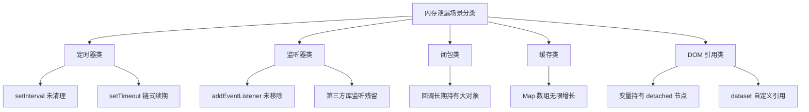

```javascript
// 1. 定时器泄漏：组件销毁未 clear，回调闭包持有整个实例
class Panel {
  start() { this.timer = setInterval(() => this.refresh(), 1000); } // 回调引用 this
  refresh() { /* ... */ }
  stop() { clearInterval(this.timer); }   // 忘调 stop 实例永远可达
}

// 2. 监听器泄漏：window 是常驻 Root，卸载未移除即泄漏
// mount:   window.addEventListener('resize', this.onResize);
// unmount: window.removeEventListener('resize', this.onResize); // 必须成对

// 3. 闭包泄漏：长生命周期回调持有大数组
let bigData = new Array(1e6).fill('x');
document.querySelector('#btn').onclick = () => console.log(bigData.length);
// 修复：只捕获需要的字段
// const len = bigData.length; btn.onclick = () => console.log(len); bigData = null;

// 4. 缓存泄漏：全局 Map 无限增长
const cache = new Map();
function memo(key, val) { cache.set(key, val); } // key 无限增多 → 改 LRU 或 WeakMap

// 5. DOM 引用泄漏：detached 节点被 JS 变量持有
let detached;
function replaceNode() {
  const old = document.body.firstElementChild;
  detached = old;          // 即使 remove 后，节点仍无法回收
  old.remove();
}
// 修复：用完 detached = null；元数据关联改用 WeakMap

// 6. 代码级自检：反复执行疑似泄漏操作，观察堆增量趋势
function leakProbe(name, action) {
  return async (times = 20) => {
    const before = performance.memory.usedJSHeapSize;
    for (let i = 0; i < times; i++) action();
    await new Promise((r) => setTimeout(r, 1500)); // 留时间给 GC
    const after = performance.memory.usedJSHeapSize;
    console.log(name, '堆增量约', Math.round((after - before) / 1024), 'KB');
  };
}
```

### JS-179：垃圾回收算法有哪些概念？标记清除、分代、增量并发 GC 是怎么回事？

**答**：
- 标记清除（Mark-Sweep）：从 GC Root（全局对象、当前执行栈、被引用的内建对象）出发标记可达对象，未标记者整块清除；天然解决循环引用，是现代引擎的基础。
- 标记整理（Mark-Compact）：清除后留下内存碎片，把存活对象向一端搬移；V8 老生代的主要回收方式。
- 分代假说：新生代用 Scavenge（Cheney 半空间复制，空间小、速度快，对象朝生夕死），熬过两轮复制的对象晋升老生代；老生代用标记整理。
- 全停顿问题：标记时 JS 必须暂停；V8 用增量标记（三色标记：白未访问、灰已入队、黑已处理）与 JS 交替执行，清理与整理并行/并发，配合写屏障保证增量期间引用正确。
- 引用计数为什么被弃用：循环引用永远计数大于 0 无法回收（IE 时代 BOM/DOM 泄漏根源）。
- 实践含义：GC 无法编程触发，只能降低分配压力——少造临时对象、复用对象池、数值场景用 TypedArray。

```javascript
// 1. 三色标记概念模型：白=未访问 灰=已入队待处理 黑=处理完毕
function markDemo(root) {
  const grey = [root], black = new Set();
  while (grey.length) {
    const cur = grey.pop();
    black.add(cur);                                    // 置黑
    for (const child of cur.refs || []) {
      if (!black.has(child)) grey.push(child);         // 邻居置灰入队
    }
  }
  return black; // 黑色集合即存活对象，其余整块清除
}

// 2. 循环引用：引用计数救不了，标记清除可以回收
function makeCycle() {
  const x = {}, y = {};
  x.ref = y; y.ref = x;   // 互相引用
  return null;            // 函数返回后 x、y 不可达，标记清除正常回收
}
makeCycle();

// 3. 降低 GC 压力实践一：对象池复用，避免高频 new
const pool = [];
function getVector(x, y) {
  const v = pool.pop() || {};
  v.x = x; v.y = y;
  return v;
}
function releaseVector(v) { pool.push(v); }

// 4. 实践二：数值密集场景预分配 TypedArray，无逐元素装箱
const samples = new Float32Array(10000); // 一次分配约 40KB，而非 push 装箱对象

// 5. 实践三：热路径不创建闭包与临时数组
function hotDistance(x1, y1, x2, y2) {
  return Math.hypot(x2 - x1, y2 - y1); // 纯计算，零分配
}
```

### JS-180：大数组处理怎么优化内存？分片、TypedArray、流式各适合什么场景？

**答**：
- 10 万+ 数据三个不要：不要一次性 JSON.parse 巨大字符串（峰值翻倍）、不要链式 map/filter 生成多份中间数组、不要同步全量渲染 DOM。
- 分片处理：把大数组切块、块间让出主线程，避免长任务阻塞渲染；内存峰值不降，适合"必须全量算且要求不卡 UI"。
- TypedArray：数值场景用 Float32Array/Int32Array，连续内存无装箱，比普通数组省一半以上内存且更快；配合 ArrayBuffer transfer 可零拷贝传给 Worker。
- 流式处理：Web Streams 或逐行解析，边读边算边丢，内存 O(1)，适合超大文件与日志分析。
- 原地算法与惰性求值：能用 for 原地写回就不用 map 新建数组；中间变换用生成器，消费时才计算。

```javascript
// 1. 分片处理：每 2000 条一块，块间让出事件循环
async function processInChunks(arr, fn, size = 2000) {
  for (let i = 0; i < arr.length; i += size) {
    const end = Math.min(i + size, arr.length);
    for (let j = i; j < end; j++) fn(arr[j], j);
    await new Promise((r) => setTimeout(r, 0)); // 让出主线程，页面不卡死
  }
}

// 2. TypedArray：数值密集场景，内存与速度双赢
const n = 100000;
const floats = new Float32Array(n);            // 4 字节/元素约 0.4MB
for (let i = 0; i < n; i++) floats[i] = Math.random();
// 对比 new Array(n).fill(0).map(...)：普通数组元素是装箱对象，峰值可达数倍

// 3. 生成器惰性变换：全程只有一份源数组
function* mapLazy(arr, fn) { for (let i = 0; i < arr.length; i++) yield fn(arr[i]); }
function sumOf(it) { let s = 0; for (const v of it) s += v; return s; }
// sumOf(mapLazy(bigArr, (x) => x * 2)) 不产生中间数组

// 4. 流式读取大文件：内存 O(1)
async function countLines(fileUrl) {
  const resp = await fetch(fileUrl);           // 本地 File 用 file.stream() 同理
  const reader = resp.body.getReader();
  const decoder = new TextDecoder();
  let buf = '', lines = 0;
  while (true) {
    const { done, value } = await reader.read();
    if (done) break;
    buf += decoder.decode(value, { stream: true });
    const parts = buf.split('\n');
    lines += parts.length - 1;
    buf = parts.pop();                         // 半行留给下一块继续拼
  }
  return lines + (buf ? 1 : 0);
}

// 5. 原地写回代替 map：省一整份新数组
for (let i = 0; i < arr.length; i++) arr[i] = arr[i].trim();
```

### JS-181：字符串拼接性能真相？+=、join、模板字符串到底谁快？

**答**：
- V8 现代优化下三者差距已很小：+= 使用 cons-string（绳结结构）实现 O(1) 延迟拼接，短拼接通常最快且可读性最好。
- "join 比 += 快"的结论来自老引擎时代每次 += 都整串复制；现在只有大量碎片一次性合并时 join 才有优势。
- 真正的坑不是 API 选型而是：拼接产生的 rope 在后续 indexOf/slice 等操作时才触发展平（flatten，O(n)）；超大字符串长期驻留内存；循环 innerHTML 反复解析。
- 经验法则：HTML 拼接用模板字符串一次成型；超大文本累积（日志/CSV 导出）用数组收集最后 join；热点循环避免对同一长串反复子串操作。
- 一切以实测为准：用 performance.now 在目标环境跑基准，别背过时结论。

```javascript
// 1. 基准测试脚手架：预热触发 JIT 后再计时
function bench(name, fn, times = 1e4) {
  fn(0); // 预热
  const t0 = performance.now();
  for (let i = 0; i < times; i++) fn(i);
  console.log(name, (performance.now() - t0).toFixed(1), 'ms');
}

const parts = Array.from({ length: 1000 }, (_, i) => 'frag-' + i);

// 2. += 循环拼接：V8 cons-string 优化，短拼接近似 O(1)
bench('+= 拼接', () => {
  let s = '';
  for (const p of parts) s += p;
});

// 3. join：攒碎片一次合并，碎片极多时占优
bench('join 拼接', () => parts.join(''));

// 4. 模板字符串：生成 HTML 首选，一次成型
bench('模板字符串', () => {
  let s = '';
  for (const p of parts) s += `<li>${p}</li>`;
});

// 5. 经验结论落地
// 少量拼接（<100 次）：可读性优先，直接模板字符串
// 循环拼 HTML：先拼完整字符串再一次 innerHTML，绝不循环 append
// 超大文本累积：数组收集 + 最后 join('')
// 展平陷阱：cons-string 在执行 search/slice 时才展平为平铺串，
//          拼完立即做这类操作会把 O(1) 拼接退化为 O(n)
```

### JS-182：防抖节流之外还有哪些调度手段？requestIdleCallback、时间切片、Worker 怎么选？

**答**：
- 防抖/节流解决"降低触发频率"；调度三件套解决"长任务如何不阻塞渲染"：切片让出主线程、空闲调度填充空隙、离线程搬出去算。
- requestIdleCallback：浏览器空闲期执行低优任务，deadline.timeRemaining() 控制单次工作量；必须传 timeout 保底，Safari 不支持需降级 setTimeout。
- 时间切片（React Scheduler 思想）：把计算切成约 5ms 小块，用 MessageChannel 宏任务调度（比 setTimeout(0) 更快且不受 4ms 嵌套钳制），切片间可响应高优输入。
- Web Worker：CPU 密集（大 JSON 序列化、图像处理、加密）直接搬离主线程；注意结构化克隆成本，小数据搬线程得不偿失，大数据用 Transferable 零拷贝。
- 决策矩阵：IO/事件驱动 → 防抖节流；可中断计算 → 时间切片；低优后台任务 → idle callback；CPU 密集一次性 → Worker。

```javascript
// 1. requestIdleCallback 封装：空闲分批 + timeout 保底 + 降级
const scheduleIdle = window.requestIdleCallback
  ? window.requestIdleCallback.bind(window)
  : (cb) => setTimeout(() => cb({ timeRemaining: () => 0, didTimeout: true }), 1);

function runWhenIdle(items, handler) {
  let i = 0;
  function step(deadline) {
    while (i < items.length && (deadline.timeRemaining() > 0 || deadline.didTimeout)) {
      handler(items[i++]);
    }
    if (i < items.length) scheduleIdle(step, { timeout: 2000 }); // 最迟 2 秒内跑完
  }
  scheduleIdle(step, { timeout: 2000 });
}
// runWhenIdle(bigList, (item) => buildIndex(item)); 索引/预取等低优任务

// 2. 时间切片：MessageChannel 宏任务驱动，每片约 5ms
function createScheduler(sliceMs = 5) {
  const { port1, port2 } = new MessageChannel();
  let task = null;
  port1.onmessage = () => {
    const start = performance.now();
    while (task && task.list.length) {
      task.work(task.list.shift());
      if (performance.now() - start > sliceMs) { port2.postMessage(null); return; } // 超片让出
    }
    task = null;
  };
  return (list, work) => { task = { list: [...list], work }; port2.postMessage(null); };
}
// const schedule = createScheduler();
// schedule(rows, (row) => renderRow(row)); // 长列表分帧渲染，滚动不卡

// 3. Worker 分流：CPU 密集任务离线程
// worker.js: onmessage = (e) => postMessage(heavyCompute(e.data));
const worker = new Worker('worker.js');
function computeOffThread(data, transfer = []) {
  return new Promise((resolve) => {
    worker.onmessage = (e) => resolve(e.data);
    worker.postMessage(data, transfer); // 大 ArrayBuffer 走 transfer 零拷贝
  });
}

// 4. 决策速查
// 搜索联想输入 → 防抖；滚动加载 → 节流；
// 千行列表渲染 → 时间切片；大文件解析 → Worker 或流式；
// 埋点索引/缓存清理 → requestIdleCallback
```

### JS-183：函数调用栈与尾调用优化现状？为什么递归深了会爆栈？

**答**：
- 每次函数调用压入一帧（参数、局部变量、返回地址），栈空间有限（Chrome 约一万多帧、几 MB），超限抛 RangeError: Maximum call stack size exceeded。
- 尾调用：函数最后一步是 return 另一个函数调用且当前帧不再需要；引擎若实现 TCO（尾调用优化）则复用当前帧，递归栈空间 O(1)。
- 现状：ES2015 规范要求严格模式实现 TCO，但只有 Safari/JavaScriptCore 落地；V8（Chrome/Node）出于调用栈信息与调试体验放弃，Babel 也不转译——生产代码不能依赖 TCO。
- 等效替代：尾递归机械改写为循环；trampoline 蹦床（每轮返回 thunk 由 while 驱动）；树形递归用显式栈。
- 实践优先级：能循环不递归；必须递归时控制深度或用尾递归形式 + trampoline。

```javascript
// 1. 爆栈复现：线性递归 1 万层
function sumTo(n) { return n === 0 ? 0 : n + sumTo(n - 1); }
// sumTo(100000) → RangeError: Maximum call stack size exceeded
// 每层帧都要保留 n 等待递归返回，栈帧无法释放

// 2. 尾递归形式：最后一步仅 return 调用（仅 Safari/JavaScriptCore 优化）
function sumTail(n, acc = 0) {
  if (n === 0) return acc;
  return sumTail(n - 1, acc + n); // 当前帧可复用，栈 O(1)
}

// 3. 生产方案一：机械改循环
function sumLoop(n) { let s = 0; for (let i = 1; i <= n; i++) s += i; return s; }

// 4. 生产方案二：trampoline，任何环境都 O(1) 栈
function trampoline(fn) {
  return (...args) => {
    let result = fn(...args);
    while (typeof result === 'function') result = result(); // 每轮只执行一个 thunk
    return result;
  };
}
const sumTramp = trampoline(function sum(n, acc = 0) {
  return n === 0 ? acc : () => sum(n - 1, acc + n); // 返回 thunk 而不是真调用
});
// sumTramp(1000000) 安全通过

// 5. 树形递归（无法尾调用）：显式栈替代调用栈
function flattenDepthFirst(tree) {
  const out = [], stack = [tree]; // 显式栈不受调用栈深度限制
  while (stack.length) {
    const node = stack.pop();
    out.push(node.value);
    if (node.children) stack.push(...node.children);
  }
  return out;
}
```

## 二十七、综合设计题

### JS-184：设计一个前端请求库？拦截器、重试、缓存、取消、并发控制如何整合？

**答**：
- 核心是拦截器管道：请求拦截器（注入 token、埋点）→ 发送 → 响应拦截器（统一错误解包、数据裁剪、401 处理），用链式 await 依次执行即可。
- 重试放传输层：只重试幂等方法上的网络错误与 5xx，指数退避加抖动；4xx 业务错误不重试。
- 取消统一走 AbortSignal：超时与业务竞态取消共用一个 AbortController，外部 signal 与内部超时信号级联。
- 缓存放业务层：GET 按 method+url+params 生成 key，命中未过期缓存直接返回同一 Promise，天然防止并发重复请求（防击穿）。
- 并发控制复用队列思想：超过最大并发数的任务排队，前一个完成自动放行下一个。

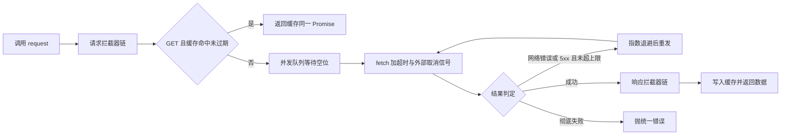

```javascript
// 1. 骨架：拦截器数组 + 简易并发门
function createHttp(defaults = {}) {
  const reqInterceptors = [];
  const resInterceptors = [];
  const cache = new Map();                       // key -> { promise, expireAt }
  let active = 0; const waiting = [];
  const gate = (fn) => new Promise((res, rej) => {  // 超过并发上限则排队
    waiting.push(() => fn().then(res, rej));
    pump();
  });
  function pump() {
    while (active < (defaults.concurrency ?? 6) && waiting.length) {
      active++;
      waiting.shift()().finally(() => { active--; pump(); });
    }
  }
  const request = (config) => gate(() => run(config));

  // 2. 执行层：拦截器链 → 缓存命中判断
  async function run(config) {
    for (const it of reqInterceptors) config = await it(config);
    const method = (config.method || 'GET').toUpperCase();
    const key = method + ' ' + config.url + ' ' + JSON.stringify(config.params ?? config.data ?? '');
    if (method === 'GET' && config.cacheTTL) {
      const hit = cache.get(key);
      if (hit && hit.expireAt > Date.now()) return hit.promise; // 并发重复请求共享同一 Promise
      if (hit) cache.delete(key);
      const promise = sendWithRetry(config).then(async (raw) => {
        let resp = raw;
        for (const it of resInterceptors) resp = await it(resp); // 响应拦截器
        return resp;
      });
      cache.set(key, { promise, expireAt: Date.now() + config.cacheTTL });
      try { return await promise; }
      catch (e) { cache.delete(key); throw e; }   // 失败不缓存，下次重试
    }
    const raw = await sendWithRetry(config);
    let resp = raw;
    for (const it of resInterceptors) resp = await it(resp);
    return resp;
  }

  // 3. 重试：仅网络错误与 5xx，指数退避 + 抖动
  async function sendWithRetry(config, attempt = 0) {
    try {
      return await doFetch(config);
    } catch (err) {
      const retriable = !err.isBusiness4xx && attempt < (config.retry ?? 0);
      if (!retriable) throw err;
      const delay = Math.min(2 ** attempt * 500, 5000) + Math.random() * 300;
      await new Promise((r) => setTimeout(r, delay));
      return sendWithRetry(config, attempt + 1);
    }
  }

  // 4. fetch：超时与外部取消统一级联到一个 AbortController
  async function doFetch(config) {
    const ctrl = new AbortController();
    const timer = setTimeout(() => ctrl.abort(new Error('timeout')), config.timeout ?? 15000);
    config.signal?.addEventListener('abort', () => ctrl.abort(config.signal.reason));
    try {
      const resp = await fetch(config.url, { ...config, signal: ctrl.signal });
      if (!resp.ok) {
        const e = new Error('HTTP ' + resp.status);
        e.status = resp.status;
        e.isBusiness4xx = resp.status < 500;
        throw e;
      }
      return resp.json();
    } finally { clearTimeout(timer); }
  }

  request.interceptors = {
    request: { use: (fn) => reqInterceptors.push(fn) },
    response: { use: (fn) => resInterceptors.push(fn) },
  };
  return request;
}

// 5. 使用：token 注入 + 业务码解包 + GET 缓存 + 自动重试
const http = createHttp({ timeout: 5000, concurrency: 4 });
http.interceptors.request.use((cfg) => ({
  ...cfg,
  headers: { ...cfg.headers, Authorization: 'Bearer ' + localStorage.getItem('token') },
}));
http.interceptors.response.use((data) =>
  data.code === 0 ? data.result : Promise.reject(data),
);
// http({ url: '/api/list', params: { page: 1 }, retry: 2, cacheTTL: 30_000 })
```

### JS-185：设计一个状态管理库？订阅、派生、中间件如何用 100 行实现？

**答**：
- 核心 = 单一 store：state 不允许直接改，dispatch(action) 经 reducer 产生新 state；reducer 返回原引用则跳过通知，天然做变更粒度优化。
- 订阅：listeners 用 Set 存储，subscribe 返回 unsubscribe；通知在 dispatch 内 state 确定后同步触发，保证视图拿到最终 state。
- 派生状态（selector）带一级缓存：输入引用没变直接复用上次结果，避免昂贵的 filter/map 在每次 render 重复执行。
- 中间件：applyMiddleware 用 reduceRight 把原 dispatch 包在链最内层，日志、thunk 异步、上报等横切能力可插拔。
- 100 行覆盖 Redux 精髓：getState / dispatch / subscribe / applyMiddleware / createSelector。

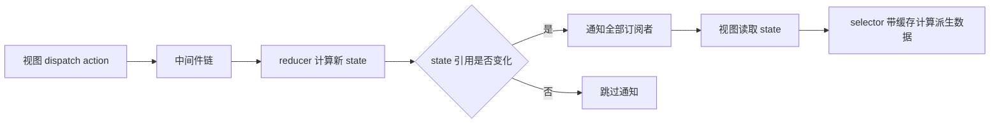

```javascript
// 1. createStore：reducer + 订阅通知
function createStore(reducer, preloadedState) {
  let state = preloadedState;
  const listeners = new Set();
  const getState = () => state;
  function dispatch(action) {
    if (typeof action.type === 'undefined') throw new Error('action 缺少 type');
    const next = reducer(state, action);
    if (next !== state) { state = next; listeners.forEach((fn) => fn()); } // 引用变才通知
    return action;
  }
  const subscribe = (fn) => (listeners.add(fn), () => listeners.delete(fn));
  return { getState, dispatch, subscribe };
}

// 2. applyMiddleware：原 dispatch 位于链最内层
function applyMiddleware(store, ...mws) {
  let dispatch = store.dispatch;
  const api = { getState: store.getState, dispatch: (a) => dispatch(a) };
  const chain = mws.map((mw) => mw(api));
  store.dispatch = chain.reduceRight((next, mw) => mw(next), dispatch);
  return store;
}

// 3. 两个经典中间件：日志 + 异步 thunk
const logger = () => (next) => (action) => {
  console.log('[dispatch]', action);
  return next(action);
};
const thunk = ({ dispatch, getState }) => (next) => (action) =>
  typeof action === 'function' ? action(dispatch, getState) : next(action);

// 4. 派生状态：一级缓存的 selector
function createSelector(selector, compute) {
  let lastInput = Symbol('none'), lastResult;
  return (state) => {
    const input = selector(state);
    if (input !== lastInput) { lastResult = compute(input); lastInput = input; }
    return lastResult;
  };
}

// 5. 组装：todo store 完整示例
const reducer = (state = { todos: [], filter: 'all' }, action) => {
  switch (action.type) {
    case 'todo/add':   return { ...state, todos: [...state.todos, action.payload] };
    case 'filter/set': return state.filter === action.payload ? state : { ...state, filter: action.payload };
    default:           return state;
  }
};
const store = applyMiddleware(createStore(reducer), logger, thunk);

const visibleTodos = createSelector(
  (s) => s.filter === 'all' ? s.todos : s.todos.filter((t) => t.done === (s.filter === 'done')),
  (list) => list.map((t) => ({ ...t, label: t.text.toUpperCase() })), // 昂贵变换，输入不变不重算
);
store.subscribe(() => render(store.getState()));
function render(state) { console.log('渲染', visibleTodos(state)); }

store.dispatch({ type: 'todo/add', payload: { text: '学习', done: false } });
store.dispatch({ type: 'filter/set', payload: 'done' });
// 异步 action 示例：thunk 放行函数
store.dispatch(async (dispatch) => {
  const data = await fetch('/api/init').then((r) => r.json());
  dispatch({ type: 'todo/add', payload: data.firstTodo });
});
```

### JS-186：设计一个表单校验器？链式规则、异步校验、错误聚合怎么实现？

**答**：
- 校验器 = 规则链：field.required().min(6).pattern(...)，链式 API 每次调用向 rules 数组追加一条异步校验函数，返回 this 支持续链。
- 同步与异步统一：所有规则都实现为 async 函数（返回错误消息或空串），自定义异步规则（用户名查重）通过 check 注入，对调用方透明。
- 错误聚合：validate() 逐字段并行 Promise.all，一次返回 { valid, errors } 全量错误而非 fail-fast，适合表单整体提示与滚动定位。
- 字段联动（确认密码）通过给规则传全量表单 values 实现，而不是只看单字段值。
- 异步校验竞态防护：字段级版本号，只采纳最后一次校验结果，避免慢请求覆盖新输入的结论。

```javascript
// 1. 字段校验器：链式累积规则
class FieldValidator {
  constructor(label) {
    this.label = label;
    this.rules = [];
  }
  required(msg) {
    this.rules.push(async (v) => (v == null || v === '' ? msg || `${this.label}必填` : ''));
    return this;
  }
  min(n, msg) {
    this.rules.push(async (v) => (v != null && String(v).length < n ? msg || `${this.label}至少 ${n} 位` : ''));
    return this;
  }
  pattern(re, msg) {
    this.rules.push(async (v) => (v != null && !re.test(v) ? msg || `${this.label}格式不正确` : ''));
    return this;
  }
  check(fn, msg) { // 注入自定义/异步规则，fn 返回 true 表示通过
    this.rules.push(async (v, all) => ((await fn(v, all)) ? '' : msg || `${this.label}校验失败`));
    return this;
  }
}

// 2. 表单级：注册规则 + 全量校验聚合
function createForm(schema) {
  return {
    schema,
    async validate(values) {
      const entries = await Promise.all(
        Object.entries(schema).map(async ([field, validator]) => {
          const msgs = (await Promise.all(validator.rules.map((r) => r(values[field], values))))
            .filter(Boolean);
          return [field, msgs];
        }),
      );
      const errors = Object.fromEntries(entries.filter(([, msgs]) => msgs.length));
      return { valid: Object.keys(errors).length === 0, errors }; // 一次聚合所有错误
    },
  };
}

// 3. 使用：同步规则 + 异步查重 + 字段联动
const checkNameUnique = async (name) => {
  await new Promise((r) => setTimeout(r, 50));   // 模拟请求
  return name !== 'admin';
};

const form = createForm({
  username: new FieldValidator('用户名').required().min(3)
    .check(checkNameUnique, '用户名已被占用'),
  password: new FieldValidator('密码').required().min(6),
  confirm:  new FieldValidator('确认密码')
    .required()
    .check((v, all) => v === all.password, '两次密码不一致'), // 拿到全量表单做联动
});

form.validate({ username: 'admin', password: '123456', confirm: '654321' })
  .then(({ valid, errors }) => console.log(valid, errors));
// false { username: ['用户名已被占用'], confirm: ['两次密码不一致'] }

// 4. 异步校验竞态防护：只采纳最后一次结果
let seq = 0;
async function validateFieldRaced(validator, value, all) {
  const mySeq = ++seq;
  const msgs = await Promise.all(validator.rules.map((r) => r(value, all)));
  return mySeq === seq ? msgs.filter(Boolean) : null; // 过期结果直接丢弃
}
```

### JS-187：设计一个类型安全的事件总线？通配符与 once 怎么配合？

**答**：
- 类型安全靠 TS 泛型映射：定义 `interface EventMap { 事件名: 载荷类型 }`，on/emit 的参数由事件名自动推导，事件名拼错或载荷类型不符在编译期报错。
- 通配符监听 `'*'` 收全部事件，便于调试与埋点；emit 返回是否有监听者接收，方便发现孤儿事件。
- once = 用包装函数先 off 再执行原回调；on 返回注销函数，组件卸载时直接调用，避免手管 off。
- 运行时能力（通配符）与编译期约束（精确事件）并存：通配监听的载荷声明为 unknown，强制使用者窄化后再用。
- 跨模块通信建议 key 常量化或 Symbol 化，杜绝手写字符串拼错。

```typescript
// 1. 类型定义：事件名 -> 载荷 的映射，on 与 emit 双向约束
type EventMap = {
  login: { userId: string };
  logout: undefined;
  error: Error;
};
type Handler<T> = T extends undefined ? () => void : (payload: T) => void;

class TypedEventBus<M extends Record<string, unknown>> {
  private handlers = new Map<string, Set<(p: unknown) => void>>();

  // K | '*'：精确事件或通配符；返回注销函数
  on<K extends keyof M>(event: K | '*', fn: Handler<M[K]> | ((p: unknown) => void)): () => void {
    const set = this.handlers.get(event as string) ?? new Set();
    set.add(fn as (p: unknown) => void);
    this.handlers.set(event as string, set);
    return () => this.off(event as K, fn as Handler<M[K]>);
  }

  once<K extends keyof M>(event: K, fn: Handler<M[K]>): () => void {
    const wrap = ((p: unknown) => {
      this.off(event, wrap as Handler<M[K]>);      // 先注销再执行，保证只触发一次
      (fn as (p: unknown) => void)(p);
    }) as Handler<M[K]>;
    return this.on(event, wrap);
  }

  off<K extends keyof M>(event: K, fn: Handler<M[K]>) {
    this.handlers.get(event as string)?.delete(fn as (p: unknown) => void);
  }

  emit<K extends keyof M>(event: K, ...args: M[K] extends undefined ? [] : [M[K]]): boolean {
    const p = args[0];
    let delivered = false;
    const call = (set?: Set<(p: unknown) => void>) =>
      set?.forEach((fn) => { delivered = true; fn(p); });
    call(this.handlers.get(event as string));      // 精确监听
    if (event !== '*') call(this.handlers.get('*')); // 通配监听收到全部事件
    return delivered;                              // 无人接收返回 false，便于调试
  }
}

// 2. 使用：事件名与载荷全部受编译期约束
const bus = new TypedEventBus<EventMap>();
bus.on('login', (p) => console.log(p.userId));     // p 自动推导为 { userId: string }
bus.on('logout', () => console.log('登出'));
bus.once('error', (e) => console.error(e.message));
bus.on('*', (p) => console.log('通配收到', p));     // unknown 载荷，窄化后再用
const dispose = bus.on('login', () => {});         // 返回注销函数
dispose();                                          // 组件卸载时调用
// bus.emit('logn', {})   // 编译错误：事件名拼错
// bus.emit('login', 1)   // 编译错误：载荷类型不符
bus.emit('login', { userId: 'u1' });               // 精确 + 通配两个监听都触发
```

### JS-188：设计一个任务调度器？优先级、并发上限、取消如何实现？

**答**：
- 优先级队列用最小堆：priority 数值越小越先出堆，同优先级按入队序 FIFO（seq 破平）；堆顶出队交给并发池。
- 并发池：active < max 时从堆取任务执行，任务 finally 后 active-- 并继续 _tick，天然填满空位。
- 取消三态：未执行 → 标记 cancelled 出队时丢弃并 reject；执行中 → 通过任务自带的 AbortSignal 通知任务内部中断；clear() 清空整个队列。
- add 返回 { promise, cancel }，任务函数接收 signal，把取消权透传给内部 fetch/定时器实现真中断。
- 适用场景：上传队列、消息推送处理、批量导出；onDrained 提供整批完成的等待点。

```javascript
// 1. 优先级最小堆：priority 小者先出，seq 保证同级 FIFO
class Heap {
  constructor() { this.a = []; }
  get size() { return this.a.length; }
  push(node) { this.a.push(node); this._up(this.a.length - 1); }
  pop() {
    const top = this.a[0], last = this.a.pop();
    if (this.a.length && last !== undefined) { this.a[0] = last; this._down(0); }
    return top;
  }
  _less(i, j) { return this.a[i].priority < this.a[j].priority || (this.a[i].priority === this.a[j].priority && this.a[i].seq < this.a[j].seq); }
  _up(i) {
    while (i > 0) {
      const p = (i - 1) >> 1;
      if (!this._less(i, p)) break;
      [this.a[i], this.a[p]] = [this.a[p], this.a[i]]; i = p;
    }
  }
  _down(i) {
    for (;;) {
      const l = 2 * i + 1, r = l + 1; let m = i;
      if (l < this.a.length && this._less(l, m)) m = l;
      if (r < this.a.length && this._less(r, m)) m = r;
      if (m === i) break;
      [this.a[i], this.a[m]] = [this.a[m], this.a[i]]; i = m;
    }
  }
}

// 2. 调度器：堆 + 并发池 + 单任务取消
class Scheduler {
  constructor(maxConcurrency = 3) {
    this.max = maxConcurrency; this.active = 0;
    this.heap = new Heap(); this.seq = 0; this._drained = [];
  }
  add(fn, { priority = 5, signal } = {}) {         // fn: (signal) => Promise
    const task = { fn, priority, signal, seq: this.seq++, cancelled: false, resolve: null, reject: null };
    const promise = new Promise((res, rej) => { task.resolve = res; task.reject = rej; });
    this.heap.push(task);
    signal?.addEventListener('abort', () => this.cancelTask(task), { once: true });
    this._tick();
    return { promise, cancel: () => this.cancelTask(task) };
  }
  cancelTask(task) {
    if (task.cancelled) return;
    task.cancelled = true;
    task.reject?.(new DOMException('任务已取消', 'AbortError'));
  }
  clear() { while (this.heap.size) this.cancelTask(this.heap.pop()); }
  onDrained() {
    return new Promise((r) => {
      if (this.active === 0 && this.heap.size === 0) return r();
      this._drained.push(r);
    });
  }
  _tick() {
    while (this.active < this.max && this.heap.size) {
      const task = this.heap.pop();
      if (task.cancelled) continue;                 // 已取消：丢弃不占槽
      this.active++;
      task.fn(task.signal).then(task.resolve, task.reject)
        .finally(() => { this.active--; this._tick(); this._checkDrained(); });
    }
    this._checkDrained();
  }
  _checkDrained() {
    if (this.active === 0 && this.heap.size === 0) {
      this._drained.forEach((r) => r()); this._drained = [];
    }
  }
}

// 3. 使用：高优插队 + 中途取消
const sch = new Scheduler(2);
const job = (name, ms) => (signal) => new Promise((res) => {
  const t = setTimeout(() => res(name + ' 完成'), ms);
  signal?.addEventListener('abort', () => { clearTimeout(t); res(name + ' 中断'); }, { once: true });
});
sch.add(job('低优A', 300), { priority: 9 });
sch.add(job('低优B', 300), { priority: 9 });
sch.add(job('高优C', 100), { priority: 1 });        // 后入队但先出堆执行
const d = sch.add(job('待取消D', 1000), { priority: 1 });
d.cancel();                                         // 未执行直接丢弃，不占并发槽
d.promise.catch((e) => console.log('捕获', e.name)); // AbortError
sch.onDrained().then(() => console.log('全部任务结束'));
```

### JS-189：设计一个缓存层？内存 + storage 两级、TTL、版本失效怎么实现？

**答**：
- 两级结构：L1 内存 Map（同步、快、刷新即失）→ L2 localStorage/IndexedDB（持久、慢、跨刷新）；读取 L1 miss 才穿透 L2 并回填 L1。
- 值包装为 { v, expireAt, ... }，采用懒过期：读取时才判断 TTL，写路径顺带删过期项，避免全量扫描。
- 版本失效：key 统一带版本前缀（如 `c:v2:user:1`），发版升版本号即整体失效；旧版本数据由 clearVersion 惰性清扫，不做启动时全删。
- 容错三件套：JSON 解析失败视为 miss、QuotaExceededError 降级纯内存、同 key 并发加载共享 inflight Promise 防击穿。
- 对外只暴露 get/set/del/clearVersion，业务侧传入 loader 即"读缓存 → 未命中取数 → 回填"。

```javascript
// 1. 两级缓存：内存 L1 + localStorage L2，TTL + 版本号
function createCache({ prefix = 'c:', version = 'v1', storage = localStorage } = {}) {
  const mem = new Map();
  const inflight = new Map();                       // 防击穿：同 key 并发共享加载 Promise
  const key = (k) => `${prefix}${version}:${k}`;

  const readL2 = (k) => {
    try {
      const raw = storage.getItem(key(k));
      if (!raw) return null;
      const item = JSON.parse(raw);
      if (item.expireAt && item.expireAt < Date.now()) {  // 懒过期
        storage.removeItem(key(k));
        return null;
      }
      return item.v;
    } catch { return null; }                        // 解析失败视为 miss
  };
  const writeL2 = (k, v, ttl) => {
    try {
      storage.setItem(key(k), JSON.stringify({ v, expireAt: ttl ? Date.now() + ttl : 0 }));
    } catch { /* 容量满：降级为纯内存缓存，不抛错 */ }
  };

  async function get(k, loader, { ttl = 5 * 60_000 } = {}) {
    if (mem.has(k)) return mem.get(k);              // L1
    const hit = readL2(k);                          // L2
    if (hit !== null) { mem.set(k, hit); return hit; }
    if (inflight.has(k)) return inflight.get(k);    // 并发去重
    const p = Promise.resolve()
      .then(loader)                                 // 穿透取数
      .then((v) => { mem.set(k, v); writeL2(k, v, ttl); return v; })
      .finally(() => inflight.delete(k));
    inflight.set(k, p);
    return p;
  }
  const set = (k, v, ttl) => { mem.set(k, v); writeL2(k, v, ttl); };
  const del = (k) => { mem.delete(k); storage.removeItem(key(k)); };
  function clearVersion() {                         // 清扫旧版本残留（发版后调一次）
    Object.keys(storage)
      .filter((k) => k.startsWith(prefix) && !k.startsWith(`${prefix}${version}:`))
      .forEach((k) => storage.removeItem(k));
  }
  return { get, set, del, clearVersion };
}

// 2. 使用：接口结果缓存，穿透才发请求，二次读取零请求
const cache = createCache({ version: 'v2' });
async function getUser(id) {
  return cache.get(
    `user:${id}`,
    () => fetch('/api/user/' + id).then((r) => r.json()),
    { ttl: 60_000 },
  );
}
getUser(1).then((u) => console.log('首次网络', u));
getUser(1).then((u) => console.log('二次命中', u));
```

### JS-190：设计一个埋点 SDK 的核心队列？批量、去重、定时冲刷、失败重试怎么实现？

**答**：
- 核心是缓冲队列：track() 只入队不上报，达到 maxBatch 或 flushInterval 定时触发冲刷；页面隐藏/卸载时用 sendBeacon 强制冲刷（visibilitychange 时机优于 unload）。
- 去重：对"事件+载荷"做 hash，去重窗口内同 hash 只发一次（防连点、防重复 PV）。
- 失败重试：失败批次塞回队头 + 指数退避重发；超过 maxRetry 计入死信丢弃，防止队列无限膨胀。
- 持久化：未上报队列落 localStorage，页面刷新后恢复，丢数率大幅降低；同时设容量上限。
- 通道优先级：sendBeacon（不阻塞卸载）→ fetch keepalive（POST 可带更多头）双通道。

```javascript
// 1. 埋点队列：批量 + 去重 + 定时冲刷 + 重试 + 持久化
function createTracker({ endpoint, maxBatch = 20, interval = 5000, maxRetry = 3 } = {}) {
  const DEDUP_WINDOW = 1000;
  const dedup = new Map();                          // hash -> lastTs
  let queue = loadQueue();                          // 刷新后恢复
  let retryCount = 0;

  function track(event, props = {}) {
    const hash = event + JSON.stringify(props);
    const now = Date.now();
    if (dedup.has(hash) && now - dedup.get(hash) < DEDUP_WINDOW) return; // 窗口内去重
    dedup.set(hash, now);
    queue.push({ event, props, ts: now, _retry: 0 });
    saveQueue();
    if (queue.length >= maxBatch) flush();          // 攒够一批立即发
  }

  async function flush(useBeacon = false) {
    if (!queue.length) return;
    const batch = queue;
    queue = [];                                     // 先摘下队列，失败再塞回，避免重试时重复
    const body = JSON.stringify({ events: batch, sentAt: Date.now() });
    if (useBeacon && navigator.sendBeacon?.(endpoint, body)) {
      saveQueue(); return;                          // 卸载场景：sendBeacon 即视为成功
    }
    try {
      const resp = await fetch(endpoint, { method: 'POST', body, keepalive: true });
      if (!resp.ok) throw new Error('HTTP ' + resp.status);
      retryCount = 0; saveQueue();
    } catch (e) {
      if (batch[0]._retry >= maxRetry) {            // 超过上限：死信丢弃
        saveQueue();
        return;
      }
      batch.forEach((it) => it._retry++);
      queue = [...batch, ...queue];                 // 失败批次塞回队头
      const backoff = Math.min(1000 * 2 ** ++retryCount, 30_000);
      setTimeout(() => flush(), backoff);           // 指数退避重试
    }
  }

  function saveQueue() {
    try { localStorage.setItem('__tk', JSON.stringify(queue.slice(-200))); } catch {}
  }
  function loadQueue() {
    try { return JSON.parse(localStorage.getItem('__tk') || '[]'); } catch { return []; }
  }

  document.addEventListener('visibilitychange', () => {
    if (document.visibilityState === 'hidden') flush(true); // 离开页面：sendBeacon 兜底
  });
  const timer = setInterval(() => flush(), interval);       // 定时冲刷
  return { track, flush, destroy: () => clearInterval(timer) };
}

// 2. 使用
const tracker = createTracker({ endpoint: '/collect', maxBatch: 10, interval: 3000 });
tracker.track('pv', { page: '/home' });
tracker.track('click', { target: 'buy-btn' });
tracker.track('click', { target: 'buy-btn' });    // 窗口内被去重，只发一条
```

### JS-191：设计一个前端路由？history API、动态参数、守卫怎么实现？

**答**：
- history 模式：pushState 改 URL 不触发事件，靠 popstate 监听前进后退；拦截 `<a>` 点击改走 pushState（链接劫持），服务端需 fallback 到 index.html。
- 路由表预编译：`/user/:id` 在注册时编译成正则 + 参数名数组，匹配时 extract params；无匹配走 404。
- 守卫管线：beforeEach 支持异步，按序 await；返回 false 中止、返回字符串重定向，重定向复用 push 保证守卫再次生效。
- 订阅者模式：resolve 完成后通知渲染层（组件切换/回调），路由器与 UI 解耦。
- 与 hash 模式取舍：history 需服务端配合但 URL 干净；hash 自带 fallback 但 SEO 弱。

```javascript
// 1. 路径编译：/user/:id -> 正则 + 参数名
function compilePath(path) {
  const keys = [];
  const pattern = path
    .replace(/\/:([^/]+)/g, (_, k) => { keys.push(k); return '/([^/]+)'; })
    .replace(/\//g, '\\/');
  return { regex: new RegExp(`^${pattern}$`), keys };
}

// 2. Router：路由表 + history 集成 + 守卫管线
class Router {
  constructor(routes) {
    this.routes = routes.map((r) => ({ ...r, ...compilePath(r.path) }));
    this.guards = [];
    this.listeners = new Set();
    window.addEventListener('popstate', () => this.resolve(location.pathname)); // 前进后退
  }
  beforeEach(guard) { this.guards.push(guard); }
  subscribe(fn) { this.listeners.add(fn); return () => this.listeners.delete(fn); }

  push(to) {
    history.pushState({}, '', to);
    this.resolve(to);                               // pushState 不触发 popstate，需手动 resolve
  }
  async resolve(path) {
    let matched = null, params = {};
    for (const r of this.routes) {
      const m = r.regex.exec(path);
      if (m) {
        matched = r;
        params = Object.fromEntries(r.keys.map((k, i) => [k, decodeURIComponent(m[i + 1])]));
        break;
      }
    }
    const ctx = { path, params, route: matched };
    for (const guard of this.guards) {              // 守卫串行执行
      const result = await guard(ctx);
      if (result === false) return;                 // 中止
      if (typeof result === 'string' && result !== path) return this.push(result); // 重定向
    }
    this._notify({ ...ctx, component: matched?.component ?? 'NotFound' });
  }
  _notify(ctx) { this.listeners.forEach((fn) => fn(ctx)); }
}

// 3. 使用：动态参数 + 登录守卫 + 重定向
const isLogin = () => !!localStorage.getItem('token');
const router = new Router([
  { path: '/', component: 'HomePage' },
  { path: '/user/:id', component: 'UserPage' },
  { path: '/admin', component: 'AdminPage' },
]);
router.beforeEach((ctx) => {
  if (ctx.component === 'AdminPage' && !isLogin()) return '/login'; // 未登录重定向
  return true;
});
router.subscribe((ctx) => console.log('渲染', ctx.component, ctx.params));
router.push('/user/42');   // 渲染 UserPage { id: '42' }
router.push('/admin');     // 守卫重定向，渲染 LoginPage
```

### JS-192：设计一个对话框管理器？栈式管理与 Promise 化返回值怎么实现？

**答**：
- 每个 open() 返回 Promise，resolve 值即"用户结果"：确认 resolve(true)、表单 resolve(values)、取消 resolve(false)，调用方 await 代替回调嵌套。
- 栈式管理：对话框上再弹对话框时用数组栈维护层级，z-index 随栈深递增；ESC/遮罩/关闭动作只作用于栈顶。
- 统一关闭入口 close(value)：从栈中摘除、卸载 DOM、resolve 一次（Promise 重复 resolve 无害但要防止重复操作 DOM）。
- 管理器持有独立容器，动态挂载/卸载；关闭时同步清理事件监听，避免 detached DOM 泄漏。
- 取消与确认语义分离靠 resolve 值区分，调用方 `if (!ok) return` 一行处理，无需 try-catch。

```javascript
// 1. 对话框管理器：栈式 + Promise 返回值
class DialogManager {
  constructor() {
    this.stack = [];
    this.container = document.createElement('div');
    document.body.appendChild(this.container);
  }
  open({ title = '', content = '', confirmText = '确定', cancelText = '取消' } = {}) {
    return new Promise((resolve) => {
      const mask = document.createElement('div');
      mask.style.cssText =
        'position:fixed;inset:0;background:rgba(0,0,0,.4);display:flex;align-items:center;justify-content:center;z-index:' +
        (1000 + this.stack.length);                // z-index 随栈深递增
      mask.innerHTML = `<div role="dialog" style="background:#fff;padding:20px;border-radius:8px">
        <h3>${title}</h3><div>${content}</div>
        <button data-act="cancel">${cancelText}</button>
        <button data-act="confirm">${confirmText}</button></div>`;
      this.container.appendChild(mask);
      const entry = { mask, close };
      function close(value) {
        const idx = manager.stack.indexOf(entry);
        if (idx === -1) return;                    // 防重复关闭
        manager.stack.splice(idx, 1);
        mask.remove();                             // 卸载 DOM，监听随节点回收
        resolve(value);                            // 确认 true / 取消 false
      }
      mask.addEventListener('click', (e) => {
        const act = e.target.dataset?.act;
        if (act === 'confirm') close(true);
        else if (act === 'cancel' || e.target === mask) close(false); // 遮罩点击视为取消
      });
      const manager = this;
      this.stack.push(entry);
    });
  }
  confirm(title, content) { return this.open({ title, content }); }
  closeTop() {                                     // 供 ESC 快捷键调用：只关栈顶
    const top = this.stack[this.stack.length - 1];
    top && top.close(false);
  }
}

// 2. 使用：await 拿结果，多层嵌套自动叠层级
const dm = new DialogManager();
async function onDelete() {
  const ok = await dm.confirm('删除确认', '删除后不可恢复，确定吗？');
  if (!ok) return console.log('已取消');
  console.log('执行删除');
  await dm.confirm('完成', '删除成功');             // 第二层弹窗，栈式管理层级正确
}
document.addEventListener('keydown', (e) => e.key === 'Escape' && dm.closeTop());
onDelete();
```

### JS-193：设计一个权限系统前端核心？按钮、路由、接口三层权限如何落地？

**答**：
- 三层模型：路由级（页面可见性）、按钮级（操作可见性）、接口级（兜底）；前端权限只是体验优化，服务端校验才是安全底线。
- 权限数据：登录后拉取权限码集合（如 `['user:delete', 'order:export']`）存入响应式 auth 单例；按钮用 v-perm 指令按码渲染。
- 路由级：路由 meta 声明 permission，全局守卫比对权限码，无权限重定向 403；动态路由按权限注册。
- 接口级：请求拦截器带 token，响应拦截器统一识别 401（清会话跳登录）与 403（提示无权限），业务代码零感知。
- 角色切换：auth.setCodes 后发布订阅通知，受控组件批量重渲染，无需刷新页面。

```javascript
// 1. 权限中心：codes 集合 + 响应式订阅
function createAuth(codes = []) {
  const listeners = new Set();
  return {
    codes: new Set(codes),
    has(code) { return this.codes.has(code); },
    setCodes(list) { this.codes = new Set(list); listeners.forEach((fn) => fn()); }, // 切换角色
    subscribe(fn) { listeners.add(fn); return () => listeners.delete(fn); },
  };
}
const auth = createAuth(['user:read', 'order:export']);

// 2. 按钮级：v-perm 指令（思想示意）
function permDirective(el, binding) {
  if (!auth.has(binding.value)) {
    // 生产建议 remove() 而非隐藏：防止用户从 DOM 查到按钮信息
    el.parentNode?.removeChild(el);
  }
}
// 模板：<button v-perm="'user:delete'">删除</button>

// 3. 路由级：meta.permission + 守卫
const routes = [
  { path: '/user', component: 'UserPage' },
  { path: '/order/export', component: 'ExportPage', permission: 'order:export' },
];
function routeGuard(to) {
  const route = routes.find((r) => r.path === to);
  if (route?.permission && !auth.has(route.permission)) return '/403';
  return true;
}

// 4. 接口级：拦截器统一处理 401/403
async function request(url, options = {}) {
  const resp = await fetch(url, {
    ...options,
    headers: { ...options.headers, token: localStorage.getItem('token') || '' },
  });
  if (resp.status === 401) { location.href = '/login'; throw new Error('未登录'); }
  if (resp.status === 403) throw Object.assign(new Error('无权限'), { code: 403 });
  return resp.json();
}

// 5. 权限变化：订阅刷新受控组件
auth.subscribe(() => console.log('权限更新，重新渲染受控组件'));
```

### JS-194：设计一个图片懒加载组件？占位、防抖、失败重试怎么实现？

**答**：
- 核心是 IntersectionObserver 观察占位元素：进入视口（rootMargin 提前量预加载）才发起真实请求，加载后 unobserve 一次即止；单例 observer 复用。
- 占位策略：容器用 aspect-ratio 固定宽高比 + 灰底/LQIP 模糊缩略图，杜绝布局抖动（CLS）。
- 失败重试：onerror 后指数退避换时间戳参数重试 N 次，全部失败降级 fallback 占位图；探测用 Image 预加载，成功后才赋 src，避免半加载闪图。
- 非支持环境降级：scroll + rAF 节流 + getBoundingClientRect 视口判断。
- 体验细节：img.decode() 预解码避免主线程解码卡顿，加载完成加淡入过渡。

```javascript
// 1. 懒加载核心：IntersectionObserver + 失败重试
const MAX_RETRY = 2;
const FALLBACK = '/img/fallback.svg';

function lazyLoadImages(root = document, { preload = '200px' } = {}) {
  const io = new IntersectionObserver((entries) => {
    entries.forEach((entry) => {
      if (!entry.isIntersecting) return;
      const img = entry.target;
      io.unobserve(img);                           // 只加载一次
      loadImage(img, MAX_RETRY);
    });
  }, { rootMargin: preload, threshold: 0.01 });    // 提前 200px 预加载，用户无感
  root.querySelectorAll('img[data-src]').forEach((img) => io.observe(img));
  return io;
}

function loadImage(img, retriesLeft) {
  const src = img.dataset.src;
  img.classList.add('img-loading');
  const probe = new Image();                       // 先探测，成功再赋给真实节点
  probe.onload = async () => {
    img.src = src;
    try { await img.decode?.(); } catch {}         // 预解码，避免渲染卡顿
    img.classList.remove('img-loading');
    img.classList.add('img-loaded');               // CSS 淡入
    delete img.dataset.src;
  };
  probe.onerror = () => {
    if (retriesLeft > 0) {
      const delay = Math.min(500 * 2 ** (MAX_RETRY - retriesLeft), 4000);
      setTimeout(() => loadImage(img, retriesLeft - 1), delay); // 指数退避重试
    } else {
      img.src = FALLBACK;                          // 全部失败：兜底占位图
      img.classList.remove('img-loading');
    }
  };
  probe.src = src;
}

// 2. HTML 约定：占位容器固定宽高比防 CLS
// 

// 3. 降级路径：不支持 IO 时 scroll + rAF 节流
function lazyByScroll() {
  let ticking = false;
  const check = () => {
    ticking = false;
    document.querySelectorAll('img[data-src]').forEach((img) => {
      const r = img.getBoundingClientRect();
      if (r.top < innerHeight + 200 && r.bottom > -200) {
        img.src = img.dataset.src;
        delete img.dataset.src;
      }
    });
  };
  addEventListener('scroll', () => {
    if (!ticking) { ticking = true; requestAnimationFrame(check); }
  }, { passive: true });
  check();
}

'IntersectionObserver' in window ? lazyLoadImages() : lazyByScroll();
```

### JS-195：设计一个无限滚动 hook？IntersectionObserver + 缓冲区怎么做？

**答**：
- 哨兵元素放列表底部，IntersectionObserver 观察哨兵，进入视口即触发 loadMore；rootMargin 提前约一屏发起请求（缓冲），滚动全程无感加载。
- 状态机防重入：idle → loading → done/error；loading 或 done 时再次触发直接跳过，天然防抖。
- hasMore 终止：服务端返回 hasMore=false 时状态置 done，不再请求；哨兵也可 unobserve。
- 错误恢复：失败置 error，UI 显示重试按钮，点击重置 idle 触发重挂 observer 后自动重试。
- 超长列表配合虚拟滚动：只渲染可视区 + 上下缓冲，用 translateY 校准滚动位置；无限滚动负责"取数"，虚拟化负责"渲染"。

```javascript
// 1. useInfiniteScroll：哨兵观察 + 状态机 + 缓冲区（React 伪代码）
function useInfiniteScroll(fetchPage, { rootMargin = '400px' } = {}) {
  const sentinelRef = useRef(null);
  const [items, setItems] = useState([]);
  const [status, setStatus] = useState('idle');    // idle | loading | error | done
  const pageRef = useRef(0);
  const statusRef = useRef(status);
  statusRef.current = status;                      // 回调里读最新状态，避免闭包旧值

  const loadMore = useCallback(async () => {
    if (statusRef.current === 'loading' || statusRef.current === 'done') return; // 状态机防重入
    setStatus('loading');
    try {
      const { list, hasMore } = await fetchPage(pageRef.current + 1);
      pageRef.current += 1;
      setItems((prev) => [...prev, ...list]);
      setStatus(hasMore ? 'idle' : 'done');        // done 后永不再请求
    } catch (e) {
      setStatus('error');                          // 失败：UI 展示重试按钮
    }
  }, [fetchPage]);

  useEffect(() => {
    const el = sentinelRef.current;
    if (!el) return;
    const io = new IntersectionObserver(
      (entries) => entries[0].isIntersecting && loadMore(),
      { rootMargin },                              // 提前 400px 触发，缓冲加载
    );
    io.observe(el);
    return () => io.disconnect();                  // 卸载清理，防泄漏
  }, [loadMore, rootMargin, status]);              // error→idle 重挂即自动重试

  return { sentinelRef, items, status, retry: () => setStatus('idle') };
}

// 2. 组件用法
// function Feed() {
//   const { sentinelRef, items, status, retry } = useInfiniteScroll(
//     (page) => fetch(`/api/feed?page=${page}`).then((r) => r.json()),
//   );
//   return (
//     <div>
//       {items.map((it) => <Card key={it.id} data={it} />)}
//       {status === 'error'   && <button onClick={retry}>加载失败，点我重试</button>}
//       {status === 'loading' && <Spinner />}
//       {status === 'done'    && <p>没有更多了</p>}
//       <div ref={sentinelRef} style={{ height: 1 }} />  {/* 哨兵 */}
//     </div>
//   );
// }
```

### JS-196：设计一个乐观更新工具？回滚与冲突检测怎么实现？

**答**：
- 乐观更新三步：先改本地快照立刻渲染（标记 _optimistic）→ 发真实请求 → 成功以服务端数据对齐 / 失败回滚快照并提示。
- 回滚实现：变更前保存整个 state 的引用（或目标字段浅拷贝），失败时 setState 回旧引用触发订阅更新。
- 冲突检测：请求携带 baseVersion，服务端比对当前版本，不一致返回 409；客户端回滚后拉取最新数据，交给 UI 决定重放或提示。
- 并发保护：同 key 操作用 Promise 链串行化，保证后一次变更基于前一次的结果，回滚顺序才正确。
- 适用边界：点赞、收藏等低风险高频操作适合乐观；支付等强一致操作必须等响应。

```javascript
// 1. 乐观更新管理器：快照回滚 + 版本冲突检测 + 同 key 串行
function createOptimisticStore(fetcher) {
  const locks = new Map();                          // key -> Promise 链，同 key 串行化
  return async function optimistic(key, { patch, request }) {
    const prev = fetcher.getState();                // 变更前快照（生产可只存目标字段浅拷贝）
    const prevVersion = prev.version;
    fetcher.setState({ ...prev, ...patch, version: prevVersion + 1, _optimistic: true }); // 先本地生效
    const run = async () => {
      try {
        // 真实请求带上本地基线版本号，服务端做冲突检测
        const server = await request({ data: patch, baseVersion: prevVersion });
        fetcher.setState({ ...server, _optimistic: false });  // 成功：以服务端数据对齐
        return { ok: true };
      } catch (err) {
        if (err.status === 409) {                   // 版本冲突
          fetcher.setState(prev);                   // 回滚本地变更
          const server = await fetcher.refresh();   // 拉取服务端最新
          return { ok: false, conflict: true, server }; // UI 决定重放或提示
        }
        fetcher.setState(prev);                     // 普通失败：回滚 + 提示
        return { ok: false, error: err };
      }
    };
    const chain = (locks.get(key) || Promise.resolve()).then(run, run); // 同 key 排队
    locks.set(key, chain.finally(() => {
      if (locks.get(key) === chain) locks.delete(key);
    }));
    return chain;
  };
}

// 2. 模拟数据源与使用
const store = {
  state: { todos: [{ id: 1, text: 'a' }], version: 1 },
  getState() { return this.state; },
  setState(s) { this.state = s; console.log('视图更新 v' + s.version, s._optimistic ? '(乐观)' : ''); },
  refresh() { return Promise.resolve({ todos: this.state.todos, version: this.state.version }); },
};
const optimistic = createOptimisticStore(store);

optimistic('todos', {
  patch: { todos: [{ id: 2, text: 'b' }] },
  request: async ({ data, baseVersion }) => {
    await new Promise((r) => setTimeout(r, 100));
    if (baseVersion !== 1) {                        // 服务端版本不一致
      const e = new Error('conflict'); e.status = 409; throw e;
    }
    return { todos: data.todos, version: 2 };
  },
}).then((r) => console.log('最终结果', r));
```

### JS-197：设计一个轮询管理器？可视性感知、指数退避、恢复怎么做？

**答**：
- 基础轮询用递归 setTimeout 而不是 setInterval：避免请求堆积重叠与间隔漂移，单次请求带超时与 AbortController 可取消。
- 指数退避：连续失败把间隔按 2^n 拉长（加随机抖动防雪崩），封顶 maxInterval；成功一次即重置回基础间隔。
- 可视性感知：document.hidden 时暂停排程，visibilitychange 恢复可见立即执行一次再继续，省流量省电。
- 生命周期：start 幂等、stop 清定时器并 abort 在途请求；task 抛 AbortError 视为主动停止不算失败。
- 与 WebSocket 的边界：低频状态类用轮询（简单、无连接维护成本）；高频实时类用长连接。

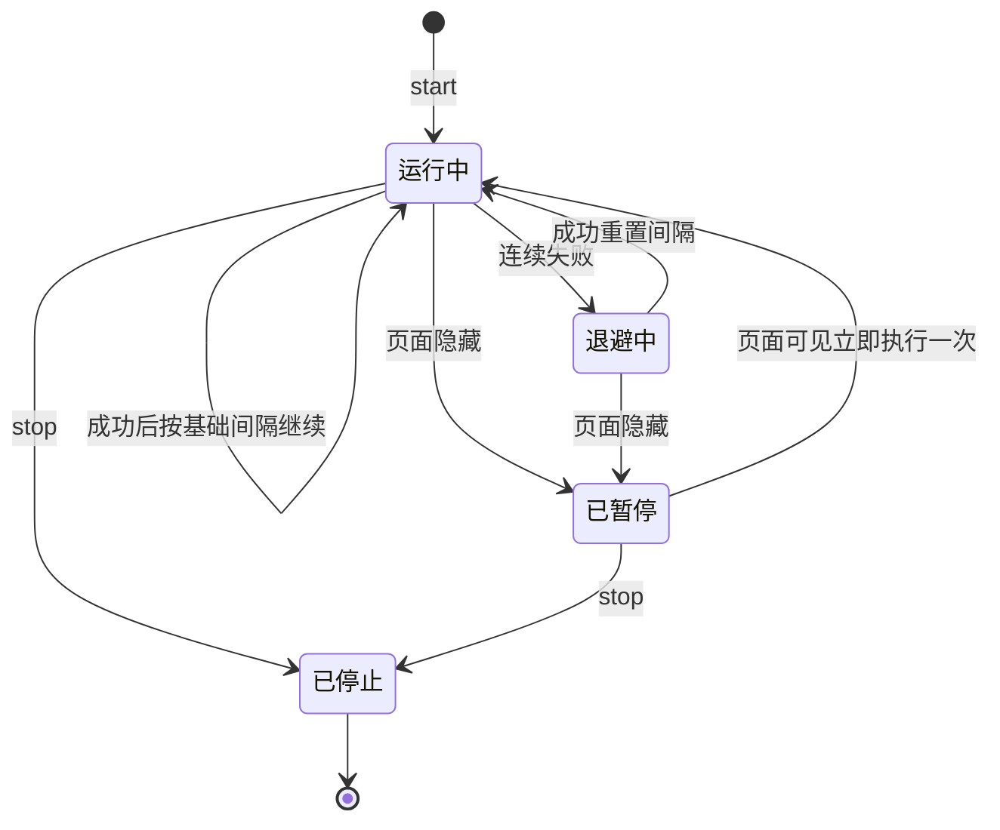

```javascript
// 1. 轮询管理器：可视性感知 + 指数退避 + 可取消
function createPoller(task, { interval = 5000, maxInterval = 60_000, immediate = true } = {}) {
  let timer = null, stopped = true, fails = 0, ctrl = null;

  function currentInterval() {                       // 退避间隔：指数增长 + 抖动，封顶
    const base = Math.min(interval * 2 ** fails, maxInterval);
    return base * (0.8 + Math.random() * 0.4);       // 抖动防多客户端同步请求
  }
  async function tick() {
    if (stopped) return;
    ctrl = new AbortController();
    try {
      await task(ctrl.signal);                       // 任务自己负责超时
      fails = 0;                                     // 成功重置退避
    } catch (e) {
      if (e.name === 'AbortError') return;           // 主动停止不算失败
      fails = Math.min(fails + 1, 10);
      console.warn('轮询失败，下次间隔', Math.round(currentInterval()), 'ms');
    }
    schedule();
  }
  function schedule() {
    if (stopped || document.hidden) return;          // 隐藏时不排新任务
    timer = setTimeout(tick, currentInterval());
  }
  function onVisible() {
    if (!stopped && document.visibilityState === 'visible') {
      clearTimeout(timer);
      immediate ? tick() : schedule();               // 恢复可见：立即刷一次
    }
  }
  document.addEventListener('visibilitychange', onVisible);

  return {
    start() { if (stopped) { stopped = false; tick(); } },
    stop() { stopped = true; clearTimeout(timer); ctrl?.abort(); },
  };
}

// 2. 使用：轮询任务进度，失败自动退避，切后台暂停、回前台刷新
const poller = createPoller(async (signal) => {
  const resp = await fetch('/api/task/1/progress', { signal });
  if (!resp.ok) throw new Error('HTTP ' + resp.status);
  const { percent } = await resp.json();
  console.log('进度', percent);
  if (percent >= 100) poller.stop();
}, { interval: 2000, maxInterval: 30_000 });
poller.start();
```

### JS-198：设计一个本地数据同步器？离线队列与冲突合并怎么实现？

**答**：
- 目标：断网时写操作进本地队列（持久化 localStorage/IndexedDB），网络恢复后按序重放，达到最终一致。
- 队列元素 = { id 幂等键, op, entity, payload, baseVersion, ts }；幂等键用 crypto.randomUUID，服务端据其去重，防止重放重复创建。
- 冲突策略三选一：客户端优先（last-write-wins）、服务端优先（丢弃本地）、字段级合并（本地字段覆盖、其余保留服务端）；按业务重要性选择，本例演示字段级合并。
- 409 冲突处理：拉服务端最新 → 合并 → 带 server.version 重试；重试次数超限暂停等人工，避免死循环。
- 状态外露：pending 数量、syncing 标志通过订阅暴露，UI 显示同步徽标；online/offline 事件驱动自动同步。

```javascript
// 1. 离线同步器：队列持久化 + 保序重放 + 幂等 + 冲突合并
function createSyncer(api) {
  let queue = JSON.parse(localStorage.getItem('__sync') || '[]');
  let syncing = false;
  const listeners = new Set();
  const notify = () => listeners.forEach((fn) => fn({ pending: queue.length, syncing }));

  function enqueue(op) {
    queue.push({ ...op, id: crypto.randomUUID(), ts: Date.now(), done: 0 }); // 幂等键
    persist(); notify(); trySync();
  }
  function persist() {
    try { localStorage.setItem('__sync', JSON.stringify(queue)); } catch {}
  }

  function trySync() {
    if (syncing || navigator.onLine === false || !queue.length) return;
    syncing = true; notify();
    (async () => {
      while (queue.length) {
        const op = queue[0];
        try {
          await api[op.op](op.entity, { ...op.payload, _idem: op.id, _baseVersion: op.baseVersion });
          queue.shift(); persist();                 // 成功弹出，继续下一条（保序重放）
        } catch (err) {
          if (err.status === 409) {                 // 版本冲突：字段级合并
            const server = await api.latest(op.entity, op.payload.id);
            const merged = { ...server, ...pickLocalFields(op.payload) }; // 本地字段覆盖
            try {
              await api.update(op.entity, { ...merged, _baseVersion: server.version });
              queue.shift(); persist(); continue;
            } catch { break; }                      // 合并后再冲突：暂停等人工处理
          }
          op.done++;
          if (op.done >= 3) { queue.shift(); persist(); console.error('同步失败丢弃', op.id); }
          else break;                               // 失败暂停，等下一个网络事件重试
        }
      }
    })().finally(() => { syncing = false; notify(); });
  }

  addEventListener('online', trySync);              // 网络恢复自动同步
  addEventListener('offline', notify);
  return { enqueue, subscribe: (fn) => (listeners.add(fn), () => listeners.delete(fn)) };
}

// 2. api 适配层：409 抛出带 status 的错误
const api = {
  async update(entity, body) {
    const resp = await fetch(`/api/${entity}/${body.id}`, { method: 'PUT', body: JSON.stringify(body) });
    if (resp.status === 409) throw Object.assign(new Error('conflict'), { status: 409 });
    if (!resp.ok) throw new Error('HTTP ' + resp.status);
    return resp.json();
  },
  async create(entity, body) { /* POST，逻辑同 update */ },
  async latest(entity, id) { return fetch(`/api/${entity}/${id}`).then((r) => r.json()); },
};
function pickLocalFields(payload) { const { id, version, ...rest } = payload; return rest; }

// 3. 使用：离线也能"保存成功"，联网后自动同步
const syncer = createSyncer(api);
syncer.enqueue({
  op: 'update', entity: 'todos',
  payload: { id: 1, text: '离线修改', version: 3 },
  baseVersion: 3,
});
syncer.subscribe(({ pending, syncing }) => console.log('待同步', pending, syncing));
```

### JS-199：设计一个 SDK 初始化器？异步依赖与超时降级怎么实现？

**答**：
- 现实问题：SDK 启动依赖多个异步资源（配置中心、授权、设备信息），彼此有依赖关系又不能互相阻塞——需要并行加载 + 依赖等待 + 整体超时。
- 模块声明式：每个模块声明 name / init(deps) / dependsOn / timeout / critical / degrade；initModule 先等依赖就绪再执行自身。
- 超时降级：模块加载失败或超时不阻塞整体，用 degrade 兜底（默认配置/空实现）并上报降级原因；critical 模块失败才整体失败。
- 幂等与并发防护：init 只执行一次返回同一 Promise；模块用 cache + pending 双 Map 防止同模块重复初始化。
- 对外 API：init() 启动、ready() 等全部就绪并返回实例表、get(name) 按需取模块。

```javascript
// 1. SDK 初始化器：并行加载 + 依赖等待 + 超时降级
function createSDK(modules) {
  const cache = new Map();        // 模块名 -> 实例或降级实例
  const pending = new Map();      // 模块名 -> 初始化 Promise，防并发重复 init
  let initPromise = null;

  const withTimeout = (p, ms, label) => Promise.race([
    p,
    new Promise((_, rej) => setTimeout(() => rej(new Error(`${label} 超时 ${ms}ms`)), ms)),
  ]);

  async function initModule(mod) {
    if (cache.has(mod.name)) return cache.get(mod.name);
    if (pending.has(mod.name)) return pending.get(mod.name);
    const p = (async () => {
      // 先等依赖模块就绪（依赖内部会递归初始化，天然拓扑序）
      const deps = {};
      for (const name of mod.dependsOn || []) {
        deps[name] = await initModule(modules.find((m) => m.name === name));
      }
      try {
        const instance = await withTimeout(mod.init(deps), mod.timeout ?? 3000, mod.name);
        cache.set(mod.name, instance);
        return instance;
      } catch (err) {
        if (mod.critical) throw err;                // 关键模块失败：整体失败
        console.warn(`[SDK] ${mod.name} 降级`, err.message);
        const fallback = mod.degrade ? mod.degrade(err) : null;
        cache.set(mod.name, fallback);              // 降级兜底，不阻塞其他模块
        return fallback;
      }
    })();
    pending.set(mod.name, p);
    return p;
  }
  const getModule = (name) => initModule(modules.find((m) => m.name === name));

  function init() {
    if (!initPromise) {
      // 所有模块并行启动，依赖在各自内部等待；一个 critical 失败整体失败
      initPromise = Promise.all(modules.map(getModule))
        .then(() => ({ ok: true }))
        .catch((err) => ({ ok: false, error: err }));
    }
    return initPromise;
  }
  const ready = () => init().then(() => Object.fromEntries(cache));
  return { init, ready, get: getModule };
}

// 2. 模块声明：config 可选降级，auth 关键，reporter 依赖前两者
const sdk = createSDK([
  {
    name: 'config',
    timeout: 2000,
    init: async () => (await fetch('/api/sdk-config')).json(),
    degrade: () => ({ reportUrl: '/default-collect', appKey: 'dev' }), // 超时用默认配置
  },
  {
    name: 'auth',
    critical: true,                                 // 失败则 SDK 整体初始化失败
    dependsOn: ['config'],
    init: async (deps) => ({ token: 'tk-' + btoa(deps.config.appKey) }),
  },
  {
    name: 'reporter',
    dependsOn: ['config', 'auth'],
    init: async (deps) => ({
      send: (e) => navigator.sendBeacon(deps.config.reportUrl, JSON.stringify({ ...e, token: deps.auth.token })),
    }),
  },
]);

sdk.ready().then((mods) => {
  console.log('SDK 就绪', Object.keys(mods));
  mods.reporter.send({ type: 'sdk-ready' });
});
```

### JS-200：JS 知识体系收束？异步发展史与三层知识地图如何梳理？

**答**：
- 异步演进是一条"解决上一步痛点"的逻辑链：回调（嵌套地狱、错误分散）→ Promise（状态机 + 链式，统一错误通道）→ generator + 执行器（可中断但需手动驱动）→ async/await（同步写法的语法糖）→ 响应式流（RxJS/信号，面向持续变化的数据流）。
- 一次性异步用 await，持续异步（输入流、消息流）用响应式——演进不是替代而是分层，每层都有适用场景。
- 知识地图三层：语言核心（类型转换、作用域闭包、this 与原型、Promise 与事件循环、元编程、函数式）；浏览器（DOM 与事件、存储、网络、渲染原理、Web API）；工程化（模块化、构建、框架原理、性能、监控、规范设计）。
- 面试应答四层法：概念是什么 → 底层原理 → 能否手写 → 实际场景；每层都要有代码佐证，本文件 200 题即按此结构收束。
- 复习方法：把 200 题映射回三层地图，能讲出"概念/原理/手写/场景"四层的打勾，缺口即弱项清单。

```javascript
// 1. 回调时代：嵌套地狱，错误分散在每层
getUser(id, (err, user) => {
  if (err) return handle(err);
  getOrders(user, (err, orders) => {
    if (err) return handle(err);            // 每层都要写一遍错误处理
    getDetail(orders[0], (err, detail) => { // 越嵌越深，无法组合
      if (err) return handle(err);
      console.log(detail);
    });
  });
});

// 2. Promise 时代：链式拉平，错误通道统一
getUser(id)
  .then((user) => getOrders(user))
  .then((orders) => getDetail(orders[0]))
  .then((detail) => console.log(detail))
  .catch(handle);                           // 一处捕获全链错误

// 3. generator + 执行器：可中断，async/await 的前身
function* flow() {
  const user = yield getUser(id);
  const orders = yield getOrders(user);
  return yield getDetail(orders[0]);
}
run(flow()).then(console.log);              // run 即 JS-148 手写的自动驱动器

// 4. async/await：同步写法 + 原生 try/catch
(async () => {
  try {
    const user = await getUser(id);
    const orders = await getOrders(user);
    console.log(await getDetail(orders[0]));
  } catch (e) { handle(e); }
})();

// 5. 响应式流：面向"持续到来的数据"（RxJS 思想示意）
// input$.pipe(debounceTime(300), distinctUntilChanged(), switchMap(search))
//   .subscribe(renderResults);            // 输入流 → 搜索流 → 渲染

// 6. 三层知识地图（自检清单）
const knowledgeMap = {
  语言核心: ['类型与转换', '作用域与闭包', 'this 与原型', 'Promise 与事件循环', '元编程', '函数式'],
  浏览器: ['DOM 与事件', '存储', '网络 fetch', '渲染原理', 'Web API', '安全'],
  工程化: ['模块化', '构建工具', '框架原理', '性能优化', '错误监控', '规范设计'],
};
// 自检：每项都能讲出 概念/原理/手写/场景 四层即为掌握，讲不出的就是弱项
```
