# TypeScript 前端面试题库

本文件收录 200 道 TypeScript 面试题，编号 TS-001 ~ TS-200，覆盖基础类型与推断、any/unknown/never、接口与类型别名、联合/交叉类型、字面量类型与 const 断言、类型收窄与类型守卫、可辨识联合、泛型、内置工具类型与手写实现、keyof/typeof/索引访问、条件类型与 infer、模板字面量类型、映射类型、装饰器、tsconfig 配置、declare 声明文件、enum、协变逆变以及典型类型体操；后半部分（TS-061 ~ TS-130）聚焦大厂高频类型体操与工程实践，包括工具类型手写进阶、infer 高阶、分布式条件类型深水区、字符串与对象类型体操、泛型组件与业务类型设计、TS 与运行时边界、大厂 TS 规范落地；TS-131 ~ TS-200 进一步覆盖框架级 TS 应用（Vue3/React 深入）、工具类型库源码级精选、高阶体操挑战、递归类型与性能、模块与声明进阶、类型安全的状态与路由、TS 元编程进阶、严格度与错误治理以及综合大题收束。每题均配有与题目一一对应的代码示例，不包含任何算法题。

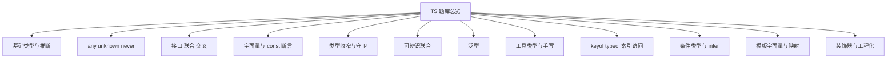

## 目录

- 第一章 基础类型与类型推断（TS-001 ~ TS-008）
- 第二章 any、unknown 与 never（TS-009 ~ TS-013）
- 第三章 接口、类型别名与联合交叉（TS-014 ~ TS-018）
- 第四章 字面量类型与 const 断言（TS-019 ~ TS-021）
- 第五章 类型收窄与类型守卫（TS-022 ~ TS-026）
- 第六章 可辨识联合（TS-027 ~ TS-029）
- 第七章 泛型（TS-030 ~ TS-034）
- 第八章 工具类型与手写实现（TS-035 ~ TS-041）
- 第九章 keyof、typeof 与索引访问（TS-042 ~ TS-044）
- 第十章 条件类型与 infer（TS-045 ~ TS-048）
- 第十一章 模板字面量类型（TS-049 ~ TS-050）
- 第十二章 映射类型（TS-051 ~ TS-052）
- 第十三章 装饰器（TS-053）
- 第十四章 tsconfig 常用配置（TS-054 ~ TS-055）
- 第十五章 declare 与声明文件（TS-056）
- 第十六章 enum 与 const enum（TS-057）
- 第十七章 协变与逆变（TS-058）
- 第十八章 类型体操典型题（TS-059 ~ TS-060）
- 第十九章 工具类型手写进阶（TS-061 ~ TS-068）
- 第二十章 infer 高阶（TS-069 ~ TS-075）
- 第二十一章 条件类型与分布式深水区（TS-076 ~ TS-082）
- 第二十二章 类型体操经典题（TS-083 ~ TS-090）
- 第二十三章 字符串类型体操（TS-091 ~ TS-097）
- 第二十四章 对象类型体操（TS-098 ~ TS-104）
- 第二十五章 数组与元组体操（TS-105 ~ TS-111）
- 第二十六章 泛型组件与业务类型设计（TS-112 ~ TS-118）
- 第二十七章 TS 与运行时边界（TS-119 ~ TS-124）
- 第二十八章 TS 工程与大厂实战（TS-125 ~ TS-130）
- 第二十九章 Vue3 中的 TS 深入（TS-131 ~ TS-136）
- 第三十章 React 中的 TS 深入（TS-137 ~ TS-142）
- 第三十一章 工具类型库源码级精选（TS-143 ~ TS-149）
- 第三十二章 高阶体操挑战（TS-150 ~ TS-157）
- 第三十三章 递归类型与性能（TS-158 ~ TS-163）
- 第三十四章 模块与声明进阶（TS-164 ~ TS-169）
- 第三十五章 类型安全的状态与路由（TS-170 ~ TS-175）
- 第三十六章 TS 元编程进阶（TS-176 ~ TS-181）
- 第三十七章 严格度与错误治理（TS-182 ~ TS-187）
- 第三十八章 综合大题（TS-188 ~ TS-200）

## 第一章 基础类型与类型推断

### TS-001：TypeScript 有哪些基础类型？
**答**：
- 原始类型：`boolean`、`number`、`string`、`symbol`、`bigint`，以及 `null`、`undefined`。
- 特殊类型：`void`（无返回值）、`never`（永不存在的值）、`any`/`unknown`（任意值）。
- 结构类型：数组 `number[]`、元组 `[string, number]`、对象、函数类型。
- 还有 `enum` 枚举与字面量类型，它们是 TypeScript 对 JS 类型系统的扩展。

```typescript
let isOpen: boolean = true;
let count: number = 42;
let message: string = "hello";
let ids: number[] = [1, 2, 3];
let pair: [string, number] = ["age", 18]; // 元组
let bag: unknown = "任意值";
let empty: void = undefined;
let absent: null = null;
let missing: undefined = undefined;
function throwError(): never {
  throw new Error("boom");
}
```

### TS-002：TypeScript 的类型推断机制是怎样的？
**答**：
- 声明时不写注解，TS 会根据初始化值推断类型；`let` 推断为宽类型，`const` 推断为字面量类型。
- 函数返回值会根据 return 语句自动推断，无需显式标注。
- 存在"上下文类型"：回调参数会根据目标位置的函数签名反向推断。
- 最佳公共类型：`let x = cond ? "a" : "b"` 推断为 `string` 而不是字面量联合，这是类型拓宽。

```typescript
let n = 42; // 推断为 number
const s = "hello"; // 推断为字面量类型 "hello"
let mix = Math.random() > 0.5 ? "a" : "b"; // let 会拓宽为 string

function sum(a: number, b: number) {
  return a + b; // 返回值自动推断为 number
}

// 上下文类型：根据目标位置推断回调参数
const names = ["Tom", "Jerry"];
names.map((item) => item.toUpperCase()); // item 自动推断为 string
```

### TS-003：数组类型与元组类型有什么区别？
**答**：
- `number[]` 表示任意长度、所有元素同类型的数组。
- 元组 `[string, number]` 长度固定，每个位置类型可以不同，适合表示固定结构。
- 元组支持具名成员提升可读性：`[x: number, y: number]`。
- 元组可以加 `readonly` 变成只读元组，常与 `as const` 配合使用。

```typescript
let list: number[] = [1, 2, 3];
let same: Array<string> = ["a", "b"];

// 元组：长度与每个位置的类型都固定
let tuple: [string, number, boolean] = ["age", 18, true];

// 具名元组：可读性更好
let point: [x: number, y: number] = [10, 20];

let readonlyTuple: readonly [string, number] = ["a", 1] as const;
```

### TS-004：如何声明函数类型？可选参数与剩余参数怎么写？
**答**：
- 用类型别名或接口声明函数签名：`(a: string) => void`。
- 可选参数用 `?` 标记，必须放在必选参数后面；默认值参数等价于可选参数。
- 剩余参数用 `...args: T[]` 收集，类型是数组或元组。
- 参数不写类型会隐式 any，开启 `noImplicitAny` 后直接报错。

```typescript
type Logger = (level: string, ...messages: unknown[]) => void;

const log: Logger = (level, ...messages) => {
  console.log(`[${level}]`, ...messages);
};

function hello(name: string, greeting: string = "Hi"): string {
  return `${greeting}, ${name}`;
}

hello("Tom"); // "Hi, Tom"
hello("Tom", "Yo"); // "Yo, Tom"
```

### TS-005：void 和 undefined 有什么区别？
**答**：
- `void` 表示函数"没有有意义的返回值"，调用方不应使用其返回结果。
- `undefined` 是一个具体的值和类型；`void` 类型的变量只能被赋 `undefined`。
- 特殊规则：目标返回类型是 `void` 时，实现函数可以返回任意值（返回值被忽略），这是为回调写法服务的。
- 所以 `() => void` 并不能约束实现方"真的什么都不返回"。

```typescript
function log(): void {
  console.log("hi");
}

let v: void = undefined; // void 只能被赋 undefined
// v = 1; // 报错

// 回调场景：返回值类型为 void 时，实现可以返回任何值（会被忽略）
type Task = () => void;
const task: Task = () => 123; // 合法，返回值被丢弃
```

### TS-006：函数重载怎么写？有哪些注意事项？
**答**：
- 重载 = 多个重载签名 + 一个实现签名，重载签名不含函数体。
- 调用时按声明顺序从上往下匹配，命中即停，所以要把更精确的签名放前面。
- 实现签名对外不可见，必须能兼容所有重载签名。
- TS 的重载只是编译期行为，编译产物只有一个函数。

```typescript
// 重载签名：只做声明，不含实现体
function createElement(tag: "div"): HTMLDivElement;
function createElement(tag: "span"): HTMLSpanElement;
function createElement(tag: "input"): HTMLInputElement;
// 实现签名：对外不可见，必须兼容所有重载签名
function createElement(tag: string): HTMLElement {
  return document.createElement(tag);
}

const div = createElement("div"); // 类型为 HTMLDivElement
```

### TS-007：类型断言 as 和非空断言 ! 的作用与风险是什么？
**答**：
- `as` 是主观的类型转换，仅编译期生效，运行时没有任何保护。
- 断言要求两个类型存在可赋值关系之一，完全不重叠时需要双重断言 `as unknown as T`。
- 非空断言 `!` 用于去掉 `null | undefined`，判断失误会直接导致运行时错误。
- 能用类型守卫收窄就不要用断言，断言是"绕过检查"而不是"证明正确"。

```typescript
const el = document.getElementById("app") as HTMLInputElement;
// el.value; // HTMLElement 上没有 value，需要断言后访问

const maybe = document.querySelector(".box")!; // 非空断言，去掉 null | undefined

// 双重断言绕过检查（尽量避免）
const risky = "hello" as unknown as { code: number };
```

### TS-008：strictNullChecks 开启后带来什么变化？
**答**：
- 开启后 `null` 和 `undefined` 不再能赋给其他类型，每个类型默认不含空值。
- 可选属性、可选参数的类型会自动带上 `undefined`。
- 使用可能为空的值必须先收窄：if 判断、可选链 `?.`、空值合并 `??`。
- 这是 `strict` 家族中对运行时安全收益最大的选项。

```typescript
let name1: string = "Tom";
// name1 = null; // 报错：string 不含 null

function findUser(id: number): { name: string } | null {
  return id === 1 ? { name: "Tom" } : null;
}

const user = findUser(1);
// user.name; // 报错：user 可能为 null
if (user) {
  console.log(user.name); // 收窄后安全
}
console.log(user?.name ?? "匿名"); // 可选链 + 空值合并
```

## 第二章 any、unknown 与 never

any 会关闭类型检查，unknown 是安全的任意类型，never 是表示"不可能"的底层类型。三者的可赋值关系如下图。

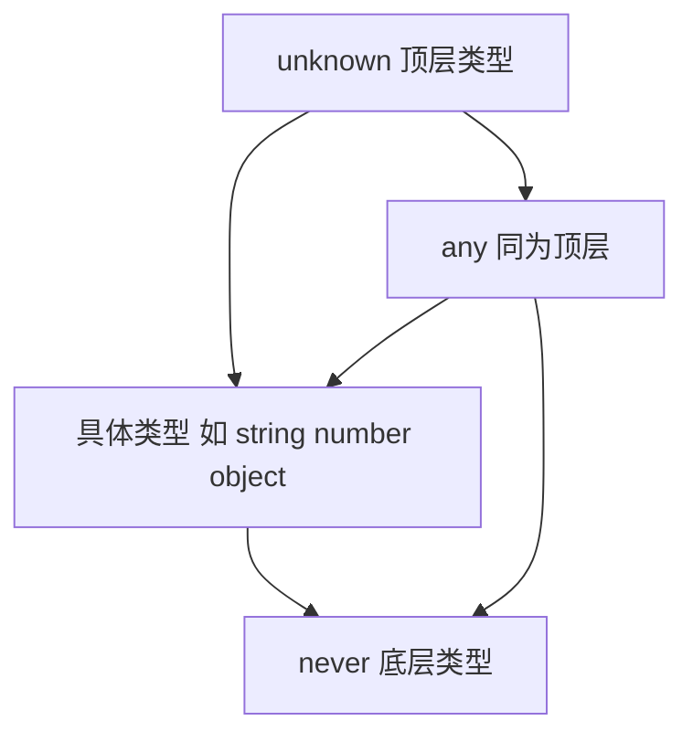

### TS-009：为什么说 any 既是逃生舱也是类型系统的漏洞？
**答**：
- `any` 会跳过所有类型检查：任意属性访问、任意赋值、任意调用都不报错。
- `any` 具有传染性：一个 any 参与运算或赋值后，下游类型全部退化为 any。
- 会静默掩盖拼写错误、空指针等问题，把错误推迟到运行时。
- 代码审查中应把 any 视为待消除项，不可信数据优先用 `unknown`。

```typescript
let anything: any = "hello";
anything.foo.bar; // 不报错，运行时才炸
anything = 42;

// any 具有传染性
const list: any[] = JSON.parse("[1,2,3]");
const first = list[0]; // any：后续全部失去检查
```

### TS-010：unknown 与 any 的区别是什么？unknown 如何安全使用？
**答**：
- `unknown` 可以接收任何值（与 any 相同），但使用前必须先收窄或断言。
- unknown 不能直接访问属性、不能直接调用，只能赋值给 `unknown` 或 `any`。
- 适合用在不可信数据的入口：JSON.parse 结果、第三方回调参数、catch 的 error。
- typeof、instanceof、in、自定义守卫等收窄手段对 unknown 全部适用。

```typescript
function safeParse(json: string): unknown {
  try {
    return JSON.parse(json);
  } catch {
    return undefined;
  }
}

const value = safeParse('{"name": "Tom"}');
// value.name; // 报错：unknown 不能直接访问属性
if (typeof value === "object" && value !== null && "name" in value) {
  console.log((value as { name: string }).name); // 收窄 + 断言后可用
}
```

### TS-011：never 类型的含义与典型用途是什么？
**答**：
- `never` 是底层类型，表示"不可能有值"：抛错函数、死循环函数的返回值类型就是 never。
- never 可以赋给任何类型，但任何类型都不能赋给 never。
- 典型用途是穷尽性检查：联合类型收窄到 default 分支后剩余类型是 never，若漏处理某分支，赋值给 never 会编译报错。
- 条件类型中常用 `[T] extends [never]` 来检测 never。

```typescript
function fail(message: string): never {
  throw new Error(message);
}

function infinite(): never {
  while (true) {}
}

// never 可以赋值给任意类型，但任何值都不能赋给 never
let n: never;
let s: string = n; // OK
// n = "x"; // 报错
```

### TS-012：为什么裸类型参数的条件类型遇到 never 会直接得到 never？
**答**：
- 条件类型中的裸类型参数具有分布式特性，会对联合类型逐成员求值。
- `never` 可理解为"空的联合类型"，逐成员分发时没有成员可遍历，整个条件类型直接退化为 `never`。
- 想判断某类型"是不是 never"，必须用元组包裹阻止分发：`[T] extends [never]`。
- 该特性也常用于在联合类型中过滤成员。

```typescript
type IsNever<T> = [T] extends [never] ? true : false;

type A = IsNever<never>; // true
type B = IsNever<string>; // false

// 裸类型参数遇到 never 会直接"蒸发"整个条件类型
type WithoutString<T> = T extends string ? never : T;
type C = WithoutString<string | number>; // number
type D = WithoutString<never>; // never（没有成员可分发）
```

### TS-013：如何理解 unknown 是顶层类型、never 是底层类型？
**答**：
- 顶层类型：所有类型都可以赋给它，`unknown`（以及 `any`）就是顶层。
- 底层类型：它可以赋给所有类型，但没有任何运行时值属于它，`never` 是唯一代表。
- `object` 表示"非原始类型"，数组、函数也算 object。
- `{}` 表示"非 null/undefined 的任意值"，比 object 宽得多，容易误用。

```typescript
// unknown 是顶层类型：任何值都可以赋给它
let top: unknown = 123;
top = "anything";

// never 是底层类型：只能接收 never
let bottom: never;
// bottom = 123; // 报错

// object 表示非原始类型
let obj: object = { a: 1 };
obj = []; // OK，数组也是 object
// obj = 42; // 报错

// {} 表示非 null/undefined 的任意值
let almost: {} = "anything";
// almost = null; // 报错
```

## 第三章 接口、类型别名与联合交叉

### TS-014：interface 和 type 的区别是什么？如何选择？
**答**：
- interface 只能描述对象/函数形状；type 可以表达联合、元组、映射类型、条件类型。
- interface 支持声明合并（同名自动合并），type 重名直接报错。
- 扩展方式不同：interface 用 extends，type 用交叉 `&`；交叉冲突时属性变 never 不报错，interface 扩展冲突则报错。
- 官方建议：能用 interface 描述对象就用 interface，其余场景用 type。

```typescript
interface Animal {
  name: string;
}
interface Animal {
  age: number; // 声明合并：两个同名 interface 自动合并
}
const a: Animal = { name: "Tom", age: 3 };

type Pet = Animal & { owner: string }; // type 可以用交叉扩展

// interface 只能描述对象形状，type 能表达联合、元组等
type Status = "loading" | "done";
type Pair = [string, number];

// 冲突行为不同
interface Conf1 {
  x: string;
}
// interface Conf1 { x: number } // 报错：同名属性类型不一致
type Conf2 = { x: string };
type Merged = Conf2 & { x: number }; // x 变成 never，不报错但不可用
```

### TS-015：联合类型是什么？使用时要注意什么？
**答**：
- 联合类型 `A | B` 表示值是 A 或 B 之一，常与字面量类型组合建模互斥状态。
- 使用联合类型时只能访问所有成员的公共成员，否则必须先收窄。
- 收窄手段：typeof、in、instanceof、字面量相等比较等。
- 函数参数为联合时，实现里要处理所有分支，返回值往往也是联合。

```typescript
type Theme = "light" | "dark" | "auto";

function applyTheme(theme: Theme) {
  document.body.dataset.theme = theme;
}

// 联合类型使用前通常需要收窄
function print(value: string | number) {
  if (typeof value === "string") {
    console.log(value.toUpperCase());
  } else {
    console.log(value.toFixed(2));
  }
}
```

### TS-016：交叉类型同名属性冲突会发生什么？
**答**：
- 交叉 `A & B` 要求同时满足两个类型，同名属性类型做交叉。
- 原始类型互斥交叉结果是 `never`，该属性无法被赋任何值，等于废掉。
- 字面量与宽类型交叉会收窄：`string & "fixed"` 得到 `"fixed"`。
- 交叉常用于 mixin 式组合与给已有类型附加能力。

```typescript
interface Draggable {
  drag: () => void;
}
interface Resizable {
  resize: () => void;
}

type DraggableAndResizable = Draggable & Resizable;

const widget: DraggableAndResizable = {
  drag: () => {},
  resize: () => {},
};

type Bad = string & number; // never：原始类型互斥
type Name = { name: string } & { name: "fixed" }; // name 收窄为 "fixed"
```

### TS-017：什么是声明合并？如何扩展第三方库的类型？
**答**：
- 同名 interface 声明会自动合并成员，这是 interface 独有的能力。
- 利用 `declare module` 可以给第三方库的 interface 追加字段，如给 vue-router 的 RouteMeta 加自定义字段。
- 扩展要写在模块上下文中（文件有 import/export）才会正确合并到目标模块。
- 这是插件向库"注册类型"的标准方式，vue-router、pinia 都暴露了可合并的接口。

```typescript
// 同名 interface 自动合并成员
interface AppWindow {
  version: string;
}
interface AppWindow {
  buildTime: number;
}
const win: AppWindow = { version: "1.0.0", buildTime: 1690000000000 };

// 给第三方库补类型：declare module 扩展
declare module "vue-router" {
  interface RouteMeta {
    requiresAuth?: boolean;
    title?: string;
  }
}
```

### TS-018：readonly 修饰符和索引签名的规则是什么？
**答**：
- `readonly` 只是编译期检查，运行时对象照样可以被修改，它不等于 const。
- 索引签名 `[key: string]: T` 允许任意字符串 key，其值类型必须兼容所有显式属性。
- number 索引是 string 索引的子集，两者并存时 number 索引值类型必须更窄或相等。
- `readonly number[]` 只读数组没有 push/splice 等变更方法。

```typescript
interface Config {
  readonly apiKey: string; // 编译期只读，运行时无保护
  [key: string]: string | number; // 字符串索引签名
}

const config: Config = { apiKey: "abc", timeout: 3000, extra: "ok" };
// config.apiKey = "x"; // 报错：只读属性

const fixed: readonly number[] = [1, 2, 3];
// fixed.push(4); // 报错：只读数组没有变更方法
```

## 第四章 字面量类型与 const 断言

### TS-019：什么是 const 断言 as const？它改变了什么？
**答**：
- 默认推断下对象属性是宽类型且可写；`as const` 把整个字面量变成最深层的只读结构。
- 所有属性加 `readonly`，所有可变值收窄为字面量类型，数组变只读元组。
- 常用于替代 enum 定义常量表、配置项。
- as const 只能用在字面量上，不能用在普通变量表达式。

```typescript
const CONFIG = {
  host: "localhost",
  port: 8080,
  tags: ["a", "b"],
} as const;

// typeof CONFIG 为：
// { readonly host: "localhost"; readonly port: 8080; readonly tags: readonly ["a", "b"] }
// CONFIG.host = "x"; // 报错：只读

let mode = "dark"; // string
const mode2 = "dark"; // 字面量类型 "dark"
```

### TS-020：如何从常量数组推导出字面量联合类型？
**答**：
- 先 `as const` 得到只读元组，再用 `typeof ARR[number]` 索引访问取出元素联合。
- 这是"单一数据源"写法：运行时数组和类型系统共用同一份常量，不会失同步。
- 对象常量同理可用 `keyof typeof OBJ` 取 key 联合。
- 比 enum 更轻量，且没有 enum 的运行时产物负担。

```typescript
const ROLES = ["admin", "editor", "viewer"] as const;
type Role = (typeof ROLES)[number]; // "admin" | "editor" | "viewer"

function canEdit(role: Role) {
  return role === "admin" || role === "editor";
}

const PERMISSION = {
  read: 1,
  write: 2,
} as const;
type PermKey = keyof typeof PERMISSION; // "read" | "write"
```

### TS-021：satisfies 操作符解决了什么问题？
**答**：
- `satisfies T` 校验表达式满足类型 T，但不拓宽推断、不改变字面量类型。
- 直接用类型注解 `const x: T = ...` 会把字面量拓宽成宽类型，丢失精确信息。
- 典型场景：配置对象既要校验结构，又要保留每个 key 的字面量类型以便后续精确使用。
- TypeScript 4.9 引入，是"校验"与"推断"兼得的写法。

```typescript
type RouteMap = Record<string, { path: string; auth: boolean }>;

const routes = {
  home: { path: "/", auth: false },
  admin: { path: "/admin", auth: true },
} satisfies RouteMap;

routes.admin.path; // 校验通过，且仍保留精确的字面量信息
// routes.admin.unknownKey; // 报错：多余属性
// routes.bad = {}; // 报错：不满足 RouteMap
```

## 第五章 类型收窄与类型守卫

TypeScript 编译器通过控制流分析把联合类型收窄为更小的类型，常见路径如下图。

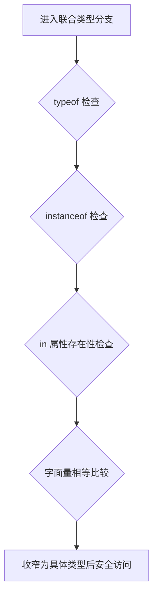

### TS-022：TypeScript 有哪些常见的类型收窄手段？
**答**：
- `typeof`：收窄原始类型，注意 typeof null 是 "object" 需要额外排除。
- `instanceof`：收窄类实例；`in`：收窄属性存在性，适合对象联合。
- 真值判断、相等/不等判断（配合字面量类型）、数组 includes 也能收窄。
- 收窄只在当前控制流分支内有效，不改变原声明类型。

```typescript
function describe(input: string | number | Date | null) {
  if (input === null) return "空值"; // 相等判断收窄
  if (typeof input === "string") return input.toUpperCase(); // typeof 收窄
  if (typeof input === "number") return input.toFixed(2);
  if (input instanceof Date) return input.toISOString(); // instanceof 收窄
  return "未知";
}

function hasName(obj: { name?: string } | { id: number }) {
  if ("name" in obj) return obj.name; // in 收窄
  return `id=${obj.id}`;
}
```

### TS-023：自定义类型守卫 is 怎么写？和返回 boolean 有什么区别？
**答**：
- 形如 `value is T` 的返回类型是类型守卫，调用后编译器按 T 收窄参数。
- 普通返回 boolean 的函数无法让编译器收窄，因为返回 true 与类型判断之间没有关联。
- 守卫函数内部依然由开发者负责保证正确性，TS 不校验实现。
- 数组 filter 配合守卫可以把 `(A | B)[]` 过滤成 `B[]`。

```typescript
interface Fish {
  swim: () => void;
}
interface Bird {
  fly: () => void;
}

function isFish(pet: Fish | Bird): pet is Fish {
  return "swim" in pet;
}

function move(pet: Fish | Bird) {
  if (isFish(pet)) {
    pet.swim(); // 收窄为 Fish
  } else {
    pet.fly(); // 收窄为 Bird
  }
}

const zoo: (Fish | Bird)[] = [];
const fishes = zoo.filter(isFish); // Fish[]
```

### TS-024：断言函数 asserts 是什么？适用什么场景？
**答**：
- `asserts value is T` 表示：函数正常返回时，value 一定可收窄为 T；抛错则中断执行。
- 与 `is` 守卫的区别：asserts 不需要返回布尔值，而是"不抛错就是真"的契约。
- 适合集中校验入口数据，如 env 校验、参数校验函数。
- 收窄效果作用于调用点之后，常用于避免到处写 if。

```typescript
function assertIsString(value: unknown): asserts value is string {
  if (typeof value !== "string") {
    throw new Error("期望 string 类型");
  }
}

function toUpper(value: unknown) {
  assertIsString(value);
  return value.toUpperCase(); // 此处已收窄为 string
}

function assertNonNull<T>(value: T): asserts value is NonNullable<T> {
  if (value === null || value === undefined) {
    throw new Error("值不能为空");
  }
}
```

### TS-025：类型收窄在哪些场景会失效？为什么？
**答**：
- 收窄基于"引用不变"的假设：可变的 let 变量在函数调用后可能被修改，TS 会在部分场景放弃收窄。
- 回调函数中收窄失效最典型：TS 不知道回调何时执行，`if (el.value)` 内的收窄带不进 setTimeout/forEach 回调。
- 解构出的基本类型可以保留收窄，但对象属性在函数调用后会被重置怀疑。
- 解决办法：先把值存入 const 局部变量，或用类型守卫函数重新收窄。

```typescript
const el: { value?: string } = {};

if (el.value) {
  const v = el.value; // 先固化到 const 局部变量
  setTimeout(() => {
    // el.value 在回调里不保留收窄，因为回调执行时机不可控
    console.log(v.toUpperCase()); // 用固化后的变量安全访问
    // el.value.toUpperCase(); // 报错：此处 el.value 仍是 string | undefined
  }, 100);
}

let id: string | number = 1;
if (typeof id === "string") {
  console.log(id.toUpperCase()); // 同步分支内收窄有效
}
```

### TS-026：如何利用 never 做穷尽性检查？
**答**：
- switch 处理完联合类型所有成员后，default 分支里值类型是 never。
- 把它赋给一个显式 `never` 类型的变量，将来新增成员而忘记处理时，这里会编译报错。
- 相比"不写 default 依赖返回类型检查"，这种写法能精确定位漏分支位置。
- 通常封装成 assertNever 工具函数复用。

```typescript
type Shape =
  | { kind: "circle"; radius: number }
  | { kind: "square"; size: number }
  | { kind: "rect"; width: number; height: number };

function area(s: Shape): number {
  switch (s.kind) {
    case "circle":
      return Math.PI * s.radius ** 2;
    case "square":
      return s.size ** 2;
    case "rect":
      return s.width * s.height;
    default: {
      const _exhaustive: never = s; // 若新增 kind 而漏写 case，这里编译报错
      return _exhaustive;
    }
  }
}
```

## 第六章 可辨识联合

### TS-027：什么是可辨识联合？它有什么优势？
**答**：
- 多个类型共享一个字面量类型的"标签"属性（kind/type/tag），组合成联合即辨识联合。
- 通过比较标签即可精准收窄，比 in、typeof 更直观可靠。
- 状态建模、Redux 式 action、AST 节点都天然适合辨识联合。
- 配合穷尽检查可以在编译期保证所有状态都被处理。

```typescript
type Circle = { kind: "circle"; radius: number };
type Square = { kind: "square"; size: number };
type Triangle = { kind: "triangle"; base: number; height: number };

type MyShape = Circle | Square | Triangle;

function getArea(shape: MyShape): number {
  switch (shape.kind) {
    case "circle":
      return Math.PI * shape.radius ** 2; // 收窄为 Circle
    case "square":
      return shape.size ** 2;
    case "triangle":
      return (shape.base * shape.height) / 2;
  }
}
```

### TS-028：如何用可辨识联合建模 Redux 式 action？
**答**：
- 每种 action 一个类型，type 字段做辨识标签，payload 结构各不相同。
- reducer 里 switch type 即可拿到精确的 payload 类型，不需要断言。
- 新增 action 时配合 never 穷尽检查，漏处理直接编译报错。
- 比单一 action 接口 + 可选 payload 的写法安全得多。

```typescript
type Action =
  | { type: "increment"; step: number }
  | { type: "decrement"; step: number }
  | { type: "reset" };

interface State {
  count: number;
}

function reducer(state: State, action: Action): State {
  switch (action.type) {
    case "increment":
      return { count: state.count + action.step }; // action 收窄，step 类型精确
    case "decrement":
      return { count: state.count - action.step };
    case "reset":
      return { count: 0 };
    default: {
      const _check: never = action; // 穷尽检查
      return state;
    }
  }
}
```

### TS-029：可辨识联合的严格性体现在哪里？有哪些易错点？
**答**：
- 严格性：switch 必须覆盖所有标签，漏掉会在 never 检查处报错；标签写错直接编译报错。
- 易错点一：标签属性写成可选的 `{ kind?: "a" | "b" }` 会破坏辨识能力，标签必须必填。
- 易错点二：联合成员中有同名字段但类型是宽 string，则无法用字面量比较收窄。
- 建议标签统一命名、只用字面量类型、配合 assertNever 工具。

```typescript
// 错误示范：可选标签 + 宽类型字段，辨识能力被破坏
interface BadAction {
  type?: string; // 可选且是宽 string，无法精确收窄
  payload?: unknown;
}

// 正确示范：必填字面量标签 + assertNever
type GoodAction =
  | { type: "save"; content: string }
  | { type: "delete"; id: number };

function assertNever(x: never): never {
  throw new Error("未处理的分支：" + JSON.stringify(x));
}

function handle(action: GoodAction) {
  switch (action.type) {
    case "save":
      return `save ${action.content}`;
    case "delete":
      return `delete ${action.id}`;
    default:
      return assertNever(action); // 漏分支时编译期即报错
  }
}
```

## 第七章 泛型

### TS-030：泛型函数是什么？类型参数是如何推断的？
**答**：
- 泛型用类型参数 `<T>` 把类型"参数化"，让同一份逻辑适配多种类型且保持精确。
- 调用时 TS 根据实参自动推断 T，也可以显式指定 `identity<string>("x")`。
- 返回值类型会随入参类型联动，这是 any 做不到的。
- 泛型是写可复用工具函数和类型安全容器的基础。

```typescript
function identity<T>(value: T): T {
  return value;
}

const s = identity("hello"); // T 推断为 string
const n = identity<number>(42); // 显式指定 T 为 number

function reverse<T>(items: T[]): T[] {
  return [...items].reverse();
}

const strs = reverse(["a", "b"]); // string[]
const nums = reverse([1, 2, 3]); // number[]
```

### TS-031：泛型约束 extends 如何使用？
**答**：
- `T extends U` 限定 T 必须满足 U，从而在函数体内安全访问 U 的成员。
- 常用 `T extends keyof Obj` 约束 key 合法性，实现类型安全的取值函数。
- 约束也可以是对象形状、类、构造签名等。
- 约束越精确，函数体内可用的成员越多，推断越准确。

```typescript
interface Lengthwise {
  length: number;
}

function logLength<T extends Lengthwise>(value: T): T {
  console.log(value.length); // 有约束后可安全访问 length
  return value;
}

logLength("hello"); // OK
logLength([1, 2, 3]); // OK
// logLength(123); // 报错：number 没有 length

// keyof 约束：保证 key 一定是 obj 的属性
function getProp<T, K extends keyof T>(obj: T, key: K): T[K] {
  return obj[key];
}

const user = { name: "Tom", age: 18 };
getProp(user, "name"); // string
// getProp(user, "email"); // 报错：不是合法 key
```

### TS-032：泛型接口与泛型默认值怎么写？
**答**：
- 接口、类型别名、类都可以带类型参数，作用域覆盖整个声明。
- 类型参数可以设置默认值 `<T = string>`，省略时使用默认类型。
- 还可以给默认值叠加约束：`<T extends object = {}>`。
- 多个类型参数时，后面的默认值可以引用前面的参数。

```typescript
interface PaginatedResponse<T = unknown> {
  code: number;
  data: T[];
  total: number;
}

const users: PaginatedResponse<{ name: string }> = {
  code: 0,
  data: [{ name: "Tom" }],
  total: 1,
};

const raw: PaginatedResponse = { code: 0, data: [], total: 0 }; // 使用默认 unknown

type ApiResponse<T extends object = { ok: boolean }> = {
  payload: T;
};
type DefaultResp = ApiResponse; // payload 为 { ok: boolean }
```

### TS-033：泛型类怎么写？有什么典型用途？
**答**：
- 类名后声明类型参数，成员属性、方法都可以使用，实例化时确定具体类型。
- 典型用途：容器/集合类，如 Queue、Stack、缓存 Map 封装。
- 静态成员不能使用类的类型参数（静态上下文没有实例信息）。
- 泛型类配合约束可以实现强类型的事件发射器等。

```typescript
class Queue<T> {
  private items: T[] = [];

  enqueue(item: T): void {
    this.items.push(item);
  }

  dequeue(): T | undefined {
    return this.items.shift();
  }

  get size(): number {
    return this.items.length;
  }
}

const q = new Queue<number>();
q.enqueue(1);
q.enqueue(2);
const head = q.dequeue(); // number | undefined
// q.enqueue("x"); // 报错：只能入队 number
```

### TS-034：多个类型参数如何配合 keyof 约束实现类型安全的取值？
**答**：
- 经典模式：`<T, K extends keyof T>`，把第二个参数限制为第一个参数的 key。
- 返回值类型是索引访问 `T[K]`，与实际取到的属性精确对应。
- 适用于 pluck、groupBy 等集合工具函数。
- 联合 key 也支持：`K extends keyof T` 可以传入多个 key 的联合。

```typescript
function pluck<T, K extends keyof T>(items: T[], key: K): T[K][] {
  return items.map((item) => item[key]);
}

const people = [
  { name: "Tom", age: 18 },
  { name: "Jerry", age: 20 },
];

const names = pluck(people, "name"); // string[]
const ages = pluck(people, "age"); // number[]
// pluck(people, "email"); // 报错："email" 不在 keyof T 中
```

## 第八章 工具类型与手写实现

### TS-035：如何手写 Partial、Required 和 Readonly？
**答**：
- 三者都是同态映射类型：遍历 `keyof T`，映射时修改可选性或 readonly 修饰符。
- Partial 用 `?` 把所有属性变可选，Required 用 `-?` 去掉可选性。
- Readonly 用 `readonly` 前缀加只读，常用于冻结配置与 props。
- 修饰符加减语法：`+?`/`-?`、`+readonly`/`-readonly`。

```typescript
type MyPartial<T> = {
  [K in keyof T]?: T[K];
};

type MyRequired<T> = {
  [K in keyof T]-?: T[K];
};

type MyReadonly<T> = {
  readonly [K in keyof T]: T[K];
};

interface User {
  id: number;
  name?: string;
}

type P = MyPartial<User>; // { id?: number; name?: string }
type R = MyRequired<P>; // { id: number; name: string }
type RO = MyReadonly<User>; // { readonly id: number; readonly name?: string }
```

### TS-036：如何手写 Pick、Omit 和 Record？
**答**：
- Pick 用 `K extends keyof T` 约束后按 K 重新映射，保留指定属性。
- Omit = Pick 反向操作：先用 Exclude 从 keyof T 里剔除 K，再 Pick。
- Record 用 `K extends keyof any`（即 string | number | symbol）生成键集合到 V 的映射。
- Omit 是"先过滤 key 再构造"的两步思路，是面试高频手写题。

```typescript
type MyPick<T, K extends keyof T> = {
  [P in K]: T[P];
};

type MyOmit<T, K extends keyof T> = {
  [P in Exclude<keyof T, K>]: T[P];
};

type MyRecord<K extends keyof any, V> = {
  [P in K]: V;
};

interface User {
  id: number;
  name: string;
  age: number;
}

type UserBrief = MyPick<User, "id" | "name">; // { id: number; name: string }
type UserNoAge = MyOmit<User, "age">; // { id: number; name: string }
type Roles = MyRecord<"admin" | "user", string[]>; // { admin: string[]; user: string[] }
```

### TS-037：如何手写 Exclude、Extract 和 NonNullable？
**答**：
- 三者都基于分布式条件类型：对联合的每个成员判断 `extends`，按分支保留或丢弃。
- Exclude 保留不满足 U 的成员；Extract 保留满足 U 的成员。
- NonNullable = Exclude<T, null | undefined>，即过滤掉空值成员。
- 记忆方式：Exclude 减法、Extract 加法（交集）、NonNullable 专删空值。

```typescript
type MyExclude<T, U> = T extends U ? never : T;
type MyExtract<T, U> = T extends U ? T : never;
type MyNonNullable<T> = T extends null | undefined ? never : T;

type Status = "loading" | "success" | "error";

type Done = MyExclude<Status, "loading">; // "success" | "error"
type OnlyError = MyExtract<Status, "error" | "success">; // "success" | "error"

type Maybe = string | null | undefined;
type Sure = MyNonNullable<Maybe>; // string
```

### TS-038：如何用 infer 手写 ReturnType、Parameters 和 InstanceType？
**答**：
- infer 在 extends 条件类型中"占位"推断函数签名的某一部分。
- ReturnType 推断返回值：`T extends (...args: any) => infer R ? R : never`。
- Parameters 推断参数元组：`T extends (...args: infer P) => any ? P : never`。
- InstanceType 推断构造函数实例类型：`T extends new (...args: any) => infer I ? I : never`。

```typescript
type MyReturnType<T extends (...args: any) => any> = T extends (
  ...args: any
) => infer R
  ? R
  : never;

type MyParameters<T extends (...args: any) => any> = T extends (
  ...args: infer P
) => any
  ? P
  : never;

type MyInstanceType<T extends abstract new (...args: any) => any> = T extends
  abstract new (...args: any) => infer I
  ? I
  : never;

function createUser(name: string, age: number) {
  return { name, age, id: 1 };
}

type CreateResult = MyReturnType<typeof createUser>; // { name: string; age: number; id: number }
type CreateArgs = MyParameters<typeof createUser>; // [name: string, age: number]

class Car {
  drive() {}
}
type CarInstance = MyInstanceType<typeof Car>; // Car
```

### TS-039：如何手写 Awaited？
**答**：
- Awaited 递归解包 Promise：`T extends Promise<infer V> ? Awaited<V> : T`。
- 递归是关键：`Promise<Promise<number>>` 要解到 `number`。
- 真实实现还处理 thenable（带 then 方法的对象）与多值联合。
- 常用于给 async 包装函数取返回值：`ReturnType` + `Awaited`。

```typescript
type MyAwaited<T> = T extends null | undefined
  ? T
  : T extends object & { then(onfulfilled: infer F): any }
    ? F extends (value: infer V) => any
      ? MyAwaited<V>
      : never
    : T;

type A = MyAwaited<Promise<number>>; // number
type B = MyAwaited<Promise<Promise<string>>>; // string
type C = MyAwaited<boolean>; // boolean

async function fetchData() {
  return { list: [1, 2] };
}
type Data = MyAwaited<ReturnType<typeof fetchData>>; // { list: number[] }
```

### TS-040：Partial 在业务中的典型应用场景是什么？
**答**：
- 最典型是"更新函数"：`update(id, patch: Partial<User>)` 只传要改的字段。
- 与表单草稿、配置合并、默认值覆盖等场景天然契合。
- 配合 Required 可以做"部分转完整"的中间态建模。
- 深层对象用 DeepPartial（见 TS-059）。

```typescript
interface User {
  id: number;
  name: string;
  age: number;
  email: string;
}

declare const users: Map<number, User>;

function updateUser(id: number, patch: Partial<User>): User {
  const user = users.get(id)!;
  const updated = { ...user, ...patch };
  users.set(id, updated);
  return updated;
}

updateUser(1, { name: "新名字" }); // 只传需要修改的字段
updateUser(1, { age: 20, email: "new@example.com" });

// 默认值合并也是 Partial 的常见用法
function createConnection(options: Partial<{ host: string; port: number }> = {}) {
  const config = { host: "localhost", port: 6379, ...options };
  return config;
}
```

### TS-041：Record 的典型用法有哪些？
**答**：
- 用字面量联合做 key，快速生成"完备映射表"类型，漏 key 会报错。
- 配合对象常量做字典、枚举值映射、状态机表驱动。
- `Record<string, T>` 表示任意字符串 key 的字典（类似索引签名）。
- key 部分也可以是 keyof 某类型的引用，保持与源类型同步。

```typescript
type Role = "admin" | "editor" | "viewer";

// 完备映射：少写任何一个 key 都会编译报错
const roleLabels: Record<Role, string> = {
  admin: "管理员",
  editor: "编辑者",
  viewer: "访问者",
};

const permissions: Record<Role, boolean> = {
  admin: true,
  editor: true,
  viewer: false,
};

// 表驱动状态机
type State = "idle" | "loading" | "done";
const nextState: Record<State, State> = {
  idle: "loading",
  loading: "done",
  done: "idle",
};
```

## 第九章 keyof、typeof 与索引访问

### TS-042：keyof 操作符的作用是什么？
**答**：
- `keyof T` 取类型 T 的所有 key 组成的字面量联合类型。
- 对接口取属性名联合，对数字枚举类型特殊：`keyof typeof Enum` 才是成员名联合。
- 与泛型约束 `K extends keyof T` 组合是类型安全取值的标准套路。
- keyof 也是 Pick、Omit、映射类型的基石。

```typescript
interface User {
  id: number;
  name: string;
}

type UserKeys = keyof User; // "id" | "name"

const SortKey = { id: "id", name: "name" } as const;
type SortKey = keyof typeof SortKey; // "id" | "name"

// keyof + 泛型：安全的 setter
function setProp<T, K extends keyof T>(obj: T, key: K, value: T[K]) {
  obj[key] = value;
}

const user: User = { id: 1, name: "Tom" };
setProp(user, "name", "Jerry"); // value 必须是 string
// setProp(user, "name", 123); // 报错
```

### TS-043：typeof 在类型世界的作用是什么？与 JS 的 typeof 有何不同？
**答**：
- TS 的 `typeof` 是类型查询操作符：从"值的世界"取类型，JS 的 typeof 是运行时运算符。
- 对 const 变量取类型后可配合索引访问、keyof 派生更多类型。
- 对函数取类型得到其签名，可用于声明回调参数类型。
- typeof 只能用于标识符或属性访问，不能用于任意表达式。

```typescript
const config = {
  api: "https://api.example.com",
  retry: 3,
  features: ["login", "pay"],
};

type Config = typeof config;
// { api: string; retry: number; features: string[] }

type ConfigKeys = keyof Config; // "api" | "retry" | "features"

function request(path: string, options?: typeof config) {}

function handler() {
  return "done";
}
type Handler = typeof handler; // () => string
```

### TS-044：索引访问类型 T[K] 有哪些用法？
**答**：
- `T[K]` 从类型 T 中取出 key K 对应的子类型，K 可以是联合，结果是各子类型的联合。
- 常与 typeof 组合：`typeof ARR[number]` 取数组元素类型、`typeof OBJ[keyof typeof OBJ]` 取值联合。
- 元组支持 `['length']` 取长度字面量类型。
- 可以链式深入：`Person['address']['city']`。

```typescript
const ROLES = ["admin", "editor", "viewer"] as const;
type Role = (typeof ROLES)[number]; // "admin" | "editor" | "viewer"

interface Address {
  city: string;
  zip: string;
}
interface Person {
  name: string;
  address: Address;
}

type City = Person["address"]["city"]; // string
type PersonFields = Person["name" | "address"]; // string | Address

type Pair = [string, number, boolean];
type PairLen = Pair["length"]; // 3（字面量类型）
```

## 第十章 条件类型与 infer

条件类型的求值可以看作一次编译期的分支判断，配合 infer 完成"解构"式的类型提取，整体流程如下。

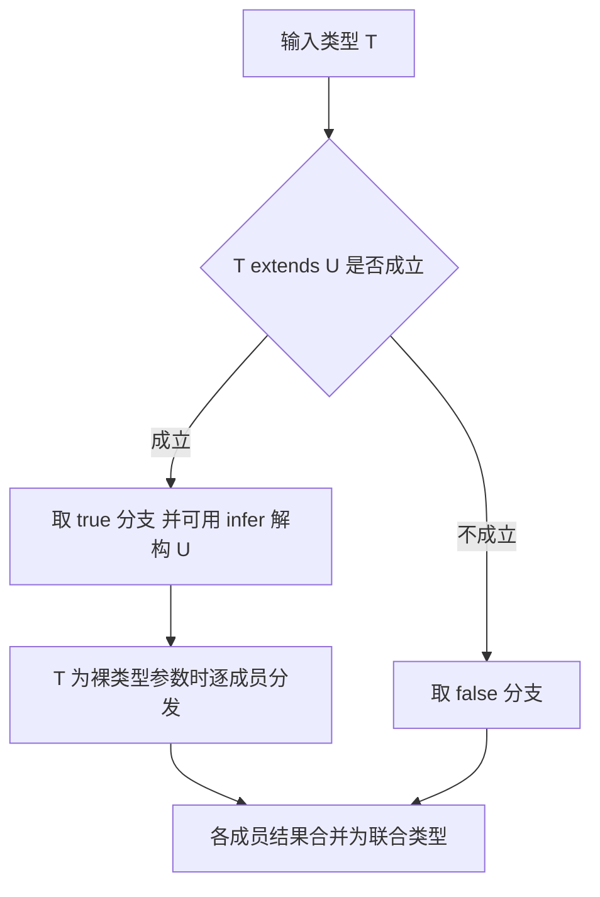

### TS-045：什么是分布式条件类型？
**答**：
- 当 extends 左边是"裸类型参数"且传入联合类型时，条件类型会对每个成员分别求值再合并。
- 这是 Exclude/Extract 能按成员过滤的根本原因。
- 用元组包裹 `[T] extends [U]` 可以阻止分发，用于整体判断。
- infer 出现多个候选时还会有协变位置合并、逆变位置交叉的细节行为。

```typescript
type ToArray<T> = T[]; // 不分发：整体变数组
type DistributeToArray<T> = T extends any ? T[] : never; // 分发：每个成员变数组

type A = ToArray<string | number>; // (string | number)[]
type B = DistributeToArray<string | number>; // string[] | number[]

// 阻止分发：整体判断
type IsUnion<T, C = T> = [T] extends [never]
  ? false
  : T extends any
    ? [C] extends [T] ? false : true // T 是联合时分发收窄了 T，[C] extends [T] 不成立
    : never;

// 实用例子：过滤联合成员
type Filter<T, U> = T extends U ? T : never;
type Strings = Filter<string | number | boolean, string | boolean>; // string | boolean
```

### TS-046：infer 关键字如何使用？有哪些经典应用？
**答**：
- infer 只能在条件类型的 extends 子句中使用，声明一个待推断的类型变量。
- 经典应用：UnwrapPromise、数组元素类型、函数第一个参数、构造函数实例类型。
- 推断位置决定策略：协变位置（返回值）多个候选取联合，逆变位置（参数）取交叉。
- infer 无法直接推断时可以通过两次条件类型"中转"实现。

```typescript
type UnwrapPromise<T> = T extends Promise<infer V> ? V : T;

type A = UnwrapPromise<Promise<string>>; // string
type B = UnwrapPromise<number>; // number

type ElementType<T> = T extends (infer E)[] ? E : never;
type C = ElementType<string[]>; // string

type FirstArg<T> = T extends (first: infer F, ...rest: any[]) => any ? F : never;
type D = FirstArg<(name: string, age: number) => void>; // string
```

### TS-047：如何用 infer 从模板字面量类型中提取内容？
**答**：
- 模板字面量类型的模式匹配里可以嵌入 `infer P`，实现"字符串层面"的解析。
- 典型场景：从事件名提取前缀、从路由路径提取参数、从 getter 名提取字段名。
- 匹配失败走 false 分支，所以通常与递归结合处理多个片段。
- 这类技巧是 TypeScript 4.x 类型体操的核心玩法。

```typescript
// 提取 onXxx 事件名
type EventName<T extends string> = T extends `on${infer Rest}` ? Rest : never;
type A = EventName<"onChange">; // "Change"

// 提取去掉首尾引号的路径片段
type Split<S extends string> = S extends `${infer Head}/${infer Rest}`
  ? Head | Split<Rest>
  : S;
type Path = Split<"a/b/c">; // "a" | "b" | "c"

// 从 Vuex 风格 getter 名中提取模块名
type ModuleOf<T extends string> = T extends `${infer M}/${string}` ? M : never;
type B = ModuleOf<"user/getInfo">; // "user"
```

### TS-048：递归条件类型是什么？有什么应用与限制？
**答**：
- 条件类型的 true 分支里再次引用自身，即可对嵌套结构递归展开。
- 应用：Flatten 多维数组、DeepReadonly、Awaited 链式 Promise、字符串 Split。
- 限制：TS 有递归深度与实例化次数上限（约 50 层/1000 次实例化），过深会报错。
- TypeScript 4.1 起支持递归条件类型，4.5 起支持尾递归消除优化尾部递归场景。

```typescript
type Flatten<T> = T extends (infer E)[] ? Flatten<E> : T;

type A = Flatten<number[][][]>; // number
type B = Flatten<(string | number[])[]>; // string | number

// 递归展开 Promise 链
type DeepAwaited<T> = T extends Promise<infer V> ? DeepAwaited<V> : T;
type C = DeepAwaited<Promise<Promise<Promise<"ok">>>>; // "ok"

// 递归拼接字符串
type Join<T extends string[], D extends string> = T extends [infer F, ...infer R]
  ? R extends string[]
    ? F extends string
      ? `${F}${D}${Join<R, D>}`
      : never
    : F extends string
      ? F
      : never
  : "";
type D = Join<["a", "b", "c"], ".">; // "a.b.c"
```

## 第十一章 模板字面量类型

### TS-049：模板字面量类型是什么？如何与联合类型组合？
**答**：
- 模板字面量类型用 `` `...` `` 在类型层面拼接字符串，插值位可以是任意类型。
- 插入联合类型时会做笛卡尔积展开，生成所有组合。
- 内置字符工具：Uppercase、Lowercase、Capitalize、Uncapitalize。
- 用于事件名、CSS 属性名、路由模式等字符串域的类型约束。

```typescript
type Greeting = `hello ${string}`; // 匹配所有 hello 开头的字符串

function shout(msg: Greeting) {}
shout("hello world"); // OK
// shout("hi world"); // 报错

// 联合类型组合：笛卡尔积
type Dir = "top" | "bottom";
type Edge = `${Dir}-edge`; // "top-edge" | "bottom-edge"
type Pos = `${"left" | "right"}-${"top" | "bottom"}`;
// "left-top" | "left-bottom" | "right-top" | "right-bottom"

type Event = `on${Capitalize<"click" | "focus">}`;
// "onClick" | "onFocus"
```

### TS-050：如何用模板字面量 + 映射类型批量生成 getter 类型？
**答**：
- 映射类型里用 as 对 key 重映射，配合模板字面量把 `name` 变成 `getName`。
- `Capitalize<K>` 首字母大写，`string & K` 用于把 key 收窄成 string 以便插入模板。
- 这是"根据数据结构自动派生 API 类型"的典型手法，vuex 的 mapGetters、表单校验器常用。
- 也可以反向做：从 `getXxx` 解析回字段名。

```typescript
interface Person {
  name: string;
  age: number;
}

type Getters<T> = {
  [K in keyof T as `get${Capitalize<string & K>}`]: () => T[K];
};

type PersonGetters = Getters<Person>;
// { getName: () => string; getAge: () => number }

// 更实用的例子：为每个字段生成校验规则 key
type Validators<T> = {
  [K in keyof T as `validate_${string & K}`]: (value: T[K]) => boolean;
};
// { validate_name: (v: string) => boolean; validate_age: (v: number) => boolean }
```

## 第十二章 映射类型

### TS-051：映射类型的 as 重映射是什么？有什么用？
**答**：
- 语法 `{ [K in keyof T as NewKey]: T[K] }`，as 后面的表达式决定新 key。
- as 后得到 never 的 key 会被直接过滤，可以实现"键过滤"。
- 配合模板字面量可以改写 key（加前缀、改变大小写）。
- 同态映射会保留原属性的 readonly 和 ? 修饰符。

```typescript
interface User {
  id: number;
  name: string;
  kind: string;
}

// 过滤掉 kind 字段
type NoKind = {
  [K in keyof User as K extends "kind" ? never : K]: User[K];
};
// { id: number; name: string }

// 改写 key：加 _ 前缀
type Prefixed = {
  [K in keyof User as `_${string & K}`]: User[K];
};
// { _id: number; _name: string; _kind: string }
```

### TS-052：映射类型的修饰符 +? 与 -readonly 是怎么回事？
**答**：
- 映射类型可以给属性加修饰符：`?`（可选）与 `readonly`。
- 默认是"+"（加上），用 `-` 可以移除：`-?` 去可选、`-readonly` 去只读。
- Required 的实现就是 `-?`，Mutable（可变）的实现就是 `-readonly`。
- 两者可以同时操作，比如"去掉可选又去掉只读"。

```typescript
type MyRequired<T> = {
  [K in keyof T]-?: T[K];
};

type Mutable<T> = {
  -readonly [K in keyof T]: T[K];
};

interface Draft {
  readonly id?: number;
  readonly name?: string;
}

type Editable = Mutable<MyRequired<Draft>>;
// { id: number; name: string }（可选与只读都被移除）

// 组合：把可选属性还原为必填并保持只读
type Complete = {
  [K in keyof Draft]-?: Draft[K];
};
// { readonly id: number; readonly name: string }
```

## 第十三章 装饰器

### TS-053：装饰器有哪些种类？如何使用？
**答**：
- 装饰器是附加在类、方法、访问器、属性、参数上的特殊语法，用于声明式地增强行为。
- TS 5.0 起支持 ECMAScript 标准装饰器（stage 3），旧版使用 `experimentalDecorators` 实验性装饰器。
- 方法装饰器接收目标与方法上下文，可以包装原方法实现日志、埋点、重试等切面逻辑。
- Angular、NestJS 大量依赖装饰器做依赖注入与路由声明。

```typescript
// TS 5 标准装饰器：方法装饰器
function logged(target: Function, context: ClassMethodDecoratorContext) {
  const name = String(context.name);
  return function (this: unknown, ...args: unknown[]) {
    console.log(`调用 ${name}，参数：`, args);
    const result = target.apply(this, args);
    console.log(`调用 ${name} 完成`);
    return result;
  };
}

class OrderService {
  @logged
  pay(amount: number) {
    return `支付 ${amount} 元`;
  }
}

new OrderService().pay(100); // 先打印日志再执行原方法

// 旧版实验性装饰器需在 tsconfig 中开启：
// "experimentalDecorators": true, "emitDecoratorMetadata": true
```

## 第十四章 tsconfig 常用配置

### TS-054：strict 家族包含哪些选项？各自的作用是什么？
**答**：
- `strict: true` 一键开启全部严格检查，等价于下面所有选项。
- `noImplicitAny`：禁止隐式 any；`strictNullChecks`：null/undefined 独立成类型。
- `strictFunctionTypes`：函数参数默认逆变检查；`strictBindCallApply`/`strictPropertyInitialization` 补齐相关检查。
- `noUncheckedIndexedAccess`（4.1+，独立选项）：索引访问结果自动带 undefined，建议开启。

```json
{
  "compilerOptions": {
    "strict": true,
    "noImplicitAny": true,
    "strictNullChecks": true,
    "strictFunctionTypes": true,
    "strictBindCallApply": true,
    "strictPropertyInitialization": true,
    "noImplicitThis": true,
    "alwaysStrict": true,
    "noUncheckedIndexedAccess": true,
    "noImplicitOverride": true
  }
}
```

### TS-055：paths 路径别名怎么配置？要注意什么？
**答**：
- `baseUrl` + `paths` 定义别名映射，`paths` 支持通配符，必须以 baseUrl 为基准。
- TS 只负责类型解析，运行时解析要靠 bundler（vite/webpack）的 alias 配置同步。
- `moduleResolution` 决定模块解析策略，bundler 项目建议用 "bundler"。
- include/exclude 控制参与编译的文件范围。

```json
{
  "compilerOptions": {
    "target": "ES2020",
    "module": "ESNext",
    "moduleResolution": "bundler",
    "baseUrl": ".",
    "paths": {
      "@/*": ["src/*"],
      "@components/*": ["src/components/*"]
    },
    "include": ["src", "types"],
    "exclude": ["node_modules", "dist"]
  }
}
```

## 第十五章 declare 与声明文件

### TS-056：如何为一个没有类型的 npm 包编写声明文件？
**答**：
- 最简方案：`declare module "包名"` 给整个模块声明 any 类型，快速消除报错。
- 更好的方案：为模块导出的每个 API 写精确签名，放到 `.d.ts` 文件。
- 全局变量用 `declare global`、`declare const` 声明；类型文件通过 `typeRoots`/`types` 引入。
- 包作者可用 `package.json` 的 `types` 字段指向声明文件，消费者自动获得类型。

```typescript
// types/untyped-lib.d.ts
declare module "untyped-lib" {
  export interface RequestOptions {
    timeout?: number;
    retries?: number;
  }

  export function request(url: string, options?: RequestOptions): Promise<unknown>;
  export function debounce<T extends (...args: any[]) => void>(fn: T, wait: number): T;

  const version: string;
  export default { request, debounce, version };
}

// 全局环境变量声明：types/env.d.ts
interface ImportMetaEnv {
  readonly VITE_API_URL: string;
}
```

## 第十六章 enum 与 const enum

### TS-057：enum 与 const enum 有什么区别？有哪些坑？
**答**：
- 普通 enum 编译后生成真实的双向映射对象（数字枚举支持反向索引），有运行时代价。
- const enum 编译时内联，无运行时对象；但 `isolatedModules: true` 下限制较多（不能被单独导出后直接取值，4.x 起需 preserveConstEnums 配合）。
- 数字枚举反向映射的坑：`Color[3]` 也能取到值，key 空间被污染。
- 社区推荐用 `as const` 对象 + `keyof typeof` 替代 enum，零运行时且类型友好。

```typescript
enum Color {
  Red = 1,
  Green,
  Blue,
}
// 编译产物：var Color; Color[Color["Red"] = 1] = "Red"; ...（双向映射）
console.log(Color[1]); // "Red"（反向映射）

const enum FastColor {
  Red = 1,
  Green,
  Blue,
}
const fast: FastColor = FastColor.Green; // 编译后内联为 2，无 FastColor 对象

// as const 替代方案
const Status = {
  Idle: "idle",
  Loading: "loading",
  Done: "done",
} as const;
type Status = (typeof Status)[keyof typeof Status]; // "idle" | "loading" | "done"
```

## 第十七章 协变与逆变

### TS-058：什么是协变与逆变？TypeScript 的函数参数是逆变吗？
**答**：
- 协变：子类型关系与包装方向一致，如 `Dog[]` 可赋给 `Animal[]`，TS 的对象、数组都是协变。
- 逆变：方向相反，函数参数在 `strictFunctionTypes` 下是逆变的，`Feed<Animal>` 可赋给 `Feed<Dog>`。
- 方法简写语法（method shorthand）保持双变以兼容旧代码，属性箭头函数形式才严格逆变。
- 理解协变逆变是看懂 `subscribe`、`Map<K, V>` 型变标注（in/out）的基础。

```typescript
interface Animal {
  name: string;
}
interface Dog extends Animal {
  breed: string;
}

// 协变：数组方向一致
let dogs: Dog[] = [];
let animals: Animal[] = [];
animals = dogs; // OK

// 逆变：函数参数方向相反
type Feed<T> = (t: T) => void;

const feedAnimal: Feed<Animal> = (a) => console.log(a.name);
const feedDog: Feed<Dog> = feedAnimal; // OK：能喂所有动物就能喂狗（逆变）
// const feedAnimal2: Feed<Animal> = (d: Dog) => d.breed; // 报错：只喂狗的函数不能喂所有动物

// strictFunctionTypes 下属性形式的回调参数是逆变的
interface Handler<T> {
  handle: (t: T) => void; // 属性箭头形式：逆变
  // handle(t: T): void;  // 方法简写形式：双变（兼容旧代码）
}
```

## 第十八章 类型体操典型题

### TS-059：如何手写 DeepPartial？
**答**：
- 递归条件类型 + 映射类型：对象则递归映射每个属性为可选，非对象直接返回。
- 要区分函数（typeof 为 function，也是 object），函数不应被展开。
- 数组可按需处理为 `DeepPartial<T>[]` 或保持原样，看业务需求。
- 同款套路可以写 DeepReadonly、DeepRequired。

```typescript
type Primitive = string | number | boolean | bigint | symbol | null | undefined;

type DeepPartial<T> = T extends Primitive
  ? T
  : T extends (...args: any[]) => any
    ? T // 函数保持原样
    : T extends Array<infer E>
      ? Array<DeepPartial<E>>
      : { [K in keyof T]?: DeepPartial<T[K]> };

interface Profile {
  user: {
    name: string;
    tags: string[];
    greet: () => void;
  };
  version: number;
}

const patch: DeepPartial<Profile> = {
  user: {
    name: "只改名字",
    // greet 必须是完整函数，不会被 Partial 化
  },
  // version 可以不传
};
```

### TS-060：如何从路由字符串中提取参数类型？
**答**：
- 模板字面量 + infer + 递归：匹配 `:param/` 片段提取参数名，剩余部分递归处理。
- 提取到的参数名做映射类型的 key，值为 string。
- 这是 vue-router、react-router 内部类型推导的简化版。
- 关键点：`{ [K in P]: string }` 与递归结果做交叉，最终得到完整参数对象。

```typescript
type RouteParams<S extends string> = S extends `${string}:${infer P}/${infer Rest}`
  ? { [K in P]: string } & RouteParams<Rest>
  : S extends `${string}:${infer P}`
    ? { [K in P]: string }
    : unknown;

type Params = RouteParams<"/user/:id/post/:postId">;
// { id: string } & { postId: string }

function navigate<S extends string>(path: S, params: RouteParams<S>) {}
navigate("/user/:id/post/:postId", { id: "1", postId: "9" }); // OK
// navigate("/user/:id/post/:postId", { id: "1" }); // 报错：缺少 postId
```

## 第十九章 工具类型手写进阶

### TS-061：如何手写 Required 工具类型？
**答**：
- 映射类型加 `-?` 修饰符即可去掉每个属性的可选标记：`{ [K in keyof T]-?: T[K] }`。
- `-?` 的同时会把属性类型中的 `undefined` 一并移除（可缺省属性等价于可能为 undefined）。
- 递归版本 DeepRequired 需要先排除原始值与函数，再对子对象递归应用 `-?`。

```typescript
type MyRequired<T> = { [K in keyof T]-?: T[K] };

interface Options {
  a?: number;
  b?: string;
}

type R = MyRequired<Options>;
// { a: number; b: string }，可选标记被移除
const r: R = { a: 1, b: "x" }; // OK，两个键都必须提供
// const r2: R = { a: 1 }; // 报错：缺少 b

// 递归版：深层的可选也变成必填
type DeepRequired<T> = T extends object
  ? { [K in keyof T]-?: DeepRequired<T[K]> }
  : T;

type D = DeepRequired<{ a?: { b?: string } }>;
// { a: { b: string } }
```

### TS-062：如何手写 Readonly 与深层 DeepReadonly？
**答**：
- 浅层：映射类型加 `+readonly`（默认就是加）或显式写 `readonly`。
- 深层：递归条件类型，对象属性继续 DeepReadonly，数组返回 `readonly DeepReadonly<E>[]`。
- 与 DeepPartial 一样要排除函数与原始值，避免把函数签名也展开。

```typescript
type MyReadonly<T> = { +readonly [K in keyof T]: T[K] };

type DeepReadonly<T> = T extends Primitive
  ? T
  : T extends (...args: any[]) => any
    ? T
    : T extends Array<infer E>
      ? readonly DeepReadonly<E>[]
      : { readonly [K in keyof T]: DeepReadonly<T[K]> };

interface State {
  user: { name: string; tags: string[] };
  onSave: () => void;
}

type Frozen = DeepReadonly<State>;
// user.name 只读、user.tags 变为 readonly string[]、onSave 保持函数原样
const f: Frozen = {
  user: { name: "a", tags: ["x"] },
  onSave: () => {},
};
// f.user.name = "b"; // 报错：只读属性不可赋值
```

### TS-063：如何手写 Mutable（去掉 readonly 修饰符）？
**答**：
- 映射类型支持 `-readonly` 修饰符，专用于移除只读标记。
- 常见场景：从 `as const` 配置推导出的深只读类型，需要在可变副本上操作时先转 Mutable。
- 深层版本 DeepMutable 见 TS-090，这里先给出浅层实现。

```typescript
type Mutable<T> = { -readonly [K in keyof T]: T[K] };

type Config = {
  readonly host: string;
  readonly port: number;
};

type Editable = Mutable<Config>;
// { host: string; port: number }
const c: Editable = { host: "localhost", port: 8080 };
c.port = 9090; // OK，不再只读
```

### TS-064：如何实现 PartialByKeys 与 OmitByKeys？
**答**：
- PartialByKeys：把指定键改可选、其余保持原样，用键重映射 `as` 配合条件判断。
- 两组属性交叉后类型是交叉形式，可用 `Omit<T, never>` 或 `Merge` 技巧拍平成单一对象类型。
- OmitByKeys：排除指定键，等价于 `Pick<T, Exclude<keyof T, K>>`，可用映射类型手写。

```typescript
type PartialByKeys<T, K extends keyof T = keyof T> = Omit<
  { [P in K]?: T[P] } & { [P in Exclude<keyof T, K>]: T[P] },
  never
>; // Omit<..., never> 把交叉拍平成单一对象

interface User {
  id: number;
  name: string;
  age: number;
}

type Patch = PartialByKeys<User, "name" | "age">;
// { id: number; name?: string; age?: number }
const p: Patch = { id: 1, name: "a" }; // OK，name/age 可省略
// const p2: Patch = {}; // 报错：缺少 id

type OmitByKeys<T, K extends keyof T> = {
  [P in Exclude<keyof T, K>]: T[P];
};
type NoAge = OmitByKeys<User, "age">; // { id: number; name: string }
```

### TS-065：如何提取对象的所有必填键与可选键？
**答**：
- 判定技巧：`{} extends Pick<T, K>` 为真说明 K 可以缺省（空对象就能构造出只含 K 的子集），即可选键。
- 键重映射分支输出 `K` 或 `never`，再用索引访问 `[keyof T]` 取出键的联合。
- `never` 会被联合吸收，所以结果只留下目标键集合。

```typescript
type RequiredKeys<T> = {
  [K in keyof T]: {} extends Pick<T, K> ? never : K;
}[keyof T];

type OptionalKeys<T> = {
  [K in keyof T]: {} extends Pick<T, K> ? K : never;
}[keyof T];

interface Mixed {
  id: number;      // 必填
  name?: string;   // 可选
  age?: number;    // 可选
}

type RK = RequiredKeys<Mixed>;  // "id"
type OK = OptionalKeys<Mixed>;  // "name" | "age"
```

### TS-066：如何提取函数属性键 FunctionKeys 与 NonFunctionKeys？
**答**：
- 用键重映射 + 条件类型：`T[K] extends (...args: any[]) => any` 判定该属性是否为函数。
- 命中函数的键保留，其余映射为 `never` 被联合吸收即可得到 FunctionKeys。
- NonFunctionKeys 反过来分支即可；也可直接 `Exclude<keyof T, FunctionKeys<T>>`。

```typescript
type FunctionKeys<T> = {
  [K in keyof T]: T[K] extends (...args: any[]) => any ? K : never;
}[keyof T];

type NonFunctionKeys<T> = {
  [K in keyof T]: T[K] extends (...args: any[]) => any ? never : K;
}[keyof T];

interface Service {
  url: string;
  timeout: number;
  fetch: () => Promise<void>;
  save: (data: string) => void;
}

type FK = FunctionKeys<Service>;     // "fetch" | "save"
type NFK = NonFunctionKeys<Service>; // "url" | "timeout"
```

### TS-067：如何实现 GetRequired 与 GetOptional（挑出必填/可选字段组成新类型）？
**答**：
- 复用 TS-065 的 `{} extends Pick<T, K>` 判定，但这次在键重映射里挑键并保留值。
- 命中的键映射为自身并取 `T[K]`，未命中的映射为 `never` 被丢弃。
- 与 RequiredKeys 的区别：一个只输出键的联合，一个输出完整的对象类型。

```typescript
type GetRequired<T> = {
  [K in keyof T as {} extends Pick<T, K> ? never : K]: T[K];
};

type GetOptional<T> = {
  [K in keyof T as {} extends Pick<T, K> ? K : never]: T[K];
};

interface Mixed {
  id: number;
  name?: string;
  email?: string;
}

type OnlyReq = GetRequired<Mixed>;
// { id: number }
type OnlyOpt = GetOptional<Mixed>;
// { name?: string; email?: string }
```

### TS-068：如何手写 UnionToIntersection？为什么需要"二次触发"？
**答**：
- 原理：函数参数位置是逆变的，同一位置的多个参数类型会被 TS 合并成交叉。
- 第一步用分布式条件类型 `U extends any ? (arg: U) => void : never` 把联合的每个成员包进函数参数位置，得到函数类型的联合。
- 第二步用 `infer I` 读取这个函数联合的参数类型，TS 在读取时把参数位置的联合合并为交叉，得到 `U1 & U2 & ...`。
- 陷阱：若传入的联合来自 `keyof` 等需要配合 `[]` 包裹判断 never；分布式是自动发生的，无法关闭，只能用 `[T] extends [X]` 抑制。

```typescript
type UnionToIntersection<U> = (
  U extends any ? (arg: U) => void : never
) extends (arg: infer I) => void
  ? I
  : never;

type A = { a: string };
type B = { b: number };

type Inter = UnionToIntersection<A | B>;
// { a: string } & { b: number }
declare const x: Inter;
x.a; // OK
x.b; // OK

type Members = UnionToIntersection<"a" | "b" | "c">;
// "a" & "b" & "c"（字面量交叉结果为 never，说明互斥）
```

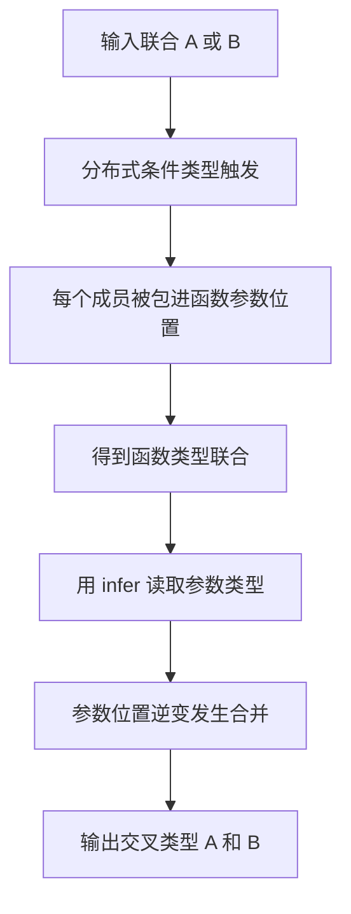

## 第二十章 infer 高阶

### TS-069：如何用 infer 提取数组与元组的元素类型？
**答**：
- 数组：`T extends (infer E)[] ? E : never`，联合数组会分发到每个元素再联合。
- 元组：用展开模式 `[infer F, ...infer R]` 可同时拿到首个元素和剩余元组，是递归体操的基础。
- 只读数组要写 `readonly (infer E)[]`，否则匹配不上。

```typescript
type ElementType<T> = T extends readonly (infer E)[] ? E : never;

type E1 = ElementType<string[]>;            // string
type E2 = ElementType<number[] | boolean[]>; // number | boolean
type E3 = ElementType<readonly [1, 2, 3]>;   // 1 | 2 | 3

type FirstOfTuple<T extends any[]> = T extends [infer F, ...any[]] ? F : never;
type F1 = FirstOfTuple<["a", "b", "c"]>; // "a"
```

### TS-070：如何手写 Parameters、ReturnType 与 ConstructorParameters？
**答**：
- 三者都是"extends 函数签名 + infer 捕获"的固定套路。
- Parameters 捕获参数元组 `(...args: infer P)`；ReturnType 捕获返回值 `=> infer R`。
- ConstructorParameters 针对**构造函数签名** `abstract new (...args: infer P) => any`，加 `abstract` 是为了兼容抽象类。

```typescript
type MyParameters<T extends (...args: any) => any> =
  T extends (...args: infer P) => any ? P : never;

type MyReturnType<T extends (...args: any) => any> =
  T extends (...args: any) => infer R ? R : never;

type MyConstructorParameters<T extends abstract new (...args: any) => any> =
  T extends abstract new (...args: infer P) => any ? P : never;

function createUser(name: string, age: number) {
  return { name, age };
}
type Args = MyParameters<typeof createUser>;  // [name: string, age: number]
type Ret = MyReturnType<typeof createUser>;   // { name: string; age: number }

class Person {
  constructor(name: string, age: number) {}
}
type CArgs = MyConstructorParameters<typeof Person>; // [string, number]
```

### TS-071：如何递归解包多层 Promise（DeepAwaited）？
**答**：
- 内置 `Awaited<T>` 已经做了这件事（含 thenable），手写考察的是递归 infer。
- 模式：`T extends Promise<infer V> ? DeepAwaited<V> : T`，一层层剥到非 Promise 为止。
- 递归要有终止条件（不匹配 Promise 时直接返回 T），否则会无限递归报错。

```typescript
type DeepAwaited<T> = T extends Promise<infer V> ? DeepAwaited<V> : T;

type D1 = DeepAwaited<Promise<string>>;                     // string
type D2 = DeepAwaited<Promise<Promise<number[]>>>;          // number[]
type D3 = DeepAwaited<Promise<{ a: Promise<boolean> }>>;    // { a: Promise<boolean> }（属性内的不会展开，是浅层停止点）

// 与内置 Awaited 对照
type A1 = Awaited<Promise<Promise<string>>>; // string
```

### TS-072：如何用 infer 在模板字面量中提取路由路径段？
**答**：
- 模板字面量模式 `` `${infer Seg}/${infer Rest}` `` 可同时捕获一个段和剩余字符串。
- 提取后递归处理 Rest，把每段收进联合类型。
- 与 TS-060 的区别：TS-060 提取 `:id` 形式的**动态参数对象**，这里提取**静态路径段**本身，常用于生成菜单、面包屑配置的 key。

```typescript
type PathSegments<S extends string> = S extends `/${infer Seg}/${infer Rest}`
  ? Seg | PathSegments<`/${Rest}`>
  : S extends `/${infer Seg}`
    ? Seg
    : never;

type Segs = PathSegments<"/user/profile/settings">;
// "user" | "profile" | "settings"

// 应用：按段生成配置 key 联合
type MenuKey = `menu-${PathSegments<"/user/profile/settings">}`;
// "menu-user" | "menu-profile" | "menu-settings"
```

### TS-073：infer 约束 `infer X extends Y` 有什么用？
**答**：
- TS 4.8 引入：infer 的类型参数可以直接带 extends 约束，不满足约束时整个分支匹配失败（而不是得到 unknown）。
- 典型用途一：过滤——只让满足约束的解包成功，否则落到 else 分支得到 never。
- 典型用途二：字面量转换——``infer N extends number`` 配合模板字面量把字符串数字转 number（见 TS-095）。

```typescript
// 用途一：约束过滤
type UnwrapNumber<T> = T extends Promise<infer V extends number> ? V : never;

type U1 = UnwrapNumber<Promise<42>>;     // 42
type U2 = UnwrapNumber<Promise<string>>; // never，约束不满足直接匹配失败

// 用途二：捕获字面量而非宽类型
type FirstStr<T extends any[]> = T extends [infer F extends string, ...any[]] ? F : never;
type FS = FirstStr<[`abc`, 1]>; // "abc"（带引号的字面量，而非 string）
```

### TS-074：如何提取函数的第一个参数与最后一个参数？
**答**：
- 第一个参数：`(a: infer A, ...rest: any[])` 固定首位捕获。
- 最后一个参数：先 infer 整个参数元组，再用展开模式 `[...any[], infer L]` 从尾部匹配。
- 注意 `...any[], infer L` 是 TS 4.2+ 的可变元组语法，尾部的 L 必须是最后一段。

```typescript
type FirstArgument<T> = T extends (a: infer A, ...rest: any[]) => any ? A : never;

type LastParameter<T> = T extends (...args: infer P) => any
  ? P extends [...any[], infer L]
    ? L
    : never // 空参数时没有最后一个
  : never;

function submit(url: string, data: object, retry: number) {}

type FA = FirstArgument<typeof submit>; // string
type LP = LastParameter<typeof submit>; // number

type LP2 = LastParameter<() => void>; // never（无参数）
```

### TS-075：如何手写 InstanceType？abstract 构造器有什么讲究？
**答**：
- 构造签名匹配：`T extends abstract new (...args: any) => infer R ? R : never`。
- 加 `abstract` 修饰的构造签名能同时匹配普通类与抽象类（抽象类的类型是 abstract new）。
- 泛型类会推导出实例化后的实例类型，这是依赖注入容器、emit 类型工厂的基础。

```typescript
type MyInstanceType<T extends abstract new (...args: any) => any> =
  T extends abstract new (...args: any) => infer R ? R : never;

class Box<T> {
  constructor(public value: T) {}
}
abstract class Shape {
  abstract area(): number;
}

type B = MyInstanceType<typeof Box>;   // Box<unknown>（无具体实例时 T 推为 unknown）
const b = new Box(1);
type B2 = MyInstanceType<typeof b.constructor extends abstract new (...args: any) => infer R ? never : never>; // 演示用

// 更常见用法：从构造器参数工厂返回
type ShapeCtor = abstract new () => Shape;
type S = MyInstanceType<ShapeCtor>; // Shape（抽象类的实例类型）
```

## 第二十一章 条件类型与分布式深水区

### TS-076：什么是分布式条件类型？如何触发与抑制？
**答**：
- 只有"裸类型参数"（naked type parameter）作为 extends 左侧、且传入联合时，条件类型才会对每个成员分别求值再联合——这就是分布式。
- 抑制方法：把两侧都用元组包起来 `[T] extends [X]`，让 T 不再是裸类型参数。
- never 的特性：`never extends any` 分发时 never 是空联合，结果直接是 never，永远走不到 true 分支——这是 IsNever 要用 `[]` 包裹的原因。

```typescript
// 分发：每个成员单独求值
type ToArray<T> = T extends any ? T[] : never;
type X1 = ToArray<string | number>; // string[] | number[]（而不是 (string|number)[]）

// 抑制：[] 包裹后整体比较
type ToArray2<T> = [T] extends [any] ? T[] : never;
type X2 = ToArray2<string | number>; // (string | number)[]

// never 分发陷阱
type Bad<T> = T extends any ? "hit" : "miss";
type Y1 = Bad<never>;        // never（空联合分发，两个分支都不会出现）
type Y2 = Bad<string | never>; // "hit"（never 被联合吸收）
```

### TS-077：如何实现 IsNever？
**答**：
- 直接写 `T extends never ? true : false` 永远得到 never（TS-076 的 never 分发陷阱）。
- 正确做法：`[T] extends [never]` 用元组包裹抑制分发，让 never 整体参与比较。
- 这是所有 "is xxx" 判定类工具类型的标准开场。

```typescript
type IsNever<T> = [T] extends [never] ? true : false;

type N1 = IsNever<never>;            // true
type N2 = IsNever<string>;           // false
type N3 = IsNever<never | string>;   // false（never 被联合吸收，等价于 string）

// 错误示范
type WrongIsNever<T> = T extends never ? true : false;
type W = WrongIsNever<never>; // never，而不是 true
```

### TS-078：如何实现 IsAny 与 IsUnknown？
**答**：
- IsAny 利用"any 与任何类型交叉等于 any"的特性：`0 extends 1 & T`，只有 T 为 any 时 `1 & T` 才兼容 0。
- IsUnknown：unknown 是所有类型的父类型，用 `unknown extends T` 且排除 any/never 即可判定。
- 两者在类型守卫工具库、精确的 Overload 选择场景常见。

```typescript
type IsAny<T> = 0 extends 1 & T ? true : false;

type A1 = IsAny<any>;        // true
type A2 = IsAny<unknown>;    // false
type A3 = IsAny<number>;     // false

type IsUnknown<T> =
  IsAny<T> extends true ? false
  : [T] extends [never] ? false
  : unknown extends T ? true : false;

type U1 = IsUnknown<unknown>;         // true
type U2 = IsUnknown<any>;             // false（已排除）
type U3 = IsUnknown<string>;          // false
type U4 = IsUnknown<{}>;              // false（{} 比 unknown 窄）
```

### TS-079：如何实现 IsUnion？
**答**：
- 思路：引入第二个类型参数 `C = T`，让 C 作为裸类型参数分发到 T 的每个成员。
- 对每个成员判定 `[T] extends [C]`：成员是联合的一部分但整体又不等于该成员时，说明 T 是联合。
- 单一类型分发后 C 与 T 相同，走 false 分支；never 仍要先排除。

```typescript
type IsUnion<T, C = T> =
  [T] extends [never] ? false
  : C extends T
    ? [T] extends [C] ? false : true
    : false;

type I1 = IsUnion<"a" | "b">;  // true
type I2 = IsUnion<string>;     // false
type I3 = IsUnion<never>;      // false
type I4 = IsUnion<1 | 2 | 3>;  // true

// 过程拆解（T = "a" | "b"）：
// C = "a" 时："a" extends "a"|"b" 成立 → ["a"|"b"] extends ["a"] 不成立 → true
// C = "b" 时：同理 → true
// true | true = true
```

### TS-080：Equal 严格相等判定的多种写法与差异？
**答**：
- 写法一（双向 extends）：`A extends B ? (B extends A ? true : false) : false`，多数情况够用，但对 any、字面量与宽类型、可选属性等场景会误判。
- 写法二（函数内部标识比较）：比较两个泛型函数签名对 T 的解析结果，TS 会为每个类型生成唯一内部标识，只有完全相同的类型标识才一致——这是业内公认的严格相等。
- `any` 是双向 extends 的重灾区：any 会同时命中两个分支产生 boolean 而非 true/false。

```typescript
// 写法一：双向 extends（不严格）
type Equal1<A, B> = A extends B ? (B extends A ? true : false) : false;
type E1a = Equal1<string, string>;            // true，正常
type E1b = Equal1<any, string>;               // boolean（any 分发导致误判！）
type E1c = Equal1<{ a: 1 }, { a: 1; b?: 2 }>; // false，可选属性反向不兼容，尚可

// 写法二：内部类型标识比较（严格，推荐）
type Equal2<X, Y> =
  (<T>() => T extends X ? 1 : 2) extends
  (<T>() => T extends Y ? 1 : 2)
    ? true : false;
type E2a = Equal2<string, string>;  // true
type E2b = Equal2<any, string>;     // false，正确区分 any
type E2c = Equal2<any, any>;        // true
type E2d = Equal2<[1], [1]>;        // true，元组也能正确比较
```

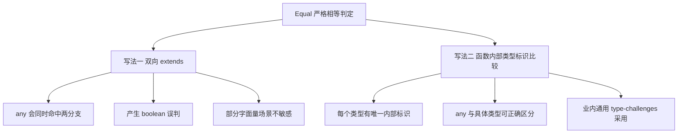

### TS-081：XOR 异或类型（两对象互斥字段）如何实现？
**答**：
- 目标：`A | B` 只能整体选 A 或整体选 B，混写字段要报错。
- 套路：`Without<T, U> | Without<U, T>`——Without 把对方拥有的字段在本方映射为可选 never（`?: never`）。
- 赋值时只要出现对方的字段，类型就是 never 冲突，TS 立即报错；这是"互斥登录方式、支付方式"类业务的标准写法。

```typescript
type Without<T, U> = {
  [P in Exclude<keyof T, keyof U>]?: never;
} & Pick<T, Exclude<keyof T, keyof U>>;

type XOR<T, U> = Without<T, U> | Without<U, T>;

type Login = XOR<
  { username: string; password: string },
  { token: string }
>;

const a: Login = { username: "u", password: "p" }; // OK，走账号密码分支
const b: Login = { token: "t" };                   // OK，走 token 分支
// const c: Login = { username: "u", token: "t" };
// 报错：token 不能赋给 never（两个分支都不满足）
```

### TS-082：Without 差异类型与条件类型递归深度、性能？
**答**：
- Without（差集对象）：保留 T 有而 U 没有的字段，其余字段以 `?: never` 占位堵住赋值，见 TS-081。
- 深度限制：条件类型递归深度上限约 1000 层，超限报 "Type instantiation is excessively deep"，递归体操（如长字符串 Split、大元组 Reverse）都会撞上。
- TS 4.5+ 对"尾递归形式"的条件类型做了尾调用优化，递归位置在末尾的（如 Split、Reverse）可处理更长输入；性能上尽量减少不必要的分发与交叉展开，超长数据考虑运行时而非类型层。

```typescript
// Without：T 相对 U 的差异对象
type Without2<T, U> = {
  [P in Exclude<keyof T, keyof U>]: T[P];
};
type All = { a: number; b: string; c: boolean };
type Common = { a: number };
type Diff = Without2<All, Common>; // { b: string; c: boolean }

// 递归深度压力示例：大元组 Reverse
type Reverse<T extends any[], R extends any[] = []> =
  T extends [infer F, ...infer Rest] ? Reverse<Rest, [F, ...R]> : R;

type Big = Reverse<[1, 2, 3]>; // [3, 2, 1]
// 1000+ 元素时可能报 excessively deep，4.5+ 尾递归优化可缓解
```

## 第二十二章 类型体操经典题

### TS-083：如何把元组转联合类型？
**答**：
- 最简写法利用索引访问：`T[number]` 取出所有索引位置的值类型，天然就是联合。
- 也可以用展开递归写，但对纯提取没必要，索引访问一行即可。
- readonly 元组同样适用。

```typescript
type TupleToUnion<T extends readonly any[]> = T[number];

type T1 = TupleToUnion<["a", "b", "c"]>;        // "a" | "b" | "c"
type T2 = TupleToUnion<[string, number]>;       // string | number
type T3 = TupleToUnion<readonly [1, 2]>;        // 1 | 2

// 等价递归写法
type TupleToUnion2<T extends readonly any[]> =
  T extends readonly [infer F, ...infer R] ? F | TupleToUnion2<R> : never;
```

### TS-084：如何把联合类型转为元组（union to tuple）？
**答**：
- 依据：联合出现在**重载函数**的参数位置时，infer 只能读到"最后一个重载"的参数，反复读取再排除即可逐个取出成员。
- 步骤：构造 `(x: 联合) => void` 的交叉，infer 取出一个成员 R，用 `Exclude<T, R>` 缩小联合后递归，never 时终止返回 `[]`。
- 元组顺序依赖实现细节（规范不保证），仅作展示，业务代码慎用。

```typescript
type UnionToOverload<U> = U extends any ? (f: U) => void : never;

type UnionToTuple<T> = [T] extends [never]
  ? []
  : UnionToOverload<T> extends (f: infer R) => void
    ? [R, ...UnionToTuple<Exclude<T, R>>]
    : never;

type UT = UnionToTuple<"a" | "b" | "c">;
// ["c", "b", "a"]（每个成员都在，顺序由内部实现决定）

// 顺手复习：联合转交叉（详见 TS-068）
type UnionToIntersection<U> =
  (U extends any ? (arg: U) => void : never) extends (arg: infer I) => void ? I : never;
type UI = UnionToIntersection<{ a: 1 } | { b: 2 }>; // { a: 1 } & { b: 2 }
```

### TS-085：如何获取元组的长度类型（TupleLength）？
**答**：
- 直接索引访问 `T["length"]`，对元组返回字面量数字类型（元组长度是类型的一部分）。
- 对普通数组返回 number，对 unknown 长度的只读数组同理。
- 结合上一章的计数技巧，`1[]` 数组累加也能"造"出字面量数字类型，用于递归计数。

```typescript
type TupleLength<T extends readonly any[]> = T["length"];

type L1 = TupleLength<[string, number, boolean]>; // 3（字面量）
type L2 = TupleLength<[]>;                        // 0
type L3 = TupleLength<string[]>;                  // number（普通数组失去字面量）

// 递归计数造字面量数字：加一个元素就把长度 +1
type Count<Arr extends any[], Acc extends 1[] = []> =
  Arr extends [any, ...infer R] ? Count<R, [...Acc, 1]> : Acc["length"];
type C = Count<[1, 2, 3]>; // 3
```

### TS-086：如何实现 TupleToNestedObject？
**答**：
- 递归取出首元素作为键、剩余元组作为值递归构建：`{ [K in F]: TupleToNestedObject<R, U> }`。
- 元组取空时返回叶子类型 U，这是递归的终止条件。
- 键要求是 string，用 `infer F extends string` 带约束捕获。

```typescript
type TupleToNestedObject<T extends readonly string[], U> =
  T extends readonly [infer F extends string, ...infer R extends readonly string[]]
    ? { [K in F]: TupleToNestedObject<R, U> }
    : U;

type N1 = TupleToNestedObject<["a", "b", "c"], number>;
// { a: { b: { c: number } } }
type N2 = TupleToNestedObject<["key"], string>;
// { key: string }

const v: N1 = { a: { b: { c: 123 } } }; // OK
```

### TS-087：如何实现 Chainable 链式调用类型？
**答**：
- option 每次返回新的 Chainable，把新键值对交叉进去：`Chainable<T & { [K in Key]: V }>`。
- get() 返回累积的所有键值：`{ [P in keyof T]: T[P] }`（映射类型顺便拍平交叉）。
- Key 约束为 string，保证能做模板字面量与索引签名；这是 Kubb、Builder 模式类型的雏形。

```typescript
type Chainable<T = {}> = {
  option<K extends string, V>(key: K, value: V): Chainable<T & { [P in K]: V }>;
  get(): { [P in keyof T]: T[P] };
};

declare const chain: Chainable;

const result = chain
  .option("name", "foo")
  .option("age", 18)
  .option("active", true)
  .get();
// { name: string; age: number; active: boolean }

result.name;   // string，类型正确收窄
result.age;    // number
```

### TS-088：如何实现 Curry 柯里化类型？
**答**：
- 核心是递归条件类型：参数元组每消费一个，返回 `(arg: 下一个) => Curry<剩余, R>`。
- 元组取空时返回最终返回值 R，形成终止分支。
- 剩余参数为空时可直接调用，实战中还需处理可选参数与剩余参数（`...args`），面试给出核心版即可。

```typescript
type Curry<P extends any[], R> =
  P extends [infer F, ...infer Rest]
    ? Rest extends []
      ? (arg: F) => R                    // 最后一个参数，直接返回结果
      : (arg: F) => Curry<Rest, R>       // 还有剩余，继续柯里化
    : R;

declare function curry<P extends any[], R>(fn: (...args: P) => R): Curry<P, R>;

const add = (a: number, b: string, c: boolean) => `${a}${b}${c}`;
const curried = curry(add);
// (arg: number) => (arg: string) => (arg: boolean) => string

const step1 = curried(1);      // (arg: string) => (arg: boolean) => string
const step2 = step1("x");      // (arg: boolean) => string
const final = step2(true);     // string
```

### TS-089：如何实现 FlipArguments（翻转函数参数类型）？
**答**：
- 先用 infer 拆出参数元组 P 与返回值 R，把 P 递归反转后重新拼成函数类型。
- 反转套路：`[infer F, ...infer R]` 取首递归 `...Reverse<R>, F`，把首元素不断追加到结果尾部。
- 依赖 TS-107 的 Reverse，本题把它内联使用。

```typescript
type Reverse<T extends any[]> = T extends [infer F, ...infer R]
  ? [...Reverse<R>, F]
  : [];

type FlipArguments<T extends (...args: any[]) => any> =
  T extends (...args: infer P) => infer R
    ? (...args: Reverse<P>) => R
    : never;

function compare(a: number, b: string): boolean { return true; }

type Flipped = FlipArguments<typeof compare>;
// (b: string, a: number) => boolean
declare const flipped: Flipped;
flipped("x", 1); // OK，参数顺序已翻转
```

### TS-090：如何实现 DeepMutable？
**答**：
- 映射类型加 `-readonly`，并递归处理仍是 object 的属性值。
- 要排除函数与原始值：函数也是 object，直接递归会把函数签名展开出错误结果。
- 数组场景映射为 `DeepMutable<E>[]`，保持元素可变。

```typescript
type Primitive = string | number | boolean | bigint | symbol | null | undefined;

type DeepMutable<T> = T extends Primitive
  ? T
  : T extends (...args: any[]) => any
    ? T // 函数保持原样
    : T extends readonly (infer E)[]
      ? DeepMutable<E>[]
      : { -readonly [K in keyof T]: DeepMutable<T[K]> };

interface AppState {
  readonly user: {
    readonly name: string;
    readonly roles: readonly string[];
  };
  readonly version: number;
}

type Editable = DeepMutable<AppState>;
const s: Editable = { user: { name: "a", roles: ["admin"] }, version: 1 };
s.user.name = "b";        // OK
s.version = 2;            // OK
```

## 第二十三章 字符串类型体操

### TS-091：如何实现 Trim / TrimLeft / TrimRight？
**答**：
- 定义空白字符联合 `Whitespace = " " | "\t" | "\n"`，模板字面量两侧匹配。
- 递归：匹配到 `${Whitespace}${infer R}` 就继续处理 R，匹配不上时返回，即终止条件。
- Whitespace 是联合，模板字面量会对每个成员尝试匹配，天然覆盖多种空白。

```typescript
type Whitespace = " " | "\t" | "\n";

type TrimLeft<S extends string> =
  S extends `${Whitespace}${infer R}` ? TrimLeft<R> : S;

type TrimRight<S extends string> =
  S extends `${infer R}${Whitespace}` ? TrimRight<R> : S;

type Trim<S extends string> = TrimLeft<TrimRight<S>>;

type A = TrimLeft<"   hello">;        // "hello"
type B = TrimRight<"hello   ">;       // "hello"
type C = Trim<"  hello world  ">;     // "hello world"
```

### TS-092：如何实现 Replace 与 ReplaceAll？
**答**：
- Replace：`S extends \`${infer L}${From}${infer R}\`` 捕获前后段拼回 To，只替换第一处。
- ReplaceAll：替换后把结果递归处理，直到匹配不上 From。
- 关键防御：`From extends ""` 必须短路返回原串，否则空串能匹配到任意位置造成无限递归。

```typescript
type Replace<S extends string, From extends string, To extends string> =
  From extends ""
    ? S
    : S extends `${infer L}${From}${infer R}`
      ? `${L}${To}${R}`
      : S;

type ReplaceAll<S extends string, From extends string, To extends string> =
  From extends ""
    ? S
    : S extends `${infer L}${From}${infer R}`
      ? ReplaceAll<`${L}${To}${R}`, From, To>
      : S;

type R1 = Replace<"foo-bar-baz", "bar", "qux">;        // "foo-qux-baz"
type R2 = ReplaceAll<"foo-bar-bar", "bar", "qux">;     // "foo-qux-qux"
type R3 = Replace<"abc", "", "x">;                     // "abc"（空 From 短路）
```

### TS-093：如何实现 Split（含分隔符递归）？
**答**：
- 基本形式：`S extends \`${infer L}${Sep}${infer R}\` ? [L, ...Split<R, Sep>] : [S]`。
- R 继续递归直到不含分隔符，收进元组。
- 特例：`Sep = ""` 时按字符切分，且空串要返回 `[]` 而不是 `[""]`，需要单独分支。

```typescript
type Split<S extends string, Sep extends string> =
  S extends `${infer L}${Sep}${infer R}`
    ? [L, ...Split<R, Sep>]
    : Sep extends ""
      ? S extends ""
        ? []
        : [S]
      : [S];

type S1 = Split<"a,b,c", ",">;   // ["a", "b", "c"]
type S2 = Split<"abc", "">;      // ["a", "b", "c"]（按字符切分）
type S3 = Split<"", "">;         // []
type S4 = Split<"one", ",">;     // ["one"]（无分隔符整体返回）
```

### TS-094：如何实现 KebabCase 与 CamelCase 互转？
**答**：
- KebabCase：逐字符递归，遇到大写字母（`C extends Uppercase<C>`）就在前面插 `-` 并转小写。
- 注意首个字符为大写时会产生前导 `-`，严格实现需判断是否在串首。
- CamelCase：匹配 `-` 后的字符，把该字符转大写拼回去，`-` 本身丢弃。

```typescript
type KebabCase<S extends string> =
  S extends `${infer C}${infer R}`
    ? C extends Uppercase<C>
      ? C extends Lowercase<C> // 非字母（数字等）不处理
        ? `${C}${KebabCase<R>}`
        : `-${Lowercase<C>}${KebabCase<R>}`
      : `${C}${KebabCase<R>}`
    : S;

type K1 = KebabCase<"getUserNameById">; // "get-user-name-by-id"
type K2 = KebabCase<"userId2Name">;     // "user-id2-name"

type CamelCase<S extends string> =
  S extends `${infer F}-${infer R}`
    ? `${F}${Capitalize<CamelCase<R>>}` // '-' 丢弃，其后首字母大写
    : S;

type C1 = CamelCase<"get-user-name">; // "getUserName"
type C2 = CamelCase<"user-id-2">;     // "userId2"
```

### TS-095：如何实现 StringToNumber（字符串转数字类型）？
**答**：
- TS 4.8+ 模板字面量 infer 支持 `infer N extends number`，字符串形如数字时自动转换为数字字面量类型。
- 这是 `infer 约束` 最经典的应用，也是 LengthOfString 之外的字符串"算术"基础。
- 不匹配数字的串返回 never 或按需报错。

```typescript
type StringToNumber<S extends string> = S extends `${infer N extends number}`
  ? N
  : never;

type T1 = StringToNumber<"42">;   // 42（数字字面量，不再是字符串）
type T2 = StringToNumber<"-3.5">; // -3.5
type T3 = StringToNumber<"abc">;  // never

// 应用：动态索引取元组元素（字符串下标转数字）
type At<T extends readonly any[], I extends string> =
  StringToNumber<I> extends infer Idx extends number
    ? T[Idx]
    : never;
type A = At<["x", "y", "z"], "1">; // "y"
```

### TS-096：如何递归统计字符串长度（LengthOfString）？
**答**：
- 递归 + 累加器：每消费一个字符就往元组 Acc 里 push 一个 1，串空时 `Acc["length"]` 即长度。
- 为什么不直接 `S["length"]`？string 的 length 是 number，不是字面量，必须靠元组计数"造"出字面量。
- 长字符串会逼近递归深度限制（1000 层），超长串编译报错是预期行为。

```typescript
type LengthOfString<S extends string, Acc extends any[] = []> =
  S extends `${string}${infer Rest}`
    ? LengthOfString<Rest, [...Acc, 1]>
    : Acc["length"];

type L1 = LengthOfString<"abc">;    // 3
type L2 = LengthOfString<"">;       // 0
type L3 = LengthOfString<"你好">;   // 2（按码元，BMP 内中文为 1）

// 应用：约束参数必须是固定长度
declare function fixedLen<S extends string>(s: S & (LengthOfString<S> extends 4 ? unknown : never)): S;
fixedLen("abcd");  // OK
// fixedLen("abc"); // 报错：长度不是 4
```

### TS-097：如何用类型解析相对路径中的 ./ 与 ../？
**答**：
- 套路：多个模板字面量分支优先匹配 `/.`、`/..` 片段并重写整串，递归直到不含相对段。
- 处理 `..` 时需要辅助类型 DropLastSegment 删掉前一段路径。
- import 路径别名解析、微前端资源路径推导都是同款思路。

```typescript
type DropLastSegment<S extends string> = S extends `${infer A}/${infer B}`
  ? B extends `${string}/${string}`
    ? `${A}/${DropLastSegment<B>}`
    : A
  : "";

type ResolvePath<S extends string> =
  S extends `${infer A}/./${infer B}` ? ResolvePath<`${A}/${B}`>
  : S extends `${infer A}//${infer B}` ? ResolvePath<`${A}/${B}`>
  : S extends `${infer A}/../${infer B}`
    ? ResolvePath<`${DropLastSegment<A>}/${B}`>
    : S extends `${string}/..`
      ? ResolvePath<DropLastSegment<S>>
      : S;

type P1 = ResolvePath<"/a/./b">;      // "/a/b"
type P2 = ResolvePath<"/a/b/../c">;   // "/a/c"
type P3 = ResolvePath<"/a/b/c/..">;   // "/a/b"
```

## 第二十四章 对象类型体操

### TS-098：如何实现 ObjectEntries 与 ObjectFromEntries？
**答**：
- ObjectEntries：先用 `-?` 把属性全转必填（避免 `[K, T[K] | undefined]`），映射出 `[K, 值]` 元组再用索引访问取出元组联合。
- 值是对象时递归展开成嵌套 entries，与 `Object.entries` 行为对齐。
- ObjectFromEntries：`E[0]` 作为键的联合做映射，值用 `Extract<E, [K, any]>[1]` 按键提取。

```typescript
type ObjectEntries<T> = {
  [K in keyof T]-?: [K, T[K] extends object ? ObjectEntries<T[K]> : T[K]];
}[keyof T];

type ObjectFromEntries<E extends readonly [PropertyKey, any]> = {
  [K in E[0]]: Extract<E, [K, any]>[1];
};

type Entries = ObjectEntries<{ id: number; user: { name: string } }>;
// ["id", number] | ["user", ["name", string]]

type E = [["a", 1], ["b", "x"]] as const;
type Obj = ObjectFromEntries<E>;
// { a: 1; b: "x" }
```

### TS-099：如何实现 DeepPick 与 DeepOmit（递归路径）？
**答**：
- DeepPick：路径拆成 `K.Rest` 两段，首段作为对象键、值对剩余路径递归，终止时直接取 `T[Path]`。
- DeepOmit：路径命中的属性保留外壳但值递归剔除，最后一段用键重映射剔除该键。
- 两者都要求 Path 是字符串字面量（点分路径），泛型参数约束 `extends string` 提示补全。

```typescript
type DeepPick<T, Path extends string> =
  Path extends `${infer K}.${infer Rest}`
    ? K extends keyof T
      ? { [P in K]: DeepPick<T[P], Rest> }
      : never
    : Path extends keyof T
      ? { [P in Path]: T[Path] }
      : never;

type DeepOmit<T, Path extends string> =
  Path extends `${infer K}.${infer Rest}`
    ? K extends keyof T
      ? { [P in keyof T]: P extends K ? DeepOmit<T[P], Rest> : T[P] }
      : T
    : { [P in keyof T as P extends Path ? never : P]: T[P] };

interface Org {
  id: number;
  owner: { name: string; secret: string; contact: { email: string } };
}

type Picked = DeepPick<Org, "owner.name" | "owner.contact.email">;
// { owner: { name: string; contact: { email: string } } }

type Safe = DeepOmit<Org, "owner.secret">;
// { id: number; owner: { name: string; contact: { email: string } } }
```

### TS-100：如何提取对象所有叶子节点的路径（Paths）？
**答**：
- 递归：是对象就遍历键，路径前缀用模板字面量拼接（`P extends "" ? K : \`${P}.${K}\``）。
- 不是对象（叶子）时返回累积的路径 P，所有叶子路径经联合合并。
- 路径联合通常作为 GetByPath（TS-101）的入参约束，实现"点路径补全"。

```typescript
type Paths<T, P extends string = ""> =
  T extends object
    ? { [K in keyof T & string]: Paths<T[K], P extends "" ? K : `${P}.${K}`> }[keyof T & string]
    : P;

interface Config {
  server: { host: string; port: number; tls: { enabled: boolean } };
  debug: boolean;
}

type AllPaths = Paths<Config>;
// "server.host" | "server.port" | "server.tls.enabled" | "debug"

// 应用：环境变量 key 只允许声明的路径
declare function getEnv<K extends AllPaths>(key: K): void;
getEnv("server.host"); // OK
// getEnv("server.hst"); // 报错：路径不存在
```

### TS-101：如何按点路径取对象属性的类型（GetByPath）？
**答**：
- 递归两段式：`Path extends \`${infer K}.${infer Rest}\`` 时先取 K 的值再递归 Rest。
- 终止分支：Path 本身就是键，直接索引访问 `T[Path]`。
- 路径越界返回 never（或用重载给出友好报错），配合 TS-100 的 Paths 约束可提前报错。

```typescript
type GetByPath<T, Path extends string> =
  Path extends `${infer K}.${infer Rest}`
    ? K extends keyof T
      ? GetByPath<T[K], Rest>
      : never
    : Path extends keyof T
      ? T[Path]
      : never;

interface Store {
  cart: { items: { id: number }[]; total: number };
  user: { name: string };
}

type G1 = GetByPath<Store, "cart.total">;   // number
type G2 = GetByPath<Store, "user.name">;    // string
type G3 = GetByPath<Store, "cart.items">;   // { id: number }[]
type G4 = GetByPath<Store, "cart.missing">; // never

declare function getValue<T, P extends string>(obj: T, path: P): GetByPath<T, P>;
const store = { cart: { total: 99 }, user: { name: "a" } };
getValue(store, "cart.total"); // 推导为 number
```

### TS-102：如何把嵌套对象拍平为点路径对象（FlattenObject）？
**答**：
- 与 Paths 相似的递归前缀拼接，但叶子返回的是 ` { [K in P]: T } ` 形式的对象，再用映射展开合并。
- 各叶子对象通过映射类型的索引访问展开成扁平结构，键是点路径字面量。
- 常用于把配置树展开成扁平的 `process.env` 风格键值。

```typescript
type FlattenObject<T, P extends string = ""> =
  T extends object
    ? { [K in keyof T & string]-?: FlattenObject<T[K], P extends "" ? K : `${P}.${K}`> }[keyof T & string]
    : { [K in P]: T };

type Flat = FlattenObject<{ a: { b: 1; c: 2 }, d: 3 }>;
// { "a.b": 1; "a.c": 2; d: 3 }

const f: Flat = { "a.b": 1, "a.c": 2, d: 3 };
```

### TS-103：如何实现"指定深度"的 PartialDeep？
**答**：
- 用递减计数器控制深度：`Prev` 元组 `[never, 0, 1, 2, ...]`，当前层 D 通过 `Prev[D]` 得到上一层。
- D 为 0 时停止递归，剩余层保持原样；为 number 上限时等价于无限递归。
- 这是"递归深度参数"的通用模板，DeepReadonly、DeepOmit 都能套用。

```typescript
type Prev = [never, 0, 1, 2, 3, 4, 5];

type PartialAtDepth<T, D extends number = 1> =
  D extends 0
    ? T // 深度用尽，保持原样
    : T extends object
      ? { [K in keyof T]?: PartialAtDepth<T[K], Prev[D]> }
      : T;

interface Profile {
  user: { name: string; addr: { city: string } };
  version: number;
}

type P1 = PartialAtDepth<Profile, 1>;
// { user?: Profile["user"]; version?: number }（user 内部保持完整）

type P2 = PartialAtDepth<Profile, 2>;
// { user?: { name?: string; addr?: Profile["user"]["addr"] } ... }

type P3 = PartialAtDepth<Profile>;
// 默认深度 1，同 P1
```

### TS-104：如何实现 Merge / Override（同名字段覆盖规则）？
**答**：
- Merge：后类型 S 的字段优先——先 `Omit<F, keyof S>` 剔除 F 中的重复键，再与 S 交叉。
- 更规整的写法：遍历 `keyof F | keyof S`，S 有该键取 S，否则取 F，得到单一扁平对象（推荐，避免交叉形式的嵌套显示）。
- Override 语义相反（F 覆盖 S）时交换优先级即可。

```typescript
type Merge<F, S> = {
  [K in keyof F | keyof S]: K extends keyof S ? S[K] : K extends keyof F ? F[K] : never;
};

type A = { id: number; name: string; extra: boolean };
type B = { name: string; age: number };

type M = Merge<A, B>;
// { id: number; name: string; extra: boolean; age: number }（name 以 B 为准，仍是 string）

type C = { name: null };
type M2 = Merge<A, C>;
// name 变为 null，S 的同名键覆盖 F
declare const m2: M2;
// m2.name = "x"; // 报错：null
```

## 第二十五章 数组与元组体操

### TS-105：如何实现类型版 Concat、Includes 与 TupleIndexOf？
**答**：
- Concat：可变元组展开 `[...A, ...B]`，泛型约束为 `readonly any[]` 兼容只读元组。
- Includes：递归逐个元素，用严格 Equal（TS-080 写法二）比较，避免 `[1] extends [number]` 这类宽松匹配误判。
- TupleIndexOf：递归同时维护计数元组 `Idx extends 1[]`，命中时 `Idx["length"]` 即下标，找不到返回 -1。

```typescript
type Concat<A extends readonly any[], B extends readonly any[]> = [...A, ...B];
type C1 = Concat<[1, 2], [3, 4]>; // [1, 2, 3, 4]

type Includes<T extends readonly any[], U> =
  T extends readonly [infer F, ...infer R]
    ? Equal2<F, U> extends true ? true : Includes<R, U>
    : false;

type Equal2<X, Y> =
  (<T>() => T extends X ? 1 : 2) extends (<T>() => T extends Y ? 1 : 2) ? true : false;

type I1 = Includes<[1, 2, 3], 2>;          // true
type I2 = Includes<[1, 2, 3], 4>;          // false
type I3 = Includes<[1, 2, 3], true>;       // false
type I4 = Includes<[1 | 2], 1>;            // false（联合元素不等于 1，严格比较的价值）

type TupleIndexOf<T extends readonly any[], U, Idx extends 1[] = []> =
  T extends readonly [infer F, ...infer R]
    ? Equal2<F, U> extends true ? Idx["length"] : TupleIndexOf<R, U, [...Idx, 1]>
    : -1;

type X1 = TupleIndexOf<["a", "b", "c"], "b">; // 1
type X2 = TupleIndexOf<["a"], "z">;           // -1
```

### TS-106：如何实现类型版的 Push、Pop、Shift、Unshift？
**答**：
- 全部基于可变元组展开：Push 尾插 `[...T, V]`、Unshift 头插 `[V, ...T]`。
- Pop/Shift 用展开模式捕获"除一个之外"的剩余元组：Pop 取 `[...Rest, any]` 的 Rest，Shift 取 `[any, ...Rest]`。
- 加 `as const` 或 readonly 约束时注意先把元组转成可变形式。

```typescript
type Push<T extends any[], V> = [...T, V];
type Unshift<T extends any[], V> = [V, ...T];
type Pop<T extends any[]> = T extends [...infer Rest, any] ? Rest : [];
type Shift<T extends any[]> = T extends [any, ...infer Rest] ? Rest : [];

type P1 = Push<[1, 2], 3>;       // [1, 2, 3]
type P2 = Unshift<[2, 3], 1>;    // [1, 2, 3]
type P3 = Pop<[1, 2, 3]>;        // [1, 2]
type P4 = Shift<[1, 2, 3]>;      // [2, 3]
type P5 = Pop<[]>;               // []

// 应用：向 reducer 的动作栈追加类型
type ActionTypes = ["init", "start", "done"];
type NextActions = Push<ActionTypes, "reset">; // ["init", "start", "done", "reset"]
```

### TS-107：如何实现类型版 First、Last 与 Reverse？
**答**：
- First：`[infer F, ...any[]]` 取头；Last：`[...any[], infer L]` 取尾，注意空元组返回 never 的处理。
- Reverse：经典递归——取头 F，递归反转剩余 R，再把 F 追加到结果尾部。
- Reverse 是 FlipArguments（TS-089）等更多体操的地基，务必熟练。

```typescript
type First<T extends any[]> = T extends [infer F, ...any[]] ? F : never;
type Last<T extends any[]> = T extends [...any[], infer L] ? L : never;

type F1 = First<[1, 2, 3]>; // 1
type F2 = Last<[1, 2, 3]>;  // 3
type F3 = First<[]>;        // never
type F4 = Last<[]>;         // never

type Reverse<T extends any[], Acc extends any[] = []> =
  T extends [infer F, ...infer R]
    ? Reverse<R, [F, ...Acc]>
    : Acc;

type R1 = Reverse<[1, 2, 3]>;       // [3, 2, 1]
type R2 = Reverse<["a", "b"]>;      // ["b", "a"]
```

### TS-108：如何实现嵌套数组拍平的类型 Flatten？
**答**：
- 递归：取头元素 F，若 F 还是数组就先递归拍平 F，再与剩余 R 的拍平结果拼接。
- 终止条件：空元组返回 `[]`；非元组分支不存在（外层已保证是元组）。
- 与 DeepReadonly 处理数组的思路一致：先判断元素是否为容器再决定递归。

```typescript
type Flatten<T extends any[]> =
  T extends [infer F, ...infer R]
    ? F extends any[]
      ? [...Flatten<F>, ...Flatten<R>]
      : [F, ...Flatten<R>]
    : [];

type FL1 = Flatten<[1, [2, [3, [4]]], 5]>; // [1, 2, 3, 4, 5]
type FL2 = Flatten<[string, [number, boolean]]>; // [string, number, boolean]

// 应用：把"列 + 嵌套列"的表头配置拍平
type Header = { key: string; children?: Header[] };
type FlatKeys<H extends Header[]> = H extends [infer F, ...infer R]
  ? R extends Header[]
    ? F extends Header
      ? F["children"] extends Header[] ? [...FlatKeys<F["children"]>, ...FlatKeys<R>] : FlatKeys<R>
      : never
    : never
  : [];
```

### TS-109：如何实现类型版 Zip 与 Unzip？
**答**：
- Zip：两个元组同时用 `[infer AF, ...infer AR]` 消费，各取一个拼成 `[AF, BF]` 后递归，任一耗尽即返回 `[]`。
- Unzip：取头元组解构成 [A, B]，对剩余部分递归 Unzip 后分别展开拼接。
- 用 `infer R extends [any[], any[]]` 带约束捕获可减少一层判空。

```typescript
type Zip<A extends any[], B extends any[]> =
  A extends [infer AF, ...infer AR]
    ? B extends [infer BF, ...infer BR]
      ? [[AF, BF], ...Zip<AR, BR>]
      : []
    : [];

type Z1 = Zip<[1, 2, 3], ["a", "b"]>; // [[1, "a"], [2, "b"]]（短的一方决定长度）
type Z2 = Zip<[], [1]>;               // []

type Unzip<T extends [any, any][]> =
  T extends [[infer A, infer B], ...infer R]
    ? R extends [any, any][]
      ? Unzip<R> extends [infer RA extends any[], infer RB extends any[]]
        ? [[A, ...RA], [B, ...RB]]
        : never
      : never
    : [[], []];

type U1 = Unzip<[[1, "a"], [2, "b"]]>; // [[1, 2], ["a", "b"]]
```

### TS-110：如何实现类型版 Take 与 Drop（截取元组）？
**答**：
- 数量用 `1[]` 累加器计数（与 TS-096 同款技巧），比传数字字面量递减更简单。
- Take：计数未到 N 且还有元素时，把头元素收进结果并递归。
- Drop：计数未到 N 时丢弃头元素继续，到 N 后返回剩余全部。

```typescript
type Take<T extends any[], N extends number, Acc extends any[] = []> =
  Acc["length"] extends N
    ? []
    : T extends [infer F, ...infer R]
      ? [F, ...Take<R, N, [...Acc, any]>]
      : [];

type Drop<T extends any[], N extends number, Acc extends any[] = []> =
  Acc["length"] extends N
    ? T
    : T extends [any, ...infer R]
      ? Drop<R, N, [...Acc, any]>
      : [];

type TK1 = Take<[1, 2, 3, 4], 2>; // [1, 2]
type TK2 = Take<[1], 3>;          // [1]（不足 N 时给多少收多少）
type DP1 = Drop<[1, 2, 3, 4], 2>; // [3, 4]
type DP2 = Drop<[1, 2], 5>;       // []

type Paginate = Take<[1, 2, 3, 4, 5], 3>; // 模拟分页第一页取 3 条
```

### TS-111：Permutations 全排列类型的实现思想与复杂度是什么？
**答**：
- 思路：对联合 T 的每个成员 U，把 U 固定在首位，对 `Exclude<T, U>` 递归求全排列后拼接 `[U, ...Permutations<排除 U>]`。
- 终止：T 排空（为 never）返回 `[]`；本质是把 `n!` 排列搬进类型层。
- 复杂度：成员数为 n 时结果类型数量是 n!，n=8 就是 40320 个类型节点，编译器会明显变慢——面试要点是"知道怎么写，更要知道别在生产写"。

```typescript
type Permutations<T, U = T> =
  [T] extends [never]
    ? []
    : U extends U
      ? [U, ...Permutations<Exclude<T, U>>]
      : never;

type PM = Permutations<"a" | "b">;
// ["a", "b"] | ["b", "a"]，共 2! 种

type PM3 = Permutations<"a" | "b" | "c">;
// 3! = 6 种元组的联合

// 成员超过 8 个时 n! 爆炸，编译期性能急剧下降，慎用
```

## 第二十六章 泛型组件与业务类型设计

### TS-112：如何设计行类型联动的泛型表格组件？
**答**：
- 列配置的 key 用 `keyof Row & string` 约束，编辑器里输入列名自动补全、写错直接报错。
- 可选 render 函数按列取值类型签名 `(value: Row[K], row: Row) => VNode`，实现"列与数据类型联动"。
- 泛型声明在函数组件上 `<Row extends object>`，使用时由 props.data 自动推导。

```typescript
interface Column<Row extends object> {
  key: keyof Row & string;
  title: string;
  render?: (row: Row) => string | number | null;
}

interface TableProps<Row extends object> {
  data: Row[];
  columns: Column<Row>[];
}

function Table<Row extends object>(props: TableProps<Row>) {
  return props.data.map((row) =>
    props.columns.map((col) => col.render ? col.render(row) : String(row[col.key]))
  );
}

interface UserRow { id: number; name: string; vip: boolean }

const users: UserRow[] = [{ id: 1, name: "a", vip: true }];
Table({
  data: users,
  columns: [
    { key: "name", title: "姓名" },
    { key: "vip", title: "VIP", render: (u) => (u.vip ? "是" : "否") }, // u 自动是 UserRow
    // { key: "nmae", title: "错字" }, // 报错：key 必须是 UserRow 的键
  ],
});
```

### TS-113：如何设计字段名与校验器联动的泛型表单？
**答**：
- 校验器集合 `Validators<T>` 用映射类型把每个键的校验函数入参绑定到 `T[K]`，避免把 string 校验安到 number 字段上。
- 错误集合 `FormErrors<T>` 键与表单一致、值为 `string | null`，天然对齐。
- 泛型 T 约束为 object，由 initialValues 推导，无需手写类型参数。

```typescript
type Validators<T extends object> = {
  [K in keyof T]?: (value: T[K], form: T) => string | null;
};

type FormErrors<T extends object> = {
  [K in keyof T]?: string | null;
};

function useForm<T extends object>(
  initialValues: T,
  validators: Validators<T> = {}
) {
  let form = initialValues;
  let errors: FormErrors<T> = {};
  function validate(): boolean {
    let ok = true;
    for (const k in validators) {
      const fn = validators[k];
      const err = fn ? fn(form[k], form) : null;
      errors = { ...errors, [k]: err };
      if (err) ok = false;
    }
    return ok;
  }
  return { validate };
}

const form = useForm(
  { name: "", age: 0 },
  {
    name: (v) => (v.length === 0 ? "必填" : null),   // v 是 string
    age: (v) => (v < 0 ? "不能为负" : null),          // v 是 number
    // age: (v) => v.length > 0 ? null : "x",        // 报错：number 没有 length
  }
);
```

### TS-114：如何设计响应类型自动推导与分页封装的泛型请求层？
**答**：
- 统一响应壳 `ApiResponse<T>`，请求函数签名 `request<T>(...): Promise<T>`，调用处用接口路径与端点映射表推导 T。
- 分页封装 `Page<T>` 泛型只声明"列表元素类型"，壳结构只写一次。
- 进阶做法（见 TS-121）是用端点到类型的映射表，让 URL 字符串直接决定响应类型。

```typescript
interface ApiResponse<T> {
  code: number;
  message: string;
  data: T;
}

interface Page<T> {
  list: T[];
  total: number;
  page: number;
  pageSize: number;
}

async function request<T>(url: string, init?: RequestInit): Promise<T> {
  const res = await fetch(url, init);
  const json: ApiResponse<T> = await res.json();
  if (json.code !== 0) throw new Error(json.message);
  return json.data;
}

function getUser(id: number) {
  return request<{ id: number; name: string }>(`/api/users/${id}`);
}

function getUsersPage(page: number) {
  // 泛型嵌套：Page<User> 作为 data 的类型
  return request<Page<{ id: number; name: string }>>(`/api/users?page=${page}`);
}

async function main() {
  const user = await getUser(1);       // { id: number; name: string }
  const pg = await getUsersPage(1);    // { list: {...}[]; total: number; ... }
  pg.list.forEach((u) => u.name);      // 类型自动到位
}
```

### TS-115：如何设计事件名与参数联动的类型安全事件系统？
**答**：
- 用一个事件映射表 `EventMap` 描述"事件名 -> 载荷类型"，是整套类型的单一事实来源。
- on/off 用 `K extends keyof M` 约束事件名，handler 的入参从 `M[K]` 取得。
- 无载荷事件的 handler 需要无参形式，用条件类型 `M[K] extends undefined ? () => void : (payload: M[K]) => void` 区分。

```typescript
type EventMap = {
  login: { userId: string; at: number };
  logout: undefined;
  error: Error;
};

type Handler<P> = P extends undefined ? () => void : (payload: P) => void;

class Emitter<M extends Record<string, any>> {
  private map = new Map<keyof M, Set<Handler<any>>>();

  on<K extends keyof M>(event: K, handler: Handler<M[K]>): void {
    if (!this.map.has(event)) this.map.set(event, new Set());
    this.map.get(event)!.add(handler);
  }

  off<K extends keyof M>(event: K, handler: Handler<M[K]>): void {
    this.map.get(event)?.delete(handler);
  }

  emit<K extends keyof M>(
    event: K,
    ...args: M[K] extends undefined ? [] : [M[K]]
  ): void {
    this.map.get(event)?.forEach((h) => (h as any)(...args));
  }
}

const bus = new Emitter<EventMap>();
bus.on("login", (p) => p.userId);   // p 自动是 { userId: string; at: number }
bus.on("logout", () => {});         // 无载荷，handler 无参
// bus.on("login", (p) => p.foo);   // 报错：foo 不存在
// bus.emit("login");               // 报错：缺少 payload 参数
```

### TS-116：如何用 as const 让映射配置对象反推枚举与映射类型？
**答**：
- `as const` 把配置对象冻结成字面量类型，`keyof typeof` 得到状态联合，`typeof` 得到配置类型。
- 配置的值（文案、颜色、图标）有明确的字面量类型，映射使用处天然类型安全。
- 这是"配置即类型"最常用的模式：新增一个状态只需要改配置对象，所有类型自动跟着变。

```typescript
const STATUS_CONFIG = {
  pending:  { text: "待支付",  color: "#999" },
  paid:     { text: "已支付",  color: "#0a0" },
  closed:   { text: "已关闭",  color: "#f00" },
} as const;

type Status = keyof typeof STATUS_CONFIG;            // "pending" | "paid" | "closed"
type StatusText = (typeof STATUS_CONFIG)[Status]["text"]; // "待支付" | "已支付" | "已关闭"
type StatusMeta = typeof STATUS_CONFIG[Status];      // { text: ...; color: ... } 联合

function renderStatus(s: Status) {
  const meta = STATUS_CONFIG[s]; // 自动收敛到对应配置
  return { label: meta.text, style: { color: meta.color } };
}

renderStatus("paid");   // OK
// renderStatus("refunding"); // 报错：不在配置内
```

### TS-117：如何让 API 路径字符串自动推导查询参数类型？
**答**：
- 模板字面量匹配 `?` 之后的查询串，`k=v&` 循环递归解析出每个键。
- 每个键映射为 string 组成参数对象，与 TS-060 的路径参数思路同源但解析目标是 query。
- 把 `QueryOf` 与 `RouteParams` 叠加，就能得到"一个 URL 字符串推导全部请求参数"的完整方案。

```typescript
type QueryToObj<Q extends string> =
  Q extends `${infer K}=${string}&${infer Rest}`
    ? { [P in K]: string } & QueryToObj<Rest>
    : Q extends `${infer K}=${string}`
      ? { [P in K]: string }
      : unknown;

type QueryOf<S extends string> =
  S extends `${string}?${infer Q}` ? QueryToObj<Q> : unknown;

type Q1 = QueryOf<"/api/users?page=1&size=20">;
// { page: string } & { size: string }

declare function fetchApi<S extends string>(url: S, query: QueryOf<S>): void;

fetchApi("/api/users?page=1&size=20", { page: "1", size: "20" }); // OK
// fetchApi("/api/users?page=1&size=20", { page: "1" });          // 报错：缺少 size
// fetchApi("/api/users?page=1", { page: 1 });                    // 报错：必须是 string
```

### TS-118：如何为 CSV/Excel 表头设计行对象映射类型？
**答**：
- 表头数组 `as const` 后，`typeof HEADERS[number]` 得到表头名联合；`Record<Header, string>` 得到一行记录类型。
- 表头到字段名的映射也用 `as const`，配合条件类型把"中文表头对象"转成"英文字段对象"。
- 好处：表头改名时编译期立刻暴露所有依赖处，杜绝运行时 undefined。

```typescript
const HEADERS = ["姓名", "年龄", "邮箱"] as const;
type Header = typeof HEADERS[number]; // "姓名" | "年龄" | "邮箱"

type CsvRow = Record<Header, string>; // 一行必须包含全部表头

const HEADER_TO_FIELD = {
  "姓名": "name",
  "年龄": "age",
  "邮箱": "email",
} as const;

type FieldMap = typeof HEADER_TO_FIELD;
type Field = FieldMap[Header]; // "name" | "age" | "email"
type ParsedRow = { [K in Field]: string }; // { name: string; age: string; email: string }

function parseCsvRow(row: CsvRow): ParsedRow {
  return Object.fromEntries(
    Object.entries(row).map(([h, v]) => [HEADER_TO_FIELD[h as Header], v])
  ) as ParsedRow;
}

const row: CsvRow = { "姓名": "张三", "年龄": "18", "邮箱": "a@b.c" };
const parsed = parseCsvRow(row);
parsed.name; // string，字段名类型安全
```

## 第二十七章 TS 与运行时边界

### TS-119：类型守卫 is、in、instanceof 各自适用什么场景？
**答**：
- `is`（自定义谓词）：把运行时判断逻辑（typeof、字段存在性、正则）包装成可复用的守卫函数，是最通用的企业方案。
- `in`：判定可选/多态字段是否存在于对象上，适合可辨识联合之外的"宽对象收窄"。
- `instanceof`：只适用于 class 实例（含 Error、Date 等内置类），普通对象字面量无原型语义时不适用。
- 选型原则：数据来自外部（JSON/API）优先 is + 显式校验；类层次用 instanceof；不确定结构用 in 逐步收窄。

```typescript
// is：自定义谓词，逻辑可复用
interface ApiError { code: number; message: string }
interface ApiSuccess<T> { code: number; data: T }

function isApiError<T>(res: ApiSuccess<T> | ApiError): res is ApiError {
  // 注意：直接写 res.data === undefined 编译报错（ApiError 上没有 data），
  // 用 "data" in res 反向判断更安全
  return "message" in res && !("data" in res);
}

// in：按字段存在性收窄
function describe(obj: { kind: string } | null) {
  if (obj !== null && "kind" in obj) {
    obj.kind; // string，收窄到非空且含 kind
  }
}

// instanceof：类实例专用
class HttpError extends Error {}
function handle(e: unknown) {
  if (e instanceof HttpError) {
    e.stack; // 收窄到 HttpError
  } else if (e instanceof Error) {
    e.message;
  }
}
```

### TS-120：如何用 Zod 让校验 schema 与 TS 类型保持单一来源？
**答**：
- 痛点：手写 interface + 手写校验是双份维护，字段一改两边漂移。
- 方案：只写一份 Zod schema（运行时校验器），用 `z.infer<typeof Schema>` 反推编译期类型，schema 是唯一事实来源。
- Zod parse 在运行时校验失败抛错并给出字段级原因，类型层面永远与校验规则一致；valibot/ajv + JSON Schema 同理。

```typescript
import { z } from "zod";

// 唯一事实来源：schema
const UserSchema = z.object({
  id: z.number().int(),
  name: z.string().min(1).max(20),
  email: z.string().email().optional(),
  role: z.enum(["admin", "user"]),
});

// 编译期类型从 schema 反推，不再手写 interface
type User = z.infer<typeof UserSchema>;
// { id: number; name: string; email?: string; role: "admin" | "user" }

function parseUser(input: unknown): User {
  return UserSchema.parse(input); // 运行时校验 + 返回精确类型
}

try {
  parseUser(JSON.parse('{"id":1,"name":"a","role":"x"}'));
} catch (e) {
  // ZodError：role 非法，字段级报错
}
```

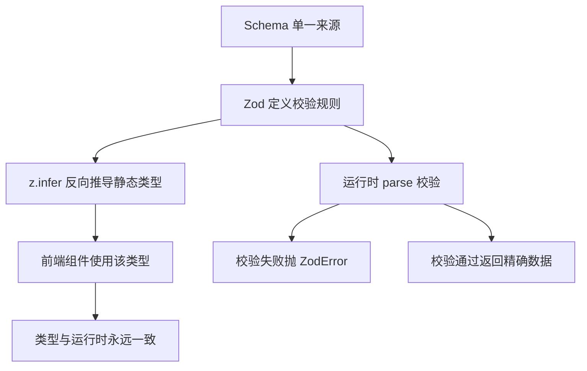

### TS-121：API 返回类型如何从 OpenAPI 自动生成？工程链路是什么？
**答**：
- 链路：后端产出 OpenAPI 文档（yaml/json）→ `openapi-typescript` 等工具生成 `.d.ts` → 前端按 `paths[...].get.responses["200"]` 索引访问取响应类型。
- 配合生成的 `paths` 类型封装一个强类型 fetch 客户端，URL 与参数、响应全链路类型安全。
- 契约变更时重新跑 codegen，前端编译期立即暴露破坏性改动，CI 中可将其设为门禁。

```json
{
  "scripts": {
    "gen:api": "openapi-typescript https://internal.example/openapi.json -o src/types/api.d.ts"
  }
}
```

```typescript
// 生成文件中的类型形如（节选自 src/types/api.d.ts）
// export interface paths {
//   "/api/users/{id}": {
//     get: {
//       parameters: { path: { id: number } };
//       responses: { 200: { content: { "application/json": { id: number; name: string } } } };
//     };
//   };
// }

import { paths } from "./types/api";

type ResponseOf<P extends keyof paths, M extends keyof paths[P]> =
  paths[P][M] extends { responses: { 200: { content: { "application/json": infer R } } } }
    ? R
    : never;

type User = ResponseOf<"/api/users/{id}", "get">; // { id: number; name: string }

async function apiGet<P extends keyof paths, M extends "get">(
  path: P,
  init?: RequestInit
): Promise<ResponseOf<P, M>> {
  const res = await fetch(path as string, init);
  return res.json();
}

const u = await apiGet("/api/users/{id}"); // 自动推导 User
```

### TS-122：如何把数据库行类型安全地映射为前端视图模型？
**答**：
- 数据库行含敏感/冗余字段（password_hash、deleted_at），前端类型应是 `Omit<Row, 敏感字段>` 的视图模型。
- 时间字段行内是 string（序列化后），视图模型常转 Date 或格式化字符串，用交叉与重命名组合表达。
- 转换函数显式声明 `Row -> VM`，字段增删时编译器强制同步转换逻辑。

```typescript
// 来自后端/ORM 的行类型
interface UserRow {
  id: number;
  name: string;
  password_hash: string;
  created_at: string;  // ISO 字符串
  updated_at: string;
}

// 视图模型：剔除敏感字段 + 转换时间
type UserVM = Omit<UserRow, "password_hash" | "created_at" | "updated_at"> & {
  createdAt: Date;
  updatedAt: Date;
};

function toUserVM(row: UserRow): UserVM {
  const { password_hash, created_at, updated_at, ...rest } = row;
  return {
    ...rest,
    createdAt: new Date(created_at),
    updatedAt: new Date(updated_at),
  };
}

// 链式派生：列表页只要部分字段
type UserListItem = Pick<UserVM, "id" | "name">;
function toListItem(vm: UserVM): UserListItem {
  return { id: vm.id, name: vm.name };
}
```

### TS-123：断言函数 asserts 的使用与陷阱是什么？
**答**：
- 两种形态：`asserts condition`（断言表达式为真）与 `asserts x is T`（断言 x 为 T），断言通过后 TS 永久收窄。
- 断言函数返回值必须标注为 void，且内部逻辑必须真的会 throw，否则收窄是"谎言"。
- 陷阱：断言本身不产生任何运行时校验，若函数体忘了抛错，类型层面通过但运行时裸奔；箭头函数不能声明断言（语法限制，需 function 声明）。

```typescript
function assertDefined<T>(value: T | undefined, msg: string): asserts value is T {
  if (value === undefined) throw new Error(msg);
  // 忘写 throw 就不会有运行时保护，但类型层面依然"骗过"编译器
}

function assert(condition: unknown, msg: string): asserts condition {
  if (!condition) throw new Error(msg);
}

function main(config?: { port: number }) {
  assertDefined(config, "config 必须提供");
  config.port; // 收窄为 { port: number }，不再是可选
  assert(typeof config.port === "number", "port 必须是数字");
}

// 陷阱示例：返回值不是 void 会报错
// function bad(x: unknown): boolean asserts x is string {} // 报错
```

### TS-124：类型与运行时校验双维护的问题如何治理？
**答**：
- 原则：让"一份定义"同时产出类型与校验——Zod/valibot schema 反推类型（TS-120），或 OpenAPI codegen 生成类型 + 运行时校验（TS-121）。
- 无法引入库时，用 `satisfies` 让配置对象对齐手写类型，减少"类型对但值错"的窗口。
- CI 门禁：类型测试 + 校验器单测覆盖字段变更，双漂移在流水线被拦下。

```typescript
// satisfies：对齐类型但不拓宽字面量
interface Theme {
  primary: string;
  sizes: Record<string, number>;
}

const theme = {
  primary: "#1677ff",
  sizes: { sm: 12, md: 14 },
} satisfies Theme; // 立即检查：多拼少拼字段都会报错，且保留字面量推断

type Primary = typeof theme.primary; // "#1677ff"（不是 string）
// theme.primary = "#000"; // OK（不改变满足 Theme 的事实）

// 治理前后对比：
// 之前：interface User + validateUser 手写两份，字段漂移无感知
// 之后：const UserSchema = z.object({...}) 一份，type User = z.infer<typeof UserSchema>
```

## 第二十八章 TS 工程与大厂实战

### TS-125：大厂 TS 规范如何落地？strict 全家桶逐项解释？
**答**：
- `strict: true` 是总开关，含 strictNullChecks（null/undefined 不能赋给其他类型，最大收益）、noImplicitAny（禁止隐式 any）、strictFunctionTypes（函数参数逆变检查）、strictBindCallApply、strictPropertyInitialization（类属性必须初始化）、noImplicitThis、alwaysStrict、useUnknownInCatchVariables（catch 变量为 unknown）。
- 辅助开关：noImplicitReturns、noFallthroughCasesInSwitch、noUnusedLocals/noUnusedParameters。
- 落地策略：存量仓库用 `tsc --noEmit` 摸底存量错误，按目录豁免渐进收紧，CI 设为门禁。

```json
{
  "compilerOptions": {
    "strict": true,
    "noImplicitAny": true,
    "strictNullChecks": true,
    "strictFunctionTypes": true,
    "strictBindCallApply": true,
    "strictPropertyInitialization": true,
    "noImplicitThis": true,
    "useUnknownInCatchVariables": true,
    "noImplicitReturns": true,
    "noFallthroughCasesInSwitch": true,
    "noUnusedLocals": true,
    "noUnusedParameters": true,
    "skipLibCheck": true
  }
}
```

```typescript
// strict 打开后的典型报错变化
function fetchUser(id: string | null) {
  // strictNullChecks：id 可能为 null，使用前必须收窄
  if (id === null) return Promise.reject("no id");
  return Promise.resolve({ id });
}

try {
  JSON.parse("{}");
} catch (e) {
  // useUnknownInCatchVariables：e 是 unknown，不能直接 e.message
  if (e instanceof Error) e.message;
}

class Store {
  state: { count: number };
  constructor() {
    // strictPropertyInitialization：必须初始化或声明为可选/ definite assignment
    this.state = { count: 0 };
  }
}
```

### TS-126：noUncheckedIndexedAccess 解决什么问题？
**答**：
- 默认情况下 `arr[0]`、`obj[key]` 的类型是元素类型本身，但运行时可能 undefined（越界、键不存在），类型撒谎。
- 开启后所有索引访问的结果都带上 `| undefined`，强制使用前判空，是大厂对"运行时安全索引"的标准要求。
- 配合 for-of、Object.values、`.at()` 等返回明确 undefined 的 API，减少不必要的索引访问。

```json
{
  "compilerOptions": {
    "noUncheckedIndexedAccess": true
  }
}
```

```typescript
const list = ["a", "b"];
const first = list[0];      // string | undefined（开启前是 string）
if (first !== undefined) first.toUpperCase(); // OK

const map: Record<string, number> = { a: 1 };
const v = map["b"];         // number | undefined
const safe = map["b"] ?? 0; // number，兜底写法成为习惯

for (const item of list) {
  item.toUpperCase();       // for-of 不受影响，推荐遍历方式
}
```

### TS-127：如何做类型测试？@ts-expect-error 的正确用法是什么？
**答**：
- 基础手段：`tsc --noEmit` 全量类型检查进 CI；单测层面用 expect-type / vitest 的 `expectTypeOf` 断言类型相等。
- `@ts-expect-error` 的语义是"下一行必须有错"：如果下一行其实没报错，该注释本身会报错——因此它既是豁免也是断言，优于无限期容忍错误的 `@ts-ignore`。
- 用法纪律：`@ts-ignore` 禁止合入；`@ts-expect-error` 必须附注释说明原因，错误修复后注释会自动"过期报错"，形成闭环。

```typescript
import { expectTypeOf } from "expect-type";

type UnionToIntersection<U> =
  (U extends any ? (arg: U) => void : never) extends (arg: infer I) => void ? I : never;
type IsNever<T> = [T] extends [never] ? true : false;

// vitest + expect-type 的类型断言
expectTypeOf<UnionToIntersection<{ a: 1 } | { b: 2 }>>().toEqualTypeOf<{ a: 1 } & { b: 2 }>();
expectTypeOf<IsNever<never>>().toEqualTypeOf<true>();
expectTypeOf<IsNever<string>>().toEqualTypeOf<false>();

// @ts-expect-error：断言"这行必须报错"
type OnlyString = { tag: "string"; value: string };
function accept(x: OnlyString): void;
// @ts-expect-error 数字字面量不是 string，此处必须报错；修复后此注释会提示未使用的 expect-error
accept({ tag: "string", value: 1 } as never);
```

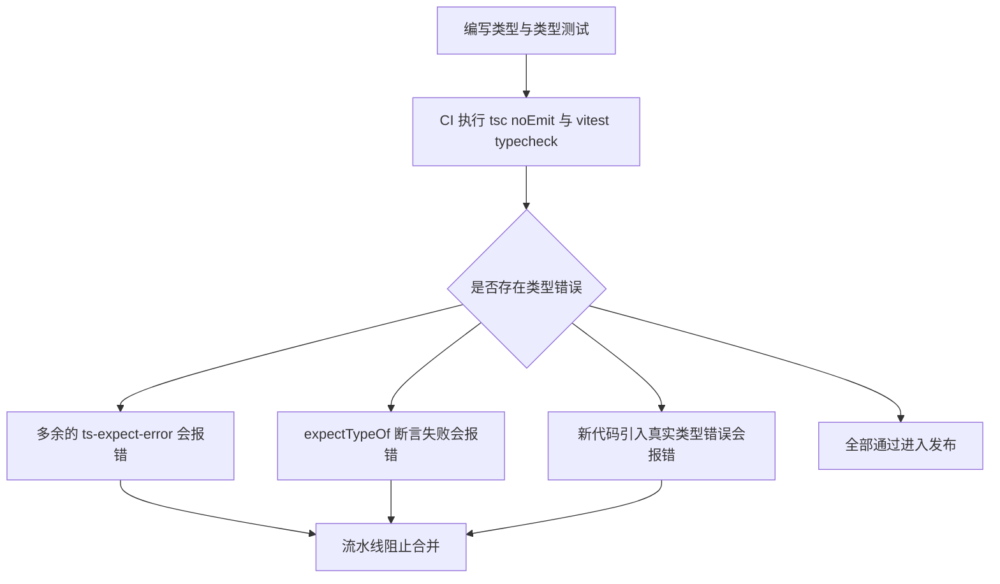

### TS-128：声明合并与模块扩展如何做？如何安全地扩展第三方库？
**答**：
- interface 支持同名声明合并：全局扩展用 `declare global { interface Window { ... } }`。
- 第三方库扩展用 `declare module "库名"`：给 axios 的 AxiosRequestConfig 加自定义字段、给 express 的 Request 挂用户信息，都是标准操作。
- 纪律：扩展声明放到 `types/` 目录统一维护并在 tsconfig include 内；扩展字段必须带注释说明来源，避免与库升级冲突；能收敛成 wrapper 的优先 wrapper。

```typescript
// src/types/global.d.ts —— 全局扩展
declare global {
  interface Window {
    __APP_VERSION__: string; // 构建时注入的版本号
  }
}
export {};
// window.__APP_VERSION__ 可全局使用

// src/types/axios.d.ts —— 第三方模块扩展
import "axios";

declare module "axios" {
  export interface AxiosRequestConfig {
    /** 是否跳过统一 loading，网关层读取 */
    skipLoading?: boolean;
    /** 重试次数，重试拦截器读取 */
    retry?: number;
  }
}

import axios from "axios";
axios.get("/api/list", { skipLoading: true, retry: 3 }); // 类型提示与检查生效
```

### TS-129：循环引用导致的 interface 报错如何排查？
**答**：
- 典型报错："'X' circularly references itself" 或 "'X' implicitly has type 'any' because it does not have a type annotation and is referenced directly or indirectly in its own initializer"。
- interface 声明是惰性解析的，属性里引用自己/对方通常没问题；真正的循环来自：type alias 的立即求值（如 type A = B & ... 相互展开）、模块 import 形成环、const 初始化依赖自身推断。
- 排查手段：把 type alias 换成 interface（属性位置可以引用环）、把相互引用抽到公共文件打破模块环、给常量显式标注类型切断推断环。

```typescript
// 反例一：type alias 自循环立即求值，报 circularly references itself
// type Json = string | number | Json[] | { [k: string]: Json }; // 需要用 interface 打破

// 正解：interface 属性位置允许引用自身
interface Json {
  value: string | number | boolean | Json[] | { [k: string]: Json };
}

// 反例二：推断环
// const config = { port: config.port || 8080 }; // 报错：初始化器引用自身
// 正解：显式标注
const config: { port: number } = { port: 8080 };

// 反例三：模块环 a.ts import b.ts，b.ts import a.ts，且双方在顶层就使用对方类型求值
// 正解：类型互引时尽量用 interface（惰性），或把共享类型抽到 types.ts
```

### TS-130：TS 编译慢如何优化？项目级手段有哪些？
**答**：
- 工程结构：`project references` 把 monorepo 拆成子项目，增量只编译改动包；`incremental: true` 持久化编译缓存。
- 编译范围：`skipLibCheck: true` 跳过第三方 d.ts 检查（收益最大且基本无副作用）；`isolatedModules: true` 保证单文件可转译，配合 babel/esbuild/swc 快速构建。
- 代码层面：类型体操控制递归深度（见 TS-082、TS-111）；公共巨型工具类型拆文件按需引用；避免在热路径声明超大联合（如上千个字面量）。
- 监控：`tsc --extendedDiagnostics`、`--generateTrace` 定位热点类型。

```json
{
  "compilerOptions": {
    "incremental": true,
    "tsBuildInfoFile": ".cache/tsbuildinfo",
    "skipLibCheck": true,
    "isolatedModules": true,
    "target": "ES2020",
    "moduleResolution": "bundler"
  },
  "references": [
    { "path": "./packages/shared" },
    { "path": "./packages/ui" },
    { "path": "./packages/app", "references": [{ "path": "./packages/shared" }, { "path": "./packages/ui" }] }
  ],
  "files": []
}
```

```typescript
// 常用诊断命令
// npx tsc --noEmit --extendedDiagnostics
// 输出关注：Types / Instantiations / Check time
// npx tsc --noEmit --generateTrace trace
// 用 Chrome tracing 打开 trace 下的 trace.json，定位最耗时的类型实例化

// 拆分参考：把上百个字面量的大联合改为命名空间分片
type RouteA = "/a1" | "/a2"; // 拆前：Route = "/a1" | ... | "/a999" 导致实例化爆炸
type RouteB = "/b1" | "/b2";
type AllRoutes = RouteA | RouteB; // 按需引用分片，而不是全量并入热路径类型
```

## 第二十九章 Vue3 中的 TS 深入（TS-131 ~ TS-136）

### TS-131：defineProps 泛型声明与编译产物是什么关系？
**答**：
- `<script setup>` 里给 defineProps 传"纯类型参数"，Vue 编译器在编译期把类型反向生成为运行时 props 声明，类型与运行时校验单一来源。
- withDefaults 给可选 prop 补默认值，同时收窄类型（去掉 undefined）。
- 限制：编译器只能识别简单类型（String/Number/Boolean/Array/Object/Function），复杂自定义类型运行时会退化为 Object/Function。

```typescript
// UserCard.vue
// <script setup lang="ts">
interface Props {
  title: string;   // 必填 string
  items: string[]; // 必填数组
  count?: number;  // 可选 number
}
const props = withDefaults(defineProps<Props>(), { count: 0 });
console.log(props.title, props.count);

// Vue 编译器生成的运行时声明（等价产物）：
// props: {
//   title: { type: String, required: true },
//   items: { type: Array, required: true },
//   count: { type: Number, required: false, default: 0 }
// }

// 坑：interface 里写 class 实例、函数精确签名时，
// 运行时只能得到 Object/Function 宽类型，精确校验需运行时声明 + PropType（TS-133）
```

### TS-132：defineEmits 的类型签名怎么写？事件名与 payload 如何联动？
**答**：
- 写法一：调用签名（经典，全 3.x 兼容），一个事件一条 `(e: "name", payload: T): void`。
- 写法二：命名元组语法（Vue 3.3+），`change: [value: string]`，更简洁、编辑器提示更友好。
- emit 调用点事件名、参数个数、参数类型全部联动校验，写错直接编译报错。

```typescript
// 写法一：调用签名
const emit = defineEmits<{
  (e: "change", value: string): void;
  (e: "submit", payload: { id: number; ok: boolean }): void;
  (e: "update:modelValue", v: string): void;
}>();

emit("change", "a");
// emit("change", 1);  // 报错：payload 必须是 string
// emit("nope");       // 报错：事件名不在允许范围内

// 写法二：命名元组语法（Vue 3.3+）
const emit2 = defineEmits<{
  change: [value: string];
  submit: [payload: { id: number; ok: boolean }];
}>();
emit2("submit", { id: 1, ok: true });
```

### TS-133：PropType 如何为复杂 props 提供精确类型？
**答**：
- 运行时声明中 Object/Array/Function 默认推断为宽类型，用 `Object as PropType<User>` 精确标注。
- 字面量联合 prop 用 `String as PropType<"a" | "b">`，编辑器自动补全可选值。
- 数组默认值必须用工厂函数 `default: () => []`，与类型无关但高频踩坑。

```typescript
import type { PropType } from "vue";

interface User { id: number; tags: string[] }

// 在 <script setup> 或选项式组件的 props 中：
defineProps({
  user: { type: Object as PropType<User>, required: true },
  tags: { type: Array as PropType<string[]>, default: () => [] },
  onChange: { type: Function as PropType<(id: number) => void>, required: true },
  shape: { type: String as PropType<"a" | "b">, default: "a" },
});

// 坑：不用 PropType 时 props.user 推断为 Record<string, any>，
// props.user.tags 是 any —— 类型检查整条链路失效
```

### TS-134：ref 自动解包在类型层如何体现？UnwrapRef 有哪些坑？
**答**：
- reactive 包裹的对象会"深度解包"内部 ref，类型层对应 `UnwrapRef<T>`：`Ref<number>` 变成 `number`。
- 坑一：数组/Map/Set 内的 ref 不解包，类型与运行时都仍是 Ref。
- 坑二：UnwrapRef 递归展开类实例，破坏封装并曾引发循环类型爆栈，Vue 3.5 引入 UnwrapRefSimple（带内部惰性标记）修复。
- 想原样持有对象（不解包、不深度代理）用 shallowRef。

```typescript
import { reactive, ref, shallowRef } from "vue";

class Counter {
  count = 0;
  inc() { this.count++; }
}
const counterRef = ref(new Counter());
const state = reactive({ counter: counterRef, n: ref(1) });

state.counter.count; // 类型是 number：UnwrapRef 把 Ref<Counter> 解包成 Counter
state.n;             // 类型是 number，不是 Ref<number>

// 坑一：数组内不解包
const list = reactive([ref(1)]);
list[0]; // 仍是 Ref<number>，需要 list[0].value

// 坑二：UnwrapRef 对类实例深度递归展开，Vue 3.5 起 reactivity 内部改用
// UnwrapRefSimple 规避循环引用导致的编辑器卡死/类型爆栈

// 解法：shallowRef 不解包也不深度代理
const raw = shallowRef(new Counter());
raw.value.inc(); // Counter 原样持有
```

### TS-135：Vue3 泛型组件（script setup 的 generic 属性）怎么写？
**答**：
- Vue 3.3+ 在 `<script setup generic="T extends ...">` 声明类型参数，props/emits 中直接使用 T。
- 父组件使用时由传入的 items 自动实例化 T，实现"数据形状驱动整棵组件类型"。
- 支持多类型参数、约束、默认值；复杂类型可 import 后在 generic 字符串中引用。

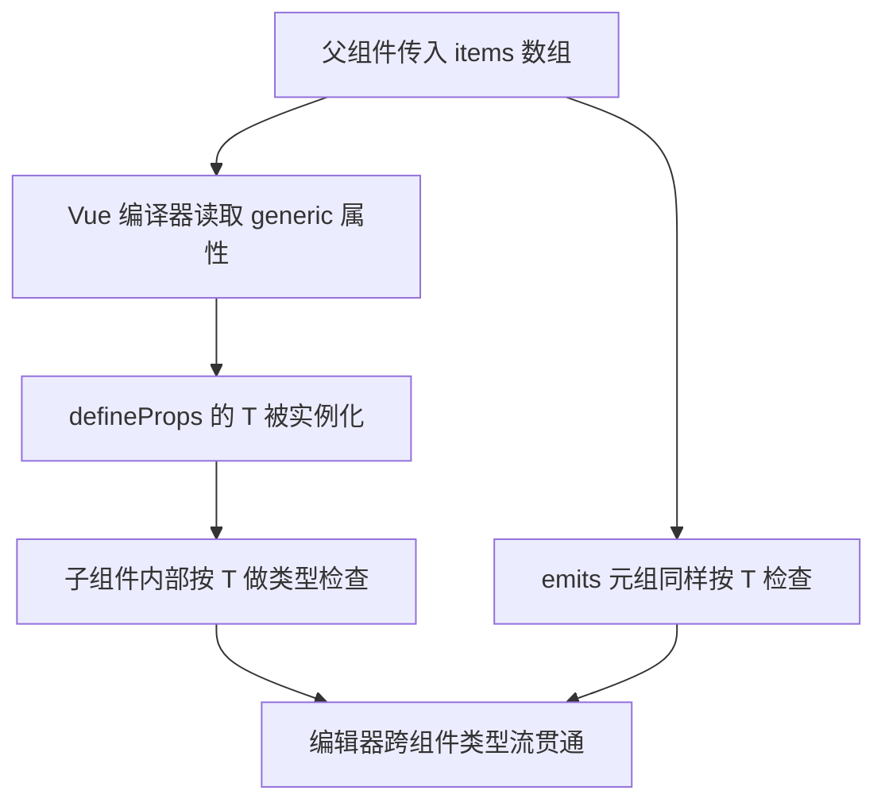

```typescript
// List.vue
// <script setup lang="ts" generic="T extends { id: string }">
// defineProps<{ items: T[]; selectedId?: string }>();
// const emit = defineEmits<{ select: [item: T] }>();

// 使用端（由 items 元素类型自动实例化）：
// <List :items="users"  @select="onSelect" />   T 实例化为 User
// <List :items="orders" @select="onSelect" />   T 实例化为 Order

// 多类型参数 + 约束 + 默认值：
// generic="T extends { id: string }, K extends keyof T = keyof T"

// 坑：generic 是字符串形式的类型表达式，语法报错提示较晚；
// 复杂约束建议定义在 types.ts 中 import 进来引用
```

### TS-136：provide/inject 如何用 InjectionKey 做到类型安全？
**答**：
- key 用 `InjectionKey<T>` 类型的 Symbol：provide 端值类型被约束为 T，inject 端返回类型自动为 `T | undefined`。
- inject 带默认值时去掉 undefined，杜绝 `as Theme` 式手写断言导致 key 与类型脱节。
- key 导出在独立文件中作为"注入契约"，跨团队协作时即文档。

```typescript
import { inject, provide, InjectionKey } from "vue";

// theme-key.ts —— 注入契约
export const ThemeKey: InjectionKey<{
  color: string;
  toggle: () => void;
}> = Symbol("theme");

// 祖先组件：值类型必须严格匹配，多字段少字段都报错
provide(ThemeKey, { color: "dark", toggle: () => {} });

// 后代组件：类型自动推导，无需断言
const theme = inject(ThemeKey);                              // 类型 | undefined
const theme2 = inject(ThemeKey, { color: "light", toggle: () => {} }); // 非 undefined

// 反例：inject<Theme>("theme") 手写泛型断言，key 改名/类型改动编译器无法追踪
```

## 第三十章 React 中的 TS 深入（TS-137 ~ TS-142）

### TS-137：React.FC 有哪些争议？推荐哪种组件 Props 写法？
**答**：
- 争议一：FC 历史上隐式塞入 children（18.2 前的 PropsWithChildren），不需要 children 的组件也能传。
- 争议二：泛型组件挂在 FC 上受限，返回类型被锁死、displayName 等附加属性徒增噪音。
- 推荐：普通函数 + 显式 Props 接口，children 按需显式声明，类型意图一目了然。

```tsx
// 反对 React.FC 的三个理由：
// 1. 隐式 children（@types/react 18.2 前永远可传），语义失真
// 2. 泛型组件 <T> 无法直接通过 FC 声明
// 3. 返回类型与附加静态属性锁死签名

// 推荐：普通函数 + 显式 Props
interface ButtonProps {
  label: string;
  onClick: () => void;
  children?: React.ReactNode; // 需要才声明
}
function Button({ label, onClick, children }: ButtonProps) {
  return <button onClick={onClick}>{label}{children}</button>;
}
```

### TS-138：React 泛型组件怎么写？ComponentProps 如何提取 Props？
**答**：
- 类型参数写在函数组件上，使用处由 props 自动实例化，实现数据驱动的组件类型。
- `ComponentProps<typeof X>` 提取组件 Props，用于 wrapper、HOC、测试工具。
- 泛型组件必须先"具象化"再提取：`ComponentProps<typeof List<User>>`（TS 4.7+ 实例化表达式）；或直接导出 Props 接口复用。

```tsx
// 泛型组件
function List<T extends { id: string }>(props: {
  items: T[];
  render: (item: T) => React.ReactNode;
  onSelect?: (item: T) => void;
}) {
  return (
    <ul>
      {props.items.map((it) => (
        <li key={it.id} onClick={() => props.onSelect?.(it)}>{props.render(it)}</li>
      ))}
    </ul>
  );
}

interface User { id: string; name: string }

// Props 提取：先具象化
type UserListProps = ComponentProps<typeof List<User>>;
const renderName: UserListProps["render"] = (u) => u.name; // u 自动是 User

// 坑：ComponentProps<typeof List> 不具象化时拿到未解析的泛型签名，T 悬空
// 实践：非泛型包装组件直接导出 Props 接口，泛型组件先固定 T 再提取
```

### TS-139：children 的类型该用 ReactNode 还是 ReactElement？
**答**：
- ReactNode：一切可渲染物（element、string、number、boolean、null、数组），容器组件默认用它。
- ReactElement：单个元素对象，有 type/props，能 cloneElement 注入 props、能 Children.only 校验。
- render props 场景用函数签名 `(args) => ReactElement`，三者不可混用。

```tsx
// 三种 children 类型对应三种组件形态
type Wrapper1 = { children: React.ReactNode };                     // 常规容器
type Wrapper2 = { children: React.ReactElement };                  // 需要注入/克隆 children
type Wrapper3 = { children: (count: number) => React.ReactElement }; // render props

function InjectProps({ children }: Wrapper2) {
  // React.Children.only(children) 保证确实是单个 element
  return React.cloneElement(children, { size: "lg" } as Partial<React.HTMLAttributes<HTMLElement>>);
  // 若声明为 ReactNode，cloneElement 直接报错：Node 上没有 type/props
}

function Counter({ children }: Wrapper3) {
  return children(42); // 调用子级拿到 UI
}
```

### TS-140：事件处理器类型怎么写？如何把 DOM 事件泛型化成业务值？
**答**：
- 原生事件按目标元素泛型化：`React.ChangeEvent<HTMLInputElement>`，target 类型随之精确。
- 业务组件不应向外抛 DOM 事件，而是把"值"泛型化：`onChange: (value: V) => void`。
- 内部转换用窄断言收敛（`e.target.value as V`），边界只留一处。

```tsx
// 原生事件：按目标元素选择泛型
const onNameChange = (e: React.ChangeEvent<HTMLInputElement>) => e.target.value; // string
const onSelect = (e: React.ChangeEvent<HTMLSelectElement>) => e.target.value;    // string

// 业务组件：把"值"泛型化，不泄漏 event 对象
function TextField<V extends string | number>(props: {
  value: V;
  onChange: (value: V) => void;
}) {
  return (
    <input
      value={props.value}
      onChange={(e) => props.onChange(e.target.value as V)}
    />
  );
}
// <TextField<string> value={name} onChange={(v) => setSearch(v)} />
// v 是 string；若把 ChangeEvent 抛出去，调用方被迫关心 DOM 细节
```

### TS-141：useReducer/useState 什么时候必须显式标注类型？
**答**：
- useState：初值无法表达目标类型时必须显式——空数组推断 never[]、需要字面量联合时初值会被放宽成 string/boolean。
- useReducer：action 定义为可辨识联合，state/action 类型直接从 reducer 函数签名反推，dispatch 全联动。
- 收益：漏字段、错误 type、穷尽性检查全部编译期完成。

```tsx
// useState 显式标注的两个典型时机
const [items, setItems] = useState<Item[]>([]); // 不标注会推断 never[]
const [status, setStatus] = useState<"idle" | "loading">("idle"); // 锁定字面量联合

// useReducer：类型从 reducer 反推
type State = { list: Item[]; loading: boolean };
type Action =
  | { type: "add"; item: Item }
  | { type: "clear" }
  | { type: "loading"; on: boolean };

function reducer(state: State, action: Action): State {
  switch (action.type) {
    case "add": return { ...state, list: [...state.list, action.item] };
    case "clear": return { ...state, list: [] };
    case "loading": return { ...state, loading: action.on };
  }
}
const [state, dispatch] = useReducer(reducer, { list: [], loading: false });

// dispatch({ type: "nope" }); // 报错：type 不在联合中
// dispatch({ type: "add" });  // 报错：缺 item 字段
```

### TS-142：forwardRef 与 useRef 的 DOM 类型怎么标？
**答**：
- `useRef<HTMLDivElement>(null)` 得到 `RefObject<HTMLDivElement | null>`，使用前判空，不要用 `!` 强断言。
- 自定义组件向外暴露 ref 用 `forwardRef<HTMLElement, Props>`，泛型第一参就是内部 DOM 元素类型。
- React 19 起 ref 可作为普通 prop 声明，forwardRef 逐步退场，但存量代码必须掌握。

```tsx
// 本体 DOM ref：标元素类型 + null
const boxRef = useRef<HTMLDivElement>(null);
return <div ref={boxRef}>...</div>;
// 使用时先判空
if (boxRef.current) boxRef.current.scrollIntoView();

// 值缓存 ref 与 DOM ref 区分：useRef<number>(0) 得 MutableRefObject<number>

// forwardRef：把 ref 透传给内部 input
interface FancyInputProps { label: string }
const FancyInput = forwardRef<HTMLInputElement, FancyInputProps>(
  (props, ref) => <input ref={ref} placeholder={props.label} />,
);
// 使用：<FancyInput ref={inputRef} label="搜索" />
// inputRef 类型 RefObject<HTMLInputElement | null>

// React 19：function FancyInput({ ref, label }: { ref?: Ref<HTMLInputElement>; label: string })
```

## 第三十一章 工具类型库源码级精选（TS-143 ~ TS-149）

### TS-143：utility-types 库的 SetDifference/Subtract/Override 是怎么实现的？
**答**：
- 集合运算四件套全部建立在分布式条件类型上：SetDifference=差集、SetIntersection=交集、SetComplement=补集。
- Subtract 基于"键集合差 + Pick"挖掉子集字段；Overwrite 用映射类型做"同名字段覆盖"。
- 面试价值：这些是 Pick/Omit 的组合应用，能讲清"键级运算"与"值级运算"的分层。

```typescript
// utility-types 精选实现
type SetDifference<A, B> = A extends B ? never : A;    // A - B
type SetIntersection<A, B> = A extends B ? A : never;  // A ∩ B
type SetComplement<A, A1 extends A> = SetDifference<A, A1>;          // 全集中的补集
type Subtract<T extends T1, T1> = Pick<T, SetDifference<keyof T, keyof T1>>; // 挖掉 T1 覆盖的键
type Overwrite<T, U> = { [K in keyof T]: K extends keyof U ? U[K] : T[K] };

interface Base { id: number; name: string; email: string }
interface Patch { email: string; level: "vip" }

type OnlyMine = Subtract<Base, Patch>;   // Pick<Base, "id" | "name">
type Merged = Overwrite<Base, Patch>;    // email 类型来自 Patch，id/name 保留，level 不进（只覆盖不新增）
```

### TS-144：ts-essentials 的 DeepPartial 严格版比基础版严格在哪？
**答**：
- 基础版（TS-059）会把 Function/Date/RegExp 等内置类型也展开成 `{}?`，语义错误。
- 严格版引入 Builtin 集合（Primitive | Function | Date | Error | RegExp）短路返回，再处理 Map/Set/Promise 等容器。
- 数组走"元素递归"而不是对象键展开；AnyFunction 是库里的基础积木。

```typescript
// ts-essentials 精选
type Primitive = string | number | boolean | bigint | symbol | null | undefined;
type Builtin = Primitive | Function | Date | Error | RegExp;
type AnyFunction = (...args: any[]) => any;

type DeepPartialStrict<T> = T extends Builtin
  ? T
  : T extends Map<infer K, infer V> ? Map<DeepPartialStrict<K>, DeepPartialStrict<V>>
  : T extends Set<infer U> ? Set<DeepPartialStrict<U>>
  : T extends Promise<infer U> ? Promise<DeepPartialStrict<U>>
  : T extends AnyFunction ? T
  : T extends object ? { [K in keyof T]?: DeepPartialStrict<T[K]> }
  : T;

interface Cfg {
  callback: (v: number) => void; // 严格版：保持函数原样，不被拆成可选属性包
  createdAt: Date;               // 严格版：Date 原样
  meta: { nested: { deep: string } };
}
type Patchable = DeepPartialStrict<Cfg>;
const patch: Patchable = { meta: { nested: { deep: "x" } } }; // callback/createdAt 可整段缺省
```

### TS-145：type-fest 的 Jsonify 解决什么问题？
**答**：
- 把任意类型转成"JSON.stringify 往返之后"的形状：Date→string、bigint/symbol/Function 消失、方法剔除、嵌套递归。
- 用途：给 fetch 响应、postMessage 载荷标注真实线上类型，而不是"接口文档里的理想类型"。
- 生产版还处理 toJSON() 方法、readonly 数组、索引签名，思路一致。

```typescript
// type-fest Jsonify 思路版
type Jsonify<T> = T extends bigint | symbol ? never
  : T extends Date ? string
  : T extends (infer U)[] ? Jsonify<U>[]
  : T extends object
    ? { [K in keyof T as T[K] extends Function ? never : K]: Jsonify<T[K]> }
    : T;

interface ApiModel {
  id: bigint;
  createdAt: Date;
  save(): void;
  tags: string[];
}

type Wire = Jsonify<ApiModel>;
// { tags: string[] } —— id 为 never、方法被剔除、Date 变 string
// 与 JSON.parse(JSON.stringify(model)) 后的真实形状一致，fetch 断言不再撒谎
const wire = (await res.json()) as Jsonify<ApiModel>;
```

### TS-146：type-fest 的 Primitive 与 Simplify 是什么？
**答**：
- Primitive 是全原始类型联合，常用于约束"标量字段"与内置类型短路判断。
- Simplify 用同态映射类型把交叉/映射类型"拍平"成单一对象类型，专治编辑器 hover 显示。
- `& {}` 尾巴是展示层的规范化技巧，不改变结构语义。

```typescript
// type-fest Primitive
type Primitive = string | number | bigint | boolean | symbol | null | undefined;

// type-fest Simplify
type Simplify<T> = { [K in keyof T]: T[K] } & {};

type A = { a: string };
type B = { b: number };

type Merged = A & B;              // hover 显示 A & B
type MergedFlat = Simplify<A & B>; // hover 显示 { a: string; b: number }
```

### TS-147：Simplify 的实现原理与调试价值是什么？
**答**：
- 同态映射类型（`K in keyof T`）本身就是一次"重新声明"，编辑器会展开显示其结果。
- 调试价值一：组合多个工具类型后给"最终态"拍平，review 时肉眼可读。
- 调试价值二：交叉类型参与后续条件类型时常出现"整块匹配"的意外，拍平后语义更可预测。

```typescript
type Simplify<T> = { [K in keyof T]: T[K] } & {};

type Base = { id: number };
type Titled = { title: string };

type Model = Simplify<Readonly<Base> & Partial<Titled>>;
// hover 直接显示 { readonly id: number; readonly title?: string }
// 而不是 Readonly<Base> & Partial<Titled>

// 常用位置：公共 API 的返回类型、React Hook 返回值、工具类型库的"门面类型"
// 团队规范：工具类型出口处一律包一层 Simplify，代码评审成本大幅下降
```

### TS-148：Prettify 技巧如何优化编辑器里的类型显示？
**答**：
- Matt Pocock 的 Prettify 与 Simplify 同源：`{ [K in keyof T]: T[K] } & {}`。
- 深层交叉组合（React Props 扩展、工具类型链）hover 时从一长串 `A & B & C` 变成展开的对象字面量。
- 不改变类型等价性，是"纯展示层"重构，可放心全局使用。

```typescript
type Prettify<T> = { [K in keyof T]: T[K] } & {};

type User = { id: number; name: string };
type WithAge = User & { age: number };
type ReadonlyUser = Readonly<User> & { age: number };

type Shown1 = WithAge;                 // hover：User & { age: number }
type Shown2 = Prettify<WithAge>;       // hover：{ id: number; name: string; age: number }
type Shown3 = Prettify<ReadonlyUser>;  // hover：{ readonly id: number; readonly name: string; age: number }

// 场景：组件 Props 继承原生属性时最痛
type ButtonProps = Prettify<React.ButtonHTMLAttributes<HTMLButtonElement> & { variant: "primary" | "ghost" }>;
```

### TS-149：Brand 品牌类型与 Opaque 如何用类型防混用？
**答**：
- Brand：`T & { __brand: B }` 制造名义类型，UserId 与 OrderId 都是 number 但互不相容，裸 number 也无法直接通过。
- Opaque 演进：品牌字段换成 unique symbol 键，不可见更难伪造；type-fest 的 Tagged 是官方化实现。
- 成本收益：只在"跨模块流转的标识符"上用（用户 id、订单号、jwt），局部 id 不值得。

```typescript
// Brand 品牌类型
type Brand<T, B extends string> = T & { readonly __brand: B };
type UserId = Brand<number, "UserId">;
type OrderId = Brand<number, "OrderId">;

declare function loadUser(id: UserId): { id: UserId; name: string };
declare function loadOrder(id: OrderId): unknown;

const uid = 1 as UserId;   // 受控铸造点：尽量收敛到专门函数如 makeUserId(n)
const oid = 2 as OrderId;
loadUser(uid);      // OK
// loadUser(oid);   // 报错：OrderId 不是 UserId
// loadUser(1);     // 报错：裸 number 无法通过

// Opaque 演进：unique symbol 键不可见
declare const opaqueBrand: unique symbol;
type Opaque<T, Token> = T & { readonly [opaqueBrand]: Token };
type Jwt = Opaque<string, "Jwt">;
declare const makeJwt: (raw: string) => Jwt; // 只能经构造函数产生，杜绝随手 as
```

## 第三十二章 高阶体操挑战（TS-150 ~ TS-157）

### TS-150：如何实现 DeepCamelize（深层下划线转驼峰）？
**答**：
- 字符串层：`a_b` 模式匹配出下划线后一个字符做 Uppercase，递归处理剩余。
- 对象层：映射类型 as 重映射键名；数组层：同态映射保元组；函数短路。
- 场景：后端 snake_case 接口到前端 camelCase 视图模型的规范化层。

```typescript
type UnderscoreToCamelCase<S extends string> =
  S extends `${infer Head}_${infer TailChar}${infer Rest}`
    ? `${Head}${Uppercase<TailChar>}${UnderscoreToCamelCase<Rest>}`
    : S;

type DeepCamelize<T> = T extends Function
  ? T
  : T extends readonly unknown[]
    ? { [K in keyof T]: DeepCamelize<T[K]> }
    : T extends object
      ? { [K in keyof T as UnderscoreToCamelCase<K & string>]: DeepCamelize<T[K]> }
      : T;

interface ApiUser {
  user_id: number;
  full_name: string;
  address_info: { street_name: string; zip_code: string };
}

type ViewModel = DeepCamelize<ApiUser>;
// { userId: number; fullName: string; addressInfo: { streetName: string; zipCode: string } }

const viewModel = (await res.json()) as ViewModel;
viewModel.addressInfo.zipCode; // 编译期即可用驼峰访问
```

### TS-151：MutableDeep 严格版如何处理数组与函数？
**答**：
- TS-090 的基础版递归去 readonly 即可；严格版要短路函数与内置类型、把 readonly 数组转普通数组。
- 元组在 `-readonly` 同态映射下保持形状，注意先判数组再判对象。
- 场景：把 Readonly 配置类型转回可编辑草稿类型时，函数字段绝不能被拆散。

```typescript
// 严格版 DeepMutable
type DeepMutableStrict<T> = T extends Function | Date | RegExp | Error
  ? T
  : T extends readonly (infer U)[]
    ? DeepMutableStrict<U>[]
    : T extends object
      ? { -readonly [K in keyof T]: DeepMutableStrict<T[K]> }
      : T;

interface Cfg {
  readonly name: string;
  readonly tags: readonly string[];
  readonly format: (s: string) => string;
  readonly meta: { readonly version: readonly number[] };
}

type Editable = DeepMutableStrict<Cfg>;
// { name: string; tags: string[]; format: (s: string) => string; meta: { version: number[] } }
const e: Editable = { name: "x", tags: [], format: (s) => s, meta: { version: [1] } };
e.meta.version.push(2); // 深层 readonly 全部解除
```

### TS-152：如何实现 All/Any 元组布尔聚合？
**答**：
- All：逐位判断 `[F] extends [true]`，基线空元组返回 true（全称量词约定）。
- Any：逐位判断"不是 false 就算真"，基线返回 false。
- 关键细节：用 `[F] extends [X]` 包一层元组，阻止 boolean 被分发出错。

```typescript
type All<T extends unknown[]> = T extends [infer F, ...infer R]
  ? [F] extends [true]
    ? All<R>
    : false
  : true;

type Any<T extends unknown[]> = T extends [infer F, ...infer R]
  ? [F] extends [false]
    ? Any<R>
    : true
  : false;

type T1 = All<[true, true]>;        // true
type T2 = All<[true, false, true]>; // false
type T3 = Any<[false, false]>;      // false
type T4 = Any<[false, true]>;       // true
type T5 = All<[]>;                  // true（空集约定，与逻辑全称量词一致）
type T6 = Any<[]>;                  // false
```

### TS-153：如何实现任意个元组的 Concat？
**答**：
- TS-105 是两参版；多元组版接收"元组的元组"，头部展开 + 递归尾部拼接。
- infer R 必须约束为 `unknown[][]`，否则展开时丢失元组性退化为数组。
- 尾递归形态，配合 TS 4.5 优化可扛长输入。

```typescript
type Concat<T extends unknown[][]> =
  T extends [infer F extends unknown[], ...infer R extends unknown[][]]
    ? [...F, ...Concat<R>]
    : [];

type A = [1, 2];
type B = [string];
type C = [true, false];

type Joined = Concat<[A, B, C]>; // [1, 2, string, true, false]
type Pair = Concat<[A, B]>;      // [1, 2, string] —— 两参版是其特化
type Empty = Concat<[A, [], C]>; // [1, 2, true, false] —— 空元组自然跳过
```

### TS-154：如何实现元组转置 Transpose？
**答**：
- 用同态映射类型替代显式递归：外层映射遍历第一行的列索引，内层映射遍历每一行取同列元素。
- 同态映射（`K in keyof 元组`）天然保持元组形状，是本题的关键（显式递归版要处理行列不对齐）。
- 基线：空矩阵返回 []。

```typescript
type Transpose<M extends number[][]> =
  M extends [infer First extends unknown[], ...infer Rest extends unknown[][]]
    ? { [K in keyof First]: { [R in keyof M]: M[R][K & number] } }
    : [];

type Mat = [
  [1, "a", true],
  [2, "b", false],
];

type T = Transpose<Mat>;
// [[1, 2], ["a", "b"], [true, false]]

// 原理拆解：K 依次是第一行的 "0"/"1"/"2"，
// 内层 { [R in keyof M]: M[R][K] } 对每行取同列 → 三列各自变成一个元组
type Empty = Transpose<[]>; // []
```

### TS-155：如何实现按条件过滤的 Filter 类型（union 与 tuple 两个版本）？
**答**：
- 元组版：递归解构头部，满足条件则保留进结果元组，否则丢弃，基线 []。
- 联合版：分布式条件类型天然逐成员处理，但 boolean 会被拆成 true|false 两半，必须用 `[T] extends [U]` 锁住再判断。
- 场景：从事件名联合中剔除内部事件、从参数元组中剔除标记类型。

```typescript
// 元组版过滤
type TupleFilter<T extends unknown[], P> = T extends [infer F, ...infer R]
  ? [...([F] extends [P] ? [F] : []), ...TupleFilter<R, P>]
  : [];

type Kept = TupleFilter<[1, "a", 2, "b"], number>; // [1, 2]

// 联合版过滤（防 boolean 分发陷阱）
type UnionFilter<T, U> = T extends unknown ? ([T] extends [U] ? never : T) : never;
type Clean = UnionFilter<string | number | boolean, boolean>; // string | number

// 反例：T extends U ? never : T 直接判断时，
// boolean 拆成 true/false 分别分发，判断错位导致 boolean 残留
```

### TS-156：如何实现类型版 FindIndex？
**答**：
- 递归解构 + Idx 计数器累加器（每层推一个 unknown），命中条件返回 `Idx["length"]`。
- 找不到返回 -1；判等用 `[F] extends [P]` 防 boolean 陷阱。
- 计数器走参数位是尾递归，天然兼容 TS 4.5 深度优化。

```typescript
type FindIndex<T extends unknown[], P, Idx extends unknown[] = []> =
  T extends [infer F, ...infer R]
    ? [F] extends [P]
      ? Idx["length"]
      : FindIndex<R, P, [...Idx, unknown]>
    : -1;

type Idx1 = FindIndex<[string, number, boolean], number>; // 1
type Idx2 = FindIndex<["a", "b"], "b">;                   // 1
type Idx3 = FindIndex<["a", "b"], "c">;                   // -1
type Idx4 = FindIndex<[true, false], boolean>;            // 0（boolean 分发被元组锁住）
```

### TS-157：如何实现元组分块 Chunk？
**答**：
- 双累加器：Cur 攒当前块，攒满 N 时"整体产出"并重新从当前剩余 T 开始，未满而输入耗尽则产出余块。
- 关键易错点：Cur 攒满时消费的是整个 T（含当前 F），而不是继续取 F，否则会漏元素。
- 基线双出口：输入耗尽且 Cur 为空返回 []，否则返回 [Cur]。

```typescript
type Chunk<T extends unknown[], N extends number, Cur extends unknown[] = []> =
  T extends [infer F, ...infer R]
    ? Cur["length"] extends N
      ? [Cur, ...Chunk<T, N>]          // Cur 攒满：整体产出，T 保持不动
      : Chunk<R, N, [...Cur, F]>       // 未满：F 进块，继续消耗
    : Cur extends [] ? [] : [Cur];     // 基线：余块或空

type C1 = Chunk<[1, 2, 3, 4, 5], 2>; // [[1, 2], [3, 4], [5]]
type C2 = Chunk<[1, 2, 3], 3>;       // [[1, 2, 3]]
type C3 = Chunk<[1], 2>;             // [[1]]（不满也产出）
type C4 = Chunk<[], 2>;              // []
```

## 第三十三章 递归类型与性能（TS-158 ~ TS-163）

### TS-158：递归类型的终止条件怎么设计？
**答**：
- 三大基线按输入种类定：字符串 `""`、元组 `[]`、联合 `never`；对象递归用"无子对象可下钻"收口。
- 每个分支必须朝基线前进（消耗输入或推进累加器），否则无限递归/爆栈。
- 双递归（同时展开头与剩余）深度消耗翻倍，能改单递归就改单递归。

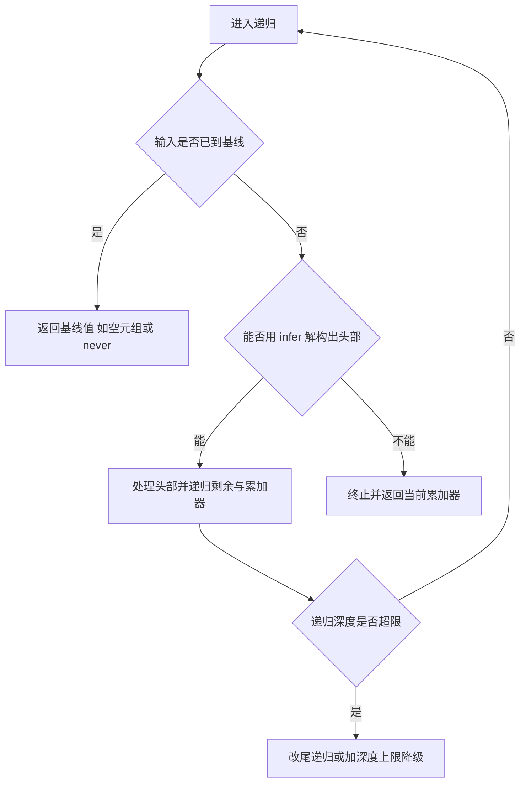

```typescript
// 三种基线的标准写法
type LenOfString<S extends string, Acc extends unknown[] = []> =
  S extends `${string}${infer R}` ? LenOfString<R, [...Acc, unknown]> : Acc["length"]; // 基线 ""

type ToUnion<T extends unknown[]> = T extends [infer F, ...infer R] ? F | ToUnion<R> : never; // 基线 never

type FlattenDeep<T extends unknown[]> =
  T extends [infer F, ...infer R]
    ? F extends unknown[]
      ? [...FlattenDeep<F>, ...FlattenDeep<R>] // 双递归：深度消耗更快
      : [F, ...FlattenDeep<R>]
    : []; // 基线 []

type L = LenOfString<"abc">; // 3
type U = ToUnion<[1, "a", true]>; // 1 | "a" | true
```

### TS-159：递归深度限制与 TS 爆栈案例怎么处理？
**答**：
- 报错 `Type instantiation is excessively deep and possibly infinite`（ts2589）：非尾递归深度上限约 50，超限即报。
- 手段一：改成尾递归（上限约 1000，见 TS-160）；手段二：分而治之降低单次深度。
- 手段三：给体操类型加"深度上限参数"，超限降级为宽类型（unknown）而不是整个报错。

```typescript
// 爆栈案例：Range<10000> 直接 ts2589
// type Range<N extends number, T extends unknown[] = []> =
//   T["length"] extends N ? T : Range<N, [...T, 0]>;

// 深度上限降级（保险丝）：超过 5 层直接给 unknown
type SafeJsonify<T, Depth extends unknown[] = []> =
  Depth["length"] extends 5
    ? unknown
    : T extends object
      ? { [K in keyof T]: SafeJsonify<T[K], [...Depth, unknown]> }
      : T;

type S = SafeJsonify<{ a: { b: { c: { d: { e: { f: 1 } } } } } }>;
// 前五层精确，f 处降级为 unknown，编译不报错
// 分而治之：Range 二分构造再拼接，深度 O(log n)
```

### TS-160：TS 4.5 的尾递归优化对类型体操意味着什么？
**答**：
- 尾调用消除：递归引用"独占条件分支的返回位"时，TS 4.5+ 自动优化，深度上限从约 50 提到约 1000。
- 非尾形态：递归调用嵌在模板字面量里、元组展开里、多分支交叉引用里，都不算尾递归。
- 改造方向：把"包装逻辑"移出递归位（先递归后包装），或把字符串操作改为元组累加。

```typescript
// ✅ 尾递归：递归调用直接是分支的值，支持约 1000 层
type TrimLeft<S extends string> = S extends ` ${infer R}` ? TrimLeft<R> : S;

// ❌ 非尾递归：递归调用嵌在模板字面量里，深度约 50 层
type Wrap<S extends string> = S extends `${infer A}${infer R}` ? `<${A}>${Wrap<R>}` : S;

// ✅ 尾递归：计数器走参数位
type Build<N extends number, T extends unknown[] = []> =
  T["length"] extends N ? T : Build<N, [...T, 0]>;

// 实践：字符串长度统计用"元组累加"代替"模板字面量递归"，
// 前者尾递归扛 1000 字符，后者 50 字符就爆
```

### TS-161：Count 实现中循环引用告警如何处理？
**答**：
- 报错 `Type alias X circularly references itself`：type alias 的立即求值位置（数组字面量、索引访问直引）不允许自引。
- 正解一：泛型引用是惰性的（`Array<Json>` 可以，`Json[]` 不行）；正解二：累加器走参数位，结果只在基线处求值；正解三：interface 属性位惰性。
- 递归结果"又当作类型参数立即展开"是最常见的触发写法。

```typescript
// ❌ 立即求值自引：数组字面量 Json[]
// type Json = string | Json[];

// ✅ 泛型引用惰性
type Json = string | number | boolean | null | Array<Json> | { [k: string]: Json };

// ❌ 结果类型立即依赖未完成的自己（把递归结果直接嵌进元组求值）
// 部分写法会触发 circularly references itself

// ✅ Count 的安全写法：累加器走参数位（惰性），基线处才求 length
type Count<T extends unknown[], Acc extends unknown[] = []> =
  T extends [any, ...infer R] ? Count<R, [unknown, ...Acc]> : Acc["length"];
type N = Count<[1, 2, 3]>; // 3

// 排查三板斧（同 TS-129）：换 interface、改泛型引用、抽公共文件断环
```

### TS-162：大类型体操的性能测试怎么做？
**答**：
- 基线：`tsc --noEmit --extendedDiagnostics` 看 Types / Instantiations / Check time 三项。
- 定位：`--generateTrace` 生成 trace，用 Chrome tracing 打开找实例化热点。
- 对比法：注释可疑体操类型前后看 Instantiations 差值；隔离法：体操类型独立成包用 project references 限制波及面。

```typescript
// 1) 诊断基线（命令行）
// npx tsc --noEmit --extendedDiagnostics
//   Types:            类型总数
//   Instantiations:   实例化次数 —— 体操大户，正常项目几千，体操失控可达百万
//   Check time:       检查耗时

// 2) 热点定位
// npx tsc --noEmit --generateTrace trace
// 打开 trace/trace.json（Chrome tracing）与 trace/types.json，
// 按 instantiation count 排序，找到被实例化上万次的那个类型

// 3) 差值对比实验
type DeepCamelize = unknown; // 占位演示：注释掉真实体操类型，
// 重跑 extendedDiagnostics，Instantiations 差值就是它的成本

// 4) 经验阈值：单个体操类型实例化超数千次就该拆分/降级（见 TS-159）
```

### TS-163：satisfies 在工程化组合中怎么用？（进阶）
**答**：
- TS-021 讲过基本语义；进阶在于三种写法的选型：type 标注（丢字面量）、as const（丢校验）、satisfies（两者兼得）。
- 标准姿势：`satisfies 校验形状` + `keyof typeof 推导键联合`，配置即类型的单一来源。
- 键集需要严格封死时，satisfies 放不拦"多余键"，改用显式标注。

```typescript
// satisfies：校验 + 保留字面量推断
const routes = {
  home: { path: "/", auth: false },
  user: { path: "/user/:id", auth: true },
} satisfies Record<string, { path: string; auth: boolean }>;

routes.user.path;                      // 字面量类型 "/user/:id"（type 标注会退化为 string）
type RouteName = keyof typeof routes;  // "home" | "user"（as const 写法没有形状校验）

// 与 as 断言对比：as 不校验字段，写错字段也放行
const typed = {
  user: { path: "/u", auth: "yes" },   // 换成 satisfies 会在这里报错
} as Record<string, { path: string; auth: boolean }>;

// 组合技：路由注册表 + 派生类型（与 TS-171 呼应）
type RoutePath = (typeof routes)[RouteName]["path"]; // "/" | "/user/:id"
```

## 第三十四章 模块与声明进阶（TS-164 ~ TS-169）

### TS-164：import type 与 verbatimModuleSyntax 的关系是什么？
**答**：
- verbatimModuleSyntax 让 import 语句"原样输出"到产物，类型与值必须在源码里说清楚。
- 纯类型导入必须写 `import type`，否则报错 1484；混合导入用 `import { foo, type Bar }` 内联标注。
- 收益：单文件转译器（esbuild/swc）无需猜测哪些导入可删，产物确定性强；也避免"把不存在的运行时值打进 bundle"。

```typescript
// verbatimModuleSyntax: true
import type { User, UserRow } from "./types";          // 纯类型：编译后整句消失
import { createUser, type UserRow } from "./service";  // 混合：值留下、类型剥掉

// ❌ 旧习惯：import { User } from "./types" 后只当类型用
// 开启后报错 1484：User is a type and must be imported using a type-only import

// 为什么重要：esbuild 转 TS 时只删"带 type 关键字"的导入，
// 模糊写法在 isolatedModules 下可能把纯类型模块当运行时依赖打进产物
```

### TS-165：ambient module 与 d.ts 工程如何组织 types 目录？
**答**：
- 分层：global.d.ts（全局环境）、modules.d.ts（通配符资产）、vendor/（第三方补丁）、index.d.ts（barrel 汇总）。
- barrel 用三斜线引用串起来，tsconfig include 收进编译范围。
- `types: []` 清空 @types 自动加载后，所需三方全局类型要显式 reference。

```typescript
// types/index.d.ts —— barrel 汇总
/// <reference path="./global.d.ts" />
/// <reference path="./modules.d.ts" />
/// <reference path="./vendor/vue-router.d.ts" />

// tsconfig.json 配合
// {
//   "compilerOptions": { "types": [] },
//   "include": ["src", "types"]
// }

// 组织原则：
// 1. 全局声明文件内不得有 import/export（否则变模块私有，失去全局合并能力）
// 2. vendor 补丁集中管理并注明上游版本，升级依赖时逐一核对
// 3. 业务类型不放全局，走模块导入，避免命名污染
```

### TS-166：第三方无类型资产（*.vue、图片、CSS Modules）如何快速补类型？
**答**：
- 通配符 ambient module：`declare module "*.png"` 一条声明覆盖一类文件。
- *.vue 用 DefineComponent 兜底；CSS Modules 用只读字符串索引签名。
- 注意 vite/client 已内置常见资产声明，重复声明反而冲突。

```typescript
// types/modules.d.ts
declare module "*.vue" {
  import type { DefineComponent } from "vue";
  const component: DefineComponent<Record<string, unknown>, Record<string, unknown>, unknown>;
  export default component;
}

declare module "*.png" {
  const src: string;
  export default src;
}

declare module "*.module.css" {
  const classes: { readonly [key: string]: string };
  export default classes;
}

// 用法：
// import logo from "./logo.png";        // logo: string
// import styles from "./a.module.css";  // styles.a: string（只读）
// Vite 项目优先 /// <reference types="vite/client" />，已内置大部分资产声明
```

### TS-167：global.d.ts 里如何扩展环境变量类型（ImportMetaEnv）？
**答**：
- Vite 约定：interface ImportMetaEnv 里声明自定义环境变量，import.meta.env 获得精确类型。
- 必须写在全局作用域（文件内不能有 import/export），才能与 vite/client 的同名 interface 声明合并。
- 拼写错误、忘记配置变量都变成编译期错误。

```typescript
// types/global.d.ts —— 注意：文件内不能出现 import/export
interface ImportMetaEnv {
  readonly VITE_API_BASE: string;
  readonly VITE_SENTRY_DSN?: string;
}

interface ImportMeta {
  readonly env: ImportMetaEnv;
}

const base = import.meta.env.VITE_API_BASE; // string
// import.meta.env.VITE_API_BSAE;           // 报错：属性不存在（拼写错误编译期拦截）

// 坑：如果文件顶部写了 import，interface 变成模块私有，
// 不会与 vite/client 中的 ImportMetaEnv 合并，扩展失效
```

### TS-168：三斜线指令有哪几种？分别什么时候用？
**答**：
- `/// <reference types="包名" />`：引入 @types 包的全局类型，等价 import 但零运行时代价。
- `/// <reference lib="dom" />`：给 d.ts 注入编译器内置 lib 依赖。
- `/// <reference path="相对路径" />`：文件级引用，d.ts barrel 汇总用。
- 必须在文件顶部（之前只能有注释）；模块化代码优先 import type，三斜线主要留给声明文件。

```typescript
// 三种指令（必须在文件最顶部）
/// <reference types="vite/client" />
/// <reference lib="dom" />
/// <reference path="./global.d.ts" />

// 使用判断：
// 1. d.ts 里用了 DOM 类型但无法 import → lib="dom"
// 2. 依赖某 @types 包的全局副作用（如 vitest/globals）→ types="包名"
// 3. types 目录 barrel 汇总 → path
// 现代替代：tsconfig 的 types/lib 数组覆盖全局需求，模块内优先 import type
```

### TS-169：export type / export type * 等导出策略有什么讲究？
**答**：
- isolatedModules 下 `export { SomeType }` 报错 1205：转译器无法判断它是类型，必须 `export type`。
- `export *` 会把类型一并转发；只转发类型用 `export type *`（TS 5.0+）。
- `export * from` 保留模块的运行时副作用（顶层注册代码），纯类型模块用 export type * 避免误引入。

```typescript
// types.ts
export interface User { id: number }
export const makeUser = (): User => ({ id: 1 });

// index.ts —— 导出策略
// ❌ export { User };              // isolatedModules 报错 1205
export type { User };              // ✅ 显式声明"这是类型"
export { makeUser } from "./types";

export type * from "./types";      // 只转发类型（TS 5.0+）
export * from "./utils";           // 值 + 类型一起转发

// 副作用提示：export * from "./side-effect" 会保留顶层注册代码（如组件注册、polyfill），
// 摇树优化不保证剔除；纯类型入口务必 export type *
```

## 第三十五章 类型安全的状态与路由（TS-170 ~ TS-175）

### TS-170：Pinia/Zustand/Redux 的 action 类型安全有哪三种实现？
**答**：
- 实现一：可辨识联合 action（Redux 经典），switch 穷尽检查。
- 实现二：泛型 action creator 工厂，action 类型从构造器自动反推，联合自动汇聚。
- 实现三：Zustand/Pinia 式"方法即 action"，state 与方法同源定义，零手写 action 联合。

```typescript
// 实现一：可辨识联合（Redux）
type CounterAction =
  | { type: "increment"; step: number }
  | { type: "reset" };
const reduce = (s: number, a: CounterAction) =>
  a.type === "increment" ? s + a.step : 0;

// 实现二：泛型 action creator，类型与构造器同源
const makeCreator = <K extends string, P extends object>(type: K) =>
  (payload: P) => ({ type, ...payload } as const);
const inc = makeCreator<"increment", { step: number }>("increment");
const actions = { inc } as const;
type AllActions = ReturnType<(typeof actions)[keyof typeof actions]>; // 自动汇聚联合

// 实现三：Zustand 式 store（Pinia 同思想）
import { create } from "zustand";
const useStore = create<{
  count: number;
  increment: (step: number) => void;
}>()((set) => ({
  count: 0,
  increment: (step) => set((s) => ({ count: s.count + step })),
}));
useStore.getState().increment(2); // 调用与类型全联动，无 action 联合要维护
```

### TS-171：路由如何做到类型安全（params 从路由表推导）？
**答**：
- 路由表 `as const` 是类型源；路径字符串按 "/" 切段，冒号段映射为参数对象字段。
- 导航函数用泛型约束：路由名约束第一参，params 约束第二参，键与必填性全部编译期校验。
- 无参数路由让 params 参数"消失"（条件类型返回空元组），调用更顺手。

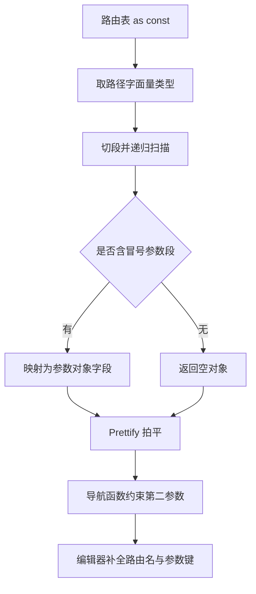

```typescript
const ROUTES = {
  home: "/",
  userDetail: "/users/:id",
  userPost: "/users/:id/posts/:postId",
} as const;

type Prettify<T> = { [K in keyof T]: T[K] } & {};
type Split<S extends string> = S extends `${infer A}/${infer B}` ? [A, ...Split<B>] : [S];
type ParamsOf<Segs extends string[]> =
  Segs extends [infer S extends string, ...infer R extends string[]]
    ? S extends `:${infer P}` ? { [K in P]: string } & ParamsOf<R> : ParamsOf<R>
    : {};
type RouteParams<S extends string> = Prettify<ParamsOf<Split<S>>>;

function navigate<S extends keyof typeof ROUTES>(
  name: S,
  ...args: RouteParams<(typeof ROUTES)[S]> extends Record<string, never>
    ? []
    : [params: RouteParams<(typeof ROUTES)[S]>]
) {}

navigate("home");                                // 无参数路由不用传 params
navigate("userDetail", { id: "42" });
// navigate("userPost", { id: "1" });            // 报错：缺 postId
// navigate("nope", {});                         // 报错：路由名不存在
```

### TS-172：表单值类型与默认值如何联动？
**答**：
- defaults 对象是唯一来源：Values 直接取 defaults 的类型，新增字段只改一处。
- set 函数键约束在 defaults 的键内、值类型逐键联动，杜绝"类型与初始值两张皮"。
- 数组等复杂默认值用 `[] as string[]` 就地断言，类型意图仍留在 defaults 处。

```typescript
function useForm<S extends Record<string, unknown>>(defaults: S) {
  type Values = { [K in keyof S]: S[K] };
  let values: Values = { ...defaults };
  function set<K extends keyof Values>(key: K, value: Values[K]) {
    values = { ...values, [key]: value };
  }
  return { values, set };
}

const form = useForm({ page: 1, keyword: "", tags: [] as string[] });
form.set("page", 2);      // number
// form.set("page", "2"); // 报错：类型不符
// form.set("newKey", 1); // 报错：键必须在 defaults 中出现过

// 收益：加字段 = 加一行默认值，类型自动跟随；删字段时所有引用处报错
```

### TS-173：URL query 如何做类型化解析？
**答**：
- 解析器表（schema）决定目标类型：`ReturnType<S[K]>` 映射出每个键的产出类型。
- 缺参现实存在，返回 Partial 而不是撒谎；schema 之外的键访问直接报错。
- 与 Zod 方案（TS-120）的取舍：轻量场景用解析器表，重校验场景用 Zod 单一来源。

```typescript
type Parsers = Record<string, (raw: string) => unknown>;

function parseQuery<S extends Parsers>(search: string, schema: S) {
  type Result = { [K in keyof S]: ReturnType<S[K]> };
  const params = new URLSearchParams(search);
  const out: Partial<Result> = {};
  for (const key of Object.keys(schema) as (keyof S & string)[]) {
    const raw = params.get(key);
    if (raw !== null) {
      (out as Record<string, unknown>)[key] = schema[key](raw);
    }
  }
  return out as Partial<Result>;
}

const q = parseQuery("?page=2&vip=1", {
  page: Number,
  vip: (v) => v === "1",
});
q.page;   // number | undefined
// q.nope; // 报错：schema 之外的键不存在
```

### TS-174：localStorage 如何做类型安全封装（泛型 + 版本迁移）？
**答**：
- 存储条目带版本号 `{ v, data }`，读取时版本匹配走校验、不匹配走迁移函数。
- validate 是运行时防线（localStorage 天然不可信），migrate 负责 v1→v2 数据形状演进。
- 泛型 T 由调用方声明，get/set 全链路同类型。

```typescript
interface Entry<T> { v: number; data: T }

class TypedStore<T> {
  constructor(
    private key: string,
    private version: number,
    private validate: (raw: unknown) => T | null,
    private migrate: (old: unknown, from: number) => T,
  ) {}

  get(): T | null {
    const raw = localStorage.getItem(this.key);
    if (!raw) return null;
    const parsed = JSON.parse(raw) as Entry<unknown>;
    if (parsed.v === this.version) return this.validate(parsed.data);
    return this.migrate(parsed.data, parsed.v); // 旧版本数据走迁移链
  }

  set(data: T) {
    const entry: Entry<T> = { v: this.version, data };
    localStorage.setItem(this.key, JSON.stringify(entry));
  }
}

const prefStore = new TypedStore<{ theme: "dark" | "light" }>(
  "pref",
  2,
  (raw) => (typeof raw === "object" && raw !== null && "theme" in raw)
    ? raw as { theme: "dark" | "light" }
    : null,
  (old) => ({ theme: (old as { dark?: boolean }).dark ? "dark" : "light" }), // v1.dark → v2.theme
);
```

### TS-175：Web Worker 消息协议如何做到类型安全？
**答**：
- 协议文件定义请求/响应两条可辨识联合，收发端 import 同一份定义。
- 主线程按 id 关联请求响应；worker 端 switch 穷尽处理，漏分支用 never 检查拦截。
- 进阶方向：请求/响应配对成映射类型，callWorker 返回类型按消息类型精确化。

```typescript
// protocol.ts —— 收发端共享
type WorkerRequest =
  | { id: number; type: "sum"; nums: number[] }
  | { id: number; type: "sort"; nums: number[] };

type WorkerResponse =
  | { id: number; type: "sum"; result: number }
  | { id: number; type: "sort"; result: number[] }
  | { id: number; type: "error"; message: string };

// worker.ts —— 穷尽处理，漏分支编译报错
worker.onmessage = (e: MessageEvent<WorkerRequest>) => {
  const req = e.data;
  switch (req.type) {
    case "sum":
      self.postMessage({ id: req.id, type: "sum", result: req.nums.reduce((a, b) => a + b, 0) });
      break;
    case "sort":
      self.postMessage({ id: req.id, type: "sort", result: [...req.nums].sort() });
      break;
    default: {
      const _exhaustive: never = req; // 新增请求类型未处理时这里报错
    }
  }
};

// main.ts —— Promise 化调用
function callWorker(worker: Worker, req: WorkerRequest): Promise<WorkerResponse> {
  return new Promise((resolve) => {
    worker.onmessage = (e: MessageEvent<WorkerResponse>) => {
      if (e.data.id === req.id) resolve(e.data);
    };
    worker.postMessage(req);
  });
}
```

## 第三十六章 TS 元编程进阶（TS-176 ~ TS-181）

### TS-176：如何用模板字面量从 API 路径生成请求方法映射？
**答**：
- 链路：路径去掉冒号 → 按 "/" 切段 → 各段 Pascal 化拼接 → 映射类型 as 重映射成 `fetchXxx` 方法名。
- 中间类型（Split/Pascal）写在小工具类型里，as 子句里内联组合。
- 场景：纯静态的 API 客户端生成、按路径补全方法名。

```typescript
type ApiPaths = "/users" | "/users/:id" | "/users/:id/posts";

type Split<S extends string> = S extends `${infer A}/${infer B}`
  ? A extends "" ? Split<B> : [A, ...Split<B>]
  : [S];

type Pascal<T extends string[]> = T extends [infer F extends string, ...infer R extends string[]]
  ? `${Capitalize<F extends `:${infer W}` ? W : F>}${Pascal<R>}`
  : "";

type Api = {
  [P in ApiPaths as `fetch${Pascal<Split<P>>}`]: (
    params: Record<string, string>,
  ) => Promise<unknown>;
};

type ApiName = keyof Api; // "fetchUsers" | "fetchUsersId" | "fetchUsersIdPosts"
// fetchUsersId({ id: "1" }) —— 方法名由路径自动生成，编辑器直接补全
```

### TS-177：映射键重映射 as 子句有哪些进阶玩法？
**答**：
- 过滤键：as 里映射为 never 即删除该键（`_` 开头的内部字段）。
- 重命名键：模板字面量生成 getter/setter 风格的键。
- 组合：as 表达式里可以同时做"键级条件 + 键级转换"，值类型照常取 T[K]。

```typescript
interface RawConfig {
  id: string;
  _internal: symbol;
  maxRetry: number;
}

// 1) 过滤：剔除下划线开头的内部字段
type PublicOnly<T> = { [K in keyof T as K extends `_${string}` ? never : K]: T[K] };
type P = PublicOnly<RawConfig>; // { id: string; maxRetry: number }

// 2) 重命名：getter 键生成
type Getters<T> = { [K in keyof T as `get${Capitalize<K & string>}`]: () => T[K] };
type G = Getters<P>; // { getId: () => string; getMaxRetry: () => number }

// 3) 组合：as 里同时过滤 + 转换
type PublicGetters<T> = {
  [K in keyof T as K extends `_${string}` ? never : `get${Capitalize<K & string>}`]: () => T[K];
};
type PG = PublicGetters<RawConfig>; // { getId: () => string; getMaxRetry: () => number }
```

### TS-178：如何递归解析模板字面量表达式（类型级求值）？
**答**：
- 加法用元组长度实现：数字 N 转长度 N 的元组，相加即两元组拼接取 length。
- 表达式按 "+" 递归切分，叶子节点用 `infer N extends number` 把数字字面量转 number。
- 同思路可扩展减法（尾部截断元组）、比较（元组前缀判断）。

```typescript
type ToTuple<N extends number, T extends unknown[] = []> =
  T["length"] extends N ? T : ToTuple<N, [...T, unknown]>;

type Add<A extends number, B extends number> = [...ToTuple<A>, ...ToTuple<B>]["length"];

type ParseNum<S extends string> = S extends `${infer N extends number}` ? N : 0;

type EvalSum<S extends string> =
  S extends `${infer A}+${infer Rest}` ? Add<ParseNum<A>, EvalSum<Rest>> : ParseNum<S>;

type R1 = EvalSum<"12+34+5">; // 51
type R2 = EvalSum<"7">;       // 7
// 坑：ToTuple 是线性递归，数字大时深度受限（见 TS-159/160）；
// 生产级实现用二分进位，面试讲清"元组模拟算术"的思路即可
```

### TS-179：this 类型如何支撑流式 API（QueryBuilder）？
**答**：
- 返回类型写 `this` 而不是类名：链式调用后保留"真实实例类型"，继承链不塌缩。
- 需要"改变泛型状态"的链式方法（select 后 Row 变窄）返回新实例类型；不改变状态的方法返回 this。
- 两者搭配：状态型方法负责收窄，this 型方法保证子类方法不丢。

```typescript
class QueryBuilder<Row extends object = Record<string, unknown>> {
  protected filters: string[] = [];

  // 状态型：返回收窄后的新类型
  select<K extends keyof Row>(...keys: K[]): QueryBuilder<Pick<Row, K>> {
    return this as unknown as QueryBuilder<Pick<Row, K>>;
  }

  // this 型：不改状态，保留真实类型
  where(field: keyof Row, op: string, value: unknown): this {
    this.filters.push(`${String(field)} ${op} ?`);
    return this;
  }

  build(): { sql: string } {
    return { sql: this.filters.join(" AND ") };
  }
}

class SoftDeleteQuery<Row extends object> extends QueryBuilder<Row> {
  withDeleted(): this { // this 多态：链式后仍是 SoftDeleteQuery
    return this;
  }
}

const q = new SoftDeleteQuery<{ id: number; name: string }>()
  .withDeleted()
  .where("id", "=", 1); // 类型仍是 SoftDeleteQuery<...>，后续方法不丢
```

### TS-180：多态 this 与 F-bounded 泛型是什么关系？
**答**：
- 多态 this：类方法返回 `this`，编译期代表"当前调用者的精确类型"，子类自动获得。
- F-bounded 泛型：把"返回/接收自身子类"显式化为 `<S extends Base>(s: S) => S`，适合静态方法与工厂函数。
- 典型收益：`new Circle().setFill("red").setRadius(2)` 链式后类型仍是 Circle，而不是塌缩回 Shape。

```typescript
class Shape {
  setFill(color: string): this {
    return this;
  }
}

class Circle extends Shape {
  setRadius(r: number): this {
    return this;
  }
}

const c = new Circle().setFill("red").setRadius(2); // Circle —— 若返回写 Shape 则 setRadius 丢失

// F-bounded 泛型：等价能力的显式形式，适合函数场景
function styled<S extends Shape>(s: S): S {
  return s;
}
const c2 = styled(new Circle()).setRadius(3); // Circle

// 坑：this 类型不能出现在"返回 this 的对象被存起来再调用"之外的复杂位置，
// 序列化/深拷贝后类型信息自然丢失，需重新断言
```

### TS-181：getter/setter 访问器的类型有哪些规则？
**答**：
- TS 4.3+ 支持读写不同类型：get 返回 number、set 接收 string | number 是合法组合。
- 接口层用 `get x(): T; set x(v: U)` 成对表达访问器契约。
- 访问器让"内部存储形状"与"对外契约"解耦，是运行时适配层的类型化表达。

```typescript
class Temperature {
  private celsiusValue = 0;

  get celsius(): number { return this.celsiusValue; }
  set celsius(v: number) { this.celsiusValue = v; }

  // 读窄写宽的合法组合
  get raw(): number { return this.celsiusValue; }
  set raw(v: string | number) { this.celsiusValue = Number(v); }
}

// 接口层同样成对表达
interface TemperatureLike {
  get celsius(): number;
  set celsius(v: number);
}

const t = new Temperature();
t.celsius = 36;              // set: number
const c: number = t.celsius; // get: number
// const bad: string = t.celsius; // 报错
```

## 第三十七章 严格度与错误治理（TS-182 ~ TS-187）

### TS-182：strictFunctionTypes 的逆变实践有哪些案例？
**答**：
- 开启后"函数类型位置"的参数检查变为逆变：参数更宽的函数才能赋给参数更窄的签名。
- 方法简写（`handle(e: X): void`）出于历史兼容仍是双变，属性签名（`onClick: (e: X) => void`）才受严格检查。
- React 事件 Props 用属性签名才能获得完整检查；可变数组的元素赋值仍是已知妥协点。

```typescript
// strictFunctionTypes: true
interface Handler { (e: string | number): void }

declare const broad: (e: string | number) => void;
declare const narrow: (e: string) => void;

let h1: Handler = broad;  // ✅ 逆变：参数更宽的可以给更窄的
let h2: Handler = narrow; // ❌ 报错：narrow 处理不了 number，运行时会炸

// 方法简写 vs 属性签名
type Props = { onClick: (e: React.MouseEvent) => void }; // 属性签名：严格逆变检查
type Bad  = { onClick(e: React.MouseEvent): void };      // 方法简写：双变，检查放松

// 实践规范：回调一律用属性箭头签名声明，别用方法简写骗过检查
```

### TS-183：exactOptionalPropertyTypes 解决什么"三态"问题？
**答**：
- 开启后可选属性区分三态：缺席、有值、显式 undefined；`{ title: undefined }` 不再能赋给 `title?: string`。
- 之前 `title?: string` 实际是 `string | undefined`，"没填"与"填了 undefined"在类型上不可区分。
- 真要允许显式 undefined 的接口显式写 `title?: string | undefined`，意图进入类型签名。

```typescript
// exactOptionalPropertyTypes: true
interface Card { title?: string }

const a: Card = {};                  // ✅ 缺席
const b: Card = { title: "hi" };     // ✅ 有值
// const c: Card = { title: undefined }; // ❌ 报错：undefined 不能赋给 string

// 有意区分三态的接口这样写：
type ApiCard = { title?: string | undefined };
const d: ApiCard = { title: undefined }; // ✅ 显式允许

function render(card: Card) {
  if ("title" in card) {
    // 开启该选项后，"in 判断缺席/传值"才真实可靠（传进来的一定不是显式 undefined）
    console.log(card.title);
  }
}
```

### TS-184：useUnknownInCatchVariables 开启后如何迁移？
**答**：
- strict 默认包含它：catch 变量从 any 变 unknown，直接 `e.message` 全部报错。
- 迁移三板斧：instanceof 收窄、typeof 字符串收窄、统一 toError 工具兜底。
- 反模式是关掉该选项：等于放弃收窄起点，让错误处理退化回 any 时代。

```typescript
// useUnknownInCatchVariables: true（strict 自带）
try {
  JSON.parse("{bad}");
} catch (e) {
  // e: unknown
  if (e instanceof SyntaxError) {
    console.log(e.message);     // 收窄为 SyntaxError
  } else if (typeof e === "string") {
    console.log(e);             // 一些运行时 throw 字符串
  } else {
    throw e;                    // 未知类型继续抛，不吞错
  }
}

// 迁移工具：统一错误归一化
function toError(e: unknown): Error {
  if (e instanceof Error) return e;
  return new Error(typeof e === "string" ? e : JSON.stringify(e));
}
// 存量代码批量替换：catch (e) { logger.error(toError(e).message) }
```

### TS-185：noImplicitOverride 防住什么类继承事故？
**答**：
- 子类覆盖父类方法必须显式写 override，否则报错。
- 最大收益：父类删除/改名方法时，子类的"覆盖"立刻报错（父类已无该方法），防止静默腐化成孤儿方法。
- 大型类继承体系（组件基类、抽象 service）的标配选项。

```typescript
class BaseComponent {
  render(): string { return "base"; }
}

class Button extends BaseComponent {
  // ❌ noImplicitOverride 报错：必须写 override
  // render(): string { return "button"; }

  override render(): string { return "button"; } // ✅
}

// 事故回放：父类把 render 改名为 renderV2，
// 没有该选项时 Button.render 变成"子类新方法"，调用处静默拿到父类实现；
// 开启后 Button 的 override render 直接报错，问题在编译期暴露
```

### TS-186：大项目 TS 报错如何批量治理？
**答**：
- 基线冻结：现有错误总数入库，CI 只允许减少不允许新增。
- 工具约束：eslint ban-ts-comment 统一 @ts-expect-error（必须带描述，错误修复后该行自动报"未使用"，驱动清理）。
- 数据驱动：按目录统计错误数做看板，Owner 认领 + 趋势 review；分包开启 strict 逐包收口。

```typescript
// 1) 基线生成（CI 脚本伪代码）
// npx tsc --noEmit > ts-errors.txt
// 统计行数与分布，写入 ts-baseline.json；PR 中错误总数 > 基线则失败

// 2) eslint 约束注释滥用
// { "rules": { "@typescript-eslint/ban-ts-comment": ["error", {
//   "ts-ignore": "allow-with-description",
//   "ts-expect-error": "allow-with-description",
//   "minimumDescriptionLength": 10 }] } }

// 3) @ts-expect-error 的自愈特性：被压住的错误修复后，
// 该行反而报"Unused '@ts-expect-error' directive"，天然驱动清理

const x: number = "1"; // @ts-expect-error 演示占位：待迁移的遗留赋值
console.log(x);
```

### TS-187：如何用 TSDoc 把类型文档化？
**答**：
- TSDoc 标签（@param/@returns/@example/@see）在编辑器 hover 直接渲染，@link 可点击跳转。
- 公共 API（工具库、组件库、hook）强制注释，用 eslint-plugin-jsdoc/tsdoc 校验。
- 类型注释的价值在"决策"：为什么是 union、为什么允许 undefined，比复述类型本身重要。

```typescript
/**
 * 把分页响应逐页拉取并拍平为行数组。
 *
 * @param fetchPage - 拉取单页的函数，返回该页行与游标
 * @param maxPages - 最多拉取的页数，防止游标死循环
 * @returns 拍平后的行数组
 *
 * @see {@link Page} 行的结构定义
 * @example
 * const rows = await fetchAll((cursor) => api.list(cursor), 5);
 */
interface Page<Row> { rows: Row[]; next?: string }
declare function fetchAll<Row>(
  fetchPage: (cursor?: string) => Promise<Page<Row>>,
  maxPages: number,
): Promise<Row[]>;

// hover fetchAll 显示完整富文档；@link 的 Page 可点击跳转
// 团队规范：export 的函数/类型必须有 TSDoc；内部实现随意
```

## 第三十八章 综合大题（TS-188 ~ TS-200）

### TS-188：如何手写类型版 JSON.parse（字符串 → 类型）？
**答**：
- 核心难点：数组/对象体按"顶层逗号"切分时必须跟踪引号与括号深度，否则嵌套结构被切碎。
- 三层结构：SplitTop（深度感知切分）→ Parse（按 `[`/`{`/标量分发）→ ParseValue（null/true/false/number）。
- 与运行时 JSON.parse 配合：契约推导与测试用类型版，防脏数据仍靠 schema 校验（TS-120）。

```typescript
type Trim<S extends string> = S extends ` ${infer R}` | `\n${infer R}` | `\t${infer R}`
  ? Trim<R>
  : S extends `${infer R} ` | `${infer R}\n` | `${infer R}\t` ? Trim<R> : S;

// 顶层切分：跟踪字符串引号与括号深度，只在深度 0 的逗号处切开
type SplitTop<S extends string, Cur extends string = "", Depth extends unknown[] = [], InStr extends boolean = false> =
  S extends `${infer C}${infer R}`
    ? InStr extends true
      ? C extends `"` ? SplitTop<R, `${Cur}"`, Depth, false> : SplitTop<R, `${Cur}${C}`, Depth, true>
      : C extends `"` ? SplitTop<R, `${Cur}"`, Depth, true>
      : C extends `[` | `{` ? SplitTop<R, `${Cur}${C}`, [...Depth, unknown], false>
      : C extends `]` | `}` ? SplitTop<R, `${Cur}${C}`, Depth extends [unknown, ...infer Pop] ? Pop : Depth, false>
      : C extends `,`
        ? Depth extends [] ? [Cur, ...SplitTop<R>] : SplitTop<R, `${Cur}${C}`, Depth, false>
        : SplitTop<R, `${Cur}${C}`, Depth, false>
    : [`${Cur}${S}`];

type ParseValue<S extends string> =
  S extends "null" ? null
  : S extends "true" ? true
  : S extends "false" ? false
  : S extends `${infer N extends number}` ? N
  : S;

type Parse<S extends string> =
  Trim<S> extends `[${infer Body}]`
    ? Body extends "" ? [] : { [K in keyof SplitTop<Body>]: Parse<Trim<SplitTop<Body>[K]>> }
    : Trim<S> extends `{${infer Body}}`
      ? Body extends "" ? {} : ParseObject<SplitTop<Body>>
      : ParseValue<Trim<S>>;

type ParseObject<Parts extends string[], Acc = {}> =
  Parts extends [infer H extends string, ...infer R extends string[]]
    ? H extends `"${infer K}":${infer V}`
      ? ParseObject<R, Acc & Record<K, Parse<Trim<V>>>>
      : never
    : { [K in keyof Acc]: Acc[K] }; // Prettify 收束交叉

type A = Parse<`[1, "a", true, null]`>;          // [1, "a", true, null]
type B = Parse<`{"id": 1, "tags": ["x", "y"]}`>; // { id: 1; tags: ["x", "y"] }
type C = Parse<`{"user": {"name": "n", "vip": false}}`>; // 嵌套对象递归解析
```

### TS-189：如何手写 QueryString 解析类型（a=1&b=2 → 对象）？
**答**：
- 递归按 "&" 切键值对，每对用 `${infer K}=${infer V}` 拆键值。
- 值的类型化：数字字面量用 `infer N extends number` 转换；无值段约定为布尔开关 true。
- 交叉累积 + Prettify 收束成最终对象类型。

```typescript
type Prettify<T> = { [K in keyof T]: T[K] } & {};

type ParseValue<V extends string> = V extends `${infer N extends number}` ? N : V;

type ParsePair<S extends string> =
  S extends `${infer K}=${infer V}` ? { [P in K]: ParseValue<V> } : { [P in S]: true };

type ParsePairs<S extends string> =
  S extends `${infer KV}&${infer Rest}`
    ? ParsePair<KV> & ParsePairs<Rest>
    : ParsePair<S>;

type Query<S extends string> = Prettify<ParsePairs<S>>;

type Q1 = Query<"a=1&b=hello&page=3">; // { a: 1; b: "hello"; page: 3 }
type Q2 = Query<"debug">;              // { debug: true }（无值开关约定）
type Q3 = Query<"">;                   // { "": true } —— 生产版需先判空
```

### TS-190：路由路径参数提取完整版如何支持可选段与通配符？
**答**：
- 先按 "/" 切段，再逐段判断：`:id?` 可选参数、`*` 通配符、`:id` 必选参数、普通段跳过。
- 可选段映射 `{ [K in P]?: string }`，通配段映射 `{ "*": string[] }`。
- 相比 TS-060/TS-072 的单层提取，本版是"分段解析"，语义边界清晰且好扩展。

```typescript
type Prettify<T> = { [K in keyof T]: T[K] } & {};

type SplitPath<S extends string> = S extends `${infer A}/${infer B}`
  ? [A, ...SplitPath<B>] : [S];

type SegParams<Segs extends string[]> =
  Segs extends [infer S extends string, ...infer R extends string[]]
    ? S extends `:${infer P}?`  ? { [K in P]?: string } & SegParams<R>
    : S extends "*"             ? { "*": string[] } & SegParams<R>
    : S extends `:${infer P}`   ? { [K in P]: string } & SegParams<R>
    : SegParams<R>              // 普通段：无参数
    : {};

type RouteParams<S extends string> = Prettify<SegParams<SplitPath<S>>>;

type P1 = Prettify<RouteParams<"users/:id">>;            // { id: string }
type P2 = Prettify<RouteParams<"users/:id?/posts">>;     // { id?: string }
type P3 = Prettify<RouteParams<"files/*">>;              // { "*": string[] }
type P4 = Prettify<RouteParams<"users/:id/posts/:pid">>; // { id: string; pid: string }
```

### TS-191：如何实现类型安全的 EventEmitter 完整版？
**答**：
- 事件表 `Record<string, unknown[]>`：键是事件名、值是 payload 元组，on/emit/off/once 四个方法全联动。
- once 用"包装函数先退订再执行"实现；on 返回退订函数是现代事件 API 惯例。
- 内部存储与对外签名之间的函数类型转换收敛在两处 as，边界清晰。

```typescript
type Listener<Args extends unknown[]> = (...args: Args) => void;

class EventEmitter<E extends Record<string, unknown[]>> {
  private map = new Map<keyof E, Set<(...args: unknown[]) => void>>();

  on<K extends keyof E>(event: K, fn: Listener<E[K]>): () => void {
    const set = this.map.get(event) ?? new Set();
    set.add(fn as (...args: unknown[]) => void);
    this.map.set(event, set);
    return () => this.off(event, fn); // 返回退订函数
  }

  once<K extends keyof E>(event: K, fn: Listener<E[K]>): void {
    const wrap = (...args: E[K]) => {
      this.off(event, wrap as Listener<E[K]>);
      fn(...args);
    };
    this.on(event, wrap as Listener<E[K]>);
  }

  off<K extends keyof E>(event: K, fn: Listener<E[K]>): void {
    this.map.get(event)?.delete(fn as (...args: unknown[]) => void);
  }

  emit<K extends keyof E>(event: K, ...args: E[K]): void {
    this.map.get(event)?.forEach((fn) => fn(...args));
  }
}

interface Events {
  login: [userId: string];
  error: [code: number, message: string];
}

const bus = new EventEmitter<Events>();
bus.on("error", (code, message) => console.log(code, message)); // 参数自动推断
const stop = bus.on("login", (userId) => userId.toUpperCase());
stop();
bus.emit("login", "u1");
// bus.emit("login", 1);     // 报错：payload 不是 string
// bus.on("nope", () => {}); // 报错：事件不存在
```

### TS-192：如何实现 express 风格的类型安全路由？
**答**：
- Handler 的 req.params 类型由路径字符串推导：路径即类型源，注册时 handler 与路径绑定。
- 泛型 get<Route> 在注册点实例化 Params<Route>，内部存储降级为宽类型只做一次。
- 配合 TS-190 可扩展可选段与通配符。

```typescript
type Prettify<T> = { [K in keyof T]: T[K] } & {};

type Params<S extends string> =
  S extends `${string}:${infer P}/${infer Rest}`
    ? { [K in P]: string } & Params<`/${Rest}`>
    : S extends `${string}:${infer P}` ? { [K in P]: string }
    : {};

type Handler<Route extends string> = (
  req: { params: Prettify<Params<Route>>; query: Record<string, string> },
  res: { json: (data: unknown) => void },
) => void;

class App {
  private routes: [string, Handler<string>][] = [];
  get<Route extends string>(path: Route, handler: Handler<Route>): void {
    this.routes.push([path, handler as unknown as Handler<string>]);
  }
}

const app = new App();
app.get("/users/:id", (req, res) => {
  const id: string = req.params.id;  // 自动推导
  // req.params.nope;               // 报错：参数不存在
  res.json({ id });
});
app.get("/users/:uid/posts/:pid", (req) => {
  const { uid, pid } = req.params;   // 双参数全部推导
});
```

### TS-193：如何实现 DeepMerge 类型？
**答**：
- 键集合取 `keyof A | keyof B`，同名键双存在且两边都是对象时递归合并，否则取 B（后写覆盖）。
- 数组按"整体覆盖"处理（B 的数组直接替换 A），需要按下标合并时另扩展分支。
- 合并前先把入参 Prettify 拍平，交叉类型参与键集合运算更可预测。

```typescript
type DeepMerge<A, B> = {
  [K in keyof A | keyof B]: K extends keyof B
    ? K extends keyof A
      ? A[K] extends object
        ? B[K] extends object
          ? DeepMerge<A[K], B[K]>
          : B[K]
        : B[K]
      : B[K]
    : K extends keyof A ? A[K] : never;
};

type Defaults = { api: { base: string; timeout: number }; retries: number };
type UserCfg  = { api: { timeout: 5000 }; retries: 3 };

type Cfg = DeepMerge<Defaults, UserCfg>;
// { api: { base: string; timeout: 5000 }; retries: 3 }
// —— 同名对象键递归合并，标量键取用户配置覆盖默认值
```

### TS-194：如何实现类型安全的 i18n（点分 key + 参数插值）？
**答**：
- key 层：语言包 as const 后递归生成点分路径联合（`nav.home` | `greet`）。
- 参数层：从翻译模板字符串提取 `{name}` 占位符，t 函数第二参约束为参数记录。
- 缺参数、错 key、错参数名全部编译期报错，语言包改动时调用点自动报错。

```typescript
const zhCN = {
  nav: { home: "首页", about: "关于" },
  greet: "你好，{name}！今天 {count} 条消息",
} as const;

// 递归生成点分 key 联合
type DotPaths<T, P extends string = ""> = T extends string
  ? P
  : { [K in keyof T & string]: DotPaths<T[K], `${P}${P extends "" ? "" : "."}${K}`> }[keyof T & string];
type MessageKey = DotPaths<typeof zhCN>; // "nav.home" | "nav.about" | "greet"

// 按点路径取模板字符串
type PathValue<T, P extends string> =
  P extends `${infer H}.${infer R}` ? (H extends keyof T ? PathValue<T[H], R> : never)
  : P extends keyof T ? T[P] : never;

// 提取 {param} 占位符
type ExtractParams<S extends string> =
  S extends `${string}{${infer P}}${infer Rest}` ? P | ExtractParams<Rest> : never;

type MessageParams<K extends MessageKey> = ExtractParams<PathValue<typeof zhCN, K>>;

declare function t<K extends MessageKey>(
  key: K,
  ...args: MessageParams<K> extends never ? [] : [params: Record<MessageParams<K>, string | number>]
): string;

t("nav.home");
t("greet", { name: "张三", count: 3 });
// t("greet");                 // 报错：缺 params
// t("greet", { name: "a" });  // 报错：缺 count
// t("nav.hom");               // 报错：key 不存在
```

### TS-195：curry 类型完整版（含占位符）怎么写？
**答**：
- 占位符用 unique symbol；已传参数与原参数"逐位合并"，占位符位置保留原参数类型。
- 完成判定：每个参数位都被非占位符实参覆盖才返回结果类型，否则返回"继续传参"的函数。
- 面试讲清合并与判定两个子类型即可；下一次调用参数的精确收窄（Ramda 级别）可作为加分讨论。

```typescript
declare const __: unique symbol;
type Ph = typeof __;

// 已传参数逐位合并：占位符位置保留原参数类型
type Fill<Args extends unknown[], Given extends unknown[]> = {
  [K in keyof Args]: K extends keyof Given
    ? [Given[K]] extends [Ph] ? Args[K] : Given[K]
    : Args[K];
};

// 完成判定：每个位置都有非占位符实参
type Done<Args extends unknown[], Given extends unknown[]> =
  Args extends [unknown, ...infer R]
    ? Given extends [infer G, ...infer GR]
      ? [G] extends [Ph] ? false : Done<R, GR>
      : false
    : true;

type Curry<Args extends unknown[], Ret, Given extends unknown[] = []> =
  Done<Args, Given> extends true
    ? Ret
    : <T extends unknown[]>(...args: T) => Curry<Args, Ret, Fill<Args, [...Given, ...T]>>;

declare function curry<F extends (...args: any[]) => any>(fn: F): Curry<Parameters<F>, ReturnType<F>>;

const fn = (a: string, b: number, c: boolean) => `${a}${b}${c}`;
const c1 = curry(fn);
c1("a")(2)(true);      // 逐个传
c1(__, 2)("a", true);  // 首位占位后补
c1("a", __, true)(2);  // 中间占位
```

### TS-196：如何实现类型安全的 ORM select（字段 → 返回行）？
**答**：
- fields 是表字段元组，返回行类型映射 `K[number]`，没选的列不出现在结果类型上。
- 泛型约束 `K extends readonly (keyof T)[]` 同时完成字段名补全与错字拦截。
- 进阶方向：保持元组顺序的返回行、where 列约束联动、update 仅允许已选键。

```typescript
interface UserTable {
  id: number;
  name: string;
  email: string;
  passwordHash: string;
}

type SelectedRow<T, K extends readonly (keyof T)[]> = {
  [F in K[number]]: T[F];
};

declare function select<T, K extends readonly (keyof T)[]>(
  table: string,
  fields: K,
): SelectedRow<T, K>[];

const rows = select<UserTable>("user", ["id", "name"]);
rows[0].id;    // number
rows[0].name;  // string
// rows[0].email;                 // 报错：没选的列不在结果类型上
// select("user", ["id", "nope"]); // 报错：nope 不是 UserTable 字段
// select("user", []);            // 空选集类型为 {}，可加 K["length"] extends 0 拦截
```

### TS-197：如何实现 union 去重类型？
**答**：
- 联合本身无序且 TS 会合并完全相同的成员；真正需要去重的是"结构相等但声明不同"的体操中间产物（如 boolean 与 true|false 混入）。
- 方案：联合 → 元组（LastOf 递归收集）→ 元组去重 → 回联合。
- LastOf 利用"函数重载推断取最后一个重载"的特性，是联合转元组的标准技巧。

```typescript
type Equal<X, Y> = (<T>() => T extends X ? 1 : 2) extends <T>() => T extends Y ? 1 : 2 ? true : false;

type UnionToIntersection<U> = (U extends unknown ? (k: U) => void : never) extends (k: infer I) => void ? I : never;
type LastOf<U> = UnionToIntersection<U extends unknown ? () => U : never> extends () => infer L ? L : never;
type UnionToTuple<U> = [U] extends [never]
  ? []
  : [...UnionToTuple<Exclude<U, LastOf<U>>>, LastOf<U>];

type Has<T extends unknown[], U> =
  T extends [infer F, ...infer R] ? (Equal<F, U> extends true ? true : Has<R, U>) : false;

type Unique<T extends unknown[], Seen extends unknown[] = []> =
  T extends [infer F, ...infer R]
    ? Has<Seen, F> extends true ? Unique<R, Seen> : [F, ...Unique<R, [...Seen, F]>]
    : [];

type DedupUnion<U> = Unique<UnionToTuple<U>>[number];

type D1 = DedupUnion<"a" | "b" | 1>; // "a" | "b" | 1
type D2 = DedupUnion<boolean | true>; // boolean（true 被判等剔除）
```

### TS-198：如何实现保序的元组去重（TupleToUnion 的保序版）？
**答**：
- Seen 累加器查重：命中重复丢弃、未命中保留在前，递归消费剩余，天然保序。
- 判等用 Equal（严格相等），避免子类型误伤；想"子类型算重复"可换成 `F extends Seen[number]` 判等。
- 复杂度 O(n²)（Seen 线性扫描），大元组建议控制规模或改用"先排布后过滤"的映射方案。

```typescript
type Equal<X, Y> = (<T>() => T extends X ? 1 : 2) extends <T>() => T extends Y ? 1 : 2 ? true : false;

type Includes<T extends unknown[], U> =
  T extends [infer F, ...infer R] ? (Equal<F, U> extends true ? true : Includes<R, U>) : false;

type Unique<T extends unknown[], Seen extends unknown[] = []> =
  T extends [infer F, ...infer R]
    ? Includes<Seen, F> extends true
      ? Unique<R, Seen>                        // 重复：丢弃，保序
      : [F, ...Unique<R, [...Seen, F]>]        // 首次：保留在前
    : [];

type U1 = Unique<[1, 2, 1, 3, 2]>;          // [1, 2, 3]（保序）
type U2 = Unique<[string, number, string]>; // [string, number]
type U3 = Unique<[true, 1, true]>;          // [true, 1]
// 对比：UnionToUnion 版（TS-197）不保序也无需保序，元组版必须保序
```

### TS-199：如何用 Apply 类型收束递归体操全家桶？
**答**：
- Apply：把函数类型"应用"到参数元组得到返回类型，条件类型 + infer 的最纯形态。
- 收束记忆：全章递归共享一个骨架——"解构头部 + 累加器生长 + 基线返回"。
- 面试策略：先讲骨架与终止条件，再落笔写具体题（Len/Chunk/Reverse/Transpose 都是同一模式的变体）。

```typescript
// Apply：函数类型应用到参数元组
type Apply<F extends (...args: never[]) => unknown, A extends unknown[]> =
  F extends (...args: A) => infer R ? R : never;

type Fn = (a: string, b: number) => boolean;
type R1 = Apply<Fn, [string, number]>;  // boolean
type R2 = Apply<Fn, [number, number]>;  // never：参数不匹配

// 递归全家桶的共同骨架（一句话模板）
type Pattern<T extends unknown[], Acc extends unknown[] = []> =
  T extends [infer F, ...infer R] ? Pattern<R, [F, ...Acc]> : Acc;

type Reversed = Pattern<[1, 2, 3]>; // [3, 2, 1]
// 变体对照：
// Len     → Acc 计数取 length
// Chunk   → Acc 攒批满 N 产出
// Unique  → Acc 作 Seen 查重
// FindIndex → Acc 计数在命中处返回
// Transpose → 同态映射替代显式递归
```

### TS-200：TypeScript 的学习路线如何收束成知识地图？
**答**：
- 六级梯度：会用（L1 基础）→ 会写（L2 手写工具）→ 会想（L3 分布式与递归）→ 会造（L4 体操与组件）→ 会治（L5 工程与治理）→ 压轴（L6 综合大题）。
- 面试考察常见组合：L2 抽 2 题 + L3 抽 1 题 + L4/L5 抽 1 题。
- 体操题先讲思路（终止条件、累加器、复杂度）再落笔，比"直接写对"更被看重。

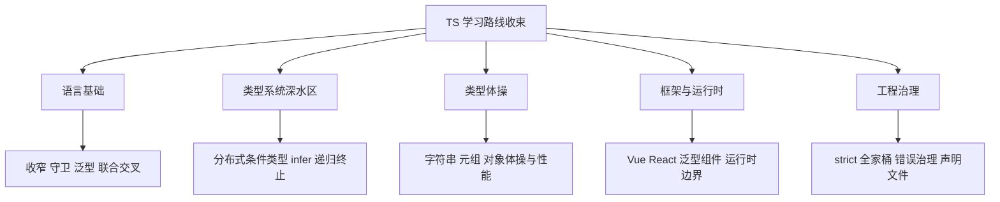

```typescript
// 知识地图（面试官视角的考察梯度，对应本文件章节）
// L1 会用：基础类型、收窄守卫、泛型约束、内置工具类型      —— TS-001 ~ TS-058
// L2 会写：手写工具类型、infer 提取、可辨识联合建模        —— TS-035 ~ TS-075
// L3 会想：分布式条件类型、Equal/IsUnion、递归终止与性能  —— TS-076 ~ TS-082、TS-158 ~ TS-163
// L4 会造：Chainable/Curry/DeepCamelize/Chunk、泛型组件   —— TS-083 ~ TS-118、TS-150 ~ TS-157
// L5 会治：strict 选项矩阵、错误基线、声明文件、运行时边界 —— TS-119 ~ TS-124、TS-164 ~ TS-187
// L6 压轴：JSON.parse 类型、EventEmitter、ORM select、i18n —— TS-188 ~ TS-199

// 学习顺序建议：
// 1. L1 → L2 逐题手写（不许抄），建立"条件类型直觉"
// 2. L3 先学 Equal/IsNever 两个判断原语，再攻 IsUnion 与递归终止
// 3. L4 结合业务（表格/表单/请求层）落地，别为体操而体操
// 4. L5/L6 面向前冲刺：strict 全家桶 + 两道综合大题限时手写
```
