# Vue3 前端面试题库

本文件收录 200 道 Vue3 面试题，编号 V3-001 ~ V3-200，覆盖 Vue3 相对 Vue2 的变化、Proxy 响应式原理、ref/reactive 家族、computed/watch/watchEffect、组合式 API 与逻辑复用、生命周期、组件通信、v-model、插槽、内置组件、diff 算法与 key、异步组件、自定义指令、插件机制、Pinia、Vue Router4、性能优化、SSR 与 Nuxt、custom renderer、defineProps 泛型与 VueUse，以及组件设计实战、组合式函数库、状态/表单/路由工程、UI 交互模式、性能实战、SSR 同构、源码级简化实现、指令系统、过渡动画、大型项目架构、测试工程与 Vue3 新特性深用等实战专题。每题均配有与题目一一对应的代码示例，SFC 统一使用 `<script setup>` 组合式 API 风格，不包含任何算法题。

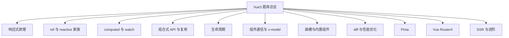

## 目录

- 第一章 Vue3 概览与响应式原理（V3-001 ~ V3-008）
- 第二章 ref 与 reactive 家族（V3-009 ~ V3-014）
- 第三章 computed、watch 与 watchEffect（V3-015 ~ V3-020）
- 第四章 组合式 API 与逻辑复用（V3-021 ~ V3-024）
- 第五章 生命周期（V3-025 ~ V3-027）
- 第六章 组件通信（V3-028 ~ V3-033）
- 第七章 v-model 双向绑定（V3-034 ~ V3-035）
- 第八章 插槽 Slot（V3-036 ~ V3-037）
- 第九章 内置组件 Teleport、Suspense、KeepAlive（V3-038 ~ V3-041）
- 第十章 diff 算法与 key（V3-042 ~ V3-044）
- 第十一章 异步组件（V3-045）
- 第十二章 自定义指令（V3-046 ~ V3-047）
- 第十三章 插件机制（V3-048）
- 第十四章 Pinia 状态管理（V3-049 ~ V3-054）
- 第十五章 Vue Router4（V3-055 ~ V3-060）
- 第十六章 性能优化（V3-061 ~ V3-064）
- 第十七章 SSR 与 Nuxt（V3-065 ~ V3-066）
- 第十八章 custom renderer（V3-067）
- 第十九章 defineProps 泛型（V3-068）
- 第二十章 VueUse 常用（V3-069 ~ V3-070）
- 第二十一章 组件设计实战（V3-071 ~ V3-077）
- 第二十二章 组合式函数库设计（V3-078 ~ V3-084）
- 第二十三章 状态管理实战（V3-085 ~ V3-091）
- 第二十四章 路由工程（V3-092 ~ V3-097）
- 第二十五章 表单工程（V3-098 ~ V3-103）
- 第二十六章 UI 交互模式（V3-104 ~ V3-109）
- 第二十七章 性能实战（V3-110 ~ V3-115）
- 第二十八章 SSR 与同构（V3-116 ~ V3-120）
- 第二十九章 工程与生态（V3-121 ~ V3-135）
- 第三十章 源码级简化实现（V3-136 ~ V3-142）
- 第三十一章 指令系统实战（V3-143 ~ V3-148）
- 第三十二章 过渡与动画工程（V3-149 ~ V3-153）
- 第三十三章 大型项目架构（V3-154 ~ V3-160）
- 第三十四章 数据流与缓存（V3-161 ~ V3-166）
- 第三十五章 测试工程（V3-167 ~ V3-171）
- 第三十六章 Vue3 新特性深用（V3-172 ~ V3-176）
- 第三十七章 Vue 与其他技术集成（V3-177 ~ V3-181）
- 第三十八章 综合大题（V3-182 ~ V3-200）

## 第一章 Vue3 概览与响应式原理

Vue3 响应式系统的完整数据流：组件渲染或 watch 读取数据时触发 get 进行依赖收集，数据变更时触发 set 派发更新，更新任务经调度器批量异步执行。

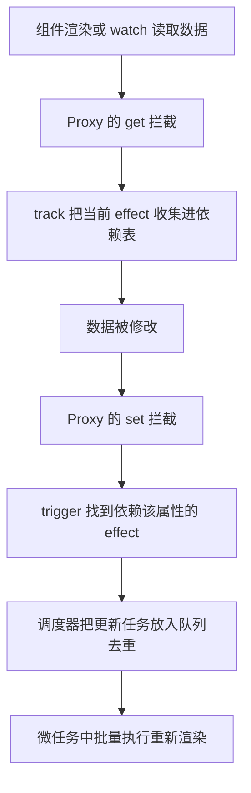

### V3-001：Vue3 相比 Vue2 有哪些核心变化？
**答**：
- 响应式从 Object.defineProperty 换成 Proxy，支持新增/删除属性、数组索引与 length。
- 新增组合式 API（setup、ref、computed 等），逻辑复用从 mixin 转向 composable。
- 编译期优化：静态提升、patchFlag、block tree，diff 更快；支持 Fragment 多根节点。
- 全面支持 TypeScript、新增 Teleport/Suspense/KeepAlive 内置组件、移除 filter 与 \$on 等 API。

```vue
<script setup lang="ts">
import { ref, computed } from "vue";

// 组合式 API：按功能组织逻辑，类型推断友好
const count = ref(0);
const double = computed(() => count.value * 2);
</script>

<template>
  <!-- Fragment：模板可以有多个根节点 -->
  <button @click="count++">count 加一</button>
  <p>{{ count }} - {{ double }}</p>
</template>
```

### V3-002：Proxy 相比 Object.defineProperty 有哪些优势？
**答**：
- defineProperty 只能劫持初始化时已存在的属性，新增/删除属性无法拦截，需要 \$set/\$delete。
- 数组索引赋值和 length 修改拦截不到，Vue2 需要重写 7 个数组方法打补丁。
- Proxy 代理整个对象，支持 13 种拦截器，还能代理 Map/Set，嵌套对象可惰性代理提升初始化性能。
- 局限：Proxy 无法 polyfill 到 IE11，所以 Vue3 放弃了 IE。

```javascript
const data = { count: 0, list: [1, 2] };

const state = new Proxy(data, {
  get(target, key, receiver) {
    track(target, key); // 依赖收集
    return Reflect.get(target, key, receiver);
  },
  set(target, key, value, receiver) {
    const result = Reflect.set(target, key, value, receiver);
    trigger(target, key); // 派发更新
    return result;
  },
});

// Proxy 的优势：新增/删除属性、数组索引、length 都能拦截
state.list.push(3); // Vue2 时代需要重写数组方法
state.newKey = 1; // Vue2 时代需要 $set
delete state.newKey; // Proxy 可拦截 deleteProperty
```

### V3-003：描述 Vue3 的 track 与 trigger 机制（附示意代码）。
**答**：
- 依赖收集的单位是 effect（组件渲染函数、computed、watch 回调都是 effect）。
- track 发生在 get 拦截：把"当前正在运行的 activeEffect"记入 `targetMap -> depsMap -> deps` 三层结构。
- trigger 发生在 set 拦截：按 target + key 找到 effect 集合，交给调度器执行。
- 结构上是 WeakMap 嵌套 Map 嵌套 Set，WeakMap 以原始对象为 key 便于垃圾回收。

```javascript
// 依赖收集与派发更新的简化模型
let activeEffect = null;
const targetMap = new WeakMap();

function track(target, key) {
  if (!activeEffect) return; // 没有正在运行的 effect 则不收集
  let depsMap = targetMap.get(target);
  if (!depsMap) targetMap.set(target, (depsMap = new Map()));
  let deps = depsMap.get(key);
  if (!deps) depsMap.set(key, (deps = new Set()));
  deps.add(activeEffect); // 属性 -> effect 集合
}

function trigger(target, key) {
  const depsMap = targetMap.get(target);
  if (!depsMap) return;
  const effects = depsMap.get(key);
  effects && effects.forEach((effect) => effect());
}

function effect(fn) {
  activeEffect = fn;
  fn(); // 首次执行触发 get，完成依赖收集
  activeEffect = null;
}

const state = { count: 0 };
effect(() => console.log("count is", state.count)); // 输出 count is 0
```

### V3-004：reactive 的实现原理是什么？
**答**：
- reactive 返回原对象的 Proxy，拦截 get/set/deleteProperty/has/ownKeys 等操作。
- get 里调用 track 收集依赖，set/delete 里调用 trigger 派发更新。
- 嵌套对象采用惰性深代理：get 时才对属性值递归调用 reactive，避免初始化遍历整棵树。
- set 时对比新旧值、判断 key 是否新增（hadKey），决定按 ADD/SET/DELETE 哪种类型 trigger。

```javascript
function reactive(obj) {
  return new Proxy(obj, {
    get(target, key, receiver) {
      track(target, key);
      const value = Reflect.get(target, key, receiver);
      // 惰性深代理：访问到对象属性时才递归转换
      if (typeof value === "object" && value !== null) {
        return reactive(value);
      }
      return value;
    },
    set(target, key, value, receiver) {
      const old = target[key];
      const hadKey = key in target;
      const result = Reflect.set(target, key, value, receiver);
      if (!hadKey) {
        trigger(target, key, "add"); // 新增属性也要触发
      } else if (old !== value) {
        trigger(target, key, "set");
      }
      return result;
    },
    deleteProperty(target, key) {
      const hadKey = key in target;
      const result = Reflect.deleteProperty(target, key);
      if (hadKey) trigger(target, key, "delete");
      return result;
    },
  });
}
```

### V3-005：为什么 effect 重新执行前要做依赖清理？
**答**：
- 依赖关系是动态的：分支条件变化后，effect 可能不再读取某些属性。
- 不清理会产生"多余依赖"，改一个无关属性也会触发 effect 重跑。
- Vue 在每次 effect 运行前，把它上次收集的依赖全部删除，再重新收集。
- 简化模型：effect 身上记一个 deps 数组，指向它所在的所有依赖集合。

```javascript
let activeEffect = null;
const depsMap = new Map();

function track(target, key) {
  if (!activeEffect) return;
  if (!depsMap.has(key)) depsMap.set(key, new Set());
  const depSet = depsMap.get(key);
  depSet.add(activeEffect);
  // 记录当前 effect 收集过的依赖集合，便于之后清理
  activeEffect.deps.push(depSet);
}

function cleanup(effect) {
  effect.deps.forEach((depSet) => depSet.delete(effect));
  effect.deps.length = 0;
}

function run(effect, fn) {
  cleanup(effect); // 先清掉旧依赖，再重新收集
  activeEffect = effect;
  fn();
  activeEffect = null;
}
```

### V3-006：ref 为什么需要 .value？它和 reactive 的本质区别是什么？
**答**：
- Proxy 只能代理对象，无法代理基本类型，所以 ref 把值包装成 RefImpl 对象。
- RefImpl 内部通过 class 的 value getter/setter 实现 track/trigger，这就是必须 `.value` 的原因。
- 对象类型的 ref 内部会调用 reactive 做深层转换，读 `.value` 得到的是代理对象。
- reactive 是对象的 Proxy 代理，ref 是"带响应式的容器"，模板中 ref 会被自动解包所以不用写 value。

```javascript
import { ref, reactive } from "vue";

// RefImpl 内部大致是：
// get value() { track(this, 'value'); return this._value }
// set value(v) { this._value = v; trigger(this, 'value') }
const count = ref(0);
count.value++; // 通过 .value 触发依赖收集与派发

// 对象类型的 ref 内部会调用 reactive 深度转换
const state = ref({ list: [] });
state.value.list.push(1); // 内部是 reactive 对象，深层也是响应式

// reactive 对象解构会丢失响应式，ref 不会
const obj = reactive({ a: 1, b: 2 });
// const { a } = obj; // a 失去响应式
```

### V3-007：Vue3 的异步批量更新（调度器）是如何工作的？
**答**：
- trigger 触发的不是同步重新渲染，而是把渲染 effect 放进 queueJob 队列。
- 队列用 Set 去重，同一组件同一 tick 内多次修改数据只会入队一次。
- 通过 Promise.then 在微任务中统一 flush，保证多次赋值只渲染一次。
- 这是"改 100 次数据只更新 1 次 DOM"性能优化的来源。

```javascript
// 异步批量更新：同一 tick 内多次改数据只渲染一次
const queue = new Set();
const p = Promise.resolve();
let isFlushPending = false;

function queueJob(job) {
  queue.add(job); // Set 去重，同一组件的渲染 effect 只入队一次
  if (!isFlushPending) {
    isFlushPending = true;
    p.then(() => {
      isFlushPending = false;
      queue.forEach((job) => job()); // 微任务中统一执行
      queue.clear();
    });
  }
}

const state = reactive({ count: 0 });
state.count = 1;
state.count = 2;
state.count = 3; // 触发 3 次 trigger，但渲染任务只执行 1 次
```

### V3-008：shallowReactive 和 readonly 的应用场景是什么？
**答**：
- shallowReactive 只转换第一层，适合大表格、大列表等"整体替换、局部不常改"的数据，省去深层递归开销。
- readonly 创建深层只读代理，任何修改在开发环境都会告警，适合共享的全局配置。
- shallowReadonly 只锁第一层，Vue3 的 props 本质上就是它。
- 这些 API 是性能与安全性之间的调节器，按数据访问模式选择。

```javascript
import { shallowReactive, readonly, shallowReadonly } from "vue";

// 浅层响应：只有第一层是响应式
const table = shallowReactive({ rows: [1, 2, 3], page: 1 });
table.page = 2; // 触发更新
table.rows.push(4); // 不触发更新（rows 是普通数组）

// 深层只读：适合全局配置
const frozen = readonly({ user: { name: "Tom" } });
// frozen.user.name = "Jerry"; // 开发环境运行时警告

// 浅层只读：props 的本质
const propsLike = shallowReadonly({ count: 1, nested: { value: 2 } });
// propsLike.nested.value = 3; // 深层不拦截
```

## 第二章 ref 与 reactive 家族

### V3-009：ref 和 reactive 应该怎么选？
**答**：
- 官方与社区主流推荐：默认用 ref，只对"局部成组的状态"用 reactive。
- ref 可以整体替换 `.value`、可以直接传给组合函数、类型简单。
- reactive 不能整体替换、解构丢响应式、离开 setup 作用域后引用容易失控。
- reactive 适合表单对象、批量配置这类"结构稳定、只改字段"的状态。

```vue
<script setup lang="ts">
import { ref, reactive } from "vue";

// 推荐默认用 ref：类型简单、可整体替换、可组合复用
const keyword = ref("");
const list = ref<string[]>([]);

// reactive 适合结构稳定的表单对象
const form = reactive({
  page: 1,
  size: 10,
  status: "all",
});

function reset() {
  // form = { page: 1, size: 10, status: "all" }; // 报错：不能整体替换
  Object.assign(form, { page: 1, size: 10, status: "all" });
  keyword.value = "";
  list.value = [];
}
</script>
```

### V3-010：reactive 有哪些使用限制？
**答**：
- 解构会丢失响应式：解构出来的是普通值，必须用 toRefs 保持连接。
- 不能整体替换：`state = newState` 换掉了 Proxy 引用，视图仍监听旧代理。
- 只能代理对象类型，`reactive(1)` 无效并告警。
- 对同一对象重复 reactive 返回同一代理，代理对象再 reactive 也返回自身。

```vue
<script setup lang="ts">
import { reactive, isReactive, toRefs } from "vue";

const state = reactive({ count: 0, name: "Tom" });

// 1. 解构丢失响应式
const { count } = state; // count 是普通 number，不再触发视图更新

// 2. 不能整体替换（state 是 const 的 Proxy 引用）
// state = reactive({ count: 1 }); // 报错

// 3. 基本类型无法代理
const num = reactive(1 as any); // 开发环境警告，返回原始值
console.log(isReactive(num)); // false

// 正确做法：toRefs 解构或改用 ref
const refs = toRefs(state); // { count: Ref<number>, name: Ref<string> }
refs.count.value++; // 仍与 state.count 双向同步
</script>
```

### V3-011：toRef 和 toRefs 的作用与区别是什么？
**答**：
- toRef 为响应式对象的单个属性创建 ref，读写与源属性双向同步。
- toRefs 把整个 reactive 对象转换成 ref 集合，常用于解构 props 或 setup 返回值。
- 源对象上不存在的属性，toRef 创建的 ref 也能保持联动（后续赋值会同步）。
- 它们解决的核心问题：解构/展开 reactive 对象时保持响应式。

```vue
<script setup lang="ts">
import { reactive, toRef, toRefs } from "vue";

const state = reactive({ name: "Tom", age: 18 });

// toRef：为单个属性创建 ref，与源属性双向同步
const nameRef = toRef(state, "name");
nameRef.value = "Jerry"; // state.name 同步变为 "Jerry"
state.age = 20; // 不影响 nameRef

// toRefs：把整个对象转成 ref 集合，常用于解构 props
function useFeature(props: { name: string; age: number }) {
  const { name, age } = toRefs(props); // 保持响应式的解构
  return { name, age };
}
</script>
```

### V3-012：shallowRef 与 triggerRef 的用途是什么？
**答**：
- shallowRef 只有 `.value` 被整体替换时才触发更新，内部数据不是响应式。
- 适合大数组、大对象、地图实例、第三方图表实例等重资源，避免深层代理开销。
- 内部变更后想强制更新，调用 triggerRef 手动触发依赖。
- 这也是"不可变数据风格"的性能优化路径：永远整体替换。

```vue
<script setup lang="ts">
import { shallowRef, triggerRef } from "vue";

const bigList = shallowRef<Array<number>>([]);

// 整体替换会触发更新
bigList.value = Array.from({ length: 10000 }, (_, i) => i);

// 内部变更不会触发更新
bigList.value.push(10001);

// 强制触发更新（避免整包替换大数组的开销）
triggerRef(bigList);
</script>
```

### V3-013：customRef 是什么？如何实现防抖输入？
**答**：
- customRef 允许自定义 track 与 trigger 的时机，是"手写响应式行为"的出口。
- 工厂函数接收 { track, trigger }，返回带 get/set 的对象。
- 经典应用：防抖 ref——set 时延迟 trigger，输入停止 N ms 后才更新视图。
- 也可用于 sync ref（立即同步）、与本地存储同步的 ref 等。

```vue
<script setup lang="ts">
import { customRef } from "vue";

function useDebouncedRef(initial: string, delay = 300) {
  let timer: ReturnType<typeof setTimeout>;
  return customRef((track, trigger) => ({
    get() {
      track(); // 声明依赖
      return initial;
    },
    set(newValue) {
      clearTimeout(timer);
      timer = setTimeout(() => {
        initial = newValue;
        trigger(); // 延迟派发更新，实现防抖
      }, delay);
    },
  }));
}

const keyword = useDebouncedRef("");
</script>

<template>
  <input v-model="keyword" placeholder="输入停止 300ms 后更新" />
  <p>{{ keyword }}</p>
</template>
```

### V3-014：isRef、unref 和 proxyRefs 的原理与应用？
**答**：
- isRef 判断值是否为 ref；unref 是语法糖：`isRef(v) ? v.value : v`。
- 两者让组合函数兼容 `T | Ref<T>` 入参，是 VueUse 全家桶的基础模式。
- proxyRefs 是 toRefs 的反向操作：访问/写入时自动解包 ref。
- setup 返回值、reactive 对象内嵌 ref 的自动解包都由 proxyRefs 机制完成。

```typescript
import { isRef, unref, ref, computed } from "vue";
import type { Ref } from "vue";

// 组合函数兼容两种入参：number 或 Ref<number>
function useDouble(source: number | Ref<number>) {
  return computed(() => unref(source) * 2);
}

const n = ref(4);
useDouble(n).value; // 8
useDouble(2).value; // 4

// proxyRefs：setup 返回对象在模板中自动解包 .value 的原因（示意实现）
function proxyRefs(target: Record<string, unknown>) {
  return new Proxy(target, {
    get(t, key) {
      return unref(t[key]); // 访问时自动 .value
    },
    set(t, key, value) {
      const old = t[key];
      if (isRef(old) && !isRef(value)) {
        (old as Ref<unknown>).value = value; // 旧值是 ref 且新值不是，写入 .value
        return true;
      }
      t[key] = value;
      return true;
    },
  });
}
```

## 第三章 computed、watch 与 watchEffect

### V3-015：computed 的缓存机制是什么？如何理解它的实现？
**答**：
- computed 依赖不变时返回缓存值，不会重复计算 getter。
- 内部用 dirty 标记：依赖变更时只把 dirty 置 true 并通知外层 effect，真正读取时才重算。
- computed 也是 effect，惰性求值 + 缓存使它天然适合派生状态。
- 链式 computed 的更新也遵循"先标脏、再按需计算"的调度。

```javascript
// computed 核心特征：依赖不变时返回缓存值（简化实现）
function computed(getter) {
  let value;
  let dirty = true; // 标记是否需要重新计算
  const runner = () => {
    if (dirty) {
      value = getter();
      dirty = false;
    }
    return value;
  };
  // 依赖变化时（trigger 回调）：把 dirty 置回 true，并通知订阅者重新读取
  return {
    get value() {
      trackSelf(); // 把 computed 自身作为依赖收集给外层 effect（示意）
      return runner();
    },
  };
}

function trackSelf() {} // 示意占位
```

### V3-016：可写 computed 怎么用？
**答**：
- computed 传对象形式 { get, set } 即可支持写入，写入走 set 逻辑。
- 典型场景：父组件 v-model 一个派生值、全选状态联动子选项。
- set 里通常反向修改数据源，而不是存自己的值。
- TS 下可用 `computed<string>({...})` 显式标注类型。

```vue
<script setup lang="ts">
import { ref, computed } from "vue";

const firstName = ref("张");
const lastName = ref("三");

// 传对象形式即可支持写入
const fullName = computed<string>({
  get: () => firstName.value + lastName.value,
  set: (val) => {
    firstName.value = val.slice(0, 1);
    lastName.value = val.slice(1);
  },
});

function rename() {
  fullName.value = "李四"; // 触发 set，反向修改两个 ref
}
</script>

<template>
  <input v-model="fullName" />
  <button @click="rename">改名为李四</button>
</template>
```

### V3-017：watch 支持哪几种数据源？
**答**：
- 单个 ref、reactive 对象、getter 函数、以及它们组成的数组（多源）。
- reactive 对象隐式深度监听；ref 包对象默认只监听 .value 替换，深监听需 deep: true。
- 多源时回调的新旧值也是按位置对应的数组。
- getter 函数是最灵活的形式，可以监听组合状态。

```vue
<script setup lang="ts">
import { ref, reactive, watch } from "vue";

const count = ref(0);
const state = reactive({ user: { name: "Tom" } });

// 单个 ref
watch(count, (val, oldVal) => console.log(val, oldVal));

// getter 函数
watch(() => state.user.name, (name) => console.log(name));

// reactive 对象：隐式深度监听
watch(state, () => console.log("state changed"));

// 多源：数组形式，回调参数也是按位对应的数组
watch([count, () => state.user.name], ([c, n], [pc, pn]) => {
  console.log(c, n, pc, pn);
});
</script>
```

### V3-018：watch 的 deep、immediate、once、flush 选项分别做什么？
**答**：
- deep: true 深层遍历监听对象内部变化；对 ref 包裹的对象默认不深，需要手动开。
- 加分点：Vue 3.5+ 的 deep 可以传数字（如 `deep: 2`），限制遍历深度，在大对象上比 `deep: true` 更省性能。
- immediate: true 立即以当前值执行一次回调，常用于初始化拉取数据。
- once: true（3.4+）只触发一次后自动停止。
- flush: 'pre'（默认，组件更新前）/ 'post'（更新后，可读 DOM）/ 'sync'（同步立即）。

```vue
<script setup lang="ts">
import { ref, watch } from "vue";

const form = ref({ name: "", tags: [] as string[] });

watch(
  form,
  (val) => console.log("form changed", val),
  {
    deep: true, // ref 包对象默认不深监听，需要手动开启
    immediate: true, // 立即以当前值执行一次，常用于初始化请求
    once: true, // 3.4+：只触发一次后自动停止
    flush: "post", // DOM 更新后再执行，可安全读取最新 DOM
  }
);

// 手动停止监听（组件卸载时自动停止）
const stop = watch(form, () => {});
stop();
</script>
```

### V3-019：watchEffect 和 watch 的区别是什么？
**答**：
- watch 懒执行、需要显式声明数据源、回调拿到新旧值；watchEffect 立即执行、自动收集依赖、没有新旧值。
- watchEffect 适合"多个依赖都要跑副作用"的场景，依赖声明写在函数体里。
- 两者都返回 stop 函数，组件卸载时自动停止。
- 副作用需要清理时用 onCleanup 回调，常用于取消上一次请求。

```vue
<script setup lang="ts">
import { ref, watchEffect, watch } from "vue";

const id = ref(1);

// watchEffect：立即执行，自动收集依赖
const stop = watchEffect(async (onCleanup) => {
  const controller = new AbortController();
  onCleanup(() => controller.abort()); // 依赖变化/组件卸载前取消上次请求
  await fetch(`/api/user/${id.value}`, { signal: controller.signal });
});

// watch：懒执行，需要指明数据源，有新旧值
watch(id, (newId, oldId) => {
  console.log(`id 从 ${oldId} 变成 ${newId}`);
});

stop(); // 手动停止（一般不需要）
</script>
```

### V3-020：watch 的 flush 时机有哪几种？对应哪些 API？
**答**：
- pre（默认）：回调在组件更新前执行，同一 tick 内多次变更只调一次。
- post：回调在组件更新后执行，能拿到更新后的 DOM，等价 API 是 watchPostEffect。
- sync：依赖变化立即同步执行，不做批处理，等价 API 是 watchSyncEffect。
- 需要操作"最新 DOM"的场景一律用 post，避免手动 nextTick。

```vue
<script setup lang="ts">
import { ref, watchEffect, watchPostEffect, watchSyncEffect } from "vue";

const count = ref(0);

// flush: 'pre'（默认）：组件更新前执行
watchEffect(() => console.log("pre", count.value));

// flush: 'post'：组件更新后执行，等价于 watchPostEffect
watchPostEffect(() => {
  // 可安全访问更新后的 DOM
  console.log("post", document.title);
});

// flush: 'sync'：依赖变化立即同步执行，等价于 watchSyncEffect
watchSyncEffect(() => console.log("sync", count.value));
</script>
```

## 第四章 组合式 API 与逻辑复用

### V3-021：组合式 API 解决了 mixin 的哪些问题？
**答**：
- mixin 属性来源不明：组件里看到的方法不知道来自哪个 mixin，重构风险高。
- 命名冲突：多个 mixin 与组件的同名 data/methods 静默覆盖。
- 隐式耦合：mixin 依赖组件的属性，组件不知道自己必须提供什么。
- composable 显式 import、显式传参、显式返回，且天然支持 TS 类型推导。

```typescript
// mixin 的问题：来源不明、命名冲突、隐式耦合
const petsMixin = {
  data() {
    return { pets: ["cat", "dog"] };
  },
  methods: {
    feedPets() {}, // 组件里看不到定义却能用，重构极易出错
  },
};

// Vue3 用 composable 替代：显式导入、来源清晰、类型友好
import { ref } from "vue";

export function usePets() {
  const pets = ref<string[]>([]);
  const feedPets = () => pets.value.forEach((p) => console.log(p));
  return { pets, feedPets }; // 来源和依赖一目了然
}
```

### V3-022：setup 的执行时机与参数是什么？
**答**：
- setup 在组件实例创建之前、props 解析之后执行，早于 beforeCreate。
- `<script setup>` 中 this 不是组件实例，组合式 API 也不依赖 this。
- defineProps/defineEmits/defineExpose 是编译器宏，无需 import，只能在 setup 顶层使用。
- setup 无法访问 data/methods 等选项式成员，因为它们此时还不存在。

```vue
<script setup lang="ts">
// setup 在组件实例创建前、props 解析后执行
// 此时 this 不是组件实例（组合式 API 里也不该用 this）
interface Props {
  title: string;
  count?: number;
}

// defineProps / defineEmits 是编译器宏，无需 import
const props = defineProps<Props>();
const emit = defineEmits<{ change: [value: string] }>();

console.log(props.title); // props 已可用
emit("change", "init");
</script>

<template>
  <h3>{{ title }}</h3>
</template>
```

### V3-023：手写一个 useMousePosition composable？
**答**：
- composable = "以 use 开头的函数 + 组合式 API 封装状态与副作用"。
- 内部创建 ref 状态，在生命周期钩子里注册/清理事件监听。
- 返回多个 ref 保持响应式，调用方按需解构。
- 多次调用各自独立实例，比 mixin 的单例共享更可控。

```vue
<script setup lang="ts">
import { ref, onMounted, onUnmounted } from "vue";

function useMousePosition() {
  const x = ref(0);
  const y = ref(0);

  const update = (e: MouseEvent) => {
    x.value = e.pageX;
    y.value = e.pageY;
  };

  onMounted(() => window.addEventListener("mousemove", update));
  onUnmounted(() => window.removeEventListener("mousemove", update));

  return { x, y };
}

const { x, y } = useMousePosition();
</script>

<template>
  <p>鼠标位置 {{ x }}, {{ y }}</p>
</template>
```

### V3-024：编写 composable 有哪些最佳实践？
**答**：
- 命名必须 use 开头；输入参数支持 `T | Ref<T>` 用 unref 兼容；输出返回 refs 而不是解包值。
- 副作用（事件、定时器、订阅）必须在 onUnmounted/onScopeDispose 中清理。
- 不持有模块级可变单例状态，除非刻意做全局 store；每次调用应互相独立。
- 异步 loading/error 状态内聚在 composable 里，组件只消费结果。

```typescript
// composables/useUser.ts —— composable 命名以 use 开头
import { ref, computed } from "vue";

export function useUser(initialId: number) {
  const user = ref<{ name: string } | null>(null);
  const loading = ref(false);
  const displayName = computed(() => user.value?.name ?? "未知");

  async function load(id = initialId) {
    loading.value = true;
    try {
      const res = await fetch(`/api/user/${id}`);
      user.value = await res.json();
    } finally {
      loading.value = false;
    }
  }

  // 返回 refs 而不是解包后的值，保持响应式
  return { user, loading, displayName, load };
}
```

## 第五章 生命周期

### V3-025：Vue3 的生命周期钩子与 Vue2 如何对应？
**答**：
- beforeCreate/created 被 setup 本身取代，不需要专门钩子。
- beforeDestroy/destroyed 更名为 onBeforeUnmount/onUnmounted。
- 其余一一对应：onBeforeMount、onMounted、onBeforeUpdate、onUpdated。
- KeepAlive 内用 onActivated/onDeactivated，错误捕获用 onErrorCaptured。

```vue
<script setup lang="ts">
import { onMounted, onUnmounted } from "vue";

// Vue2 -> Vue3 对照：
// beforeCreate / created -> setup 本身
// beforeMount -> onBeforeMount
// mounted -> onMounted
// beforeUpdate -> onBeforeUpdate
// updated -> onUpdated
// beforeDestroy -> onBeforeUnmount
// destroyed -> onUnmounted
// activated / deactivated -> onActivated / onDeactivated（KeepAlive 内）
// errorCaptured -> onErrorCaptured

onMounted(() => console.log("DOM 已挂载"));
onUnmounted(() => console.log("已卸载，做清理"));
</script>

<template>
  <p>生命周期示例</p>
</template>
```

### V3-026：父子组件的生命周期执行顺序是怎样的？
**答**：
- 挂载：父 beforeMount -> 子 beforeMount -> 子 mounted -> 父 mounted（子先完成）。
- 更新：父 beforeUpdate -> 子 beforeUpdate -> 子 updated -> 父 updated。
- 卸载：父 beforeUnmount -> 子 beforeUnmount -> 子 unmounted -> 父 unmounted。
- 结论：mounted 阶段子先于父完成，所以父组件 onMounted 里一定能访问到子组件。

```vue
<!-- Parent.vue -->
<script setup lang="ts">
import { onMounted, onBeforeUnmount } from "vue";
import Child from "./Child.vue";

// 挂载顺序：父 beforeMount -> 子 beforeMount -> 子 mounted -> 父 mounted
// 卸载顺序：父 beforeUnmount -> 子 beforeUnmount -> 子 unmounted -> 父 unmounted
// 更新顺序：父 beforeUpdate -> 子 beforeUpdate -> 子 updated -> 父 updated
onMounted(() => console.log("parent mounted"));
onBeforeUnmount(() => console.log("parent beforeUnmount"));
</script>

<template>
  <Child />
</template>
```

### V3-027：在组合式函数中注册生命周期钩子要注意什么？
**答**：
- 生命周期钩子必须在 setup 的同步调用链中注册，composable 内部注册是合法且推荐的。
- 放在 setTimeout/Promise.then 等异步回调里注册会失效，因为已脱离组件实例上下文。
- composable 封装"注册监听 + 卸载清理"是标准模式。
- 与组件实例无关的场景用 onScopeDispose 代替 onUnmounted。

```vue
<script setup lang="ts">
import { onMounted, onBeforeUnmount } from "vue";

// composable 内部注册生命周期钩子：必须在 setup 同步调用链中执行
function useEventListener(
  target: Window,
  event: string,
  handler: EventListener
) {
  onMounted(() => target.addEventListener(event, handler));
  onBeforeUnmount(() => target.removeEventListener(event, handler));
}

// 正确：setup 中同步调用
useEventListener(window, "resize", () => console.log("resize"));

// 错误示例：放在异步回调里注册会失效
// setTimeout(() => useEventListener(window, "resize", fn), 1000);
</script>

<template>
  <p>调整窗口大小查看控制台</p>
</template>
```

## 第六章 组件通信

常见组件通信方式与适用层级如下图，选型的核心依据是"组件之间的层级关系与数据归属"。

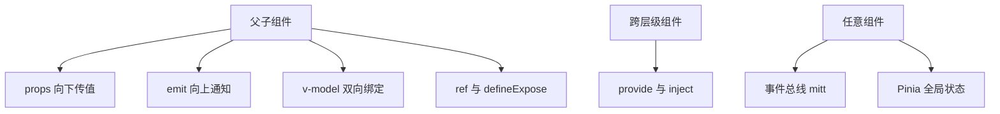

### V3-028：Vue3 中 props 和 emit 如何做类型声明？
**答**：
- defineProps 泛型写法直接描述 props 结构，编译器自动生成运行时校验。
- defineEmits 用类型对象声明事件名与参数元组（3.3+ 语法）。
- props 是 shallowReadonly 的，子组件不能修改；单向数据流是契约。
- 父组件用 kebab-case 监听 camelCase 事件即可。

```vue
<!-- Child.vue -->
<script setup lang="ts">
const props = defineProps<{
  title: string;
  count?: number;
}>();

const emit = defineEmits<{
  change: [value: number];
  update: [id: string, value: unknown];
}>();

function add() {
  emit("change", (props.count ?? 0) + 1);
}
</script>

<template>
  <h3>{{ title }}</h3>
  <button @click="add">count 加一</button>
</template>

<!-- 父组件使用：
<Child title="标题" :count="1" @change="onChange" /> -->
```

### V3-029：provide/inject 如何做到类型安全？
**答**：
- 直接用字符串 key 没有类型推导，推荐用 `InjectionKey<T>` 类型的 Symbol key。
- provide 端与 inject 端共享同一个 key 常量，注入值的类型自动推导。
- inject 可传默认值兜底；没有默认值且未注入时得到 undefined。
- 适合主题、用户信息、SDK 实例等跨层级只读或受控写入的数据。

```vue
<!-- Provider.vue（祖先组件） -->
<script setup lang="ts">
import { provide, ref } from "vue";
import type { InjectionKey, Ref } from "vue";

// 用 Symbol key + 类型标注，注入端获得完整类型推导
const ThemeKey: InjectionKey<Ref<"light" | "dark">> = Symbol("theme");

const theme = ref<"light" | "dark">("dark");
provide(ThemeKey, theme); // 后代任意层级可注入

// 后代组件中：
// const theme = inject(ThemeKey, ref("light")); // 类型自动为 Ref<"light" | "dark">
</script>

<template>
  <p>当前主题 {{ theme }}</p>
</template>
```

### V3-030：Vue3 移除了 $on/$off，事件总线怎么做？
**答**：
- Vue3 实例不再是 EventEmitter，官方建议用 mitt、tiny-emitter 等独立库。
- mitt 用 Map 管理事件与处理器，支持通配符 \* 监听所有事件。
- 事件名建议用 TS 类型约束，避免魔法字符串。
- 必须在 onUnmounted 中 off，否则处理器泄漏、组件重复触发。

```typescript
// bus.ts —— Vue3 移除了 $on/$off，官方建议用 mitt 等库
import mitt from "mitt";

type Events = {
  "user-login": { id: number; name: string };
  "cart-updated": number; // 购物车数量
};

export const emitter = mitt<Events>();

// 任意组件中：
emitter.on("user-login", (payload) => console.log(payload.name));
emitter.on("*", (type, payload) => console.log(type, payload)); // 通配符监听
emitter.emit("cart-updated", 3);
emitter.off("user-login"); // 在 onUnmounted 中解绑，避免泄漏
```

### V3-031：Pinia 为什么取代了 Vuex？核心差异是什么？
**答**：
- Pinia 去掉了 mutation，action 中直接修改状态，模板代码减半。
- store 之间可以直接互相引用，模块天然扁平化，不需要 modules 嵌套。
- 完整 TS 推断：state/getters/actions 类型自动推导，无需手写 Payload 类型。
- Vue2/3 均可用、支持 SSR、DevTools 支持完善，是 Vue 官方推荐。

```typescript
// Vuex4：mutation 是同步修改状态的唯一途径，模板代码多
const vuexLikeStore = {
  state: { count: 0 },
  mutations: {
    increment(state: { count: number }) {
      state.count++;
    },
  },
  actions: {
    asyncIncrement(context: { commit: (t: string) => void }) {
      setTimeout(() => context.commit("increment"), 100);
    },
  },
};

// Pinia：去掉 mutation，action 里可直接改状态，天然 TS 推断
import { defineStore } from "pinia";

export const useCounterStore = defineStore("counter", {
  state: () => ({ count: 0 }),
  actions: {
    increment() {
      this.count++; // 直接修改，无需 commit
    },
  },
});
```

### V3-032：父组件如何调用子组件的方法？defineExpose 是干什么的？
**答**：
- `<script setup>` 的组件默认对外封闭，模板 ref 拿到的实例是空壳。
- defineExpose 显式暴露属性和方法，父组件通过模板 ref 访问。
- 模板 ref 需要用 `ref<InstanceType<typeof Child>>()` 声明类型。
- 这种"命令式调用"应克制使用，优先考虑 props/emit 的声明式通信。

```vue
<!-- Child.vue -->
<script setup lang="ts">
import { ref } from "vue";

// <script setup> 默认是封闭的，父组件拿不到内部属性
const count = ref(0);
function reset() {
  count.value = 0;
}
defineExpose({ count, reset }); // 显式暴露
</script>

<template>
  <span>{{ count }}</span>
</template>

<!-- Parent.vue 中：
const childRef = ref<InstanceType<typeof Child>>();
childRef.value?.reset(); -->
```

### V3-033：Vue3 中 $attrs 发生了什么变化？
**答**：
- Vue2 的 \$listeners 在 Vue3 被合并进 \$attrs，透传属性和事件统一处理。
- setup 中用 useAttrs() 访问，它是非响应式对象（但整体是浅响应跟踪的）。
- 默认继承到根元素；设置 inheritAttrs: false 后可手动 v-bind="attrs" 控制挂载位置。
- 多根节点组件不会自动继承 attrs，需要显式绑定或关闭告警。

```vue
<script setup lang="ts">
import { useAttrs } from "vue";

// Vue2 的 $listeners 在 Vue3 被合并进 $attrs
const attrs = useAttrs();
console.log(attrs.class, attrs["data-id"]);

function onClick() {
  // 透传的事件也在 attrs 中：attrs.onClick
  typeof attrs.onClick === "function" && (attrs.onClick as Function)();
}
</script>

<template>
  <!-- 未声明为 props 的属性都会进入 attrs，这里手动控制挂载位置 -->
  <div v-bind="attrs" @click="onClick">继承属性</div>
</template>
```

## 第七章 v-model 双向绑定

### V3-034：Vue3 组件上的 v-model 是如何实现的？
**答**：
- `v-model="title"` 展开为 `:modelValue="title"` + `@update:modelValue="title = $event"`。
- 子组件用 modelValue prop 接收，用 update:modelValue 事件通知。
- Vue3 支持多个 v-model：`v-model:name`、`v-model:age`，用参数区分。
- 相比 Vue2 的 value/input + model 选项，命名统一且可组合。

```vue
<!-- ModelChild.vue -->
<script setup lang="ts">
// v-model="title" 展开为 :modelValue="title" + @update:modelValue="title = $event"
const props = defineProps<{ modelValue: string }>();
const emit = defineEmits<{ "update:modelValue": [value: string] }>();

function onInput(e: Event) {
  emit("update:modelValue", (e.target as HTMLInputElement).value);
}
</script>

<template>
  <input :value="modelValue" @input="onInput" />
</template>

<!-- Vue3 支持多个 v-model，用参数区分：
<UserForm v-model:name="name" v-model:age="age" /> -->
```

### V3-035：如何自定义 v-model 修饰符？
**答**：
- 修饰符会以 props 形式传入：`v-model.capitalize` 对应 `modelModifiers: { capitalize: true }`。
- 组件在 emit 前根据修饰符处理值，如首字母大写、数字转换。
- 带参数的修饰符（如 v-model:count.double）会合并进同名 key。
- 这是封装表单组件时的常用技巧。

```vue
<!-- CapitalizeInput.vue -->
<script setup lang="ts">
const props = defineProps<{
  modelValue: string;
  modelModifiers?: { capitalize?: boolean };
}>();

const emit = defineEmits<{ "update:modelValue": [value: string] }>();

function onInput(e: Event) {
  let value = (e.target as HTMLInputElement).value;
  // v-model.capitalize 会把修饰符以 modelModifiers 传入
  if (props.modelModifiers?.capitalize) {
    value = value.charAt(0).toUpperCase() + value.slice(1);
  }
  emit("update:modelValue", value);
}
</script>

<template>
  <input :value="modelValue" @input="onInput" />
</template>

<!-- 使用：<CapitalizeInput v-model.capitalize="name" /> -->
```

## 第八章 插槽 Slot

### V3-036：默认插槽与具名插槽如何使用？
**答**：
- `<slot>` 是内容出口，父组件传入的内容在子组件对应出口渲染。
- 具名插槽用 name 区分，父组件用 `#header`（v-slot:header）填充。
- 插槽内容在父组件作用域编译，无法直接访问子组件数据。
- `<slot>` 标签内的内容是后备内容（父组件未传时显示）。

```vue
<!-- LayoutCard.vue -->
<script setup lang="ts">
// 插槽内容在父组件作用域编译，数据属于父组件
</script>

<template>
  <div class="card">
    <header><slot name="header">默认标题</slot></header>
    <main><slot>默认内容</slot></main>
    <footer><slot name="footer" /></footer>
  </div>
</template>

<!-- 使用方：
<LayoutCard>
  <template #header>自定义标题</template>
  <p>body 内容</p>
  <template #footer>页脚</template>
</LayoutCard> -->
```

### V3-037：作用域插槽是什么？解决什么问题？
**答**：
- 子组件把内部数据通过插槽 prop 传出去，父组件决定渲染方式：数据归子、渲染归父。
- 语法：子组件 `<slot :item="item">`，父组件 `v-slot="{ item }"` 解构接收。
- 典型场景：通用列表/表格组件让外部自定义单元格渲染。
- Vue3 中所有插槽统一编译为函数（slots 对象的属性是函数），具名与作用域只是语法糖。

```vue
<!-- DataList.vue -->
<script setup lang="ts">
import { ref } from "vue";

// 子组件提供数据，父组件决定怎么渲染
const items = ref(["a", "b", "c"]);
</script>

<template>
  <ul>
    <slot
      v-for="(item, index) in items"
      :key="item"
      :item="item"
      :index="index"
    />
  </ul>
</template>

<!-- 使用方：
<DataList v-slot="{ item, index }">
  <li>{{ index }} - {{ item }}</li>
</DataList> -->
```

## 第九章 内置组件 Teleport、Suspense、KeepAlive

### V3-038：Teleport 的作用与原理是什么？
**答**：
- Teleport 把子节点渲染到指定 DOM 目标（to 选择器/元素），而组件逻辑仍留在原组件树。
- 解决弹窗、Toast 被 overflow: hidden 或 z-index 层叠上下文困住的问题。
- to 目标必须在 Teleport 挂载时已存在，通常用 body 或 #app 之外的容器。
- 支持 disabled 切换为原地渲染；配合 CSS 定位实现全屏弹窗。

```vue
<script setup lang="ts">
import { ref } from "vue";

const show = ref(false);
</script>

<template>
  <!-- Teleport 把渲染结果传送到 body，组件逻辑仍在原组件树 -->
  <button @click="show = true">打开弹窗</button>
  <Teleport to="body" :disabled="false">
    <div v-if="show" class="modal">弹窗内容，不受父级 overflow 与 z-index 影响</div>
  </Teleport>
</template>

<style scoped>
.modal {
  position: fixed;
  inset: 0;
  margin: auto;
  width: 300px;
  height: 200px;
  background: #fff;
}
</style>
```

### V3-039：Suspense 如何处理异步组件？
**答**：
- Suspense 包裹含异步依赖的组件（async setup、顶层 await、异步组件），等待期间显示 fallback。
- 组件内 `await` 必须写在 async setup 中；Suspense 是实验性 API，生产使用需谨慎。
- 支持 default/fallback 两个插槽，可有多个异步子组件统一等待。
- 配合 onErrorCaptured 或 onRejected 处理加载失败。

```vue
<script setup lang="ts">
import { defineAsyncComponent } from "vue";
const AsyncChart = defineAsyncComponent(() => import("./AsyncChart.vue"));
</script>

<template>
  <Suspense>
    <template #default>
      <!-- 组件内 async setup 或顶层 await 的组件在此等待 -->
      <AsyncChart />
    </template>
    <template #fallback>
      <p>加载中...</p>
    </template>
  </Suspense>
</template>
```

### V3-040：KeepAlive 的缓存机制与常用配置是什么？
**答**：
- KeepAlive 缓存组件 vnode 与实例，切换时不销毁、恢复时不重新创建。
- include/exclude 按组件 name 匹配白名单/黑名单，max 用 LRU 策略限制缓存数量。
- 被缓存的组件触发 activated/deactivated，而不是 mounted/unmounted。
- 适合 tab 页缓存、列表返回保持滚动位置等场景。

```vue
<script setup lang="ts">
import { ref, onActivated, onDeactivated } from "vue";

const currentTab = ref("TabA");
const tabs = ["TabA", "TabB"];

// TabA.vue 中：
// onActivated(() => 重新拉取数据);
// onDeactivated(() => 暂停轮询);
</script>

<template>
  <button v-for="t in tabs" :key="t" @click="currentTab = t">{{ t }}</button>
  <!-- include 按组件 name 匹配，max 控制缓存上限（LRU 淘汰） -->
  <KeepAlive :include="['TabA']" :max="10">
    <component :is="currentTab" />
  </KeepAlive>
</template>
```

### V3-041：Transition 与 TransitionGroup 的区别是什么？
**答**：
- Transition 用于单元素/组件的进出场，通过自动添加 fade-enter-from 等 class 驱动 CSS 过渡。
- TransitionGroup 用于列表，支持 move class 实现排序位移动画，渲染真实元素需指定 tag。
- 进出场由 v-if/v-show/动态组件切换触发，leave 期间元素保持挂载。
- 也可用 JavaScript 钩子（@enter/@leave）做动画库集成。

```vue
<script setup lang="ts">
import { ref } from "vue";
const show = ref(true);
const list = ref([1, 2, 3]);
</script>

<template>
  <button @click="show = !show">切换</button>
  <!-- Transition 在插入/移除时自动添加过渡 class -->
  <Transition name="fade">
    <p v-if="show">淡入淡出的文本</p>
  </Transition>

  <!-- TransitionGroup 用于列表，支持 move class -->
  <TransitionGroup name="list" tag="ul">
    <li v-for="item in list" :key="item">{{ item }}</li>
  </TransitionGroup>
</template>

<style>
.fade-enter-active,
.fade-leave-active {
  transition: opacity 0.3s;
}
.fade-enter-from,
.fade-leave-to {
  opacity: 0;
}
.list-move {
  transition: transform 0.3s;
}
</style>
```

## 第十章 diff 算法与 key

### V3-042：key 的作用是什么？为什么不能用 index 当 key？
**答**：
- key 是 vnode 的身份标识，diff 时用于判断"是否同一个节点"，从而复用 DOM 并移动而不是重建。
- 无 key 时 Vue 走"就地复用"策略，只做内容 patch，插入删除时状态可能错位。
- 用 index 当 key：头部插入后，后续项的 key 全部变化且内容平移，带输入框等内部状态的组件会错乱。
- 正确做法：用稳定唯一的业务 id 做 key。

```vue
<script setup lang="ts">
import { ref } from "vue";

const list = ref([
  { id: 1, name: "a" },
  { id: 2, name: "b" },
  { id: 3, name: "c" },
]);

function insertFirst() {
  // 有 key 时高效复用并移动 DOM；无 key 或 index 当 key 时可能原地复用出错
  list.value.unshift({ id: Date.now(), name: "new" });
}
</script>

<template>
  <ul>
    <!-- key 是节点的身份标识：无 key 时 Vue 用就地复用策略 -->
    <li v-for="item in list" :key="item.id">
      {{ item.name }} <input placeholder="输入内容试试" />
    </li>
  </ul>
  <!-- 错误示范：用 index 当 key，头部插入会导致输入框状态错乱 -->
  <button @click="insertFirst">头部插入</button>
</template>
```

### V3-043：Vue3 的 diff 算法（快速 diff）分为哪几步？
**答**：
- 第一步：预处理相同前缀与相同后缀，缩小乱序区间。
- 第二步：旧节点遍历完则新节点批量挂载；新节点遍历完则旧节点批量卸载。
- 第三步：乱序区间为新节点建 key -> index 映射，记录旧节点对应的新下标 source。
- 第四步：对 source 求最长递增子序列，LIS 内节点不动，其余倒序遍历做 move 或挂载，把 DOM 移动次数降到最少。

```javascript
// Vue3 快速 diff 算法核心步骤（示意）
function diffChildren(oldChildren, newChildren) {
  // 1. 预处理：从头同步相同前缀，从尾同步相同后缀
  let start = 0;
  let oldEnd = oldChildren.length - 1;
  let newEnd = newChildren.length - 1;
  while (
    start <= oldEnd &&
    start <= newEnd &&
    oldChildren[start].key === newChildren[start].key
  ) {
    start++;
  }
  while (
    oldEnd >= start &&
    newEnd >= start &&
    oldChildren[oldEnd].key === newChildren[newEnd].key
  ) {
    oldEnd--;
    newEnd--;
  }

  // 2. 旧节点遍历完：新区间全部是新增，直接挂载
  if (start > oldEnd && start <= newEnd) {
    // mountBatch(newChildren.slice(start, newEnd + 1))
  }
  // 3. 新节点遍历完：旧区间全部卸载
  else if (start > newEnd) {
    // unmountBatch(oldChildren.slice(start, oldEnd + 1))
  }
  // 4. 乱序区间：
  //    为新节点建立 key -> index 映射，记录每个旧节点在新序列中的下标 source
  //    对 source 求最长递增子序列 LIS，LIS 中的节点保持不动
  //    倒序遍历新节点：不在 LIS 的执行 move 或挂载
  //    这样能把 DOM 移动次数降到最少
}
```

### V3-044：patchFlag 和静态提升如何加速更新？
**答**：
- 静态提升：纯静态 vnode 只创建一次，被提升到 render 函数外，diff 时直接跳过。
- patchFlag：编译器给动态节点打标（1 文本、2 class、8 props 等），diff 只比对标记的部分。
- block tree：动态节点被收集进 block 的扁平数组，更新时不再递归遍历整棵树。
- 这些是"编译时优化"，让 Vue3 的更新性能接近手动优化代码。

```javascript
// 编译器输出对比（简化）
// 模板：<div><p>静态文本</p><span>{{ dynamic }}</span></div>

// 1 静态提升：静态 vnode 只创建一次，提到 render 函数外
const hoisted = createElementVNode("p", null, "静态文本", -1 /* HOISTED */);

function render(_ctx) {
  return (openBlock(), createElementBlock("div", null, [
    hoisted, // 静态节点，diff 直接跳过
    // 2 patchFlag：1 表示只有文本是动态的
    createElementVNode("span", null, toDisplayString(_ctx.dynamic), 1 /* TEXT */),
  ]));
}
// openBlock 开启 block 收集：动态节点进入扁平数组
// 更新时沿 block tree 只遍历动态节点，不再递归整棵树
```

## 第十一章 异步组件

### V3-045：defineAsyncComponent 如何使用？
**答**：
- 基本用法传工厂函数 `() => import('./X.vue')`，组件按需拆 chunk、用到时才加载。
- 高级配置：delay 控制 loading 出现时机避免闪烁、timeout 超时报错。
- loadingComponent/errorComponent 分别指定加载中与失败兜底组件。
- onError 回调支持失败重试，常配合弱网环境。

```vue
<script setup lang="ts">
import { defineAsyncComponent } from "vue";

// 路由级大组件按需拆包，首屏不加载
const HeavyEditor = defineAsyncComponent({
  loader: () => import("./HeavyEditor.vue"),
  delay: 200, // 超过 200ms 才显示 loading，避免闪烁
  timeout: 10000, // 超时判定为加载失败
  loadingComponent: () => import("./Loading.vue"),
  errorComponent: () => import("./ErrorBox.vue"),
  onError(error, retry, fail, attempts) {
    if (attempts <= 2) retry(); // 失败自动重试两次
    else fail();
  },
});
</script>

<template>
  <HeavyEditor />
</template>
```

## 第十二章 自定义指令

### V3-046：Vue3 自定义指令有哪些钩子？
**答**：
- 钩子与组件生命周期对齐：created、beforeMount、mounted、beforeUpdate、updated、beforeUnmount、unmounted。
- Vue3 移除了 Vue2 的 bind/update/componentUpdated 等钩子名。
- 钩子参数：el、binding（value/oldValue/arg/modifiers）、vnode、prevVnode。
- `<script setup>` 中以 v 开头的变量自动注册为局部指令，全局用 app.directive。

```vue
<script setup lang="ts">
import { ref } from "vue";

// v-focus：局部自定义指令
const vFocus = {
  // 钩子与组件生命周期对齐
  created(el: HTMLElement) {}, // 元素属性初始化后
  mounted(el: HTMLInputElement) {
    el.focus(); // 元素插入父节点后
  },
  updated(el: HTMLElement) {},
  beforeUnmount(el: HTMLElement) {},
};

const show = ref(true);
</script>

<template>
  <!-- 局部指令以 v 开头的变量名自动注册 -->
  <input v-if="show" v-focus placeholder="自动聚焦" />
</template>
```

### V3-047：写一个 v-permission 或 v-lazy 指令实战？
**答**：
- v-permission：mounted 时校验权限，无权限直接移除节点。
- v-lazy：IntersectionObserver 观察图片进入视口后再赋 src，节省流量与首屏时间。
- 指令适合"纯 DOM 行为"的横切逻辑，涉及响应式数据交互优先用组合函数。
- 全局注册在 main.ts 中 `app.directive(name, directive)`。

```vue
<script setup lang="ts">
import type { Directive } from "vue";

// v-permission：无权限直接移除节点
const vPermission: Directive<HTMLElement, string> = {
  mounted(el, binding) {
    const roles = ["admin"]; // 实际从用户信息读取
    if (!roles.includes(binding.value)) {
      el.parentNode?.removeChild(el);
    }
  },
};

// v-lazy：IntersectionObserver 实现图片懒加载
const vLazy: Directive<HTMLImageElement, string> = {
  mounted(el, binding) {
    const observer = new IntersectionObserver(([entry]) => {
      if (entry.isIntersecting) {
        el.src = binding.value;
        observer.disconnect();
      }
    });
    observer.observe(el);
  },
};
</script>

<template>
  
</template>
```

## 第十三章 插件机制

### V3-048：Vue3 插件机制是如何工作的？
**答**：
- 插件是带 install 方法的对象（或直接是函数），`app.use(plugin)` 自动调用 install。
- install 接收 app 实例与可选配置，可以注册全局组件、指令、provide、globalProperties。
- app.use 对同一插件只会安装一次（按对象引用去重）。
- Vue Router、Pinia、i18n 都基于该机制。

```typescript
// plugins/i18n.ts —— 插件就是一个带 install 方法的对象或函数
import type { App } from "vue";

export interface I18nOptions {
  locale: string;
}

export function createI18n(options: I18nOptions) {
  return {
    install(app: App) {
      // 注册全局属性 / 指令 / provide
      app.config.globalProperties.$t = (key: string) =>
        `[${options.locale}] ${key}`;
      app.provide("locale", options.locale);
      app.directive("i18n", {
        mounted(el: HTMLElement, binding: { value: string }) {
          el.textContent = `[${options.locale}] ${binding.value}`;
        },
      });
    },
  };
}

// main.ts 中：
// const app = createApp(App);
// app.use(createI18n({ locale: "zh-CN" })); // 自动调用 install 并传入 app
```

## 第十四章 Pinia 状态管理

Pinia 与组件的关系：多个组件共享同一个 store 实例，getter 派生状态，action 承载同步与异步逻辑，持久化插件把 state 同步到 localStorage。

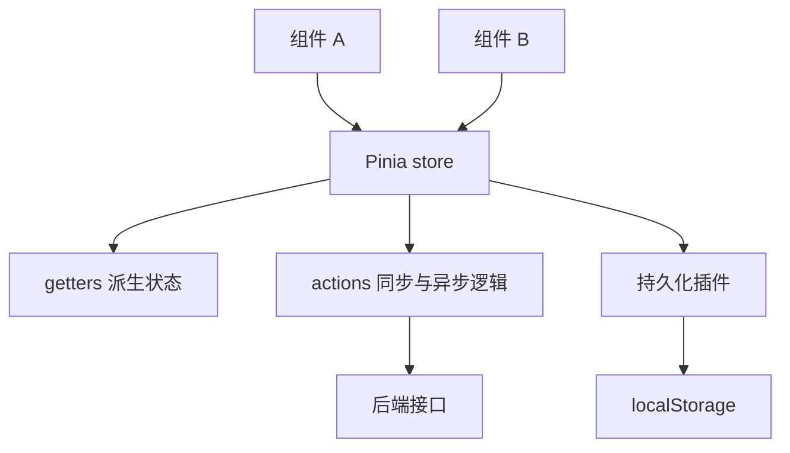

### V3-049：Pinia 的 setup store 怎么写？
**答**：
- 第二个参数传函数：ref 就是 state、computed 就是 getter、普通函数就是 action。
- 函数必须 return 全部需要暴露的成员，漏 return 的成员外部不可见。
- 相比 options store 更灵活：可以在 store 内使用组合式函数与 watch。
- store id 是唯一的，DevTools 与持久化插件依赖它。

```typescript
// stores/counter.ts —— setup store 写法（组合式 API 风格）
import { defineStore } from "pinia";
import { ref, computed } from "vue";

export const useCounterStore = defineStore("counter", () => {
  // ref -> state
  const count = ref(0);
  // computed -> getter
  const double = computed(() => count.value * 2);
  // 函数 -> action
  function increment(step = 1) {
    count.value += step;
  }
  async function fetchAndSet() {
    const res = await fetch("/api/count");
    count.value = (await res.json()).count;
  }

  return { count, double, increment, fetchAndSet }; // 必须返回全部成员
});
```

### V3-050：Options store 怎么写？$reset 和 $patch 怎么用？
**答**：
- state 必须是返回新对象的工厂函数，getters 是基于 state 的派生，actions 写业务逻辑。
- `store.$patch(对象或函数)` 批量修改，只触发一次订阅回调。
- Options store 自带 `\$reset()` 恢复初始 state；setup store 需要自己实现 reset action。
- `store.$subscribe` 可监听状态变化，常用于做持久化。

```typescript
import { defineStore } from "pinia";

export const useUserStore = defineStore("user", {
  state: () => ({
    token: "",
    profile: null as { name: string } | null,
  }),
  actions: {
    setToken(token: string) {
      this.token = token;
    },
    reset() {
      this.$reset(); // Options store 自带 $reset；setup store 需自行实现
    },
  },
});

const store = useUserStore();

// $patch 批量修改，只触发一次更新
store.$patch({ token: "abc" });
store.$patch((state) => {
  state.profile = { name: "Tom" };
});

// $subscribe 监听状态变化
const unsubscribe = store.$subscribe((mutation, state) => {
  console.log(mutation.type, state.token);
});
```

### V3-051：Pinia 的 getter 有哪些特性？传参 getter 为什么无法缓存？
**答**：
- getter 基于 state 计算并有缓存，依赖不变不重算，等价于 computed。
- getter 可以访问其他 getter（this）甚至其他 store 的状态。
- 传参 getter 实际是"返回函数的 getter"，每次调用都重新执行函数，无法缓存结果。
- 需要按参数缓存时，应该把参数作为 state，或直接写 action。

```typescript
import { defineStore } from "pinia";

export const useProductStore = defineStore("product", {
  state: () => ({
    products: [
      { id: 1, price: 100 },
      { id: 2, price: 250 },
    ],
  }),
  getters: {
    // 普通 getter：基于 state 派生，有缓存
    total: (state) => state.products.reduce((sum, p) => sum + p.price, 0),
    // 传参 getter：返回函数，每次调用重新计算，无法缓存
    getByPrice: (state) => (min: number) =>
      state.products.filter((p) => p.price >= min),
  },
});
```

### V3-052：Pinia 的 action 里如何调用其他 store 与处理异步？
**答**：
- action 内直接 `useOtherStore()` 获取其他 store 实例，模块间自由组合。
- 异步直接用 async/await，没有 mutation 概念，await 后直接改 this。
- this 指向 store 实例；setup store 中则直接操作本地 ref。
- 错误处理、并发控制（如防重复提交）都可以内聚在 action 里。

```typescript
import { defineStore } from "pinia";
import { useUserStore } from "./user";

export const useOrderStore = defineStore("order", {
  state: () => ({ orders: [] as string[], submitting: false }),
  actions: {
    async submit(order: string) {
      if (this.submitting) return; // 防重复提交
      this.submitting = true;
      try {
        const userStore = useUserStore(); // 调用其他 store
        const res = await fetch("/api/orders", {
          method: "POST",
          headers: { token: userStore.token },
          body: JSON.stringify({ order }),
        });
        const data = await res.json();
        this.orders.push(data.id); // await 后直接修改 state
      } finally {
        this.submitting = false;
      }
    },
  },
});
```

### V3-053：Pinia 如何实现状态持久化？
**答**：
- 官方方案 pinia-plugin-persistedstate：注册插件后，store 里配置 persist 选项。
- 默认以 store id 为 key 存 localStorage，支持 pick/omit 选择字段、更换 storage。
- 原理就是 `\$subscribe` 状态变化时序列化写入，初始化时读回并 `\$patch`。
- 敏感信息（token）要注意 XSS 风险，可改用 sessionStorage 或 HttpOnly cookie。

```typescript
// main.ts —— 注册持久化插件
import { createPinia } from "pinia";
import piniaPluginPersistedstate from "pinia-plugin-persistedstate";

const pinia = createPinia();
pinia.use(piniaPluginPersistedstate);

// stores/user.ts —— 配置 persist 选项
import { defineStore } from "pinia";

export const useUserStore = defineStore("user", {
  state: () => ({ token: "", theme: "light" }),
  // 默认以 store id 为 key 持久化到 localStorage，刷新后自动恢复
  persist: {
    key: "user-store",
    pick: ["token"], // 只持久化 token，theme 不存
    storage: localStorage,
  },
});

// 手写简化版持久化插件（理解原理）：
// function persistPlugin(context: { store: any }) {
//   const key = `pinia-${context.store.$id}`;
//   const raw = localStorage.getItem(key);
//   if (raw) context.store.$patch(JSON.parse(raw));
//   context.store.$subscribe(() => {
//     localStorage.setItem(key, JSON.stringify(context.store.$state));
//   });
// }
```

### V3-054：Pinia 的 storeToRefs 解决什么问题？
**答**：
- 直接解构 store 会丢失响应式（state 变成普通值、action 没问题）。
- storeToRefs 只把 state 和 getters 转成 ref，action 保持原样可以直接解构。
- 其内部基于 toRefs 并跳过函数属性。
- 忘记用它是最常见的 Pinia 响应式丢失事故。

```vue
<script setup lang="ts">
import { useCounterStore } from "@/stores/counter";
import { storeToRefs } from "pinia";

const store = useCounterStore();

// 错误：解构丢失响应式
// const { count, double } = store;

// 正确：storeToRefs 只转换 state 与 getters
const { count, double } = storeToRefs(store);

// action 不是响应式值，直接解构即可
const { increment } = store;
</script>

<template>
  <p>{{ count }} - {{ double }}</p>
  <button @click="increment">加一</button>
</template>
```

## 第十五章 Vue Router4

一次导航中各类守卫的执行顺序如下图，理解顺序才能正确做鉴权与重定向。

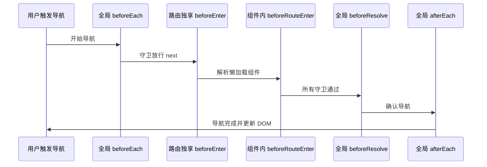

### V3-055：Vue Router4 相比 Vue Router3 有哪些变化？
**答**：
- 创建方式改为 `createRouter()` 工厂函数，history 模式用 `createWebHistory()`。
- 新增动态路由管理：`addRoute/removeRoute/hasRoute`，removeRoute 需要 name。
- 守卫第三参数 next 变为可选，可以直接 return false 或路由地址完成控制。
- `*` 通配路由被移除，改用 `/:pathMatch(.*)*` 自定义正则；所有导航返回 Promise。

```typescript
// router/index.ts
import { createRouter, createWebHistory, createWebHashHistory } from "vue-router";
import type { RouteRecordRaw } from "vue-router";

const routes: RouteRecordRaw[] = [
  { path: "/", component: () => import("../views/Home.vue") },
  { path: "/about", component: () => import("../views/About.vue") },
];

// Vue3 用工厂函数创建，不再支持 new Router()
const router = createRouter({
  history: createWebHistory(), // hash 模式用 createWebHashHistory()
  routes,
});

// 动态增删路由
router.addRoute({
  path: "/dynamic",
  name: "Dynamic",
  component: () => import("../views/Dynamic.vue"),
});
router.removeRoute("Dynamic"); // 按 name 移除

export default router;
```

### V3-056：如何实现基于权限的动态路由？
**答**：
- 静态路由（登录页、404）先注册；登录后按用户角色把 asyncRoutes 通过 addRoute 注入。
- 全局守卫里判断 token：无 token 重定向登录页；有 token 但未注册动态路由时先注册再重放导航。
- 重放必须 `next({ ...to, replace: true })`，否则刚注册的路由匹配不到。
- 404 兜底路由要放在动态注册之后，或用 catchAll 处理。

```typescript
// permission.ts —— 登录后按权限动态注册路由
import { router } from "./index";
import type { RouteRecordRaw } from "vue-router";

const asyncRoutes: RouteRecordRaw[] = [
  {
    path: "/admin",
    name: "Admin",
    component: () => import("../views/Admin.vue"),
    meta: { requiresAuth: true, roles: ["admin"] },
  },
];

router.beforeEach(async (to, _from, next) => {
  const token = localStorage.getItem("token");

  if (to.path === "/login") return next();
  if (!token) return next("/login");

  // 首次导航时注册动态路由，再重新进入目标路由
  if (!router.hasRoute("Admin")) {
    asyncRoutes.forEach((route) => router.addRoute(route));
    return next({ ...to, replace: true }); // 重新触发一次导航确保匹配
  }
  next();
});
```

### V3-057：路由懒加载是怎么实现的？
**答**：
- component 传 `() => import('../views/X.vue')`，构建工具把每个组件拆成独立 chunk。
- 进入路由时才请求对应 chunk，降低首屏体积。
- webpack 可用 `/* webpackChunkName: "list" */` 命名 chunk，vite 自动按文件拆分。
- 配合 defineAsyncComponent 与路由级 code splitting 是首屏优化的常规手段。

```typescript
import { createRouter, createWebHistory } from "vue-router";

const router = createRouter({
  history: createWebHistory(),
  routes: [
    // 每个组件拆成独立 chunk，进入路由时才加载
    { path: "/", component: () => import("../views/Home.vue") },
    // webpack 环境下可命名 chunk
    {
      path: "/list",
      component: () => import(/* webpackChunkName: "list" */ "../views/List.vue"),
    },
  ],
});
```

### V3-058：完整描述一次导航中守卫的执行顺序。
**答**：
- 顺序：离开组件的 beforeRouteLeave -> 全局 beforeEach -> 路由独享 beforeEnter -> 组件内 beforeRouteEnter -> 全局 beforeResolve -> 确认导航 -> 全局 afterEach -> DOM 更新 -> beforeRouteEnter 的 next 回调。
- Router4 中守卫可以不写 next：return false 取消，return 路由对象重定向。
- afterEach 可以拿到 failure 参数，用于埋点统计失败导航。
- beforeRouteEnter 的 next 回调是唯一能访问组件实例的守卫位置。

```typescript
import { createRouter, createWebHistory } from "vue-router";

const router = createRouter({
  history: createWebHistory(),
  routes: [
    {
      path: "/admin",
      component: () => import("../views/Admin.vue"),
      beforeEnter: (to, from) => {
        // 路由独享守卫：在全局 beforeEach 之后执行
        console.log("route beforeEnter");
        return true; // return false 取消导航，返回路由地址则重定向
      },
    },
  ],
});

// 完整顺序：
// 0 离开组件 beforeRouteLeave -> 1 全局 beforeEach -> 2 路由独享 beforeEnter -> 3 组件内 beforeRouteEnter
// -> 4 全局 beforeResolve -> 5 确认导航 -> 6 全局 afterEach -> 7 DOM 更新
// -> 8 beforeRouteEnter 的 next 回调（此时组件实例才可用）

router.beforeEach((to, from) => {
  console.log("global beforeEach");
  if (to.meta.requiresAuth && !localStorage.getItem("token")) {
    return { path: "/login" }; // 返回值即重定向
  }
});

router.afterEach((to, from, failure) => {
  if (!failure) console.log("navigate to", to.fullPath);
});
```

### V3-059：组件内守卫在组合式 API 中怎么用？
**答**：
- onBeforeRouteUpdate：同一组件被复用、路由参数变化时触发（如 /user/1 到 /user/2）。
- onBeforeRouteLeave：离开当前路由时触发，适合"未保存提示"。
- 组件内没有 onBeforeRouteEnter，对应需求放在守卫的 next 回调或 onMounted 中处理。
- 两个钩子都支持 return false 取消导航。

```vue
<script setup lang="ts">
import { onBeforeRouteLeave, onBeforeRouteUpdate } from "vue-router";

// 表单未保存时离开提示
onBeforeRouteLeave((to, from) => {
  const dirty = true;
  if (dirty && !window.confirm("确定离开？未保存的内容将丢失")) {
    return false; // 取消导航
  }
});

// 同一组件复用时响应参数变化，如 /user/1 到 /user/2
onBeforeRouteUpdate((to, from) => {
  console.log("id changed", from.params.id, "->", to.params.id);
});
</script>

<template>
  <p>路由参数变化时请看控制台</p>
</template>
```

### V3-060：动态路由匹配与 scrollBehavior、meta 怎么使用？
**答**：
- 动态参数 `:id` 通过 `route.params` 读取；可用正则约束如 `:id(\\d+)`。
- Vue Router4 移除 `*` 通配，兜底用 `/:pathMatch(.*)*`。
- meta 存放路由元信息（标题、权限），配合守卫与 afterEach 做鉴权和标题设置。
- scrollBehavior 支持保存位置、锚点定位、平滑滚动。

```typescript
import { createRouter, createWebHistory } from "vue-router";

const router = createRouter({
  history: createWebHistory(),
  routes: [
    // 动态参数：/user/123 -> params.id = "123"
    { path: "/user/:id", component: () => import("../views/User.vue") },
    // 正则约束：只有数字才匹配
    { path: "/post/:id(\\d+)", component: () => import("../views/Post.vue") },
    // 兜底路由（Router4 不再支持 * 通配）
    { path: "/:pathMatch(.*)*", component: () => import("../views/NotFound.vue") },
  ],
  scrollBehavior(to, from, savedPosition) {
    if (savedPosition) return savedPosition; // 浏览器前进后退保持位置
    if (to.hash) return { el: to.hash, behavior: "smooth" }; // 锚点定位
    return { top: 0 };
  },
});

// meta 上存元信息，配合守卫做鉴权、埋点、标题设置
router.afterEach((to) => {
  document.title = (to.meta.title as string) ?? "默认标题";
});
```

## 第十六章 性能优化

### V3-061：v-memo 的作用是什么？怎么用？
**答**：
- v-memo 接收依赖数组，数组值不变时跳过该子树整个 vnode 的 diff。
- 适合"列表项大部分不变、个别交互频繁"的长列表优化。
- 通常与 v-for 搭配，依赖数组里放该项相关的判断条件。
- 依赖数组为 `[]` 时只渲染一次；注意依赖写错会导致不更新的 bug。

```vue
<script setup lang="ts">
import { ref } from "vue";

const items = ref(
  Array.from({ length: 1000 }, (_, i) => ({
    id: i,
    name: `item-${i}`,
  }))
);
const selectedId = ref(-1);
</script>

<template>
  <!-- item.id === selectedId 不变时，该节点的 diff 被整体跳过 -->
  <div v-for="item in items" :key="item.id" v-memo="[item.id === selectedId]">
    <span>{{ item.name }}</span>
    <button @click="selectedId = item.id">选中</button>
  </div>
</template>
```

### V3-062：Vue3 模板编译的三板斧是什么？
**答**：
- 静态提升 hoistStatic：静态 vnode 只创建一次，提到 render 函数外。
- patchFlag：动态节点带补丁标记，diff 只检查标记的类型（文本、class、props）。
- cacheHandler：内联事件处理函数缓存进 \_cache，避免每次渲染生成新函数导致子组件无谓更新。
- 三者共同构成 block tree 靶向更新体系。

```javascript
// 1 静态提升：静态 vnode 只创建一次，提到 render 函数外
const hoisted = createElementVNode("p", null, "静态文本", -1 /* HOISTED */);

// 2 patchFlag：节点带补丁标记，diff 时只检查标记的类型
// createElementVNode("span", null, ctx.msg, 1 /* TEXT */)

// 3 cacheHandler：内联事件被缓存到 _cache，父组件更新时不再生成新函数
function render(_ctx, _cache) {
  return (
    openBlock(),
    createElementBlock("div", null, [
      hoisted,
      createElementVNode(
        "button",
        {
          onClick:
            _cache[0] ||
            (_cache[0] = (...args) => _ctx.onClick && _ctx.onClick(...args)),
        },
        "提交"
      ),
    ])
  );
}
```

### V3-063：Vue3 的 tree-shaking 体现在哪里？
**答**：
- Vue3 所有 API 通过命名导入提供，未用到的 Transition、KeepAlive、v-model 指令等编译后直接被摇掉。
- Vue2 的全局 API 挂在 Vue 构造函数上，无法被 tree-shaking。
- 全局 API 改为具名导出：createApp、nextTick、useCssModule 等。
- 效果：基础 Hello World 体积明显小于 Vue2。

```typescript
import { createApp, ref, computed } from "vue";

// 按需引入：未用到的 Transition/KeepAlive/nextTick 等会被 tree-shaking 移除
const app = createApp({
  setup() {
    const count = ref(0);
    const double = computed(() => count.value * 2);
    return { count, double };
  },
});

// Vue2 的 API 挂在 Vue 原型上无法摇树；Vue3 全部具名导出，按需打包
app.mount("#app");
```

### V3-064：长列表渲染有哪些优化手段？
**答**：
- 虚拟滚动：只渲染可视区条目，数据量大时收益最大，可用 vue-virtual-scroller。
- 大数据用 shallowRef/shallowReactive 避免深层代理；只读展示用 v-once/v-memo。
- 分页/懒加载减少单次渲染量；KeepAlive 缓存列表页避免重复请求与渲染。
- 频繁变更的数据用防抖、非紧急更新放 requestIdleCallback。

```vue
<script setup lang="ts">
import { ref, computed, onMounted } from "vue";

// 虚拟滚动核心：只渲染可视区域的条目
const items = ref(Array.from({ length: 100000 }, (_, i) => i));
const itemHeight = 40;
const containerHeight = 400;
const scrollTop = ref(0);

const start = computed(() => Math.floor(scrollTop.value / itemHeight));
const visibleCount = computed(() => Math.ceil(containerHeight / itemHeight) + 1);
const visibleItems = computed(() =>
  items.value.slice(start.value, start.value + visibleCount.value)
);

function onScroll(e: Event) {
  scrollTop.value = (e.target as HTMLElement).scrollTop;
}

onMounted(() =>
  console.log("共", items.value.length, "条，仅渲染", visibleCount.value, "条")
);
</script>

<template>
  <div
    :style="{ height: containerHeight + 'px', overflow: 'auto' }"
    @scroll="onScroll"
  >
    <div :style="{ height: items.length * itemHeight + 'px', position: 'relative' }">
      <div
        v-for="(item, i) in visibleItems"
        :key="start + i"
        :style="{
          position: 'absolute',
          top: (start + i) * itemHeight + 'px',
          height: itemHeight + 'px',
        }"
      >
        {{ item }}
      </div>
    </div>
  </div>
</template>
```

## 第十七章 SSR 与 Nuxt

### V3-065：Vue SSR 的原理与优缺点是什么？
**答**：
- 服务端用 renderToString 把组件渲染成 HTML 字符串直接返回，首屏无需等待 JS 执行。
- 客户端 createSSRApp 挂载时不重建 DOM，而是 hydration"激活"已有 DOM 并接管事件。
- 优点：首屏快、SEO 友好；代价：服务器压力、开发约束增加（生命周期只执行部分、注意内存泄漏）。
- window/document 等浏览器 API 必须放在 onMounted 或客户端分支中访问。

```typescript
// SSR 核心流程：服务端 renderToString 生成 HTML -> 客户端 hydration 激活
import { createSSRApp } from "vue";
import { renderToString } from "vue/server-renderer";

function createAppInstance() {
  return createSSRApp({
    data: () => ({ count: 1 }),
    template: `<button @click="count++">{{ count }}</button>`,
  });
}

// 服务端：只执行一次，输出首屏 HTML
const html = await renderToString(createAppInstance());

// 客户端：createSSRApp + 挂载时不再重建 DOM，而是激活已有 DOM
// 注意：服务端每个请求要新建 app 实例，避免跨请求状态污染
// onMounted / onBeforeMount 只在客户端执行，浏览器 API 写在这些钩子里
```

### V3-066：Nuxt3 的核心概念有哪些？
**答**：
- 约定式路由：pages 目录自动生成路由，`pages/user/[id].vue` 对应动态参数。
- 自动导入：components、composables 目录下的内容无需 import。
- 数据获取用 useFetch/useAsyncData：服务端执行、结果注入 payload，客户端不重复请求。
- 渲染模式可配：SSR、SSG（nuxt generate）、ISR，还有 server/api 目录直接写后端接口。

```vue
<!-- pages/user/[id].vue -->
<script setup lang="ts">
const route = useRoute(); // Nuxt3 自动导入，无需 import
const { data: user, pending } = await useFetch<{ name: string }>(
  `/api/user/${route.params.id}`
);
// useFetch 在服务端执行并把结果注入 payload，客户端 hydration 时不重复请求
</script>

<template>
  <p v-if="pending">加载中...</p>
  <p v-else>{{ user?.name }}</p>
</template>
```

## 第十八章 custom renderer

### V3-067：什么是自定义渲染器？如何实现？
**答**：
- Vue3 把"vnode diff"与"平台 DOM 操作"解耦，createRenderer 接收一组宿主操作接口。
- 实现 createElement/insert/remove/patchProp/parentNode/nextSibling 等接口即可渲染到任意平台。
- 应用：canvas/WebGL 图形 UI、小程序适配、自定义终端渲染。
- @vue/runtime-core 提供 createRenderer，@vue/runtime-dom 是它的 DOM 默认实现。

```typescript
import { createRenderer, h } from "vue";

// 自定义渲染器：把 vnode 渲染到 canvas 而不是 DOM
const { createApp } = createRenderer({
  createElement(tag: string) {
    return { tag, children: [] as any[] }; // 此处应为平台节点的封装对象
  },
  insert(child: any, parent: any) {
    parent.children.push(child);
    draw(parent); // 实际绘制到 canvas
  },
  patchProp(el: any, key: string, prevValue: unknown, nextValue: unknown) {
    el[key] = nextValue; // 处理平台属性，如 fill、width
  },
  remove(el: any) {},
  parentNode(node: any) {
    return node.parent;
  },
  nextSibling(node: any) {
    return node.next;
  },
});

function draw(node: any) {
  console.log("draw", node.tag);
}

const app = createApp({
  render: () => h("rect", { fill: "red" }),
});
// createApp 来自 createRenderer 的返回值，宿主环境可以是 canvas、WebGL、小程序
```

## 第十九章 defineProps 泛型

### V3-068：泛型 defineProps 与 withDefaults 怎么用？
**答**：
- `defineProps<Props>()` 以类型为唯一数据源，编译器自动生成运行时 props 校验。
- 默认值用 withDefaults：引用类型的默认值必须写成工厂函数。
- 3.5+ 支持响应式 props 解构：`const { count = 0 } = defineProps<Props>()`。
- 编译器宏无需 import，且不能在普通 ts 文件中使用。

```vue
<script setup lang="ts">
interface Props {
  title: string;
  count?: number;
  tags?: string[];
}

// 泛型参数即类型声明，编译器自动生成运行时 props
const props = withDefaults(defineProps<Props>(), {
  count: 0,
  tags: () => [], // 引用类型默认值要返回函数
});

// 3.5+ 也可以用响应式解构代替 withDefaults：
// const { count = 0, tags = [] } = defineProps<Props>();
console.log(props.title);
</script>

<template>
  <h3>{{ title }} {{ count }}</h3>
</template>
```

## 第二十章 VueUse 常用

### V3-069：VueUse 有哪些常用函数？
**答**：
- 状态类：useLocalStorage/useSessionStorage（响应式存储）、useDark（暗色模式）。
- 副作用类：useDebounceFn/useThrottleFn、useEventListener（自动清理监听）。
- 感知类：useMouse、useIntersectionObserver（进入视口）、useResizeObserver。
- 它是组合式 API 最佳实践的集合，源码值得当作 composable 教材阅读。

```vue
<script setup lang="ts">
import {
  useLocalStorage, // 响应式 localStorage
  useDebounceFn, // 防抖函数
  useIntersectionObserver, // 元素进入视口
  useDark, // 暗色模式切换
  useMouse, // 鼠标位置
} from "@vueuse/core";
import { ref } from "vue";

const settings = useLocalStorage("settings", { theme: "light", lang: "zh" });
const search = useDebounceFn(
  (kw: string) => console.log("搜索：", kw),
  300
);
const { x, y } = useMouse();
const isDark = useDark();

// 图片进入视口后再加载
const target = ref<HTMLElement | null>(null);
const { stop } = useIntersectionObserver(target, ([entry]) => {
  if (entry?.isIntersecting) {
    console.log("进入视口，加载资源");
    stop();
  }
});
</script>

<template>
  <p>{{ x }}, {{ y }} - {{ settings.theme }} - {{ isDark }}</p>
  <input @input="search(($event.target as HTMLInputElement).value)" />
  <div ref="target">观察目标</div>
</template>
```

### V3-070：手写一个 VueUse 风格的 useTitle？
**答**：
- 输入兼容 `string | Ref<string>`，内部统一 unref 处理。
- watchEffect 自动追踪依赖并同步到 document.title，组件卸载自动停止。
- 返回一个可读写的 ref，外部改值即同步标签页标题。
- 模式可推广到 useFavicon、usePageVisibility 等 DOM 副作用类工具。

```typescript
// composables/useTitle.ts —— 仿 VueUse 的 useTitle
import { ref, watchEffect } from "vue";
import type { Ref } from "vue";

export function useTitle(newTitle: string | Ref<string> = document.title) {
  const title = ref(newTitle) as Ref<string>;

  watchEffect(() => {
    document.title = title.value; // 依赖变化自动同步
  });

  return title; // 返回 ref，读写都同步到 document.title
}

// 使用：
// const title = useTitle("首页");
// title.value = "详情页"; // 标签页标题同步变化
```

## 第二十一章 组件设计实战

组件设计实战聚焦可复用组件的 API 设计：泛型驱动列配置、快照回滚、双模式 v-model、三态容器等，是大厂组件库方向的高频考点。

### V3-071：如何设计一个泛型列表组件（用数据驱动列配置）？
**答**：
- 用 `generic="T"` 声明组件泛型，`Column<T>` 的 key 约束为 `keyof T & string`，列配置与数据结构在编译期强关联。
- 渲染策略：默认显示 `row[key]`，复杂单元格通过 `formatter` 函数自定义，纯展示场景不需要插槽。
- 行的 key 用业务 id（如 `row.id`），避免 index 导致的状态错位。
- 调用方：`<DataTable :rows="users" :columns="cols" />`，cols 声明为 `Column<User>[]`，改 User 字段名时 TS 直接报错。

```vue
<!-- components/DataTable.vue -->
<script setup lang="ts" generic="T extends { id: number | string }">
export interface Column<T> {
  key: keyof T & string; // key 必须是 T 的真实字段，编译期约束
  title: string;
  width?: number;
  formatter?: (row: T) => string; // 复杂单元格用函数渲染
}

defineProps<{
  rows: T[];
  columns: Column<T>[];
}>();

function cellText(row: T, col: Column<T>) {
  return col.formatter ? col.formatter(row) : String(row[col.key] ?? "");
}
</script>

<template>
  <table class="data-table">
    <thead>
      <tr>
        <th v-for="c in columns" :key="c.key" :style="{ width: c.width ? c.width + 'px' : undefined }">
          {{ c.title }}
        </th>
      </tr>
    </thead>
    <tbody>
      <tr v-for="row in rows" :key="row.id">
        <td v-for="c in columns" :key="c.key">{{ cellText(row, c) }}</td>
      </tr>
    </tbody>
  </table>
</template>
```

### V3-072：如何实现一个可撤销的表单组件（快照回滚）？
**答**：
- 核心思路：对整个表单 state 做 JSON 快照，维护 undoStack 与 redoStack 两个栈。
- watch 深度监听表单变化时自动压栈，超过上限移除最早快照；产生新操作时清空 redo 栈。
- 回滚时先置 paused 暂停监听，再 `Object.assign` 恢复，nextTick 后恢复监听，避免回滚本身又生成快照造成互相污染。
- 大表单可用 structuredClone 或 immer 优化深拷贝成本，思路不变。

```vue
<!-- components/UndoableForm.vue -->
<script setup lang="ts">
import { nextTick, reactive, ref, watch } from "vue";

interface FormState {
  name: string;
  age: number;
  tags: string[];
}

const props = defineProps<{ maxSnapshots?: number }>();
const max = props.maxSnapshots ?? 50;

const form = reactive<FormState>({ name: "", age: 18, tags: [] });
const undoStack = ref<string[]>([]);
const redoStack = ref<string[]>([]);
const paused = ref(false); // 回滚期间暂停快照，防止污染栈

watch(
  form,
  () => {
    if (paused.value) return;
    undoStack.value.push(JSON.stringify(form));
    if (undoStack.value.length > max) undoStack.value.shift();
    redoStack.value = []; // 产生新编辑即清空 redo
  },
  { deep: true }
);

function apply(snapshot: string) {
  paused.value = true;
  Object.assign(form, JSON.parse(snapshot));
  nextTick(() => (paused.value = false));
}

function undo() {
  const last = undoStack.value.pop();
  if (!last) return;
  redoStack.value.push(JSON.stringify(form));
  apply(last);
}

function redo() {
  const next = redoStack.value.pop();
  if (!next) return;
  undoStack.value.push(JSON.stringify(form));
  apply(next);
}

defineExpose({ undo, redo, form });
</script>

<template>
  <input v-model="form.name" placeholder="姓名" />
  <input v-model.number="form.age" type="number" />
  <button :disabled="!undoStack.length" @click="undo">撤销</button>
  <button :disabled="!redoStack.length" @click="redo">重做</button>
</template>
```

### V3-073：如何实现一个虚拟滚动选择器？
**答**：
- 只渲染可视区附近的条目：根据 scrollTop 计算起始索引，外层用总高度占位撑出真实滚动条。
- 已渲染区整体 translateY 偏移到起始位置，DOM 数量从 N 降到常数级（上下各多渲染几条缓冲）。
- itemHeight 固定时计算是纯除法；行高不固定需要先测量再缓存，或退化为等高估算。
- 选择状态单独维护 selectedId，不受虚拟区裁剪影响。

```vue
<!-- components/VirtualSelect.vue -->
<script setup lang="ts" generic="T extends { id: number | string; label: string }">
import { computed, ref } from "vue";

const props = withDefaults(
  defineProps<{ options: T[]; itemHeight?: number; viewportHeight?: number }>(),
  { itemHeight: 40, viewportHeight: 240 }
);

const scrollTop = ref(0);
const selectedId = ref<number | string | null>(null);

const BUFFER = 3; // 上下各多渲染 3 条缓冲
const range = computed(() => {
  const start = Math.max(0, Math.floor(scrollTop.value / props.itemHeight) - BUFFER);
  const count = Math.ceil(props.viewportHeight / props.itemHeight) + BUFFER * 2;
  return { start, end: Math.min(props.options.length, start + count) };
});

const visibleOptions = computed(() => props.options.slice(range.value.start, range.value.end));
const totalHeight = computed(() => props.options.length * props.itemHeight + "px");
const offsetStyle = computed(() => ({ transform: `translateY(${range.value.start * props.itemHeight}px)` }));

function onScroll(e: Event) {
  scrollTop.value = (e.target as HTMLElement).scrollTop;
}
function select(opt: T) {
  selectedId.value = opt.id;
}
</script>

<template>
  <div class="viewport" :style="{ height: viewportHeight + 'px', overflow: 'auto' }" @scroll="onScroll">
    <div :style="{ height: totalHeight, position: 'relative' }">
      <ul :style="offsetStyle">
        <li
          v-for="opt in visibleOptions"
          :key="opt.id"
          :style="{ height: itemHeight + 'px' }"
          :class="{ active: opt.id === selectedId }"
          @click="select(opt)"
        >
          {{ opt.label }}
        </li>
      </ul>
    </div>
  </div>
</template>
```

### V3-074：如何设计一个带加载、错误、空态的三态容器组件（AsyncBoundary）？
**答**：
- 组件只关心状态不关心数据：props 声明 loading、error、empty 三个状态位，用作用域插槽分发内容与错误对象。
- 优先级固定：loading > error > empty > 正常内容，调用方无需写一串 v-if。
- 每个状态都提供默认插槽内容，同时允许 slot 覆盖，实现“默认可用、按需定制”。
- 可扩展 retry 事件：error 态下点击重试由容器 emit，数据获取逻辑仍留在调用方。

```vue
<!-- components/AsyncBoundary.vue -->
<script setup lang="ts">
defineProps<{
  loading: boolean;
  error: Error | null;
  empty?: boolean;
}>();

defineEmits<{ retry: [] }>();
</script>

<template>
  <div class="async-boundary">
    <slot v-if="loading" name="loading">
      <p class="tip">加载中…</p>
    </slot>
    <slot v-else-if="error" name="error" :error="error">
      <p class="tip error">
        加载失败：{{ error.message }}
        <button @click="$emit('retry')">重试</button>
      </p>
    </slot>
    <slot v-else-if="empty" name="empty">
      <p class="tip">暂无数据</p>
    </slot>
    <slot v-else />
  </div>
</template>
```

### V3-075：如何设计受控与非受控双模式组件？
**答**：
- 受控：父组件传 `modelValue`，值完全由父组件决定；非受控：父组件只传 `defaultModelValue`，组件内部自治。
- 关键判断：`props.modelValue !== undefined` 即认为受控，否则读内部 ref。
- 更新函数双写：始终写内部 ref（保证非受控可用），同时 emit `update:modelValue`（保证受控同步）。
- 切换为受控后内部值被覆盖，这是“合法双写”的原因：写内部值永远不会破坏受控语义。

```vue
<!-- components/Stepper.vue -->
<script setup lang="ts">
import { computed, ref } from "vue";

const props = withDefaults(
  defineProps<{
    modelValue?: number; // 受控值：传了就是受控模式
    defaultModelValue?: number; // 非受控初始值
    step?: number;
  }>(),
  { step: 1 }
);

const emit = defineEmits<{ "update:modelValue": [value: number] }>();

const inner = ref(props.defaultModelValue ?? 0); // 非受控内部状态

const value = computed(() =>
  props.modelValue !== undefined ? props.modelValue : inner.value
);

function update(v: number) {
  inner.value = v; // 双写一：非受控模式生效
  emit("update:modelValue", v); // 双写二：受控模式由父组件接管
}
</script>

<template>
  <div class="stepper">
    <button @click="update(value - step)">-</button>
    <span>{{ value }}</span>
    <button @click="update(value + step)">+</button>
  </div>
</template>
```

### V3-076：unplugin-vue-components 的按需自动导入原理是什么？
**答**：
- 编译期方案：拦截 `.vue` 编译，扫描模板中出现的自定义标签名，与本地组件目录或 resolvers 注册表匹配。
- 匹配成功后把 `import XxxButton from '...'` 注入到编译产物中，并生成 `components.d.ts` 让 TS 认识这些全局组件。
- 与运行时全局注册相比：产物只包含真正用到的组件，天然支持 tree-shaking 与组件库样式按需加载。
- resolvers 的意义：约定形如 `ElButton -> element-plus` 的映射规则，把组件名翻译成库内部的导入路径。

```javascript
// unplugin-vue-components 核心逻辑示意（简化伪代码）
export function ComponentsPlugin({ resolvers = [], dirs = ["src/components"] }) {
  return {
    name: "unplugin-vue-components",
    transform(code, id) {
      if (!id.endsWith(".vue")) return null;

      // 1. 扫描模板中的自定义标签，如 <MyButton />、<ElButton />
      const tagNames = extractTemplateTags(code).filter(isCustomTag);

      // 2. 逐个解析：先找本地组件目录，再走组件库 resolver
      const imports = tagNames
        .map((name) => resolveLocal(dirs, name) ?? resolveByResolvers(resolvers, name))
        .filter(Boolean);

      if (!imports.length) return null;

      // 3. 把 import 语句注入编译产物，并同步生成 components.d.ts
      const importCode = imports
        .map((i) => `import ${i.name} from '${i.path}';`)
        .join("\n");
      return injectBeforeScript(code, importCode);
    },
  };
}

// ElButton 的 resolver 示意：组件名翻译成库内真实路径 + 样式文件
export function ElementPlusResolver() {
  return {
    type: "component",
    resolve(name) {
      if (!name.startsWith("El")) return null;
      return {
        name,
        path: `element-plus/es`,
        sideEffects: `element-plus/theme-chalk/el-${toKebab(name)}.css`, // 样式按需
      };
    },
  };
}
```

### V3-077：组件库如何做 Provide/Inject 的类型安全封装？
**答**：
- 用 `InjectionKey<T>` 作为 provide 的 key，inject 时自动推导出上下文类型，杜绝 string key 的 any。
- 封装成 `provideXxx` / `useXxx` 一对函数：provide 负责注入，use 负责取用并做缺失兜底。
- 缺失时抛出带指引的错误（“必须在外层调用 provideXxx”），把运行时问题前移到开发期。
- key 用 Symbol 保证唯一，避免跨库同名冲突。

```typescript
// context/useFormContext.ts
import { inject, provide, type InjectionKey } from "vue";

export interface FormContext {
  model: Record<string, unknown>;
  disabled: boolean;
  validateField: (prop: string) => Promise<boolean>;
}

export const formKey: InjectionKey<FormContext> = Symbol("form-context");

// 提供方：表单容器组件里调用
export function provideFormContext(ctx: FormContext) {
  provide(formKey, ctx);
}

// 消费方：表单控件里调用，类型自动推导为 FormContext
export function useFormContext() {
  const ctx = inject(formKey);
  if (!ctx) {
    throw new Error("useFormContext 必须在 provideFormContext 之后的组件树中使用");
  }
  return ctx;
}

// 组件里使用：
// const { model, validateField } = useFormContext();
// await validateField("username"); // 类型完整，无需断言
```

## 第二十二章 组合式函数库设计

手写 useRequest / useFetch / usePagination 等组合式函数是 Vue3 面试的压轴高频题，考察异步竞态、生命周期清理与类型设计。

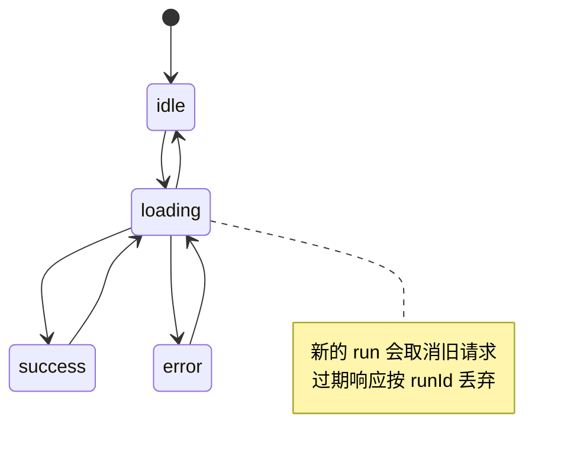

### V3-078：手写一个 useRequest（加载、错误、取消、缓存）？
**答**：
- 四个核心状态：data（shallowRef 避免大对象深度代理）、loading、error，外加 run/cancel 两个动作。
- 防竞态：每次 run 生成自增 runId，响应返回时 runId 不一致直接丢弃；同时用 AbortController 真正中断上一个请求。
- 缓存层：以序列化后的 params 作 key 存 Map，命中缓存先回填数据再决定是否静默刷新。
- 卸载清理：onScopeDispose 里自动 cancel，防止组件销毁后写状态。

```typescript
// composables/useRequest.ts
import { onScopeDispose, ref, shallowRef } from "vue";

interface Options<T> {
  immediate?: boolean;
  initialData?: T | null;
  cacheKey?: (params?: unknown) => string; // 传入即启用缓存
  onSuccess?: (data: T) => void;
  onError?: (e: Error) => void;
}

export function useRequest<T>(
  fetcher: (params?: unknown) => Promise<T>,
  options: Options<T> = {}
) {
  const data = shallowRef<T | null>(options.initialData ?? null);
  const loading = ref(false);
  const error = ref<Error | null>(null);

  const cache = new Map<string, T>();
  let controller: AbortController | null = null;
  let runId = 0;

  async function run(params?: unknown) {
    // 缓存命中：先回填再刷新，页面秒开
    const key = options.cacheKey?.(params);
    if (key && cache.has(key)) {
      data.value = cache.get(key)!;
    }

    controller?.abort(); // 取消上一次未完成请求
    controller = new AbortController();
    const id = ++runId;

    loading.value = true;
    error.value = null;
    try {
      const res = await fetcher(params);
      if (id !== runId) return; // 过期响应直接丢弃，防竞态
      data.value = res;
      if (key) cache.set(key, res);
      options.onSuccess?.(res);
    } catch (e) {
      if (id !== runId) return;
      error.value = e as Error;
      options.onError?.(e as Error);
    } finally {
      if (id === runId) loading.value = false;
    }
  }

  function cancel() {
    controller?.abort();
    runId++; // 让还在路上的响应全部失效
    loading.value = false;
  }

  if (options.immediate !== false) run();
  onScopeDispose(cancel); // 组件卸载自动取消

  return { data, loading, error, run, cancel };
}
```

### V3-079：手写 useFetch，如何解决接口竞态问题？
**答**：
- 竞态场景：先请求 A 后请求 B，A 的慢响应后到，覆盖了 B 的新数据。
- 双保险：AbortController 中断旧请求（省流量）+ 局部 isCurrent 标记丢弃过期响应（防中断失败）。
- URL 变化用 watch 触发重新请求，immediate 立即执行一次。
- 可选 keepPreviousData：翻页时保留旧数据避免白屏，配合 loading 展示遮罩。

```typescript
// composables/useFetch.ts
import { ref, shallowRef, watch, type Ref } from "vue";

export function useFetch<T>(url: Ref<string>, keepPreviousData = false) {
  const data = shallowRef<T | null>(null);
  const loading = ref(false);
  const error = ref<Error | null>(null);
  let controller: AbortController | null = null;

  async function exec(currentUrl: string) {
    controller?.abort(); // 中断上一次请求
    const localController = new AbortController();
    controller = localController;

    loading.value = true;
    error.value = null;
    if (!keepPreviousData) data.value = null;

    try {
      const res = await fetch(currentUrl, { signal: localController.signal });
      if (!res.ok) throw new Error(`HTTP ${res.status}`);
      const json = (await res.json()) as T;
      if (localController !== controller) return; // 已有更新的请求，过期响应丢弃
      data.value = json;
    } catch (e) {
      if (localController !== controller) return; // 被 abort 的请求不算错误
      error.value = e as Error;
    } finally {
      if (localController === controller) loading.value = false;
    }
  }

  watch(url, (u) => exec(u), { immediate: true });

  return { data, loading, error };
}
```

### V3-080：手写一个 usePagination？
**答**：
- 状态：page、pageSize、list、total、loading 统一放 reactive，翻页、改每页条数、重置都收敛到函数。
- 关键细节：改 pageSize 必须把 page 重置为 1，否则可能停在超出总页数的页码。
- runId 防竞态：快速翻页时只保留最后一次响应。
- 暴露 refresh 刷新当前页、reset 回到第一页重查。

```typescript
// composables/usePagination.ts
import { computed, reactive } from "vue";

interface PageResult<T> {
  list: T[];
  total: number;
}

export function usePagination<T>(
  fetcher: (p: { page: number; pageSize: number }) => Promise<PageResult<T>>,
  defaultPageSize = 10
) {
  const state = reactive({
    page: 1,
    pageSize: defaultPageSize,
    list: [] as T[],
    total: 0,
    loading: false,
  });

  const pageCount = computed(() => Math.max(1, Math.ceil(state.total / state.pageSize)));
  let runId = 0;

  async function load() {
    const id = ++runId;
    state.loading = true;
    try {
      const res = await fetcher({ page: state.page, pageSize: state.pageSize });
      if (id !== runId) return; // 快速翻页时丢弃过期响应
      state.list = res.list;
      state.total = res.total;
    } finally {
      if (id === runId) state.loading = false;
    }
  }

  function go(page: number) {
    state.page = Math.min(Math.max(1, page), pageCount.value); // 边界钳制
    return load();
  }

  function changePageSize(size: number) {
    state.pageSize = size;
    state.page = 1; // 改每页条数必须回到第一页
    return load();
  }

  function reset() {
    state.page = 1;
    return load();
  }

  return { state, pageCount, load, go, changePageSize, reset };
}
```

### V3-081：手写 useDebouncedRef 与 useThrottledRef？
**答**：
- 都基于 customRef 实现：在 get 里正常收集依赖，在 set 里按策略延迟同步。
- useDebouncedRef：set 后 delay 内没有新写入才真正更新，适合搜索输入。
- useThrottledRef：首次写入立即生效，之后 gap 时间内的写入只保留最后一次，适合滚动/鼠标等高频事件。
- 与 V3-013 的防抖输入不同，这里是通用 ref 工具，可在任何数据源上复用。

```typescript
// composables/useCustomRefs.ts
import { customRef, type Ref } from "vue";

export function useDebouncedRef<T>(initial: T, delay = 300): Ref<T> {
  let value = initial;
  let timer: ReturnType<typeof setTimeout> | undefined;
  let trackFn: () => void;
  let triggerFn: () => void;

  return customRef((track, trigger) => {
    trackFn = track;
    triggerFn = trigger;
    return {
      get() {
        track();
        return value;
      },
      set(newValue: T) {
        clearTimeout(timer);
        timer = setTimeout(() => {
          value = newValue;
          triggerFn(); // 延迟后真正触发更新
        }, delay);
      },
    };
  });
}

export function useThrottledRef<T>(initial: T, gap = 200): Ref<T> {
  let value = initial;
  let pending: T | undefined;
  let lastTime = 0;
  let timer: ReturnType<typeof setTimeout> | undefined;
  let trackFn: () => void;
  let triggerFn: () => void;

  function flush() {
    if (pending === undefined) return;
    value = pending;
    pending = undefined;
    lastTime = Date.now();
    triggerFn();
  }

  return customRef((track, trigger) => {
    trackFn = track;
    triggerFn = trigger;
    return {
      get() {
        track();
        return value;
      },
      set(newValue: T) {
        pending = newValue;
        const rest = gap - (Date.now() - lastTime);
        if (rest <= 0) {
          flush(); // 间隔已到，立即生效
        } else {
          clearTimeout(timer);
          timer = setTimeout(flush, rest); // 间隔内只保留最后一次写入
        }
      },
    };
  });
}
```

### V3-082：手写一个类型安全的 useEventBus（自动 off）？
**答**：
- 用泛型映射类型约束事件名与 payload 类型：`Events extends Record<string, unknown>`，emit/on 双端都受编译期检查。
- createEventBus 内部用 Map<string, Set<Function>> 存储订阅，同一事件多订阅者互不影响。
- useEventBus 订阅即返回，组件卸载时 onScopeDispose 自动 off，杜绝手写解绑造成的内存泄漏。
- 返回的 off 也可提前手动解绑。

```typescript
// composables/useEventBus.ts
import { onScopeDispose } from "vue";

export interface EventBus<Events extends Record<string, unknown>> {
  on<K extends keyof Events>(type: K, handler: (payload: Events[K]) => void): void;
  off<K extends keyof Events>(type: K, handler: (payload: Events[K]) => void): void;
  emit<K extends keyof Events>(type: K, payload: Events[K]): void;
}

export function createEventBus<Events extends Record<string, unknown>>(): EventBus<Events> {
  const map = new Map<keyof Events, Set<(payload: never) => void>>();
  return {
    on(type, handler) {
      if (!map.has(type)) map.set(type, new Set());
      map.get(type)!.add(handler as (payload: never) => void);
    },
    off(type, handler) {
      map.get(type)?.delete(handler as (payload: never) => void);
    },
    emit(type, payload) {
      map.get(type)?.forEach((handler) => (handler as (p: unknown) => void)(payload));
    },
  };
}

// 事件表：key 是事件名，value 是 payload 类型
interface AppEvents {
  "user:login": { id: number; name: string };
  "cart:changed": { count: number };
}

const bus = createEventBus<AppEvents>();

// 组件里使用：卸载自动解绑
export function useEventBus<K extends keyof AppEvents>(
  type: K,
  handler: (payload: AppEvents[K]) => void
) {
  bus.on(type, handler);
  onScopeDispose(() => bus.off(type, handler)); // 自动清理，防泄漏
  return () => bus.off(type, handler); // 也可提前手动解绑
}
```

### V3-083：手写 useStorage，如何实现跨标签页同步？
**答**：
- 本地值：ref 初始化时从 localStorage 读，读不到用默认值，JSON 反序列化带 try/catch 容错。
- 写入：watch 深度监听，序列化回写 localStorage。
- 跨页同步：监听 window 的 storage 事件——其它标签页修改同名 key 时会触发本页的 storage（注意本页自己写不触发）。
- 卸载时移除监听，避免重复绑定。

```typescript
// composables/useStorage.ts
import { onScopeDispose, ref, toRaw, watch } from "vue";

export function useStorage<T>(key: string, initial: T) {
  function read(): T {
    try {
      const raw = localStorage.getItem(key);
      return raw === null ? initial : (JSON.parse(raw) as T);
    } catch {
      return initial; // 反序列化失败时退回默认值
    }
  }

  const data = ref<T>(read()) as { value: T };

  watch(
    data,
    () => {
      localStorage.setItem(key, JSON.stringify(toRaw(data.value)));
    },
    { deep: true }
  );

  // 其它标签页修改了同一个 key 时同步到本页
  function onStorage(e: StorageEvent) {
    if (e.key !== key || e.newValue === null) return;
    try {
      data.value = JSON.parse(e.newValue);
    } catch {
      /* 忽略非法数据 */
    }
  }

  window.addEventListener("storage", onStorage);
  onScopeDispose(() => window.removeEventListener("storage", onStorage));

  return data;
}

// 使用：
// const settings = useStorage("settings", { theme: "light" });
// 两个标签页里改 settings 会互相同步
```

### V3-084：手写一个规范的 useMousePosition（rAF 节流 + 卸载清理）？
**答**：
- 在 V3-023 基础版上强化两点工程规范：高频事件用 rAF 节流、副作用完整清理。
- mousemove 每秒可触发上百次，用 pending 标记把写入压缩到每帧一次，rAF 回调里才真正更新 ref。
- passive: true 声明监听器不调用 preventDefault，滚动性能更好。
- 卸载清理必须做三件事：removeEventListener、cancelAnimationFrame、复位 pending。

```typescript
// composables/useMouse.ts
import { onScopeDispose, ref } from "vue";

export function useMouse() {
  const x = ref(0);
  const y = ref(0);

  let rafId = 0;
  let pending = false;
  let lastEvent: MouseEvent | null = null;

  function onMove(e: MouseEvent) {
    lastEvent = e;
    if (pending) return; // 这一帧已排入队列，合并后续事件
    pending = true;
    rafId = requestAnimationFrame(() => {
      if (lastEvent) {
        x.value = lastEvent.clientX;
        y.value = lastEvent.clientY;
      }
      pending = false;
    });
  }

  window.addEventListener("mousemove", onMove, { passive: true });

  onScopeDispose(() => {
    window.removeEventListener("mousemove", onMove);
    cancelAnimationFrame(rafId); // 取消尚未执行的帧
    pending = false;
    lastEvent = null;
  });

  return { x, y };
}
```

## 第二十三章 状态管理实战

Pinia 在大型项目里的组织方式、循环依赖、持久化插件、与路由和 TanStack Query 的配合，是状态管理方向的进阶高频题。

### V3-085：大型项目里 Pinia 如何模块化组织（分层 store 设计）？
**答**：
- 按业务域拆分 store，而不是一个巨型 index：跨页面共享的放 modules，页面级临时状态放 views。
- 目录约定：`stores/modules`（user/order 等长期驻留）、`stores/views`（checkout 等可随路由销毁）、`stores/plugins`（persist/logger）。
- 判据：状态被两个以上页面共享才进 modules，否则放组件或页面级 store。
- 全部用 setup store 写法，与组合式 API 心智一致，TS 推导也最好。

```typescript
// stores/index.ts —— 分层组织的入口
import { createPinia } from "pinia";
import { persistPlugin } from "./plugins/persist";

export const pinia = createPinia();
pinia.use(persistPlugin);

// 推荐目录结构：
// stores/
//   modules/   —— 业务域 store：user.ts order.ts product.ts（跨页面共享，长期驻留）
//   views/     —— 页面级临时 store：checkout.ts（只服务单个页面，可随路由销毁）
//   plugins/   —— persist.ts logger.ts
// 原则：被两个以上页面共享的状态才进 modules，否则放组件内部或 views 层

// stores/modules/user.ts
import { defineStore } from "pinia";
import { computed, ref } from "vue";

export const useUserStore = defineStore("user", () => {
  const token = ref("");
  const profile = ref<{ name: string; role: string } | null>(null);
  const isVip = computed(() => profile.value?.role === "vip");
  return { token, profile, isVip };
});

// stores/views/checkout.ts —— 页面级 store 示例
export const useCheckoutStore = defineStore("checkout", () => {
  const submitting = ref(false);
  return { submitting };
});
```

### V3-086：Pinia store 互相引用出现循环依赖怎么办？
**答**：
- 错误写法：store A 在 setup 顶层调用 `useBStore()`，B 又在顶层调用 `useAStore()`，模块加载期互相等待拿到 undefined。
- 正确写法：把 `useBStore()` 的调用推迟到 getter/action 的函数体内部，运行时才解析依赖，模块级循环自然解开。
- setup store 顶层也可以留，但只允许“单向”引用；出现环就必须下放到回调内。
- 更彻底的解法：把公共状态抽到第三个 store，消掉这条环。

```typescript
// stores/modules/cart.ts —— 通过延迟调用 useUserStore() 解开循环依赖
import { defineStore } from "pinia";
import { computed } from "vue";
import { useUserStore } from "./user"; // user.ts 里也 import 了 cart.ts，模块级成环

export const useCartStore = defineStore("cart", () => {
  // 正确：在 getter 回调内部才调用 useUserStore()，运行时解析，循环依赖自动解开
  const discount = computed(() => {
    const user = useUserStore();
    return user.isVip ? 0.9 : 1;
  });

  async function checkout() {
    const user = useUserStore(); // action 内同理
    if (!user.token) throw new Error("请先登录");
    // ...提交结算
  }

  return { discount, checkout };
});

// 错误示例（不要这样写）：
// const user = useUserStore(); // setup 顶层调用且与 user.ts 互相 import
//                              // 模块加载期一边还没初始化，拿到 undefined

// 更彻底的解法：把环上公共的部分（如会员等级）抽成独立 membership store
```

### V3-087：手写一个 Pinia 持久化插件？
**答**：
- Pinia 插件签名：接收 `{ store, options }`，options 是 store 定义时写的自定义字段（需 TS 模块扩充声明）。
- 恢复：初始化时读 localStorage，有旧值就 `$patch` 进 store。
- 保存：`store.$subscribe` 监听任意状态变更，序列化写回；支持 paths 只持久化白名单字段。
- 敏感字段（token 除外）不要持久化；也可以换成 sessionStorage 或加过期时间。

```typescript
// stores/plugins/persist.ts
import type { PiniaPluginContext } from "pinia";

// 类型扩充：让 defineStore 第三个参数认识 persist 选项
declare module "pinia" {
  export interface DefineStoreOptionsBase<S, Store> {
    persist?: { paths?: (keyof S)[] };
  }
}

export function persistPlugin({ store, options }: PiniaPluginContext) {
  const conf = (options as { persist?: { paths?: string[] } }).persist;
  if (!conf) return; // 没声明 persist 的 store 直接跳过

  const key = `pinia:${store.$id}`;

  // 1. 恢复：初始化时把旧数据 patch 回去
  const raw = localStorage.getItem(key);
  if (raw) {
    try {
      store.$patch(JSON.parse(raw));
    } catch {
      localStorage.removeItem(key);
    }
  }

  // 2. 保存：订阅状态变化写回，只存白名单字段
  store.$subscribe(() => {
    const state = store.$state as Record<string, unknown>;
    const picked = conf.paths
      ? Object.fromEntries(conf.paths.filter((p) => p in state).map((p) => [p, state[p]]))
      : state;
    localStorage.setItem(key, JSON.stringify(picked));
  });
}

// 使用：
// defineStore("user", { ... }, { persist: { paths: ["token", "profile"] } })
```

### V3-088：Pinia 如何与路由联动实现登录态守卫？
**答**：
- 全局守卫 beforeEach 里调用 `useUserStore()`：必须在 pinia 安装之后执行，守卫函数运行时调用即天然满足时序。
- 未登录访问受保护页：重定向登录页并携带 redirect 参数，登录成功后跳回原页面。
- 已登录但 profile 为空：先拉取用户信息再放行，防止刷新后身份信息缺失。
- 防死循环：登录页本身 requiresAuth 必须为 false。

```typescript
// router/guards.ts —— 登录态守卫
import { router } from "./index";
import { useUserStore } from "@/stores/modules/user";

router.beforeEach(async (to) => {
  const user = useUserStore(); // 守卫执行时 pinia 已安装，可安全调用

  // 1. 未登录访问受保护页面
  if (to.meta.requiresAuth && !user.token) {
    return { path: "/login", query: { redirect: to.fullPath } };
  }

  // 2. 已登录但刷新后缺少用户信息，先补拉
  if (user.token && !user.profile) {
    try {
      await user.fetchProfile();
    } catch {
      user.logout(); // token 失效则登出并回登录页
      return { path: "/login", query: { redirect: to.fullPath } };
    }
  }
  // 返回 undefined 或 true 表示放行
});

// 登录成功后的跳回逻辑（登录页里）：
// const redirect = route.query.redirect as string | undefined;
// router.replace(redirect ?? "/");
```

### V3-089：乐观更新在 Pinia 里如何封装（失败回滚）？
**答**：
- 乐观更新：请求发出前先改本地状态，用户零等待感知；成功后用服务端数据替换，失败则回滚。
- 关键是保留原状态快照（或记录插入位置），catch 里精确还原。
- 临时项用 `tmp-` 前缀 id 标记 pending 态，UI 可展示“发送中”。
- 并发场景下回滚要按引用定位，不能按 index（前面可能又插入了新项）。

```typescript
// stores/modules/comments.ts —— 乐观更新 + 失败回滚
import { defineStore } from "pinia";
import { ref } from "vue";
import { createComment, type Comment } from "@/services/comments";

export const useCommentStore = defineStore("comments", () => {
  const list = ref<Comment[]>([]);

  async function addComment(text: string) {
    // 1. 乐观插入临时项，UI 立即展示
    const temp: Comment = { id: `tmp-${Date.now()}`, text, pending: true };
    list.value.push(temp);

    // 2. 记录回滚动作：按引用定位，避免并发下 index 漂移
    const rollback = () => {
      const index = list.value.indexOf(temp);
      if (index > -1) list.value.splice(index, 1);
    };

    try {
      // 3. 服务端成功后用真实数据替换临时项
      const saved = await createComment(text);
      const index = list.value.indexOf(temp);
      if (index > -1) list.value.splice(index, 1, saved);
    } catch (e) {
      rollback(); // 4. 失败回滚，并向上抛出让 UI 提示
      throw e;
    }
  }

  return { list, addComment };
});
```

### V3-090：服务端数据放 Pinia 还是 TanStack Query？如何决策？
**答**：
- 核心判据：数据归谁所有。服务端数据（列表、详情）归 Query 管——缓存、去重、重试、失效更新都是现成的；客户端状态（购物车、UI 开关、表单草稿）归 Pinia 管。
- 反模式：把接口数据复制进 Pinia，等于手写一遍缓存层，还要自己处理失效与竞态。
- 两者协作：Query 拉数据 → 关键结果写入 Pinia 供全局消费；或 Pinia 存查询参数，Query 用参数作 queryKey。
- 引入 Query 前先评估规模：少量接口时 useRequest 已够，多页面共享大量服务端数据时 Query 收益明显。

```typescript
// composables/useProducts.ts —— 决策落地：服务端数据归 Query，客户端状态归 Pinia
import { useQuery } from "@tanstack/vue-query";
import type { Ref } from "vue";
import { useCartStore } from "@/stores/modules/cart";

// 服务端数据：缓存、重试、失效都由 Query 管理，不复制进 Pinia
export function useProductList(keyword: Ref<string>) {
  return useQuery({
    queryKey: ["products", keyword], // keyword 变化自动重新请求并各自缓存
    queryFn: () => fetchProducts(keyword.value),
    staleTime: 60_000, // 60 秒内视为新鲜，不重复请求
  });
}

// 客户端状态：购物车是纯前端状态，留在 Pinia
export function useAddToCart() {
  const cart = useCartStore();
  return (productId: string) => cart.add(productId);
}

// 服务端状态要参与全局派生时（如角标数量），才把结果同步进 Pinia：
// watch(products.data, (d) => badgeStore.setCount(d?.length ?? 0));
```

### V3-091：跨 store 的派生数据怎么组织？
**答**：
- 两种方案：写进某个 store 的 getter（内部引用其它 store），或抽出独立的 useXxxSummary 组合式函数。
- 派生逻辑被多处使用、或组合了两个以上 store 时，独立 composable 更清晰，也不加剧 store 耦合。
- computed 依赖两个 store 的响应式状态，任何一方变化都会重新计算并缓存。
- 不要把派生结果存回 state，那会引入双份事实。

```typescript
// composables/useCartSummary.ts —— 组合多个 store 的派生数据
import { computed } from "vue";
import { useCartStore } from "@/stores/modules/cart";
import { useCouponStore } from "@/stores/modules/coupon";

export function useCartSummary() {
  const cart = useCartStore();
  const coupon = useCouponStore();

  // 依赖两个 store 的状态，任一方变化都会重新计算
  const goodsTotal = computed(() =>
    cart.items.reduce((sum, item) => sum + item.price * item.count, 0)
  );

  const discount = computed(() => Math.min(coupon.current?.amount ?? 0, goodsTotal.value));

  const payable = computed(() => goodsTotal.value - discount.value);

  return { goodsTotal, discount, payable };
}

// 备选：直接放进 cart store 的 getter，getter 内部 useCouponStore()
// 代价是 cart 从此依赖 coupon，耦合更紧，按需选择
```

## 第二十四章 路由工程

动态路由权限、meta 工程化、嵌套布局、预取与查询参数封装，是 Router4 在中后台场景的核心考法。

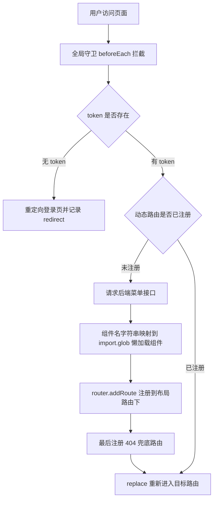

### V3-092：如何完整实现动态路由与权限菜单（后端返回菜单）？
**答**：
- 流程：守卫里发现 token 存在但动态路由未注册 → 请求菜单接口 → 组件名字符串经 `import.meta.glob` 映射成懒加载组件 → `addRoute` 逐条挂到布局路由下 → 最后注册 404 兜底 → `replace` 重进目标路由。
- 关键点一：404 兜底必须最后注册，先注册会拦截所有未匹配路径。
- 关键点二：用模块级标记防止重复注册；刷新后路由表重建，标记要能对应上。
- 菜单渲染直接复用菜单接口数据，与路由表同源。

```typescript
// router/dynamic.ts —— 动态路由注册
import type { createRouter, RouteRecordRaw } from "vue-router";

// 扫描全部视图组件，得到 "名字 -> 懒加载函数" 的映射
const viewModules = import.meta.glob("@/views/**/*.vue");

function resolveView(name: string) {
  const loader = viewModules[`/src/views/${name}.vue`];
  if (!loader) throw new Error(`未找到视图组件：${name}`);
  return loader;
}

interface MenuNode {
  path: string;
  name: string;
  component: string | null; // 一级路由为 null，用布局组件
  meta?: Record<string, unknown>;
  children?: MenuNode[];
}

function toRoutes(menus: MenuNode[], isFirstLevel: boolean): RouteRecordRaw[] {
  return menus.map((node) => ({
    path: node.path,
    name: node.name,
    // 一级路由挂布局，二级起挂真实视图
    component: isFirstLevel || !node.component ? undefined : resolveView(node.component),
    meta: node.meta,
    children: node.children?.length ? toRoutes(node.children, false) : undefined,
  }));
}

let registered = false; // 防止守卫多次触发导致重复注册

export async function setupDynamicRoutes(
  router: ReturnType<typeof createRouter>,
  fetchMenus: () => Promise<MenuNode[]>
) {
  if (registered) return;
  const menus = await fetchMenus();

  // 一级路由统一挂到根布局下
  toRoutes(menus, true).forEach((record) => {
    router.addRoute("Layout", { ...record, component: record.children ? undefined : record.component });
  });

  // 404 兜底必须最后注册，否则会拦截所有未匹配路径
  router.addRoute({ path: "/:pathMatch(.*)*", name: "NotFound", redirect: "/404" });

  registered = true;
}
```

### V3-093：路由元信息 meta 有哪些工程化用法？
**答**：
- 三大高频用途：设置 document.title、声明权限角色、标记 keep-alive 缓存白名单。
- 先做 `RouteMeta` 接口扩充，meta 字段获得类型提示，避免裸操作 any。
- 逻辑集中在全局守卫统一消费 meta，路由配置保持纯声明。
- keep-alive 的 include 缓存池由 meta.keepAlive 驱动：进入时加入缓存名单，关闭 tab 时移除。

```typescript
// router/meta.d.ts —— 先扩充 meta 类型，获得编译期检查
import "vue-router";

declare module "vue-router" {
  interface RouteMeta {
    title?: string;
    roles?: string[]; // 允许访问的角色
    keepAlive?: boolean; // 是否进入缓存池
    requiresAuth?: boolean;
  }
}

// router/guards.ts —— 守卫统一消费 meta
import { router } from "./index";
import { useUserStore } from "@/stores/modules/user";
import { useTabsStore } from "@/stores/modules/tabs";

router.beforeEach((to) => {
  // 1. 页面标题
  document.title = to.meta.title ? `${to.meta.title} - 管理后台` : "管理后台";

  // 2. 角色权限
  if (to.meta.roles && !to.meta.roles.includes(useUserStore().role)) {
    return { name: "403" };
  }

  // 3. 进入缓存池：KeepAlive 的 include 由 tabs store 维护
  if (to.meta.keepAlive && to.name) {
    useTabsStore().add({ name: String(to.name), path: to.path, title: to.meta.title ?? "" });
  }
});

// 路由声明示例：
// { path: "/order", name: "Order", component: () => import("@/views/Order.vue"),
//   meta: { title: "订单管理", roles: ["admin", "operator"], keepAlive: true } }
```

### V3-094：如何实现路由切换进度条与过渡动画？
**答**：
- 进度条用 nprogress：beforeEach 里 start，afterEach 里 done；配合 onError 兜底避免失败后进度条卡住。
- 过渡动画用 Transition 包住动态 RouterView，`mode="out-in"` 保证旧页先出后进。
- 用 route.path 作 key 强制同组件不同参数也重新触发过渡。
- 动画时长控制在 200ms 左右，过长的切换动画比没有动画更伤体验。

```vue
<!-- layouts/BasicLayout.vue -->
<script setup lang="ts">
import NProgress from "nprogress";
import "nprogress/nprogress.css";
import { useRouter } from "vue-router";

const router = useRouter();

router.beforeEach(() => NProgress.start());
router.afterEach(() => NProgress.done());
router.onError(() => NProgress.done()); // 路由加载失败也要结束进度条
</script>

<template>
  <div class="layout">
    <RouterView v-slot="{ Component, route }">
      <Transition name="fade-slide" mode="out-in">
        <component :is="Component" :key="route.path" />
      </Transition>
    </RouterView>
  </div>
</template>

<style>
.fade-slide-enter-active,
.fade-slide-leave-active {
  transition: opacity 0.2s ease, transform 0.2s ease;
}
.fade-slide-enter-from {
  opacity: 0;
  transform: translateX(12px);
}
.fade-slide-leave-to {
  opacity: 0;
  transform: translateX(-12px);
}
</style>
```

### V3-095：如何用嵌套路由搭建多级布局系统？
**答**：
- 根布局 BasicLayout 承载侧边栏、顶栏与 `<RouterView>` 出口；子路由渲染在其内部。
- 二级布局（如 SettingLayout）本身也是普通路由组件，内部再放 RouterView，形成多级出口。
- 空路径子路由用 redirect 指定默认页，避免访问 `/settings` 时出口空白。
- 布局组件不写业务，只负责骨架与公共交互（折叠、面包屑）。

```typescript
// router/routes.ts —— 多级布局路由
import type { RouteRecordRaw } from "vue-router";

export const routes: RouteRecordRaw[] = [
  {
    path: "/",
    component: () => import("@/layouts/BasicLayout.vue"), // 一级：侧边栏 + 顶栏骨架
    children: [
      { path: "dashboard", component: () => import("@/views/Dashboard.vue") },
      {
        path: "settings",
        component: () => import("@/layouts/SettingLayout.vue"), // 二级：设置页自带 tab 骨架
        children: [
          { path: "", redirect: "profile" }, // 访问 /settings 时重定向到默认 tab
          { path: "profile", component: () => import("@/views/settings/Profile.vue") },
          { path: "security", component: () => import("@/views/settings/Security.vue") },
        ],
      },
    ],
  },
];
```

### V3-096：路由懒加载如何做 hover 预取？
**答**：
- 懒加载组件首次导航才加载，网络慢时会白屏；hover 到导航项时预加载组件模块，点击时已就绪。
- 预取即提前调用组件的 import 函数，模块加载结果由浏览器缓存，真正导航时同一 promise 直接复用。
- 封装 usePrefetch：内部 Set 防重复，失败从 Set 移除允许重试。
- 菜单渲染时把“加载函数”与路径绑定，RouterLink 的 mouseenter 触发预取。

```typescript
// composables/usePrefetch.ts
const prefetched = new Set<string>();

export function createPrefetch(key: string, load: () => Promise<unknown>) {
  return () => {
    if (prefetched.has(key)) return; // 已预取过，跳过
    prefetched.add(key);
    load().catch(() => prefetched.delete(key)); // 失败允许下次重试
  };
}

// 菜单组件里配合 RouterLink 使用：
// <RouterLink
//   v-for="item in menu"
//   :key="item.path"
//   :to="item.path"
//   @mouseenter="createPrefetch(item.path, item.load)"
// >
//   {{ item.label }}
// </RouterLink>
//
// menu 数据来源示例：
// const menu = [
//   { path: "/order", label: "订单", load: () => import("@/views/Order.vue") },
//   { path: "/user", label: "用户", load: () => import("@/views/User.vue") },
// ];
//
// 也可在浏览器空闲时兜底全量预取：
// const idle = window.requestIdleCallback ?? ((cb) => setTimeout(cb, 200));
// idle(() => menu.forEach((m) => createPrefetch(m.path, m.load)()));
```

### V3-097：如何封装类型化的查询参数读取？
**答**：
- route.query 的值是 `LocationQueryValue | LocationQueryValue[]`，直接用到处是 string 强转与数组坑。
- 封装 useQueryState：传入 schema 声明每个参数的解析函数（Number/Boolean/自定义），读出即类型化结果。
- 写入统一走 patch，合并到现有 query 上 replace，保持其它参数不丢。
- URL 是唯一事实源，状态由 computed 派生，浏览器前进后退自动同步。

```typescript
// composables/useQueryState.ts
import { computed } from "vue";
import { useRoute, useRouter } from "vue-router";

type Parser<T> = (raw: string) => T;

export function useQueryState<S extends Record<string, Parser<unknown>>>(schema: S) {
  const route = useRoute();
  const router = useRouter();

  // 读取：按 schema 逐个解析，返回类型化对象
  const state = computed(() => {
    const out = {} as { [K in keyof S]: ReturnType<S[K]> };
    for (const key in schema) {
      const raw = route.query[key];
      const first = Array.isArray(raw) ? raw[0] : raw;
      out[key] = first === undefined || first === null
        ? schema[key]("") // 缺省时也走解析器，由解析器决定默认值
        : schema[key](first);
    }
    return out;
  });

  // 写入：合并到现有 query，不丢其它参数
  function patch(next: Record<string, string | number | undefined>) {
    const query: Record<string, string> = {};
    for (const key in route.query) {
      const v = route.query[key];
      if (typeof v === "string") query[key] = v;
    }
    for (const key in next) {
      if (next[key] === undefined) delete query[key];
      else query[key] = String(next[key]);
    }
    router.replace({ query });
  }

  return { state, patch };
}

// 使用：
// const { state, patch } = useQueryState({
//   page: (v) => Math.max(1, Number(v) || 1),
//   keyword: (v) => v,
// });
// state.value.page; // number 类型
// patch({ page: 2 });
```

## 第二十五章 表单工程

schema 驱动动态表单、联动依赖、分步向导、大表单性能、异步校验与 URL 同步，构成中后台表单工程化的完整考点链。

### V3-098：如何设计大型动态表单架构（schema 驱动）？
**答**：
- 配置与渲染分离：表单结构由 JSON schema 描述（字段、组件类型、校验规则、联动条件），渲染器负责解释执行。
- 新增表单只写配置不写组件代码，运营后台、低代码表单都是这个思路。
- 渲染器要点：按 component 名分发到对应控件；visibleWhen 用函数条件过滤字段；所有字段经 v-model 双写回 model。
- schema 本身要有 TS 类型与校验，防止配置写错静默失效。

```vue
<!-- components/FormRenderer.vue -->
<script setup lang="ts">
import { computed } from "vue";

export interface FieldSchema {
  prop: string;
  label: string;
  component: "ElInput" | "ElSelect" | "ElDatePicker";
  options?: { label: string; value: string }[];
  rules?: Record<string, unknown>[];
  visibleWhen?: (model: Record<string, unknown>) => boolean; // 联动显隐
}

const props = defineProps<{
  schema: FieldSchema[];
  modelValue: Record<string, unknown>;
}>();

const emit = defineEmits<{ "update:modelValue": [value: Record<string, unknown>] }>();

const visibleFields = computed(() =>
  props.schema.filter((f) => !f.visibleWhen || f.visibleWhen(props.modelValue))
);

function update(prop: string, value: unknown) {
  emit("update:modelValue", { ...props.modelValue, [prop]: value });
}
</script>

<template>
  <div class="form-renderer">
    <label v-for="field in visibleFields" :key="field.prop" class="field">
      <span>{{ field.label }}</span>
      <ElInput
        v-if="field.component === 'ElInput'"
        :model-value="String(modelValue[field.prop] ?? '')"
        @update:model-value="update(field.prop, $event)"
      />
      <ElSelect
        v-else-if="field.component === 'ElSelect'"
        :model-value="modelValue[field.prop]"
        :options="field.options"
        @update:model-value="update(field.prop, $event)"
      />
      <ElDatePicker
        v-else-if="field.component === 'ElDatePicker'"
        :model-value="modelValue[field.prop]"
        type="date"
        @update:model-value="update(field.prop, $event)"
      />
    </label>
  </div>
</template>
```

### V3-099：表单字段联动的依赖管理怎么做？
**答**：
- 把联动显式声明成规则表：source 源字段、targets 受影响字段、onChange 副作用，避免散落的 watch 互相打架。
- 用一个 watch(source) 统一执行规则：改目标值 + 通知目标字段重新校验（旧校验结果可能已失效）。
- 典型场景：省份变化清空城市、重拉城市列表；金额变化重算折扣。
- 规则表还是文档：评审时一眼看清依赖图，防止 A 改 B、B 又改 A 的环。

```typescript
// composables/useFieldLinkage.ts
import { watch } from "vue";

interface LinkageRule {
  source: string; // 联动源字段
  targets: string[]; // 受影响字段
  onChange: (value: unknown, form: Record<string, unknown>) => void;
}

export function useFieldLinkage(
  form: Record<string, unknown>,
  rules: LinkageRule[],
  validateField: (field: string) => void
) {
  rules.forEach((rule) => {
    watch(
      () => form[rule.source],
      (value) => {
        rule.onChange(value, form); // 执行联动副作用
        rule.targets.forEach(validateField); // 受影响字段重新校验
      }
    );
  });
}

// 使用：声明式描述依赖图
// useFieldLinkage(
//   form,
//   [
//     {
//       source: "province",
//       targets: ["city"],
//       onChange: (_v, f) => {
//         f.city = ""; // 省份变化清空城市
//         cityOptions.value = await loadCities(f.province);
//       },
//     },
//   ],
//   (field) => formRef.value?.validateField(field)
// );
```

### V3-100：如何实现分步表单向导（状态机 + 校验缓存）？
**答**：
- 用 current 步骤索引 + direction 方向构成小型状态机：direction 决定进/退场动画，jumpTo 只允许回跳已完成步骤。
- 每步进入下一步前只校验当前步，通过才前进；已通过的步骤数据缓存不重置，回退修改后再前进重新校验。
- 最后一步提交时整体校验兜底，防止回跳绕过校验。
- 步骤定义与组件解耦，向导逻辑可复用于任意多步流程。

```typescript
// composables/useWizard.ts
import { computed, ref } from "vue";

interface Step {
  key: string;
  validate: () => Promise<boolean>; // 校验当前步
}

export function useWizard(steps: Step[]) {
  const current = ref(0);
  const direction = ref<"forward" | "back">("forward");
  const passed = ref(new Set<number>()); // 已通过校验的步骤

  const isFirst = computed(() => current.value === 0);
  const isLast = computed(() => current.value === steps.length - 1);
  const progress = computed(() => ((current.value + 1) / steps.length) * 100);

  async function next() {
    const ok = await steps[current.value].validate(); // 只校验当前步
    if (!ok) return false;
    passed.value.add(current.value);
    direction.value = "forward";
    current.value++;
    return true;
  }

  function back() {
    direction.value = "back";
    current.value = Math.max(0, current.value - 1);
  }

  // 只允许回跳已完成的步骤，防止跳过校验
  function jumpTo(index: number) {
    if (index > current.value && !passed.value.has(index)) return;
    direction.value = index >= current.value ? "forward" : "back";
    current.value = index;
  }

  return { current, direction, isFirst, isLast, progress, next, back, jumpTo };
}
```

### V3-101：大量字段的表单如何避免整树重渲染？
**答**：
- 根因：一个大组件持有整个表单对象，任意字段输入都触发整个组件重渲，几百字段时明显卡顿。
- 方案：每个字段抽成独立子组件，用 props + emit 或 defineModel 传递，输入只重渲该字段组件。
- 子组件粒度是关键：组件边界就是更新边界，Vue 的组件级更新把影响隔离到单个字段。
- 进一步优化：字段子组件对大 props 用 shallow 处理、校验消息下沉到字段组件内部。

```vue
<!-- FieldInput.vue —— 字段级子组件：更新边界隔离在组件内部 -->
<script setup lang="ts">
defineProps<{
  field: { prop: string; label: string };
  modelValue: string;
}>();

const emit = defineEmits<{ "update:modelValue": [value: string] }>();
</script>

<template>
  <label class="field">
    <span>{{ field.label }}</span>
    <input
      :value="modelValue"
      @input="emit('update:modelValue', ($event.target as HTMLInputElement).value)"
    />
  </label>
</template>
```

```vue
<!-- BigForm.vue —— 父组件 v-model 双写：输入只重渲对应 FieldInput -->
<script setup lang="ts">
import { reactive } from "vue";
import FieldInput from "./FieldInput.vue";

const fields = Array.from({ length: 300 }, (_, i) => ({ prop: `f${i}`, label: `字段${i}` }));
const form = reactive<Record<string, string>>({});

function updateField(prop: string, value: string) {
  form[prop] = value; // 只有对应 FieldInput 接收到新 props 并更新
}
</script>

<template>
  <FieldInput
    v-for="f in fields"
    :key="f.prop"
    :field="f"
    :model-value="form[f.prop] ?? ''"
    @update:model-value="updateField(f.prop, $event)"
  />
</template>
```

### V3-102：如何搭建自定义校验器体系（异步校验 + 防抖）？
**答**：
- 校验器分两层：同步规则（required/pattern）即时校验；异步规则（查重、远程可用性）必须防抖并标记 validating 态。
- createRemoteValidator 内部对每个字段维护定时器，输入停顿 delay 后才发请求，新请求取消旧的（用 runId 或 AbortController）。
- 校验结果写回 reactive 状态，控件按 message/validating 展示。
- 校验器注册表 + schema 引用，规则可复用可测试。

```typescript
// validators/createRemoteValidator.ts
import { reactive } from "vue";

export function createRemoteValidator(
  check: (value: string) => Promise<{ ok: boolean; message?: string }>
) {
  const state = reactive({
    validating: false,
    message: "",
  });

  const timers = new Map<string, ReturnType<typeof setTimeout>>();
  const runIds = new Map<string, number>();

  // 返回可复用的校验函数：按字段名隔离防抖与竞态
  return {
    state,
    validate(field: string, value: string, delay = 400) {
      clearTimeout(timers.get(field));
      const id = (runIds.get(field) ?? 0) + 1;
      runIds.set(field, id);

      timers.set(
        field,
        setTimeout(async () => {
          state.validating = true;
          state.message = "";
          try {
            const res = await check(value);
            if (runIds.get(field) !== id) return; // 已有更新的校验，丢弃过期结果
            state.message = res.ok ? "" : res.message ?? "校验未通过";
          } catch {
            if (runIds.get(field) === id) state.message = "校验服务异常，请稍后重试";
          } finally {
            if (runIds.get(field) === id) state.validating = false;
          }
        }, delay)
      );
    },
  };
}

// 使用：
// const usernameValidator = createRemoteValidator(checkUsernameAvailable);
// watch(() => form.username, (v) => usernameValidator.validate("username", v));
```

### V3-103：如何把表单筛选状态与 URL 同步（可分享的链接）？
**答**：
- 筛选条件写入 query：刷新、前进后退、复制链接给别人都还原同一视图。
- 初始化：从 route.query 读初始值合并默认值；变化：watch filters 深度监听后 replace 到 URL。
- 只把非默认值写进 URL，链接干净；空值删除参数而不是写 `keyword=`。
- 用 replace 不用 push，避免每次输入都产生一条历史记录。

```typescript
// composables/useUrlFilters.ts
import { reactive, watch } from "vue";
import { useRoute, useRouter } from "vue-router";

export function useUrlFilters<T extends Record<string, string | number | undefined>>(
  defaults: T
) {
  const route = useRoute();
  const router = useRouter();

  // 1. 初始化：URL 参数优先，缺失用默认值
  const filters = reactive<T>({ ...defaults });
  for (const key in defaults) {
    const raw = route.query[key];
    if (typeof raw === "string" && raw !== "") {
      filters[key] = typeof defaults[key] === "number" ? (Number(raw) as never) : (raw as never);
    }
  }

  // 2. 变化同步回 URL：replace 避免历史记录爆炸
  watch(
    filters,
    () => {
      const query: Record<string, string> = {};
      for (const key in filters) {
        const value = filters[key];
        // 只写非默认值，保持链接干净可分享
        if (value !== undefined && value !== defaults[key]) query[key] = String(value);
      }
      router.replace({ query });
    },
    { deep: true }
  );

  return filters;
}

// 使用：
// const filters = useUrlFilters({ keyword: "", page: 1, status: undefined });
// filters.keyword = "vue"; // URL 自动变成 ?keyword=vue，可直接分享
```

## 第二十六章 UI 交互模式

全局弹窗、右键菜单、拖拽排序、无限滚动、可编辑表格与命令面板，是考察组件交互设计能力的六个经典模式。

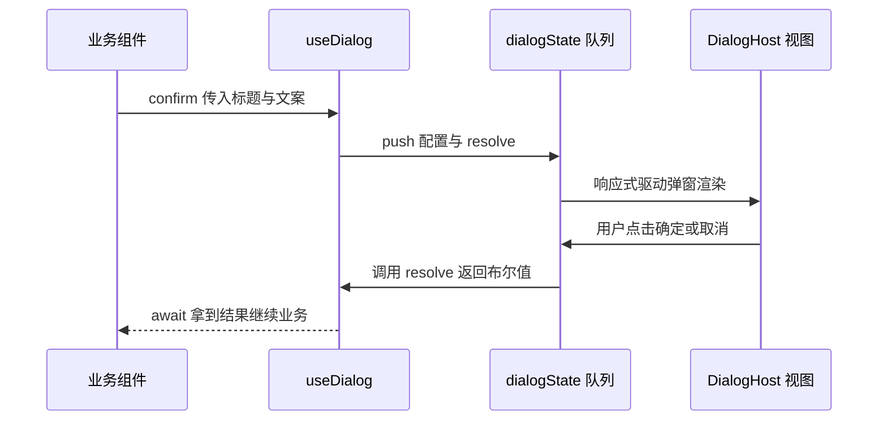

### V3-104：如何实现全局 Dialog 管理（组合式 useDialog + Promise 化）？
**答**：
- 模式：一个挂在 App 根部的 DialogHost 组件 + 一个全局响应式队列 + useDialog 函数。
- `await useDialog().confirm({...})` 返回 Promise：调用处把异步确认写成同步风格，消灭回调地狱。
- 队列天然支持连续弹出（先来先展示），resolve 存在队列项上，点击时取队首执行。
- 好处：业务组件不再各自维护 visible 状态，弹窗样式全局统一。

```typescript
// components/dialog/useDialog.ts
import { reactive } from "vue";

export interface DialogOptions {
  title: string;
  message: string;
  confirmText?: string;
  cancelText?: string;
}

interface PendingDialog extends DialogOptions {
  resolve: (ok: boolean) => void;
}

// 全局响应式队列：DialogHost 据此渲染
export const dialogState = reactive<{ queue: PendingDialog[] }>({ queue: [] });

export function useDialog() {
  function confirm(options: DialogOptions): Promise<boolean> {
    return new Promise((resolve) => {
      dialogState.queue.push({ ...options, resolve }); // resolve 存进队列，等用户点击
    });
  }
  return { confirm };
}

// DialogHost 点击回调：取队首执行 resolve
export function resolveTop(ok: boolean) {
  const top = dialogState.queue.shift();
  top?.resolve(ok);
}

// 业务代码使用：
// const ok = await useDialog().confirm({ title: "删除", message: "确认删除该订单？" });
// if (ok) deleteOrder(id);
```

```vue
<!-- components/dialog/DialogHost.vue —— 根组件挂载一次即可 -->
<script setup lang="ts">
import { dialogState, resolveTop } from "./useDialog";
</script>

<template>
  <Teleport to="body">
    <div v-if="dialogState.queue.length" class="dialog-mask">
      <div class="dialog">
        <h3>{{ dialogState.queue[0].title }}</h3>
        <p>{{ dialogState.queue[0].message }}</p>
        <div class="actions">
          <button @click="resolveTop(false)">{{ dialogState.queue[0].cancelText ?? "取消" }}</button>
          <button class="primary" @click="resolveTop(true)">
            {{ dialogState.queue[0].confirmText ?? "确定" }}
          </button>
        </div>
      </div>
    </div>
  </Teleport>
</template>
```

### V3-105：如何实现一个右键菜单组件？
**答**：
- 提供插槽作用域暴露 open 方法，宿主元素上 `@contextmenu="open"` 打开菜单。
- 菜单体 Teleport 到 body，按 clientX/clientY 定位，不受宿主 overflow 裁剪。
- 关闭时机：document click（含左键）、Escape、滚动；组件卸载时移除全局监听。
- 菜单项数据驱动，danger 标记危险操作；边界情况（右键靠近屏幕边缘）可再按窗口尺寸翻转定位。

```vue
<!-- components/ContextMenu.vue -->
<script setup lang="ts">
import { onBeforeUnmount, onMounted, reactive } from "vue";

interface MenuItem {
  label: string;
  action: () => void;
  danger?: boolean;
}

const props = defineProps<{ items: MenuItem[] }>();

const state = reactive({ visible: false, x: 0, y: 0 });

// 宿主元素右键时调用
function open(e: MouseEvent) {
  e.preventDefault();
  state.x = e.clientX;
  state.y = e.clientY;
  state.visible = true;
}

function run(item: MenuItem) {
  item.action();
  close();
}

function close() {
  state.visible = false;
}

// 点击页面任意位置关闭（右键也会触发 click 序列）
onMounted(() => document.addEventListener("click", close));
onBeforeUnmount(() => document.removeEventListener("click", close));

defineExpose({ open, close });
</script>

<template>
  <!-- 给宿主元素用：@contextmenu="open" -->
  <slot :open="open" />
  <Teleport to="body">
    <ul v-if="state.visible" class="ctx-menu" :style="{ left: state.x + 'px', top: state.y + 'px' }">
      <li
        v-for="item in props.items"
        :key="item.label"
        :class="{ danger: item.danger }"
        @click="run(item)"
      >
        {{ item.label }}
      </li>
    </ul>
  </Teleport>
</template>
```

### V3-106：拖拽排序如何实现？原生与库怎么选型？
**答**：
- 原生实现：HTML5 drag API——dragstart 记来源、dragover.prevent 允许放置、drop 计算新位置并 emit 新数组。
- 优点零依赖；缺点是移动端不支持、占位动画弱、嵌套容器麻烦。
- 选型：简单列表用原生足够；复杂需求（跨列表、触摸、动画、嵌套）用 dnd-kit / SortableJS 等成熟库。
- 数据流不变：拖拽只 emit 新数组顺序，排序状态仍由父组件持有（受控）。

```vue
<!-- components/DragList.vue -->
<script setup lang="ts">
import { ref } from "vue";

interface Item {
  id: number;
  label: string;
}

const props = defineProps<{ items: Item[] }>();
const emit = defineEmits<{ update: [items: Item[]] }>();

const dragIndex = ref<number | null>(null);
const overIndex = ref<number | null>(null);

function onDragStart(e: DragEvent, index: number) {
  dragIndex.value = index;
  e.dataTransfer?.setData("text/plain", String(index));
  e.dataTransfer!.effectAllowed = "move";
}

function onDragOver(index: number) {
  overIndex.value = index; // 仅用于高亮放置目标
}

function onDrop(index: number) {
  const from = dragIndex.value;
  if (from === null || from === index) return;
  const next = [...props.items];
  const [moved] = next.splice(from, 1);
  next.splice(index, 0, moved); // 计算新顺序
  emit("update", next); // 排序状态交给父组件（受控）
  dragIndex.value = null;
  overIndex.value = null;
}
</script>

<template>
  <ul class="drag-list">
    <li
      v-for="(item, index) in items"
      :key="item.id"
      draggable="true"
      :class="{ over: index === overIndex && index !== dragIndex }"
      @dragstart="onDragStart($event, index)"
      @dragover.prevent="onDragOver(index)"
      @dragleave="overIndex = null"
      @drop="onDrop(index)"
    >
      {{ item.label }}
    </li>
  </ul>
</template>
```

### V3-107：无限滚动列表如何完整实现（IntersectionObserver）？
**答**：
- 在列表末尾放一个哨兵元素，IntersectionObserver 观察它进入视口即触发 loadMore，比 scroll 事件监听性能好。
- 三重防护：loading 加锁防重复触发、hasMore 为 false 后不再请求、rootMargin 提前 200px 预加载消除等待感。
- 数据加载完若内容不足一屏，哨兵持续可见会再触发一次，loadMore 内部 hasMore 判断自然终止。
- 卸载时 observer.disconnect 防泄漏。

```vue
<!-- components/InfiniteList.vue -->
<script setup lang="ts">
import { onBeforeUnmount, onMounted, ref } from "vue";

const props = defineProps<{
  loadMore: () => Promise<boolean>; // 返回是否还有更多
}>();

const sentinel = ref<HTMLElement | null>(null);
const loading = ref(false);
const hasMore = ref(true);
let observer: IntersectionObserver | null = null;

async function load() {
  if (loading.value || !hasMore.value) return; // 加锁 + 终止条件
  loading.value = true;
  try {
    hasMore.value = await props.loadMore();
  } finally {
    loading.value = false;
  }
}

onMounted(() => {
  observer = new IntersectionObserver(
    (entries) => {
      if (entries[0]?.isIntersecting) load();
    },
    { rootMargin: "200px" } // 提前 200px 触发，消除等待感
  );
  if (sentinel.value) observer.observe(sentinel.value);
});

onBeforeUnmount(() => observer?.disconnect());
</script>

<template>
  <div class="infinite-list">
    <slot />
    <div ref="sentinel" class="sentinel">
      {{ loading ? "加载中…" : hasMore ? "" : "没有更多了" }}
    </div>
  </div>
</template>
```

### V3-108：如何实现可编辑表格（行内编辑 + 校验）？
**答**：
- 状态模型：editingId 标记当前编辑行，draft 持有该行草稿；只允许一行处于编辑态，避免并发保存冲突。
- 进入编辑复制行数据到 draft，取消直接丢弃，保存前对 draft 做行内校验，通过后 emit 给父组件。
- 保存成功后父组件更新数据源，表格回到浏览态。
- 批量编辑变体：所有行都持 draft，最后统一校验提交，按需选择交互模型。

```vue
<!-- components/EditableTable.vue -->
<script setup lang="ts">
import { reactive, ref } from "vue";

interface Row {
  id: number;
  name: string;
  score: number;
}

const props = defineProps<{ rows: Row[] }>();
const emit = defineEmits<{ save: [row: Row] }>();

const editingId = ref<number | null>(null);
const draft = reactive<Partial<Row>>({});
const error = ref("");

function startEdit(row: Row) {
  editingId.value = row.id;
  error.value = "";
  Object.assign(draft, row); // 复制到草稿，取消即丢弃
}

function cancel() {
  editingId.value = null;
  error.value = "";
}

function save(row: Row) {
  // 行内校验：不通过就提示，不提交
  if (!String(draft.name ?? "").trim()) {
    error.value = "名称不能为空";
    return;
  }
  if (Number(draft.score) < 0 || Number(draft.score) > 100) {
    error.value = "分数需在 0-100 之间";
    return;
  }
  emit("save", { ...row, ...(draft as Row) }); // 校验通过交给父组件持久化
  cancel();
}
</script>

<template>
  <table class="editable-table">
    <tr v-for="row in props.rows" :key="row.id">
      <template v-if="row.id === editingId">
        <td><input v-model="draft.name" /></td>
        <td><input v-model.number="draft.score" type="number" /></td>
        <td>
          <button @click="save(row)">保存</button>
          <button @click="cancel">取消</button>
          <span v-if="error" class="error">{{ error }}</span>
        </td>
      </template>
      <template v-else>
        <td>{{ row.name }}</td>
        <td>{{ row.score }}</td>
        <td><button @click="startEdit(row)">编辑</button></td>
      </template>
    </tr>
  </table>
</template>
```

### V3-109：如何实现命令面板（Ctrl+K 搜索）？
**答**：
- 全局 keydown 监听 Ctrl/Cmd+K 切换面板，面板内监听上下键移动 activeIndex、Enter 执行、Escape 关闭。
- 命令列表数据驱动：id/label/run 三元组，keyword 过滤用 includes 起步，规模大再换模糊匹配库。
- activeIndex 要随过滤结果钳制，防止越界；执行后自动关闭面板。
- 组件卸载移除全局监听；打开时聚焦输入框提升体验。

```vue
<!-- components/CommandPalette.vue -->
<script setup lang="ts">
import { computed, nextTick, onBeforeUnmount, onMounted, ref } from "vue";

interface Command {
  id: string;
  label: string;
  run: () => void;
}

const props = defineProps<{ commands: Command[] }>();

const visible = ref(false);
const keyword = ref("");
const activeIndex = ref(0);
const inputRef = ref<HTMLInputElement | null>(null);

const filtered = computed(() => {
  const kw = keyword.value.trim().toLowerCase();
  if (!kw) return props.commands;
  return props.commands.filter((c) => c.label.toLowerCase().includes(kw));
});

function onKeydown(e: KeyboardEvent) {
  // Ctrl/Cmd + K 全局切换
  if ((e.ctrlKey || e.metaKey) && e.key.toLowerCase() === "k") {
    e.preventDefault();
    visible.value = !visible.value;
    if (visible.value) nextTick(() => inputRef.value?.focus());
    return;
  }
  if (!visible.value) return;

  if (e.key === "Escape") visible.value = false;
  else if (e.key === "ArrowDown") {
    activeIndex.value = Math.min(activeIndex.value + 1, filtered.value.length - 1); // 钳制越界
  } else if (e.key === "ArrowUp") {
    activeIndex.value = Math.max(activeIndex.value - 1, 0);
  } else if (e.key === "Enter") execute();
}

function execute() {
  const cmd = filtered.value[activeIndex.value];
  if (!cmd) return;
  cmd.run();
  visible.value = false;
  keyword.value = "";
}

onMounted(() => window.addEventListener("keydown", onKeydown));
onBeforeUnmount(() => window.removeEventListener("keydown", onKeydown));
</script>

<template>
  <Teleport to="body">
    <div v-if="visible" class="palette-mask" @click.self="visible = false">
      <div class="palette">
        <input ref="inputRef" v-model="keyword" placeholder="输入命令…" @input="activeIndex = 0" />
        <ul>
          <li
            v-for="(cmd, i) in filtered"
            :key="cmd.id"
            :class="{ active: i === activeIndex }"
            @mouseenter="activeIndex = i"
            @click="execute"
          >
            {{ cmd.label }}
          </li>
        </ul>
      </div>
    </div>
  </Teleport>
</template>
```

## 第二十七章 性能实战

大表格、图片懒加载、长列表筛选、KeepAlive 缓存池、FLIP 动画与首屏优化，是性能方向的六个落地级考题。

### V3-110：十万行大表格如何优化（shallowRef + 手动触发）？
**答**：
- reactive 会深度代理整个数组，十万行数据的每个字段读写都走 Proxy，初始化和更新都慢。
- 用 shallowRef 只代理引用：内部字段改动不触发更新，整表替换或 triggerRef 才触发，把响应式成本从 O(n) 降到 O(1)。
- 单元格修改走不可变更新（新对象替换旧行）+ triggerRef 手动通知一次，避免逐字段多次触发渲染。
- 再配合虚拟滚动只渲染可视行，两个优化叠加才是完整方案。

```typescript
// composables/useBigTable.ts —— shallowRef + 手动触发
import { shallowRef, triggerRef } from "vue";

interface Row {
  id: number;
  name: string;
  score: number;
}

export function useBigTable(initialRows: Row[]) {
  // 只追踪引用，不对十万行做深度代理
  const rows = shallowRef<Row[]>(initialRows);

  // 单元格更新：不可变替换 + 手动触发一次
  function updateRow(id: number, patch: Partial<Row>) {
    const index = rows.value.findIndex((r) => r.id === id);
    if (index === -1) return;
    rows.value[index] = { ...rows.value[index], ...patch };
    triggerRef(rows); // 手动通知，一次渲染完成所有变更
  }

  // 排序：直接替换引用，天然触发
  function sortBy(key: keyof Row) {
    rows.value = [...rows.value].sort((a, b) => (a[key] > b[key] ? 1 : -1));
  }

  function addRow(row: Row) {
    rows.value = [...rows.value, row]; // 扩展运算符替代 push，避免手动 trigger
  }

  return { rows, updateRow, sortBy, addRow };
}
```

### V3-111：图片懒加载指令完整版怎么做（占位 + 重试）？
**答**：
- mounted 时先赋占位图（低分辨率或纯色 base64），避免布局抖动；IntersectionObserver 观察元素进入视口再加载真实 src。
- 重试机制：onerror 后带退避地重试 N 次，全部失败展示错误占位，弱网体验明显更好。
- WeakSet 防重复加载；指令卸载钩子里断开 observer。
- 注册为局部指令 vLazyImage 后模板直接 `v-lazy-image="url"` 使用。

```typescript
// directives/lazyImage.ts —— 图片懒加载指令完整版
import type { Directive } from "vue";

const PLACEHOLDER =
  "data:image/svg+xml;charset=utf-8,%3Csvg xmlns='http://www.w3.org/2000/svg'/%3E";

const handled = new WeakSet<HTMLImageElement>();

function loadImage(el: HTMLImageElement, src: string, retries: number): Promise<void> {
  return new Promise((resolve, reject) => {
    el.onload = () => resolve();
    el.onerror = () => {
      if (retries > 0) {
        // 指数退避重试：1s、2s、4s
        setTimeout(() => loadImage(el, src, retries - 1).then(resolve, reject), 1000 * 2 ** (3 - retries));
      } else {
        el.src = PLACEHOLDER; // 全部失败退回占位
        reject(new Error(`图片加载失败：${src}`));
      }
    };
    el.src = src;
  });
}

export const vLazyImage: Directive<HTMLImageElement, string> = {
  mounted(el, binding) {
    el.src = PLACEHOLDER; // 先显示占位，避免布局抖动
    const observer = new IntersectionObserver(([entry]) => {
      if (!entry?.isIntersecting || handled.has(el)) return;
      handled.add(el);
      observer.disconnect();
      loadImage(el, binding.value, 3); // 进入视口后加载，最多重试 3 次
    });
    observer.observe(el);
    (el as HTMLImageElement & { _observer?: IntersectionObserver })._observer = observer;
  },
  unmounted(el) {
    (el as HTMLImageElement & { _observer?: IntersectionObserver })._observer?.disconnect();
  },
};

// 注册：app.directive("lazy-image", vLazyImage)
// 使用：
```

### V3-112：长列表筛选卡顿如何治理（计算下沉）？
**答**：
- 症状：搜索框每敲一个字符，过滤 + 排序 + 渲染整条链路全跑一遍，列表越大越卡。
- 治理一（输入侧）：关键词先过防抖 ref（300ms），高频输入不再直接驱动重计算。
- 治理二（计算侧下沉）：把过滤逻辑从父组件顶层 computed 下沉到真正消费它的子组件，父组件其它部分不再被牵连重渲；列表本体用 shallowRef。
- 治理三（渲染侧）：列表项抽组件 + 稳定 key，必要时虚拟滚动，三管齐下。

```vue
<!-- FilteredList.vue —— 输入防抖 + 计算下沉 + shallowRef -->
<script setup lang="ts">
import { computed, shallowRef } from "vue";
import { useDebouncedRef } from "@/composables/useCustomRefs";

interface Item {
  id: number;
  title: string;
  tags: string[];
}

// 列表数据不做深度响应式
const allItems = shallowRef<Item[]>(fetchAllItems());

// 关键词过防抖：输入过程中不触发重计算
const keyword = useDebouncedRef("", 300);

// 过滤计算保持在数据所在层级，结果交给纯展示子组件
const filteredItems = computed(() => {
  const kw = keyword.value.trim().toLowerCase();
  if (!kw) return allItems.value;
  return allItems.value.filter(
    (item) => item.title.toLowerCase().includes(kw) || item.tags.some((t) => t.includes(kw))
  );
});
</script>

<template>
  <input v-model="keyword" placeholder="搜索…" />
  <!-- ListRow 抽成子组件：单条更新只影响该行，父级 computed 不重跑渲染 -->
  <ListRow v-for="item in filteredItems" :key="item.id" :item="item" />
</template>
```

### V3-113：KeepAlive 缓存如何精细化管理（include 动态缓存池）？
**答**：
- 默认 max 或全量 include 都太粗：多 tab 后台中，缓存池应该等于“当前打开的 tab 集合”。
- tabs store 维护 tab 列表，cachedNames computed 派生缓存名单，进 tab 加入、关 tab 移除。
- KeepAlive 的 include 响应式变化后，被移除的组件实例立即销毁，缓存自动释放。
- 被缓存组件必须声明组件名（defineOptions name），且与路由 name 一致，否则 include 匹配不到。

```typescript
// stores/modules/tabs.ts —— tab 即缓存池
import { defineStore } from "pinia";
import { computed, ref } from "vue";

interface TabItem {
  name: string; // 与路由 name、组件名一致
  path: string;
  title: string;
}

export const useTabsStore = defineStore("tabs", () => {
  const tabs = ref<TabItem[]>([]);

  // 缓存名单由当前打开的 tabs 派生，驱动 KeepAlive 的 include
  const cachedNames = computed(() => tabs.value.map((t) => t.name));

  function add(tab: TabItem) {
    if (!tabs.value.some((t) => t.name === tab.name)) tabs.value.push(tab);
  }

  function remove(name: string) {
    tabs.value = tabs.value.filter((t) => t.name !== name); // 移出后对应组件实例被销毁
  }

  return { tabs, cachedNames, add, remove };
});
```

```vue
<!-- layouts/KeepAliveLayout.vue -->
<script setup lang="ts">
import { useTabsStore } from "@/stores/modules/tabs";

const tabsStore = useTabsStore();
</script>

<template>
  <RouterView v-slot="{ Component }">
    <KeepAlive :include="tabsStore.cachedNames" :max="10">
      <component :is="Component" v-if="Component" />
    </KeepAlive>
  </RouterView>
</template>

<!-- 被缓存的页面组件必须声明同名 name：
<script setup lang="ts">
defineOptions({ name: "Order" }); // 与路由 name 一致，include 才能命中
</script>
-->
```

### V3-114：FLIP 动画在 Vue 中如何实现？
**答**：
- FLIP 四步：First 记录起始位置、Last 让 DOM 变更后的最终位置生效、Invert 用 transform 反向偏移回起点、Play 过渡到 0。
- Vue 的 TransitionGroup 内部就是 FLIP，简单列表移动动画直接用它。
- 自定义场景（如拖拽落位、瀑布流重排）用手写 useFlip：watch 数据变化，nextTick 后对比前后 getBoundingClientRect，用 Web Animations API 播放。
- 每个可移动元素需要稳定的 data-flip-id 作为身份标识。

```typescript
// composables/useFlip.ts —— 手写 FLIP
import { nextTick, watch, type Ref } from "vue";

export function useFlip(container: Ref<HTMLElement | null>, source: () => unknown) {
  watch(source, async () => {
    await nextTick(); // 等 Vue 把 DOM 更新到最终状态
    const els = container.value?.querySelectorAll<HTMLElement>("[data-flip-id]");
    if (!els?.length) return;

    // First：更新后的 DOM 上已拿不到旧位置，改为在 watch 前缓存
    // 实现技巧：读取"变更前"的位置需要在数据变更前执行，这里用微任务前钩子：
    // 简化实现——依赖 Vue 的 DOM 更新在 nextTick 前完成，First 用 MutationObserver
    // 之外的常见做法是数据变化前手动调用 recordFirst()，示例如下注释
    //
    // recordFirst(): els.forEach((el) => firstMap.set(el, el.getBoundingClientRect()));
    // 数据变化 → nextTick → Last：再次读取最终位置
    // Invert：dx = first.left - last.left
    // Play：animate 从 translate(dx, dy) 过渡到 translate(0, 0)

    els.forEach((el) => {
      const first = (el as HTMLElement & { _flip?: DOMRect })._flip;
      if (!first) return;
      const last = el.getBoundingClientRect();
      const dx = first.left - last.left;
      const dy = first.top - last.top;
      if (dx || dy) {
        el.animate(
          [
            { transform: `translate(${dx}px, ${dy}px)` }, // Invert：先回到旧位置
            { transform: "translate(0, 0)" }, // Play：平滑过渡到新位置
          ],
          { duration: 300, easing: "ease" }
        );
      }
      // 更新为当前位置，供下一轮 FLIP 使用
      (el as HTMLElement & { _flip?: DOMRect })._flip = last;
    });
  });

  // 在数据变更前调用，记录 First 位置
  function recordFirst() {
    container.value?.querySelectorAll<HTMLElement>("[data-flip-id]").forEach((el) => {
      (el as HTMLElement & { _flip?: DOMRect })._flip = el.getBoundingClientRect();
    });
  }

  return { recordFirst };
}
```

### V3-115：首屏优化有哪些组合拳（路由级分割 + SSR 取舍）？
**答**：
- 基础项：路由级懒加载让首屏只加载当前页代码；manualChunks 把框架代码与重依赖（echarts/xlsx）单独分包，利于长效缓存。
- 关键项：图片压缩与 webp、关键接口预请求、骨架屏降低感知延迟。
- SSR 取舍：内容型站点（SEO + 首屏时间敏感）值得上 SSR；重交互中后台收益小、成本高（服务端、运维、复杂度），通常 CSR + 骨架屏即可。
- 度量先行：用 Lighthouse/性能面板确认瓶颈是 JS 体积、接口还是渲染，再决定投入。

```typescript
// vite.config.ts —— 首屏代码分割组合
import { defineConfig } from "vite";

export default defineConfig({
  build: {
    rollupOptions: {
      output: {
        // 框架代码稳定不变，单独分包享受长效缓存
        manualChunks: {
          vendor: ["vue", "vue-router", "pinia"],
          echarts: ["echarts"], // 重依赖单独分包，首屏不加载，用到时再拉
        },
      },
    },
    chunkSizeWarningLimit: 800,
  },
});

// 路由级分割（router/routes.ts）：
// { path: "/order", component: () => import("@/views/Order.vue") }
// 每个页面一个 chunk，首屏只拉当前路由的代码

// 重组件局部懒加载（用到时才加载）：
// const Chart = defineAsyncComponent(() => import("./BigChart.vue"));
```

## 第二十八章 SSR 与同构

SSR 数据预取、hydration 不匹配、第三方库兼容、Nuxt3 渲染模式与流式渲染，构成同构开发的完整链路。

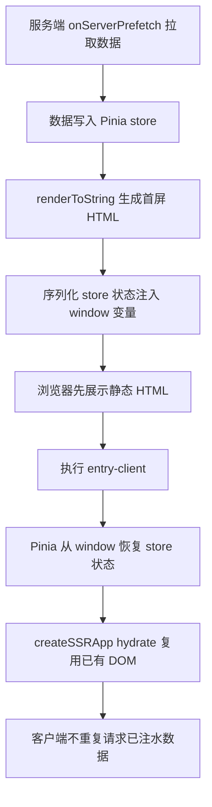

### V3-116：SSR 数据预取的完整流程是怎样的（onServerPrefetch + 状态注水）？
**答**：
- 服务端：组件 setup 里用 onServerPrefetch 注册异步钩子，renderToString 前会等待其完成，数据写入 Pinia。
- 注水：服务端把 `pinia.state.value` 序列化成 JSON，注入 HTML 的 `window.__PINIA_STATE__`。
- 客户端：entry-client 创建 pinia 后用注水状态恢复 store，hydrate 直接渲染出与服务器一致的 DOM。
- 校验闭环：客户端不再重复请求同一数据——onServerPrefetch 只在服务端执行，天然不会二次请求。

```vue
<!-- pages/Product.vue —— 服务端预取数据 -->
<script setup lang="ts">
import { onServerPrefetch } from "vue";
import { useRoute } from "vue-router";
import { useProductStore } from "@/stores/product";

const store = useProductStore();
const route = useRoute();

// 只在服务端执行：数据写入 Pinia，随 HTML 下发，客户端不会重复请求
onServerPrefetch(async () => {
  await store.fetchProduct(String(route.params.id));
});
</script>

<template>
  <h1>{{ store.current.title }}</h1>
</template>
```

```javascript
// entry-server.js 与 entry-client.js 的注水关键片段
import { createSSRApp } from "vue";
import { createPinia } from "pinia";

// —— 服务端：渲染完成后序列化状态注入 HTML ——
export async function render(url) {
  const app = createSSRApp(App);
  const pinia = createPinia();
  app.use(pinia);

  const html = await renderToString(app, { url });
  const state = JSON.stringify(pinia.state.value);
  return {
    html,
    stateTag: `<script>window.__PINIA_STATE__=${state.replace(/</g, "\\u003c")}<\/script>`,
  };
}

// —— 客户端：用注水状态恢复 store，再 hydrate ——
export function createClientApp() {
  const app = createSSRApp(App);
  const pinia = createPinia();
  app.use(pinia);

  if (window.__PINIA_STATE__) {
    pinia.state.value = window.__PINIA_STATE__; // 注水：store 直接拥有服务端数据
  }
  return { app };
}
```

### V3-117：hydration 不匹配怎么排查与修复？
**答**：
- 常见来源：渲染了依赖环境的数据（Date.now、Math.random、window 尺寸）、服务端与客户端 v-if 条件不同、非法 HTML 嵌套被浏览器纠正（p 里套 div）。
- 排查：开发模式下 Vue 会在控制台打印不匹配的节点与两份渲染文本；按打印定位到具体表达式。
- 修复模式：环境相关值先渲染占位，onMounted 后再补真实值；纯客户端内容用 `<ClientOnly>`（Nuxt）或挂载标记包裹。
- 大面积不匹配宁可让该子树客户端独占渲染，也不要逐个补丁。

```vue
<!-- hydration 修复示例：环境相关内容延迟到客户端 -->
<script setup lang="ts">
import { onMounted, ref } from "vue";

// 错误写法：const now = ref(Date.now())
// 服务端渲染的时间与客户端 hydrate 时的时间几乎必然不同，触发不匹配警告

// 正确写法：SSR 渲染占位，客户端挂载后再补真实值
const now = ref<number | null>(null);
onMounted(() => {
  now.value = Date.now();
});
</script>

<template>
  <!-- 两端渲染结果一致：都是占位骨架 -->
  <p v-if="now === null" class="skeleton">--:--:--</p>
  <!-- hydrate 完成后 onMounted 触发，安全切换为真实时间 -->
  <p v-else>当前时间：{{ new Date(now).toLocaleTimeString() }}</p>
</template>
```

### V3-118：SSR 下第三方库的 window 报错如何系统性解决？
**答**：
- 报错根源：模块顶层访问 window/document，Node 环境没有这些全局对象。
- 守卫模式：封装统一的 `isServer` 判断，入口访问一律前置守卫；守卫逻辑收口在一个 env 模块，不要散落 typeof window。
- 动态导入模式：重库（echarts、编辑器）在客户端生命周期或事件回调里 `await import()`，SSR 构建不触碰其顶层代码。
- 备选：shim 假对象、构建别名替换等侵入手段，能不用就不用。

```typescript
// utils/env.ts —— 统一环境守卫，收口所有 window 判断
export const isServer = typeof window === "undefined";
export const isClient = !isServer;

// 重库动态导入：只在客户端加载，SSR 构建不会解析其顶层 window 依赖
export async function loadECharts() {
  if (isServer) return null;
  return import("echarts");
}

// 存储类 API 统一加守卫
export function readLocalStorage(key: string): string | null {
  if (isServer) return null;
  return window.localStorage.getItem(key);
}

// 组件内天然安全的位置：onMounted 只在客户端执行
// onMounted(async () => {
//   const echarts = await loadECharts(); // 此处访问 window 一定安全
//   const chart = echarts!.init(chartRef.value!);
//   chart.setOption(option);
// });
```

### V3-119：Nuxt3 的目录约定与渲染模式切换（ssr:false 路由）怎么做？
**答**：
- 约定即配置：pages 文件路由、composables/ 自动导入、components/ 自动注册、server/api 服务端接口、middleware/ 路由中间件。
- 渲染模式用 routeRules 按路由粒度声明：`ssr: false` 纯客户端、`prerender` 构建期预渲染、`swr` 边缘缓存再生成。
- 后台管理这类无 SEO 需求的页面设 ssr: false，免掉 hydration 与服务端兼容成本。
- 单个组件也可用 `<ClientOnly>` 局部关闭服务端渲染。

```typescript
// nuxt.config.ts —— 按路由粒度声明渲染模式
export default defineNuxtConfig({
  routeRules: {
    "/": { prerender: true }, // 首页：构建期预渲染成静态 HTML
    "/products/**": { swr: 600 }, // 商品页：缓存 600 秒，过期后台再生
    "/admin/**": { ssr: false }, // 后台管理：纯客户端渲染，无 SEO 需求
    "/api/**": { cors: true }, // server/api 接口
  },
});

// 目录约定（约定即配置，无需手写路由表）：
// pages/index.vue           ->  /
// pages/products/[id].vue   ->  /products/:id（动态路由）
// composables/useXxx.ts     ->  自动导入
// components/BaseButton.vue ->  模板直接用 <BaseButton />
// server/api/hello.get.ts   ->  GET /api/hello
// middleware/auth.ts        ->  路由中间件
```

### V3-120：流式 SSR 如何与 Suspense 配合？
**答**：
- 传统 SSR 要等整棵树渲染完才返回；流式 SSR 用 renderToNodeStream 分块写出，浏览器更早收到并开始渲染。
- async setup 的组件包在 Suspense 内，形成异步边界：边界未就绪时先推送 fallback（骨架屏）。
- Vue3 的流式渲染会先输出外壳与已就绪部分，异步边界解析完成后再补送对应片段并自动注水衔接。
- Vue3.5 的懒水合（`defineAsyncComponent` + `hydrate` 选项，内置 `hydrateOnVisible/hydrateOnIdle/hydrateOnInteraction/hydrateOnMediaQuery` 策略）与 Nuxt3 的 `defineLazyHydrationComponent` 宏是同一机制的上层封装。

```javascript
// server.js —— 流式 SSR 与 Suspense 的配合
import { createSSRApp } from "vue";
import { renderToNodeStream } from "vue/server-renderer";
import { createApp } from "./app"; // 工厂函数：每次请求创建独立实例

app.get("*", (req, res) => {
  res.setHeader("Content-Type", "text/html; charset=utf-8");
  res.write('<!DOCTYPE html><div id="app">'); // 先把外壳推送出去

  const { app: vueApp } = createApp({ url: req.url });
  const stream = renderToNodeStream(vueApp);

  stream.pipe(res, { end: false }); // 分块写出：已就绪内容立即到达浏览器
  stream.on("end", () => res.end("</div>"));
});

// App.vue 端配合（示意）：
// <Suspense>
//   <PageWithAsyncSetup />   <!-- async setup 组件 = 异步边界 -->
//   <template #fallback>骨架屏</template>  <!-- 未就绪时先推送骨架屏 -->
// </Suspense>
// 异步边界解析完成后，对应 HTML 片段随后补送，浏览器自动衔接
```

## 第二十九章 工程与生态

工程组织、TypeScript 配合、unplugin 生态、测试分层、错误监控、迁移、defineModel、Vapor、微前端与 Electron，最后收束为一张 Vue 生态全景图。

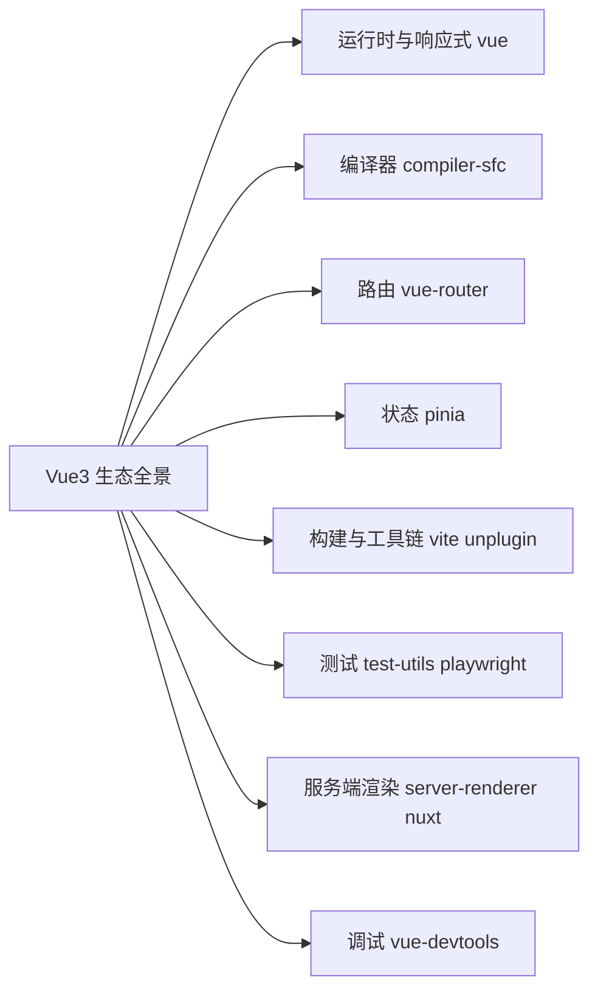

### V3-121：大型 Vue3 项目目录如何组织（feature-first）？
**答**：
- 按文件类型横切（components/ 全堆一起）的痛点：一个需求要跨五六个目录改文件，模块边界全靠约定。
- feature-first：每个业务域一个目录，组件、composables、api、store 内聚在一起，域内改动不外溢。
- shared 放与业务无关的通用层，pages 只做组装不写逻辑。
- 关键纪律：feature 之间只允许 import 对方 `index.ts` 公共入口，否则边界很快腐化。

```typescript
// feature-first 目录结构（约定以注释形式给出）
// src/
//   app/                 —— 应用骨架：router、pinia、根布局、全局 provider
//   shared/              —— 与业务无关：ui 封装、utils、http client、hooks
//   features/
//     order/             —— 订单域，自包含
//       components/      —— 域内专属组件
//       composables/     —— 域内逻辑（useOrderList 等）
//       api/             —— 域内接口与类型
//       stores/          —— 域内 store（可选，跨页面共享才建）
//       index.ts         —— 公共出口，唯一允许被外部 import 的文件
//     user/
//       index.ts
//   pages/               —— 只做组装：从 features 取组件拼页面
//
// 纪律：features/order 之外的文件只能写
// import { OrderTable } from "@/features/order"; // 走 index.ts 出口
// 而不能 import "@/features/order/components/OrderTable.vue" // 禁止深挖内部

export {};
```

### V3-122：组合式 API 项目如何做代码分层（hooks、services、stores 的边界）？
**答**：
- services：纯 IO 与类型，函数进函数出，不 import vue，可单测。
- hooks（composables）：编排层，调用 services、管理响应式状态与副作用，可依赖 stores。
- stores：只放跨组件共享的状态与动作，状态来源仍走 services，禁止在 store 里直接写 fetch 细节。
- 判据：组件里的逻辑超过一屏就下沉成 composable；同一份数据被两个组件用就进 store。

```typescript
// 一条完整链路的三层边界示例

// 1. services/orders.ts —— 纯 IO 层：不依赖 Vue，可独立单测
import { http } from "@/shared/http";
import type { Order } from "./types";

export function fetchOrders(params: { page: number; keyword?: string }) {
  return http.get<Order[]>("/orders", { params });
}

// 2. features/order/composables/useOrderList.ts —— 编排层：连接 services 与组件
import { useRequest } from "@/shared/useRequest";
import { useOrderFilters } from "./useOrderFilters";

export function useOrderList() {
  const filters = useOrderFilters(); // 页码、关键词等筛选状态
  const { data, loading, run } = useRequest(() =>
    fetchOrders({ page: filters.page.value, keyword: filters.keyword.value })
  );
  return { orders: data, loading, filters, refresh: run };
}

// 3. stores/modules/cart.ts —— 共享状态层：只管共享，不直接写 fetch 细节
//    例外允许调用 services 函数，但不允许出现裸 fetch/axios 调用
//
// 边界口诀：services 管 IO，hooks 编排流程与生命周期，stores 管跨组件共享
```

### V3-123：Vue3 与 TypeScript 深度配合有哪些要点？
**答**：
- 泛型组件：`generic="T"` 让 props、emit、插槽全部随实例类型流动，表格/选择器类组件必备。
- 类型提取：用 ComponentProps 等工具复用组件的 props 类型，避免双份维护。
- defineProps/defineEmits 的类型参数即文档：emit 用元组声明 payload，调用处编译期报错。
- 实用类型体操：RequiredProps（可选转必填）、Pick 子集 props、为 v-model 约定 ModelProps。

```typescript
// types/component.ts —— Vue3 + TS 实用类型工具
import type { ComponentProps } from "vue-component-type-helpers";
import type MyTable from "@/components/MyTable.vue";

// 1. 复用组件 props 类型：给包装组件转发 props 时不用手写第二份
export type TableProps = ComponentProps<typeof MyTable>;

// 2. 提取组件实例上的 emit 签名（用于封装转发事件）
export type ExtractEmits<T> = T extends { $emit: infer E } ? E : never;

// 3. 可选字段转必填：表单提交前把草稿类型收紧为完整类型
export type RequiredProps<T> = { [K in keyof T]-?: T[K] };

// 4. v-model 双绑约定类型：统一 modelValue 与对应事件签名
export type ModelProps<T> = {
  modelValue: T;
  "onUpdate:modelValue": (value: T) => void;
};

// 5. 泛型组件的 props 引用另一个泛型（配 SFC 的 generic 属性使用）：
// <script setup lang="ts" generic="T extends { id: number | string }">
// defineProps<{ rows: T[]; selected?: T }>()   // rows 与 selected 类型联动
```

### V3-124：unplugin 系列生态有哪些常用插件？
**答**：
- unplugin-auto-import：vue/vue-router/pinia 的 API 免手写 import，同时生成 dts 供 TS 识别。
- unplugin-vue-components：模板组件免 import，配合 resolver 实现组件库样式按需加载。
- @intlify/unplugin-vue-i18n：i18n 资源预编译进产物，运行时更小更快。
- 三者共同点：基于统一的 unplugin 接口，同一份插件代码可跑在 Vite/Webpack/Rollup 上。

```typescript
// vite.config.ts —— unplugin 三件套
import { defineConfig } from "vite";
import AutoImport from "unplugin-auto-import/vite";
import Components from "unplugin-vue-components/vite";
import VueI18nPlugin from "@intlify/unplugin-vue-i18n/vite";
import { ElementPlusResolver } from "unplugin-vue-components/resolvers";

export default defineConfig({
  plugins: [
    AutoImport({
      imports: ["vue", "vue-router", "pinia"], // ref/computed/useRouter 等免手写 import
      dts: "types/auto-imports.d.ts", // 生成类型声明，TS 不报错
      eslintrc: { enabled: true }, // 同步生成 ESLint 全局变量配置
    }),
    Components({
      resolvers: [ElementPlusResolver()], // 组件库按需：组件 + 样式一起引入
      dts: "types/components.d.ts", // 让模板里的 <ElButton /> 获得类型
    }),
    VueI18nPlugin({
      include: [/locales/], // i18n 资源预编译，运行时体积更小
    }),
  ],
});
```

### V3-125：Volar（Vue 语言服务）带来了哪些开发体验能力？
**答**：
- 把 SFC 的 template、script、style 当一个整体做类型检查：模板表达式报错、props 类型提示、插槽类型校验。
- strictTemplates 打开后模板里未声明的变量、错误的 prop 类型都会标红，把运行时问题前移到编辑器。
- vueCompilerOptions 声明编译目标与全局类型；tsconfig 的 moduleResolution 用 bundler 配合 Vite。
- 配套约定：纯类型文件用 .d.ts 增强模板全局组件，dts 生成文件纳入版本管理。

```typescript
// tsconfig.json —— Vue3 + Volar 推荐配置
{
  "compilerOptions": {
    "target": "ESNext",
    "module": "ESNext",
    "moduleResolution": "bundler", // 配合 Vite 的解析策略
    "strict": true,
    "types": ["vite/client"], // 资源导入类型：import xxx from './a.png'
    "skipLibCheck": true
  },
  "include": ["src/**/*.ts", "src/**/*.vue"],
  "vueCompilerOptions": {
    "target": 3.4, // 编译目标版本，决定可用的宏与语法
    "strictTemplates": true // 模板表达式也走严格类型检查：未知变量、错误 prop 类型直接标红
  }
}
```

### V3-126：Vue DevTools 有哪些高效用法？
**答**：
- 组件审查：点选页面元素直达组件实例，看 props/state/路由信息，替代 console.log 定位。
- Pinia 面板：查看/修改 store 状态、回溯 action 历史，调接口联动问题极快。
- Timeline：记录事件流；用官方 API 注册自定义 Timeline 层，把业务事件（下单、支付）可视化在时间线上。
- 组件树里可直接跳转源码；`onRenderTriggered` 打印渲染触发源，配合排查多余渲染。

```typescript
// plugins/devtools.ts —— 注册自定义 Timeline 层，把业务事件接入 DevTools
import type { App } from "vue";
import { setupDevtoolsPlugin } from "@vue/devtools-api";

const timelineLayerId = "order-events";

export function setupOrderDevtools(app: App) {
  setupDevtoolsPlugin(
    { id: "order-tracker", label: "订单追踪", app },
    (api) => {
      // 1. 注册 Timeline 层：DevTools 的 Timeline 面板会出现"订单事件"轨道
      api.addTimelineLayer({ id: timelineLayerId, label: "订单事件", color: 0x42b883 });

      // 2. 业务代码调用 trackOrderEvent 即可在时间线上看到节点
      (app.config.globalProperties as Record<string, unknown>).trackOrderEvent = (
        event: string,
        payload: unknown
      ) => {
        api.addTimelineEvent({
          layerId: timelineLayerId,
          event: { time: Date.now(), title: event, data: { payload } },
        });
      };
    }
  );
}

// 排查多余渲染的另一种姿势（组件内）：
// import { onRenderTriggered } from "vue";
// onRenderTriggered((e) => console.log("渲染触发源：", e.key, e.type));
```

### V3-127：如何用 @vue/test-utils 做 Vue 组件单元测试？
**答**：
- mount 挂载完整组件，shallowMount 只渲染一层（子组件 stub），按测试粒度选择。
- 断言三板斧：wrapper.text/props 查渲染结果、trigger 触发事件后 await nextTick、emitted 查事件 payload。
- 全局依赖（router/pinia/i18n）用 global.plugins 注入，第三方组件用 stubs 替换。
- 测试用户行为而非实现细节：点按钮、输文字、看输出，重构内部时测试不碎。

```typescript
// components/__tests__/Counter.spec.ts
import { describe, expect, it } from "vitest";
import { mount } from "@vue/test-utils";
import Counter from "../Counter.vue";

describe("Counter", () => {
  it("点击按钮后计数加一并发出 change 事件", async () => {
    const wrapper = mount(Counter, { props: { initial: 1 } });

    await wrapper.find("button").trigger("click"); // 模拟用户点击
    expect(wrapper.text()).toContain("2"); // 断言渲染结果
    expect(wrapper.emitted("change")?.[0]).toEqual([2]); // 断言事件 payload
  });

  it("渲染插槽内容", () => {
    const wrapper = mount(Counter, {
      slots: { default: "自定义标题" },
    });
    expect(wrapper.text()).toContain("自定义标题");
  });

  it("全局依赖用 plugins 注入、子组件用 stubs 替换", () => {
    mount(Counter, {
      global: {
        plugins: [], // createTestingPinia() 等测试替身
        stubs: { ElDialog: true }, // 弹窗类组件替换为空壳
      },
    });
  });
});
```

### V3-128：单元测试与 E2E 测试如何分层？
**答**：
- 分层原则：测试金字塔——大量组件单测（快、定位准）+ 少量 E2E（慢、覆盖真实用户路径）。
- 组件单测（Vitest + VTU）管逻辑正确性：状态变化、事件、边界条件，毫秒级反馈。
- E2E（Playwright）管关键路径：登录、下单、支付，跑真实浏览器与真实后端，断言 URL/文本/网络。
- 反模式：用 E2E 覆盖每个表单校验（慢且脆），或只有单测漏掉集成断裂。

```typescript
// e2e/login.spec.ts —— Playwright：只覆盖关键用户路径
import { expect, test } from "@playwright/test";

test("登录成功后跳转首页并展示用户名", async ({ page }) => {
  await page.goto("http://localhost:5173/login");

  await page.getByPlaceholder("用户名").fill("admin");
  await page.getByPlaceholder("密码").fill("secret");
  await page.getByRole("button", { name: "登录" }).click();

  await expect(page).toHaveURL("http://localhost:5173/");
  await expect(page.getByTestId("username")).toHaveText("admin");
});

test("未登录访问受保护页重定向登录页", async ({ page }) => {
  await page.goto("http://localhost:5173/order");
  await expect(page).toHaveURL(/\/login/); // 路由守卫行为用 E2E 验证最真实
  await expect(page.getByRole("button", { name: "登录" })).toBeVisible();
});

// 分层速查：
// 纯函数/校验规则 —— Vitest 单测
// 组件状态与事件 —— VTU 组件测试
// 页面间联动、权限跳转 —— Playwright E2E
```

### V3-129：Vue3 的错误监控体系怎么搭建（分级上报）？
**答**：
- 三层捕获：组件内 onErrorCaptured（可局部吞掉错误）、应用级 app.config.errorHandler（渲染/生命周期/watch 错误兜底）、全局 unhandledrejection 与 window error（Promise 与脚本异常）。
- 分级：渲染函数错误标 fatal（整页可能挂了），事件/异步错误标 error，按级别决定告警渠道。
- 上报用 sendBeacon 避免页面卸载丢失；附带组件名、生命周期 info、堆栈与用户轨迹。
- errorHandler 里可以再向 Vue DevTools 抛出 trace 便于本地调试。

```typescript
// main.ts —— 三层错误捕获 + 分级上报
import { createApp } from "vue";
import App from "./App.vue";

const app = createApp(App);

// 第 1 层：应用级兜底，接住渲染、生命周期、watch 抛出的错误
app.config.errorHandler = (err, instance, info) => {
  // 渲染错误 = 整树可能崩溃，级别最高
  const level = info.includes("render") ? "fatal" : "error";
  report({
    level,
    message: String(err),
    info, // 属于哪个生命周期钩子
    component: instance?.$options?.name ?? "anonymous",
    stack: (err as Error)?.stack,
  });
};

// 第 2 层：Vue 接不住的——未处理的 Promise 拒绝与脚本异常
window.addEventListener("unhandledrejection", (e) => {
  report({ level: "error", message: `UnhandledRejection: ${String(e.reason)}` });
});

window.addEventListener(
  "error",
  (e) => {
    if (e.target && (e.target as HTMLElement).tagName) return; // 资源加载错误单独归类
    report({ level: "fatal", message: e.message, stack: e.error?.stack });
  },
  true
);

// 第 3 层（可选）：关键子组件内部用 onErrorCaptured 做局部边界
// onErrorCaptured((err, instance, info) => { report(...); return false; }) // 返回 false 阻止继续传播

function report(payload: Record<string, unknown>) {
  navigator.sendBeacon?.("/api/log", JSON.stringify(payload)); // sendBeacon 不阻塞卸载
}
```

### V3-130：Vue3 迁移工具链怎么用（@vue/compat 与 gogocode）？
**答**：
- 策略：大项目不硬切，用 @vue/compat 兼容层按特性渐进迁移——MODE 2 下默认 Vue2 行为，再逐项关闭兼容开关。
- 迁移构建会列出所有未兼容点（filters、$on、$children 等），按清单逐个消灭后移除 compat。
- gogocode / vue-codemod 负责静态转换：批量把 filters、事件 API、slot 语法改写成 Vue3 写法，人工只处理遗留。
- globals 兼容层：把 Vue2 全局 API（Vue.use 等）映射到新 API，过渡期少改业务代码。

```typescript
// main.ts —— @vue/compat 渐进迁移
import { configureCompat, createApp } from "vue";
import App from "./App.vue";

// 1. 全局进入 compat 模式：默认按 Vue2 语义运行
configureCompat({
  MODE: 2,
  // 2. 逐项关闭：已按 Vue3 语义改造完成的特性单独列在这里
  COMPONENT_V_MODEL: false, // v-model 已改为 modelValue 协议
  RENDER_FUNCTION: false, // h 函数已改为 Vue3 签名
  GLOBAL_EXTEND: false,
});

const app = createApp(App);
app.mount("#app");

// 配套步骤：
// 1) package.json 把 vue 替换为 @vue/compat，webpack/vite 配置 alias
// 2) 控制台会逐条打印未兼容告警，按清单消灭
// 3) gogocode 批量静态转换（filters、事件总线、slot 语法）减少人工
// 4) 全部告警清零后 MODE 改 3 并移除 compat 依赖
```

### V3-131：Vue3.4 的 defineModel 怎么用？
**答**：
- 一个宏替代三件套：声明 modelValue prop、注册 update:modelValue emit、返回可读写的 ref。
- 组件内部直接 `keyword.value = x`，宏自动 emit 给父组件，模板里可 v-model 绑定该 ref。
- 支持多个 v-model（defineModel("title")）、必填校验与默认值、内置与自定义修饰符。
- 是受控/非受控双模式组件（V3-075）的官方化简版：非受控时内部 ref 自治，受控时随父组件值。

```vue
<!-- components/SearchInput.vue -->
<script setup lang="ts">
// Vue3.4+：defineModel 一行替代 modelValue prop + update:modelValue emit 样板
const keyword = defineModel<string>({ default: "" });

// 多个 v-model：defineModel("title") 对应父组件的 v-model:title
// const title = defineModel<string>("title");

// 自定义修饰符：
// const [text, modifiers] = defineModel<string>();
// if (modifiers.trim) emit 处理时先 trim
</script>

<template>
  <input v-model="keyword" placeholder="搜索" />
  <p>当前值：{{ keyword }}</p>
</template>

<!-- 父组件使用：
<SearchInput v-model="search" />      // search 变化自动同步
<SearchInput v-model:title="t" />     // 命名 v-model
-->
```

### V3-132：Vapor 模式是什么？现阶段如何评估适用性？
**答**：
- 概念：编译期策略，模板直接编译为精准的 DOM 操作与响应式绑定，不再生成 VNode、不做运行时 diff。
- 收益：运行时更小（去掉虚拟 DOM 相关代码）、更新路径更短（编译期已知依赖关系）。
- 对开发者近乎透明：仍写 SFC 与组合式 API，差异在编译产物；与现有生态（Vite、DevTools）兼容。
- 评估：关注官方仓库（vuejs/core vapor 分支与正式版公告）的稳定状态；生产项目现阶段仍以稳定标准模式为主，新语法预留迁移成本即可。

```typescript
// Vapor 模式概念示例：编译产物对比（简化示意，非真实输出）
import { createVNode, toDisplayString } from "vue";

let count = $ref(0); // 示意响应式声明

// —— 标准模式编译产物：生成 VNode，运行时 diff 后更新 DOM ——
function renderStandard() {
  return createVNode("span", null, toDisplayString(count), 1 /* TEXT patchFlag */);
}

// —— Vapor 模式编译产物：没有 VNode，直接绑定真实文本节点 ——
function renderVapor() {
  const n0 = t0(); // 克隆编译期生成的 <span> 模板
  const textNode = n0.firstChild as Text;
  // effect 直接把响应式值绑定到文本节点：更新路径最短
  effect(() => setText(textNode, String(count)));
  return n0;
}

// 选型要点：
// - 写法层面两者几乎一致，迁移成本主要在构建与生态验证
// - 中后台大型应用（大量更新）与资源敏感端（小程序、嵌入式）收益最明显
// - 现阶段决策：关注官方发布节奏，生产项目以稳定标准模式为主
```

### V3-133：微前端场景下 Vue 子应用接入 qiankun 有哪些要点？
**答**：
- 子应用导出 bootstrap/mount/unmount 三个生命周期；mount 时在主应用给的 container 里 createApp，unmount 时必须完整卸载实例与路由。
- 路由 base 要按是否运行在 qiankun 下切换（window.__POWERED_BY_QIANKUN__），避免与主应用路由冲突。
- 样式隔离：子应用样式加前缀或开启 strictStyleIsolation（Shadow DOM，注意弹窗 Teleport 挂 body 会逃逸）。
- 全局对象污染：避免直接改 window；公共依赖可用 externals/Webpack Module Federation 共享。

```typescript
// src/main.ts —— qiankun 子应用生命周期
import { createApp } from "vue";
import { createRouter, createWebHistory } from "vue-router";
import App from "./App.vue";
import { routes } from "./router/routes";

declare global {
  interface Window {
    __POWERED_BY_QIANKUN__?: boolean;
    __INJECTED_PUBLIC_PATH_BY_QIANKUN__?: string;
  }
}

let app: ReturnType<typeof createApp> | null = null;
let router: ReturnType<typeof createRouter> | null = null;

function render(container?: HTMLElement) {
  app = createApp(App);
  // 运行在 qiankun 下时路由 base 必须是子应用注册的 activeRule
  const base = window.__POWERED_BY_QIANKUN__ ? "/sub-vue/" : "/";
  router = createRouter({ history: createWebHistory(base), routes });
  app.use(router);
  app.mount(container ?? "#app"); // qiankun 模式挂到主应用的容器节点
}

export async function bootstrap() {
  // 一次性初始化：一般留空
}

export async function mount(props: { container: HTMLElement }) {
  render(props.container);
}

export async function unmount() {
  // 必须完整卸载，否则再次进入子应用会重复挂载、内存泄漏
  app?.unmount();
  app = null;
  router = null;
}

// 独立运行（开发调试）时直接渲染
if (!window.__POWERED_BY_QIANKUN__) render();
```

### V3-134：Electron + Vue3 的架构要点有哪些？
**答**：
- 进程模型：main 主进程（Node 能力）、renderer 渲染进程（Vue 应用）、preload 桥接层。
- 安全底线：渲染进程开启 contextIsolation，preload 用 contextBridge 只暴露白名单 API，禁止 nodeIntegration 直接进渲染层。
- 通信走 IPC：renderer 调 preload 暴露的方法 → ipcRenderer.invoke → main 的 ipcMain.handle，请求-响应语义清晰。
- Vue 工程化：渲染层与 Web 端复用同一套组件与状态层；平台差异收敛在 preload/types 里。

```typescript
// electron/main.ts —— 主进程
import { app, ipcMain } from "electron";
import { readFile, writeFile } from "node:fs/promises";

app.whenReady().then(() => {
  // 请求-响应式 IPC：renderer invoke，这里 handle
  ipcMain.handle("config:read", async () => readFile("config.json", "utf-8"));
  ipcMain.handle("file:save", async (_e, content: string) => {
    await writeFile("output.txt", content, "utf-8");
    return true;
  });
});
```

```typescript
// electron/preload.ts —— 桥接层：只暴露白名单 API
import { contextBridge, ipcRenderer } from "electron";

contextBridge.exposeInMainWorld("api", {
  readConfig: () => ipcRenderer.invoke("config:read"),
  saveFile: (content: string) => ipcRenderer.invoke("file:save", content),
});
// webPreferences 必须 contextIsolation: true 且不开启 nodeIntegration
```

```vue
<!-- src/App.vue —— 渲染进程：像调用普通异步 API 一样使用 IPC -->
<script setup lang="ts">
import { onMounted, ref } from "vue";

// 类型收敛：在 shared/ipc.d.ts 里声明 Window["api"] 的类型
const config = ref("");
const content = ref("");

onMounted(async () => {
  config.value = await window.api.readConfig(); // 走 preload 白名单
});

async function save() {
  await window.api.saveFile(content.value);
}
</script>

<template>
  <p>{{ config }}</p>
  <textarea v-model="content" />
  <button @click="save">保存</button>
</template>
```

### V3-135：如何收束 Vue3 的生态知识体系？
**答**：
- 记忆锚点：一套核心（reactive 响应式 + compiler 编译优化）+ 两个官方邻域（vue-router、pinia）+ 一圈工程设施（Vite、unplugin、test-utils、devtools）+ 两个延伸方向（SSR/Nuxt、custom renderer）。
- 复习时按层自检：响应式原理 → 组件模型 → 路由与状态 → 构建与测试 → 服务端与跨端，每层都能举出代表 API 与一个实战场景。
- 面试表达建议：先报架构全景，再按追问深入某层细节，避免陷入孤立知识点。
- 持续跟进渠道：vuejs/core 的 RFC 与发布日志、VueConf、官方博客的版本公告。

```typescript
// ecosystem.ts —— 一张“包职责地图”，按层复习与自检
export const ecosystemMap = {
  // 核心：响应式与运行时
  runtime: {
    vue: "入口：createApp、组合式 API、内置组件",
    "@vue/reactivity": "reactive/ref/effect 响应式内核",
    "@vue/runtime-dom": "DOM 平台操作与 patch",
  },
  // 编译：SFC 与模板优化
  compiler: {
    "@vue/compiler-sfc": "单文件组件解析：template/script/style",
    "@vue/compiler-dom": "模板编译：patchFlag、静态提升、块树",
  },
  // 路由与状态
  routerAndState: {
    "vue-router": "createRouter、守卫、动态路由",
    pinia: "defineStore、getter/action、插件体系",
  },
  // 工程设施
  tooling: {
    vite: "构建与开发服务器",
    "unplugin-auto-import": "API 自动导入",
    "unplugin-vue-components": "组件按需注册",
    "@vue/test-utils": "组件单元测试",
    "vue-devtools": "状态、时间线、组件审查",
  },
  // 延伸方向
  advanced: {
    "@vue/server-renderer": "SSR 渲染到字符串/流",
    nuxt: "SSR 框架化封装：路由、数据、渲染模式",
    "@vue/compat": "Vue2 渐进迁移兼容层",
  },
};
```

## 第三十章 源码级简化实现

手写简化版响应式系统是 Vue3 面试的压轴题：用最少的代码讲清 reactive、effect、track、trigger、computed、watch、nextTick 的核心链路，再口述与源码的差距。

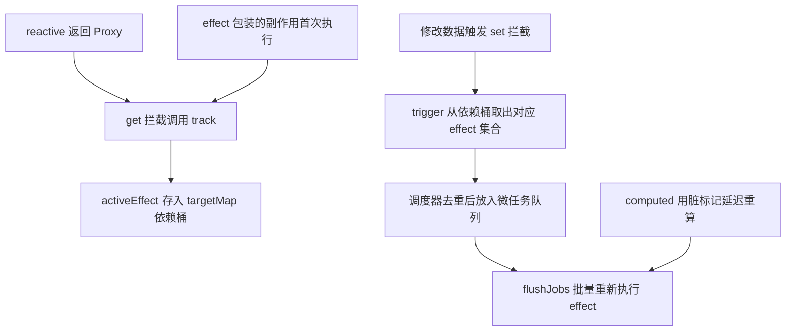

### V3-136：手写一个 50 行左右的简化版 Vue3 reactivity 核心（reactive + effect + track + trigger）？
**答**：
- 核心三件套：targetMap（WeakMap 存对象到属性依赖表的映射）、track 在 get 时收集 activeEffect、trigger 在 set 时取出并重新执行。
- effect 执行前置 activeEffect、结束后清空，保证只有"正在运行"的副作用被收集；重跑时先 cleanup 删掉旧依赖，解决分支切换导致的依赖残留。
- trigger 里跳过 activeEffect 自身，避免 effect 内部改依赖数据造成死循环。
- 面试话术：先写骨架，再口述扩展点——嵌套 effect 用栈、数组用 length 作特殊 key、懒执行加脏标记就是 computed、scheduler 换成回调就是 watch。

```javascript
// mini-reactivity.js —— 约 50 行核心实现
let activeEffect = null;
const targetMap = new WeakMap(); // obj -> Map<key, Set<effectRun>>

function track(target, key) {
  if (!activeEffect) return;
  let depsMap = targetMap.get(target);
  if (!depsMap) targetMap.set(target, (depsMap = new Map()));
  let deps = depsMap.get(key);
  if (!deps) depsMap.set(key, (deps = new Set()));
  deps.add(activeEffect);
  activeEffect.deps.push(deps); // 供 cleanup 反向删除旧依赖
}

function trigger(target, key) {
  const depsMap = targetMap.get(target);
  if (!depsMap) return;
  const effects = depsMap.get(key);
  if (!effects) return;
  [...effects].forEach((fn) => {
    if (fn !== activeEffect) (fn.scheduler || fn.run)(); // 有调度器走调度器，否则直接重跑
  });
}

function effect(fn) {
  const run = () => {
    cleanup(run);
    activeEffect = run;
    fn();
    activeEffect = null; // 简化版不支持嵌套；源码用 effectStack 解决
  };
  run.deps = [];
  run.scheduler = null;
  run();
  return run;
}

function cleanup(run) {
  run.deps.forEach((dep) => dep.delete(run));
  run.deps.length = 0;
}

function reactive(obj) {
  return new Proxy(obj, {
    get(target, key) {
      track(target, key);
      return Reflect.get(target, key);
    },
    set(target, key, value) {
      Reflect.set(target, key, value);
      trigger(target, key);
      return true;
    },
  });
}

// 验证：数据变化自动重跑副作用
const state = reactive({ count: 0 });
effect(() => console.log("count is", state.count)); // count is 0
state.count++; // 自动输出 count is 1
```

### V3-137：手写 ref 与 toRef？
**答**：
- RefImpl 类：`_value` 存 .value 的实际值（对象要 reactive 转换），dep 是收集 effect 的 Set。
- get value 时 track，set value 时用 Object.is 与原始值比较，相等不触发，这就是 ref 默认浅比较的来源。
- toRef 是"引用桥"：不复制值，get/set 直接转发到源对象，与 reactive 数据天然同步。
- shallowRef 即 `_value` 直接存原值不做深层转换；toRefs 就是把对象每个 key 都 toRef 一遍。

```javascript
// mini-ref.js
let activeEffect = null;
const isObject = (v) => typeof v === "object" && v !== null;

function reactive(obj) {
  return new Proxy(obj, {
    get(target, key) {
      track(target, key);
      return Reflect.get(target, key);
    },
    set(target, key, value) {
      Reflect.set(target, key, value);
      trigger(target, key);
      return true;
    },
  });
}
function track(target, key) { /* 同 V3-136，此处省略 */ }
function trigger(target, key) { /* 同 V3-136，此处省略 */ }

class RefImpl {
  constructor(value, shallow = false) {
    this._raw = value; // 原始值，用于相等比较
    this._value = shallow ? value : isObject(value) ? reactive(value) : value;
    this.dep = new Set();
  }
  get value() {
    if (activeEffect) this.dep.add(activeEffect); // track
    return this._value;
  }
  set value(newVal) {
    if (Object.is(newVal, this._raw)) return; // 值相等不触发
    this._raw = newVal;
    this._value = isObject(newVal) ? reactive(newVal) : newVal;
    [...this.dep].forEach((fn) => (fn.scheduler || fn.run)()); // trigger
  }
}

const ref = (v) => new RefImpl(v);
const shallowRef = (v) => new RefImpl(v, true);

// toRef：桥接对象，读写全部转发到源对象
function toRef(source, key) {
  return {
    get value() {
      if (activeEffect) track(source, key); // 依赖收集落到源对象上
      return source[key];
    },
    set value(newVal) {
      source[key] = newVal; // 写回源对象，触发源对象的 trigger
    },
  };
}
const toRefs = (obj) => Object.fromEntries(Object.keys(obj).map((k) => [k, toRef(obj, k)]));

// 验证
const state = reactive({ n: 1 });
const nRef = toRef(state, "n");
nRef.value++;                   // 等价于 state.n++
console.log(state.n, nRef.value); // 2 2

const count = ref({ list: [] });
count.value.list.push(1);       // 对象内部被 reactive 包装，深层修改也响应
```

### V3-138：手写 computed（懒执行 + 脏标记）？
**答**：
- 两个关键：dirty 脏标记 + value 缓存，被访问时若不脏直接返回缓存，实现"懒计算"。
- 内部用 effect 包 getter，把它的 scheduler 设为"标脏 + 通知订阅 computed 的 effect"，而不是立即重算。
- 数据变化 → scheduler 只置 dirty 为 true 并触发订阅者 → 订阅者读 value 时才真正重算。
- 链式传播：computedA 依赖 computedB 时，标脏会沿依赖链向上传递，源码里就是 computed 也持有自己的 dep。

```javascript
// mini-computed.js
let activeEffect = null;

// 支持 scheduler 的 effect（V3-136 的扩展版）
function createEffect(fn, { scheduler } = {}) {
  const run = () => {
    activeEffect = run;
    const result = fn();
    activeEffect = null;
    return result;
  };
  run.scheduler = scheduler;
  run(); // 首次执行仅为收集 getter 内的依赖
  return run;
}

function computed(getter) {
  let value;         // 缓存值
  let dirty = true;  // 脏标记：true 表示需要重算
  const subs = new Set(); // 订阅了此 computed 的外部 effect
  const runner = createEffect(getter, {
    scheduler() {
      if (!dirty) {
        dirty = true;                            // 先标脏，不立刻重算
        [...subs].forEach((fn) => (fn.scheduler || fn.run)()); // 再通知订阅者
      }
    },
  });
  return {
    get value() {
      if (dirty) {
        value = runner();   // 懒：被访问且脏了才重算
        dirty = false;
        if (activeEffect) subs.add(activeEffect); // 收集订阅者
      }
      return value;
    },
  };
}

// 验证
const state = reactive({ a: 1, b: 2 }); // reactive 同 V3-136
const sum = computed(() => {
  console.log("计算执行了");
  return state.a + state.b;
});
console.log(sum.value); // 打印"计算执行了"，输出 3
console.log(sum.value); // 直接输出 3，不打印：命中缓存
state.a = 10;           // 只标脏，不重算，无输出
console.log(sum.value); // 此时才重算，打印"计算执行了"，输出 12
```

### V3-139：手写 watch（支持 immediate、deep、清理函数）？
**答**：
- 把 getter 包成 effect，scheduler 作为触发点：触发时执行回调，新值现场取、旧值用闭包缓存。
- immediate 在建立侦听时先同步跑一次回调；deep 的本质是 traverse 递归遍历源数据，让所有深层属性都被 track。
- 回调第三参数 onCleanup：每次触发前先执行上一次注册的清理函数，典型用途是取消旧请求、清定时器（竞态处理）。
- 返回 stop 函数停止调度；组件卸载时源码会自动调用（effect 挂在实例 scope 下）。

```javascript
// mini-watch.js
function traverse(value, seen = new Set()) {
  if (typeof value !== "object" || value === null || seen.has(value)) return;
  seen.add(value);
  for (const key in value) traverse(value[key], seen); // 深层读一遍，触发全部 track
}

function watch(source, cb, { immediate = false, deep = false } = {}) {
  let oldValue, cleanup;
  const onCleanup = (fn) => (cleanup = fn);

  let getter = typeof source === "function" ? source : () => source;
  if (deep) {
    const rawGetter = getter;
    getter = () => traverse(rawGetter()); // deep 的本质：收集依赖时遍历所有属性
  }

  const job = () => {
    if (cleanup) cleanup();              // 上一次的清理先执行
    const newValue = runner();           // 重新执行 getter 拿新值（同时更新依赖）
    cb(newValue, oldValue, onCleanup);   // 回调签名与新值在前一致
    oldValue = newValue;
  };

  const runner = createEffect(getter, { scheduler: job });

  if (immediate) job();
  else oldValue = runner(); // 首次执行只为收集依赖并记录旧值

  return () => {
    cleanup && cleanup();
    runner.stopped = true; // 简化版：置标志位停止调度（源码从 dep 中摘除）
  };
}

// createEffect：在 V3-138 基础上加 stop 标志
function createEffect(fn, { scheduler } = {}) {
  const run = () => {
    activeEffect = run;
    const result = fn();
    activeEffect = null;
    return result;
  };
  run.scheduler = () => {
    if (!run.stopped) scheduler(); // stopped 后不再触发
  };
  run();
  return run;
}

// 用法：搜索防竞态
const state = reactive({ keyword: "" }); // reactive 同 V3-136
watch(
  () => state.keyword,
  async (val, old, onCleanup) => {
    const controller = new AbortController();
    onCleanup(() => controller.abort()); // 新搜索触发前作废旧请求
    await fetch(`/api/search?q=${val}`, { signal: controller.signal });
  },
  { immediate: true }
);
```

### V3-140：手写 provide / inject 的核心逻辑？
**答**：
- 本质是组件实例上的 provides 对象：初始化时用 `Object.create(parent.provides)` 继承父实例的 provides，形成原型链。
- provide 就是往当前实例的 provides 写 key；inject 沿原型链向上查找，找不到再走默认值逻辑。
- "逐层向上查找"不需要写循环——原型链本身就是查找链，这是最优雅的实现点。
- 生产版补充：inject 的默认值支持工厂函数（避免对象类型共享引用）、提供响应式对象保持同步、找不到时开发环境告警。

```javascript
// mini-provide-inject.js —— 组件实例上下文简化模型
function createComponentInstance(parent) {
  return {
    parent,
    // 关键：provides 继承父组件的 provides，形成原型链
    provides: parent ? Object.create(parent.provides) : Object.create(null),
  };
}

function provide(instance, key, value) {
  if (key in instance.provides) {
    console.warn(`provide 的 key ${key} 已被祖先占用，将覆盖`); // 源码的同名告警
  }
  instance.provides[key] = value; // 写在当前实例上，后代沿链可查
}

function inject(instance, key, defaultValue, needDefault = false) {
  if (key in instance.provides) {
    return instance.provides[key]; // `in` 沿原型链自动向上查找
  }
  if (needDefault) {
    // 默认值支持工厂：传函数时执行取结果，避免对象默认值被多处共享
    return typeof defaultValue === "function" ? defaultValue() : defaultValue;
  }
  console.warn(`injection ${key} 未找到且未提供默认值`);
}

// 演示：爷爷 -> 父 -> 子 的注入链
const grandpa = createComponentInstance(null);
provide(grandpa, "theme", "dark");

const parent = createComponentInstance(grandpa);
provide(parent, "api", { request: () => {} }); // 父层继续提供新 key

const child = createComponentInstance(parent);
console.log(inject(child, "theme")); // dark：沿原型链找到爷爷的 provide
console.log(inject(child, "api"));   // 父层提供的对象
console.log(inject(child, "missing", () => ({ size: "md" }), true)); // 工厂默认值

// 对应组件内的等价写法
// 祖先：provide("theme", themeRef)   —— 提供响应式对象，后代读到的永远是最新的
// 后代：const theme = inject("theme", ref("light"))
```

### V3-141：手写 nextTick（微任务批处理）？
**答**：
- 更新是异步批处理：改数据只把渲染 job 放进 queue（Set 天然去重），并用 Promise.then 注册一次 flush，同一轮内改 N 次只渲染 1 次。
- nextTick 返回 flush 完成后的 Promise，保证回调执行时 DOM 已更新；多个 nextTick 按注册顺序排队。
- flushing 标志区分当前批次：flush 期间新入队的 job 属于下一轮，保证本批次快照稳定。
- 兼容层可以口述：优先 Promise.then，降级 MutationObserver 再降级 setTimeout；源码还会按组件 uid 排序保证父先子后。

```javascript
// mini-next-tick.js
const queue = new Set();      // Set 天然去重：一个组件一帧内改多次只渲染一次
let flushing = false;
const resolvedPromise = Promise.resolve();

function queueJob(job) {
  // flushing 中新增的 job 交给下一轮，保证本次 flush 的快照稳定
  if (!flushing) queue.add(job);
  scheduleFlush();
}

function scheduleFlush() {
  if (!flushing) {
    flushing = true;
    resolvedPromise.then(flushJobs); // 微任务时机：同步代码全部跑完再统一渲染
  }
}

function flushJobs() {
  queue.forEach((job) => job()); // 生产版按 uid 排序：保证父组件先更新
  queue.clear();
  flushing = false;
}

// nextTick：把回调排在 flush 之后，拿到"已更新"的 DOM
function nextTick(fn) {
  const p = flushing ? resolvedPromise : resolvedPromise.then(flushJobs);
  return fn ? p.then(fn) : p;
}

// 验证批处理
const state = { count: 0 };
const render = () => console.log("渲染一次，count =", state.count);

queueJob(render);
queueJob(render);
queueJob(render); // 同一轮同步代码改 3 次
// 本轮微任务只输出一次：渲染一次，count = 0

nextTick(() => {
  console.log("DOM 已更新，可以安全读取尺寸/滚动位置");
});
```

### V3-142：手写 h 函数与 mount（vnode 渲染到 DOM）？
**答**：
- h 只是 createVNode 的语法糖：返回 `{ type, props, children }` 的普通 JS 对象，"模板编译产物 + 运行时"共同消费它。
- mount 处理三类 children：字符串/数字（textContent）、数组（递归挂载）、单个 vnode；props 分成 onXxx 事件与普通属性。
- vnode.el 反向挂回元素上，是后续 patch、unmount、动画的锚点。
- 分层延伸：mount 里的 createElement/appendChild 属于 runtime-dom，把这部分抽出去换掉就得到 custom renderer——canvas、终端渲染器就是这么来的。

```javascript
// mini-h-mount.js
function h(type, props, children) {
  return { type, props, children }; // vnode：对 DOM 的 JS 描述
}

function mount(vnode, container) {
  const el = (vnode.el = document.createElement(vnode.type)); // el 挂回 vnode 供 patch 用
  for (const key in vnode.props) {
    if (key.startsWith("on")) {
      // onClick -> click
      el.addEventListener(key.slice(2).toLowerCase(), vnode.props[key]);
    } else {
      el.setAttribute(key, vnode.props[key]);
    }
  }
  // children 三分支
  if (typeof vnode.children === "string" || typeof vnode.children === "number") {
    el.textContent = vnode.children;
  } else if (Array.isArray(vnode.children)) {
    vnode.children.forEach((child) => mount(child, el)); // 递归挂载子节点
  } else if (vnode.children) {
    mount(vnode.children, el); // 单个 vnode
  }
  container.appendChild(el);
  return el;
}

// 用法：等价于 <div class="box"><span>hi</span><button @click>点我</button></div>
const vnode = h("div", { class: "box" }, [
  h("span", null, "hi"),
  h("button", { onClick: () => console.log("clicked") }, "点我"),
]);

mount(vnode, document.querySelector("#app"));

// 后续扩展方向（口述即可）：
// unmount：vnode.el.remove()
// patch：新旧 type 不同直接替换；相同则更新 props 差异并 diff children（最长递增子序列）
// 平台无关：把 createElement/appendChild 抽象成 options 注入，即 custom renderer
```

## 第三十一章 指令系统实战

自定义指令是"给已有元素附加行为"的最小成本方案，大厂高频题集中在 loading、权限、复制、长按、懒加载这类通用行为，以及指令与组件的选型边界。

### V3-143：实现一个完整版的 v-loading 指令（服务式调用 + 多实例）？
**答**：
- 指令版：mounted/updated 按 binding.value 控制遮罩显隐，modifiers.fullscreen 支持全屏遮罩，binding.arg 传文案（`v-loading:导出中`）。
- 多实例关键：遮罩 append 到指令所在的目标元素（非全屏时给目标加 position: relative），而不是全局单例，多个区域可同时转圈。
- 服务版：提供 loading.show() / close()，适合请求拦截器、导出下载等"无锚点元素"的场景。
- 防重复挂载、zIndex 自增、unmounted 时清理 DOM，三个细节是面试加分点。

```vue
<!-- directives/loading.ts（指令 + 服务双形态）+ 使用示例 -->
<script setup lang="ts">
import { ref, type Directive } from "vue";

// ---------- 指令与服务实现 ----------
let zIndex = 2000;
const MASK_CLASS = "v-loading-mask";

function createMask(text: string, fullscreen: boolean) {
  const mask = document.createElement("div");
  mask.className = MASK_CLASS;
  mask.style.zIndex = String(zIndex++);
  if (fullscreen) mask.classList.add("is-fullscreen");
  mask.innerHTML = `<div class="v-loading-spinner"><div class="spin"></div><p>${text}</p></div>`;
  return mask;
}
function showMask(el: HTMLElement, text: string, fullscreen: boolean) {
  if (el.querySelector(`.${MASK_CLASS}`)) return; // 防重复
  if (!fullscreen) el.style.position ||= "relative"; // 局部遮罩需要相对定位
  el.appendChild(createMask(text, fullscreen));
}
function hideMask(el: HTMLElement) {
  el.querySelector(`.${MASK_CLASS}`)?.remove();
}

export const vLoading: Directive<HTMLElement, boolean> = {
  mounted(el, binding) {
    if (binding.value) showMask(el, binding.arg || "加载中", !!binding.modifiers.fullscreen);
  },
  updated(el, binding) {
    if (binding.value === binding.oldValue) return;
    binding.value
      ? showMask(el, binding.arg || "加载中", !!binding.modifiers.fullscreen)
      : hideMask(el);
  },
  unmounted(el) {
    hideMask(el); // 卸载清理，防 DOM 泄漏
  },
};

// 服务式：无锚点场景（拦截器、导出）
export const loadingService = {
  show(text = "加载中") {
    showMask(document.body, text, true);
    return { close: () => hideMask(document.body) };
  },
};

// ---------- 使用示例 ----------
const tableLoading = ref(false);
async function fetchData() {
  tableLoading.value = true;
  await new Promise((r) => setTimeout(r, 1000));
  tableLoading.value = false;
}
</script>

<template>
  <!-- 局部遮罩：只罩住 .card；v-loading:xxx 冒号后是文案 -->
  <div v-loading:拼命加载中="tableLoading" class="card">
    <p>表格内容...</p>
  </div>
  <button @click="fetchData">加载表格</button>
  <button @click="loadingService.show('导出中').close.bind(null)">全屏 loading（实际项目先存句柄）</button>
</template>

<style>
.v-loading-mask { position: absolute; inset: 0; background: rgba(255, 255, 255, 0.7); display: grid; place-items: center; }
.v-loading-mask.is-fullscreen { position: fixed; }
.v-loading-spinner .spin { width: 32px; height: 32px; border: 3px solid #409eff; border-top-color: transparent; border-radius: 50%; animation: v-spin 1s linear infinite; margin: 0 auto 8px; }
@keyframes v-spin { to { transform: rotate(360deg); } }
</style>
```

### V3-144：实现按钮级的 v-permission 权限指令？
**答**：
- 从用户 store 取权限码集合，与 binding.value（单码或数组）比对，无权限则隐藏元素。
- 隐藏用 display:none + dataset 标记，而不是 removeChild：保持 vnode 树与 DOM 的对应关系稳定，权限变化时还能恢复。
- modifiers.all 支持"必须拥有全部权限码"模式，默认 some（任一满足即可）。
- 指令工厂 createPermissionDirective 注入权限来源，方便不同项目复用；同时强调按钮级权限只是前端体验，接口层必须后端再校验。

```vue
<!-- directives/permission.ts + 使用示例 -->
<script setup lang="ts">
import { type Directive } from "vue";

// 模拟用户权限（真实项目来自 pinia 的 useUserStore）
const userCodes = ref<string[]>(["system:user:add", "order:export"]);

// 指令工厂：权限来源可注入，便于复用与测试
function createPermissionDirective(
  getCodes: () => string[]
): Directive<HTMLElement, string | string[]> {
  return {
    mounted(el, binding) {
      const need = Array.isArray(binding.value) ? binding.value : [binding.value];
      const owned = getCodes();
      const pass = binding.modifiers.all
        ? need.every((c) => owned.includes(c)) // all 修饰符：必须全部拥有
        : need.some((c) => owned.includes(c)); // 默认 some：任一满足即可
      if (!pass) {
        el.style.display = "none";   // 隐藏而非移除：保持 DOM 与 vnode 对应
        el.dataset.permHidden = "1"; // 标记，便于调试与恢复
      }
    },
    updated(el, binding) {
      // 权限码运行期变化（切换租户/角色）时同步显隐
      const need = Array.isArray(binding.value) ? binding.value : [binding.value];
      const owned = getCodes();
      const pass = need.some((c) => owned.includes(c));
      el.style.display = pass ? "" : "none";
    },
  };
}

const vPerm = createPermissionDirective(() => userCodes.value);
</script>

<template>
  <button v-perm="'system:user:add'">新增用户</button>
  <!-- 无 system:user:delete 权限，按钮被隐藏 -->
  <button v-perm="'system:user:delete'">删除用户</button>
  <!-- 必须同时拥有两个权限码 -->
  <button v-perm.all="['order:export', 'order:audit']">导出并审核</button>
</template>
```

### V3-145：实现 v-copy 一键复制指令？
**答**：
- 优先 `navigator.clipboard.writeText`（异步 API，要求 https 或 localhost）。
- 降级方案：隐藏 textarea + `document.execCommand("copy")`，兼容 http 与旧内核 WebView。
- 通过 CustomEvent 把成功/失败抛给使用方，指令本身不耦合 toast 组件；也可提供可选的成功回调选项。
- 注意 handler 必须提取成具名引用，unmounted 才能 removeEventListener，避免内存泄漏。

```vue
<!-- directives/copy.ts + 使用示例 -->
<script setup lang="ts">
import { ref, type Directive } from "vue";

type CopyHandler = (e: MouseEvent) => void;

const vCopy: Directive<HTMLElement, string> = {
  mounted(el, binding) {
    const handler: CopyHandler = async (e) => {
      e.stopPropagation();
      const text = binding.value ?? el.textContent?.trim() ?? "";
      try {
        await navigator.clipboard.writeText(text); // 首选：async clipboard
        el.dispatchEvent(new CustomEvent("copy:success", { detail: text }));
      } catch {
        // 降级：隐藏 textarea + execCommand，兼容 http / 旧 WebView
        const ta = document.createElement("textarea");
        ta.value = text;
        ta.style.cssText = "position:fixed;opacity:0;pointer-events:none";
        document.body.appendChild(ta);
        ta.select();
        document.execCommand("copy");
        ta.remove();
        el.dispatchEvent(new CustomEvent("copy:success", { detail: text }));
      }
      el.classList.add("copied"); // 轻量视觉反馈
      setTimeout(() => el.classList.remove("copied"), 600);
    };
    (el as any)._copyHandler = handler;
    el.addEventListener("click", handler);
  },
  unmounted(el) {
    el.removeEventListener("click", (el as any)._copyHandler); // 必须用同一引用移除
  },
};

const sn = ref("VUE3-2026-0011");
const onCopied = (e: Event) => console.log("已复制：", (e as CustomEvent).detail);
</script>

<template>
  <span v-copy="sn" @copy:success="onCopied" class="sn">{{ sn }}（点击复制）</span>
</template>

<style>
.sn { cursor: pointer; border-bottom: 1px dashed #999; }
.sn.copied { color: #409eff; }
</style>
```

### V3-146：实现 v-longpress 长按指令（含与 click 的冲突处理）？
**答**：
- 交互模型：mousedown/touchstart 启动定时器，超过时长（默认 500ms）触发回调；mouseup/touchend/touchleave 提前取消。
- 关键冲突点：长按成功后手指抬起还会产生一次 click，需在捕获阶段拦截并 stopImmediatePropagation。
- 移动端可用 navigator.vibrate 提供触觉反馈；touchstart 要加 passive 选项避免阻塞滚动。
- cleanup 统一封装，unmounted 时全部解绑。

```vue
<!-- directives/longpress.ts + 使用示例 -->
<script setup lang="ts">
import { type Directive } from "vue";

type LongpressHandler = (e: Event) => void;

const vLongpress: Directive<HTMLElement, LongpressHandler> = {
  mounted(el, binding) {
    const duration = 500; // 长按阈值，可扩展为 binding.arg 传入
    let timer: ReturnType<typeof setTimeout> | null = null;
    let longPressed = false;

    const start = (e: Event) => {
      longPressed = false;
      timer = setTimeout(() => {
        longPressed = true;
        navigator.vibrate?.(30); // 移动端触觉反馈
        binding.value(e);
      }, duration);
    };
    const cancel = () => {
      if (timer) clearTimeout(timer);
      timer = null;
    };
    // 长按成功后拦截随后的 click：捕获阶段阻止，避免既弹菜单又触发点击
    const onClick = (e: MouseEvent) => {
      if (longPressed) {
        e.stopImmediatePropagation();
        e.preventDefault();
        longPressed = false;
      }
    };

    el.addEventListener("mousedown", start);
    el.addEventListener("touchstart", start, { passive: true });
    ["mouseup", "mouseleave", "touchend", "touchcancel"].forEach((ev) =>
      el.addEventListener(ev, cancel)
    );
    el.addEventListener("click", onClick, true);
    (el as any)._lpCleanup = () => {
      cancel();
      el.removeEventListener("mousedown", start);
      el.removeEventListener("touchstart", start);
      ["mouseup", "mouseleave", "touchend", "touchcancel"].forEach((ev) =>
        el.removeEventListener(ev, cancel)
      );
      el.removeEventListener("click", onClick, true);
    };
  },
  unmounted(el) {
    (el as any)._lpCleanup?.();
  },
};

function showMenu() {
  console.log("弹出消息操作菜单：复制 / 撤回 / 转发");
}
</script>

<template>
  <!-- 常见场景：聊天消息长按弹菜单 -->
  <div class="msg" v-longpress="showMenu" @click="console.log('普通点击')">
    长按我弹出操作菜单
  </div>
</template>

<style>
.msg { padding: 12px 16px; background: #f4f4f5; border-radius: 8px; user-select: none; width: fit-content; }
</style>
```

### V3-147：实现增强版 v-lazy 图片懒加载（失败重试 + webp 降级）？
**答**：
- IntersectionObserver 监听进入视口（rootMargin 提前 200px 预加载），进入后 disconnect 再加载，比 scroll 监听性能好。
- webp 能力一次性探测并缓存：支持时把 .jpg/.png URL 替换成 CDN 的 .webp（七牛/OSS 常见规则），不支持时退回原格式。
- 失败重试链：webp 失败先退回原格式，再失败按指数退避（500ms * 2^n）重试，超过上限兜底占位图。
- 加载成功淡入（opacity 过渡），卸载时 disconnect observer 防泄漏。

```vue
<!-- directives/lazy.ts + 使用示例 -->
<script setup lang="ts">
import { type Directive } from "vue";

const RETRY_LIMIT = 3;

// webp 能力探测：一次性缓存结果
let webpSupported: boolean | null = null;
function detectWebp(): boolean {
  if (webpSupported !== null) return webpSupported;
  const canvas = document.createElement("canvas");
  canvas.width = canvas.height = 1;
  webpSupported = canvas.toDataURL("image/webp").startsWith("data:image/webp");
  return webpSupported;
}

function load(el: HTMLImageElement, src: string, retry: number) {
  const finalSrc = detectWebp()
    ? src.replace(/\.(png|jpe?g)(\?|$)/, ".webp$2") // CDN webp 参数规则
    : src;
  const img = new Image();
  img.onload = () => {
    el.src = finalSrc;
    el.style.opacity = "1"; // 淡入
  };
  img.onerror = () => {
    if (retry === 0 && finalSrc !== src) return load(el, src, 1); // webp 失败退回原格式
    if (retry < RETRY_LIMIT) {
      return setTimeout(() => load(el, src, retry + 1), 500 * 2 ** retry); // 指数退避
    }
    el.src = "data:image/svg+xml;base64,PHN2Zy8+"; // 兜底占位图
    el.style.opacity = "1";
  };
  img.src = finalSrc;
}

const vLazy: Directive<HTMLImageElement, string> = {
  mounted(el, binding) {
    el.style.opacity = "0";
    el.style.transition = "opacity .3s";
    const io = new IntersectionObserver(
      (entries) => {
        if (!entries[0].isIntersecting) return;
        io.disconnect();
        load(el, binding.value, 0);
      },
      { rootMargin: "200px 0px" } // 提前 200px 预加载
    );
    io.observe(el);
    (el as any)._lazyIO = io;
  },
  unmounted(el) {
    (el as any)._lazyIO?.disconnect(); // 防泄漏
  },
};

const goods = Array.from({ length: 30 }, (_, i) => ({ id: i + 1, img: `/img/item-${i + 1}.jpg` }));
</script>

<template>
  <ul class="list">
    <li v-for="g in goods" :key="g.id">
      
    </li>
  </ul>
</template>
```

### V3-148：指令 vs 组件的选型边界是什么？什么时候该用指令？
**答**：
- 判断核心问题：这个能力"要不要呈现自己的结构"？需要自己的 DOM、状态、插槽、样式 → 组件；只改变既有元素的"行为或外观" → 指令。
- 典型指令场景：v-focus、权限显隐、复制、长按、懒加载、拖拽句柄、埋点上报——都是对宿主元素的行为增强。
- 典型组件场景：Dialog、Table、Uploader、DatePicker——有自己的 UI 树与生命周期，指令装不下。
- 补充边界：需要跨组件复用且与 DOM 无关的逻辑用 composable；指令适合"逻辑与某个 DOM 元素强绑定"的场景，且指令里不要写业务请求。

```vue
<!-- 选型对照：同一个"复制"能力，指令版与组件版各自的适用形态 -->
<script setup lang="ts">
import { defineComponent, h, type Directive } from "vue";

// 适合指令：无自身 UI，纯给宿主元素附加"点击复制"行为
const vCopyText: Directive<HTMLElement, string> = {
  mounted(el, { value }) {
    const handler = () => navigator.clipboard?.writeText(value);
    (el as any)._copy = handler;
    el.addEventListener("click", handler);
  },
  unmounted(el) {
    el.removeEventListener("click", (el as any)._copy);
  },
};

// 适合组件：有自己的按钮 UI、状态与样式，可被任何地方组合
const CopyButton = defineComponent({
  props: { text: { type: String, required: true } },
  setup(props) {
    return () =>
      h("button", { class: "copy-btn", onClick: () => navigator.clipboard?.writeText(props.text) }, "复制");
  },
});

// 选型速查（面试口述版）：
// 指令：focus / 权限 / 复制 / 长按 / 懒加载 / 拖拽 —— 行为增强，宿主已有
// 组件：Dialog / Table / Uploader —— 自带结构与状态
// composable：useMouse / useFetch —— 与 DOM 无关的逻辑复用
</script>

<template>
  <!-- 链接已存在，只需附加行为 -> 指令更轻 -->
  <a v-copy-text="'https://vuejs.org'" href="https://vuejs.org">Vue 官网</a>
  <!-- 需要一个自带样式的按钮实体 -> 用组件 -->
  <CopyButton text="https://vuejs.org" />
</template>

<style>
.copy-btn { padding: 4px 12px; }
</style>
```

## 第三十二章 过渡与动画工程

Vue 过渡体系 = Transition（单元素进出）+ TransitionGroup（列表 FLIP）+ JS 钩子（接动画库）。工程化重点是：路由过渡方案、动画库集成边界、复杂时间轴编排。

### V3-149：Transition 的完整用法有哪些？JS 钩子怎么配合 CSS 类使用？
**答**：
- 完整清单：name 命名类、mode="out-in|in-out" 控制新旧元素时序、appear 首次渲染也过渡、enter/leave 六段类名。
- JS 钩子四件套：@before-enter、@enter、@leave、@after-enter；用了 JS 钩子通常配 `:css="false"` 跳过类名探测，由 done() 显式收尾。
- 典型组合：列表项用 CSS 管 hover 等简单过渡，进出场用 JS 钩子接 Web Animations API 或 gsap。
- 注意点：Transition 只对单元素/单组件生效，切换靠 key 或 v-if/v-else 分支。

```vue
<script setup lang="ts">
import { ref } from "vue";

const status = ref<"loading" | "done">("loading");

// JS 钩子：用 Web Animations API，done() 收尾（也可配 :css="false" 跳过类名探测）
function onBeforeEnter(el: Element) {
  (el as HTMLElement).style.opacity = "0";
}
function onEnter(el: Element, done: () => void) {
  (el as HTMLElement)
    .animate(
      [
        { opacity: 0, transform: "translateY(-20px)" },
        { opacity: 1, transform: "translateY(0)" },
      ],
      { duration: 400, easing: "ease-out" }
    )
    .onfinish = done; // 必须调用 done，Vue 才知道动画结束
}
function onLeave(el: Element, done: () => void) {
  (el as HTMLElement)
    .animate([{ opacity: 1 }, { opacity: 0, transform: "translateY(20px)" }], {
      duration: 300,
      easing: "ease-in",
    })
    .onfinish = done;
}

function finish() {
  status.value = status.value === "loading" ? "done" : "loading";
}
</script>

<template>
  <!-- mode out-in：先离场再进场，避免两个状态叠在一起 -->
  <Transition mode="out-in" appear @before-enter="onBeforeEnter" @enter="onEnter" @leave="onLeave">
    <p :key="status" class="status">{{ status === "loading" ? "加载中..." : "加载完成" }}</p>
  </Transition>
  <button @click="finish">切换状态</button>
</template>

<style>
.status { font-weight: bold; }
</style>
```

### V3-150：TransitionGroup 如何实现列表排序动画（FLIP 原理）？
**答**：
- FLIP 四步：First 记录元素旧位置 → Last 应用新位置 → Invert 用 transform 反向偏移回旧位 → Play 过渡回 0。TransitionGroup 自动帮你做。
- 你只需要写对 `.xxx-move` 类（管位移）、`.xxx-enter/leave-active`（管进出）。
- 关键坑：`.leave-active { position: absolute }` 让离场元素脱离文档流，其余元素才能立即补位产生平滑移动动画。
- 每个列表项必须有稳定的 key（通常业务 id），用 index 作 key 移动动画会错乱。

```vue
<script setup lang="ts">
import { ref } from "vue";

let id = 0;
const items = ref(
  Array.from({ length: 5 }, () => ({ id: ++id, name: `item-${id}` }))
);

function shuffle() {
  items.value = [...items.value].sort(() => Math.random() - 0.5); // 乱序触发 move 动画
}
function remove(item: { id: number }) {
  items.value = items.value.filter((i) => i.id !== item.id);
}
function add() {
  items.value.push({ id: ++id, name: `item-${id}` });
}
</script>

<template>
  <button @click="shuffle">乱序</button>
  <button @click="add">加一项</button>
  <!-- TransitionGroup 自动执行 FLIP；tag 指定渲染成 ul -->
  <TransitionGroup name="flip" tag="ul">
    <li v-for="item in items" :key="item.id" class="row">
      {{ item.name }}
      <button @click="remove(item)">删</button>
    </li>
  </TransitionGroup>
</template>

<style>
.flip-move { transition: transform 0.4s ease; }          /* 核心：位移过渡 */
.flip-enter-active, .flip-leave-active { transition: all 0.3s; }
.flip-leave-active { position: absolute; }                /* 关键：离场脱离文档流，其余项才能补位 */
.flip-enter-from, .flip-leave-to { opacity: 0; transform: translateX(30px); }
.row { width: 240px; }
</style>
```

### V3-151：路由过渡动画的工程化方案是什么？
**答**：
- router-view 用默认插槽拿 Component，包一层 Transition；`:key="route.path"` 保证同组件不同参数也触发过渡。
- `mode="out-in"` 是页面过渡的默认选择，避免新旧页面同屏叠加闪烁。
- 通过 route.meta.transition 给不同页面配不同动画名（列表页 slide、详情页 zoom），一处配置全局生效。
- 性能注意：过渡期间新旧页面同时存在，重型页面避免过长动画；SSR 首屏建议 appear 关闭或缩短。

```vue
<!-- src/layouts/Default.vue —— 布局层统一接管路由过渡 -->
<script setup lang="ts">
import { useRoute } from "vue-router";

const route = useRoute();
// 路由配置示例：
// { path: "/list", meta: { transition: "fade-slide" } }
// { path: "/detail/:id", meta: { transition: "zoom" } }
</script>

<template>
  <header>顶部导航</header>
  <router-view v-slot="{ Component }">
    <Transition :name="(route.meta.transition as string) || 'fade-slide'" mode="out-in">
      <component :is="Component" :key="route.path" />
    </Transition>
  </router-view>
</template>

<style>
/* 默认：淡入 + 平移 */
.fade-slide-enter-active, .fade-slide-leave-active { transition: opacity .25s ease, transform .25s ease; }
.fade-slide-enter-from { opacity: 0; transform: translateX(16px); }
.fade-slide-leave-to { opacity: 0; transform: translateX(-16px); }
/* 详情页：缩放进场 */
.zoom-enter-active, .zoom-leave-active { transition: opacity .3s ease, transform .3s ease; }
.zoom-enter-from { opacity: 0; transform: scale(.96); }
.zoom-leave-to { opacity: 0; transform: scale(1.02); }
</style>
```

### V3-152：如何在 Vue3 中集成 GSAP（或 motion-v）这类动画库？
**答**：
- 职责划分：简单状态过渡交给 Vue 的 CSS 类；进入离开编排、数字滚动、复杂 timeline 交给 gsap，通过 JS 钩子桥接。
- gsap.from/to 操作的就是钩子传入的 el，onComplete 里调用 done() 让 Vue 结束过渡。
- 列表场景：TransitionGroup 的 move 类负责补位动画，enter/leave 钩子用 gsap 做进场与退场，二者叠加不冲突。
- motion-v 是 motion 的 Vue 移植，思路相同但走声明式 props（:initial/:animate/:exit），适合声明式为主的团队。

```vue
<script setup lang="ts">
import { ref } from "vue";
import gsap from "gsap";

const list = ref(["A", "B", "C"]);

// enter/leave 走 gsap 编排，move 补位交给 CSS 类
function onEnter(el: Element, done: () => void) {
  gsap.from(el, { opacity: 0, y: 24, duration: 0.5, ease: "power2.out", onComplete: done });
}
function onLeave(el: Element, done: () => void) {
  gsap.to(el, { opacity: 0, y: 12, duration: 0.3, ease: "power1.in", onComplete: done });
}
function add() {
  list.value.push(String.fromCharCode(65 + list.value.length));
}
</script>

<template>
  <button @click="add">加一项</button>
  <TransitionGroup name="g" tag="ul" @enter="onEnter" @leave="onLeave">
    <li v-for="(item, i) in list" :key="item" class="row" @click="list.splice(i, 1)">
      {{ item }}（点击删除）
    </li>
  </TransitionGroup>
</template>

<style>
.g-move { transition: transform .4s ease; } /* 补位动画仍由 CSS 负责 */
.g-leave-active { position: absolute; }     /* 离场脱离文档流 */
.row { width: 260px; }
</style>
```

### V3-153：如何封装一个时间轴调度器来编排复杂进场动画？
**答**：
- 复杂编排的本质是"步骤串行 + 步骤间延迟 + 可取消"，用 async/await 实现比嵌套 setTimeout 可读得多。
- useTimeline 提供 run(steps) 与 cancel()；每步是 { run, after }，after 表示与上一步的间隔。
- 取消通过 token 标志位实现：sleep 与 run 检查标志，取消后抛出可捕获的错误，组件卸载时调用 cancel 清理。
- 适用于大屏进场、引导流程（onboarding）、多阶段营销页等"多元素按节奏依次出现"的场景。

```typescript
// composables/useTimeline.ts —— 步骤编排器：串行 + 间隔 + 可取消
type Step = () => void | Promise<void>;
interface TimelineStep {
  run: Step;
  after?: number; // 与上一步的间隔 ms
}

export function useTimeline() {
  let cancelled = false;

  const sleep = (ms: number) =>
    new Promise<void>((resolve, reject) => {
      setTimeout(() => (cancelled ? reject(new Error("timeline cancelled")) : resolve()), ms);
    });

  async function run(steps: TimelineStep[]) {
    cancelled = false;
    for (const step of steps) {
      if (cancelled) throw new Error("timeline cancelled");
      if (step.after) await sleep(step.after); // 步骤间节奏
      await step.run();                        // 串行执行
    }
  }

  const cancel = () => (cancelled = true); // 组件卸载时调用，防止动画泄漏
  return { run, cancel };
}

// 用法：大屏进场 = 标题滑入 -> 卡片依次淡入 -> 图表绘制
// import { onMounted, onUnmounted } from "vue";
// const { run, cancel } = useTimeline();
// onMounted(async () => {
//   try {
//     await run([
//       { run: () => animateIn(titleEl), after: 0 },
//       { run: () => Promise.all(cards.map((c, i) => animateIn(c, i * 80))), after: 200 },
//       { run: () => renderChart(), after: 150 },
//     ]);
//   } catch { /* 被 cancel 或组件卸载，静默结束 */ }
// });
// onUnmounted(cancel);
```

## 第三十三章 大型项目架构

大型 Vue3 项目的架构题考察"分层意识 + 落地细节"：目录分层与依赖方向、MPA/微前端、主题与国际化、接口与错误处理体系。答题套路：先给全景图，再讲每层的边界与关键实现。

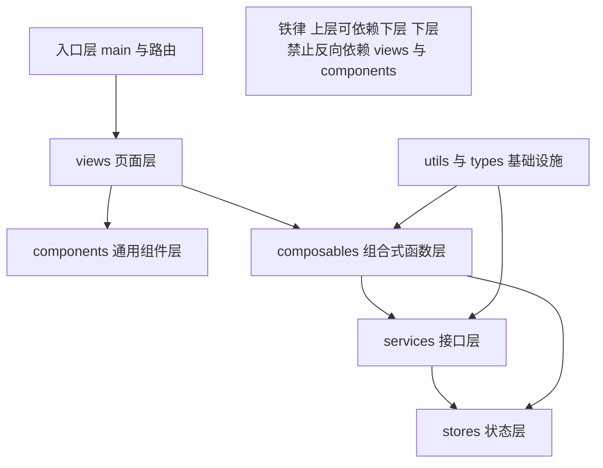

### V3-154：Vue3 中大型项目的分层架构怎么设计？
**答**：
- 目录分层：views（页面）/ components（通用组件）/ composables（逻辑复用）/ services（接口与 DTO）/ stores（跨页面状态）/ utils、types（基础设施）。
- 依赖方向铁律：上层可依赖下层，下层禁止反向依赖；views 可调 composables 与 services，services 不得 import views。违反方向的依赖是架构腐化的起点。
- 状态归属原则：服务端状态放"请求 + 缓存"（TanStack Query 或自研 useRequest），客户端状态（登录、主题、权限）放 pinia，组件私有状态留在组件内。
- 页面内再分层：一个 views 页面内部拆"容器组件（取数）+ 展示组件（纯渲染）+ 页面级 composable"。
- 落地保障：eslint import 边界规则（eslint-plugin-boundaries）+ API 类型自动生成，靠工具而非自觉维持分层。

```typescript
// architecture.config.ts —— 用目录约定 + import 规则把分层固化下来
export const layerRules = {
  // 目录即分层
  layers: {
    views: "src/views —— 页面容器，只做取数与编排",
    components: "src/components —— 通用展示组件，不依赖业务 store",
    composables: "src/composables —— 可复用逻辑，可依赖 services 与 stores",
    services: "src/services —— 接口封装与 DTO 转换，禁止 import vue 组件",
    stores: "src/stores —— 客户端全局状态，只存登录/权限/主题等",
    utils: "src/utils —— 纯函数，谁都可以依赖它，它不依赖任何人",
  },
  // eslint-plugin-boundaries 的规则表达（伪配置）
  importBoundaries: [
    { from: "views", allow: ["components", "composables", "services", "stores", "utils"] },
    { from: "components", allow: ["composables", "utils"], forbid: ["views", "services", "stores"] },
    { from: "composables", allow: ["services", "stores", "utils"] },
    { from: "services", allow: ["utils"], forbid: ["views", "components", "stores"] },
    { from: "stores", allow: ["services", "utils"] },
  ],
  // 状态归属速查
  stateOwnership: {
    serverState: "请求缓存：useRequest / TanStack Query，不进 pinia",
    clientState: "登录、权限、主题：pinia",
    localState: "表单草稿、弹窗开关：组件内 ref",
  },
};

// 一个页面内部的再分层示意
// views/order/OrderList.vue        —— 容器：调 useOrderList，编排布局
// views/order/useOrderList.ts      —— 页面级 composable：取数 + 筛选状态
// views/order/OrderTable.vue       —— 展示：纯 props 进 emit 出
```

### V3-155：多入口多页面（MPA）架构在 Vite 下怎么配置？
**答**：
- 适用场景：官网 + 控制台 + 活动页这类"页面间无需共享 SPA 状态"的项目，MPA 能让每个入口独立构建、按需加载、互不影响。
- 核心配置：`build.rollupOptions.input` 指定多个 html 入口；开发时访问对应路径即可。
- 目录约定：每个入口一个目录，各自 main.ts + router（createWebHistory 不同 basename）。
- 共享代码放 src/shared，通过别名引入；公共依赖注意版本一致，避免 vendor 重复体积。

```typescript
// vite.config.ts —— 多入口 MPA 完整配置
import { defineConfig } from "vite";
import vue from "@vitejs/plugin-vue";
import { resolve } from "path";
import { readdirSync, statSync, existsSync } from "fs";

// 自动收集 src/pages/*/index.html 作为入口，新增页面零配置
function getMpaInputs() {
  const pagesDir = resolve(__dirname, "src/pages");
  const inputs: Record<string, string> = {};
  for (const name of readdirSync(pagesDir)) {
    const html = resolve(pagesDir, name, "index.html");
    if (statSync(resolve(pagesDir, name)).isDirectory() && existsSync(html)) {
      inputs[name] = html; // key 即产物目录名：dist/home/index.html
    }
  }
  return inputs;
}

export default defineConfig({
  plugins: [vue()],
  resolve: {
    alias: { "@": resolve(__dirname, "src") },
  },
  build: {
    rollupOptions: {
      input: {
        home: resolve(__dirname, "src/pages/home/index.html"),
        admin: resolve(__dirname, "src/pages/admin/index.html"),
        activity: resolve(__dirname, "src/pages/activity/index.html"),
      },
    },
  },
});

// 目录结构：
// src/pages/home/main.ts      -> createApp(App).use(createWebHistory 入口 router "home")
// src/pages/admin/main.ts     -> 独立 router，basename 为 /admin
// src/pages/activity/main.ts  -> 活动页可极简，不需要 router
// src/shared/                 -> 公共组件、utils、api，各入口按需引用
```

### V3-156：微前端场景下 Vue 主/子应用（qiankun）如何实践？
**答**：
- 主应用注册子应用（entry、activeRule、container），子应用导出 bootstrap/mount/unmount 三个生命周期。
- Vue3 子应用关键点：mount 里 createApp，unmount 里必须 app.unmount() 并清空容器 DOM，否则热更新与重复挂载会出鬼问题。
- 样式隔离：子应用配 scoped 或用实验性 strictStyleIsolation；运行时 JS 隔离 qiankun 默认提供。
- 共享依赖：公共的 vue/pinia/router 通过主应用 external + 子应用 webpack externals（或 Vite 用 vite-plugin-qiankun）避免多份实例；跨应用通信用 initGlobalState 或自定义事件。
- 路由注意：子应用 base 要与 activeRule 对齐，push 路由时带子应用前缀。

```typescript
// 主应用 main.ts —— 注册与共享
import { registerMicroApps, initGlobalState, start } from "qiankun";

registerMicroApps([
  {
    name: "sub-vue3",
    entry: "//localhost:7101",
    container: "#sub-app",
    activeRule: "/sub", // 命中前缀时挂载子应用
    props: { token: localStorage.getItem("token") }, // 下发登录态
  },
]);

// 跨应用通信：全局状态
const actions = initGlobalState({ user: null });
actions.onGlobalStateChange((state) => console.log("主应用收到：", state));

start({ prefetch: true }); // 预加载子应用资源

// ---------------- 子应用 ----------------
// sub-vue3/src/main.ts —— 三个生命周期
import { createApp } from "vue";
import { createRouter, createWebHistory } from "vue-router";
import App from "./App.vue";

let app: ReturnType<typeof createApp> | null = null;
let router: ReturnType<typeof createRouter> | null = null;

export async function bootstrap() {
  console.log("sub-vue3 bootstrap");
}

export async function mount(props: { container: HTMLElement; onGlobalStateChange: Function }) {
  app = createApp(App);
  router = createRouter({
    history: createWebHistory("/sub"), // base 与主应用 activeRule 对齐
    routes: [{ path: "/", component: () => import("./pages/Index.vue") }],
  });
  app.use(router);
  app.provide("globalState", props); // 把主应用 props 注入后代
  app.mount(props.container.querySelector("#sub-root")!);
}

export async function unmount() {
  app?.unmount();
  app = null;
  // 关键：清空容器 DOM，防止 qiankun 复用容器时出现重复节点
  document.querySelectorAll("#sub-root").forEach((el) => (el.innerHTML = ""));
}
```

### V3-157：多主题（动态换肤）方案的完整实现？
**答**：
- 基座：全局 CSS 变量定义调色板（--el-color-primary 等），Element Plus 通过 2.3+ 的官方 CSS 变量直接改。
- 换肤动作：`document.documentElement.setAttribute("data-theme", theme)`，不同 data-theme 写不同的变量覆盖块。
- 持久化与跟随系统：localStorage 记忆 + matchMedia prefers-color-scheme 监听，用户显式选择优先于系统。
- 图表等 JS 颜色：集中 theme tokens 导出，ECharts 配置从 tokens 取，避免 JS 硬编码颜色与 CSS 脱节。

```vue
<!-- src/composables/useTheme.ts + App.vue -->
<script setup lang="ts">
import { ref, watchEffect } from "vue";

type Theme = "light" | "dark";

const theme = ref<Theme>((localStorage.getItem("theme") as Theme) || "light");
const followSystem = ref(!localStorage.getItem("theme"));

// 跟随系统：用户未显式选择时监听 prefers-color-scheme
const media = matchMedia("(prefers-color-scheme: dark)");
if (followSystem.value) {
  media.addEventListener("change", (e) => {
    if (followSystem.value) theme.value = e.matches ? "dark" : "light";
  });
}

watchEffect(() => {
  // 核心：只改 html 的 data-theme，所有变量覆盖块生效
  document.documentElement.setAttribute("data-theme", theme.value);
  localStorage.setItem("theme", theme.value);
});

function toggle() {
  followSystem.value = false; // 用户显式选择后不再跟随系统
  theme.value = theme.value === "light" ? "dark" : "light";
}
</script>

<template>
  <button @click="toggle">切换主题（当前 {{ theme }}）</button>
  <main>
    <p>正文内容，颜色随主题切换</p>
  </main>
</template>

<style>
/* :root 定义默认（light）调色板 */
:root {
  --color-bg: #ffffff;
  --color-text: #303133;
  --color-primary: #409eff;
  --el-color-primary: #409eff; /* Element Plus 官方变量直接复用 */
}
/* data-theme=dark 只覆盖变量，组件样式不用动 */
[data-theme="dark"] {
  --color-bg: #141414;
  --color-text: #e5eaf3;
  --color-primary: #3375b9;
  --el-color-primary: #3375b9;
}
main { background: var(--color-bg); color: var(--color-text); }
button { background: var(--color-primary); color: #fff; border: none; padding: 8px 16px; }
</style>
```

### V3-158：国际化的完整方案（vue-i18n 懒加载 + 回退链）？
**答**：
- 语言包懒加载：默认只带中文或英文，其他语言动态 `import()` 后 `setLocaleMessage` 合并，首包不背全部文案。
- 回退链：`fallbackLocale: ["zh-CN", "en"]`——某 key 在当前语言缺失时按链回退，避免页面上出现裸 key。
- 切换语言四件事：加载语言包 → setLocale → 更新 dayjs/后端 Accept-Language → 持久化 localStorage。
- 服务端配合：后端错误文案返回 i18n key，前端翻译，避免双端各维护一套文案。

```typescript
// src/locales/index.ts —— vue-i18n 懒加载 + 回退链
import { createI18n } from "vue-i18n";
import zhCN from "./zh-CN.json";

export const i18n = createI18n({
  legacy: false,           // 组合式 API 模式，用 useI18n
  locale: localStorage.getItem("locale") || "zh-CN",
  fallbackLocale: ["zh-CN", "en"], // 回退链：缺失 key 依次兜底
  messages: { "zh-CN": zhCN },     // 默认语言打进首包
});

const loaded = new Set(["zh-CN"]);

// 切换语言：懒加载目标语言包
export async function setLocale(locale: string) {
  if (!loaded.has(locale)) {
    const messages = await import(`./${locale}.json`); // Vite 动态 import 自动分包
    i18n.global.setLocaleMessage(locale, messages.default);
    loaded.add(locale);
  }
  i18n.global.locale.value = locale;           // 响应式切换，无需刷新
  localStorage.setItem("locale", locale);
  document.documentElement.lang = locale;       // 无障碍与 SEO
  // 同步第三方库与后端
  // dayjs.locale(locale)
  // axios.defaults.headers["Accept-Language"] = locale
}

// 组件内用法：
// const { t } = useI18n();
// <p>{{ t("order.title") }}</p>
// 切换按钮：@click="setLocale('en-US')"
```

### V3-159：Mock 与统一接口层怎么设计（含类型安全）？
**答**：
- 分层：request 基座（axios/fetch 封装：拦截器、token、错误码归一）→ api 模块（按领域组织，泛型标注返回类型）→ 组件只调 api 函数。
- 类型安全：后端 OpenAPI 用 openapi-typescript 生成类型，api 层 `request<GetUserResp>(...)`，接口签名变化编译期暴露。
- Mock 两级：本地开发用 vite-plugin-mock（拦截网络层，前端独立开发）；联调期用环境变量切换真实网关。
- 统一约定：响应结构 `{ code, data, message }` 在拦截器里拆包，业务码集中映射错误提示，组件层只拿纯 data。

```typescript
// src/services/request.ts —— 基座 + 类型安全 + mock 切换
import axios from "axios";

const http = axios.create({
  baseURL: import.meta.env.VITE_API_BASE, // .env.development 可指向 mock 服务
  timeout: 10000,
});

http.interceptors.request.use((config) => {
  config.headers.Authorization = `Bearer ${localStorage.getItem("token")}`;
  return config;
});

// 响应拆包：业务码归一，组件只拿 data
http.interceptors.response.use(
  (resp) => {
    const { code, data, message } = resp.data;
    if (code !== 0) {
      const errorMap: Record<number, string> = {
        401: "登录已过期，请重新登录",
        403: "没有操作权限",
        500: "服务开小差了",
      };
      return Promise.reject(new Error(errorMap[code] ?? message));
    }
    return data; // 直接返回 data
  },
  (err) => Promise.reject(new Error(err.response?.data?.message ?? "网络异常"))
);

// 泛型 request：T 由调用方（或 OpenAPI 生成）指定
export function request<T>(config: Parameters<typeof http.request>[0]): Promise<T> {
  return http.request(config) as Promise<T>;
}

// src/services/user.ts —— 领域 api 模块
export interface User {
  id: number;
  name: string;
  role: "admin" | "user";
}
export type GetUserResp = User;

export const userApi = {
  getUser: (id: number) => request<GetUserResp>({ url: `/users/${id}` }),
  updateUser: (id: number, body: Partial<User>) =>
    request<User>({ url: `/users/${id}`, method: "put", data: body }),
};

// vite.config.ts 里的 mock 配置（伪代码）：
// plugins: [viteMockServe({ mockPath: "mock", localEnabled: true })]
// mock/user.ts: export default [{ url: "/api/users/:id", body: { code: 0, data: { id: 1, name: "wang", role: "admin" } } }]
```

### V3-160：前端错误处理体系怎么搭（全局 + 路由 + 组件三层边界）？
**答**：
- 三层边界：`app.config.errorHandler` 兜底渲染错误；`router.onError` 处理路由加载失败（chunk 加载失败提示刷新）；组件内 `onErrorCaptured` 做局部降级。
- 异步边界：window.addEventListener("error") 与 unhandledrejection 接住 Promise/事件回调错误，统一进上报管道。
- 错误分级：可恢复（表单校验、请求失败，toast）vs 致命（白屏，整页 ErrorUI + reload 按钮），分类决定用户感知方式。
- 上报带上下文：路由、组件名、用户 ID、版本号，配合 sourcemap 还原；Sentry 可直接接 Vue 的官方 SDK。

```typescript
// src/error-handler.ts —— 三层边界 + 上报管道
import type { App } from "vue";
import type { Router } from "vue-router";

interface ErrorReport {
  type: "render" | "promise" | "resource" | "route";
  message: string;
  stack?: string;
  route: string;
  component?: string;
  version: string;
}

export function report(e: ErrorReport) {
  // 生产接 Sentry / 自建上报；开发打 console
  console.warn("[error-report]", e);
  // navigator.sendBeacon("/api/report", JSON.stringify(e))
}

export function setupErrorHandler(app: App, router: Router) {
  // 第一层：渲染与生命周期错误兜底
  app.config.errorHandler = (err, instance, info) => {
    report({
      type: "render",
      message: String(err),
      stack: (err as Error)?.stack,
      route: router.currentRoute.value.fullPath,
      component: instance?.$options?.name ?? instance?.$options?.__name,
      version: __APP_VERSION__,
    });
    // 致命错误给整页降级 UI；可恢复错误交给各组件的 onErrorCaptured
    if (info.includes("render")) showFatalUI();
  };

  // 第二层：路由级（异步 chunk 加载失败最常见——发版后旧 hash 失效）
  router.onError((error) => {
    if (/Failed to fetch dynamically imported module/.test(error.message)) {
      // 提示用户刷新而非白屏
      ElMessage.error("系统已更新，即将刷新页面");
      setTimeout(() => location.reload(), 1500);
    } else {
      report({ type: "route", message: error.message, route: router.currentRoute.value.fullPath, version: __APP_VERSION__ });
    }
  });

  // 第三层：全局异步边界
  window.addEventListener("unhandledrejection", (e) => {
    report({ type: "promise", message: String(e.reason), route: location.pathname, version: __APP_VERSION__ });
  });
  window.addEventListener("error", (e) => {
    if (e.target && (e.target as HTMLElement).tagName) return; // 资源错误单独归到 resource
    report({ type: "resource", message: e.message, route: location.pathname, version: __APP_VERSION__ });
  }, true);
}

function showFatalUI() {
  document.body.innerHTML = "<div style='padding:40px;text-align:center'>页面出错了，<button onclick='location.reload()'>点击重试</button></div>";
}

const ElMessage = { error: (m: string) => console.error(m) };

// 组件级降级（在任意组件内）：
// onErrorCaptured((err) => { showPlaceholder = true; report(...); return false; }) // return false 阻止继续冒泡
```

## 第三十四章 数据流与缓存

数据流实战题考察"状态生命周期管理"：缓存分级、乐观更新、轮询退避、上传状态机、离线重放。核心方法论：先画状态机，再写代码。

### V3-161：接口数据的多级缓存策略如何实现（内存 + sessionStorage 两级）？
**答**：
- 两级定位：内存 Map 承担高频读（刷新即失效），sessionStorage 承担跨页面跳转的存活（标签页关闭才失效）。
- 统一封装 CacheItem：{ value, expireAt }，读取时先查内存、未命中查 storage、过期即删并回源请求。
- 序列化注意：sessionStorage 只存字符串，响应里的 Date/Map 要约定降级策略，日期存 ISO 字符串。
- 使用方无感：useCachedRequest 与普通 useRequest 同签名，只是命中缓存时不发请求。

```typescript
// src/composables/useCachedRequest.ts —— 两级缓存 + 过期回源
import { ref, onMounted, type Ref } from "vue";
interface CacheItem<T> {
  value: T;
  expireAt: number;
}

const memoryCache = new Map<string, CacheItem<unknown>>(); // L1：内存

function readThrough<T>(key: string): T | null {
  // L1 内存
  const hit = memoryCache.get(key) as CacheItem<T> | undefined;
  if (hit && hit.expireAt > Date.now()) return hit.value;
  memoryCache.delete(key);

  // L2 sessionStorage
  try {
    const raw = sessionStorage.getItem(`cache:${key}`);
    if (raw) {
      const item = JSON.parse(raw) as CacheItem<T>;
      if (item.expireAt > Date.now()) {
        memoryCache.set(key, item); // 回填 L1
        return item.value;
      }
      sessionStorage.removeItem(`cache:${key}`);
    }
  } catch { /* 存储满或 JSON 损坏，静默回源 */ }
  return null;
}

function writeThrough<T>(key: string, value: T, ttlMs: number) {
  const item: CacheItem<T> = { value, expireAt: Date.now() + ttlMs };
  memoryCache.set(key, item);
  try {
    sessionStorage.setItem(`cache:${key}`, JSON.stringify(item));
  } catch { /* 超配额忽略，L1 仍有效 */ }
}

export function useCachedRequest<T>(url: string, ttlMs = 60_000) {
  const data = ref<T | null>(null);
  const loading = ref(false);
  const fromCache = ref(false);

  async function fetchIt() {
    loading.value = true;
    fromCache.value = false;
    data.value = await fetch(url).then((r) => r.json() as Promise<T>);
    writeThrough(url, data.value, ttlMs);
    loading.value = false;
  }

  onMounted(async () => {
    const cached = readThrough<T>(url);
    if (cached !== null) {
      data.value = cached;
      fromCache.value = true; // 命中：不发请求
      return;
    }
    await fetchIt();
  });

  return { data, loading, fromCache, refresh: fetchIt };
}

// 用法：字典类数据适合长 TTL（5 分钟），列表数据短 TTL（30 秒）
// const { data, fromCache } = useCachedRequest<Dict[]>("/api/dicts", 5 * 60_000);
```

### V3-162：分页 + 筛选 + 排序的表格状态管理如何做成可复用方案？
**答**：
- 与单纯 usePagination 的区别：把 page、filters、sorter 统一收进一个 query 状态机，任何一项变化都回第 1 页并自动重新请求。
- 设计成 useTableQuery(fetcher, initial)：返回 rows/loading/total/query 和 setFilter/setSort/reset，页面只做映射不做管理。
- 关键细节：请求竞态用请求序号（seq）丢弃旧响应；筛选变化重置页码；排序服务端做，前端只传字段与方向。
- URL 同步是加分项：把 query 序列化进路由 query，刷新与分享后状态可还原。

```typescript
// src/composables/useTableQuery.ts —— 分页/筛选/排序统一状态机
import { reactive, ref } from "vue";

interface TableQuery {
  page: number;
  pageSize: number;
  filters: Record<string, unknown>;
  sortField?: string;
  sortOrder?: "asc" | "desc";
}

export function useTableQuery<T>(
  fetcher: (query: TableQuery) => Promise<{ rows: T[]; total: number }>,
  initial: Partial<TableQuery> = {}
) {
  const query = reactive<TableQuery>({
    page: 1,
    pageSize: 20,
    filters: {},
    ...initial,
  });
  const rows = ref<T[]>([]) as Ref<T[]>;
  const total = ref(0);
  const loading = ref(false);
  let seq = 0; // 竞态控制：只有最新请求能写入结果

  async function load() {
    const mySeq = ++seq;
    loading.value = true;
    const resp = await fetcher(JSON.parse(JSON.stringify(query)));
    if (mySeq !== seq) return; // 旧响应作废
    rows.value = resp.rows;
    total.value = resp.total;
    loading.value = false;
  }

  function setFilter(key: string, value: unknown) {
    query.filters[key] = value;
    query.page = 1; // 筛选变化回第 1 页
    load();
  }
  function setSort(field: string, order?: "asc" | "desc") {
    query.sortField = order ? field : undefined;
    query.sortOrder = order;
    load();
  }
  function setPage(page: number) {
    query.page = page;
    load();
  }
  function reset() {
    query.page = 1;
    query.filters = {};
    query.sortField = undefined;
    query.sortOrder = undefined;
    load();
  }

  load();
  return { rows, total, loading, query, setFilter, setSort, setPage, reset };
}

// 用法
// const { rows, total, query, setFilter, setSort, setPage } = useTableQuery(
//   (q) => orderApi.list({ ...q.filters, page: q.page, pageSize: q.pageSize,
//     sort: q.sortField ? `${q.sortField},${q.sortOrder}` : undefined }),
//   { pageSize: 50 }
// );
// <el-table @sort-change="({ prop, order }) => setSort(prop, order === 'ascending' ? 'asc' : order === 'descending' ? 'desc' : undefined)">
```

### V3-163：乐观更新的完整实现（含回滚与冲突提示）？
**答**：
- 乐观更新三步：先改本地状态让 UI 秒变 → 发请求 → 成功则用服务端返回值校准，失败则回滚到快照。
- 回滚的关键是在修改前深拷贝（或保存原始引用）做快照，结构化数据建议存"逆操作"。
- 冲突处理：服务端返回 409（版本号过期）时，提示用户"数据已被他人修改"，提供"覆盖/刷新"两个选择。
- 适用边界：点赞、排序、状态切换等低冲突操作适合乐观更新；强一致场景（支付、库存）不要用。

```vue
<script setup lang="ts">
import { ref } from "vue";

interface Task {
  id: number;
  title: string;
  status: "todo" | "done";
  version: number; // 乐观锁版本号，后端校验
}
const tasks = ref<Task[]>([]);

async function toggleTask(task: Task) {
  // 1. 快照：用于失败回滚
  const snapshot = task.status;

  // 2. 乐观改本地：UI 立即响应
  task.status = task.status === "done" ? "todo" : "done";
  task.version += 1;

  try {
    const resp = await fetch(`/api/tasks/${task.id}`, {
      method: "PUT",
      headers: { "Content-Type": "application/json" },
      body: JSON.stringify({ status: task.status, version: task.version - 1 }),
    });
    if (resp.status === 409) {
      // 4. 冲突：他人已修改，交由用户决策而不是静默覆盖
      const server = await resp.json();
      const overwrite = confirm(
        `该任务已被他人修改为「${server.task.status}」，是否覆盖？`
      );
      if (overwrite) {
        task.version = server.task.version + 1;
        const ok = await fetch(`/api/tasks/${task.id}`, {
          method: "PUT",
          headers: { "Content-Type": "application/json" },
          body: JSON.stringify({ status: task.status, version: server.task.version }),
        });
        if (!ok.ok) throw new Error("overwrite failed");
      } else {
        task.status = server.task.status; // 采纳服务端值
        task.version = server.task.version;
      }
      return;
    }
    if (!resp.ok) throw new Error("update failed");
    // 3. 成功：用服务端值校准（可能有服务端生成的字段）
    const { task: saved } = await resp.json();
    task.version = saved.version;
  } catch {
    // 5. 失败回滚
    task.status = snapshot;
    task.version -= 1;
    console.error("更新失败，已回滚");
  }
}
</script>

<template>
  <ul>
    <li v-for="t in tasks" :key="t.id">
      <input type="checkbox" :checked="t.status === 'done'" @change="toggleTask(t)" />
      {{ t.title }}
    </li>
  </ul>
</template>
```

### V3-164：轮询与实时数据的实现（页面不可见暂停 + 失败退避）？
**答**：
- 基础是 setInterval/setTimeout 链，但要加两个生产级能力：visibilitychange 暂停（后台标签页不发无意义请求）与失败指数退避（服务端过载时自动降频）。
- setTimeout 链优于 setInterval：保证上一次请求完成才开始计时，避免慢请求堆叠。
- 返回 start/stop 与立即刷新，onUnmounted 清理；可与 WebSocket 共存（WS 断开时降级轮询）。
- 数据新鲜度策略：可见时恢复轮询立刻刷一次，避免长时间后台回来看到旧数据。

```typescript
// src/composables/usePolling.ts —— 可视性暂停 + 指数退避
import { ref, onUnmounted } from "vue";
export function usePolling<T>(fetcher: () => Promise<T>, intervalMs = 5000) {
  const data = ref<T | null>(null);
  const error = ref<Error | null>(null);
  let timer: ReturnType<typeof setTimeout> | null = null;
  let stopped = false;
  let currentInterval = intervalMs;
  const MAX_INTERVAL = 60_000;

  async function tick() {
    if (stopped) return;
    try {
      data.value = await fetcher();
      error.value = null;
      currentInterval = intervalMs; // 成功后恢复原频率
    } catch (e) {
      error.value = e as Error;
      // 失败退避：5s -> 10s -> 20s -> ... -> 60s 封顶
      currentInterval = Math.min(currentInterval * 2, MAX_INTERVAL);
    }
    schedule();
  }

  function schedule() {
    if (stopped) return;
    timer = setTimeout(tick, currentInterval);
  }

  function start() {
    stopped = false;
    tick();
  }
  function stop() {
    stopped = true;
    if (timer) clearTimeout(timer);
  }

  // 页面不可见时暂停，可见时恢复并立即刷新一次
  const onVisibility = () => {
    if (document.hidden) {
      if (timer) clearTimeout(timer);
    } else {
      tick(); // 立即刷一次，别让用户看旧数据
    }
  };
  document.addEventListener("visibilitychange", onVisibility);

  onUnmounted(() => {
    stop();
    document.removeEventListener("visibilitychange", onVisibility);
  });

  return { data, error, start, stop };
}

// 用法：轮询任务进度
// const { data: progress, start, stop } = usePolling(
//   () => fetch(`/api/jobs/${jobId}`).then((r) => r.json()),
//   5000
// );
// start();
```

### V3-165：文件上传队列管理如何设计（并发限制 + 断点续传状态机）？
**答**：
- 每个文件是一个状态机：待开始 → 上传中 → 已暂停/失败/已完成；分片是执行单元，记录已成功的分片号支持断点续传。
- 并发控制：全局并发上限（如 3），队列调度器从待上传文件取任务填满窗口；单文件内分片也可并行。
- 断点续传：上传前先向服务端探查已收到的分片（或本地记录），跳过已完成分片；暂停即停止调度，不销毁状态。
- 错误处理：分片级重试（指数退避），超过阈值整个文件标失败；大文件建议 hash 预检做秒传。

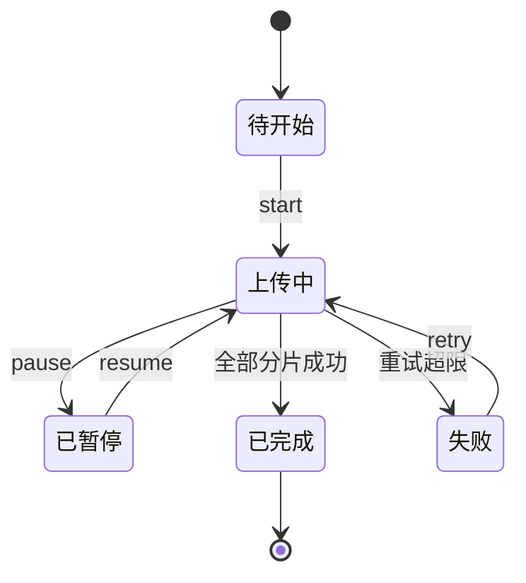

```typescript
// src/services/uploader.ts —— 上传队列：状态机 + 并发窗口 + 断点续传
type FileState = "pending" | "uploading" | "paused" | "failed" | "done";

const CHUNK_SIZE = 5 * 1024 * 1024; // 5MB 分片
const MAX_CONCURRENCY = 3;          // 全局并发窗口

class UploadTask {
  state: FileState = "pending";
  progress = 0;
  private doneChunks = new Set<number>();
  private retryMap = new Map<number, number>();

  constructor(public file: File, private onChange: () => void) {}

  get chunks() {
    return Math.ceil(this.file.size / CHUNK_SIZE);
  }

  async start() {
    if (this.state === "uploading" || this.state === "done") return;
    this.state = "uploading";
    this.onChange();
    // 断点续传：先问服务端已收到哪些分片
    const uploaded = await fetch(`/api/upload/status?name=${this.file.name}`).then((r) => r.json());
    (uploaded.doneChunks as number[]).forEach((i) => this.doneChunks.add(i));

    for (let i = 0; i < this.chunks; i++) {
      if (this.state !== "uploading") return; // 暂停/失败退出循环，状态保留
      if (this.doneChunks.has(i)) continue;   // 跳过已传分片
      const ok = await this.uploadChunk(i);
      if (!ok) { this.state = "failed"; this.onChange(); return; }
      this.progress = Math.round((this.doneChunks.size / this.chunks) * 100);
      this.onChange();
    }
    await fetch("/api/upload/merge", {
      method: "POST",
      headers: { "Content-Type": "application/json" },
      body: JSON.stringify({ name: this.file.name, total: this.chunks }),
    });
    this.state = "done";
    this.onChange();
  }

  private async uploadChunk(index: number): Promise<boolean> {
    const retries = this.retryMap.get(index) ?? 0;
    const blob = this.file.slice(index * CHUNK_SIZE, (index + 1) * CHUNK_SIZE);
    const form = new FormData();
    form.append("chunk", blob);
    form.append("index", String(index));
    try {
      const resp = await fetch("/api/upload/chunk", { method: "POST", body: form });
      if (!resp.ok) throw new Error();
      this.doneChunks.add(index);
      return true;
    } catch {
      if (retries >= 3) return false;             // 重试超限
      this.retryMap.set(index, retries + 1);
      await new Promise((r) => setTimeout(r, 500 * 2 ** retries)); // 指数退避
      return this.uploadChunk(index);
    }
  }

  pause() { if (this.state === "uploading") { this.state = "paused"; this.onChange(); } }
  resume() { if (this.state === "paused" || this.state === "failed") this.start(); }
}

export class UploadQueue {
  tasks: UploadTask[] = [];
  private running = 0;

  add(file: File) {
    const task = new UploadTask(file, () => this.dispatch()); // 状态变化时重新调度
    this.tasks.push(task);
    this.dispatch();
  }
  // 并发窗口调度：始终维持 MAX_CONCURRENCY 个上传中
  private dispatch() {
    while (this.running < MAX_CONCURRENCY) {
      const next = this.tasks.find((t) => t.state === "pending" || t.state === "failed");
      if (!next) break;
      this.running++;
      next.start().finally(() => { this.running--; this.dispatch(); });
    }
  }
}

// 用法
// const queue = new UploadQueue();
// <input type="file" multiple @change="(e) => e.target.files && [...e.target.files].forEach((f) => queue.add(f))">
```

### V3-166：离线模式（本地队列 + 网络恢复重放）如何实现？
**答**：
- 检测在线状态：navigator.onLine + window online/offline 事件双保险（onLine 并不可靠，以事件为准）。
- 离线时把"写操作"（POST/PUT/DELETE）序列化进 localStorage 队列，读操作走本地缓存兜底。
- 恢复在线时按入队顺序重放，成功才出队；失败且不可重试的进死信队列，给用户提示。
- 注意幂等：重放可能重复提交，写操作要带客户端生成的 requestId，服务端去重。

```typescript
// src/services/offlineQueue.ts —— 离线写操作队列 + 恢复重放
interface QueueItem {
  requestId: string;   // 幂等键：重放不会造成重复提交
  url: string;
  method: string;
  body?: unknown;
  createdAt: number;
}

const QUEUE_KEY = "offline-queue";
const queue: QueueItem[] = JSON.parse(localStorage.getItem(QUEUE_KEY) || "[]");

function persist() {
  localStorage.setItem(QUEUE_KEY, JSON.stringify(queue));
}

// 统一写入口：在线直发，离线入队
export async function requestWrite(url: string, method: string, body?: unknown) {
  if (navigator.onLine) {
    return doSend({ requestId: crypto.randomUUID(), url, method, body, createdAt: Date.now() });
  }
  queue.push({ requestId: crypto.randomUUID(), url, method, body, createdAt: Date.now() });
  persist();
  return { queued: true }; // 告知调用方：已进入待同步队列
}

async function doSend(item: QueueItem) {
  const resp = await fetch(item.url, {
    method: item.method,
    headers: {
      "Content-Type": "application/json",
      "X-Request-Id": item.requestId, // 服务端凭此幂等去重
    },
    body: item.body ? JSON.stringify(item.body) : undefined,
  });
  if (!resp.ok && resp.status >= 500) throw new Error("server error"); // 5xx 保留重试
}

// 网络恢复：按序重放
window.addEventListener("online", async () => {
  const pending = [...queue];
  queue.length = 0;
  persist();
  const dead: QueueItem[] = [];
  for (const item of pending) {
    try {
      await doSend(item);
    } catch {
      dead.push(item); // 重放失败的进死信，提示用户手动处理
    }
  }
  if (dead.length) {
    queue.unshift(...dead);
    persist();
    console.warn(`${dead.length} 条离线操作同步失败，请稍后重试`);
  }
});

// 离线期间的读操作：降级读缓存（配合 V3-161 的两级缓存）
// if (!navigator.onLine) return readThrough<T>(url) ?? fallbackData;
```

## 第三十五章 测试工程

Vue3 测试栈 = Vitest + @vue/test-utils，外加 Playwright 做 E2E。考察重点：组件测试边界划分、composable 的挂载环境构造、store/router 的 mock 策略。

### V3-167：组件测试的完整模式有哪些（挂载、emit、mock 依赖）？
**答**：
- 三层验证：渲染结果（find + text）、交互行为（trigger + emitted）、Props 契约（setProps 后的响应）。
- mock 分级：子组件用 shallow stub 掉；模块依赖（api）用 vi.mock；pinia 用 createTestingPinia 替换真实 store。
- 异步交互用 flushPromises 等微任务清空，避免"改了状态断言还是旧的"。
- 原则：测组件的对外契约（props/emit/slot），不测内部实现细节，否则重构即全红。

```typescript
// components/__tests__/Counter.spec.ts —— Vitest + @vue/test-utils
import { describe, it, expect, vi } from "vitest";
import { mount, flushPromises } from "@vue/test-utils";
import Counter from "../Counter.vue";
import { api } from "@/services/api";

// 1. 模块级 mock：拦截 api 依赖
vi.mock("@/services/api", () => ({
  api: { saveCount: vi.fn().mockResolvedValue({ ok: true }) },
}));

describe("Counter", () => {
  it("初始渲染 props 传入的值", () => {
    const wrapper = mount(Counter, { props: { init: 5 } });
    expect(wrapper.find("[data-test=count]").text()).toBe("5");
  });

  it("点击按钮后 emit increment 并更新显示", async () => {
    const wrapper = mount(Counter, { props: { init: 0 } });
    await wrapper.find("button").trigger("click"); // trigger 自动等 nextTick
    expect(wrapper.emitted("increment")).toHaveLength(1);
    expect(wrapper.find("[data-test=count]").text()).toBe("1");
  });

  it("异步保存后调用 api.saveCount", async () => {
    const wrapper = mount(Counter, { props: { init: 1 } });
    await wrapper.find("[data-test=save]").trigger("click");
    await flushPromises(); // 清空微任务：等 mock 的 Promise resolve
    expect(api.saveCount).toHaveBeenCalledWith(1);
  });

  it("props 变化时视图响应", async () => {
    const wrapper = mount(Counter, { props: { init: 0 } });
    await wrapper.setProps({ init: 10 });
    expect(wrapper.find("[data-test=count]").text()).toBe("10");
  });

  it("子组件被 stub 时只测自身逻辑", () => {
    const wrapper = mount(Counter, {
      props: { init: 0 },
      shallow: true, // shallow stub 掉所有子组件
      global: {
        stubs: { FancyBadge: true }, // 或单独指定
      },
    });
    expect(wrapper.findComponent({ name: "FancyBadge" }).exists()).toBe(true);
  });
});
```

### V3-168：composable 测试怎么搭环境（withSetup 工具）？
**答**：
- composable 依赖组件上下文（onMounted、provide/inject）时，裸调用会报错；需要包一个临时组件挂载后调用。
- withSetup 工具：创建临时 App，把 composable 放进 setup 执行，把返回值存到变量再挂载。
- 测试要点：挂载后才能测生命周期钩子；provide/inject 依赖用 global.provide 注入；卸载触发 onUnmounted 验证清理逻辑。
- 纯逻辑 composable（不依赖上下文的）直接当普通函数测即可，不需要 withSetup。

```typescript
// test-utils/withSetup.ts + composables/__tests__/useMouse.spec.ts
import { createApp, defineComponent, h, type App } from "vue";

// 工具：把 composable 包进临时组件执行，拿到返回值
export function withSetup<T>(composable: () => T, options?: { provide?: Record<string, unknown> }): {
  result: T;
  app: App;
} {
  let result!: T;
  const app = createApp(
    defineComponent({
      setup() {
        result = composable(); // 在真实组件上下文里执行
        return () => h("div"); // 必须返回渲染函数，否则告警
      },
    })
  );
  Object.entries(options?.provide ?? {}).forEach(([k, v]) => app.provide(k, v));
  app.mount(document.createElement("div"));
  return { result, app };
}

// ---------- 被测 composable ----------
// composables/useOnline.ts
import { ref, onMounted, onUnmounted } from "vue";
export function useOnline() {
  const online = ref(navigator.onLine);
  const update = () => (online.value = navigator.onLine);
  onMounted(() => window.addEventListener("online", update));
  onUnmounted(() => window.removeEventListener("online", update));
  return { online };
}

// ---------- 测试 ----------
import { describe, it, expect, vi } from "vitest";
import { useOnline } from "@/composables/useOnline";

describe("useOnline", () => {
  it("在线事件触发时状态更新", () => {
    const { result, app } = withSetup(() => useOnline());
    expect(result.online.value).toBe(true);

    // 模拟离线事件
    Object.defineProperty(navigator, "onLine", { value: false, configurable: true });
    window.dispatchEvent(new Event("offline"));
    expect(result.online.value).toBe(false);

    app.unmount(); // 触发 onUnmounted，验证监听清理不报错
  });

  it("依赖 provide 的 composable 可注入测试值", () => {
    const { result } = withSetup(() => inject("theme") as string, {
      provide: { theme: "dark" },
    });
    expect(result).toBe("dark");
  });
});

import { inject } from "vue";
```

### V3-169：Pinia store 怎么测试？
**答**：
- 用 createTestingPinia 替换真实插件：action 默认变 mock（vi.fn），可以断言"组件触发了某个 action"而不执行其实现。
- 测 state/getter：直接 setActivePinia(createPinia()) 裸用 store，绕开组件。
- 要测 action 真实逻辑时给 createTestingPinia 传 stubActions: false，并 mock 掉它调用的 api 模块。
- 分层策略：组件测试断言 action 被调用；store 单测验证 action 内部逻辑，两层各管一段。

```typescript
// stores/__tests__/cart.spec.ts
import { describe, it, expect, vi, beforeEach } from "vitest";
import { setActivePinia, createPinia } from "pinia";
import { createTestingPinia } from "@pinia/testing";
import { useCartStore } from "../cart";

// 模块 mock：store 的 action 依赖的 api
vi.mock("@/services/api", () => ({ api: { checkout: vi.fn().mockResolvedValue({ orderId: 1 }) } }));

describe("cart store（纯 store 单测）", () => {
  beforeEach(() => setActivePinia(createPinia()));

  it("addItem 累加数量并计算总价", () => {
    const cart = useCartStore();
    cart.addItem({ id: 1, price: 100, name: "A" });
    cart.addItem({ id: 1, price: 100, name: "A" });
    expect(cart.count).toBe(2);
    expect(cart.totalPrice).toBe(200); // getter 联动验证
  });

  it("removeItem 清空对应项", () => {
    const cart = useCartStore();
    cart.addItem({ id: 1, price: 100, name: "A" });
    cart.removeItem(1);
    expect(cart.count).toBe(0);
  });
});

// ---------- 组件层：断言 action 被触发 ----------
import { mount } from "@vue/test-utils";
import CartButton from "../CartButton.vue";

it("点击加购按钮触发 store 的 addItem", async () => {
  const wrapper = mount(CartButton, {
    props: { goods: { id: 1, price: 100, name: "A" } },
    global: { plugins: [createTestingPinia()] }, // action 默认被 stub 成 mock
  });
  await wrapper.find("button").trigger("click");
  const cart = useCartStore();
  expect(cart.addItem).toHaveBeenCalledTimes(1); // 只验证契约，不验证实现
});
```

### V3-170：路由相关的组件测试如何 mock router？
**答**：
- 不真正装 vue-router：用 global.mocks.$route/$router 提供 stub，测"组件对路由的读取与跳转调用"。
- 需要 useRoute/useRouter 组合式 API 时，vi.mock("vue-router") 返回固定对象，粒度最小、最快。
- 依赖真实路由结构的（面包屑、tab 组件）用 createMemoryHistory + createRouter 搭真路由，history 用内存模式避免污染地址栏。
- 断言跳转用 expect($router.push).toHaveBeenCalledWith(...)，不关心真实导航结果。

```typescript
// views/__tests__/UserDetail.spec.ts
import { describe, it, expect, vi } from "vitest";
import { mount } from "@vue/test-utils";
import UserDetail from "../UserDetail.vue";

// 方式一：mock 组合式 API（最常用、最快）
const pushMock = vi.fn();
vi.mock("vue-router", () => ({
  useRoute: () => ({ params: { id: "42" }, query: { tab: "profile" } }),
  useRouter: () => ({ push: pushMock }),
}));

describe("UserDetail", () => {
  it("从路由参数读取用户 id", () => {
    const wrapper = mount(UserDetail);
    expect(wrapper.text()).toContain("42");
  });

  it("点击编辑跳转到编辑页", async () => {
    const wrapper = mount(UserDetail);
    await wrapper.find("[data-test=edit]").trigger("click");
    expect(pushMock).toHaveBeenCalledWith("/users/42/edit");
  });
});

// ---------- 方式二：内存路由（适合依赖真实路由结构的组件） ----------
import { createRouter, createMemoryHistory } from "vue-router";

it("面包屑组件根据路由 matched 生成", async () => {
  const router = createRouter({
    history: createMemoryHistory(), // 内存模式：不操作真实地址栏
    routes: [
      { path: "/", component: { template: "<div>home</div>" } },
      {
        path: "/system",
        component: { template: "<router-view />" },
        children: [{ path: "user", component: { template: "<div>user</div>" } }],
      },
    ],
  });
  router.push("/system/user");
  await router.isReady();

  const wrapper = mount(Breadcrumb, { global: { plugins: [router] } });
  expect(wrapper.findAll("li").map((li) => li.text())).toEqual(["首页", "system", "user"]);
});
```

### V3-171：E2E 关键路径覆盖策略怎么定？
**答**：
- 只测关键路径（登录、下单、支付、核心表单提交），大约 10~20 条；E2E 贵在维护，不是越多越好。
- 金字塔分工：单测覆盖逻辑分支（快、全），组件测试覆盖交互契约，E2E 只验证"链路能走通"。
- 稳定性三件套：选择器用 data-test 而非样式类；网络等待用 wait for response 而非 sleep；每条用例独立数据（测试账号/隔离环境）。
- CI 策略：PR 跑 smoke 子集（3~5 条），合并后跑全量；失败自动截图 + trace 便于排查。

```typescript
// e2e/checkout.spec.ts —— Playwright：关键下单链路
import { test, expect } from "@playwright/test";

test.describe("核心购买链路", () => {
  // 用例数据隔离：每个用例独立的测试账号
  const user = { name: "e2e_user", pwd: process.env.E2E_PWD! };

  test("登录 -> 加购 -> 下单成功", async ({ page }) => {
    // 1. 登录（smoke 子集也会复用这条）
    await page.goto("/login");
    await page.getByTestId("username").fill(user.name);
    await page.getByTestId("password").fill(user.pwd);
    await page.getByTestId("submit").click();
    await expect(page).toHaveURL(/\/home/);

    // 2. 搜索并加入购物车
    await page.goto("/goods?keyword=vue3");
    await page.getByTestId("goods-item").first().click();
    await page.getByTestId("add-cart").click();
    await expect(page.getByTestId("cart-badge")).toHaveText("1");

    // 3. 结算：等待下单接口响应而不是固定 sleep
    const orderResp = page.waitForResponse((r) =>
      r.url().includes("/api/orders") && r.status() === 200
    );
    await page.getByTestId("checkout").click();
    await orderResp;

    // 4. 断言业务结果
    await expect(page.getByTestId("order-success")).toBeVisible();
  });

  test("未登录访问购物车跳转登录页（守卫路径）", async ({ page }) => {
    await page.goto("/cart");
    await expect(page).toHaveURL(/\/login/); // 路由守卫生效
  });
});
```

## 第三十六章 Vue3 新特性深用

这一章聚焦 3.2 之后进入稳定期的特性：defineModel、Suspense、Teleport、EffectScope 与各版本新增的实用工具 API，重点是"深用 + 版本注意事项"。

### V3-172：defineModel 如何实现多 v-model 与修饰符？
**答**：
- defineModel 在 3.4 转正：子组件内部读写 model.value，自动生成对应 props/emit，不再手写 update:modelValue。
- 多 v-model：每个 defineModel 用不同名（title、content），模板里 `v-model:title="t"` 一一对应。
- 修饰符：通过 defineModel 的第二个参数拿到 modifiers（如 trim、自定义 capitalize），在 set 前做转换。
- 注意：3.4 之前需手写 props + emit；defineModel 返回的是自定义 ref，父组件不传时仍有本地值可用（配合默认值）。

```vue
<!-- components/RichInput.vue —— 双 v-model + trim 修饰符 -->
<script setup lang="ts">
// 多 v-model：title 与 content 各自独立，互不干扰
const title = defineModel<string>("title", { required: true });
const content = defineModel<string>("content", { default: "" });

// 捕获 v-model.trim 这类修饰符
const [rawTitle, titleModifiers] = defineModel<string>("rawTitle", {
  set(v) {
    // set 钩子：写入前转换（这里实现 .trim 语义）
    if (titleModifiers.trim) return v.trim();
    return v;
  },
});
const raw = rawTitle; // 重命名避免与上方冲突，读写走 raw
</script>

<template>
  <input v-model="title" placeholder="标题" />
  <textarea v-model="content" placeholder="内容" />
  <input v-model.trim="raw" placeholder="自动去首尾空格" />
  <p>父组件同步：{{ title }} / {{ content }} / {{ raw }}</p>
</template>

<!-- 父组件使用：
     <RichInput v-model:title="t" v-model:content="c" v-model.trim:rawTitle="r" />
     等价于 3.4 之前的手写版：
     :title="t" @update:title="t = $event" -->
```

### V3-173：Suspense 的异步组件编排（嵌套 + 错误处理）怎么做？
**答**：
- Suspense 等待的是 async setup 组件：子组件顶层 await 即被视为异步组件，加载期间显示 fallback。
- 嵌套编排：外层 Suspense 包多个异步组件时，整体等待最慢的子树；想做渐进加载就把 Suspense 放到子组件层级。
- 错误处理：异步组件内部 try/catch 转 error 状态，或父级 onErrorCaptured 捕获后展示降级 UI。
- 仍是实验性 API：生产可用的前提是行为固定（不在 fallback 与 content 间频繁闪烁），列表型数据建议仍用 v-if + loading。

```vue
<script setup lang="ts">
import { ref, onErrorCaptured } from "vue";
import UserPanel from "./UserPanel.vue"; // async setup 组件
import OrderPanel from "./OrderPanel.vue";

const failed = ref(false);

// 捕获异步子树的错误，切到降级 UI
onErrorCaptured((err) => {
  console.error("异步组件加载失败：", err);
  failed.value = true;
  return false; // 阻止继续向上抛
});
</script>

<template>
  <div v-if="failed" class="fallback">数据加载失败，请刷新重试</div>

  <!-- 外层 Suspense：两个异步面板并行请求，全部就绪才整体显示 -->
  <Suspense v-else>
    <template #default>
      <div class="dashboard">
        <UserPanel />
        <OrderPanel />
      </div>
    </template>
    <template #fallback>
      <div class="skeleton">面板加载中...</div>
    </template>
  </Suspense>

  <!-- 渐进式编排：把 Suspense 下放到每个面板内部，先到先显示 -->
  <!-- <UserPanel /> 内部：<Suspense><OrderList /></Suspense> -->
</template>

<style>
.fallback, .skeleton { padding: 24px; color: #999; }
.dashboard { display: grid; gap: 16px; }
</style>
```

```vue
<!-- components/UserPanel.vue —— async setup 子组件 -->
<script setup lang="ts">
import { ref } from "vue";

// 顶层 await：该组件成为异步组件，由父级 Suspense 调度
const user = await fetch("/api/me").then((r) => r.json());
const refreshCount = ref(0);

// 注意：async setup 内的 onMounted 等钩子在 await 之前注册才有效
import { onMounted } from "vue";
onMounted(() => console.log("UserPanel mounted"));
</script>

<template>
  <section>
    <h3>{{ user.name }}</h3>
    <p>刷新次数：{{ refreshCount }}</p>
  </section>
</template>
```

### V3-174：Teleport 的多目标与顺序控制有哪些要点？
**答**：
- to 支持选择器与真实元素：动态目标（响应式 ref/计算属性）可以实现"弹窗挂到不同容器"。
- 多个 Teleport 到同一目标时按挂载顺序 append；需要控制层级用目标容器内的 CSS order 或不同 zIndex。
- disabled 属性：条件挂回原位置，做"内嵌/弹出双形态"组件很好用。
- 3.5 新增 defer：解决"目标容器由同一棵树更晚渲染"导致的挂载失败，Teleport 会等目标出现后再传送。

```vue
<script setup lang="ts">
import { ref } from "vue";

// 动态目标：弹窗可切换挂载位置（如全屏 / 挂在某个卡片内）
const target = ref<string>("#modal-root");
const inline = ref(false); // disabled 为 true 时内容留在原地渲染
</script>

<template>
  <button @click="target = target === '#modal-root' ? '#drawer-root' : '#modal-root'">
    切换挂载目标
  </button>

  <!-- 多个 Teleport 可共存：弹窗与抽屉各自的目标容器 -->
  <Teleport :to="target" :disabled="inline" defer>
    <div class="modal">
      内容（target：{{ target }}）
      <button @click="inline = !inline">切换内嵌形态</button>
    </div>
  </Teleport>

  <!-- 顺序/zIndex 控制：同一目标的多个 Teleport，用类名+zIndex 管层级 -->
  <Teleport to="#modal-root">
    <div class="toast" style="z-index: 3001">Toast 在弹窗之上</div>
  </Teleport>

  <div id="modal-root"></div>
  <div id="drawer-root"></div>
</template>

<style>
.modal { position: fixed; inset: 20% 30%; background: #fff; z-index: 3000; box-shadow: 0 4px 16px rgba(0,0,0,.2); padding: 24px; }
.toast { position: fixed; top: 16px; left: 50%; transform: translateX(-50%); background: #333; color: #fff; padding: 8px 16px; border-radius: 4px; }
</style>
```

### V3-175：EffectScope 如何在组件外手动管理响应式作用域？
**答**：
- effectScope 收集其内部创建的 effect/computed/watch，scope.stop() 一次性全部销毁——组件卸载时源码就是这么清理的。
- 组件外创建响应式系统（跨 tab 工具、Node 脚本、单例 store 库）必须手动 scope，否则 watch 永不释放造成内存泄漏。
- 嵌套 scope：子 scope 随父 scope 一起 stop；detached 参数让子作用域独立存活。
- composable 里若在组件外被调用（如全局单例），用 getCurrentScope + onScopeDispose 注册清理，等价于组件里的 onUnmounted。

```typescript
// src/reactive/scope-demo.ts —— 组件外手动管理响应式
import {
  reactive, computed, watch, watchEffect, effectScope, getCurrentScope, onScopeDispose,
} from "vue";

// 场景：跨页面共享的全局配置中心（组件外创建）
export function createConfigStore() {
  // 必须用 scope 包住：否则这里的 watch 永远不会被回收
  const scope = effectScope();

  const state = reactive({ theme: "light", locale: "zh-CN", menus: [] as string[] });
  const isDark = computed(() => state.theme === "dark");

  scope.run(() => {
    // 这些副作用全部登记进 scope
    watchEffect(() => document.documentElement.dataset.theme = state.theme);
    watch(() => state.locale, (v) => console.log("locale changed", v));

    // 在 scope 内注册清理回调（组件外等价于 onUnmounted）
    if (getCurrentScope()) {
      onScopeDispose(() => console.log("config store 已销毁，清理监听"));
    }
  });

  return {
    state,
    isDark,
    destroy: () => scope.stop(), // 一键销毁所有副作用
  };
}

// 用法：HMR 或单页应用重建 store 时调用 destroy，避免旧 watch 残留
// export const configStore = createConfigStore();
// if (import.meta.hot) import.meta.hot.dispose(() => configStore.destroy());

// detached：子作用域独立于父作用域
// const parent = effectScope();
// parent.run(() => {
//   const child = effectScope(true); // detached：parent.stop() 不会停掉 child
//   child.run(() => watch(state, cb));
// });
```

### V3-176：hasInjectionContext 等工具 API 有哪些？版本升级要注意什么？
**答**：
- 3.3 新增 hasInjectionContext：让 composable 能判断"是否在组件上下文中"，从而决定走 inject 还是全局兜底，库作者高频使用。
- 3.4/3.5 关键 API：defineModel 转正（3.4）、useTemplateRef 与 useId、onWatcherCleanup、Teleport defer、shallowRef 数据性能优化（3.5）。
- 升级注意：Vue 3.5 移除了部分废弃 API 的 silent 行为；@vue/compat 用于大版本迁移灰度；组合式 API 全量替代 mixin 的时机。
- 库设计应用：工具函数用 hasInjectionContext 做环境探测，使同一份代码既能在组件内用也能在纯 JS 环境跑。

```typescript
// src/composables/useI18nSafe.ts —— 库设计中的环境探测
import { inject, hasInjectionContext, ref, type Ref } from "vue";

interface I18nContext {
  locale: Ref<string>;
  t: (key: string) => string;
}

// 全局兜底：无组件上下文时也能工作（工具函数、store 内）
const globalLocale = ref("zh-CN");
const globalT = (key: string) => `${globalLocale.value}:${key}`;

export function useI18nSafe(): I18nContext {
  // 3.3+：先判断是否处于组件 setup 上下文
  if (hasInjectionContext()) {
    const ctx = inject<I18nContext>("i18n");
    if (ctx) return ctx; // 组件树内：用祖先提供的实例
  }
  // 组件外（store/工具函数/单测）：退回全局实例
  return { locale: globalLocale, t: globalT };
}

// 版本注意点速查（面试口述）：
// 3.3：defineOptions、defineSlots、generics 组件、hasInjectionContext
// 3.4：defineModel 转正、v-bind 同名简写、更快的虚拟 DOM
// 3.5：useTemplateRef（ref 取代模板 ref 命名耦合）、useId（SSR 稳定 id）、
//       onWatcherCleanup（watch 清理回调）、Teleport defer、响应式系统大提速
// 升级动作：先升 3.5 看 deprecation 警告，再用 @vue/compat 做大跨度迁移灰度
```

## 第三十七章 Vue 与其他技术集成

命令式库（Canvas/WebGL/地图）与 Vue 的集成有统一模式：命令式实例活在 onMounted，响应式数据经 watch 单向流入，实例方法经 defineExpose 流出，onUnmounted 完整销毁。

### V3-177：Vue3 如何封装 Canvas 集成（命令式库的响应式包装模式）？
**答**：
- 模式四件套：canvas 元素用 template ref 拿到；初始化放 onMounted；数据变化用 watch 深度触发重绘；ResizeObserver 处理容器尺寸变化（devicePixelRatio 适配高清屏）。
- 响应式与命令式的边界：props/数据 → watch → 命令式 API 单向流动；canvas 内部状态不反灌回响应式系统，避免双向纠缠。
- 高 DPI 适配：canvas.width = css 宽度 * dpr，再 ctx.scale(dpr, dpr)，否则 Retina 屏发虚。
- 清理：onUnmounted 移除 observer 与事件，cancelAnimationFrame 停动画。

```vue
<!-- components/LineCanvas.vue —— 响应式数据驱动的 Canvas 折线图 -->
<script setup lang="ts">
import { ref, watch, onMounted, onUnmounted } from "vue";

const props = defineProps<{ points: number[] }>();

const canvasRef = ref<HTMLCanvasElement | null>(null);
const wrapRef = ref<HTMLDivElement | null>(null);
let ctx: CanvasRenderingContext2D | null = null;
let ro: ResizeObserver | null = null;

function resizeAndDraw() {
  const canvas = canvasRef.value, wrap = wrapRef.value;
  if (!canvas || !wrap || !ctx) return;
  // 高 DPI 适配
  const dpr = window.devicePixelRatio || 1;
  const { width, height } = wrap.getBoundingClientRect();
  canvas.width = width * dpr;
  canvas.height = height * dpr;
  canvas.style.width = `${width}px`;
  canvas.style.height = `${height}px`;
  ctx.setTransform(dpr, 0, 0, dpr, 0, 0); // 之后全部按 CSS 像素画
  draw(width, height);
}

function draw(w: number, h: number) {
  if (!ctx) return;
  ctx.clearRect(0, 0, w, h);
  const pts = props.points;
  if (pts.length < 2) return;
  const max = Math.max(...pts), min = Math.min(...pts);
  const stepX = w / (pts.length - 1);
  ctx.beginPath();
  pts.forEach((p, i) => {
    const y = h - 20 - ((p - min) / (max - min || 1)) * (h - 40);
    i === 0 ? ctx.moveTo(0, y) : ctx.lineTo(i * stepX, y);
  });
  ctx.strokeStyle = "#409eff";
  ctx.lineWidth = 2;
  ctx.stroke();
}

// 数据变化 -> 单向流入 canvas 重绘（命令式库不反向污染响应式）
watch(() => props.points, resizeAndDraw, { deep: true });

onMounted(() => {
  ctx = canvasRef.value!.getContext("2d");
  ro = new ResizeObserver(resizeAndDraw); // 容器尺寸变化自适应
  ro.observe(wrapRef.value!);
  resizeAndDraw();
});

onUnmounted(() => ro?.disconnect());
</script>

<template>
  <div ref="wrapRef" class="wrap">
    <canvas ref="canvasRef" />
  </div>
</template>

<style>
.wrap { width: 100%; height: 200px; }
canvas { display: block; }
</style>
```

### V3-178：Vue3 如何封装 three.js（WebGL）组件？
**答**：
- 生命周期映射：scene/camera/renderer 全部在 onMounted 创建，onUnmounted 里 renderer.dispose + geometry/material dispose + 释放 WebGL 上下文，防 GPU 内存泄漏。
- 响应式桥接：props（颜色、旋转速度、模型地址）经 watch 更新 three 对象属性；交互状态经 ref + defineExpose 暴露。
- 渲染循环用 requestAnimationFrame，卸载时 cancelAnimationFrame；页面不可见时暂停可省电。
- 资源加载（GLTFLoader）是异步的，配合 Suspense 或内部 loading 状态展示骨架。

```vue
<!-- components/ThreeBox.vue -->
<script setup lang="ts">
import { ref, watch, onMounted, onUnmounted } from "vue";
import * as THREE from "three";

const props = defineProps<{ color: string; spin: boolean }>();

const wrapRef = ref<HTMLDivElement | null>(null);
let renderer: THREE.WebGLRenderer, scene: THREE.Scene, camera: THREE.PerspectiveCamera;
let mesh: THREE.Mesh, rafId = 0;

function animate() {
  rafId = requestAnimationFrame(animate);
  if (props.spin) mesh.rotation.y += 0.01; // props 直读：渲染循环里保持响应
  renderer.render(scene, camera);
}

onMounted(() => {
  const { clientWidth: w, clientHeight: h } = wrapRef.value!;
  renderer = new THREE.WebGLRenderer({ antialias: true });
  renderer.setSize(w, h);
  wrapRef.value!.appendChild(renderer.domElement);

  scene = new THREE.Scene();
  camera = new THREE.PerspectiveCamera(45, w / h, 0.1, 100);
  camera.position.z = 5;

  mesh = new THREE.Mesh(
    new THREE.BoxGeometry(2, 2, 2),
    new THREE.MeshStandardMaterial({ color: props.color })
  );
  scene.add(mesh);
  scene.add(new THREE.AmbientLight(0xffffff, 0.8));
  scene.add(new THREE.DirectionalLight(0xffffff, 1));

  animate();
});

// 响应式 -> three 对象：颜色变化直接改 material
watch(() => props.color, (c) => {
  (mesh?.material as THREE.MeshStandardMaterial)?.color.set(c);
});

onUnmounted(() => {
  cancelAnimationFrame(rafId);
  // 完整释放：几何体、材质、渲染器、GL 上下文
  mesh.geometry.dispose();
  (mesh.material as THREE.Material).dispose();
  renderer.dispose();
  renderer.domElement.remove();
});
</script>

<template>
  <div ref="wrapRef" class="stage" />
</template>

<style>
.stage { width: 100%; height: 360px; }
</style>
```

### V3-179：Vue3 如何封装地图组件（生命周期与实例管理）？
**答**：
- 脚本加载与实例分离：loadMap（动态插 script 保证 SDK 只加载一次，Promise 缓存）→ onMounted 初始化 Map 实例。
- 实例不放进 ref：地图实例体量大且非响应式，放普通变量，标记/覆盖物由组件内部管理。
- 数据驱动：markers prop 变化时 diff 出新增/删除的 marker，避免全量 clearMarkers 闪烁。
- defineExpose 暴露 setCenter/addMarker 等命令式方法；onUnmounted destroy 实例并解绑事件。

```vue
<!-- components/AMapView.vue —— 高德地图封装 -->
<script setup lang="ts">
import { ref, watch, onMounted, onUnmounted } from "vue";

const props = defineProps<{
  center: [number, number];
  markers: Array<{ id: number; lng: number; lat: number }>;
}>();

let map: any = null; // 地图实例不进响应式系统
const AMapNS = (window as any).AMap;
const markerMap = new Map<number, any>(); // 管理 marker 实例用于 diff
const ready = ref(false);

// SDK 只加载一次：Promise 缓存
let loader: Promise<void> | null = null;
function loadAMap(key: string) {
  if ((window as any).AMap) return Promise.resolve();
  if (loader) return loader;
  loader = new Promise((resolve) => {
    const s = document.createElement("script");
    s.src = `https://webapi.amap.com/maps?v=2.0&key=${key}`;
    s.onload = () => resolve();
    document.head.appendChild(s);
  });
  return loader;
}

function syncMarkers() {
  // diff：数据变化只增删差异 marker，避免全量重建闪烁
  const nextIds = new Set(props.markers.map((m) => m.id));
  markerMap.forEach((mk, id) => {
    if (!nextIds.has(id)) { map.remove(mk); markerMap.delete(id); }
  });
  props.markers.forEach((m) => {
    if (!markerMap.has(m.id)) {
      const mk = new AMapNS.Marker({ position: [m.lng, m.lat], title: String(m.id) });
      map.add(mk);
      markerMap.set(m.id, mk);
    }
  });
}

onMounted(async () => {
  await loadAMap(import.meta.env.VITE_AMAP_KEY);
  map = new AMapNS.Map(mapEl.value, { center: props.center, zoom: 12 });
  ready.value = true;
  syncMarkers();
});

// 数据驱动：中心点与标记跟随 props
watch(() => props.center, (c) => map?.setCenter(c));
watch(() => props.markers, syncMarkers, { deep: true });

// 命令式出口：父组件可精细控制
function setZoom(z: number) { map?.setZoom(z); }
function addMarker(m: { id: number; lng: number; lat: number }) {
  props.markers.push(m); // 走数据流，自动 sync
}
defineExpose({ setZoom, addMarker });

const mapEl = ref<HTMLDivElement | null>(null);
onUnmounted(() => map?.destroy()); // 高德必须 destroy，否则上下文泄漏
</script>

<template>
  <div ref="mapEl" class="map" />
</template>

<style>
.map { width: 100%; height: 420px; }
</style>
```

### V3-180：Vue3 与 Web Components 如何互操作？
**答**：
- Vue -> WC：defineCustomElement 把 SFC 编译成自定义元素，注册后任何框架甚至纯 HTML 都能用；样式默认打进 shadow root。
- WC -> Vue：第三方自定义元素直接写在模板里，需在 compilerOptions.isCustomElement 里声明，避免 Vue 当组件解析报警告。
- 事件与属性：WC 派发 CustomEvent，Vue 用 @事件名 监听；复杂对象属性必须走 property（DOM property）而非 attribute。
- 注意点：shadow DOM 里 slot 行为与 Vue slot 不同；样式穿透用 ::part 或让 WC 暴露 CSS 变量。

```typescript
// 1. Vue -> Web Components：defineCustomElement
import { defineCustomElement } from "vue";
import RatingStars from "./RatingStars.ce.vue"; // .ce.vue 后缀自动按 WC 模式编译

// 转成自定义元素并注册，之后 <rating-stars> 全局可用
customElements.define("rating-stars", defineCustomElement(RatingStars));

// RatingStars.ce.vue 内部（组合式 API 完全可用）：
// <script setup lang="ts">
// const model = defineModel<number>({ default: 0 });
// const emit = (v: number) => model.value = v;
// </script>
// <template>
//   <button v-for="i in 5" :key="i" @click="emit(i)">{{ i <= model ? "★" : "☆" }}</button>
// </template>
// <style> /* 打进 shadow root，外部样式不干扰 */ </style>
```

```vue
<!-- 2. WC -> Vue：消费第三方自定义元素 -->
<script setup lang="ts">
// vite.config.ts 需配置：
// plugins: [vue({ template: { compilerOptions: { isCustomElement: (tag) => tag.includes("-") } } })]
const score = ref(0);

function onRate(e: Event) {
  // WC 派发的 CustomEvent，detail 携带数据
  score.value = (e as CustomEvent<number>).detail;
}
</script>

<template>
  <!-- 复杂对象必须用 :prop 绑定（property），字符串才可用 attribute -->
  <rating-stars :value="score" @input="onRate" />
  <p>当前评分：{{ score }}</p>

  <!-- shadow DOM 的样式沟通：WC 内部约定 CSS 变量 -->
  <!-- WC 内部：button { color: var(--rating-color, gold) } -->
</template>

<style>
:root { --rating-color: #f56c6c; } /* 通过 CSS 变量穿透 shadow DOM */
</style>
```

### V3-181：Vue3 如何与 Service Worker / PWA 集成（vite-plugin-pwa 实战）？
**答**：
- vite-plugin-pwa 三件套：manifest（应用元信息）、workbox 生成 SW（预缓存构建产物 + 运行时缓存策略）、自动更新提示（registerType）。
- 缓存策略：预缓存（app shell）+ 运行时 StaleWhileRevalidate（图片/静态）+ NetworkFirst（接口数据）。
- 更新流程：SW 检测到新版本 -> 前端监听 needRefresh -> 弹窗提示 -> updateSW() 触发 reload，避免用户用旧资源。
- Vue 集成点：virtual:pwa-register 提供响应式 needRefresh 状态，直接接进组件做更新提示条。

```typescript
// vite.config.ts —— PWA 配置
import { defineConfig } from "vite";
import vue from "@vitejs/plugin-vue";
import { VitePWA } from "vite-plugin-pwa";

export default defineConfig({
  plugins: [
    vue(),
    VitePWA({
      registerType: "prompt", // 有新版本时提示用户，而非静默刷新
      manifest: {
        name: "Vue3 商城",
        short_name: "商城",
        theme_color: "#409eff",
        icons: [{ src: "pwa-192.png", sizes: "192x192", type: "image/png" }],
      },
      workbox: {
        // 预缓存：构建产物全部进 SW（app shell 离线可用）
        globPatterns: ["**/*.{js,css,html,svg,png,woff2}"],
        runtimeCaching: [
          {
            // 图片：优先缓存，后台更新
            urlPattern: /\.(?:png|jpg|webp)$/,
            handler: "StaleWhileRevalidate",
            options: { cacheName: "images", expiration: { maxEntries: 200 } },
          },
          {
            // 接口：网络优先，失败兜底缓存（弱网可用）
            urlPattern: /\/api\//,
            handler: "NetworkFirst",
            options: { cacheName: "api", networkTimeoutSeconds: 3 },
          },
        ],
      },
    }),
  ],
});
```

```vue
<!-- src/components/UpdateBanner.vue —— 新版本提示 -->
<script setup lang="ts">
import { useRegisterSW } from "virtual:pwa-register/vue";

// 响应式更新状态：SW 检测到新版本时 needRefresh 变 true
const { needRefresh, updateServiceWorker } = useRegisterSW();
</script>

<template>
  <Transition name="slide">
    <div v-if="needRefresh" class="banner">
      系统有新版本
      <button @click="updateServiceWorker()">立即更新</button>
    </div>
  </Transition>
</template>

<style>
.banner {
  position: fixed; bottom: 16px; left: 50%; transform: translateX(-50%);
  background: #409eff; color: #fff; padding: 10px 20px; border-radius: 8px;
  display: flex; gap: 12px; align-items: center;
}
.slide-enter-active, .slide-leave-active { transition: all .3s; }
.slide-enter-from, .slide-leave-to { opacity: 0; transform: translate(-50%, 20px); }
</style>
```

## 第三十八章 综合大题

综合大题的答题公式：先一句话定位系统边界 -> 分层模块图（或状态机）-> 每个模块的关键技术选型 -> 一个最能体现复杂度的代码片段。代码是证据，架构叙述是得分主体。

### V3-182：设计一个中后台管理系统的前端架构（布局/权限/菜单/表格/表单体系）？
**答**：
- 权限体系四层：路由级（动态 addRoute）-> 菜单级（过滤后的路由表渲染）-> 按钮级（v-perm 权限码）-> 接口级（后端兜底），前端权限只是体验优化。
- 布局体系：Layout 容器（侧边栏 + 顶栏 + 标签页 + router-view）与业务页面彻底分离，页面只关心内容。
- 表格体系：ProTable 二次封装（columns 配置 + 搜索区自动生成 + 分页内置），配合 useTableQuery 状态机（见 V3-162）。
- 表单体系：表单 schema 化（见 V3-184），中后台 80% 的 CRUD 表单用配置生成，复杂表单才手写组件。
- 工程层：动态路由 + keep-alive 白名单、微前端预留（子应用挂载点）、主题/i18n/错误处理沿用第三十三、三十六章方案。

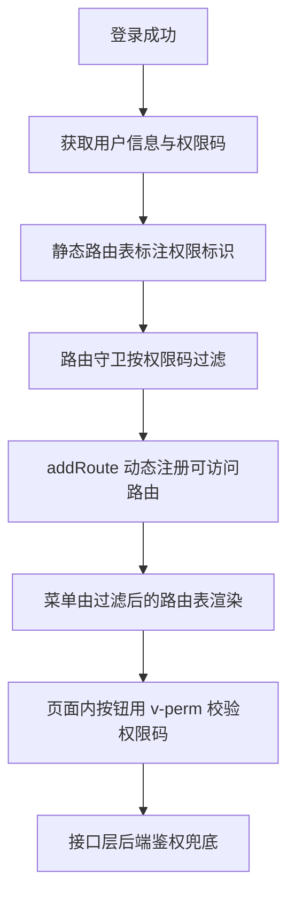

```typescript
// src/router/permission.ts —— 动态路由生成（架构核心一环）
import { router, staticRoutes } from "./index";
import { useUserStore } from "@/stores/user";

// 静态路由表：component 用动态 import，meta 标注权限
export const asyncRoutes: RouteRecordRaw[] = [
  {
    path: "/system",
    component: () => import("@/layouts/Blank.vue"),
    meta: { roles: ["admin"] },
    children: [
      {
        path: "user",
        component: () => import("@/views/system/User.vue"),
        meta: { title: "用户管理", icon: "user", perms: ["system:user:list"] },
      },
      {
        path: "role",
        component: () => import("@/views/system/Role.vue"),
        meta: { title: "角色管理", perms: ["system:role:list"] },
      },
    ],
  },
];

let registered = false;
router.beforeEach(async (to) => {
  const user = useUserStore();
  if (!user.token) return { path: "/login", query: { redirect: to.fullPath } };

  if (!registered) {
    await user.fetchProfile(); // 拿到 roles 与 perms
    // 过滤：递归比对 meta.roles / meta.perms
    const allowed = filterRoutes(asyncRoutes, user);
    allowed.forEach((r) => router.addRoute(r));
    registered = true;
    return { ...to, replace: true }; // 重新进入一次，命中新注册的路由
  }
  if (to.matched.length === 0) return "/404";
  return true;
});

function filterRoutes(routes: RouteRecordRaw[], user: ReturnType<typeof useUserStore>): RouteRecordRaw[] {
  return routes
    .filter((r) => !r.meta?.roles || (r.meta.roles as string[]).some((role) => user.roles.includes(role)))
    .map((r) => (r.children ? { ...r, children: filterRoutes(r.children, user) } : r));
}

// ProTable 封装契约（views 里直接用）：
// <ProTable :columns="columns" :request="orderApi.list" searchable>
//   <template #toolbar><el-button v-perm="'order:create'">新建</el-button></template>
// </ProTable>
```

### V3-183：设计一个 Vue3 组件库（目录/构建/主题/文档/测试全链路）？
**答**：
- 仓库形态：pnpm monorepo，packages/ui（组件源码）/ theme-chalk（样式）/ utils / docs（VitePress）；每个组件独立目录 + index.ts 统一出口，支持 tree-shaking。
- 构建：vite lib mode 打 esm 与 umd，vue 声明 external；类型用 vue-tsc 生成 d.ts；unplugin-vue-components 的 Resolver 做按需引入。
- 主题：全量 CSS 变量（--lib-color-primary 等），支持运行时换肤与暗色（复用 V3-157 方案）；组件样式与逻辑分离。
- 质量：每组件 spec 单测（Vitest + test-utils）+ 视觉回归（Playwright screenshot）+ CHANGELOT；文档站每个组件配 demo + API 表。

```typescript
// packages/ui/vite.build.config.ts —— 组件库构建配置
import { defineConfig } from "vite";
import vue from "@vitejs/plugin-vue";
import dts from "vite-plugin-dts";
import { resolve } from "path";

export default defineConfig({
  plugins: [
    vue(),
    dts({ outDir: "dist/types" }), // vue-tsc 生成 .d.ts
  ],
  build: {
    lib: {
      entry: resolve(__dirname, "src/index.ts"),
      name: "MyUI",
      formats: ["es", "umd"],
      fileName: (format) => `my-ui.${format}.js`,
    },
    rollupOptions: {
      // vue 必须外部化：不把宿主依赖打进去
      external: ["vue"],
      output: {
        globals: { vue: "Vue" },
        // 保持源码目录结构，方便按需引入
        preserveModules: true,
        preserveModulesRoot: "src",
      },
    },
  },
});

// 目录结构：
// packages/ui/src/components/button/{Button.vue, button.ts, __tests__/button.spec.ts, index.ts}
// packages/ui/src/index.ts —— 全量出口
// packages/theme-chalk/src/{var.scss, button.scss, ...}
// packages/docs/.vitepress/ —— 文档站
// 全量引入：app.use(MyUI)
// 按需：components.d.ts 由 unplugin-vue-components 生成，Resolver("MyUI")
```

### V3-184：设计一个表单引擎（schema 到组件树到校验到提交）？
**答**：
- 数据模型：JSON Schema 描述字段（type、label、rules、options、visible 表达式），引擎职责是"schema -> 组件树 -> formModel -> validate -> submit"。
- 组件映射表 registry：type 字符串到组件的 Map，业务可注册自定义组件，保持引擎开放封闭。
- 联动三件套：visible/disabled 用表达式或函数求值（响应依赖收集自动更新），required 动态化，异步 options 加载。
- 提交链：submit 前统一 validate -> 转换（格式化、trim）-> 交给服务层；错误定位到第一个非法字段滚动聚焦。

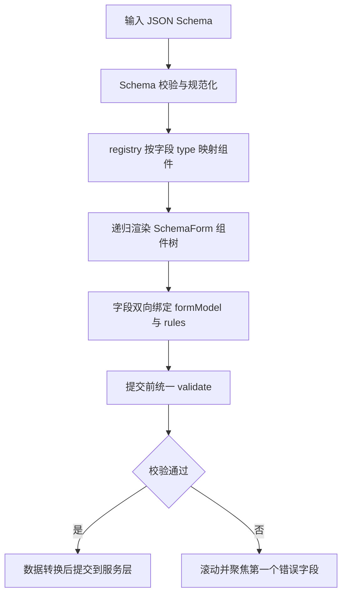

```vue
<!-- components/SchemaForm.vue —— 表单引擎核心 -->
<script setup lang="ts">
import { reactive, computed, ref, type Component, type PropType } from "vue";
import { ElInput, ElSelect, ElDatePicker } from "element-plus";

interface FieldSchema {
  field: string;
  label: string;
  type: "input" | "select" | "date";
  rules?: Array<{ required?: boolean; message: string }>;
  options?: Array<{ label: string; value: unknown }>;
  visible?: (model: Record<string, unknown>) => boolean; // 联动表达式
  disabled?: (model: Record<string, unknown>) => boolean;
}

const props = defineProps({
  schema: { type: Array as PropType<FieldSchema[]>, required: true },
  submitApi: { type: Function as PropType<(m: Record<string, unknown>) => Promise<unknown>>, required: true },
});

// 组件注册表：开放封闭，业务可扩展自定义 type
const registry: Record<FieldSchema["type"], Component> = {
  input: ElInput,
  select: ElSelect,
  date: ElDatePicker,
};

// formModel 由 schema 初始化，字段全部可响应
const model = reactive<Record<string, unknown>>(
  Object.fromEntries(props.schema.map((f) => [f.field, undefined]))
);
const errors = ref<Record<string, string>>({});
const submitting = ref(false);

// 联动：visible 是函数，依赖 model 的字段变化自动重算（computed 响应式）
const visibleFields = computed(() => props.schema.filter((f) => f.visible?.(model) ?? true));

async function submit() {
  // 1. 校验：required 规则归一执行
  const errs: Record<string, string> = {};
  for (const f of visibleFields.value) {
    const empty = model[f.field] === undefined || model[f.field] === "";
    if (f.rules?.some((r) => r.required) && empty) {
      errs[f.field] = f.rules.find((r) => r.required)!.message;
    }
  }
  errors.value = errs;
  if (Object.keys(errs).length) {
    // 2. 定位第一个错误字段
    document.querySelector(`[data-field="${Object.keys(errs)[0]}"]`)?.scrollIntoView({ behavior: "smooth" });
    return;
  }
  // 3. 提交
  submitting.value = true;
  try {
    await props.submitApi({ ...model });
  } finally {
    submitting.value = false;
  }
}
</script>

<template>
  <form @submit.prevent="submit">
    <div v-for="f in visibleFields" :key="f.field" class="row" :data-field="f.field">
      <label>{{ f.label }}</label>
      <component
        :is="registry[f.type]"
        v-model="model[f.field]"
        :options="f.options"
        :disabled="f.disabled?.(model)"
        :placeholder="`请输入${f.label}`"
      />
      <span v-if="errors[f.field]" class="err">{{ errors[f.field] }}</span>
    </div>
    <button type="submit" :disabled="submitting">提交</button>
  </form>
</template>

<!-- schema 配置示例（调用方）：
     const schema: FieldSchema[] = [
       { field: "type", label: "工单类型", type: "select", rules: [{ required: true, message: "必选" }],
         options: [{ label: "故障", value: 1 }, { label: "咨询", value: 2 }] },
       { field: "desc", label: "描述", type: "input",
         visible: (m) => m.type === 1, // 联动：只有故障单显示
         rules: [{ required: true, message: "描述必填" }] },
     ] -->
```

### V3-185：如何用 Vue 实现一个低代码渲染器？
**答**：
- 渲染器输入是节点树：每个节点 { id, type, props, children, events }，输出是递归 resolveComponent + h() 渲染的组件树。
- 事件绑定：events 描述 action（打开弹窗、请求接口、跳转），运行时解析为真正函数，动作系统是低代码的"积木胶水"。
- 数据绑定：props 里的 `{{ state.xxx }}` 表达式用 computed + new Function（或 JSON-logic）求值，作用域是页面级 state。
- 与表单引擎的关系：表单引擎是"领域特化"的渲染器；通用低代码渲染器 + 表单 schema 可以复用同一套 registry。

```vue
<!-- components/Renderer.vue —— 低代码渲染器核心 -->
<script setup lang="ts">
import { computed, h, type Component, reactive } from "vue";
import { ElButton, ElInput, ElCard } from "element-plus";

interface NodeSchema {
  id: string;
  type: string;                        // 物料类型
  props?: Record<string, unknown>;     // 支持表达式字符串
  children?: NodeSchema[];
  events?: Record<string, string>;     // 事件 -> actionId
}

// 物料表：低代码平台拖拽面板里的组件集合
const materials: Record<string, Component> = { ElButton, ElInput, ElCard };

const props = defineProps<{ schema: NodeSchema; state: Record<string, unknown> }>();
const emit = defineEmits<{ (e: "action", actionId: string, payload?: unknown): void }>();

// 表达式求值：{{ state.xxx }} -> 实际值（生产建议用受限表达式引擎）
function resolveValue(v: unknown): unknown {
  if (typeof v !== "string") return v;
  const m = v.match(/^\{\{(.+)\}\}$/);
  if (!m) return v;
  return new Function("state", `return ${m[1]}`)(props.state);
}

// 动作系统：事件字符串映射成可执行 action
function bindEvents(events?: Record<string, string>) {
  if (!events) return {};
  return Object.fromEntries(
    Object.entries(events).map(([domEvent, actionId]) => [
      domEvent,
      () => emit("action", actionId, props.state),
    ])
  );
}

// 递归渲染：节点树 -> vnode 树
function renderNode(node: NodeSchema): ReturnType<typeof h> {
  const resolvedProps = Object.fromEntries(
    Object.entries(node.props ?? {}).map(([k, v]) => [k, resolveValue(v)])
  );
  return h(
    materials[node.type] ?? ElCard,
    { ...resolvedProps, ...bindEvents(node.events), key: node.id },
    node.children?.length ? { default: () => node.children!.map(renderNode) } : resolvedProps.textContent
  );
}

// 整棵树是 computed：schema 或 state 变化自动重渲染
const vnode = computed(() => renderNode(props.schema));
</script>

<template>
  <component :is="vnode" />
</template>

<!-- 使用方：
     const state = reactive({ name: "低代码" });
     const schema: NodeSchema = {
       id: "root", type: "ElCard",
       props: { header: "标题 {{ state.name }}" },
       children: [
         { id: "btn", type: "ElButton", props: { type: "primary", textContent: "点我" },
           events: { click: "submit-form" } },
       ],
     };
     <Renderer :schema="schema" :state="state" @action="(id) => doAction(id)" /> -->
```

### V3-186：设计一个消息中心（多通道：站内/推送/未读数）？
**答**：
- 数据层：messages store 分通道（system/activity/notice）分页存储，未读数是 getter（聚合 + 分通道），标记已读走乐观更新。
- 实时层：WebSocket 推送新消息与未读数变更，断线降级为轮询（复用 V3-164 的 usePolling）；推送通道（APP 端）由后端对接厂商，前端只处理 Web。
- 已读协议：单条已读 + 全部已读 + 通道已读，未读数幂等由服务端保证，前端本地立即减掉。
- UI 层：顶栏红点 + 抽屉列表 + 消息详情路由化，方便深链接与 SSR 友好。

```typescript
// src/stores/message.ts —— Pinia 消息中心
import { defineStore } from "pinia";

interface Message {
  id: number;
  channel: "system" | "activity" | "notice";
  title: string;
  content: string;
  read: boolean;
  createdAt: string;
}

export const useMessageStore = defineStore("message", {
  state: () => ({
    messages: [] as Message[],
    unreadByChannel: {} as Record<string, number>, // 服务端权威未读数
    connected: false,
  }),
  getters: {
    totalUnread: (s) => Object.values(s.unreadByChannel).reduce((a, b) => a + b, 0),
    byChannel: (s) => (channel: string) => s.messages.filter((m) => m.channel === channel),
  },
  actions: {
    // WebSocket 实时消息
    connect() {
      const ws = new WebSocket(`wss://${location.host}/ws/message`);
      ws.onopen = () => (this.connected = true);
      ws.onclose = () => {
        this.connected = false;
        setTimeout(() => this.connect(), 5000); // 断线重连；重连多次失败降级轮询
      };
      ws.onmessage = (e) => {
        const { type, payload } = JSON.parse(e.data);
        if (type === "message:new") {
          this.messages.unshift(payload);
          this.unreadByChannel[payload.channel] = (this.unreadByChannel[payload.channel] ?? 0) + 1;
        }
        if (type === "unread:sync") this.unreadByChannel = payload;
      };
    },
    // 标记已读：乐观更新 + 服务端校准
    async markRead(id: number) {
      const msg = this.messages.find((m) => m.id === id);
      if (!msg || msg.read) return;
      msg.read = true;
      this.unreadByChannel[msg.channel] = Math.max(0, (this.unreadByChannel[msg.channel] ?? 1) - 1);
      await api.readMessage(id).catch(() => { msg.read = false; }); // 失败回滚
    },
    async readAll(channel: string) {
      this.messages.forEach((m) => { if (m.channel === channel) m.read = true; });
      this.unreadByChannel[channel] = 0;
      await api.readAll(channel);
    },
  },
});

const api = {
  readMessage: (id: number) => fetch(`/api/messages/${id}/read`, { method: "POST" }),
  readAll: (channel: string) => fetch(`/api/messages/read-all?channel=${channel}`, { method: "POST" }),
};
```

### V3-187：设计一个文件管理系统（树/列表/上传/预览）？
**答**：
- 双视图模型：目录树（左）+ 文件列表（右），当前目录 id 是核心状态，树懒加载子目录（展开时才请求），列表随目录切换分页拉取。
- 上传集成：UploadQueue（V3-165）挂到全局 store，右下角浮窗显示队列进度，目录页保持可用。
- 预览策略：图片走 OSS 缩略图 + 大图 lightbox；office/pdf 用预览服务（URL 直开或 iframe）；视频走原生 video。
- 操作集：重命名/移动/删除/分享，移动用树拖拽（dragover 校验不能移到自己子树），删除软删除可回收站恢复。

```vue
<!-- views/files/FileExplorer.vue —— 文件管理主界面骨架 -->
<script setup lang="ts">
import { ref, watch, onMounted } from "vue";

interface Folder { id: number; name: string; children?: Folder[] }
interface FileItem { id: number; name: string; size: number; mime: string; folderId: number }

const folders = ref<Folder[]>([]);          // 目录树（懒加载）
const files = ref<FileItem[]>([]);
const currentFolderId = ref<number | null>(null); // 核心状态
const total = ref(0);
const page = ref(1);
const previewFile = ref<FileItem | null>(null);

// 树懒加载：展开节点时才请求子目录
async function loadChildren(node: Folder) {
  if (node.children) return;
  node.children = await fetch(`/api/folders?parent=${node.id}`).then((r) => r.json());
}

// 列表随目录切换重新拉取
watch(currentFolderId, async (fid) => {
  page.value = 1;
  const resp = await fetch(`/api/files?folder=${fid ?? ""}&page=1`).then((r) => r.json());
  files.value = resp.rows;
  total.value = resp.total;
});

const previewUrl = (f: FileItem) => `/api/files/${f.id}/preview`; // 统一预览服务

onMounted(async () => {
  folders.value = await fetch("/api/folders?parent=root").then((r) => r.json());
});
</script>

<template>
  <div class="explorer">
    <aside>
      <el-tree :data="folders" node-key="id" lazy :load="({ data, resolve }) => { loadChildren(data).then(resolve); }"
        @node-click="(d: Folder) => (currentFolderId = d.id)" />
    </aside>
    <main>
      <table>
        <tr v-for="f in files" :key="f.id" @dblclick="previewFile = f">
          <td>{{ f.name }}</td>
          <td>{{ (f.size / 1024).toFixed(1) }} KB</td>
        </tr>
      </table>
      <!-- 上传：进全局 UploadQueue，右下角浮窗展示 -->
      <input type="file" multiple @change="onPick" />
    </main>

    <Teleport to="body">
      <div v-if="previewFile" class="preview-mask" @click.self="previewFile = null">
        
        <iframe v-else :src="previewUrl(previewFile)" /> <!-- pdf/office 走预览服务 -->
      </div>
    </Teleport>
  </div>
</template>

<script lang="ts">
function onPick(e: Event) {
  const input = e.target as HTMLInputElement;
  [...(input.files ?? [])].forEach((f) => useUploadQueue().add(f)); // 全局上传队列
  input.value = "";
}
function useUploadQueue() { /* 依赖注入 V3-165 的 UploadQueue 单例 */ return { add: console.log }; }
</script>
```

### V3-188：设计一个数据大屏（自适应缩放 + 轮询 + ECharts 优化）？
**答**：
- 自适应：设计稿固定 1920x1080，外层容器 transform: scale() 按窗口宽高比等比缩放（取宽高缩放比最小值），图表内部逻辑坐标不变。
- ECharts 优化：实例复用不重复 init；setOption 用 notMerge:false 增量更新；resize 监听防抖；超长序列用 sampling/dataZoom。
- 数据刷新：usePolling（V3-164）统一管理，多图表共享一次批量接口；页面不可见自动暂停。
- 动效节制：数字滚动 + 图表过渡即可，避免大量 markPoint 动画掉帧；大屏建议关闭 tooltip（无人交互）。

```vue
<!-- views/dashboard/BigScreen.vue -->
<script setup lang="ts">
import { ref, onMounted, onUnmounted } from "vue";
import * as echarts from "echarts";
import { usePolling } from "@/composables/usePolling";

const DESIGN_W = 1920, DESIGN_H = 1080;
const screenRef = ref<HTMLDivElement | null>(null);
const chartRefs = ref<HTMLElement[]>([]);
const charts: echarts.ECharts[] = [];
const salesData = ref<number[]>([]);

// ---- 自适应缩放：等比 scale，保持设计稿坐标系 ----
function fitScreen() {
  const scale = Math.min(window.innerWidth / DESIGN_W, window.innerHeight / DESIGN_H);
  screenRef.value!.style.transform = `scale(${scale}) translate(-50%, -50%)`;
  charts.forEach((c) => c.resize()); // resize 防抖可加，这里仅两图直接刷
}

// ---- 轮询取数：一个批量接口喂全部图表 ----
const { data, start } = usePolling<Record<string, number[]>>(
  () => fetch("/api/dashboard/batch").then((r) => r.json()),
  10_000
);

function renderCharts() {
  // 实例复用：首次 init，之后 setOption 增量更新
  if (!charts.length) {
    chartRefs.value.forEach((el) => charts.push(echarts.init(el)));
  }
  const trend = data.value?.trend ?? [];
  charts[0]?.setOption({
    xAxis: { type: "category", data: trend.map((_, i) => i) },
    yAxis: { type: "value" },
    series: [{ type: "line", data: trend, smooth: true, sampling: "lttb" }], // LTTB 抽稀
    animationDurationUpdate: 600, // 数据刷新的过渡动画
  });
  salesData.value = data.value?.sales ?? [];
}

watch(data, renderCharts);

onMounted(() => {
  fitScreen();
  window.addEventListener("resize", fitScreen);
  start();
});
onUnmounted(() => {
  window.removeEventListener("resize", fitScreen);
  charts.forEach((c) => c.dispose()); // 必须 dispose
});
</script>

<template>
  <!-- 外层铺满视口，内层按设计稿尺寸 + scale 缩放 -->
  <div class="stage-outer">
    <div ref="screenRef" class="stage" :style="{ width: DESIGN_W + 'px', height: DESIGN_H + 'px' }">
      <div class="panel"><div ref="chartRefs" /></div>
      <div v-for="(v, i) in salesData" :key="i" class="kpi">{{ v }}</div>
    </div>
  </div>
</template>

<style>
.stage-outer { width: 100vw; height: 100vh; overflow: hidden; background: #001529; }
.stage { position: absolute; left: 50%; top: 50%; transform-origin: left top; }
.panel { width: 900px; height: 400px; }
.kpi { color: #409eff; font-size: 32px; }
</style>

<script lang="ts">
import { watch } from "vue";
</script>
```

### V3-189：设计一个移动端 H5 商城页（骨架屏/懒加载/购物车状态）？
**答**：
- 首屏三件套：骨架屏（SSR 直出或本地占位）、关键图 preload、商品列表虚拟滚动或分页 + v-lazy（V3-147）。
- 购物车状态：pinia 持久化（pinia-plugin-persistedstate），数量修改乐观更新，服务端登录后合并本地车。
- 交互细节：触达底部加载下一页（IntersectionObserver 哨兵元素）、规格弹层（Sku 组件）、加购抛物线动画用 TransitionGroup 或 FLIP。
- 性能：路由级代码分割、图片 webp（CDN 参数）、首屏接口并行请求。

```vue
<!-- views/mall/GoodsList.vue —— H5 商城列表页 -->
<script setup lang="ts">
import { ref, onMounted } from "vue";
import { useCartStore } from "@/stores/cart";
import { vLazy } from "@/directives/lazy"; // V3-147

const goods = ref<any[]>([]);
const page = ref(1);
const finished = ref(false);
const loading = ref(false);
const sentinel = ref<HTMLElement | null>(null); // 触底哨兵
const cart = useCartStore(); // 持久化的购物车 store

async function loadMore() {
  if (loading.value || finished.value) return;
  loading.value = true;
  const resp = await fetch(`/api/goods?page=${page.value}`).then((r) => r.json());
  goods.value.push(...resp.rows);
  finished.value = resp.rows.length === 0;
  page.value++;
  loading.value = false;
}

onMounted(() => {
  // 哨兵进入视口即加载下一页：无限滚动
  const io = new IntersectionObserver((e) => e[0].isIntersecting && loadMore());
  io.observe(sentinel.value!);
  loadMore();
});

function addToCart(g: any) {
  cart.add(g); // 乐观更新：badge 立即 +1，接口失败回滚（store 内处理）
}
</script>

<template>
  <header class="bar">商城首页 <span class="badge">{{ cart.count }}</span></header>

  <!-- 骨架屏：loading 且无数据时显示 -->
  <div v-if="loading && !goods.length" class="skeleton-list">
    <div v-for="i in 6" :key="i" class="skeleton-item" />
  </div>

  <ul class="list">
    <li v-for="g in goods" :key="g.id" class="card">
      
      <div class="info">
        <p>{{ g.name }}</p>
        <p class="price">¥{{ g.price }}</p>
        <button @click="addToCart(g)">加购</button>
      </div>
    </li>
  </ul>

  <div ref="sentinel" class="sentinel">{{ loading ? "加载中..." : finished ? "没有更多了" : "" }}</div>
</template>

<style>
.skeleton-item { height: 90px; margin: 8px; border-radius: 8px; background: linear-gradient(90deg, #f2f2f2 25%, #e6e6e6 50%, #f2f2f2 75%); background-size: 200% 100%; animation: shimmer 1.2s infinite; }
@keyframes shimmer { to { background-position: -200% 0; } }
.badge { position: absolute; right: 12px; top: 12px; background: #f56c6c; border-radius: 8px; padding: 0 6px; font-size: 12px; }
.card { display: flex; gap: 12px; padding: 12px; }
</style>
```

### V3-190：设计一个在线考试系统（倒计时/防切屏/自动保存）？
**答**：
- 倒计时权威在服务端：前端根据下发剩余秒数本地递减，每 30 秒对时校准；到时强制提交。
- 防切屏：visibilitychange/blur 记录切屏次数与时长，超阈值告警或直接交卷（策略由服务端下发，前端只执行）。
- 自动保存：答案变更 debounce 3 秒落服务端 + localStorage 双写，恢复页面时比对版本取最新。
- 状态机：进行中 -> 已交卷 -> 阅卷中；交卷前防重（重复点击/断网时用 V3-166 离线队列）。

```vue
<!-- views/exam/ExamRoom.vue -->
<script setup lang="ts">
import { ref, computed, onMounted, onUnmounted } from "vue";

const remainSec = ref(0);
const answers = ref<Record<number, string>>({});
const switchCount = ref(0);
const submitted = ref(false);
const saveState = ref<"idle" | "saving" | "saved">("idle");
let saveTimer: ReturnType<typeof setTimeout> | null = null;
let tick: ReturnType<typeof setInterval> | null = null;

// 倒计时：本地递减，定时与服务端校准
function startCountdown(serverRemain: number) {
  remainSec.value = serverRemain;
  tick = setInterval(() => {
    remainSec.value--;
    if (remainSec.value <= 0) submit(true);
    else if (remainSec.value % 30 === 0) syncTime(); // 每 30 秒对时
  }, 1000);
}
async function syncTime() {
  const { remain } = await fetch("/api/exam/remain").then((r) => r.json());
  remainSec.value = remain; // 修正本地时钟漂移
}
const timeText = computed(() =>
  `${String(Math.floor(remainSec.value / 60)).padStart(2, "0")}:${String(remainSec.value % 60).padStart(2, "0")}`
);

// 防切屏：监听可见性，记录次数，策略由服务端下发
function onVisibility() {
  if (document.hidden) {
    switchCount.value++;
    fetch("/api/exam/report", { method: "POST", body: JSON.stringify({ type: "leave", count: switchCount.value }) });
    if (switchCount.value >= 3) alert("切屏次数过多，将触发强制交卷");
  }
}

// 自动保存：debounce 3 秒 + localStorage 双写
function onAnswer(qid: number, val: string) {
  answers.value[qid] = val;
  localStorage.setItem("exam-draft", JSON.stringify(answers.value));
  saveState.value = "idle";
  if (saveTimer) clearTimeout(saveTimer);
  saveTimer = setTimeout(saveDraft, 3000);
}
async function saveDraft() {
  saveState.value = "saving";
  await requestWrite("/api/exam/save", "POST", answers.value); // 离线时进队列（V3-166）
  saveState.value = "saved";
}

async function submit(force = false) {
  if (submitted.value) return; // 防重复交卷
  submitted.value = true;
  if (tick) clearInterval(tick);
  await saveDraft();
  await fetch(`/api/exam/submit${force ? "?force=1" : ""}`, { method: "POST" });
  location.href = "/exam/result";
}

onMounted(() => {
  document.addEventListener("visibilitychange", onVisibility);
  // 恢复草稿：本地与服务端比版本
  const draft = localStorage.getItem("exam-draft");
  if (draft) answers.value = JSON.parse(draft);
  fetch("/api/exam/status").then((r) => r.json()).then(({ remain, saved }) => {
    startCountdown(remain);
    if (saved) answers.value = saved;
  });
});
onUnmounted(() => document.removeEventListener("visibilitychange", onVisibility));

const requestWrite = async (u: string, m: string, b: unknown) => fetch(u, { method: m, body: JSON.stringify(b) });
</script>

<template>
  <div class="exam">
    <header>
      <span :class="{ danger: remainSec < 300 }">{{ timeText }}</span>
      <span>切屏次数：{{ switchCount }}</span>
      <span>{{ saveState === "saving" ? "保存中..." : saveState === "saved" ? "已自动保存" : "" }}</span>
      <button @click="submit()">交卷</button>
    </header>
    <div v-for="(q, i) in questions" :key="q.id" class="q">
      <p>{{ i + 1 }}. {{ q.title }}</p>
      <textarea :value="answers[q.id]" @input="onAnswer(q.id, ($event.target as HTMLTextAreaElement).value)" />
    </div>
  </div>
</template>

<script lang="ts">
const questions = [{ id: 1, title: "简述 Vue3 响应式原理" }];
</script>

<style>
header { display: flex; gap: 24px; align-items: center; position: sticky; top: 0; background: #fff; }
.danger { color: #f56c6c; animation: blink 1s infinite; }
@keyframes blink { 50% { opacity: .5; } }
</style>
```

### V3-191：设计一个协作看板（拖拽 + 实时同步概览）？
**答**：
- 拖拽：HTML5 dragstart/dragover/drop 实现列间移动，源位置记录 { cardId, fromCol, toCol, index } 作为"移动事件"原子下发。
- 实时同步：移动事件经 WebSocket 广播，其他端收到后按事件应用（OT 思想），本地操作用乐观更新 + 服务端序号校准。
- 冲突策略：卡片带 version，服务端按到达顺序执行并递增版本；版本落后的客户端收到 diff 补拉。
- 性能：拖拽用 transform 位移（不重排），列表渲染用卡片 id 作 key，远程协作者光标独立层渲染。

```vue
<!-- views/kanban/KanbanBoard.vue -->
<script setup lang="ts">
import { reactive, onMounted, onUnmounted } from "vue";

interface Card { id: string; title: string; version: number }
const columns = reactive([
  { id: "todo", name: "待办", cards: [] as Card[] },
  { id: "doing", name: "进行中", cards: [] as Card[] },
  { id: "done", name: "完成", cards: [] as Card[] },
]);

let dragging: { cardId: string; fromCol: string } | null = null;

function onDragStart(e: DragEvent, card: Card, colId: string) {
  dragging = { cardId: card.id, fromCol: colId };
  e.dataTransfer?.setData("text/plain", card.id);
}
// 列容器：允许放置
function onDragOver(e: DragEvent) {
  e.preventDefault();
  (e.currentTarget as HTMLElement).classList.add("drag-over");
}
function onDragLeave(e: DragEvent) {
  (e.currentTarget as HTMLElement).classList.remove("drag-over");
}
// 落下：本地乐观移动 + 事件广播
async function onDrop(e: DragEvent, toCol: string) {
  e.preventDefault();
  if (!dragging) return;
  const from = columns.find((c) => c.id === dragging!.fromCol)!;
  const to = columns.find((c) => c.id === toCol)!;
  const idx = from.cards.findIndex((c) => c.id === dragging!.cardId);
  const [card] = from.cards.splice(idx, 1); // 乐观：先动本地
  to.cards.push(card);
  dragging = null;

  // 原子移动事件下发给服务端 -> 广播给其他协作者
  await fetch("/api/kanban/move", {
    method: "POST",
    headers: { "Content-Type": "application/json" },
    body: JSON.stringify({ cardId: card.id, fromCol: from.id, toCol: to.id }),
  });
}

// 实时同步：其他端的移动事件应用到本地
let ws: WebSocket;
onMounted(() => {
  ws = new WebSocket(`wss://${location.host}/ws/kanban`);
  ws.onmessage = (e) => {
    const { cardId, fromCol, toCol } = JSON.parse(e.data);
    const from = columns.find((c) => c.id === fromCol);
    const to = columns.find((c) => c.id === toCol);
    const idx = from?.cards.findIndex((c) => c.id === cardId) ?? -1;
    if (idx >= 0) to?.cards.push(from!.cards.splice(idx, 1)[0]); // 幂等应用
  };
});
onUnmounted(() => ws?.close());
</script>

<template>
  <div class="board">
    <div v-for="col in columns" :key="col.id" class="col"
      @dragover="onDragOver" @dragleave="onDragLeave" @drop="onDrop($event, col.id)">
      <h4>{{ col.name }}（{{ col.cards.length }}）</h4>
      <div v-for="card in col.cards" :key="card.id" class="card" draggable="true"
        @dragstart="onDragStart($event, card, col.id)">
        {{ card.title }}
      </div>
    </div>
  </div>
</template>

<style>
.board { display: flex; gap: 16px; padding: 16px; }
.col { width: 260px; min-height: 400px; background: #f4f4f5; border-radius: 8px; padding: 8px; }
.col.drag-over { outline: 2px dashed #409eff; }
.card { background: #fff; margin: 8px 0; padding: 12px; border-radius: 6px; cursor: grab; box-shadow: 0 1px 4px rgba(0,0,0,.1); }
</style>
```

### V3-192：设计一个权限可视化配置页（树 + 穿梭框）？
**答**：
- 左侧角色树（单选角色），中间菜单/按钮权限树（el-tree 带 checkbox），右侧用户穿梭框（el-transfer）——三区联动。
- 半选语义：父节点勾选状态由子节点聚合（indeterminate），保存时只提交叶子权限码，避免脏数据。
- 批量保存：树勾选变化 diff 出新增/撤销的权限码集合，调一次批量接口；切换角色前提示未保存变更。
- 大数据量优化：权限树懒加载 + 默认折叠；穿梭框右侧分页或搜索过滤。

```vue
<!-- views/permission/PermissionConfig.vue -->
<script setup lang="ts">
import { ref, watch } from "vue";

interface PermNode { id: string; label: string; children?: PermNode[] }
interface Role { id: number; name: string }

const roles = ref<Role[]>([]);
const currentRole = ref<Role | null>(null);
const permTree = ref<PermNode[]>([]);
const checkedKeys = ref<string[]>([]);          // 全选的 key
const dirty = ref(false);
const saving = ref(false);
const users = ref<{ key: number; label: string }[]>([]);
const assignedUsers = ref<number[]>([]);

// 选中角色 -> 拉取其权限快照
watch(currentRole, async (role) => {
  if (!role) return;
  const resp = await fetch(`/api/roles/${role.id}/permissions`).then((r) => r.json());
  checkedKeys.value = resp.checkedKeys;
  assignedUsers.value = resp.userIds;
  dirty.value = false;
});

// 切换角色前拦截未保存变更
function onRoleChange(role: Role) {
  if (dirty.value && !confirm("当前角色的权限修改尚未保存，确定切换？")) return;
  currentRole.value = role;
}

// 保存：只提交叶子权限码（父节点由子节点聚合而来）
async function save() {
  saving.value = true;
  const leafCodes = checkedKeys.value.filter((k) => k.includes(":")); // 权限码都是叶子
  await fetch(`/api/roles/${currentRole.value!.id}/permissions`, {
    method: "PUT",
    headers: { "Content-Type": "application/json" },
    body: JSON.stringify({ perms: leafCodes, userIds: assignedUsers.value }),
  });
  dirty.value = false;
  saving.value = false;
}
</script>

<template>
  <div class="layout">
    <aside>
      <h4>角色</h4>
      <ul>
        <li v-for="r in roles" :key="r.id" :class="{ active: currentRole?.id === r.id }"
          @click="onRoleChange(r)">{{ r.name }}</li>
      </ul>
    </aside>

    <section>
      <h4>权限树（勾选即改）</h4>
      <el-tree
        :data="permTree"
        show-checkbox
        node-key="id"
        :default-checked-keys="checkedKeys"
        check-strictly
        @check="() => (dirty = true)"
      />
      <h4>分配用户</h4>
      <el-transfer v-model="assignedUsers" :data="users" filterable @change="() => (dirty = true)" />
      <button :disabled="!dirty || saving" @click="save">{{ saving ? "保存中" : "保存变更" }}</button>
    </section>
  </div>
</template>

<style>
.layout { display: flex; gap: 24px; }
aside { width: 200px; }
aside li.active { color: #409eff; }
button { margin-top: 12px; }
button:disabled { opacity: .5; }
</style>
```

### V3-193：设计一个审批流可视化（节点连线 + 状态机）？
**答**：
- 数据模型：节点数组（start/approve/cc/end，含审批人配置）+ 边数组（from/to，含条件表达式），与主流审批引擎（钉钉/飞书）模型对齐。
- 可视化：简单纵向流用 CSS + SVG 箭头即可（90% 的 OA 场景）；复杂分支图接 vue-flow/antv-x6，节点用插槽自定义。
- 状态机：节点状态枚举 pending/approved/rejected/current，审批动作只能对 current 节点发起，拒绝后按配置走回退边或终止。
- 条件分支：边上表达式（如 amount > 5000）由后端求值决定走向，前端只负责展示高亮已走过的路径。

```vue
<!-- views/workflow/ApprovalFlow.vue -->
<script setup lang="ts">
import { computed } from "vue";

type NodeStatus = "pending" | "approved" | "rejected" | "current";
interface FlowNode { id: string; type: "start" | "approve" | "cc" | "end"; name: string; approver?: string; status: NodeStatus }
interface FlowEdge { from: string; to: string; condition?: string; taken?: boolean }

const props = defineProps<{ nodes: FlowNode[]; edges: FlowEdge[] }>();
const emit = defineEmits<{ (e: "approve", nodeId: string): void; (e: "reject", nodeId: string): void }>();

const nodeMap = computed(() => Object.fromEntries(props.nodes.map((n) => [n.id, n])));
// 已走过的边：两端节点都已审批
const edgePath = (edge: FlowEdge) => {
  const from = nodeMap.value[edge.from], to = nodeMap.value[edge.to];
  return edge.taken || (from.status !== "pending" && to.status !== "pending");
};

const statusText: Record<NodeStatus, string> = {
  pending: "待到达", approved: "已通过", rejected: "已驳回", current: "审批中",
};
</script>

<template>
  <!-- 纵向流程：CSS 排布 + 状态色 -->
  <div class="flow">
    <template v-for="(node, i) in nodes" :key="node.id">
      <div class="node" :class="node.type + ' ' + node.status">
        <span class="dot" />
        <div class="body">
          <b>{{ node.name }}</b>
          <small v-if="node.approver">{{ node.approver }}</small>
          <small>{{ statusText[node.status] }}</small>
          <!-- 只有当前节点可操作 -->
          <template v-if="node.status === 'current'">
            <button @click="emit('approve', node.id)">通过</button>
            <button class="danger" @click="emit('reject', node.id)">驳回</button>
          </template>
        </div>
      </div>
      <!-- 节点之间的连线，标注条件 -->
      <div v-if="i < nodes.length - 1" class="edge" :class="{ taken: edgePath(edges[i]) }">
        <span v-if="edges[i].condition" class="cond">{{ edges[i].condition }}</span>
      </div>
    </template>
  </div>
</template>

<style>
.flow { width: 320px; margin: auto; }
.node { display: flex; gap: 12px; align-items: flex-start; padding: 8px; }
.node .dot { width: 12px; height: 12px; border-radius: 50%; background: #ddd; margin-top: 6px; }
.node.approved .dot { background: #67c23a; }
.node.current .dot { background: #409eff; animation: pulse 1s infinite; }
.node.rejected .dot { background: #f56c6c; }
@keyframes pulse { 50% { box-shadow: 0 0 0 6px rgba(64,158,255,.2); } }
.edge { margin-left: 12px; border-left: 2px solid #ddd; height: 28px; }
.edge.taken { border-left-color: #67c23a; }
.cond { margin-left: 12px; font-size: 12px; color: #999; }
button { margin-right: 8px; }
</style>
```

### V3-194：设计一个国际化 CMS（多语言内容管理）？
**答**：
- 内容模型：内容主表 + 多语言子表（locale 维度），翻译状态机：未翻译 -> 机翻待校对 -> 人工已校对 -> 已发布。
- 编辑器体验：左侧源语言、右侧目标语言对照编辑；缺失语言标红并支持机翻预填（后端调翻译服务）。
- 发布流：按 locale 独立发布，生成静态 JSON 产物推 CDN，前端 i18n 懒加载直接消费（与 V3-158 打通）。
- 一致性校验：保存时对比占位符（{name}）、长度、富文本标签数量，避免翻译破坏模板。

```typescript
// services/cms.ts —— 多语言内容模型与发布流
interface CmsContent {
  id: number;
  key: string;                 // 内容标识
  translations: Record<string, LocaleEntry>; // locale -> 翻译
  status: Record<string, "untranslated" | "machine" | "reviewed" | "published">;
}
interface LocaleEntry {
  title: string;
  body: string;
  translator: "machine" | "human";
}

// 一致性校验：占位符与长度
export function validateTranslation(source: LocaleEntry, target: LocaleEntry): string[] {
  const errors: string[] = [];
  const ph = (s: string) => [...s.matchAll(/\{(\w+)\}/g)].map((m) => m[1]).sort().join(",");
  if (ph(source.title) !== ph(target.title)) errors.push("标题占位符不一致");
  if (ph(source.body) !== ph(target.body)) errors.push("正文占位符不一致");
  const tagCount = (s: string) => (s.match(/<[^>]+>/g) ?? []).length;
  if (tagCount(source.body) !== tagCount(target.body)) errors.push("富文本标签数量不一致");
  if (target.body.length > source.body.length * 3) errors.push("译文长度异常，疑似未翻译");
  return errors;
}

// 发布：按 locale 生成静态 JSON 推 CDN
export async function publishLocale(contentId: number, locale: string) {
  const content = await fetchCms(contentId);
  const entry = content.translations[locale];
  const errs = validateTranslation(content.translations["zh-CN"], entry);
  if (errs.length) throw new Error(`发布被拦截：${errs.join("；")}`);

  await fetch(`/api/cms/${contentId}/publish`, {
    method: "POST",
    headers: { "Content-Type": "application/json" },
    body: JSON.stringify({ locale }), // 后端写 JSON 到 CDN：/i18n/${locale}/${key}.json
  });
  content.status[locale] = "published";
}

// 编辑器联动数据流：
// 左栏源语言（zh-CN）只读 -> 右栏目标语言可编辑
// "机翻预填"按钮：POST /api/cms/{id}/machine-translate { targetLocale }
// 校对完成后 status -> reviewed -> publishLocale
```

### V3-195：设计一个埋点 SDK 的 Vue 插件（指令 + 路由自动埋点）？
**答**：
- 插件形态：app.use(tracker) 注入全局配置（上报地址、采样率、用户态），并挂 $track 与 v-track 指令。
- 两类采集：代码埋点（v-track 指令声明事件与参数）+ 自动埋点（router afterEach 采集 PV/停留时长）。
- 上报管道：批量聚合（队列 + 定时/定量 flush）、sendBeacon 兜底（页面卸载不丢）、失败重试与采样。
- 通用参数自动附带：路由、userId、版本、设备信息，业务只声明差异字段。

```typescript
// src/plugins/tracker.ts —— 埋点插件
import type { App } from "vue";
import type { Router } from "vue-router";

interface TrackPayload { event: string; [k: string]: unknown }

export function createTracker(options: { endpoint: string; sampleRate?: number }) {
  const buffer: TrackPayload[] = [];

  function send(list: TrackPayload[]) {
    // sendBeacon：页面卸载也可靠；不支持时降级 fetch keepalive
    const body = JSON.stringify(list);
    if (navigator.sendBeacon) navigator.sendBeacon(options.endpoint, body);
    else fetch(options.endpoint, { method: "POST", body, keepalive: true });
  }

  function track(event: string, params: Record<string, unknown> = {}) {
    if (Math.random() > (options.sampleRate ?? 1)) return; // 采样
    buffer.push({
      event,
      userId: localStorage.getItem("uid"),
      route: location.pathname,
      version: __APP_VERSION__,
      ts: Date.now(),
      ...params,
    });
    if (buffer.length >= 10) { send(buffer.splice(0)); } // 定量 flush
  }
  // 定时 flush 兜底
  setInterval(() => buffer.length && send(buffer.splice(0)), 10_000);

  return {
    track,
    // 路由自动埋点：PV + 停留时长
    installRouter(router: Router) {
      let enterAt = Date.now();
      router.afterEach((to) => track("page_view", { path: to.fullPath }));
      router.beforeEach((to, from) => {
        if (from.matched.length) {
          track("page_stay", { path: from.fullPath, duration: Date.now() - enterAt });
        }
        enterAt = Date.now();
      });
    },
    install(app: App) {
      app.config.globalProperties.$track = track;
      app.provide("track", track);
      // 点击埋点指令：v-track="{ event: 'click_buy', sku: 1 }"
      app.directive("track", {
        mounted(el: HTMLElement, binding) {
          const handler = () => track(binding.value.event, binding.value);
          el.addEventListener("click", handler);
          (el as any)._track = handler;
        },
        unmounted(el: HTMLElement) {
          el.removeEventListener("click", (el as any)._track);
        },
      });
    },
  };
}

// main.ts：
// const tracker = createTracker({ endpoint: "/api/track", sampleRate: 0.5 });
// app.use(tracker).use(router);
// tracker.installRouter(router);
// 模板：<button v-track="{ event: 'click_buy', skuId: 1 }">购买</button>
```

### V3-196：设计一个 SSR 博客（Nuxt3 全流程）？
**答**：
- 数据层：useAsyncData/useFetch 服务端取数且自动脱水注水；文章列表分页 SSR + 详情页静态化（nitro prerender 或 ISR）。
- SEO：useSeoMeta 设置 title/description/OG 标签；sitemap 由 server route 动态生成。
- 渲染模式：列表与详情 SSR（利于收录），后台管理页切 CSR（routeRules 的 ssr: false），读写分离。
- 性能：payload 提取（数据不再二次请求）、图片 useImage/nuxt-image 自动响应式、缓存 routeRules 的 swr。

```vue
<!-- nuxt3 项目结构：pages/index.vue + pages/posts/[slug].vue -->
<script setup lang="ts">
// 列表页：SSR 渲染，服务端取数
const { data: posts } = await useAsyncData("posts", () =>
  $fetch("/api/posts", { query: { page: 1, size: 20 } })
);

// SEO：SSR 的核心收益
useSeoMeta({
  title: "我的技术博客",
  description: "Vue3 / SSR / 工程化深度文章",
  ogTitle: "我的技术博客",
  ogImage: "/og.png",
});
</script>

<template>
  <main>
    <NuxtLink v-for="p in posts?.rows" :key="p.id" :to="`/posts/${p.slug}`" class="post">
      <h2>{{ p.title }}</h2>
      <p>{{ p.summary }}</p>
    </NuxtLink>
  </main>
</template>
```

```vue
<!-- pages/posts/[slug].vue —— 详情页：静态化 + 阅读数客户端化 -->
<script setup lang="ts">
const route = useRoute();

const { data: post } = await useAsyncData(`post:${route.params.slug}`, () =>
  $fetch(`/api/posts/${route.params.slug}`)
);

useSeoMeta({
  title: () => post.value?.title ?? "文章不存在",
  description: () => post.value?.summary ?? "",
});

// 阅读数是高频变化数据：客户端再请求，不阻塞 SSR
onMounted(() => {
  $fetch(`/api/posts/${route.params.slug}/view`, { method: "POST" });
});
</script>

<template>
  <article>
    <h1>{{ post?.title }}</h1>
    <ContentRenderer :value="post?.body ?? ''" />
  </article>
</template>

<!-- nuxt.config.ts 关键配置：
     routeRules: {
       "/": { swr: 600 },                 // 列表 SWR 缓存 10 分钟
       "/posts/**": { prerender: false, swr: 3600 }, // 详情按需静态化
       "/admin/**": { ssr: false },       // 后台切 CSR
     } -->
```

### V3-197：设计一个播放器组件（video 封装：控制条/快捷键/倍速/全屏）？
**答**：
- 职责划分：原生 video 只负责播放；封装层管理状态（playing/time/volume/rate）并同步到 video 属性；控制条纯展示组件。
- 快捷键：keydown 监听在组件根上（tabindex=0 获焦），空格播放、方向键快进、F 全屏；输入框聚焦时不拦截。
- 倍速与全屏：playbackRate 直接赋值；全屏用 requestFullscreen 包整个容器（连控制条一起全屏），Safari 兼容 webkitEnterFullscreen。
- 事件出口：emit timeupdate/ended 进度类事件由父组件节流消费，避免每秒重渲染整个页面。

```vue
<!-- components/VideoPlayer.vue -->
<script setup lang="ts">
import { ref, onMounted, onUnmounted } from "vue";

const props = defineProps<{ src: string; poster?: string }>();
const emit = defineEmits<{ (e: "timeupdate", t: number, d: number): void; (e: "ended"): void }>();

const rootRef = ref<HTMLDivElement | null>(null);
const videoRef = ref<HTMLVideoElement | null>(null);
const playing = ref(false);
const currentTime = ref(0);
const duration = ref(0);
const volume = ref(1);
const rate = ref(1);
const rates = [0.5, 1, 1.25, 1.5, 2];

function toggle() {
  const v = videoRef.value!;
  playing.value ? v.pause() : v.play();
}

// 快捷键：输入框聚焦时不拦截
function onKeydown(e: KeyboardEvent) {
  if ((e.target as HTMLElement).tagName === "INPUT") return;
  const v = videoRef.value!;
  const map: Record<string, () => void> = {
    " ": toggle,
    ArrowRight: () => (v.currentTime += 5),
    ArrowLeft: () => (v.currentTime -= 5),
    ArrowUp: () => (volume.value = Math.min(1, volume.value + 0.1)),
    ArrowDown: () => (volume.value = Math.max(0, volume.value - 0.1)),
    f: fullscreen,
  };
  map[e.key]?.();
  e.preventDefault();
}

function fullscreen() {
  const root = rootRef.value!;
  if (document.fullscreenElement) document.exitFullscreen();
  else root.requestFullscreen?.() ?? (videoRef.value as any)?.webkitEnterFullscreen?.(); // Safari iOS
}

function setRate(r: number) {
  rate.value = r;
  videoRef.value!.playbackRate = r;
}

// timeupdate 高频：emit 交给父级，父级自己节流
function onTimeUpdate() {
  currentTime.value = videoRef.value!.currentTime;
  emit("timeupdate", currentTime.value, duration.value);
}

onMounted(() => (duration.value = videoRef.value!.duration || 0));
</script>

<template>
  <div ref="rootRef" class="player" tabindex="0" @keydown="onKeydown">
    <video ref="videoRef" :src="src" :poster="poster" @click="toggle"
      @play="playing = true" @pause="playing = false"
      @timeupdate="onTimeUpdate" @ended="emit('ended')" />

    <div class="controls">
      <button @click="toggle">{{ playing ? "暂停" : "播放" }}</button>
      <span>{{ currentTime.toFixed(0) }}s / {{ duration.toFixed(0) }}s</span>
      <input type="range" v-model.number="volume" min="0" max="1" step="0.1"
        @input="videoRef!.volume = volume" />
      <select :value="rate" @change="setRate(+($event.target as HTMLSelectElement).value)">
        <option v-for="r in rates" :key="r" :value="r">{{ r }}x</option>
      </select>
      <button @click="fullscreen">全屏</button>
    </div>
  </div>
</template>

<style>
.player { background: #000; color: #fff; }
video { width: 100%; display: block; }
.controls { display: flex; gap: 12px; align-items: center; padding: 8px; }
</style>
```

### V3-198：设计一个富文本封装（wangEditor / tiptap 集成模式）？
**答**：
- 模式与 Canvas/地图一致（V3-177）：实例在 onMounted 创建，v-model 双向同步（编辑器 input -> model，外部 model 变化 -> setContent），onUnmounted destroy。
- 防循环：内部编辑触发的外部赋值要跳过 setContent（比较内容或加内部标志位）。
- 图片上传：拦截编辑器默认上传，接入自己的 OSS 直传（服务端签名），插入返回的 URL。
- 扩展点：wangEditor 用菜单配置与自定义模块；tiptap 用扩展（extension）体系，ProseMirror 生态可深定制，两种封装层 API 保持一致（v-model + toolbar 配置）。

```vue
<!-- components/RichEditor.vue —— wangEditor 封装 -->
<script setup lang="ts">
import { ref, watch, onMounted, onUnmounted } from "vue";
import { Editor, Toolbar } from "@wangeditor/editor-for-vue";
import type { IDomEditor, IEditorConfig } from "@wangeditor/editor";

const props = defineProps<{ modelValue: string; placeholder?: string }>();
const emit = defineEmits<{ (e: "update:modelValue", v: string): void }>();

const editorRef = ref<IDomEditor | null>(null);
const htmlValue = ref(props.modelValue);
let inner = false; // 内部编辑标志：防 v-model 循环

const editorConfig: Partial<IEditorConfig> = {
  placeholder: props.placeholder ?? "请输入内容...",
  MENU_CONF: {
    // 图片上传：拦截默认行为，走 OSS 直传
    uploadImage: {
      async customUpload(file: File, insertFn: (url: string) => void) {
        const form = new FormData();
        form.append("file", file);
        // 服务端下发签名，前端直传 OSS
        const { url } = await fetch("/api/oss/sign", { method: "POST" })
          .then((r) => r.json())
          .then(async (sign) => {
            const resp = await fetch(sign.host, { method: "POST", body: form });
            return resp.json();
          });
        insertFn(url); // 插入编辑器
      },
    },
  },
};

// v-model 同步：外部值变化 -> 编辑器（编辑器内部变化不再回写，防循环）
watch(() => props.modelValue, (v) => {
  if (v !== htmlValue.value) htmlValue.value = v;
});
function onChange(editor: IDomEditor) {
  inner = true;
  emit("update:modelValue", editor.getHtml());
  inner = false;
}

onUnmounted(() => {
  editorRef.value?.destroy(); // wangEditor 必须 destroy，否则内存泄漏
});
</script>

<template>
  <div class="rich-editor">
    <Toolbar :editor="editorRef" :default-config="{ toolbarKeys: ['bold', 'italic', 'insertImage', 'insertTable'] }" />
    <Editor v-model="htmlValue" :default-config="editorConfig" @on-created="(e: IDomEditor) => (editorRef = e)"
      @on-change="onChange" style="height: 320px" />
  </div>
</template>

<style>
.rich-editor { border: 1px solid #dcdfe6; border-radius: 4px; }
</style>
```

### V3-199：Vue3 性能调优手册收束（排查路径 checklist）？
**答**：
- 排查顺序固定：先测量（Lighthouse/Performance 面板定位 FCPLCP、Long Task）再动手，禁止凭感觉优化。
- 加载性能 checklist：路由懒加载、首屏接口并行、图片 webp+懒加载、关键 CSS 内联、HTTP 缓存与 CDN、按需引入组件库。
- 运行时 checklist：大列表虚拟滚动、computed 替代方法调用、深层 reactive 改 shallowRef、v-memo 与 v-once、事件与定时器清理。
- 渲染更新 checklist：key 稳定性、避免 v-if/v-show 误用、大对象不进响应式（markRaw）、KeepAlive 缓存重型组件。
- 工程化收束：bundle 分析（rollup-plugin-visualizer）、性能预算进 CI（Lighthouse CI 阈值卡点）。

```typescript
// scripts/perf-checklist.ts —— 调优手册：按排查路径逐项自检
export const perfChecklist = {
  // 第一步：测量定位（先测量后优化）
  measure: {
    tool: "Lighthouse / Performance 面板 / web-vitals 上报",
    targets: { LCP: "< 2.5s", INP: "< 200ms", CLS: "< 0.1", bundle: "首包 < 300KB gzip" },
  },
  // 第二步：加载性能
  loading: [
    "路由级 () => import() 懒加载，首屏无关页面全部分包",
    "组件库按需引入（unplugin-vue-components），echarts 按需注册",
    "首屏图片 preload + 商品图 webp + v-lazy",
    "接口并行 Promise.all，CSS 内联关键样式",
    "CDN + 强缓存（hash 文件名）",
  ],
  // 第三步：运行时
  runtime: [
    "万级列表虚拟滚动（vue-virtual-scroller / 自研窗口化）",
    "模板里不调用方法做过滤排序，全部收敛进 computed（有缓存）",
    "大数组大数据：shallowRef + triggerRef，避免深层代理开销",
    "静态内容 v-once，长列表子项 v-memo=[item.id, item.status]",
    "事件监听/observer/定时器必须在 onUnmounted 清理",
  ],
  // 第四步：渲染更新
  render: [
    "列表 key 用业务 id，禁用 index",
    "频繁切换的显隐用 v-show，条件渲染用 v-if",
    "第三方实例（echarts/地图）markRaw，不进响应式",
    "重型页面 KeepAlive 包裹 + include 白名单",
  ],
  // 第五步：工程化卡点
  ci: [
    "rollup-plugin-visualizer 分析产物构成",
    "Lighthouse CI 设定阈值，低于预算阻断合并",
    "性能指标真实用户上报（web-vitals），回归可观测",
  ],
};

// 快速自检脚本示例：构建后检查首包体积预算
// import { gzipSync } from "zlib";
// const budget = 300 * 1024;
// const distStat = getGzipSize("dist/assets/index-*.js");
// if (distStat > budget) { console.error("首包超预算"); process.exit(1); }
```

### V3-200：Vue3 知识体系收束（响应式/组件/路由/状态/工程五层地图）？
**答**：
- 第一层响应式：reactive/ref/computed 的实现链路（track/trigger/脏标记），effectScope 生命周期归属。
- 第二层组件：组合式 API 与 SFC 编译产物（patchFlag/block tree）、通信八法、内置组件三件、指令系统。
- 第三层路由与状态：Router4 的守卫与动态路由、Pinia 的 store 设计（setup store）、服务端状态与客户端状态的边界。
- 第四层工程：Vite 构建体系、测试（Vitest/Playwright）、性能优化、错误处理、部署（SSR/PWA/微前端）。
- 复习策略：每层能讲"一个原理 + 一个实战 + 一个坑"，面试时自顶向下展开，与 V3-135 的生态地图互相印证。

```typescript
// knowledge-map.ts —— 五层知识地图：每层自检"原理 + 实战 + 坑"
export const vue3KnowledgeMap = {
  // 第一层：响应式
  reactivity: {
    core: "Proxy -> track/trigger -> 调度队列批量更新",
    apis: "reactive/ref/shallowRef/computed/watch/watchEffect/effectScope",
    pitfall: "解构丢失响应式（toRefs 解）、分支切换依赖残留（cleanup）",
  },
  // 第二层：组件
  component: {
    core: "SFC 编译优化：patchFlag、block tree、静态提升",
    apis: "defineProps/defineEmits/defineModel/defineExpose/slot/指令",
    pitfall: "index 作 key 导致状态错乱、props 对象引用变更未 deep 监听",
  },
  // 第三层：路由与状态
  routerAndState: {
    core: "Router4：history 模式 + 守卫链；Pinia：setup store + 插件",
    apis: "beforeEach/addRoute/useRoute/useStore",
    pitfall: "动态路由刷新丢失（守卫补注册）、服务端状态塞进 pinia 造成双份缓存",
  },
  // 第四层：工程
  engineering: {
    core: "Vite 预构建 + 按需编译；测试金字塔；性能预算",
    apis: "vite.config/vitest/playwright/vite-plugin-pwa",
    pitfall: "循环依赖、动态 import 路径拼接导致分包失效",
  },
  // 第五层：延伸
  advanced: {
    core: "SSR/Nuxt 同构、custom renderer、微前端",
    apis: "useAsyncData/routeRules/defineCustomElement/qiankun",
    pitfall: "SSR 内存泄漏（全局单例带副作用）、hydration 不匹配",
  },
};

// 收束检验法：任选一层，向面试官讲清 core 是什么、apis 怎么用、
// pitfall 你实际踩过并怎么解决的——五层全部过一遍，知识体系即闭环。
```
