# React 19 与 Hooks 面试题库

> 面向前端面试场景的 React 19 专题题库，共 200 题（R19-001 ~ R19-200）。覆盖 React 19 新特性（Actions、useActionState、useOptimistic、use、ref 作为 prop、Document Metadata、Server Components/Server Actions）、JSX 本质、Hooks 全家桶、并发渲染、Suspense 与错误边界、状态管理选型、性能优化、SSR 与 Next.js、React Testing Library 测试，以及组件设计实战、Hooks 工程库、状态/表单工程、交互模式、性能实战、RSC 与 Next.js 进阶、测试质量与工程生态。所有代码均为现代函数组件 + Hooks 风格，基于 React 19 语法（不需要 import React）。

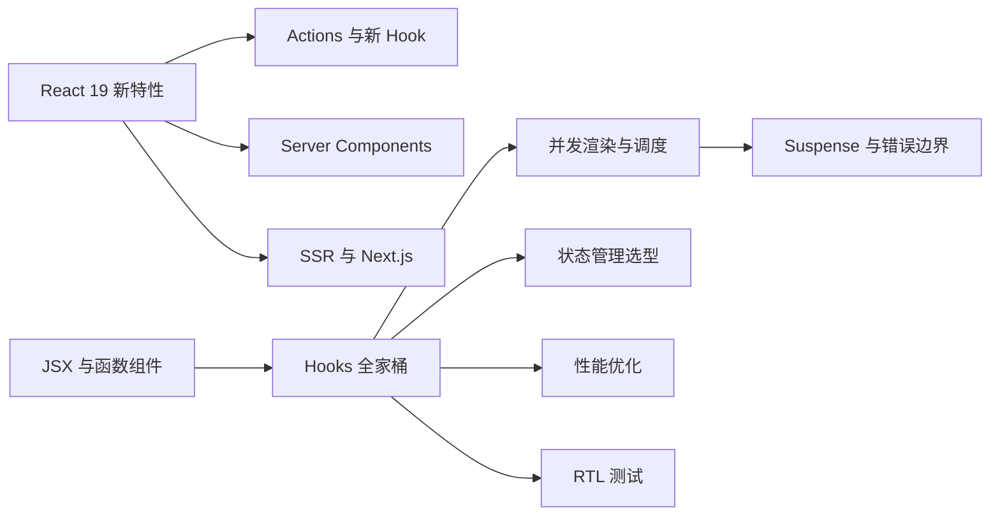

## 目录

- 第一章 React 19 新特性：R19-001 ~ R19-010
- 第二章 JSX 本质与函数组件：R19-011 ~ R19-015
- 第三章 Hooks 全家桶：R19-016 ~ R19-030
- 第四章 自定义 Hook 受控非受控与列表 key：R19-031 ~ R19-036
- 第五章 并发渲染 Suspense 与错误边界：R19-037 ~ R19-043
- 第六章 状态管理：R19-044 ~ R19-047
- 第七章 性能优化与 React Compiler：R19-048 ~ R19-052
- 第八章 SSR 与 Next.js：R19-053 ~ R19-056
- 第九章 React Testing Library 测试：R19-057 ~ R19-060
- 第十章 组件设计实战：R19-061 ~ R19-067
- 第十一章 Hooks 工程库：R19-068 ~ R19-075
- 第十二章 状态管理实战：R19-076 ~ R19-082
- 第十三章 表单工程：R19-083 ~ R19-088
- 第十四章 交互模式：R19-089 ~ R19-095
- 第十五章 性能实战：R19-096 ~ R19-101
- 第十六章 RSC 与 Next.js 实战：R19-102 ~ R19-107
- 第十七章 测试与质量：R19-108 ~ R19-112
- 第十八章 工程与生态：R19-113 ~ R19-130
- 第十九章 源码级简化实现：R19-131 ~ R19-137
- 第二十章 并发模式实战：R19-138 ~ R19-143
- 第二十一章 数据层工程：R19-144 ~ R19-150
- 第二十二章 大型项目架构：R19-151 ~ R19-157
- 第二十三章 状态库实现：R19-158 ~ R19-162
- 第二十四章 测试与质量工程：R19-163 ~ R19-167
- 第二十五章 性能专项深用：R19-168 ~ R19-172
- 第二十六章 React 与其他技术集成：R19-173 ~ R19-177
- 第二十七章 综合大题：R19-178 ~ R19-200

---

## 第一章 React 19 新特性（R19-001 ~ R19-010）

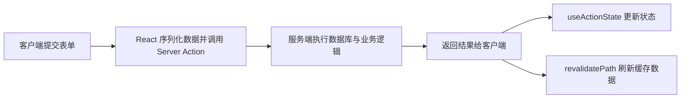

### R19-001：React 19 的 Actions 是什么？解决了什么问题？
**答**：
- Actions 是 React 19 对"数据变更"的一揽子声明式方案，覆盖表单提交、pending 状态、错误处理与乐观更新。
- 传统写法需要手动维护 isSubmitting、error 等状态；Actions 让 React 自动跟踪异步函数的执行过程。
- 表单可以直接把异步函数传给 `action` prop，提交成功后 React 会自动重置非受控表单。
- 配套 API：useActionState、useFormStatus、useOptimistic。

```jsx
function UpdateNameForm() {
  const [isPending, startTransition] = useTransition();

  const handleSubmit = (formData) => {
    // 把异步函数放进 startTransition 即构成一个 Action
    startTransition(async () => {
      const error = await updateName(formData.get('name'));
      if (error) {
        alert(error);
        return;
      }
      // 成功后 React 自动重置表单，无需手动清空输入框
    });
  };

  return (
    <form action={handleSubmit}>
      <input name="name" disabled={isPending} />
      <button disabled={isPending}>{isPending ? '更新中' : '更新'}</button>
    </form>
  );
}
```

### R19-002：useActionState 的签名和用法？
**答**：
- 签名：`const [state, formAction, isPending] = useActionState(fn, initialState)`。
- fn 接收 `(previousState, formData)` 两个参数，返回值会成为新的 state。
- 表单提交自动串行化：前一个 action 未完成时，后续提交会排队等待。
- isPending 标识 action 执行中，最适合管理表单提交结果与错误信息。

```jsx
import { useActionState } from 'react';

async function submit(prevState, formData) {
  const name = formData.get('name');
  if (!name) return { error: '姓名不能为空' };
  await saveName(name);
  return { error: null };
}

export default function NameForm() {
  const [state, formAction, isPending] = useActionState(submit, { error: null });

  return (
    <form action={formAction}>
      <input name="name" />
      <button disabled={isPending}>{isPending ? '提交中' : '提交'}</button>
      {state.error && <p role="alert">{state.error}</p>}
    </form>
  );
}
```

### R19-003：useFormStatus 的作用和使用限制？
**答**：
- 读取最近的祖先 `<form>` 在提交时的 pending、data、method、action 状态。
- 它是 Context 读取器：必须渲染在 `<form>` 标签内部，放在外面拿到的永远是初始值。
- 典型场景是把提交按钮抽成独立组件，按钮自身感知"提交中"并禁用。
- 来自 react-dom 而不是 react，注意导入路径。

```jsx
import { useFormStatus } from 'react-dom';

function SubmitButton() {
  const { pending } = useFormStatus();
  return (
    <button type="submit" disabled={pending}>
      {pending ? '提交中...' : '提交'}
    </button>
  );
}

function ArticleForm({ action }) {
  return (
    <form action={action}>
      <input name="title" />
      {/* SubmitButton 在 form 内部才能读到 pending */}
      <SubmitButton />
    </form>
  );
}
```

### R19-004：useOptimistic 的原理和适用场景？
**答**：
- 让 UI 在异步操作完成前先展示"乐观结果"，操作失败时自动回滚到真实数据。
- 传给它的更新函数是纯函数，基于当前真实 state 计算乐观视图。
- 在 action 内调用 addOptimistic 后立即渲染乐观值，await 真实请求结束后自动切回服务端数据。
- 适合点赞、评论、发送消息等"大概率成功、允许短暂不一致"的操作。

```jsx
import { useOptimistic } from 'react';

function MessageList({ messages, sendMessage }) {
  const [optimisticMessages, addOptimisticMessage] = useOptimistic(
    messages,
    (current, newText) => [...current, { id: 'tmp', text: newText, sending: true }]
  );

  async function handleSend(formData) {
    const text = formData.get('text');
    addOptimisticMessage(text); // 立即显示，失败自动回滚
    await sendMessage(text);
  }

  return (
    <>
      {optimisticMessages.map((m) => (
        <p key={m.id}>{m.sending ? m.text + '（发送中）' : m.text}</p>
      ))}
      <form action={handleSend}>
        <input name="text" />
      </form>
    </>
  );
}
```

### R19-005：use API 读取 Promise 是怎么工作的？
**答**：
- `use(promise)` 可以直接在组件中消费 Promise，未完成时组件 suspend，由最近的 Suspense 显示 fallback。
- 与 async/await 不同，use 不需要把组件标记成异步，渲染流程仍是同步调和。
- Promise 应该在组件外或缓存层创建，避免每次渲染重复发起请求导致无限 suspend。
- 也可以配合 throw promise 的旧式 Suspense 数据源无缝替换。

```jsx
import { use, Suspense } from 'react';

function Comments({ commentsPromise }) {
  // promise 未完成时组件挂起，完成后自动恢复渲染
  const comments = use(commentsPromise);
  return (
    <ul>
      {comments.map((c) => (
        <li key={c.id}>{c.text}</li>
      ))}
    </ul>
  );
}

export default function Page() {
  // 注意：Promise 要在组件外或缓存层创建（模块级变量、cache()、Suspense 缓存等），
  // 直接写在组件体里每次渲染都会重新 fetch，导致无限 suspend
  const commentsPromise = fetchComments();
  return (
    <Suspense fallback={<p>评论加载中...</p>}>
      <Comments commentsPromise={commentsPromise} />
    </Suspense>
  );
}
```

### R19-006：use API 读取 Context 与 useContext 的区别？
**答**：
- `use(Context)` 同样能读 Context，但不受 Hook 规则限制，可以出现在条件语句和循环之后。
- useContext 必须在函数组件顶层调用；use 是通用消费接口，还能读 Promise 或自定义 thenable。
- 混合使用时注意：读 Context 的分支必须在调用之前判断清楚，保持逻辑可预测。
- 这让"条件性订阅 Context"这类需求第一次有了官方写法。

```jsx
import { use, createContext } from 'react';

const ThemeContext = createContext('light');

function Toolbar({ needsTheme }) {
  // use 可以放在条件分支里，useContext 做不到
  if (needsTheme) {
    const theme = use(ThemeContext);
    return <button className={theme}>主题按钮</button>;
  }
  return <button>普通按钮</button>;
}
```

### R19-007：React 19 中 ref 作为 prop，forwardRef 发生了什么变化？
**答**：
- React 19 中函数组件可以直接把 `ref` 当作普通 prop 接收，forwardRef 被标记为弃用。
- `function MyInput({ ref, ...props })` 即可把 ref 透传给内部 DOM 元素。
- forwardRef 在 React 19 仍可运行以保持兼容，但新代码推荐直接用 ref prop，类组件行为不变。
- 组件库迁移时注意：类型签名从 `ForwardRefRenderFunction` 变为普通函数组件参数里的 ref。

```jsx
// React 19：ref 就是普通 prop，不再需要 forwardRef 包装
function MyInput({ ref, ...props }) {
  return <input ref={ref} {...props} />;
}

function Parent() {
  const inputRef = useRef(null);

  const focusInput = () => {
    inputRef.current?.focus();
  };

  return (
    <>
      <MyInput ref={inputRef} placeholder="无需 forwardRef" />
      <button onClick={focusInput}>聚焦</button>
    </>
  );
}
```

### R19-008：ref 的 cleanup function 是什么？解决什么问题？
**答**：
- React 19 允许 ref 回调返回一个清理函数，节点卸载或 ref 变更时 React 会先执行清理。
- 解决了旧版 ref 回调无法表达"卸载逻辑"的问题，之前只能依赖 useEffect 或在回调里重置。
- 注意：ref 回调如果隐式返回了非函数值，React 19 会给出警告，箭头函数误写返回值是常见坑。
- cleanup 执行顺序在新的 ref 回调之前，保证先释放旧资源再挂新的。

```jsx
import { useRef } from 'react';

function VideoPlayer({ src }) {
  const videoRef = useRef(null);

  return (
    <video
      ref={(node) => {
        videoRef.current = node;
        // 返回清理函数：卸载或 ref 更换时调用
        return () => {
          videoRef.current = null;
        };
      }}
      src={src}
    />
  );
}
```

### R19-009：React 19 的 Document Metadata 支持是什么？
**答**：
- 组件内可以直接渲染 `<title>`、`<meta>`、`<link>` 等标签，React 自动把它们提升到 `<head>`。
- 不再需要 react-helmet 之类的第三方库做 SEO 信息管理。
- 支持去重与提升：多个组件声明同名 meta 时由 React 决定最终生效的值。
- 需要针对流式渲染/特殊场景精细化控制的团队仍可用第三方库，但大多数场景内置能力已够用。

```jsx
function BlogPost({ post }) {
  return (
    <article>
      {/* 这些标签会被自动提升到 head，组件写在哪里都可以 */}
      <title>{post.title}</title>
      <meta name="description" content={post.summary} />
      <link rel="canonical" href={'https://example.com/posts/' + post.id} />
      <h1>{post.title}</h1>
      <p>{post.body}</p>
    </article>
  );
}
```

### R19-010：Server Components 与 Client Components 的区别？
**答**：
- Server Components 默认只在服务端运行：可以 async、直接访问数据库和文件系统、产物不进客户端 bundle。
- 需要 useState、useEffect、事件监听的组件必须 `'use client'` 声明为 Client Components。
- 两者可以组合：Client 组件可以作为 props（children）接收 Server 组件渲染的静态内容。
- Server Components 传给 Client Components 的 props 必须可序列化，函数（除 Server Action）不能传递。

```jsx
// 默认是 Server Component：支持 async，直接查库，不进客户端 bundle
async function UserList() {
  const users = await db.user.findMany();
  return <ul>{users.map((u) => <li key={u.id}>{u.name}</li>)}</ul>;
}

// 'use client' 声明 Client Component：拥有状态与事件能力
'use client';
import { useState } from 'react';

function Counter() {
  const [n, setN] = useState(0);
  return <button onClick={() => setN(n + 1)}>{n}</button>;
}

// 组合：把 Server 组件作为 children 传给 Client 布局
export default function Page() {
  return (
    <Panel>
      <UserList />
      <Counter />
    </Panel>
  );
}
```

---

## 第二章 JSX 本质与函数组件（R19-011 ~ R19-015）

### R19-011：JSX 的本质是什么？它和 ReactElement 的关系？
**答**：
- JSX 是 JavaScript 的语法扩展，本质是语法糖，编译后产出描述 UI 结构的普通 JS 对象（ReactElement）。
- 现代编译产物调用 `react/jsx-runtime` 的 jsx 函数，而不是旧的 React.createElement。
- ReactElement 只是"描述"，真正的 DOM 创建发生在渲染器（react-dom）的 commit 阶段。
- 因此 JSX 可以出现在变量、参数、返回值等任何 JS 表达式可用的位置。

```jsx
// 源码中的 JSX
const element = <h1 className="title">Hello</h1>;

// 编译后等价于（新 JSX transform）
import { jsx as _jsx } from 'react/jsx-runtime';
const compiled = _jsx('h1', { className: 'title', children: 'Hello' });

// element 和 compiled 都是普通对象：type、props、key 组成的描述
console.log(element.type, element.props.className);
```

### R19-012：React 的自动批处理 Automatic Batching 是什么？
**答**：
- React 18 起，同一个事件回调、Promise、setTimeout、原生事件里的多次 setState 会合并为一次重渲染。
- React 16 只在事件处理器内批处理，异步上下文里每次 setState 都触发一次渲染。
- 想强制立即提交 DOM 可以用 `flushSync`（刻意逃逸批处理）。
- 批处理只影响渲染次数，不影响最终 state 正确性，函数式更新始终按顺序执行。

```jsx
import { flushSync } from 'react-dom';

function Profile() {
  const [name, setName] = useState('');
  const [age, setAge] = useState(0);

  function handleClick() {
    // 多个 setState 合并为一次渲染
    setName('Wang');
    setAge(18);
    // Promise 等异步上下文同样自动批处理
    fetch('/api/log').then(() => {
      setName('Li');
      setAge(20);
    });
    // 需要在下次 DOM 读取前强制同步提交时才用 flushSync
    flushSync(() => setAge(19));
  }

  return (
    <p onClick={handleClick}>
      {name} {age}
    </p>
  );
}
```

### R19-013：为什么 React 19 项目不需要 import React 就能写 JSX？
**答**：
- React 17 引入的新 JSX Transform 让编译器自动从 `react/jsx-runtime` 导入 jsx 函数，不再依赖作用域中的 React。
- 这意味着 JSX 文件没有"必须引入 React"的副作用，产物也略小。
- React 19 延续该机制；旧写法 `React.createElement` 依然可用但不再必要。
- 需要显式 import 的是用到的具名 API，例如 useState、useEffect、Fragment 等。

```jsx
// 旧写法：必须引入 React，因为编译产物要用 React.createElement
import React from 'react';
function Old() {
  return <p>旧写法</p>;
}

// 新 JSX Transform：编译器自动注入 jsx-runtime 的导入
// 这里只 import 真正用到的 Hook
import { useState } from 'react';
function New() {
  const [count, setCount] = useState(0);
  return <button onClick={() => setCount(count + 1)}>{count}</button>;
}
```

### R19-014：函数组件和 class 组件的区别？
**答**：
- 函数组件没有 this 问题，逻辑可以聚合在单个 effect 中；class 组件的关联逻辑被生命周期方法拆散。
- 复用方式不同：函数组件靠自定义 Hook，class 组件靠 HOC/render props，嵌套层级更深。
- 函数组件每次渲染都是一次"快照"，props 和 state 在当次渲染中不可变；class 里 this 随时可变，容易读到新值。
- React 的新特性（Hooks、并发、Server Components 生态）都围绕函数组件展开。

```jsx
import { Component, useEffect, useState } from 'react';

// class 组件：this 绑定繁琐，逻辑被生命周期拆散
class TimerClass extends Component {
  state = { now: Date.now() };

  componentDidMount() {
    this.timer = setInterval(() => this.setState({ now: Date.now() }), 1000);
  }

  componentWillUnmount() {
    clearInterval(this.timer);
  }

  render() {
    return <span>{this.state.now}</span>;
  }
}

// 函数组件：启动与清理写在同一个 effect 里
function TimerHook() {
  const [now, setNow] = useState(Date.now());

  useEffect(() => {
    const timer = setInterval(() => setNow(Date.now()), 1000);
    return () => clearInterval(timer);
  }, []);

  return <span>{now}</span>;
}
```

### R19-015：React 的合成事件机制 SyntheticEvent？
**答**：
- React 把原生事件封装成 SyntheticEvent，抹平浏览器差异，提供 stopPropagation、preventDefault 等统一接口。
- React 17 起事件统一委托绑定到 root 容器上（之前是 document），多个 React 版本共存时不再冲突。
- 想访问原生事件对象用 `e.nativeEvent`；事件处理函数中的 this 不存在，函数组件天然无此问题。
- 合成事件的 stopPropagation 只能阻止 React 合成事件流的传播，极端场景要配合原生监听理解。

```jsx
function EventDemo() {
  const handleClick = (e) => {
    // e 是 SyntheticEvent，跨浏览器行为一致
    e.stopPropagation();
    // 需要原生对象时通过 nativeEvent 获取
    console.log(e.nativeEvent.type, e.target, e.currentTarget);
  };

  // 事件实际委托到 root 容器，不是每个按钮都挂监听
  return <button onClick={handleClick}>点我</button>;
}
```

---

## 第三章 Hooks 全家桶（R19-016 ~ R19-030）

### R19-016：useState 的函数式更新为什么是必须掌握的写法？
**答**：
- setState 传入函数时，React 把"当前最新值"作为参数传入，天然规避批处理导致的陈旧值问题。
- 同一事件里连续多次 setState 时，直接写 `setCount(count + 1)` 三次只会加 1。
- 函数式更新必须是纯函数，React 在 StrictMode 下可能调用两次来帮助暴露副作用。
- 如果新 state 依赖前 state，一律使用函数式更新。

```jsx
function Counter() {
  const [count, setCount] = useState(0);

  const increment = () => setCount((prev) => prev + 1);

  const incrementThree = () => {
    // 三次函数式更新都会生效，结果为 3
    increment();
    increment();
    increment();
  };

  return (
    <>
      <button onClick={incrementThree}>加三</button>
      <p>{count}</p>
    </>
  );
}
```

### R19-017：useEffect 中操作定时器时如何避免闭包陷阱？
**答**：
- 空依赖数组的 effect 只运行一次，回调闭包捕获的是首次渲染时的 state 值。
- 在闭包里读 `count` 永远是旧值，这是经典的 stale closure 问题。
- 解决方式一：函数式更新 `setCount((prev) => prev + 1)`。
- 解决方式二：把变量放进依赖数组重建定时器，或用 useRef 保存最新值。

```jsx
function StaleClosureDemo() {
  const [count, setCount] = useState(0);

  useEffect(() => {
    const timer = setInterval(() => {
      // 错误写法：闭包里的 count 永远是首次渲染的 0
      // setCount(count + 1);

      // 正确写法：基于前值更新
      setCount((prev) => prev + 1);
    }, 1000);

    return () => clearInterval(timer);
  }, []); // 空依赖：只挂载时运行一次

  return <p>{count}</p>;
}
```

### R19-018：useEffect 的依赖数组语义是什么？如何处理数据请求竞态？
**答**：
- 依赖数组声明 effect "依赖哪些响应式值"，值变化时先执行上一次的清理函数，再重新运行 effect。
- 空数组只在挂载后运行一次；不写数组则每次渲染后都运行。
- 数据请求场景要处理竞态：快速切换 userId 时，旧请求可能后返回覆盖新数据。
- 推荐用 AbortController 取消旧请求，或用 ignore 标志位丢弃过期结果。

```jsx
function Profile({ userId }) {
  const [user, setUser] = useState(null);

  useEffect(() => {
    const controller = new AbortController();
    let ignore = false;

    fetchUser(userId, { signal: controller.signal })
      .then((data) => {
        if (!ignore) setUser(data);
      })
      .catch((err) => {
        if (err.name !== 'AbortError') console.error(err);
      });

    return () => {
      ignore = true;
      controller.abort(); // userId 变化时取消上一次请求
    };
  }, [userId]);

  return <p>{user ? user.name : '加载中'}</p>;
}
```

### R19-019：useEffect 清理函数的执行时机？
**答**：
- 依赖变化导致 effect 重跑前：先执行上一次的清理函数。
- 组件卸载时：执行最后一次的清理函数。
- 清理函数应与 effect 中的资源一一对应：订阅取消、定时器清除、连接断开。
- 开发模式 StrictMode 下会 mount-unmount-remount，清理函数写错会立刻暴露。

```jsx
function ChatRoom({ roomId }) {
  const [messages, setMessages] = useState([]);

  useEffect(() => {
    const connection = createConnection(roomId);
    connection.on('message', (msg) => setMessages((prev) => [...prev, msg]));
    connection.connect();

    // 先 disconnect 旧的，再连接新的房间
    return () => connection.disconnect();
  }, [roomId]);

  return <p>房间 {roomId}，收到 {messages.length} 条消息</p>;
}
```

### R19-020：开发模式 StrictMode 为什么让 effect 执行两次？
**答**：
- StrictMode 在开发环境故意 mount -> unmount -> remount 一次组件，模拟快速切换场景。
- 目的是提前暴露没有正确清理的副作用，例如忘记取消订阅、忘记清定时器。
- 这只发生在开发模式，生产构建不会双重执行。
- 正确编写的 effect（幂等 + 完整清理）在双重执行下表现不变，这就是 React 想验证的。

```jsx
import { StrictMode } from 'react';
import { createRoot } from 'react-dom/client';

function EffectProbe() {
  useEffect(() => {
    console.log('副作用执行');
    return () => console.log('清理执行');
    // 控制台会依次出现：副作用执行 清理执行 副作用执行
  }, []);

  return <p>观察控制台</p>;
}

createRoot(document.getElementById('root')).render(
  <StrictMode>
    <EffectProbe />
  </StrictMode>
);
```

### R19-021：useMemo 的正确使用姿势和误区？
**答**：
- 语义：缓存一次昂贵计算的结果，依赖不变就复用上一次的值。
- 第二个重要用途：缓存对象/数组的引用，让依赖引用相等性的下游（memo 子组件、其他 effect）不失效。
- 误区一：所有计算都包 useMemo，缓存本身有开销，简单计算不值得。
- 误区二：把改变 state 的逻辑放进 useMemo，它必须是纯计算。

```jsx
const HeavyList = memo(function HeavyList({ items }) {
  return <ul>{items.map((i) => <li key={i.id}>{i.text}</li>)}</ul>;
});

function ProductList({ products, keyword }) {
  // 依赖不变时 filtered 引用稳定，HeavyList 不会白渲染
  const filtered = useMemo(
    () => products.filter((p) => p.name.includes(keyword)),
    [products, keyword]
  );

  return <HeavyList items={filtered} />;
}
```

### R19-022：useCallback 和 memo 如何配合使用？
**答**：
- memo 让子组件在 props 浅比较不变时跳过重渲染。
- 但函数组件每次渲染都会创建新的内联函数，导致传下去的 props 引用永远不同，memo 失效。
- useCallback 把函数缓存在依赖不变时复用，两者配合才能阻断渲染链。
- 注意依赖数组里的响应式值变化时缓存仍会更新，不要为了稳定引用而漏写依赖。

```jsx
const Child = memo(function Child({ onSelect, label }) {
  console.log('render Child', label);
  return <button onClick={onSelect}>{label}</button>;
});

function Parent() {
  const [count, setCount] = useState(0);

  // 不加 useCallback 时 Parent 每次渲染都会创建新函数，Child 跟着重渲染
  const handleSelect = useCallback(() => {
    console.log('selected');
  }, []);

  return (
    <>
      <button onClick={() => setCount(count + 1)}>{count}</button>
      <Child label="选择" onSelect={handleSelect} />
    </>
  );
}
```

### R19-023：useRef 的两大用途分别是什么？
**答**：
- 用途一：挂载 DOM 或组件实例，配合 ref prop 获取节点做聚焦、测量、播放控制等命令式操作。
- 用途二：跨渲染保存可变值（定时器 id、上一次的值、是否已初始化），修改 current 不触发重渲染。
- 不要在渲染期间读写 ref.current 参与渲染逻辑，那会让渲染结果不可预测。
- 与 useState 的核心区别：ref 变化不触发渲染，state 变化触发渲染。

```jsx
function Stopwatch() {
  const inputRef = useRef(null);  // 用途一：拿 DOM
  const timerIdRef = useRef(0);   // 用途二：存定时器 id
  const [elapsed, setElapsed] = useState(0);

  const start = () => {
    timerIdRef.current = setInterval(() => setElapsed((s) => s + 1), 1000);
    inputRef.current?.focus();
  };

  const stop = () => {
    clearInterval(timerIdRef.current); // 改 ref 不触发重渲染
  };

  return (
    <>
      <input ref={inputRef} />
      <p>{elapsed}s</p>
      <button onClick={start}>开始</button>
      <button onClick={stop}>停止</button>
    </>
  );
}
```

### R19-024：useContext 的原理与注意事项？
**答**：
- 原理：Provider 把 value 放进对应 Context 的 Fiber 节点，useContext 沿 Fiber 树向上查找最近的 Provider 读取。
- value 引用变化时，所有消费该 Context 的组件全部重渲染，不管是否用到变化的字段。
- value 直接写对象字面量会导致每次渲染都是新引用，触发全量消费者更新，需 useMemo 包裹。
- 适合低频更新的全局数据：主题、语言、当前登录用户；高频状态选专门的状态库。

```jsx
import { createContext, useContext, useMemo, useState } from 'react';

const LangContext = createContext(null);

function Child() {
  const { lang, setLang } = useContext(LangContext);
  return (
    <>
      <p>当前语言 {lang}</p>
      <button onClick={() => setLang(lang === 'zh' ? 'en' : 'zh')}>切换</button>
    </>
  );
}

export default function App() {
  const [lang, setLang] = useState('zh');
  // value 用 useMemo 稳定引用，避免无意义的全量更新
  const value = useMemo(() => ({ lang, setLang }), [lang]);

  return (
    <LangContext.Provider value={value}>
      <Child />
    </LangContext.Provider>
  );
}
```

### R19-025：useReducer 适合什么场景？和 useState 怎么选？
**答**：
- state 由多个子值组成、更新逻辑之间存在关联或依赖前值时，useReducer 把逻辑集中到 reducer。
- reducer 是纯函数：接收当前 state 与 action，返回新 state，方便测试和时间旅行。
- 多个组件共享同一套更新逻辑时，把 dispatch 传下去比传多个回调更清晰。
- 简单独立的字段用 useState，复杂对象流转用 useReducer。

```jsx
import { useReducer } from 'react';

function reducer(state, action) {
  switch (action.type) {
    case 'add':
      return { ...state, todos: [...state.todos, action.payload] };
    case 'remove':
      return { ...state, todos: state.todos.filter((t) => t.id !== action.id) };
    case 'clear':
      return { ...state, todos: [] };
    default:
      return state;
  }
}

export default function Todos() {
  const [state, dispatch] = useReducer(reducer, { todos: [] });

  return (
    <>
      <button
        onClick={() =>
          dispatch({ type: 'add', payload: { id: Date.now(), text: '新任务' } })
        }
      >
        添加
      </button>
      <button onClick={() => dispatch({ type: 'clear' })}>清空</button>
      <ul>
        {state.todos.map((t) => (
          <li key={t.id} onClick={() => dispatch({ type: 'remove', id: t.id })}>
            {t.text}
          </li>
        ))}
      </ul>
    </>
  );
}
```

### R19-026：useLayoutEffect 与 useEffect 的区别？
**答**：
- useEffect 异步执行：在浏览器绘制之后运行，不阻塞渲染。
- useLayoutEffect 同步执行：在 DOM 变更后、浏览器绘制前运行，适合测量 DOM 并立即修改布局。
- 用它测量再 setState 可以避免"先画错再修正"的闪烁，代价是阻塞绘制，滥用会拖慢首屏。
- SSR 环境下 useLayoutEffect 会告警，服务端无法执行 DOM 测量。

```jsx
function Tooltip({ text }) {
  const ref = useRef(null);
  const [top, setTop] = useState(0);

  useLayoutEffect(() => {
    // 绘制前测量高度并修正位置，用户看不到跳动
    const rect = ref.current.getBoundingClientRect();
    setTop(window.innerHeight / 2 - rect.height / 2);
  }, [text]);

  return (
    <div ref={ref} style={{ position: 'fixed', top }}>
      {text}
    </div>
  );
}
```

### R19-027：useId 的用途？为什么不能用 Math.random 生成 id？
**答**：
- useId 生成服务端与客户端一致的稳定唯一 id，主要用于无障碍属性 htmlFor/aria 关联。
- Math.random 或自增计数器会导致 SSR hydration mismatch，两棵树的属性对不上。
- 同一组件多次渲染生成不同 id，useId 天然支持组件复用，也可加前缀区分用途。
- 适合 label-input 关联、SVG 引用等场景，不适合给列表项当 key。

```jsx
import { useId } from 'react';

function Field({ label }) {
  // SSR 与客户端生成一致的 id，且组件复用时各自唯一
  const id = useId();

  return (
    <>
      <label htmlFor={id}>{label}</label>
      <input id={id} />
    </>
  );
}

export default function Form() {
  return (
    <>
      <Field label="用户名" />
      <Field label="邮箱" />
    </>
  );
}
```

### R19-028：useTransition 解决什么问题？
**答**：
- 把某些 state 更新标记为"过渡更新"（低优先级），让输入等高优先级更新可以打断它。
- 典型场景：搜索框输入实时响应，但根据输入过滤大列表很重，希望列表更新可中断、不卡输入。
- isPending 表示过渡更新还没渲染完，可以用来展示加载态。
- startTransition 里必须同步调用 setState，且该 Hook 只能在组件内部使用（模块级用独立的 startTransition 函数）。

```jsx
function SearchBox() {
  const [query, setQuery] = useState('');
  const [list, setList] = useState([]);
  const [isPending, startTransition] = useTransition();

  function handleChange(e) {
    // 高优先级：输入框立即更新，打字不卡
    setQuery(e.target.value);
    // 低优先级：重过滤可被下一次输入打断
    startTransition(() => {
      setList(filterHugeList(e.target.value));
    });
  }

  return (
    <>
      <input value={query} onChange={handleChange} />
      {isPending ? <p>过滤中...</p> : <ul>{list.map((i) => <li key={i}>{i}</li>)}</ul>}
    </>
  );
}
```

### R19-029：useDeferredValue 与 useTransition 的区别？
**答**：
- useDeferredValue 接收一个值，返回"延迟版本"，在新值渲染完成前继续显示旧值的渲染结果。
- useTransition 控制的是"更新过程"，useDeferredValue 控制的是"值本身"，无需把 setState 包起来。
- 数据来自 props 或上层时用 useDeferredValue 更自然；自己触发更新时用 useTransition 更直接。
- 两者本质都是给更新降优先级，依赖并发渲染的打断与恢复能力。

```jsx
function SearchResults({ query }) {
  // 输入的 query 立即渲染，列表用延迟值，等价于带调度的防抖
  const deferredQuery = useDeferredValue(query);
  const isStale = query !== deferredQuery;

  const results = useMemo(() => searchAll(deferredQuery), [deferredQuery]);

  return (
    <ul style={{ opacity: isStale ? 0.6 : 1 }}>
      {results.map((r) => (
        <li key={r.id}>{r.title}</li>
      ))}
    </ul>
  );
}
```

### R19-030：useSyncExternalStore 的签名和典型用法？
**答**：
- 专门订阅 React 之外的数据源（浏览器 API、第三方 store、WebSocket 状态），签名三段：subscribe、getSnapshot、getServerSnapshot。
- subscribe 注册监听并返回取消函数；getSnapshot 必须返回不可变的快照值，值变了 React 才重渲染。
- getServerSnapshot 用于 SSR，返回服务端的初始值，避免 hydration mismatch。
- 相比手写 useEffect 订阅，它保证读取和订阅的原子性，不会出现 tearing（撕裂）。

```jsx
import { useSyncExternalStore } from 'react';

function subscribe(callback) {
  window.addEventListener('online', callback);
  window.addEventListener('offline', callback);
  return () => {
    window.removeEventListener('online', callback);
    window.removeEventListener('offline', callback);
  };
}

export default function NetStatus() {
  const isOnline = useSyncExternalStore(
    subscribe,
    () => navigator.onLine, // 客户端快照
    () => true              // 服务端快照
  );

  return <p>{isOnline ? '在线' : '离线'}</p>;
}
```

---

## 第四章 自定义 Hook 受控非受控与列表 key（R19-031 ~ R19-036）

### R19-031：设计一个 useDebounce 自定义 Hook，原则是什么？
**答**：
- 自定义 Hook 就是使用内置 Hook 的普通函数，命名必须以 use 开头，让 lint 规则识别。
- 原则一：只在顶层调用 Hook；原则二：返回值尽量是数组或对象并配类型；原则三：不包含业务语义，保持可复用。
- useDebounce 内部用 setTimeout + effect 清理实现，值变化时清掉旧定时器。
- 返回"延迟后的值"，消费方在它变化时再触发昂贵操作。

```jsx
import { useEffect, useState } from 'react';

function useDebounce(value, delay = 300) {
  const [debounced, setDebounced] = useState(value);

  useEffect(() => {
    const timer = setTimeout(() => setDebounced(value), delay);
    // 值再次变化或卸载时清掉上一次的定时器
    return () => clearTimeout(timer);
  }, [value, delay]);

  return debounced;
}

function Search() {
  const [keyword, setKeyword] = useState('');
  const debouncedKeyword = useDebounce(keyword, 500);

  useEffect(() => {
    if (debouncedKeyword) fetchSearch(debouncedKeyword);
  }, [debouncedKeyword]);

  return <input value={keyword} onChange={(e) => setKeyword(e.target.value)} />;
}
```

### R19-032：实现一个支持取消和竞态处理的 useFetch？
**答**：
- 返回 data、loading、error 三元状态，url 变化时自动重新请求。
- 用 AbortController 在清理函数里取消旧请求，避免竞态覆盖。
- catch 中过滤 AbortError，防止取消请求被当作失败。
- 挂载中修改状态要小心组件已卸载：abort 后 setState 不再触发（React 18 起卸载后 setState 只是 no-op 不再警告）。

```jsx
import { useEffect, useState } from 'react';

function useFetch(url) {
  const [state, setState] = useState({ data: null, loading: true, error: null });

  useEffect(() => {
    const controller = new AbortController();
    setState({ data: null, loading: true, error: null });

    fetch(url, { signal: controller.signal })
      .then((res) => {
        if (!res.ok) throw new Error('HTTP ' + res.status);
        return res.json();
      })
      .then((data) => setState({ data, loading: false, error: null }))
      .catch((err) => {
        if (err.name !== 'AbortError') {
          setState({ data: null, loading: false, error: err });
        }
      });

    return () => controller.abort(); // url 变化或卸载时取消
  }, [url]);

  return state;
}
```

### R19-033：什么是受控组件？优缺点是什么？
**答**：
- 表单元素的值完全由 React state 驱动：value 来自 state，onChange 里 setState，形成受控回路。
- 优点：值和 UI 强一致，可以做实时校验、格式化、条件禁用、受控弹窗提交。
- 缺点：每次输入都触发重渲染，超大表单需要优化（拆组件、状态下放）。
- React 19 中受控输入配合 Action 也是主流提交方式。

```jsx
import { useActionState } from 'react';

function ControlledForm() {
  const [value, setValue] = useState('');

  return (
    <form
      onSubmit={(e) => {
        e.preventDefault();
        console.log(value);
      }}
    >
      {/* value 与 onChange 缺一不可，否则输入框只读 */}
      <input
        value={value}
        onChange={(e) => setValue(e.target.value)}
        placeholder="受控输入"
      />
      <button disabled={value.length < 3} type="submit">
        提交
      </button>
    </form>
  );
}
```

### R19-034：什么是非受控组件？什么场景更合适？
**答**：
- 表单值由 DOM 自己维护，React 只在需要时通过 ref 读取，可用 defaultValue 提供初始值。
- 优点：不触发重渲染，性能好；缺点：无法实时校验和联动，状态脱离 React 控制。
- 适合文件上传 file input、一次性表单、集成第三方非 React 插件、超大表单的局部。
- 受控与非受控可以混用，但同一个输入框不能既给 value 又不接 onChange。

```jsx
function UncontrolledForm() {
  const nameRef = useRef(null);
  const fileRef = useRef(null);

  return (
    <form
      onSubmit={(e) => {
        e.preventDefault();
        // 提交时一次性从 DOM 读取值
        console.log('姓名', nameRef.current.value);
        console.log('文件', fileRef.current.files[0]?.name);
      }}
    >
      <input defaultValue="默认值" ref={nameRef} />
      {/* file input 天然只能非受控 */}
      <input type="file" ref={fileRef} />
      <button type="submit">提交</button>
    </form>
  );
}
```

### R19-035：为什么列表要用稳定唯一的 key？index 作 key 有什么坑？
**答**：
- key 是 Fiber 节点在同级间的身份标识，Diff 时靠 key 匹配新旧节点决定复用还是重建。
- 用数组 index 作 key：头部插入或删除时，后面所有元素的 index 都变了，React 会错位复用。
- 错位复用的典型 bug：带输入框的列表删除中间项后，输入内容串行；组件内部状态跟着"搬家"。
- 正确做法：使用数据自带的稳定 id；确实无 id 且列表纯静态展示时 index 才可接受。

```jsx
function TodoList() {
  const [todos, setTodos] = useState([
    { id: 1, text: 'a' },
    { id: 2, text: 'b' },
  ]);

  const insertTop = () => {
    setTodos([{ id: Date.now(), text: 'new' }, ...todos]);
  };

  return (
    <>
      <button onClick={insertTop}>头部插入</button>
      {/* 反例：index 作 key，头部插入后每项的 index 都变了 */}
      <ul>
        {todos.map((todo, index) => (
          <li key={index}>
            {todo.text}
            <input placeholder="index 作 key 会串行" />
          </li>
        ))}
      </ul>
      {/* 正例：稳定唯一 id，头部插入只新建第一项 */}
      <ul>
        {todos.map((todo) => (
          <li key={todo.id}>{todo.text}</li>
        ))}
      </ul>
    </>
  );
}
```

### R19-036：React Diff 算法的三条策略是什么？
**答**：
- 策略一：不同类型的元素产生不同的树，类型不同直接卸载旧树重建新树。
- 策略二：同层比较，DOM 节点跨层级移动会被视为删除加重建，所以不要随意改变节点层级。
- 策略三：同层同类型的多个子节点通过 key 标识身份，key 匹配则复用 Fiber 并只更新变化的 props。
- 基于这三条假设 Diff 复杂度从 O(n^3) 降到 O(n)。

```jsx
function DiffDemo({ isVip, items }) {
  // 类型不同：ul 与 div 之间切换会整棵重建
  // 同层同级：key 相同的 li 会被复用，只更新 props
  return isVip ? (
    <ul>
      {items.map((item) => (
        <li key={item.id}>{item.text}</li>
      ))}
    </ul>
  ) : (
    <div>
      {items.map((item) => (
        <span key={item.id}>{item.text}</span>
      ))}
    </div>
  );
}
```

---

## 第五章 并发渲染 Suspense 与错误边界（R19-037 ~ R19-043）

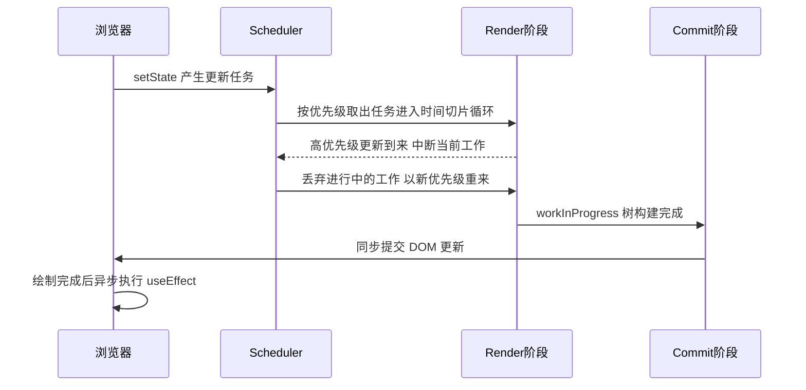

### R19-037：什么是并发渲染 Concurrent Rendering？
**答**：
- 并发渲染让 React 可以"准备"多个版本的 UI，渲染过程可中断、暂停、放弃后重来。
- 本质是优先级机制：紧急更新（输入、点击）优先，非紧急更新（大列表、过滤）让路。
- 对外暴露的入口是 startTransition、useTransition、useDeferredValue、Suspense。
- 最终提交仍是同步的，保证 UI 不会出现半成品撕裂状态。

```jsx
import { startTransition, useState } from 'react';

function Tabs({ tab }) {
  const [activeTab, setActiveTab] = useState(tab);

  function selectTab(nextTab) {
    // 标记为非紧急更新：渲染可中断，切换很重的 Tab 不会卡住界面
    startTransition(() => {
      setActiveTab(nextTab);
    });
  }

  return <button onClick={() => selectTab('comments')}>评论</button>;
}
```

### R19-038：Fiber 架构的双缓存与可中断渲染是怎么回事？
**答**：
- 每个组件对应一个 Fiber 节点，Fiber 树以链表结构组织，支持暂停后从任意节点恢复。
- 双缓存：current 树对应当前屏幕，workInProgress 树在内存中构建，构建完一次性替换。
- render 阶段可中断、可丢弃，因此必须无副作用；commit 阶段同步不可中断。
- createRoot 是启用并发能力的前提，ReactDOM.render 的旧模式不支持可中断渲染。

```jsx
import { createRoot } from 'react-dom/client';

// createRoot 开启并发渲染能力
const root = createRoot(document.getElementById('root'));
root.render(<App />);

// Fiber 双缓存要点：
// current 树对应当前屏幕，workInProgress 树在内存中构建
// render 阶段按优先级分片执行，可中断可重来
// commit 阶段同步提交 DOM，保证界面不出现半成品
```

### R19-039：flushSync 是什么？什么时候需要它？
**答**：
- flushSync 强制 React 立即同步完成该次更新：重渲染、DOM 提交、layout effect 全部跑完才返回。
- 场景：更新后立刻测量/读取 DOM、第三方库在回调中要求 DOM 已更新、实现某些交互反馈。
- 它是批处理的"逃逸舱口"，代价是打断正常的调度优先级，频繁使用会伤害性能。
- 不能在生命周期和 effect 内部调用，否则 React 会警告。

```jsx
import { flushSync } from 'react-dom';

function CopyButton() {
  const [copied, setCopied] = useState(false);

  async function handleCopy() {
    await navigator.clipboard.writeText('hello');
    // 强制同步提交，保证下一行读 DOM 时界面已经更新
    flushSync(() => {
      setCopied(true);
    });
    console.log(document.querySelector('p')?.textContent); // 一定是 已复制
  }

  return (
    <>
      <button onClick={handleCopy}>复制</button>
      {copied && <p>已复制</p>}
    </>
  );
}
```

### R19-040：Suspense 的工作原理是什么？
**答**：
- 子组件渲染时如果数据未就绪，可以 throw 一个 Promise，React 捕获后展示最近的 Suspense fallback。
- Promise resolve 后 React 重新尝试渲染该子树，然后替换 fallback。
- 数据源可以提前在组件树外创建，实现"请求先于渲染"，减少请求瀑布。
- 多个 Suspense 边界可以分段加载，各边界独立展示骨架屏。

```jsx
// Suspense 原理的最小实现：promise 未完成时 throw 出去
function createResource(promise) {
  let status = 'pending';
  let result;
  const suspender = promise.then(
    (value) => {
      status = 'success';
      result = value;
    },
    (error) => {
      status = 'error';
      result = error;
    }
  );
  return {
    read() {
      if (status === 'pending') throw suspender; // 触发 suspend
      if (status === 'error') throw result;
      return result;
    },
  };
}

const userResource = createResource(fetchUser());

function Profile() {
  const user = userResource.read();
  return <h1>{user.name}</h1>;
}

export default function App() {
  return (
    <Suspense fallback={<p>加载中...</p>}>
      <Profile />
    </Suspense>
  );
}
```

### R19-041：React.lazy 与 Suspense 如何做代码分割？
**答**：
- React.lazy 接收一个返回 `import()` 的工厂函数，构建工具把目标模块拆成独立 chunk。
- 首次渲染该组件时才加载 chunk，期间由包在外层的 Suspense 显示 fallback。
- lazy 的组件必须以默认导出形式提供，否则用 `then(mod => ({ default: mod.X }))` 适配。
- 典型实践：路由级分割必做，重依赖图表/编辑器按需分割。

```jsx
import { lazy, Suspense } from 'react';

// Chart 及其依赖会被拆成独立 chunk，用到时才加载
const Chart = lazy(() => import('./Chart'));

export default function Dashboard() {
  return (
    <Suspense fallback={<p>图表加载中...</p>}>
      <Chart />
    </Suspense>
  );
}
```

### R19-042：错误边界 ErrorBoundary 怎么实现？
**答**：
- 错误边界是实现了 getDerivedStateFromError 或 componentDidCatch 的 class 组件（目前仍需 class）。
- getDerivedStateFromError 渲染降级 UI；componentDidCatch 拿到 error 与 componentStack，适合上报。
- 它捕获的是子树的渲染期、生命周期内的错误，把它包在路由、区块级别做兜底。
- React 19 生态中也可以用 react-error-boundary 库的组件化封装。

```jsx
import { Component } from 'react';

class ErrorBoundary extends Component {
  state = { hasError: false, error: null };

  static getDerivedStateFromError(error) {
    return { hasError: true, error };
  }

  componentDidCatch(error, info) {
    // 在这里上报监控：error 与组件栈
    console.error(error, info.componentStack);
  }

  render() {
    if (this.state.hasError) {
      return this.props.fallback ?? <p>出错了</p>;
    }
    return this.props.children;
  }
}

function App() {
  return (
    <ErrorBoundary fallback={<p>面板崩了，请刷新</p>}>
      <Widget />
    </ErrorBoundary>
  );
}
```

### R19-043：错误边界捕获不到哪些错误？分别怎么兜底？
**答**：
- 事件处理器中的错误：不走 React 渲染流程，用 try/catch 包住处理。
- 异步回调（setTimeout、Promise）、Server Component、错误边界自身的错误：同样捕获不到。
- SSR 服务端渲染错误：需要在服务端框架层兜底。
- 全局兜底配合 window.addEventListener 的 error 与 unhandledrejection 上报。

```jsx
function Buttons() {
  // 事件处理器内的错误不会触发错误边界，必须 try/catch
  function handleClick() {
    try {
      riskyOperation();
    } catch (err) {
      reportError(err); // 上报或提示
    }
  }

  useEffect(() => {
    // 异步错误同样要自己接住
    const controller = new AbortController();
    fetchData(controller.signal).catch((err) => reportError(err));
    return () => controller.abort();
  }, []);

  // 全局兜底：main.jsx 中注册
  // window.addEventListener('error', reportError);
  // window.addEventListener('unhandledrejection', reportError);

  return <button onClick={handleClick}>执行</button>;
}
```

---

## 第六章 状态管理（R19-044 ~ R19-047）

### R19-044：用 Context 做全局状态管理有什么局限？怎么缓解？
**答**：
- 核心局限：Provider 的 value 引用变化时，所有消费组件整体重渲染，无法细粒度订阅。
- value 字面量导致每次渲染都产生新引用，必须 useMemo 或把 state 拆到更小粒度的 Provider。
- 多层级 Context 更新可能引发大范围渲染，性能敏感的高频状态不适合 Context。
- 缓解手段：拆分 Provider、value 用 useMemo、配合 memo 隔离子树；仍不够就换 Zustand 等外部 store。

```jsx
import { createContext, useContext, useMemo, useState } from 'react';

const UserContext = createContext(null);
const ThemeContext = createContext(null);

export default function App() {
  const [user, setUser] = useState({ name: 'Wang' });
  const [theme, setTheme] = useState('dark');

  // 分别 memo 两个 value，且拆成两个 Provider，主题切换不影响用户订阅者
  const userValue = useMemo(() => ({ user, setUser }), [user]);
  const themeValue = useMemo(() => ({ theme, setTheme }), [theme]);

  return (
    <UserContext.Provider value={userValue}>
      <ThemeContext.Provider value={themeValue}>
        <Header />
      </ThemeContext.Provider>
    </UserContext.Provider>
  );
}

export function useUser() {
  const ctx = useContext(UserContext);
  if (!ctx) throw new Error('useUser 必须在 Provider 内使用');
  return ctx;
}
```

### R19-045：Zustand 的基本用法和原理要点？
**答**：
- create 创建一个全局 Hook，组件通过选择器订阅 store 的切片，只有选中的切片变化才重渲染。
- 无 Provider 包裹，天然规避 Context 全量更新的问题；selector 用引用相等比较。
- 原理核心是 store 里的 listeners 集合 + useSyncExternalStore 订阅外部 store。
- 内置中间件：persist 持久化、devtools 调试、immer 不可变更新。

```jsx
import { create } from 'zustand';

const useCounterStore = create((set) => ({
  count: 0,
  increment: () => set((state) => ({ count: state.count + 1 })),
  reset: () => set({ count: 0 }),
}));

function Counter() {
  // 只订阅 count 切片，reset 等无关更新不会引起本组件渲染
  const count = useCounterStore((s) => s.count);
  const increment = useCounterStore((s) => s.increment);

  return (
    <>
      <p>{count}</p>
      <button onClick={increment}>加一</button>
    </>
  );
}
```

### R19-046：Redux Toolkit 相比裸 Redux 解决了什么？
**答**：
- createSlice 自动生成 action creator 与 type 常量，消灭手写 actionType 样板。
- 内置 Immer，reducer 里可以直接"修改"state 写法（实际产出不可变更新）。
- configureStore 默认集成 thunk 中间件与 Redux DevTools，开箱即用。
- 数据流仍是单向的：dispatch action -> reducer -> 新 state -> useSelector 订阅更新。

```jsx
import { configureStore, createSlice } from '@reduxjs/toolkit';
import { Provider, useDispatch, useSelector } from 'react-redux';

const counterSlice = createSlice({
  name: 'counter',
  initialState: { value: 0 },
  reducers: {
    increment: (state) => {
      state.value += 1; // 内置 Immer，允许直接改
    },
  },
});

const store = configureStore({ reducer: { counter: counterSlice.reducer } });

function Counter() {
  const value = useSelector((s) => s.counter.value);
  const dispatch = useDispatch();

  return (
    <button onClick={() => dispatch(counterSlice.actions.increment())}>
      {value}
    </button>
  );
}

export default function App() {
  return (
    <Provider store={store}>
      <Counter />
    </Provider>
  );
}
```

### R19-047：Context、Zustand、Redux Toolkit 怎么选型？
**答**：
- 服务端数据（请求缓存、重验证）交给 TanStack Query 或 SWR，不要塞进通用状态库。
- 中小型客户端状态：Context + useReducer 起步；出现性能或嵌套问题时换 Zustand。
- 大型团队协作、需要严格数据流、中间件与时间旅行的项目选 Redux Toolkit。
- 决策关键：变更频率、订阅粒度、团队规模与可维护性，而不是"哪个更流行"。

```javascript
// 选型速查表
// 服务端数据       -> TanStack Query / SWR
// 低频全局配置     -> Context（主题 语言 用户信息）
// 中型客户端状态   -> Zustand（无样板 按切片订阅）
// 大型严格数据流   -> Redux Toolkit（中间件 DevTools 团队约定）
// 表单状态         -> react-hook-form / 受控组件局部状态

// Zustand 一行定义 store
const useThemeStore = create((set) => ({
  mode: 'light',
  toggle: () =>
    set((s) => ({ mode: s.mode === 'light' ? 'dark' : 'light' })),
}));
```

---

## 第七章 性能优化与 React Compiler（R19-048 ~ R19-052）

### R19-048：React.memo 在什么情况下会失效？
**答**：
- memo 只做 props 浅比较：传入新对象、新数组、新函数都会击穿缓存。
- 内联函数 props 不包 useCallback、对象 props 不包 useMemo 时，memo 形同虚设。
- 组件内部自身的 state 或 useContext 变化仍会重渲染，memo 管不到。
- 数据结构复杂时可给 memo 第二个参数自定义比较函数，但要自己保证正确性。

```jsx
const UserCard = memo(function UserCard({ user, onSelect }) {
  console.log('render UserCard', user.name);
  return <div onClick={() => onSelect(user.id)}>{user.name}</div>;
});

function Parent({ users }) {
  // 用 useCallback 稳定函数，否则 memo 失效
  const handleSelect = useCallback((id) => console.log(id), []);

  // user 对象需保证引用稳定（列表数据不要每次现造）
  return users.map((u) => <UserCard key={u.id} user={u} onSelect={handleSelect} />);
}
```

### R19-049：虚拟列表的原理是什么？核心参数怎么算？
**答**：
- 只渲染可视区域内的条目：滚动时计算起始索引与可见条数，其余用撑高容器占位。
- 起始索引 = floor(scrollTop / itemHeight)，可见条数 = ceil(viewportHeight / itemHeight) 再加缓冲。
- 用 transform 或 paddingTop 把渲染窗口平移到正确位置，总高度由一个占位元素撑开。
- 行高不固定时需要缓存每项位置或用估算 + 动态修正，成熟方案用 react-window / TanStack Virtual。

```jsx
function VirtualList({ items, height = 400, itemHeight = 40 }) {
  const [scrollTop, setScrollTop] = useState(0);

  // 上下各留 5 条缓冲，避免快速滚动露白
  const start = Math.max(0, Math.floor(scrollTop / itemHeight) - 5);
  const visibleCount = Math.ceil(height / itemHeight) + 10;
  const visible = items.slice(start, start + visibleCount);

  return (
    <div
      style={{ height, overflow: 'auto' }}
      onScroll={(e) => setScrollTop(e.currentTarget.scrollTop)}
    >
      {/* 撑开总高度形成真实滚动条 */}
      <div style={{ height: items.length * itemHeight, position: 'relative' }}>
        <div style={{ transform: `translateY(${start * itemHeight}px)` }}>
          {visible.map((item) => (
            <div key={item.id} style={{ height: itemHeight }}>
              {item.text}
            </div>
          ))}
        </div>
      </div>
    </div>
  );
}
```

### R19-050：路由级 code splitting 怎么落地？
**答**：
- 用 React.lazy + Suspense 把每个页面拆成独立 chunk，首屏只加载当前路由代码。
- 构建产物可通过 build.rollupOptions.output.manualChunks 进一步抽公共 vendor。
- fallback 做成骨架屏，避免闪白；预加载关键路由可用 `import()` 提前触发。
- 衡量指标：看首屏 JS 体积与 LCP，而不是 chunk 数量。

```jsx
import { lazy, Suspense } from 'react';
import { BrowserRouter, Routes, Route } from 'react-router-dom';

const Home = lazy(() => import('./pages/Home'));
const Admin = lazy(() => import('./pages/Admin'));

export default function App() {
  return (
    <BrowserRouter>
      <Suspense fallback={<p>页面加载中...</p>}>
        <Routes>
          <Route path="/" element={<Home />} />
          <Route path="/admin" element={<Admin />} />
        </Routes>
      </Suspense>
    </BrowserRouter>
  );
}
```

### R19-051：React Compiler 是什么？它取代 useMemo 吗？
**答**：
- React Compiler（原名 React Forget）在编译期自动分析组件与 Hook，插入等价的缓存逻辑。
- 理想情况下不再手写 useMemo、useCallback、memo，代码更简洁且不会漏写依赖。
- 它基于对代码正确性的静态分析：无法证明安全的代码会自动放弃优化，不做错误缓存。
- 定位是"让默认渲染足够快"，特殊场景仍可手动优化，两者不冲突。

```jsx
// 编译前：需要手动 memo 化
function ExpensePage({ expenses }) {
  const total = expenses.reduce((sum, e) => sum + e.amount, 0);
  const handleSort = () => sortByAmount(expenses);
  return <Table total={total} onSort={handleSort} />;
}

// 开启 React Compiler 后，构建期自动等价于：
// const total = useMemo(...)
// const handleSort = useCallback(...)
// const Table = memo(...) 的产物级缓存
// 依赖分析不安全时编译器自动放弃优化，保证行为正确
```

### R19-052：如何用 Profiler 定位 React 渲染性能问题？
**答**：
- React DevTools 的 Profiler 面板录制渲染，能看到每个组件的渲染次数与耗时。
- 代码级用 `<Profiler>` 包裹目标区域，onRender 回调上报 id、phase、actualDuration。
- 常见问题：状态提升过高导致大范围渲染、Context value 不稳定、长列表无虚拟化。
- 优化顺序：先量（找出真热点），再拆（状态下放/拆 Provider），再缓存（memo/useMemo），最后虚拟化。

```jsx
import { Profiler } from 'react';

function onRenderCallback(id, phase, actualDuration) {
  // phase 是 mount 或 update，actualDuration 为本次渲染毫秒数
  if (actualDuration > 16) {
    console.warn('渲染超帧', id, phase, actualDuration);
  }
}

export default function App() {
  return (
    <Profiler id="Dashboard" onRender={onRenderCallback}>
      <Dashboard />
    </Profiler>
  );
}
```

---

## 第八章 SSR 与 Next.js（R19-053 ~ R19-056）


### R19-053：CSR、SSR、SSG、ISR 的区别与选择？
**答**：
- CSR 在浏览器渲染，首屏慢、SEO 弱，但交互后体验好、服务器压力小。
- SSR 每次请求在服务端渲染 HTML，首屏快、SEO 好，服务器成本高。
- SSG 构建时生成静态 HTML，CDN 分发最快，适合内容不常变的页面。
- ISR 是 SSG 的增量更新：设置 revalidate，过期后请求触发重新生成，兼顾新鲜度与速度。

```javascript
// Next.js App Router 示例
// 默认静态渲染 SSG，构建时生成 HTML
export const revalidate = 3600; // 开启 ISR：每小时重新生成

export default async function Page() {
  const res = await fetch('https://api.example.com/posts', {
    next: { revalidate: 3600 },
  });
  const posts = await res.json();

  return <ul>{posts.map((p) => <li key={p.id}>{p.title}</li>)}</ul>;
}
```

### R19-054：什么是 hydration？hydration mismatch 怎么来的？
**答**：
- hydration 是客户端 React "接管"服务端返回的 HTML 的过程：比对结构并绑定事件与状态。
- 服务端与客户端渲染结果不一致就会产生 hydration mismatch，React 19 会直接报错并回退客户端渲染。
- 常见原因：随机数、Date.now、window 判断、locale 相关的格式化直接出现在首帧渲染里。
- 解决：把仅客户端的值放进 useEffect 里更新，或用 useId 保证 id 一致。

```jsx
'use client';

import { useEffect, useState } from 'react';

export default function Clock() {
  const [now, setNow] = useState(null);

  useEffect(() => {
    // 只在客户端更新，服务端首帧输出占位，避免 mismatch
    setNow(Date.now());
  }, []);

  // 错误示例：初始 state 直接写 new Date().toLocaleTimeString()
  // 服务端和客户端时间不同，必然 hydration mismatch
  return <p>{now ? new Date(now).toLocaleTimeString() : '--'}</p>;
}
```

### R19-055：Next.js 中 Server Actions 怎么写？如何刷新数据？
**答**：
- `'use server'` 文件或函数内定义 Server Action，客户端可以直接 import 并调用，像 RPC 一样。
- Server Action 在服务端执行，天然安全地访问数据库与密钥，请求体自动序列化。
- 数据更新后调用 revalidatePath 或 revalidateTag 让 Next 的缓存失效，页面重新渲染。
- 通常与 useActionState、redirect 组合完成表单闭环。

```jsx
// app/actions.js
'use server';

import { revalidatePath } from 'next/cache';
import { db } from '@/lib/db';

export async function deletePost(id) {
  await db.post.delete({ where: { id } });
  revalidatePath('/posts'); // 让 /posts 的缓存失效并重渲染
}
```

### R19-056：Streaming SSR 是什么？Next.js 里怎么用？
**答**：
- 服务端不必等整棵组件树的数据就绪：先流式输出静态外壳，慢的部分由 Suspense 边界分块补发。
- 用户更早看到首屏内容，慢数据区域显示骨架屏，TTFB 与 FCP 显著改善。
- App Router 里最简单的用法是路由目录放 loading.jsx，Next 自动包 Suspense。
- 也可以在页面内手动放多个 Suspense 边界实现分段流式。

```jsx
// app/dashboard/loading.jsx —— 路由级 streaming UI
export default function Loading() {
  return <p>仪表盘加载中...</p>;
}

// 页面内更细粒度的分段流式输出
export function Dashboard() {
  return (
    <>
      <Suspense fallback={<RevenueSkeleton />}>
        <Revenue />   {/* 查询快的部分先流出去 */}
      </Suspense>
      <Suspense fallback={<StatsSkeleton />}>
        <UserStats /> {/* 慢查询不阻塞整个页面 */}
      </Suspense>
    </>
  );
}
```

---

## 第九章 React Testing Library 测试（R19-057 ~ R19-060）

### R19-057：React Testing Library 的核心理念是什么？
**答**：
- 以用户视角测试：像真实使用者一样通过角色、文本、label 查询元素，触发交互后断言结果。
- 不测试实现细节：不碰组件内部 state、不依赖 className，重构实现而不改行为时测试不应挂。
- 查询优先级按可访问性排序：getByRole 最优先，这与无障碍语义天然绑定。
- 配合 userEvent 模拟真实键盘鼠标事件序列。

```jsx
import { render, screen } from '@testing-library/react';
import userEvent from '@testing-library/user-event';
import Counter from './Counter';

test('点击按钮后显示计数', async () => {
  render(<Counter />);

  // 用户视角：找到名为 加一 的按钮并点击
  await userEvent.click(screen.getByRole('button', { name: '加一' }));

  // 断言用户能看到的结果，而不是组件内部 state
  expect(screen.getByText('1')).toBeInTheDocument();
});
```

### R19-058：getBy、findBy、queryBy 的区别？
**答**：
- getBy：同步查找，找不到立即抛错，用于断言当前一定存在的元素。
- findBy：返回 Promise，默认一秒内轮询等待元素出现，适合异步渲染的内容。
- queryBy：找不到返回 null 而不抛错，专门用于断言"元素不存在"。
- 复数形式 getAllBy/findAllBy/queryAllBy 语义相同，返回数组。

```jsx
test('三种查询的使用场景', async () => {
  render(<Profile userId="1" />);

  // 同步确定存在
  expect(screen.getByRole('heading', { name: '个人主页' })).toBeInTheDocument();

  // 异步数据，等待出现
  await screen.findByText('异步加载的用户名');

  // 断言不存在：只有 queryBy 不抛错
  expect(screen.queryByText('不该出现的文案')).toBeNull();
});
```

### R19-059：如何 mock 接口数据测试组件？
**答**：
- 轻量场景用 vi.mock 模拟 api 模块，mockResolvedValue 返回固定数据。
- 更接近真实的方案是 MSW：拦截网络层，同一段 handler 可复用于单测与 Storybook。
- mock 后组件里的异步渲染要用 findBy 等待。
- 测试结束后 restore mock，避免用例间相互污染。

```typescript
import { render, screen } from '@testing-library/react';
import { describe, it, expect, vi, afterEach } from 'vitest';
import UserCard from './UserCard';
import { fetchUser } from './api';

vi.mock('./api', () => ({
  fetchUser: vi.fn(),
}));

afterEach(() => {
  vi.restoreAllMocks();
});

describe('UserCard', () => {
  it('渲染接口返回的用户名', async () => {
    vi.mocked(fetchUser).mockResolvedValue({ id: 1, name: 'Wang' });

    render(<UserCard userId={1} />);

    // 异步渲染用 findBy 等待
    expect(await screen.findByText('Wang')).toBeInTheDocument();
  });
});
```

### R19-060：为什么更新必须包在 act 里？假定时器怎么配合？
**答**：
- act 让 React 把更新、渲染、effect 全部执行完再继续断言，模拟真实的更新批次。
- RTL 的 render、userEvent 内部已包 act；自己直接调用 state 更新逻辑时要手动包。
- 测试定时器逻辑用 vi.useFakeTimers 控制 Clock，配合 act(advanceTimersByTime) 推进时间。
- 结束后 vi.useRealTimers 还原，防止影响其他用例。

```jsx
import { render, screen, act } from '@testing-library/react';
import { test, expect, vi } from 'vitest';
import Timer from './Timer';

test('计时器每秒加一', () => {
  vi.useFakeTimers();
  render(<Timer />);

  // 推进 1 秒并让 React 完成整个更新流程
  act(() => {
    vi.advanceTimersByTime(1000);
  });

  expect(screen.getByText('1s')).toBeInTheDocument();

  vi.useRealTimers();
});
```

---

## 第十章 组件设计实战（R19-061 ~ R19-067）

### R19-061：如何设计一个泛型列表组件？
**答**：
- 用 TypeScript 泛型把数据类型从 data 穿透到每一列的 render 回调，row 类型自动推导。
- 列配置用 `Column<T>[]` 声明：title/key/width/render，未传 render 时按 key 取值兜底。
- rowKey 由调用方指定，永远不要用数组索引当 key。
- memo 包裹泛型组件会丢失类型参数，导出时用 `as typeof GenericList` 还原签名。
- 空态、行点击等扩展能力作为可选 props，组件本身不做数据请求。

```tsx
// GenericList.tsx —— 泛型数据 + 列配置，类型沿 render 穿透
import { memo, type ReactNode } from 'react';

export interface Column<T> {
  key: string;
  title: string;
  width?: number | string;
  render?: (row: T) => ReactNode;
}

interface GenericListProps<T> {
  data: T[];
  columns: Column<T>[];
  rowKey: (row: T) => string | number;
  onRowClick?: (row: T) => void;
}

function GenericList<T>({ data, columns, rowKey, onRowClick }: GenericListProps<T>) {
  return (
    <table className="generic-list">
      <thead>
        <tr>
          {columns.map(c => (
            <th key={c.key} style={{ width: c.width }}>{c.title}</th>
          ))}
        </tr>
      </thead>
      <tbody>
        {data.map(row => (
          <tr key={rowKey(row)} onClick={() => onRowClick?.(row)}>
            {columns.map(c => (
              <td key={c.key}>
                {c.render ? c.render(row) : String((row as Record<string, unknown>)[c.key] ?? '')}
              </td>
            ))}
          </tr>
        ))}
      </tbody>
    </table>
  );
}

// memo 配合泛型会丢类型，导出时用断言还原
export default memo(GenericList) as typeof GenericList;
```

### R19-062：什么是 Headless 组件模式？为什么需要它？
**答**：
- Headless 模式把"行为逻辑"（状态、事件、无障碍）与"UI 渲染"彻底分离：hook 只输出行为，渲染交给调用方。
- 解决的问题：同一套交互逻辑（如 Toggle、Select）要适配多种视觉稿时，传统组件只能靠海量 CSS 变量或 API 膨胀来适配。
- 实现三件套：核心 hook（useToggle）+ 渲染代理（children as function）+ 可控受控/非受控。
- Headless UI、Radix、TanStack Table 都是这一模式；面试官常问它与 Compound 的区别——Headless 连 UI 都不给，Compound 只固定结构。

```jsx
// useToggle.ts —— Headless 核心：只提供行为，不关心 UI
import { useCallback, useState } from 'react';

export function useToggle({ defaultOpen = false, controlled, onChange } = {}) {
  const [internal, setInternal] = useState(defaultOpen);
  const isControlled = controlled !== undefined;
  const open = isControlled ? controlled : internal;

  const setOpen = useCallback((next) => {
    const value = typeof next === 'function' ? next(open) : next;
    if (!isControlled) setInternal(value);
    onChange?.(value);
  }, [open, isControlled, onChange]);

  const toggle = useCallback(() => setOpen(v => !v), [setOpen]);
  return { open, setOpen, toggle, isControlled };
}

// Disclosure：UI 完全交给调用方，行为全部来自 hook
export function Disclosure({ children }) {
  const toggle = useToggle();
  return children(toggle);
}

// 用法：想渲染成下拉、抽屉还是折叠面板，都由使用方决定
// <Disclosure>{({ open, toggle }) => open && <Drawer onClose={toggle} />}</Disclosure>
```

### R19-063：什么是 Compound Components 组合组件模式？
**答**：
- 父组件与多个子组件共用一个 Context：父持有状态，子（如 Accordion.Item）通过 useContext 消费，调用方自由编排 JSX 结构。
- 通过 `Accordion.Item = Item` 静态属性挂载，让 API 自文档化。
- 优点：调用方不接触内部状态管理，结构又完全可控；Ant Design 的 Collapse、Radix 的多数组件都是这个模式。
- 关键细节：子组件挂静态属性要在导出前完成，并用 displayName 便于 DevTools 识别。

```jsx
import { createContext, useContext, useState } from 'react';

const AccordionContext = createContext(null);

export function Accordion({ children, defaultIndex = 0 }) {
  const [openIndex, setOpenIndex] = useState(defaultIndex);
  return (
    <AccordionContext.Provider value={{ openIndex, setOpenIndex }}>
      <div className="accordion">{children}</div>
    </AccordionContext.Provider>
  );
}

Accordion.Item = function Item({ index, header, children }) {
  const { openIndex, setOpenIndex } = useContext(AccordionContext);
  const open = openIndex === index;
  return (
    <div className="accordion-item">
      <button aria-expanded={open} onClick={() => setOpenIndex(open ? -1 : index)}>
        {header}
      </button>
      {open && <div className="accordion-panel">{children}</div>}
    </div>
  );
};

// 用法：结构完全由调用方编排，状态由 Accordion 统一管理
// <Accordion>
//   <Accordion.Item index={0} header="标题一">内容一</Accordion.Item>
//   <Accordion.Item index={1} header="标题二">内容二</Accordion.Item>
// </Accordion>
```

### R19-064：如何实现同时支持受控与非受控的组件？
**答**：
- 判定标准：`value !== undefined` 即受控，此时组件不自持状态，只把变更上报 onChange。
- 抽象成 useControllableState hook，任何双模式组件复用同一个逻辑，避免每处写 if。
- 注意受控/非受控切换的 ref 记录：中途切换模式是不被支持的用法，要在 ref 里保持首判定并开发警告。
- defaultValue 与 value 语义分离：非受控用 defaultValue 初始化，受控用 value 完全接管。

```jsx
// useControllableState.ts —— 受控 / 非受控双模式的标准实现
import { useCallback, useRef, useState } from 'react';

export function useControllableState({ value, defaultValue, onChange }) {
  const [internal, setInternal] = useState(defaultValue);
  const isControlled = value !== undefined;
  const wasControlled = useRef(isControlled);

  if (process.env.NODE_ENV !== 'production' && wasControlled.current !== isControlled) {
    console.warn('组件不能在受控与非受控之间切换');
  }

  const handleChange = useCallback((next) => {
    if (!wasControlled.current) setInternal(next);   // 只有非受控时才自持状态
    onChange?.(next);                                // 两种模式都通知外部
  }, [onChange]);

  return [isControlled ? value : internal, handleChange];
}

// Input 同时支持两种用法
export function Input({ value, defaultValue, onChange }) {
  const [current, setCurrent] = useControllableState({ value, defaultValue, onChange });
  return <input value={current} onChange={e => setCurrent(e.target.value)} />;
}
// <Input defaultValue="hi" />                          非受控
// <Input value={name} onChange={setName} />            受控
```

### R19-065：如何封装一个可复用的 ErrorBoundary？
**答**：
- class 组件无法被 Hooks 替代，getDerivedStateFromError 负责降级 UI，componentDidCatch 负责上报。
- fallback 设计成双形态：传 ReactNode 直接渲染，传函数则拿到 error 和手动 reset 能力。
- resetKeys 是关键工程能力：当路由参数等依赖变化时自动清空错误，避免用户卡在错误页。
- 业务上按路由级/模块级分层包裹，块级边界兜局部错误，页面级边界兜全局。

```jsx
import { Component } from 'react';

// 通用错误边界：fallback 可传节点或 render prop，resetKeys 变化自动恢复
export class ErrorBoundary extends Component {
  state = { error: null };

  static getDerivedStateFromError(error) {
    return { error };
  }

  componentDidCatch(error, info) {
    this.props.onError?.(error, info.componentStack);
  }

  componentDidUpdate(prevProps) {
    if (!this.state.error) return;
    const changed = this.props.resetKeys?.some((key, i) => key !== prevProps.resetKeys?.[i]);
    if (changed) this.setState({ error: null });
  }

  render() {
    const { error } = this.state;
    if (!error) return this.props.children;
    if (typeof this.props.fallback === 'function') {
      return this.props.fallback(error, () => this.setState({ error: null }));
    }
    return this.props.fallback ?? <div>页面出错了</div>;
  }
}

// 用法：
// <ErrorBoundary
//   resetKeys={[userId]}
//   fallback={(err, reset) => <RetryPanel error={err} onRetry={reset} />}
// >
//   <OrderList userId={userId} />
// </ErrorBoundary>
```

### R19-066：如何实现一个完整的 Portal 弹窗组件？
**答**：
- createPortal 挂到 document.body，天然摆脱父级 overflow 和 z-index 层叠上下文限制。
- 焦点管理三步：打开时聚焦弹窗内第一个可聚焦元素、Tab 循环圈定在弹窗内、关闭后归还焦点给触发元素。
- Esc 关闭、点击遮罩关闭、body 滚动锁定，都在同一个 effect 中注册与清理。
- 无障碍用 role="dialog" + aria-modal="true" + aria-label。

```jsx
import { useEffect, useRef } from 'react';
import { createPortal } from 'react-dom';

export function Modal({ open, onClose, title, children }) {
  const dialogRef = useRef(null);
  const lastActiveRef = useRef(null);

  useEffect(() => {
    if (!open) return;
    lastActiveRef.current = document.activeElement;
    const dialog = dialogRef.current;
    dialog?.querySelector('button, [href], input')?.focus();

    const onKeyDown = (e) => {
      if (e.key === 'Escape') onClose?.();
      if (e.key === 'Tab') {
        // 焦点圈定在弹窗内循环
        const focusables = dialog.querySelectorAll('button, [href], input, textarea, [tabindex]:not([tabindex="-1"])');
        const first = focusables[0];
        const last = focusables[focusables.length - 1];
        if (e.shiftKey && document.activeElement === first) { last.focus(); e.preventDefault(); }
        else if (!e.shiftKey && document.activeElement === last) { first.focus(); e.preventDefault(); }
      }
    };
    document.addEventListener('keydown', onKeyDown);
    document.body.style.overflow = 'hidden';
    return () => {
      document.removeEventListener('keydown', onKeyDown);
      document.body.style.overflow = '';
      lastActiveRef.current?.focus?.();   // 关闭后归还焦点
    };
  }, [open, onClose]);

  if (!open) return null;
  return createPortal(
    <div className="modal-mask" onMouseDown={e => e.target === e.currentTarget && onClose?.()}>
      <div role="dialog" aria-modal="true" aria-label={title} ref={dialogRef}>
        <header>{title}</header>
        {children}
      </div>
    </div>,
    document.body,
  );
}
```

### R19-067：如何设计一个支持受控/非受控/键盘导航的 Tabs 组件？
**答**：
- 状态模型：`active ?? internal`，传 active 即受控，否则内部 useState，同 R19-064 的双模式思想。
- 键盘导航用 roving tabindex：tablist 中只有当前项 tabIndex=0，方向键移动焦点并切换。
- 无障碍：role=tablist/tab/tabpanel + aria-selected/aria-controls/aria-labelledby。
- 用 useId 生成稳定 id 前缀，避免多实例 id 冲突。

```jsx
import { useId, useRef, useState } from 'react';

export function Tabs({ tabs, active, defaultActive = 0, onChange }) {
  const [internal, setInternal] = useState(defaultActive);
  const current = active ?? internal;               // 受控优先，否则非受控
  const listRef = useRef(null);
  const baseId = useId();

  const select = (index) => {
    if (active === undefined) setInternal(index);   // 非受控时才自持状态
    onChange?.(index);
  };

  const onKeyDown = (e) => {
    const dir = { ArrowRight: 1, ArrowLeft: -1 }[e.key];
    if (!dir) return;
    const next = (current + dir + tabs.length) % tabs.length;
    select(next);
    listRef.current?.querySelectorAll('[role=tab]')[next].focus();
  };

  return (
    <div>
      <div role="tablist" ref={listRef} onKeyDown={onKeyDown}>
        {tabs.map((tab, i) => (
          <button
            key={tab.key}
            role="tab"
            id={`${baseId}-tab-${i}`}
            aria-selected={current === i}
            aria-controls={`${baseId}-panel-${i}`}
            tabIndex={current === i ? 0 : -1}       // roving tabindex
            onClick={() => select(i)}
          >
            {tab.label}
          </button>
        ))}
      </div>
      <div role="tabpanel" id={`${baseId}-panel-${current}`} aria-labelledby={`${baseId}-tab-${current}`}>
        {tabs[current]?.content}
      </div>
    </div>
  );
}
```

---

## 第十一章 Hooks 工程库（R19-068 ~ R19-075）

### R19-068：手写一个 ahooks 风格的 useRequest？
**答**：
- 核心状态：loading/data/error，配套 run（手动触发）、cancel（取消）、manual（是否自动执行）。
- 竞态用递增计数器解决：每次 run 计数 +1，只有"当前编号"的请求才能写入结果，过期响应直接丢弃。
- cancel 同时做两件事：AbortController 中断网络 + 计数 +1 让在途结果全部过期。
- 组件卸载时自动 cancel，防止内存泄漏式 setState。
- service 若随渲染重建，调用侧用 useMemoizedFn 包裹，避免非 manual 模式反复触发。

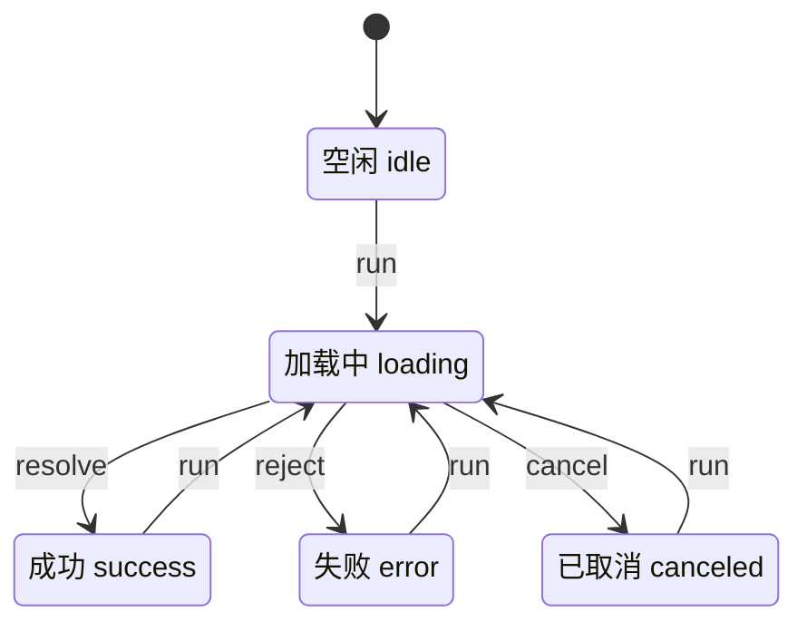

```jsx
// useRequest.ts —— loading / error / data / cancel / manual 全套
import { useCallback, useEffect, useRef, useState } from 'react';

export function useRequest(service, { manual = false, onSuccess, onError } = {}) {
  const [state, setState] = useState({ loading: false, data: undefined, error: undefined });
  const countRef = useRef(0);      // 竞态计数：只认最后一次请求
  const abortRef = useRef(null);

  const run = useCallback(async (...params) => {
    const current = ++countRef.current;
    abortRef.current?.abort();
    abortRef.current = new AbortController();
    setState(s => ({ ...s, loading: true, error: undefined }));
    try {
      const data = await service(...params, { signal: abortRef.current.signal });
      if (current !== countRef.current) return;    // 过期请求丢弃结果
      setState({ loading: false, data, error: undefined });
      onSuccess?.(data, params);
      return data;
    } catch (error) {
      if (current !== countRef.current || error.name === 'AbortError') return;
      setState({ loading: false, data: undefined, error });
      onError?.(error, params);
    }
  }, [service, onSuccess, onError]);

  const cancel = useCallback(() => {
    countRef.current++;                            // 让在途结果全部过期
    abortRef.current?.abort();
    setState(s => ({ ...s, loading: false }));
  }, []);

  useEffect(() => {
    if (!manual) run();
    return () => cancel();                         // 卸载自动取消
  }, [manual, run, cancel]);

  return { ...state, run, cancel, refresh: run };
}
```

### R19-069：手写 useDebounceValue 与 useThrottleValue？
**答**：
- 值版防抖：value 变化时重置计时器，只输出"静止 delay 后"的值，适合搜索框驱动请求。
- 值版节流：固定窗口内最多更新一次，注意兜底——窗口结束后要补发最后一次值，否则末尾状态丢失。
- 两者都是"在 hook 里订阅输入、定时输出"的模式，副作用全部在 effect 中清理。
- 选型：输入联想用防抖；滚动位置、resize 这类连续值用节流。

```jsx
// useDebounceValue / useThrottleValue —— 值版防抖与节流
import { useEffect, useRef, useState } from 'react';

export function useDebounceValue(value, delay = 300) {
  const [debounced, setDebounced] = useState(value);
  useEffect(() => {
    const timer = setTimeout(() => setDebounced(value), delay);
    return () => clearTimeout(timer);              // 值变化时重置计时器
  }, [value, delay]);
  return debounced;
}

export function useThrottleValue(value, interval = 300) {
  const [throttled, setThrottled] = useState(value);
  const lastRef = useRef(0);
  const timerRef = useRef(null);
  useEffect(() => {
    const now = Date.now();
    if (now - lastRef.current >= interval) {
      lastRef.current = now;
      setThrottled(value);
    } else if (!timerRef.current) {
      timerRef.current = setTimeout(() => {        // 兜底：窗口结束后补发最后一次
        lastRef.current = Date.now();
        setThrottled(value);
        timerRef.current = null;
      }, interval - (now - lastRef.current));
    }
    return () => clearTimeout(timerRef.current);
  }, [value, interval]);
  return throttled;
}

// const debouncedKeyword = useDebounceValue(keyword, 400);
// useEffect(() => { fetchSuggestions(debouncedKeyword); }, [debouncedKeyword]);
```

### R19-070：手写 usePrevious 与 useUnmountedRef？
**答**：
- usePrevious：ref 在 render 阶段读取、在 effect 阶段写入，写入晚于读取一整个 commit，天然拿到"上一轮值"。
- useUnmountedRef：effect 的 cleanup 是卸载信号，用它翻转标记，异步回调回来前先检查。
- 典型组合场景：请求返回时组件可能已卸载，直接 setState 会产生泄漏警告。
- React 18+ 严格模式下 effect 双执行不影响正确性，因为 cleanup 会同步执行。

```jsx
import { useEffect, useRef, useState } from 'react';

// usePrevious：保存上一轮渲染的值
export function usePrevious(value) {
  const ref = useRef();
  useEffect(() => {
    ref.current = value;   // effect 在 commit 后执行，读到的永远是上一轮
  }, [value]);
  return ref.current;
}

// useUnmountedRef：标记组件是否已卸载
export function useUnmountedRef() {
  const unmountedRef = useRef(false);
  useEffect(() => () => { unmountedRef.current = true; }, []);
  return unmountedRef;
}

// 组合使用
function UserPanel({ userId }) {
  const [user, setUser] = useState(null);
  const prevId = usePrevious(userId);
  const unmountedRef = useUnmountedRef();

  useEffect(() => {
    fetchUser(userId).then(data => {
      if (!unmountedRef.current) setUser(data);   // 卸载后不再 setState
    });
  }, [userId, unmountedRef]);

  return <div>上一轮 id 是 {prevId}，当前是 {user?.name}</div>;
}
```

### R19-071：手写一个通用的 useEventListener？
**答**：
- 三层设计：target 支持 ref、DOM 节点或返回节点的函数；handler 用 useLatest 包一层，保证监听器里永远执行最新闭包而无需重建监听。
- 自动清理：effect 返回 removeEventListener，重复挂载/卸载不泄漏。
- 关键点：handler 不进依赖数组——否则每次渲染都重新 add/remove，性能差且可能丢事件。

```jsx
// useEventListener：自动清理 + ref 目标 + 最新回调
import { useEffect, useRef } from 'react';

export function useLatest(value) {
  const ref = useRef(value);
  ref.current = value;
  return ref;
}

export function useEventListener(target, event, handler, options) {
  const handlerRef = useLatest(handler);   // 永远拿到最新回调，无需写进依赖

  useEffect(() => {
    const el = typeof target === 'function' ? target() : (target?.current ?? target);
    if (!el?.addEventListener) return;
    const listener = (e) => handlerRef.current(e);
    el.addEventListener(event, listener, options);
    return () => el.removeEventListener(event, listener, options);
  }, [event, target, options, handlerRef]);
}

// 用法
function ScrollBox() {
  const boxRef = useRef(null);
  useEventListener(boxRef, 'scroll', e => console.log(e.target.scrollTop));
  useEventListener(() => window, 'resize', () => console.log(window.innerWidth));
  return <div ref={boxRef} style={{ height: 200, overflow: 'auto' }}>长内容</div>;
}
```

### R19-072：手写 useSize，基于 ResizeObserver 监听元素尺寸？
**答**：
- window.resize 拿不到具体元素尺寸，ResizeObserver 才能精确观察某个容器。
- observer 实例用 ref 缓存复用，每次 effect 只 observe/unobserve 当前元素。
- contentRect 提供 content-box 尺寸；需要 border-box 时用 entry.borderBoxSize。
- 典型场景：图表随容器自适应、虚拟列表测量容器高度。

```jsx
// useSize：ResizeObserver 监听元素尺寸变化
import { useEffect, useRef, useState } from 'react';

export function useSize(target) {
  const [size, setSize] = useState({ width: 0, height: 0 });
  const observerRef = useRef(null);

  useEffect(() => {
    const el = target?.current;
    if (!el) return;
    observerRef.current ??= new ResizeObserver(entries => {
      const { width, height } = entries[0].contentRect;
      setSize({ width, height });
    });
    observerRef.current.observe(el);
    return () => observerRef.current?.unobserve(el);
  }, [target]);

  return size;
}

// 用法：容器自适应布局
function Chart() {
  const ref = useRef(null);
  const { width, height } = useSize(ref);
  return <div ref={ref}><Canvas width={width} height={height} /></div>;
}
```

### R19-073：手写 useKeyPress 支持组合键解析？
**答**：
- 组合键用字符串声明如 `ctrl.shift.s`，解析时把修饰键与主键统一小写排序后比对，顺序无关。
- Mac 上 Ctrl 与 Meta（Command）通常视为等价，用 `e.ctrlKey || e.metaKey` 归一。
- handler 同样走 useLatest，避免每次按键判定都拿到旧闭包。
- preventDefault 必须在业务回调里主动调用，浏览器默认行为（如 Ctrl+S 存网页）才会被拦住。

```jsx
// useKeyPress：解析组合键，如 ctrl.shift.s
import { useEffect, useRef } from 'react';

const normalize = (combo) => combo.toLowerCase().split('.').sort().join('.');

export function useKeyPress(keyFilter, handler) {
  const handlerRef = useRef(handler);
  handlerRef.current = handler;

  useEffect(() => {
    const onKeyDown = (e) => {
      const parts = [];
      if (e.ctrlKey || e.metaKey) parts.push('ctrl');
      if (e.shiftKey) parts.push('shift');
      if (e.altKey) parts.push('alt');
      parts.push(e.key.toLowerCase());
      const combo = parts.sort().join('.');

      const filter = typeof keyFilter === 'string' ? normalize(keyFilter) : keyFilter;
      const matched = typeof filter === 'string' ? filter === combo : filter(e);
      if (matched) handlerRef.current(e);
    };
    document.addEventListener('keydown', onKeyDown);
    return () => document.removeEventListener('keydown', onKeyDown);
  }, [keyFilter]);
}

// 用法：保存快捷键
// useKeyPress('ctrl.s', e => { e.preventDefault(); save(); });
```

### R19-074：手写 useLatest 与 useMemoizedFn，为什么需要"稳定引用"？
**答**：
- useLatest：render 期间直接写 ref.current，任何回调里都能读到最新值，解决闭包旧值问题。
- useMemoizedFn（即 useEvent / useEffectEvent 提案的用户态实现）：对外引用永不变，对内调用最新逻辑。
- 核心价值：当 useEffect 依赖一个会变的回调时（如 onTick），包一层 useMemoizedFn 后 effect 不会反复销毁重建。
- 与 useCallback 的区别：useCallback 靠依赖数组维持引用，依赖写全就重建；useMemoizedFn 永远稳定且不漏新值。

```jsx
import { useCallback, useRef } from 'react';

// useLatest：始终拿到最新值的 ref
export function useLatest(value) {
  const ref = useRef(value);
  ref.current = value;
  return ref;
}

// useMemoizedFn：引用永不变的函数，内部却调用最新逻辑
export function useMemoizedFn(fn) {
  const fnRef = useRef(fn);
  fnRef.current = fn;
  const memoized = useCallback((...args) => fnRef.current(...args), []);
  return memoized;
}

// 场景：onTick 每次渲染都是新引用，interval 却不该重建
function Timer({ onTick }) {
  const stableTick = useMemoizedFn(onTick);
  useEffect(() => {
    const id = setInterval(stableTick, 1000);
    return () => clearInterval(id);
  }, [stableTick]);   // 引用稳定，effect 只挂载一次
  return null;
}
```

### R19-075：手写 useInfiniteScroll 无限滚动？
**答**：
- 监听一个高度 1px 的哨兵元素，IntersectionObserver 触发即加载下一页，rootMargin 提前 N 像素预加载。
- 三重守卫：loadingRef 防重入、hasMore 判断停止、observer 在没有更多时自动断开。
- loadMore 用 ref 持最新引用，observer 只创建一次，不随渲染重建。
- 失败处理：不清空已有数据，返回 error 让 UI 提供"点击重试"。

```jsx
// useInfiniteScroll：哨兵元素 + IntersectionObserver + 加载守卫
import { useCallback, useEffect, useRef, useState } from 'react';

export function useInfiniteScroll(loadMore, { hasMore = true } = {}) {
  const [loading, setLoading] = useState(false);
  const loadingRef = useRef(false);
  const sentinelRef = useRef(null);
  const loadMoreRef = useRef(loadMore);
  loadMoreRef.current = loadMore;

  const tryLoad = useCallback(async () => {
    if (loadingRef.current || !hasMore) return;    // 防重复触发
    loadingRef.current = true;
    setLoading(true);
    try { await loadMoreRef.current(); }
    finally { loadingRef.current = false; setLoading(false); }
  }, [hasMore]);

  useEffect(() => {
    const el = sentinelRef.current;
    if (!el) return;
    const observer = new IntersectionObserver(
      entries => entries[0].isIntersecting && tryLoad(),
      { rootMargin: '200px' },                     // 提前 200px 预加载，减少白屏
    );
    observer.observe(el);
    return () => observer.disconnect();
  }, [tryLoad]);

  return { sentinelRef, loading };
}

// 用法
// const { sentinelRef, loading } = useInfiniteScroll(loadNextPage, { hasMore });
// {hasMore && <div ref={sentinelRef} style={{ height: 1 }} />}
```

---

## 第十二章 状态管理实战（R19-076 ~ R19-082）

### R19-076：Zustand 大型项目如何组织？slice 模式是什么？
**答**：
- 单一巨型 store 会变成"上帝对象"，按业务域拆成 user/cart/order 等 slice，每个 slice 一个文件、独立 StateCreator。
- 合并时用展开运算组合，类型上 store 类型 = 各 slice 类型的交叉。
- 组件订阅必须用 selector 精确到字段，zustand 默认浅比较，selector 返回新对象要用 useShallow。
- 跨 slice 调用通过 get 拿到整个 store，天然支持 slice 间协作。

```typescript
// store/userSlice.ts —— 按业务域拆 slice，最后合并
import type { StateCreator } from 'zustand';

interface User { id: string; name: string }

export interface UserSlice {
  users: User[];
  addUser: (user: User) => void;
}

type AppStore = UserSlice & CartSlice;   // 合并后的全局类型

export const createUserSlice: StateCreator<AppStore, [], [], UserSlice> = (set, get) => ({
  users: [],
  addUser: (user) => set(state => ({ users: [...state.users, user] })),
});

// store/cartSlice.ts 同理导出 createCartSlice，可通过 get() 调用 userSlice 的方法

// store/index.ts —— 合并
import { create } from 'zustand';

export const useAppStore = create<AppStore>()((...a) => ({
  ...createUserSlice(...a),
  ...createCartSlice(...a),
}));

// 组件中用 selector 订阅，避免整树重渲染
// const users = useAppStore(s => s.users);
// const addUser = useAppStore(s => s.addUser);
```

### R19-077：Zustand 的 persist、devtools、immer 中间件如何组合？
**答**：
- 中间件按洋葱模型嵌套：`devtools(persist(immer(...)))`，devtools 放最外层让 Redux DevTools 看到最终状态。
- persist 默认整个 state 存 localStorage，必须用 partialize 剔除函数，只持久化数据。
- immer 让"深嵌套不可变更新"写成直接赋值，reducer 可读性大幅提升。
- 持久化结构升级靠 version + migrate，老用户数据平滑迁移。

```typescript
import { create } from 'zustand';
import { persist, devtools, createJSONStorage } from 'zustand/middleware';
import { immer } from 'zustand/middleware/immer';

type SettingsStore = {
  theme: 'light' | 'dark';
  language: string;
  toggleTheme: () => void;
  setLanguage: (lang: string) => void;
};

export const useSettingsStore = create<SettingsStore>()(
  devtools(                                  // 最外层：Redux DevTools 可见
    persist(
      immer((set) => ({
        theme: 'light',
        language: 'zh-CN',
        toggleTheme: () => set(s => {        // immer：直接改 draft
          s.theme = s.theme === 'light' ? 'dark' : 'light';
        }),
        setLanguage: (lang) => set(s => { s.language = lang; }),
      })),
      {
        name: 'app-settings',                          // localStorage key
        storage: createJSONStorage(() => localStorage),
        partialize: s => ({ theme: s.theme, language: s.language }),  // 只持久化数据
        version: 1,                                    // 结构变更时靠 migrate 迁移
      },
    ),
  ),
);
```

### R19-078：RTK Query 如何用 tag 体系做缓存失效？
**答**：
- 服务端状态的核心难题不是"存"，而是"写之后读怎么办"：RTK Query 用 providesTags / invalidatesTags 声明依赖关系。
- 列表查询提供 `LIST` 标签 + 每条数据的 `{type, id}` 标签；新增使 LIST 失效，点赞只失效单条。
- 失效后 RTK Query 自动 refetch 活跃订阅，组件层零手动逻辑。
- 对比手写 Zustand + fetch：不用自己维护"改完列表要不要刷新"的时序问题。

```typescript
// api.ts —— RTK Query 用 tag 体系声明缓存关系
import { createApi, fetchBaseQuery } from '@reduxjs/toolkit/query/react';

export const api = createApi({
  baseQuery: fetchBaseQuery({ baseUrl: '/api' }),
  tagTypes: ['Post'],
  endpoints: builder => ({
    getPosts: builder.query<Post[], void>({
      query: () => 'posts',
      providesTags: result =>
        result
          ? [...result.map(p => ({ type: 'Post' as const, id: p.id })), { type: 'Post', id: 'LIST' }]
          : [{ type: 'Post', id: 'LIST' }],
    }),
    addPost: builder.mutation<Post, NewPost>({
      query: body => ({ url: 'posts', method: 'POST', body }),
      invalidatesTags: [{ type: 'Post', id: 'LIST' }],   // 新增后 LIST 失效自动 refetch
    }),
    likePost: builder.mutation<Post, string>({
      query: id => ({ url: `posts/${id}/like`, method: 'POST' }),
      invalidatesTags: (r, e, id) => [{ type: 'Post', id }], // 精确失效单条
    }),
  }),
});
```

### R19-079：TanStack Query 的乐观更新怎么写？
**答**：
- onMutate 阶段先 cancelQueries 防止在途请求覆盖乐观值，再用 setQueryData 手动改缓存。
- 返回的 previous 通过 context 传给 onError，失败时精确回滚。
- onSettled 里 invalidateQueries 让服务端数据最终一致。
- 与 useOptimistic 的分工：TanStack Query 管服务端状态的乐观，React 19 的 useOptimistic 管 Action 场景的乐观。

```jsx
import { useMutation, useQuery, useQueryClient } from '@tanstack/react-query';

function TodoList() {
  const qc = useQueryClient();
  const { data: todos } = useQuery({ queryKey: ['todos'], queryFn: fetchTodos });

  const mutation = useMutation({
    mutationFn: toggleTodo,
    onMutate: async (todo) => {
      await qc.cancelQueries({ queryKey: ['todos'] });   // 防止在途请求覆盖乐观值
      const previous = qc.getQueryData(['todos']);
      qc.setQueryData(['todos'], old =>
        old.map(t => (t.id === todo.id ? { ...t, done: !t.done } : t)),
      );
      return { previous };                                // 传给 onError 回滚
    },
    onError: (err, todo, ctx) => qc.setQueryData(['todos'], ctx.previous),
    onSettled: () => qc.invalidateQueries({ queryKey: ['todos'] }),
  });

  return todos?.map(t => (
    <TodoItem key={t.id} todo={t} onToggle={() => mutation.mutate(t)} />
  ));
}
```

### R19-080：Context 性能差在哪？怎么优化？
**答**：
- 病根：Context 的 value 一变，所有消费组件整体重渲染，无论它用到 value 的哪个字段；且 value 通常是 render 时新建的对象字面量。
- 优化一：拆分 Context，高频变化的（实时数据）与低频的（用户信息）分开 Provider。
- 优化二：value 用 useMemo 稳定；dispatch/setState 这类天然稳定的引用单独放一个 Context，订阅它的组件永不重渲染。
- 优化三：use-context-selector 的 useContextSelector 让组件只订阅选中的那一片，是官方方向的社区实现。

```jsx
// 拆分读写 Context：value 变化只有真正的消费者重渲染
import { createContext, useContext, useMemo, useState } from 'react';

const StateContext = createContext(null);      // 低频数据
const DispatchContext = createContext(null);   // 稳定引用

function Provider({ children }) {
  const [user, setUser] = useState(null);
  return (
    <DispatchContext.Provider value={setUser}>       {/* setUser 引用稳定，永不触发订阅者更新 */}
      <StateContext.Provider value={useMemo(() => user, [user])}>
        {children}
      </StateContext.Provider>
    </DispatchContext.Provider>
  );
}

// selector 思想（use-context-selector 库）：只订阅选中的那一小片
import { useContextSelector } from 'use-context-selector';

function UserName() {
  // 只订阅 user.name，user 其他字段变化不会让本组件重渲染
  const name = useContextSelector(StateContext, s => s?.name);
  return <span>{name}</span>;
}
```

### R19-081：表单状态和全局状态（store）的边界怎么划？
**答**：
- 判定核心是生命周期与消费范围：表单草稿的生命周期 = 本次填表过程，消费范围 = 本表单，就留在本地。
- 只有两个信号才升级进 store：提交后才成为全局事实（如用户资料）、或跨页面/跨组件消费（如购物车）。
- 反模式：每个 keystroke 都同步进 Zustand——全局订阅者疯狂重渲染，且中途离开页面会污染全局。
- 标准姿势：本地持有 draft，提交动作成功的那一刻才写入全局。

```jsx
// 表单状态 vs 全局状态：判定原则——生命周期与消费范围
import { useState } from 'react';
import { useUserStore } from './store';

function ProfileForm({ user }) {
  const updateUser = useUserStore(s => s.updateUser);  // 全局：跨页面消费、提交后才生效

  // 表单草稿只属于本表单生命周期 → useState 本地持有
  const [draft, setDraft] = useState(() => ({
    nickname: user.nickname,
    email: user.email,
  }));

  const submit = async (e) => {
    e.preventDefault();
    await updateUser(draft);            // 提交那一刻才写入全局 store
    // 校验失败、中途离开都不会污染全局状态
  };

  return (
    <form onSubmit={submit}>
      <input value={draft.nickname} onChange={e => setDraft({ ...draft, nickname: e.target.value })} />
      <button>保存</button>
    </form>
  );
}
// 反例：把每个 keystroke 都同步进 Zustand → 全局订阅者疯狂重渲染
```

### R19-082：如何把 URL 查询参数当作状态源？
**答**：
- 筛选、分页、Tab 这类"可分享、可刷新还原、可前进后退"的状态，第一归属是 URL，不是 store。
- 抽象 useQueryState：读时给默认值，写时同步 searchParams，默认值直接从 URL 删除保持干净。
- 筛选类高频写入用 replace 避免历史栈爆炸；分页用 push 保留后退。
- 服务端渲染场景同理对应 Next.js 的 searchParams，SSR 也能拿到。

```jsx
// useQueryState：把查询参数当作第一等状态源
import { useCallback } from 'react';
import { useSearchParams } from 'react-router-dom';

export function useQueryState(key, defaultValue) {
  const [params, setParams] = useSearchParams();
  const value = params.get(key) ?? defaultValue;

  const setValue = useCallback((next) => {
    setParams(prev => {
      const p = new URLSearchParams(prev);
      if (next === undefined || next === '' || next === defaultValue) p.delete(key);
      else p.set(key, String(next));
      return p;
    }, { replace: true });     // 筛选场景用 replace 避免回退栈爆炸
  }, [key, setParams, defaultValue]);

  return [value, setValue];
}

// 用法：刷新 / 分享 / 回退都能还原筛选条件
function ProductList() {
  const [page, setPage] = useQueryState('page', 1);
  const [keyword, setKeyword] = useQueryState('q', '');
  return <Filter page={page} onPage={setPage} keyword={keyword} onSearch={setKeyword} />;
}
```

---

## 第十三章 表单工程（R19-083 ~ R19-088）

### R19-083：React Hook Form 的 register、setValue、watch 怎么取舍？
**答**：
- register 走非受控：输入值存在 DOM 里，每次敲键不触发 React 重渲染，这是 RHF 性能好的根本原因。
- watch 全量订阅会让本组件随每次输入重渲染，只在确实需要联动展示（如字数统计）时局部使用。
- 编程改值用 setValue，第三参控制是否触发校验（shouldValidate）与脏检查（shouldDirty）。
- 校验时机 mode: onBlur / onChange / onSubmit 按业务选，中后台推荐 onBlur 减少无效报错。

```jsx
import { useForm } from 'react-hook-form';

function ProfileForm() {
  const { register, setValue, watch, handleSubmit, formState } = useForm({
    defaultValues: { nickname: '', bio: '' },
    mode: 'onBlur',                       // 校验时机前移，减少无效请求
  });

  // watch 只订阅 bio：本组件会随 bio 输入重渲染，其他字段不受影响
  const bio = watch('bio');

  return (
    <form onSubmit={handleSubmit(onSubmit)}>
      {/* register 走非受控：输入不触发 React 重渲染，大表单首选 */}
      <input {...register('nickname', { required: '昵称必填', maxLength: 20 })} />
      {formState.errors.nickname && <span>{formState.errors.nickname.message}</span>}

      <textarea {...register('bio')} />
      <span>{bio?.length ?? 0}/200</span>  {/* 字数联动，局部代价可接受 */}

      {/* 编程改值用 setValue，第二参控制是否触发校验与脏检查 */}
      <button type="button" onClick={() => setValue('bio', '默认简介', { shouldValidate: true })}>
        使用模板
      </button>
    </form>
  );
}
```

### R19-084：如何用 useFieldArray 实现动态表单？
**答**：
- useFieldArray 管理数组字段：append/remove/move/replace 全套操作，并自动维护 field.id。
- 渲染时 key 必须用 field.id 而不是 index：数组中间删行时，index 作 key 会导致输入串位。
- register 路径用模板串 `experiences.${index}.company`，RHF 自动收集成数组结构。
- 校验同样按路径写规则，也可配 Zod 的 array schema 一次校验整组。

```jsx
import { useFieldArray, useForm } from 'react-hook-form';

function ResumeForm() {
  const { control, register, handleSubmit } = useForm({
    defaultValues: { experiences: [{ company: '', years: 1 }] },
  });
  const { fields, append, remove, move } = useFieldArray({ control, name: 'experiences' });

  return (
    <form onSubmit={handleSubmit(onSubmit)}>
      {fields.map((field, index) => (
        // key 必须用 field.id：useFieldArray 自动维护的唯一 id，增删不丢输入
        <fieldset key={field.id}>
          <input {...register(`experiences.${index}.company`)} placeholder="公司" />
          <input type="number" {...register(`experiences.${index}.years`)} />
          <button type="button" onClick={() => move(index, index - 1)}>上移</button>
          <button type="button" onClick={() => remove(index)}>删除</button>
        </fieldset>
      ))}
      <button type="button" onClick={() => append({ company: '', years: 1 })}>新增经历</button>
    </form>
  );
}
```

### R19-085：如何实现分步向导？状态机与草稿持久化怎么做？
**答**：
- 步骤流转是典型的有限状态机：next/prev/goto 三个事件，reducer 集中管理边界（step 不可越界）。
- 草稿持久化有两个 effect：初始化时从 localStorage 恢复一次，之后每次状态变化写入。
- 恢复要用独立的 restore action 在挂载后执行，不能写进 useReducer 初始值——否则每次刷新都覆盖用户草稿。
- 提交成功后清除草稿，避免下次进入残留旧数据。

```jsx
// useWizard.ts —— 状态机驱动 + localStorage 草稿
import { useEffect, useReducer, useState } from 'react';

const STEPS = ['basic', 'address', 'confirm'];

function reducer(state, action) {
  switch (action.type) {
    case 'next': return { ...state, step: Math.min(state.step + 1, STEPS.length - 1) };
    case 'prev': return { ...state, step: Math.max(state.step - 1, 0) };
    case 'goto': return { ...state, step: action.index };
    case 'restore': return action.state;             // 草稿恢复
    default: return state;
  }
}

export function useWizard(initialData = {}) {
  const [state, dispatch] = useReducer(reducer, { step: 0, ...initialData });
  const [ready, setReady] = useState(false);

  // 草稿持久化：初始化时恢复一次，避免写入覆盖初始值
  useEffect(() => {
    const draft = localStorage.getItem('wizard-draft');
    if (draft) dispatch({ type: 'restore', state: JSON.parse(draft) });
    setReady(true);
  }, []);

  useEffect(() => {
    if (ready) localStorage.setItem('wizard-draft', JSON.stringify(state));
  }, [state, ready]);

  return {
    ...state,
    steps: STEPS,
    next: () => dispatch({ type: 'next' }),
    prev: () => dispatch({ type: 'prev' }),
    clear: () => localStorage.removeItem('wizard-draft'),
  };
}
```

### R19-086：表单字段联动校验怎么实现？
**答**：
- 联动的本质是"校验器读取依赖字段的当前值"：watch 拿到 password，confirm 的 validate 里闭包比较。
- 反向同步要主动触发：password 变化时 confirm 已校验过的话，结果已过期，需要 trigger('confirm') 重跑。
- 复杂联动（十几个字段互相关联）上 Zod 的 superRefine / refine，把联动规则收敛成 schema 而非散落 validate。
- 避免用 useEffect 手动 setError 做联动，时序难控且绕过了 RHF 的错误生命周期。

```jsx
import { useForm } from 'react-hook-form';

function PasswordForm() {
  const { register, handleSubmit, watch, trigger, formState: { errors } } = useForm();

  const password = watch('password');

  return (
    <form onSubmit={handleSubmit(onSubmit)}>
      <input
        type="password"
        placeholder="密码"
        {...register('password', {
          required: true,
          minLength: { value: 8, message: '至少 8 位' },
          onChange: () => trigger('confirm'),   // 依赖字段变化时主动重校验被联动字段
        })}
      />

      <input
        type="password"
        placeholder="确认密码"
        {...register('confirm', {
          validate: v => v === password || '两次输入不一致',  // 校验器读取依赖字段当前值
        })}
      />
      {errors.confirm && <span role="alert">{errors.confirm.message}</span>}
    </form>
  );
}
```

### R19-087：大表单场景非受控方案的性能优势是什么？
**答**：
- 受控表单每个字符都经历"输入 -> setState -> 整个表单子树重渲染"；100 个字段的表单敲 1000 个字就是 1000 次全量渲染。
- 非受控方案值存在 DOM 里，输入全程零 React 渲染参与，提交时用 FormData 一次性收集。
- 代价：拿不到即时校验、字段联动和逐键存草稿。
- 工程折中：整体非受控 + 局部受控（需要联动的几个字段单独受控），或直接用 RHF（内部即非受控）兼顾校验。

```jsx
// 大表单（几十上百字段）非受控方案：DOM 自己持值，提交时一次性收集
import { useRef, useState } from 'react';

function BigSurvey({ questions }) {
  const formRef = useRef(null);
  const [summary, setSummary] = useState(null);

  const submit = (e) => {
    e.preventDefault();
    const formData = new FormData(formRef.current);
    // 一次性收集，输入全程零 React 重渲染
    setSummary(Object.fromEntries(formData.entries()));
  };

  return (
    <form ref={formRef} onSubmit={submit}>
      {questions.map(q => (
        <label key={q.id}>
          {q.title}
          <input name={q.id} defaultValue={q.default} />  {/* 非受控：不绑 value/onChange */}
        </label>
      ))}
      <button>提交</button>
    </form>
  );
}
// 取舍：非受控拿不到即时校验与联动；需要时再局部升级受控或用 RHF 混合
```

### R19-088：表单状态如何与路由参数同步？
**答**：
- 单向：路由参数作为表单初始值——支持从链接直接进入"带筛选的列表页"，如 /list?q=react&category=fe。
- 反向：表单提交后把值写回 URL，刷新、分享、后退都能还原筛选结果。
- 外部变化（浏览器后退、清筛选按钮）改了 URL，要 reset 同步回表单，保持双向一致。
- 注意避免 reset 循环：只对"由 URL 变化引起"的同步做，提交本身不触发。

```jsx
// 表单与路由参数双向同步
import { useEffect } from 'react';
import { useSearchParams } from 'react-router-dom';
import { useForm } from 'react-hook-form';

function SearchForm() {
  const [searchParams, setSearchParams] = useSearchParams();

  const { register, handleSubmit, reset } = useForm({
    // 路由参数作为初始值：支持从链接直接进入带筛选的页面
    defaultValues: {
      keyword: searchParams.get('q') ?? '',
      category: searchParams.get('category') ?? 'all',
    },
  });

  const onSubmit = (values) => {
    // 提交后把表单值写回 URL，刷新/分享/回退均可还原
    setSearchParams({ q: values.keyword, category: values.category });
  };

  // 外部（后退、清除筛选按钮）改了 URL，同步回表单
  useEffect(() => {
    reset({
      keyword: searchParams.get('q') ?? '',
      category: searchParams.get('category') ?? 'all',
    });
  }, [searchParams, reset]);

  return (
    <form onSubmit={handleSubmit(onSubmit)}>
      <input {...register('keyword')} placeholder="搜索关键词" />
      <select {...register('category')}>
        <option value="all">全部</option>
        <option value="fe">前端</option>
      </select>
      <button>搜索</button>
    </form>
  );
}
```

---

## 第十四章 交互模式（R19-089 ~ R19-095）

### R19-089：无限滚动的完整实现要考虑哪些点？
**答**：
- 核心是 IntersectionObserver 观察哨兵元素，rootMargin 提前几百像素预加载，减少"等加载"的白屏感。
- 必备工程点：loadingRef 防重入、hasMore 终止条件、page 用 ref 持最新值避免 observer 重建。
- 失败重试：请求失败不清空已有数据，展示重试入口；成功后追加而不是替换列表。
- 追加数据时要保持 key 稳定（服务端唯一 id），避免整列表重挂载导致图片闪烁。

```jsx
// Feed.tsx —— IntersectionObserver + 缓冲 + 失败重试
import { useEffect, useRef, useState } from 'react';

function Feed() {
  const [items, setItems] = useState([]);
  const [hasMore, setHasMore] = useState(true);
  const [error, setError] = useState(null);
  const sentinelRef = useRef(null);
  const loadingRef = useRef(false);
  const pageRef = useRef(1);          // 回调里读最新页码，避免重建 observer

  const loadMore = async () => {
    if (loadingRef.current || !hasMore) return;
    loadingRef.current = true;
    setError(null);
    try {
      const { list, hasMore: more } = await fetchFeed(pageRef.current);
      setItems(prev => [...prev, ...list]);   // 追加而非替换
      pageRef.current += 1;
      setHasMore(more);
    } catch (e) {
      setError(e);                            // 失败不清空已有数据，支持重试
    } finally {
      loadingRef.current = false;
    }
  };

  useEffect(() => {
    const el = sentinelRef.current;
    if (!el) return;
    const observer = new IntersectionObserver(
      entries => entries[0].isIntersecting && loadMore(),
      { rootMargin: '400px' },                // 缓冲区：提前 400px 开始拉取
    );
    observer.observe(el);
    return () => observer.disconnect();
  }, [hasMore, loadMore]);                  // 没有更多后停止触发

  return (
    <div>
      {items.map(item => <Card key={item.id} item={item} />)}
      {error && <button onClick={loadMore}>加载失败，点击重试</button>}
      {hasMore && <div ref={sentinelRef} style={{ height: 1 }} />}
      {!hasMore && <div>没有更多了</div>}
    </div>
  );
}
```

### R19-090：前端拖拽排序的方案选型与实现要点？
**答**：
- 选型分层：单列表简单排序可用原生 HTML5 DnD（零依赖）；多容器、触摸设备、拖拽动画、键盘可达性要求高就选 dnd-kit；Excel 式复杂网格选 react-dnd。
- dnd-kit 的心智：DndContext 管全局拖拽上下文，SortableContext 管排序集合，useSortable 给每项注入事件与 transform。
- onDragEnd 里用 arrayMove 计算新顺序后回调受控数据，组件本身不持有顺序状态。
- 原生 DnD 的坑：dragover 必须 preventDefault 才允许 drop；移动端不支持，需 pointer 事件兜底。

```jsx
// SortableList.tsx —— dnd-kit 单列表排序
import { DndContext, closestCenter } from '@dnd-kit/core';
import { SortableContext, verticalListSortingStrategy, useSortable, arrayMove } from '@dnd-kit/sortable';
import { CSS } from '@dnd-kit/utilities';

function SortableItem({ id, label }) {
  const { attributes, listeners, setNodeRef, transform, transition, isDragging } = useSortable({ id });
  return (
    <li
      ref={setNodeRef}
      {...attributes}
      {...listeners}                       // 拖拽事件绑到整行或把手
      style={{
        transform: CSS.Transform.toString(transform),
        transition,
        opacity: isDragging ? 0.5 : 1,     // 拖拽中降透明，原位留占位
      }}
    >
      {label}
    </li>
  );
}

function SortableList({ items, onChange }) {
  return (
    <DndContext
      collisionDetection={closestCenter}
      onDragEnd={({ active, over }) => {
        if (over && active.id !== over.id) {
          const oldIndex = items.findIndex(i => i.id === active.id);
          const newIndex = items.findIndex(i => i.id === over.id);
          onChange(arrayMove(items, oldIndex, newIndex));   // 受控：新顺序交回调用方
        }
      }}
    >
      <SortableContext items={items.map(i => i.id)} strategy={verticalListSortingStrategy}>
        <ul>{items.map(i => <SortableItem key={i.id} id={i.id} label={i.label} />)}</ul>
      </SortableContext>
    </DndContext>
  );
}
```

### R19-091：自定义右键菜单怎么实现？
**答**：
- onContextMenu 里 preventDefault 阻止系统菜单，记录 clientX/Y 定位。
- 菜单用 fixed 定位 + Portal 挂 body，避免被列表容器的 overflow 裁剪。
- 边缘翻转：靠近视口右/下边时向左/上弹出，防止菜单出屏。
- 关闭时机：任意 click、再次 contextmenu、Esc、滚动，统一在 effect 中注册清理。

```jsx
// ContextMenu.tsx —— 右键菜单：Portal + 边缘翻转 + 多种关闭时机
import { useEffect } from 'react';
import { createPortal } from 'react-dom';

function ContextMenu({ x, y, items, onClose }) {
  useEffect(() => {
    const close = () => onClose();
    const onKey = (e) => e.key === 'Escape' && onClose();
    window.addEventListener('click', close);        // 任意点击关闭
    window.addEventListener('contextmenu', close);  // 再右键也关闭
    window.addEventListener('keydown', onKey);
    window.addEventListener('scroll', close, true); // 捕获阶段拦截内部滚动
    return () => {
      window.removeEventListener('click', close);
      window.removeEventListener('contextmenu', close);
      window.removeEventListener('keydown', onKey);
      window.removeEventListener('scroll', close, true);
    };
  }, [onClose]);

  // 边缘翻转：靠近视口右侧/底部时向内收
  const left = Math.min(x, window.innerWidth - 180);
  const top = Math.min(y, window.innerHeight - items.length * 36 - 8);

  return createPortal(
    <ul className="ctx-menu" style={{ position: 'fixed', left, top, zIndex: 1000 }}>
      {items.map(item => (
        <li key={item.key} onClick={() => { item.onClick(); onClose(); }}>
          {item.label}
        </li>
      ))}
    </ul>,
    document.body,
  );
}

function FileList() {
  const [menu, setMenu] = useState(null);   // { x, y }
  return (
    <div onContextMenu={e => { e.preventDefault(); setMenu({ x: e.clientX, y: e.clientY }); }}>
      {files.map(f => <div key={f.id}>{f.name}</div>)}
      {menu && <ContextMenu {...menu} items={menuItems} onClose={() => setMenu(null)} />}
    </div>
  );
}
```

### R19-092：如何实现 Ctrl+K 命令面板？
**答**：
- 三层组成：全局快捷键（Ctrl/Cmd+K 唤起）、模糊搜索过滤、键盘上下选择 + Enter 执行。
- 过滤用 useMemo 派生，activeIndex 在查询变化时归零，避免选中项越界。
- 键盘循环用取模实现 ArrowDown/ArrowUp 无边界感；Esc 与点击遮罩关闭。
- 打开时 focus 输入框，关闭时焦点归还触发元素，是无障碍硬指标。

```jsx
// CommandPalette.tsx —— 命令面板：快捷键唤起 + 过滤 + 键盘导航
import { useEffect, useMemo, useRef, useState } from 'react';

function CommandPalette({ open, onClose, commands }) {
  const [query, setQuery] = useState('');
  const [activeIndex, setActiveIndex] = useState(0);
  const inputRef = useRef(null);

  const filtered = useMemo(
    () => commands.filter(c => c.title.toLowerCase().includes(query.toLowerCase())),
    [commands, query],
  );

  useEffect(() => {
    if (!open) return;
    setQuery('');
    setActiveIndex(0);
    inputRef.current?.focus();
    const onKey = (e) => {
      if (e.key === 'Escape') onClose();
      if (e.key === 'ArrowDown') { e.preventDefault(); setActiveIndex(i => (i + 1) % filtered.length); }
      if (e.key === 'ArrowUp') { e.preventDefault(); setActiveIndex(i => (i - 1 + filtered.length) % filtered.length); }
      if (e.key === 'Enter') { filtered[activeIndex]?.run(); onClose(); }
    };
    window.addEventListener('keydown', onKey);
    return () => window.removeEventListener('keydown', onKey);
  }, [open, filtered, activeIndex, onClose]);

  if (!open) return null;
  return (
    <div className="palette-mask" onClick={onClose}>
      <div className="palette" onClick={e => e.stopPropagation()}>
        <input
          ref={inputRef}
          value={query}
          placeholder="搜索命令..."
          onChange={e => { setQuery(e.target.value); setActiveIndex(0); }}
        />
        <ul>
          {filtered.map((c, i) => (
            <li key={c.id} className={i === activeIndex ? 'active' : ''} onClick={() => { c.run(); onClose(); }}>
              {c.title}
            </li>
          ))}
        </ul>
      </div>
    </div>
  );
}
// 全局注册快捷键（配合 R19-073 的 useKeyPress）
// useKeyPress('ctrl.k', e => { e.preventDefault(); setOpen(true); });
```

### R19-093：虚拟列表的完整实现？定高与动态高度的区别？
**答**：
- 核心：只渲染可视区切片（start ~ end，外加 overscan 缓冲），用总高度撑出真实滚动条，切片用绝对定位摆放。
- 定高：startIndex = floor(scrollTop / itemHeight)，O(1) 直接算。
- 动态高度：维护"index -> 实测高度"缓存，未测量的行用估算值；scrollTop 反查 startIndex 用累加或二分，测量回报后触发区间重算。
- overscan 上下各多渲染几行，快速滚动时不露白；总高度变化时滚动偏移可能抖动，需要修正。

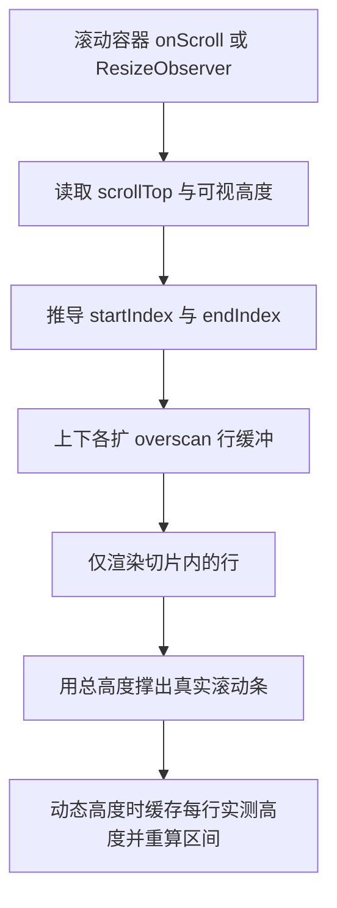

```jsx
// useVirtualList.ts —— 定高 O(1)，动态高度走测量缓存
import { useCallback, useMemo, useRef, useState } from 'react';

export function useVirtualList({ count, itemHeight, overscan = 5 }) {
  const containerRef = useRef(null);
  const [range, setRange] = useState({ start: 0, end: 20 });
  const heightsRef = useRef([]);            // 动态高度缓存：index -> 实测高度

  const getOffset = useCallback((index) => {
    if (typeof itemHeight === 'number') return index * itemHeight;
    // 动态高度：未测量的行用估算值，已测量的行用真实值累加
    let offset = 0;
    for (let i = 0; i < index; i++) offset += heightsRef.current[i] ?? itemHeight;
    return offset;
  }, [itemHeight]);

  const onScroll = useCallback(() => {
    const el = containerRef.current;
    if (!el) return;
    const scrollTop = el.scrollTop;
    // 从 scrollTop 反查 startIndex（定高直接除，动态高度累加探测）
    let start = 0;
    if (typeof itemHeight === 'number') start = Math.floor(scrollTop / itemHeight);
    else while (start < count && getOffset(start + 1) < scrollTop) start++;

    let end = start;
    while (end < count && getOffset(end) < scrollTop + el.clientHeight) end++;
    setRange({ start: Math.max(0, start - overscan), end: Math.min(count, end + overscan) });
  }, [count, itemHeight, overscan, getOffset]);

  const totalHeight = useMemo(() => getOffset(count), [count, getOffset]);

  return {
    containerProps: { ref: containerRef, onScroll },
    range,                                   // 调用方只渲染 range 内的行
    totalHeight,
    getItemOffset: getOffset,
    measureItem: (index, height) => {        // 行渲染后回报真实高度
      if (heightsRef.current[index] !== height) {
        heightsRef.current[index] = height;
        onScroll();                          // 高度变化后重算区间
      }
    },
  };
}
```

### R19-094：可编辑表格如何实现行内编辑与校验？
**答**：
- 编辑态建模：editingId 记录哪一行在编辑（一般同时只允许一行），draft 是该行的可变副本。
- 保存前先前端校验（必填、格式），再提交服务端；服务端校验失败要停留在编辑态并展示错误，不能丢输入。
- 取消 = 丢弃 draft 回到展示态；保存成功 = 服务端返回后更新列表数据。
- 行内状态与列表数据分离：列表数据来自 props/store，draft 只存在于编辑期间。

```jsx
// EditableTable.tsx —— 行内编辑 + 前后端两级校验
import { useState } from 'react';

function EditableTable({ rows, onSave }) {
  const [editingId, setEditingId] = useState(null);   // 同时只允许一行进入编辑态
  const [draft, setDraft] = useState(null);
  const [error, setError] = useState(null);

  const startEdit = (row) => { setEditingId(row.id); setDraft({ ...row }); setError(null); };

  const save = async () => {
    if (!draft.name?.trim()) { setError('名称必填'); return; }   // 前端校验
    try {
      await onSave(draft);
      setEditingId(null);       // 服务端成功才退出编辑态
    } catch (e) {
      setError(e.message);      // 服务端校验失败：保留编辑态与输入
    }
  };

  return (
    <table>
      <tbody>
        {rows.map(row => (
          <tr key={row.id}>
            {editingId === row.id ? (
              <>
                <td>
                  <input value={draft.name} onChange={e => setDraft({ ...draft, name: e.target.value })} />
                  {error && <span role="alert">{error}</span>}
                </td>
                <td>
                  <button onClick={save}>保存</button>
                  <button onClick={() => setEditingId(null)}>取消</button>
                </td>
              </>
            ) : (
              <>
                <td>{row.name}</td>
                <td><button onClick={() => startEdit(row)}>编辑</button></td>
              </>
            )}
          </tr>
        ))}
      </tbody>
    </table>
  );
}
```

### R19-095：如何实现 Toast 与 Dialog 的命令式管理器？
**答**：
- 目标是业务侧一行调用：`toast.success('已保存')`、`await confirmDialog({...})`，不在组件树里手工摆状态。
- 实现方式：模块级维护 toasts 数组 + createRoot 挂载一次性宿主容器，每次增删全量重渲宿主。
- Dialog Promise 化：弹窗回调里 resolve，调用方用 await 写同步风格逻辑，消灭回调嵌套。
- 注意 React 18+ 的 createRoot 要复用同一个 root 实例，unmount 时统一清理。

```jsx
// toast.tsx —— 命令式 Toast 与 Promise 化 Dialog
import { createRoot } from 'react-dom/client';

function ToastApp({ toasts }) {
  return (
    <div className="overlay-host">
      {toasts.map(t =>
        t.type === 'dialog'
          ? <Dialog key={String(t.id)} {...t} />   // Dialog 内部点击调用 t.onOk / t.onCancel
          : <div key={t.id} className={`toast toast-${t.type}`}>{t.content}</div>,
      )}
    </div>
  );
}

let root = null;
let toasts = [];

function ensureRoot() {
  if (root) return;
  const container = document.createElement('div');
  document.body.appendChild(container);
  root = createRoot(container);
}

function renderAll() { root.render(<ToastApp toasts={toasts} />); }

function push(item, duration) {
  ensureRoot();
  toasts = [...toasts, item];
  renderAll();
  if (duration) {
    setTimeout(() => {
      toasts = toasts.filter(t => t.id !== item.id);
      renderAll();
    }, duration);
  }
}

export const toast = {
  show: (content, options = {}) => push({ id: Date.now(), content, duration: 3000, ...options }, options.duration),
  success: (content) => toast.show(content, { type: 'success' }),
  error: (content) => toast.show(content, { type: 'error' }),
};

// Promise 化 confirm：调用即弹窗，await 拿结果
export function confirmDialog({ title, content }) {
  return new Promise(resolve => {
    ensureRoot();
    const dialogId = Symbol('dialog');
    const close = (result) => {
      toasts = toasts.filter(t => t.id !== dialogId);
      renderAll();
      resolve(result);
    };
    toasts = [...toasts, {
      id: dialogId, type: 'dialog', title, content,
      onOk: () => close(true),
      onCancel: () => close(false),
    }];
    renderAll();
  });
}

// 调用方：
// const ok = await confirmDialog({ title: '删除', content: '确认删除该条记录？' });
// if (ok) await removeItem(id);
```

---

## 第十五章 性能实战（R19-096 ~ R19-101）

### R19-096：大表格渲染优化的组合拳是什么？
**答**：
- 第一层：行虚拟化——配合 useVirtualList 只渲染可视区几十行，DOM 数量恒定。
- 第二层：单元格/行 memo——Row 与 Cell 都用 memo 包裹，父组件重渲染时未变的行直接跳过。
- 第三层：props 引用稳定——列定义 columns 提升到模块级或 useMemo，回调 useMemoizedFn，否则 memo 全部失效。
- 排序/筛选重算用 useMemo 包裹，避免"数据没变但引用变了"导致整表重渲染。

```jsx
// BigTable.tsx —— 行虚拟化 + 单元格 memo + 稳定 props
import { memo, useMemo } from 'react';
import { useVirtualList } from './useVirtualList';

const Cell = memo(function Cell({ value, column }) {
  return <td style={{ width: column.width }}>{column.render ? column.render(value) : value}</td>;
});

const Row = memo(function Row({ row, columns, style }) {
  return (
    <tr style={style}>
      {columns.map(col => <Cell key={col.key} value={row[col.key]} column={col} />)}
    </tr>
  );
});

function BigTable({ data, columns }) {
  const { containerProps, range, totalHeight, getItemOffset } = useVirtualList({
    count: data.length,
    itemHeight: 48,
    overscan: 10,
  });

  // 列定义经 useMemo 稳定引用，避免行级 memo 失效
  const stableColumns = useMemo(() => columns, [columns]);

  const visible = [];
  for (let i = range.start; i < range.end; i++) {
    visible.push(
      <Row
        key={data[i].id}
        row={data[i]}
        columns={stableColumns}
        style={{ position: 'absolute', top: getItemOffset(i), height: 48 }}
      />,
    );
  }

  return (
    <div {...containerProps} style={{ height: 600, overflow: 'auto', position: 'relative' }}>
      <div style={{ height: totalHeight }}>
        <table>{visible}</table>
      </div>
    </div>
  );
}
```

### R19-097：长列表筛选输入卡顿，useDeferredValue 怎么用？
**答**：
- 病因：输入框 onChange 触发的状态更新同步驱动了昂贵的列表过滤渲染，键盘响应被阻塞。
- useDeferredValue 让输入框保持高优先级（实时回显），列表消费的 deferred 值以低优先级渲染，可被中断。
- `keyword !== deferredKeyword` 可以判断列表是否处于过期状态，用来展示"计算中"提示。
- 与防抖的区别：防抖是延迟触发（等待期间什么都不显示），deferredValue 是立即用旧结果渲染、新结果就绪后替换。

```jsx
// SearchPage.tsx —— 输入即时响应，列表低优先级渲染
import { memo, useDeferredValue, useState } from 'react';

const ExpensiveList = memo(function ExpensiveList({ keyword }) {
  // 大数据量过滤 + 排序，模拟耗时渲染
  const result = filterAndSort(bigData, keyword);
  return result.map(item => <div key={item.id}>{item.title}</div>);
});

function SearchPage() {
  const [keyword, setKeyword] = useState('');
  // 输入框高优先级实时更新；列表拿到的 deferred 值低优先级渲染
  const deferredKeyword = useDeferredValue(keyword);
  const isStale = keyword !== deferredKeyword;   // 过期期间展示提示

  return (
    <>
      <input value={keyword} onChange={e => setKeyword(e.target.value)} />
      {isStale && <span>计算中...</span>}
      <ExpensiveList keyword={deferredKeyword} />
    </>
  );
}
```

### R19-098：如何定位并修复 Context 风暴？
**答**：
- 定位：React DevTools Profiler 录制一次交互，看到大量组件的 render reason 是 "Context change"，即 Provider 的 value 变化引起。
- 常见根因：value 是每次 render 新建的对象字面量；或把高频变化的状态（实时行情）与低频状态（用户信息）塞进同一个 Context。
- 修复三板斧：拆分 Context、value 用 useMemo 稳定、dispatch 单独成 Context。
- 进一步用 use-context-selector 按字段订阅；why-did-you-render 可以在开发期直接打印"哪个 props/context 变了"。

```jsx
// StoreProvider.tsx —— Context 风暴修复示例
import { createContext, useMemo, useState } from 'react';
import { useContextSelector } from 'use-context-selector';

// 1. 拆分：高频变化的与低频的分离
const UserContext = createContext(null);      // 低频：登录信息
const RealtimeContext = createContext(null);  // 高频：实时数据

// 2. Provider value 用 useMemo 稳定，杜绝每次渲染新对象
function StoreProvider({ children }) {
  const [user, setUser] = useState(null);
  const [metrics, setMetrics] = useState({});
  const userValue = useMemo(() => ({ user, setUser }), [user]);
  const metricsValue = useMemo(() => ({ metrics, setMetrics }), [metrics]);
  return (
    <RealtimeContext.Provider value={metricsValue}>
      <UserContext.Provider value={userValue}>{children}</UserContext.Provider>
    </RealtimeContext.Provider>
  );
}

// 3. 消费端只挑需要的字段
function Header() {
  const userName = useContextSelector(UserContext, s => s.user?.name);   // 只订阅 name
  return <span>{userName}</span>;
}
// 排查辅助：给可疑组件接 why-did-you-render，日志会指明是哪种 props/context 变化
```

### R19-099：React.lazy 组件如何做 hover 预取？
**答**：
- 懒加载的痛点：点击后才发起 chunk 请求，Suspense fallback 闪烁一次。
- 原理：import() 是单例缓存——hover 时提前调用一次 import 触发下载，点击时命中模块缓存立即 resolve。
- 实现：把 import 提成独立函数，绑到 onMouseEnter/onFocus；lazy 的工厂里同样调用，两个入口共享缓存。
- 更进一步：路由级预取在空闲时间（requestIdleCallback）预热高概率跳转的页面。

```jsx
// Nav.tsx —— lazy + hover 预取
import { lazy, Suspense, useState } from 'react';

// 路由级组件默认不加载
const HeavyReport = lazy(() => import('./HeavyReport'));

// 关键技巧：import() 有模块缓存，重复调用只下载一次
function preloadReport() {
  import('./HeavyReport');        // 触发网络加载并写入 module cache
}

function Nav() {
  const [show, setShow] = useState(false);
  return (
    <nav>
      {/* hover 时预取，点击时大概率已就绪，Suspense 无 loading 闪烁 */}
      <button
        onMouseEnter={preloadReport}
        onFocus={preloadReport}
        onClick={() => setShow(true)}
      >
        数据报表
      </button>
      {show && (
        <Suspense fallback={<div>加载中...</div>}>
          <HeavyReport />
        </Suspense>
      )}
    </nav>
  );
}
```

### R19-100：FLIP 动画在 React 中怎么落地？
**答**：
- FLIP 四步：First 记录旧位置、Last 让 DOM 更新到新位置、Invert 用 transform 反向偏移、Play 过渡回 0。
- React 的切入点是 useLayoutEffect：它在 DOM 更新后、浏览器绘制前同步执行，适合同时完成测量与反演。
- 位置存 ref（不触发渲染），transition 先置 none 防止首次偏移被动画，rAF 下一帧再开启过渡。
- 适用场景：列表重排、卡片换位、拖拽结束的归位动画；比直接操作 class 动画更可控。

```jsx
// ReorderableList.tsx —— 列表重排的 FLIP 动画
import { useLayoutEffect, useRef } from 'react';

function ReorderableList({ items }) {
  const positionsRef = useRef(new Map());
  const listRef = useRef(null);

  useLayoutEffect(() => {
    const children = listRef.current?.children ?? [];
    for (const el of children) {
      const prev = positionsRef.current.get(el.dataset.id);
      const next = el.getBoundingClientRect().top;
      if (prev !== undefined && prev !== next) {
        const delta = prev - next;
        // Invert：反向偏移到旧位置，且禁止过渡
        el.style.transition = 'none';
        el.style.transform = `translateY(${delta}px)`;
        // Play：下一帧过渡回 0
        requestAnimationFrame(() => {
          el.style.transition = 'transform 300ms';
          el.style.transform = '';
        });
      }
      positionsRef.current.set(el.dataset.id, next);   // 记录本轮新位置
    }
  }, [items]);   // 列表顺序变化后、浏览器绘制前执行

  return (
    <ul ref={listRef}>
      {items.map(item => (
        <li key={item.id} data-id={item.id}>{item.label}</li>
      ))}
    </ul>
  );
}
```

### R19-101：首屏优化中代码分割与 Suspense 流式如何组合？
**答**：
- 思路是"关键路径最小化"：首屏必需的数据阻塞渲染保证可见即完整，非关键模块（图表、榜单）用 Suspense 包住随流注入。
- Next.js App Router 下：loading.js 提供段级即时骨架；页面内更细粒度用 `<Suspense>` 包异步服务端组件。
- 首屏之外的交互模块用 React.lazy 代码分割，配合 hover/空闲预取消除点击延迟。
- 度量闭环：用 LCP/INP 指标验证，流式边界划得是否合理看 TTFB 到 LCP 的间隔。

```jsx
// 首屏优化组合：关键内容阻塞 + 非关键内容流式 + 交互模块懒加载
import { lazy, Suspense } from 'react';

export default function Dashboard() {
  return (
    <main>
      {/* 首屏关键数据：阻塞渲染，保证可见即完整 */}
      <KpiCards />

      {/* 非关键模块：稍后随流注入，不拖慢首屏 */}
      <Suspense fallback={<ChartSkeleton />}><SlowChart /></Suspense>
      <Suspense fallback={<TableSkeleton />}><BigRankTable /></Suspense>

      {/* 首屏之外的交互模块懒加载（该页为客户端组件或 'use client' 区域） */}
      <Suspense fallback={null}>
        <LazySettings />
      </Suspense>
    </main>
  );
}

const LazySettings = lazy(() => import('./SettingsPanel'));
// Next.js 中配合 app/dashboard/loading.tsx 提供段级骨架，导航瞬间就有响应
```

---

## 第十六章 RSC 与 Next.js 实战（R19-102 ~ R19-107）

### R19-102：Server Component 的数据获取模式有哪些？
**答**：
- 服务端组件可以直接 async/await，数据请求不发到浏览器，凭据不出服务端。
- 互不依赖的请求必须 Promise.all 并行，否则串行瀑布让 TTFB 翻倍。
- 缓存策略逐请求声明：`next.revalidate` 走 ISR、`cache: 'no-store'` 走实时、`next.tags` 支持后续按标签失效。
- 依赖前序结果的请求（如先拿用户再拿其订单）无法并行，把两段拆成嵌套组件并各自 Suspense，缩小瀑布范围。

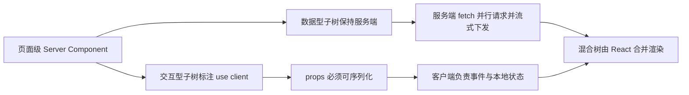

```tsx
// app/products/[id]/page.tsx —— 服务端组件：并行 fetch + 缓存策略逐请求声明
import { Suspense } from 'react';

// 三个请求互不依赖，Promise.all 并行，总耗时取最大值
async function getProductPageData(id: string) {
  const [product, reviews, recommendations] = await Promise.all([
    fetch(`${API}/products/${id}`, { next: { revalidate: 300 } }),       // 商品信息 5 分钟缓存
    fetch(`${API}/products/${id}/reviews`, { cache: 'no-store' }),       // 评价实时
    fetch(`${API}/recommend?for=${id}`, { next: { revalidate: 3600 } }), // 推荐内容 1 小时缓存
  ]);
  if (!product.ok) throw new Error('商品加载失败');
  return {
    product: await product.json(),
    reviews: await reviews.json(),
    recommendations: await recommendations.json(),
  };
}

export default async function ProductPage({ params }: { params: { id: string } }) {
  const { product, reviews, recommendations } = await getProductPageData(params.id);
  return (
    <>
      <ProductInfo data={product} />       {/* 纯展示，留在服务端 */}
      <Reviews list={reviews} />
      <AddToCart product={product} />      {/* 有交互，标 use client 的叶子组件 */}
    </>
  );
}
```

### R19-103：Server Actions 表单提交的完整链路是怎样的？
**答**：
- 全链路：客户端提交 -> React 序列化 formData 发送 POST 到当前路由 -> 服务端执行 Action（校验、写库）-> revalidatePath 失效缓存 -> 返回 state 与更新后的 RSC payload -> useActionState 更新 UI。
- useActionState 返回 `[state, formAction, isPending]`，state 即 Action 的返回值，天然承载校验错误。
- 校验失败返回错误 state、不刷新缓存；成功后 revalidatePath + redirect。
- Action 未完成时后续提交自动排队，无需自己写防重锁。

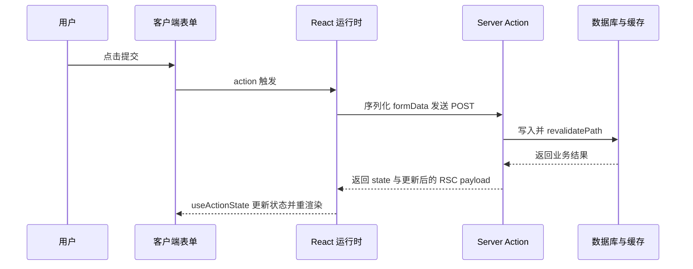

```tsx
// app/actions.ts —— 服务端
'use server';

import { revalidatePath } from 'next/cache';
import { redirect } from 'next/navigation';

export async function createPost(prevState, formData) {
  const title = String(formData.get('title') ?? '');
  if (title.trim().length < 2) {
    return { error: '标题至少 2 个字符' };     // 校验失败：返回 state，不触发缓存刷新
  }
  const post = await db.post.create({ data: { title } });
  revalidatePath('/posts');                    // 失效列表页缓存，下次访问重新渲染
  redirect(`/posts/${post.id}`);               // 成功后跳详情
}

// app/new-post/page.tsx —— 客户端
'use client';

import { useActionState } from 'react';

export function NewPostForm() {
  const [state, formAction, isPending] = useActionState(createPost, { error: null });
  return (
    <form action={formAction}>
      <input name="title" />
      {state.error && <p role="alert">{state.error}</p>}
      <button disabled={isPending}>{isPending ? '提交中' : '发布'}</button>
    </form>
  );
}
```

### R19-104：客户端组件与服务端组件的边界怎么决策？
**答**：
- 默认全部是 Server Component，只有需要交互（事件、state、effect、浏览器 API）的子树才标 'use client'。
- 'use client' 是边界声明而非组件属性：该文件的所有 import 默认进入客户端 bundle，要防止把整个页面拖下水。
- 边界上的 props 必须可序列化：函数（Server Action 除外）、class 实例、Symbol 都传不过去。
- 推荐形态：服务端组件负责数据与静态 UI，把交互下沉到叶子组件；children 作为 props 穿越边界是常用技巧。

```tsx
// app/page.tsx —— 服务端组件做数据与静态 UI
import { db } from '@/lib/db';
import LikeButton from './LikeButton';

export default async function Page() {
  const posts = await db.post.findMany();    // 服务端：直连数据库，不进客户端 bundle
  return posts.map(post => (
    <article key={post.id}>
      <h2>{post.title}</h2>
      <LikeButton postId={post.id} initialCount={post.likes} />  {/* 交互岛屿 */}
    </article>
  ));
}

// LikeButton.tsx —— 'use client' 只是边界声明：它的所有子组件默认进入客户端 bundle
'use client';

import { useState, useTransition } from 'react';
import { likePost } from './actions';

export default function LikeButton({ postId, initialCount }) {
  const [count, setCount] = useState(initialCount);
  const [isPending, startTransition] = useTransition();
  return (
    <button
      disabled={isPending}
      onClick={() =>
        startTransition(async () => {
          setCount(c => c + 1);                       // 乐观更新
          await likePost(postId);                     // 调用 Server Action 回写
        })
      }
    >
      {count}
    </button>
  );
}
```

### R19-105：Next.js 的缓存层级有哪些？实战怎么用？
**答**：
- 四层：请求记忆（同一次渲染内相同 fetch 去重）、数据缓存（fetch 结果跨请求复用）、全路由缓存（构建期静态化整段 HTML/RSC payload）、路由缓存（客户端 RSC payload 的内存缓存）。
- 数据层按需声明：`next.revalidate` 走 ISR、`no-store` 实时、`tags` 供按标签失效。
- 写操作后主动失效：Server Action 里 revalidateTag 清数据缓存、revalidatePath 清整段路由。
- 路由缓存默认 30s 生命周期，router.refresh() 可强制刷新客户端缓存。

```tsx
// app/page.tsx —— 缓存层级实战
export const revalidate = 60;                 // 段级：全路由缓存 60s 重新生成

export default async function Page() {
  // 数据缓存：相同 URL 的 fetch 在有效期内复用
  const res = await fetch('https://api.example.com/data', {
    next: { revalidate: 60, tags: ['data'] },  // ISR + 按标签失效
  });

  // 需要实时的数据用 no-store，逐请求获取
  const user = await fetch('/api/me', { cache: 'no-store' });

  return <div>{/* 渲染数据 */}</div>;
}

// 写操作后的主动失效
import { revalidateTag, revalidatePath } from 'next/cache';

export async function updateData() {
  'use server';
  await saveData();
  revalidateTag('data');        // 只失效打了该标签的数据缓存
  revalidatePath('/page');      // 同时让整段路由缓存失效
}
```

### R19-106：流式渲染与 loading.js、Suspense 如何配合？
**答**：
- loading.js 是段级约定：导航发生时先推骨架，页面数据就绪后再替换，对用户是"瞬间响应"。
- 页面内部再用 Suspense 划分更细的流式单元：谁慢谁自己挂起，不阻塞兄弟节点与外壳。
- 划分原则：外壳与首屏关键内容不包 Suspense（阻塞渲染保证完整），图表、榜单、推荐等非关键模块各自包。
- Suspense 的 fallback 要与真实内容布局一致，避免内容注入后布局跳动（CLS）。

```tsx
// app/dashboard/loading.tsx —— 段级即时 loading：导航瞬间就显示
export default function Loading() {
  return <DashboardSkeleton />;
}

// app/dashboard/page.tsx —— 更细粒度：页面内部用 Suspense 划分流式单元
import { Suspense } from 'react';

export default function Dashboard() {
  return (
    <>
      <h1>概览</h1>
      <Suspense fallback={<ChartSkeleton />}>
        <Chart />        {/* 内部 await fetch，未就绪时先推 fallback */}
      </Suspense>
      <Suspense fallback={<ListSkeleton />}>
        <SlowList />     {/* 谁慢谁自己挂起，不阻塞兄弟节点 */}
      </Suspense>
    </>
  );
}
```

### R19-107：middleware.ts 如何做会话鉴权？
**答**：
- middleware 运行在边缘，每个请求先过它：检查 cookie 会话，未登录 302 到登录页并带 from 参数记录来路。
- 公开路径（login/register/auth API）直接放行，避免死循环重定向。
- 可以向下游注入解析好的用户头（x-user-id），页面层不再重复解析会话。
- matcher 必须排除 _next/static、图片等静态资源，否则浪费边缘计算。

```typescript
// middleware.ts —— 在边缘对每个请求做会话检查
import { NextResponse, type NextRequest } from 'next/server';

const PUBLIC_PATHS = ['/login', '/register', '/api/auth'];

export function middleware(request: NextRequest) {
  const { pathname } = request.nextUrl;
  if (PUBLIC_PATHS.some(p => pathname.startsWith(p))) return NextResponse.next();

  const session = request.cookies.get('session')?.value;
  if (!session) {
    const loginUrl = new URL('/login', request.url);
    loginUrl.searchParams.set('from', pathname);   // 记录来路，登录后跳回
    return NextResponse.redirect(loginUrl);
  }

  // 向下游请求注入用户头，避免每个页面重复解析会话
  const headers = new Headers(request.headers);
  headers.set('x-user-id', parseSession(session).userId);
  return NextResponse.next({ request: { headers } });
}

export const config = {
  matcher: ['/((?!_next/static|_next/image|favicon.ico).*)'],  // 排除静态资源
};
```

---

## 第十七章 测试与质量（R19-108 ~ R19-112）

### R19-108：RTL 的查询优先级与用户事件怎么用？
**答**：
- 查询优先级：getByRole 最接近用户可感知性（顺带测出无障碍），其次 getByLabelText、getByText；getByTestId 只兜底无法语义查询的元素。
- 三个动词：getBy（必须存在，否则抛错）、queryBy（断言不存在）、findBy（异步等待出现）。
- userEvent v14 模拟完整事件序列（focus、keydown、input），比 fireEvent 更接近真实；内部已包 act。
- 断言优先用 toBeInTheDocument、toHaveAccessibleName 等行为断言，而不是比对实现细节。

```jsx
import { render, screen } from '@testing-library/react';
import userEvent from '@testing-library/user-event';
import { describe, expect, it } from 'vitest';
import Counter from './Counter';

describe('Counter', () => {
  it('点击加号递增', async () => {
    const user = userEvent.setup();
    render(<Counter />);

    // 查询优先级：ByRole 最接近用户感知，其次 ByLabelText / ByText
    // 尽量避免 ByTestId —— 它只该兜底无法语义查询的元素
    const button = screen.getByRole('button', { name: /加一/i });
    expect(screen.getByRole('status')).toHaveTextContent('0');

    await user.click(button);          // userEvent 模拟真实事件序列，已内置 act
    expect(screen.getByRole('status')).toHaveTextContent('1');

    // 不存在用 queryBy 断言；异步出现用 findBy
    expect(screen.queryByText('错误')).not.toBeInTheDocument();
  });
});
```

### R19-109：如何测试自定义 Hook？
**答**：
- renderHook 把 hook 挂进一个测试宿主组件，result.current 始终指向最新返回值。
- 触发状态更新的调用必须包在 act 里，断言读 result.current。
- hook 依赖 Context（如 useTheme 需要 ThemeProvider）时用 wrapper 参数注入 Provider。
- 带计时器/异步的 hook 配 fake timers：vi.useFakeTimers + act(advanceTimersByTime)。

```jsx
import { act, renderHook } from '@testing-library/react';
import { describe, expect, it } from 'vitest';
import { useCounter } from './useCounter';
import { useTheme } from './useTheme';
import { ThemeProvider } from './ThemeProvider';

describe('useCounter', () => {
  it('increment 后数值加一', () => {
    const { result } = renderHook(() => useCounter(10));
    expect(result.current.count).toBe(10);

    act(() => result.current.increment());   // 触发更新的调用必须包 act
    expect(result.current.count).toBe(11);
  });
});

describe('useTheme', () => {
  it('依赖 Context 的 hook 需要 wrapper', () => {
    const wrapper = ({ children }) => <ThemeProvider>{children}</ThemeProvider>;
    const { result } = renderHook(() => useTheme(), { wrapper });
    expect(result.current.theme).toBe('light');
  });
});
```

### R19-110：MSW 在测试里怎么组织 mock？
**答**：
- MSW 拦截网络层而非模块层：组件代码完全不改，单测、Storybook、E2E 复用同一套 handlers。
- handlers 按资源组织成数组，setupServer 注册；用例级 override 用 server.use，afterEach resetHandlers。
- listen 时开 `onUnhandledRequest: 'error'`，漏 mock 的请求直接报错而不是静默放行。
- 可以在 handler 里读 request、返回动态响应，覆盖错误码、慢响应等异常分支。

```typescript
// msw/handlers.ts —— 拦截网络层，单测 / Storybook / E2E 共用一套
import { http, HttpResponse } from 'msw';

export const handlers = [
  http.get('/api/users/:id', ({ params }) =>
    HttpResponse.json({ id: params.id, name: 'Wang' })),
  http.post('/api/users', async ({ request }) => {
    const body = await request.json();
    if (!body.name) return HttpResponse.json({ message: 'name required' }, { status: 400 });
    return HttpResponse.json({ id: 1, ...body }, { status: 201 });
  }),
];

// test/setup.ts
import { setupServer } from 'msw/node';
import { handlers } from './msw/handlers';

export const server = setupServer(...handlers);

beforeAll(() => server.listen({ onUnhandledRequest: 'error' }));  // 漏 mock 直接报错
afterEach(() => server.resetHandlers());   // 用例级覆写的 handler 用后重置
afterAll(() => server.close());
```

### R19-111：Playwright 与 React 项目集成有哪些要点？
**答**：
- 配置 webServer 让 Playwright 自动起本地服务，CI 上可复现，本地 reuseExistingServer 复用 dev server。
- 元素锚定优先 getByRole/getByLabel，data-testid 作为最后兜底；选择器要与 RTL 用同一套语义。
- 登录态复用：登录一次后 storageState 存 cookie/localStorage，后续用例免重复登录，提速明显。
- 断言用 web-first 的 expect.toHaveURL/toContainText，自带重试，不要 sleep。

```typescript
// playwright.config.ts —— webServer 自动起本地服务，CI 可复现
import { defineConfig } from '@playwright/test';

export default defineConfig({
  webServer: { command: 'npm run dev', port: 3000, reuseExistingServer: true },
  use: { baseURL: 'http://localhost:3000' },
});

// e2e/login.spec.ts —— 与 RTL 同一套语义选择器
import { test, expect } from '@playwright/test';

test('登录后进入工作台', async ({ page }) => {
  await page.goto('/login');
  await page.getByTestId('username-input').fill('wang');
  await page.getByTestId('password-input').fill('secret');
  await page.getByRole('button', { name: '登录' }).click();

  await expect(page).toHaveURL(/dashboard/);            // web-first 断言自带重试
  await expect(page.getByTestId('welcome')).toContainText('wang');
});

// 登录态复用：storageState 存 cookie，后续用例免重复登录
test.use({ storageState: 'e2e/.auth/state.json' });
```

### R19-112：快照测试与视觉回归怎么取舍？
**答**：
- 大快照（整页 DOM）人人不读、改动无声通过，形同虚设；快照只适合稳定的小叶子组件，且用 toMatchInlineSnapshot 直接内联可读。
- 行为断言永远优先于快照：能测交互就不要存 DOM。
- 纯视觉（像素级）验证交给截图比对：Playwright toHaveScreenshot 设 maxDiffPixelRatio 容差。
- 团队约定：快照 diff 进 PR review 时必须人工解释，解释不了就删快照改行为断言。

```jsx
// 快照的取舍：大快照人人不读，只适合稳定的小叶子
import { render, screen } from '@testing-library/react';
import userEvent from '@testing-library/user-event';
import { test, expect } from 'vitest';
import Alert from './Alert';

test('错误提示文案', () => {
  render(<Alert type="error" message="网络异常" />);
  // toMatchInlineSnapshot：内联可读，diff 时一眼看出改了什么
  expect(screen.getByRole('alert')).toMatchInlineSnapshot();
});

// 行为断言优先于快照：能测交互就不要存 DOM
test('点击关闭按钮后消失', async () => {
  const user = userEvent.setup();
  render(<Alert message="提示" closable />);
  await user.click(screen.getByRole('button', { name: '关闭' }));
  expect(screen.queryByRole('alert')).not.toBeInTheDocument();
});

// 视觉回归交给专业工具：Playwright 截图比对像素
// await expect(page.getByTestId('chart')).toHaveScreenshot({ maxDiffPixelRatio: 0.01 });
```

---

## 第十八章 工程与生态（R19-113 ~ R19-130）

### R19-113：大型 React 项目目录怎么组织？feature-first 是什么？
**答**：
- feature-first：按业务特性切片，每个 feature 目录内聚 api/components/hooks/store，自治闭环。
- 反面是 layer-first（全局 components/hooks 两大箩筐）：改一个需求要横跨五六个顶层目录，feature 间依赖随意。
- 约束规则：跨 feature 引用只能走 index.ts 公共出口；与业务无关的通用层沉到 shared。
- app/ 目录只做路由与组装，不含业务逻辑，方便框架迁移。

```javascript
// feature-first 目录组织
// src/
//   app/                # 路由与页面组装层，只做编排
//   features/           # 业务特性，每个目录自治
//     order/
//       api/            # 该特性的请求封装
//       components/
//       hooks/
//       store/          # 该特性的 slice
//       index.ts        # 公共出口，跨特性只从这里引
//   shared/             # 与业务无关的通用层
//     ui/               # 基础组件库
//     lib/              # 工具函数
//     hooks/            # 全局通用 hooks

// features/order/hooks/useOrderDetail.ts —— 从公共出口引用其他 feature
import { useUser } from '@/features/user';   // 只能走 index.ts，禁止深入内部路径
import { fetchOrder } from '../api';         // 本 feature 内相对引用

export function useOrderDetail(orderId) {
  const { user } = useUser();
  return useRequest(() => fetchOrder(orderId, user.id));
}
```

### R19-114：Hooks 编写规范与 exhaustive-deps 治理？
**答**：
- 原则：不批量禁用 react-hooks/exhaustive-deps；依赖缺失要么补依赖，要么把回调用 useMemoizedFn 稳定后纳入依赖。
- "只想跑一次"的挂载逻辑，effect 依赖写 [] 且内部不引用响应式值；确实要引用又不想重跑的用 ref 记录初始化标记。
- effect 拆分：一个 effect 只做一件事，依赖列表自然清晰；把"事件"与"响应"分开——用户点击触发的逻辑不要塞进 effect。
- 自定义 hook 必须以 use 开头，否则 lint 失明、规则失效。

```jsx
// exhaustive-deps 治理示例
import { useEffect, useRef, useState } from 'react';
import { useMemoizedFn } from './useMemoizedFn';

function LivePrice({ symbol }) {
  const [price, setPrice] = useState(null);

  // 姿势 1：回调用 useMemoizedFn 稳定引用，纳入依赖也不会导致重连
  const onMessage = useMemoizedFn((msg) => {
    setPrice(msg.data[symbol]);
  });

  useEffect(() => {
    const ws = createSocket();
    ws.on('price', onMessage);
    return () => ws.close();
  }, [onMessage]);        // onMessage 引用稳定，effect 不会反复重连

  // 姿势 2：只想跑一次的逻辑，用 ref 记录而不是骗 lint
  const initializedRef = useRef(false);
  useEffect(() => {
    if (initializedRef.current) return;
    initializedRef.current = true;
    initTracking(symbol);
  }, [symbol]);

  return <div>{price}</div>;
}
```

### R19-115：状态分层架构：server / client / url / local 四层怎么落？
**答**：
- URL 状态：可分享、可刷新还原的筛选分页（useSearchParams）。
- Server 状态：服务端数据的缓存与失效交给 TanStack Query/RTK Query，不要自己复制进 store。
- Client 全局状态：跨页面共享的客户端事实（主题、购物车）进 Zustand。
- Local 状态：仅本组件的交互细节用 useState/useReducer。
- 判定口诀：先问生命周期与消费范围，能 local 不 global，能 URL 不 store。

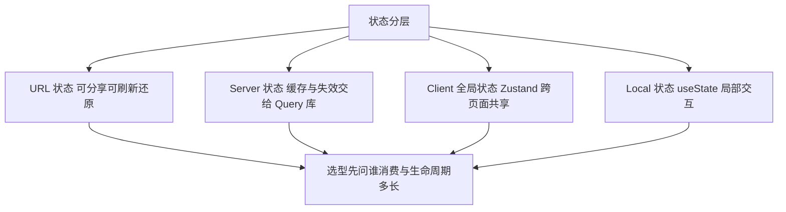

```jsx
// ProductListPage.jsx —— 四层状态各归其位
import { useState } from 'react';
import { useSearchParams } from 'react-router-dom';
import { useQuery } from '@tanstack/react-query';
import { useCartStore } from '@/store/cart';

function ProductListPage() {
  // 1. URL 状态：page / keyword —— 可分享、可刷新还原
  const [params, setParams] = useSearchParams();
  const keyword = params.get('q') ?? '';

  // 2. Server 状态：TanStack Query 持有，含缓存、重试、失效
  const { data } = useQuery({
    queryKey: ['products', keyword],
    queryFn: () => fetchProducts(keyword),
  });

  // 3. Client 全局状态：Zustand，跨页面共享（购物车角标）
  const cartCount = useCartStore(s => s.count);

  // 4. Local 状态：仅本组件的交互细节
  const [previewId, setPreviewId] = useState(null);

  return <> {/* 列表、购物车角标、预览弹窗 */} </>;
}
```

### R19-116：React 19 迁移清单有哪些？
**答**：
- ref 作为 prop：函数组件直接接收 ref，forwardRef 不再必需（仍可用，渐进移除）。
- @types/react@19：移除隐式 children，函数组件必须显式声明 children 类型；ref 回调支持清理函数，且不允许再隐式返回值。
- 清理废弃 API：propTypes、函数组件 defaultProps、string refs、ReactDOM.render 改 createRoot。
- 升级路径：先升 18.3 利用废弃告警清理 -> 升 19 -> 升 types -> 检查第三方库 peerDeps（表单、拖拽、DnD 库最常踩）。

```jsx
// React 19 迁移要点速查
// 1. ref 直接作为 prop，不再需要 forwardRef
function Input({ ref, ...props }) {        // 函数组件直接接收 ref
  return <input ref={ref} {...props} />;
}

// 2. @types/react@19 移除了隐式 children，必须显式声明
// function Card({ title, children }: { title: string; children: React.ReactNode }) {}

// 3. ref 回调返回值改为清理函数，不能隐式返回别的值
function Field() {
  return (
    <input
      ref={(node) => {
        register(node);
        return () => register(null);   // React 19 支持 ref cleanup
      }}
    />
  );
}

// 4. 清理历史 API：propTypes、函数组件 defaultProps、string refs、ReactDOM.render
// 5. 升级顺序：18.3 打印告警 -> 修告警 -> 升 19 -> @types/react@19 -> 验证第三方库 peerDeps
```

### R19-117：React DevTools Profiler 怎么高效定位性能问题？
**答**：
- 四步法：录制一次交互 -> 看火焰图 -> 找宽条与重复窄条 -> 对症下药。
- 宽条 = 组件自身渲染慢（重计算、大列表），用 useMemo/虚拟化优化；大量重复窄条 = 不必要重渲染，查 props 引用与 Context。
- 开启 Highlight updates，交互时直接看谁在闪，快速验证 Context 风暴。
- Profiler 组件可在生产埋渲染耗时，采集真实用户的慢渲染分布。

```jsx
// Profiler 定位法：录制 -> 火焰图 -> 找宽条 -> 对症下药
import { Profiler, useCallback } from 'react';

function App() {
  const onRender = useCallback((id, phase, actualDuration) => {
    // 生产上也可以借此上报真实用户渲染耗时
    if (actualDuration > 16) {
      console.warn(`${id} ${phase} 耗时 ${actualDuration.toFixed(1)}ms`);
    }
  }, []);

  return (
    <Profiler id="OrderList" onRender={onRender}>
      <OrderList />
    </Profiler>
  );
}
// DevTools 里：Flame Graph 看每次 commit 的耗时条；
// Highlight updates when components render 直观看到谁在闪；
// 宽条 = 组件本身慢，重复窄条 = 不必要重渲染（补 memo / 稳定 props）。
```

### R19-118：并发特性如何渐进启用？
**答**：
- 并发能力是按"更新点"启用的，不需要全站切换：哪里有"输入驱动大计算"，哪里先上 startTransition/useDeferredValue。
- 第二步：数据获取场景用 Suspense 包住孤立模块，享受流式加载。
- 前置条件排查：render 内副作用、不可中断的第三方渲染逻辑是并发主要风险点。
- 灰度验证：对慢页面用 Performance 面板与 INP 指标做前后对比，量化收益。

```jsx
// 并发特性按更新点渐进接入
import { useDeferredValue, useState, useTransition } from 'react';

function SearchBox() {
  const [query, setQuery] = useState('');
  const [isPending, startTransition] = useTransition();

  const onChange = (e) => {
    setQuery(e.target.value);                       // 紧急更新：输入保持即时
    startTransition(() => {
      setResults(filterBigList(e.target.value));    // 非紧急：可被打断，不卡输入
    });
  };
  // useDeferredValue 等价于"值维度的 transition"，二者选其一即可
  const deferredQuery = useDeferredValue(query);

  return <input value={query} onChange={onChange} data-pending={isPending} />;
}

// 渐进策略：
// 1. 输入驱动大计算的点先用 startTransition / useDeferredValue
// 2. 数据获取场景用 Suspense 包孤立模块，体验流式加载
// 3. 排查 render 内副作用与不兼容库，它们是并发的主要风险点
// 4. 用 Performance 面板与 INP 指标做灰度前后对比
```

### R19-119：React 应用的错误监控体系怎么建？
**答**：
- 三层捕获：ErrorBoundary 兜渲染错误（带 componentStack）、window.onerror 兜全局运行时异常、unhandledrejection 兜 Promise 异常。
- 分级处理：P0 渲染崩溃全量上报 + 告警，P1 运行时异常全量落库，P2 警告类采样上报控制成本。
- 上报用 navigator.sendBeacon，页面卸载也不丢；生产环境接 sourcemap 还原堆栈。
- ErrorBoundary 只能捕获渲染期错误，事件回调与异步里的错误靠全局兜底。

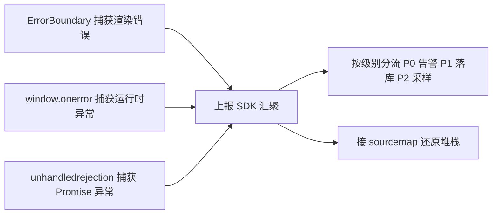

```jsx
// monitor.ts —— 分级上报：渲染层边界 + 全局兜底 + 采样
import { ErrorBoundary } from './ErrorBoundary';

// 1. 渲染错误：ErrorBoundary 兜住并带上下文上报
export function RouteBoundary({ children }) {
  return (
    <ErrorBoundary
      onError={(error, componentStack) => report({
        level: 'error',
        type: 'react-render',
        message: error.message,
        stack: error.stack,
        componentStack,
      })}
    >
      {children}
    </ErrorBoundary>
  );
}

// 2. 全局兜底：window.onerror 与 unhandledrejection
window.addEventListener('error', e =>
  report({ level: 'error', type: 'runtime', message: e.message, stack: e.error?.stack }));
window.addEventListener('unhandledrejection', e =>
  report({ level: 'warn', type: 'promise', message: String(e.reason) }));

// 3. 上报策略：P0 全量 + 告警；P1 全量落库；P2 采样 10%，控制成本
function report(payload) {
  if (payload.level === 'warn' && Math.random() > 0.1) return;   // 警告采样
  navigator.sendBeacon('/api/monitor', JSON.stringify(payload)); // 卸载也能发出去
}
```

### R19-120：React 与微前端集成的要点？
**答**：
- 四大隔离：JS 沙箱（Proxy 快照）、样式隔离（scoped/Shadow DOM）、路由同步、公共依赖共享。
- React 双实例是头号坑：主子应用必须共享同一个 React/ReactDOM（external 化），否则 Hook 报 Invalid hook call。
- 子应用生命周期对齐：mount 用 createRoot，unmount 必须 root.unmount()，否则内存泄漏与事件残留。
- 通信收敛到一个 props/全局事件总线，禁止子应用直接操作主应用 DOM。

```jsx
// 微前端集成：qiankun 主应用 + React 子应用
import { registerMicroApps, start } from 'qiankun';
import { createRoot } from 'react-dom/client';

registerMicroApps([
  {
    name: 'order-app',
    entry: '//localhost:7101',
    container: '#sub-container',
    activeRule: '/order',
    props: { token: getSharedToken() },   // 下发共享上下文
  },
]);
start({ experimentalStyleIsolation: true });   // 样式 scoped 隔离

// 子应用生命周期，React 挂载/卸载对齐
let root = null;

export async function mount(props) {
  root = createRoot(props.container.querySelector('#root'));
  root.render(<App />);
}

export async function unmount() {
  root.unmount();   // 必须真正卸载，否则内存泄漏与事件残留
  root = null;
}
// 关键决策：React/ReactDOM 配 external 由主应用提供，避免子应用各自打包引发多实例
```

### R19-121：Electron + React 的架构要点？
**答**：
- 三层：主进程（Node 能力：文件、系统）、preload（contextBridge 桥）、渲染进程（React UI）。
- 安全底线：contextIsolation: true、nodeIntegration: false，渲染进程只能通过 preload 暴露的白名单 IPC 与系统交互。
- IPC 用 invoke/handle 的请求-响应模式，preload 返回清理函数让 React effect 无缝订阅事件。
- React 层面与 Web 复用度高，平台差异收敛到 api 层，便于未来迁移 Tauri 或纯 Web。

```jsx
// Electron + React：主进程 Node、渲染进程 React、preload 桥接
// preload.cjs —— contextBridge 暴露受限 IPC，绝不直接开 nodeIntegration
// const { contextBridge, ipcRenderer } = require('electron');
//
// contextBridge.exposeInMainWorld('api', {
//   readConfig: () => ipcRenderer.invoke('config:read'),
//   saveFile: (content) => ipcRenderer.invoke('file:save', content),
//   onUpdaterEvent: (cb) => {
//     const listener = (_, data) => cb(data);
//     ipcRenderer.on('updater', listener);
//     return () => ipcRenderer.removeListener('updater', listener);  // 返回清理函数
//   },
// });

// 渲染进程 React 组件安全消费
import { useEffect, useState } from 'react';

function UpdaterBanner() {
  const [status, setStatus] = useState('idle');
  useEffect(() => window.api.onUpdaterEvent(setStatus), []);   // cleanup 由 effect 自动调用
  if (status !== 'available') return null;
  return <button onClick={() => window.api.invokeUpdate()}>更新可用，立即安装</button>;
}
// 安全清单：contextIsolation: true、nodeIntegration: false、IPC 参数在主进程校验
```

### R19-122：React Native 与 Web 如何共享业务逻辑？
**答**：
- 分层复用：state、hooks、请求、校验下沉到 shared 包（零平台依赖），只有渲染层按平台实现。
- 判定标准：文件里不 import 任何 DOM/RN API 的逻辑才能进 shared。
- 平台差异用依赖注入：shared 暴露接口，web 注入 react-router 的跳转，native 注入 navigation。
- monorepo（pnpm workspace）承载：packages/shared + apps/web + apps/native。

```javascript
// monorepo 结构：业务层复用的载体
// packages/
//   shared/            # 纯逻辑层：零平台依赖
//     hooks/           # useCart, useAuth —— 只用 React API
//     store/
//     api/
//     utils/
//   ui/                # 可选：跨端组件层（web 用 dom，native 用 RN 组件）
// apps/
//   web/               # React DOM 实现
//   native/            # React Native 实现

// packages/shared/hooks/useAuth.ts —— 不 import 任何平台 UI，两端直接复用
import { useSyncExternalStore } from 'react';
import { authStore } from '../store/authStore';

export function useAuth() {
  const user = useSyncExternalStore(authStore.subscribe, authStore.getState);
  return { user, login: authStore.login, logout: authStore.logout };
}

// 平台差异用依赖注入：shared 暴露接口，web 传 router，native 传 navigation
// const { login } = useAuth({ navigate: (path) => router.push(path) });
// 分层原则：state / 逻辑 / 请求下沉 shared，只有渲染层按平台实现
```

### R19-123：Monorepo 中如何建设 React 组件库？
**答**：
- 包结构：peerDependencies 声明 react/react-dom 交给宿主提供，避免打包出双 React 实例。
- 构建用 tsup/vite lib mode 输出 ESM + d.ts；exports 字段约束入口与类型。
- 发版用 changesets：PR 里声明变更，CI 自动汇总生成版本与 changelog。
- Storybook 承担文档与视觉回归；组件库原则：受控优先、样式可覆盖、不内置业务请求。

```javascript
// packages/ui/package.json —— 组件库包的关键字段
{
  "name": "@acme/ui",
  "version": "0.0.0",
  "type": "module",
  "exports": {
    ".": { "types": "./dist/index.d.ts", "import": "./dist/index.js" },
    "./styles.css": "./dist/styles.css"
  },
  // React 交给宿主，避免双实例导致 Invalid hook call
  "peerDependencies": { "react": "^19.0.0", "react-dom": "^19.0.0" },
  "scripts": {
    "build": "tsup src/index.tsx --dts --external react",
    "test": "vitest run"
  }
}
// 工程链路：pnpm workspace 管理 + changesets 发版 + Storybook 当文档与视觉回归
// 组件库原则：受控优先、样式可覆盖、不内置业务请求
```

### R19-124：如何在 React 应用接入 web-vitals 性能上报？
**答**：
- 标准指标五件套：LCP（首屏）、INP（交互响应性，React 长任务最敏感）、CLS（布局偏移）、TTFB、FCP。
- onXxx 回调里拿 metric，用 sendBeacon 上报（页面卸载也不丢）。
- 上报维度带上路由与用户标识，才能按页面聚合出劣化榜单。
- INP 差通常是长任务：回看 R19-097 的 useDeferredValue 与代码分割。

```javascript
// vitals.ts —— web-vitals 标准指标 + 上报埋点
import { onLCP, onINP, onCLS, onTTFB, onFCP } from 'web-vitals';
import { getUserId } from './auth';

function sendToAnalytics(metric) {
  // sendBeacon 不阻塞卸载，页面关闭也能发出去
  navigator.sendBeacon('/api/vitals', JSON.stringify({
    name: metric.name,          // LCP / INP / CLS / TTFB / FCP
    value: metric.value,
    rating: metric.rating,      // good / needs-improvement / poor
    id: metric.id,              // 同一会话去重
    route: location.pathname,
    userId: getUserId(),
  }));
}

onLCP(sendToAnalytics);   // 首屏最大元素渲染时间
onINP(sendToAnalytics);   // 交互响应性，React 长任务最敏感
onCLS(sendToAnalytics);   // 布局偏移，关注图片与骨架屏
onTTFB(sendToAnalytics);
onFCP(sendToAnalytics);
```

### R19-125：React 项目 CSS 方案怎么选型？
**答**：
- Tailwind：原子类零命名成本、约束强，适合中后台与新起的设计系统；代价是 JSX 里类名冗长、团队需统一约定。
- CSS Modules：编译期作用域隔离，学习成本最低，适合老项目渐进迁移。
- vanilla-extract：TypeScript 写样式、构建期产出零运行时 CSS，RSC 友好，是 CSS-in-JS 的替代升级。
- styled-components 等运行时 CSS-in-JS：动态主题能力强，但运行时开销 + RSC 兼容成本，新项目慎选。

```jsx
// CSS 方案选型：按"隔离强度 + 团队规模 + 渲染模式"决策

// 1. Tailwind：原子类，零命名成本，设计约束强
<button className="rounded-md bg-blue-500 px-4 py-2 text-white hover:bg-blue-600">
  提交
</button>

// 2. CSS Modules：编译期作用域隔离，适合渐进迁移
import styles from './Card.module.css';
<div className={styles.card}>{children}</div>

// 3. vanilla-extract：TypeScript 写样式、构建期生成、零运行时，RSC 友好
// theme.css.ts
// import { createTheme } from '@vanilla-extract/css';
// export const [lightTheme, darkTheme] = createTheme(
//   { vars: { colorPrimary: '#1677ff' } },
//   { vars: { colorPrimary: '#0958d9' } },
// );

// 4. styled-components 等运行时 CSS-in-JS：RSC 下有额外客户端成本，新项目慎选
```

### R19-126：React 与 Solid、Svelte 的概念级对比？
**答**：
- React：虚拟 DOM + 重渲染模型——状态变化重新执行组件函数，diff 后更新；"每次渲染都是快照"是所有闭包陷阱的根源。
- Solid：细粒度响应式，组件函数只执行一次，signal 直达 DOM，没有重渲染，自然没有 memo/useMemo。
- Svelte：编译时框架，构建期分析依赖生成命令式 DOM 操作，产物更小。
- 面试重点讲心智模型差异与更新粒度，而不是性能数字；React 的生态与"服务端组件"路线是其最大护城河。

```jsx
// React 与 Solid / Svelte 的概念级对比
// React：虚拟 DOM + 重渲染模型。状态变化 -> 重新执行组件函数 -> diff -> 更新
import { useState } from 'react';

function CounterReact() {
  const [count, setCount] = useState(0);
  return <button onClick={() => setCount(count + 1)}>{count}</button>;
}

// Solid：细粒度响应式。组件函数只执行一次，count 是信号，更新直达 DOM
// function CounterSolid() {
//   const [count, setCount] = createSignal(0);
//   return <button onClick={() => setCount(count() + 1)}>{count()}</button>;
// }

// Svelte：编译时框架。构建期分析依赖，产物是直接操作 DOM 的命令式代码

// 迁移启示：
// 1. React 的心智是"每次渲染都是快照"，闭包陷阱与旧值问题源于此
// 2. Solid/Svelte 没有重渲染，自然没有 memo/useMemo 这类补救 API
// 3. 对比重点是更新粒度与心智模型，而不是性能数字
```

### R19-127：React 生态知识体系怎么收束？
**答**：
- 按层陈述：core（组件模型/并发/RSC）-> 路由（React Router 7 / Next App Router）-> 服务端状态（TanStack Query/RTK Query）-> 客户端状态（Zustand/Jotai/RTK）-> 表单（RHF + Zod）-> 工具 hooks（ahooks）-> 样式 -> 测试（Vitest/RTL/MSW/Playwright）-> 元框架（Next/Remix）。
- 面试中"先定层、再给候选、最后讲选型依据"比罗列 API 更能体现体系化。
- 每层记住一个默认答案 + 一个备选：默认 TanStack Query，备选 RTK Query（已深度用 Redux 时）。

```jsx
// React 生态全景图：面试收束时按层陈述
// core      ：React 19 —— 组件模型、并发、Suspense、Server Components
// 路由      ：React Router 7 / Next.js App Router —— URL 状态、数据加载、代码分割
// 服务端状态：TanStack Query / RTK Query / SWR —— 缓存、失效、乐观更新
// 客户端状态：Zustand / Jotai / Redux Toolkit —— 跨组件共享与可追溯
// 表单      ：React Hook Form + Zod —— 非受控性能 + schema 校验
// 工具 hooks：ahooks —— 工程常用的行为封装
// 样式      ：Tailwind / CSS Modules / vanilla-extract
// 测试      ：Vitest + RTL + MSW + Playwright
// 元框架    ：Next.js / Remix —— SSR、RSC、路由、缓存约定
// 面试时用"分层叙述"比罗列 API 更能体现体系化：先定层，再给候选，最后讲选型依据
```

### R19-128：immer 的结构共享对 React 性能意味着什么？
**答**：
- produce 只复制被修改路径上的节点，未改动子树的引用保持不变。
- 这正是 React 浅比较（memo、依赖数组）能生效的前提：改一个深层字段，兄弟节点的 memo 不失效。
- 复杂嵌套 reducer 用 produce 替代层层展开（...state, a: {...state.a, b: ...}），可读性与正确性双提升。
- 注意：immer 返回新引用的成本与修改路径成正比，超大数据集（上万条）要配合分页/虚拟化。

```jsx
// immer 结构共享：改哪里只复制哪里，未改动的引用保持不变
import { produce } from 'immer';

const baseState = [
  { id: 1, name: 'a', tags: ['x'] },
  { id: 2, name: 'b', tags: ['y'] },
];

const nextState = produce(baseState, draft => {
  draft[1].name = 'B';      // 直接改 draft，immer 负责生成新树
});
// baseState === nextState        false —— 顶层引用变了，React 会重渲染
// baseState[0] === nextState[0]  true  —— 结构共享，Row 的 memo 依旧跳过
// baseState[1] === nextState[1]  false —— 只有改动路径被复制

// React 中的实战：复杂嵌套 reducer 用 produce 替代层层展开
function todosReducer(state, action) {
  switch (action.type) {
    case 'renameTag':
      return produce(state, draft => {
        draft.byId[action.id].tags = draft.byId[action.id].tags.map(
          t => (t === action.old ? action.next : t),
        );
      });
    default:
      return state;
  }
}
```

### R19-129：大型 React 项目的依赖治理怎么做？
**答**：
- Bundle 体检：source-map-explorer / rollup-plugin-visualizer 找体积元凶与重复打包（比如同时打了 React 18 和 19）。
- 单实例红线：npm ls react 确认全树只有一个 React，多实例是微前端与组件库最常见的 Invalid hook call 根因。
- 幽灵依赖治理：pnpm 严格隔离，未在 package.json 声明的包不允许 import。
- React 升级策略：小步升级 + codemod + 第三方 peerDeps 先行确认，锁版本但保持季度体检。

```javascript
// deps-guard.ts —— 大型 React 项目的依赖治理
// 1. Bundle 体检：找出体积元凶与重复打包
//    npx source-map-explorer 'dist/assets/*.js'
//    或 vite 构建 + rollup-plugin-visualizer 生成依赖树报告

// 2. 单实例红线：确认只有一个 React 实例
//    npm ls react        # 全树必须收敛到一行
//    多实例 = 微前端/组件库最常见的 "Invalid hook call" 根因

// 3. 幽灵依赖治理：pnpm 严格隔离，未声明的包不能 import
//    .npmrc: shamefully-hoist=false

// 4. 升级流程代码化：升级前跑 codemod 与测试
import { useEffect } from 'react';

export function useDepAudit() {
  useEffect(() => {
    if (import.meta.env.DEV) {
      // 开发期断言全局只挂了一个 React 版本，双实例第一时间报警
      const versions = Object.keys(window).filter(k => k.startsWith('__reactContainer'));
      if (versions.length > 1) console.warn('检测到多个 React 实例，请检查依赖收敛');
    }
  }, []);
}
```

### R19-130：大厂 React 面试答原理题的框架是什么？
**答**：
- 四段式：概念（一句话定性）-> 实现（机制到源码级）-> 场景（什么业务用它）-> 权衡（代价与不适用的场合）。
- 概念要能一句话说清"它解决什么问题"；实现至少到 API 语义与内部状态流转层。
- 场景给真实业务例子；权衡体现 senior 视角——没有银弹，只有取舍。
- 以 useOptimistic 为例完整演示四段式。

```jsx
// 答题框架示例：概念 -> 实现 -> 场景 -> 权衡
// 以 useOptimistic 为例：

// 1. 概念（一句话定性）
// 乐观更新：变更发起时就先展示预期结果，请求失败由 React 自动回滚。

// 2. 实现（机制层）
// useOptimistic 内部维护一个叠加层，读取时用传入的 reducer 把 pending action
// 叠加到当前 state 上；transition 结束后叠加层自动清空，回到真实值。
import { startTransition, useOptimistic } from 'react';

function LikeButton({ likes, onLike }) {
  const [optimisticLikes, addOptimistic] = useOptimistic(
    likes,
    (current, amount) => current + amount,
  );
  return (
    <button
      onClick={() =>
        startTransition(async () => {
          addOptimistic(1);              // 先渲染 +1
          await onLike();                // 失败时 React 自动回滚到真实 likes
        })
      }
    >
      {optimisticLikes}
    </button>
  );
}

// 3. 场景：点赞、购物车、消息发送等高频低风险写操作
// 4. 权衡：体验好但乐观值可能与最终值不一致；高风险操作（支付）不适合乐观
```

## 第十九章 源码级简化实现（R19-131 ~ R19-137）

本章用手写极简实现回答"它是怎么工作的"，是原理题的落地形态。

### R19-131：手写一个简化版 useState，说明 hooks 链与更新队列的工作原理？
**答**：
- 核心：hook 按**调用顺序**挂在 fiber 的 hooks 数组上（链表），每次渲染 cursor 归零，靠顺序对位——这就是"hooks 不能写在 if 里"的根源。
- setState 不直接改值，而是把 action **入队**；下次渲染时按序消费队列，函数式更新基于上一个结果累积。
- state 是渲染快照：事件回调里读到的永远是本次渲染闭包里的旧值。
- 多次 setState 会被批处理：一轮事件里只触发一次重渲染（React 18 起自动批处理覆盖所有场景）。

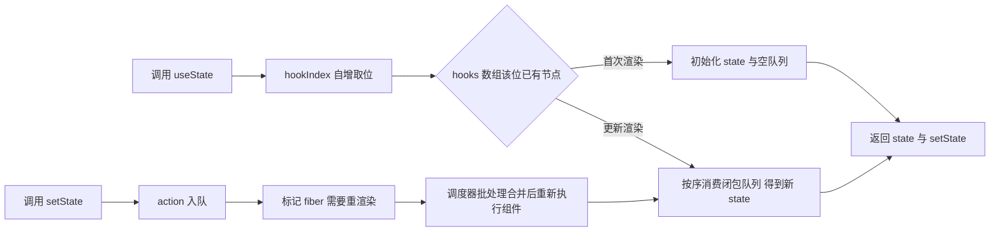

```jsx
// mini-react.js —— 手写 useState：hooks 链 + 闭包队列 + 批处理
let currentFiber = null;      // 当前正在渲染的组件实例
let hookIndex = 0;            // 渲染时的 hook 游标，按调用顺序对位
let isBatching = false;
const pendingFibers = new Set();

export function render(fiber) {
  currentFiber = fiber;
  hookIndex = 0;                        // 关键：每次渲染游标归零
  fiber.output = fiber.Component();     // 重新执行函数组件
  currentFiber = null;
}

function scheduleUpdate(fiber) {
  pendingFibers.add(fiber);
  if (isBatching) return;               // 同一轮里多次 setState 只 flush 一次
  isBatching = true;
  queueMicrotask(() => {                // 简化版调度：微任务统一处理
    isBatching = false;
    [...pendingFibers].forEach(render);
    pendingFibers.clear();
  });
}

export function useState(initialState) {
  const fiber = currentFiber;
  const index = hookIndex++;
  const hooks = fiber.hooks;

  if (hooks[index] === undefined) {     // 首次渲染：初始化 hook 节点
    hooks[index] = {
      state: typeof initialState === 'function' ? initialState() : initialState,
      queue: [],                        // 本轮渲染期间排队的更新
    };
  }
  const hook = hooks[index];

  // 更新阶段：消费队列，函数式更新基于上一个结果累积
  while (hook.queue.length) {
    const action = hook.queue.shift();
    hook.state = typeof action === 'function' ? action(hook.state) : action;
  }

  function setState(action) {
    hook.queue.push(action);            // 关键：先入队，不直接改 state
    scheduleUpdate(fiber);
  }
  return [hook.state, setState];
}

// ---- 使用示例：快照语义与批量合并 ----
function Counter() {
  const [count, setCount] = useState(0);
  console.log('render:', count);        // 每次渲染打印当前快照
  return {
    type: 'button',
    props: {
      onClick: () => {
        setCount(c => c + 1);           // 入队
        setCount(c => c + 1);           // 再入队：基于上一个函数式结果
        setCount(count + 1);            // 直接值：基于旧 count，效果只有 +1
        console.log('click 时刻读到:', count); // 仍是 0 —— 渲染快照
      },
    },
  };
}

const fiber = { Component: Counter, hooks: [], output: null };
render(fiber);                          // render: 0
fiber.output.props.onClick();
// 微任务后重新渲染 -> render: 2（两次函数式更新累积生效）
```

### R19-132：手写一个简化版 useEffect，说明依赖比较与清理函数的执行时机？
**答**：
- effect 节点存在 hook 上：保存上次依赖数组和上次清理函数。
- 渲染完成后统一"提交"：先执行上一轮的 cleanup，再用 `Object.is` 逐位比较依赖，有变化才执行新 effect。
- 无依赖数组每次都执行；空数组等价于只有首次执行。
- 真实 React 中 effect 在 **paint 之后**异步跑（所以叫 passive effect），这里用微任务模拟。

```jsx
// mini-react.js —— 手写 useEffect：依赖比较 + 清理时机
import { render, useState } from './mini-react';

export function useEffect(effect, deps) {
  const fiber = currentFiber;
  const index = hookIndex++;
  const hook = fiber.hooks[index] ?? (fiber.hooks[index] = { deps: undefined, cleanup: null });
  const { deps: prevDeps, cleanup: prevCleanup } = hook;

  const changed =
    prevDeps === undefined ||                    // 首次：无依赖数组时必执行
    deps === undefined ||                        // 没传依赖数组：每次渲染都执行
    deps.length !== prevDeps.length ||
    deps.some((d, i) => !Object.is(d, prevDeps[i])); // 逐位 Object.is 浅比较

  if (!changed) return;                          // 依赖没变：跳过

  // 排入 fiber 的 effect 列表，渲染提交后统一按序执行
  (fiber.effects ??= []).push(() => {
    if (typeof prevCleanup === 'function') prevCleanup(); // 先清理上一轮
    hook.cleanup = effect();                     // 再执行本轮，返回值作为新清理函数
    hook.deps = deps;
  });
}

// 提交阶段：在真实 React 中这是 paint 后异步执行的 passive effects
export function commitFiber(fiber) {
  const effects = fiber.effects ?? [];
  fiber.effects = [];
  queueMicrotask(() => effects.forEach(run => run()));
}

// ---- 验证：依赖变化才重跑，清理先于新 effect ----
function Timer() {
  const [delay, setDelay] = useState(1000);
  useEffect(() => {
    const id = setInterval(() => console.log(`tick every ${delay}ms`), delay);
    return () => clearInterval(id);              // delay 变化时先清旧定时器
  }, [delay]);
  return { type: 'button', props: { onClick: () => setDelay(2000) } };
}
```

### R19-133：手写一个简化版 useRef，为什么它能做到跨渲染返回同一实例？
**答**：
- useRef 就是"挂在 hook 链上的一个盒子"：首次渲染创建 `{ current: initialValue }`，之后每次渲染直接返回**同一个对象引用**。
- 它不触发重渲染——改 current 只是改了普通对象属性，没有任何调度介入。
- 因此它既能存 DOM，也能存"上次渲染的值"、"定时器 id"等跨渲染的可变数据。
- 反面教材：在渲染期间写 ref.current 会破坏纯函数约定（并发渲染下可能执行多次），写操作应放进 effect 或事件里。

```jsx
// mini-react.js —— 手写 useRef：同一实例跨渲染
import { currentFiber, hookIndex } from './mini-react';

export function useRef(initialValue) {
  const fiber = currentFiber;
  const index = hookIndex++;
  const hooks = fiber.hooks;

  // 首次创建盒子，之后渲染命中同一个节点 —— 引用永远不变
  if (hooks[index] === undefined) {
    hooks[index] = { current: initialValue };
  }
  return hooks[index];
}

// ---- 验证三件事：实例稳定 / 不触发渲染 / interval 闭包陷阱的正确解法 ----
import { render as mount, useState } from './mini-react';

function Timer() {
  const [count, setCount] = useState(0);
  const timerRef = useRef(null);        // 每次渲染返回的是同一个对象

  function start() {
    if (timerRef.current) return;       // 防重复启动：靠实例稳定性判断
    timerRef.current = setInterval(() => setCount(c => c + 1), 1000);
  }
  function stop() {
    clearInterval(timerRef.current);    // 改 current 不会触发重渲染
    timerRef.current = null;
  }
  return { start, stop, count };
}

const fiber = { Component: Timer, hooks: [], output: null };
mount(fiber);
const a = fiber.output;
mount(fiber);                           // 模拟第二次渲染
const b = fiber.output;
console.log(a.timerRef === b.timerRef); // true —— 同一实例跨渲染
```

### R19-134：手写 memo 与 useMemo 的核心——浅比较是怎么实现的？
**答**：
- `React.memo` 是组件级缓存：新 props 与旧 props 做一次**浅比较**，全等则直接复用上次渲染结果，跳过函数执行。
- `useMemo` 是 hook 级缓存：依赖浅比较通过就返回上次缓存值，不重算。
- 浅比较规则：第一层用 `Object.is` 比较；对象只比引用不递归——所以传内联对象/函数给 memo 组件会击穿缓存。
- 二者的共同内核就是 `shallowEqual`，这也是面试手写的高频拆分点。

```jsx
// shallowEqual.js —— memo 与 useMemo 共同的核心
export function shallowEqual(a, b) {
  if (Object.is(a, b)) return true;              // 引用相等直接通过

  if (typeof a !== 'object' || a === null ||
      typeof b !== 'object' || b === null) {
    return false;                                // 基本类型引用不同即不等
  }

  const keysA = Object.keys(a);
  const keysB = Object.keys(b);
  if (keysA.length !== keysB.length) return false;

  // 只比较第一层，且要求值本身 Object.is 相等（不递归）
  return keysA.every(key =>
    Object.prototype.hasOwnProperty.call(b, key) && Object.is(a[key], b[key])
  );
}

// memo.js —— 组件级缓存：props 浅比较通过则跳过渲染
import { shallowEqual } from './shallowEqual';

export function memo(Component, areEqual = shallowEqual) {
  let prevProps = null;
  let prevOutput = null;

  function Memoed(props) {
    if (prevOutput !== null && areEqual(prevProps, props)) {
      return prevOutput;                         // 命中缓存：复用上次输出
    }
    prevProps = props;
    prevOutput = Component(props);               // 未命中：真正执行
    return prevOutput;
  }
  return Memoed;
}

// useMemo.js —— hook 级缓存：依赖浅比较通过则返回上次值
export function useMemo(factory, deps) {
  const fiber = currentFiber;
  const index = hookIndex++;
  const hook = fiber.hooks[index] ?? (fiber.hooks[index] = { deps: null, value: undefined });

  if (hook.deps === null || deps.some((d, i) => !Object.is(d, hook.deps[i]))) {
    hook.value = factory();                      // 依赖变了才重算
    hook.deps = deps;
  }
  return hook.value;                             // 没变返回缓存值
}

// ---- 击穿演示：内联对象每次都是新引用 ----
const ExpensiveItem = memo(function ExpensiveItem({ user, onClick }) { /* ... */ });
// <ExpensiveItem user={{ id: 1 }} onClick={() => save(1)} />
// 上面写法每轮渲染 user、onClick 都是新引用，浅比较必失败，memo 形同虚设
// 正确做法：user 用 useMemo/稳定数据源，onClick 用 useCallback 或提到稳定层
```

### R19-135：手写一个简化版 createContext 与 useContext？
**答**：
- 简化思路：用一个**模块级 Provider 栈**——渲染 Provider 时把 value 压栈，`useContext` 取栈顶，出栈即还原。
- 真实 React 更进一步：value 挂在 fiber 树上沿链向上查找，并在 value 变化时**跳过中间 memo 组件**直接向下游传播。
- 局限也由此而来：一个 value 变化会让**所有消费组件**重渲染，与订阅粒度无关——这是 Context 性能问题的本质。
- 示例同时演示"defaultValue 只有在组件树中找不到 Provider 时才生效"。

```jsx
// mini-context.js —— 手写 createContext：Provider 栈实现
export function createContext(defaultValue) {
  const stack = [];                      // 模块级 Provider 栈
  const Context = {
    $$type: 'context',
    defaultValue,
    _stack: stack,
    Provider({ value, children }) {
      stack.push(value);                 // 渲染时压栈
      try {
        return typeof children === 'function' ? children() : children;
      } finally {
        stack.pop();                     // 渲染完出栈，作用域即还原
      }
    },
  };
  return Context;
}

export function useContext(Context) {
  // 栈非空取栈顶（最近的 Provider）；否则用 defaultValue
  return Context._stack.length
    ? Context._stack[Context._stack.length - 1]
    : Context.defaultValue;
}

// ---- 使用与坑位演示 ----
import { render, useState } from './mini-react';

const ThemeContext = createContext('light');

function Button() {
  const theme = useContext(ThemeContext);   // 每次主题变化都会重渲染
  return { type: 'button', props: { label: `theme is ${theme}` } };
}

function App() {
  const [theme, setTheme] = useState('light');
  return ThemeContext.Provider({
    value: theme,
    children: () => Button(),               // 主题一变 Button 必重渲染
  });
}

// 优化手法：value 下沉 —— 把"只读主题"和"切换函数"拆成两个 Context，
// 或把 value 用 useMemo 稳定引用，避免无关消费组件被波及。
```

### R19-136：手写一个简化版 useReducer，它和 useState 在实现上差在哪？
**答**：
- useReducer 与 useState 共用同一套"队列 + 重渲染"机制，差别只在**更新语义**：入队的是 action，消费时统一走 `reducer(state, action)` 收敛出新 state。
- reducer 必须是纯函数：同一输入永远同一输出，不写副作用——这是让"多次更新可正确批量重放"的前提。
- 优势：更新逻辑集中可测、dispatch 引用稳定、复杂状态转换有单一事实来源。
- useState 本质上可以看成 `useReducer(reducer 为基础赋值)` 的特例——React 源码里正是这么实现的。

```jsx
// mini-react.js —— 手写 useReducer：action 入队 + reducer 收敛
export function useReducer(reducer, initialArg, init) {
  const fiber = currentFiber;
  const index = hookIndex++;
  const hooks = fiber.hooks;

  if (hooks[index] === undefined) {
    hooks[index] = {
      state: init ? init(initialArg) : initialArg, // 支持惰性初始化
      queue: [],
    };
  }
  const hook = hooks[index];

  // 与 useState 唯一不同：消费时走 reducer 纯函数
  while (hook.queue.length) {
    const action = hook.queue.shift();
    hook.state = reducer(hook.state, action);
  }

  function dispatch(action) {
    hook.queue.push(action);
    scheduleUpdate(fiber);
  }
  return [hook.state, dispatch];
}

// ---- 实战：购物车 —— 所有状态转换集中在一个可单测的纯函数里 ----
function cartReducer(state, action) {
  switch (action.type) {
    case 'add':
      return {
        ...state,
        items: [...state.items, action.item],
        total: state.total + action.item.price,
      };
    case 'remove':
      return {
        ...state,
        items: state.items.filter(i => i.id !== action.id),
        total: state.total - state.items.find(i => i.id === action.id).price,
      };
    case 'clear':
      return { items: [], total: 0 };
    default:
      throw new Error(`unknown action: ${action.type}`);
  }
}

// cartReducer 可脱离 React 直接单测：
// expect(cartReducer({items: [], total: 0}, {type: 'add', item: {id: 1, price: 9}}))
//   .toEqual({items: [{id: 1, price: 9}], total: 9});
```

### R19-137：useLayoutEffect、useEffect 与 useInsertionEffect 的执行时机差别是什么？如何演示？
**答**：
- 执行顺序固定：`useInsertionEffect`（DOM 变更前，css-in-js 注入样式用）→ `useLayoutEffect`（DOM 变更后、**paint 前**，同步执行，可测量布局）→ paint → `useEffect`（**paint 后**异步，不阻塞绘制）。
- useLayoutEffect 里读 getBoundingClientRect 再改样式，用户看不到中间态；改用 useEffect 则可能闪烁。
- useInsertionEffect 不能读 DOM，专为样式表注入设计，普通业务代码不该用。
- 演示方式：三个 hook 各打一行 log，配合一次强制 reflow，观察顺序。

```jsx
// TimingDemo.jsx —— 三种 effect 的执行时机演示
import { useEffect, useLayoutEffect, useInsertionEffect, useRef, useState } from 'react';

export function TimingDemo() {
  const [n, setN] = useState(0);
  const boxRef = useRef(null);

  useInsertionEffect(() => {
    // 1st：DOM 变更前。css-in-js 库在此动态插入 <style>
    console.log('1 useInsertionEffect —— 不能读 DOM');
  }, [n]);

  useLayoutEffect(() => {
    // 2nd：DOM 已更新、浏览器还没画。适合测量并同步改布局
    const rect = boxRef.current.getBoundingClientRect();
    console.log('2 useLayoutEffect —— paint 前同步执行, width =', rect.width);
    // 修改样式在这里不会产生"闪烁"，因为用户还没看到这一帧
  }, [n]);

  useEffect(() => {
    // 3rd：paint 之后异步执行。数据请求、订阅、日志都在这里
    console.log('3 useEffect —— paint 后异步执行');
  }, [n]);

  return (
    <div ref={boxRef} style={{ width: 100 + n * 10, height: 40, background: '#eee' }}>
      <button onClick={() => setN(v => v + 1)}>resize</button>
    </div>
  );
}
// 点击后控制台顺序恒为：1 useInsertionEffect -> 2 useLayoutEffect -> 3 useEffect
// SSR 场景注意：useLayoutEffect 在服务端不执行并会告警，
// "首屏就要测量"的需求应改用 useEffect + 一次 setState 触发的重渲染。
```

## 第二十章 并发模式实战（R19-138 ~ R19-143）

### R19-138：useTransition 的完整场景有哪些？tab 切换、搜索、列表过滤分别怎么用？
**答**：
- 统一心法：把"高优先级反馈"（输入、tab 高亮）和"低优先级渲染"（重列表）拆开，后者包进 `startTransition`。
- 场景一 tab 切换：立即高亮新 tab，慢面板降级渲染，中间用 isPending 显示骨架。
- 场景二搜索：输入框保持受控即时回显，结果列表用 transition 后的值渲染。
- 场景三列表过滤：上千行筛选不再卡输入，配合 useMemo 让过滤本身也可中断。
- isPending 必须用于 UI 反馈，否则用户感知不到"正在算"。

```jsx
// ConcurrentScenes.jsx —— useTransition 三大场景
import { useTransition, useState, useMemo } from 'react';

function filterItems(items, keyword) {
  if (!keyword) return items;
  return items.filter(i => i.name.toLowerCase().includes(keyword.toLowerCase()));
}

// 场景一：tab 切换 —— 高亮立即响应，慢面板降级
export function TabSwitcher({ tabs }) {
  const [active, setActive] = useState(0);
  const [isPending, startTransition] = useTransition();

  return (
    <div>
      <div role="tablist">
        {tabs.map((tab, i) => (
          <button
            key={tab.id}
            role="tab"
            aria-selected={active === i}
            style={{ fontWeight: active === i ? 'bold' : 'normal' }}
            onClick={() => {
              setActive(i); // 高优先级：立即更新
              startTransition(() => {
                // 若面板状态独立管理，可在此低优先级更新
              });
            }}
          >
            {tab.label}
            {active === i && isPending && <span> loading...</span>}
          </button>
        ))}
      </div>
      <div style={{ opacity: isPending ? 0.5 : 1 }}>{tabs[active].content}</div>
    </div>
  );
}

// 场景二 + 三：搜索框即时回显，结果列表低优先级过滤
export function SearchList({ items }) {
  const [input, setInput] = useState('');
  const [query, setQuery] = useState('');
  const [isPending, startTransition] = useTransition();

  const filtered = useMemo(() => filterItems(items, query), [items, query]);

  return (
    <div>
      <input
        value={input} // 高优先级 state：打字零延迟
        onChange={e => {
          setInput(e.target.value);
          startTransition(() => setQuery(e.target.value)); // 低优先级：重列表
        }}
      />
      {isPending && <p>筛选中...</p>}
      <ul style={{ opacity: isPending ? 0.6 : 1 }}>
        {filtered.map(item => <li key={item.id}>{item.name}</li>)}
      </ul>
    </div>
  );
}
```

### R19-139：useDeferredValue 与 useTransition 怎么选？各自的适用边界在哪？
**答**：
- 本质区别：useTransition 是"我拥有这次更新的触发点"（在事件里主动降级）；useDeferredValue 是"值是别人传来的"（组件内部对 prop/state 做延迟镜像）。
- 受控输入自己 onChange 的场景用 useTransition；封装好的输入组件（如设计库 Input）改不了 onChange，用 useDeferredValue 包 query。
- useDeferredValue 不需要 isPending 额外导出，它返回旧值让旧 UI 留存，配合 key+memo 也能做骨架。
- 两者都依赖可中断渲染才有效；组件树里有同步且不可中断的工作时都会失效。

```jsx
// DeferredVsTransition.jsx —— 同一个搜索列表的两种写法
import { useDeferredValue, useState, useMemo, memo } from 'react';

function filterItems(items, keyword) {
  return items.filter(i => i.name.toLowerCase().includes(keyword.toLowerCase()));
}

// 写法 A：useDeferredValue —— 组件只拿到 query，触发点不在自己手里
export function SearchWithDeferred({ query, items }) {
  const deferredQuery = useDeferredValue(query); // 延迟镜像：新值先不用于重活
  const isStale = query !== deferredQuery;       // 新旧不一致 = 正在追赶

  const filtered = useMemo(
    () => filterItems(items, deferredQuery),
    [items, deferredQuery],
  );

  return (
    <div style={{ opacity: isStale ? 0.6 : 1 }}>
      {filtered.map(item => <li key={item.id}>{item.name}</li>)}
    </div>
  );
}

// 写法 B：useTransition —— 输入事件在自己的组件里，可主动分流
export function SearchWithTransition({ items }) {
  const [input, setInput] = useState('');
  const [query, setQuery] = useState('');
  const [isPending, startTransition] = useTransition();

  const filtered = useMemo(() => filterItems(items, query), [items, query]);

  return (
    <>
      <input
        value={input}
        onChange={e => {
          setInput(e.target.value);
          startTransition(() => setQuery(e.target.value));
        }}
      />
      {isPending && <span>筛选中...</span>}
      <ul>{filtered.map(item => <li key={item.id}>{item.name}</li>)}</ul>
    </>
  );
}

// 选型口诀：触发点在手 -> useTransition；触发点在父级/受控库 -> useDeferredValue
// 封装通用列表时推荐 A：调用方无需理解 transition 也能获得性能收益
```

### R19-140：并发渲染下输入"回退"（revert）是怎么回事？为什么输入框有时会"倒退"？
**答**：
- transition 可被中断、可被丢弃：如果高优先级更新插队并重新渲染，被中断的 transition 不会"完成一半"，而是整体放弃。
- 错误模式：把输入框 value 绑到了**低优先级 state** 上，打字很快时 transition 一直被打断，value 显示的是被丢弃那轮的值，看起来像"回退"。
- 正确模式：输入用高优先级 state 即时回显；低优先级 state 只喂给重计算部分（上一题的双 state 模式）。
- 另一种"回退"是自动批处理下读快照：setState 后立即读 state 是旧值——这是快照语义不是 bug，需要最新值就用函数式更新或 ref。

```jsx
// RevertDemo.jsx —— 并发下的输入回退：错误写法 vs 正确写法
import { useState, useTransition, useDeferredValue } from 'react';

// 错误写法：value 绑在 transition 里的 state 上 —— 快速打字会"倒退"
function BadInput() {
  const [value, setValue] = useState('');
  const [, startTransition] = useTransition();
  return (
    <input
      value={value}
      onChange={e => {
        startTransition(() => setValue(e.target.value)); // value 更新可被丢弃
      }}
    />
  );
}

// 正确写法：双 state，显示与计算分离
function GoodInput({ items }) {
  const [text, setText] = useState('');        // 高优先级：显示层
  const [query, setQuery] = useState('');      // 低优先级：计算层
  const [isPending, startTransition] = useTransition();
  const deferredQuery = useDeferredValue(query);

  const filtered = items.filter(i =>
    i.name.toLowerCase().includes(deferredQuery.toLowerCase())
  );

  return (
    <>
      <input
        value={text} // 永远即时回显，绝不回退
        onChange={e => {
          setText(e.target.value);
          startTransition(() => setQuery(e.target.value));
        }}
      />
      {isPending && <span>计算中...</span>}
      <ul>{filtered.map(i => <li key={i.id}>{i.name}</li>)}</ul>
    </>
  );
}

// 记忆点：transition 是"尽力而为"的调度建议，不是"保证执行"的承诺
// 任何会被用户直接看到的反馈，都不能放进 transition
```

### R19-141：如何封装一个 Suspense 可用的数据获取层（fetch 缓存版资源模式）？
**答**：
- 资源模式三件套：发起请求返回"可读的 promise 包装"、read() 在未就绪时 **throw promise**、Suspense 捕获后显示 fallback，resolve 后重试渲染。
- 缓存以 `key -> resource` 存储：同一 key 第二次 read 直接命中，不再发请求；写入时同步放入，天然去重。
- throw promise 必须是**同一个 promise 实例**（React 内部用 promise status 判断），所以缓存对象里存的 promise 不能被重复创建。
- 错误路径：promise reject 后 read 里 rethrow，交给 ErrorBoundary；需要重试时删除缓存 key 重新发起。
- 生产环境推荐用框架级方案（TanStack Query 的 suspense 模式 / RSC），手写版用于理解机制。

```jsx
// suspense-resource.js —— fetch 缓存版资源模式
const cache = new Map(); // key -> { promise, status, result, error }

export function createResource(fetcher, key) {
  if (!cache.has(key)) {
    const record = { status: 'pending', promise: null, result: null, error: null };
    record.promise = (async () => {
      try {
        record.result = await fetcher();
        record.status = 'success';
      } catch (e) {
        record.error = e;
        record.status = 'error';
      }
    })();
    cache.set(key, record); // 立即写入缓存：并发调用同一个 key 不会重复请求
  }
  return {
    read() {
      const record = cache.get(key);
      if (record.status === 'pending') throw record.promise; // React 捕获 promise
      if (record.status === 'error') throw record.error;     // 交给 ErrorBoundary
      return record.result;
    },
    invalidate() { cache.delete(key); }, // 手动失效，下次 read 重新请求
  };
}

// UserList.jsx —— 组件侧用法
import { Suspense } from 'react';
import { createResource } from './suspense-resource';

const userResource = createResource(
  () => fetch('/api/users').then(r => r.json()),
  '/api/users',
);

function UserList() {
  const users = userResource.read(); // 未就绪时 throw promise
  return <ul>{users.map(u => <li key={u.id}>{u.name}</li>)}</ul>;
}

export function Page() {
  return (
    <Suspense fallback={<p>加载用户中...</p>}>
      <UserList />
    </Suspense>
  );
}
```

### R19-142：用 useOptimistic 实现一个完整的点赞+评论列表？
**答**：
- useOptimistic(state, reducer)：读取时把 pending action 用 reducer 叠加在真实 state 上展示，transition 结束后叠加层自动清空。
- 更新必须在 `startTransition`（React 19 支持 async transition）内进行：先 addOptimistic，再 await 真实请求。
- 失败处理：请求抛错时 React 回滚到真实 state，配合 catch 里的 toast 提示即可，无需手动回滚代码。
- 注意 useOptimistic 不能在列表项"各自持有一份真实值"时使用——真实值必须来自同一父级 state，否则回滚后不一致。

```jsx
// Feed.jsx —— useOptimistic 点赞 + 评论列表实战
import { useOptimistic, useState, startTransition, useRef } from 'react';

export function Feed({ initialPosts }) {
  const [posts, setPosts] = useState(initialPosts);
  const inputRef = useRef(null);

  // 乐观层：对真实 posts 做"叠加式"变更
  const [optimisticPosts, addOptimistic] = useOptimistic(
    posts,
    (current, action) => {
      switch (action.type) {
        case 'like':
          return current.map(p =>
            p.id === action.id
              ? { ...p, likes: p.likes + 1, liked: true }
              : p,
          );
        case 'comment': {
          const target = current.find(p => p.id === action.postId);
          const patched = { ...target, comments: [...target.comments, action.comment] };
          return current.map(p => (p.id === action.postId ? patched : p));
        }
        default:
          return current;
      }
    },
  );

  function like(postId) {
    startTransition(async () => {
      addOptimistic({ type: 'like', id: postId });       // 1. 先乐观展示 +1
      const res = await fetch(`/api/posts/${postId}/like`, { method: 'POST' });
      if (!res.ok) throw new Error('点赞失败');           // 2. 失败自动回滚
      setPosts(prev => prev.map(p => (p.id === postId ? { ...p, likes: p.likes + 1, liked: true } : p)));
    }).catch(() => alert('点赞失败，已恢复'));
  }

  function comment(postId) {
    const text = inputRef.current.value;
    if (!text.trim()) return;
    startTransition(async () => {
      addOptimistic({ type: 'comment', postId, comment: { id: Date.now(), text } });
      await fetch(`/api/posts/${postId}/comments`, {
        method: 'POST',
        headers: { 'Content-Type': 'application/json' },
        body: JSON.stringify({ text }),
      });
      setPosts(prev => prev.map(p =>
        p.id === postId
          ? { ...p, comments: [...p.comments, { id: Date.now(), text }] }
          : p,
      ));
      inputRef.current.value = '';
    }).catch(() => alert('评论发送失败'));
  }

  return (
    <div>
      {optimisticPosts.map(post => (
        <article key={post.id}>
          <button onClick={() => like(post.id)} disabled={post.liked}>
            {post.liked ? '已赞' : '赞'} {post.likes}
          </button>
          <ul>
            {post.comments.map(c => <li key={c.id}>{c.text}</li>)}
          </ul>
          <input ref={inputRef} placeholder="写评论..." onKeyDown={e => e.key === 'Enter' && comment(post.id)} />
        </article>
      ))}
    </div>
  );
}
```

### R19-143：并发渲染会带来哪些 effect 竞态问题？怎么系统性修复？
**答**：
- 竞态三源：StrictMode 双执行、并发可中断渲染导致的重复挂载、快速输入/路由切换导致的"慢请求后到"。
- 通用修复三板斧：cleanup 里取消（AbortController / 清定时器）、用忽略标志丢弃过期响应、依赖数组收紧并配合 `useRef` 保存最新闭包。
- 判断标准：effect 里的异步回调"回来的时候"，组件可能已经卸载或已经因新参数重新运行——每一处异步都要问这个问题。
- React 18+ 不再警告"卸载后 setState"，防泄漏的责任完全交给 cleanup。

```jsx
// RaceFix.jsx —— effect 竞态的系统性修复模式
import { useEffect, useRef, useState } from 'react';

// 模式一：AbortController —— 从源头取消过期请求（首选）
export function UserProfile({ userId }) {
  const [user, setUser] = useState(null);
  const [error, setError] = useState(null);

  useEffect(() => {
    const controller = new AbortController();
    setUser(null);
    setError(null);

    fetch(`/api/users/${userId}`, { signal: controller.signal })
      .then(r => r.json())
      .then(data => setUser(data))
      .catch(err => {
        if (err.name !== 'AbortError') setError(err); // 取消不算错误
      });

    return () => controller.abort(); // userId 变化/卸载时取消上一个请求
  }, [userId]);

  if (error) return <p>加载失败</p>;
  if (!user) return <p>加载中...</p>;
  return <h1>{user.name}</h1>;
}

// 模式二：忽略标志 —— 无法取消的场景（第三方库、WebSocket 回调）
export function LivePrice({ symbol }) {
  const [price, setPrice] = useState(null);
  const ignoreRef = useRef(false); // useRef 存标志，不影响渲染

  useEffect(() => {
    ignoreRef.current = false;
    subscribe(symbol, p => {
      if (!ignoreRef.current) setPrice(p); // 过期订阅直接丢弃
    });
    return () => {
      ignoreRef.current = true;            // 清理时置位，之后的回调全部忽略
    };
  }, [symbol]);

  return <span>{price ?? '-'}</span>;
}

// 模式三：防抖 + 最新闭包 —— 搜索框类输入竞态
export function useDebouncedSearch(search) {
  const [results, setResults] = useState([]);
  const latestRef = useRef(search);

  useEffect(() => {
    latestRef.current = search;
    const id = setTimeout(async () => {
      const data = await fetch(`/api/search?q=${encodeURIComponent(search)}`).then(r => r.json());
      if (latestRef.current === search) setResults(data); // 只接受最新关键字的响应
    }, 300);
    return () => clearTimeout(id); // 每次新输入清掉上一个定时器
  }, [search]);

  return results;
}
```

## 第二十一章 数据层工程（R19-144 ~ R19-150）

### R19-144：如何设计前端请求层架构？fetch/axios 封装、拦截器与请求取消怎么落地？
**答**：
- 分层：`http`（裸请求+拦截器）-> `api`（领域化函数，参数类型化）-> `hooks`（缓存/状态由 TanStack Query 接管），组件永远不直接 fetch。
- 拦截器只做横切关注点：注入 token、traceId、统一错误码翻译、401 刷新重放；**不做业务逻辑**。
- 取消三处都要接：路由切换取消未完成请求、搜索防抖取消上一次、组件卸载取消；axios 用 signal，封装层统一收口。
- 错误要有统一形状（code/message/data），业务代码只判断 data；错误上报在拦截器一次性埋好。

```typescript
// http.ts —— 请求层架构：封装 + 拦截器 + 取消
type ApiError = { code: number; message: string };

const BASE = '/api';
const pending = new Map<string, AbortController>(); // 在途请求登记表

function key(url: string, init?: RequestInit) {
  return `${init?.method ?? 'GET'} ${url}`;
}

async function request<T>(url: string, init: RequestInit = {}): Promise<T> {
  const k = key(url, init);
  // 去重：同 method+url 的在途 GET 直接复用，避免抖动重复请求
  if ((init.method ?? 'GET') === 'GET' && pending.has(k)) {
    return pending.get(k)!.signal.aborted
      ? Promise.reject(new Error('aborted'))
      : Promise.reject(new Error('duplicate'));
  }

  const controller = new AbortController();
  pending.set(k, controller);

  const res = await fetch(BASE + url, {
    ...init,
    signal: controller.signal,
    headers: {
      'Content-Type': 'application/json',
      Authorization: `Bearer ${localStorage.getItem('token') ?? ''}`, // 横切：注入凭证
      'X-Trace-Id': crypto.randomUUID(),                              // 横切：链路追踪
      ...init.headers,
    },
  }).finally(() => pending.delete(k));

  if (res.status === 401) {
    // 横切：统一处理会话过期（跳登录或刷新 token 重放）
    window.dispatchEvent(new Event('auth:expired'));
    throw { code: 401, message: 'unauthorized' } as ApiError;
  }
  if (!res.ok) {
    const body = await res.json().catch(() => ({}));
    throw { code: res.status, message: body.message ?? 'request failed' } as ApiError;
  }
  const json = await res.json();
  return json.data as T; // 统一信封：业务只拿 data
}

export const http = {
  get: <T>(url: string) => request<T>(url),
  post: <T>(url: string, body: unknown) =>
    request<T>(url, { method: 'POST', body: JSON.stringify(body) }),
  cancelAll: () => pending.forEach(c => c.abort()), // 路由切换时统一取消
};

// api/user.ts —— 领域层：类型化 + 可单测
export const userApi = {
  list: (q: string) => http.get<{ id: number; name: string }[]>(`/users?q=${q}`),
  create: (name: string) => http.post<{ id: number }>('/users', { name }),
};
```

### R19-145：TanStack Query 的进阶模式有哪些？queryClient 命令式操作、依赖查询、无限查询怎么写？
**答**：
- 命令式操作：在事件/非组件代码里用 `queryClient.invalidateQueries` / `setQueryData` / `fetchQuery`，而不是只依赖组件内 useQuery。
- 依赖查询：`enabled: !!userId` 让前置数据就绪才发起，配合 `placeholderData: keepPreviousData` 翻页不闪 loading。
- 无限查询：`useInfiniteQuery` + getNextPageParam，页面数据按 pages 数组返回，配合 IntersectionObserver 触发 fetchNextPage。
- 命令式 fetchQuery 常用于"提交前预热"和"跨页面预取"。

```tsx
// users-page.tsx —— TanStack Query 进阶三模式
import {
  useQuery, useInfiniteQuery, useQueryClient, useMutation,
  keepPreviousData,
} from '@tanstack/react-query';
import { useEffect, useRef, useState } from 'react';

// 模式一：依赖查询 + 翻页不闪烁
export function UserOrders({ userId }: { userId?: number }) {
  const [page, setPage] = useState(1);
  const orders = useQuery({
    queryKey: ['orders', userId, page],
    queryFn: () => fetch(`/api/orders?uid=${userId}&page=${page}`).then(r => r.json()),
    enabled: !!userId,                       // userId 就绪才请求
    placeholderData: keepPreviousData,       // 换页保留旧数据，不闪 loading
  });
  // ...
}

// 模式二：无限查询 + IntersectionObserver
export function FeedList() {
  const sentinelRef = useRef<HTMLDivElement>(null);
  const feed = useInfiniteQuery({
    queryKey: ['feed'],
    queryFn: ({ pageParam }) =>
      fetch(`/api/feed?cursor=${pageParam ?? ''}`).then(r => r.json()),
    initialPageParam: 0,
    getNextPageParam: (last) => last.nextCursor ?? undefined, // null 表示没有更多
  });

  useEffect(() => {
    const io = new IntersectionObserver(([e]) => {
      if (e.isIntersecting && feed.hasNextPage && !feed.isFetchingNextPage) {
        feed.fetchNextPage();
      }
    }, { rootMargin: '200px' });
    if (sentinelRef.current) io.observe(sentinelRef.current);
    return () => io.disconnect();
  }, [feed.hasNextPage, feed.isFetchingNextPage, feed.fetchNextPage]);

  return (
    <>
      {feed.data?.pages.map(page =>
        page.items.map((it: any) => <div key={it.id}>{it.title}</div>)
      )}
      <div ref={sentinelRef}>{feed.isFetchingNextPage ? '加载中...' : ''}</div>
    </>
  );
}

// 模式三：queryClient 命令式操作 —— 提交前预热 / 跨组件失效
export function useUserCommands() {
  const qc = useQueryClient();

  const createOrder = useMutation({
    mutationFn: (payload: { userId: number }) =>
      fetch('/api/orders', { method: 'POST', body: JSON.stringify(payload) }),
    onSuccess: (_data, vars) => {
      // 失效与该用户相关的所有订单查询，列表自动重新拉取
      qc.invalidateQueries({ queryKey: ['orders', vars.userId] });
    },
  });

  // 预取：hover 用户行时提前拉详情，进入详情页零等待
  function prefetchUser(userId: number) {
    qc.fetchQuery({
      queryKey: ['user', userId],
      queryFn: () => fetch(`/api/users/${userId}`).then(r => r.json()),
      staleTime: 30_000,
    });
  }
  // 也可以直接写缓存：qc.setQueryData(['user', 1], cachedUser)
  return { createOrder, prefetchUser };
}
```

### R19-146：前端缓存失效策略怎么设计？tag 失效、时间失效、手动失效如何组合？
**答**：
- 三种机制各管一段：**tag 失效**（写操作后按关系失效相关查询，TanStack Query 的 queryKey 前缀 / RTK Query 的 invalidatesTags）、**时间失效**（staleTime 控制新鲜期，gcTime 控制回收）、**手动失效**（用户显式刷新、轮询、WebSocket 推送触发 invalidate）。
- 设计核心是"关系建模"：缓存 key 按 `域 -> 实体 -> 参数` 层级化，写操作失效到域级别即可（如 `['orders']`），避免逐个枚举。
- staleTime 宁长勿短：列表页 30s-5min，详情页 10s-1min；默认 0 会导致每次挂载都重新请求。
- 失效不是删除：invalidate 后旧数据仍展示（isFetching 提示），体验优于清空重拉。

```typescript
// cache-invalidation.ts —— 缓存失效策略设计
import { QueryClient } from '@tanstack/react-query';

export const queryClient = new QueryClient({
  defaultOptions: {
    queries: {
      staleTime: 60_000,  // 全局默认新鲜期 1 分钟
      gcTime: 5 * 60_000, // 5 分钟无订阅后回收
      retry: 2,
    },
  },
});

// 1) queryKey 层级化：保证失效可以按前缀批量命中
// ['orders']                  -> 订单域
// ['orders', 'list', filters] -> 列表
// ['orders', 'detail', id]    -> 详情
export const keys = {
  orders: (scope?: unknown) => scope === undefined ? ['orders'] : ['orders', scope],
};

// 2) 写操作后的失效面：mutation 里按"被影响的关系"声明
import { useMutation, useQueryClient } from '@tanstack/react-query';

export function useShipOrder() {
  const qc = useQueryClient();
  return useMutation({
    mutationFn: (orderId: number) =>
      fetch(`/api/orders/${orderId}/ship`, { method: 'POST' }),
    onSuccess: (_d, orderId) => {
      qc.invalidateQueries({ queryKey: ['orders', 'list'] });        // 列表
      qc.invalidateQueries({ queryKey: ['orders', 'detail', orderId] }); // 该详情
      qc.invalidateQueries({ queryKey: ['dashboard'] });             // 受影响的看板
      // 精确路径也可以直接改缓存，省一次请求：
      // qc.setQueryData(['orders', 'detail', orderId], (old) => ({ ...old, status: 'shipped' }))
    },
  });
}

// 3) 实时通道触发手动失效：WebSocket 收到变更事件再刷新
export function bindRealtimeInvalidation(socket: WebSocket) {
  socket.onmessage = (e) => {
    const event = JSON.parse(e.data);
    if (event.type === 'order.updated') {
      queryClient.invalidateQueries({ queryKey: ['orders', 'detail', event.orderId] });
    }
  };
}

// 4) 用户显式刷新：绕过 staleTime 强制 refetch
export function refreshOrders() {
  queryClient.refetchQueries({ queryKey: ['orders'], type: 'active' });
}
```

### R19-147：分页 + 筛选 + 排序的组合状态如何与 URL 同步？
**答**：
- URL 是唯一事实来源：`useSearchParams` / history state 承载 page、filters、sort，组件从 URL 派生查询参数。
- 收益天然成立：可分享、可收藏、刷新不丢、浏览器前进后退可回放整个列表状态。
- 更新封装成一个 `setSearchParams` 的 merge helper：只改变动的键，其余保留；重置语义（改筛选时回第一页）集中在一处。
- 与 TanStack Query 配合：queryKey 直接用 URL 派生对象，placeholderData 让翻页不闪。

```tsx
// use-list-query.ts —— URL 同步的列表状态
import { useSearchParams } from 'react-router-dom';
import { useQuery, keepPreviousData } from '@tanstack/react-query';
import { useCallback, useMemo } from 'react';

type ListQuery = {
  page: number;
  keyword: string;
  category?: string;
  sort: 'price_asc' | 'price_desc' | 'newest';
};

function parse(sp: URLSearchParams): ListQuery {
  return {
    page: Math.max(1, Number(sp.get('page')) || 1),
    keyword: sp.get('q') ?? '',
    category: sp.get('cat') ?? undefined,
    sort: (sp.get('sort') as ListQuery['sort']) ?? 'newest',
  };
}

export function useListQuery() {
  const [sp, setSp] = useSearchParams();
  const query = useMemo(() => parse(sp), [sp]);

  // merge 更新器：局部修改 + 重置语义集中管理
  const patch = useCallback((partial: Partial<ListQuery>) => {
    setSp(prev => {
      const next = parse(prev);
      const merged = { ...next, ...partial };
      // 业务规则：筛选/排序变化时回到第一页
      if (partial.keyword !== undefined || partial.category !== undefined || partial.sort) {
        merged.page = 1;
      }
      const out = new URLSearchParams();
      out.set('page', String(merged.page));
      if (merged.keyword) out.set('q', merged.keyword);
      if (merged.category) out.set('cat', merged.category);
      out.set('sort', merged.sort);
      return out;
    }, { replace: true }); // 输入类高频变更用 replace，不污染历史栈
  }, [setSp]);

  return { query, patch };
}

// ProductList.tsx —— 组件侧：queryKey 即 URL 状态
export function ProductList() {
  const { query, patch } = useListQuery();
  const { data, isFetching } = useQuery({
    queryKey: ['products', query],
    queryFn: () =>
      fetch(`/api/products?page=${query.page}&q=${query.keyword}&cat=${query.category ?? ''}&sort=${query.sort}`)
        .then(r => r.json()),
    placeholderData: keepPreviousData,
  });

  return (
    <>
      <input
        defaultValue={query.keyword}
        onKeyDown={e => e.key === 'Enter' && patch({ keyword: (e.target as HTMLInputElement).value })}
      />
      <select value={query.sort} onChange={e => patch({ sort: e.target.value as ListQuery['sort'] })}>
        <option value="newest">最新</option>
        <option value="price_asc">价格升序</option>
      </select>
      <button disabled={query.page <= 1} onClick={() => patch({ page: query.page - 1 })}>上一页</button>
      <button onClick={() => patch({ page: query.page + 1 })}>下一页</button>
      <ul style={{ opacity: isFetching ? 0.6 : 1 }}>
        {data?.items.map((p: any) => <li key={p.id}>{p.name}</li>)}
      </ul>
    </>
  );
}
```

### R19-148：如何封装一个通用的乐观更新 Hook（带失败回滚）？
**答**：
- 抽象三步：**快照** -> **本地先行**（setQueryData 改缓存）-> **请求失败回滚快照**，成功后用服务端返回或 invalidate 收敛。
- 封装成 `useOptimisticMutation`：输入 queryKey、patcher（如何把变更套到旧数据上）、mutator（真实请求），输出标准 mutate。
- 并发注意：回滚要用"执行时刻"的快照而非提交时刻的缓存（否则会覆盖其他 mutation 的结果）。
- Toast/重试入口由调用方通过 onError 传入，hook 保持纯粹。

```tsx
// use-optimistic-mutation.ts —— 通用乐观更新 Hook
import { useMutation, useQueryClient, QueryKey } from '@tanstack/react-query';

type Options<TData, TVars> = {
  queryKey: QueryKey;                             // 受影响的缓存
  mutator: (vars: TVars) => Promise<TData>;       // 真实请求
  patcher: (old: TData, vars: TVars) => TData;    // 乐观补丁：如何改旧数据
  onRollback?: () => void;
};

export function useOptimisticMutation<TData, TVars>(opts: Options<TData, TVars>) {
  const qc = useQueryClient();

  return useMutation<TData, Error, TVars>({
    mutationFn: opts.mutator,
    onMutate: async (vars) => {
      // 1. 停掉该 key 在途请求，避免旧响应覆盖乐观值
      await qc.cancelQueries({ queryKey: opts.queryKey });
      // 2. 快照：记录执行时刻的数据，失败精确还原
      const previous = qc.getQueryData<TData>(opts.queryKey);
      // 3. 本地先行
      if (previous !== undefined) {
        qc.setQueryData<TData>(opts.queryKey, old =>
          old === undefined ? old : opts.patcher(old, vars),
        );
      }
      return { previous }; // context 传给 onError
    },
    onError: (_err, _vars, ctx) => {
      if (ctx?.previous !== undefined) {
        qc.setQueryData(opts.queryKey, ctx.previous); // 4. 回滚快照
      }
      opts.onRollback?.();
    },
    onSettled: () => {
      // 5. 无论成败，最终与服务器对账一次
      qc.invalidateQueries({ queryKey: opts.queryKey });
    },
  });
}

// 使用：TodoList 一键接入
type Todo = { id: number; title: string; done: boolean };

export function useToggleTodo() {
  return useOptimisticMutation<Todo[], { id: number }>({
    queryKey: ['todos'],
    mutator: ({ id }) => fetch(`/api/todos/${id}/toggle`, { method: 'POST' }).then(r => r.json()),
    patcher: (todos, { id }) =>
      todos.map(t => (t.id === id ? { ...t, done: !t.done } : t)),
    onRollback: () => console.warn('更新失败已回滚'),
  });
}
```

### R19-149：轮询与实时数据如何实现？refetchInterval 如何配合页面可视性优化？
**答**：
- TanStack Query 原生支持 `refetchInterval`：固定间隔、函数形式（按数据决定下次间隔）两种；轮询期间数据仍是缓存读，UI 无闪断。
- 必配 `refetchIntervalInBackground: false`：页面切到后台暂停轮询，回前台（`focusManager`）自动恢复并立即刷一次。
- 频率自适应：数据变化越快轮询越勤（函数式 interval 返回值），出错时退避拉长间隔。
- 更高实时性再升级为 SSE/WebSocket：服务端推送 -> `invalidateQueries`，轮询作为降级兜底。

```tsx
// use-live-dashboard.ts —— 可视性感知的自适应轮询
import { useQuery } from '@tanstack/react-query';
import { useEffect } from 'react';

export function useLiveDashboard() {
  const q = useQuery({
    queryKey: ['dashboard', 'live'],
    queryFn: async () => {
      const res = await fetch('/api/dashboard/live');
      if (!res.ok) throw new Error('fetch failed');
      return res.json();
    },
    refetchInterval: (query) => {
      const data = query.state.data as { pendingAlarms: number } | undefined;
      // 自适应：有告警 5 秒一轮，平常 30 秒一轮
      if (data && data.pendingAlarms > 0) return 5_000;
      return 30_000;
    },
    refetchIntervalInBackground: false, // 页面隐藏时暂停，省请求省电
    staleTime: 0,
  });
  return q;
}

// 手写兜底版（不依赖 Query）：visibilitychange + 自适应间隔
export function usePolling(fn: () => void, getInterval: () => number) {
  useEffect(() => {
    let timer: number | undefined;
    let stopped = false;

    function tick() {
      if (stopped || document.hidden) return; // 隐藏时跳过执行
      fn();
      timer = window.setTimeout(tick, getInterval()); // 间隔可随数据变化
    }
    function onVisible() {
      if (!document.hidden) { fn(); restart(); } // 回前台立即刷 + 重排定时器
    }
    function restart() {
      clearTimeout(timer);
      timer = window.setTimeout(tick, getInterval());
    }

    tick();
    document.addEventListener('visibilitychange', onVisible);
    return () => {
      stopped = true;
      clearTimeout(timer);
      document.removeEventListener('visibilitychange', onVisible);
    };
  }, [fn, getInterval]);
}
```

### R19-150：如何实现一个支持并发限制、断点续传的文件上传队列（状态机设计）？
**答**：
- 每个文件是一个状态机：`pending -> hashing -> uploading -> paused|success|error`，取消/暂停在 uploading 态生效，断点信息记录"已确认分片索引"。
- 并发控制：全局同时最多 N 个文件在传，队列调度器在任一槽位释放时取下一个 pending。
- 断点续传：大文件按 5MB 分片，逐片上传并携带 `uploadId + partNumber`；恢复时先向服务端查询已收分片，跳过重复传输。
- UI 状态全部由 `useReducer` 收敛，事件（PROGRESS/PAUSE/RESUME）与状态转移一一对应。

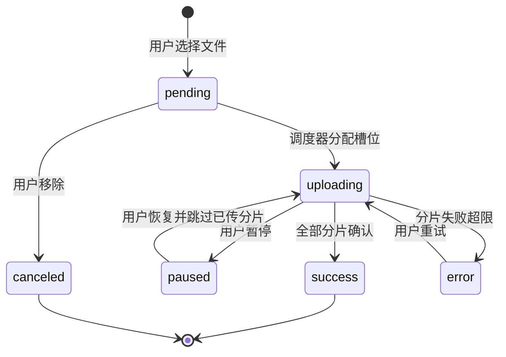

```tsx
// upload-queue.ts —— 并发限制 + 分片断点续传的上传队列
type FileState = 'pending' | 'uploading' | 'paused' | 'success' | 'error' | 'canceled';

type Task = {
  file: File;
  id: string;
  state: FileState;
  uploadedParts: Set<number>;   // 已确认分片，断点续传的依据
  controller?: AbortController; // 暂停/取消的实现载体
};

const CHUNK_SIZE = 5 * 1024 * 1024;
const MAX_CONCURRENT = 3;

export class UploadQueue {
  private tasks = new Map<string, Task>();
  private listeners = new Set<() => void>();   // 供 useSyncExternalStore 订阅

  subscribe = (cb: () => void) => {
    this.listeners.add(cb);
    return () => this.listeners.delete(cb);
  };
  getSnapshot = () => [...this.tasks.values()].map(t => ({ ...t, uploadedParts: [...t.uploadedParts].length }));

  add(file: File) {
    const id = crypto.randomUUID();
    this.tasks.set(id, { file, id, state: 'pending', uploadedParts: new Set() });
    this.emit();
    this.pump(); // 尝试填满并发槽位
    return id;
  }

  pause(id: string) {
    const t = this.tasks.get(id);
    if (t?.state === 'uploading') {
      t.controller?.abort();        // 中止在途分片，已确认分片保留
      t.state = 'paused';
      this.emit();
      this.pump();
    }
  }

  resume(id: string) {
    const t = this.tasks.get(id);
    if (t?.state === 'paused' || t?.state === 'error') {
      t.state = 'pending';
      this.emit();
      this.pump();                  // 恢复时从 uploadedParts 之后继续
    }
  }

  private pump() { // 并发调度：有空槽就启动 pending 任务
    const running = [...this.tasks.values()].filter(t => t.state === 'uploading').length;
    const slots = MAX_CONCURRENT - running;
    [...this.tasks.values()]
      .filter(t => t.state === 'pending')
      .slice(0, slots)
      .forEach(t => this.run(t));
  }

  private async run(t: Task) {
    t.state = 'uploading';
    t.controller = new AbortController();
    this.emit();

    const total = Math.ceil(t.file.size / CHUNK_SIZE);
    // 先问服务端已收到哪些分片 —— 断点续传的关键
    const acked: number[] = await fetch(`/api/upload/${t.id}/status`).then(r => r.json());
    acked.forEach(n => t.uploadedParts.add(n));

    try {
      for (let i = 0; i < total; i++) {
        if (t.uploadedParts.has(i)) continue;               // 跳过已传
        const chunk = t.file.slice(i * CHUNK_SIZE, (i + 1) * CHUNK_SIZE);
        const res = await fetch(`/api/upload/${t.id}/part`, {
          method: 'POST',
          body: chunk,
          signal: t.controller.signal,                      // 暂停即 abort
          headers: { 'X-Part-Number': String(i) },
        });
        if (!res.ok) throw new Error(`part ${i} failed`);
        t.uploadedParts.add(i);
        this.emit();                                        // 驱动进度条
      }
      await fetch(`/api/upload/${t.id}/complete`, { method: 'POST' });
      t.state = 'success';
    } catch (e) {
      t.state = (e as Error).name === 'AbortError' ? 'paused' : 'error';
    }
    this.emit();
    this.pump();
  }

  private emit() { this.listeners.forEach(l => l()); }
}

// useUploadQueue.ts —— React 侧：external store 接入
import { useSyncExternalStore } from 'react';
export function useUploadQueue(queue: UploadQueue) {
  return useSyncExternalStore(queue.subscribe, queue.getSnapshot, queue.getSnapshot);
}
```

## 第二十二章 大型项目架构（R19-151 ~ R19-157）

### R19-151：React 中大型项目的分层架构完整方案是什么？features 分层与依赖方向怎么约束？
**答**：
- 推荐结构：`app`（组装/路由/provider）-> `pages`（页面编排）-> `features`（业务用例）-> `entities`（领域模型+api+组件）-> `shared`（ui/utils/request），即 FSD（Feature-Sliced Design）的 React 落地。
- 依赖方向铁律：**只能向下依赖**，`shared` 不 import 任何上层；同层之间不互相 import，跨 feature 复用下沉到 entities/shared。
- 每个 slice 内部再分层：`api / model（store+types）/ ui / index.ts（公共出口）`，外部只能走 index.ts，内部实现不外泄。
- 约束工具化：eslint-plugin-boundaries / import-x 规则禁越层引用，CI 拦截，规范才不会腐烂。

```javascript
// 依赖方向约束 —— eslint 配置 + 目录结构说明
// 目录结构：
// src/
//   app/            # Provider 组装、全局路由、全局样式
//   pages/          # 页面级编排：组合 features，不含业务逻辑
//   features/
//     order-create/ # 一个业务用例一个 slice
//       api/        # 该用例的请求
//       model/      # store / types / 转换函数
//       ui/         # 组件
//       index.ts    # 唯一出口
//   entities/
//     order/        # 领域对象：类型 + api + 展示组件
//   shared/
//     ui/ request/ hooks/ config/

// .eslintrc.cjs —— 用 import 规则把依赖方向变成机器可查
module.exports = {
  overrides: [
    {
      files: ['src/shared/**/*.{ts,tsx}'],
      rules: {
        // shared 是最底层：禁止引用任何上层 slice
        'no-restricted-imports': ['error', {
          patterns: ['@/app/*', '@/pages/*', '@/features/*', '@/entities/*'],
        }],
      },
    },
    {
      files: ['src/features/**/*.{ts,tsx}'],
      rules: {
        // features 只能依赖 entities 和 shared，不能横向 import 其他 feature
        'no-restricted-imports': ['error', {
          patterns: [{
            group: ['@/features/*'],
            message: '跨 feature 复用请下沉到 entities 或 shared',
          }, {
            group: ['@/pages/*', '@/app/*'],
            message: 'features 不能反向依赖页面层',
          }],
        }],
      },
    },
  ],
};

// features/order-create/index.ts —— 唯一出口，控制外泄面
export { OrderCreateForm } from './ui/order-create-form';
export type { OrderCreatePayload } from './model/types';
// 注意：不导出内部 store 与 api，页面层只按出口引用
```

### R19-152：React 项目的路由如何组织？嵌套布局、懒加载与路由守卫封装怎么做？
**答**：
- 路由按"布局"组织：`<Route element={<Layout/>}>` 下挂 children，Outlet 承接子渲染；鉴权布局、公开布局、错误页都是不同布局节点。
- 懒加载统一 `lazy()` + Suspense，路由级 chunk 天然分割；顶层包一个全局 Suspense/错误边界兜底。
- 守卫封装成 `<RequireAuth>` 布局组件：校验 -> 通过渲染 Outlet，不通过 Navigate 重定向，并记录来源 path 供登录后回跳。
- 数据守卫用 loader（react-router 6.4+）在进入路由前拉数据，把"能否进入"的判断从渲染期前移。

```tsx
// router.tsx —— 嵌套布局 + 懒加载 + 守卫
import {
  createBrowserRouter, RouterProvider, Outlet, Navigate,
  useLocation, Link,
} from 'react-router-dom';
import { lazy, Suspense, type ReactNode } from 'react';

const Dashboard = lazy(() => import('./pages/dashboard'));
const Users = lazy(() => import('./pages/users'));
const Login = lazy(() => import('./pages/login'));

function PageSuspense({ children }: { children: ReactNode }) {
  return <Suspense fallback={<div>页面加载中...</div>}>{children}</Suspense>;
}

function AppLayout() {
  return (
    <div className="app-shell">
      <aside>导航</aside>
      <main><Outlet /></main> {/* 子路由渲染点 */}
    </div>
  );
}

// 守卫组件：包在需要鉴权的布局外层
function RequireAuth({ children }: { children: ReactNode }) {
  const token = localStorage.getItem('token'); // 实际项目从 auth store 读
  const location = useLocation();
  if (!token) {
    return <Navigate to="/login" replace state={{ from: location.pathname }} />;
  }
  return children;
}

export const router = createBrowserRouter([
  { path: '/login', element: <PageSuspense><Login /></PageSuspense> },
  {
    path: '/',
    element: (
      <RequireAuth>
        <AppLayout />
      </RequireAuth>
    ),
    errorElement: <div>404 或渲染错误兜底 <Link to="/">回首页</Link></div>,
    children: [
      { index: true, element: <PageSuspense><Dashboard /></PageSuspense> },
      { path: 'users', element: <PageSuspense><Users /></PageSuspense> },
    ],
  },
]);

export function App() {
  return <RouterProvider router={router} />;
}
```

### R19-153：完整的权限系统怎么实现？路由权限、按钮权限、接口权限三层如何打通？
**答**：
- 三层各管一段：**路由层**决定"能不能进这个页面"（守卫 + 动态路由表）、**按钮层**决定"能不能点这个按钮"（usePermission + `<AuthButton>` 或直接条件渲染）、**接口层**是最后防线（前端拦 401/403，服务端真正鉴权）。
- 数据源统一：登录后拉取 permissions 集合（如 `['order:view', 'order:ship']`）存 store，三层都读同一份，保证一致。
- 路由表按 code 过滤生成，动态 addRoutes；菜单即路由表的投影，不会出现两份配置。
- 无权限的体验分层设计：页面级 403 页、按钮级隐藏或置灰、接口级统一拦截上报。

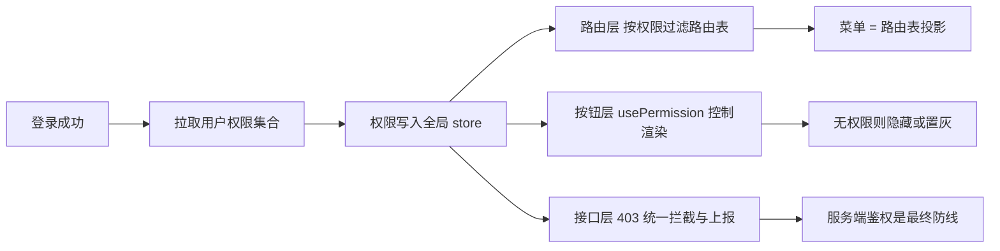

```tsx
// permission.tsx —— 三层权限体系
import { create } from 'zustand';
import { Navigate, Outlet, useLocation } from 'react-router-dom';

// 1. 权限源：单一事实来源
type AuthState = {
  perms: Set<string>;
  setPerms: (list: string[]) => void;
  has: (code: string) => boolean;
};
export const useAuth = create<AuthState>((set, get) => ({
  perms: new Set(),
  setPerms: list => set({ perms: new Set(list) }),
  has: code => get().perms.has(code),
}));

// 2. 路由层：按权限过滤路由表
type RouteDef = { path: string; element: React.ReactNode; code?: string; children?: RouteDef[] };

export function filterRoutes(routes: RouteDef[]): RouteDef[] {
  const { has } = useAuth.getState();
  return routes
    .filter(r => !r.code || has(r.code))
    .map(r => (r.children ? { ...r, children: filterRoutes(r.children) } : r));
}

export function RequirePerm({ code, children }: { code: string; children: React.ReactNode }) {
  const has = useAuth(s => s.has(code));
  const location = useLocation();
  if (!has(code)) {
    return <Navigate to="/403" replace state={{ from: location.pathname }} />;
  }
  return children;
}

// 3. 按钮层：权限组件 + hook 两种形态
export function AuthButton({ code, children, fallback = null }: {
  code: string; children: React.ReactNode; fallback?: React.ReactNode;
}) {
  const has = useAuth(s => s.has(code));
  return <>{has ? children : fallback}</>;
}
export function usePermission(code: string) {
  return useAuth(s => s.has(code));
}

// 使用示例
function OrderTable() {
  const canShip = usePermission('order:ship');
  return (
    <div>
      {/* 页面级守卫由路由层处理；这里只管操作列 */}
      <AuthButton code="order:ship" fallback={<span className="text-gray-400">无发货权限</span>}>
        <button>发货</button>
      </AuthButton>
      {canShip && <button>批量发货</button>}
    </div>
  );
}

// 4. 接口层：http 拦截器里统一处理 403（服务端始终是最终防线）
// http.ts: if (res.status === 403) reportAndToast('权限不足') ...
```

### R19-154：React 项目如何实现完整的多主题（换肤）方案？
**答**：
- 主流方案是 **CSS 变量 + data-theme 属性**：`:root` 定义亮色变量，`[data-theme="dark"]` 覆盖暗色，换肤只是切一个属性，零重渲染。
- React 侧封装 `ThemeProvider` + `useTheme`：管理当前主题、写 localStorage、同步 `document.documentElement.dataset.theme`。
- 扩展性：品牌色用 `--brand` 语义变量，组件只消费语义变量；跟随系统的暗色用 `matchMedia('(prefers-color-scheme: dark)')` 做默认值。
- 首屏防闪白：主题读取放在入口同步执行（或内联脚本），SSR 下把 data-theme 渲染在服务端。

```tsx
// theme.tsx —— CSS 变量多主题方案
import { createContext, useContext, useEffect, useState, type ReactNode } from 'react';

type Theme = 'light' | 'dark';
const ThemeCtx = createContext<{ theme: Theme; toggle: () => void }>({ theme: 'light', toggle: () => {} });

function getInitialTheme(): Theme {
  const saved = localStorage.getItem('theme') as Theme | null;
  if (saved) return saved;
  return matchMedia('(prefers-color-scheme: dark)').matches ? 'dark' : 'light';
}

export function ThemeProvider({ children }: { children: ReactNode }) {
  const [theme, setTheme] = useState<Theme>(getInitialTheme);

  useEffect(() => {
    // 换肤 = 换一个 HTML 属性，全部样式由 CSS 变量级联，React 不参与渲染
    document.documentElement.dataset.theme = theme;
    localStorage.setItem('theme', theme);
  }, [theme]);

  return (
    <ThemeCtx.Provider value={{ theme, toggle: () => setTheme(t => (t === 'light' ? 'dark' : 'light')) }}>
      {children}
    </ThemeCtx.Provider>
  );
}

export const useTheme = () => useContext(ThemeCtx);

/* styles/theme.css —— 语义变量 + 两套取值
:root {
  --brand: #2563eb;
  --bg: #ffffff;
  --text: #111827;
  --card: #f3f4f6;
}
[data-theme="dark"] {
  --brand: #60a5fa;
  --bg: #0f172a;
  --text: #e5e7eb;
  --card: #1e293b;
}
.card { background: var(--card); color: var(--text); }
*/

// ThemeSwitch.tsx —— 使用侧
export function ThemeSwitch() {
  const { theme, toggle } = useTheme();
  return <button onClick={toggle}>{theme === 'light' ? '🌙' : '☀️'}</button>;
}

// 防闪白：index.html 内联脚本在 CSS 加载前同步设置主题
// <script>
//   document.documentElement.dataset.theme =
//     localStorage.theme || (matchMedia('(prefers-color-scheme: dark)').matches ? 'dark' : 'light');
// </script>
```

### R19-155：国际化完整方案怎么搭？react-i18next 的懒加载、命名空间与回退如何设计？
**答**：
- 分包：按 namespace 拆语言包（common/订单/用户），`loadPath` 按需加载，只打默认语言的公共包，其余 chunk 懒加载。
- 回退链：语言回退 `zh-CN -> zh -> en`，key 缺失回 fallbackLng，并在开发期显示 key 本身便于排查。
- 插值/复数/日期本地化：i18next 插值 `{{count}}` + 复数后缀 `_one/_other`，日期金额交给 Intl.DateTimeFormat/NumberFormat。
- 切换语言 = `i18n.changeLanguage(lng)`，配合后端接口语言头与 URL（如 /en/...）保证 SSR 与 SEO 一致。

```tsx
// i18n.ts —— react-i18next 完整配置
import i18n from 'i18next';
import { initReactI18next } from 'react-i18next';
import HttpBackend from 'i18next-http-backend';
import LanguageDetector from 'i18next-browser-languagedetector';

i18n
  .use(LanguageDetector)          // 检测顺序：localStorage -> navigator -> html lang
  .use(HttpBackend)               // 语言包按 namespace 懒加载
  .use(initReactI18next)
  .init({
    fallbackLng: 'en',            // 终极回退
    supportedLngs: ['zh-CN', 'zh', 'en'],
    nonExplicitSupportedLngs: true, // zh-TW/zh-HK 自动归到 zh
    load: 'languageOnly',
    ns: ['common'],               // 只预载公共包
    defaultNS: 'common',
    backend: {
      // 懒加载：/locales/{lng}/{ns}.json，切到订单页才拉 orders.json
      loadPath: '/locales/{{lng}}/{{ns}}.json',
    },
    interpolation: { escapeValue: false }, // React 已防 XSS
    returnEmptyString: false,
    saveMissing: true,            // 开发期上报缺失 key
    missingKeyHandler: (lngs, ns, key) => {
      if (import.meta.env.DEV) console.warn(`missing: ${ns}:${key} in ${lngs}`);
    },
  });

export default i18n;

// OrderPage.tsx —— 使用侧：懒加载命名空间 + 插值 + 复数
import { useTranslation } from 'react-i18next';

export function OrderPage() {
  const { t, i18n } = useTranslation(['orders', 'common']); // 组件声明用到的 ns，触发按需加载
  return (
    <div>
      <h1>{t('orders:title')}</h1>
      {/* 插值 */}
      <p>{t('orders:total', { count: 3 })}</p>
      {/* 复数：en 里 orders:items_one / orders:items_other */}
      <p>{t('orders:items', { count: 3 })}</p>
      {/* 金额与日期交给 Intl，语言跟随 i18n */}
      <p>{new Intl.NumberFormat(i18n.language, { style: 'currency', currency: 'USD' }).format(99.5)}</p>
      <button onClick={() => i18n.changeLanguage(i18n.language === 'zh' ? 'en' : 'zh')}>
        {t('common:switchLang')}
      </button>
    </div>
  );
}
```

### R19-156：React 应用的错误处理体系如何设计？ErrorBoundary 分层、全局兜底与上报如何组织？
**答**：
- 分层思想：**局部边界**（可恢复的子树：卡片、表格区块）包在最易出错处，错误降级为局部占位；**路由级边界**兜住整页；**根边界**兜住所有未捕获并渲染全站错误页。
- 渲染外错误边界补位：事件处理器/异步回调的错误用 `window.onerror` + `unhandledrejection` 捕获；render 越界错误是边界专门管辖。
- 上报统一收口：一个 `reportError` 工具聚合（Sentry 类 SDK / 自建），携带组件栈、用户路径、release 版本；边界与全局监听都只调它。
- 重试能力：边界暴露 reset（key 变化或手动重置），让"重试"成为一等交互而不是刷新页面。

```tsx
// error-system.tsx —— 分层错误处理体系
import { Component, type ErrorInfo, type ReactNode } from 'react';
import { useRouteError } from 'react-router-dom';

// 统一上报收口：所有错误只走这一条路
export function reportError(error: Error, context: Record<string, unknown> = {}) {
  // Sentry.captureException(error, { extra: context }) 或自建上报
  fetch('/api/log/error', {
    method: 'POST',
    headers: { 'Content-Type': 'application/json' },
    body: JSON.stringify({
      message: error.message,
      stack: error.stack,
      componentStack: context.componentStack,
      path: location.pathname,
      release: import.meta.env.VITE_RELEASE,
    }),
  }).catch(() => {});
}

// 可复用边界：支持自定义降级与重试
export class ErrorBoundary extends Component<{
  fallback: (info: { error: Error; reset: () => void }) => ReactNode;
  onError?: (e: Error) => void;
  children: ReactNode;
}, { error: Error | null }> {
  state = { error: null as Error | null };

  static getDerivedStateFromError(error: Error) {
    return { error };
  }
  componentDidCatch(error: Error, info: ErrorInfo) {
    reportError(error, { componentStack: info.componentStack });
    this.props.onError?.(error);
  }
  reset = () => this.setState({ error: null });

  render() {
    return this.state.error
      ? this.props.fallback({ error: this.state.error, reset: this.reset })
      : this.props.children;
  }
}

// 局部边界：图表卡片崩了不影响整页
function ChartCard() {
  return (
    <ErrorBoundary
      fallback={({ reset }) => (
        <div>图表加载失败 <button onClick={reset}>重试</button></div>
      )}
    >
      <HeavyChart />
    </ErrorBoundary>
  );
}

// 路由级兜底：react-router 的 errorElement
export function RouteErrorPage() {
  const error = useRouteError() as Error;
  return (
    <div>
      <h1>页面出错了</h1>
      <p>{error?.message}</p>
      <button onClick={() => location.assign('/')}>回首页</button>
    </div>
  );
}

// 入口：渲染外错误的最后防线
export function setupGlobalHandlers() {
  window.addEventListener('error', e => reportError(e.error ?? new Error(e.message)));
  window.addEventListener('unhandledrejection', e => reportError(new Error(String(e.reason))));
}
```

### R19-157：Monorepo 中 React 应用与共享包如何组织？
**答**：
- 结构：pnpm workspace + `apps/*`（站点）+ `packages/*`（ui、hooks、api-client、config），共享包用 TS 源码或构建产物两种模式。
- 引用方式：内部包走 workspace 协议 `"@acme/ui": "workspace:*"`；共享包变更用 changesets 管理版本（对外发包）或 fixed 模式（仅内部使用，跟随 app 发版）。
- 构建策略：配置包（eslint/tsconfig）直接被继承；UI 包推荐 `tsc + vite lib mode` 产出 ESM + d.ts，Turbo 缓存并行构建。
- 关键坑：React 单实例（peerDependencies 声明 + app 提供）、HMR 跨包失效（UI 包出源码模式或配 optimizeDeps 排除）。

```yaml
# pnpm-workspace.yaml
packages:
  - 'apps/*'
  - 'packages/*'
```

```json
// packages/ui/package.json —— 共享组件包的关键声明
{
  "name": "@acme/ui",
  "version": "0.1.0",
  "type": "module",
  "exports": {
    ".": { "types": "./dist/index.d.ts", "import": "./dist/index.js" },
    "./styles.css": "./dist/styles.css"
  },
  "files": ["dist"],
  "scripts": { "build": "vite build && tsc --emitDeclarationOnly" },
  "peerDependencies": {
    "react": "^19.0.0",
    "react-dom": "^19.0.0"
  },
  "devDependencies": {
    "react": "^19.0.0"
  }
}
```

```json
// apps/web/package.json —— 应用侧消费
{
  "name": "@acme/web",
  "dependencies": {
    "@acme/ui": "workspace:*",      // workspace 协议：本地链接，改包即时生效
    "@acme/hooks": "workspace:*",
    "react": "^19.0.0"              // React 由 app 唯一提供，杜绝双实例
  }
}
```

```javascript
// turbo.json —— 任务编排与缓存
{
  "tasks": {
    "build": {
      "dependsOn": ["^build"],   // 先构建依赖的包
      "outputs": ["dist/**"]
    },
    "lint": {},
    "test": { "dependsOn": ["^build"] }
  }
}
// 常用命令：
// pnpm -F @acme/ui build      单包构建
// pnpm -r --filter ./apps/web dev  启动应用（UI 包走源码或 watch 构建保证 HMR）
// npx changeset               管理共享包版本与 CHANGELOG
```

## 第二十三章 状态库实现（R19-158 ~ R19-162）

### R19-158：手写一个 zustand mini（create + selector + 浅比较）？
**答**：
- 内核极简：模块级 store 保存 state，setState 做 `Object.assign` 浅合并后通知订阅者。
- React 接入用 `useSyncExternalStore`：getSnapshot 返回 state，selector 切片 + `useRef` 缓存上次结果做**浅比较**，切片没变就不触发重渲染。
- 这就是 zustand "精确订阅"的本质：组件只关心自己 selector 出来的那一小片。
- 50 行以内可完整覆盖：create、set、get、subscribe、useStore(selector)。

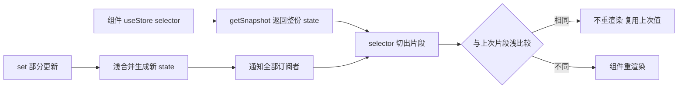

```javascript
// zustand-mini.js —— 手写 zustand 核心（含 React 绑定）
import { useSyncExternalStore, useRef, useCallback } from 'react';

export function create(createState) {
  let state;
  const listeners = new Set();

  const setState = (partial) => {
    const next = typeof partial === 'function' ? partial(state) : partial;
    if (next !== state) {                       // 引用相同直接跳过
      state = { ...state, ...next };            // 浅合并（zustand 默认行为）
      listeners.forEach(l => l());
    }
  };

  const getState = () => state;
  const subscribe = (listener) => {
    listeners.add(listener);
    return () => listeners.delete(listener);
  };

  const api = { setState, getState, subscribe };

  // 初始化：支持 (set, get) => ({...}) 的 zustand 惯用形态
  state = createState(setState, getState);

  // React hook：selector 切片 + 浅比较
  function useStore(selector = s => s) {
    const lastSliceRef = useRef(null);

    // getSnapshot 恒返回整份 state —— useSyncExternalStore 需要缓存安全的快照
    const slice = useSyncExternalStore(
      subscribe,
      getState,
      getState,
    );
    const selected = selector(slice);

    // 浅比较缓存：切片引用没变，返回旧值让 React 跳过渲染
    const memoizedRef = useRef({ hasInit: false, value: undefined });
    if (
      !memoizedRef.current.hasInit ||
      !shallowEqual(memoizedRef.current.value, selected)
    ) {
      memoizedRef.current = { hasInit: true, value: selected };
    }
    return memoizedRef.current.value;
  }

  return { useStore, ...api };
}

function shallowEqual(a, b) {
  if (Object.is(a, b)) return true;
  if (typeof a !== 'object' || a === null || typeof b !== 'object' || b === null) return false;
  const ka = Object.keys(a), kb = Object.keys(b);
  if (ka.length !== kb.length) return false;
  return ka.every(k => Object.is(a[k], b[k]));
}

// ---- 使用：与 zustand 几乎同构 ----
const useCounter = create((set, get) => ({
  count: 0,
  user: { name: 'w' },
  inc: () => set(s => ({ count: s.count + 1 })),
}));

function CountDisplay() {
  const count = useCounter.useStore(s => s.count); // 只有 count 变才重渲染
  return <span>{count}</span>;
}
function UserDisplay() {
  const name = useCounter.useStore(s => s.user.name); // count 变化不影响
  return <span>{name}</span>;
}
```

### R19-159：如何用 useSyncExternalStore 接入一个 external store？注意事项有哪些？
**答**：
- 签名：`useSyncExternalStore(subscribe, getSnapshot, getServerSnapshot?)`，React 18 为非 React 状态源（localStorage、WebSocket、第三方 store）提供的官方桥。
- 三条契约：getSnapshot 必须**缓存稳定**（内容不变返回同一引用，否则无限循环）；subscribe 返回取消函数；数据变化后必须先更新 store 再通知订阅（快照一致性）。
- getServerSnapshot 用于 SSR：服务端返回初始快照，避免 hydration mismatch。
- 与 useEffect+setState 手动桥相比：官方 API 天然处理 tearing（并发下所有组件读到同一快照），不要自己造轮子。

```tsx
// use-broadcast-store.ts —— useSyncExternalStore 完整接入示例
import { useSyncExternalStore, useCallback } from 'react';

// external store：与 React 完全无关的模块级状态
type CartState = { items: { id: string; qty: number }[] };
let cart: CartState = { items: [] };
const cartListeners = new Set<() => void>();

function emitCart() {                       // 约定：先改数据，再通知
  cartListeners.forEach(l => l());
}

export const cartStore = {
  add(id: string) {
    cart = {
      items: [...cart.items, { id, qty: 1 }], // 不可变更新，生成新引用
    };
    emitCart();
  },
  subscribe(listener: () => void) {
    cartListeners.add(listener);
    // 同步其他标签页：跨 tab 共享这份 external store
    window.addEventListener('storage', listener);
    return () => {
      cartListeners.delete(listener);
      window.removeEventListener('storage', listener);
    };
  },
  getSnapshot(): CartState {
    return cart;                              // 内容不变 -> 同一引用，契约满足
  },
  getServerSnapshot(): CartState {            // SSR 稳定初始值
    return { items: [] };
  },
};

// React 绑定：唯一合法的桥
export function useCart() {
  const cart = useSyncExternalStore(
    cartStore.subscribe,
    cartStore.getSnapshot,
    cartStore.getServerSnapshot,
  );
  const add = useCallback((id: string) => cartStore.add(id), []);
  return { cart, add };
}

// CartBadge.tsx
export function CartBadge() {
  const { cart } = useCart();
  return <span>购物车 {cart.items.length} 件</span>;
}

// 常见踩坑：
// 1) getSnapshot 里每次 return {...cart} 新对象 -> 触发 "getSnapshot should be cached" 无限重渲染
// 2) 订阅回调里先通知再改数据 -> React 读到的还是旧快照，出现 tearing
// 3) 忘记 getServerSnapshot -> SSR 与客户端首屏渲染结果不一致
```

### R19-160：手写 Redux 核心：createStore、dispatch、subscribe、applyMiddleware？
**答**：
- createStore：闭包保存 currentState + listeners；dispatch 先跑 reducer 再通知；getState 返回当前引用。
- applyMiddleware 本质是 **dispatch 的装饰**：把 `({ getState, dispatch })` 注入中间件，链式包装出增强版 dispatch，形成 `action -> mw1 -> mw2 -> reducer` 的洋葱管道。
- 中间件约定 `store => next => action => result`，thunk 中间件就是"action 是函数就传 dispatch 给它"。
- 面试手写重点：reducer 纯函数、订阅通知在 reducer 之后、middleware 组合顺序（从右向左 compose）。

```javascript
// redux-mini.js —— 手写 Redux 核心
export function createStore(reducer, preloadedState, enhancer) {
  if (enhancer) return enhancer(createStore)(reducer, preloadedState);

  let currentState = preloadedState;
  let listeners = [];
  let isDispatching = false; // 防 reducer 内再 dispatch，保证纯函数

  function getState() {
    return currentState;
  }

  function dispatch(action) {
    if (isDispatching) throw new Error('Reducers may not dispatch actions.');
    isDispatching = true;
    try {
      currentState = reducer(currentState, action); // 纯函数收敛新 state
    } finally {
      isDispatching = false;
    }
    listeners.slice().forEach(l => l());            // 先改 state 再通知
    return action;
  }

  function subscribe(listener) {
    listeners.push(listener);
    return () => { listeners = listeners.filter(l => l !== listener); };
  }

  dispatch({ type: '@@redux/INIT' }); // 播种初始 state
  return { getState, dispatch, subscribe };
}

export function compose(...fns) {
  return fns.reduce((a, b) => (...args) => a(b(...args)));
}

export function applyMiddleware(...middlewares) {
  return (createStoreFn) => (reducer, preloadedState) => {
    const store = createStoreFn(reducer, preloadedState);
    let dispatch = store.dispatch;

    const middlewareAPI = {
      getState: store.getState,
      dispatch: (action) => dispatch(action), // 惰性引用，指向增强后的 dispatch
    };

    // 注入 middlewareAPI，得到 next => action => result 链
    const chain = middlewares.map(mw => mw(middlewareAPI));
    dispatch = compose(...chain)(store.dispatch); // 组合：mw1 包 mw2 包原始 dispatch
    return { ...store, dispatch };
  };
}

// ---- 内置一个 redux-thunk 验证 ----
const thunk = ({ getState, dispatch }) => next => action => {
  if (typeof action === 'function') {
    return action(dispatch, getState); // 异步 action：把 dispatch 交给业务
  }
  return next(action);
};

const counterReducer = (state = { count: 0 }, action) =>
  action.type === 'inc' ? { count: state.count + 1 } : state;

const store = createStore(counterReducer, undefined, applyMiddleware(thunk));
store.subscribe(() => console.log('state:', store.getState()));

store.dispatch({ type: 'inc' });
store.dispatch(async (dispatch) => {       // thunk 异步流程
  await Promise.resolve();
  dispatch({ type: 'inc' });
});
```

### R19-161：手写一个 jotai mini：原子状态与派生原子如何实现？
**答**：
- atom 就是"带 key 的状态单元"：`{ init, read, write }`；primitive atom 的 read 是 `get => get(self)`，derived atom 的 read 可以依赖其他 atom。
- 派生实现：read 函数里 `get(otherAtom)` 时登记依赖，被依赖 atom 更新时通知依赖它的 atom 一起失效。
- 写入：write(get, set, update)，`set` 既可写 primitive 也可触发 derived 的重算。
- 与 zustand 的差异一句话：atom 是**图**（任意组合派生），store 是**树**（整体 state 切片）。

```javascript
// jotai-mini.js —— 手写原子状态 + 派生
import { useSyncExternalStore } from 'react';

const atomRegistry = new Map();     // atom -> { value, listeners, deps }

function getNode(atom) {
  if (!atomRegistry.has(atom)) {
    atomRegistry.set(atom, {
      value: undefined,
      initialized: false,
      listeners: new Set(),
      dependents: new Set(),        // 依赖本 atom 的其他 atom（用于级联失效）
    });
  }
  return atomRegistry.get(atom);
}

export function atom(read, write) {
  if (typeof read === 'function') {
    return { read, write };                        // derived atom
  }
  const a = {
    init: read,
    read: get => get(a),                           // primitive：读自己
    write: (get, set, update) =>
      set(a, typeof update === 'function' ? update(get(a)) : update),
  };
  return a;
}

function readAtom(atom) {
  const node = getNode(atom);
  const get = (dep) => {
    if (dep === atom) {                            // 读自己：返回缓存
      if (!node.initialized) {
        node.value = atom.init;
        node.initialized = true;
      }
      return node.value;
    }
    getNode(dep).dependents.add(atom);             // 读别人：登记依赖关系
    return readAtom(dep);
  };
  return atom.read(get);
}

export function useAtomValue(atom) {
  const node = getNode(atom);
  return useSyncExternalStore(
    cb => { node.listeners.add(cb); return () => node.listeners.delete(cb); },
    () => {                                        // 快照：派生链实时求值
      const v = readAtom(atom);
      return typeof v === 'object' ? v : v;        // 值类型天然稳定
    },
    () => node.initialized ? node.value : atom.init,
  );
}

export function useSetAtom(atom) {
  return (update) => {
    const get = (dep) => readAtom(dep);
    const set = (target, value) => {
      const n = getNode(target);
      n.value = value;
      n.initialized = true;
      n.listeners.forEach(l => l());               // 通知订阅组件
      // 级联：让依赖它的 derived atom 的订阅者也刷新
      n.dependents.forEach(d => get(d) && getNode(d).listeners.forEach(l => l()));
    };
    atom.write(get, set, update);
  };
}

// ---- 使用 ----
// const countAtom = atom(0);
// const doubleAtom = atom(get => get(countAtom) * 2);   // 派生
// const [count] = useAtomValue(countAtom);
// const [double] = useAtomValue(doubleAtom);            // count 变 -> double 自动重算
// const setCount = useSetAtom(countAtom);
```

### R19-162：状态库怎么选？给一个按场景收束的决策树。
**答**：
- 先分类再选型：**服务端状态**（TanStack Query/RTK Query 专管，别塞进 client store）、**URL 状态**（路由参数）、**全局 client 状态**（zustand/jotai/redux）、**局部 UI 状态**（useState/useReducer）。
- 决策主轴：状态被谁消费？跨页面共享且写操作复杂 -> zustand（或 redux 大团队强规范）；大量派生计算 -> jotai；表单草稿类 -> 就地 useState。
- 团队维度：大团队需要强约束与中间件生态 -> Redux Toolkit；中小团队追求开发效率 -> zustand/jotai。
- 反模式警示：把服务端数据镜像进 zustand（双份事实来源）、全站一个巨型 Context。

```jsx
// state-decision.jsx —— 选型决策落地示例：同一业务四种状态各归其位
import { useState } from 'react';
import { create } from 'zustand';
import { useQuery } from '@tanstack/react-query';
import { useSearchParams } from 'react-router-dom';

// 1. 服务端状态 -> TanStack Query（缓存、重试、失效都是它的职责）
function useOrders(userId) {
  return useQuery({
    queryKey: ['orders', userId],
    queryFn: () => fetch(`/api/orders?uid=${userId}`).then(r => r.json()),
  });
}

// 2. 全局 client 状态 -> zustand（跨页共享、小而稳定）
const useCartStore = create(set => ({
  items: [],
  add: item => set(s => ({ items: [...s.items, item] })),
}));

// 3. URL 状态 -> 路由参数（可分享、可回退）
function useProductFilter() {
  const [sp, setSp] = useSearchParams();
  return {
    category: sp.get('cat') ?? 'all',
    setCategory: v => setSp({ cat: v }),
  };
}

// 4. 局部 UI 状态 -> useState（不外泄，不进全局）
function CouponInput() {
  const [draft, setDraft] = useState('');   // 输入草稿留在组件内
  return <input value={draft} onChange={e => setDraft(e.target.value)} />;
}

// 决策树（文字版）：
// 状态来自服务端？           -> TanStack Query
// 状态需要在 URL 体现？      -> 路由参数
// 只在组件/子树内使用？      -> useState / useReducer
// 跨页面共享？
//   ├─ 需要复杂派生/细粒度？ -> jotai
//   ├─ 中等复杂度、快上手？  -> zustand
//   └─ 超大团队、需要时间旅行与严格规范？ -> Redux Toolkit
// 永远不要：把 query 的数据 copy 进 zustand —— 那会制造两份事实来源
```

## 第二十四章 测试与质量工程（R19-163 ~ R19-167）

### R19-163：组件测试的完整模式是什么？查询、用户事件与模块 mock 如何组合？
**答**：
- 模板四步：**render** -> **act/查询** -> **userEvent 交互** -> **断言角色与文本**；查询优先按可访问性（getByRole > getByLabelText > getByText），避免测实现细节。
- 异步与副作用：await findBy* / waitFor 处理异步；timers 用 `vi.useFakeTimers()` + `act(() => vi.advanceTimersByTime())`。
- mock 分层：网络层 mock 给 MSW（更接近真实），第三方模块（如 Date、图标库）用 `vi.mock`；只 mock 边界，不 mock 被测对象内部。
- 断言语义而非 DOM 结构：测试"用户看到什么、能做什么"，重构成测试稳定性的前提。

```tsx
// UserSearch.test.tsx —— 组件测试完整模式
import { render, screen, waitFor } from '@testing-library/react';
import userEvent from '@testing-library/user-event';
import { vi, describe, it, expect } from 'vitest';
import { QueryClient, QueryClientProvider } from '@tanstack/react-query';
import { UserSearch } from './user-search';

// mock 模块层：时间不可控的第三方
vi.mock('./analytics', () => ({ trackSearch: vi.fn() }));

function renderWithProviders(ui: React.ReactElement) {
  const qc = new QueryClient({ defaultOptions: { queries: { retry: false } } });
  return render(<QueryClientProvider client={qc}>{ui}</QueryClientProvider>);
}

describe('UserSearch', () => {
  it('输入关键字后展示匹配的用户列表', async () => {
    const user = userEvent.setup();               // 真实事件序列：keydown/input/change
    renderWithProviders(<UserSearch />);

    await user.type(screen.getByRole('searchbox'), 'wang');

    // findBy 系列自动 waitFor：等异步数据到达
    expect(await screen.findByRole('list')).toBeInTheDocument();
    expect(screen.getAllByRole('listitem')).toHaveLength(2);
    expect(screen.getByText('Wang Lei')).toBeInTheDocument();
  });

  it('无结果时展示空状态', async () => {
    const user = userEvent.setup();
    renderWithProviders(<UserSearch />);

    await user.type(screen.getByRole('searchbox'), '不存在的名字');

    expect(await screen.findByText('没有找到用户')).toBeInTheDocument();
  });

  it('请求失败时展示错误并可重试', async () => {
    const user = userEvent.setup();
    vi.spyOn(global, 'fetch').mockRejectedValueOnce(new Error('network')); // 边界 mock
    renderWithProviders(<UserSearch />);

    expect(await screen.findByRole('alert')).toHaveTextContent('加载失败');

    await user.click(screen.getByRole('button', { name: '重试' }));
    expect(await screen.findByRole('list')).toBeInTheDocument();
  });
});
// 要点回顾：
// - getByRole 查询倒逼组件写好 aria 语义（可访问性与可测性双赢）
// - userEvent 而非 fireEvent：包含焦点、按键序列等真实行为
// - MSW 管 HTTP mock，vi.mock 只管模块边界
```

### R19-164：如何测试自定义 Hook？renderHook 与自定义 render 有什么用法？
**答**：
- `renderHook`（RTL 内置）把 hook 挂进一个测试宿主组件，返回 result.current 读取最新返回值；重渲染用 `rerender(newProps)`。
- act 约束同样适用：触发 hook 内部状态变化的操作（调用 result.current 的函数、触发 effect）都要包 act。
- 项目级推荐自定义 `render`/`renderHook`：内置 Provider 组装（Router/Query/Theme/Store），测试代码不再关心依赖注入。
- hook 依赖外部模块（如 useLocation）时用 wrapper 传入 MemoryRouter 或 vi.mock 提供受控实现。

```tsx
// use-pagination.test.tsx —— hooks 测试 + 自定义 renderHook
import { renderHook, act } from '@testing-library/react';
import { describe, it, expect } from 'vitest';
import { useState } from 'react';

// 被测 hook：分页 + 越界钳制
function usePaginationImpl(total: number, pageSize = 10) {
  const [page, setPage] = useState(1);
  const pages = Math.max(1, Math.ceil(total / pageSize));
  const go = (p: number) => setPage(Math.min(Math.max(1, p), pages));
  return { page, go, pages };
}

describe('usePagination', () => {
  it('go 越界时被钳制在合法范围', () => {
    const { result, rerender } = renderHook(
      ({ total }) => usePaginationImpl(total),   // hook 挂进测试宿主
      { initialProps: { total: 45 } },
    );
    expect(result.current.page).toBe(1);
    expect(result.current.pages).toBe(5);

    act(() => result.current.go(99));            // 状态更新必须包 act
    expect(result.current.page).toBe(5);         // 钳制到最后一页

    act(() => result.current.go(0));
    expect(result.current.page).toBe(1);

    rerender({ total: 15 });                     // props 变化重渲染：pages 收缩
    expect(result.current.pages).toBe(2);
  });
});

// test-utils.tsx —— 项目级自定义 render：Provider 一次组装
import { render, renderHook, type RenderOptions } from '@testing-library/react';
import { MemoryRouter } from 'react-router-dom';
import { QueryClient, QueryClientProvider } from '@tanstack/react-query';

function createTestQueryClient() {
  return new QueryClient({
    defaultOptions: { queries: { retry: false, gcTime: 0 } },
  });
}

export function renderWithProviders(
  ui: React.ReactElement,
  { route = '/', ...options }: RenderOptions & { route?: string } = {},
) {
  const qc = createTestQueryClient();
  const Wrapper = ({ children }: { children: React.ReactNode }) => (
    <QueryClientProvider client={qc}>
      <MemoryRouter initialEntries={[route]}>
        {children}
      </MemoryRouter>
    </QueryClientProvider>
  );
  return { ...render(ui, { wrapper: Wrapper, ...options }), queryClient: qc };
}

export function renderHookWithProviders(hook: () => unknown, options = {}) {
  const qc = createTestQueryClient();
  const Wrapper = ({ children }: { children: React.ReactNode }) => (
    <QueryClientProvider client={qc}>{children}</QueryClientProvider>
  );
  return renderHook(hook, { wrapper: Wrapper, ...options });
}
```

### R19-165：MSW 全栈 mock 怎么组织？handlers 在开发、测试与 Node 脚本间如何复用？
**答**：
- 组织结构：`mocks/handlers/` 按领域拆（user.ts/order.ts），`handlers.ts` 聚合；一个 handlers 数组同时服务浏览器 worker、Vitest node 环境、Storybook。
- 三环境接入：`mockServiceWorker.js` + `setupWorker`（浏览器 dev 联调）、`setupServer`（单测，beforeAll/afterAll 统一启停）、Node 脚本直接 `server.use`。
- 层级覆盖：默认 handlers 是"正确基线"，单个测试里 `server.use(...)` 覆盖特定场景（错误、慢响应），测试结束 `server.resetHandlers()` 还原。
- 数据工厂：`factory.ts` 提供 `makeUser(overrides)`，让 mock 数据带类型且默认值合理，避免每个测试手写全量字段。

```typescript
// mocks/handlers/user.ts —— 按领域拆分
import { http, HttpResponse, delay } from 'msw';
import { makeUser } from '../factory';

export const userHandlers = [
  http.get('/api/users', async ({ request }) => {
    await delay(100);                                    // 模拟真实延迟
    const q = new URL(request.url).searchParams.get('q') ?? '';
    const list = [makeUser({ name: 'Wang Lei' }), makeUser({ id: 2, name: 'Li Na' })]
      .filter(u => u.name.toLowerCase().includes(q.toLowerCase()));
    return HttpResponse.json({ data: list });
  }),
  http.post('/api/users', async ({ request }) => {
    const body = await request.json();
    if (!body.name) {
      return HttpResponse.json({ message: 'name required' }, { status: 400 });
    }
    return HttpResponse.json({ data: makeUser(body) }, { status: 201 });
  }),
];

// mocks/handlers.ts —— 聚合
import { userHandlers } from './handlers/user';
export const handlers = [...userHandlers];

// mocks/server.ts —— 测试环境（node）
import { setupServer } from 'msw/node';
import { handlers } from './handlers';
export const server = setupServer(...handlers);

// mocks/browser.ts —— 开发环境（浏览器）
import { setupWorker } from 'msw/browser';
export const worker = setupWorker(...handlers);
// main.tsx: if (import.meta.env.DEV && import.meta.env.VITE_USE_MOCK) await worker.start()

// test-setup.ts —— vitest 全局接线
import { server } from './mocks/server';
beforeAll(() => server.listen({ onUnhandledRequest: 'error' })); // 未覆盖的请求直接报错
afterEach(() => server.resetHandlers());
afterAll(() => server.close());

// user-search.test.ts —— 场景级覆盖
import { http, HttpResponse } from 'msw';
it('接口 500 时展示错误', async () => {
  server.use( // 只覆盖本测试，结束自动还原
    http.get('/api/users', () => HttpResponse.json({ message: 'boom' }, { status: 500 })),
  );
  renderWithProviders(<UserSearch />);
  expect(await screen.findByRole('alert')).toBeInTheDocument();
});

// mocks/factory.ts —— 类型化数据工厂
export function makeUser(overrides: Partial<User> = {}): User {
  return { id: 1, name: '张三', email: 'z@acme.com', role: 'admin', ...overrides };
}
```

### R19-166：E2E 测试如何选关键路径？Playwright 与 React 集成的要点是什么？
**答**：
- 关键路径 = "这个页面坏了业务就没法活"的 3-8 条：登录、核心下单流、支付、关键搜索；不要追求全 UI 覆盖（金字塔顶贵且脆）。
- 稳定性三招：`getByRole/getByTestId` 定位器而非 CSS 选择器链、`expect` 自带重试的 web-first 断言、网络等待用 `waitForResponse` 而非 sleep。
- 环境隔离：`webServer` 配置自动起 dev server，`storageState` 复用登录态避免每条用例走登录，MSW 或 route 拦截隔离第三方。
- CI 并行：workers 分片 + trace/screenshot/ video 在失败时保留，定位效率倍增。

```typescript
// playwright.config.ts
import { defineConfig, devices } from '@playwright/test';

export default defineConfig({
  use: {
    baseURL: 'http://localhost:5173',
    trace: 'retain-on-failure',   // 失败保留 trace：时间线+网络+DOM 快照
    screenshot: 'only-on-failure',
  },
  webServer: {                    // CI 自动拉起应用
    command: 'pnpm dev',
    url: 'http://localhost:5173',
    reuseExistingServer: !process.env.CI,
  },
  workers: process.env.CI ? 4 : 2,
  projects: [
    { name: 'chromium', use: { ...devices['Desktop Chrome'] } },
    { name: 'mobile', use: { ...devices['iPhone 14'] } },
  ],
});

// tests/checkout.spec.ts —— 核心下单流
import { test, expect } from '@playwright/test';

test.use({ storageState: 'tests/.auth/user.json' }); // 复用登录态

test('加购到下单成功', async ({ page }) => {
  await page.goto('/products/1');
  await page.getByRole('button', { name: '加入购物车' }).click();
  await expect(page.getByRole('status')).toContainText('已加入');

  await page.goto('/cart');
  const responsePromise = page.waitForResponse('/api/orders'); // 等网络而非 sleep
  await page.getByRole('button', { name: '提交订单' }).click();
  const res = await responsePromise;
  expect(res.status()).toBe(201);

  await expect(page.getByRole('heading', { name: '下单成功' })).toBeVisible();
});

test('库存不足时提示', async ({ page }) => {
  await page.route('/api/products/2', r =>
    r.fulfill({ json: { id: 2, stock: 0 } }));   // route 拦截造边界数据
  await page.goto('/products/2');
  await expect(page.getByRole('button', { name: '加入购物车' })).toBeDisabled();
});
```

### R19-167：测试覆盖率与质量门禁在工程上怎么落地？
**答**：
- 工具链：vitest coverage（v8 provider）产出 lcov/text 报告；CI 里跑、PR 上评论增量覆盖率，低于阈值阻断合并。
- 阈值策略：**增量从严、存量从宽**——新代码行覆盖 >= 80%，全局阈值先定基线再逐步上调，避免一刀切导致"为数字而写测试"。
- 覆盖维度按价值排序：分支覆盖 > 行覆盖；纯函数/工具/关键业务逻辑全覆盖，胶水代码与类型声明可 exclude。
- 门禁不止覆盖率：lint/type-check/测试通过 + 变更影响面（如 src/core 目录改动强制测试）组合成规则。

```javascript
// vitest.config.ts —— 覆盖率与门禁配置
import { defineConfig } from 'vitest/config';

export default defineConfig({
  test: {
    coverage: {
      provider: 'v8',
      reporter: ['text', 'lcov', 'json-summary'], // lcov 给 CI，json-summary 算增量
      include: ['src/**/*.{ts,tsx}'],
      exclude: [
        'src/**/*.d.ts',
        'src/main.tsx',        // 胶水代码
        'src/types/**',
      ],
      thresholds: {
        lines: 70,             // 全局基线：先爬坡再上调
        branches: 60,
        functions: 70,
        // 关键目录从严：核心业务逻辑必须高覆盖
        'src/core/': { lines: 90, branches: 85 },
      },
    },
  },
});
```

```yaml
# .github/workflows/ci.yml —— 质量门禁流水线
name: ci
on: pull_request
jobs:
  quality:
    runs-on: ubuntu-latest
    steps:
      - uses: actions/checkout@v4
      - uses: pnpm/action-setup@v4
      - run: pnpm install --frozen-lockfile
      - run: pnpm typecheck     # 类型即最便宜的测试
      - run: pnpm lint
      - run: pnpm test -- --coverage
      - name: 增量覆盖率门禁
        uses: very-good-coverage@v1
        with:
          path: coverage/coverage-summary.json
          min_coverage: 80       # 新增代码 80% 才放行
      - run: pnpm build          # 最后确保可构建
# 配套实践：
# - PR 模板勾选"已为变更补充测试"
# - codecov/coveralls 在 PR 上留增量评论，评审时看增量而非总量
# - 覆盖率数字是门槛不是目标：禁止为凑数写的"断言 undefined 不等于 1"式测试
```

## 第二十五章 性能专项深用（R19-168 ~ R19-172）

### R19-168：如何用 React Profiler API 做编程式性能测量？onRender 回调怎么用？
**答**：
- `<Profiler id onRender>` 是组件级性能探针：包住可疑子树，任何内部提交都会回调 onRender，携带耗时、阶段、原因。
- 关键字段：`actualDuration`（本次渲染真实耗时）、`baseDuration`（不含 memo 的完整渲染耗时，二者差值即 memo 收益）、`phase`（mount/update）、`interactions`（Trace 网关联的用户操作）。
- 生产采集：把 onRender 上报到监控（超过阈值才上报，避免噪声），结合用户 ID/路径分析慢渲染分布。
- 与 DevTools Profiler 的分工：DevTools 用于人工定位，Profiler API 用于自动化、线上度量与回归看板。

```tsx
// measured-section.tsx —— 编程式渲染测量
import { Profiler, type ProfilerOnRenderCallback } from 'react';

// 采集器：慢渲染才上报，生产零成本
const onOrderListRender: ProfilerOnRenderCallback = (
  id,        //Profiler 的 id 标识
  phase,     // mount | update | nested-update
  actualDuration, // 本次提交实际耗时 ms
  baseDuration,   // 不带 memo 的预估完整耗时 ms
  startTime,
  commitTime,
  interactions,   // Trace 关联的用户交互
) => {
  if (actualDuration > 16) { // 超过一帧预算才关心
    // 上报到监控平台：哪块子树、哪次交互、慢了多少
    navigator.sendBeacon('/api/perf/render', JSON.stringify({
      id, phase, actualDuration, baseDuration,
      path: location.pathname,
      t: commitTime,
    }));
  }
  // 诊断技巧：baseDuration - actualDuration ≈ memo/save 带来的节省
  // 若 baseDuration 巨大而 actual 也巨大 -> 子树里全是同步重计算，先拆 memo
};

export function MeasuredOrderSection() {
  return (
    <Profiler id="order-list" onRender={onOrderListRender}>
      <OrderFilterBar />
      <OrderTable />
    </Profiler>
  );
}

// 多探针统一治理：一个 context 收集所有探针数据
import { createContext, useContext, useRef } from 'react';

const PerfReportCtx = createContext<(entry: RenderEntry) => void>(() => {});

type RenderEntry = { id: string; phase: string; duration: number };

export function PerfProvider({ children }: { children: React.ReactNode }) {
  const buffer = useRef<RenderEntry[]>([]);
  const report = (entry: RenderEntry) => {
    buffer.current.push(entry);
    if (buffer.current.length >= 50) flush(buffer.current.splice(0)); // 攒批上报
  };
  return <PerfReportCtx.Provider value={report}>{children}</PerfReportCtx.Provider>;
}

export function usePerfProbe(id: string) {
  const report = useContext(PerfReportCtx);
  const onRender: ProfilerOnRenderCallback = (_i, phase, actualDuration) =>
    report({ id, phase, duration: actualDuration });
  return { onRender };
}
// 使用：<Profiler id="cart" onRender={usePerfProbe('cart').onRender}>...</Profiler>
```

### R19-169：主流虚拟化库怎么选？react-window 的核心思想与精简实现？
**答**：
- 选型：**react-window**（小而稳、定高最优）、**virtua/react-virtuoso**（动态高度、分组、反向列表强）、**@tanstack/react-virtual**（headless、横向/网格/表格通用）。三者内核同源：只渲染可视区 ± overscan 的窗口。
- react-window 思想三步：外层容器测量高度 -> 用 `itemSize` 算出startIndex/endIndex（scrollTop / itemSize）-> 内层用 padding/translate 撑起总高度，绝对定位渲染窗口项。
- 动态高度方案：先估高渲染，用 ResizeObserver 回填真实高度并修正累计偏移（这就是 virtuoso 的做法）。
- 手写精简版用于理解原理：状态只有 scrollTop，重渲染范围用二分或除法定位。

```tsx
// use-virtual-window.tsx —— react-window 核心思想精简实现
import { useState, useRef, useEffect, type ReactNode } from 'react';

export function FixedSizeList({
  itemCount, itemSize, height, overscan = 5, renderItem,
}: {
  itemCount: number;
  itemSize: number;                       // 定高：定位可以纯除法
  height: number;
  overscan?: number;
  renderItem: (index: number) => ReactNode;
}) {
  const [scrollTop, setScrollTop] = useState(0);
  const outerRef = useRef<HTMLDivElement>(null);

  useEffect(() => {
    const el = outerRef.current;
    if (!el) return;
    // rAF 节流：滚动事件高频，一帧只更新一次
    let ticking = false;
    const onScroll = () => {
      if (ticking) return;
      ticking = true;
      requestAnimationFrame(() => {
        setScrollTop(el.scrollTop);
        ticking = false;
      });
    };
    el.addEventListener('scroll', onScroll, { passive: true });
    return () => el.removeEventListener('scroll', onScroll);
  }, []);

  // 核心：可视区索引窗口
  const startIndex = Math.max(0, Math.floor(scrollTop / itemSize) - overscan);
  const visibleCount = Math.ceil(height / itemSize) + overscan * 2;
  const endIndex = Math.min(itemCount - 1, startIndex + visibleCount);

  const items: ReactNode[] = [];
  for (let i = startIndex; i <= endIndex; i++) {
    items.push(
      <div key={i} style={{ position: 'absolute', top: i * itemSize, left: 0, right: 0, height: itemSize }}>
        {renderItem(i)}
      </div>,
    );
  }

  return (
    <div
      ref={outerRef}
      style={{ height, overflow: 'auto', position: 'relative' }} // 外层：滚动容器
    >
      {/* 内层：撑起总高度，滚动条长度与全量列表一致 */}
      <div style={{ height: itemCount * itemSize, position: 'relative' }}>
        {items} {/* 只渲染窗口内 ± overscan 的项 */}
      </div>
    </div>
  );
}

// 库选型速查：
// react-window        -> 定高列表、性能稳定、API 简单（优先默认选它）
// @tanstack/react-virtual -> headless、支持横向/网格/表格、样式自由
// react-virtuoso      -> 动态高度、分组吸顶、聊天反向滚动等复杂场景
```

### R19-170：如何封装一个图片优化组件？懒加载、占位与 srcset 如何组合？
**答**：
- 三层组合：`loading="lazy"` + `decoding="async"` 原生懒加载做兜底；IntersectionObserver 做进视口才换 src 的增强版（可控阈值）；`srcset/sizes` 按屏宽选分辨率。
- 占位与防抖动：显式 `aspect-ratio` 或已知宽高，防止图片加载导致 CLS；加载完成前显示背景色/模糊图（LQIP），onLoad 渐显。
- 错误与重试：onError 展示兜底图并上报；骨架用 onLoad 驱动一次 state 切换。
- 注意：懒加载组件里的 priority 图（首屏 LCP）要跳过懒加载，避免 LCP 劣化。

```tsx
// OptimizedImage.tsx —— 懒加载 + 占位 + srcset 的图片组件
import { useEffect, useRef, useState } from 'react';

type Props = {
  src: string;
  alt: string;
  width: number;              // 已知尺寸：防 CLS 的关键
  height: number;
  srcSet?: string;            // 如 "a-400.webp 400w, a-800.webp 800w"
  sizes?: string;             // 如 "(max-width: 600px) 400px, 800px"
  priority?: boolean;         // 首屏 LCP 图置 true，跳过懒加载
};

export function OptimizedImage({ src, alt, width, height, srcSet, sizes, priority = false }: Props) {
  const [inView, setInView] = useState(priority); // 优先图直接加载
  const [loaded, setLoaded] = useState(false);
  const [failed, setFailed] = useState(false);
  const holderRef = useRef<HTMLDivElement>(null);

  useEffect(() => {
    if (priority) return;
    const io = new IntersectionObserver(
      ([entry]) => {
        if (entry.isIntersecting) {
          setInView(true);
          io.disconnect();       // 只需触发一次
        }
      },
      { rootMargin: '200px' },   // 提前 200px 预载，滚动到时已就绪
    );
    if (holderRef.current) io.observe(holderRef.current);
    return () => io.disconnect();
  }, [priority]);

  return (
    <div
      ref={holderRef}
      style={{
        aspectRatio: `${width} / ${height}`,  // 固定比例占位：零 CLS
        background: '#f3f4f6',
        position: 'relative',
        overflow: 'hidden',
      }}
    >
      {failed ? (
        <div role="img" aria-label={alt} style={{ textAlign: 'center', lineHeight: '100%' }}>图片加载失败</div>
      ) : (
        inView && (
           setLoaded(true)}
            onError={() => setFailed(true)}
            style={{
              width: '100%',
              height: '100%',
              objectFit: 'cover',
              opacity: loaded ? 1 : 0,            // 渐显：占位 -> 图片
              transition: 'opacity 0.3s',
            }}
          />
        )
      )}
    </div>
  );
}

// 使用：
// <OptimizedImage
//   src="/img/p-800.webp"
//   srcSet="/img/p-400.webp 400w, /img/p-800.webp 800w, /img/p-1600.webp 1600w"
//   sizes="(max-width: 600px) 100vw, 600px"
//   width={800} height={600}
//   alt="商品图"
// />
```

### R19-171：如何用 useIdleCallback 风格的 hook 把长任务切成空闲切片？
**答**：
- 问题：一次同步处理 1 万条数据（解析、建索引）阻塞主线程，输入全卡。
- 方案：`requestIdleCallback`（或 setTimeout 兜底）按 deadline 取片，每片处理一批后让出主线程；React 侧配合 setState 分批追加渲染。
- 关键点：deadline.timeRemaining() 判断还能不能干、 cancellable（组件卸载停止）、进度可控（百分比展示）。
- 更现代的替代：Web Worker（不占主线程）适合纯计算；切片法适合"需要渐进渲染到 DOM"的场景。

```tsx
// use-idle-chunks.ts —— 长任务空闲切片 hook
import { useEffect, useRef, useState, useCallback } from 'react';

const rIC: typeof requestIdleCallback =
  (window as any).requestIdleCallback ?? ((cb: any) => setTimeout(() => cb({ timeRemaining: () => 12, didTimeout: false }), 1));
const cIC: typeof cancelIdleCallback =
  (window as any).cancelIdleCallback ?? clearTimeout;

export function useIdleChunks<TIn, TOut>(
  items: TIn[],
  process: (batch: TIn[]) => TOut[],
  batchSize = 200,
) {
  const [results, setResults] = useState<TOut[]>([]);
  const [progress, setProgress] = useState(0);
  const [running, setRunning] = useState(false);
  const cancelRef = useRef<number | null>(null);
  const cursorRef = useRef(0);

  const start = useCallback(() => {
    cursorRef.current = 0;
    setResults([]);
    setProgress(0);
    setRunning(true);

    const step = (deadline: IdleDeadline) => {
      // 每片处理 batchSize 条，或直到 deadline 耗尽
      const startIdx = cursorRef.current;
      const batch = items.slice(startIdx, startIdx + batchSize);
      if (batch.length === 0) {
        setRunning(false);
        return;
      }
      cursorRef.current = startIdx + batch.length;
      setResults(prev => [...prev, ...process(batch)]); // 渐进渲染，不是一口气
      setProgress(Math.round((cursorRef.current / items.length) * 100));

      if (cursorRef.current < items.length) {
        cancelRef.current = rIC(step) as unknown as number; // 下一片等空闲
      } else {
        setRunning(false);
      }
      // 提示：deadline.timeRemaining() < 5 时应立即让出，本例按批次粗粒度控制
    };
    cancelRef.current = rIC(step) as unknown as number;
  }, [items, process, batchSize]);

  const cancel = useCallback(() => {
    if (cancelRef.current !== null) cIC(cancelRef.current);
    setRunning(false);
  }, []);

  useEffect(() => cancel, [cancel]); // 卸载即停止

  return { results, progress, running, start, cancel };
}

// 使用：一万条日志渐进建索引
function LogIndexer({ logs }: { logs: string[] }) {
  const { results, progress, running, start } = useIdleChunks(
    logs,
    batch => batch.map(l => ({ raw: l, tokens: l.split(' ') })),
  );
  return (
    <div>
      <button onClick={start} disabled={running}>
        {running ? `处理中 ${progress}%` : '开始解析'}
      </button>
      <ul>{results.map((r, i) => <li key={i}>{r.raw}</li>)}</ul>
    </div>
  );
}
```

### R19-172：React Compiler 时代，哪些代码能被自动优化？哪些仍要手动？
**答**：
- 能自动优化：符合"Rules of React"的组件——memo、useMemo、useCallback 基本可以删掉，编译器自动按值依赖做细粒度缓存。
- 会"逃出"优化的写法：渲染期间可变的外部状态（改 ref、改模块变量）、下标/随机数/Date 等不稳定输入进渲染、在渲染中写 props/state。
- 仍需手动：关键渲染路径的**结构性**优化（虚拟化、拆组件、代码分割）、事件与 effect 内的逻辑、依赖不稳定第三方库（未适配编译器的 hook 语义）。
- 落地方法：`eslint-plugin-react-compiler` 先体检存量代码，灰度开启 babel 插件，用 Profiler 对比开启前后耗时，不对全仓一次性打开。

```jsx
// compiler-audit.jsx —— React Compiler 适配性体检示例
import { useMemo, useCallback, useRef, useState } from 'react';

// 1. 可自动优化：纯渲染，编译器自动缓存 -> useMemo/useCallback 可以删
export function OrderRow({ order, onSelect }) {
  // 编译器会自动记住 filteredTotals，依赖不变不重算
  const filteredTotals = order.items
    .filter(i => i.count > 1)
    .reduce((s, i) => s + i.price * i.count, 0);
  return (
    <tr onClick={() => onSelect(order.id)}>
      <td>{order.no}</td>
      <td>{filteredTotals}</td>
    </tr>
  );
}

// 2. 违反规则：渲染期写 ref -> 编译器拒绝优化该组件
function BadMutation({ items }) {
  const cacheRef = useRef(new Map());
  for (const it of items) {
    cacheRef.current.set(it.id, it); // 渲染期间修改可变数据：改到事件或 effect
  }
  return <div>{items.length}</div>;
}

// 3. 违反规则：渲染期读取不稳定输入 -> 每次都变，缓存无效
function BadRandom() {
  const seed = Date.now();            // 放到 effect 或事件里
  return <span>{seed}</span>;
}

// 4. 仍需手动优化的场景：结构性问题编译器救不了
// - 1 万行列表 -> 虚拟化（见 R19-169）
// - 首屏包体 -> 代码分割/预加载
// - 巨型组件 -> 拆分职责
export function ManualWork({ bigList }) {
  const [query, setQuery] = useState('');
  return (
    <>
      <input value={query} onChange={e => setQuery(e.target.value)} />
      {/* 即使 compiler 自动缓存 filter，1 万条全量渲染仍然卡：虚拟化才是解 */}
      {/* <VirtualList items={filtered} ... /> */}
    </>
  );
}

// 接入步骤：
// 1) pnpm add -D eslint-plugin-react-compiler && eslint 加 'react-compiler/react-compiler'
// 2) 修掉所有 lint 报错（violations 即无法优化点）
// 3) babel-plugin-react-compiler 灰度：目录级 enable，Profiler 对比前后 actualDuration
// 4) 全量开启后移除冗余的 useMemo/useCallback（保留少数有副作用语义依赖的）
```

## 第二十六章 React 与其他技术集成（R19-173 ~ R19-177）

### R19-173：React 如何封装命令式 Canvas 库？通用的集成模式是什么？
**答**：
- 命令式库（Canvas/SVG 渲染器、编辑器）与声明式 React 的桥接模板：**挂载期初始化实例**（useEffect 建立一次）-> **声明式 props 增量同步**（effect 里对比 props 调用实例 API）-> **事件上抛**（实例回调转 React props）-> **卸载销毁**（cleanup 调 destroy）。
- ref 暴露实例方法：对外提供 `canvasRef.current.exportPNG()` 之类的命令式出口，双向都能用。
- props 同步要用 ref 保存最新值，避免 effect 依赖抖动；重建实例（尺寸变化）与增量更新（数据变化）分开处理。
- 一切以"实例生命周期 > 组件生命周期"管理，绝不每次渲染 new 一个实例。

```tsx
// ChartCanvas.tsx —— Canvas 图表库的 React 包装模板
import { useEffect, useRef, useImperativeHandle, forwardRef, useState } from 'react';

// 假设的原生 Canvas 图表库（命令式 API）
// new CanvasChart(el, options) -> instance.update(data) / resize(w, h) / destroy()

type Props = {
  data: number[];
  width: number;
  height: number;
  onPointClick?: (index: number) => void;
};

export type ChartHandle = { exportPNG: () => string | null };

export const ChartCanvas = forwardRef<ChartHandle, Props>(function ChartCanvas(
  { data, width, height, onPointClick },
  ref,
) {
  const containerRef = useRef<HTMLDivElement>(null);
  // 实例存在 ref 里，不进 state：改实例不触发渲染
  const chartRef = useRef<any>(null);
  const onPointClickRef = useRef(onPointClick);
  onPointClickRef.current = onPointClick; // 最新回调进 ref，effect 依赖保持干净

  // 1. 挂载期初始化一次（依赖为空数组）
  useEffect(() => {
    chartRef.current = new (window as any).CanvasChart(containerRef.current, {
      width, height,
      onClick: (index: number) => onPointClickRef.current?.(index), // 3. 实例事件 -> React props
    });
    return () => {
      chartRef.current.destroy(); // 4. 卸载销毁，防泄漏
      chartRef.current = null;
    };
  }, []); // 注意：width/height 变化走"重建"分支，见下

  // 2a. 数据变化 -> 增量 update，不重建实例
  const dataRef = useRef(data);
  useEffect(() => {
    dataRef.current = data;
    chartRef.current?.update(data);
  }, [data]);

  // 2b. 尺寸变化 -> 需要重建（依赖 width/height）
  useEffect(() => {
    chartRef.current?.resize?.(width, height);
  }, [width, height]);

  // 命令式出口：父组件可 ref.current.exportPNG()
  useImperativeHandle(ref, () => ({
    exportPNG: () => chartRef.current?.exportPNG() ?? null,
  }));

  return <div ref={containerRef} style={{ width, height }} />;
});

// 使用侧
function Demo() {
  const chartRef = useRef<ChartHandle>(null);
  const [data, setData] = useState([1, 2, 3]);
  return (
    <>
      <ChartCanvas ref={chartRef} data={data} width={400} height={200}
        onPointClick={i => console.log('clicked', i)} />
      <button onClick={() => setData(d => [...d, d.length + 1])}>加一个点</button>
      <button onClick={() => console.log(chartRef.current?.exportPNG())}>导出</button>
    </>
  );
}
```

### R19-174：React 与 three.js 集成的思想是什么？react-three-fiber 为什么能"声明式渲染 3D"？
**答**：
- R3F 的核心洞察：three.js 场景图（scene graph）本质是一棵**树**，把 three 的类映射为 JSX 元素、构造参数映射为 props，就得到了声明式 3D。
- 它是 renderer 而不是 wrapper：自定义 reconciler 接管 React 元素 -> three 对象的创建/挂载/更新，React 只负责"想渲染什么"，帧循环（useFrame）负责"怎么动"。
- 状态同步模式：声明式属性（position/材质）走 reconciler diff；每帧变化的量放 ref（meshRef.current.rotation），不进 state——3D 里 state 只描述"配置"，ref 描述"动画"。
- 交互桥接：three 的 raycaster 命中检测包装成 onClick/onPointerOver 等 React 事件。

```tsx
// r3f-demo.tsx —— react-three-fiber 的声明式 3D
import { Canvas, useFrame, type ThreeElements } from '@react-three/fiber';
import { useRef, useState } from 'react';
import * as THREE from 'three';

// 声明式：scene graph 直接用 JSX 表达
// <mesh geometry material> 对应 new THREE.Mesh(new THREE.BoxGeometry(), new THREE.MeshStandardMaterial())

function SpinningBox(props: ThreeElements['mesh']) {
  const meshRef = useRef<THREE.Mesh>(null!);   // 每帧动画走 ref，不走 state
  const [hovered, setHovered] = useState(false);
  const [clicked, setClicked] = useState(false);

  useFrame((_, delta) => {
    meshRef.current.rotation.x += delta;       // 帧循环：每帧增量更新
    meshRef.current.rotation.y += delta * 0.5;
  });

  return (
    <mesh
      {...props}
      ref={meshRef}
      scale={clicked ? 1.5 : 1}
      // R3F 把 raycaster 命中包装成 React 事件
      onPointerOver={() => setHovered(true)}
      onPointerOut={() => setHovered(false)}
      onClick={() => setClicked(c => !c)}
    >
      <boxGeometry args={[1, 1, 1]} />                     {/* BoxGeometry */}
      <meshStandardMaterial color={hovered ? 'orange' : 'skyblue'} />
    </mesh>
  );
}

export function Scene() {
  return (
    <Canvas camera={{ position: [0, 0, 5] }}>  {/* R3F 自带 render loop */}
      <ambientLight intensity={0.5} />         {/* new THREE.AmbientLight */}
      <pointLight position={[10, 10, 10]} />   {/* new THREE.PointLight */}
      <SpinningBox position={[0, 0, 0]} />     {/* mesh.position.set */}
    </Canvas>
  );
}

// 心智模型总结：
// state = 低频配置（颜色、选中态）；ref + useFrame = 高频逐帧量
// 永远不要在 useFrame 里 setState —— 60fps 的 setState 是 React 性能灾难
```

### R19-175：React 如何封装地图组件？实例生命周期与声明式标记怎么设计？
**答**：
- 地图与 Canvas 模板一致，多出两类子资源：**覆盖物（marker/polygon）**与**视口（center/zoom）**，各自需要同步策略。
- 标记做成声明式 `<MapMarker>` 子组件：内部 useEffect 按"创建 -> 更新 -> 移除"管理 marker 实例，父级只通过 context 提供 map 实例。
- 视口同步防回环：用户拖动地图 -> onCenterChange 上抛给受控 state -> 若直接回写 center 会打断拖拽；需要"拖动中不回写，结束后同步"的分寸。
- 加载即异步：SDK 按需注入 script，ready 后才渲染 children（用 state 驱动），避免拿到 undefined 的 AMap/BMap。

```tsx
// map.tsx —— 地图 SDK 的 React 封装（以高德为例的思想）
import { createContext, useContext, useEffect, useRef, useState, type ReactNode } from 'react';

const MapCtx = createContext<any>(null);

// 1. 异步加载 SDK
function loadSdk(key: string): Promise<void> {
  return new Promise(resolve => {
    if ((window as any).AMap) return resolve();
    const s = document.createElement('script');
    s.src = `https://webapi.amap.com/maps?v=2.0&key=${key}`;
    s.onload = resolve;
    document.head.appendChild(s);
  });
}

export function MapContainer({ apiKey, center, zoom, children }: {
  apiKey: string; center: [number, number]; zoom: number; children?: ReactNode;
}) {
  const elRef = useRef<HTMLDivElement>(null);
  const [map, setMap] = useState<any>(null);
  const centerRef = useRef(center);
  centerRef.current = center;

  useEffect(() => {
    let destroyed = false;
    loadSdk(apiKey).then(() => {
      if (destroyed) return;
      const m = new (window as any).AMap.Map(elRef.current, {
        center: centerRef.current, zoom,
      });
      m.on('moveend', () => {
        // 地图结束拖动后，把新视口交给受控方（避免拖拽中回写打断用户）
        const c = m.getCenter();
        window.dispatchEvent(new CustomEvent('map:moveend', { detail: [c.lng, c.lat] }));
      });
      setMap(m);
    });
    return () => { destroyed = true; map?.destroy?.(); };
    // SDK 实例只在挂载时创建一次，center/zoom 变化走增量同步
    // eslint-disable-next-line react-hooks/exhaustive-deps
  }, [apiKey]);

  // 视口增量同步：受控 center 变化 -> map.setCenter（跳过初始化那一次）
  const initialized = useRef(false);
  useEffect(() => {
    if (!map) return;
    if (!initialized.current) { initialized.current = true; return; }
    map.setCenter(center);
  }, [center, map]);

  return (
    <div ref={elRef} style={{ width: '100%', height: 400 }}>
      {map && <MapCtx.Provider value={map}>{children}</MapCtx.Provider>}
    </div>
  );
}

// 2. 声明式标记：每个 marker 一个组件，实例随组件生灭
export function MapMarker({ position, label, onClick }: {
  position: [number, number]; label: string; onClick?: () => void;
}) {
  const map = useContext(MapCtx);
  const markerRef = useRef<any>(null);
  const onClickRef = useRef(onClick);
  onClickRef.current = onClick;

  useEffect(() => {
    const AMap = (window as any).AMap;
    markerRef.current = new AMap.Marker({
      position,
      map,
      content: `<div class="map-pin">${label}</div>`,
    });
    markerRef.current.on('click', () => onClickRef.current?.());
    return () => { markerRef.current?.setMap(null); }; // 卸载即摘除标记
    // position 变化不重建 marker，走增量
    // eslint-disable-next-line react-hooks/exhaustive-deps
  }, [map]);

  useEffect(() => {
    markerRef.current?.setPosition(position);
  }, [position]);

  return null;
}

// 使用：
// <MapContainer apiKey="..." center={[116.4, 39.9]} zoom={12}>
//   {stores.map(s => <MapMarker key={s.id} position={s.lnglat} label={s.name} onClick={() => open(s)} />)}
// </MapContainer>
```

### R19-176：React 组件如何封装为 Web Component？两套体系如何互操作？
**答**：
- 价值：把 React 组件发布成自定义元素，供 Vue/Angular/原生页面直接使用，是跨框架分发的通用方案（React 19 也正式支持在 JSX 中直接用自定义元素）。
- 封装模式：customElements.define 一个宿主元素，内部用 createRoot 挂 React 组件；attribute 变化 -> observedAttributes -> 转 props 重渲染；事件用 CustomEvent 冒泡。
- 边界处理：只传字符串的 attribute 不够表达复杂 props，用 property setter + JSON 约定；子内容用 slot（React 侧包装 children）。
- 陷阱：每次 attribute 变化不能重复 createRoot；样式隔离建议 Shadow DOM + 将关键样式内联进 shadow。

```tsx
// define-react-element.ts —— React 组件封装为 Web Component
import { createRoot, type Root } from 'react-dom/client';
import { StrictMode } from 'react';

type Props = Record<string, unknown>;

export function defineReactElement(
  tagName: string,
  Component: (props: Props) => React.ReactNode,
) {
  if (customElements.get(tagName)) return; // 防重复注册

  class ReactBridge extends HTMLElement {
    private root: Root | null = null;
    private mountPoint: HTMLDivElement | null = null;
    static get observedAttributes() {
      return ['title', 'count', 'disabled']; // 简单值走 attribute
    }

    connectedCallback() {
      this.attachShadow({ mode: 'open' });            // 样式隔离
      this.mountPoint = document.createElement('div');
      this.shadowRoot!.appendChild(this.mountPoint);
      this.root = createRoot(this.mountPoint);        // 生命周期内只 createRoot 一次
      this.render();
    }

    attributeChangedCallback() {
      this.render();                                  // attribute 变化 -> 重渲染 React
    }

    disconnectedCallback() {
      // React 19：root.unmount 可传清理回调
      this.root?.unmount();
      this.root = null;
    }

    // 复杂 props 走 property：el.items = [...]
    get items() { return JSON.parse(this.getAttribute('items-json') ?? '[]'); }
    set items(v: unknown[]) { this.setAttribute('items-json', JSON.stringify(v)); this.render(); }

    private render() {
      const props: Props = {
        title: this.getAttribute('title') ?? '',
        count: Number(this.getAttribute('count') ?? 0),
        disabled: this.hasAttribute('disabled'),
        items: this.items,
        // React -> 宿主：onAction 转发为 CustomEvent
        onAction: (detail: unknown) => {
          this.dispatchEvent(new CustomEvent('action', { detail, bubbles: true }));
        },
      };
      this.root?.render(<StrictMode><Component {...props} /></StrictMode>);
    }
  }
  customElements.define(tagName, ReactBridge);
}

// 声明：<x-counter title="计数" count="3"></x-counter>
// 监听：el.addEventListener('action', e => console.log(e.detail))

// React 19 反向互操作：JSX 里直接使用自定义元素（无需 @lit/react 包装）
function Page() {
  return <x-counter title="计数" count={3} onAction={() => console.log('fired')} />;
}
// React 19 识别 onAction -> 对应自定义元素的事件监听，而不再是普通 prop 透传

// 注册入口
import CounterApp from './counter-app';
defineReactElement('x-counter', CounterApp);
```

### R19-177：React 应用如何集成 PWA 与 Service Worker？
**答**：
- 分工：SW 管资源缓存与离线（构建产物哈希清单交给 vite-plugin-pwa/workbox 生成），React 管"安装引导、更新提示、离线兜底 UI"。
- 更新流：SW 有新版本 -> waiting 状态 -> React 提示条 -> 用户确认 -> `skipWaiting` + `location.reload`，绝不能自动刷新打断用户操作。
- 缓存策略分层：App Shell 用 precache、静态资源 cache-first、API 请求 network-first（带离线回退），不要一刀切。
- React 侧只暴露三个 hook：useRegisterSW（注册+版本检测）、useOnlineStatus（navigator.onLine + 事件）、useInstallPrompt（beforeinstallprompt 捕获）。

```tsx
// pwa.tsx —— React 与 Service Worker 集成
import { useEffect, useState, useSyncExternalStore } from 'react';

// 1. 注册 + 版本检测（配 vite-plugin-pwa：import { registerSW } from 'virtual:pwa-register'）
export function useRegisterSW() {
  const [needRefresh, setNeedRefresh] = useState(false);
  const [waitingWorker, setWaitingWorker] = useState<ServiceWorker | null>(null);

  useEffect(() => {
    if (!('serviceWorker' in navigator)) return;
    navigator.serviceWorker.register('/sw.js').then(reg => {
      reg.addEventListener('updatefound', () => {
        const installing = reg.installing;
        installing?.addEventListener('statechange', () => {
          // 新 SW 安装完成且处于 waiting -> 提示用户更新
          if (navigator.serviceWorker.controller && installing?.state === 'installed') {
            setNeedRefresh(true);
            setWaitingWorker(installing);
          }
        });
      });
    });
    // 检测到 controllerchange（新 SW 接管）时刷新
    let refreshing = false;
    navigator.serviceWorker.addEventListener('controllerchange', () => {
      if (refreshing) return;
      refreshing = true;
      location.reload();
    });
  }, []);

  const update = () => {
    waitingWorker?.postMessage({ type: 'SKIP_WAITING' }); // 用户确认后才切换
  };
  return { needRefresh, update };
}

// 2. 在线状态 hook
function onlineSubscribe(cb: () => void) {
  window.addEventListener('online', cb);
  window.addEventListener('offline', cb);
  return () => {
    window.removeEventListener('online', cb);
    window.removeEventListener('offline', cb);
  };
}
export function useOnlineStatus() {
  return useSyncExternalStore(
    onlineSubscribe,
    () => navigator.onLine,
    () => true,
  );
}

// 3. UI 接线：更新提示条 + 离线横幅
export function PwaBanners() {
  const { needRefresh, update } = useRegisterSW();
  const online = useOnlineStatus();

  return (
    <>
      {needRefresh && (
        <div role="status">
          有新版本可用
          <button onClick={update}>立即更新</button>
        </div>
      )}
      {!online && (
        <div role="alert">当前离线，部分功能不可用</div>
      )}
    </>
  );
}

// 4. sw 缓存策略（vite-plugin-pwa 配置摘要）
// workbox: {
//   navigateFallback: '/index.html',                 // App Shell
//   runtimeCaching: [
//     { urlPattern: /\.(js|css|woff2)$/, handler: 'CacheFirst' },   // 静态资源
//     { urlPattern: /\/api\//, handler: 'NetworkFirst',           // API：在线优先
//       options: { cacheName: 'api', networkTimeoutSeconds: 3 } }, // 超时回退缓存
//   ],
// }
```
## 第二十七章 综合大题（R19-178 ~ R19-200）

### R19-178：设计一个中后台管理系统的前端架构？
**答**：
- 骨架：Vite + React 19 + TS，FSD 分层（app/pages/features/entities/shared），路由 react-router 嵌套布局，状态三层（TanStack Query 服务端 / zustand 全局 / useState 局部）。
- 横切体系一次讲清：权限三层（路由/按钮/接口）、错误分层边界、主题与暗色、i18n、监控埋点。
- 核心资产沉淀：标准页模板（查询表单 + 表格 + 抽屉表单）与表格/表单体系组件化，新页面只写配置。
- 构建与质量：路由级分包、MSW mock 联调、RTL+Playwright 测试、CI 门禁。

```jsx
// admin-architecture.jsx —— 中后台架构骨架代码
import { StrictMode, Suspense } from 'react';
import { createRoot } from 'react-dom/client';
import { RouterProvider } from 'react-router-dom';
import { QueryClient, QueryClientProvider } from '@tanstack/react-query';

// ---- 1. 基建层：app/providers.tsx ----
const queryClient = new QueryClient({
  defaultOptions: { queries: { staleTime: 60_000, retry: 1 } },
});

function AppProviders({ children }) {
  return (
    <QueryClientProvider client={queryClient}>
      <ThemeProvider><I18nProvider><AuthProvider>{children}</AuthProvider></I18nProvider></ThemeProvider>
    </QueryClientProvider>
  );
}

// ---- 2. 标准页模板：features/crud-page —— 新页面只写配置 ----
export function CrudPage({ title, columns, useList, useRemove, FormDrawer, searchSchema }) {
  const [params, setParams] = useState({ page: 1, ...searchSchema.defaults });
  const list = useList(params);                       // URL 同步见 R19-147
  return (
    <div>
      <h2>{title}</h2>
      <SearchForm schema={searchSchema} value={params} onChange={p => setParams({ ...p, page: 1 })} />
      <DataTable
        columns={columns}                             // 列定义含权限 code
        rows={list.data?.items ?? []}
        loading={list.isFetching}
        pagination={{ ...params, total: list.data?.total ?? 0, onChange: page => setParams(prev => ({ ...prev, page })) }}
      />
      <FormDrawer />                                  {/* 新建/编辑复用同一个表单引擎 */}
    </div>
  );
}

// ---- 3. 页面级：pages/orders —— 只剩 30 行配置 ----
// export default function OrderManage() {
//   return <CrudPage
//     title="订单管理"
//     useList={useOrderList} useRemove={useRemoveOrder}
//     columns={orderColumns} searchSchema={orderSearchSchema}
//     FormDrawer={OrderFormDrawer}
//   />;
// }

// ---- 4. 入口：main.tsx ----
createRoot(document.getElementById('root')).render(
  <StrictMode>
    <AppProviders>
      {/* 错误分层：路由级 errorElement + 局部 ErrorBoundary + 全局监听 */}
      <RouterProvider router={router} />
    </AppProviders>
  </StrictMode>,
);

// 路由组织（详见 R19-152）：懒加载 + RequireAuth + 动态菜单
// 状态分层（详见 R19-162）：Query 服务端 / zustand 用户与权限 / URL 列表查询
```

### R19-179：如何设计一个 React 组件库（目录、构建、主题、文档）？
**答**：
- 目录：`packages/core`（无样式逻辑组件）、`packages/theme`（tokens + CSS 变量）、`packages/icons`、`docs`（Storybook/Dumi）；monorepo + changesets 版本管理。
- 构建：vite lib mode 出 ESM + d.ts，按入口分包支持 tree-shaking；样式与 JS 分离，按需引入靠 `export path`。
- 主题：三层 tokens（基础色板 -> 语义变量 -> 组件变量），运行时换肤切 CSS 变量（见 R19-154），支持 CSS-in-JS 局部覆盖。
- 文档与质量：Storybook 写 story + 交互文档；测试 RTL 单测 + 视觉回归（Storybook test-runner + 截图对比）；发布前 size-limit 体积门禁。

```javascript
// component-library 架构要点代码
// ---- 1. 目录结构 ----
// acme-ui/
//   packages/
//     core/src/
//       button/
//         Button.tsx        # 组件实现
//         button.css        # 样式（只消费主题变量）
//         Button.test.tsx
//         index.ts          # export { Button } from './Button';
//       index.ts            # 全量出口 + 子路径入口
//     theme/src/
//       tokens.css          # 基础色板 -> 语义变量 -> 组件变量
//   docs/                   # Storybook
//   package.json (root)     # changesets + turbo

// ---- 2. 组件实现规范 ----
// packages/core/src/button/Button.tsx
import { forwardRef } from 'react';

export type ButtonProps = React.ButtonHTMLAttributes<HTMLButtonElement> & {
  variant?: 'primary' | 'ghost';
  size?: 'sm' | 'md';
};

export const Button = forwardRef<HTMLButtonElement, ButtonProps>(
  ({ variant = 'primary', size = 'md', className, ...rest }, ref) => (
    <button
      ref={ref}
      // BEM + CSS 变量：组件样式只引用主题层 tokens，不写死颜色
      className={`acme-btn acme-btn--${variant} acme-btn--${size} ${className ?? ''}`}
      {...rest}
    />
  ),
);
Button.displayName = 'Button';

// ---- 3. theme/tokens.css 三层变量 ----
// :root {
//   --acme-blue-500: #2563eb;            /* 基础色板 */
//   --acme-color-primary: var(--acme-blue-500);  /* 语义层 */
//   --acme-btn-height-md: 36px;          /* 组件层 */
// }
// [data-theme="dark"] { --acme-color-primary: #60a5fa; }

// ---- 4. package.json 分包入口（按需引入的关键）----
// {
//   "name": "@acme/ui",
//   "exports": {
//     ".": "./dist/index.js",
//     "./button": "./dist/button/index.js",
//     "./styles.css": "./dist/theme/tokens.css"
//   },
//   "sideEffects": ["**/*.css"]          // CSS 不参与 tree-shaking
// }

// ---- 5. vite.config.ts lib 构建 ----
// export default defineConfig({
//   build: { lib: { entry: 'src/index.ts', formats: ['es'] }, rollupOptions: { external: ['react'] } }
// });

// ---- 6. 发布流水线 ----
// npx changeset            # 记录变更意图
// changeset version        # 合并后升版本写 CHANGELOG
// changeset publish        # 发 npm + GitHub tag
// size-limit 检查 dist 体积超阈值阻断合并
```

### R19-180：如何设计一个表单引擎（schema 描述 -> 动态渲染 -> 校验联动）？
**答**：
- 三段架构：**schema**（JSON 描述字段/布局/校验/联动）-> **引擎**（递归渲染器 + 字段注册表 + 联动表达式求值）-> **消费**（校验器可插拔：JSON Schema/zod/自定义 rules）。
- 渲染器核心是"字段注册表"：`type -> Component` 映射，新控件注册即用，引擎本身不感知具体控件。
- 联动语义收敛为三个正交维度：显隐（visible）、可写（disabled）、值计算（compute），全部接收 `(values, ctx)` 纯函数，避免 if-else 堆叠。
- 校验时机与错误展示统一在引擎层收口，业务只需声明 rules；性能上用 `useField` 级订阅防全表单重渲染。

```tsx
// form-engine.tsx —— schema 表单引擎
import { createContext, useContext, useMemo, useState, useCallback } from 'react';

// ---- 1. Schema 类型 ----
type FieldSchema = {
  name: string;
  label: string;
  type: 'input' | 'number' | 'select' | 'date';
  required?: boolean;
  props?: Record<string, unknown>;
  // 三个正交联动维度：纯函数，输入当前全量值
  visible?: (values: Record<string, any>) => boolean;
  disabled?: (values: Record<string, any>) => boolean;
  compute?: (values: Record<string, any>) => any;
  rules?: ((v: any, values: any) => string | null)[];
};

// ---- 2. 字段注册表：新控件注册即用 ----
const registry = {
  input: (p: any) => <input {...p} />,
  number: (p: any) => <input type="number" {...p} />,
  select: ({ options = [], ...p }: any) => (
    <select {...p}>{options.map((o: any) => <option key={o.value} value={o.value}>{o.label}</option>)}</select>
  ),
  date: (p: any) => <input type="date" {...p} />,
};

// ---- 3. 字段级订阅：只有自己变的字段重渲染 ----
const FormCtx = createContext<any>(null);
function useField(name: string) {
  const { values, setValue, errors } = useContext(FormCtx);
  return {
    value: values[name],
    error: errors[name],
    onChange: useCallback((v: any) => setValue(name, v), [name, setValue]),
  };
}

function Field({ schema }: { schema: FieldSchema }) {
  const { values, errors } = useContext(FormCtx);
  const { value, error, onChange } = useField(schema.name);
  if (schema.visible && !schema.visible(values)) return null; // 显隐联动
  const Comp = registry[schema.type];
  const disabled = schema.disabled?.(values) ?? false;
  return (
    <label style={{ display: 'block', opacity: disabled ? 0.5 : 1 }}>
      {schema.label}
      <Comp
        value={value ?? ''}
        disabled={disabled}
        onChange={(e: any) => onChange(e.target?.value ?? e.target)}
        {...schema.props}
      />
      {error && <em style={{ color: 'red' }}>{error}</em>}
    </label>
  );
}

// ---- 4. 引擎：状态、联动、校验收口 ----
export function FormEngine({ schema, fields, onSubmit }: {
  schema: { fields: FieldSchema[] };
  fields: FieldSchema[];
  onSubmit: (values: any) => void;
}) {
  const [values, setValues] = useState(schema.fields.reduce((a, f) => ({ ...a, [f.name]: undefined }), {}));
  const [errors, setErrors] = useState<Record<string, string>>({});

  const setValue = useCallback((name: string, v: any) => {
    setValues(prev => {
      const next = { ...prev, [name]: v };
      // 值联动：compute 字段重算
      fields.forEach(f => { if (f.compute) next[f.name] = f.compute(next); });
      return next;
    });
    setErrors(prev => ({ ...prev, [name]: '' })); // 输入即清错
  }, [fields]);

  const validate = useCallback(() => {
    const errs: Record<string, string> = {};
    fields.forEach(f => {
      const v = values[f.name];
      if (f.required && (v === undefined || v === '')) errs[f.name] = `${f.label}必填`;
      f.rules?.some(rule => { const msg = rule(v, values); if (msg) { errs[f.name] = msg; return true; } return false; });
    });
    setErrors(errs);
    return Object.keys(errs).length === 0;
  }, [fields, values]);

  const ctx = useMemo(() => ({ values, setValue, errors }), [values, setValue, errors]);

  return (
    <FormCtx.Provider value={ctx}>
      <form onSubmit={e => { e.preventDefault(); if (validate()) onSubmit(values); }}>
        {fields.map(f => <Field key={f.name} schema={f} />)}
        <button type="submit">提交</button>
      </form>
    </FormCtx.Provider>
  );
}

// ---- 5. 业务声明式使用 ----
// <FormEngine
//   schema={{ fields: [
//     { name: 'type', label: '类型', type: 'select', required: true,
//       props: { options: [{ value: 'a', label: 'A' }, { value: 'b', label: 'B' }] } },
//     { name: 'aCode', label: 'A 编码', type: 'input', required: true,
//       visible: v => v.type === 'a' },                       // 显隐联动
//     { name: 'total', label: '合计', type: 'number',
//       disabled: () => true,
//       compute: v => (v.aPrice ?? 0) * (v.count ?? 0) },     // 值联动
//     { name: 'name', label: '名称', type: 'input',
//       rules: [v => v && v.length < 2 ? '至少两个字符' : null] },
//   ] }}
//   onSubmit={save}
// />
```

### R19-181：如何用 React 实现一个低代码渲染器？
**答**：
- 数据结构：页面 = 组件树 JSON（`{ type, id, props, children }`），渲染器只做一件事：**递归地把 JSON 映射为 React 元素**（`React.createElement(registry[type], props, ...children)`）。
- 双向能力：渲染（schema -> UI）+ 反解（画布选中 -> 定位 schema 节点），每个节点带稳定 id，用 id 索引做选中/拖拽/属性回填。
- 数据域设计：`$state`（页面状态）、`$item`（循环保留字）等上下文，表达式字段在渲染期求值，事件字段声明成 action 链（setState/request/navigate）。
- 安全与性能：schema 白名单组件（注册表机制天然限制）、表达式求值不用 eval（自写安全求值器），大页面按区块 memo。

```tsx
// lowcode-renderer.tsx —— 低代码渲染器核心
import { createContext, useContext, useMemo, useState } from 'react';

// ---- 1. schema 与注册表 ----
type Node = { id: string; type: string; props?: Record<string, any>; children?: Node[] };

const registry: Record<string, React.ComponentType<any>> = {
  Page: ({ children }) => <div>{children}</div>,
  Text: ({ value }) => <span>{value}</span>,
  Input: ({ value, onChange, placeholder }) => (
    <input value={value ?? ''} placeholder={placeholder} onChange={e => onChange?.(e.target.value)} />
  ),
  Button: ({ text, onClick }) => <button onClick={onClick}>{text}</button>,
  List: ({ source, children }) => (
    <ul>{(source ?? []).map((item: any, i: number) => <li key={i}>{children(item)}</li>)}</ul>
  ),
};

// ---- 2. 渲染上下文：状态域 + 事件动作解释器 ----
const RenderCtx = createContext<{
  state: Record<string, any>;
  setState: (patch: Record<string, any>) => void;
  selectedId: string | null;
  select: (id: string) => void;         // 画布选中
}>(null as any);

// 表达式求值：支持 {{ $state.x }} 语法（白名单取值，绝不用 eval）
function evalExpr(expr: string, state: Record<string, any>) {
  if (!expr.startsWith('{{')) return expr;
  const path = expr.slice(2, -2).trim().replace(/^\$state\./, '');
  return path.split('.').reduce((o, k) => o?.[k], state);
}

// ---- 3. 递归渲染器 ----
function RenderNode({ node }: { node: Node }) {
  const { state, setState, selectedId, select } = useContext(RenderCtx);
  const Comp = registry[node.type];
  if (!Comp) return <div style={{ color: 'red' }}>未知组件 {node.type}</div>;

  // props 求值：字符串表达式转实际值，事件名转动作
  const props: Record<string, any> = {};
  for (const [k, v] of Object.entries(node.props ?? {})) {
    if (k.startsWith('on') && typeof v === 'object') {
      // 动作链：[{ type: 'setState', patch: {...} }, { type: 'request', api: '...' }]
      props[k] = (event: any) => {
        for (const action of v) {
          if (action.type === 'setState') setState(evalExprProps(action.patch, state));
          if (action.type === 'navigate') location.hash = action.to;
        }
      };
    } else {
      props[k] = typeof v === 'string' ? evalExpr(v, state) : v;
    }
  }

  const isEditor = selectedId !== undefined; // 画布模式才响应选中
  return (
    <div
      onClick={isEditor ? (e) => { e.stopPropagation(); select(node.id); } : undefined}
      style={selectedId === node.id ? { outline: '2px solid #3b82f6' } : undefined}
    >
      <Comp {...props}>
        {node.children?.map(child =>
          // List 类组件通过函数 children 实现循环保留字 $item
          node.type === 'List'
            ? (item: any) => (
                <RenderCtx.Provider value={{ state: { ...state, $item: item }, setState, selectedId, select }}>
                  <RenderNode key={child.id} node={child} />
                </RenderCtx.Provider>
              )
            : <RenderNode key={child.id} node={child} />,
        )}
      </Comp>
    </div>
  );
}

function evalExprProps(patch: Record<string, any>, state: Record<string, any>) {
  return Object.fromEntries(Object.entries(patch).map(([k, v]) => [k, typeof v === 'string' ? evalExpr(v, state) : v]));
}

// ---- 4. 画布入口 ----
export function LowCodeEditor({ schema }: { schema: Node }) {
  const [state, setStateRaw] = useState<Record<string, any>>({ title: 'Hello' });
  const [selectedId, setSelectedId] = useState<string | null>(null);
  const setState = (patch: Record<string, any>) => setStateRaw(s => ({ ...s, ...patch }));

  return (
    <RenderCtx.Provider value={{ state, setState, selectedId, select: setSelectedId }}>
      <RenderNode node={schema} />
      {/* 属性面板：按 selectedId 从 schema 反查节点，编辑 props 后回写 schema */}
    </RenderCtx.Provider>
  );
}

// 页面 schema 示例：
// { id: 'n1', type: 'Page', children: [
//   { id: 'n2', type: 'Text', props: { value: '{{$state.title}}' } },
//   { id: 'n3', type: 'Input', props: { value: '{{$state.title}}', onChange: { type: 'setState', patch: { title: '{{$event}}' } } } },
// ]}
```

### R19-182：如何设计一个消息中心（多通道未读管理）？
**答**：
- 通道模型：站内信（轮询/推送）、公告（拉取）、业务通知（事件流）统一收敛为 `channel -> message[]`，未读数按 channel 聚合，UI 出"小红点 + 列表"。
- 数据面：SWR 缓存各通道列表 + WebSocket 推送增量（新消息 prepend + 未读数 +1），重连后全量对账一次。
- 已读语义分层：单条已读、整频道已读（传 lastReadId 游标而非逐条打标）、全局清零；服务端记录游标，未读数 = 服务端算好下发。
- 体验细节：跨 tab 同步（storage/BroadcastChannel）、列表虚拟化、推送去重（消息幂等 id）。

```tsx
// message-center.tsx —— 多通道消息中心
import { useQuery, useQueryClient } from '@tanstack/react-query';
import { useEffect, useMemo } from 'react';

type Channel = 'inbox' | 'announce' | 'biz';
type Message = { id: string; channel: Channel; title: string; time: number; read: boolean };

// 1. 未读数总览：一个聚合接口，服务端算好各频道未读
export function useUnreadSummary() {
  return useQuery({
    queryKey: ['messages', 'summary'],
    queryFn: () => fetch('/api/messages/summary').then(r => r.json()), // { inbox: 3, announce: 0, biz: 12 }
    refetchInterval: 60_000,           // 轮询兜底，推送丢失也能自愈
  });
}

// 2. 频道列表 + WebSocket 增量
export function useChannelMessages(channel: Channel) {
  const qc = useQueryClient();
  const query = useQuery({
    queryKey: ['messages', 'list', channel],
    queryFn: () => fetch(`/api/messages?channel=${channel}`).then(r => r.json()),
  });

  useEffect(() => {
    const ws = new WebSocket(`wss://example.com/ws/messages`);
    ws.onmessage = e => {
      const { type, payload } = JSON.parse(e.data);
      if (type === 'new' && payload.channel === channel) {
        qc.setQueryData<Message[]>(['messages', 'list', channel], old =>
          old?.some(m => m.id === payload.id) ? old : [payload, ...(old ?? [])], // 幂等去重
        );
        qc.invalidateQueries({ queryKey: ['messages', 'summary'] });
      }
    };
    return () => ws.close();
  }, [channel, qc]);

  return query;
}

// 3. 已读：游标式整频道已读
export function useMarkChannelRead(channel: Channel) {
  const qc = useQueryClient();
  return async () => {
    await fetch(`/api/messages/read`, {
      method: 'POST',
      body: JSON.stringify({ channel }),   // 服务端记录 lastReadAt 游标
    });
    qc.invalidateQueries({ queryKey: ['messages'] });
  };
}

// 4. UI：铃铛 + 频道 Tab + 虚拟列表
export function MessageCenter() {
  const summary = useUnreadSummary();
  const [active, setActive] = useState<Channel>('inbox');
  const list = useChannelMessages(active);
  const markRead = useMarkChannelRead(active);

  const totalUnread = useMemo(
    () => Object.values(summary.data ?? {}).reduce((s: number, n: any) => s + n, 0),
    [summary.data],
  );

  return (
    <div>
      <button>铃铛{totalUnread > 0 && <b>{totalUnread}</b>}</button>
      <nav>
        {(['inbox', 'announce', 'biz'] as Channel[]).map(c => (
          <button key={c} onClick={() => setActive(c)}>
            {c}{(summary.data as any)?.[c] > 0 && <i>·</i>}
          </button>
        ))}
      </nav>
      <ul>
        {list.data?.map(m => <li key={m.id} style={{ fontWeight: m.read ? 400 : 700 }}>{m.title}</li>)}
      </ul>
      <button onClick={markRead}>全部已读</button>
    </div>
  );
}
// 跨 tab：qc.onOffline? 不够 —— 用 BroadcastChannel('messages') 广播 invalidation
```

### R19-183：如何设计一个文件管理器（目录树、上传、预览）？
**答**：
- 数据结构：树形目录用扁平 map（id -> node { parentId, type }）存 store，`selectChildren(parentId)` 派生列表——扁平结构增删改最省心，树形只做展示投影。
- 三区联动：左树（懒加载展开）、中列表（面包屑 + 排序 + 多选）、右预览（图片/视频/PDF 按类型分发，未识别给下载）。
- 上传复用队列状态机（见 R19-150）：上传目标是"当前目录 id"，拖拽即 add；目录内刷新走 query invalidate。
- 预览性能：图片用缩略图 + 原图懒加载，大文件 PDF 分页请求，视频走流式（Range）。

```tsx
// file-manager.tsx —— 文件管理器核心
import { create } from 'zustand';
import { useQuery, useMutation, useQueryClient } from '@tanstack/react-query';

type Node = { id: string; name: string; type: 'dir' | 'file'; parentId: string | null; mime?: string; size?: number };

// 1. 扁平树 store：id -> node
interface FMState {
  nodes: Record<string, Node>;
  expanded: Set<string>;              // 展开的目录 id（懒加载已触发）
  currentDirId: string | null;
  selectedIds: Set<string>;
  toggleExpand: (id: string) => void;
  enter: (id: string | null) => void;
  select: (id: string) => void;
}
export const useFM = create<FMState>((set, get) => ({
  nodes: {},
  expanded: new Set(),
  currentDirId: null,
  selectedIds: new Set(),
  toggleExpand: id => set(s => {
    const expanded = new Set(s.expanded);
    expanded.has(id) ? expanded.delete(id) : expanded.add(id);
    return { expanded };
  }),
  enter: id => set({ currentDirId: id, selectedIds: new Set() }),
  select: id => set(s => {
    const selectedIds = new Set(s.selectedIds);
    selectedIds.has(id) ? selectedIds.delete(id) : selectedIds.add(id);
    return { selectedIds };
  }),
}));

// 2. 数据：按目录拉取（后端给"单层"而不是全树，树懒展开）
export function useDirChildren(dirId: string | null) {
  return useQuery({
    queryKey: ['files', dirId],
    queryFn: () => fetch(`/api/files?parent=${dirId ?? ''}`).then(r => r.json()),
    onSuccess: (list: Node[]) => {
      // 同步进扁平 store，供树组件与面包屑共用
      useFM.setState(s => {
        const nodes = { ...s.nodes };
        list.forEach(n => { nodes[n.id] = n; });
        return { nodes };
      });
    },
  });
}

// 3. 操作：新建/重命名/删除 -> invalidate 当前目录
export function useFileActions() {
  const qc = useQueryClient();
  const invalidate = () => {
    qc.invalidateQueries({ queryKey: ['files', useFM.getState().currentDirId] });
  };
  const remove = useMutation({
    mutationFn: (ids: string[]) =>
      fetch('/api/files/batch-delete', { method: 'POST', body: JSON.stringify({ ids }) }),
    onSuccess: invalidate,
  });
  return { remove };
}

// 4. UI：树 + 列表 + 预览
export function FileManager() {
  const { currentDirId, nodes, expanded, toggleExpand, enter } = useFM();
  const { data: children } = useDirChildren(currentDirId);

  return (
    <div style={{ display: 'grid', gridTemplateColumns: '220px 1fr 360px' }}>
      {/* 左树：递归 + 懒展开 */}
      <aside>
        <TreeNodeView id={null} depth={0} />
      </aside>
      {/* 中列表：多选 + 排序 */}
      <main>
        {children?.map(n => (
          <div key={n.id} onDoubleClick={() => (n.type === 'dir' ? enter(n.id) : null)}
               onClick={() => useFM.getState().select(n.id)}>
            {n.type === 'dir' ? '📁' : '📄'} {n.name}
          </div>
        ))}
      </main>
      {/* 右预览：按类型分发 */}
      <PreviewPanel />
    </div>
  );
}

function TreeNodeView({ id, depth }: { id: string | null; depth: number }) {
  const { nodes, expanded, toggleExpand } = useFM();
  const kids = Object.values(nodes).filter(n => n.parentId === id);
  return (
    <ul style={{ paddingLeft: depth * 12 }}>
      {kids.filter(n => n.type === 'dir').map(dir => (
        <li key={dir.id}>
          <button onClick={() => toggleExpand(dir.id)}>{expanded.has(dir.id) ? '▾' : '▸'} {dir.name}</button>
          {expanded.has(dir.id) && <TreeNodeView id={dir.id} depth={depth + 1} />}
        </li>
      ))}
    </ul>
  );
}

function PreviewPanel() {
  const selectedIds = useFM(s => s.selectedIds);
  const nodes = useFM(s => s.nodes);
  const node = nodes[[...selectedIds][0] ?? ''];
  if (!node) return <aside>未选中</aside>;
  if (node.mime?.startsWith('image/'))
    return ;
  if (node.mime === 'application/pdf')
    return <iframe src={`/api/files/${node.id}/stream`} title={node.name} />;
  return <a href={`/api/files/${node.id}/download`}>下载 {node.name}</a>;
}
```

### R19-184：如何设计一个数据大屏（自适应、轮询、图表优化）？
**答**：
- 自适应方案：设计稿定比例（如 1920x1080），根节点 `transform: scale()` 等比缩放（视觉完全一致）或 vw/vh 流式（可读性优先）；监听 resize 计算缩放比，防呆处理极端宽高比。
- 数据：轮询 + 可视性感知（见 R19-149），接口合并为大屏专用聚合接口（一次拉全量，避免十个小请求）；长连接可用 SSE 推增量。
- 图表优化：ECharts/图表组件实例复用（不重复 init）、数据驱动 setOption（notMerge 控制）、关闭冗余动画、disable tooltip 大面积事件。
- 资源与稳定性：动效降级（prefers-reduced-motion）、Canvas 层数控制、异常图表单独 ErrorBoundary（见 R19-156），整机无人值守自动刷新。

```tsx
// big-screen.tsx —— 数据大屏骨架
import { useEffect, useRef, useState } from 'react';

// 1. 等比缩放容器
function useScale(designW = 1920, designH = 1080) {
  const [scale, setScale] = useState({ x: 1, y: 1 });
  useEffect(() => {
    function fit() {
      setScale({ x: window.innerWidth / designW, y: window.innerHeight / designH });
    }
    fit();
    window.addEventListener('resize', fit);
    return () => window.removeEventListener('resize', fit);
  }, [designW, designH]);
  return scale;
}

// 2. 可视性感知轮询的聚合数据
function useScreenData() {
  const [data, setData] = useState<any>(null);
  useEffect(() => {
    let timer: number;
    async function load() {
      if (document.hidden) return;                 // 后台暂停
      const res = await fetch('/api/screen/overview'); // 聚合接口：一次拿全
      setData(await res.json());
      timer = window.setTimeout(load, 10_000);
    }
    load();
    const onVisible = () => !document.hidden && load();
    document.addEventListener('visibilitychange', onVisible);
    return () => { clearTimeout(timer); document.removeEventListener('visibilitychange', onVisible); };
  }, []);
  return data;
}

// 3. ECharts 封装：实例复用 + 数据驱动
function Chart({ option, height }: { option: any; height: number }) {
  const elRef = useRef<HTMLDivElement>(null);
  const chartRef = useRef<any>(null);

  useEffect(() => {
    const echarts = (window as any).echarts;
    chartRef.current = echarts.init(elRef.current);       // 只 init 一次
    const onResize = () => chartRef.current?.resize();
    window.addEventListener('resize', onResize);
    return () => { window.removeEventListener('resize', onResize); chartRef.current?.dispose(); };
  }, []);

  useEffect(() => {
    chartRef.current?.setOption(option, { notMerge: false }); // 增量更新不重建
  }, [option]);

  return <div ref={elRef} style={{ width: '100%', height }} />;
}

// 4. 组装：缩放容器 + 分区布局 + 局部错误边界
export function BigScreen() {
  const { x, y } = useScale();
  const data = useScreenData();
  return (
    <div style={{ width: 1920, height: 1080, transform: `scale(${x}, ${y})`, transformOrigin: 'top left' }}>
      <header>{data?.date}</header>
      <div style={{ display: 'grid', gridTemplateColumns: '1fr 2fr 1fr', gridTemplateRows: '1fr 1fr' }}>
        <Chart option={kpiOption(data)} height={300} />
        <Chart option={trendOption(data)} height={620} />
        <Chart option={rankOption(data)} height={300} />
      </div>
    </div>
  );
}
// 每个图表包一层 ErrorBoundary：单图异常不影响大屏运行（R19-156）
```

### R19-185：如何设计一个移动端 H5 商城（骨架屏、懒加载、购物车）？
**答**：
- 骨架：SPA + 路由分包；首屏 SSR 或预渲染（营销页 SEO）；骨架屏用 route 级 Suspense fallback，避免白屏与布局跳动。
- 懒加载三线：路由级 code splitting、图片懒加载（见 R19-170）、商品瀑布流虚拟化 + IntersectionObserver 加载更多。
- 购物车双态：游客态 localStorage（zustand persist），登录态服务端；登录时合并（同 sku 数量取和），任何变更乐观更新 + 失败回滚。
- 移动端专项：触摸 300ms 延迟已成历史但要点名、防抖动 scroll、分享卡片 meta、安全区 env(safe-area-inset)。

```tsx
// h5-mall.tsx —— H5 商城关键实现
import { Suspense, lazy, useEffect, useRef, useState } from 'react';
import { create } from 'zustand';
import { persist } from 'zustand/middleware';
import { useQuery, keepPreviousData } from '@tanstack/react-query';

// 1. 购物车 store：游客本地 + 登录合并
type CartState = { items: { skuId: string; qty: number }[]; add: (skuId: string) => void; merge: (server: any[]) => void };
export const useCart = create<CartState>()(persist(
  (set) => ({
    items: [],
    add: skuId => set(s => {
      const hit = s.items.find(i => i.skuId === skuId);
      return {
        items: hit
          ? s.items.map(i => i.skuId === skuId ? { ...i, qty: i.qty + 1 } : i)
          : [...s.items, { skuId, qty: 1 }],
      };
    }),
    merge: server => set(s => ({   // 登录后合并：同 sku 数量相加
      items: [...server.map((i: any) => ({ skuId: i.skuId, qty: i.qty }))].reduce((acc: any[], cur) => {
        const hit = acc.find(i => i.skuId === cur.skuId);
        if (hit) hit.qty += cur.qty; else acc.push(cur);
        return acc;
      }, [...s.items]),
    })),
  }),
  { name: 'cart' },
));

// 2. 商品瀑布流：分页 + 触底加载 + 骨架
const ProductCard = lazy(() => import('./product-card'));

export function ProductFeed() {
  const [page, setPage] = useState(1);
  const { data, isFetching } = useQuery({
    queryKey: ['products', page],
    queryFn: () => fetch(`/api/products?page=${page}`).then(r => r.json()),
    placeholderData: keepPreviousData,
  });
  const sentinelRef = useRef<HTMLDivElement>(null);

  useEffect(() => {
    const el = sentinelRef.current;
    if (!el) return;
    const io = new IntersectionObserver(([e]) => {
      if (e.isIntersecting && data?.hasMore && !isFetching) setPage(p => p + 1);
    }, { rootMargin: '400px' });
    io.observe(el);
    return () => io.disconnect();
  }, [data, isFetching, setPage, sentinelRef]);

  return (
    <div className="waterfall">
      {data?.items.map((p: any) => <ProductCard key={p.id} product={p} />)}
      {isFetching && <SkeletonCard />}          {/* 骨架屏而非 spinner */}
      <div ref={sentinelRef} />
    </div>
  );
}
// 3. 详情页加购：乐观反馈
function AddToCart({ skuId }: { skuId: string }) {
  const add = useCart(s => s.add);
  return (
    <button onClick={() => {
      add(skuId);                       // 本地先行，UI 立即 +1
      fetch('/api/cart', { method: 'POST', body: JSON.stringify({ skuId }) })
        .catch(() => alert('网络异常，请重试'));
    }}>加入购物车</button>
  );
}

// 4. 安全区与基础样式
// body { padding-bottom: env(safe-area-inset-bottom); }  /* iPhone 底部安全区 */
// meta viewport: width=device-width, initial-scale=1, viewport-fit=cover
```

### R19-186：如何设计一个在线文档编辑器（协同概览与自动保存）？
**答**：
- 编辑器选型：tiptap（ProseMirror）/ Slate 作为编辑内核，React 负责"外壳"（工具栏、目录、权限、保存状态），**内容不进 React state**——编辑器自管，React 拿引用调命令（见 R19-173 命令式包装模式）。
- 自动保存策略：防抖 2-5s + 失焦/关页 flush + 版本号乐观锁（If-Match），冲突时 409 -> 提示合并或另存。
- 协同概览：实时协同用 OT/CRDT（Yjs + y-websocket），React 只渲染"在线成员、他人光标、段落锚点"这些**元数据**，正文走编辑器事务。
- 状态机：idle -> editing -> saving -> saved/error；保存中再次编辑要排队而非覆盖。

```tsx
// doc-editor.tsx —— 文档编辑器骨架（tiptap + 自动保存 + 协同概览）
import { useEditor, EditorContent } from '@tiptap/react';
import StarterKit from '@tiptap/starter-kit';
import { useEffect, useRef, useState } from 'react';

type SaveState = 'idle' | 'editing' | 'saving' | 'saved' | 'error';

export function DocEditor({ docId, initialContent, version }: {
  docId: string; initialContent: string; version: number;
}) {
  const [saveState, setSaveState] = useState<SaveState>('idle');
  const [peers, setPeers] = useState<{ id: string; name: string; cursor: number }[]>([]);
  const dirtyRef = useRef(false);          // 是否有未保存修改
  const savingRef = useRef(false);         // 保存互斥
  const timerRef = useRef<number>();
  const versionRef = useRef(version);      // 乐观锁版本号

  const editor = useEditor({
    extensions: [StarterKit],
    content: initialContent,
    onUpdate: () => {
      dirtyRef.current = true;
      setSaveState('editing');
      scheduleSave();                      // 输入防抖
    },
  });

  // 防抖保存：输入停 3 秒才发
  function scheduleSave() {
    clearTimeout(timerRef.current);
    timerRef.current = window.setTimeout(flushSave, 3000);
  }

  async function flushSave() {
    if (!dirtyRef.current || savingRef.current || !editor) return;
    savingRef.current = true;
    setSaveState('saving');
    try {
      const res = await fetch(`/api/docs/${docId}`, {
        method: 'PUT',
        headers: {
          'Content-Type': 'application/json',
          'If-Match': String(versionRef.current),   // 乐观锁
        },
        body: JSON.stringify({ content: editor.getHTML() }),
      });
      if (res.status === 409) {
        setSaveState('error');
        alert('文档已被他人修改，请刷新后合并');   // 冲突路径：提示而非静默覆盖
        return;
      }
      versionRef.current = Number(res.headers.get('ETag'));
      dirtyRef.current = false;
      setSaveState('saved');
    } finally {
      savingRef.current = false;
    }
  }

  // 关页兜底：beforeunload 强制 flush + 提示
  useEffect(() => {
    const onLeave = (e: BeforeUnloadEvent) => {
      if (dirtyRef.current) { flushSave(); e.preventDefault(); }
    };
    window.addEventListener('beforeunload', onLeave);
    return () => window.removeEventListener('beforeunload', onLeave);
  }, []);

  // 协同概览：WebSocket 只同步元数据（成员 + 光标），正文由 OT/CRDT 通道处理
  useEffect(() => {
    const ws = new WebSocket(`wss://example.com/docs/${docId}/presence`);
    ws.onmessage = e => {
      const { type, payload } = JSON.parse(e.data);
      if (type === 'presence') setPeers(payload);   // 在线成员与光标位置
    };
    return () => ws.close();
  }, [docId]);

  return (
    <div>
      <header>
        {/* 协作概览条 */}
        {peers.map(p => <span key={p.id} title={p.name}>{p.name[0]}</span>)}
        <SaveBadge state={saveState} />
      </header>
      <EditorContent editor={editor} />
    </div>
  );
}

function SaveBadge({ state }: { state: SaveState }) {
  const text = { idle: '', editing: '编辑中…', saving: '保存中…', saved: '已保存', error: '保存失败' }[state];
  return <span role="status">{text}</span>;
}
// 升级到实时协同：Yjs 文档模型 + y-websocket 同步，tiptap 换 @tiptap/extension-collaboration，
// React 侧仍只渲染 presence 元数据，正文事务全部在编辑器内核完成。
```

### R19-187：如何实现一个审批流可视化（DAG 节点连线）？
**答**：
- 选型：React Flow（节点/边/小地图/连线开箱）自研仅限简单链式流程；审批流本质是有向图：节点 = 审批步骤（类型：审批/抄送/条件分支），边 = 流转。
- 数据模型：`nodes[] + edges[]` 与后端流程定义双向转换；条件分支用"分支节点 + 带条件表达式的多条出边"表达。
- React 集成模式：节点组件自定义（头像 + 操作按钮），布局用 dagre/elk 自动排布（分层 DAG），校验（环检测、孤立节点）在保存时做。
- 性能与体验：节点多时只渲染视口（React Flow 自带），连线用 bezier；节点删除要做子图合并，避免悬空边。

```tsx
// approval-flow.tsx —— 基于 React Flow 的审批流设计器
import { ReactFlow, Background, Controls,
  useNodesState, useEdgesState, addEdge, type Connection, type Edge, type Node } from '@xyflow/react';
import dagre from 'dagre';
import { useCallback, useMemo } from 'react';

// 1. 节点类型：审批节点/条件分支节点
function ApproveNode({ data }: { data: any }) {
  return (
    <div style={{ border: '1px solid #3b82f6', borderRadius: 8, padding: 8, minWidth: 160 }}>
      <b>{data.title}</b>
      <div>{data.assignee}</div>
      <button onClick={data.onDelete}>删除</button>   {/* 删除时需合并子图 */}
    </div>
  );
}
function ConditionNode({ data }: { data: any }) {
  return (
    <div style={{ border: '1px dashed #f59e0b', borderRadius: 8, padding: 8 }}>
      条件分支：{data.branches.map((b: any) => <div key={b.id}>{b.expr}</div>)}
    </div>
  );
}

const nodeTypes = { approve: ApproveNode, condition: ConditionNode };

// 2. dagre 自动布局：分层 DAG
function layout(nodes: Node[], edges: Edge[]) {
  const g = new dagre.graphlib.Graph();
  g.setGraph({ rankdir: 'TB', nodesep: 40, ranksep: 60 });
  g.setDefaultEdgeLabel(() => ({}));
  nodes.forEach(n => g.setNode(n.id, { width: 180, height: 60 }));
  edges.forEach(e => g.setEdge(e.source, e.target));
  dagre.layout(g);
  return nodes.map(n => {
    const pos = g.node(n.id);
    return { ...n, position: { x: pos.x - 90, y: pos.y - 30 } };
  });
}

export function FlowDesigner({ initial }: { initial: { nodes: Node[]; edges: Edge[] } }) {
  const [nodes, setNodes, onNodesChange] = useNodesState(initial.nodes);
  const [edges, setEdges, onEdgesChange] = useEdgesState(initial.edges);

  const positioned = useMemo(() => layout(nodes as Node[], edges), [nodes, edges]);

  const onConnect = useCallback((c: Connection) => {
    setEdges(eds => addEdge({ ...c, animated: true }, eds));
  }, [setEdges]);

  // 3. 保存前校验：环检测（DAG 不允许成环）+ 孤立节点
  function validateAndSave() {
    // 环检测：Kahn 拓扑排序
    const indeg: Record<string, number> = {};
    (nodes as Node[]).forEach(n => { indeg[n.id] = 0; });
    edges.forEach(e => { indeg[e.target] = (indeg[e.target] ?? 0) + 1; });
    const queue = Object.entries(indeg).filter(([, d]) => d === 0).map(([id]) => id);
    let visited = 0;
    const out: Record<string, number> = {};
    edges.forEach(e => { out[e.source] = (out[e.source] ?? 0) + 1; });
    while (queue.length) {
      const id = queue.shift()!;
      visited++;
      edges.filter(e => e.source === id).forEach(e => {
        if (--indeg[e.target] === 0) queue.push(e.target);
      });
    }
    if (visited !== nodes.length) {
      alert('流程存在环，无法保存');     // 画布是 DAG，必须无环
      return;
    }
    fetch(`/api/flows/1`, {
      method: 'PUT',
      body: JSON.stringify({ nodes: positioned, edges }),
    });
  }

  return (
    <div style={{ height: 600 }}>
      <ReactFlow
        nodes={positioned}
        edges={edges}
        nodeTypes={nodeTypes}
        onNodesChange={onNodesChange}
        onEdgesChange={onEdgesChange}
        onConnect={onConnect}
        fitView
      >
        <Background />
        <Controls />
      </ReactFlow>
      <button onClick={validateAndSave}>保存流程</button>
    </div>
  );
}
```

### R19-188：如何实现一个权限配置可视化页（树 + 穿梭框）？
**答**：
- 场景拆解：**角色-资源授权** = 左侧角色树 + 右侧权限穿梭框（未授权 -> 已授权）；**菜单/操作树**的勾选 = Tree checkable + 半选态（indeterminate）级联算法。
- 树勾选核心：父子级联规则（勾父全选子、子全选点亮父为半选），用扁平 map + 自底向上一次遍历算出 checked/halfChecked，避免递归重复计算。
- 穿梭框大数据优化：左右两列虚拟化、搜索就地过滤、批量移动用 diff 而非全量替换。
- 保存策略：全量快照 vs 增量 diff（只提交 added/removed），大权限树必须增量。

```tsx
// permission-config.tsx —— 权限树勾选 + 穿梭框
import { useMemo, useState } from 'react';

type PermNode = { id: string; name: string; parentId: string | null; children?: PermNode[] };

// 1. 级联勾选算法：自底向上算 checked / halfChecked
export function useCheckedTree(all: PermNode[], checkedIds: Set<string>) {
  const byId = useMemo(() => {
    const m = new Map<string, PermNode & { childIds: string[] }>();
    all.forEach(n => m.set(n.id, { ...n, childIds: [] }));
    all.forEach(n => { if (n.parentId) m.get(n.parentId)?.childIds.push(n.id); });
    return m;
  }, [all]);

  const { checked, half } = useMemo(() => {
    const checked = new Set(checkedIds);
    const half = new Set<string>();
    // 一次自底向上遍历（id 按层级倒排，或递归记忆化）
    function visit(id: string): { all: boolean; any: boolean } {
      const node = byId.get(id)!;
      if (node.childIds.length === 0) {
        const on = checked.has(id);
        return { all: on, any: on };
      }
      let allOn = true, anyOn = false;
      for (const cid of node.childIds) {
        const r = visit(cid);
        allOn = allOn && r.all;
        anyOn = anyOn || r.any;
      }
      if (allOn) checked.add(id);
      else if (anyOn) half.add(id);
      else { checked.delete(id); half.delete(id); }
      return { all: allOn, any: anyOn };
    }
    all.filter(n => !n.parentId).forEach(root => visit(root.id));
    return { checked, half };
  }, [byId, checkedIds, all]);

  // 勾选动作：父 -> 全部子孙；子 -> 父链重算（由上面的派生自动完成）
  const toggle = (id: string, on: boolean) => {
    const next = new Set(checkedIds);
    const stack = [id];
    while (stack.length) {
      const cur = stack.pop()!;
      on ? next.add(cur) : next.delete(cur);
      byId.get(cur)?.childIds.forEach(cid => stack.push(cid)); // 级联子孙
    }
    return next;
  };
  return { checked, half, toggle };
}

// 2. 穿梭框（简化）：搜索 + 批量移动
export function Transfer({ source, value, onChange }: {
  source: PermNode[]; value: Set<string>;
  onChange: (next: Set<string>) => void;
}) {
  const [keyword, setKeyword] = useState('');
  const left = source.filter(n => !value.has(n.id) && n.name.includes(keyword));
  const right = source.filter(n => value.has(n.id) && n.name.includes(keyword));

  return (
    <div style={{ display: 'flex', gap: 8 }}>
      <div>
        <input placeholder="搜索" value={keyword} onChange={e => setKeyword(e.target.value)} />
        <ul>{left.map(n => <li key={n.id}>{n.name}<button onClick={() => onChange(new Set(value).add(n.id))}>&gt;</button></li>)}</ul>
      </div>
      <div>
        <ul>{right.map(n => <li key={n.id}>{n.name}<button onClick={() => { const s = new Set(value); s.delete(n.id); onChange(s); }}>&lt;</button></li>)}</ul>
      </div>
    </div>
  );
}

// 3. 保存：增量 diff
export function diffPermissions(before: Set<string>, after: Set<string>) {
  return {
    added: [...after].filter(id => !before.has(id)),
    removed: [...before].filter(id => !after.has(id)),
  };
}
// await fetch('/api/roles/1/perms', { method: 'PATCH', body: JSON.stringify(diff) })
```

### R19-189：如何设计一个国际化 CMS（多语言内容管理）？
**答**：
- 内容模型：内容 = 基础记录 + 多语言字段（`{ title: { zh: '...', en: '...' } }`），状态机 per-locale：draft -> translating -> review -> published，发布状态按语言独立。
- 工作流：机翻预填（MT API）-> 人工校对（diff 视图：源语/译文对照）-> 审核；未完成语言回退链在**消费端**生效（见 R19-155）。
- 编辑体验：字段级翻译完成度徽标、语言 Tab、必翻字段漏翻阻断发布、伪本地化（pseudo-localization）预览长度膨胀。
- 交付：发布后产出 `/locales/{lng}/{ns}.json` 走 CDN（对接 R19-155 的 HttpBackend），键名规范 `ns.field` 全局唯一。

```tsx
// i18n-cms.tsx —— 多语言 CMS 编辑页核心
import { useQuery, useMutation, useQueryClient } from '@tanstack/react-query';
import { useState } from 'react';

type Locale = 'zh' | 'en' | 'ja';
type LocaleStatus = 'draft' | 'translating' | 'review' | 'published';

type Article = {
  id: string;
  slug: string;
  i18n: Record<Locale, { title?: string; body?: string; status: LocaleStatus }>;
};

const LOCALES: Locale[] = ['zh', 'en', 'ja'];
const FALLBACK: Locale = 'zh';

// 1. 字段级完成度
function completeness(article: Article) {
  const required: (keyof Article['i18n'][Locale])[] = ['title', 'body'];
  return LOCALES.map(lng => {
    const t = article.i18n[lng];
    const done = required.filter(k => t?.[k]).length;
    return { lng, ratio: done / required.length, status: t.status };
  });
}

// 2. 编辑页：语言 Tab + 对照翻译 + 状态流转
export function ArticleEditor({ id }: { id: string }) {
  const qc = useQueryClient();
  const [activeLng, setActiveLng] = useState<Locale>('en');
  const { data: article } = useQuery({
    queryKey: ['article', id],
    queryFn: () => fetch(`/api/cms/articles/${id}`).then(r => r.json()) as Promise<Article>,
  });

  const save = useMutation({
    mutationFn: (patch: { lng: Locale; fields: Record<string, string> }) =>
      fetch(`/api/cms/articles/${id}`, {
        method: 'PATCH',
        body: JSON.stringify({ i18n: { [patch.lng]: { ...patch.fields } } }),
      }),
    onSuccess: () => qc.invalidateQueries({ queryKey: ['article', id] }),
  });

  // 机翻预填：把源语言内容送 MT，写入当前语言 draft
  const prefill = useMutation({
    mutationFn: (lng: Locale) =>
      fetch(`/api/cms/articles/${id}/mt-prefill`, {
        method: 'POST',
        body: JSON.stringify({ from: FALLBACK, to: lng }),
      }),
    onSuccess: () => qc.invalidateQueries({ queryKey: ['article', id] }),
  });

  const current = article?.i18n[activeLng];
  const source = article?.i18n[FALLBACK]; // 源语言对照

  return (
    <div>
      {/* 语言 Tab + 完成度徽标 */}
      <nav>
        {LOCALES.map(lng => {
          const c = completeness(article!).find(x => x.lng === lng)!;
          return (
            <button key={lng} onClick={() => setActiveLng(lng)}>
              {lng} {Math.round(c.ratio * 100)}% {c.status === 'published' && '✓'}
            </button>
          );
        })}
      </nav>

      {/* 对照翻译：上源文下译文 */}
      <label>
        <span>源（zh）</span>
        <p>{source?.title}</p>
        <span>译文（{activeLng}）</span>
        <input
          defaultValue={current?.title}
          onBlur={e => save.mutate({ lng: activeLng, fields: { title: e.target.value } })}
        />
      </label>

      <button onClick={() => prefill.mutate(activeLng)}>机翻预填</button>
      {/* 发布门禁：必翻字段齐全才允许 */}
      <button
        disabled={completeness(article!).find(c => c.lng === activeLng)!.ratio < 1}
        onClick={() => save.mutate({ lng: activeLng, fields: { __status: 'published' } as any })}
      >
        发布 {activeLng}
      </button>
    </div>
  );
}

// 3. 发布产出：静态化到 CDN 的语言包（与运行时 i18n 对接）
// POST /api/cms/publish -> 写 /locales/{lng}/{ns}.json 到 CDN，回滚即恢复上一版本对象
```

### R19-190：如何设计一个埋点 SDK 的 React 插件（自动埋点）？
**答**：
- 双模式：**自动埋点**（data-track 属性声明式埋点：曝光/点击全局代理）、**手动埋点**（track(eventName, props) 命令式 API）；React 侧提供 `<Track>` 组件与 usePageView hook。
- 曝光实现：IntersectionObserver 全局单例，目标元素入视口超阈值即上报，带去重（同 id 只报一次）与停留时长。
- 点击实现：document 级事件代理捕获 click，沿 DOM 向上找 `[data-track]`，取属性组装事件——组件零侵入。
- 工程要点：sendBeacon 兜底页面卸载上报、批量队列 + 定时 flush、SPA 路由变化自动 pageview、采样率与灰度开关。

```tsx
// track-sdk.tsx —— 埋点 SDK React 插件
import { useEffect, useRef, type ReactNode } from 'react';

// 1. SDK 核心：队列 + 批量上报 + sendBeacon
const queue: any[] = [];
let flushTimer: number | undefined;

function flush() {
  if (!queue.length) return;
  const batch = queue.splice(0);          // 原子取出
  navigator.sendBeacon?.('/api/track', JSON.stringify(batch))
    ?? fetch('/api/track', { method: 'POST', body: JSON.stringify(batch), keepalive: true });
}

function track(event: string, props: Record<string, unknown> = {}) {
  queue.push({ event, props, ts: Date.now(), path: location.pathname });
  clearTimeout(flushTimer);
  flushTimer = window.setTimeout(flush, 3000);      // 批量 + 防抖
}
// 页面卸载兜底：剩余队列立即发出
window.addEventListener('pagehide', flush);

// 2. React 插件：全局安装自动埋点
export function installTrackProbe() {
  // 2a. 点击代理：事件委托，组件零侵入
  document.addEventListener('click', e => {
    const el = (e.target as HTMLElement).closest('[data-track]');
    if (!el) return;
    track(el.dataset.track!, {
      module: el.dataset.trackModule,
      text: el.textContent?.slice(0, 20),
    });
  }, { capture: true });

  // 2b. 曝光代理：全局单例 IO
  const io = new IntersectionObserver(entries => {
    entries.forEach(en => {
      if (en.isIntersecting) {
        const el = en.target as HTMLElement;
        track('expose', { module: el.dataset.trackModule, id: el.dataset.track });
        io.unobserve(el);               // 曝光只报一次
      }
    });
  }, { threshold: 0.5 });

  // MutationObserver 兜底 SPA 动态节点
  const mo = new MutationObserver(() => {
    document.querySelectorAll('[data-track-expose]:not([data-exposed])').forEach(el => {
      el.setAttribute('data-exposed', '1');
      io.observe(el);
    });
  });
  mo.observe(document.body, { childList: true, subtree: true });
}

// 3. 路由 pageview：React Router 侧一行接入
export function usePageView() {
  const firstRef = useRef(true);
  useEffect(() => {
    track(firstRef.current ? 'page_view_first' : 'page_view', {
      referrer: document.referrer,
    });
    firstRef.current = false;
  }, [location.pathname]);
}

// 4. 声明式组件：<Track action="buy_click"> 包装埋点
export function Track({ action, module, children }: {
  action: string; module: string; children: ReactNode;
}) {
  return (
    <div data-track={action} data-track-module={module} data-track-expose="1">
      {children}
    </div>
  );
}

// 5. 手动埋点导出
export const analytics = { track };
// 业务代码：analytics.track('order_submit', { amount: 99 })
```

### R19-191：如何设计一个 SSR 博客（Next.js 全流程）？
**答**：
- 渲染策略：文章详情 SSG（generateStaticParams + ISR revalidate）兼顾 SEO 与性能；列表页 ISR；后台编辑走 Server Actions + on-demand revalidation（revalidatePath）。
- 数据面：Server Component 直接查数据库/调用层（无接口往返），Metadata API 管 SEO（title/description/OG 图）。
- 交互组件下沉：评论框、点赞、代码高亮复制按钮才是 'use client'，正文渲染留在服务端。
- 工程链路：MDX 渲染管线、sitemap/RSS 自动生成、Vercel/自托管 Docker + CDN 缓存头。

```tsx
// app/blog/[slug]/page.tsx —— Next.js SSR 博客文章页
import { notFound } from 'next/navigation';
import { revalidatePath } from 'next/cache';
import type { Metadata } from 'next';
import { db } from '@/lib/db';

// 1. SSG + ISR：构建期生成所有文章，运行时按 revalidate 过期再生
export async function generateStaticParams() {
  const posts = await db.post.findMany({ select: { slug: true } });
  return posts.map(p => ({ slug: p.slug }));
}
export const revalidate = 3600;                 // 1 小时后台再生

// 2. SEO：Metadata API
export async function generateMetadata(
  { params }: { params: Promise<{ slug: string }> },
): Promise<Metadata> {
  const { slug } = await params;
  const post = await db.post.findUnique({ where: { slug } });
  return {
    title: post?.title,
    description: post?.summary,
    openGraph: { title: post?.title, images: [`/api/og?title=${post?.title}`] },
  };
}

// 3. Server Component：直接查库，零客户端数据请求
export default async function PostPage({ params }: { params: Promise<{ slug: string }> }) {
  const { slug } = await params;
  const post = await db.post.findUnique({
    where: { slug },
    include: { author: true },
  });
  if (!post) notFound();

  return (
    <article>
      <h1>{post.title}</h1>
      <MdContent source={post.content} />   {/* RSC 内渲染 MDX，零 JS 下发 */}
      <LikeButton postId={post.id} />       {/* 交互 islands：唯一的客户端组件 */}
      <CommentSection postId={post.id} />
    </article>
  );
}

// 4. 后台编辑：Server Action + 按需失效
// app/admin/actions.ts
'use server';
export async function updatePost(id: string, content: string) {
  await db.post.update({ where: { id }, data: { content } });
  const post = await db.post.findUnique({ where: { id } });
  revalidatePath(`/blog/${post!.slug}`);     // 立即再生该文章，编辑所见即所得
}

// 5. 站点级：app/sitemap.ts 与 RSS 路由
// export async function sitemap() {
//   const posts = await db.post.findMany();
//   return posts.map(p => ({ url: `https://blog.example.com/blog/${p.slug}`, lastModified: p.updatedAt }));
// }
```

### R19-192：如何设计一个视频播放器组件（HLS、控制条、快捷键）？
**答**：
- 技术选型：原生 `<video>` 承载播放，Safari 原生 HLS，其他浏览器用 hls.js 挂 MediaSource；封装统一 Player 控制器，React 只做 UI 与状态投影。
- 状态设计：playing/time/duration/buffered/quality 全部由 video 元素事件驱动（timeupdate/progress），React 是订阅者不是控制者；seek/切清晰度走控制器命令。
- 控制条交互：自动隐藏（鼠标静止 3s）、进度条 buffered 分段展示、倍速与清晰度菜单、音量拖杆。
- 快捷键：容器级 keydown（空格播放、左右 ±5s、上下音量、F 全屏），输入框聚焦时屏蔽。

```tsx
// VideoPlayer.tsx —— HLS 播放器组件
import { useEffect, useRef, useState, useCallback } from 'react';

export function VideoPlayer({ src, poster }: { src: string; poster: string }) {
  const videoRef = useRef<HTMLVideoElement>(null);
  const containerRef = useRef<HTMLDivElement>(null);
  const hlsRef = useRef<any>(null);
  const [playing, setPlaying] = useState(false);
  const [progress, setProgress] = useState(0);
  const [buffered, setBuffered] = useState(0);
  const [duration, setDuration] = useState(0);
  const [levels, setLevels] = useState<string[]>([]);
  const [currentLevel, setCurrentLevel] = useState(-1); // -1 = auto

  // 1. 播放引擎：HLS 能力探测
  useEffect(() => {
    const video = videoRef.current!;
    const canNativeHls = video.canPlayType('application/vnd.apple.mpegurl');

    if (canNativeHls) {
      video.src = src;                                   // Safari 原生
    } else {
      import('hls.js').then(({ default: Hls }) => {      // 动态引入：非 Safari 才加载
        const hls = new Hls();
        hls.loadSource(src);
        hls.attachMedia(video);
        hls.on(Hls.Events.MANIFEST_PARSED, () => {
          setLevels(hls.levels.map((l: any) => `${l.height}p`)); // 清晰度列表
        });
        hlsRef.current = hls;
      });
    }
    return () => { hlsRef.current?.destroy(); hlsRef.current = null; };
  }, [src]);

  // 2. 状态投影：video 事件 -> React state
  useEffect(() => {
    const v = videoRef.current!;
    const onTime = () => {
      setProgress(v.currentTime);
      if (v.buffered.length) setBuffered(v.buffered.end(v.buffered.length - 1));
    };
    v.addEventListener('timeupdate', onTime);
    v.addEventListener('loadedmetadata', () => setDuration(v.duration));
    v.addEventListener('play', () => setPlaying(true));
    v.addEventListener('pause', () => setPlaying(false));
    return () => {
      v.removeEventListener('timeupdate', onTime);
      v.removeEventListener('play', () => setPlaying(true));
      v.removeEventListener('pause', () => setPlaying(false));
    };
  }, []);

  // 3. 快捷键：容器聚焦时生效，输入框内屏蔽
  useEffect(() => {
    const onKey = (e: KeyboardEvent) => {
      if ((e.target as HTMLElement).tagName === 'INPUT') return;
      const v = videoRef.current!;
      switch (e.key) {
        case ' ': e.preventDefault(); v.paused ? v.play() : v.pause(); break;
        case 'ArrowLeft': v.currentTime -= 5; break;
        case 'ArrowRight': v.currentTime += 5; break;
        case 'ArrowUp': v.volume = Math.min(1, v.volume + 0.1); break;
        case 'ArrowDown': v.volume = Math.max(0, v.volume - 0.1); break;
        case 'f': containerRef.current?.requestFullscreen?.(); break;
      }
    };
    window.addEventListener('keydown', onKey);
    return () => window.removeEventListener('keydown', onKey);
  }, []);

  const seek = useCallback((t: number) => {
    if (videoRef.current) videoRef.current.currentTime = t;
  }, []);

  return (
    <div ref={containerRef} className="player">
      <video ref={videoRef} poster={poster} onClick={() => videoRef.current?.paused && videoRef.current.play()} />
      {/* 控制条 */}
      <div className="controls">
        <button onClick={() => videoRef.current?.paused && videoRef.current.play()}>
          {playing ? '暂停' : '播放'}
        </button>
        {/* 进度条：播放位置 + buffered 灰色段 */}
        <input
          type="range" min={0} max={duration} value={progress}
          onChange={e => seek(Number(e.target.value))}
        />
        <span>{fmt(progress)} / {fmt(duration)}</span>
        {/* 清晰度切换 */}
        <select value={currentLevel} onChange={e => {
          const lv = Number(e.target.value);
          setCurrentLevel(lv);
          hlsRef.current?.currentLevel = lv;
        }}>
          <option value={-1}>自动</option>
          {levels.map((l, i) => <option key={l} value={i}>{l}</option>)}
        </select>
      </div>
    </div>
  );
}

function fmt(s: number) {
  return `${Math.floor(s / 60)}:${String(Math.floor(s % 60)).padStart(2, '0')}`;
}
```

### R19-193：如何把富文本编辑器（tiptap）封装成 React 表单友好的组件？
**答**：
- 边界划分：React 管"受控 value、禁用态、错误提示、工具栏"，tiptap 管"内容模型与选区"；内容同步走 `onUpdate -> onChange(HTML)`，外部 value 变化用 `editor.commands.setContent`（比对避免光标跳变）。
- 受控陷阱：输入过程中外部回写 content 会重置光标——用"内部脏标记 + 仅在非焦点或外部不同才回写"策略。
- 工具栏命令：editor.chain().focus().toggleBold().run() 这类链式命令直接映射按钮，选区状态用 `editor.isActive('bold')` 投影。
- 集成 RHF：包一层 Controller，把 editor 当普通受控输入；粘贴净化（paste 规则）与字数限制用扩展。

```tsx
// RichTextEditor.tsx —— tiptap 的表单友好封装
import { useEditor, EditorContent } from '@tiptap/react';
import StarterKit from '@tiptap/starter-kit';
import { useEffect, useRef } from 'react';
import { Controller, useForm, type Control } from 'react-hook-form';

export function RichTextEditor({ value, onChange, readOnly, maxLength }: {
  value: string;
  onChange: (html: string) => void;
  readOnly?: boolean;
  maxLength?: number;
}) {
  const isInternalChange = useRef(false);

  const editor = useEditor({
    extensions: [
      StarterKit.configure({ heading: { levels: [2, 3] } }),
    ],
    content: value,
    editable: !readOnly,
    onUpdate: ({ editor }) => {
      isInternalChange.current = true;
      onChange(editor.getHTML());        // 编辑 -> 通知外部
    },
    // 粘贴净化：只保留纯文本，防外部脏 HTML
    editorProps: {
      handlePaste: () => {
        // 生产用 tiptap paste rule / prosemirror-transform 清洗
        return false;
      },
    },
  });

  // 外部 value 变化 -> 回写编辑器（防循环：仅外部变更才回写）
  useEffect(() => {
    if (!editor) return;
    if (isInternalChange.current) {
      isInternalChange.current = false;  // 自己触发的更新，跳过回写
      return;
    }
    if (value !== editor.getHTML()) {
      editor.commands.setContent(value, false); // false：不触发 onUpdate
    }
  }, [value, editor]);

  useEffect(() => {
    editor?.setEditable(!readOnly);
  }, [readOnly, editor]);

  if (!editor) return null;

  const charCount = editor.state.doc.textContent.length;

  return (
    <div style={{ border: '1px solid #ddd' }}>
      {/* 工具栏：命令链 + 状态投影 */}
      <div style={{ display: 'flex', gap: 4, borderBottom: '1px solid #ddd' }}>
        <button type="button" onClick={() => editor.chain().focus().toggleBold().run()}
          style={{ fontWeight: editor.isActive('bold') ? 700 : 400 }}>B</button>
        <button type="button" onClick={() => editor.chain().focus().toggleItalic().run()}
          style={{ fontStyle: editor.isActive('italic') ? 'italic' : undefined }}>I</button>
        <button type="button" onClick={() => editor.chain().focus().toggleHeading({ level: 2 }).run()}>
          H2
        </button>
        <button type="button" onClick={() => editor.chain().focus().toggleBulletList().run()}>列表</button>
        <span style={{ marginLeft: 'auto' }}>{maxLength ? `${charCount}/${maxLength}` : charCount}</span>
      </div>
      <EditorContent editor={editor} style={{ minHeight: 200 }} />
    </div>
  );
}

// 与 React Hook Form 集成：一个 Controller 搞定
type FormValues = { body: string };

export function PostForm() {
  const { control, handleSubmit } = useForm<FormValues>({ defaultValues: { body: '' } });
  return (
    <form onSubmit={handleSubmit(v => console.log(v.body))}>
      <Controller
        name="body"
        control={control as Control<FormValues>}
        rules={{ required: '正文不能为空' }}
        render={({ field, fieldState }) => (
          <>
            <RichTextEditor value={field.value} onChange={field.onChange} maxLength={5000} />
            {fieldState.error && <em style={{ color: 'red' }}>{fieldState.error.message}</em>}
          </>
        )}
      />
      <button type="submit">发布</button>
    </form>
  );
}
```

### R19-194：如何设计一个 IM 聊天应用前端（消息收发、已读、弱网）？
**答**：
- 架构：WebSocket 长连接 + 心跳保活 + 指数退避重连；消息流"本地即时上屏（pending 态）-> ACK 确认 -> 失败标红重发"，幂等靠 clientMsgId。
- 已读回执：视口内消息批量标记（滚动到底触发），发送 read receipt 帧只带 lastReadMsgId 游标。
- 弱网与顺序：服务端 seq 单调递增，客户端按 seq 插入排序；重连后增量拉取 `?after=seq` 对账补洞。
- React 侧：会话列表 TanStack Query，消息窗用 infinite query（向上翻历史），WS 推送 setQueryData 增量写入；输入框草稿按会话分离。

```tsx
// im-chat.tsx —— IM 聊天核心
import { useInfiniteQuery, useQueryClient } from '@tanstack/react-query';
import { useEffect, useRef, useState } from 'react';

type Msg = { clientMsgId: string; seq?: number; text: string; status: 'pending' | 'sent' | 'failed'; mine: boolean };

let ws: WebSocket | null = null;
let retry = 0;

// 1. 连接管理：心跳 + 指数退避重连
function connect(onMessage: (frame: any) => void, onOpen: () => void) {
  ws = new WebSocket('wss://example.com/im');
  ws.onopen = () => { retry = 0; onOpen(); };
  ws.onmessage = e => onMessage(JSON.parse(e.data));
  ws.onclose = () => {
    const delay = Math.min(30_000, 1000 * 2 ** retry++); // 指数退避封顶 30s
    setTimeout(() => connect(onMessage, onOpen), delay);
  };
  // 心跳：30s 一跳，服务端超时未收到即断开
  const ping = setInterval(() => ws?.readyState === WebSocket.OPEN && ws.send('{"type":"ping"}'), 30_000);
  return () => { clearInterval(ping); ws?.close(); };
}

export function ChatRoom({ peerId }: { peerId: string }) {
  const qc = useQueryClient();
  const [draft, setDraft] = useState('');
  const inputRef = useRef<HTMLInputElement>(null);
  const key = ['messages', peerId];

  // 2. 历史：向上分页
  const history = useInfiniteQuery({
    queryKey: key,
    queryFn: ({ pageParam }) =>
      fetch(`/api/messages?peer=${peerId}&before=${pageParam ?? ''}`).then(r => r.json()),
    initialPageParam: 0,
    getNextPageParam: (last: any) => last.oldestSeq ?? undefined,
  });

  // 3. 实时通道：ACK / 下行消息 / 已读回执
  useEffect(() => {
    const dispose = connect(
      frame => {
        if (frame.type === 'ack') {
          // clientMsgId -> sent：把 pending 置为已确认
          qc.setQueryData<Record<string, any>>(key, old => {
            if (!old) return old;
            const pages = old.pages.map((p: any) => ({
              ...p,
              items: p.items.map((m: Msg) =>
                m.clientMsgId === frame.clientMsgId ? { ...m, status: 'sent', seq: frame.seq } : m,
              ),
            }));
            return { ...old, pages };
          });
        }
        if (frame.type === 'msg') {
          qc.setQueryData<Record<string, any>>(key, old =>
            old ? { ...old, pages: [{ items: [frame.payload], oldestSeq: 0 }, ...old.pages] } : old,
          );
        }
        if (frame.type === 'read') { /* 对方已读 -> 渲染已读标记 */ }
      },
      () => { /* 重连成功：用本地最大 seq 拉增量补洞 */ },
    );
    return dispose;
  }, [peerId, qc]);

  // 4. 发送：本地即时上屏 + 超时重发
  function send() {
    const clientMsgId = crypto.randomUUID();
    const msg: Msg = { clientMsgId, text: draft, status: 'pending', mine: true };
    qc.setQueryData<Record<string, any>>(key, old =>
      old ? { ...old, pages: [...old.pages, { items: [msg], oldestSeq: 0 }] } : old,
    );
    ws?.send(JSON.stringify({ type: 'msg', peerId, clientMsgId, text: draft }));
    // 5 秒无 ACK 标记失败，UI 出重发按钮
    setTimeout(() => {
      qc.setQueryData<Record<string, any>>(key, old =>
        old && JSON.stringify(old).includes(clientMsgId)
          ? old // 实际实现：找到该消息 status 仍为 pending 则置 failed
          : old,
      );
    }, 5000);
    setDraft('');
  }

  return (
    <div>
      <ul>
        {history.data?.pages.flatMap((p: any) => p.items).map((m: Msg) => (
          <li key={m.clientMsgId} style={{ textAlign: m.mine ? 'right' : 'left' }}>
            {m.text}
            {m.mine && <sub>{m.status === 'pending' ? '发送中' : m.status === 'failed' ? '失败(点击重发)' : '已送达'}</sub>}
          </li>
        ))}
      </ul>
      <input
        ref={inputRef}
        value={draft}
        onChange={e => setDraft(e.target.value)}
        onKeyDown={e => e.key === 'Enter' && send()}
      />
      <button onClick={send}>发送</button>
    </div>
  );
}
```

### R19-195：如何设计一个电商秒杀页前端（防刷、库存、排队）？
**答**：
- 预热与静态化：秒杀详情大部分静态（SSG/CDN），价格与库存动态接口分离；开抢前资源预加载（预请求 + 预连接 + 组件预挂载）。
- 防刷与公平：前端答题/滑块验证 -> 获取一次性购票 token -> 带 token 提交下单；按钮防连点（disabled + 节流），提交幂等 key。
- 排队模型：点击抢购进入"排队中"状态，轮询排队结果（或 WebSocket 推送），成功 -> 创建订单，失败 -> 明确原因（售罄/未中签）。
- 倒计时校准：以服务器时间为准做偏移校准，本地时间不可信。

```tsx
// seckill.tsx —— 秒杀页核心逻辑
import { useEffect, useRef, useState } from 'react';

export function SeckillButton({ activityId }: { activityId: string }) {
  const [phase, setPhase] = useState<'before' | 'queuing' | 'success' | 'failed'>('before');
  const [countdown, setCountdown] = useState(0);
  const offsetRef = useRef(0);             // 服务器时间偏移
  const submittingRef = useRef(false);     // 防连点互斥

  // 1. 倒计时：以服务器时间为基准校准
  useEffect(() => {
    fetch('/api/server-time').then(r => r.json()).then(({ now }) => {
      offsetRef.current = now - Date.now(); // 持续偏移
    });
    const timer = setInterval(() => {
      const serverNow = Date.now() + offsetRef.current;
      const startAt = Number(new Date(import.meta.env.VITE_SECKILL_AT));
      setCountdown(Math.max(0, startAt - serverNow));
      if (serverNow >= startAt) {
        setPhase(p => (p === 'before' ? 'queuing' : p)); // 到点自动进入排队
        clearInterval(timer);
      }
    }, 100);
    return () => clearInterval(timer);
  }, []);

  // 2. 抢购主流程：验证 -> token -> 排队 -> 轮询结果
  async function grab() {
    if (submittingRef.current) return;      // 防连点
    submittingRef.current = true;
    try {
      // 2a. 前端验证（滑块/答题组件产出 proof）
      const proof = await showCaptcha();
      // 2b. 一次性购票 token：防脚本直刷接口
      const { token } = await fetch('/api/seckill/ticket', {
        method: 'POST',
        body: JSON.stringify({ activityId, proof }),
      }).then(r => r.json());
      // 2c. 提交排队（幂等 key 防重复下单）
      await fetch('/api/seckill/enqueue', {
        method: 'POST',
        headers: { 'Idempotency-Key': `${activityId}:${localStorage.getItem('uid')}` },
        body: JSON.stringify({ activityId, token }),
      });
      // 2d. 轮询排队结果
      for (let i = 0; i < 30; i++) {
        const { status, orderNo } = await fetch(`/api/seckill/result?activityId=${activityId}`).then(r => r.json());
        if (status === 'success') {
          setPhase('success');
          location.assign(`/order/${orderNo}`);   // 中签 -> 锁定订单
          return;
        }
        if (status === 'soldout') { setPhase('failed'); return; }
        await new Promise(r => setTimeout(r, 1000));
      }
      setPhase('failed');
    } finally {
      submittingRef.current = false;
    }
  }

  return (
    <div>
      <div role="timer">{Math.ceil(countdown / 1000)}s 后开抢</div>
      <button onClick={grab} disabled={phase !== 'before' || countdown > 0}>
        {phase === 'before' ? '立即抢购' : phase === 'queuing' ? '排队中...' : phase === 'success' ? '已抢到' : '已售罄'}
      </button>
    </div>
  );
}

async function showCaptcha(): Promise<string> {
  // 接入验证码 SDK，返回 proof
  return 'proof-token';
}

// 工程细节：
// - 详情页静态化 + 库存接口独立（CDN 不缓存），避免动态内容拖垮首屏
// - 开抢前 1s 预加载下单组件与接口预热（DNS/TLS 提前建连）
// - 所有请求带超时与失败重试上限，弱网下优先保"排队中"状态的可见性
```

### R19-196：如何设计一个工作台仪表盘（可拖拽卡片 + 布局持久化）？
**答**：
- 布局模型：12 列网格 + 卡片（{ id, widgetType, x, y, w, h }），拖拽用 dnd-kit 或 react-grid-layout；布局存 localStorage（游客）+ 服务端（登录）双通道。
- 组件注册表：widgetType -> 组件 + 默认尺寸 + 数据钩子，新增卡片=注册一项，仪表盘框架不感知业务。
- 数据面：每个卡片独立 useQuery（独立 loading/错误边界），统一刷新用 queryClient.invalidateQueries 全域失效；卡片懒挂载（视口内才发请求）。
- 交互细节：编辑态与浏览态分离（拖拽手柄只在编辑态显示）、卡片删除与配置（尺寸/刷新频率）面板。

```tsx
// dashboard.tsx —— 可拖拽工作台
import { DndContext, closestCenter, type DragEndEvent } from '@dnd-kit/core';
import { SortableContext, rectSortingStrategy, useSortable, arrayMove } from '@dnd-kit/sortable';
import { useQuery, useQueryClient } from '@tanstack/react-query';
import { useEffect, useState } from 'react';

// 1. 卡片注册表
const widgets = {
  todo: { Component: TodoWidget, defaultW: 4, useData: () => useQuery({ queryKey: ['w', 'todo'], queryFn: () => fetch('/api/todos').then(r => r.json()) }) },
  chart: { Component: ChartWidget, defaultW: 8, useData: () => useQuery({ queryKey: ['w', 'chart'], queryFn: () => fetch('/api/stats').then(r => r.json()) }) },
} as const;

type Card = { id: string; widgetType: keyof typeof widgets };

// 2. 布局持久化：localStorage 游客态 + 服务端登录态
function usePersistedLayout(uid?: string) {
  const [cards, setCards] = useState<Card[]>(() => {
    const saved = localStorage.getItem(`dash:${uid ?? 'guest'}`);
    return saved ? JSON.parse(saved) : [
      { id: 'c1', widgetType: 'todo' },
      { id: 'c2', widgetType: 'chart' },
    ];
  });
  useEffect(() => {
    localStorage.setItem(`dash:${uid ?? 'guest'}`, JSON.stringify(cards));
    if (uid) fetch('/api/dashboard/layout', { method: 'PUT', body: JSON.stringify({ cards }) });
  }, [cards, uid]);
  return [cards, setCards] as const;
}

// 3. 可排序卡片
function SortableCard({ card }: { card: Card }) {
  const { attributes, listeners, setNodeRef, transform, transition } = useSortable({ id: card.id });
  const def = widgets[card.widgetType];
  const data = def.useData();

  return (
    <div
      ref={setNodeRef}
      style={{ transform: `translate3d(${transform?.x ?? 0}px, ${transform?.y ?? 0}px, 0)`, transition }}
    >
      <div className="card">
        <header {...attributes} {...listeners}>⋮⋮ 拖拽手柄</header>
        {/* 每张卡片独立错误边界：单卡异常不影响整体 */}
        <def.Component data={data.data} loading={data.isFetching} />
      </div>
    </div>
  );
}

export function Dashboard({ uid }: { uid?: string }) {
  const [cards, setCards] = usePersistedLayout(uid);
  const qc = useQueryClient();
  const [editing, setEditing] = useState(false);

  function onDragEnd(e: DragEndEvent) {
    const { active, over } = e;
    if (over && active.id !== over.id) {
      setCards(items => {
        const oldIndex = items.findIndex(c => c.id === active.id);
        const newIndex = items.findIndex(c => c.id === over.id);
        return arrayMove(items, oldIndex, newIndex);
      });
    }
  }

  return (
    <div>
      <header>
        <button onClick={() => setEditing(e => !e)}>{editing ? '完成' : '编辑布局'}</button>
        <button onClick={() => qc.invalidateQueries({ queryKey: ['w'] })}>全部刷新</button>
      </header>
      <DndContext collisionDetection={closestCenter} onDragEnd={onDragEnd}>
        <SortableContext items={cards.map(c => c.id)} strategy={rectSortingStrategy}>
          <div style={{ display: 'grid', gridTemplateColumns: 'repeat(12, 1fr)', gap: 12 }}>
            {cards.map(c => (
              <div key={c.id} style={{ gridColumn: `span ${widgets[c.widgetType].defaultW}` }}>
                <SortableCard card={c} />
              </div>
            ))}
          </div>
        </SortableContext>
      </DndContext>
      {editing && (
        <div className="add-panel">
          {Object.entries(widgets).map(([type, def]) => (
            <button key={type} onClick={() => setCards(cs => [...cs, { id: crypto.randomUUID(), widgetType: type as any }])}>
              添加 {type}
            </button>
          ))}
        </div>
      )}
    </div>
  );
}

function TodoWidget({ data }: any) { return <ul>{data?.map((t: any) => <li key={t.id}>{t.title}</li>)}</ul>; }
function ChartWidget({ data }: any) { return <div>{JSON.stringify(data)}</div>; }
```

### R19-197：如何设计前端 CI/CD 发布流（构建、预览、灰度、回滚）？
**答**：
- 流水线：PR 阶段 lint/type/test/build 门禁 -> 合并后构建产物（带唯一版本号/内容哈希）-> 产物上传对象存储 -> 部署单指向新版本。
- 预览环境：每个 PR 一个 preview URL（Vercel/Netlify 原生，自建用 docker + 路径路由），评审直接点开验证。
- 发布策略：灰度按规则分流（百分比/白名单/机房间），静态资源不变的前提下**切 index.html 指针**即可实现秒级回滚。
- React 特有关注：新版本发布后旧页面持有的旧 chunk 被 CDN 清掉会导致懒加载 404——**保留 N 个历史版本产物** + 全局路由错误捕获触发 location.reload。

```yaml
# .github/workflows/deploy.yml —— 前端 CI/CD
name: deploy
on:
  push:
    branches: [main]

jobs:
  build:
    runs-on: ubuntu-latest
    steps:
      - uses: actions/checkout@v4
      - run: pnpm install --frozen-lockfile
      - run: pnpm lint && pnpm typecheck && pnpm test   # 门禁
      - run: pnpm build
        env:
          VITE_RELEASE: ${{ github.sha }}                # 注入版本，错误上报用
      - name: 上传产物（按版本号隔离，永不覆盖）
        run: aws s3 sync dist s3://acme-web/releases/${{ github.sha }}/
      - name: 部署单指向新版本
        run: |
          cat > deploy.json <<EOF
          { "version": "${{ github.sha }}", "time": "$(date -Iseconds)" }
          EOF
          aws s3 cp deploy.json s3://acme-web/deploys/canary.json
      # 灰度：网关读 canary.json 与 stable.json，按 uid 哈希分流
      # 回滚：把 stable.json 指回上一个 sha 即可，秒级
```

```tsx
// lazy-load-guard.tsx —— 发版后旧 chunk 404 的自愈
import { lazy, Suspense } from 'react';
import * as Sentry from '@sentry/react';

function loadWithReloadGuard(loader: () => Promise<any>) {
  return lazy(() =>
    loader().catch(err => {
      // ChunkLoadError：产物被新版本替换 -> 强制刷新拿最新 index.html
      if (/Loading chunk|dynamically imported module/.test(String(err))) {
        Sentry.captureMessage('chunk 404 after deploy, reloading');
        location.reload();
      }
      throw err;
    }),
  );
}

const Dashboard = loadWithReloadGuard(() => import('./pages/dashboard'));
// 配套：CDN 对 releases/* 设置一年 immutable；
// 部署脚本保留最近 10 个版本，禁止清理旧 chunk。
```

### R19-198：如何收束 React 性能调优的完整排查路径（checklist）？
**答**：
- 排查顺序固定成链路：**度量**（先有数据：Profiler/Lighthouse/Performance 面板）-> **定位**（慢在渲染/网络/计算/绘制哪一层）-> **优化**（对层下药）-> **回归**（改完复测 + 看板）。
- 渲染慢：先看"谁导致重渲染"（Profiler火焰图）-> memo/key/状态下沉 -> 虚拟化大列表 -> React Compiler 收尾。
- 加载慢：网络瀑布（分包/预加载/预连接）、关键资源优先级（fetchpriority）、缓存策略（HTTP 缓存 + SWR）。
- 交互卡顿：长任务（切片/Worker）、布局抖动（读写分离）、大图动画（transform/opacity 合成层）。

```javascript
// perf-playbook.js —— 性能排查 checklist（代码即文档）
// 【第 0 步：度量基线】—— 没有数据不动手
// - Lighthouse 移动端跑分：FCP/LCP/INP/CLS 四指标
// - web-vitals 上报（R19-124）：真实用户分位数 P75
// - React Profiler（R19-168）：找出 actualDuration 最大的子树

// 【第 1 层：渲染过多/过重】
// 1.1 Profiler 找高频重渲染组件
// 1.2 三板斧：memo(纯展示) + useCallback(引用稳定) + 状态下沉(拆组件)
// 1.3 Context 风暴：value 记忆化 / 拆分 context / 订阅式 store(zustand)
// 1.4 大列表：虚拟化（R19-169）
// 1.5 重计算：useMemo 化 + 迁移到 Worker

// 【第 2 层：首屏加载慢】
// 2.1 包体：bundle 分析 -> 路由级 code splitting -> 大依赖替换(moment->dayjs 等)
// 2.2 网络：HTTP/2、预连接 dns-prefetch/preconnect、关键接口 SSR/预取
// 2.3 优先级：LCP 图片 fetchpriority=high + preload，非关键资源 defer/lazy
// 2.4 缓存：静态资源 immutable 一年 + index.html no-cache

// 【第 3 层：交互卡顿】
// 3.1 Performance 面板录制：找 >50ms 长任务
// 3.2 长任务：idle 切片（R19-171）/ Web Worker / useTransition（R19-138）
// 3.3 布局抖动：批量读 getBoundingClientRect 再批量写；动画只用 transform/opacity
// 3.4 输入响应：搜索防抖 + deferred value，键盘到回显 < 100ms

// 【第 4 层：回归防线】
// 4.1 CI 中 Lighthouse CI 对比上次分数，回退 >5 分阻断
// 4.2 web-vitals 看板持续监控 P75
// 4.3 Profiler API 生产采样，渲染超 16ms 自动上报

// 【反模式清单】
// - 无脑全局 memo/useCallback：维护成本 > 收益，先度量再优化
// - 用 useMemo 包所有计算：内存与比较本身有开销
// - 只看开发模式性能：StrictMode 双渲染与生产差异大，结论以生产 profile 为准
console.log('perf playbook loaded'); // checklist 落在 code review 时逐条对照
```

### R19-199：如何理解并发时代 React 的心智模型（从同步到可中断）？
**答**：
- 旧模型：render 是同步函数，setState 即"排队一次完整重渲染"，UI 只能在两次渲染间变化，长渲染直接卡死输入。
- 并发模型：render 可以**暂停-让位-重启-丢弃**；更新分优先级（用户输入 > transition），低优渲染被高优打断后**整体重来**，不存在渲染一半的中间态。
- 由此推导出的 API 语义：transition 是"这个更新可以被丢弃重排"的声明；Suspense 是"这块数据没好就先展示外壳"；useOptimistic 是"先展示叠加值，结束自动结算"。
- 写代码的新纪律：渲染保持纯净（可重入）、副作用全部进 effect/事件、不要依赖"渲染恰好执行一次"的假设（StrictMode 双跑即训练）。

```jsx
// concurrency-model.jsx —— 心智模型对照示例
import { useState, useTransition, useOptimistic, Suspense } from 'react';

// 旧心智：setState = 立即改变屏幕（同步、一次到位）
// 新心智：setState = 描述"下一个屏幕长什么样"（声明），渲染时机由调度器决定

function ModelDemo({ items }) {
  const [query, setQuery] = useState('');
  const [isPending, startTransition] = useTransition();

  // 心智要点 1：高优先级输入先"到达"，低优先级结果可以"迟到"
  // 心智要点 2：被打断的 transition 整体作废，不留半成品
  // 心智要点 3：isPending 是调度器给你的进度信号，UI 必须消费它
  return (
    <>
      <input
        value={query}
        onChange={e => {
          setQuery(e.target.value);                  // 优先级高：立刻重渲染输入框
          startTransition(() => {/* 重列表更新 */ }); // 优先级低：可被打断
        }}
      />
      {isPending && <Spinner />}

      {/* 心智要点 4：Suspense 边界 = "这里的 UI 可以先欠着" */}
      <Suspense fallback={<Skeleton />}>
        <HeavyResult query={query} items={items} />
      </Suspense>
    </>
  );
}

// 心智要点 5：乐观更新 = "先给结果，失败自动回收"
function Like({ count, onLike }) {
  const [likes, addLike] = useOptimistic(count, (c, d) => c + d);
  return (
    <button onClick={() => addLike(1)}>{likes} 赞</button>
  );
}
// 一次 onClick 里可能发生：乐观渲染 -> 中断 -> 回滚 -> 真实渲染
// 唯一安全的写法：渲染函数纯净、变更走 startTransition、UI 消费 isPending

// 一句话总结：
// 同步时代的 React："调用 setState -> 屏幕变了"
// 并发时代的 React："调用 setState -> 描述了新屏幕 -> 调度器决定何时/是否真的画出来"
```

### R19-200：如何收束 React 的知识体系？请给一张五层地图。
**答**：
- 五层从下到上：**渲染层**（JSX/Fiber/调和/并发调度）、**状态层**（hooks/状态机/服务端状态/URL 状态）、**路由层**（嵌套布局/数据加载/SSR 边界）、**数据层**（缓存/失效/乐观更新/实时通道）、**工程层**（架构/测试/性能/监控/发布）。
- 记忆方式：越底层越稳定（多年不变），越上层越随业务演进；面试深度优先打穿一层，广度用地图收束。
- 每层答法锚点：渲染层讲"机制"，状态层讲"分类与选型"，路由层讲"组织与守卫"，数据层讲"缓存与一致性"，工程层讲"体系与门禁"。

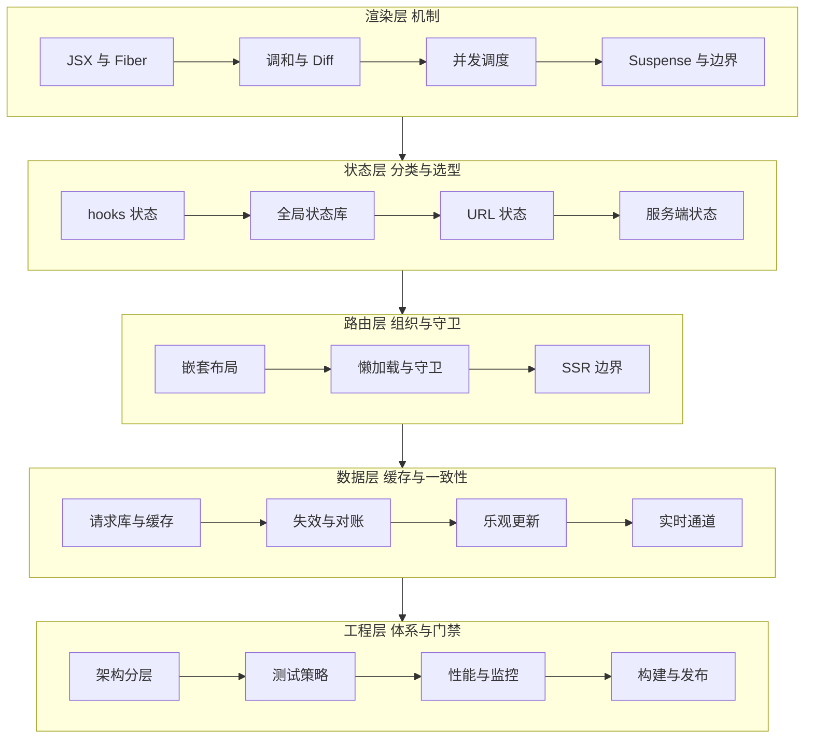

```javascript
// react-map.js —— 五层知识地图（自查清单，每层能答出 5 个问题即达标）

// 1. 渲染层（机制）
// - JSX 编译产物与 ReactElement 结构
// - Fiber 双缓存与可中断渲染
// - Diff 三策略与 key 的意义
// - 并发调度优先级与 lane
// - commit 阶段：insertionEffect -> layoutEffect -> paint -> passiveEffect

// 2. 状态层（分类与选型）
// - hooks 心智：快照语义 / 闭包陷阱 / 依赖数组
// - 状态四分类：local / url / global / server（R19-162 决策树）
// - 受控与非受控边界
// - Context 的粒度与代价
// - reducer 化复杂状态转换

// 3. 路由层（组织与守卫）
// - 嵌套布局与 Outlet
// - 懒加载与路由级分包
// - 守卫三实现：布局组件 / loader / middleware
// - SSR 边界：'use client' 划线与 hydration
// - URL 即状态：查询参数同步（R19-147）

// 4. 数据层（缓存与一致性）
// - 缓存 key 设计与失效面（R19-146）
// - 乐观更新与回滚（R19-148）
// - 竞态三修复（R19-143）
// - 轮询/推送/SSE 选型（R19-149）
// - 离线与弱网策略（R19-177 / R19-194）

// 5. 工程层（体系与门禁）
// - FSD 分层与依赖方向（R19-151）
// - 权限/错误/主题/i18n 四大横切体系（R19-153~156）
// - 测试金字塔与门禁（R19-163~167）
// - 性能排查链路（R19-198）
// - 发布流与灰度回滚（R19-197）

export const REACT_MAP_VERSION = 'r19';
// 面试收束话术：
// "我的知识体系是五层的：渲染讲机制、状态讲选型、路由讲组织、数据讲一致性、工程讲体系。
//  任何 React 问题我都能先定位到层，再给机制 + 场景 + 权衡。"
```
