# 前端工程化面试题库

> 面向前端面试场景的工程化题库，共 200 题（ENG-001 ~ ENG-200）。覆盖包管理与 lockfile、语义化版本、Vite 原理、webpack 核心、Rollup/esbuild/SWC、Babel 与 AST、Tree-shaking、代码分割、source map、ESLint/Prettier/husky/commitlint、Git 工作流、CI/CD、Monorepo、微前端、Vitest 单测、包发布、环境变量、Docker 与 Nginx 部署、前端监控、AI 辅助编码的工程化实践，以及包管理深水区、脚手架、规范深化、Git 深水区、配置管理、CI/CD 深化、测试工程化、Monorepo 深化、质量度量、AI 工程化、构建集成、发布工程、文档知识、依赖治理、微前端工程化、移动多端、研发协作、安全工程化与体系前瞻等深化专题。

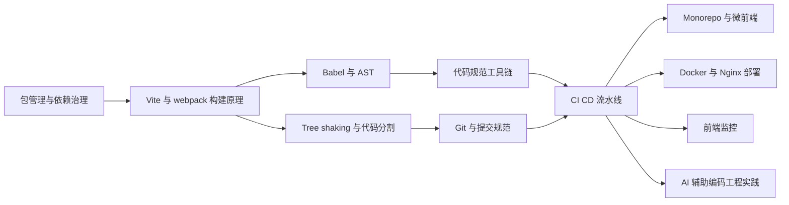

## 目录

- 第一章 包管理与依赖治理：ENG-001 ~ ENG-008
- 第二章 Vite 原理与实践：ENG-009 ~ ENG-014
- 第三章 webpack 核心：ENG-015 ~ ENG-021
- 第四章 Rollup esbuild 与 SWC：ENG-022 ~ ENG-024
- 第五章 Babel AST 与 Tree shaking：ENG-025 ~ ENG-030
- 第六章 代码规范工具链：ENG-031 ~ ENG-034
- 第七章 Git 工作流：ENG-035 ~ ENG-039
- 第八章 CI CD：ENG-040 ~ ENG-043
- 第九章 Monorepo：ENG-044 ~ ENG-046
- 第十章 微前端：ENG-047 ~ ENG-048
- 第十一章 单元测试 Vitest：ENG-049 ~ ENG-050
- 第十二章 发布与环境变量：ENG-051 ~ ENG-053
- 第十三章 Docker 与 Nginx 部署：ENG-054 ~ ENG-056
- 第十四章 前端监控：ENG-057 ~ ENG-058
- 第十五章 AI 辅助编码工程实践：ENG-059 ~ ENG-060
- 第十六章 包管理深水区：ENG-061 ~ ENG-066
- 第十七章 脚手架与模板：ENG-067 ~ ENG-072
- 第十八章 代码规范深化：ENG-073 ~ ENG-079
- 第十九章 Git 深水区：ENG-080 ~ ENG-086
- 第二十章 环境与配置管理：ENG-087 ~ ENG-092
- 第二十一章 CI CD 深化：ENG-093 ~ ENG-099
- 第二十二章 测试工程化：ENG-100 ~ ENG-105
- 第二十三章 Monorepo 深化：ENG-106 ~ ENG-111
- 第二十四章 质量与度量：ENG-112 ~ ENG-117
- 第二十五章 AI 工程化与新范式：ENG-118 ~ ENG-130
- 第二十六章 构建集成与优化工程：ENG-131 ~ ENG-136
- 第二十七章 发布工程深化：ENG-137 ~ ENG-142
- 第二十八章 文档与知识工程：ENG-143 ~ ENG-147
- 第二十九章 依赖治理：ENG-148 ~ ENG-153
- 第三十章 微前端工程化：ENG-154 ~ ENG-158
- 第三十一章 移动与多端工程：ENG-159 ~ ENG-163
- 第三十二章 研发流程与协作：ENG-164 ~ ENG-169
- 第三十三章 安全工程化：ENG-170 ~ ENG-174
- 第三十四章 AI 深度工程化：ENG-175 ~ ENG-182
- 第三十五章 体系与前瞻：ENG-183 ~ ENG-200

---

## 第一章 包管理与依赖治理（ENG-001 ~ ENG-008）

### ENG-001：npm、yarn、pnpm 的核心区别？
**答**：
- npm 早期采用嵌套 node_modules 造成依赖地狱，npm 3/yarn 改为扁平化，但带来幽灵依赖问题。
- yarn 1 的贡献是 lockfile 与并行安装，大幅提升安装速度与一致性。
- pnpm 用全局内容寻址 store + 硬链接存储包，node_modules 内用符号链接组织，磁盘省、速度快。
- pnpm 默认严格隔离：只能 import 声明过的依赖，从根源解决幽灵依赖。

```bash
# 三种包管理器常用命令对照
npm install
yarn
pnpm install

npm run dev
yarn dev
pnpm dev

# 查看项目声明的包管理器与版本
grep packageManager package.json
```

### ENG-002：pnpm 的硬链接与符号链接结构是怎么回事？
**答**：
- 所有包的真实文件保存在全局内容寻址 store 中，同一版本的全局只存一份。
- 项目的 node_modules/.pnpm 目录下，每个包通过硬链接指向 store，不复制文件。
- 项目根的 node_modules 里，直接依赖以符号链接指向 .pnpm 中的对应目录，形成严格层级。
- 收益：安装快、磁盘占用低、依赖结构严格，未声明的包 import 不进来。

```bash
# 查看全局 store 位置
pnpm store path

# 直接依赖以符号链接形式平铺在 node_modules
ls -la node_modules | head

# .pnpm 目录存放实际包，内部再硬链接到全局 store
ls node_modules/.pnpm | head

# 确认 store 被多项目共享
du -sh $(pnpm store path)
```

### ENG-003：lockfile 的作用是什么？CI 中应该怎么装依赖？
**答**：
- lockfile 锁定整棵依赖树的精确版本与完整性 hash，保证任何机器上装出完全相同的结果。
- 提交 lockfile 到仓库是团队共识：没有它，传递依赖的次版本更新可能让不同环境行为不一致。
- CI 中必须用"严格模式"安装：npm ci / pnpm install --frozen-lockfile / yarn --immutable。
- lockfile 与 package.json 不一致时严格模式直接报错，防止版本漂移。

```bash
# 严格按 lockfile 安装，CI 中必须使用
npm ci
pnpm install --frozen-lockfile
yarn install --immutable

# lockfile 变更必须作为代码变更的一部分提交
git status --short package-lock.json pnpm-lock.yaml
```

### ENG-004：什么是幽灵依赖 phantom dependencies？如何治理？
**答**：
- 幽灵依赖：代码 import 了未声明在 package.json 里的包，只因扁平化安装让它恰好存在。
- 上游包某天不再传递依赖它，项目就莫名其妙构建失败，属于隐性脆弱点。
- pnpm 默认隔离直接暴露这类问题；npm/yarn 项目要靠 lint 规则或 import 检查工具治理。
- 治理动作：显式 add 需要的包，必要时用 pnpm why 排查依赖来源。

```bash
# 查看某个包为什么被安装、谁依赖它
pnpm why lodash

# 把实际使用的包显式声明进 package.json
pnpm add lodash-es

# npm 项目可用 depcheck 扫描未声明依赖
npx depcheck
```

### ENG-005：语义化版本中 ^ 和 ~ 的区别？
**答**：
- semver 三段为 major.minor.patch：major 破坏性变更、minor 向后兼容的新功能、patch 修复。
- `^1.2.3` 允许 minor 与 patch 升级（>=1.2.3 且 <2.0.0）；`~1.2.3` 只允许 patch 升级（<1.3.0）。
- ^0.x.y 行为特殊：0.2.3 只允许 patch 升级，因为 0 阶段没有稳定性承诺。
- 最终装什么版本由 lockfile 决定，范围只是"允许更新的边界"。

```bash
# package.json 中的版本范围示例
# ^1.2.3  ->  >=1.2.3 <2.0.0
# ~1.2.3  ->  >=1.2.3 <1.3.0
# 1.2.3   ->  精确锁定
# *       ->  任意版本，生产禁用

# 查看某包的可用版本
npm view react versions --json | tail -5

# 在 semver 范围内更新并刷新 lockfile
npm update react
```

### ENG-006：peerDependencies 是什么？什么时候用？
**答**：
- 表达"我与宿主环境共享某个依赖，由宿主提供"，典型如插件依赖 vite、UI 库依赖 react。
- 避免插件把 react 也装一份导致双实例（hooks 报错、context 断裂的经典事故）。
- peerDependenciesMeta.optional 声明可选 peer；npm 7+ 会自动安装 peer 依赖。
- 发布库时 peer 范围要写得宽（如 ^5.0.0 || ^6.0.0），dependencies 里绝不能再重复声明它。

```javascript
// 插件类库的 package.json
{
  "name": "my-vite-plugin",
  "peerDependencies": {
    // 由使用方的项目提供 vite，版本范围尽量宽
    "vite": "^5.0.0 || ^6.0.0"
  },
  "peerDependenciesMeta": {
    // 可选 peer：宿主没装也不告警
    "typescript": { "optional": true }
  }
}
```

### ENG-007：packageManager 字段与 corepack 怎么配合？
**答**：
- package.json 的 packageManager 字段声明本项目使用的包管理器与精确版本。
- corepack 是 Node 自带的包管理器版本管理器：enable 后执行 pnpm/yarn 会按字段自动切换版本。
- 保证"每个人、每台 CI"都用同一个包管理器版本，避免 lockfile 格式差异导致的冲突。
- corepack use 还能顺手把版本写回 package.json。

```bash
# package.json 中声明
# "packageManager": "pnpm@9.12.0"

# 启用 corepack，之后 pnpm/yarn 命令自动对齐声明版本
corepack enable
corepack prepare pnpm@9.12.0 --activate

# 修改团队使用的版本并写入 packageManager 字段
corepack use pnpm@9.12.0
```

### ENG-008：npm scripts 的生命周期钩子是怎么执行的？
**答**：
- 任意自定义脚本 name 会先自动执行 prename 再执行 postname，例如 build 前后钩子。
- 内置生命周期：prepare 在本地开发与打包前执行（husky 常挂这里）、prepublishOnly 在发布前执行。
- 钩子是隐式魔法，团队内要控制使用密度，过多 pre/post 会让调用链难以追踪。
- 脚本里可以通过 npm_package_* 环境变量读取包信息。

```javascript
// package.json
{
  "scripts": {
    // 执行 pnpm build 时自动按序执行 prebuild -> build -> postbuild
    "prebuild": "rimraf dist",
    "build": "vite build",
    "postbuild": "node scripts/print-size.mjs",
    // prepare：安装依赖后自动执行，husky 靠它注册 git hooks
    "prepare": "husky",
    // 发布前校验，失败则中止 npm publish
    "prepublishOnly": "pnpm test && pnpm build"
  }
}
```

---

## 第二章 Vite 原理与实践（ENG-009 ~ ENG-014）

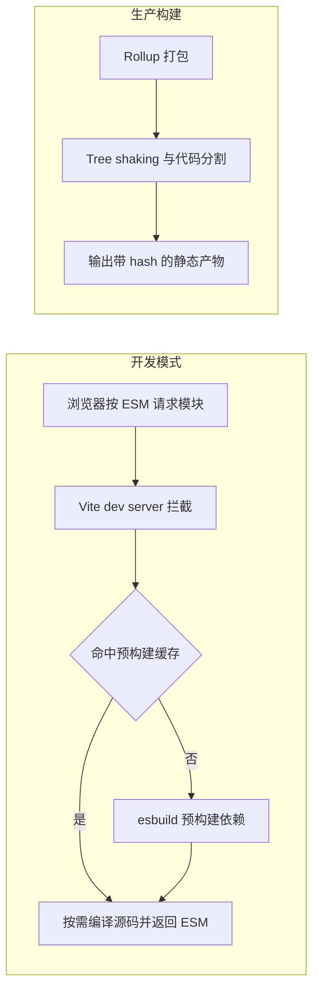

### ENG-009：Vite 开发模式为什么快？
**答**：
- dev 阶段完全不打包：利用浏览器原生 ESM，请求哪个模块就按需编译返回哪个。
- 源码模块由 esbuild 转译（TS/JSX），速度远超 Babel；依赖则在启动时预构建进缓存。
- HMR 精确到模块级：改一个文件只让该模块失效，不再像 webpack 一样按 entry 重算模块图。
- 项目越大启动优势越明显，因为冷启动工作量与页面首屏需要的模块数成正比，与全项目体积无关。

```javascript
// vite.config.ts
import { defineConfig } from 'vite';
import react from '@vitejs/plugin-react';

export default defineConfig({
  plugins: [react()],
  server: {
    port: 5173,
  },
  optimizeDeps: {
    // 提前把深层依赖纳入预构建，减少首屏请求瀑布
    include: ['lodash-es'],
  },
});
```

### ENG-010：Vite 的依赖预构建做了什么？
**答**：
- 启动时扫描入口，收集所有裸模块导入，交给 esbuild 预构建。
- 作用一：把 CJS/UMD 依赖转换成 ESM，浏览器才能直接 import。
- 作用二：把 lodash-es 这类几百个小文件合并成单文件，减少请求数量。
- 预构建产物缓存在 node_modules/.vite，依赖锁文件或配置变化时才重新构建。

```javascript
// vite.config.ts
import { defineConfig } from 'vite';

export default defineConfig({
  optimizeDeps: {
    // 手动指定需要预构建的依赖
    include: ['react', 'react-dom', 'lodash-es'],
    // 链接的本地包不需要预构建
    exclude: ['linked-local-package'],
    // 强制重新预构建（排查缓存问题时使用）
    force: true,
  },
});
```

### ENG-011：Vite 插件的常用钩子有哪些？
**答**：
- Vite 插件是 Rollup 插件的超集：transform、resolveId 等 Rollup 钩子直接可用。
- Vite 特有钩子：configResolved 读取最终配置、configureServer 自定义 dev server 中间件、transformIndexHtml 注入 HTML。
- enforce: 'pre'/'post' 控制插件相对内置插件的执行顺序。
- 按 apply: 'serve'/'build' 限定插件只在 dev 或构建阶段生效。

```javascript
// my-vite-plugin.js
export default function myPlugin() {
  return {
    name: 'my-plugin',
    // Vite 特有：拿到最终配置
    configResolved(config) {
      console.log('command:', config.command);
    },
    // Rollup 兼容：转译模块源码
    transform(code, id) {
      if (id.endsWith('.svg')) {
        return `export default ${JSON.stringify(id)}`;
      }
      return null;
    },
    // Vite 特有：改写入口 HTML
    transformIndexHtml(html) {
      return html.replace('</head>', '<script src="/inject.js"></script></head>');
    },
  };
}
```

### ENG-012：Vite 生产构建为什么用 Rollup？怎么分包？
**答**：
- Rollup 产物更干净：原生 ESM 输出、静态分析彻底、tree-shaking 效果好，适合最终发布。
- dev 快（esbuild）与产物优（Rollup）分工，是 Vite "双引擎"设计。
- manualChunks 把稳定依赖抽成独立 chunk，业务迭代时不破坏 vendor 的长缓存。
- 还可配置 target、sourcemap、chunkSizeWarningLimit 等构建细节。

```javascript
// vite.config.ts
import { defineConfig } from 'vite';

export default defineConfig({
  build: {
    target: 'es2015',
    rollupOptions: {
      output: {
        // 手动分包：稳定库单独成 chunk，命中浏览器长缓存
        manualChunks: {
          react: ['react', 'react-dom'],
          lodash: ['lodash-es'],
        },
      },
    },
    chunkSizeWarningLimit: 1024,
    sourcemap: true,
  },
});
```

### ENG-013：Vite 的环境变量机制是怎样的？
**答**：
- .env 文件按环境命名：.env（全部）、.env.development、.env.production、.env.local（本地覆盖，默认 gitignore）。
- 只有 VITE_ 前缀的变量会暴露给客户端代码，通过 import.meta.env.VITE_XXX 读取。
- 自定义前缀用 envPrefix 配置；服务端专用变量不加前缀以防泄漏。
- TS 项目在 src/vite-env.d.ts 里扩展 ImportMetaEnv 获得类型提示。

```ini
# .env.development —— 仅 development 模式加载
VITE_API_BASE=http://localhost:3000/api
VITE_ENABLE_MOCK=true

# .env.production —— 生产构建时加载
VITE_API_BASE=https://api.example.com
VITE_ENABLE_MOCK=false

# 代码中通过 import.meta.env.VITE_API_BASE 读取
# .env.local 存放本地覆盖，默认被 gitignore，绝不提交
```

### ENG-014：Vite 如何用 proxy 解决开发环境跨域？
**答**：
- 浏览器同源策略限制开发时直连后端；dev server 内置 http-proxy 把匹配路径转发到目标服务。
- 前端请求同源的 /api，代理服务器转发到真实后端，响应再透传回来，浏览器认为是同源。
- changeOrigin 修改请求 Host 头；rewrite 重写路径；ws: true 支持 WebSocket。
- 它只存在于开发环境，生产环境由 Nginx 做同样的反向代理。

```javascript
// vite.config.ts
import { defineConfig } from 'vite';

export default defineConfig({
  server: {
    proxy: {
      // 前端请求 /api/users -> http://localhost:8080/users
      '/api': {
        target: 'http://localhost:8080',
        changeOrigin: true,
        rewrite: (path) => path.replace(/^\/api/, ''),
      },
      // WebSocket 代理
      '/ws': {
        target: 'ws://localhost:8081',
        ws: true,
      },
    },
  },
});
```

---

## 第三章 webpack 核心（ENG-015 ~ ENG-021）

### ENG-015：webpack 构建的核心流程和四大概念？
**答**：
- entry 指定入口，webpack 从入口递归构建模块依赖图；output 决定产物路径与命名。
- loader 把非 JS 资源（CSS、图片、TS）转换成模块；plugin 通过钩子介入构建生命周期做更广的事情。
- 大致流程：初始化配置 -> 从 entry 开始递归编译模块 -> 封装 chunk -> 输出 bundle。
- mode 决定内置优化：production 自动开启压缩与 tree-shaking。

```javascript
// webpack.config.js
const path = require('path');
const HtmlWebpackPlugin = require('html-webpack-plugin');

module.exports = {
  mode: 'production',
  entry: './src/main.js',
  output: {
    path: path.resolve(__dirname, 'dist'),
    // contenthash 保证内容不变时文件名不变，利于缓存
    filename: '[name].[contenthash:8].js',
  },
  module: {
    rules: [
      { test: /\.css$/, use: ['style-loader', 'css-loader'] },
    ],
  },
  plugins: [new HtmlWebpackPlugin({ template: './index.html' })],
};
```

### ENG-016：loader 和 plugin 的区别？
**答**：
- loader 是文件转换器：输入源码字符串/Buffer，输出 JS 模块，链式执行且从右到左（从下到上）。
- plugin 基于 tapable 钩子机制介入编译器全生命周期：打包优化、资源注入、生成文件都能做。
- loader 运行在模块转换阶段；plugin 可以监听从 beforeRun 到 done 的任何时机。
- 记忆：loader 解决"webpack 不认识这个文件"，plugin 解决"webpack 流程中做额外的事"。

```javascript
const MiniCssExtractPlugin = require('mini-css-extract-plugin');

module.exports = {
  module: {
    rules: [
      {
        test: /\.css$/,
        // 执行顺序：css-loader 先解析依赖，再交给 style 层处理
        use: [MiniCssExtractPlugin.loader, 'css-loader'],
      },
    ],
  },
  plugins: [
    // plugin 做 loader 做不到的事：把 CSS 抽成独立文件
    new MiniCssExtractPlugin({ filename: '[name].[contenthash].css' }),
  ],
};
```

### ENG-017：如何写一个自定义 webpack loader？
**答**：
- loader 就是一个函数：接收源码，返回转换结果，this 上有丰富的上下文（query、async 等）。
- 同步 loader 直接 return；需要异步时调用 this.async() 拿到 callback。
- this.getOptions() 读取配置项；可以用 loader-utils 校验参数。
- 在 webpack 配置里用 resolveLoader 或路径引用注册。

```javascript
// loaders/replace-loader.js
module.exports = function (source) {
  // 同步 loader：替换源码中的占位符
  return source.replace(
    /__BUILD_TIME__/g,
    JSON.stringify(new Date().toISOString())
  );
};

// 异步 loader 的写法
module.exports.asyncLoader = function (source) {
  const callback = this.async();
  someAsyncWork(source)
    .then((result) => callback(null, result))
    .catch((err) => callback(err));
};
```

### ENG-018：如何写一个自定义 webpack plugin？
**答**：
- plugin 是带 apply(compiler) 方法的类或对象，通过 compiler.hooks / compilation.hooks 注册回调。
- compiler 代表整个构建生命周期；compilation 代表一次资源编译，可拿到 chunks 与 assets。
- tap 第一个参数是插件名，用于调试追踪；关注时机的典型选择有 emit、afterOptimizeChunkAssets。
- 输出文件阶段可改写 compilation.assets。

```javascript
// plugins/build-log-plugin.js
class BuildLogPlugin {
  apply(compiler) {
    const pluginName = 'BuildLogPlugin';

    compiler.hooks.compilation.tap(pluginName, (compilation) => {
      compilation.hooks.afterOptimizeChunkAssets.tap(pluginName, (chunks) => {
        for (const chunk of chunks) {
          console.log(chunk.name, '模块数', chunk.getModules().length);
        }
      });
    });

    compiler.hooks.done.tap(pluginName, (stats) => {
      console.log('构建完成，耗时', stats.endTime - stats.startTime, 'ms');
    });
  }
}

module.exports = BuildLogPlugin;
```

### ENG-019：webpack 构建速度慢，如何优化？
**答**：
- 持久化缓存 cache.type: 'filesystem'，二次构建直接复用缓存，提升最明显。
- 缩小 loader 处理范围：include/exclude 限定 src，babel-loader 开 cacheDirectory。
- resolve.extensions 少配通配后缀，减少解析尝试；alias 指明常见路径。
- 项目过大考虑拆构建或换 Rsbuild/Rspack（Rust 实现的高兼容替代）。

```javascript
const path = require('path');

module.exports = {
  cache: {
    type: 'filesystem', // 持久化缓存
  },
  module: {
    rules: [
      {
        test: /\.js$/,
        include: path.resolve('src'), // 缩小处理范围
        loader: 'babel-loader',
        options: { cacheDirectory: true },
      },
    ],
  },
  resolve: {
    // 后缀列表越短，解析尝试越少
    extensions: ['.js', '.ts', '.jsx'],
    alias: { '@': path.resolve('src') },
  },
};
```

### ENG-020：webpack 产物体积大，如何优化？
**答**：
- 开启 tree-shaking：production mode + package.json 声明 sideEffects。
- splitChunks 抽离 node_modules 公共依赖，业务改动不影响 vendor 缓存。
- 用 webpack-bundle-analyzer 分析大模块，替换或按需引入重型依赖。
- 文件名带 contenthash + 长缓存策略，让用户增量加载而不是整包更新。

```javascript
const TerserPlugin = require('terser-webpack-plugin');
const BundleAnalyzerPlugin = require('webpack-bundle-analyzer').BundleAnalyzerPlugin;

module.exports = {
  mode: 'production', // 内置 usedExports 与 tree shaking
  optimization: {
    minimize: true,
    minimizer: [new TerserPlugin()],
    splitChunks: {
      chunks: 'all',
      cacheGroups: {
        vendors: { test: /[\\/]node_modules[\\/]/, name: 'vendors', priority: -10 },
      },
    },
  },
  plugins: [new BundleAnalyzerPlugin({ analyzerMode: 'static' })],
};
```

### ENG-021：webpack HMR 的原理是什么？
**答**：
- 文件变化 -> webpack watch 重新编译 -> 生成新的 hash 与更新模块（manifest + chunk）。
- dev server 通过 WebSocket 把 hash 推给浏览器，浏览器比对后按需拉取更新的模块。
- module.hot.accept 声明模块的热替换边界：只更新指定模块并执行其回调，状态可保留。
- 找不到可接受的边界或替换失败时，回退为整页刷新。

```javascript
// 业务代码中手动声明热更新边界
if (module.hot) {
  // print.js 更新时只重新执行它，不刷新整页
  module.hot.accept('./print.js', () => {
    document.body.removeChild(document.getElementById('status'));
    require('./print.js')();
  });
}

// HMR 全链路：watch 编译 -> WebSocket 推送 hash -> 拉取 hot-update 文件
// -> 沿 accept 边界逐层向上替换 -> 失败则 live reload 兜底
```

---

## 第四章 Rollup esbuild 与 SWC（ENG-022 ~ ENG-024）

### ENG-022：Rollup 和 webpack 怎么选？
**答**：
- Rollup 基于 ESM 静态分析，产物干净、几乎无运行时冗余，tree-shaking 效果更好。
- webpack 生态与 code splitting 更成熟，适合应用开发；Rollup 适合打包库。
- Vite 让两者分工：dev 用 esbuild + 原生 ESM，build 用 Rollup。
- 库打包输出多格式：ESM 给打包器、UMD 给 script 标签场景。

```javascript
// rollup.config.js
import terser from '@rollup/plugin-terser';

export default {
  input: 'src/index.js',
  output: [
    { file: 'dist/index.esm.js', format: 'es' },
    { file: 'dist/index.umd.js', format: 'umd', name: 'MyLib' },
  ],
  // react 由使用方提供，不打进产物
  external: ['react'],
  plugins: [terser()],
};
```

### ENG-023：esbuild 为什么这么快？
**答**：
- 用 Go 编写，编译为原生机器码；多核并行处理，JS 单线程工具无法比拟。
- 从零实现完整的解析/绑定/代码生成，不经过第三方 AST 库的二次转换。
- 大量数据复用字符串切片，减少内存拷贝与 GC 压力。
- 代价是插件生态与定制能力弱于 webpack/Rollup，因此多用于预构建、压缩、转译等单点提速。

```javascript
const esbuild = require('esbuild');

esbuild.build({
  entryPoints: ['src/index.jsx'],
  bundle: true,
  minify: true,
  format: 'esm',
  target: ['es2018'],
  outdir: 'dist',
});
```

### ENG-024：SWC 和 Rspack 是什么？解决什么问题？
**答**：
- SWC 是 Rust 实现的 JS/TS 编译器，能力对标 Babel，速度快一个数量级，Next.js 默认使用。
- Rspack 是 Rust 实现的高性能 webpack 兼容构建器，Rsbuild 基于它提供开箱配置。
- 迁移成本低：webpack 项目可基本无缝切到 Rspack，获得数倍构建提速。
- 取舍：生态插件覆盖度略低于 webpack，复杂自定义 plugin 可能需要适配。

```javascript
// .swcrc
{
  "jsc": {
    "parser": { "syntax": "ecmascript", "jsx": true },
    "target": "es2018",
    "transform": {
      "react": { "runtime": "automatic" }
    }
  },
  "minify": true
}
```

---

## 第五章 Babel AST 与 Tree shaking（ENG-025 ~ ENG-030）

### ENG-025：Babel 的编译流程分哪三步？
**答**：
- parse：把源码字符串解析成 AST（抽象语法树），使用 @babel/parser。
- transform：遍历 AST，visitor 在节点上做增删改，这是插件工作的阶段。
- generate：把修改后的 AST 生成回代码字符串并产出 sourcemap。
- 理解这条链路就能写出代码变换插件，也是理解所有转译工具的基础。

```javascript
// babel-plugin-dev-flag.js —— 演示 transform 阶段的 visitor
module.exports = function ({ types: t }) {
  return {
    visitor: {
      CallExpression(path) {
        // 把 __DEV__() 调用替换为布尔字面量
        if (path.node.callee.name === '__DEV__') {
          path.replaceWith(
            t.booleanLiteral(process.env.NODE_ENV !== 'production')
          );
        }
      },
    },
  };
};

// 配置：plugins: ['./babel-plugin-dev-flag.js']
```

### ENG-026：@babel/preset-env 是如何按需转译的？
**答**：
- preset-env 根据 targets 中声明的浏览器范围，只注入必要的语法转换，不把所有语法无脑降级。
- useBuiltIns: 'usage' 配合 corejs 按需注入 API polyfill（Promise、Array.includes 等）。
- 浏览器范围通常写在 package.json 的 browserslist 字段，被 babel/autoprefixer 等共享。
- 目标越新产物越小：现代浏览器用 esbuild/SWC 直出，可显著减体积。

```javascript
// babel.config.js
module.exports = {
  presets: [
    [
      '@babel/preset-env',
      {
        targets: { chrome: '100', firefox: '100' },
        useBuiltIns: 'usage', // 按实际用到的 API 注入 polyfill
        corejs: '3.36',
      },
    ],
  ],
};
```

### ENG-027：什么是 AST？前端工具链里有哪些应用？
**答**：
- AST 是源码的树形结构化表示，把代码从"字符串"变成"可编程的数据"。
- @babel/parser 解析 -> @babel/traverse 遍历 -> @babel/types 构造节点 -> @babel/generator 输出。
- 应用：ESLint 规则检查、Prettier 格式化、代码压缩、按需加载插件、codemod 批量重构。
- 二元运算、函数声明、JSX 元素在 AST 里都是具体节点类型。

```javascript
const parser = require('@babel/parser');
const traverse = require('@babel/traverse').default;

const code = 'const total = 1 + 2; foo(3 * 4);';
const ast = parser.parse(code, { sourceType: 'module' });

traverse(ast, {
  BinaryExpression(path) {
    // 遍历到每个二元运算节点
    console.log(path.node.operator);
  },
});
```

### ENG-028：Tree-shaking 的原理是什么？sideEffects 有什么用？
**答**：
- 原理：基于 ESM 的静态结构，标记模块中未被使用的 export，压缩阶段删除死代码。
- 只对静态可分析的 import/export 有效，CJS 的动态 require 无法摇掉。
- package.json 的 sideEffects: false 告诉打包器"所有文件都无副作用"，未引用的模块可整体删除。
- 有副作用的文件必须显式列入数组（如 CSS、带 polyfill 的模块），否则误删出 bug。

```javascript
// utils.js
export function used() {
  return 1;
}

export function unused() {
  return 2; // 未被任何入口 import，生产构建中会被移除
}

// package.json 中配合声明：
// "sideEffects": ["*.css", "*.scss"]
// 表示除样式文件外全部无副作用，可放心 tree-shaking
```

### ENG-029：动态 import 如何实现代码分割与懒加载？
**答**：
- `import()` 返回 Promise，构建工具据此生成独立 chunk，运行到该行才发起加载。
- 与 React.lazy、路由懒加载是同一机制的上层封装。
- 魔法注释可自定义 chunk 名（webpackChunkName）或预取（webpackPrefetch/preload）。
- 分割策略：按路由拆页面，按交互时机拆重组件，按访问概率决定 prefetch。

```javascript
// 点击时才加载图表库及其依赖 chunk
document.getElementById('load-chart')?.addEventListener('click', async () => {
  const { renderChart } = await import('./chart');
  renderChart();
});

// 魔法注释：自定义 chunk 名，构建产物可读性更好
const analytics = await import(
  /* webpackChunkName: "analytics" */ './analytics'
);
```

### ENG-030：source map 的原理和生产环境怎么配置？
**答**：
- source map 是"编译产物位置 -> 源码位置"的映射文件（.map），基于 VLQ 编码的 mappings 字段。
- dev 追求速度：eval-cheap-module-source-map 折中最好；trace 精确映射用 source-map。
- 生产环境给监控平台还原错误堆栈：生成 hidden-source-map，只上传 .map 到内部平台，不发布到 CDN。
- 绝不把完整 source map 公网暴露，否则源码等于开源。

```javascript
// webpack.config.js
module.exports = {
  // 开发环境：速度快，行级映射够用
  devtool: 'eval-cheap-module-source-map',

  // 生产环境如需错误还原：
  // devtool: 'hidden-source-map'  // 生成 .map 但产物不引用
  // 构建后把 .map 上传到监控平台，报错时自动还原堆栈
};
```

---

## 第六章 代码规范工具链（ENG-031 ~ ENG-034）

### ENG-031：ESLint flat config 怎么配置？
**答**：
- ESLint 9 起默认 flat config（eslint.config.js），用数组导出配置对象，替代 eslintrc 的级联。
- 每个对象可指定 files 范围、plugins、rules；ignores 单独一项实现排除。
- 官方推荐配置（js.configs.recommended、typescript-eslint）按数组顺序叠加，后面的覆盖前面的。
- React 项目加 eslint-plugin-react-hooks，保证 Hook 规则强制生效。

```javascript
// eslint.config.js —— flat config
import js from '@eslint/js';
import reactHooks from 'eslint-plugin-react-hooks';

export default [
  { ignores: ['dist/**', 'node_modules/**'] },
  js.configs.recommended,
  {
    files: ['src/**/*.{js,jsx,ts,tsx}'],
    plugins: { 'react-hooks': reactHooks },
    rules: {
      ...reactHooks.configs.recommended.rules,
      'no-console': 'warn',
      eqeqeq: ['error', 'smart'],
    },
  },
];
```

### ENG-032：Prettier 与 ESLint 的职责如何划分？怎么避免冲突？
**答**：
- ESLint 管代码质量（no-unused-vars、eqeqeq），Prettier 管格式（缩进、引号、换行）。
- 格式规则冲突的解法：eslint-config-prettier 关闭 ESLint 中所有格式类规则。
- 工作流：编辑器保存即 Prettier 格式化，ESLint 管质量并在 CI 中兜底。
- 两者的规则不要重复配置，单一事实来源。

```javascript
// .prettierrc.js
module.exports = {
  printWidth: 100,
  semi: true,
  singleQuote: true,
  trailingComma: 'es5',
};

// package.json 的 devDependencies 中加入
// eslint-config-prettier
// 并在 eslint.config.js 数组末尾引入，关闭所有格式类 ESLint 规则
// import eslintConfigPrettier from 'eslint-config-prettier';
// export default [ ..., eslintConfigPrettier ];
```

### ENG-033：husky + lint-staged 如何拦截不合规提交？
**答**：
- husky 把 git hooks 目录指向仓库内脚本，团队共享同一套钩子。
- lint-staged 只对 git 暂存区的文件跑 lint --fix 与 prettier，速度快且不碰未改动文件。
- pre-commit 钩子执行 npx lint-staged，失败则提交中止。
- 好处：问题在本地提交前暴露，不让 CI 白白跑一轮。

```bash
# 安装并初始化 husky
npm install --save-dev husky lint-staged
npx husky init

# pre-commit 钩子内容：对暂存区文件执行检查
echo "npx lint-staged" > .husky/pre-commit

# package.json 中配置 lint-staged 规则：
# "lint-staged": {
#   "*.{js,jsx,ts,tsx}": ["eslint --fix", "prettier --write"],
#   "*.{css,scss,json,md}": ["prettier --write"]
# }

git add package.json
git commit -m "chore: add lint-staged"
```

### ENG-034：commitlint 和 Conventional Commits 是什么？
**答**：
- Conventional Commits 规定提交格式：type(scope): subject，如 feat(order): 支持批量导出。
- 常用 type：feat、fix、docs、style、refactor、perf、test、build、ci、chore。
- commitlint 校验提交信息合法性，挂在 commit-msg 钩子，不合格直接拒绝。
- 收益：提交历史结构化，可自动生成 changelog、自动判断 semver 升级级别。

```bash
npm install --save-dev @commitlint/cli @commitlint/config-conventional

# commitlint.config.js 内容
cat > commitlint.config.js << 'EOF'
module.exports = { extends: ['@commitlint/config-conventional'] };
EOF

# 挂到 commit-msg 钩子
echo "npx --no -- commitlint --edit \$1" > .husky/commit-msg

# 合规提交示例
git commit -m "feat(order): 支持批量导出订单"
git commit -m "fix: 修复登录页在窄屏下的溢出"
```

---

## 第七章 Git 工作流（ENG-035 ~ ENG-039）

### ENG-035：Git Flow 与 Trunk-based 两种分支模型怎么选？
**答**：
- Git Flow：master/develop 双长期分支 + feature/release/hotfix，发布节奏重，适合版本化交付。
- Trunk-based：所有人高频小步合入 main，短生命周期分支 + 功能开关，适合持续部署。
- 现代前端团队多用 Trunk-based + PR review + CI 卡点，减少合并冲突与分支漂移。
- 关键是分支存活时间越短，集成风险越小。

```bash
# Git Flow 示例
git checkout -b feature/login develop
git commit -m "feat: add login form"
git checkout develop && git merge --no-ff feature/login

# Trunk-based 示例
git checkout -b fix/typo main
git push origin fix/typo
# PR review 通过后 squash merge 到 main，分支存活通常不超过两天
```

### ENG-036：merge 和 rebase 怎么选？rebase 的黄金法则是什么？
**答**：
- merge 保留真实分叉历史，产生合并提交，适合合入主干或公共分支。
- rebase 把自己的提交摘下来重放到目标分支顶端，历史线性干净，适合更新 feature 分支。
- 黄金法则：不要对已经推送到公共分支的提交做 rebase，会打乱他人的历史。
- rebase 冲突时逐个解决，git rebase --continue 继续，--abort 撤销整次操作。

```bash
# merge：保留分叉历史
git checkout feature && git merge main

# rebase：线性历史
git checkout feature && git rebase main

# 冲突解决后继续
git add . && git rebase --continue

# 放弃本次 rebase
git rebase --abort
```

### ENG-037：cherry-pick 的典型使用场景？
**答**：
- 把某个具体提交"摘"到另一个分支，最典型是把 bugfix 从 main 摘到 release 分支。
- 产生一个新的提交，内容相同但 hash 不同；带冲突时解决后 --continue。
- -n 只应用改动不自动提交，方便把多个提交内容合并处理。
- 多个提交可以批量摘取：git cherry-pick A^..B。

```bash
# 把 main 上的 bugfix 提交摘到发布分支
git checkout release/1.2
git cherry-pick abc1234

# 冲突解决后继续
git cherry-pick --continue

# 只取改动不自动提交
git cherry-pick -n abc1234
```

### ENG-038：revert 和 reset 的区别？线上分支该用哪个？
**答**：
- revert 生成一条"反向提交"撤销指定提交，历史完整保留，安全可推送，公共分支必用它。
- reset 移动分支指针：--soft 保留改动到暂存区、--mixed 到工作区、--hard 彻底丢弃。
- 已 push 的提交用 reset 强推会破坏协作，属于高危操作。
- 本地未推送的提交想整理，用 reset；线上回滚，用 revert。

```bash
# revert：生成反向提交，适合公共分支
git revert 7a1b2c3
git revert HEAD~2..HEAD   # 批量撤销区间提交

# reset：本地整理未推送提交
git reset --soft HEAD~1   # 改动保留在暂存区
git reset --mixed HEAD~1  # 改动保留在工作区（默认）
git reset --hard HEAD~1   # 彻底丢弃，慎用
```

### ENG-039：stash 和 bisect 分别解决什么问题？
**答**：
- stash 临时保存未提交的工作区改动，切分支处理紧急问题后再 pop 回来。
- bisect 用二分法在提交历史中定位"第一个引入 bug 的提交"，把 O(n) 排查变成 O(log n)。
- 流程：标记当前 bad 与某个已知 good，Git 自动检出中间提交，测试后标记，最终定位。
- bisect run 还可以挂自动化测试脚本全自动二分。

```bash
# stash：临时保存工作区
git stash push -m "wip: 首页改版"
git stash list
git stash pop

# bisect：二分定位坏提交
git bisect start
git bisect bad HEAD
git bisect good v1.0.0
# 每次检出后测试并标记 good/bad，结束后复位
git bisect reset
```

---

## 第八章 CI CD（ENG-040 ~ ENG-043）

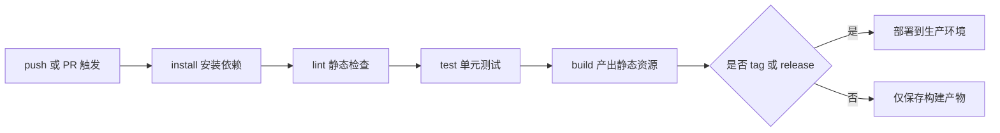

### ENG-040：GitHub Actions 的基本结构是什么？
**答**：
- workflow 文件放在 .github/workflows/ 下，用 YAML 描述：name、on 触发条件、jobs、steps。
- job 是调度与容错的最小单元，默认并行；step 是步骤，可以是 uses 复用 action 或 run 执行命令。
- 常用触发：push、pull_request、release、schedule、workflow_dispatch（手动）。
- 缓存依赖用 setup-node 的 cache 参数，基于 lockfile hash 命中。

```yaml
# .github/workflows/ci.yml
name: CI

on:
  push:
    branches: [main]
  pull_request:

jobs:
  build:
    runs-on: ubuntu-latest
    steps:
      - uses: actions/checkout@v4
      - uses: actions/setup-node@v4
        with:
          node-version: 22
          cache: npm
      - run: npm ci
      - run: npm run build
```

### ENG-041：写一个 lint + test + build 的完整 CI 流水线？
**答**：
- lint、test、build 拆成独立 job：失败快速定位，test 依赖 lint 通过，build 依赖 test 通过。
- pnpm 在 CI 中必须 --frozen-lockfile 安装，保证与 lockfile 完全一致。
- setup-node 的 cache: pnpm 缓存 pnpm store，加速安装。
- 产物在 build job 中用 actions/upload-artifact 留存，供部署 job 下载。

```yaml
name: CI

on: [push, pull_request]

jobs:
  lint:
    runs-on: ubuntu-latest
    steps:
      - uses: actions/checkout@v4
      - uses: pnpm/action-setup@v4
        with:
          version: 9
      - uses: actions/setup-node@v4
        with: { node-version: 22, cache: pnpm }
      - run: pnpm install --frozen-lockfile
      - run: pnpm lint

  test:
    needs: lint
    runs-on: ubuntu-latest
    steps:
      - uses: actions/checkout@v4
      - uses: pnpm/action-setup@v4
        with:
          version: 9
      - uses: actions/setup-node@v4
        with: { node-version: 22, cache: pnpm }
      - run: pnpm install --frozen-lockfile
      - run: pnpm test -- --coverage

  build:
    needs: test
    runs-on: ubuntu-latest
    steps:
      - uses: actions/checkout@v4
      - uses: pnpm/action-setup@v4
        with:
          version: 9
      - uses: actions/setup-node@v4
        with: { node-version: 22, cache: pnpm }
      - run: pnpm install --frozen-lockfile
      - run: pnpm build
      - uses: actions/upload-artifact@v4
        with:
          name: dist
          path: dist
```

### ENG-042：GitHub Actions 如何实现自动部署 CD？
**答**：
- 触发条件用 release published 或 tag push，保证只有版本发布才上线。
- 敏感信息放 repo 的 Secrets 与 Variables：SSH 私钥、目标主机、环境变量。
- 构建产物用 rsync/scp 推到服务器，或打成 Docker 镜像推到镜像仓库。
- environment: production 可以配置人工审批门禁。

```yaml
name: Deploy

on:
  release:
    types: [published]

jobs:
  deploy:
    runs-on: ubuntu-latest
    environment: production
    steps:
      - uses: actions/checkout@v4
      - run: pnpm install --frozen-lockfile
      - run: pnpm build
        env:
          VITE_API_BASE: ${{ vars.VITE_API_BASE }}

      - name: 上传产物到服务器
        run: |
          mkdir -p ~/.ssh
          echo "${{ secrets.SSH_KEY }}" > ~/.ssh/id_ed25519
          chmod 600 ~/.ssh/id_ed25519
          rsync -avz --delete dist/ deploy@${{ secrets.DEPLOY_HOST }}:/var/www/app
```

### ENG-043：CI 中如何做依赖与构建缓存优化？
**答**：
- 包管理器缓存优先：setup-node 的 cache 参数按 lockfile hash 缓存 pnpm/npm store。
- 工具缓存用 actions/cache：Vite 的 node_modules/.vite 预构建缓存、Playwright 浏览器等。
- key 必须绑定 lockfile hash，锁文件变了缓存自动失效；restore-keys 提供部分命中。
- 缓存不是越多越好：失效策略错误会导致脏缓存难以排查。

```yaml
jobs:
  build:
    runs-on: ubuntu-latest
    steps:
      - uses: actions/checkout@v4
      - uses: pnpm/action-setup@v4
        with:
          version: 9
      - uses: actions/setup-node@v4
        with:
          node-version: 22
          cache: pnpm

      - uses: actions/cache@v4
        with:
          path: node_modules/.vite
          # key 绑定 lockfile，依赖变化时自动失效
          key: vite-${{ runner.os }}-${{ hashFiles('pnpm-lock.yaml') }}
          restore-keys: vite-${{ runner.os }}-

      - run: pnpm install --frozen-lockfile
      - run: pnpm build
```

---

## 第九章 Monorepo（ENG-044 ~ ENG-046）

### ENG-044：Monorepo 相比多仓库的优劣是什么？
**答**：
- 优势：跨包原子提交、共享配置与依赖版本、内部包直接引用本地源码、统一 CI 视角。
- 劣势：仓库体积与权限管理复杂、CI 需要任务编排避免全量构建、工具链门槛高。
- 适合多应用共享设计系统、工具库的团队；小团队单应用不必强上。
- 当前主流方案是 pnpm workspace + Turborepo（或 Nx）。

```bash
# 典型 monorepo 目录结构
tree -L 2 apps packages
# apps/
#   web  admin
# packages/
#   ui  utils  eslint-config

# 根目录统一安装
pnpm install

# 按包过滤执行脚本
pnpm --filter web dev
pnpm -r build
```

### ENG-045：pnpm workspace 如何配置内部包引用？
**答**：
- pnpm-workspace.yaml 声明 workspace 范围：apps/*、packages/*。
- 包之间用 workspace 协议引用：`"@repo/ui": "workspace:*"`，永远指向本地包而不是 npm。
- --filter 按包名执行脚本；-r 递归所有包。
- 内部包通常配 exports 字段暴露入口，构建方式可选源码直出或预构建。

```yaml
# pnpm-workspace.yaml
packages:
  - "apps/*"
  - "packages/*"

# apps/web/package.json 中引用内部包
# "dependencies": {
#   "@repo/ui": "workspace:*",
#   "@repo/utils": "workspace:^"
# }
```

### ENG-046：Turborepo 解决什么问题？
**答**：
- 编排 monorepo 内的任务依赖关系：build 前先构建它依赖的包，多个无依赖包并行执行。
- 本地与远程缓存：输入（文件+环境）不变的任务直接复用产物，CI 提速显著。
- turbo.json 的 dependsOn: ['^build'] 表示"先构建我的上游依赖"，outputs 声明缓存哪些产物。
- 配合 GitHub Actions 的远程缓存，团队共享构建结果。

```javascript
// turbo.json
{
  "tasks": {
    "build": {
      // ^build 表示先构建当前包依赖的上游包
      "dependsOn": ["^build"],
      "outputs": ["dist/**"]
    },
    "test": {
      "dependsOn": ["build"]
    }
  }
}

// 根目录执行 pnpm turbo build：全仓库按依赖拓扑并行构建
```

---

## 第十章 微前端（ENG-047 ~ ENG-048）

### ENG-047：微前端是什么？主流方案怎么对比？
**答**：
- 微前端把多个独立开发、独立部署的前端应用聚合成一个产品，解决巨石应用与多团队协作问题。
- qiankun：基于 single-spa，HTML entry + 沙箱，生态成熟；micro-app：WebComponent 接入，成本低。
- Module Federation：构建层模块共享（webpack5/vite 插件），适合共享依赖与按需加载。
- 选型考虑：技术栈差异大小、隔离要求、上线方式（整站聚合还是模块共享）。

```jsx
import { lazy, Suspense } from 'react';

// Module Federation：宿主直接消费远端应用暴露的模块
const RemoteButton = lazy(() => import('remoteApp/Button'));

export default function HostPage() {
  return (
    <Suspense fallback={<p>加载微应用模块...</p>}>
      <RemoteButton />
    </Suspense>
  );
}
```

### ENG-048：微前端的 JS 沙箱与样式隔离怎么做？
**答**：
- JS 沙箱：qiankun 用 Proxy 代理 window，子应用的全局写入落在假 window 上，卸载时还原。
- 样式隔离：Shadow DOM 天然隔离但兼容性与弹窗挂载麻烦；常用方案是构建期加前缀 + 运行时 scoped。
- 还可以约定命名空间（class 前缀、CSS 变量前缀）做低成本隔离。
- 沙箱不是绝对安全：能逃逸的场景（document、localStorage、定时器）需要额外代理与清理。

```javascript
// 简化版 Proxy 沙箱
class ProxySandbox {
  constructor() {
    const fakeWindow = Object.create(null);
    this.proxy = new Proxy(fakeWindow, {
      get: (target, key) => (key in target ? target[key] : window[key]),
      set: (target, key, value) => {
        target[key] = value; // 写入假 window，不污染全局
        return true;
      },
    });
  }
}

// 样式隔离三选一：Shadow DOM / 构建期前缀 / 运行时 scoped css
```

---

## 第十一章 单元测试 Vitest（ENG-049 ~ ENG-050）

### ENG-049：Vitest 为什么适合 Vite 项目？怎么配置？
**答**：
- 与 Vite 共享同一套配置与转换管线：插件、alias、环境变量直接复用，无需维护两套配置。
- 原生 ESM、按需转换、开箱支持 TS/JSX，速度远快于 Jest。
- API 与 Jest 高度兼容：describe/it/expect/vi 迁移成本低。
- 配置 environment: jsdom 支持组件测试，setupFiles 引入全局测试初始化。

```javascript
// vitest.config.ts
import { defineConfig } from 'vitest/config';
import react from '@vitejs/plugin-react';

export default defineConfig({
  plugins: [react()],
  test: {
    environment: 'jsdom',
    globals: true,
    setupFiles: ['./vitest.setup.ts'],
    coverage: {
      provider: 'v8',
      reporter: ['text', 'html'],
    },
  },
});
```

### ENG-050：Vitest 的常用 mock 能力有哪些？
**答**：
- vi.mock 模拟整个模块；vi.fn 创建 spy 并可用 mockResolvedValue 设定返回值。
- vi.useFakeTimers + setSystemTime 控制时间，测试定时器与时间相关逻辑。
- vi.spyOn 监听对象方法调用而不替换实现；beforeEach 中重置，避免用例间污染。
- mock 的粒度越靠近边界（网络、时间、随机）越好，业务逻辑保持真实。

```javascript
import { describe, it, expect, vi, beforeEach, afterEach } from 'vitest';
import { getGreeting } from './utils';
import { fetchUser } from './api';

// 模拟网络边界
vi.mock('./api', () => ({
  fetchUser: vi.fn(),
}));

describe('getGreeting', () => {
  beforeEach(() => {
    vi.useFakeTimers();
  });

  afterEach(() => {
    vi.useRealTimers();
    vi.restoreAllMocks();
  });

  it('早上 8 点返回早上好', () => {
    vi.setSystemTime(new Date('2026-01-01T08:00:00'));
    expect(getGreeting()).toBe('早上好');
  });

  it('fetchUser 被调用时返回 mock 数据', async () => {
    vi.mocked(fetchUser).mockResolvedValue({ name: 'Wang' });
    const user = await fetchUser();
    expect(user.name).toBe('Wang');
  });
});
```

---

## 第十二章 发布与环境变量（ENG-051 ~ ENG-053）

### ENG-051：前端项目的环境变量怎么管理？
**答**：
- 分层：.env 全部环境、.env.development/.env.production 按模式、.env.local 本地覆盖且不入库。
- 前端构建后所有变量都会暴露在产物里，敏感信息绝不能放进 VITE_ 前缀变量。
- 机密走 CI/CD 的 Secrets 或部署时注入；前端只放公开配置（API 地址、功能开关）。
- 命名规范统一前缀（VITE_），TS 项目扩展 ImportMetaEnv 获得类型校验。

```ini
# .env —— 所有环境加载，可提交，只放非敏感配置
VITE_APP_TITLE=管理平台

# .env.local —— 本地覆盖，默认被 gitignore，绝不提交
VITE_DEV_TOKEN=xxx

# .env.production —— 生产构建时加载
VITE_API_BASE=https://api.example.com

# 注意：前端产物里的变量本来就是公开的
# 真实密钥只能放服务端或 CI secret，由后端代理持有
```

### ENG-052：npm 包的发布流程是怎样的？
**答**：
- 前置检查：registry 指向官方源、npm login 状态、prepublishOnly 钩子跑通测试与构建。
- 用 npm version 递增版本并自动打 git tag；先发 prerelease 验证再发正式版。
- --dry-run 预演发布内容，确认 files 字段与 .npmignore 没把源码/测试打进包里。
- scope 包需要 --access public；发错版本不能覆盖，只能 deprecate 或撤回（72 小时内 unpublish）。

```bash
# 登录与预演
npm whoami
npm publish --dry-run

# 预发布版本：beta 标签，不影响 latest
npm version prerelease --preid=beta
npm publish --tag beta

# 正式发布
npm version patch   # 1.0.0 -> 1.0.1，同时打 git tag
npm publish

# scope 包首次发布需要公开
npm publish --access public
```

### ENG-053：Monorepo 中如何用 changesets 管理版本发布？
**答**：
- changesets 把"版本决策"变成提交内容：每次 PR 附带一个 changeset 文件记录变更意图与 semver 级别。
- pnpm changeset version 消费所有待发布 changeset：升级版本、更新互相依赖、生成 CHANGELOG。
- CI 中的 changesets/action 检测到待发布包时自动创建"版本 PR"，合并后自动 publish。
- 对 monorepo 特别友好：只发有变化的包，内部依赖版本联动。

```bash
# 安装并初始化
pnpm add -Dw @changesets/cli
pnpm changeset init

# 开发时交互式记录变更意图，生成 .changeset/*.md
pnpm changeset

# 合并前统一升级版本并更新 CHANGELOG
pnpm changeset version

# CI 中发布所有待发布的包
pnpm changeset publish
```

---

## 第十三章 Docker 与 Nginx 部署（ENG-054 ~ ENG-056）


### ENG-054：前端应用如何用 Docker 部署？多阶段构建有什么好处？
**答**：
- 前端产物是纯静态文件：第一阶段 node 镜像安装依赖并构建，第二阶段 nginx 镜像只拷贝 dist。
- 多阶段构建让最终镜像不含 node_modules 与源码，体积从上 GB 降到几十 MB。
- 镜像构建与 CI 解耦：Dockerfile 内固定 corepack/pnpm 版本保证可复现。
- 运行时通过 nginx 容器对外服务，配合健康检查滚动更新。

```bash
# Dockerfile 关键指令（多阶段构建）
# FROM node:22-alpine AS builder
# WORKDIR /app
# COPY package.json pnpm-lock.yaml ./
# RUN corepack enable && pnpm install --frozen-lockfile
# COPY . .
# RUN pnpm build
# FROM nginx:alpine
# COPY --from=builder /app/dist /usr/share/nginx/html

# 构建并运行
docker build -t my-spa:1.0.0 .
docker run -d -p 8080:80 --name my-spa my-spa:1.0.0

# 查看镜像体积，验证多阶段裁剪效果
docker images my-spa
```

### ENG-055：Nginx 托管 SPA 的标准配置怎么写？
**答**：
- try_files $uri $uri/ /index.html 是 SPA 灵魂：路径找不到文件时回退 index.html，交给前端路由，刷新不 404。
- 缓存分层：带 contenthash 的静态资源 immutable 长缓存；index.html 必须 no-cache。
- gzip/brotli 压缩文本资源，图片等已压缩类型跳过。
- 开启 sendfile、tcp_nopush 提升静态文件吞吐。

```nginx
server {
  listen 80;
  server_name example.com;
  root /usr/share/nginx/html;
  index index.html;

  # SPA 路由兜底：找不到文件回退 index.html
  location / {
    try_files $uri $uri/ /index.html;
  }

  # 带 hash 的静态资源：一年 immutable
  location /assets/ {
    add_header Cache-Control "public, max-age=31536000, immutable";
  }

  # index.html 不缓存，保证发版即时生效
  location = /index.html {
    add_header Cache-Control "no-cache";
  }

  gzip on;
  gzip_types text/css application/javascript application/json;
  gzip_min_length 1024;
}
```

### ENG-056：Nginx 反向代理如何同时解决生产跨域与负载分发？
**答**：
- 前端与 API 同域名，/api 前缀由 Nginx 转发到后端服务，浏览器视角全是同源，跨域消失。
- proxy_pass 末尾带 / 会去掉 location 前缀，注意与后端路由约定一致。
- 透传 X-Real-IP、X-Forwarded-For 让后端拿到真实客户端 IP。
- upstream 可配多台后端做轮询负载，配合 max_fails 剔除故障节点。

```nginx
upstream backend {
  server backend1:8080;
  server backend2:8080;
}

server {
  listen 80;

  # /api 转发到后端集群，同时解决生产跨域
  location /api/ {
    proxy_pass http://backend/;
    proxy_set_header Host $host;
    proxy_set_header X-Real-IP $remote_addr;
    proxy_set_header X-Forwarded-For $proxy_add_x_forwarded_for;
    proxy_read_timeout 60s;
  }
}
```

---

## 第十四章 前端监控（ENG-057 ~ ENG-058）

### ENG-057：前端错误监控怎么接入？要捕获哪几类错误？
**答**：
- 三类错误源：JS 运行错误（window error，捕获阶段可拿到资源加载错误）、Promise 未处理拒绝（unhandledrejection）、接口失败。
- 上报用 navigator.sendBeacon：页面卸载时也能可靠发出，不阻塞退出。
- 上报内容：类型、message、stack、行号、用户/版本信息；配合 source map 还原压缩堆栈。
- 生产实践建议直接接 Sentry 类平台，自建 SDK 时注意采样率与去重。

```javascript
// monitor.js —— 错误监控核心埋点
function report(payload) {
  navigator.sendBeacon('/api/monitor', JSON.stringify(payload));
}

window.addEventListener(
  'error',
  (event) => {
    // 捕获阶段同时兜住 JS 运行错误与资源加载错误
    report({
      type: event instanceof ErrorEvent ? 'js' : 'resource',
      message: event.message,
      filename: event.filename,
      line: event.lineno,
    });
  },
  true
);

window.addEventListener('unhandledrejection', (event) => {
  report({ type: 'promise', message: String(event.reason) });
});
```

### ENG-058：性能监控的核心指标有哪些？怎么采集？
**答**：
- Core Web Vitals：LCP 最大内容绘制（加载体验）、CLS 累积布局偏移（视觉稳定）、INP 交互延迟（响应性）。
- 辅助指标：FCP 首次内容绘制、TTFB 首字节时间。
- 用 web-vitals 官方库采集，它处理了浏览器兼容与上报时机（页面可见性变化时）。
- 指标要带 rating（good/needs-improvement/poor）与维度信息一起入库，按页面/版本聚合看趋势。

```javascript
import { onLCP, onCLS, onINP, onFCP, onTTFB } from 'web-vitals';

function sendToAnalytics(metric) {
  navigator.sendBeacon(
    '/api/monitor/perf',
    JSON.stringify({
      name: metric.name,
      value: metric.value,
      rating: metric.rating,
      path: location.pathname,
    })
  );
}

onLCP(sendToAnalytics); // 最大内容绘制
onCLS(sendToAnalytics); // 累积布局偏移
onINP(sendToAnalytics); // 交互延迟
onFCP(sendToAnalytics); // 首次内容绘制
onTTFB(sendToAnalytics); // 首字节时间
```

---

## 第十五章 AI 辅助编码工程实践（ENG-059 ~ ENG-060）

### ENG-059：如何在团队内规范化使用 Copilot / Cursor 等 AI 编码工具？
**答**：
- 用项目内规则文件约束 AI：GitHub Copilot 用 copilot-instructions.md，Cursor 用 .cursor/rules，内容写清技术栈与禁令。
- 工作流上"先方案后代码"：让 AI 先给出实现思路与影响面，确认后再生成，减少大段返工。
- 生成代码走与人工代码完全相同的门禁：lint、typecheck、test、code review，一个都不能省。
- 约定透明度：AI 参与的改动在 PR 描述中说明，review 时重点关注边界条件与安全。

```yaml
# .cursor/rules/frontend.mdc
---
description: 前端代码生成规范
alwaysApply: true
---
- TypeScript 严格模式，禁止 any 与滥用类型断言
- 组件使用函数组件加 Hooks，遵循项目现有目录结构
- 不引入新依赖，不修改与任务无关的文件，不臆造不存在的 API
- 新增工具函数必须附带 Vitest 单测
- 提交信息遵循 Conventional Commits 规范
```

### ENG-060：AI 生成代码在 review 与安全上要注意什么？
**答**：
- 幻觉包投毒：AI 建议安装的 npm 包可能不存在或名字相近的恶意包，装包前必须到 registry 核实。
- 凭证安全：对话中禁止粘贴真实密钥、内网地址与生产数据；发现生成代码里有硬编码凭证必须打回。
- 供应链与合规：新增依赖过 pnpm audit 与 license 审查；AI 生成代码同样不能引入不兼容协议的代码片段。
- 责任边界：AI 代码按"新人提交"对待，reviewer 逐行理解后才能 approve，不允许无 review 直接合入。

```bash
# 1. 核实 AI 建议的包真实存在，防幻觉包
npm view some-ai-suggested-pkg version

# 2. 扫描生成代码中是否泄漏敏感信息
grep -rnE "(api[_-]?key|secret|password)" src/ || echo "未发现明文凭证"

# 3. 与人工代码同一门禁
pnpm lint && pnpm test && pnpm build

# 4. 依赖安全审计
pnpm audit --prod
```

---

## 第十六章 包管理深水区（ENG-061 ~ ENG-066）

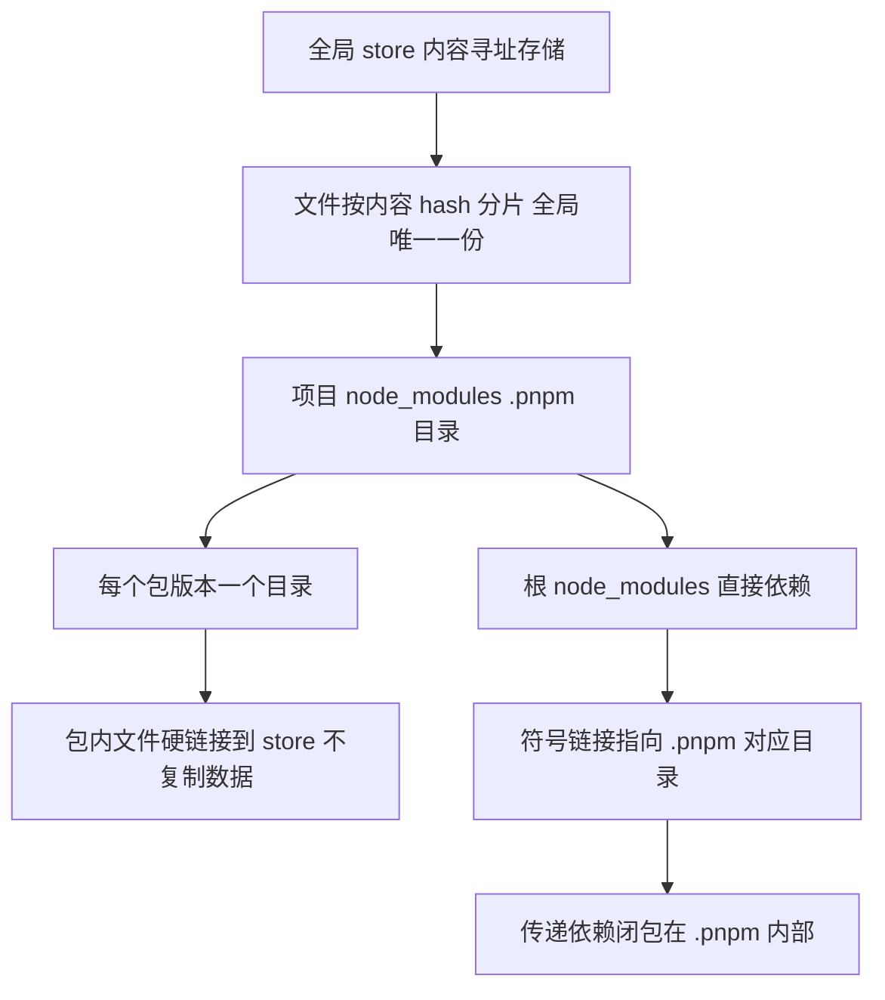

### ENG-061：pnpm 的内容寻址 store 与硬链接存储结构是怎样的？
**答**：
- store 按文件内容 hash 存储在全局目录（pnpm store path 可查），同一文件全机只存一份。
- 项目的 node_modules/.pnpm 下每个包版本一个目录，包内文件通过硬链接指向 store，零复制。
- 根 node_modules 里直接依赖是符号链接，指向 .pnpm 中的真实包，依赖闭包在 .pnpm 内自洽。
- 收益：安装快（硬链接近乎瞬时）、磁盘占用低、结构严格；注意硬链接跨磁盘分区会失效退化为复制。

```bash
# 查看全局 store 位置与占用
pnpm store path
du -sh $(pnpm store path)

# 验证硬链接：node_modules 中的文件与 store 中的文件 inode 相同
ls -i node_modules/.pnpm/lodash@4.17.21/node_modules/lodash/lodash.js
find $(pnpm store path) -name lodash.js -exec ls -i {} \;

# 定期清理 store 中不再被任何项目引用的包
pnpm store prune
```

### ENG-062：.npmrc 的 shamefully-hoist 该不该开？幽灵依赖如何根治？
**答**：
- pnpm 默认严格隔离：代码只能 import 声明过的依赖，幽灵依赖直接报错，这是特性不是 bug。
- shamefully-hoist=true 恢复 npm 扁平化行为，把所有依赖提升到根 node_modules，等于把隔离关掉。
- 折中方案是 public-hoist-pattern：只提升确实存在幽灵引用问题的工具类包（如 eslint 插件）。
- 根治路线：迁移期用 hoist 模式跑通，再逐个 add 显式声明，最后关掉 hoist 让 lint 兜底。

```ini
# .npmrc
; 默认严格隔离：只允许 import package.json 声明过的依赖
shamefully-hoist=false

; 折中：只提升有跨目录调用需求的工具包，比如 eslint 插件解析
public-hoist-pattern[]=*eslint*
public-hoist-pattern[]=*prettier*

; 真实生产建议显式声明后保持空提升
; hoist-pattern[]=空数组可进一步收紧 node_modules/.pnpm 外的链接
```

### ENG-063：lockfile 冲突怎么处理？团队的合并策略是什么？
**答**：
- 冲突根因：两个分支各自 add/update 依赖，git 无法三方合并 lockfile 中的大段哈希块。
- 处理原则：lockfile 永远由工具生成，禁止手工编辑；冲突时先解决 package.json，再按它重新解析。
- 快速做法：保留任意一侧（--theirs），跑 pnpm install --lockfile-only 重算，结果就是正确合并。
- 预防：分支生命周期短、依赖变更集中在少数人、CI 开 frozen-lockfile 校验兜底。

```bash
# 冲突现场：先解决 package.json 的冲突，然后重算 lockfile
git checkout --theirs pnpm-lock.yaml
pnpm install --lockfile-only     # 按 package.json 重新解析，生成正确的合并结果
git add pnpm-lock.yaml

# 验证合并结果可复现（CI 同款命令）
pnpm install --frozen-lockfile --dry-run

# 团队约定写进 CONTRIBUTING：lockfile 只由工具生成
echo "pnpm-lock.yaml merge=ours" >> .gitattributes  # 可选：减少冲突提示面
```

### ENG-064：peerDependencies 冲突如何解析？npm8+ 的自动安装意味着什么？
**答**：
- peer 依赖表达"我需要宿主提供某个包，且版本要与你兼容"，库作者用它声明对 react/vue 等的兼容范围。
- npm 7+（8 起更完善）会自动安装 peer 依赖，代价是版本不兼容时直接 ERESOLVE 报错而不是警告。
- 处理冲突：宿主升版本满足范围；或库侧放宽范围（^18.0.0 || ^19.0.0）；最后手段才用 overrides 仲裁。
- pnpm 的策略更精细：允许同一 peer 的多个版本共存于不同子树，必要时用 pnpm.overrides 强制对齐。

```json
{
  "name": "@myorg/ui-lib",
  "peerDependencies": {
    "react": "^18.0.0 || ^19.0.0"
  },
  "peerDependenciesMeta": {
    "react": { "optional": false },
    "react-dom": { "optional": true }
  },
  "devDependencies": {
    "react": "^19.0.0"
  }
}
```

### ENG-065：overrides 和 resolutions 怎么做依赖仲裁？
**答**：
- overrides（npm 8.3+ / pnpm 同名字段）与 resolutions（yarn）用于强制整棵依赖树中某包的版本。
- 典型场景：修一个无法等待上游发版的安全漏洞（CVE）、消除重复依赖、锁定被劫持的版本。
- 支持精确覆盖：可以只针对某个父依赖下钻（bar 只在 foo 里被替换成指定版本）。
- 它是临时止血手段，要登记技术债，等上游修复后移除，否则长期掩盖真实的版本漂移。

```json
{
  "overrides": {
    "lodash": "4.17.21",
    "semver": "^7.6.0",
    "some-lib": {
      "axios": "1.7.9"
    }
  }
}
```

### ENG-066：私有 npm 仓库怎么搭建？与 npmjs 怎么同步？
**答**：
- 轻量自托管选 verdaccio：本地代理缓存 npmjs + 承载私有包，断网也能装；企业级选 Nexus/Artifactory 制品库。
- 同步策略：内网包走私有域（@myorg/*），外部包配置 uplink 代理拉取并缓存，形成读写分离。
- 发布与安装的凭据走 token（NPM_CONFIG_//registry.npmjs.org/:_authToken），CI 用机器人账号最小授权。
- 灾备要点：私有包定期备份/镜像到灾备仓库，外网挂了不影响内部安装历史版本。

```yaml
# verdaccio config.yaml 核心片段
storage: /verdaccio/storage
auth:
  htpasswd:
    file: /verdaccio/auth/htpasswd
uplinks:
  npmjs:
    url: https://registry.npmjs.org/
    cache: true
    maxage: 5m
packages:
  '@myorg/*':
    access: $authenticated
    publish: $authenticated
    unpublish: $authenticated
  '**':
    access: $all
    publish: $authenticated
    proxy: npmjs
logs: { content: stdout, format: pretty, level: http }
```

---

## 第十七章 脚手架与模板（ENG-067 ~ ENG-072）

### ENG-067：手写一个 CLI 脚手架的核心流程是怎样的？
**答**：
- 入口：package.json 的 bin 字段注册命令，文件头加 #!/usr/bin/env node（shebang）。
- 命令解析用 commander（或 cac）：定义 create 子命令、参数与选项。
- 主流程串联：交互问答（prompts）→ 拉取模板（git clone 或 npm 包内拷贝）→ 变量注入 → 安装依赖 → git init。
- 工程化细节：失败要清理半成品目录，输出统一加 logger 前缀，支持 --template 透传跳过交互。

```javascript
#!/usr/bin/env node
import { Command } from 'commander';
import { create } from './commands/create.js';

const program = new Command();

program
  .name('my-cli')
  .description('团队前端脚手架')
  .version('1.0.0');

program
  .command('create <name>')
  .description('创建一个新项目')
  .option('-t, --template <template>', '指定模板', 'vue3-ts')
  .option('--skip-install', '跳过依赖安装')
  .action((name, options) => create(name, options));

program.parse(process.argv);
```

### ENG-068：脚手架的模板管理怎么做？远程拉取与变量注入如何实现？
**答**：
- 模板载体三种：git 仓库（download-git-repo 拉取）、npm 包（安装即拷贝，带版本）、monorepo 内目录。
- 模板文件用 EJS 写占位符（<%= projectName %>），生成时把交互问答结果作为上下文渲染。
- 文件级改名约定：_package.json 生成时重命名为 package.json，避免模板自身被包管理器误读。
- 要 ignore 掉 node_modules/.git，二进制文件跳过渲染，只做拷贝。

```javascript
import ejs from 'ejs';
import { globSync } from 'glob';
import fs from 'node:fs/promises';
import path from 'node:path';

// 拉取模板后，遍历文件渲染变量并做改名约定
const files = globSync('**/*', { cwd: targetDir, nodir: true, dot: true });
for (const file of files) {
  const abs = path.join(targetDir, file);
  if (/(node_modules|\.git|image)/.test(file)) continue; // 跳过渲染

  const raw = await fs.readFile(abs, 'utf8');
  await fs.writeFile(abs, ejs.render(raw, answers)); // <%= projectName %> 被替换

  // 文件名级变量与约定改名：_package.json -> package.json
  if (file.startsWith('_')) {
    await fs.rename(abs, path.join(targetDir, file.replace(/^_/, '')));
  }
}
```

### ENG-069：create-vite 的源码设计有什么值得借鉴的思想？
**答**：
- 模板不是远程下载，而是 npm 包内自带的 template-* 目录，安装即用、离线可用、发版即更新。
- 交互极简：只问框架与变体（ts/js），按目录组织模板而不是运行时大量分支拼装。
- 变量注入最少化：只改 package.json 的 name，其余保持模板原样，降低模板维护成本。
- 对自研脚手架的启示：模板越"静态"越好，动态逻辑放在交互与后置脚本里。

```typescript
// create-vite 核心思路（简化）
import prompts from 'prompts';

const { framework, variant } = await prompts([
  { type: 'select', name: 'framework', message: '选择框架', choices: [
    { title: 'Vue', value: 'vue' }, { title: 'React', value: 'react' },
  ] },
  { type: (prev) => (prev ? 'select' : null), name: 'variant', message: '变体', choices: [
    { title: 'TypeScript', value: 'ts' }, { title: 'JavaScript', value: 'js' },
  ] },
]);

// 模板在包内 template-vue-ts 目录，直接拷贝，零网络依赖
const templateDir = path.join(__dirname, `template-${framework}-${variant}`);
copyDir(templateDir, targetDir); // 之后只改 package.json 中的 name 字段
```

### ENG-070：脚手架如何做版本升级？为什么破坏性升级要配 codemod？
**答**：
- 升级分两档：小版本公告自动更新（npx 每次拉最新）；大版本提供 migrate 命令自动迁移。
- 破坏性变更靠人工改代码必漏，codemod（jscodeshift）基于 AST 批量改写，产出可 review 的 diff。
- 迁移脚本与脚手架同仓库同版本发布：npx my-cli migrate router-v6，保证版本对齐。
- 升级体验闭环：check 命令探测项目与最新模板差异 → migrate 自动改 → 人工确认 → 提交。

```bash
# 1. 探测项目与最新脚手架版本的配置差异
npx my-cli check

# 2. 破坏性升级执行配套 codemod（脚本与脚手架同版本发布）
npx my-cli migrate router-v6

# 3. codemod 底层示例：jscodeshift 执行 AST 转换
npx jscodeshift -t transforms/router-v6.ts --extensions=ts,tsx src/

# 4. 迁移后人工 review diff，再走正常提交门禁
git diff --stat
```

### ENG-071：交互式 CLI 怎么实现？inquirer 和 prompts 怎么选？
**答**：
- prompts 轻量、API 声明式、支持用函数实现条件联动（上一题选了才继续问）；inquirer 生态更全、插件多。
- 交互设计原则：能推断的默认值直接给 initial，不要连环问；提供 --yes 参数跳过全部交互方便 CI。
- 必须处理 onCancel：用户 Ctrl+C 时清理已创建的目录再退出，不留半成品。
- 复杂向导（多步依赖前面的答案）用状态机思路组织，每步只依赖已收集的字段。

```javascript
import prompts from 'prompts';

const answers = await prompts(
  [
    { type: 'text', name: 'projectName', message: '项目名称', initial: 'my-app' },
    { type: 'select', name: 'css', message: 'CSS 方案', choices: [
      { title: 'Tailwind', value: 'tailwind' },
      { title: 'CSS Modules', value: 'css-modules' },
    ] },
    { type: 'confirm', name: 'needLint', message: '接入 ESLint？', initial: true },
    {
      // 条件联动：只有上一步选了 lint 才追问插件
      type: (prev) => (prev ? 'multiselect' : null),
      name: 'lintPlugins',
      message: '选择 lint 插件',
      choices: [{ title: 'stylelint', value: 'stylelint' }],
    },
  ],
  { onCancel: () => process.exit(0) } // 用户中断即退出，由上层清理目录
);
```

### ENG-072：CLI 工具怎么发布与全局安装？bin 字段和权限有哪些坑？
**答**：
- package.json 的 bin 字段把命令名映射到脚本，npm install -g 时自动在全局 bin 目录建符号链接。
- 脚本必须带 shebang（#!/usr/bin/env node），且 files 字段要包含 bin 与 templates，否则发布缺文件。
- scoped 包（@myorg/cli）全局安装要带域：npm i -g @myorg/cli；常用做法是提供短别名 bin。
- 权限坑：不要 sudo npm i -g，用 nvm 管理的 node 则写入用户目录无需 root；EACCES 优先检查 node 版本路径。

```json
{
  "name": "@myorg/create-app",
  "version": "2.1.0",
  "type": "module",
  "bin": {
    "@myorg/create-app": "bin/cli.js",
    "my-create": "bin/cli.js"
  },
  "files": ["bin", "templates", "README.md"],
  "engines": { "node": ">=18" },
  "publishConfig": { "access": "public" }
}
```

---

## 第十八章 代码规范深化（ENG-073 ~ ENG-079）

### ENG-073：如何编写一个 ESLint 自定义规则？AST 规则实战？
**答**：
- 规则三件套：meta（类型、schema、消息模板）、create（返回 AST 访问器对象）、配套 RuleTester 单测。
- 選点很关键：ImportDeclaration 管 import 来源、CallExpression 管函数调用、MemberExpression 管属性访问。
- 插件形态：本地 monorepo 内共享（eslint-plugin-myorg）或发布到私有 registry，flat config 中直接 import。
- 报错要给修复路径：message 里写清"禁止 X，请用 Y"，必要时实现 fix 函数支持 --fix。

```javascript
// eslint-plugin-myorg 自定义规则：禁止 import 禁用包
module.exports = {
  meta: {
    type: 'problem',
    docs: { description: '禁止 import 内部禁用的包' },
    schema: [{ type: 'array', items: { type: 'string' } }], // 接收禁用包列表
    messages: { banned: '禁止使用 {{name}}，请使用内部封装层' },
  },
  create(context) {
    const banned = context.options[0] ?? [];
    return {
      ImportDeclaration(node) {
        const source = String(node.source.value);
        if (banned.includes(source)) {
          context.report({ node, messageId: 'banned', data: { name: source } });
        }
      },
    };
  },
};

// 使用：rules: { 'myorg/no-banned-import': ['error', ['moment', 'lodash']] }
```

### ENG-074：ESLint flat config 迁移有哪些要点？
**答**：
- 入口从 .eslintrc* 变为 eslint.config.js（mjs），导出数组按顺序合并，后者覆盖前者。
- 老的 extends/overrides 换成数组展开与 files 过滤：configs 里手动展开插件推荐集。
- ignore 用单独的全局项（ignores 只出现一个键时表示全局忽略），替代 .eslintignore。
- 老插件不兼容时用 FlatCompat 转换层过渡；ESLint v9 起已移除 eslintrc 支持必须迁移。

```javascript
// eslint.config.mjs flat config
import js from '@eslint/js';
import tseslint from 'typescript-eslint';
import reactHooks from 'eslint-plugin-react-hooks';

export default tseslint.config(
  { ignores: ['dist/**', 'coverage/**', 'node_modules/**'] },
  js.configs.recommended,
  ...tseslint.configs.recommended,
  {
    files: ['**/*.{ts,tsx}'],
    plugins: { 'react-hooks': reactHooks },
    rules: {
      ...reactHooks.configs.recommended.rules,
      'no-console': ['warn', { allow: ['warn', 'error'] }],
    },
  },
  {
    // 局部覆盖：构建脚本允许 console
    files: ['scripts/**/*.ts'],
    rules: { 'no-console': 'off' },
  }
);
```

### ENG-075：Prettier 与 ESLint 的冲突治理是怎么演进的？现在推荐怎么做？
**答**：
- 第一阶段：eslint-config-prettier 关掉所有与 Prettier 重复的格式规则，两工具分工。
- 第二阶段：eslint-plugin-prettier 把 Prettier 作为一条 lint 规则跑，好处是统一出口，代价是慢且报错信息差。
- 现在（推荐）：格式完全交给 Prettier（编辑器保存即格式化 + CI 跑 prettier --check），ESLint 只管代码质量。
- 关键是职责分离：格式问题不用 lint 报错，质量规则（no-unused-vars、eqeqeq）Prettier 也不插手。

```javascript
// eslint.config.mjs：职责分离的推荐结构
import eslintConfigPrettier from 'eslint-config-prettier';

export default [
  ...qualityConfigs,        // ESLint 只保留质量规则：no-unused-vars、eqeqeq 等
  eslintConfigPrettier,     // 放最后：兜底关闭一切与 Prettier 冲突的格式规则
  // 不再使用 eslint-plugin-prettier，格式问题由独立的 prettier --check 把关
];
```

```bash
# CI 中格式与质量分开校验
pnpm prettier --check .
pnpm eslint .
```

### ENG-076：Stylelint 怎么定制？属性顺序与黑名单怎么配？
**答**：
- 继承 stylelint-config-standard 打底，再用 rules 覆盖团队特有约束。
- 属性顺序用 stylelint-order 插件的 properties-order：布局属性在前、视觉属性在后，review 可读性明显提升。
- 黑名单用 declaration-property-value-disallowed-list：禁 border:none（该用 0）、禁万能选择器等。
- 与 Prettier 的边界同前：Stylelint 管写法质量与架构约束，缩进分号等交给 Prettier。

```json
{
  "extends": ["stylelint-config-standard"],
  "plugins": ["stylelint-order"],
  "rules": {
    "order/properties-order": [
      "position", "z-index", "top", "left",
      "display", "flex", "grid",
      "width", "height", "margin", "padding",
      "color", "background", "border"
    ],
    "declaration-property-value-disallowed-list": {
      "/^border/": ["none"],
      "/^font/": ["system-ui"]
    },
    "max-nesting-depth": 3
  }
}
```

### ENG-077：.editorconfig 解决什么问题？和 Prettier 是什么关系？
**答**：
- editorconfig 是编辑器层面的基础约定（缩进、换行符、字符集、末尾换行），VSCode/JetBrains 原生支持。
- 它解决"打开文件那一刻"的一致性：Prettier 只在保存/CI 时格式化，editorconfig 让编辑器行为先对齐。
- 层级继承：root = true 标记根目录，子目录可再放 .editorconfig 覆盖特定文件类型。
- 注意保持与 Prettier 配置一致（indent_size=2 对应 printWidth 之外的缩进约定），避免互相打架。

```ini
# .editorconfig
root = true

[*]
charset = utf-8
end_of_line = lf
insert_final_newline = true
indent_style = space
indent_size = 2
trim_trailing_whitespace = true

[*.md]
trim_trailing_whitespace = false

[*.{yml,yaml}]
indent_size = 2
```

### ENG-078：husky v9+ 与 lint-staged 的最新配置怎么写？
**答**：
- v9 大幅简化：npx husky init 一条命令生成 .husky/pre-commit，脚本里只剩一行调用，去掉了废弃的 add。
- 目录 .husky/ 下的文件就是纯 shell 脚本，直接写要执行的命令，不再需要 source 配置头。
- lint-staged 负责只处理 git 暂存区文件：改哪个文件跑哪个工具，全量 lint 才留给 CI。
- v9 兼容 core.hooksPath 机制，monorepo 中注意在根目录初始化一次即可。

```bash
# 初始化（v9 一条命令搞定）
npx husky init
# pre-commit 文件内容只需一行
echo "npx lint-staged" > .husky/pre-commit
```

```json
{
  "lint-staged": {
    "*.{ts,tsx}": ["eslint --fix", "prettier --write"],
    "*.{css,scss}": ["stylelint --fix"],
    "*.{json,md,yml}": ["prettier --write"]
  }
}
```

### ENG-079：提交卡口的完整链路怎么设计？commit-msg 与 pre-push 如何分层？
**答**：
- 分层原则：越早的 hook 越快，把重活下沉，让开发者不被慢卡口折磨到用 --no-verify 绕过。
- commit-msg 只校验提交信息（commitlint，毫秒级）；pre-commit 只查暂存区文件（lint-staged，秒级）。
- pre-push 跑重门禁：单测、typecheck、build，此时改动已成型，失败代价最低。
- 本地 hook 可被 --no-verify 绕过，服务端 pre-receive 钩子（见 Git 深水区）是规范落地的最后一道。

```bash
# .husky/commit-msg —— 只做提交信息校验，毫秒级
npx --no -- commitlint --edit "$1"

# .husky/pre-commit —— 只校验暂存区文件，秒级
npx lint-staged

# .husky/pre-push —— 推送前跑重门禁：单测与类型检查
pnpm test run
pnpm typecheck
```

---

## 第十九章 Git 深水区（ENG-080 ~ ENG-086）

### ENG-080：rebase 与 merge 的工程决策怎么做？团队策略怎么定？
**答**：
- 核心红线：已推送到共享分支的提交禁止 rebase，重写历史会让协作者本地仓库错乱。
- 推荐策略：本地未推送的零散提交用 rebase 收拾干净；合并回主干用 merge --no-ff 保留合并节点可回溯。
- 团队可选两种风格之一并写进规范：线性历史（PR squash merge）或保留拓扑（merge commit），混用最糟。
- 工具配套：git pull 默认配 --rebase 减少无意义合并提交；冲突在 rebase 中逐个解决，范围更小。

```bash
# 团队策略落地示例
# 1. 本地同步主干：变基拉取，避免产生 merge commit
git config pull.rebase true

# 2. feature 分支整理：只对未推送的提交做交互式变基
git rebase -i origin/main

# 3. 合入主干：保留合并节点，方便整体回滚一个特性
git checkout main
git merge --no-ff feature/login -m "Merge feature/login"

# 4. PR 平台配置：squash merge 保持线性历史
gh repo edit --merge=false --squash=true
```

### ENG-081：interactive rebase 实战：怎么压缩提交、修改历史？
**答**：
- git rebase -i HEAD~N 打开待办清单：pick 保留、squash/s 合并进上一个、reword 改信息、drop 丢弃。
- 典型场景：功能分支上的 WIP、fixup 提交在合并前压成一个干净提交。
- 改的是分支上未推送的提交；如果必须改已推送的私有分支，force push 要加 --force-with-lease。
- 出问题先 git rebase --abort 整体撤销；rebase 前记录一次 ORIG_HEAD/reflog 可找回。

```bash
# 把最近 3 个提交压缩成一个
git rebase -i HEAD~3
# 编辑器中的待办清单，第一个保持 pick，其余改 squash：
#   pick a1b2c3 feat: 登录页
#   squash d4e5f6 fix: 修正样式
#   squash f7g8h9 chore: 调整依赖

# 更省事的写法：最后一个提交直接并入前一个
git commit --amend --no-edit

# 中途出错：整体撤销回到 rebase 前
git rebase --abort

# 解决冲突后继续变基
git add -A && git rebase --continue

# 必须覆盖已推送的私有分支时，用安全强推
git push --force-with-lease
```

### ENG-082：cherry-pick 怎么做跨分支同步修复？
**答**：
- 场景：热修先落在 release 分支，需要原样同步到 main 与其他维护分支。
- 单个提交直接 cherry-pick <sha>；一段连续提交用 ^..范围语法（含起点）。
- 冲突解决后 git cherry-pick --continue；想放弃本次摘取用 --abort。
- 提交信息按惯例追加 origin 标注，GitHub 能据此标记"已同步"，避免重复摘取。

```bash
# 把热修提交摘到当前分支
git checkout release/1.8
git cherry-pick 3f8d2c1

# 摘取一段连续提交（含起点）
git cherry-pick 3f8d2c1^..9a1b4e2

# 冲突解决后继续 / 放弃
git cherry-pick --continue
git cherry-pick --abort

# 提交信息保留来源，便于回溯与去重
git log -1 --format=%B
```

### ENG-083：git 回滚全家桶：reset、revert、reflog 分别什么时候用？
**答**：
- 未推送的本地提交：git reset --soft 保留改动在暂存区，--hard 连工作区一起丢（谨慎）。
- 已推送的共享提交：git revert 生成反向提交，不改写历史，是协作分支唯一安全的回滚。
- 任何"丢失"的提交：git reflog 记录了 HEAD 的全部移动，git reset --hard HEAD@{n} 找回。
- 精细化撤销：git restore 管工作区/暂存区的文件级撤销，比 checkout 语义更清晰。

```bash
# 1. 未推送：软回滚，改动退回暂存区
git reset --soft HEAD~1

# 2. 已推送：反向提交，不改写历史
git revert --no-edit 3f8d2c1

# 3. 误删/误 reset：reflog 找回所有 HEAD 移动记录
git reflog
git reset --hard HEAD@{3}

# 4. 文件级撤销：暂存区与工作区分别处理
git restore --staged src/app.ts
git restore src/app.ts
```

### ENG-084：submodule、subtree、monorepo 怎么选？
**答**：
- submodule：主仓库只存引用指针，克隆后要 update --init 才有内容；版本边界清晰但心智负担重，CI/新手上手成本高。
- subtree：把外部仓库内容真实合入主仓库，普通 clone 即可用；同步命令复杂但无额外操作成本。
- monorepo：多团队高频协作时统一仓库 + pnpm workspace，工具链成熟（Turborepo/changesets）是当下主流。
- 经验法则：低频依赖选 submodule（或干脆发 npm 包）；需要源码级联调直接 monorepo；subtree 适合"要源码但不想拆"的场景。

```bash
# submodule：引用式管理，克隆后需初始化
git submodule add https://github.com/org/shared-ui.git packages/shared-ui
git clone --recurse-submodules https://github.com/org/app.git   # 克隆时一并拉取
git submodule update --remote                                    # 更新到子仓库最新

# subtree：内容合入主仓库，普通 clone 即可用
git subtree add --prefix=packages/shared-ui https://github.com/org/shared-ui.git main --squash
git subtree pull --prefix=packages/shared-ui https://github.com/org/shared-ui.git main --squash
```

### ENG-085：服务端 git hooks 怎么做强制卡口？pre-receive 实例？
**答**：
- 本地 hook 挡不住 --no-verify，规范要强制落地必须靠服务端：GitLab server hook、Gitea/Gitolite pre-receive。
- pre-receive 从 stdin 读入 oldrev newrev refname 三元组，逐个 ref、逐个提交校验，不合规直接 exit 1 拒绝推送。
- 常见卡口：main 禁直推、提交信息规范、禁止 force push 保护分支、大文件扫描。
- 注意性能与体验：拒绝信息要写清楚修复方式，重检查（全量 lint/test）放 CI 而不是 pre-receive。

```bash
#!/bin/bash
# 服务端 pre-receive 钩子
ZERO=0000000000000000000000000000000000000000
while read oldrev newrev refname; do
  # 卡口一：main 禁止直接推送，必须走 MR
  if [[ "$refname" == "refs/heads/main" && "$oldrev" != "$ZERO" ]]; then
    echo "main 禁止直接推送，请走 Merge Request" >&2
    exit 1
  fi
  # 卡口二：提交信息必须符合 Conventional Commits
  for commit in $(git rev-list "$oldrev..$newrev"); do
    msg=$(git log -1 --format=%s "$commit")
    if ! grep -qE '^(feat|fix|chore|docs|refactor|test|ci|perf|style|revert)(\(.+\))?: ' <<< "$msg"; then
      echo "提交 $commit 信息不符合规范：$msg" >&2
      exit 1
    fi
  done
done
exit 0
```

### ENG-086：大仓库怎么优化？partial clone 与 fetch depth 怎么用？
**答**：
- 浅克隆 --depth 1 只拉最近一次提交的快照，CI 场景提速最明显；增量用 git fetch --depth 1 origin main。
- partial clone --filter=blob:none 先拉提交与树、blob 按需下载，checkout 时才取需要的文件内容。
- sparse-checkout 只检出需要的子目录，monorepo 单包开发者不必拉全仓工作区。
- 组合使用最有效：clone --filter=blob:none --no-checkout + sparse-checkout set + 单分支 fetch 配置。

```bash
# 1. 浅克隆：CI 最常用，只拉最新一次提交
git clone --depth 1 --branch main https://github.com/org/repo.git

# 2. partial clone：提交与树全量，blob 按需下载
git clone --filter=blob:none --no-checkout https://github.com/org/repo.git

# 3. sparse-checkout：只检出需要的目录
cd repo && git sparse-checkout set --cone frontend packages/ui
git checkout main

# 4. 收窄 fetch 范围：只跟踪 main，减少本地引用体积
git config remote.origin.fetch '+refs/heads/main:refs/remotes/origin/main'
git fetch --prune origin
```

---

## 第二十章 环境与配置管理（ENG-087 ~ ENG-092）

### ENG-087：.env 文件体系与加载优先级是怎样的（以 Vite/Next 为例）？
**答**：
- Vite 加载顺序（高到低，同名覆盖）：.env.[mode].local > .env.[mode] > .env.local > .env；.local 默认进 gitignore。
- 只有 VITE_ 前缀的变量会被注入客户端产物，其余留在 process.env 只供 vite.config 等服务端使用。
- Next.js 支持 .env/.env.local/.env.[env]，但值在 build 时内联进产物，运行时改 .env 不生效。
- 纪律：.env.example 提交字段模板并注明用途；真实 .env 不入库；mode 与 NODE_ENV 的映射要搞清（build --mode staging）。

```bash
# Vite 环境文件加载优先级（从高到低，高优先级覆盖低优先级）
# 1. .env.development.local
# 2. .env.development
# 3. .env.local
# 4. .env

# 检查：带 VITE_ 前缀的变量才会进客户端产物
cat .env.development
#   VITE_API_BASE=https://dev.example.com/api     <- 会注入 import.meta.env
#   DATABASE_URL=postgres://localhost/mydb        <- 无前缀，仅服务端可见

# 本地私密覆盖不入库
cat .gitignore | grep env
#   .env.local
#   .env.*.local

# staging 等自定义模式要显式指定
pnpm build --mode staging
```

### ENG-088：运行时配置注入怎么做？window.__CONFIG 与环境变量怎么取舍？
**答**：
- 构建期环境变量（VITE_*）打进产物：改配置必须重新构建，适合不常变的构建态常量。
- 同一 Docker 镜像要部署到多环境（k8s 多套集群）时，必须运行时注入：容器启动时把配置写进 index.html 的 window.__APP_CONFIG__。
- 读取封装成统一模块，优先级 window.__CONFIG__ > 构建期变量 > 默认值，并做类型定义与校验。
- 安全边界：运行时配置同样可能被用户看到，任何密钥都不该放在这个链路里，只放地址、开关类公开配置。

```html
<!-- index.html：容器启动脚本会替换占位符，实现一次构建多环境部署 -->
<script>
  window.__APP_CONFIG__ = {
    apiBase: "/__API_BASE__",
    sentrySampleRate: 0.2,
  };
</script>
```

```typescript
// src/config.ts：统一读取入口，优先级 window 配置 > 构建期变量 > 默认值
interface AppConfig {
  apiBase: string;
  sentrySampleRate: number;
}

export const config: AppConfig = {
  apiBase:
    window.__APP_CONFIG__?.apiBase ??
    import.meta.env.VITE_API_BASE ??
    '/api',
  sentrySampleRate: window.__APP_CONFIG__?.sentrySampleRate ?? 1,
};
```

### ENG-089：前端如何接入配置中心？怎么设计降级？
**答**：
- 配置中心（Nacos/Apollo/自建）解决"改配置不发版"：功能开关、灰度比例、营销文案在运行时拉取。
- 客户端模式：应用启动时拉取全量配置 → 订阅长轮询/WebSocket 增量更新 → 内存生效，避免热改代码路径。
- 降级三件套：内置默认值兜底（配置中心挂了应用照样启动）、本地缓存最近一次成功值、拉取失败必须上报监控。
- 关键配置（如支付开关）要走审核与灰度，防止误操作全量生效。

```typescript
// 远程配置加载：远程值覆盖默认值，失败降级并上报
const DEFAULTS: AppConfig = {
  featureFlagNewHome: false,
  uploadMaxSizeMb: 10,
};

export async function loadRemoteConfig(): Promise<AppConfig> {
  try {
    const controller = new AbortController();
    const timer = setTimeout(() => controller.abort(), 3000); // 3 秒超时
    const res = await fetch('/api/runtime-config?v=1', { signal: controller.signal });
    clearTimeout(timer);
    if (!res.ok) throw new Error(`config http ${res.status}`);
    return { ...DEFAULTS, ...(await res.json()) }; // 缺字段自动用默认值兜底
  } catch (err) {
    reportConfigFallback(err); // 降级必须可见，否则配置中心故障无人知晓
    return DEFAULTS;
  }
}
```

### ENG-090：secrets 的全生命周期管理怎么做（本地/CI/生产）？
**答**：
- 本地：.env 不入库 + .env.example 模板入库；敏感值用 1Password CLI/direnv 注入，杜绝粘贴进聊天与 issue。
- CI：只经平台 secrets（GitHub Actions secrets/GitLab CI variables）注入环境变量，禁止 echo、禁止写进日志与 artifacts。
- 生产：K8s Secret/云 KMS/Vault 管理，应用启动时挂载；CI 对生产凭据最小授权（只给部署所需权限）。
- 轮换与审计：凭据定期轮换、按人/服务独立发放；一旦泄漏立即吊销而不是改代码隐藏。

```yaml
# GitHub Actions 中 secrets 的正确用法
jobs:
  deploy:
    runs-on: ubuntu-latest
    environment: production        # 环境级 secrets，可加人工审批
    steps:
      - name: deploy
        env:
          DEPLOY_TOKEN: ${{ secrets.DEPLOY_TOKEN }}   # 只经环境变量传递
          DEPLOY_HOST: ${{ vars.DEPLOY_HOST }}        # 非敏感值用 vars
        run: ./scripts/deploy.sh
        # 禁止：echo $DEPLOY_TOKEN、写进文件、放进 npm script 参数
```

### ENG-091：多租户/多环境的构建矩阵怎么设计？
**答**：
- 维度建模：环境（dev/staging/prod）、租户/品牌（白标）、端（h5/小程序），矩阵笛卡尔积即构建产物集合。
- 用矩阵 job 一次定义并行产出，exclude 裁掉不存在的组合，控制产物数量爆炸。
- 配置分层：租户差异走独立的 tenant.config（主题/域名/功能开关），环境差异走 .env，两者正交不混写。
- 产物命名带 env+tenant+版本号，进制品库统一管理，杜绝"目录里躺着一堆不知道哪来的 dist"。

```yaml
# GitHub Actions 构建矩阵：3 环境 x 2 端，裁剪后 5 个产物
jobs:
  build:
    runs-on: ubuntu-latest
    strategy:
      fail-fast: false
      matrix:
        env: [dev, staging, prod]
        platform: [h5, mp-weixin]
        exclude:
          - env: dev
            platform: mp-weixin   # 小程序只出 staging 与 prod
    steps:
      - uses: actions/checkout@v4
      - uses: pnpm/action-setup@v4
      - run: pnpm install --frozen-lockfile
      - run: pnpm build --mode ${{ matrix.env }} --platform ${{ matrix.platform }}
        env:
          VITE_TENANT: ${{ vars.TENANT }}
      - uses: actions/upload-artifact@v4
        with:
          name: dist-${{ matrix.env }}-${{ matrix.platform }}
          path: dist/
```

### ENG-092：配置漂移检测怎么做？
**答**：
- 漂移：线上实际配置偏离仓库基线（有人手动改了服务器/控制台），时间久了无人知道，事故时才暴露。
- 核心思路：把"期望配置"入库做基线，定时任务拉取"实际配置"做 diff，不一致即告警。
- 覆盖对象：Nginx/k8s manifests/DNS/CDN 规则/配置中心命名空间。
- 配套纪律：告警后要么回滚线上，要么把变更补进基线走评审，禁止只消音不闭环。

```bash
#!/bin/bash
# 巡检脚本：对比线上 Nginx 配置与仓库基线，发现漂移即告警
BASELINE=config/nginx/nginx.conf
for host in web-01 web-02 web-03; do
  ssh "$host" 'cat /etc/nginx/nginx.conf' > "/tmp/${host}.nginx.conf" || { echo "ALERT: $host 拉取失败"; continue; }
  if ! diff -q "$BASELINE" "/tmp/${host}.nginx.conf" > /dev/null; then
    echo "ALERT: ${host} 配置漂移，偏离仓库基线"
    diff "$BASELINE" "/tmp/${host}.nginx.conf" | head -20
  fi
done
```

---

## 第二十一章 CI CD 深化（ENG-093 ~ ENG-099）

### ENG-093：流水线即代码有哪些设计模式？可复用 job 怎么抽象？
**答**：
- 模式一：extends/锚点复用公共 before_script 与镜像；模式二：可复用 workflow（GitHub 的 workflow_call / GitLab 的 include）跨仓库共享。
- 模式三：模板仓库 + 参数化输入，团队 CI SRE 维护一份模板，业务仓库只写差异。
- 抽象原则：抽"稳定不变的部分"（环境准备、缓存、制品上传），留"每仓不同"的参数位，避免过度封装导致排障黑盒。
- 版本化引用：include 一个具体 tag 而不是 main，模板升级要走公告与兼容期。

```yaml
# .gitlab-ci.yml：extends 组装可复用 job
.base-job:
  image: node:22-alpine
  before_script:
    - corepack enable
    - pnpm install --frozen-lockfile

lint:
  extends: .base-job
  script: pnpm lint

build:
  extends: .base-job
  script: pnpm build
  artifacts:
    paths: [dist/]
    expire_in: 1 week
```

```yaml
# 跨仓库复用：引入团队模板（锁定版本）
include:
  - project: 'fe/ci-templates'
    ref: v3.2.0
    file: '/templates/frontend-pipeline.yml'
```

### ENG-094：构建缓存怎么设计？依赖、产物、远程缓存三层怎么分层？
**答**：
- 第一层依赖缓存：按 lockfile 哈希做 key（setup-node/cache: pnpm），命中率最高收益最大。
- 第二层产物缓存：构建工具自身的中间缓存（.next/cache、vite 的 node_modules/.vite），同依赖版本可复用。
- 第三层远程缓存：Turborepo/远端缓存服务按内容哈希命中整个 task 输出，团队内共享，"别人构建过你就不用构建"。
- 缓存纪律：key 必须含输入指纹（lockfile/源码哈希），restore-keys 做软回退；缓存污染问题定期清理。

```yaml
# GitHub Actions 三层缓存组合
- uses: pnpm/action-setup@v4
- uses: actions/setup-node@v4
  with:
    node-version: 22
    cache: pnpm                                        # 第一层：依赖缓存，key 含 lockfile hash

- uses: actions/cache@v4                              # 第二层：构建工具产物缓存
  with:
    path: .next/cache
    key: nextjs-${{ hashFiles('pnpm-lock.yaml') }}-${{ github.sha }}
    restore-keys: |
      nextjs-${{ hashFiles('pnpm-lock.yaml') }}-

- run: pnpm turbo build                               # 第三层：远程缓存，全团队共享任务输出
  env:
    TURBO_TOKEN: ${{ secrets.TURBO_TOKEN }}
    TURBO_TEAM: myorg
```

### ENG-095：矩阵构建怎么做多版本/多端并行验证？
**答**：
- strategy.matrix 定义维度（node 版本、OS、浏览器、端），GitHub Actions 自动展开并行 job。
- fail-fast: false 让一个失败不连坐，能看到全部失败组合再统一修。
- exclude 裁掉无意义组合（老版本 x 昂贵平台），include 补充特殊组合。
- 成本意识：矩阵乘法很烧 runner，按"出过问题的维度"决定矩阵范围，而不是无脑全量。

```yaml
# 多 Node 版本 x 多 OS 的兼容性验证矩阵
jobs:
  test:
    runs-on: ${{ matrix.os }}
    strategy:
      fail-fast: false
      matrix:
        node: [20, 22, 24]
        os: [ubuntu-latest, macos-latest]
        exclude:
          - node: 20
            os: macos-latest    # 维护成本高的组合裁掉
        include:
          - node: 24
            os: windows-latest  # 特殊补一个 Windows 用例
    steps:
      - uses: actions/checkout@v4
      - uses: actions/setup-node@v4
        with:
          node-version: ${{ matrix.node }}
          cache: pnpm
      - run: pnpm install --frozen-lockfile
      - run: pnpm test run
```

### ENG-096：制品管理与晋级怎么做？为什么要"同一制品晋级"？


**答**：
- 原则：dev→staging→prod 每个环境部署的必须是同一个二进制/镜像，只改环境配置，绝不在各环境重新构建。
- 重新构建的风险：三次构建的依赖时点可能不同，staging 验证过的东西到 prod 就"不是同一个东西"。
- 落地：CI 构建一次进制品库（Harbor/Artifactory），部署 job 只做"拉取指定版本 + 注入环境配置"。
- 晋级即打标：通过 staging 验收后加 rc 标签晋级 prod，回滚就是回退到上一个版本标签，秒级完成。
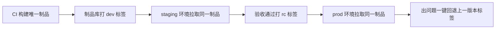

```yaml
# 同一制品晋级：build 产出镜像，staging 与 prod 只引用镜像版本
jobs:
  build:
    outputs:
      image: ${{ steps.meta.outputs.image }}
    steps:
      - run: docker build -t app:sha-${{ github.sha }} .
      - id: meta
        run: echo "image=app:sha-${{ github.sha }}" >> "$GITHUB_OUTPUT"

  deploy-staging:
    needs: build
    steps:
      - run: kubectl set image deploy/app app=${{ needs.build.outputs.image }} # 同一镜像

  deploy-prod:
    needs: [build, deploy-staging]
    environment: production      # 人工审批门
    steps:
      - run: kubectl set image deploy/app app=${{ needs.build.outputs.image }} # 仍是同一镜像
```

### ENG-097：蓝绿/金丝雀等部署策略如何在流水线里参数化实现？
**答**：
- 把策略抽象成流水线输入（strategy + 参数），同一套流水线支持蓝绿与金丝雀，按发布风险选择。
- 蓝绿：备节点部署新版本，流量瞬时切换，回滚即切回；金丝雀：小流量验证指标，逐步放量。
- 金丝雀必须配自动观测与回滚：错误率/延迟超阈值自动回到 0%，不能靠人盯盘。
- 流水线层面体现为：部署 job 按 strategy 分支，放量脚本参数化（5% → 25% → 100%）。

```yaml
# workflow_call 参数化部署：同一流水线支持两种策略
on:
  workflow_call:
    inputs:
      strategy:
        type: string
        default: canary
      canary_percent:
        type: string
        default: '5'

jobs:
  deploy:
    steps:
      - name: blue-green
        if: ${{ inputs.strategy == 'blue-green' }}
        run: |
          ./deploy.sh --target=standby
          ./switch-traffic.sh --instant       # 流量瞬时切换，回滚即切回
      - name: canary
        if: ${{ inputs.strategy == 'canary' }}
        run: |
          ./deploy.sh --target=canary --replicas=1
          ./route-weight.sh --canary=${{ inputs.canary_percent }}
          ./canary-watch.sh --threshold=1% --auto-rollback   # 超阈值自动回滚
```

### ENG-098：流水线安全怎么做？权限最小化、密钥作用域与第三方 action 审查？
**答**：
- 权限最小化：顶层 permissions: contents: read，按 job 单独提升；PR 触发的流水线不给 secrets。
- 密钥作用域：环境级 secrets + environment 审批，production 凭据只在 prod job 且需人工批准。
- 第三方 action 锁 commit SHA 而不是 tag（tag 可被作者重定向投毒），核心 action 固定在已知好版本。
- 供应链配套： Dependabot/renovate 升级 action 并走 PR review，PR 流水线与 main 流水线的权限分离。

```yaml
# GitHub Actions 安全加固要点
permissions:
  contents: read        # 全局默认只读，按需在 job 内提升

jobs:
  build:
    permissions: { contents: read }
    steps:
      - uses: actions/checkout@8f4b7f8484a3d0e33f0f9a2b7c1d4e5f6a7b8c9d  # 锁 commit SHA 防投毒
      - run: pnpm build

  deploy:
    needs: build
    environment: production          # 环境级密钥 + 人工审批
    permissions: { contents: read, id-token: write }
    steps:
      - uses: aws-actions/configure-aws-credentials@b4a1b3d0ff0c3f0e1a2b3c4d5e6f708192a3b4c5
        with:
          role-to-assume: ${{ vars.DEPLOY_ROLE }}   # OIDC 短期凭证，不存长期 AK
```

### ENG-099：流水线可观测怎么做？时长趋势与失败率看板如何搭建？
**答**：
- 指标三件套：P95 时长（趋势）、失败率（稳定性）、缓存命中率（成本），按 workflow 与 job 维度拆分。
- 数据源：GitHub Actions API / GitLab API 定时拉取运行记录，清洗后写入监控或 BI 看板。
- 解读经验：时长突涨常是缓存未命中或依赖变大；失败率周期性飙升指向 flaky 用例或 runner 抖动。
- 闭环：阈值告警（失败率 > 15% 触发治理）+ 每 sprint 回顾 Top 失败原因。

```javascript
// 定时任务：拉取最近 100 次运行，计算时长与失败率推送看板
const { data } = await github.rest.actions.listWorkflowRuns({
  owner: 'org',
  repo: 'web',
  workflow_id: 'ci.yml',
  per_page: 100,
});

const finished = data.workflow_runs.filter((r) => r.run_ended_at);
const durations = finished
  .map((r) => (new Date(r.run_ended_at) - new Date(r.run_started_at)) / 1000)
  .sort((a, b) => a - b);
const failures = finished.filter((r) => r.conclusion === 'failure').length;
const p95 = durations[Math.floor(durations.length * 0.95) - 1];

await pushToDashboard('ci-health', {
  p95DurationSec: Math.round(p95),
  failureRate: `${((failures / finished.length) * 100).toFixed(1)}%`,
});
```

---

## 第二十二章 测试工程化（ENG-100 ~ ENG-105）

### ENG-100：测试金字塔怎么在工程里落地？单测、集成、E2E 的比例与门禁怎么定？
**答**：
- 比例参考 70/20/10：单元测试打底、少量集成测试、极少量关键路径 E2E，越往上越慢越脆。
- 门禁分层：PR 卡口只挂单测与类型检查（秒级~分钟级）；E2E 放在合入 main 后异步跑，不阻塞开发者。
- 集成测试（组件级/模块级）补单测与 E2E 之间的断层，用 Vitest + Testing Library + MSW 承载。
- 反模式：金字塔倒置（E2E 占大头）导致流水线慢、flaky 噪音大、失败定位难。

```yaml
# CI 分层执行：PR 只跑单测，E2E 在 main 上异步跑
jobs:
  unit:
    if: github.event_name == 'pull_request' || github.ref == 'refs/heads/main'
    steps:
      - run: pnpm vitest run --coverage

  e2e:
    if: github.ref == 'refs/heads/main'   # 只在主干跑，不阻塞 PR
    needs: unit
    steps:
      - run: pnpm playwright install --with-deps
      - run: pnpm playwright test
```

### ENG-101：覆盖率门禁怎么设计？增量覆盖率为什么比总覆盖率合理？
**答**：
- 总覆盖率门禁的老仓库困境：存量代码低覆盖，一刀切 80% 永远过不了，最后只能关掉门禁。
- 增量门禁：只要求本次 diff 涉及的文件/行达到阈值，存量不追溯，覆盖率随时间自然爬升（ratchet 效果）。
- 实现：vitest --coverage 产出 coverage-summary.json，脚本对比 origin/main...HEAD 的改动文件做判定。
- 指标选择：行覆盖做基线，核心域（支付、权限）提阈值；覆盖率只防倒退，不保证质量，需配合 review。

```javascript
// scripts/coverage-gate.mjs：对本次 PR 改动的文件做增量覆盖率门禁
import summary from '../coverage/coverage-summary.json' with { type: 'json' };
import { execSync } from 'node:child_process';

const changed = execSync('git diff --name-only origin/main...HEAD', { encoding: 'utf8' })
  .split('\n')
  .filter((f) => f.startsWith('src/'));

const THRESHOLD = 80;
const fails = changed.filter((file) => {
  const s = summary[file];
  return !s || s.lines.pct < THRESHOLD; // 改动文件必须有覆盖数据且达标
});

if (fails.length) {
  console.error(`以下改动文件行覆盖率低于 ${THRESHOLD}%：\n${fails.join('\n')}`);
  process.exit(1);
}
console.log('增量覆盖率门禁通过');
```

### ENG-102：mock 体系怎么搭建？MSW 与接口契约 mock 的优势在哪？
**答**：
- MSW 用 Service Worker/Node 拦截器在网络层 mock，组件代码无感知；单测与 Storybook 可复用同一套 handlers。
- 按 API 契约（OpenAPI/类型定义）编写 handlers，mock 即文档；接口变了 TS 类型先报错。
- onUnhandledRequest: 'error' 让漏 mock 的请求直接暴露，避免"mock 掉了不知道"的假绿测试。
- 边界场景（错误码、超时、空数据）用 server.use 临时覆盖 handlers，测异常路径。

```typescript
// src/mocks/handlers.ts：MSW 按接口契约编写的 mock 层
import { http, HttpResponse } from 'msw';
import { setupServer } from 'msw/node';

export const server = setupServer(
  http.get('/api/user/:id', ({ params }) =>
    HttpResponse.json({ id: params.id, name: '张三', role: 'admin' })
  ),
  http.post('/api/login', async ({ request }) => {
    const body = await request.json();
    if (!body?.password) {
      return HttpResponse.json({ msg: '密码必填' }, { status: 400 });
    }
    return HttpResponse.json({ token: 'mock-token' });
  })
);

// 测试基建中统一启停
// beforeAll(() => server.listen({ onUnhandledRequest: 'error' }));
// afterEach(() => server.resetHandlers());
// afterAll(() => server.close());
```

### ENG-103：测试数据怎么管理？工厂模式与固定夹具怎么配合？
**答**：
- 手写 JSON 夹具的痛点：字段一多就互相复制，改一个字段全仓报错，测试意图淹没在数据里。
- 工厂模式：buildUser(overrides) 只保证类型完整的默认数据，测试用例只声明自己关心的字段。
- 随机数据用 faker 制造多样性，但时间戳/UUID 要可固定（固定日期），否则快照与排序断言会抖动。
- 固定夹具留给真正静态的东西（协议样例、报文快照），业务对象一律走工厂。

```typescript
// tests/factories/user.ts：工厂模式生成测试数据
import { faker } from '@faker-js/faker';

export function buildUser(overrides: Partial<User> = {}): User {
  return {
    id: faker.string.uuid(),
    name: faker.person.fullName(),
    role: 'viewer',
    createdAt: new Date('2024-01-01T00:00:00Z'), // 时间固定，快照不抖动
    ...overrides,
  };
}

// 用法：测试只声明关心的字段，其余默认保底
const admin = buildUser({ role: 'admin' });
const list = Array.from({ length: 10 }, () => buildUser());
```

### ENG-104：快照测试的正确用法是什么？逃逸口怎么堵？
**答**：
- 快照适合稳定的小型结构（错误对象、AST 片段、序列化配置），不适合整页 DOM（谁都看不懂，无脑 -u 更新）。
- 逃逸口一：CI 禁止 --update/-u，快照不匹配必须失败，更新只能在本地确认后提交。
- 逃逸口二：动态字段（时间戳、随机 id）先归一化再快照，否则每次跑都"失败"。
- 逃逸口三：obsolete 快照要清理（--ci 下报错），否则删了组件快照还躺在那"全绿"。

```typescript
// 正确用法：稳定的小型结构用 inline snapshot，diff 直接出现在 review 里
test('解析错误对象', () => {
  const err = parseError(new SyntaxError('bad token'));
  expect(err).toMatchInlineSnapshot(`
    {
      "line": 1,
      "column": 3,
      "message": "bad token",
    }
  `);
});

test('列表渲染', async () => {
  const html = await renderPage({ now: new Date('2024-01-01T00:00:00Z') }); // 动态时间固定
  expect(html).toMatchSnapshot();
});
```

```bash
# 逃逸口封堵：CI 中禁止自动更新，且报告废弃快照
pnpm vitest run --ci --reporter=verbose
# 不通过时本地更新，确认 diff 后随代码一起提交
pnpm vitest run -u
```

### ENG-105：E2E 稳定性怎么治理？等待策略、失败重试与 flaky 隔离？
**答**：
- 等待策略：用 Playwright locator 的自动等待与 expect().toBeVisible()，禁止硬编码 sleep（慢且仍偶发）。
- flaky 治理流程：CI 开 retries 记录重试成功率，连续失败的用例 quarantine（跳过+开 issue 修复），不让它持续污染主干。
- 隔离原则：用例之间不共享状态（每个用例独立 seed 数据），fullyParallel + workers 并行且互不干扰。
- 失败留证：trace retain-on-failure，事后用 playwright show-trace 完整回放，代替"猜"。

```typescript
// playwright.config.ts：稳定性核心配置
export default defineConfig({
  retries: process.env.CI ? 2 : 0,      // CI 重试两次并记录 flaky
  workers: 4,
  fullyParallel: true,                   // 并行隔离，用例间不共享状态
  trace: 'retain-on-failure',            // 失败留完整 trace 供回放
  reporter: [['html'], ['junit', { outputFile: 'e2e-results.xml' }]],
});

test('下单流程', async ({ page }) => {
  await page.goto('/products');
  await page.getByRole('button', { name: '加入购物车' }).click();  // locator 自动等待
  await expect(page.getByText('已加入购物车')).toBeVisible();      // 断言自带轮询
});
```

---

## 第二十三章 Monorepo 深化（ENG-106 ~ ENG-111）

### ENG-106：pnpm workspace 完整配置怎么做？catalog 协议怎么统一依赖版本？
**答**：
- pnpm-workspace.yaml 声明 packages 范围（apps/*、packages/*），catalog 段登记公共依赖的统一版本。
- 各包 package.json 用 "react": "catalog:" 引用，升级只改 catalog 一处，全仓生效，杜绝双 React 实例。
- 补齐配置：minimumReleaseAge、onlyBuiltDependencies 等安全项按团队需要加；lockfile 提交。
- catalog 也支持 catalog:range（允许小范围浮动），默认 catalog: 是精确锁定。

```yaml
# pnpm-workspace.yaml
packages:
  - 'apps/*'
  - 'packages/*'

# catalog：全仓公共依赖版本在此统一登记
catalog:
  react: ^19.0.0
  react-dom: ^19.0.0
  typescript: ~5.6.0
  eslint: ^9.0.0
```

```json
{
  "name": "@myorg/web",
  "dependencies": {
    "react": "catalog:",
    "@myorg/ui": "workspace:^"
  }
}
```

### ENG-107：Turborepo 的完整管道怎么配置？dependsOn、inputs、outputs 各管什么？
**答**：
- dependsOn 声明任务依赖：^build 表示先构建所有上游依赖包；test 依赖 build 保证测的是新产物。
- inputs 声明任务输入指纹：源码、tsconfig 变了才重建；漏声明会导致"改了代码却命中旧缓存"。
- outputs 声明任务产物：dist/**、coverage/**，命中缓存时直接恢复这些目录。
- dev 任务必须 cache: false + persistent: true，长驻进程不能也不该进缓存。

```json
{
  "tasks": {
    "build": {
      "dependsOn": ["^build"],
      "inputs": ["$TURBO_DEFAULT$", "src/**", "tsconfig.json", "package.json"],
      "outputs": ["dist/**"]
    },
    "test": {
      "dependsOn": ["build"],
      "outputs": ["coverage/**"]
    },
    "lint": { "outputs": [] },
    "dev": { "cache": false, "persistent": true }
  }
}
```

### ENG-108：changesets 的版本发布全流程是怎样的？


**答**：
- changesets 的心智模型："变更意图"与"代码"一起提交：PR 里跑 pnpm changeset 选 patch/minor/major 并写摘要。
- 汇总发版：CI 机器人发现 main 上有未消费的 changeset，创建 "Version PR" 汇总更新所有版本号与 CHANGELOG。
- 合并 Version PR 后自动 publish：按依赖拓扑发布受影响包，内部包引用（workspace:^）同步升版本。
- 双刃剑提醒：changeset 忘写不会报错，可在 PR 检查里校验"改了 packages/ 必须带 changeset"。
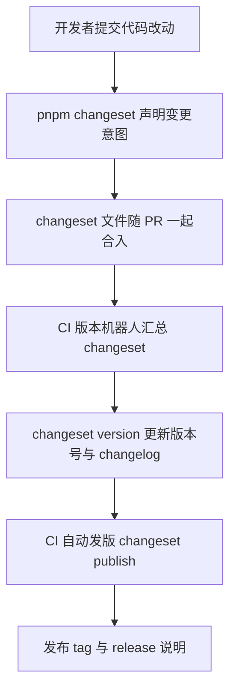

```bash
# 1. PR 中声明变更意图：选择 bump 类型并写摘要
pnpm changeset
# 生成 .changeset/xxx-yyy.md：
# ---
# '@myorg/ui': minor
# ---
# Button 组件新增 loading 属性

# 2. CI 汇总发版（Version PR 被合并后触发）
pnpm changeset version      # 更新版本号与 CHANGELOG.md
pnpm changeset publish      # 按拓扑序发布所有变更包
git push --follow-tags      # 推送发布 tag
```

### ENG-109：Monorepo 内包间依赖怎么做本地联调？workspace 协议与 watch 模式？
**答**：
- 声明用 workspace 协议："@myorg/utils": "workspace:*"，pnpm 自动建符号链接指向本地包源码。
- 联调核心是"源码即产物"或"watch 产出二选一"：包导出 TS 源码（internal package 模式）则免构建直接改直接生效。
- 传统方式：各包跑自己的 dev --watch（tsc --build --watch / tsup --watch），消费方实时拿到产物。
- Turborepo 下直接 pnpm turbo dev 拉起全部包的 watch 进程，注意 dev 任务要 persistent。

```json
{
  "name": "@myorg/ui",
  "dependencies": {
    "@myorg/utils": "workspace:*"
  }
}
```

```bash
# 源码包模式：utils 导出 TS 源码，ui 直接 import，改完即生效无需构建
# 传统 watch 模式：同时拉起被依赖包的 watch
pnpm --filter @myorg/utils --parallel dev
# Turborepo：一键拉起所有包的 dev（persistent 任务）
pnpm turbo dev
```

### ENG-110：Monorepo 的 CI 怎么做增量策略？affected 怎么计算？
**答**：
- 原理：根据本次 diff 改了哪些包，结合依赖图算出"受影响包集合"，只构建/测试这些包。
- Turborepo：turbo run build test --affected，基于 git diff 自动判定，配合远程缓存效果最佳。
- 无 Turborepo 时用 git 估算：diff 路径前缀映射到包名，再手动补依赖闭包（上游变下游也要跑）。
- CI 提速预期：改动集中在单包时，流水线时长从"全仓构建"降到"单包构建"，是大仓库 CI 的分水岭。

```bash
# Turborepo：自动计算受影响包，只跑受影响范围
pnpm turbo run build test --affected

# 无 Turborepo 的 git 估算：路径前缀映射到包
CHANGED=$(git diff --name-only origin/main...HEAD | cut -d/ -f1-2 | sort -u)
echo "$CHANGED"
if echo "$CHANGED" | grep -q '^packages/ui'; then
  pnpm --filter @myorg/ui... build   # 注意 ... 后缀：连同依赖它的包一起构建
fi
```

### ENG-111：代码所有权与依赖边界怎么用工具强制？dependency-cruiser 实战？
**答**：
- 所有权：CODEOWNERS 指定目录到 reviewer 的映射，PR 自动请求对应负责人审批。
- 边界：dependency-cruiser 扫描 import 关系，声明"谁不能依赖谁"（包间、分层间），违规即 CI 失败。
- 与 ESLint 分工：no-restricted-imports 适合单仓内分层；dependency-cruiser 适合跨包依赖图与循环依赖检测。
- 规则要渐进：存量违规先用 warn 观察并生成基线文件，新违规 error 卡死，避免一刀切导致门禁被绕过。

```javascript
// .dependency-cruiser.cjs
module.exports = {
  forbidden: [
    {
      name: 'ui 包不得依赖 apps',
      severity: 'error',
      from: { path: '^packages/ui' },
      to: { path: '^apps' },
    },
    {
      name: '禁止循环依赖',
      severity: 'error',
      from: {},
      to: { circular: true },
    },
  ],
};
// npx depcruise --validate .dependency-cruiser.cjs packages apps
```

```text
# CODEOWNERS：目录到 reviewer 的映射
/packages/ui/        @myorg/ui-team
/apps/web/           @myorg/web-team
/.github/workflows/  @myorg/infra-team
```

---

## 第二十四章 质量与度量（ENG-112 ~ ENG-117）

### ENG-112：代码质量度量体系怎么搭？复杂度、重复率、坏味道的工具链？
**答**：
- 三个核心维度：圈复杂度（cyclo）、重复率（jscpd）、问题密度（ESLint 违规/千行），SonarQube 可一图聚合。
- 度量的目的不是数字好看，而是防守回归：设基线阈值，新代码劣化即卡口，存量渐进清偿。
- 工具链落地：jscpd 重复率（min-tokens 50）、ESLint json 报告聚合、Sonar/SonarLint 本地即时报。
- 大忌：把度量做成 KPI 军备竞赛（为降复杂度把函数拆成无意义碎片），指标要配套人工 review 判断。

```bash
# 质量度量工具链：三个维度一条命令出报告
# 1. 重复率
npx jscpd src --min-tokens 50 --reporters consoleFull,html

# 2. 圈复杂度（超阈值文件列出）
npx complexity-report src || npx escomplex --format json src/ | jq '.reports[] | select(.aggregate.cyclomatic > 15) | .name'

# 3. 问题密度：ESLint 违规计数
npx eslint . -f json | jq '[.[].errorCount] | add'

# 4. SonarQube 聚合分析（CI 集成）
npx sonarqube-scanner -Dsonar.projectKey=fe-web -Dsonar.sources=src
```

### ENG-113：Code Review 怎么工程化？模板、自动分配、机器人预审怎么做？
**答**：
- PR 模板（pull_request_template.md）固化自查清单：变更说明、影响面、测试证据、UI 截图。
- 自动分配：CODEOWNERS 决定必审人，auto-assignment 机器人按目录自动 request review。
- 机器人预审把"人该看的"和"机器该看的"分开：lint/覆盖率/危险操作扫描先跑，结果挂到 PR 上，人只做语义与设计判断。
- 流程纪律：单 PR 控制规模（< 400 行 diff 优先），review 时限进 SLA（如 24h），避免互相积压。

```markdown
<!-- .github/pull_request_template.md -->
## 变更说明
<!-- 一句话说明做什么、为什么做，关联的 issue 编号 -->

## 影响面
<!-- 涉及哪些模块，是否需要数据迁移 / 是否影响线上行为 -->

## 自查清单
- [ ] pnpm lint / test / build 全部通过
- [ ] 新增逻辑附带单测
- [ ] 含 UI 变更时已附截图与设计稿对照
- [ ] 不含明文凭证与调试代码

## 机器人预审结果
<!-- lint 与覆盖率机器人会在评论自动汇报，reviewer 优先看其标红项 -->
```

### ENG-114：技术债怎么登记与偿还？
**答**：
- 登记格式化：编号、标题、影响等级、预估工作量、负责人、触发条件，进 issue 并打 tech-debt 标签。
- 偿还机制化：每个 sprint 固定比例（如 15%~20%）工时清债；impact=high 或挂账超两季度的债强制进规划。
- 与门禁联动：ratchet 类指标（覆盖率、重复率）把"不再新增债"变成硬约束，存量走登记。
- 防腐化：拒绝"债不还也没事"的漂移——每季度技术债评审会公开看板，欠账最多的模块优先安排重构。

```yaml
# tech-debt 登记格式（issue 模板同构）
- id: TD-014
  title: 旧版路由未迁移到 v6 loader 模式
  impact: medium          # high / medium / low
  effort: 3d
  owner: fe-team
  created: 2026-05-12
  trigger: 每季度评审；impact 为 high 或挂账超两季度必须安排偿还
  related: "PR #1206"
  notes: 迁移前禁止在新路由继续使用旧 API
```

### ENG-115：DORA 指标怎么在前端团队落地？数据怎么采集？
**答**：
- 四个指标：部署频率、变更前置时间（lead time）、变更失败率、故障恢复时长（MTTR）。
- 采集源：CI 事件（流水线开始/结束/部署）+ 代码事件（commit/MR）+ issue 事件（故障单开关时间）。
- 落地方式：CI 结束时把结构化事件写入数据仓（或直接用 DevLake 类工具聚合），看板按周展示趋势。
- 用法：指标是改进的探针不是考核的鞭子，关注四者的联动关系（部署频率提高是否带来失败率上升）。

```bash
# 用 git 与 issue 数据近似采集 DORA 指标
# 1. 部署频率：按部署 tag 统计
git tag --list 'deploy/2026-11*' | wc -l

# 2. 变更前置时间：commit 时间与合入时间的差值（配合 CI 事件更准确）
git log --since='1 month ago' --format='%ct %H' main | head -5

# 3. MTTR：故障 issue 从创建到关闭的时长
gh issue list --label incident --state closed --json createdAt,closedAt \
  | jq '[.[] | (((.closedAt | fromdate) - (.createdAt | fromdate)) / 3600)] | add / length'
```

### ENG-116：架构约束怎么自动检查？边界规则 lint 怎么写？
**答**：
- 分层约束用 ESLint no-restricted-imports：按目录圈定"业务层禁引基础设施、基础层禁反向上层"。
- 跨包约束交给 dependency-cruiser（见 Monorepo 章节），ESLint 负责单应用内的分层与模块禁令。
- message 里必须写"应该怎么改"，规则才会被遵守而不是被 eslint-disable 淹没。
- 与惯例配套：路径别名（@/features、@/infra）是规则可写的前提，先统一目录语义再上约束。

```javascript
// eslint.config.mjs：分层架构约束（flat config 是一个数组，每项是一组配置）
export default [
  {
    files: ['src/features/**/*.{ts,tsx}'],
    rules: {
      'no-restricted-imports': ['error', {
        patterns: [
          { group: ['@/infra/*'], message: '业务层禁止直接依赖基础设施，请通过 usecases 层调用' },
          { group: ['@/app/*'], message: '业务层不得反向依赖应用入口' },
        ],
      }],
    },
  },
  {
    files: ['src/shared/**'],
    rules: {
      'no-restricted-imports': ['error', {
        patterns: [
          { group: ['@/features/*'], message: '基础层不得依赖业务模块' },
        ],
      }],
    },
  },
];
```

### ENG-117：研发效能看板怎么搭建？
**答**：
- 数据源三路：git 事件（commit/MR）、CI 事件（运行/部署）、issue 事件（故障/需求流转），统一进数仓表。
- 看板分两层：团队层看 DORA 与 CI 健康度；工程层看代码质量趋势（覆盖率、重复率、技术债存量）。
- 指标呈现强调趋势与对比（本周 vs 上季度），单点数字没有诊断价值。
- 运营机制：双周效能回顾会，看板只回答三个问题——哪慢了、哪不稳了、哪在恶化。

```sql
-- 效能看板聚合：CI 健康度按周统计
SELECT
  date_trunc('week', started_at) AS week,
  count(*) FILTER (WHERE conclusion = 'failure')::float / count(*) AS failure_rate,
  percentile_cont(0.95) WITHIN GROUP (ORDER BY duration_sec) AS p95_duration_sec,
  count(DISTINCT repo) AS active_repos
FROM pipeline_runs
WHERE workflow = 'ci'
  AND started_at > now() - interval '13 weeks'
GROUP BY 1
ORDER BY 1 DESC;
```

---

## 第二十五章 AI 工程化与新范式（ENG-118 ~ ENG-130）

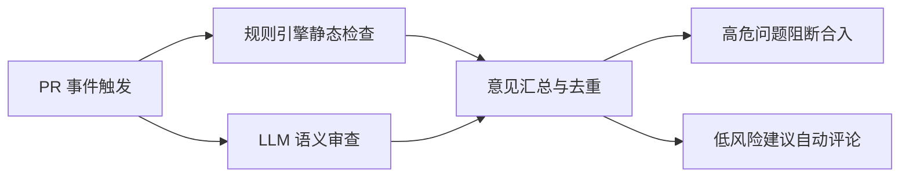

### ENG-118：AI Code Review bot 怎么接入？规则与 LLM 混合审查怎么设计？
**答**：
- 架构是"规则引擎打底 + LLM 语义增强"：确定性检查（lint、类型、危险 API）交给规则，架构与语义问题交给 LLM。
- 混合审查的分工：规则引擎秒级给出确定性意见；LLM 审 diff 与上下文，产出可读的语义级建议。
- 关键工程点：意见去重与分级（block/suggest）、LLM 输出必须可执行（附文件行号与修复示例）、控制成本（只审 diff 周边代码）。
- 红线：AI 意见只评论不阻断高危（除非规则引擎判定），最终合入决策留在人，避免误报阻断研发。

```typescript
// AI review bot 核心逻辑：规则先筛，LLM 审语义
const diff = await getPRDiff(pr.number);

// 1. 规则引擎：确定性意见，秒级
const ruleFindings = await runRuleEngine(diff); // 禁用 API、危险操作、规模超限

// 2. LLM 审查：只喂 diff 与相关上下文，控制 token 成本
const prompt = buildReviewPrompt(diff, { maxContextLines: 200 });
const llmFindings = await gatewayChat({
  scenario: 'code-review',
  messages: [{ role: 'user', content: prompt }],
});

// 3. 汇总去重分级：block 级由规则决定，LLM 一律 suggest
const merged = dedupeAndRank(ruleFindings, llmFindings, {
  llmMaxSeverity: 'suggest',
});
await postReviewComments(pr.number, merged);
```

### ENG-119：AI 生成测试怎么工程化？覆盖缺口驱动是什么意思？
**答**：
- 核心思路：不让 AI"随便补测"，而是先从覆盖率报告定位缺口分支，把源码与缺口喂给 AI 定向生成。
- 流水线化：低覆盖清单 → AI 生成 Vitest 用例 → 自动跑通 → 不通过回炉重试 → 人工 review 合入。
- 生成物与人工代码同门禁：lint、覆盖率重算、review，防止"为覆盖率而覆盖率"的空转用例。
- 适用边界：工具函数、状态机、解析器效果好；含复杂交互的 UI 生成质量低，优先人写。

```bash
# 1. 从覆盖率报告提取低覆盖文件清单（缺口驱动）
jq -r 'to_entries[] | select(.value.lines.pct < 60) | .key' \
  coverage/coverage-summary.json > low-covered.txt

# 2. 逐文件让 AI 生成用例，提示词写明框架与断言风格
while read -r file; do
  prompt="为 src/${file} 补充 Vitest 单测，覆盖现有用例未覆盖的分支，使用工厂函数构造数据"
  llm-cli "$prompt" < "src/${file}" > "tests/${file%.ts}.spec.ts"
done < low-covered.txt

# 3. 生成用例过同一门禁，不过关的丢弃重试
pnpm vitest run --reporter=dot
```

### ENG-120：Copilot/Cursor 的团队规范要约定什么？使用边界、代码主权与安全审查？
**答**：
- 使用边界：白名单场景（样板代码、类型、单测、遗留代码理解）放开；涉密模块（支付、风控）禁用外部 AI。
- 代码主权：AI 产出以提交者名义提交、责任归提交者；PR 描述标注 ai-assisted，review 关注度不低于人工代码。
- 安全审查：生成代码过 secret 扫描与依赖审计才能合入；对话中禁贴真实凭证与生产数据。
- 配套动作：项目内规则文件（copilot-instructions/.cursor/rules，见 ENG-059）+ 定期回收团队的 AI 事故案例更新规范。

```yaml
# ai-coding-policy.yml：团队 AI 编码政策（节选）
allowed:
  - 样板代码与类型定义生成
  - 单测用例与 mock 数据生成
  - 遗留代码阅读理解与迁移建议
restricted:
  - 支付、风控等涉密模块禁止使用外部 AI 服务
  - 禁止在对话中粘贴真实凭证、内网地址、用户数据
code_ownership:
  - AI 产出以提交者名义提交，责任归属提交者
  - PR 描述标注 ai-assisted，reviewer 重点关注边界条件
security:
  - 合入前必须通过 secret 扫描与依赖审计
  - AI 生成代码与人工代码适用同一套门禁
```

### ENG-121：什么是 prompt 即代码？团队 prompt 仓库怎么版本化？
**答**：
- 把高频场景的 prompt（review、生成测试、文案、迁移）沉淀为仓库内文件，像代码一样走 PR 评审与版本号。
- 收益：最佳实践复用、prompt 改动可 review 可回滚、可被脚本/网关按名引用（prompt://code-review@v3）。
- 文件结构：场景名 + 指令正文 + 输出格式约定 + 版本与变更记录，与代码同仓或独立 prompts 仓。
- 演进方向：prompt 文件被 CI 与工具链消费（review bot 加载 code-review.md），改 prompt 等于改工具行为。

```markdown
<!-- prompts/code-review.md，纳入 git 管理，变更走 PR 评审 -->
# 场景：前端代码审查
# 版本：v3（变更记录见 prompts/CHANGELOG.md）

你是一名资深前端 reviewer，按以下顺序审查：
1. 正确性：边界条件、异步竞态、类型安全
2. 可维护性：命名、重复逻辑、模块边界
3. 安全：XSS 风险、凭证泄漏、依赖风险

输出格式：每条意见标注严重级别 block 或 suggest，
必须包含文件与行号，并给出最小修复示例。
```

### ENG-122：AI 编码的安全红线有哪些？幻觉包、密钥泄漏、许可证污染怎么防？
**答**：
- 幻觉包：AI 推荐的包可能不存在或是相近名字的恶意包，装包前必须到 registry 核实且查维护状态。
- 密钥泄漏：对话与生成代码两侧都要防——输入侧禁止粘贴凭证，输出侧用 gitleaks 等扫描兜底。
- 许可证污染：AI 生成代码可能复述 GPL 类受协议保护的片段，重要场景要求标注来源并过 license 审查。
- 三道自动化红线接入 pre-push/CI：registry 核验、secret 扫描、license 白名单检查（见 ENG-060）。

```bash
# 红线一：幻觉包核验，包不存在或发布时间极近都视为可疑
npm view left-pad-express version time --json || echo "疑似幻觉包，禁止安装"

# 红线二：密钥泄漏扫描，扫全量提交历史
gitleaks detect --source . --report-path leaks.json --redact

# 红线三：许可证白名单，GPL 类进商业项目即拦截
npx license-checker --production --onlyAllow "MIT;ISC;Apache-2.0;BSD-3-Clause;0BSD"
```

### ENG-123：AI 辅助的提交规范怎么落地？commit message 生成与校验如何配合？
**答**：
- 生成端：把 staged diff 喂给 AI 按团队模板产出符合 Conventional Commits 的提交信息（opencommit 等工具已内置）。
- 校验端：commitlint 卡口不变——AI 写的信息与人工信息适用同一套校验，格式不合格照样拒绝。
- 提示词要点：type 从受限枚举选、正文写动机不写流水账、breaking change 必须带标注。
- 边界：AI 生成的是草稿，提交者要对信息准确性负责，禁止闭眼回车。

```bash
# 1. 生成：diff 喂给 AI，按团队模板产出提交信息草稿
git diff --staged | llm-cli \
  "按 Conventional Commits 生成提交信息：type 限 feat fix chore docs refactor test ci perf，正文一行说明动机" \
  > /tmp/commit-msg.txt

# 2. 校验：AI 草稿同样过 commitlint 卡口
npx commitlint --edit /tmp/commit-msg.txt

# 3. 一体化工具：opencommit 直接完成生成加校验闭环
oco commit
```

### ENG-124：文档自动生成的链路怎么搭？从代码到文档站？
**答**：
- 链路分层：API 文档从类型与 JSDoc 生成（typedoc/TypeDoc-style）、组件文档从 Storybook 生成（含可交互示例）、教程与 ADR 人工写。
- AI 补位段：为公开 API 生成使用示例与 FAQ 草稿，人工 review 后入库，解决"文档没人写"的短板。
- 发布自动化：文档构建挂在 CI，随包版本一起发版（版本化文档），过时版本可回看。
- 一致性约束：CI 校验"导出的公开 API 必须有文档注释"，防文档与代码漂移。

```bash
# 代码到文档站的 CI 链路
# 1. API 文档：从 TS 类型与注释生成
npx typedoc --out docs/api packages/utils/src/index.ts

# 2. 组件文档：Storybook 构建含交互示例的文档站
pnpm --filter @myorg/ui storybook build --docs --output-dir docs/components

# 3. 聚合发布：静态站点同步到托管，带版本目录
mkdocs build
aws s3 sync site/ s3://myorg-docs/v$PACKAGE_VERSION --delete
```

### ENG-125：内部 LLM 网关怎么工程化接入？统一 Key、审计与成本分摊怎么做？
**答**：
- 统一入口：应用不直连各家模型 API，全部走内部网关，上游可换模型、可做限流与故障切换。
- 鉴权与分摊：网关按团队/场景发放 token，请求带 X-Team、X-Scenario 标头，用量按标头归集出成本报表。
- 审计合规：记录调用方、模型、token 用量与脱敏后的请求摘要；涉密场景走内网私有化部署通道。
- 工程配套：超时与重试统一封装、按场景设 max_tokens 预算，防止失控调用烧穿预算。

```typescript
// 前端基建统一封装：所有 AI 调用走内部网关
export async function gatewayChat(req: {
  scenario: string;
  messages: { role: string; content: string }[];
}) {
  const res = await fetch('https://llm-gw.internal/v1/chat', {
    method: 'POST',
    headers: {
      Authorization: `Bearer ${process.env.LLM_GW_TOKEN}`, // 网关统一发放，按团队计费
      'X-Team': 'frontend',
      'X-Scenario': req.scenario,                          // 场景标签用于成本分摊
    },
    body: JSON.stringify({
      model: 'glm-4.7',
      messages: req.messages,
      max_tokens: 2048,
      timeout_ms: 15000,
    }),
  });
  if (!res.ok) throw new Error(`llm-gw ${res.status}`);
  await audit(req, { via: 'gateway' }); // 审计留痕
  return res.json();
}
```

### ENG-126：AI 时代的前端工作流怎么重构？从需求到原型的工具链？
**答**：
- 新链路：需求 → 一句话/PRD 生成原型（v0、bolt 类工具）→ 设计稿 → 设计稿转代码（MCP/Figma 插件）→ AI 编码器接入真实接口与状态。
- 重构点在于"原型前移"：产品与前端在真实可点的原型上对齐，减少"评审文档才发现理解偏差"的返工。
- 人的角色变化：从"写实现"转向"定义约束与验收"——规则文件、组件契约、验收标准成为主要产出。
- 兜底不变：无论代码来自原型转换还是 AI 生成，都过同一套 lint/test/review 门禁。

```text
需求到代码的新工具链示例
1. PRD 或一句话 -> v0 类工具生成页面原型，产品评审前移
2. 原型定稿 -> Figma 设计稿，经 MCP 或插件产出组件骨架
3. AI 编码器 -> 接入真实接口、状态管理与路由
4. 工程门禁 -> lint test review，与人工代码同标准
```

### ENG-127：开发环境即代码怎么做？devcontainer 与 nix 的思想？
**答**：
- 思想：环境定义进仓库（声明 node 版本、系统依赖、初始化命令），任何人 clone 后一条命令获得一致环境。
- devcontainer：VSCode/Codespaces 标准，image + features + postCreateCommand 三件套描述环境。
- nix 路线：flake.lock 把系统级依赖也锁版本，比容器更可组合，适合对环境一致性要求极高的团队。
- 关键收益场景：native 依赖编译、多语言工具链（node + java + proto）混搭、新员工首日生产力。

```json
{
  "name": "frontend",
  "image": "mcr.microsoft.com/devcontainers/typescript-node:22",
  "features": {
    "ghcr.io/devcontainers/features/github-cli:1": {}
  },
  "postCreateCommand": "corepack enable && pnpm install && pnpm playwright install --with-deps",
  "customizations": {
    "vscode": {
      "extensions": ["dbaeumer.vscode-eslint", "esbenp.prettier-vscode"]
    }
  },
  "forwardPorts": [5173, 4173]
}
```

### ENG-128：云开发环境怎么取舍？远端 workspace 的利与弊？
**答**：
- 优势场景：重依赖编译（native 模块）、本地机器孱弱、需要安全隔离（代码不落本地）的涉密项目；预构建镜像让"打开即开发"。
- 劣势场景：离线工作、网络抖动下的重度 UI 调试、强依赖本地外设（真机调试、双屏多窗口）的日常开发。
- 成本与治理：空闲自动停机、规格与配额管理、镜像定期更新，否则费用与陈旧环境都会失控。
- 推荐形态：云环境作为"标准入口 + 隔离场景"，本地环境保留，两者共享同一份环境即代码定义。

```yaml
# GitHub Codespaces 配置：远端 workspace 的取舍要点
machine: standard-8core      # 重编译项目升规格，日常 4 核够用
prebuilds: true              # 预构建镜像，打开即用，避免每次装依赖
timeout: 30m                 # 空闲自动停机，控制费用
retentionPeriod: 7           # 环境保留期，过期回收防陈旧
# 适用：native 编译重、涉密隔离、低配本地机
# 不适用：离线办公、真机调试为主、网络受限环境
```

### ENG-129：构建产物的资产清单（SBOM）怎么做？前端为什么要它？
**答**：
- SBOM（软件物料清单）结构化记录产物里的所有依赖及版本，npm 生态用 CycloneDX 格式一键生成。
- 价值：新 CVE 爆出时按清单秒级定位"哪些线上应用受影响"，不用逐仓 grep；也是企业合规与客户审计的常见要求。
- 落地：CI 构建时生成 sbom.json 作为制品的一部分归档，出安全事件时按清单联动应急。
- 前端特殊性：产物是静态资源，运行时依赖（CDN 脚本、第三方 SDK）也要纳入清单，不能只看 package.json。

```bash
# 1. 构建时生成 CycloneDX 格式 SBOM
npx @cyclonedx/cyclonedx-npm --output-file sbom.json --output-format JSON

# 2. 验证内容：依赖总数与关键组件版本
jq '.components | length' sbom.json
jq -r '.components[] | select(.name == "lodash") | .version' sbom.json

# 3. CI 中把 SBOM 随制品归档
# - uses: actions/upload-artifact@v4
#   with:
#     name: sbom
#     path: sbom.json
```

### ENG-130：工程知识库怎么建设？ADR 怎么实例化落地？
**答**：
- ADR（架构决策记录）把"为什么这么做"固化成编号文档：背景、决策、后果，轻量到一页，重在记录而非形式。
- 实例化机制：决策发生时当场写 ADR（模板进仓库），编号递增不改写历史；推翻旧决策写新 ADR 标注替代关系。
- 知识库分层：ADR 管"决策"，runbook 管"应急操作"，onboarding 文档管"新人上手"，各自进 git 随代码演进。
- 检索配套：统一入口（文档站）+ 决策索引页（按主题归档），让"这个为什么这么定"十秒内可查。

```markdown
<!-- docs/adr/0007-采用-pnpm-catalog-统一依赖版本.md -->
# ADR-0007 采用 pnpm catalog 统一依赖版本

- 状态：已接受
- 背景：Monorepo 中 react 版本在 5 个包里各自维护，出现双 React 实例导致
  hooks 报错，排查耗时半天
- 决策：公共依赖全部通过 catalog 协议引用，版本统一在 pnpm-workspace.yaml
  登记，升级只改一处
- 后果：升级需全量回归一次；收益是杜绝同包多版本，lockfile 冲突面变小
- 相关：ADR-0003 Monorepo 选型
```

---

## 第二十六章 构建集成与优化工程（ENG-131 ~ ENG-136）

### ENG-131：构建配置怎么工程化管理？工厂函数与共享 preset 包怎么做？
**答**：
- 各业务仓库复制粘贴 vite.config 是配置腐化的根源：升级、规范调整要改 N 份且必然漂移。
- 标准做法：抽出 build-preset 内部包，导出工厂函数 createVitePreset，按项目类型 app/lib/node 返回差异化配置。
- preset 内部收敛插件集合、分包策略、压缩与 sourcemap 策略；对外只暴露少量 options，保证规范可统一、项目可定制。
- 版本管理：preset 用固定版本号发布，仓库按季度统一升级，避免每次 install 漂移。

```typescript
// packages/build-preset/src/index.ts —— 工厂函数收口构建配置
import { defineConfig, type UserConfig } from 'vite'

type ProjectType = 'app' | 'lib'

interface PresetOptions {
  projectType?: ProjectType
  port?: number
  externals?: Record<string, string>
}

export function createVitePreset(options: PresetOptions = {}) {
  const { projectType = 'app', port = 5173, externals = {} } = options
  return defineConfig((): UserConfig => ({
    plugins: sharedPlugins(),          // 规范插件：分包分析 sourcemap 策略 lint 插件
    build: projectType === 'lib'
      ? { lib: { entry: 'src/index.ts', formats: ['es', 'cjs'] }, sourcemap: true }
      : { target: 'es2018', rollupOptions: { external: Object.keys(externals) } },
    server: { port },
  }))
}

// 业务仓库里只剩三行
// import { createVitePreset } from '@corp/build-preset'
// export default createVitePreset({ projectType: 'app' })
```

### ENG-132：构建参数怎么 CLI 化？环境编排怎么落地？
**答**：
- 构建命令散落在 README 里没人维护：把 build 参数（目标环境、sourcemap 开关、是否上传）CLI 化，脚本统一解析。
- 环境编排是一个命令串起多个环境的动作：build → 上传 → 触发冒烟，全部脚本化而非人肉点击。
- 参数落到 CI 可复用：CI 只是调同一个脚本传不同 flag，本地与线上行为一致，避免"本地好的 CI 坏的"。
- 非法参数 fail fast 并打印 usage；危险组合（prod + sourcemap）在脚本里直接卡死。

```bash
#!/usr/bin/env bash
# scripts/build.sh —— 构建参数 CLI 化与环境编排
set -euo pipefail

ENV="test"; SOURCEMAP=false; SKIP_UPLOAD=false
while [[ $# -gt 0 ]]; do
  case "$1" in
    --env) ENV="$2"; shift 2 ;;                    # test | staging | prod
    --sourcemap) SOURCEMAP=true; shift ;;
    --skip-upload) SKIP_UPLOAD=true; shift ;;
    *) echo "未知参数 $1"; echo "用法: build.sh --env staging [--sourcemap] [--skip-upload]"; exit 1 ;;
  esac
done

case "$ENV" in
  test) VITE_API=https://api-test.corp.com ;;
  staging) VITE_API=https://api-staging.corp.com ;;
  prod) VITE_API=https://api.corp.com ;;
  *) echo "非法环境 $ENV"; exit 1 ;;
esac

VITE_API=$VITE_API VITE_SOURCEMAP=$SOURCEMAP npm run build

if [[ "$ENV" == "prod" && "$SOURCEMAP" == "true" ]]; then
  echo "禁止 prod 构建携带 sourcemap sourcemap 只进内部监控平台"; exit 1
fi
[[ "$SKIP_UPLOAD" == "false" ]] && node scripts/upload.js --env "$ENV" ./dist
```

### ENG-133：CI 中构建产物差异报告 size diff bot 怎么完整实现？
**答**：
- 体积回归是温水煮青蛙：单次 PR 看不出来，累计三个月 bundle 翻倍，必须有机器盯。
- CI 在 PR 构建产物后与基线（默认分支最近一次构建归档）做逐文件 diff，生成 markdown 表评论到 PR。
- 阈值两层：单文件超 10% 告警评论，总体超 2% 走 gate 阻断合并（维护者可带 label 豁免）。
- 基线维护：main 合入后异步更新基线文件进仓库或制品库，保证 diff 永远对着最近可发布版本。

```yaml
# .github/workflows/size-diff.yml —— PR 体积差异报告完整流水线
name: size-diff
on: pull_request
permissions:
  pull-requests: write
jobs:
  size-diff:
    runs-on: ubuntu-latest
    steps:
      - uses: actions/checkout@v4
      - uses: pnpm/action-setup@v4
      - uses: actions/setup-node@v4
        with: { node-version: 22, cache: pnpm }
      - run: pnpm install --frozen-lockfile && pnpm build

      - name: 生成与基线的差异报告
        run: node scripts/size-report.mjs dist --baseline ./size-baseline.json --out size-diff.md

      - name: 评论到 PR sticky 防刷屏
        uses: marocchino/sticky-pull-request-comment@v2
        with: { header: size-diff, path: size-diff.md }

      - name: 卡口 单文件 10% 总体 2%
        run: node scripts/size-gate.mjs size-diff.md --single-file 10 --total 2
```

### ENG-134：构建时长治理怎么组合缓存 并行 范围裁剪？
**答**：
- 先量化再治理：CI 记录每次构建时长与阶段耗时，P50 超 15 分钟才立专项，否则收益低于风险。
- 组合拳顺序：远程缓存命中（Turborepo）→ 范围裁剪（只构建受影响包 filter=...[origin/main]）→ 任务图并行。
- 治理后设预算：PR 流水线 P90 不超 15 分钟，超预算在 CI 里 warning 并进下个迭代排期。
- 缓存 key 要含工具链版本（node/pnpm/依赖 lock），否则升级后命中陈旧缓存反而更难排查。

```bash
# Turborepo 三板斧组合：远程缓存 + 范围裁剪 + 并行与预算
# 1. 远程缓存 CI 上直接复用哈希一致的历史构建结果
pnpm exec turbo run build lint test

# 2. 范围裁剪 只构建与 main 有 diff 的包及其下游 其余全部命中缓存跳过
pnpm exec turbo run build --filter=...[origin/main]

# 3. 时长记录与预算告警
START=$(date +%s)
pnpm exec turbo run build --filter=...[origin/main]
DURATION=$(( $(date +%s) - START ))
echo "build_duration_seconds=$DURATION" >> "$GITHUB_OUTPUT"
if [ "$DURATION" -gt 900 ]; then
  echo "::warning::流水线超过 15 分钟预算 请优化缓存或拆分任务"
fi
```

### ENG-135：产物一致性校验怎么做？可复现构建的工程意义是什么？
**答**：
- 可复现构建：同一 commit 与 lockfile 在任何机器构建出字节一致的产物，是发版可信与增量部署的基础。
- 前提治理：corepack 锁 node/pnpm 版本、固定 TZ 与 locale、去掉产物里的时间戳与随机哈希。
- 校验方式：CI 双次构建分别 SHA-256 后 diff，或本地构建与 CI 产物哈希对账。
- 工程意义：CDN 指纹 diff 即真实变更集、灰度双构建可比对、供应链审计可证明产物与源码对应。

```bash
# scripts/verify-reproducible.sh —— 双次构建哈希对账
set -euo pipefail
export TZ=UTC LANG=C LC_ALL=C          # 固定时区与 locale 消除环境噪声

pnpm build
find dist -type f -print0 | sort -z | xargs -0 sha256sum > /tmp/build-a.sha

pnpm build                              # 第二次构建
find dist -type f -print0 | sort -z | xargs -0 sha256sum > /tmp/build-b.sha

if diff -q /tmp/build-a.sha /tmp/build-b.sha > /dev/null; then
  echo "可复现构建校验通过"
else
  echo "两次构建产物不一致 检查时间戳 随机哈希 未锁定工具版本"
  diff /tmp/build-a.sha /tmp/build-b.sha
  exit 1
fi
```

### ENG-136：构建容错怎么做？registry 抖动与锁版本镜像怎么设计？
**答**：
- CI 偶发失败的高频根因是 registry 抖动与第三方网络问题，要按可重试分类处理而不是盲目重跑整条流水线。
- 安装层容错：包管理器自带重试参数 + 内部 mirror 兜底（npmmirror/verdaccio），公网 registry 只作上游。
- 关键约束：版本解析必须以 lockfile 为准，镜像只缓存已解析版本，避免镜像滞后导致解析出不同版本。
- 极端预案：registry 全挂时用本地 pnpm store 或 pnpm fetch 预热的缓存完成 --offline 构建。

```ini
# .npmrc —— registry 容错与镜像策略
registry=https://registry.npmmirror.com          # 内部 mirror 作首选源
@corp:registry=https://verdaccio.corp.internal   # 内部包走私有源
fetch-retries=5                                  # 抖动重试参数
fetch-retry-mintimeout=2000
fetch-retry-maxtimeout=60000
fetch-timeout=300000
# 配套 CI 预热：每天 pnpm fetch 把 lockfile 依赖拉进镜像缓存
# registry 全挂时 CI 用 pnpm install --offline --frozen-lockfile 兜底
```

## 第二十七章 发布工程深化（ENG-137 ~ ENG-142）

### ENG-137：版本策略全景怎么设计？semver 预发布版本与 dist-tag 怎么配合？
**答**：
- semver 只回答"怎么编号"，版本策略要回答"什么时候发什么版本 用户怎么选风险等级"。
- 预发布版本让激进变更先在 opt-in 用户中验证：1.3.0-beta.2 不会污染默认 npm install 的用户。
- dist-tag 是频道机制：latest next beta lts 并行，用户用 pkg@beta 自选，tag 被大量使用后就不要移动语义。
- 每个 tag 的含义写进维护文档，废弃频道用 dist-tag rm 收回并公告替代版本。

```bash
# 版本策略全景：预发布 + dist-tag 实操
npm version prerelease --preid=beta       # 1.2.0 -> 1.2.1-beta.0
npm publish --tag next                     # 发到 next 频道 不影响 latest 用户

npm dist-tag add my-pkg@1.2.0 lts          # 旧稳定版标记为 lts 长期维护线
npm dist-tag ls my-pkg                     # latest 1.3.0 / next 1.2.1-beta.0 / lts 1.2.0

# 预发布验证充分后转正
npm dist-tag add my-pkg@1.3.0 latest
```

### ENG-138：npm 包发布的完整工程要包含哪些字段与流程？双格式 dts exports files？
**答**：
- 双格式产物：esm 给现代打包器（tree-shaking 友好），cjs 兜底 node require 场景，exports 显式声明两个入口与 types。
- dts 必须随包发布：types 字段指向 d.ts，用 tsc --emitDeclarationOnly 或 api-extractor 生成，不让用户手写声明。
- files 白名单控制发布内容：只带 dist/README/LICENSE，tests 与 src 截在包外，直接影响用户 install 时长。
- 发布链路：prepublishOnly 跑 lint+test+build，先 --dry-run 看清单，版本号由 CI 自动化打（见 changelog 一章）。

```json
{
  "name": "@corp/http-client",
  "version": "2.1.0",
  "type": "module",
  "main": "./dist/index.cjs",
  "module": "./dist/index.js",
  "types": "./dist/index.d.ts",
  "exports": {
    ".": {
      "types": "./dist/index.d.ts",
      "import": "./dist/index.js",
      "require": "./dist/index.cjs"
    },
    "./package.json": "./package.json"
  },
  "files": ["dist", "README.md", "LICENSE"],
  "sideEffects": false,
  "publishConfig": { "registry": "https://verdaccio.corp.internal" },
  "scripts": {
    "build": "vite build && tsc --emitDeclarationOnly",
    "prepublishOnly": "pnpm lint && pnpm test && pnpm build && npm publish --dry-run"
  }
}
```

### ENG-139：灰度发布的工程实现是什么？canary 版本与 next tag 怎么联动？
**答**：
- npm 生态的灰度 = canary 版本 + next tag：合入 main 自动发 x.y.z-canary.sha，下游应用显式升级才算进入灰度。
- 灰度闭环：上游发 canary → 下游关键应用升级验证 → 反馈 issue → 满足观察期后 dist-tag 提到 latest。
- 内部镜像源可做得更细：verdaccio 按团队放行 canary tag，未放行团队继续解析 latest，风险面可控。
- 转正条件量化写进流程：无 P0/P1 反馈满 N 天 + 覆盖调用方冒烟通过。

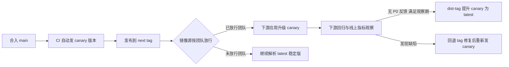

```yaml
# .github/workflows/canary.yml —— 合入 main 自动发 canary
name: canary-release
on:
  push:
    branches: [main]
jobs:
  canary:
    runs-on: ubuntu-latest
    if: "!contains(github.event.head_commit.message, '[skip canary]')"
    steps:
      - uses: actions/checkout@v4
        with: { fetch-depth: 0 }
      - uses: pnpm/action-setup@v4
      - uses: actions/setup-node@v4
        with: { node-version: 22, registry-url: https://verdaccio.corp.internal }
      - run: pnpm install --frozen-lockfile && pnpm build
      - name: 发 canary 版本
        run: |
          SHA=$(git rev-parse --short HEAD)
          pnpm version prerelease --preid=canary.$SHA --no-git-tag-version
          npm publish --tag next
        env:
          NODE_AUTH_TOKEN: ${{ secrets.CORP_NPM_TOKEN }}
```

### ENG-140：包的弃用与迁移怎么做？deprecate 与 codemod 怎么联动？
**答**：
- 弃用不是删除：npm deprecate 给旧版本打消息，用户 install 时即可看到迁移指引。
- 弃用消息要可执行：写明替代 API 与迁移文档链接，配合 ESLint deprecated 规则在 IDE 直接标出调用点。
- 大规模调用点迁移配 codemod：jscodeshift 一次性改写，比人工 grep 可靠，可进 CI 全仓执行。
- 节奏：deprecate → 观察调用量下降 → 主版本真正移除，中间至少留两个版本周期缓冲。

```bash
# 1. 弃用旧版本并给出可执行指引
npm deprecate @corp/legacy-cache@^1.0.0 "已废弃 请迁移到 @corp/http-cache v3 迁移文档 https://docs.corp.com/migrate-cache"

# 2. codemod 全仓迁移调用点 转换器见 codemods/legacy-cache-to-v3.ts
npx jscodeshift -t ./codemods/legacy-cache-to-v3.ts src/ --extensions=ts,tsx

# 3. 验证无残留引用
grep -rn "legacy-cache" src/ && echo "存在残留引用" || echo "import 迁移完成"
grep -rn "legacyGet" src/ | wc -l        # 旧 API 调用点应为 0
```

### ENG-141：已发布的坏版本怎么回滚？publish 不可变性与撤回策略怎么设计？
**答**：
- npm publish 后版本号永久占用不可重发，unpublish 仅 72 小时内且受限；回滚本质是"向前修复"。
- 三档策略：紧急 bugfix patch（分钟级）、deprecate 临时禁用（带原因）、重大事故 unpublish 或镜像层下架。
- 标准动作：revert 出问题的 commit → 发 x.y.z+1 → 刚发完时先 dist-tag rm 摘掉 latest 让新安装回到上一稳定版。
- 消费方配合：应用 lockfile 锁版本 + 内部镜像加坏版本熔断，把坏版本在组织内强制排除。

```bash
# 回滚三板斧：先摘 tag 再发修复版 组织内熔断坏版本
# 1. 刚发完发现炸了 摘掉 latest 让新安装回到上一稳定版
npm dist-tag rm @corp/http-client latest

# 2. revert 代码并发布正向修复版
git revert --no-edit <bad-commit>
npm version patch && npm publish --tag latest

# 3. 组织内镜像层熔断坏版本
curl -X PUT https://verdaccio.corp.internal/-/package/@corp/http-client/bad-versions \
  -H "Content-Type: application/json" \
  -d '{ "blocked": ["2.1.1"], "reason": "安全漏洞 禁止使用 升级到 2.1.2" }'
```

### ENG-142：内部包 mirrors 同步策略怎么设计？
**答**：
- 内部 verdaccio 本质是按需代理缓存：上游挂了缓存仍在，但首次拉取有冷启动问题，需要主动预热。
- 预热策略：定时任务把高频依赖与各仓库 lockfile 全量 fetch 进镜像，保证 CI 离线也能装。
- 断供预案：上游不可达时镜像 failover 到本地缓存（maxage/failover_timeout），关键依赖可固化为准内部包。
- 同步策略写明滞后容忍：元数据 TTL、上游新版本可见延迟、断供切离线模式的通知机制。

```yaml
# verdaccio config.yaml —— 内部镜像同步与预热策略
uplinks:
  npmjs:
    url: https://registry.npmmirror.com
    timeout: 30s
    maxage: 1h            # 元数据缓存窗口 断网期间用旧元数据兜底
    failover_timeout: 5m  # 上游失败后 5 分钟内直接用本地缓存

packages:
  '@*/*':
    access: $authenticated
    publish: $authenticated
    proxy: npmjs
  '@corp/**':
    access: $authenticated
    publish: $authenticated   # 内部包只进内部 不代理外发

publish:
  allow_offline: true       # 上游不可达时允许本地发布 事后同步

# 预热定时任务 每天凌晨把公共 lockfile 依赖 fetch 进缓存
# 0 3 * * * cd /var/cache/warmup && pnpm fetch
```

## 第二十八章 文档与知识工程（ENG-143 ~ ENG-147）

### ENG-143：组件文档自动化怎么做？docgen 与类型提取的工程链路？
**答**：
- 手写 props 文档必然漂移：从 TS 类型与 JSDoc 注释自动提取（react-docgen-typescript / vue-docgen-api），注释即文档。
- 提取结果生成三件套：props 表格、默认值、事件与插槽说明，挂进文档站组件详情页。
- JSDoc 质量要有卡口：@default、@deprecated、示例块是 docgen 的原料来源，lint 保证注释覆盖。
- 文档 diff 随组件版本发布：类型变更自动生成文档 PR，review 组件时连带审文档。

```typescript
// scripts/gen-component-docs.ts —— 从类型定义自动提取组件文档
import { parse } from 'react-docgen-typescript'
import { writeFileSync } from 'node:fs'

const results = parse('./src/components/**/*.tsx', {
  savePropValueAsString: true,
  shouldExtractValuesFromTag: true,
  propFilter: prop => !/node_modules/.test(prop.parent?.fileName ?? ''), // 过滤三方透传 props
})

for (const c of results) {
  const md = [
    `# ${c.displayName}`,
    c.description ?? '',
    '| 属性 | 类型 | 默认值 | 说明 |',
    '| --- | --- | --- | --- |',
    ...Object.values(c.props).map(p =>
      `| ${p.name} | \`${p.type.name}\` | ${p.defaultValue?.value ?? '-'} | ${p.description.split('\n')[0]} |`),
  ].join('\n')
  writeFileSync(`docs/components/${c.displayName}.md`, md)
}
```

### ENG-144：changelog 自动生成全链路怎么搭？conventional-changelog 与 release 工具怎么选？
**答**：
- 全链路：Conventional Commits 提交规范 → commitlint 卡口 → release-it/semantic-release 按提交类型推导版本 → 生成 CHANGELOG → 发版打 tag。
- 规则映射：fix 到 patch、feat 到 minor、feat! 或 BREAKING CHANGE 到 major，人的责任只剩提交写规范。
- changelog 按 scope 分组展示；给业务方的升级指南单独手写，自动生成的放 CHANGELOG.md。
- Monorepo 用 changesets：以变更集文件为粒度累积，PR review 时一起审，发布时按包各自 bump。

```json
// release-it.config.json —— conventional-changelog 全链路配置
{
  "$schema": "https://unpkg.com/release-it/schema/release-it.json",
  "git": { "commitMessage": "chore: release ${version}", "tagName": "v${version}" },
  "npm": { "publish": true },
  "github": { "release": true, "releaseNotes": "npx conventional-changelog --stdin" },
  "plugins": {
    "@release-it/conventional-changelog": {
      "preset": "angular",
      "infile": "CHANGELOG.md"
    }
  },
  "hooks": {
    "before:init": ["pnpm lint", "pnpm test"],
    "after:bump": "pnpm build"
  }
}
```

### ENG-145：ADR 实践怎么落地？架构决策记录的模板与流程怎么设计？
**答**：
- ADR 流程比模板更重要：提案（PR 评审）→ 决策（负责人确认）→ 归档（编号合并进 main）→ 状态演进 proposed/accepted/superseded/deprecated。
- 轻量模板四段：背景与问题、候选方案对比、决策与理由、后果与影响面，控制在一页，重在记录。
- 工具链用 adr-tools：new 自动编号并维护 supersede 关联，避免手工编号错乱。
- 判断标准：凡是三个月后有人会问为什么这么定的选择（选型 协议 目录 发布策略）都值得一条 ADR。

```bash
# adr-tools 落地：模板进仓库 决策随代码评审
# 1. 初始化 ADR 目录与编号
mkdir -p docs/adr && adr init 0001-采用-git-flow-分支模型

# 2. 新决策自动递增编号 s 参数声明替代旧决策
adr new 0009-构建工具从-webpack-迁移到-vite
adr new -s 0008 0010-样式方案改为-css-modules

# 3. CI 卡口：状态合法 proposed 超 30 天未决策提醒
node scripts/adr-lint.mjs docs/adr --max-proposed-age 30d
```

### ENG-146：文档站工程怎么选型与部署？dumi storybook vitepress 怎么取舍？
**答**：
- 按内容形态选型：组件库交互文档用 Storybook/dumi（组件沙箱 + props 自动生成）；指南与知识库用 VitePress（mdx 全文检索 构建快）。
- 工程要点：文档与代码同仓库同版本发布，组件改动必须带文档更新（CODEOWNERS 挂 docs 路径）。
- 部署走静态托管：main 合入自动构建发布，版本化路由保留旧版文档（/v2/），避免升级后老文档消失。
- 体验基线：全文检索 暗色模式 移动端可用，这三点决定文档站是被用还是被绕开。

```yaml
# .github/workflows/docs.yml —— VitePress 文档站自动构建部署
name: docs
on:
  push:
    branches: [main]
    paths: ['docs/**', 'src/components/**']
permissions:
  contents: read
  pages: write
jobs:
  build:
    runs-on: ubuntu-latest
    steps:
      - uses: actions/checkout@v4
      - uses: pnpm/action-setup@v4
      - uses: actions/setup-node@v4
        with: { node-version: 22, cache: pnpm }
      - run: pnpm install --frozen-lockfile
      - run: pnpm docs:build          # vitepress build docs --base /design-system/
      - name: 死链检查
        run: node scripts/dead-link-check.mjs docs/.vitepress/dist
      - uses: actions/upload-pages-artifact@v3
        with: { path: docs/.vitepress/dist }
  deploy:
    needs: build
    runs-on: ubuntu-latest
    environment: { name: github-pages, url: ${{ steps.deployment.outputs.page_url }} }
    steps:
      - id: deployment
        uses: actions/deploy-pages@v4
```

### ENG-147：API 参考自动生成怎么做？TypeDoc 工程化要点？
**答**：
- 工具库与 SDK 的 API 文档用 TypeDoc 从代码生成：导出符号、泛型、抛错说明全部来自实现，不存在文档过期。
- typedoc-plugin-markdown 输出 md 可直接挂进 VitePress 或 GitHub Wiki，与手写指南融合。
- 注释规范配套：@param @returns @throws @example，CI 用 typedoc 校验未导出与未注释项阻断。
- 版本归档：每个 npm 版本对应一版 API 文档路径（/api/v2/），保证参考与所用版本一致。

```bash
# TypeDoc 生成 API 参考并集成进文档站
# 1. 生成 markdown 版 API 文档
npx typedoc src/index.ts \
  --plugin typedoc-plugin-markdown \
  --out docs/api \
  --excludePrivate --excludeInternal \
  --readme none

# 2. CI 校验 警告升级为错误 未导出符号阻断
npx typedoc src/index.ts --validation.notExported --treatWarningsAsErrors

# 3. 发版时按版本归档
V=$(node -p "require('./package.json').version")
mkdir -p docs-site/api && mv docs/api "docs-site/api/v${V}"
```

## 第二十九章 依赖治理（ENG-148 ~ ENG-153）

### ENG-148：依赖升级策略怎么定？renovate 的分组与自动合并怎么配置？
**答**：
- 原则：升级常态化而非憋大招，每周小批量优于每年大爆炸；renovate 比 dependabot 更可定制（分组 调度 自动合并）。
- 分组策略：patch 与 dev 依赖测试通过自动合并；react 全家桶绑定成组整体升；安全修复走独立高优先级通道。
- 降噪：schedule 限定时段、rebaseWhen conflicted、并发 PR 限流，避免 CI 排队雪崩。
- Monorepo 联动：renovate 能感知 workspace 内部引用，内部包升级自动同步下游版本号。

```json
// renovate.json —— 升级分组与自动化策略
{
  "$schema": "https://docs.renovatebot.com/renovate-schema.json",
  "extends": ["config:recommended", ":semanticCommits"],
  "schedule": ["after 9pm every weekday"],
  "prConcurrentLimit": 5,
  "rebaseWhen": "conflicted",
  "packageRules": [
    {
      "description": "patch 与 dev 依赖 测试通过自动合并",
      "matchUpdateTypes": ["patch"],
      "matchDepTypes": ["devDependencies"],
      "automerge": true,
      "automergeType": "pr"
    },
    {
      "description": "react 全家桶绑定成组整体升级",
      "matchPackagePatterns": ["^react", "^@types/react"],
      "groupName": "react-family"
    },
    {
      "description": "安全修复独立通道 高优先级",
      "matchCurrentVersion": "!/^0/",
      "vulnerabilityAlerts": { "enabled": true },
      "labels": ["security"],
      "prPriority": 10
    }
  ]
}
```

### ENG-149：破坏性升级怎么评估？变更日志 影响面 灰度的完整流程？
**答**：
- major 升级不能只看 changelog 拍板：走四步 变更清单 → 影响面扫描 → 迁移验证 → 灰度全量。
- 影响面扫描：grep 调用点统计工作量 + 升级后 tsc --noEmit 暴露签名不匹配 + E2E 关键路径回归。
- 灰度策略：先升一个低风险内部应用，线上指标观察一个发布周期，异常即回滚并把踩坑写进迁移指南。
- 全量推广后更新内部依赖基线（catalog/版本矩阵），防止后续项目又引入旧版本。

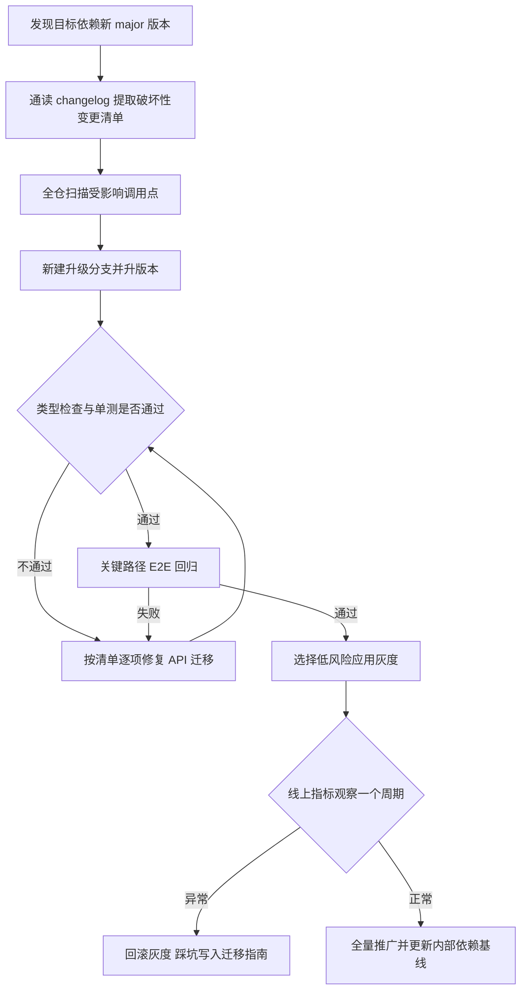

```bash
# 影响面扫描与迁移验证实操
# 1. 扫描调用点 数量决定工作量评估
grep -rn "from 'lodash'" src/ | wc -l

# 2. 升级后先用类型检查暴露破坏面
pnpm add lodash@4.17.21 --save-exact
pnpm tsc --noEmit 2>&1 | tee /tmp/upgrade-issues.log

# 3. 统计错误数量 判断升级成本
grep -c "error TS" /tmp/upgrade-issues.log
```

### ENG-150：重复依赖怎么治理？dedupe 与 overrides 实战怎么做？
**答**：
- 重复依赖来源：不同包各自声明同一库的不同大版本、peer 未对齐、patch 漂移；后果是体积翻倍与双实例风险（如双 React hooks 报错）。
- 诊断优先：pnpm why lodash 找出重复路径与引入链，dedupe --check 拿到可收敛清单，确认后再动手。
- 收敛手段：overrides 强制统一版本（npm/pnpm/yarn 语法不同）、packageExtensions 补 peer 声明、必要时 fork 收窄旧版本包。
- 收敛后必须全量回归：强制 override 等于替第三方做兼容决策，测试兜底 + 版本写进 lockfile。

```json
{
  "name": "app",
  "pnpm": {
    "overrides": {
      "lodash": "4.17.21",
      "moment>zone.js": "0.14.10"
    },
    "packageExtensions": {
      "@some/old-lib@*": {
        "peerDependencies": { "react": "^18.0.0" }
      }
    }
  },
  "resolutions": {
    "@babel/traverse": "7.24.7"
  },
  "scripts": {
    "dedupe:check": "pnpm dedupe --check",
    "why:lodash": "pnpm why lodash"
  }
}
```

### ENG-151：废弃依赖怎么替换？moment 迁移 dayjs 全案例怎么做？
**答**：
- moment 已停止新特性开发且体积大不可 tree-shake，是废弃替换的教科书案例；迁移走"兼容层先行 逐个清理差异"。
- 第一步用构建 alias 把 moment 指向 dayjs（API 高度兼容），让构建先通过，业务无感切换。
- 差异点逐个清理：locale 文件路径、插件机制（extend）、时区（utc + timezone 插件替代 moment.tz）。
- 验证兜底：日期相关单测全量 + golden 样本比对两种库的格式化输出，历史日期边界重点回归。

```javascript
// vite.config.ts —— alias 兼容层渐进替换 moment
import { defineConfig } from 'vite'

export default defineConfig({
  resolve: {
    alias: [
      // 第一步 API 兼容层 整体替换
      { find: 'moment', replacement: 'dayjs' },
      // 第二步 locale 差异 路径映射
      { find: 'moment/locale/zh-cn', replacement: 'dayjs/locale/zh-cn' },
    ],
  },
  // 第三步 入口注册插件替代 moment.tz
  // import dayjs from 'dayjs'
  // import utc from 'dayjs/plugin/utc'
  // import timezone from 'dayjs/plugin/timezone'
  // dayjs.extend(utc); dayjs.extend(timezone)
  // 第四步 golden 样本回归
  // node scripts/date-golden-test.mjs --from moment --to dayjs
})
```

### ENG-152：依赖许可证合规怎么落地？license 扫描与传染性协议怎么卡口？
**答**：
- 风险分级：MIT/Apache-2.0/BSD/ISC 可商用；LGPL 谨慎；GPL/AGPL 传染性强，前端产物引用可能被要求开源。
- CI 全量扫描必须覆盖传递依赖，不能只看直接依赖；monorepo 各子包独立扫描。
- 白名单机制：allow 直接通过、review 清单走法务入库、deny 直接阻断；deny 命中时提供替代推荐而不是让人自己换一个等价 GPL 包。
- 扫描结果归档为 SBOM 附件，审计与客户合规检查时直接出具。

```bash
# CI 许可证合规卡口
# 1. 全量扫描含传递依赖 输出 json
npx license-checker --production --json --out licenses.json

# 2. 白名单校验 传染性协议即失败
node scripts/license-gate.mjs licenses.json \
  --allow "MIT,Apache-2.0,BSD-2-Clause,BSD-3-Clause,ISC,0BSD,Unlicense,CC0-1.0" \
  --review "LGPL-3.0,MPL-2.0" \
  --deny "GPL-2.0,GPL-3.0,AGPL-3.0"

# 3. license-gate.mjs 核心逻辑
# 读取 licenses.json 每个依赖的 licenses 字段
# 命中 deny 退出码 1 并打印依赖名与引用路径
# 命中 review 输出待法务清单 不阻断
```

### ENG-153：依赖健康度怎么评估？维护活跃度 下载量 issue 响应怎么量化？
**答**：
- 引入新依赖前做健康度评估：最近发布时间、版本迭代频率、issue 平均响应、贡献者集中度（bus factor）。
- 自动化评分卡：npm registry 拉发布元数据，GitHub API 拉仓库状态，输出统一报告供准入流程引用。
- 分档决策：健康直接依赖；观察锁死版本并写 adapter 隔离层；高风险评估自研或 fork 成本再定。
- 评估是准入动作的一部分：新依赖走内部准入清单时必须附评分卡，事后抽查对照。

```javascript
// scripts/dep-health-check.mjs —— 依赖健康度评分卡
const dep = process.argv[2]
const headers = { Authorization: `Bearer ${process.env.GITHUB_TOKEN}` }

const npmInfo = await (await fetch(`https://registry.npmmirror.com/${dep}`)).json()
const gh = npmInfo.repository?.url?.match(/github\.com\/([^/]+\/[^/.]+)/)?.[1]
const repo = await (await fetch(`https://api.github.com/repos/${gh}`, { headers })).json()

const lastPublish = new Date(npmInfo.time.modified)
const days = Math.floor((Date.now() - lastPublish) / 864e5)

const score = {
  依赖: dep,
  距上次发布天数: days,
  版本迭代次数: Object.keys(npmInfo.versions ?? {}).length,
  star: repo.stargazers_count,
  openIssue数: repo.open_issues_count,
  评级: days < 180 ? '健康' : days < 365 ? '观察 锁版本并加 adapter' : '高风险 评估自研或 fork',
}
console.log(JSON.stringify(score, null, 2))
// 用法 node scripts/dep-health-check.mjs dayjs
```

## 第三十章 微前端工程化（ENG-154 ~ ENG-158）

### ENG-154：微前端的工程配套怎么做？共享依赖构建 版本协调 发布顺序怎么管理？
**答**：
- 微前端最贵的不是运行时方案，是工程配套：共享依赖谁提供、版本怎么协调、子应用发布顺序如何约束。
- 共享依赖矩阵是单一事实源：主应用提供 react 等基座依赖，子应用只声明 peer 约束，矩阵由平台组维护进配置包。
- 发布顺序契约：基座先于子应用发布，子应用之间解耦可乱序；基座接口变更走 deprecate 周期。
- CI 强制校验：子应用构建期对共享依赖做 peer 约束检查，冲突即阻断，不允许带病上线。

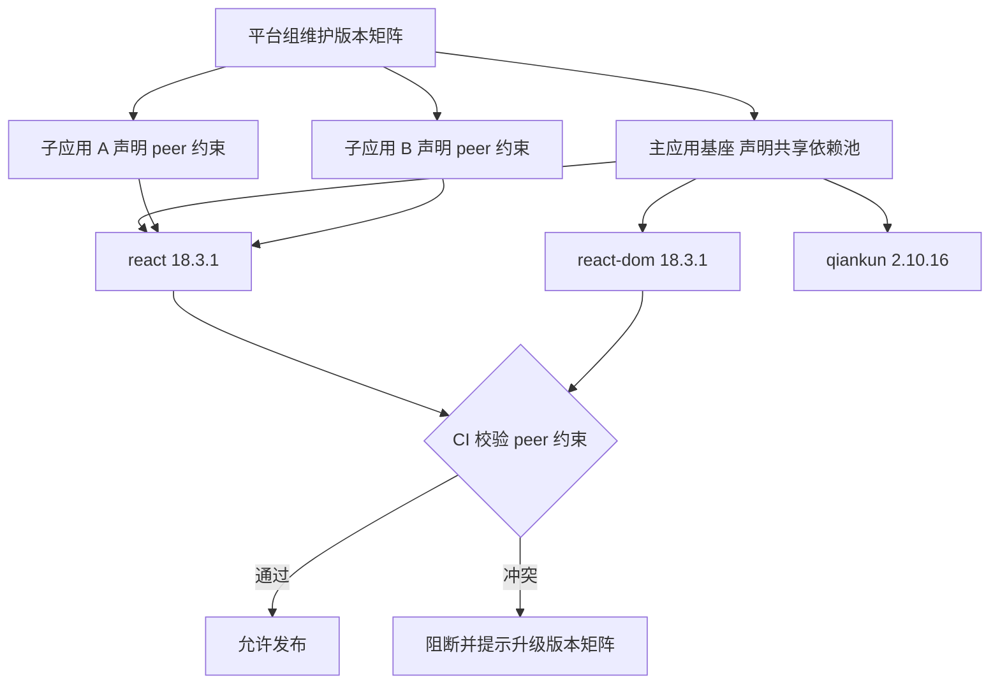

```json
// packages/micro-shared/versions.json —— 共享依赖版本矩阵 单一事实源
{
  "shared": {
    "react": { "version": "18.3.1", "peer": "^18.0.0", "singleton": true, "strictVersion": true },
    "react-dom": { "version": "18.3.1", "peer": "^18.0.0", "singleton": true, "strictVersion": true },
    "qiankun": { "version": "2.10.16", "singleton": true },
    "dayjs": { "version": "1.11.13", "singleton": false }
  },
  "releaseOrder": { "base": "first", "subApps": "independent" },
  "policy": "strictVersion 冲突在 CI 构建期报错 不允许带病上线"
}
```

### ENG-155：qiankun 完整接入的工程清单有哪些？主应用与子应用要改什么？
**答**：
- 主应用：registerMicroApps 注册子应用 + initGlobalState 全局状态 + addGlobalUncaughtExceptionHandler 统一兜底子应用异常。
- 子应用改造点：产物改 umd 格式、publicPath 动态化、导出 bootstrap/mount/unmount 三个生命周期。
- 样式隔离双管齐下：experimentalStyleIsolation 加前缀隔离，子应用自身规范全局选择器命名空间。
- 独立与嵌套双形态：子应用单独跑是完整站点，被基座加载才走微前端生命周期，用 window.__POWERED_BY_QIANKUN__ 区分。

```typescript
// ===== main-app/src/micro/register.ts 主应用接入 =====
import { registerMicroApps, start, initGlobalState, addGlobalUncaughtExceptionHandler } from 'qiankun'

const actions = initGlobalState({ user: null, theme: 'light' })
export const onGlobalStateChange = actions.onGlobalStateChange

registerMicroApps(
  [
    { name: 'order', entry: '//localhost:8001', container: '#sub-root', activeRule: '/order' },
    { name: 'stock', entry: '//localhost:8002', container: '#sub-root', activeRule: '/stock' },
  ],
  { beforeLoad: app => console.log(`加载 ${app.name}`) },
)

start({
  sandbox: { experimentalStyleIsolation: true },  // 样式前缀隔离
  prefetch: 'all',
})

addGlobalUncaughtExceptionHandler(e => reportMicroError(e))  // 子应用异常统一上报

// ===== sub-app/vite.config.ts 子应用改造为可加载的 umd 产物 =====
// import { defineConfig } from 'vite'
// import qiankun from 'vite-plugin-qiankun'
// export default defineConfig({
//   base: '/order/',
//   server: { port: 8001, cors: true },
//   plugins: [qiankun('order', { useDevMode: true })],
//   build: { target: 'es2015', formats: ['umd'] },
// })
```

### ENG-156：Module Federation 怎么工程化？共享配置 版本协商 独立部署怎么做？
**答**：
- MF 核心是运行时 import 远端模块：remotes 声明远端清单、exposes 暴露本端模块、shared 声明共享依赖协商规则。
- 版本协商：shared 配 singleton + requiredVersion，运行时取双方可用版本；strictVersion 让冲突显式告警。
- remoteEntry 地址必须版本化（带版本目录或 hash），防止长缓存钉死旧版本；远端不可达要有 fallback 组件。
- 独立部署：远端清单（remotes 地址表）由配置中心下发而非写死在构建里，实现不重发主应用切换远端版本。

```javascript
// host/vite.config.ts —— Module Federation 主端配置
import { defineConfig } from 'vite'
import federation from '@originjs/vite-plugin-federation'

export default defineConfig({
  plugins: [
    federation({
      name: 'host',
      remotes: {
        cart: 'https://cdn.corp.com/cart@2.1.0/assets/remoteEntry.js', // 版本化地址 防长缓存钉死
      },
      shared: {
        react: { singleton: true, requiredVersion: '^18.2.0', strictVersion: true },
        'react-dom': { singleton: true, requiredVersion: '^18.2.0' },
      },
    }),
  ],
  build: { target: 'esnext' },
})

// 消费侧 + 容错
// const Cart = React.lazy(() => import('cart/CartPage').catch(() => import('./CartFallback')))
```

### ENG-157：微前端的多团队协作规范怎么定？契约与联调环境怎么管？
**答**：
- 契约先行：基座与子应用之间的接口（全局状态结构 路由规则 生命周期参数）以 d.ts + 版本号发内部包，契约变更走 RFC。
- 联调环境用注册台：各团队把自己的 dev server 地址注册到网关路由表，联调按需指向某人分支，路由覆盖自动过期。
- 责任边界写死：路由前缀 样式命名空间 全局事件名 storage key 前缀全部按应用名划分，冲突即返工。
- 发布互不阻塞：子应用发布不依赖基座发版，改共享契约必须提前一个迭代公告。

```yaml
# platform/micro-contracts.yaml —— 基座与子应用的协作契约清单
contracts:
  version: 3.2.0          # 契约本身有版本 变更走 RFC
  routes:
    order: { prefix: /order, owner: team-trade }
    stock: { prefix: /stock, owner: team-data }
  globalState:
    schema: '@corp/micro-contracts/global-state.d.ts'
    fields: { user: User, theme: light | dark, locale: zh-CN | en-US }
  namespaces:
    storage: { prefix: mc- }
    events: { prefix: mc: }
  devRegistry: https://micro-dev.corp.com/registry.json   # 各团队 dev server 注册台
  changePolicy: 契约变更需 RFC 且提前一个迭代公告 违反即回滚
```

### ENG-158：微前端的监控与日志怎么打通？
**答**：
- 上下文透传是关键：主应用生成 traceId/userId/sessionId 经 globalState 或 URL 传给子应用，全链路日志带同一 traceId。
- 上报通道统一：子应用不允许直连监控平台，统一用基座注入的 SDK 实例，避免重复脚本与重复上报。
- 归因维度：日志带 appName + appVersion，问题定位精确到哪个子应用的哪个版本，联动发布记录自动关联。
- 分级处理：子应用未捕获异常经基座 handler 兜底上报；子应用 entry 加载失败与内部资源 404 区分开。

```typescript
// main-app/src/micro/telemetry.ts —— 微前端日志打通
import { initGlobalState } from 'qiankun'
import { reporter } from '@corp/monitor-sdk'

const traceId = crypto.randomUUID()
const shared = initGlobalState({ traceId, user: getUser(), theme: 'light' })

// 子应用侧约定 拿到 globalState 里的 traceId 后初始化自己的上报上下文
shared.onGlobalStateChange(state => {
  reporter.setContext({ traceId: state.traceId })   // 全链路一个 traceId
})

// 子应用版本归因 构建时注入版本号
declare const __APP_VERSION__: string
window.__MICRO_APP_META__ = { name: 'order', version: __APP_VERSION__ }
reporter.setContext({ appName: 'order', appVersion: __APP_VERSION__ })
```

## 第三十一章 移动与多端工程（ENG-159 ~ ENG-163）

### ENG-159：H5 离线包工程怎么搭？打包 签名 更新 灰度全链路？
**答**：
- 离线包 = 资源 zip + manifest（版本号 文件 hash 签名），客户端预下载，WebView 拦截请求命中本地包实现秒开。
- 链路：构建产物 → 生成 manifest → 打 zip 并算整体哈希 → 上传离线包平台 → 平台校验签名 → 按灰度规则下发。
- 更新机制：manifest 版本比对 + 静默下载 + 下次生效；紧急修复走强更通道，签名校验防篡改是底线。
- 灰度与熔断：按用户百分比或白名单下发，白屏率崩溃率超阈值自动停发回退旧包。

```bash
# scripts/offline-package.sh —— H5 离线包构建与上传
set -euo pipefail
VERSION=$(node -p "require('./package.json').version")
OUT="offline-$VERSION.zip"

pnpm build
# 1. 生成 manifest 记录每个文件 hash 供客户端校验
node scripts/gen-manifest.mjs dist > dist/manifest.json

# 2. 打包并计算整体哈希
cd dist && zip -qr "../$OUT" . && cd ..
SHASUM=$(shasum -a 256 "$OUT" | cut -d' ' -f1)

# 3. 上传离线包平台 平台侧校验签名后按灰度规则下发
curl -X POST https://offline.corp.com/api/packages \
  -H "Authorization: Bearer $OFFLINE_TOKEN" \
  -F "app=h5-mall" -F "version=$VERSION" \
  -F "sha256=$SHASUM" -F "gray=10%" \
  -F "file=@$OUT"
```

### ENG-160：小程序工程化怎么做？分包 CI 自动上传与依赖处理？
**答**：
- 分包治理：主包只留启动页与 tabBar 页面，业务按域拆分包，preloadRule 控制预下载提升秒开。
- CI 自动上传：miniprogram-ci 用私钥在流水线里 upload，版本号与 changelog 自动生成，告别 IDE 手点。
- 依赖处理：构建期 packNpm 处理 npm 依赖（或 Taro/uni-app 编译期打包），并卡主包体积阈值。
- 质量卡口：上传前跑体验评分与包体积检查，主包超 1.5M 阻断并提示分包。

```javascript
// scripts/mp-upload.mjs —— miniprogram-ci 自动上传
const ci = require('miniprogram-ci')

async function main() {
  const project = new ci.Project({
    appid: process.env.MP_APPID,
    type: 'miniProgram',
    projectPath: './dist',
    privateKeyPath: './private.wx.key',   // 从 CI secret 落盘 权限仅 upload
    ignores: ['node_modules/**/*'],
  })
  const version = require('../package.json').version
  const result = await ci.upload({
    project,
    version,                                        // 与仓库版本号对齐
    desc: `release ${version} ${process.env.GIT_SHA ?? ''}`,
    setting: { es6: true, minify: true, autoPrefixWXSS: true },
  })
  console.log('上传成功', result.subPackageInfo)
}
main().catch(e => { console.error(e); process.exit(1) })
```

### ENG-161：Hybrid 桥接层怎么工程化？JSBridge 协议 版本兼容与调试？
**答**：
- 双向通道：H5 到 Native 用注入对象 postMessage 或 scheme 拦截；Native 到 H5 用 evaluateJavascript 触发回调。
- 协议设计：请求 {bridge action callbackId params} 响应 {callbackId code data}，callbackId 注册表管理回调与超时。
- 版本兼容：Native 声明能力位（getAvailableActions），H5 未支持能力走 H5 兜底实现；协议版本写进 UA 供识别。
- 调试手段：真机注入 vConsole + 桥接日志开关（全部调用落 console），是排查桥接问题的标配。

```typescript
// src/bridge/index.ts —— JSBridge 核心实现
type Callback = (res: { code: number; data?: unknown; msg?: string }) => void
const callbacks = new Map<string, Callback>()
let seq = 0

export function call(action: string, params: object, cb: Callback) {
  const callbackId = `cb_${Date.now()}_${seq++}`
  callbacks.set(callbackId, cb)
  const payload = JSON.stringify({ bridge: 'corp', action, callbackId, params })
  const native = (window as any).CorpBridge
  if (native?.postMessage) native.postMessage(payload)
  else location.href = `corpscheme://bridge?payload=${encodeURIComponent(payload)}`
  setTimeout(() => {          // 超时保护 防 Native 无响应悬挂
    if (callbacks.has(callbackId)) { callbacks.delete(callbackId); cb({ code: -1, msg: 'timeout' }) }
  }, 10000)
}

export function dispatchFromNative(res: { callbackId: string; code: number; data?: unknown; msg?: string }) {
  callbacks.get(res.callbackId)?.(res)
  callbacks.delete(res.callbackId)
}
;(window as any).CorpBridge_dispatch = dispatchFromNative   // Native 回调入口
```

### ENG-162：Electron 工程化怎么做？主渲染进程构建 自动更新与打包签名？
**答**：
- 进程分层构建：主进程 cjs 打包，渲染进程就是标准 vite 前端工程，preload 走 cjs + contextBridge 白名单暴露。
- 自动更新：electron-updater 对接自建更新服务，nsis differentialPackage 差量更新省带宽；更新逻辑只在主进程。
- 打包与签名：electron-builder 配多平台 target；macOS 公证与 Windows 证书全部走 CI secrets，未签名会被系统拦截。
- 安全基线：contextIsolation true、nodeIntegration false、preload 最小暴露，不图省事全开。

```yaml
# electron-builder.yml —— 打包 签名与自动更新配置
appId: com.corp.desktop
directories: { output: release }
files: ['dist/**', 'electron/main.js', 'electron/preload.js']
publish:
  provider: generic
  url: https://update.corp.com/desktop     # 自建更新服务 electron-updater 对接
mac:
  category: public.app-category.productivity
  hardenedRuntime: true
  notarize: true                            # 公证 CI 提供 APPLE_ID 相关 secrets
  entitlements: build/entitlements.mac.plist
win:
  certificateSubjectName: Corp Ltd          # 证书走 CI secrets
nsis:
  differentialPackage: true                 # 差量更新
# 主进程侧自动更新
# import { autoUpdater } from 'electron-updater'
# autoUpdater.checkForUpdatesAndNotify()
```

### ENG-163：一套代码多端交付的工程结构怎么设计？monorepo 多端矩阵怎么做？
**答**：
- monorepo 分层：packages/core 放纯逻辑（状态 请求 领域模型），apps/* 是各端壳；core 不 import 任何端 API。
- 平台差异收敛进能力接口：storage/navigation/pay 等定义 interface，各端实现 adapter，业务代码只依赖接口。
- 构建矩阵：turbo 按 app 编排，CI matrix 并行构建各端产物，core 变更触发所有端重建。
- 复用率度量：定期统计 core 被各端引用比例，低于阈值说明分层失效，复盘是抽象错了还是端差异真大。

```yaml
# 多端 monorepo 结构与构建矩阵
# pnpm-workspace.yaml
packages:
  - apps/h5
  - apps/mp
  - apps/desktop
  - packages/core        # 纯逻辑层 不依赖端 API
  - packages/adapters    # 各端能力 adapter 实现
# CI 构建矩阵
# strategy:
#   matrix:
#     target: [apps/h5, apps/mp, apps/desktop]
# turbo.json 任务编排
# { "pipeline": { "build": { "dependsOn": ["^build"], "outputs": ["dist/**"] } } }
# 核心约束：core 的 eslint 规则禁 import 任何端全局 如 wx window
```

## 第三十二章 研发流程与协作（ENG-164 ~ ENG-169）

### ENG-164：需求到分支到发布的完整流怎么落地？分支模型的工程细节？
**答**：
- 分支模型落到工具而非口口相传：需求单号决定分支命名 feat/PROJ-1234-desc，CI 校验分支名与 commit 关联单号。
- 集成规则：feature 进主干走 MR，必须带需求单号与测试结论；trunk-based 时未完成功能用 feature flag 控制而不是长命分支。
- 发布流：从主干拉 release 分支 → 预发验证 → 生产灰度 → 全量；hotfix 从生产 tag 拉，修复后双回合主干与 release。
- 制品晋级衔接：同一构建产物只构建一次，从 dev 逐步晋级到 prod，杜绝各环境重新构建引入不一致。

```yaml
# .github/workflows/branch-guard.yml —— 分支模型落地卡口
name: branch-guard
on: pull_request
jobs:
  guard:
    runs-on: ubuntu-latest
    steps:
      - uses: actions/checkout@v4
        with: { fetch-depth: 0 }
      - name: 分支命名必须关联需求单号
        run: |
          BR="${{ github.head_ref }}"
          echo "$BR" | grep -Eq '^(feat|fix|chore)/[A-Z]+-[0-9]+' || {
            echo "分支 $BR 不符合 feat/PROJ-1234-desc 规范"; exit 1; }
      - name: 提交信息通过 commitlint
        run: npx commitlint --from "${{ github.event.pull_request.base.sha }}" --to HEAD
```

### ENG-165：多团队并行开发怎么协调？接口契约 联调环境 发布窗口怎么管？
**答**：
- 接口契约先行：后端 OpenAPI 契约进仓库当依赖，前端 mock 与类型从契约生成，契约变更即 PR 评审。
- 联调环境分两类：稳定联调环境（各服务合入后的 dev 集）与个人联调（网关路由把某服务指向某人分支），覆盖路由带 TTL 自动过期。
- 发布窗口：多团队共用网关/应用时约定每日发布时段与占用申请制，先占先锁定，冲突可预判。
- 跨团队依赖在迭代规划时显式登记（依赖方 被依赖方 交付日期），风险前置暴露而非发版前夜才爆。

```yaml
# gateway/dev-routes.yaml —— 联调环境路由协调
routes:
  order-service:
    default: https://dev-1.order.svc        # 稳定联调环境
    overrides:
      wang: http://10.8.1.23:3000           # wang 的本地分支
      li: http://10.8.1.45:3000
  user-service:
    default: https://dev-1.user.svc
rules:
  overrideTTL: 12h          # 覆盖路由自动过期 防止长期占用联调环境
  conflictPolicy: 同服务同时只允许一个 override 需在值班群申请
```

### ENG-166：紧急修复流程怎么设计？hotfix 快速通道与追踪怎么做？
**答**：
- 热修复通道独立于常规流水线：不排队、并行跑最小验证集（lint + 冒烟 + 关键单测），全程留痕事后补全。
- 四步流程：从生产 tag 拉 hotfix 分支 → 修复与最小回归 → 发布（跳灰度需值班负责人批准）→ 回合主干与 release 分支。
- 复盘必做：hotfix 频率超阈值（如每月 5 次）说明常规质量门禁失效，要回溯原因而非继续救火。
- 所有 hotfix 带独立标签，发布记录与故障单双向关联，追踪闭环。

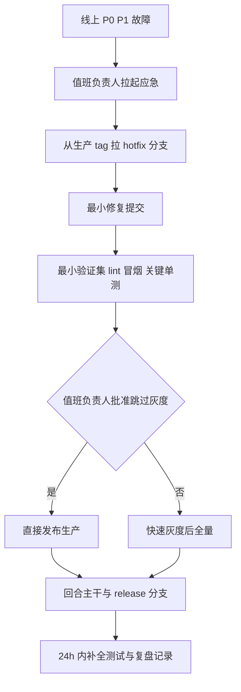

```bash
# hotfix 快速通道实操
git fetch origin && git checkout -b hotfix/PROJ-5678-payment-timeout v2.3.1
# ... 最小修复 ...
git commit -m "fix: PROJ-5678 支付超时重试风暴 修复幂等键生成"
git push origin hotfix/PROJ-5678-payment-timeout
# 触发应急流水线 独立 workflow 不排队
gh workflow run hotfix.yml -f branch=hotfix/PROJ-5678-payment-timeout -f skip_gray=false
# 修复回合主干
git checkout main && git cherry-pick <fix-commit> && git push origin main
```

### ENG-167：研发环境治理怎么做？本地 开发 测试 预发的定位与数据隔离？
**答**：
- 环境定级写清：本地自由破坏、开发合入即部署允许脏数据、测试是自动化回归基座、预发与生产同构但敏感操作只读。
- 数据隔离是红线：测试禁止连生产库，预发用脱敏快照；配置中心按环境物理隔离而非仅命名空间区分。
- 环境漂移治理：配置版本化（IaC），定期 diff 预发与生产配置差异，漂移项进周会清理。
- 前端特有维度：mock 服务、灰度开关、白名单按环境有独立默认值，杜绝测试配置误带生产。

```yaml
# config/env-matrix.yaml —— 环境定位与数据隔离矩阵
environments:
  local:
    purpose: 自由开发
    api: http://localhost:8080
    data: 本地 docker compose
  dev:
    purpose: 主干合入即部署 持续联调
    api: https://dev-api.corp.com
    data: dev 独立库 允许脏数据
    deploy: auto-on-merge
  test:
    purpose: 自动化回归基座
    api: https://test-api.corp.com
    data: test 库加脱敏样本 每晚重置
    guard: 禁止人工提交数据变更
  staging:
    purpose: 发布前验证 与生产同构
    api: https://staging-api.corp.com
    data: 生产脱敏快照 T-1
    guard: 敏感写操作只读化 值班审批放行
invariants:
  - 禁止跨环境连接数据库
  - 配置中心按环境独立实例
  - 灰度白名单各环境独立维护
```

### ENG-168：变更管理与封网机制怎么落地？
**答**：
- 封网场景：大促 审计 节假日；本质是风险窗口内冻结非必要变更，而不是全停。
- 实现：发布系统配置封网窗口，窗口内部署任务 CI 自动拒绝，保留 hotfix 白名单通道（需指定审批人解锁）。
- 封网前动作比封网中重要：提前一周冻结合并、完成回归、锁定版本号与镜像 tag。
- 解封后处置：积压变更按优先级排队错峰发布；封网期间应急修复单独审计留痕。

```yaml
# deploy-policies.yaml —— 发布系统的封网窗口配置
freezeWindows:
  - name: 双11大促封网
    start: 2026-11-01T00:00:00+08:00
    end: 2026-11-12T00:00:00+08:00
    scope: [production]
    allowlist:
      labels: [hotfix]         # 带 hotfix 标签的发布走应急通道
      approvers: [duty-manager-group]
    behavior: ci_block          # 窗口内部署任务 CI 直接拒绝并提示解封时间
    notify: [release-group, all-frontend]
# CI 侧检查逻辑 if now 在窗口内 且 无 hotfix 标签 则 fail
```

### ENG-169：跨团队依赖的 SLA 怎么约定？
**答**：
- 把跨团队接口当供应商协议：明确交付物、时间点、质量标准、故障响应时效（SLA）。
- 典型条款：契约冻结日、联调就绪日、性能基线（QPS/P99）、P1 响应与恢复时限、破坏性变更提前通知天数。
- 落地形式：依赖登记表（who/what/when/SLA）+ 迭代会逐条过状态，违约升级到两级主管。
- 技术兜底：SLA 约束不了的地方用降级设计（超时 缓存兜底 mock 桩），不把业务可用性押在别人的承诺上。

```yaml
# team-contracts/depend-on-order-team.yaml —— 跨团队依赖登记
dependency:
  consumer: team-mall-frontend
  provider: team-trade
  deliverable: 订单详情聚合接口 /api/v2/orders/{id}
  milestones:
    contractFreeze: 2026-11-05    # 契约冻结日
    integrationReady: 2026-11-12  # 联调就绪
    perfBaseline: QPS 2000 P99 低于 200ms
  sla:
    p1Response: 15m
    p1Recovery: 2h
    changeNotice: 14d             # 破坏性变更提前 14 天通知
  fallback:                       # SLA 失效时的技术兜底
    timeout: 3s
    staleCache: 5m
    degradedUI: 展示缓存数据并提示可能延迟
```

## 第三十三章 安全工程化（ENG-170 ~ ENG-174）

### ENG-170：CI 中的安全扫描全家桶怎么搭？依赖 密钥 SAST 怎么组合？
**答**：
- 三层扫描一次 PR 全跑：依赖漏洞（npm audit/osv-scanner）、密钥泄露（gitleaks）、代码缺陷（Semgrep SAST）。
- 结果分流：critical 阻断合并、high 限期修复、low 报表；设置 baseline 防止历史问题淹没新问题。
- 误报治理：扫描器都要有豁免机制（ignore 文件 + 豁免带过期时间），豁免本身要 review。
- 性能折中：PR 增量扫描 + 每晚定时全量扫描，是耗时与覆盖的标准平衡。

```yaml
# .github/workflows/security.yml —— 依赖 密钥 SAST 全家桶
name: security
on:
  pull_request:
  schedule: [{ cron: '0 18 * * *' }]   # 每晚全量兜底
jobs:
  deps-audit:
    runs-on: ubuntu-latest
    steps:
      - uses: actions/checkout@v4
      - run: pnpm install --frozen-lockfile
      - run: pnpm audit --prod --audit-level high
  secrets-scan:
    runs-on: ubuntu-latest
    steps:
      - uses: actions/checkout@v4
        with: { fetch-depth: 0 }        # 全历史扫描
      - uses: gitleaks/gitleaks-action@v2
        env: { GITHUB_TOKEN: ${{ secrets.GITHUB_TOKEN }} }
  sast:
    runs-on: ubuntu-latest
    container: semgrep/semgrep
    steps:
      - uses: actions/checkout@v4
      - run: semgrep ci --config p/owasp-top-ten
```

### ENG-171：依赖投毒怎么防御？lockfile 审计与 registry 白名单怎么设计？
**答**：
- 投毒路径：包新版本被植入恶意代码、typosquatting 仿冒包名；防御核心是"默认不可信新版本"。
- lockfile 第一道闸：CI 必须 --frozen-lockfile，lockfile 变更要能对应 package.json 的显式声明变更。
- 白名单代理：内部 verdaccio 只放行白名单包与已审核版本，外部新版本进镜像带延迟窗口（潜伏期观察）。
- 补充手段：已知恶意包黑名单检测、install 脚本钩子审计，可疑依赖用 --ignore-scripts 安装。

```yaml
# composite action 片段 —— CI 依赖投毒防线
name: anti-supply-chain
runs:
  using: composite
  steps:
    - shell: bash
      name: lockfile 一致性校验
      run: pnpm install --frozen-lockfile --ignore-scripts   # 不同步直接失败
    - shell: bash
      name: 已知恶意包黑名单检测
      run: node scripts/blocklist.mjs pnpm-lock.yaml
    - shell: bash
      name: install 脚本钩子审计
      run: |
        node scripts/audit-install-scripts.mjs > install-scripts.txt
        grep -q postinstall install-scripts.txt \
          && echo "::warning::存在安装期脚本 见审计文件 需评审" \
          || echo "PASS 无安装期脚本"
```

### ENG-172：敏感信息扫描怎么接入？gitleaks 全仓扫描的完整工程？
**答**：
- 三层接入：pre-commit 本地扫暂存区、CI 全量（含历史 commit）、定时任务兜底防绕过。
- .gitleaks.toml 自定义内部凭证规则（AK 前缀 内部 token 格式），补通用规则的漏报。
- 历史泄露处置顺序：先吊销凭证（比删代码更急）→ filter-repo 清洗历史 → force push 与团队协调。
- 报告归档进安全平台；豁免必须带 issue 单号与过期时间，防止白名单变后门。

```toml
# .gitleaks.toml —— 内部凭证自定义规则
title = "corp-gitleaks-rules"

[[rules]]
id = "corp-access-key"
description = "公司内部 AK"
regex = '''corp_ak_[a-zA-Z0-9]{32}'''
keywords = ["corp_ak_"]
tags = ["secret", "corp"]

[[rules]]
id = "corp-jwt-hardcoded"
description = "代码中硬编码 JWT"
regex = '''eyJ[A-Za-z0-9_-]{10,}\.[A-Za-z0-9_-]{10,}\.[A-Za-z0-9_-]{5,}'''
tags = ["secret", "jwt"]

[allowlist]
description = "测试样例豁免 必须带 issue 号"
regexes = ['''corp_ak_test_[a-z0-9]{32}exempt[0-9]+''']
```

```yaml
# .github/workflows/gitleaks.yml —— CI 与定时兜底
name: gitleaks
on:
  pull_request:
  schedule: [{ cron: '0 19 * * *' }]
jobs:
  scan:
    runs-on: ubuntu-latest
    steps:
      - uses: actions/checkout@v4
        with: { fetch-depth: 0 }
      - uses: gitleaks/gitleaks-action@v2
        env: { GITHUB_TOKEN: ${{ secrets.GITHUB_TOKEN }} }
```

### ENG-173：前端安全基线怎么自动化？安全头与依赖版本卡口怎么巡检？
**答**：
- 基线 checklist 工具化：安全响应头（CSP/HSTS/nosniff/frame 防嵌套）、依赖无已知 CVE、产物无 sourcemap 泄露与硬编码密钥。
- 落地为发布后定时巡检：curl 探测线上安全头 + 扫描产物目录，违规告警开工单。
- CSP 用 report-only 先观察，按域名逐批收紧，否则一次上 CSP 大概率误杀业务。
- CVE 版本卡口：超修复时限的安全升级走自动 PR（renovate vulnerabilityAlerts + security 通道）。

```bash
# scripts/security-baseline.sh —— 线上安全基线巡检
set -uo pipefail
DOMAIN="https://mall.corp.com"
FAIL=0

check_header() {
  local name="$1" pattern="$2"
  if curl -sI "$DOMAIN" | grep -qEi "$pattern"; then
    echo "PASS $name"
  else
    echo "FAIL $name 缺失"; FAIL=1
  fi
}

check_header "Strict-Transport-Security" "strict-transport-security"
check_header "Content-Security-Policy" "content-security-policy"
check_header "X-Content-Type-Options" "nosniff"
check_header "X-Frame-Options" "x-frame-options|frame-ancestors"

# 产物泄露检查 sourcemap 不应可公网访问
if curl -sfI "$DOMAIN/assets/index.js.map" > /dev/null; then
  echo "FAIL sourcemap 暴露公网"; FAIL=1
else
  echo "PASS sourcemap 未暴露"
fi

exit $FAIL
```

### ENG-174：第三方 SDK 准入流程怎么设计？安全评审与性能评估怎么做？
**答**：
- 五步准入：申请（用途 数据类型 替代方案）→ 安全评审（隐私协议 数据流向 证书指纹）→ 性能评估（体积 首屏影响 请求数）→ 沙箱试运行 → 入库登记版本与责任人。
- 静态评估自动化：下载包分析体积 依赖树 install 脚本 对外域名清单，输出评审报告。
- 运行时评估：接入后用性能平台对比接入前后 LCP/INP 与请求瀑布，超预期回滚接入。
- 准入非终身制：SDK 升级同样过评审，长期未使用的 SDK 定期清退。

```javascript
// scripts/sdk-admission-audit.mjs —— 第三方 SDK 准入静态评估
import { execSync } from 'node:child_process'
import { mkdtempSync, rmSync } from 'node:fs'

const pkg = process.argv[2]                       // 用法 node sdk-admission-audit.mjs some-sdk
const dir = mkdtempSync('/tmp/sdk-audit-')

// 1. 下载并解包
execSync(`npm pack ${pkg} --pack-destination ${dir}`, { stdio: 'inherit', cwd: dir })
const tgz = execSync(`ls ${dir}/*.tgz`).toString().trim()
execSync(`tar -xzf ${tgz} -C ${dir}`)

// 2. 体积评估
console.log('体积:', execSync(`du -sh ${dir}/package | cut -f1`).toString())

// 3. 声明依赖与安装期脚本
console.log('依赖:', execSync(`npm view ${pkg} dependencies peerDependencies --json`).toString())
console.log('脚本钩子:', execSync(`npm view ${pkg} scripts --json`).toString())

// 4. 对外域名清单 供安全评审判断数据流向
const domains = execSync(
  `grep -rhoE 'https?://[a-zA-Z0-9.-]+' ${dir}/package --include='*.js' | sort -u | head -50`,
).toString()
console.log('对外域名:', domains)
rmSync(dir, { recursive: true, force: true })
```

## 第三十四章 AI 深度工程化（ENG-175 ~ ENG-182）

### ENG-175：AI 代码生成的质量门禁怎么建？生成代码需要哪些额外检查？
**答**：
- AI 生成代码不能降标准而要加标准：典型问题（幻觉 API、复制粘贴重复、过度防御、无效注释）要有针对性检查项。
- 落地方式：AI 生成 PR 打 ai-generated 标签，CI 对该类 PR 加码——覆盖率阈值上调、重复度检查（jscpd）、依赖白名单校验。
- prompt 侧预防：生成时约束"禁止引入未声明依赖、优先复用 utils 已有函数"，从源头减少坏味道。
- 人审不豁免：AI PR 禁止 self-merge，至少一名人类实质 review。

```yaml
# .github/workflows/ai-pr-gate.yml —— AI 生成 PR 的加码门禁
name: ai-pr-gate
on:
  pull_request:
    types: [labeled, opened, synchronize]
jobs:
  gate:
    if: contains(github.event.pull_request.labels.*.name, 'ai-generated')
    runs-on: ubuntu-latest
    steps:
      - uses: actions/checkout@v4
        with: { fetch-depth: 0 }
      - uses: pnpm/action-setup@v4
      - uses: actions/setup-node@v4
        with: { node-version: 22, cache: pnpm }
      - run: pnpm install --frozen-lockfile
      - name: 覆盖率加码 AI PR 行覆盖 85%
        run: pnpm test --coverage --coverage.thresholds.lines=85
      - name: 重复度检查
        run: npx jscpd src --min-tokens 60 --reporters consoleFull --fail-on-mismatch
      - name: 禁止越权依赖
        run: node scripts/check-deps-whitelist.mjs
```

### ENG-176：仓库级上下文工具怎么做？codebase 索引与检索增强的开发工具？
**答**：
- LLM 不了解内部框架与领域约定：仓库级上下文工具把代码库建索引（AST 切分 + embedding + 向量库），检索增强回答"我们项目怎么写请求封装"。
- 流水线：函数级 AST 切分保住语义完整 → 批量 embedding → 向量库 upsert → IDE 插件/CLI 检索入口。
- 质量关键：索引随代码增量更新、内部术语表单独喂给模型、相似实现作为 few-shot 注入。
- 效果评估：维护内部问答基准集，索引策略调整跑基准对比，不凭感觉调参。

```typescript
// scripts/codebase-index.ts —— 仓库级索引流水线（骨架）
import { glob } from 'glob'
import { parse } from '@babel/parser'
import { readFileSync } from 'node:fs'

interface Chunk { path: string; symbol: string; code: string }

async function chunkRepo(): Promise<Chunk[]> {
  const files = await glob('src/**/*.{ts,tsx}', { ignore: ['**/*.test.*'] })
  const chunks: Chunk[] = []
  for (const f of files) {
    const code = readFileSync(f, 'utf8')
    const ast = parse(code, { sourceType: 'module', plugins: ['typescript', 'jsx'] })
    for (const node of ast.program.body) {          // AST 函数级切分 保住语义完整
      const name = (node as any).id?.name
      if (name || node.type === 'ExportDefaultDeclaration') {
        chunks.push({ path: f, symbol: name ?? 'default', code })
      }
    }
  }
  return chunks
}

// 后续步骤（伪码）
// const vectors = await embed(chunks.map(c => c.code))
// await vectorDB.upsert(chunks.map((c, i) => ({ id: `${c.path}#${c.symbol}`, values: vectors[i] })))
// 检索时语义 + 符号双路召回 上下文注入 prompt
```

### ENG-177：AI 结对编程的工作流怎么设计？任务拆分 生成 审查 合并的闭环？
**答**：
- 把 AI 当高速 junior 管理：人拆任务到 PR 粒度 → 写规格化 prompt（含验收标准）→ AI 生成 → 机器门禁 → 人工 review → 合并。
- 任务拆分原则：一次一件事（一个函数/一个组件），上下文给足（相关类型 + 相似已有实现作 few-shot）。
- 失败回喂：门禁报错直接回喂 AI 修复，闭环收敛；连续失败超 N 次转人工。
- 度量闭环：记录各任务类型的返工率与 review 耗时，数据回流迭代 prompt 模板，返工率高的类型改回人工。

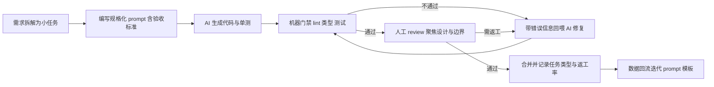

```yaml
# .ai/workflows/feature.yaml —— AI 结对任务规格模板
task:
  id: FE-2026-0876
  type: component           # component | hook | util | page
  prompt_ref: .ai/prompts/component.md
  context:                  # 生成前必须喂给模型的上下文
    - src/components/Table/Column.tsx      # 相似已有实现作 few-shot
    - src/types/order.d.ts                 # 相关类型定义
  constraints:
    - 使用 @corp/ui 现有组件 不重复造轮子
    - 禁止引入新依赖
    - 单测用 vitest 与 testing-library 覆盖交互路径
  acceptance:
    - 列配置为空时展示空态
    - 排序事件触发 onSortChange 并带列 key
    - 覆盖率不低于 85%
```

### ENG-178：内部组件库的 AI 文档与示例生成怎么做？
**答**：
- 痛点是示例陈旧：AI 流水线从 props 类型与用法注释生成示例与文档，组件更新自动重建。
- 生成内容分层：基本用法确定性生成（类型驱动）、进阶组合示例 LLM 生成 + 沙箱可运行校验、FAQ 从高频 issue 生成候选。
- 质量卡口：生成的示例必须能在 vite 沙箱编译运行，跑不过不进文档站。
- 示例进 playground 可交互：AI 生成初始态，用户改 props 看效果并可导出代码。

```javascript
// scripts/gen-examples.mjs —— AI 生成组件示例并沙箱校验
import { generate } from './llm-client.mjs'
import { parse } from 'react-docgen-typescript'
import { writeFileSync } from 'node:fs'

for (const comp of parse('src/components/**/*.tsx')) {
  const example = await generate({
    model: 'corp-llm-mini',                        // 成本分层 简单示例用小模型
    prompt: `为组件 ${comp.displayName} 生成一个最小可用示例 只用已声明的 props
输出单个 tsx 文件 不得引入新依赖
props: ${JSON.stringify(Object.keys(comp.props))}`,
  })
  const ok = await buildInSandbox(example)         // vite 沙箱编译校验
  if (ok) writeFileSync(`docs/examples/${comp.displayName}.tsx`, example)
  else console.warn(`skip ${comp.displayName} 示例编译失败 不进文档`)
}
```

### ENG-179：AI 辅助重构怎么工程化？codemod 与 LLM 混合方案怎么设计？
**答**：
- 分工明确：确定性变更（API 改名 import 调整 参数顺序）用 codemod 100% 可靠；语义性变更（class 组件改 hooks 拆组件）用 LLM 灵活但需验证。
- 流水线：codemod 先跑机械部分 → LLM 处理剩余难改文件 → 每文件改完即跑编译与关联单测，失败回滚该文件进人审清单。
- LLM 输出过 AST 校验：parse 失败或引入禁用 API 直接打回，不让语法垃圾进 review。
- 持续沉淀：统计两类工具成功率，把 LLM 已稳定处理的语义规则固化成新 codemod。

```javascript
// scripts/hybrid-refactor.mjs —— codemod 与 LLM 混合重构流水线
import { execSync } from 'node:child_process'
import { readFileSync, writeFileSync, appendFileSync } from 'node:fs'

// 1. 机械部分 codemod 全量执行
execSync('npx jscodeshift -t codemods/api-v2.ts src/ --extensions=ts,tsx')

// 2. 剩余含旧模式的文件交给 LLM 语义改写
const left = execSync("grep -rl 'this.setState' src/ --include='*.tsx' || true")
  .toString().split('\n').filter(Boolean)

for (const file of left) {
  const original = readFileSync(file, 'utf8')
  const rewritten = await llmRewrite(original, RULES_HOOK_STYLE)
  writeFileSync(file, rewritten)
  try {
    execSync('pnpm tsc --noEmit -p .')
    execSync(`pnpm vitest run related --file ${file}`)
  } catch {
    writeFileSync(file, original)               // 失败回滚单文件 进人审清单
    appendFileSync('refactor-manual-review.txt', `${file}\n`)
  }
}
```

### ENG-180：团队 prompt 工程规范怎么定？结构 变量与评测怎么管理？
**答**：
- prompt 资产化管理：模板进仓库 .ai/prompts/，有版本有 owner有变更记录，与代码一样走 PR review。
- 结构规范五段式：角色 任务 上下文 约束 输出格式；变量统一 {{placeholder}}，禁止代码里散落 prompt 字符串。
- 评测配套：每个模板配评测集（输入样例 + 期望要点），模板改动跑评测对比通过率，防止改好 A 弄坏 B。
- 变量治理：注入内容做裁剪与脱敏，敏感字段不进 prompt。

```yaml
# .ai/prompts/component.md —— 组件生成 prompt 模板 五段式
role: 你是团队前端专家 熟悉 @corp/ui 组件库与 React 18
task: 根据需求描述生成一个 React 组件及其单测
context:
  props_types: "{{props_dts}}"
  similar_component: "{{reference_code}}"
constraints:
  - 使用函数组件与 hooks 不使用 class
  - 样式用 CSS Modules 前缀 {{style_prefix}}
  - 不引入新依赖 不修改 {{props_dts}} 之外的类型
output:
  format: 两个代码块 分别为 Component.tsx 与 Component.test.tsx
  language: typescript
# 评测集 evaluation/cases.yaml prompt 变更 CI 跑对比 通过率不低于基线
```

### ENG-181：AI 工具链的成本怎么治理？token 预算与模型分层怎么做？
**答**：
- 成本可见性先行：按团队/场景/模型打 tag 统计 token 与费用，月报公开；没数据就谈不上治理。
- 模型分层路由：格式转换摘要用小模型，架构评审复杂重构用旗舰模型；同场景小模型先行，失败率超阈值自动升档。
- 预算与限流：按团队设月度预算，超预算降级到小模型并通知 owner；高频重复请求走前缀缓存。
- 增量更新：codebase 索引用增量 embedding 而非全量重建，是最大的成本节省点之一。

```json
// ai-gateway/policy.json —— 模型分层与预算治理
{
  "routing": {
    "default": "corp-llm-mini",
    "escalate_to": "corp-llm-flagship",
    "escalate_when": {
      "failure_rate_1h": ">0.3",
      "task_type": ["arch-review", "complex-refactor"]
    }
  },
  "budgets": {
    "per_team_monthly_usd": { "platform": 2000, "business-a": 800, "business-b": 800 },
    "on_exceed": "downgrade_to_mini_and_notify_owner"
  },
  "cache": { "prompt_prefix_cache": true, "ttl_hours": 24 },
  "reporting": { "granularity": ["team", "scenario", "model"], "report_cron": "0 9 1 * *" }
}
```

### ENG-182：AI 生成代码的知识产权与合规边界怎么划？
**答**：
- 风险三问：训练数据来源是否合规、生成代码是否与开源许可代码实质性相似、上传片段是否带商业机密。
- 边界约定：内部代码只在私有部署或企业版（不训练）模型使用；开源贡献仓库禁止接入内部代码上下文。
- 许可证检查：生成代码做相似度扫描对标知名开源库（尤其 GPL 片段），命中阈值转人审改写。
- 合规留痕：AI 参与 PR 必须标记，记录工具版本、模型 ID 与 prompt 模板引用，出争议可追溯生成环境。

```yaml
# ai-compliance.yaml —— AI 使用合规策略
model_policy:
  allowed: [corp-private-llm, vendor-enterprise-no-training]
  forbidden: [public-free-tier]           # 公共免费渠道 内部代码禁用
data_boundary:
  upload_allow: [src/, docs/, types/]
  upload_deny: [secrets/, .env, '**/credential*', customer-data/]
license_scan:
  similarity_check: true                  # 生成代码与许可代码相似度扫描
  threshold: 0.85
  on_hit: manual_review_and_rewrite
traceability:
  pr_label_required: ai-generated
  record: { tool_version: true, model_id: true, prompt_template_ref: true }
```

## 第三十五章 体系与前瞻（ENG-183 ~ ENG-200）

### ENG-183：前端基建全景图怎么画？从规范到平台的分层清单？
**答**：
- 分层自下而上：规范与工具链层 → 构建与部署层 → 质量层 → 平台层（组件库 文档站 微前端基座）→ 治理层（度量 准入 成本）。
- 全景图的价值是找空白与防重复建设：每项能力标注负责人 消费方 成熟度，一眼看清哪里重叠哪里空白。
- 维护节奏：半年盘点一次，每项标状态（成熟/建设中/规划）与负责人，防单点。
- 反面信号：某层堆了三个重复造的轮子，或某层空白全靠人肉，都是全景图要暴露并处置的。

```yaml
# infra/landscape.yaml —— 前端基建分层全景
layers:
  specs-tooling:
    items: [eslint-preset, commitlint, husky, stylelint, git-hooks-ci]
    owner: platform-team
    status: mature
  build-deploy:
    items: [build-preset, cli-scaffold, ci-templates, publish-platform, cdn-pipeline]
    owner: platform-team
    status: mature
  quality:
    items: [e2e-suite, monitor-sdk, perf-platform, coverage-gate]
    owner: quality-guild
    status: building
  platform:
    items: [ui-library, docs-site, micro-base, design-tokens]
    owner: component-team
    status: mature
  governance:
    items: [efficiency-dashboard, dep-admission, cost-report]
    owner: eng-manager
    status: planned    # 空白层 优先补
review: { cadence: half-year, last: 2026-06 }
```

### ENG-184：基建项目的 ROI 怎么评估？
**答**：
- ROI =（年化节省人力成本 − 建设与维护成本）/（建设与维护成本）；维护成本按建设成本的 30% 年化，不能只算建设。
- 节省量化要保守：使用人数 × 频次 × 单次节省时长 × 时薪 × 折减系数（0.5~0.7），杜绝拍脑袋放大。
- 隐性收益单列不折算：质量提升 故障减少 一致性 招聘吸引力，定性说明放报告附录。
- 决策阈值：ROI 低于 1 且无战略理由不立项；3 以上优先；立项时把 ROI 计算假设写进文档，事后对账。

```javascript
// scripts/infra-roi.mjs —— 基建项目 ROI 评估
function evaluate({
  users, timesPerWeek, minutesSaved, hourlyCost,
  buildDays, maintainRatio = 0.3, discount = 0.6,
}) {
  const annualSavedHours = users * timesPerWeek * 52 * (minutesSaved / 60) * discount
  const savedCost = annualSavedHours * hourlyCost
  const buildCost = buildDays * 8 * hourlyCost
  const maintainCost = buildCost * maintainRatio
  const roi = (savedCost - maintainCost) / buildCost
  return {
    annualSavedHours: annualSavedHours.toFixed(0),
    savedCost: savedCost.toFixed(0),
    buildCost: buildCost.toFixed(0),
    maintainCost: maintainCost.toFixed(0),
    roi: roi.toFixed(2),
    verdict: roi >= 3 ? '优先立项' : roi >= 1 ? '可立项' : '不立项 除非有战略理由',
  }
}
// 示例 脚手架 40 人使用 每周 2 次 每次省 30 分钟 建设 15 人天
console.log(evaluate({ users: 40, timesPerWeek: 2, minutesSaved: 30, hourlyCost: 120, buildDays: 15 }))
```

### ENG-185：工程效率怎么度量？北极星指标与 DORA 怎么落地？
**答**：
- 北极星选一个能代表又快又稳的：常见是需求前置时间，或部署频率与变更失败率的组合视图。
- DORA 四指标打底：部署频率 变更前置时间 变更失败率 恢复时长；研发侧加评审时长与 CI 时长。
- 反指标防御：不度量代码行与提交数（会被博弈），度量团队不度量个人。
- 闭环：月度读数 → 找最差指标 → 专项改进 → 下月复核，指标不动说明措施失效要换方向。

```javascript
// scripts/dora-metrics.mjs —— 从 git tag 计算部署频率与前置时间
import { execSync } from 'node:child_process'

const tags = execSync('git tag --sort=-creatordate').toString().trim().split('\n').slice(0, 20).reverse()
let totalLead = 0
for (const tag of tags) {
  const releaseAt = execSync(`git log -1 --format=%ct ${tag}`).toString().trim() * 1000
  const firstAt = execSync(`git log ${tag}^..${tag} --format=%ct --reverse | head -1`).toString().trim() * 1000
  totalLead += (releaseAt - firstAt) / 864e5
}
const metrics = {
  部署频率: `${(tags.length / 4).toFixed(1)} 次/周`,
  变更前置时间均值: `${(totalLead / tags.length).toFixed(1)} 天`,
  // 变更失败率与恢复时长取自监控平台故障与回滚记录 接入点示意
}
console.log(JSON.stringify(metrics, null, 2))
```

### ENG-186：工程文化怎么建设？规范为什么失败 为什么成功？
**答**：
- 规范失败三因：只有文档没有工具（靠自觉）、只有惩罚没有激励、规则噪音大（误报多被全局关闭）。
- 成功要素：能 autofix 就别提醒 能提醒就别阻断；每条规则可解释可豁免；违规修复成本低。
- 文化抓手：lint day 清理历史豁免、规范 RFC 公开评审、质量数据透明化不做黑箱审查。
- 健康信号：新人第一周就能提交合规代码；规范讨论出现在 review 而不是事故甩锅现场。

```bash
# 规范健康度巡检：豁免存量治理
# 1. 全仓 eslint-disable 总量 超阈值触发 lint day
TOTAL=$(grep -rc 'eslint-disable' src/ --include='*.ts' --include='*.tsx' \
  | awk -F: '{s+=$2} END {print s+0}')
echo "eslint-disable 总数: $TOTAL"
[ "$TOTAL" -gt 200 ] && echo "::warning::豁免过多 请安排 lint day 专项清理"

# 2. 长期未清理的豁免 TODO
grep -rn 'eslint-disable.*TODO' src/ | head -10

# 3. 可自动修复占比 能 autofix 的不允许人工修
npx eslint src --fix-dry-run --format json > /tmp/lint.json
node -e "const r=require('/tmp/lint.json');const m=r.flatMap(f=>f.messages);console.log('可自动修复', m.filter(x=>x.fix).length, '/', m.length)"
```

### ENG-187：新人 onboarding 怎么工程化？
**答**：
- 目标量化：day1 提交第一行代码 week1 上线一个页面；核心指标是首次合入耗时。
- 三件套：一键环境脚本 setup.sh（nvm/corepack/依赖/种子数据/冒烟验证）、good-first-task 低风险任务池、buddy 导师制（首个 PR 必须导师 review）。
- 文档反熵：新人卡点即提 issue 修文档，把每个新人当文档的回归测试。
- 每次卡点数据用于改进 onboarding 流程本身，形成闭环。

```bash
#!/usr/bin/env bash
# scripts/setup.sh —— 新人 day1 一键环境
set -euo pipefail
echo "1/5 检查基础工具"
command -v node >/dev/null || { echo "请先安装 nvm"; exit 1; }
nvm use
corepack enable && corepack prepare pnpm@9 --activate

echo "2/5 安装依赖"
pnpm install

echo "3/5 初始化本地数据"
pnpm db:seed

echo "4/5 预热构建缓存"
pnpm exec turbo build --filter=web || pnpm build

echo "5/5 冒烟验证"
pnpm -F web dev > /dev/null 2>&1 & sleep 6
curl -sf http://localhost:5173 > /dev/null \
  && echo "OK dev server 正常 新人环境就绪" \
  || { echo "FAIL 请联系 buddy"; exit 1; }
echo "下一步 从 docs/onboarding/first-task.md 领取首个任务"
```

### ENG-188：技术雷达怎么实践？adopt trial hold 怎么运转？
**答**：
- 四象限（技术 平台 工具 语言框架）× 四环（adopt 主力 trial 试点 assess 观察 hold 收缩），半年一版全员评审。
- 关键动作是移动：新进 trial 要配试点报告；trial 升 adopt 需数据支撑；进 hold 的要有迁移指引。
- 雷达对齐资源：hold 环停止新项目引入，存量排迁移计划；trial 环给试点团队配 mentor。
- 组织意义：让用什么技术成为公开决策而非小圈子默契，跨团队协作有共同语言。

```json
// radar/2026-h2.json —— 技术雷达数据
{
  "edition": "2026-H2",
  "quadrants": ["techniques", "platforms", "tools", "languages-frameworks"],
  "rings": ["adopt", "trial", "assess", "hold"],
  "entries": [
    { "name": "pnpm workspace", "quadrant": "tools", "ring": "adopt", "since": "2024-H2" },
    { "name": "vite", "quadrant": "tools", "ring": "adopt", "since": "2025-H1" },
    { "name": "module-federation", "quadrant": "platforms", "ring": "trial", "note": "三个月试点报告后再评审" },
    { "name": "react-server-components", "quadrant": "languages-frameworks", "ring": "assess" },
    { "name": "moment.js", "quadrant": "languages-frameworks", "ring": "hold", "note": "停止新引入 存量迁移中" }
  ]
}
```

### ENG-189：开源组件贡献流程怎么做？innerSource 在组织内怎么落地？
**答**：
- innerSource 是把开源协作方式用于组织内：公开仓库 issue 驱动 RFC 决策 明确 CODEOWNERS 与贡献指南。
- 前提条件：README 说清是什么怎么用、CONTRIBUTING 写明流程、维护团队承诺响应 SLA，否则贡献者流失。
- 贡献链路：feature 分支 → PR → CODEOWNERS 自动分配 review → CI 门禁 → 合入；跨团队 PR 记录可作晋升材料。
- 收益度量：外部贡献 PR 占比 issue 平均响应时间 被引用仓库数，证明是在共建而非单方面输出。

```ini
# .github/CODEOWNERS —— innerSource 责任与评审路由
# 全局默认 平台组兜底
*                         @corp/platform-team
# 组件库 组件组与设计组必须评审
/packages/ui/             @corp/ui-core @corp/design-guild
# 构建配置变更 需构建负责人
/turbo.json               @corp/build-owners
/.github/workflows/       @corp/ci-owners
# 文档 任何团队可提 文档 owner 审核
/docs/                    @corp/docs-owners
# 业务子应用 自治 review 不阻塞平台组
/apps/mall/               @corp/team-mall
```

### ENG-190：工程平台怎么用户运营？推广 反馈 迭代怎么做？
**答**：
- 平台是产品不是工程：管理获知（推广） 上手（onboarding） 留存（价值感知） 反馈（迭代输入）全链路。
- 推广讲场景不讲口号：不说请使用，演示这个场景你能省两小时，配真实案例数据。
- 反馈闭环：平台内置反馈入口（一键 issue 带 trace），每周 changelog 公布你反馈的功能已上线。
- 迭代信号看行为数据：周活团队数与功能渗透率优先于吐槽音量；渗透率低于 30% 的功能进重做或下线评审。

```javascript
// platform/analytics.mjs —— 平台采纳度与渗透率度量
const events = await db.query(`SELECT team, feature, count(*) AS n FROM usage_events
  WHERE ts > now() - interval '7 days' GROUP BY team, feature`)

const activeTeams = new Set(events.map(e => e.team)).size
const features = ['scaffold', 'publish', 'monitor', 'docs']
const report = {
  周活团队数: activeTeams,
  团队渗透率: `${((activeTeams / 12) * 100).toFixed(0)}%`,
  功能渗透: Object.fromEntries(features.map(f => [
    f,
    new Set(events.filter(e => e.feature === f).map(e => e.team)).size,
  ])),
}
// 决策规则 团队渗透低于 30% 的功能进重做或下线评审
for (const [f, teams] of Object.entries(report.功能渗透)) {
  if (teams / activeTeams < 0.3) console.warn(`下线评审候选: ${f} 仅 ${teams} 团队使用`)
}
console.log(JSON.stringify(report, null, 2))
```

### ENG-191：灾难恢复预案怎么设计？构建系统挂了怎么发版？
**答**：
- 预案核心：列出发版依赖链上每个单点（CI registry 镜像 CDN 发布平台），每个单点给绕行方案与切换时间。
- 最小发版路径：本地构建 + 手动上传 CDN + 网关切流；允许降级跳过部分自动校验，但降级项必须记录事后补齐。
- 演练制度：季度断供演练（模拟 CI 挂两小时），把 runbook 从文档变成肌肉记忆。
- 恢复后动作：补跑完整性校验 回填构建记录 复盘单点问题排期治理。

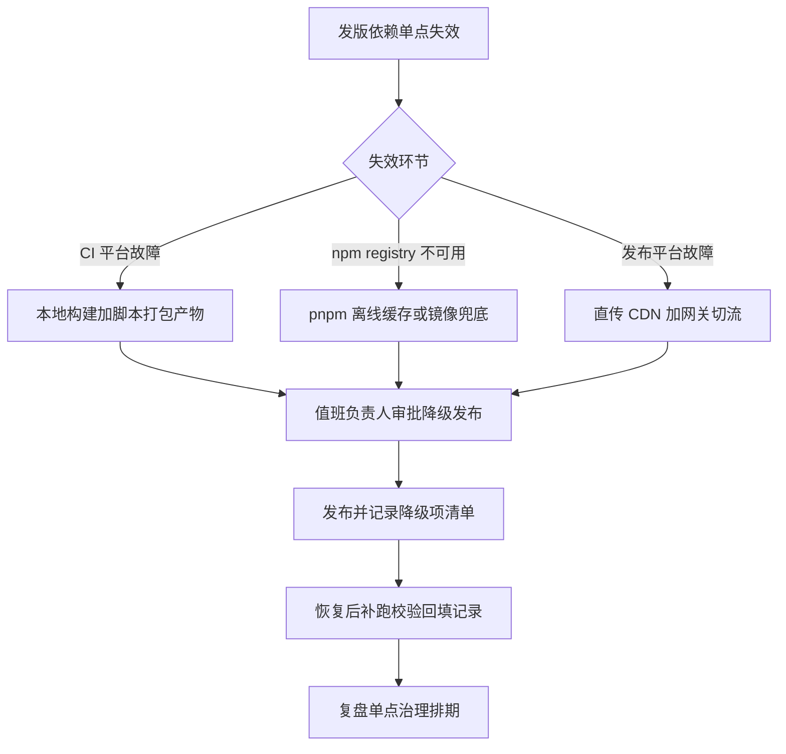

```bash
# runbook/emergency-release.sh —— 断供应急发版半人工兜底
set -euo pipefail
pnpm install --offline --frozen-lockfile          # registry 不可用时离线安装
pnpm build                                        # 本地构建

# 产物完整性自检 替代 CI 校验
node scripts/verify-reproducible.sh

# 直传 CDN 并灰度切流 凭证来自应急工单
aws s3 cp dist/ "s3://corp-static/emergency-$(date +%m%d)/" --recursive
curl -X POST https://gateway.corp.com/admin/switch \
  -H "Authorization: Bearer $EMERGENCY_TOKEN" \
  -d "{\"app\":\"mall\",\"target\":\"emergency-$(date +%m%d)\",\"gray\":\"5%\"}"
echo "降级发布完成 恢复后请回填 CI 构建记录并复盘"
```

### ENG-192：多仓库到 monorepo 迁移的全案怎么做？步骤 风险与回滚？
**答**：
- 分阶段：试点（1~2 个耦合最深的仓库）→ 打通工具链（workspace 配置 CI 改造）→ 批量搬迁 → 冻结旧仓只读归档。
- 技术要点：git filter-repo 改写路径保留提交历史；旧仓库归档防继续提交；原 PR/issue 留在原平台。
- 风险清单：CI 并发雪崩（全仓触发）、目录级权限模型变化、外部引用断裂、团队 rebase 习惯冲突。
- 回滚预案：每批迁移保留旧仓只读镜像，出问题可临时切回（新提交 cherry-pick 回旧仓），稳定两周后下线旧权限。

```bash
# 多仓库迁移核心步骤 git filter-repo 保留历史
# 1. 原仓库历史改写为子目录前缀
git clone https://git.corp.com/mall/checkout-web.git && cd checkout-web
git filter-repo --to-subdirectory-filter packages/checkout --force

# 2. 并入 monorepo 保留无关历史
cd ../monorepo
git remote add checkout ../checkout-web
git fetch checkout
git merge --allow-unrelated-histories checkout/main --no-edit

# 3. 验证历史可追溯
git log --follow --oneline packages/checkout/src/index.ts | head -5

# 4. 旧仓转只读归档 防止团队继续提交
curl -X PUT "https://git.corp.com/api/v4/projects/mall%2Fcheckout-web" \
  -H "PRIVATE-TOKEN: $GIT_TOKEN" -d '{"archived": true}'
```

### ENG-193：从 webpack 迁移 vite 的工程管理面怎么做？
**答**：
- 管理面与单仓改造分开：策略是并行期双构建（vite 为主 webpack 兜底）→ 特性对齐清单 → 全量切换 → 移除 webpack。
- 对齐清单驱动：环境变量机制差异、CSS Modules 命名、publicPath、HMR 边界、每个 webpack 插件的 vite 替代映射表。
- 风险最大三点：CommonJS 与动态 require 依赖、mock 与 proxy 规则迁移、依赖 loader 的第三方库。
- 验收指标量化：本地启动与热更提速数据、双构建产物 diff 报告、E2E 全量通过，达标才允许切默认构建。

```javascript
// scripts/migration-parity-check.mjs —— webpack 与 vite 双构建产物对齐检查
import { execSync } from 'node:child_process'
import { compare } from './bundle-diff.mjs'

// 1. 双构建并行期产物
execSync('npx webpack --mode production --output-path dist-wp', { stdio: 'inherit' })
execSync('npx vite build --outDir dist-vite', { stdio: 'inherit' })

// 2. 产物 diff 模块清单 chunk 结构 总体积
const diff = await compare({ a: 'dist-wp', b: 'dist-vite' })
console.log('总体积变化:', diff.totalDelta)
console.log('仅 webpack 产物包含的模块:', diff.onlyInA.slice(0, 20))

// 3. 卡口 模块缺失或体积暴涨超 10% 阻断切换
if (diff.onlyInA.length > 0 || diff.totalDeltaRatio > 0.1) {
  console.error('对齐未通过 禁止切换默认构建')
  process.exit(1)
}
```

### ENG-194：前端工程化的组织分工怎么定？平台组与业务组的职责边界？
**答**：
- 常见分工：平台组（基建与平台 对内做产品）、业务组（业务交付 消费基建）、虚拟 guild（规范评审与最佳实践横向拉通）。
- 边界用 RACI 写清：谁负责谁批准谁咨询谁知会；最容易扯皮的是业务仓库内的定制需求归谁做。
- 平台组考核看采纳率 节省时长 稳定性，不做功能数 KPI；业务组反馈渠道制度化（月度用户会）。
- 比例健康度：平台组约为业务组的 5%~10%，过高可能自嗨建设，过低说明欠账。

```yaml
# org/raci.yaml —— 前端工程化 RACI 矩阵
matrix:
  ci-cd-templates:
    R: platform-team
    A: frontend-director
    C: [team-leads]
    I: [all-frontend]
  组件库新组件:
    R: component-team
    A: design-guild
    C: [业务组代表]
    I: [all-frontend]
  业务仓库内的构建定制:
    R: business-team
    A: team-lead
    C: [platform-team]     # 平台组只咨询不接管 防需求黑洞
    I: []
  线上构建事故:
    R: platform-team
    A: frontend-director
    C: [on-duty]
    I: [business-team]
ratio_guide: 平台组人数约为业务组 5% 到 10%
```

### ENG-195：工程规范的多端统一与差异化怎么平衡？
**答**：
- 分层策略：跨端公共规范（命名 目录 TS 约定 commit）用 base preset 统一；端差异（样式方案 全局对象 打包配置）按平台层覆盖。
- 实现机制：eslint/tsconfig/stylelint 全走 base 包 + 平台 extend，仓库内禁止自定义与 base 冲突的规则。
- 版本管理：base 包 semver，每季度统一升级窗口；差异规则变更要说明适用端与理由。
- 度量对齐：各端 lint 错误率与自动修复率进同一面板，防止某端长期失管。

```javascript
// packages/eslint-config/index.mjs —— base 与平台层叠加（flat config）
import base from './base.mjs'
import reactRules from './platforms/react-web.mjs'
import mpRules from './platforms/miniprogram.mjs'
import nodeRules from './platforms/node.mjs'

export const web = [...base, ...reactRules]        // h5 与桌面端
export const miniprogram = [...base, ...mpRules]   // 小程序 禁 DOM API 注入平台全局
export const service = [...base, ...nodeRules]     // SSR 与 BFF

// 仓库使用
// import { miniprogram } from '@corp/eslint-config'
// export default [...miniprogram]
// 平台层示例 miniprogram.mjs 内含
// languageOptions: { globals: { wx: 'readonly', getCurrentPages: 'readonly' } }
// no-restricted-globals: 覆盖 window 与 document
```

### ENG-196：低代码与工程化的融合点在哪里？
**答**：
- 融合点一：低代码产物能出码成标准源码进 git，走与手写代码完全相同的 CI/CD 与规范门禁，产物不是二等公民。
- 融合点二：低代码 schema 由工程化的物料体系供给——组件 区块 模板按 schema 协议注册，设计器与代码双向同步。
- 融合点三：低代码平台自身的研发也用工程化治理：schema 版本化 协议测试 发布流水线。
- 边界共识：中后台 CRUD 与流程类适合低代码，复杂交互与性能敏感保留手写，两者靠出码桥接而非对立。

```typescript
// packages/lowcode/schema-to-code.ts —— schema 出码桥接（骨架）
interface NodeSchema { componentName: string; props: Record<string, unknown>; children?: NodeSchema[] }

export function schemaToComponent(schema: NodeSchema, name: string): string {
  // 1. 物料校验 schema 引用的组件必须在已注册物料清单内
  validateAgainstMaterials(schema)
  // 2. 生成标准 React 源码 与手写代码同规范
  return generate(`import React from 'react'
${collectImports(schema).join('\n')}
export default function ${name}() {
  return ${renderNode(schema)}
}`)
}
// 出码产物直接进仓库走 CI eslint test build 与手写完全一致
```

### ENG-197：工程化知识怎么传承？文档 演练与值班怎么组合？
**答**：
- 传承三载体：文档（做什么为什么）、runbook（怎么操作怎么应急）、演练（验证还会做）；文档会腐烂，演练才是保鲜剂。
- 值班制度：平台组轮值 oncall，值班手册覆盖高频事件；每次事件后更新的是手册而非复盘报告。
- 演练形式：断供演练 灰度发布演练 新工具切换演练，排期进季度计划而非有空再做。
- 关键人风险：每个核心系统至少两人能独立操作（含发版权限与故障处置），季度轮换避免能力集中。

```bash
# oncall/runbook-check.sh —— 知识传承巡检
# 1. runbook 完整性 核心服务必须有手册
for svc in publish-platform monitor-sdk ci-templates verdaccio; do
  test -f "docs/runbooks/${svc}.md" || echo "缺失 runbook: $svc"
done

# 2. 演练排期 季度至少一次断供演练
LAST=$(cat .drill-last-date 2>/dev/null || echo 0)
NOW=$(date +%s)
if [ $((NOW - LAST)) -gt $((90 * 86400)) ]; then
  echo "超期未演练 请排期断供演练"
fi

# 3. 事件驱动检查 本周有故障但 runbook 未更新
UPDATES=$(git log --since='7 days ago' --pretty=%s -- docs/runbooks/ | wc -l)
[ "$UPDATES" -eq 0 ] && echo "提醒 本周故障后 runbook 未更新"
```

### ENG-198：AI Native 工程化的演进怎么预测？团队该提前做什么？
**答**：
- 阶段判断：当前是 AI 辅助（补全 按需调用）→ 下一阶段 AI 编排（agent 主导执行 人做验收）→ 远期 AI Native（流程以 AI 为一等公民设计）。
- 可预判变化：spec-driven 开发抬头（人写规格 AI 实现）、review 负载成为新瓶颈、度量单位从代码量转向验收通过的规格数。
- 提前做的基建：机器可读的仓库上下文、可作为验收规格的自动化 E2E、AI 操作审计留痕。
- 组织弹性：工具预测常会错，但人转向规格与验收角色的趋势相对确定，技能转型先于工具押注。

```yaml
# roadmap/ai-native.yaml —— AI Native 演进路线
phases:
  - stage: 辅助 copilot
    now: true
    capabilities: [代码补全, 单测生成, 代码解释]
    human_role: 编写与验收
  - stage: 编排 agent
    capabilities: [任务级生成, 自动修 CI, 重构代理]
    human_role: 拆解规格 验收与 review
    preconditions:
      - 仓库级上下文索引成熟        # 见 ENG-176
      - E2E 可作为机器可读验收规格
  - stage: ai-native
    capabilities: [spec-to-pr 全自动, 自愈流水线]
    human_role: 制定规格 评审重大决策
engineering_shift:
  - review 容量成为吞吐瓶颈 需要分级评审策略
  - 度量转向验收通过率与规格交付周期
  - 所有 AI 操作强制审计留痕
```

### ENG-199：工程效能案例怎么复盘？成功项目与过度工程各有什么教训？
**答**：
- 成功案例骨架：CI 流水线 25 分钟降到 6 分钟。手段是远程缓存 + 范围裁剪 + 串行并行化；关键是先度量留基线，单项改动做 A/B 归因，推广时公布数字而非宣称。
- 成功要素：一次只改一个变量、成效可归因、收益与假设写在 README 让后来者理解设计。
- 反面案例骨架：自研万能脚手架（六种技术栈 插件市场 可视化配置），投入 3 人年，使用率不到 10%。
- 过度工程信号与止损：方案复杂度远超问题规模 无真实用户参与设计 为假想扩展建抽象；砍到 30 行模板后使用率回升至 80%。

```yaml
# retro/efficiency-2026.yaml —— 复盘归档 一正一反
success_case:
  title: CI 流水线提速 25min 到 6min
  baseline_p50: 25min
  after_p50: 6min
  actions:
    - { change: 远程缓存, gain: -12min, attribution: 单项 A/B 对比 }
    - { change: 范围裁剪 filter, gain: -5min }
    - { change: 串行 lint 与 test 并行化, gain: -2min }
  lesson: 先度量留基线 一次一个变量 成效可归因
failure_case:
  title: 自研万能脚手架
  investment: 3 人年
  adoption: 10% 以下
  overengineering_signals:
    - 六种技术栈支持 无业务需要
    - 插件市场 零第三方插件
    - 可视化配置 比手写 yaml 还慢
  corrective_action: 砍为 30 行模板 使用率回升至 80%
  lesson: 方案复杂度必须匹配问题规模 无真实用户不立项
```

### ENG-200：前端工程知识体系怎么收束？工具 流程 度量 文化四层地图是什么？
**答**：
- 四层地图：工具层（用什么 构建 框架 CI 工具链）、流程层（怎么走 分支 发布 评审 应急）、度量层（好不好 DORA 质量 成本）、文化层（为什么持续 规范 雷达 复盘 传承）。
- 依赖方向：工具被流程编排，流程被度量检验，度量靠文化迭代；只投入底层是工具堆砌，只讲文化是口号工程。
- 使用方式：面试答全景与取舍；工作答现状定位 缺口 下一步，用地图找团队短板。
- 动态视角：四层每年都有大变化（如 AI 正在重塑工具层与流程层），地图本身要版本化演进。

```yaml
# knowledge-map/frontend-engineering.yaml —— 四层知识地图
map:
  tools:
    core: [包管理, 构建工具, 编译器, ci-cd 平台, 监控 sdk]
    principle: 工具选型服务流程 评估先于引入
  process:
    core: [分支模型, 发布流程, 评审规则, 应急预案, 封网机制]
    principle: 流程编排工具 每步可追溯可回滚
  metrics:
    core: [dora 四指标, 质量门禁数据, 效率面板, 成本报表]
    principle: 度量团队不度量个人 反博弈设计
  culture:
    core: [技术雷达, 复盘机制, 知识传承, 规范治理]
    principle: 文化驱动迭代 演练保鲜文档
dependency_flow: 工具 -> 流程 -> 度量 -> 文化 -> 反哺工具
usage: 面试答全景与取舍 工作答现状缺口与下一步

```
