# 前端面试题库：场景考察 200 题

本文件收录"真实工作场景"考察题：给出业务或线上问题的情境，按"处理思路 + 可落地代码"组织答案。SCN-001 ~ 050 覆盖线上排查、性能优化、请求治理、状态与表单、安全、移动端、实时通信、监控与工程化协作十二类场景；SCN-051 ~ 125 在此基础上扩充排查进阶、表单交互、数据展示、网络接口、状态管理、性能与安全进阶、工程协作、产品体验与跨端共十大方向；SCN-126 ~ 200 再扩充十个新维度——电商交易、内容社区、办公 B 端、地图位置、音视频、游戏化互动、工程效能、深度排查、架构落地与新技术融合，与 01~09 专题的概念题互补，专练"拿到问题怎么落地"。

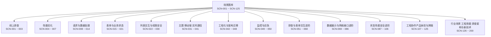

## 目录

### 一、线上问题排查（SCN-001 ~ SCN-003）
### 二、性能优化实战（SCN-004 ~ SCN-007）
### 三、请求与数据处理（SCN-008 ~ SCN-014）
### 四、表单与交互状态（SCN-015 ~ SCN-017）
### 五、登录态与业务状态（SCN-018 ~ SCN-021）
### 六、复杂列表与交互（SCN-022 ~ SCN-025）
### 七、权限与安全（SCN-026 ~ SCN-030）
### 八、主题与国际化（SCN-031 ~ SCN-032）
### 九、移动端与微信 H5（SCN-033 ~ SCN-038）
### 十、实时通信（SCN-039 ~ SCN-041）
### 十一、工程化与架构迁移（SCN-042 ~ SCN-048）
### 十二、监控与应急（SCN-049 ~ SCN-050）
### 十三、线上问题排查进阶（SCN-051 ~ SCN-058）
### 十四、表单与交互进阶（SCN-059 ~ SCN-068）
### 十五、数据展示进阶（SCN-069 ~ SCN-076）
### 十六、网络与接口进阶（SCN-077 ~ SCN-086）
### 十七、状态管理进阶（SCN-087 ~ SCN-092）
### 十八、性能场景进阶（SCN-093 ~ SCN-100）
### 十九、安全场景进阶（SCN-101 ~ SCN-106）
### 二十、工程协作（SCN-107 ~ SCN-114）
### 二十一、产品与体验（SCN-115 ~ SCN-120）
### 二十二、移动端与跨端（SCN-121 ~ SCN-125）
### 二十三、电商与交易场景（SCN-126 ~ SCN-134）
### 二十四、内容与社区场景（SCN-135 ~ SCN-141）
### 二十五、办公与 B 端场景（SCN-142 ~ SCN-149）
### 二十六、地图与位置场景（SCN-150 ~ SCN-155）
### 二十七、音视频场景（SCN-156 ~ SCN-162）
### 二十八、游戏化与互动（SCN-163 ~ SCN-167）
### 二十九、工程效能场景（SCN-168 ~ SCN-176）
### 三十、深度排查场景（SCN-177 ~ SCN-185）
### 三十一、架构落地场景（SCN-186 ~ SCN-193）
### 三十二、新技术融合场景（SCN-194 ~ SCN-200）

## 一、线上问题排查

### SCN-001：线上页面突然大面积白屏，如何快速排查？
**答**：
- 先止血再查因：全量白屏优先回滚上一个版本；确认影响范围（全量还是部分用户、哪个版本、哪个入口）。
- 排查链路：入口 JS 资源是否加载失败（CDN、发布路径、缓存）→ JS 是否运行时报错（看监控、sourcemap 还原）→ 接口是否异常 → DOM 存在但不可见（样式或渲染逻辑问题）。
- 预防：接入白屏检测，onload 后检查根节点内容量，异常自动上报。

白屏排查决策树：

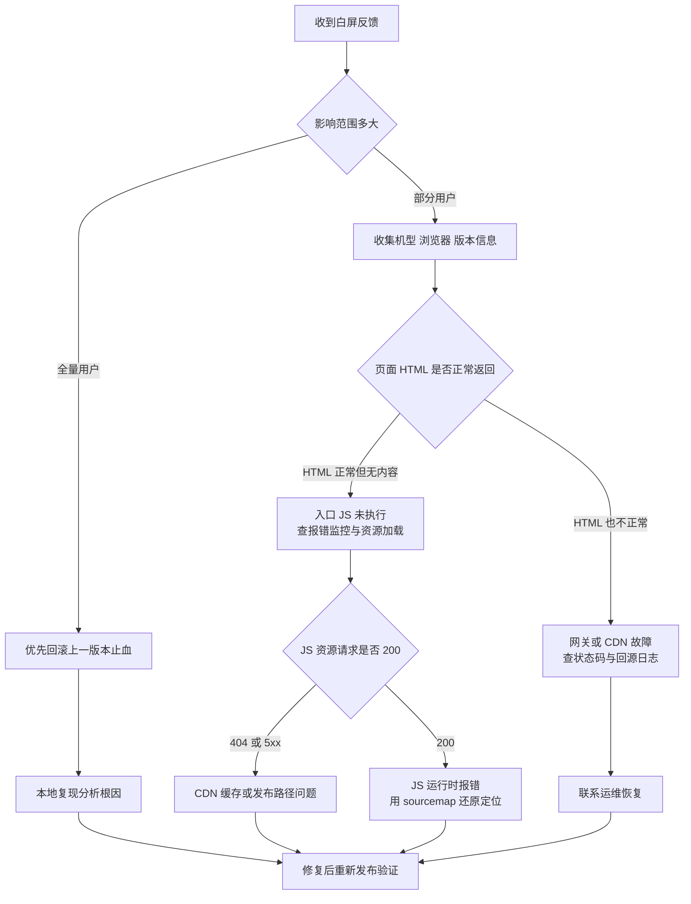

```javascript
// 白屏检测：onload 后采样根节点内容量，异常时上报现场
function checkWhiteScreen() {
  const root = document.querySelector('#app');
  const empty = !root || root.innerHTML.trim().length < 100;
  if (empty) {
    navigator.sendBeacon('/api/monitor', JSON.stringify({
      type: 'white-screen',
      url: location.href,
      version: window.APP_VERSION,
      // 上报 HTML 片段，方便还原当时现场
      html: document.documentElement.outerHTML.slice(0, 2000),
      time: Date.now(),
    }));
  }
}
window.addEventListener('load', () => setTimeout(checkWhiteScreen, 3000));
```

### SCN-002：发布后线上 JS 报错量激增，怎么排查？
**答**：
- 看报警面板确认三个维度：错误量环比、影响用户数、错误集中出现的版本号。
- 刚发布就激增 → 直接回滚并通知值班；未发布也激增 → 按错误指纹聚合，取 Top 错误用 sourcemap 还原堆栈。
- 定位到代码与负责人后修复，走 hotfix 发布，观察错误率回落再收尾；复盘时补齐该类错误的测试用例。

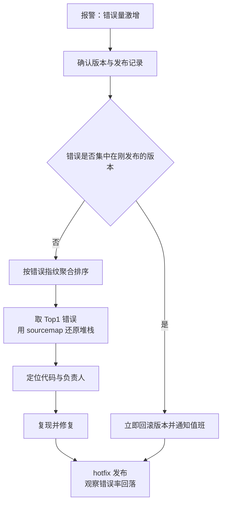

```javascript
// 错误指纹：同一错误聚合成一条，按发生量排序快速锁定主因
window.addEventListener('error', (e) => {
  const stack = (e.error && e.error.stack) || '';
  report({
    type: 'js-error',
    message: e.message,
    // 用 message + 堆栈首帧生成指纹，同一类错误指纹相同
    fingerprint: simpleHash(e.message + stack.split('\n')[1]),
    version: window.APP_VERSION, // 用于区分是否新版本引入
    url: location.href,
  });
}, true);
function simpleHash(str) {
  let h = 0;
  for (const ch of str) h = (h * 31 + ch.charCodeAt(0)) | 0;
  return h;
}
```

### SCN-003：首屏加载超过 5 秒，给出完整的优化方案。
**答**：
- 先量化再动手：Lighthouse 与 Performance 面板跑出 LCP/FCP/TTFB，Network 瀑布图找到最大瓶颈，避免盲目优化。
- 网络层：CDN 加速、HTTP/2、Gzip/Brotli 压缩、接口合并与预请求。
- 体积层：路由懒加载、按需引入组件库、图片压缩与 webp、剔除无用依赖。
- 渲染层：关键 CSS 内联、骨架屏、SSR/预渲染；缓存层：静态资源带 hash 强缓存一年。

```html
<!-- 1. HTML 内预加载关键资源，缩短关键请求链 -->
<link rel="preload" href="/js/index-a1b2c3.js" as="script" />
<link rel="preload" href="/fonts/main.woff2" as="font" type="font/woff2" crossorigin />

<!-- 2. 骨架屏：JS 未就绪前先给用户视觉反馈，感知性能大幅提升 -->
<div id="app">
  <div class="skeleton-header"></div>
  <div class="skeleton-body"></div>
</div>
```

## 二、性能优化实战

### SCN-004：列表页滚动明显卡顿，如何定位和解决？
**答**：
- 定位：Performance 面板录制滚动，看长任务、强制同步布局（紫色 Layout 每帧触发）、大图解码。
- 常见原因：滚动事件未节流且频繁读写 offsetTop、DOM 节点过多、图片未懒加载、深度多层级样式重排。
- 解决：读写分离 + rAF 合并、图片懒加载、长列表用 content-visibility 或虚拟列表（见 SCN-023）、减少 DOM 层级。

```css
/* content-visibility：让浏览器跳过屏外元素的渲染与布局，长列表立竿见影 */
.list-item {
  content-visibility: auto;
  contain-intrinsic-size: 0 120px; /* 提供占位高度，防止滚动条抖动 */
}
```

```javascript
// 滚动处理：rAF 合并 + 读写分离，避免每帧强制同步布局
let ticking = false;
window.addEventListener('scroll', () => {
  if (ticking) return;
  ticking = true;
  requestAnimationFrame(() => {
    const top = window.scrollY;      // 读：集中一次
    updateHeader(top);               // 写：统一在 rAF 内完成
    ticking = false;
  });
}, { passive: true });
```

### SCN-005：一个页面有几百张图片，加载很慢，怎么优化？
**答**：
- 懒加载是第一手段：首屏外图片进入视口前不请求，配合 rootMargin 提前 200px 预热。
- 占位防 CLS：img 写死 width/height 或 aspect-ratio，避免加载后布局跳动。
- 传输优化：webp/avif 格式、CDN 按需裁剪尺寸、小图标用 SVG 或雪碧图、低画质模糊占位（LQIP）。

```javascript
// IntersectionObserver 懒加载：进入视口附近才真正请求图片
const io = new IntersectionObserver((entries) => {
  entries.forEach((en) => {
    if (!en.isIntersecting) return;
    const img = en.target;
    img.src = img.dataset.src;   // 真实地址放在 data-src 上
    io.unobserve(img);           // 加载过就停止观察
  });
}, { rootMargin: '200px 0px' }); // 提前 200px 开始加载

document.querySelectorAll('img[data-src]').forEach((img) => io.observe(img));
// HTML 侧： 占位防抖动
```

### SCN-006：如何为下一屏做关键资源预加载？落地时注意什么？
**答**：
- 四个关键字各司其职：dns-prefetch 解析域名、preconnect 提前建连（DNS+TCP+TLS）、preload 当前页面必需资源、prefetch 下一页可能用到的资源。
- preload 字体必须加 crossorigin，否则字体会被加载两次；preload 了却没使用的资源，控制台会告警并浪费带宽。
- 实践：首屏 LCP 图片 preload；详情页入口按钮 hover 时 prefetch 详情页 chunk。

```html
<!-- 与 API 域名提前建连，接口请求省下 DNS + TCP + TLS 时间 -->
<link rel="preconnect" href="https://api.example.com" />
<!-- LCP 首图必须尽快加载 -->
<link rel="preload" as="image" href="/img/hero.avif" />
<!-- 字体必须 crossorigin，否则会二次加载 -->
<link rel="preload" as="font" type="font/woff2" href="/fonts/main.woff2" crossorigin />
<!-- 下一页可能用到的 chunk：空闲时低优先级下载 -->
<link rel="prefetch" as="script" href="/js/detail-d4e5f6.js" />
```

### SCN-007：如何为前端项目制定并守住性能预算？
**答**：
- 先定指标：首屏 JS/CSS 体积上限、单包上限、请求数、LCP/INP 阈值，写进团队文档。
- 再自动化：CI 中用 size-limit 校验产物体积、Lighthouse CI 校验运行时指标，超预算阻断合并。
- 治理策略：新增依赖必须评估体积；超预算时先优化再合并，避免预算形同虚设。

```json
{
  "scripts": {
    "size": "size-limit"
  },
  "size-limit": [
    { "path": "dist/assets/index-*.js", "limit": "200 KB", "gzip": true },
    { "path": "dist/assets/vendor-*.js", "limit": "150 KB", "gzip": true },
    { "path": "dist/assets/**/*.css", "limit": "50 KB", "gzip": true }
  ]
}
```

## 三、请求与数据处理

### SCN-008：搜索框连续输入导致请求乱序，旧结果覆盖新结果，怎么处理？
**答**：
- 根因是竞态：先发的请求后返回，把新结果覆盖了。核心手段是"请求取消 + 忽略过期响应"。
- 用 AbortController 取消上一次未完成的请求；输入侧再配 300ms 防抖减少无效请求。
- 服务端不支持取消也没关系：abort 后 fetch 直接 reject，本地只需忽略 AbortError。

```javascript
let controller = null;
async function onSearch(keyword) {
  controller?.abort();               // 取消上一次未完成的请求
  controller = new AbortController();
  try {
    const res = await fetch(`/api/search?kw=${encodeURIComponent(keyword)}`, {
      signal: controller.signal,
    });
    render(await res.json());        // 只有最新一次请求能走到这里
  } catch (e) {
    if (e.name !== 'AbortError') console.error(e); // 取消不算错误
  }
}
input.addEventListener('input', debounce((e) => onSearch(e.target.value), 300));
```

### SCN-009：请求超时和失败重试怎么设计才稳妥？
**答**：
- 超时：用 `AbortSignal.timeout(ms)` 或手动定时器 abort，避免请求悬挂。
- 重试原则：只重试幂等请求（GET/PUT/DELETE）或网络错误、5xx；4xx 参数错误重试无意义。
- 退避策略：指数退避 + 随机抖动，防止服务恢复瞬间被重试流量打垮；重试次数设上限并最终抛出。

```javascript
async function requestWithRetry(url, options = {}, retries = 3) {
  for (let i = 0; i < retries; i++) {
    try {
      const res = await fetch(url, {
        ...options,
        signal: AbortSignal.timeout(5000), // 单次请求 5 秒超时
      });
      if (res.status >= 500) throw new Error(`server error ${res.status}`);
      return res; // 4xx 等业务错误不重试，直接返回让上层处理
    } catch (e) {
      if (i === retries - 1) throw e;               // 最后一次失败才抛出
      const delay = 2 ** i * 500 + Math.random() * 300; // 指数退避 + 抖动
      await new Promise((r) => setTimeout(r, delay));
    }
  }
}
```

### SCN-010：页面初始化要发几十个请求，如何做并发控制？
**答**：
- 全部串行太慢、全部并行会打爆浏览器连接数或触发网关限流，需要"最多同时 N 个"。
- p-limit 思路：一个队列 + 活跃计数，任务完成时自动从队列取下一个。
- 落地后配合 Promise.all 收集全部结果，失败项用 allSettled 兜底。

```javascript
function pLimit(concurrency) {
  const queue = [];
  let active = 0;
  const next = () => {
    if (active >= concurrency || queue.length === 0) return;
    active++;
    const { fn, resolve, reject } = queue.shift();
    fn().then(resolve, reject).finally(() => { active--; next(); }); // 完成后补位
  };
  return (fn) =>
    new Promise((resolve, reject) => {
      queue.push({ fn, resolve, reject });
      next();
    });
}

const limit = pLimit(5); // 最多 5 个并发
const results = await Promise.all(
  ids.map((id) => limit(() => fetchDetail(id))),
);
```

### SCN-011：接口数据的缓存策略怎么选型？
**答**：
- 按实时性分档：实时数据（行情、库存）不缓存只做去重；准实时（列表、详情）用 SWR——先回旧数据再后台更新；低频数据（字典、配置）localStorage 持久化 + 过期时间。
- 缓存 key 要包含全部请求参数，避免不同参数互相污染。
- 简单实现 SWR：命中缓存立即返回旧值，同时静默重新请求，完成后通知更新。

```javascript
const cache = new Map();
async function swrFetch(key, fetcher, onUpdate) {
  if (cache.has(key)) {
    // 1. 先立即返回旧数据，界面秒开
    // 2. 后台静默重新请求，完成后回调更新界面
    fetcher(key)
      .then((data) => { cache.set(key, data); onUpdate?.(data); })
      .catch(() => {});
    return cache.get(key);
  }
  const data = await fetcher(key); // 无缓存才真正等待
  cache.set(key, data);
  return data;
}
```

### SCN-012：场景设计：为网盘业务设计一套大文件分片上传与断点续传方案
**答**：
- 切片：`file.slice(start, end)` 按 5MB 一片，串行或小并发上传。
- 断点续传：上传前调 verify 接口，服务端返回已有分片索引，前端跳过即可续传。
- 合并：全部分片传完后调 merge，服务端按序合并并校验 hash；页面刷新后再进来，凭文件 hash 走同一套 verify 恢复进度。

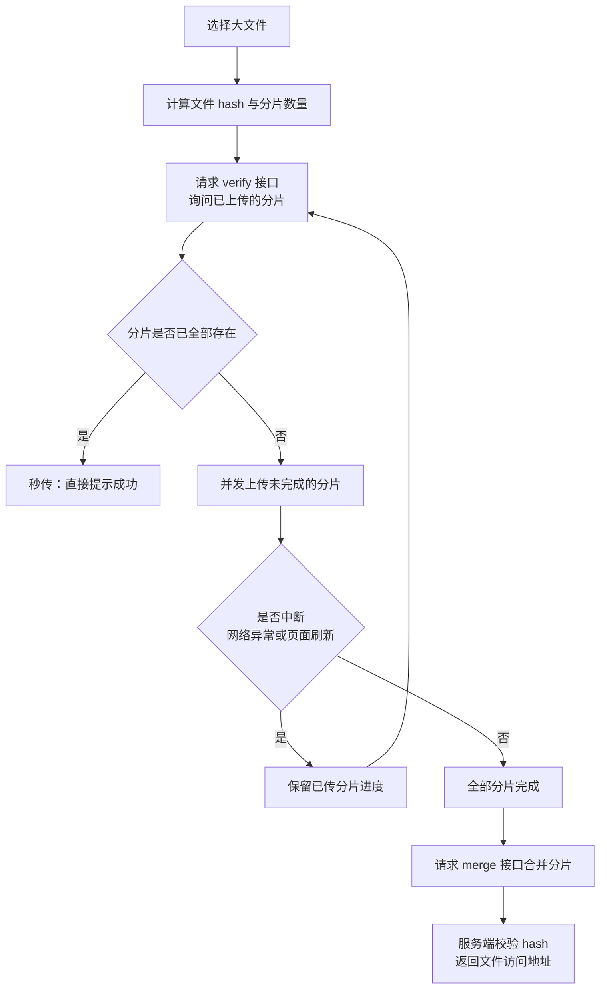

```javascript
async function uploadBigFile(file) {
  const chunkSize = 5 * 1024 * 1024;
  const chunks = Math.ceil(file.size / chunkSize);
  // 1. verify：服务端返回文件 hash 与已上传分片，实现断点续传
  const { fileHash, uploaded } = await fetch('/api/upload/verify', {
    method: 'POST',
    headers: { 'Content-Type': 'application/json' },
    body: JSON.stringify({ name: file.name, size: file.size }),
  }).then((r) => r.json());

  // 2. 逐片上传，跳过已存在的分片
  for (let i = 0; i < chunks; i++) {
    if (uploaded.includes(i)) continue;
    const fd = new FormData();
    fd.append('chunk', file.slice(i * chunkSize, (i + 1) * chunkSize));
    fd.append('hash', `${fileHash}-${i}`); // 分片标识：文件 hash + 序号
    await fetch('/api/upload/chunk', { method: 'POST', body: fd });
    onProgress((i + 1) / chunks);
  }

  // 3. 通知服务端合并
  await fetch('/api/upload/merge', {
    method: 'POST',
    headers: { 'Content-Type': 'application/json' },
    body: JSON.stringify({ fileHash, chunks }),
  });
}
```

### SCN-013：10 万行数据要导出 Excel/CSV，前端怎么处理？
**答**：
- 首选方案永远是后端异步导出：接口返回任务 ID，前端轮询任务状态后拿文件地址下载，前端只做触发与提示。
- 数据确实在前端时：CSV 比 Excel 简单可靠——字符串拼接 + Blob 下载；注意加 BOM 防 Excel 中文乱码、字段转义引号防注入。
- 大数据量分批拼接（按 5MB 分段或放 Web Worker），避免主线程长任务卡死页面。

```javascript
function exportCSV(rows, filename) {
  // BOM 头：否则 Excel 打开中文乱码
  let csv = '\uFEFF' + Object.keys(rows[0]).join(',') + '\n';
  for (const row of rows) {
    csv += Object.values(row)
      .map((v) => `"${String(v ?? '').replaceAll('"', '""')}"`) // 引号转义防 CSV 注入
      .join(',') + '\n';
  }
  const blob = new Blob([csv], { type: 'text/csv;charset=utf-8' });
  const a = document.createElement('a');
  a.href = URL.createObjectURL(blob);
  a.download = filename;
  a.click();
  URL.revokeObjectURL(a.href); // 释放内存
}
```

### SCN-014：前端如何生成 PDF？
**答**：
- 方案一 window.print + @media print：浏览器原生分页，文字可选中，最稳，适合导出简历、报告。
- 方案二 html2canvas + jsPDF：截图式，还原度取决于 canvas，文字不可选中、体积大，适合海报、证书。
- 方案三 pdfmake/pdf-lib 直接构建文档或服务端 puppeteer：需要精确排版时用。
- 选型口诀：能打印就打印，要下载文件再考虑 jsPDF。

```javascript
import { jsPDF } from 'jspdf';
import html2canvas from 'html2canvas';

async function exportPDF(el, filename) {
  const canvas = await html2canvas(el, { scale: 2 }); // 放大 2 倍防模糊
  const pdf = new jsPDF('p', 'mm', 'a4');
  const pageW = pdf.internal.pageSize.getWidth();
  const imgH = (canvas.height * pageW) / canvas.width; // 等比缩放到 A4 宽
  pdf.addImage(canvas.toDataURL('image/jpeg', 0.95), 'JPEG', 0, 0, pageW, imgH);
  pdf.save(filename);
}
// 方案一示例：打印前给 body 加 class，@media print 里隐藏导航与按钮
// window.print();
```

## 四、表单与交互状态

### SCN-015：用户双击"提交订单"造成重复下单，如何彻底防止表单重复提交？
**答**：
- 三层防线：前端按钮锁（体验层）→ 请求层防重（同一幂等键只发一次）→ 服务端幂等（唯一索引/幂等键，最终兜底）。
- 状态锁要在 finally 里释放，失败时允许用户重试；成功后跳转离开表单页，避免停留在可重复提交的页面。
- 幂等键进入页面时生成、提交时携带，服务端遇到重复键直接返回第一次的结果，网络重试也不会多扣一单。

```javascript
let submitting = false;                          // 第一层：状态锁
async function submitOrder(payload) {
  if (submitting) return;
  submitting = true;
  try {
    const res = await fetch('/api/order', {
      method: 'POST',
      headers: { 'Content-Type': 'application/json' },
      body: JSON.stringify({
        ...payload,
        requestId: window.__orderToken,          // 第三层：服务端按此幂等键去重
      }),
    });
    const data = await res.json();
    if (data.code === 0) location.replace('/order/success'); // 成功后离开表单页
  } finally {
    submitting = false;                          // 失败允许用户重试
  }
}
// 进入下单页时生成幂等键：window.__orderToken = crypto.randomUUID();
```

### SCN-016：异步按钮的防重复点击与 loading 状态，如何优雅复用？
**答**：
- 把"异步期间锁定"抽成组合式函数 useLock：包一层 run 自动管理 loading，组件里只负责绑定，避免每个按钮手写布尔开关。
- 点击后立即 disabled + 转圈，Promise 结束（无论成败）在 finally 释放锁定。
- 删除等危险操作叠加二次确认；支付等关键操作在 loading 期间加整页遮罩，防止误触其他按钮。

```vue
<script setup>
import { ref } from 'vue';
// 通用防连点：loading 期间重复调用直接忽略，结束后自动释放
function useLock(fn) {
  const loading = ref(false);
  return {
    loading,
    run: async (...args) => {
      if (loading.value) return;
      loading.value = true;
      try { await fn(...args); } finally { loading.value = false; }
    },
  };
}
const save = useLock(async () => {
  await api.updateProfile(form);
  ElMessage.success('已保存');
});
</script>

<template>
  <el-button type="primary" :loading="save.loading" :disabled="save.loading" @click="save.run">
    保存
  </el-button>
</template>
```

### SCN-017：后台要求"表单项由运营配置"，前端如何实现 schema 驱动的动态表单？
**答**：
- 思路：后端下发 JSON Schema（字段、控件类型、label、校验规则、选项），前端维护"类型 → 组件"的渲染分支，v-for 遍历渲染。
- 校验规则由 schema 翻译成 async-validator 规则交给 el-form 统一校验，避免逐字段手写。
- 复杂联动（选了 A 才显示 B）用 schema 的 visibleWhen 条件或 watch 指定字段处理；映射表模式扩展新控件只需加一个分支。

```vue
<script setup>
import { computed, ref } from 'vue';
// 后端下发的 schema（示例），也可来自接口
const schema = [
  { field: 'name', label: '姓名', type: 'input', required: true },
  { field: 'age', label: '年龄', type: 'number', required: false },
  { field: 'city', label: '城市', type: 'select', options: ['北京', '上海'] },
];
const model = ref({});
// schema 翻译为 async-validator 规则
const rules = computed(() =>
  Object.fromEntries(schema.filter((s) => s.required).map((s) => [
    s.field, { required: true, message: `${s.label}不能为空`, trigger: 'blur' },
  ])),
);
</script>

<template>
  <el-form :model="model" :rules="rules">
    <el-form-item v-for="item in schema" :key="item.field" :label="item.label" :prop="item.field">
      <el-select v-if="item.type === 'select'" v-model="model[item.field]">
        <el-option v-for="op in item.options" :key="op" :label="op" :value="op" />
      </el-select>
      <el-input-number v-else-if="item.type === 'number'" v-model="model[item.field]" />
      <el-input v-else v-model="model[item.field]" />
    </el-form-item>
  </el-form>
</template>
```

## 五、登录态与业务状态

### SCN-018：accessToken 过期后如何做到用户无感刷新？
**答**：
- 双 Token：accessToken 短期有效随业务请求携带，refreshToken 长期有效仅用于换新。
- 拦截器捕获 401：用 refreshToken 换新 Token，成功后重放原请求；refreshToken 也失效才踢回登录页。
- 并发 401 只触发一次刷新：用"刷新进行中"的 Promise 复用，所有挂起请求等同一个结果，完成后统一带新 Token 重放。

Token 无感刷新时序：

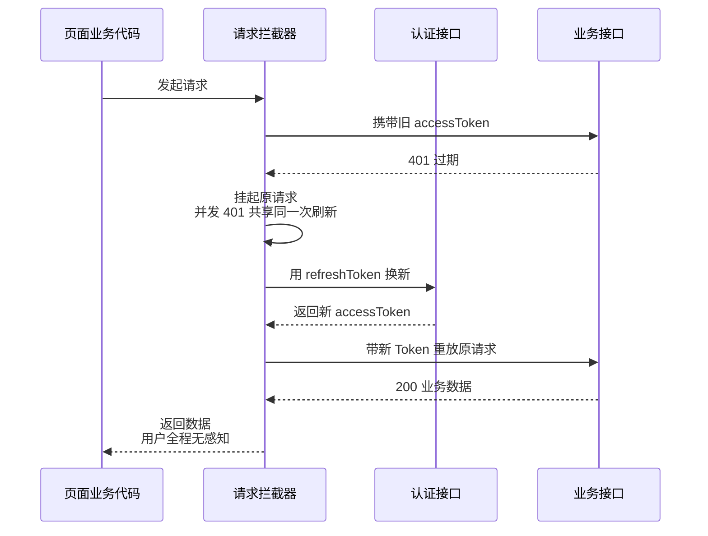

```javascript
let refreshing = null; // 复用同一次刷新，并发 401 只打一次认证接口
async function request(config) {
  try {
    return await axios(config);
  } catch (err) {
    if (err.response?.status !== 401) throw err;
    refreshing ??= fetch('/api/auth/refresh', {
      method: 'POST',
      body: localStorage.getItem('refreshToken'),
    })
      .then((r) => r.json())
      .then(({ accessToken }) => {
        localStorage.setItem('accessToken', accessToken);
        return accessToken;
      })
      .finally(() => { refreshing = null; }); // 刷新结束清空，下次过期重新刷新
    const token = await refreshing;           // 并发 401 共享同一个 Promise
    config.headers.Authorization = `Bearer ${token}`;
    return axios(config);                     // 重放原请求
  }
}
```

### SCN-019：用户在 A 标签页退出登录，B 标签页仍是登录态，如何同步多标签页状态？
**答**：
- 同源标签页通信两条路：BroadcastChannel（现代浏览器首选，语义清晰）和 storage 事件（localStorage 的写操作会广播给其他页面）。
- 登录/退出时广播一条带时间戳的 auth-change 消息，其他页面收到后清理内存态并跳登录页或刷新用户信息。
- 注意 storage 事件只在"其他页面"触发，本页面不会收到；老浏览器用 storage 方案兜底。

```javascript
// 封装跨标签页广播：优先 BroadcastChannel，降级 storage 事件
const channel = 'BroadcastChannel' in window
  ? new BroadcastChannel('auth')
  : null;

function broadcastAuthChange(action) {
  const msg = { action, time: Date.now() };
  if (channel) channel.postMessage(msg);
  else localStorage.setItem('auth-change', JSON.stringify(msg)); // 触发其他页 storage 事件
}

function onAuthChange(handler) {
  if (channel) {
    channel.onmessage = (e) => handler(e.data);
  } else {
    window.addEventListener('storage', (e) => {
      if (e.key === 'auth-change') handler(JSON.parse(e.newValue));
    });
  }
}

onAuthChange(({ action }) => {
  if (action === 'logout') {
    userStore.clearUser();      // 清理内存态，防止返回键看到脏数据
    router.push('/login');
  }
});
// 退出登录的动作里调用：broadcastAuthChange('logout')
```

### SCN-020：秒杀活动倒计时要求以服务器时间为准，如何解决客户端时间不可信的问题？
**答**：
- 进入页面调一次轻量时间接口，计算 offset = 服务器时间 - 本地时间；展示时间一律用 Date.now() + offset，避免每秒请求服务器。
- 校准时用往返 RTT 的一半补偿网络延迟，长驻页面可定时重校准。
- 关键判定（能否下单）由服务端裁决，前端倒计时只做展示，防止用户改本地时间提前抢购。

```javascript
let serverOffset = 0; // 服务器与本地的时间差

async function syncServerTime() {
  const t0 = Date.now();
  const { serverTime } = await fetch('/api/time').then((r) => r.json());
  const rtt = Date.now() - t0;
  // 估算请求到达时刻：serverTime + 半个 RTT，误差控制在 RTT/2 以内
  serverOffset = serverTime + rtt / 2 - Date.now();
}

function now() {
  return Date.now() + serverOffset;   // 业务统一用 now() 获取"服务器时间"
}

function renderCountdown(endTime) {
  const timer = setInterval(() => {
    const left = endTime - now();
    if (left <= 0) { clearInterval(timer); onSaleStart(); return; }
    el.textContent = format(left);
  }, 1000);
}
```

### SCN-021：购物车有哪些状态要管理？未登录的本地购物车如何与登录后的服务端购物车合并？
**答**：
- 状态拆分：商品明细（skuId、数量、勾选）、价格合计（展示用，下单以服务端为准）、修改中的 pending 标记。
- 登录前购物车放 localStorage；登录成功后拉服务端车做合并（相同 skuId 数量累加），合并完清空本地车。
- 数量修改做防抖 + 乐观更新，失败回滚并提示，保证界面响应快又不会与服务端偏差。

```typescript
interface CartItem {
  skuId: string;
  count: number;
  checked: boolean;
  price: number; // 仅供参考，下单前服务端重新校验
}

const useCart = defineStore('cart', () => {
  const items = ref<CartItem[]>([]);

  async function mergeLocalOnLogin(localItems: CartItem[]) {
    const server = await api.getCart();            // 登录后拉服务端购物车
    const map = new Map(server.items.map((i) => [i.skuId, { ...i }]));
    for (const local of localItems) {
      const hit = map.get(local.skuId);
      map.set(local.skuId, {
        ...(hit ?? local),
        count: (hit?.count ?? 0) + local.count,    // 相同 sku 数量累加
      });
    }
    items.value = [...map.values()];
    localStorage.removeItem('cart');               // 合并完清空本地车
  }

  async function changeCount(skuId: string, delta: number) {
    const item = items.value.find((i) => i.skuId === skuId)!;
    const prev = item.count;
    item.count += delta;                           // 乐观更新，界面先变
    try {
      await api.updateCart(skuId, item.count);
    } catch {
      item.count = prev;                           // 失败回滚并提示
      ElMessage.error('修改数量失败，请重试');
    }
  }

  return { items, mergeLocalOnLogin, changeCount };
});
```

## 六、复杂列表与交互

### SCN-022：信息流首页要做无限滚动加载，落地时有哪些必须处理的细节？
**答**：
- 触发方式：不监听 scroll，用底部哨兵元素 + IntersectionObserver，rootMargin 提前 400px 预加载，用户几乎无感。
- 三重防护：loading 中不重复触发、hasMore 为 false 后 disconnect 停止观察、请求失败给重试入口而不是静默失败。
- 分页用游标（lastId）而不是页码，插入新内容时不会重复或漏数据；同时保留滚动位置，避免换页后视图跳动。

```javascript
let cursor = null, loading = false, hasMore = true;

const io = new IntersectionObserver(async ([entry]) => {
  if (!entry.isIntersecting || loading || !hasMore) return; // 三重防护
  loading = true;
  showSpinner();
  try {
    const { list, nextCursor } = await api.feed({ cursor }); // 游标分页
    feedList.push(...list);
    cursor = nextCursor;
    hasMore = list.length > 0 && Boolean(nextCursor);
    if (!hasMore) io.disconnect();            // 没有更多就停止观察
  } catch {
    showErrorRetry(() => { loading = false; }); // 失败给重试入口
  } finally {
    loading = false;
    hideSpinner();
  }
}, { rootMargin: '400px 0px' });              // 提前 400px 预加载

io.observe(document.querySelector('#sentinel'));
```

### SCN-023：1 万条数据渲染成表格页面直接卡死，虚拟列表如何落地？
**答**：
- 核心思想：只渲染可视区 + 上下缓冲共几十条，用占位元素撑出真实滚动高度，内层用 transform 把切片"顶"回原位置。
- 固定行高最简单：startIndex = scrollTop / rowHeight 取整，endIndex = startIndex + 可视行数 + 缓冲。
- 不定高场景用"预估高度渲染 + 实测后回写高度缓存"修正，社区方案 vue-virtual-scroller、react-window 均是此思路。

```javascript
const rowHeight = 48, viewportHeight = 600, buffer = 5;

listBox.addEventListener('scroll', () => {
  const scrollTop = listBox.scrollTop;
  const start = Math.max(0, Math.floor(scrollTop / rowHeight) - buffer);
  const end = Math.min(data.length, start + Math.ceil(viewportHeight / rowHeight) + buffer * 2);
  // 用内层偏移把切片顶回原位置，滚动条总高保持真实
  inner.style.transform = `translateY(${start * rowHeight}px)`;
  render(data.slice(start, end));
});
// 结构：<div listBox 高600 overflow auto>
//         <div 占位 总高 = data.length * rowHeight>
//           <div inner>只放可视区切片</div>
//         </div>
//       </div>
```

### SCN-024：后台列表需要拖拽调整顺序，如何实现并同步到服务端？
**答**：
- 原生方案：HTML5 拖拽事件（dragstart / dragover / drop），dragover 里必须 preventDefault 才允许放置，drop 时本地数组重排并重渲染。
- 生产环境建议直接用 SortableJS / vuedraggable，它处理了自动滚动、移动端触摸、嵌套容器等大量边界。
- 保存策略：拖完立即把"新顺序的 id 数组"整体提交最简单可靠；数据量大时只传移动项的 targetId 与位置。

```javascript
let dragIndex = -1;
items.forEach((li, index) => {
  li.draggable = true;
  li.addEventListener('dragstart', () => { dragIndex = index; li.classList.add('dragging'); });
  li.addEventListener('dragend', () => li.classList.remove('dragging'));
  li.addEventListener('dragover', (e) => e.preventDefault()); // 必须阻止默认行为才可放置
  li.addEventListener('drop', async (e) => {
    e.preventDefault();
    if (dragIndex === index) return;
    const [moved] = list.splice(dragIndex, 1);  // 本地先重排，用户立即看到效果
    list.splice(index, 0, moved);
    rerender();
    await api.saveOrder(list.map((it) => it.id)); // 整体顺序提交，服务端覆盖保存
  });
});
```

### SCN-025：商品详情页的 SKU 联动选择器（选了颜色后无货尺码自动置灰）怎么设计？
**答**：
- 数据模型：每条 SKU 记录是"属性组合 + 库存"，如 color=红 & size=M & stock=3。
- 联动算法：选择状态变化时，对每个未选维度做可解性检测——固定其余已选维度，枚举该维度每个取值是否存在有库存的组合，无解则置灰。
- 全部维度选完后命中唯一 SKU 记录，取其价格与库存；数据量小直接 some/every 检索即可。

```typescript
interface Sku {
  attrs: Record<string, string>; // 例如 { color: '红', size: 'M' }
  stock: number;
}

// 判断某维度的某个取值是否可选：固定已选维度后，仍需存在有库存的组合
function isOptionDisabled(
  skus: Sku[],
  selected: Record<string, string>, // 当前已选，如 { color: '红', size: '' }
  dim: string,
  val: string,
): boolean {
  return !skus.some((sku) =>
    sku.stock > 0 &&
    sku.attrs[dim] === val &&
    Object.entries(selected).every(([k, v]) => !v || sku.attrs[k] === v),
  );
}

// 全部维度都有值时命中唯一 SKU
function matchSku(skus: Sku[], selected: Record<string, string>) {
  return skus.find((s) =>
    s.stock > 0 &&
    Object.entries(selected).every(([k, v]) => v && s.attrs[k] === v),
  );
}
```

## 七、权限与安全

### SCN-026：中后台权限系统如何落地（路由级守卫 + 按钮级权限）？
**答**：
- 登录后拉取权限码与菜单树；路由分静态公共路由 + 权限路由，权限路由按用户权限动态 addRoute 注册。
- 全局守卫统一兜底：无 token 去登录页、有 token 但无权限码的地址跳 403，防止手输 URL 越权。
- 按钮级用自定义指令 v-permission：无权限码直接 remove 元素（比 v-show 可靠）；真正的越权防线永远在服务端接口鉴权，前端权限只管体验。

```vue
<script setup>
// —— 按钮级：自定义指令，无权限直接移除 DOM ——
const vPermission = {
  mounted(el, binding) {
    const perms = useUserStore().permissions;   // 如 ['order:list', 'order:export']
    if (!perms.includes(binding.value)) el.remove();
  },
};

// —— 路由级：全局守卫，白名单之外必须有 token 且持有路由权限码 ——
router.beforeEach((to) => {
  if (WHITE_LIST.includes(to.path)) return true;
  const store = useUserStore();
  if (!store.token) return '/login';
  if (to.meta.permission && !store.permissions.includes(to.meta.permission)) return '/403';
  return true;
});
</script>

<template>
  <el-button v-permission="'order:export'" @click="exportList">导出</el-button>
</template>
```

### SCN-027：富文本编辑器的内容会回显给其他用户，如何防 XSS？
**答**：
- 原则：富文本绝不能 v-html / innerHTML 直出用户输入，必须在入库前或渲染前做白名单过滤。
- 用 DOMPurify：默认清除 script 与事件属性，通过 ALLOWED_TAGS / ALLOWED_ATTR 只放行业务需要的标签，并禁掉 javascript: 等危险协议。
- 纵深防御：后端同样过滤一遍，页面加 CSP 响应头，即使漏过滤也难以执行外域脚本。

```javascript
import DOMPurify from 'dompurify';

// 白名单过滤：只保留业务允许的标签与属性
function sanitizeRichText(dirty) {
  return DOMPurify.sanitize(dirty, {
    ALLOWED_TAGS: ['p', 'br', 'b', 'i', 'u', 'img', 'a', 'ul', 'ol', 'li', 'span'],
    ALLOWED_ATTR: ['href', 'src', 'alt', 'class', 'target'],
    FORBID_ATTR: ['style', 'onerror', 'onclick'],   // 内联样式与事件属性一律禁掉
    ALLOWED_URI_REGEXP: /^(?:https?|mailto):/i,     // 禁 javascript: 等危险协议
  });
}

// Vue 中回显：<div v-html="sanitizeRichText(article.content)"></div>
// 约定：v-html 绑定的内容必须永远是过滤后的，原始内容不进入状态树
```

### SCN-028：如何给页面加上"防删改"的水印用于信息溯源？
**答**：
- 基础版：canvas 绘制倾斜半透明文字，toDataURL 后设为固定定位遮罩层的 background-image，repeat 铺满全屏，pointer-events: none 不挡交互。
- 防篡改：MutationObserver 监听 body，水印节点被删除或脱离文档立即重建。
- 溯源要求：水印内容带上用户 ID / 工号 / 时间，后端导出的文件也要打同样水印，形成完整链路。

```javascript
function createWatermark(text) {
  const canvas = document.createElement('canvas');
  canvas.width = 300; canvas.height = 200;
  const ctx = canvas.getContext('2d');
  ctx.rotate(-20 * Math.PI / 180);
  ctx.font = '14px serif';
  ctx.fillStyle = 'rgba(0, 0, 0, 0.08)';
  ctx.fillText(text, 20, 120);

  const div = document.createElement('div');
  Object.assign(div.style, {
    position: 'fixed', inset: '0', zIndex: 9999,
    pointerEvents: 'none',                       // 不阻挡页面交互
    backgroundImage: `url(${canvas.toDataURL()})`,
  });
  document.body.appendChild(div);

  // 防篡改：水印被删除立即重建
  const observer = new MutationObserver(() => {
    if (!document.body.contains(div)) {
      observer.disconnect();
      createWatermark(text);
    }
  });
  observer.observe(document.body, { childList: true, subtree: true });
}
createWatermark('工号 10086 内部资料 勿外传');
```

### SCN-029：第三方系统 iframe 嵌入我方页面后登录态丢失，SameSite 实战中怎么配？
**答**：
- 根因：Chrome 默认 SameSite=Lax，跨站 iframe、跨站 POST 请求都不携带 Cookie，表现为"接口全部 401"。
- 需要跨站携带的场景（iframe 嵌入、SSO 跳回）必须 SameSite=None 且 Secure（HTTPS）；普通同站业务保持 Lax，写接口叠加 CSRF Token 防御。
- Cookie 属性由服务端下发，前端改不了：在应用或网关层统一追加。

```nginx
# nginx 反向代理层统一为会话 Cookie 追加安全属性
location /api/ {
    proxy_pass http://backend;
    # SameSite=None 必须搭配 Secure，仅限确需跨站携带的 Cookie
    proxy_cookie_path / "/; SameSite=None; Secure; HttpOnly";
    # 前端与接口不同源时，配合 CORS 允许凭证
    add_header Access-Control-Allow-Origin "https://www.example.com" always;
    add_header Access-Control-Allow-Credentials "true" always;
}
```

### SCN-030：下载接口需要 Authorization 头，window.open 直接打开链接带不上 Token，怎么办？
**答**：
- 方案一：fetch 以 Blob 拉取文件再触发保存，可带任意 Header，适合中小文件，还能做进度条。
- 方案二：先向后端换一个一次性短时 ticket 拼在下载链接上，window.open / a 标签直接下载，适合大文件走 CDN。
- 服务端要下发 Content-Disposition: attachment，浏览器才会触发下载而不是内联预览。

```javascript
// 方案一：Blob 下载，可携带任意请求头
async function downloadWithAuth(url, filename) {
  const res = await fetch(url, {
    headers: { Authorization: `Bearer ${localStorage.getItem('token')}` },
  });
  if (!res.ok) throw new Error(`下载失败 ${res.status}`);
  const blob = await res.blob();
  const a = document.createElement('a');
  a.href = URL.createObjectURL(blob);
  a.download = filename;                        // 指定保存文件名
  a.click();
  URL.revokeObjectURL(a.href);                  // 释放内存
}

// 方案二：一次性 ticket，适合大文件直链下载
async function downloadViaTicket(filePath) {
  const { ticket } = await api.getDownloadTicket(filePath); // 30 秒有效、用后作废
  window.open(`/api/download?path=${encodeURIComponent(filePath)}&ticket=${ticket}`);
}
```

## 八、主题与国际化

### SCN-031：暗黑模式如何完整落地？如何避免刷新瞬间闪白？
**答**：
- 所有颜色收敛为 CSS 变量：:root 定义亮色，html[data-theme='dark'] 覆盖暗色，组件只引用变量。
- 三种模式：亮色 / 暗色 / 跟随系统（matchMedia 判断 prefers-color-scheme 并监听变化）。
- 防闪白：主题判定必须发生在首屏渲染前——把读 localStorage 并设置 data-theme 的脚本内联到 head 最顶部，不能等 Vue 初始化再设。

```html
<head>
  <!-- 1. 内联脚本最先执行，渲染前定主题，杜绝首屏闪白 -->
  <script>
    (function () {
      var mode = localStorage.getItem('theme') || 'auto';
      var dark = mode === 'dark' ||
        (mode === 'auto' && matchMedia('(prefers-color-scheme: dark)').matches);
      document.documentElement.dataset.theme = dark ? 'dark' : 'light';
    })();
  </script>
  <!-- 2. 主题变量：亮色默认，data-theme=dark 整体覆盖 -->
  <style>
    :root { --bg: #ffffff; --text: #111111; }
    html[data-theme='dark'] { --bg: #121212; --text: #eeeeee; }
    body { background: var(--bg); color: var(--text); }
  </style>
</head>
```

### SCN-032：多语言 i18n 方案如何落地？语言包如何按需加载？
**答**：
- 文案全部走 t('key')，语言包按语言拆分 JSON；默认语言打包进主包，其余语言动态 import 按需拉取并缓存。
- 切换语言时持久化到 localStorage，同步 html lang 属性，接口请求头 Accept-Language 同步给后端；组件库（Element Plus）要同步设置 locale。
- 注意坑：复数与占位符用 i18n 内置规则；日期金额用 Intl.DateTimeFormat / Intl.NumberFormat 本地化。

```javascript
import { createI18n } from 'vue-i18n';
import zhCN from './locales/zh-CN.json';

export const i18n = createI18n({
  legacy: false,
  locale: localStorage.getItem('locale') || 'zh-CN',
  fallbackLocale: 'zh-CN',                     // 缺失 key 回退中文
  messages: { 'zh-CN': zhCN },                 // 默认语言打进主包
});

// 语言包懒加载：切换时动态 import 对应 chunk，只加载一次
export async function switchLocale(lang) {
  if (!i18n.global.availableLocales.includes(lang)) {
    const dict = await import(`./locales/${lang}.json`); // vite 自动按语言分包
    i18n.global.setLocaleMessage(lang, dict.default);
  }
  i18n.global.locale.value = lang;
  localStorage.setItem('locale', lang);
  document.documentElement.lang = lang;        // 同步给无障碍与浏览器
}
```

## 九、移动端与微信 H5

### SCN-033：移动端 H5 的适配方案在工程上怎么落地？
**答**：
- viewport 必须标准：width=device-width, initial-scale=1；禁用用户缩放要权衡无障碍影响。
- 主流方案：设计稿 375 宽，postcss-pxtorem 把 px 编译成 rem，JS 按屏宽动态设置根字号；或纯 CSS 方案用 vw，无需 JS。
- 工程细节：根字号限制上下限避免 PC 大屏无限放大；字号、1px 分隔线等精细元素可不参与缩放，平板横屏用媒体查询微调。

```javascript
// 动态 rem：以 375 设计稿为基准，1rem = 37.5px
function setRootFontSize() {
  const width = document.documentElement.clientWidth;
  const clamped = Math.min(Math.max(width, 320), 640); // 限制极端宽度
  document.documentElement.style.fontSize = (clamped / 375) * 37.5 + 'px';
}
setRootFontSize();
window.addEventListener('resize', setRootFontSize);

// 配套构建配置：postcss-pxtorem { rootValue: 37.5, propList: ['*'] }
// 效果：设计稿 100px → 源码写 100px → 编译成 2.6667rem → 随屏宽等比缩放
```

### SCN-034：移动端 1px 边框在高清屏上显示偏粗，怎么解决？
**答**：
- 成因：CSS 的 1px 是设备独立像素，DPR=3 的屏幕会用 3 个物理像素渲染，视觉明显偏粗。
- 主流方案：伪元素画 1px 边框再 transform: scaleY(0.5) 压扁（DPR=3 可用 0.33）；也可用 border-image 或 SVG 背景。
- scaleY 只能压缩 Y 方向，需要四边都细时用整体 scale 缩放伪元素并放大尺寸补偿，或直接引入PostCSS 插件统一处理。

```css
/* 底部 1px 细线：伪元素压扁，兼容所有 DPR */
.hairline-bottom {
  position: relative;
}
.hairline-bottom::after {
  content: '';
  position: absolute;
  left: 0;
  right: 0;
  bottom: 0;
  height: 1px;
  background: #e5e5e5;
  transform: scaleY(0.5);        /* DPR=3 屏可用 scaleY(0.33) */
  transform-origin: 0 0;
  pointer-events: none;
}
```

### SCN-035：移动端输入框聚焦时软键盘顶起页面或遮挡输入框，怎么处理？
**答**：
- 键盘弹出/收起会引起 visualViewport 尺寸变化，用它判断键盘状态比监听 resize 更准确。
- 键盘弹起时把聚焦元素 scrollIntoView 到可视区，避免被键盘遮挡；iOS 键盘收起后页面常残留在"顶起"位置，收起时 window.scrollTo(0, 0) 归位。
- 底部固定按钮被顶飞的，用 visualViewport 高度动态计算 bottom，键盘弹出时收起按钮改悬浮。

```javascript
// 监听可视视口变化：键盘弹出与收起都会触发 resize
const vv = window.visualViewport;
vv?.addEventListener('resize', () => {
  const keyboardHeight = window.innerHeight - vv.height - vv.offsetTop;
  if (keyboardHeight > 150) {
    // 键盘弹起：把聚焦元素滚到键盘上方，避免被遮挡
    document.activeElement?.scrollIntoView({ block: 'center' });
  } else {
    // 键盘收起：修复 iOS 页面残留在顶起位置的问题
    window.scrollTo(0, 0);
  }
});
```

### SCN-036：iOS 上整个页面出现橡皮筋回弹，如何只让列表区域滚动？
**答**：
- 低成本方案：滚动容器加 overscroll-behavior: contain 阻断滚动链，内层滚到头不再带动页面回弹。
- 彻底方案：html/body 用 position: fixed + overflow: hidden 锁死整页，滚动只发生在内层列表 overflow-y: auto，回弹被限定在列表内部。
- 弹窗背景滚动穿透同理：打开弹窗时锁 body，关闭时恢复并还原滚动位置（iOS 旧版 overflow: hidden 无效，必须 fixed）。

```css
/* 方案一：overscroll-behavior 阻断滚动链，成本最低 */
.scroll-area {
  overflow-y: auto;
  -webkit-overflow-scrolling: touch;   /* iOS 顺滑滚动 */
  overscroll-behavior: contain;        /* 滚到头不再带动整页回弹 */
}

/* 方案二：整页锁死，仅列表内部滚动 */
html, body {
  position: fixed;
  width: 100%;
  height: 100%;
  overflow: hidden;
}
.page-scroll {
  height: 100%;
  overflow-y: auto;
  -webkit-overflow-scrolling: touch;
}
```

### SCN-037：微信内置浏览器里跑 H5 有哪些高频坑？分别怎么处理？
**答**：
- 音频/视频自动播放被禁：必须等 WeixinJSBridgeReady 事件后或用户手势内调用 play。
- JSSDK（自定义分享、扫码）需要动态签名：签名 URL 必须与页面 URL 完全一致，iOS 上 SPA 路由变化不更新 URL，要用首次进入的 URL 签名。
- WebView 缓存激进：HTML 入口响应头设置 no-cache，静态资源全部带 hash 文件名；调试用 vConsole 与微信 TBS 线上调试。

```javascript
// 1. JSSDK 动态签名：签名 URL 必须与 wx.config 时页面 URL 一致
const url = /iphone/i.test(navigator.userAgent)
  ? window.__entryUrl                          // iOS：首次进入的 URL（SPA 路由变化不换签名）
  : location.href.split('#')[0];
const { appId, timestamp, nonceStr, signature } = await api.getWxSignature(url);
wx.config({
  appId, timestamp, nonceStr, signature,
  jsApiList: ['updateAppMessageShareData', 'scanQRCode'],
});
wx.ready(() => wx.updateAppMessageShareData(shareConfig));

// 2. 音频自动播放：等微信 bridge 就绪后播放
document.addEventListener('WeixinJSBridgeReady', () => {
  bgm.play().catch(() => {});
}, false);
```

### SCN-038：H5 内嵌在 App 的 WebView 里，如何与 App 互相调用能力？
**答**：
- 约定 JSBridge 协议：H5 调 App 能力（定位、拍照、关页面）走 bridge.call(method, params)，App 主动推事件给 H5 用注册回调。
- Android 用 addJavascriptInterface 注入对象，iOS 用 WKScriptMessageHandler，H5 侧封装统一入口抹平差异。
- 工程细节：每次调用生成唯一回调名并挂 window，调用加超时兜底；bridge 全链路打日志，出问题能快速界定责任方。

```javascript
// 统一 JSBridge：抹平 Android / iOS 差异，返回 Promise
const bridge = {
  call(method, params = {}) {
    return new Promise((resolve, reject) => {
      const cbName = `__cb_${Date.now()}_${Math.random().toString(36).slice(2)}`;
      window[cbName] = (result) => {           // App 处理完后回调此函数
        delete window[cbName];
        result.code === 0 ? resolve(result.data) : reject(result);
      };
      const payload = JSON.stringify({ method, params, cbName });
      const ua = navigator.userAgent;
      if (/android/i.test(ua)) {
        window.NativeBridge?.postMessage(payload);                    // Android 注入对象
      } else if (/iphone|ipad/i.test(ua)) {
        window.webkit?.messageHandlers.native?.postMessage(payload);  // iOS handler
      } else {
        reject({ code: -1, msg: '非 WebView 环境' });
      }
      setTimeout(() => reject({ code: -2, msg: `${method} 调用超时` }), 10000); // 兜底
    });
  },
};
// 使用：const pos = await bridge.call('getLocation')；await bridge.call('closeWebView')
```

## 十、实时通信

### SCN-039：PC 扫码登录怎么实现？轮询和 WebSocket 怎么选？
**答**：
- 流程：PC 请求生成二维码（携带唯一 qrcodeId）→ 手机 App 扫码并确认登录 → 服务端将 qrcodeId 标记为已确认并签发 PC 端 token → PC 端感知后落地登录态。
- 选型：轮询（1~2 秒一次查状态）实现简单、无长连接运维成本，覆盖大多数场景；WebSocket 实时性好、省请求，适合二维码量大或要求秒级体验的业务。
- 必做细节：二维码 60 秒过期自动刷新；状态机清晰（待扫码 / 已扫码待确认 / 已确认 / 已过期），各状态对应不同界面文案。

```javascript
// PC 端：轮询扫码状态，带过期刷新与兜底超时
async function startScanLogin() {
  const { qrcodeId } = await api.createQrcode();  // 前端用 qrcode 库渲染二维码
  const timer = setInterval(async () => {
    const { status, token } = await api.checkQrcode(qrcodeId);
    if (status === 'confirmed') {                 // 手机端已确认
      clearInterval(timer);
      saveToken(token);                           // 落地登录态
      location.href = '/home';
    } else if (status === 'expired') {            // 过期：重新生成二维码再轮询
      clearInterval(timer);
      startScanLogin();
    }
    // pending 等待扫码 / scanned 已扫码待确认，界面展示对应文案
  }, 1500);
  setTimeout(() => { clearInterval(timer); refreshQrcode(); }, 60 * 1000); // 兜底过期
}
```

### SCN-040：运营后台需要实时收到新订单提醒，用 SSE 如何落地？
**答**：
- SSE 单向推送（服务端 → 前端）足够，基于 HTTP 自带断线重连，比 WebSocket 轻；EventSource 只能 GET 且不能自定义 Header，鉴权用 Cookie 或 query 里的一次性 ticket。
- 心跳与续传：服务端每 30 秒发一条注释帧防代理超时断开；配合 Last-Event-ID 让浏览器重连后不丢消息。
- 注意连接数：HTTP/1.1 同域只有 6 个连接，生产环境通知中心收敛为一个 SSE 连接，域名升级 HTTP/2。

```javascript
function connectNotify(onMessage) {
  const es = new EventSource(`/api/notify?ticket=${getTicket()}`);
  es.addEventListener('order', (e) => {          // 具名事件：订单提醒
    onMessage(JSON.parse(e.data));
  });
  es.onopen = () => console.log('通知通道已建立');
  es.onerror = () => {
    // 浏览器会自动重连；ticket 过期时先换票再重建
    if (es.readyState === EventSource.CLOSED) setTimeout(connectNotify, 3000);
  };
  return es;
}
// 服务端每 30 秒发送 ": ping" 注释帧作为心跳，防止 nginx 等代理超时断开
// nginx 需关闭缓冲：proxy_buffering off 或响应头 X-Accel-Buffering: no
```

### SCN-041：在线客服聊天窗口有哪些关键实现点？
**答**：
- 滚动管理：新消息到达时只有当用户本来就在底部才自动跟随滚到底，用户上翻历史时不打断；历史上滑分页加载后保持滚动位置不跳动。
- 消息状态机：发送中（转圈）→ 成功（已发送）→ 失败（可点击重发），用本地生成的 id 关联更新状态。
- 通道：WebSocket 收发消息，断线期间消息进入待发队列，重连后补发；"对方正在输入"等状态做节流展示。

```vue
<script setup>
import { ref, nextTick } from 'vue';
const listEl = ref();
const messages = ref([]);   // { id, from, content, status: 'sending' | 'ok' | 'fail' }
const nearBottom = ref(true);

function onScroll() {
  const el = listEl.value;
  nearBottom.value = el.scrollHeight - el.scrollTop - el.clientHeight < 50;
}

function pushMessage(msg) {
  messages.value.push(msg);
  if (nearBottom.value) {
    nextTick(() => { listEl.value.scrollTop = listEl.value.scrollHeight; }); // 仅在底部时跟随
  }
}

async function send(content) {
  const localId = `local-${Date.now()}`;        // 本地 id 关联状态更新
  pushMessage({ id: localId, from: 'user', content, status: 'sending' });
  try {
    await api.sendMessage(content);
    messages.value.find((m) => m.id === localId).status = 'ok';
  } catch {
    messages.value.find((m) => m.id === localId).status = 'fail'; // 界面出现"点击重发"
  }
}
</script>

<template>
  <div class="chat">
    <div ref="listEl" class="msg-list" @scroll="onScroll">
      <div v-for="m in messages" :key="m.id" class="msg">
        <span>{{ m.content }}</span>
        <i v-if="m.status === 'sending'">发送中</i>
        <i v-else-if="m.status === 'fail'" class="resend" @click="send(m.content)">点击重发</i>
      </div>
    </div>
  </div>
</template>
```

## 十一、工程化与架构迁移

### SCN-042：组件库全量引入导致包体积过大，按需引入怎么配置？
**答**：
- 现代方案（Vite）：unplugin-vue-components 自动按模板里用到的组件生成 import 语句与对应样式引入，无需手动注册。
- Element Plus 等库需要配 resolver 同时解析组件与样式；dark 变量、locale 这类全局能力仍需手动引入。
- 验证效果：build 后接 rollup-plugin-visualizer 分析产物构成，确认产物里只剩实际用到的组件。

```typescript
// vite.config.ts：Element Plus 按需自动引入
import { defineConfig } from 'vite';
import vue from '@vitejs/plugin-vue';
import Components from 'unplugin-vue-components/vite';
import { ElementPlusResolver } from 'unplugin-vue-components/resolvers';

export default defineConfig({
  plugins: [
    vue(),
    Components({
      resolvers: [ElementPlusResolver()], // 自动引入组件与对应样式
      dts: true,                          // 生成 components.d.ts，保留类型提示
    }),
  ],
});
// 模板里直接写 <el-button>，编译后等价于
// import { ElButton } from 'element-plus' + 引入 button 的样式文件
```

### SCN-043：微前端多个子应用同屏运行，样式互相污染怎么隔离？
**答**：
- 构建期方案：给子应用样式统一加命名空间前缀，成本低，但防不住全局标签选择器与 reset 样式。
- 运行期方案：qiankun 的 strictStyleIsolation 用 Shadow DOM 彻底隔离；代价是弹窗挂到 body 会丢样式，改用 experimentalStyleIsolation（选择器自动加作用域后缀）或把弹窗挂载点指到子应用容器内。
- 规约兜底：子应用禁止写全局 * 选择器与 reset，入口样式只作用于自身根容器。

```javascript
import { loadMicroApp } from 'qiankun';

// 手动挂载子应用：Shadow DOM 彻底隔离主/子应用样式
loadMicroApp({
  name: 'sub-order',
  entry: '//localhost:7101',
  container: '#sub-container',
}, {
  sandbox: { strictStyleIsolation: true },
  // 隔离后若弹窗挂 body 丢样式，两种解法：
  // 1. 改用 experimentalStyleIsolation，选择器被改写为 div[data-qiankun=sub-order] 前缀形式
  // 2. 弹窗挂载点 append-to 显式指向子应用容器
});
```

### SCN-044：十年老项目是 jQuery + JSP，如何渐进式迁移到 Vue？
**答**：
- 原则：不停服、按页面/模块逐步替换；先做工程化改造——引入 Vite 构建 Vue 产物，以 module 脚本方式挂到旧页面。
- 局部接管：Vue 应用只 mount 到旧页面的某个容器，与 jQuery 共存；两边通信用 window 自定义事件或桥接对象，禁止直接操作对方 DOM。
- 演进节奏：新功能一律 Vue 并沉淀公共组件，旧模块按迭代节奏逐个迁移，最后统一路由与全局状态、下线 jQuery。

```html
<!-- 旧 JSP 页面：Vue 只接管一个容器，jQuery 区块保持不动 -->
<div id="old-panel"><!-- 原 jQuery 区块 --></div>
<div id="new-order-panel"></div>

<script src="/legacy/jquery.min.js"></script>

<script type="module">
  // src/pages/order-panel/main.js（Vite 构建后以 module 方式引入旧页面）
  import { createApp } from 'vue';
  import OrderPanel from './OrderPanel.vue';

  createApp(OrderPanel).mount('#new-order-panel');

  // 与 jQuery 侧通信走自定义事件，互不触碰对方 DOM
  window.addEventListener('vue:order:refresh', () => bus.emit('refresh'));
</script>

<script>
  // 旧 jQuery 代码触发 Vue 更新：只广播事件
  $('#refresh-btn').on('click', function () {
    window.dispatchEvent(new CustomEvent('vue:order:refresh'));
  });
</script>
```

### SCN-045：Vue2 老项目要升级到 Vue3，升级策略怎么制定？
**答**：
- 先列破坏性变更清单：移除 filters 与 $on/$off 事件总线、v-model 参数变化、异步组件 API 变化、Element UI → Element Plus、vuex → pinia。
- 工具链：gogocode / vue-codemod 做自动化语法转换，eslint-plugin-vue 的 vue3 规则扫描残余写法，全量回归核心链路。
- 策略：中小项目一次性升级；大项目先迁 Vue 2.7（内置 Composition API）过渡，再切 Vue3；升级窗口冻结需求。

```bash
# 1. 过渡：先升 Vue 2.7，团队提前熟悉 Composition API
npm i vue@2.7

# 2. 自动化转换：迁移 filters、事件总线、v-model 等破坏性写法
npx gogocode -s src -t gogocode-plugin-vue -o src-vue3

# 3. 依赖替换：UI 库与周边生态同步升级
npm i vue@3 vue-router@4 pinia element-plus
npm un vuex element-ui

# 4. 静态扫描残留写法 + 全量回归测试
npx eslint src --ext .vue --rule '{"vue/no-deprecated-dollar-listeners": "error"}'
npm run test
```

### SCN-046：新版本想先放给 5% 用户验证，灰度发布如何落地？
**答**：
- 流量层灰度（推荐）：nginx 按 Cookie / header / UID 尾号分流到不同版本目录，同一用户固定命中同一版本，避免新旧资源 hash 混用导致加载错误。
- 前端层灰度：入口请求配置接口拿 featureFlags，代码按开关走新旧逻辑，支持运行时调整比例与一键回滚。
- 放量节奏：对比新旧版本的 JS 错误率、白屏率与核心转化率，达标后 5% → 20% → 100% 逐步放量。

```nginx
# nginx 按 Cookie 灰度：带 version=beta 的用户访问新版本目录
map $cookie_version $deploy_root {
    default  /usr/share/nginx/html/stable;   # 默认旧版本
    beta     /usr/share/nginx/html/beta;     # 灰度用户访问新版本
}
server {
    listen 80;
    location / {
        root $deploy_root;
        try_files $uri $uri/ /index.html;
    }
}
# 运营入口按比例给用户种上 Cookie version=beta；放量即调整种 Cookie 的比例
```

### SCN-047：新功能开工前，一份合格的技术方案文档应包含哪些结构？
**答**：
- 标准结构：背景与目标 → 现状与约束 → 方案设计（架构图、数据流、关键时序）→ 接口与字段契约 → 兼容与灰度方案 → 风险与回滚 → 排期。
- 两个关键习惯：至少两套方案对比并写清选型理由；明确 non-goals（不做什么），防止评审后范围蔓延。
- 评审后文档随代码同步更新，作为后续维护者的第一手资料。

```markdown
# 订单导出功能技术方案

## 1. 背景与目标
运营需要导出近一年订单做对账，要求 10 万行导出耗时低于 30 秒。

## 2. 现状与约束
列表接口仅支持每页 50 条，需要新增异步导出任务链路。

## 3. 方案设计
方案 A：前端循环拉分页拼 CSV —— 内存与耗时不可控，放弃。
方案 B：后端异步任务生成文件传 OSS，前端轮询任务状态后下载（选定）。
附：任务状态机 flowchart 与前端轮询时序图。

## 4. 接口契约
POST /api/export/create 创建任务；GET /api/export/status?id= 查询状态；
文件地址有效期 24 小时。

## 5. 兼容与灰度
功能开关 feature-export-order 控制，先放 10% 运营账号。

## 6. 风险与回滚
风险：导出任务堆积打垮服务。回滚：关闭开关即恢复旧同步导出入口。

## 7. 排期
前端 2 人日 / 后端 3 人日 / 联调 1 人日。
```

### SCN-048：团队 Code Review 流于形式，如何建立有效的 CR 机制与清单？
**答**：
- 机器先审：ESLint、TypeScript、单测、体积预算全部进 CI，把格式与低级错误挡在人工 CR 之前，人只审设计与逻辑。
- 人审聚焦四类：正确性（边界、竞态、错误处理、内存泄漏）、可维护性（命名、职责、重复代码）、安全（XSS、敏感信息硬编码、越权）、性能（无效渲染、N+1 请求）。
- 流程约定：PR 控制在 400 行以内、24 小时内响应、阻塞项必须改完再合，建议项可下迭代处理。

```typescript
// CR 高频问题样本：一个 composable 藏着三类典型缺陷与对应修法
export function useSearch() {
  let timer: number;                                  // 缺陷1：定时器未随组件卸载清理
  const kw = ref('');
  watch(kw, () => {
    timer = window.setTimeout(() => doSearch(kw.value), 300);
    // 缺陷2：竞态 —— 未取消上一次请求，慢响应可能覆盖新结果
  });
  onUnmounted(() => clearTimeout(timer));             // 修复1：卸载时清理定时器

  async function doSearch(q: string) {
    const res = await fetch(`/api/search?q=${encodeURIComponent(q)}`);
    if (!res.ok) throw new Error(`搜索失败 ${res.status}`); // 修复3：显式错误处理，禁止静默失败
    return res.json();
    // 缺陷3（原始写法）：fetch 失败直接抛未捕获 Promise，界面无任何反馈
  }
  return { kw };
}
```

## 十二、监控与应急

### SCN-049：从零搭建前端监控，错误、性能、行为埋点分别怎么采集与上报？
**答**：
- 错误采集三类：window error 事件（JS 运行时 + 资源加载错误，注意捕获阶段与 target 判断）、unhandledrejection（Promise）、接口失败（axios 拦截器）；配合 sourcemap 还原堆栈。
- 性能采集：PerformanceObserver 读 web-vitals（LCP / INP / CLS）与资源耗时；行为埋点记录用户最后 N 步操作（点击、路由），报错时附带现场便于还原路径。
- 上报策略：sendBeacon 保证页面关闭也不丢、批量合并减少请求数、按比例采样，避免监控本身拖垮页面。

```javascript
// 极简监控 SDK：行为现场 + 错误捕获 + sendBeacon 上报
const behaviorLog = [];
window.addEventListener('click', (e) => {
  behaviorLog.push({ evt: 'click', target: e.target?.tagName, time: Date.now() });
  if (behaviorLog.length > 20) behaviorLog.shift();   // 只保留最后 20 步
}, true);

function report(payload) {
  navigator.sendBeacon('/api/monitor', JSON.stringify({
    ...payload,
    ua: navigator.userAgent,
    behavior: behaviorLog,          // 报错附带行为现场，还原用户操作路径
  }));
}

window.addEventListener('error', (e) => {
  if (e.target !== window) {        // 资源加载错误：img/script/css
    report({ type: 'resource-error', url: e.target.src || e.target.href });
  } else {
    report({ type: 'js-error', msg: e.message, stack: e.error?.stack });
  }
}, true);

window.addEventListener('unhandledrejection', (e) =>
  report({ type: 'promise-error', reason: String(e.reason) }));
```

### SCN-050：新功能上线后出问题但来不及发版，如何用远程开关快速止血？
**答**：
- 核心是 Feature Flag：有风险的功能用开关包裹，开关值来自远程配置接口，页面进入时拉取、关键操作前校验。
- 可靠性：配置本地缓存兜底，配置服务宕机也能用上次的值；缓存带过期时间，防止陈旧配置长期生效。
- 止血路径：值班在配置后台把开关置为 off → 用户刷新或下次进入即回到旧逻辑，全程无需发版；复盘时把同类功能纳入开关与告警覆盖。

```javascript
// 远程功能开关：进入页面拉取 + 缓存兜底 + 过期保护
const FLAG_TTL = 5 * 60 * 1000;

async function loadFlags() {
  const cached = JSON.parse(localStorage.getItem('feature-flags') || 'null');
  try {
    const flags = await fetch('/api/feature-flags', { signal: AbortSignal.timeout(2000) })
      .then((r) => r.json());
    localStorage.setItem('feature-flags', JSON.stringify({ flags, time: Date.now() }));
    return flags;
  } catch {
    if (cached && Date.now() - cached.time < FLAG_TTL * 12) return cached.flags; // 服务宕机用缓存
    return cached?.flags ?? {};     // 无缓存时全部走默认关闭
  }
}

const flags = await loadFlags();
if (flags['new-checkout']) renderNewCheckout();
else renderLegacyCheckout();        // 开关关闭立即回到旧逻辑，实现免发版止血
```

## 十三、线上问题排查进阶

### SCN-051：页面加载后一直空白，控制台无任何报错，接口也正常返回，如何系统性排查？
**答**：
- 无报错说明资源加载与 JS 语法都没问题，问题多在"渲染链路被静默中断"：异步初始化未 resolve（await 卡住）、路由守卫死循环重定向、渲染目标容器 id 不匹配、DOM 存在但被样式隐藏。
- 用"二分插桩"定位：在启动链路各阶段（store/router/mount）打点，确认执行到哪一层断掉；mount 成功但空白时检查 DOM 可见性。
- DOM 不可见问题用脚本遍历 computed style（display/visibility/opacity/z-index），一次输出所有导致不可见的节点。

```javascript
// 二分插桩：渲染链路各层打点，定位"执行到哪一层断掉"
console.time('boot');
await initStore();   console.timeLog('boot', 'store ready');
await initRouter();  console.timeLog('boot', 'router ready');
app.mount('#app');   console.timeLog('boot', 'mounted');
// mount 后仍空白：检查 DOM 是否存在但不可见
function diagnoseInvisible(root = document.querySelector('#app')) {
  let el = root;
  const problems = [];
  while (el && el !== document.body) {
    const s = getComputedStyle(el);
    if (s.display === 'none' || s.visibility === 'hidden' || +s.opacity === 0) {
      problems.push({ node: `${el.tagName}.${el.className}`, display: s.display,
        visibility: s.visibility, opacity: s.opacity });
    }
    el = el.parentElement;
  }
  console.table(problems);   // 从根到叶子所有导致不可见的节点
}
```

### SCN-052：线上偶现 5xx 接口报错，后端说前端也有问题，前端如何自证清白？
**答**：
- 自证核心是"证据链"：请求发了什么（参数、headers）、收到什么（状态码、耗时）、能不能对上后端日志，全部要有据可查。
- 每个请求注入 X-Trace-Id，报错时把 traceId、URL、参数、耗时一起上报，后端按 traceId 反查网关日志即可归责到具体节点。
- 归因边界：请求未到达（CORS/DNS/被取消）属前端或网络层；到达后 500 属服务端；502/504 属网关与上游，拿到 traceId 一查便知。

```javascript
// 接口证据链：每次请求记录 traceId 与耗时，5xx 时上报完整现场
import axios from 'axios';

const http = axios.create({ timeout: 10000 });

http.interceptors.request.use((config) => {
  config.metadata = { start: performance.now() };
  config.headers['X-Trace-Id'] = crypto.randomUUID();   // 后端日志可按此反查
  return config;
});

http.interceptors.response.use(undefined, (error) => {
  const { response, config } = error;
  if (response?.status >= 500) {
    navigator.sendBeacon('/api/monitor', JSON.stringify({
      type: 'api-5xx',
      url: config.url,
      traceId: config.headers['X-Trace-Id'],   // 归责到具体网关节点的钥匙
      status: response.status,
      cost: Math.round(performance.now() - config.metadata.start),
      body: JSON.stringify(config.data).slice(0, 500),
    }));
  }
  return Promise.reject(error);
});
```

### SCN-053：用户反馈页面用着用着越来越卡，怀疑内存泄漏，如何定位并证明？
**答**：
- 先证明再定位：Performance Monitor 看 JS Heap 曲线，手动 GC 后仍不回落才判泄漏；能回落说明只是分配量大，转查算法与大对象。
- 复现路径固定后间隔拍 3 张 heap snapshot，用 Comparison 视图看增量对象的 constructor 与 retained size，顺 Retainers 追引用链找到根因。
- 常见根因三类：定时器/事件监听未清理、全局缓存无限累积、闭包或 detached DOM 持有大数组；修复后重复快照对比闭环验证。

内存泄漏排查步骤：

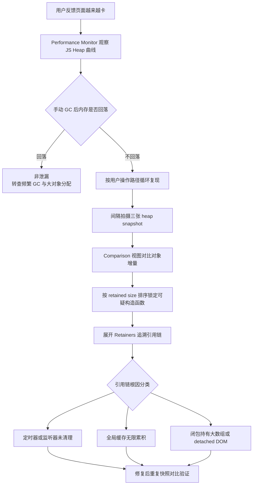

```javascript
// 自动化泄漏探测：循环执行可疑操作后采样 heap，判断是否单调上涨
async function detectLeak(action, rounds = 20) {
  const samples = [];
  for (let i = 0; i < rounds; i++) {
    await action();
    if (window.gc) window.gc();   // Chrome 需带 --js-flags=--expose-gc 启动
    samples.push(performance.memory.usedJSHeapSize);
    await new Promise((r) => setTimeout(r, 100));
  }
  // 取后半段算增长斜率：每轮平均增长超过 10KB 视为疑似泄漏
  const half = samples.slice(rounds / 2);
  const slope = (half[half.length - 1] - half[0]) / half.length;
  console.log('heap samples(KB):', samples.map((n) => Math.round(n / 1024)));
  console.log(slope > 10 * 1024 ? '疑似内存泄漏，请抓快照分析' : '未见明显泄漏');
}
```

### SCN-054：线上页面 CPU 打满、主线程完全卡死，如何在无法打 log 的情况下定位问题代码？
**答**：
- 死循环会阻塞主线程，页面内所有手段（console、监控 SDK 的 JS 执行部分）都失效，必须用"外部观察者"：Web Worker 心跳看门狗。
- 主线程定时向 Worker 喂狗，Worker 发现超过阈值没收到心跳即判定主线程被阻塞，把阻塞时长与最后的行为现场上报。
- 开发期用 Performance 面板长录制找 Long Task 定位具体函数；线上看门狗负责"发现 + 归因到版本/页面/操作路径"。

```javascript
// 主线程看门狗：worker 定时检查心跳，主线程被阻塞时上报最后现场
// watchdog-worker.js —— 独立线程不受主线程阻塞影响
let lastBeat = Date.now();
self.onmessage = (e) => { lastBeat = e.data.time; };
setInterval(() => {
  if (Date.now() - lastBeat > 3000) {
    fetch('/api/monitor', { method: 'POST', body: JSON.stringify({
      type: 'main-thread-blocked',
      blockedMs: Date.now() - lastBeat,   // 阻塞时长，区分长任务与死循环
      lastRoute: lastRoute,               // 主线程每次路由变化时同步给 worker
    }) });
  }
}, 1000);

// 主线程：每秒喂狗 + 同步上下文
const worker = new Worker('watchdog-worker.js');
setInterval(() => worker.postMessage({ time: Date.now(), lastRoute }), 1000);
```

### SCN-055：线上 WebSocket 频繁断连重连，如何排查？
**答**：
- 分层归因：网络层（网关空闲超时断开）、代理层（CDN/企业代理不支持 ws Upgrade）、应用层（服务端主动踢或崩溃），抓包看 close code：1006 异常断开多为网关超时。
- 最常见根因是网关 proxy_read_timeout 默认 60 秒无数据即断，心跳间隔必须小于该值；排查时先核对心跳周期与网关配置。
- 修复要同时防"重连风暴"：指数退避 + 随机抖动，否则网关恢复瞬间海量客户端同时重连会打挂服务端。

```javascript
// 带心跳、指数退避与抖动的 WebSocket 管理
class ResilientWS {
  constructor(url) {
    this.url = url;
    this.retry = 0;
    this.connect();
  }
  connect() {
    this.ws = new WebSocket(this.url);
    this.ws.onopen = () => {
      this.retry = 0;
      // 心跳间隔必须小于网关 proxy_read_timeout（默认 60s），这里 30s
      this.heartbeat = setInterval(() => this.ws.send('{"t":"ping"}'), 30000);
    };
    this.ws.onclose = (e) => {
      clearInterval(this.heartbeat);
      // close code：1000 正常关闭不重连；1006 异常断开多为网关超时或网络问题
      if (e.code !== 1000) this.reconnect();
    };
  }
  reconnect() {
    // 指数退避 + 随机抖动，防止海量客户端同一时刻重连打挂服务端
    const backoff = Math.min(30000, 1000 * 2 ** this.retry);
    const delay = backoff / 2 + Math.random() * (backoff / 2);
    this.retry++;
    setTimeout(() => this.connect(), delay);
  }
}
```

### SCN-056：只有某个地区用户反馈页面慢，其他地区正常，如何排查？
**答**：
- 按"用户到机房"的链路切分阶段：先从该地区用户的 navigation timing 判断慢在哪一环——DNS 慢是运营商 DNS 问题，TTFB 慢是回源线路问题，资源下载慢是 CDN 节点覆盖差或命中率低。
- 前端发布测速打点，按省份/运营商聚合数据，让"慢"从投诉变成可量化的分布；配合拨测平台覆盖该地区复测。
- 确认是 CDN 问题后推动添加节点或切换 CDN，静态资源带版本化 URL 防止旧缓存干扰验证。

```javascript
// 分地区测速打点：采集关键阶段耗时，按省份与运营商聚合定位慢在哪一环
const nav = performance.getEntriesByType('navigation')[0];
const fcp = performance.getEntriesByType('paint').find((p) => p.name === 'first-contentful-paint');

report({
  type: 'region-speed',
  dns: Math.round(nav.domainLookupEnd - nav.domainLookupStart),   // 大 => 运营商 DNS 问题
  tcp: Math.round(nav.connectEnd - nav.connectStart),
  ttfb: Math.round(nav.responseStart - nav.requestStart),         // 大 => 回源线路慢
  download: Math.round(nav.responseEnd - nav.responseStart),      // 大 => CDN 节点带宽差
  fcp: Math.round(fcp?.startTime ?? 0),
  region: window.USER_REGION,     // 服务端注入的省份与运营商
  cdnHost: location.hostname,     // 区分命中的 CDN 域名
});
```

### SCN-057：发布新版后，未强刷的老用户加载了新 HTML 引用旧 chunk，页面报 ChunkLoadError，如何根治多版本共存问题？
**答**：
- 根因是 HTML 与 hash 资源不同步：老 HTML 引用的旧 chunk 在新发布后被删除。发布端必须做"不覆盖式发布"：保留最近 N 个版本的静态资源目录。
- 运行时兜底：全局捕获 ChunkLoadError 自动刷新一次页面（重新拉新 HTML），刷新计数防死循环。
- 主动升级：轮询 version.json 对比构建版本，发现新版本在用户切走标签页时静默 reload，把更新成本降到零。

```javascript
// ChunkLoadError 自愈：动态 import 失败时刷新一次，计数防死循环
const RELOAD_KEY = 'chunk-reload';
window.addEventListener('error', (e) => {
  if (!/ChunkLoadError|Loading chunk/.test(e.message || '')) return;
  const last = +sessionStorage.getItem(RELOAD_KEY) || 0;
  if (Date.now() - last < 10000) return;            // 10 秒内已刷新过，不再刷
  sessionStorage.setItem(RELOAD_KEY, String(Date.now()));
  location.reload();                                // 重新拉新 HTML 与配套资源
}, true);

// 版本轮询：发现新版本后，趁用户切走标签页时静默更新
let version = document.querySelector('meta[name="build-version"]').content;
setInterval(async () => {
  const { version: latest } = await fetch('/version.json', { cache: 'no-store' }).then((r) => r.json());
  if (latest !== version && document.visibilityState === 'hidden') {
    location.reload();                              // 后台标签页刷新用户无感
  }
}, 5 * 60 * 1000);
```

### SCN-058：第三方客服 / 统计 SDK 加载失败或内部报错把主站拖垮，如何做隔离与超时兜底？
**答**：
- 原则：第三方脚本一律不进主 bundle、不阻塞主流程，失败只降级自身功能（隐藏客服入口），绝不影响下单等主链路。
- 加载层：异步加载 + 硬超时（超时移除 script 标记失败）；接入层：初始化与调用全部 try-catch 包裹。
- SDK 提供的异步接口同样包超时（Promise.race），防止其内部 promise 永不 resolve 导致业务挂起；必要时用 iframe 沙箱隔离高危 SDK。

```javascript
// 第三方 SDK 加载器：超时兜底 + 失败降级 + 调用隔离
function loadSDK(src, { timeout = 5000 } = {}) {
  return new Promise((resolve, reject) => {
    const s = document.createElement('script');
    const timer = setTimeout(() => { s.remove(); reject(new Error('sdk timeout')); }, timeout);
    s.src = src;
    s.async = true;
    s.onload = () => { clearTimeout(timer); resolve(); };
    s.onerror = () => { clearTimeout(timer); reject(new Error('sdk failed')); };
    document.head.appendChild(s);
  });
}

// 接入点：失败只降级自身入口，不碰主流程
loadSDK('https://sdk.third.com/chat.js')
  .then(() => window.ThirdChat.init({ appId: 'xxx' }))
  .catch((err) => {
    document.querySelector('#cs-entry')?.remove();   // 失败隐藏客服入口
    report({ type: 'sdk-degraded', err: err.message });
  });

// SDK 的异步接口包一层超时，防止内部 promise 永不 resolve
const withTimeout = (p, ms = 3000) =>
  Promise.race([p, new Promise((_, rej) => setTimeout(() => rej(new Error('api timeout')), ms))]);
```

## 十四、表单与交互进阶

### SCN-059：级联下拉有 5000 个城市，联动选择与搜索都卡顿，如何优化？
**答**：
- 数据层：放弃嵌套树，用扁平数组 + parentId 预建 children Map，任意层级取子级 O(1)，避免每次联动递归过滤整棵树。
- 搜索层："省 / 市 / 区"路径文本预生成（一次遍历记忆化），搜索只做字符串匹配；关键词过滤防抖 200ms。
- 渲染层：交给组件的虚拟滚动（TreeSelect/Cascader 均支持），或分层数据按需加载（点省再拉市），首屏只备省份数据。

```typescript
// 扁平数据 + Map 索引：任意层级取子级 O(1)，搜索文本预生成
interface CityNode { id: number; name: string; parentId: number }

function buildCityIndex(list: CityNode[]) {
  const childrenMap = new Map<number, CityNode[]>();
  for (const n of list) {
    if (!childrenMap.has(n.parentId)) childrenMap.set(n.parentId, []);
    childrenMap.get(n.parentId)!.push(n);
  }
  // 预生成"广东省 / 深圳市 / 南山区"搜索文本，搜索时不再拼路径
  const pathText = new Map<number, string>();
  const pathOf = (n: CityNode): string => {
    if (pathText.has(n.id)) return pathText.get(n.id)!;
    const parent = list.find((x) => x.id === n.parentId);
    const text = parent ? `${pathOf(parent)} / ${n.name}` : n.name;
    pathText.set(n.id, text);
    return text;
  };
  list.forEach((n) => pathOf(n));
  return { childrenMap, pathText };
}

// 搜索防抖：5000 项每次击键全量过滤会卡输入，200ms 防抖后无感
const keyword = ref('');
const onSearch = useDebounceFn((kw: string) => (keyword.value = kw), 200);
```

### SCN-060：复杂表单字段间联动校验很多（结束时间大于开始时间、选了 A 字段 B 必填），onChange 里全是 if，如何架构化？
**答**：
- 把"字段依赖 + 校验规则"从 onChange 抽成声明式配置（字段依赖图），规则与 UI 解耦，新增联动只改配置不改流程代码。
- 表单引擎统一消费配置：值变化时重算受影响字段的可见性、必填态与校验结果，隐藏字段自动豁免校验。
- 跨字段规则用"校验函数 + 全表单值"表达（schema 风格），天然支持上下文依赖，测试也可以针对纯函数写。

```typescript
// 声明式字段依赖图：联动关系收敛到配置，引擎统一执行
type FieldRule = {
  visible?: (values: Record<string, any>) => boolean;
  required?: boolean | ((values: Record<string, any>) => boolean);
  validate?: (value: any, values: Record<string, any>) => string | null;
};

const schema: Record<string, FieldRule> = {
  endTime: {
    validate: (v, values) =>
      v && values.startTime && v <= values.startTime ? '结束时间必须晚于开始时间' : null,
  },
  refundAccount: {
    // 申请退款后收款账户必填：依赖关系写在配置里，而不是 onChange 里
    required: (values) => values.applyRefund,
  },
};

export function runValidation(values: Record<string, any>) {
  const errors: Record<string, string> = {};
  for (const [field, rule] of Object.entries(schema)) {
    if (rule.visible && !rule.visible(values)) continue;   // 隐藏字段不校验
    const required = typeof rule.required === 'function' ? rule.required(values) : rule.required;
    if (required && (values[field] == null || values[field] === '')) {
      errors[field] = '该项为必填项';
      continue;
    }
    const msg = rule.validate?.(values[field], values);
    if (msg) errors[field] = msg;
  }
  return errors;
}
```

### SCN-061：可动态增删行的明细表格，每行多条校验规则，删行后校验状态错位，如何设计？
**答**：
- 行数据带稳定 rowId（uuid 而非数组下标），删行时错误状态按 rowId 归属与清理，天然不错位。
- 校验错误用 `Record<rowId, FieldErrors>` 存储，渲染时按 rowId 取错误，删除行时同步删除对应错误条目。
- 提交时全表校验，失败后滚动到第一个错误行并聚焦，而不是只弹 toast 让用户自己找。

```jsx
// 动态行表格：稳定 rowId + 错误按行隔离，删行不错位
const [rows, setRows] = useState(() => [{ rowId: uid(), count: 1, price: null }]);
const [errors, setErrors] = useState({});   // { [rowId]: { count: '数量必须大于 0' } }

function removeRow(id) {
  setRows((rs) => rs.filter((r) => r.rowId !== id));
  setErrors((e) => { const next = { ...e }; delete next[id]; return next; }); // 错误同步清理
}

function validateAll() {
  const errs = {};
  rows.forEach((row) => {
    const e = {};
    if (!row.count || row.count < 1) e.count = '数量必须大于 0';
    if (row.price == null) e.price = '单价必填';
    if (Object.keys(e).length) errs[row.rowId] = e;
  });
  setErrors(errs);
  // 失败直接滚到第一个错误行，用户不用自己找
  const firstId = Object.keys(errs)[0];
  document.getElementById(`row-${firstId}`)?.scrollIntoView({ behavior: 'smooth', block: 'center' });
  return Object.keys(errs).length === 0;
}

// 渲染：每行 id 用 rowId，错误信息也从 errors[row.rowId] 取
{rows.map((row) => (
  <div key={row.rowId} id={`row-${row.rowId}`}>
    <input value={row.count} />
    {errors[row.rowId]?.count && <span className="err">{errors[row.rowId].count}</span>}
    <button onClick={() => removeRow(row.rowId)}>删除</button>
  </div>
))}
```

### SCN-062：长表单要自动保存草稿，下次进入恢复；多端编辑还会出现版本冲突，如何实现？
**答**：
- 保存策略：值变化防抖 800ms 后"本地 + 服务端"双写，本地保底（服务端失败不丢）、服务端跨端同步；离开前 flush 防抖中的最后一次。
- 版本模型：草稿带 version 与 updatedAt，恢复时本地与云端都存在且时间不一致时，让用户选择"用云端 / 用本地"。
- 提交时携带 version 做乐观锁，后端检测到不一致返回 409，前端提示刷新合并，防止覆盖别人刚提交的修改。
- 敏感字段（密码、验证码）不入草稿，用 omit 清洗后再存。

```javascript
// 草稿：防抖双写 + 版本号 + 恢复冲突选择
const DRAFT_KEY = 'form-draft:refund';

const saveDraft = useDebounceFn(async (values) => {
  const payload = {
    data: omit(values, ['password', 'smsCode']),   // 敏感字段不入草稿
    version: draftVersion,
    updatedAt: Date.now(),
  };
  localStorage.setItem(DRAFT_KEY, JSON.stringify(payload));
  await api.saveDraft({ formId, ...payload }).catch(() => {});   // 服务端失败不影响本地
}, 800);
watch(formValues, saveDraft);

// 恢复：本地与云端都有草稿时按 updatedAt 让用户选择
async function restoreDraft() {
  const local = JSON.parse(localStorage.getItem(DRAFT_KEY) || 'null');
  const remote = await api.getDraft(formId).catch(() => null);
  if (local && remote && remote.updatedAt > local.updatedAt) {
    const useRemote = await confirmModal('云端草稿更新，是否使用云端版本？');
    return useRemote ? remote.data : local.data;
  }
  return remote?.data ?? local?.data ?? null;   // 云端优先，其次本地，否则全新
}

// 提交带 version 乐观锁：后端发现不一致返回 409，前端提示合并
await api.submit({ ...formValues, version: draftVersion });
```

### SCN-063：支付、删除等高危操作要防误触，产品要求不能全是弹窗，有哪些方案与实现？
**答**：
- 按危险等级选交互：低危用"直接执行 + 5 秒可撤销 toast"（最流畅）；中危用 Popconfirm；高危（支付/转账）用长按确认或滑动验证，再加输入关键信息校验（输入对方姓名后几位）。
- 长按方案要点：按住期间进度反馈，松手/移出即取消，计时 1.5 秒触发，触屏与鼠标事件都要覆盖。
- 无论哪种方案，接口侧都要配幂等键，防止连点或重试造成重复执行。

```jsx
// 高危操作：长按 1.5 秒确认，松手或移出即取消，替代弹窗
function HoldToConfirm({ onConfirm, children }) {
  const [progress, setProgress] = useState(0);
  const timer = useRef(null);

  const start = () => {
    const t0 = Date.now();
    timer.current = setInterval(() => {
      const p = Math.min(100, (Date.now() - t0) / 15);   // 1.5 秒走满
      setProgress(p);
      if (p >= 100) { cancel(); onConfirm(); }
    }, 16);
  };
  const cancel = () => { clearInterval(timer.current); setProgress(0); };

  return (
    <button onMouseDown={start} onMouseUp={cancel} onMouseLeave={cancel}
      onTouchStart={start} onTouchEnd={cancel}>
      <span style={{ position: 'absolute', left: 0, width: `${progress}%`, opacity: 0.3 }} />
      {children}
    </button>
  );
}

// 低危删除：直接执行 + 5 秒内可撤销，比弹窗流畅
function deletableDelete(id) {
  const snapshot = getItem(id);
  doDelete(id);
  Toast.show('已删除', {
    duration: 5000,
    action: { text: '撤销', onClick: () => restore(snapshot) },   // 误删 5 秒内可救
  });
}
```

### SCN-064：需求是支持拖拽上传整个文件夹，包括递归子目录并保留目录结构，如何实现？
**答**：
- 核心 API 是 DataTransferItem.webkitGetAsEntry 拿到 FileSystemDirectoryEntry，递归遍历目录树，为每个文件拼出相对路径交给后端。
- 两个坑必须处理：drop 回调中 event 对象随后失效，必须先同步取出全部 entry 再异步遍历；readEntries 一次最多返回 100 条，要循环读到空数组才算遍历完。
- 相对路径通过 defineProperty 挂到 File 对象上（或用 FormData 的相对路径字段），后端按路径还原目录结构。

```javascript
// 递归读取拖入的目录，返回带相对路径的 File 列表
async function collectFilesFromDrop(e) {
  e.preventDefault();
  const entries = [...e.dataTransfer.items]
    .map((it) => it.webkitGetAsEntry && it.webkitGetAsEntry())
    .filter(Boolean);
  // 坑 1：必须先同步取出所有 entry，event 失效后无法再取
  const files = [];
  for (const entry of entries) await walk(entry, '', files);
  return files;   // 每个 file 带 relativePath 供后端还原目录结构
}

function walk(entry, prefix, out) {
  return new Promise((resolve) => {
    if (entry.isFile) {
      entry.file((f) => {
        Object.defineProperty(f, 'relativePath', { value: prefix + f.name });
        out.push(f);
        resolve();
      });
    } else {
      const reader = entry.createReader();
      // 坑 2：readEntries 一次最多 100 条，循环读到空数组才算遍历完
      const readBatch = () => reader.readEntries(async (batch) => {
        if (!batch.length) return resolve();
        for (const child of batch) await walk(child, `${prefix}${entry.name}/`, out);
        readBatch();
      });
      readBatch();
    }
  });
}
```

### SCN-065：富文本编辑器里用户直接粘贴剪贴板截图，如何自动上传并压缩后插入？
**答**：
- 拦截 paste 事件，从 clipboardData.items 找 image 类型项，getAsFile 拿到 blob；无图片时 return 保留默认粘贴行为（文本/HTML）。
- 压缩用 canvas：createImageBitmap 解码、等比缩到最大边长、toBlob 转 webp（Safari 兼容失败回退 jpeg），一般可省 70% 体积。
- 上传成功后用编辑器 API 在光标处插入 img 节点；上传期间先插占位图，失败提示重传。

```javascript
// 粘贴截图：读取剪贴板图片 -> 压缩 -> 上传 -> 插入富文本
editor.addEventListener('paste', async (e) => {
  const imgItem = [...e.clipboardData.items].find((i) => i.type.startsWith('image/'));
  if (!imgItem) return;                    // 非图片走默认粘贴
  e.preventDefault();

  const file = imgItem.getAsFile();
  const placeholderId = insertImg(editor, LOADING_GIF);   // 先插占位图
  const blob = await compressImage(file, { maxSide: 1280, quality: 0.8 });
  const url = await upload(blob);
  replaceImg(editor, placeholderId, url);                 // 替换为真实 URL
});

// canvas 压缩：等比缩到最大边长，webp 优先，兼容失败回退 jpeg
async function compressImage(file, { maxSide, quality }) {
  const bitmap = await createImageBitmap(file);
  const scale = Math.min(1, maxSide / Math.max(bitmap.width, bitmap.height));
  const canvas = new OffscreenCanvas(bitmap.width * scale, bitmap.height * scale);
  canvas.getContext('2d').drawImage(bitmap, 0, 0, canvas.width, canvas.height);
  try {
    return await canvas.convertToBlob({ type: 'image/webp', quality });
  } catch {
    return await canvas.convertToBlob({ type: 'image/jpeg', quality });   // Safari 兜底
  }
}
```

### SCN-066：搜索框要支持历史记录与联想词，如何设计缓存与请求策略？
**答**：
- 历史记录：localStorage 存储去重后置顶、上限 10 条、支持单条删除；展示时历史排在联想之上并标记来源。
- 联想词：请求防抖 + AbortController/序列号双重防竞态，旧响应不得覆盖新响应；关键词级缓存 Map 带 5 分钟 TTL，热词命中缓存不发请求。
- 失败静默降级：联想失败时展示历史记录即可，不打断输入。

```javascript
// 搜索联想：防抖 + 缓存 + 竞态防护 + 历史记录管理
const cache = new Map();       // kw -> { data, t }，TTL 5 分钟
let seq = 0;                   // 请求序列号：只认最新一次的结果

async function suggest(kw) {
  const hit = cache.get(kw);
  if (hit && Date.now() - hit.t < 5 * 60 * 1000) return hit.data;   // 热词回缓存
  const mySeq = ++seq;
  const data = await api.suggest(kw, { signal: AbortSignal.timeout(2000) });
  if (mySeq !== seq) return null;        // 已有更新的请求，旧响应直接丢弃防覆盖
  cache.set(kw, { data, t: Date.now() });
  return data;
}

const history = {
  key: 'search-history',
  push(kw) {
    const list = this.list().filter((k) => k !== kw);   // 去重后置顶
    list.unshift(kw);
    localStorage.setItem(this.key, JSON.stringify(list.slice(0, 10)));
  },
  list() { return JSON.parse(localStorage.getItem(this.key) || '[]'); },
  remove(kw) {
    localStorage.setItem(this.key, JSON.stringify(this.list().filter((k) => k !== kw)));
  },
};
```

### SCN-067：评论框要支持 @ 提及：输入 @ 弹出选人，选中插入昵称，退格时整体删除，如何实现？
**答**：
- 基于 contenteditable：input 时检查光标前文本是否以 @ 结尾，命中则唤起选人浮层。
- 插入：把 @ 字符替换为 contenteditable=false 的 mention span（携带 data-id），使昵称成为不可分割的整体节点。
- 删除：keydown Backspace 时检测光标前一节点是否为 mention，是则整个 remove，避免删一半留下残缺文本。
- 提交时序列化为纯文本 + mentions id 数组，后端据此发通知。

```javascript
// contenteditable @ 提及：整体插入 + 整体删除
editor.addEventListener('input', () => {
  const sel = getSelection();
  const before = sel.anchorNode.textContent.slice(0, sel.anchorOffset);
  if (/@$/.test(before)) {              // 光标前正好是 @ 时唤起选人弹层
    showMentionPanel(editor.getBoundingClientRect());
  }
});

function insertMention(user) {
  const sel = getSelection();
  sel.anchorNode.textContent = sel.anchorNode.textContent.replace(/@$/, '');
  const span = document.createElement('span');
  span.contentEditable = 'false';       // 不可编辑，成为不可分割整体
  span.dataset.id = user.id;
  span.className = 'mention';
  span.textContent = `@${user.name}`;
  sel.getRangeAt(0).insertNode(span);
  placeCaretAfter(span);
}

editor.addEventListener('keydown', (e) => {
  if (e.key !== 'Backspace') return;
  const prev = getSelection().anchorNode.previousElementSibling;
  if (prev?.classList.contains('mention')) {
    e.preventDefault();
    prev.remove();                      // 提及节点整体删除，不留半个字符
  }
});

// 提交序列化：纯文本 + 提及人 id 列表
function serialize(root) {
  return {
    text: root.innerText,
    mentions: [...root.querySelectorAll('.mention')].map((s) => s.dataset.id),
  };
}
```

### SCN-068：金额输入框要千分位格式化、限两位小数，还要兼容中文输入法，如何实现？
**答**：
- 输入法坑：composition 期间 input 事件会拿到拼音字母，此时格式化会打断组词，必须 compositionstart/end 期间跳过格式化，end 后再统一整理。
- 双轨模型：dataset.raw 存原始数值（提交计算用），input.value 存千分位展示值；输入时只保留数字与一个小数点、截断两位小数。
- 失焦规整：空值归零、统一补全两位小数，展示与数据始终一致。

```javascript
// 金额输入：输入法安全 + 千分位格式化，原始值与展示值双轨
let composing = false;
input.addEventListener('compositionstart', () => (composing = true));
input.addEventListener('compositionend', () => { composing = false; format(input); });

input.addEventListener('input', () => {
  if (composing) return;               // 拼音组词期间不动，避免打断输入
  format(input);
});

function format(el) {
  // 只保留数字与一个小数点，截断两位小数
  const raw = el.value.replace(/[^\d.]/g, '').replace(/(\..*)\./g, '$1');
  const [int, dec] = raw.split('.');
  el.dataset.raw = raw;                                  // 原始值用于提交计算
  el.value = (+int || 0).toLocaleString('en-US')         // 千分位展示
    + (dec !== undefined ? '.' + dec.slice(0, 2) : raw.endsWith('.') ? '.' : '');
}

input.addEventListener('blur', () => {   // 失焦规整：补全两位小数
  const raw = +input.dataset.raw || 0;
  input.value = raw.toLocaleString('en-US', { minimumFractionDigits: 2, maximumFractionDigits: 2 });
  input.dataset.raw = String(raw);
});
```

## 十五、数据展示进阶

### SCN-069：十万行表格中用户勾选了 5 万行要导出，如何组织导出流程避免内存与超时问题？
**答**：
- 勾选用 Set<rowId> 存储，翻页/切换筛选不丢失；导出时不全量拉数据，按选中 id 分批查询（每批 2000 条）。
- 拼接采用"分片数组 + 最终一次性 Blob"，避免用字符串 += 反复拷贝大字符串；CSV 头加 BOM 防 Excel 乱码，字段做标准转义。
- 全程可取消（AbortController）+ 进度反馈，导出按钮置为 loading 防重复触发。

```javascript
// 大量选中行导出：分批拉取 + 分片拼接 + 可取消
async function exportSelected(selectedIds, columns) {
  const controller = new AbortController();
  exportState.cancel = () => controller.abort();
  const chunks = ['\uFEFF' + columns.map((c) => escapeCsv(c.title)).join(',')];  // BOM 防 Excel 乱码
  const BATCH = 2000;

  for (let i = 0; i < selectedIds.length; i += BATCH) {
    const batch = await api.getRowsByIds(selectedIds.slice(i, i + BATCH), {
      signal: controller.signal,           // 用户点取消立即中止
    });
    chunks.push(batch
      .map((row) => columns.map((c) => escapeCsv(row[c.key])).join(','))
      .join('\n'));
    setProgress(Math.min(100, Math.round(((i + BATCH) / selectedIds.length) * 100)));
  }
  download(new Blob(chunks, { type: 'text/csv' }), `selected-${Date.now()}.csv`);
}

function escapeCsv(v) {
  const s = String(v ?? '');
  // 含逗号引号换行的字段加引号包裹并转义内部引号
  return /[",\n]/.test(s) ? `"${s.replace(/"/g, '""')}"` : s;
}
```

### SCN-070：折线图有 10 万个数据点，浏览器直接画卡死，如何做降采样？
**答**：
- 核心认知：屏幕一个像素宽度内多个点没有视觉意义，10 万点采样到 1000~2000 点即可保形。
- 降采样算法选 LTTB（Largest-Triangle-Three-Buckets）：按桶选"与前后点构成的三角形面积最大"的点，比隔 N 取 1 更好保留峰值与突变。
- 配合分层聚合：缩放时按时间窗口动态切换粒度（原始→分钟→小时），下钻再取原始数据。

```javascript
// LTTB 降采样：分桶后每桶选与前一选中点和下一桶均值构成的三角形面积最大的点
function lttb(data, target) {   // data: [{ x, y }]
  if (data.length <= target) return data;
  const sampled = [data[0]];
  let a = 0;                                          // 上一个被选中点的下标
  const every = (data.length - 2) / (target - 2);

  for (let i = 0; i < target - 2; i++) {
    // 下一桶的平均值作为三角形第三点
    const from = Math.floor((i + 1) * every) + 1;
    const to = Math.min(Math.floor((i + 2) * every) + 1, data.length);
    let avgX = 0, avgY = 0;
    for (let j = from; j < to; j++) { avgX += data[j].x; avgY += data[j].y; }
    avgX /= to - from; avgY /= to - from;

    // 当前桶里选面积贡献最大的点：峰值与突变被优先保留
    let maxArea = -1, best = from;
    for (let j = Math.floor(i * every) + 1; j < Math.floor((i + 1) * every) + 1; j++) {
      const area = Math.abs(
        (data[a].x - avgX) * (data[j].y - data[a].y) -
        (data[a].x - data[j].x) * (data[a].y - avgY)
      );
      if (area > maxArea) { maxArea = area; best = j; }
    }
    sampled.push(data[best]);
    a = best;
  }
  sampled.push(data[data.length - 1]);   // 首尾点必须保留
  return sampled;
}
```

### SCN-071：行情 / 监控表格每秒推送几百条更新，直接 setState 导致渲染风暴，如何合并更新？
**答**：
- 推送只写 buffer（同一行多次推送自然合并为最新值），用 requestAnimationFrame 节流，每帧最多 flush 一次、整批通知一次。
- 行组件 memo + version 字段比较，只有数据真变化的行重渲染，其余行零开销。
- 涨跌闪烁等视觉效果交给 CSS 动画（改 class），不进 JS 渲染路径。

```javascript
// 高频推送合并：数据写 buffer，requestAnimationFrame 批量 flush
class LiveTableStore {
  rows = new Map();
  buffer = new Map();            // rowId -> 新数据，同行多次推送只留最新
  scheduled = false;
  listeners = new Set();

  push(updates) {                // ws 每秒数百条只写缓存不渲染
    for (const u of updates) {
      this.buffer.set(u.id, { ...this.rows.get(u.id), ...u, version: (u.version ?? 0) + 1 });
    }
    this.scheduleFlush();
  }
  scheduleFlush() {
    if (this.scheduled) return;
    this.scheduled = true;
    requestAnimationFrame(() => {          // 一帧最多渲染一次
      this.scheduled = false;
      this.rows = new Map([...this.rows, ...this.buffer]);
      this.buffer.clear();
      this.listeners.forEach((fn) => fn([...this.rows.values()]));  // 整批通知一次
    });
  }
}

// 行组件 memo：version 不变的行零重渲染
const Row = React.memo(({ row }) => (
  <tr data-flash={row.direction}>        {/* 涨跌闪烁交给 CSS 动画 */}
    <td>{row.price}</td>
  </tr>
), (prev, next) => prev.row.version === next.row.version);
```

### SCN-072：组织架构树表格有几万节点，首屏只展示第一层，如何实现懒加载展开？
**答**：
- 展开时按需请求该节点子级，节点标记 childrenLoaded 防重复请求；未加载但有下级的节点显示展开箭头 + loading 态。
- 用 id->node 的 Map 做索引，任意节点定位与更新 O(1)，避免几万节点的递归全树查找。
- 展开状态持久化（sessionStorage），刷新后还原用户展开到哪；全局搜索时才走全量拉平 + 虚拟列表方案。

```typescript
// 树懒加载：Map 索引 + 展开时按需取子级
const nodeMap = new Map<string, TreeNode>();

async function loadChildren(nodeKey: string) {
  const node = nodeMap.get(nodeKey)!;
  if (node.childrenLoaded) return;                 // 已加载过不重复请求
  node.loading = true;
  emitter.emit('node-updated', nodeKey);           // 局部刷新出 loading 态
  const children = await api.getOrgChildren(nodeKey);
  node.children = children;
  node.loading = false;
  node.childrenLoaded = true;
  children.forEach((c) => nodeMap.set(c.id, c));   // 新节点注册索引
  emitter.emit('node-updated', nodeKey);           // 只通知该节点，不整树重渲染
}

// 展开状态持久化：刷新后还原展开路径
function persistExpanded(expandedKeys: Set<string>) {
  sessionStorage.setItem('org-expanded', JSON.stringify([...expandedKeys]));
}
function restoreExpanded(): Set<string> {
  return new Set(JSON.parse(sessionStorage.getItem('org-expanded') || '[]'));
}
```

### SCN-073：活动流水列表要按日期分组展示（时间线），几十万条数据，分组头吸顶，如何设计？
**答**：
- 分组是纯展示层逻辑：按顺序扫描条目，groupKey（日期）变化时插入一条 header 行，展平成 [header, item, item, header...] 的行数组，直接对接虚拟列表。
- 吸顶用 CSS sticky 实现零 JS 开销，不用滚动监听算位置。
- 数据流式加载（分页追加）时新数据继续按 lastKey 判断是否插入新 header，分组逻辑无状态可增量执行。

```javascript
// 时间线分组：展平成 [header, item...] 数组，直接对接虚拟列表
function flattenTimeline(items) {
  const rows = [];
  let lastKey = null;
  for (const item of items) {                      // items 已按时间倒序
    const key = dayjs(item.time).format('YYYY-MM-DD');
    if (key !== lastKey) {                         // 日期变化插入分组头
      rows.push({ type: 'header', key: `h-${key}`, date: key });
      lastKey = key;
    }
    rows.push({ type: 'item', key: item.id, item });
  }
  return rows;
}

// 分组头吸顶：sticky 定位即可，无需 JS 计算滚动位置
// .list-header {
//   position: sticky;
//   top: 0;
//   z-index: 1;
//   backdrop-filter: blur(4px);   /* 吸顶时透出下层内容，视觉分层 */
// }
```

### SCN-074：瀑布流图片高度不一，快速滚动时图片加载完成导致卡片跳动错乱，如何处理？
**答**：
- 跳动根因是"加载前不知道高度"。首选方案：列表接口直接下发图片宽高元数据，渲染前用 padding-top 宽高比占位，加载完成尺寸零变化。
- 没有元数据时退而求其次：按默认宽高比占位 + onload 后修正，配过渡动画弱化跳动，并上报实际比例用于沉淀元数据。
- 分列放置用"最短列优先"：新卡片插入累计高度最小的列，用宽高比近似高度即可，不必等图片加载。

```vue
<!-- 瀑布流：接口下发宽高，宽高比占位彻底消除加载跳动 -->
<template>
  <div class="waterfall">
    <div v-for="col in columns" :key="col.idx" class="col">
      <div v-for="item in col.items" :key="item.id" class="card">
        <!-- 加载前就撑开正确高度 -->
        <div class="ph" :style="{ paddingTop: (item.height / item.width) * 100 + '%' }">
          
        </div>
      </div>
    </div>
  </div>
</template>

<script setup>
// 最短列放置：新卡片插入累计高度最小的列，近似最优分配
function distribute(items, colCount) {
  const cols = Array.from({ length: colCount }, (_, idx) => ({ idx, items: [], h: 0 }));
  for (const item of items) {
    const shortest = cols.reduce((a, b) => (a.h <= b.h ? a : b));
    shortest.items.push(item);
    shortest.h += item.height / item.width;   // 用宽高比近似累计高度
  }
  return cols;
}
</script>
```

### SCN-075：报表页支持维度下钻（年→季→月→日），切换维度接口多、返回键行为乱，如何设计状态？
**答**：
- 把下钻建模为"维度栈"：每层记录 { dim, value, label }，压栈 = 点击图表下钻，弹栈 = 点面包屑或浏览器返回键。
- 栈状态同步进 history（pushState + popstate），返回键行为自然正确，URL 可分享可收藏。
- 数据按栈序列化 key 缓存，回到已访问层级秒出；压栈/弹栈/切根维度三个动作用统一入口保证互斥。

```typescript
// 下钻维度栈：URL 可分享、面包屑回退、按栈缓存数据
interface DrillLevel { dim: 'year' | 'quarter' | 'month' | 'day'; value: string; label: string }

const stack = ref<DrillLevel[]>([{ dim: 'year', value: '2026', label: '2026 年' }]);
const cache = new Map<string, ReportData>();

const stackKey = (s: DrillLevel[]) => s.map((l) => `${l.dim}=${l.value}`).join('/');

async function drillDown(level: DrillLevel) {
  stack.value.push(level);
  history.pushState({ stack: [...stack.value] }, '');   // 浏览器返回键 = 弹栈
  await loadCurrent();
}

async function loadCurrent() {
  const key = stackKey(stack.value);
  if (cache.has(key)) return setData(cache.get(key)!);  // 回到已访问层级秒出
  const data = await api.report({ path: stack.value });
  cache.set(key, data);
  setData(data);
}

window.addEventListener('popstate', (e) => {            // 返回键直接恢复栈
  if (e.state?.stack) { stack.value = e.state.stack; loadCurrent(); }
});
```

### SCN-076：地图上要渲染 10 万个点位，直接渲染卡死，如何做聚合？
**答**：
- 聚合是"按 zoom 分桶"：视口内距离小于阈值的点合成一个带数量的聚合点，10 万点在任意 zoom 下都只渲染几十到几百个元素。
- 前端方案用四叉树索引库（supercluster），zoom 变化时增量重算视口聚合；千万级数据把聚合放到服务端（传 bbox + zoom 返回结果）。
- 渲染层用 canvas 或地图 GL 的 symbol 层，不要用 DOM 节点拼点位。

```javascript
// 海量点位聚合：supercluster 按 zoom 分桶，只渲染视口内的聚合点
import Supercluster from 'supercluster';

const index = new Supercluster({ radius: 60, maxZoom: 14 });   // 60px 内聚成一簇
index.load(points.map((p) => ({
  type: 'Feature',
  geometry: { type: 'Point', coordinates: [p.lng, p.lat] },
  properties: p,
})));

map.on('moveend', () => {
  const bbox = map.getBounds().toArray().flat();          // 当前视口范围
  const zoom = Math.round(map.getZoom());
  const clusters = index.getClusters(bbox, zoom);         // 视口内最多几十个元素
  renderClusters(clusters.map((c) => ({
    id: c.id ?? c.properties.id,
    count: c.properties.point_count ?? 1,
    lnglat: c.geometry.coordinates,
    isCluster: !!c.properties.cluster,
  })));
});

// 点击聚合点：计算展开 zoom，平滑放大到下一层
function onClusterClick(cluster) {
  map.easeTo({
    center: cluster.lnglat,
    zoom: index.getClusterExpansionZoom(cluster.id),
  });
}
```

## 十六、网络与接口进阶

### SCN-077：页面初始化时多个模块各自请求同一个字典接口，重复请求浪费还可能竞态，如何去重合并？
**答**：
- 用 singleflight 模式：同 key 的进行中请求共享同一个 Promise，后来者直接挂上去，完成后移除，天然合并并发请求。
- 结果可加短 TTL 缓存，页面内多次使用零请求；配合 HTML 里 preload 或入口处 prefetch，首屏只发一次。
- 注意错误也要共享（Promise 复用即错误复用），避免一个失败其他模块各自重试造成放大。

```javascript
// singleflight：同 key 并发请求合并为一次，结果与错误共享
const inflight = new Map();

function singleflight(key, fetcher) {
  if (inflight.has(key)) return inflight.get(key);          // 进行中，共享它
  const p = fetcher().finally(() => inflight.delete(key));  // 完成后移除，下次重新发起
  inflight.set(key, p);
  return p;
}

// 三个模块同时要字典，实际只发一个请求
const [dept, role, region] = await Promise.all([
  singleflight('dict:dept', () => api.getDict('dept')),
  singleflight('dict:role', () => api.getDict('role')),
  singleflight('dict:region', () => api.getDict('region')),
]);

// 更进一步：HTML 里预载，页面 JS 执行时结果已在途
// <link rel="preload" as="fetch" href="/api/dict?type=dept" crossorigin>
```

### SCN-078：核心接口所在机房故障，如何让前端自动切换备用域名恢复可用？
**答**：
- 机制：请求失败（网络错误/超时/5xx）连续达阈值后把备用域名提升为当前域名，localStorage 记忆切换结果，用户直开页面也不重复踩坑。
- 恢复：后台低频探测主域名（HEAD /healthz），恢复后自动切回并清除记忆。
- 切换动作本身要上报监控，形成"切换率"指标——切换率突增本身就是机房故障的最早报警。

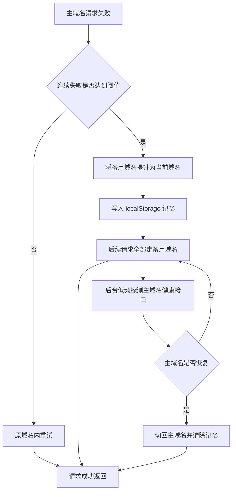

```javascript
// 备用域名切换：失败计数 -> 切换 -> 记忆 -> 恢复探测
const DOMAINS = ['https://api.example.com', 'https://api-bak.example.com'];

const currentDomain = () => localStorage.getItem('api-domain') ?? DOMAINS[0];

async function request(path, options, failCount = { n: 0 }) {
  try {
    const res = await fetch(currentDomain() + path,
      { ...options, signal: AbortSignal.timeout(5000) });
    if (!res.ok && ++failCount.n >= 3) switchDomain();   // 连续 3 次失败切换
    else failCount.n = 0;
    return res;
  } catch (err) {
    if (++failCount.n >= 3) {
      switchDomain();
      return request(path, options, failCount);          // 立即用新域名重放本次请求
    }
    throw err;
  }
}

function switchDomain() {
  const cur = currentDomain();
  const next = DOMAINS.find((d) => d !== cur);
  localStorage.setItem('api-domain', next);              // 记忆切换，直开页面也生效
  report({ type: 'domain-switch', from: cur, to: next });
  probePrimary(cur);
}

function probePrimary(primary) {
  const timer = setInterval(async () => {
    try {
      await fetch(`${primary}/healthz`, { mode: 'no-cors', signal: AbortSignal.timeout(2000) });
      localStorage.removeItem('api-domain');             // 恢复后切回主域名
      clearInterval(timer);
    } catch { /* 继续探测 */ }
  }, 60000);
}
```

### SCN-079：大文件上传已做分片，在此基础上如何实现秒传与断点续传？
**答**：
- 秒传：上传前先算文件 hash，向后端 check 接口查询，服务端已存在同名同 hash 文件则直接返回 URL，零传输。
- 断点续传：check 返回已存在的分片编号列表，前端跳过这些分片只传缺失部分，进度从断点继续；浏览器刷新后凭 hash 再 check 一次即可续传。
- hash 计算放 Web Worker，大文件用"首尾全量 + 中间抽样"策略降低计算耗时。

```javascript
// Worker 内计算文件 hash：抽样分片避免整文件读取耗时
// hash-worker.js
self.importScripts('https://cdn.jsdelivr.net/npm/spark-md5@3/spark-md5.min.js');
self.onmessage = async ({ data: { file, chunkSize } }) => {
  const spark = new self.SparkMD5.ArrayBuffer();
  const chunks = Math.ceil(file.size / chunkSize);
  for (let i = 0; i < chunks; i++) {
    // 首尾分片全读，中间分片只读开头 2MB 参与哈希（大文件提速）
    const blob = i === 0 || i === chunks - 1
      ? file.slice(i * chunkSize, (i + 1) * chunkSize)
      : file.slice(i * chunkSize, i * chunkSize + 2 * 1024 * 1024);
    spark.append(await blob.arrayBuffer());
    self.postMessage({ progress: (i + 1) / chunks });
  }
  self.postMessage({ hash: spark.end() });
};

// 主流程：check -> 已存在秒传；否则只传缺失分片
async function upload(file) {
  const hash = await computeHash(file);                  // Worker 中计算
  const { exists, uploadedChunks } = await api.checkUpload({ hash, name: file.name });
  if (exists) return api.getUploadedUrl(hash);           // 秒传：零传输
  const chunks = fileChunks(file);
  const missing = chunks.filter((_, i) => !uploadedChunks.includes(i));
  // 只传缺失分片，进度从断点开始
  await Promise.all(missing.map((c) => api.uploadChunk(c.blob, { hash, index: c.index })));
  return api.mergeUpload({ hash, total: chunks.length });
}
```

### SCN-080：弱网环境消息同步，何时用轮询、何时用 WebSocket，如何设计自动切换策略？
**答**：
- 默认 WebSocket；WS 连接失败或频繁断开降级为长轮询（服务端 hold 住请求直到有消息），再失败降级为 30 秒短轮询。
- 用"连续失败次数"驱动降级，"连续成功次数"驱动升级回 WS，形成状态机而不是一次性选择。
- 页面隐藏时统一降为低频轮询省电，恢复可见再升回原通道。

```javascript
// 消息通道自适应：WebSocket -> 长轮询 -> 短轮询，按连续失败自动降级升级
class AdaptiveChannel {
  state = 'ws';
  fails = 0;
  success = 0;

  start() {
    if (this.state === 'ws') return this.startWS();
    if (this.state === 'long-poll') return this.startLongPoll();
    return this.startShortPoll();
  }
  startWS() {
    const ws = new WebSocket('wss://msg.example.com');
    ws.onmessage = (e) => this.onMessage(e.data);
    ws.onclose = () => {
      if (++this.fails >= 2) { this.state = 'long-poll'; this.fails = 0; }   // 降级
      this.start();
    };
  }
  async startLongPoll() {
    try {
      // 服务端 hold 住请求直到有消息或 25 秒超时返回
      const res = await fetch('/api/messages?wait=25', { signal: AbortSignal.timeout(30000) });
      this.onMessage(await res.json());
      this.fails = 0;
    } catch {
      if (++this.fails >= 3) { this.state = 'short-poll'; this.fails = 0; }  // 再降级
    }
    this.start();
  }
  startShortPoll() {
    this.timer = setInterval(async () => {
      try {
        this.onMessage(await api.pollLatest());
        this.fails = 0;
        // 短轮询连续成功 5 次尝试升级回 WebSocket
        if (++this.success >= 5) { this.success = 0; this.state = 'ws'; this.start(); }
      } catch { this.fails++; }
    }, 30000);
  }
}
```

### SCN-081：本地开发与联调阶段，如何优雅切换 mock 与真实接口，并支持抓包调试？
**答**：
- 两层开关：环境变量决定默认走 mock 还是代理；请求层维护"单接口 mock 集合"，只 mock 正在开发的接口，其余照常联调。
- mock 与 TypeScript 类型同源（同一 schema 生成），防止 mock 与真实结构漂移；mock 加 300ms 延迟，暴露 loading 态问题。
- 抓包：devServer proxy 转发联调环境（changeOrigin + secure:false 处理自签证书），需要改包时把 target 指向本机 whistle/Charles 端口。

```javascript
// vite.config.js：代理配置 + 抓包切换
export default defineConfig(({ mode }) => ({
  server: {
    proxy: {
      '/api': {
        target: 'https://test-env.example.com',
        changeOrigin: true,      // 修改 Host 头，绕过对方域名校验
        secure: false,           // 联调环境自签证书不校验
        // 抓包调试：把 target 换成 'http://127.0.0.1:8899'（Charles/whistle 端口）
        configure: (proxy) => {
          proxy.on('proxyReq', (req) => {
            req.setHeader('X-Debug-User', 'wang');   // 联调环境区分流量来源
          });
        },
      },
    },
  },
}));
```

```typescript
// 请求层 mock 开关：全局 + 单接口覆盖，类型同源防漂移
import type { OrderDetail } from './types';
import mockOrder from './mocks/order.mock';

const MOCK_OVERRIDES = new Set(['/api/order/detail']);   // 只 mock 正在开发的接口
const MOCK_ALL = import.meta.env.VITE_USE_MOCK === 'true';

export async function get<T>(url: string): Promise<T> {
  if (MOCK_ALL || MOCK_OVERRIDES.has(url)) {
    console.warn('[mock]', url);
    await new Promise((r) => setTimeout(r, 300));   // 模拟延迟，暴露 loading 逻辑问题
    return mockOrder as T;                          // mock 与 OrderDetail 类型同源
  }
  return http.get<T>(url).then((r) => r.data);
}
```

### SCN-082：接口要求防篡改与防重放，前端如何参与签名方案？
**答**：
- 签名 = 请求要素（method/path/排序后参数/时间戳/nonce）按约定拼接后做 HMAC-SHA256，密钥登录后下发、只存内存不落 localStorage。
- 参数必须按 key 排序拼接，防止两端拼接顺序不一致与乱序绕过；nonce + timestamp 由服务端校验时间窗口与 nonce 唯一性防重放。
- 认知边界：密钥在前端可被提取，签名防的是普通篡改与脚本重放，不能替代服务端风控与 HTTPS，面试要主动说明。

```javascript
// 请求签名：参数排序拼接 + HMAC + nonce 防重放
import CryptoJS from 'crypto-js';

let secretKey = '';                    // 登录后接口下发，只存内存

function signRequest(method, path, params) {
  const ts = Date.now().toString();
  const nonce = crypto.randomUUID();
  // 关键：参数按 key 排序拼接，防止乱序导致签名不一致或被绕过
  const sorted = Object.keys(params).sort()
    .map((k) => `${k}=${params[k]}`).join('&');
  const raw = [method.toUpperCase(), path, sorted, ts, nonce].join('\n');
  return {
    'X-Timestamp': ts,
    'X-Nonce': nonce,                  // 服务端校验窗口内唯一，防重放
    'X-Signature': CryptoJS.HmacSHA256(raw, secretKey).toString(),
  };
}

// axios 拦截器统一注入
http.interceptors.request.use((config) => {
  Object.assign(config.headers,
    signRequest(config.method, config.url, config.params ?? {}));
  return config;
});
```

### SCN-083：通知场景改用 SSE 后，断线重连会漏消息，如何用 Last-Event-ID 实现补传？
**答**：
- 服务端为每条消息分配自增 id，浏览器 EventSource 重连时自动携带 Last-Event-ID 请求头，服务端据此补发该 id 之后的缺口，前端不需要自己做断点记录。
- 前端职责：不要抢在浏览器前重建连接（会丢 Last-Event-ID）；业务侧按消息 id 幂等去重，防止服务端重发造成重复渲染。
- 断线期间展示"消息同步中"，重连补传完成后隐藏，避免用户以为丢消息。

```javascript
// SSE 断线续传：浏览器自动携带 Last-Event-ID，业务层按 id 幂等去重
const seen = new Set<number>();
let synced = true;

const es = new EventSource('/api/notifications');

es.onmessage = (e) => {
  const id = Number(e.lastEventId);   // 服务端分配的自增 id
  if (seen.has(id)) return;           // 服务端可能重发，业务侧幂等
  seen.add(id);
  if (!synced) { synced = true; hideSyncingTip(); }
  renderNotification(JSON.parse(e.data));
};

es.onerror = () => {
  if (es.readyState === EventSource.CLOSED) {
    // 浏览器自动重连失败的兜底：手动重建（重建后首个请求仍带 Last-Event-ID）
    synced = false;
    showSyncingTip();                 // 断线期间明确提示，避免用户以为丢消息
    setTimeout(() => new EventSource('/api/notifications'), 3000);
  }
};

// 服务端网关注意：Nginx 对该 location 配 proxy_buffering off，
// 否则缓冲攒消息导致 SSE 延迟，proxy_read_timeout 拉长防长连接被掐断
```

### SCN-084：视频站要求大视频边下边播、支持进度条拖拽，前端与服务端如何配合？
**答**：
- 核心是 HTTP Range 请求：video 标签天然按 Range 拉流，前提是服务端支持 206 Partial Content；Nginx 静态文件默认支持，但必须关 gzip（压缩破坏 Range 且视频压缩无意义）。
- 前端控制：preload="metadata" 只拉 moov 头与首帧，不整片下载；进度条预览帧用 Range 请求按字节偏移取。
- 多码率场景用 HLS + hls.js，按网速自动切换分片清晰度并限制缓冲时长控制内存。

```javascript
// 前端：metadata 预载 + seek 预览 + HLS 多码率
const video = document.querySelector('video');
video.preload = 'metadata';           // 只拉 moov 头与首帧，首屏不下载全片

video.addEventListener('seeking', () => {
  // 拖拽进度条时浏览器自动取消旧 Range 请求并按新偏移请求；
  // 自定义进度条时按时间换算字节偏移，发预览帧请求
  const byte = Math.floor((video.currentTime / video.duration) * video.fileSize);
  fetchPreviewFrame('/videos/a.mp4', byte);   // Range: bytes=byte- 
});

// 多码率交给 hls.js：按网速自动切分片清晰度，只缓冲 30 秒控内存
if (Hls.isSupported()) {
  const hls = new Hls({ maxBufferLength: 30 });
  hls.loadSource('/videos/a.m3u8');
  hls.attachMedia(video);
}

// 服务端 Nginx 配置要点（伪配置）：
// location /videos/ { gzip off; add_header Accept-Ranges bytes;
//   add_header Cache-Control "public, max-age=31536000, immutable"; }
```

### SCN-085：页面渲染依赖多个接口，B 依赖 A 的结果、C 独立、D 依赖 B 和 C，如何编排最优？
**答**：
- 先画依赖图（DAG），用 Promise 表达并行与依赖关系，坚决杜绝全串行 await：A、C 并行发出，B 等 A，D 等 B 和 C。
- 失败策略分层：关键接口失败整体报错，次要接口失败降级默认值不阻塞页面。
- 整体加超时兜底（Promise.race），避免单个慢接口拖死整页。

```javascript
// 依赖编排：A、C 并行 -> B 等 A -> D 等 B 和 C
async function loadPage() {
  // 第一层：A 与 C 同时发出（不要串行 await）
  const pA = api.getUser().catch(() => null);
  const pC = api.getRecommend().catch(() => DEFAULT_RECOMMEND);   // C 次要，失败给默认值

  const user = await pA;
  if (!user) throw new FatalError('core-api-down');   // A 是关键接口，失败整体报错

  // 第二层：B 依赖 A 的结果
  const pB = api.getOrders(user.id);

  // 第三层：D 依赖 B 与 C，整体 5 秒超时兜底
  let timer;
  const timeout = new Promise((_, rej) => {
    timer = setTimeout(() => rej(new Error('page-timeout')), 5000);
  });
  const [orders, recommend] = await Promise.race([
    Promise.all([pB, pC]),
    timeout,
  ]).finally(() => clearTimeout(timer)); // 成功后清掉定时器，避免 unhandled rejection
  return { user, orders, recommend };
}
```

### SCN-086：大促抢购压测需要前端配合模拟真实用户并发（1000 人同时抢），前端怎么做？
**答**：
- 前端职责一：提供压测脚本（k6），模拟真实交互序列（浏览详情→查库存→下单）而非裸打单个接口，带拟人停顿，压力模型才真实。
- 职责二：保证被压测环境"真实"——去掉本地 mock、CDN 与缓存策略与线上一致；请求带压测标识头让服务端区分流量。
- 职责三：压测期间前端监控同开，收集 FCP/INP/错误率，验证"服务端扛得住时前端体验是否也扛得住"。

```javascript
// k6 压测脚本：模拟真实用户行为序列而非裸打接口
import http from 'k6/http';
import { check, sleep } from 'k6';

export const options = {
  stages: [
    { duration: '2m', target: 500 },    // 2 分钟爬坡到 500 并发
    { duration: '5m', target: 1000 },   // 峰值 1000
    { duration: '1m', target: 0 },
  ],
  thresholds: {
    http_req_duration: ['p(95)<800'],   // 95 分位耗时达标线
    checks: ['rate>0.99'],
  },
};

export default function () {
  // 模拟真实链路：详情 -> 下单，带压测标识头
  const params = { headers: { 'X-Load-Test': '1', 'X-Trace-Id': `${__VU}-${__ITER}` } };
  const detail = http.get('https://staging.example.com/api/seckill/1001', params);
  check(detail, { 'detail 200': (r) => r.status === 200 });
  sleep(Math.random() * 2);             // 拟人停顿，避免理想化并发
  http.post('https://staging.example.com/api/seckill/order',
    JSON.stringify({ skuId: 1001, count: 1 }),
    { headers: { ...params.headers, 'Content-Type': 'application/json' } });
  sleep(1);
}
```

## 十七、状态管理进阶

### SCN-087：项目状态散落在 props 层层传递和各处 localStorage 里，如何做选型收敛？
**答**：
- 先分类再选型：服务端状态（列表/详情）交给 TanStack Query/SWR，缓存、失效、重试全部内置；纯 UI 状态（抽屉开关、主题）用轻量 store（zustand/pinia）；真正全局的业务状态（登录用户、租户）才进全局 store。
- 原则：能局部的不提升；服务端状态不做二次手写缓存（把接口数据抄进 redux 是反模式）。
- 写操作后用缓存失效（invalidate）而非手动同步数据，保持"服务端是唯一真源"。

```typescript
// 状态选型落地：服务端状态用 TanStack Query，UI 状态用 zustand，两者不混
import { useQuery, useQueryClient } from '@tanstack/react-query';
import { create } from 'zustand';

// 服务端状态：缓存 key 精确到参数，自动失效与重试
function useOrders(params: OrdersQuery) {
  return useQuery({
    queryKey: ['orders', params],          // 参数变化自动重新请求
    queryFn: () => api.getOrders(params),
    staleTime: 30_000,                     // 30 秒内视为新鲜，不重复请求
    placeholderData: (prev) => prev,       // 翻页保留旧数据避免闪空
  });
}

// 纯 UI 状态：轻量 store，不必进全局大 store
const useUIStore = create<{ sidebarOpen: boolean; toggle: () => void }>((set) => ({
  sidebarOpen: false,
  toggle: () => set((s) => ({ sidebarOpen: !s.sidebarOpen })),
}));

// 写操作后精准失效相关查询：服务端是唯一真源，不做手动数据同步
const qc = useQueryClient();
function onOrderCreated(order: Order) {
  qc.invalidateQueries({ queryKey: ['orders'] });
}
```

### SCN-088：用户把填写到一半的表单页面切走，如何做离开拦截与现场恢复？
**答**：
- 两层拦截：路由守卫（onBeforeRouteLeave）拦应用内跳转；beforeunload 拦刷新与关闭标签页。
- 有未保存修改时先暂存再询问：把当前值写入 sessionStorage（key 带路由标识），弹窗区分"留下继续编辑"与"暂存并离开"，误触离开的现场下次进入可恢复。
- 恢复时校验暂存时效（超过 24 小时丢弃），恢复成功给明确提示，不静默覆盖。

```typescript
// Vue Router：离开守卫 + 现场暂存恢复
const dirty = ref(false);
watch(formValues, () => (dirty.value = true), { deep: true });

onBeforeRouteLeave(async () => {
  if (!dirty.value) return true;
  // 暂存现场，保证误触离开可恢复
  sessionStorage.setItem(`draft:${route.name as string}`,
    JSON.stringify({ values: formValues.value, at: Date.now() }));
  const ok = await ElMessageBox.confirm('有未保存的修改，确定离开？', '', {
    distinguishCancelAndClose: true,   // 区分取消（留下）与关闭（暂存离开）
  }).then(() => true).catch((action: string) => action === 'cancel');
  return ok;
});

onMounted(() => {
  const draft = sessionStorage.getItem(`draft:${route.name as string}`);
  if (!draft) return;
  const { values, at } = JSON.parse(draft);
  if (Date.now() - at < 24 * 3600 * 1000) {          // 时效校验
    Object.assign(formValues, values);
    ElMessage.success('已为你恢复上次未提交的内容');
  }
});

// 浏览器级兜底：刷新 / 关闭标签页前的原生确认
window.addEventListener('beforeunload', (e) => {
  if (dirty.value) { e.preventDefault(); e.returnValue = ''; }
});
```

### SCN-089：审批流表单要支持撤销/重做，如何在不大改现有表单代码的前提下落地？
**答**：
- 表单场景用"快照栈"最轻：每次有意义的修改 push 完整 values 快照，undo 弹出上一份，redo 用反向栈，不侵入表单内部实现。
- 连续输入要防抖合并为一步（500ms），否则撤销一步只删一个字符，体验不可用；栈容量限制 50 步防内存膨胀。
- 新操作提交后清空 redo 栈；异步回填（上传完成写入 URL）也要走 commit 入栈。

```typescript
// 表单撤销重做：快照栈实现，连续输入防抖合并为一步
function useHistory<T>(initial: T, limit = 50) {
  const past: T[] = [];
  let present = initial;
  const future: T[] = [];

  return {
    get: () => present,
    commit(next: T) {
      past.push(present);
      if (past.length > limit) past.shift();   // 限制栈深防内存膨胀
      present = next;
      future.length = 0;                       // 新操作清空 redo 栈
    },
    undo(): T | null {
      if (!past.length) return null;
      future.push(present);
      present = past.pop()!;
      return present;
    },
    redo(): T | null {
      if (!future.length) return null;
      past.push(present);
      present = future.pop()!;
      return present;
    },
    canUndo: () => past.length > 0,
    canRedo: () => future.length > 0,
  };
}

// 接入表单：值变化防抖 500ms 后 commit，连续打字只算一步
const history = useHistory(defaultValues);
watch(formValues, useDebounceFn((v) => history.commit({ ...v }), 500), { deep: true });
```

### SCN-090：五步注册向导，步骤间允许前后跳转，中途还能刷新，状态如何管理才不乱？
**答**：
- 用状态机思维建模：state = { step, maxVisited, data }；maxVisited 记录到达过的最远步骤，跳转只允许进入 maxVisited 之内的步骤（防跳步）。
- 前进必须先通过当前步校验；所有分步数据合并在最后一步统一提交，而不是每步各存各的。
- step 同步进 URL（replaceState），刷新、后退、分享链接都不丢进度。

```typescript
// 多步向导状态机：防跳步 + 分步校验 + URL 同步
type WizardState<S extends string> = {
  step: S;
  maxVisited: S;                       // 到达过的最远步骤
  data: Record<string, any>;
};

const STEP_ORDER = ['account', 'profile', 'verify', 'pay', 'done'] as const;

function createWizard(initial: WizardState<typeof STEP_ORDER[number]>) {
  return {
    ...initial,
    canGo(target: string) {
      // 只允许访问已解锁最远步骤之内的步骤，防止跳步
      return STEP_ORDER.indexOf(target as any)
        <= STEP_ORDER.indexOf(initial.maxVisited);
    },
    async next(validateCurrent: () => Promise<boolean>) {
      if (!(await validateCurrent())) return false;   // 当前步校验通过才能前进
      const i = STEP_ORDER.indexOf(this.step);
      this.step = STEP_ORDER[i + 1];
      this.maxVisited = this.step;                    // 解锁下一步
      history.replaceState(null, '', `?step=${this.step}`);  // 刷新不丢进度
      return true;
    },
    back() {
      const i = STEP_ORDER.indexOf(this.step);
      if (i > 0) this.step = STEP_ORDER[i - 1];
    },
  };
}

// 提交：所有分步数据合并一次提交
await api.register({
  ...wizard.data.account,
  ...wizard.data.profile,
  ...wizard.data.pay,
});
```

### SCN-091：多人协作编辑（文档/表格）出现保存冲突，乐观更新失败如何回滚？
**答**：
- 乐观更新三步走：本地立即生效（带 pending 标记）→ 请求发出（携带版本号）→ 失败回滚到改前快照，用户看到明确反馈，绝不静默吞掉。
- 冲突按业务选策略：简单场景最后写入胜出；重要数据用版本号乐观锁，409 时展示"我的版本 vs 云端版本"让用户合并。
- 回滚快照在更新前就取好，回滚动作与 UI 更新走同一个函数，保证状态一致性。

```typescript
// 乐观更新：本地先改 -> 请求 -> 失败回滚快照 -> 版本冲突提示合并
async function renameDoc(id: string, name: string) {
  const prev = store.getDoc(id);                     // 快照：回滚用
  store.updateDoc(id, { name, pending: true });      // 1. 乐观更新立即生效
  try {
    const saved = await api.updateDoc({ id, name, version: prev.version });  // 2. 带版本号
    store.updateDoc(id, { ...saved, pending: false });
  } catch (err: any) {
    if (err.response?.status === 409) {              // 3a. 版本冲突：别人已先保存
      const theirs = err.response.data.latest;
      await ConflictDialog.show({                    // 展示两个版本让用户选择
        mine: name,
        theirs: theirs.name,
        onOverwrite: () => api.updateDoc({ id, name, version: theirs.version }),
        onKeepTheirs: () => store.updateDoc(id, theirs),
      });
    } else {
      store.updateDoc(id, prev);                     // 3b. 普通失败：回滚快照
      Toast.error('重命名失败，已恢复原名称');        // 明确反馈，不静默
    }
  }
}
```

### SCN-092：用户在 App 加购、在 PC 继续操作购物车，两端数据不一致，如何做跨端同步与冲突合并？
**答**：
- 服务端为唯一真源：本地操作（加购/改数量/删行）先改 UI 再记入本地操作日志（oplog），防抖批量上报。
- 合并规则按行执行：同一商品行两端都改取操作时间新的（last-write-wins）；一端改、一端删时删除优先，避免"删掉的商品复活"。
- 同步流程：先推 oplog 让服务端按规则合并，再拉取合并后的全量结果整体替换本地。

```typescript
// 购物车跨端合并：服务端真源 + 行级 LWW + oplog 批量同步
type CartOp =
  | { type: 'add'; skuId: string; count: number; at: number }
  | { type: 'set'; skuId: string; count: number; at: number }
  | { type: 'remove'; skuId: string; at: number };

const pendingOps: CartOp[] = [];   // 本地未同步操作日志

async function syncCart() {
  if (!pendingOps.length) return;
  // 1. 上传 oplog，服务端按行合并：
  //    同一行两端都改 -> at 更新的胜出（last-write-wins）
  //    一端改、一端删 -> 删除优先，避免删掉的商品复活
  await api.pushCartOps([...pendingOps]);
  pendingOps.length = 0;
  // 2. 拉取合并后的服务端真源，整体替换本地
  const server = await api.getCart();
  replaceLocalCart(server.items);
}

// 本地操作：立即改 UI + 记 oplog，等同步时机批量上报
function setCount(skuId: string, count: number) {
  localCart.set(skuId, { count, updatedAt: Date.now() });
  pendingOps.push({ type: 'set', skuId, count, at: Date.now() });
  scheduleSync();   // 防抖 2 秒，操作密集时合并上报
}
```

## 十八、性能场景进阶

### SCN-093：大促活动页 3 天后上线，当前首屏 6 秒，优化时间怎么分配？
**答**：
- 按 ROI 排序，3 天三段：Day1 止血——分段打点定位瓶颈（先知道 6 秒花在哪），做确定性高的：图片压缩懒加载、关键 CSS 内联、JS 分包、接口并行化。
- Day2 架构——接口预取（HTML preload）、SSR/预渲染决策、第三方脚本延迟化；Day3 验证——真机回归、压测、性能预算写进 CI 防回潮。
- 每天用 RUM 数据验证收益，明确不做的事：不上线新框架、不做低 ROI 重构。

```javascript
// Day1 分段打点：先精确知道 6 秒花在哪，再决定砍哪里
const marks = {};
const mark = (name) => {
  marks[name] = performance.now();
  console.log(name, Math.round(marks[name]));
};

mark('html-end');
await fetchCriticalData();        // 接口串行是首屏大户
mark('data-ready');
renderApp();
mark('render-end');
// 输出示例：html-end 300 / data-ready 2600 / render-end 5800
// 结论：接口 2.3s + JS 与渲染 3.2s -> Day1 并行化接口，Day2 评估 SSR

// Day3 CI 性能预算卡口：防止上线前指标回潮（lighthouserc.js）
export default {
  ci: {
    assert: {
      assertions: {
        'categories:performance': ['error', { minScore: 0.8 }],
        'largest-contentful-paint': ['error', { maxNumericValue: 2500 }],
        'total-byte-weight': ['error', { maxNumericValue: 1572864 }],   // 总量 1.5MB
      },
    },
  },
};
```

### SCN-094：十万行列表带多条件筛选，输入关键词后主线程卡 500ms，如何把计算下沉 Web Worker？
**答**：
- 数据与过滤计算搬到 Worker：主线程只发查询条件、收渲染结果，输入响应不再被计算阻塞；数据用初始化时一次性 postMessage 进 Worker。
- Worker 内建前缀索引（关键词前缀 -> 命中 id 集合），查询从全量扫描降为索引定位 + 小范围过滤。
- 兼容不支持 Worker 的环境时退化为分片计算：每帧处理一批，用 scheduler 让出主线程。

```javascript
// main.js：筛选计算下沉 Worker，主线程只收发条件
const worker = new Worker('filter-worker.js');
worker.onmessage = ({ data }) => renderList(data);   // 结果回来才渲染
worker.postMessage({ type: 'init', rows: bigRows });

function search(keyword, filters) {
  worker.postMessage({ type: 'query', keyword, filters });   // 非阻塞，输入不卡
}
```

```javascript
// filter-worker.js：Worker 内建索引 + 过滤排序，不占主线程
let rows = [];
const index = new Map();   // 关键词前缀 -> 命中 id 数组

self.onmessage = ({ data: { type, rows: init, keyword, filters } }) => {
  if (type === 'init') {
    rows = init;
    for (const row of rows) {
      for (let i = 1; i <= Math.min(row.name.length, 8); i++) {
        const p = row.name.slice(0, i);
        if (!index.has(p)) index.set(p, []);
        index.get(p).push(row.id);
      }
    }
    return;
  }
  if (type === 'query') {
    const ids = new Set(index.get(keyword) ?? []);   // 前缀索引 O(1) 圈定候选
    const result = rows
      .filter((r) => ids.has(r.id) && matchFilters(r, filters))
      .sort((a, b) => b.score - a.score)
      .slice(0, 200);
    self.postMessage(result);
  }
};
```

### SCN-095：首屏接入埋点、客服、统计、AB 测试 4 个第三方脚本，拖慢 LCP，如何治理？
**答**：
- 分优先级处置：埋点/统计/客服都不是首屏必需，移到 window load 后 requestIdleCallback 注入，不与首屏资源抢带宽；加载失败静默降级。
- AB 分流逻辑必须首帧前生效（防闪烁），但分流算法本地化（确定性哈希），不依赖远程接口，兼顾正确性与速度。
- 能替换就替换：重 SDK 同步脚本改自建轻量上报或服务端收数，从源头减少第三方体积。

```javascript
// 第三方脚本延迟化：非关键 SDK 空闲时加载 + AB 分流本地化
function idleLoad(src) {
  return new Promise((resolve, reject) => {
    const run = () => {
      const s = document.createElement('script');
      s.src = src; s.async = true;
      s.onload = resolve; s.onerror = reject;
      document.head.appendChild(s);
    };
    // load 后且浏览器空闲再加载，失败不影响主流程
    window.addEventListener('load', () =>
      'requestIdleCallback' in window
        ? requestIdleCallback(run, { timeout: 5000 })
        : setTimeout(run, 3000));
  });
}
idleLoad('https://sdk.analytics.com/analytics.js').catch(() => {});

// AB 分流本地化：确定性哈希，首帧前即可生效，无远程依赖无闪烁
function bucket(userId, experiment, ratio = [0.5, 0.5]) {
  let h = 0;
  for (const c of `${experiment}:${userId}`) h = (h * 31 + c.charCodeAt(0)) >>> 0;
  const slot = (h % 1000) / 1000;
  let acc = 0;
  for (let i = 0; i < ratio.length; i++) {
    acc += ratio[i];
    if (slot < acc) return i;   // 同一用户永远同一组
  }
  return ratio.length - 1;
}
```

### SCN-096：页面动画掉帧（只有 10fps），如何定位是重排、重绘还是合成层问题，并修复？
**答**：
- 定位用 DevTools：Performance 录制看主线程与合成器线程；Rendering 面板开 Paint flashing（绿闪为重绘）与 Layout Shift Regions，区分掉帧来自 layout/paint/composite 哪一层。
- 修复三原则：只动 transform/opacity 合成属性；will-change 提前提升合成层但用完即删（防层爆炸）；contain 与 content-visibility 缩小重排范围、跳过视口外渲染。
- 修复后用 FPS 探针量化验证（稳定接近 60 才算达标），不靠肉眼。

```css
/* 动画性能三原则落地：只动合成属性 + 层隔离 + 防层爆炸 */
.card {
  /* 反例：transition: left .3s  每帧触发 layout，必掉帧 */
  transform: translateX(0);
  transition: transform .3s;     /* transform 走合成器线程，不占主线程 */
  will-change: transform;        /* 提前提升合成层，首帧不掉坑 */
  contain: layout paint;         /* 内部变化不外溢，缩小重排重绘范围 */
}

/* 长列表：视口外的行跳过渲染，滚动立刻流畅 */
.long-list > * {
  content-visibility: auto;
  contain-intrinsic-size: auto 48px;   /* 占位高度防滚动条跳动 */
}

/* 防层爆炸：will-change 用完即删，不能全量加在几百个节点上 */
.card.animating { will-change: transform; }
.card:not(.animating) { will-change: auto; }
```

### SCN-097：路由切换时新页面短暂白屏闪烁，如何用预加载与 keep-alive 消除？
**答**：
- 白屏来自"旧页卸载 → 新 chunk 请求 → 新数据请求 → 渲染"的串行空窗，要逐环压缩。
- chunk 层：常用路由组件 webpackPrefetch 空闲预取；数据层：导航确认前就发起请求（beforeEnter / React loader），组件挂载时数据已在途。
- 已访问页面用 keep-alive 缓存，来回切换零白屏；剩余空窗用过渡动画或骨架屏掩盖。

```javascript
// Vue Router：chunk 预取 + 数据预取 + keep-alive 三层消除白屏
const routes = [
  {
    path: '/detail/:id',
    // 空闲时预取 chunk，点击时大概率已在缓存
    component: () => import(/* webpackPrefetch: true */ './Detail.vue'),
    beforeEnter: async (to) => {
      // 导航确认前就发数据请求，组件挂载时数据已在途
      to.meta.prefetched = fetchDetail(to.params.id);
    },
  },
];

// Detail.vue 内直接消费预取结果，不二次等待
export default {
  async setup() {
    const data = await useRoute().meta.prefetched;
    return { data };
  },
};

// App.vue：缓存常用页面，来回切换不重建不白屏
// <router-view v-slot="{ Component }">
//   <keep-alive include="ListPage,DetailPage">
//     <component :is="Component" />
//   </keep-alive>
// </router-view>
```

### SCN-098：图片 CDN 流量费每月超预算数万元，如何在不损体验的前提下降本？
**答**：
- 流量 = 字节数，从四个维度降：格式（WebP/AVIF 按 Accept 协商，省 30-60%）、尺寸（按展示宽度请求裁剪图，禁止原图直出——原图常是展示尺寸的 4 倍大）、加载（懒加载 + 进视口才请求 + 占位防抖动）、缓存（长 max-age + immutable，回源率压到个位数）。
- 统一封装图片 URL 生成函数，全站收敛出口，杜绝业务方直拼原图 URL。
- 建立按域名/路径的流量日报，异常大图与异常路径报警，防止降本成果回潮。

```javascript
// 图片降本：格式协商 + 宽度裁剪 + 懒加载统一封装
function cdnImg(url, { width, quality = 75 } = {}) {
  const u = new URL(url, location.origin);
  u.host = 'img-cdn.example.com';
  // 按展示宽度 x DPR 请求裁剪图，杜绝原图直出
  u.searchParams.set('w', String(width * devicePixelRatio));
  u.searchParams.set('q', String(quality));
  // 格式协商交给 CDN：按 Accept 头自动下发 AVIF/WebP/JPEG
  return u.toString();
}

// 组件层：进视口才请求 + 宽高占位防抖动
function LazyImage({ src, width, height, alt }) {
  const ref = useRef(null);
  const [visible, setVisible] = useState(false);
  useEffect(() => {
    const ob = new IntersectionObserver(([e]) => {
      if (e.isIntersecting) { setVisible(true); ob.disconnect(); }
    }, { rootMargin: '200px' });                 // 提前 200px 预载
    ob.observe(ref.current);
    return () => ob.disconnect();
  }, []);
  return (
    <div ref={ref} style={{ aspectRatio: `${width}/${height}`, background: '#eee' }}>
      {visible && }
    </div>
  );
}
```

### SCN-099：发版前打包体积突然涨了 40%，如何在半天内定位并应急缩回去？
**答**：
- 定位：rollup-plugin-visualizer / webpack-bundle-analyzer 对比上一版产物构成，常见元凶：新依赖全量引入（moment 全 locale、lodash 非按需）、同一依赖多版本共存、polyfill 或 sourcemap 误入产物。
- 应急三板斧：大依赖动态 import 拆包按需加载；alias 收敛重复依赖到单一版本；替换为轻量等价库（moment→dayjs）。
- 治本：CI 加体积预算（size-limit）卡口，超预算流水线直接失败。

```javascript
// vite.config.js：产物分析 + 体积应急三件套
import { visualizer } from 'rollup-plugin-visualizer';

export default defineConfig({
  build: {
    rollupOptions: {
      output: {
        manualChunks(id) {
          if (id.includes('node_modules')) {
            // 大依赖单独拆包：一个 vendor 巨包缓存失效影响全站
            if (id.includes('echarts')) return 'echarts';
            if (id.includes('element-plus')) return 'element';
            return 'vendor';
          }
        },
      },
    },
  },
  resolve: {
    alias: {
      lodash: 'lodash-es',    // 收敛到可 tree-shaking 的按需版本
      moment: 'dayjs',        // 应急替换：体积从 70KB 到 2KB
    },
    dedupe: ['vue'],          // 同一依赖多版本共存时收敛到一份
  },
  plugins: [
    // 构建后打开 stats.html 查看体积占比，锁定元凶
    visualizer({ filename: 'stats.html', gzipSize: true }),
  ],
});
```

### SCN-100：低端机（2GB 内存安卓）用户反馈页面卡顿发热，如何做优雅降级？
**答**：
- 静态分档：用 deviceMemory、hardwareConcurrency、UA 识别设备档位（high/mid/low），写入 html data 属性，CSS 按档位关闭模糊、阴影、粒子等昂贵视觉。
- 运行时自适应：FPS 探针发现持续低于 25fps 自动降为低档，比静态判断更可靠（静态判断识别不了后台开一堆 App 的中端机）。
- 降级动作分级：先关动效，再降图片清晰度与轮询频率，最后关虚拟列表动画；高端机体验完全不变。

```typescript
// 低端机自适应降级：静态分档 + 运行时 FPS 自动降档
function deviceTier() {
  const mem = (navigator as any).deviceMemory ?? 4;      // GB
  const cores = navigator.hardwareConcurrency ?? 4;
  if (mem <= 2 || cores <= 4) return 'low';
  if (mem <= 4) return 'mid';
  return 'high';
}
document.documentElement.dataset.tier = deviceTier();
// CSS 按档位关动效：
// html[data-tier="low"] .blur-bg { backdrop-filter: none; background: #333; }
// html[data-tier="low"] * { animation-duration: .01s !important; }

// 运行时自适应：持续低 FPS 自动降档，不依赖静态判断
(function autoDegrade() {
  let last = performance.now(), frames = 0;
  const loop = (now: number) => {
    frames++;
    if (now - last >= 1000) {
      const fps = frames;
      frames = 0; last = now;
      const el = document.documentElement;
      if (fps < 25 && el.dataset.tier !== 'low') {
        el.dataset.tier = 'low';      // 连续卡顿自动降为低档
        report({ type: 'auto-degrade', fps });
      }
    }
    requestAnimationFrame(loop);
  };
  requestAnimationFrame(loop);
})();
```

## 十九、安全场景进阶

### SCN-101：渗透测试发现 /redirect?url=xxx 可以跳转到任意外部钓鱼站，如何修复开放重定向漏洞？
**答**：
- 修复原则：跳转目标只放行"站内相对路径"或白名单域名，其余一律回退默认页，绝不跟随用户提供的绝对地址。
- 两个绕过必须防：协议相对地址（//evil.com）会被解析为外部域名；URL 编码（https%3A%2F%2Fevil.com）要先 decode 再校验。
- 拦截事件本身上报监控，观察是否有真实攻击行为；必要时对可疑来源展示"即将跳转到 xxx"确认页作为兜底。

```javascript
// 开放重定向修复：decode 后白名单校验，仅放行站内路径
const TRUSTED_HOSTS = ['example.com', 'm.example.com'];

function safeRedirect(rawUrl, fallback = '/') {
  let url;
  try {
    // 先解码再解析，防编码绕过；相对路径以当前 origin 为基
    url = new URL(decodeURIComponent(rawUrl), location.origin);
  } catch {
    return fallback;
  }
  // 放行条件：同源相对路径，或 host 在白名单内
  if (url.origin === location.origin) return url.pathname + url.search;
  if (TRUSTED_HOSTS.includes(url.hostname)) return url.href;
  // 其余一律回退默认页
  report({ type: 'open-redirect-blocked', raw: rawUrl });   // 拦截记录，观察攻击
  return fallback;
}

// 使用：登录回跳
location.href = safeRedirect(getQueryParam('redirect'));
```

### SCN-102：老的 JSONP 接口被安全扫描标记（回调名任意注入 + 天然带 Cookie），如何平滑迁移？
**答**：
- JSONP 两大风险：回调名注入 XSS（服务端把 callback 参数直接拼进 JS）、跨站 GET 天然携带 Cookie 造成数据泄露。方向是整体迁到 CORS/fetch。
- 平滑迁移：请求封装层按接口配置选择通道（已迁移走 fetch，未迁移走 JSONP），逐接口切量；JSONP 存量实现先加回调名白名单校验止血。
- 服务端 CORS 配置白名单 origin + credentials 规则，绝不能图省事配 `*`。

```javascript
// JSONP -> fetch 迁移：封装统一入口，接口级灰度切换
const FETCH_ENABLED = new Set(['/api/user/info']);   // 已迁移接口列表

export function request(api, params) {
  if (FETCH_ENABLED.has(api)) return fetchJSON(api, params);   // 新通道
  return jsonp(api, params);                                    // 未迁移走老通道
}

function fetchJSON(api, params) {
  return fetch(`${api}?${new URLSearchParams(params)}`, {
    credentials: 'include',                     // 跨域带 cookie
  }).then((r) => {
    if (!r.ok) throw new Error(`HTTP ${r.status}`);
    return r.json();
  });
}

// 存量 JSONP 止血：随机回调名 + 格式校验，防回调注入 XSS
function jsonp(api, params) {
  const cb = `__jp${Math.random().toString(36).slice(2)}`;
  if (!/^__jp[a-z0-9]+$/.test(cb)) throw new Error('invalid callback');
  return new Promise((resolve, reject) => {
    window[cb] = resolve;
    const s = document.createElement('script');
    s.src = `${api}?${new URLSearchParams({ ...params, callback: cb })}`;
    s.onerror = () => reject(new Error('jsonp failed'));
    s.onload = () => { delete window[cb]; s.remove(); };
    document.head.appendChild(s);
  });
}
```

### SCN-103：安全团队报告公司页面被第三方网站 iframe 嵌入做点击劫持，如何处置？
**答**：
- 主修复在网关响应头：X-Frame-Options: DENY（老标准）+ CSP frame-ancestors 'none'（现代标准，两者都要加覆盖不同浏览器）；业务确需被信任方嵌入时用 frame-ancestors 白名单。
- JS 兜底检测（top !== self 时反嵌套或替换内容）只能作辅助——它可被 sandbox 属性绕过，不能替代响应头。
- 加头后用 curl 验证响应、用本地 HTML 嵌套测试验证生效，全站网关层统一加而不是各应用自己加。

```nginx
# 点击劫持修复：网关层统一加响应头，全站生效
server {
  location / {
    proxy_pass http://frontend;
    add_header X-Frame-Options "DENY" always;                 # 老标准：禁止任何 iframe
    add_header Content-Security-Policy "frame-ancestors 'none'" always;  # 现代标准
    # 若需允许集团内域名嵌入：
    # add_header Content-Security-Policy "frame-ancestors https://partner.example.com" always;
  }
}
```

### SCN-104：公司要做 CSRF 攻击演练，前端如何复现攻击过程并给出修复方案？
**答**：
- 复现：攻击页放一个自动提交的隐藏表单 POST 到转账接口；用户已登录且 Cookie 未配 SameSite 或配了 None 时，访问攻击页即中招；Lax 下 GET 顶层导航仍带 Cookie，有副作用的 GET 接口同样中招。
- 修复三件套：Cookie 加 SameSite=Lax/Strict；写操作走 CSRF token（服务端下发、前端放 header 回传，双重提交模式亦可）；服务端校验 Origin/Referer 白名单。
- token 用"cookie + header 双份比对"实现零存储成本，前端只需拦截器统一注入。

```javascript
// CSRF 修复：token 双重提交 + axios 拦截器自动携带
// 1) 服务端下发非 HttpOnly 的 XSRF-TOKEN cookie，前端读取
const csrfToken = getCookie('XSRF-TOKEN');

const http = axios.create();
http.interceptors.request.use((config) => {
  // 2) 写操作统一在 header 携带，服务端比对 cookie 与 header 中的 token
  if (['post', 'put', 'delete', 'patch'].includes(config.method)) {
    config.headers['X-CSRF-Token'] = csrfToken;
  }
  return config;
});

// 演练复现脚本（攻击者视角，仅内部演练使用）attack.html：
// <form action="https://bank.example.com/api/transfer" method="POST">
//   <input name="to" value="attacker"><input name="amount" value="10000">
// </form>
// <script>document.forms[0].submit()</script>   // 已登录用户访问即中招

// 服务端校验逻辑示意：Origin 校验 + token 比对双保险
app.use((req, res, next) => {
  const origin = req.headers.origin ?? req.headers.referer;
  if (req.method !== 'GET' && !isTrustedOrigin(origin)) {
    return res.status(403).end('csrf blocked');
  }
  if (req.get('X-CSRF-Token') !== req.cookies['XSRF-TOKEN']) {
    return res.status(403).end('csrf token mismatch');
  }
  next();
});
```

### SCN-105：监控平台发现前端日志里打出了用户手机号与 token，如何做脱敏治理？
**答**：
- 三处治理：入口（上报前统一脱敏管道：字段名黑名单 + 正则识别手机号/身份证/银行卡做掩码）、存量（已上报日志批量删除或加密，评估合规影响）、根因（生产构建 drop console，业务禁止随手 log 敏感数据）。
- 脱敏管道必须封装进 logger/上报函数内部，让业务"绕不开"，而不是依赖每个人自觉。
- 递归处理对象与数组，嵌套 payload 里的敏感字段也要覆盖。

```javascript
// 日志脱敏管道：上报前统一清洗，字段黑名单 + 正则掩码双层拦截
const SENSITIVE_KEYS = /^(password|token|authorization|idcard|session)$/i;

const PATTERNS = [
  { re: /1[3-9]\d{9}/g, mask: (m) => m.slice(0, 3) + '****' + m.slice(7) },  // 手机号
  { re: /\b\d{17}[\dXx]\b/g, mask: () => '**********' },                     // 身份证
  { re: /\b\d{16,19}\b/g, mask: (m) => '****' + m.slice(-4) },               // 银行卡
];

function sanitize(value, key = '') {
  if (value == null) return value;
  if (SENSITIVE_KEYS.test(key)) return '***';          // 字段名命中直接掩码
  if (typeof value === 'string') {
    return PATTERNS.reduce((s, p) => s.replace(p.re, p.mask), value);
  }
  if (Array.isArray(value)) return value.map((v) => sanitize(v));
  if (typeof value === 'object') {
    return Object.fromEntries(
      Object.entries(value).map(([k, v]) => [k, sanitize(v, k)]));
  }
  return value;
}

// logger 封装：所有上报必经脱敏，业务绕不开
function report(payload) {
  navigator.sendBeacon('/api/monitor', JSON.stringify(sanitize(payload)));
}

// 根因防线：生产构建剔除 console，防止业务随手 log 敏感数据
// vite.config.js -> esbuild: { drop: ['console', 'debugger'] }
```

### SCN-106：安全扫描发现某个子域名的旧系统能读到主站会话 Cookie，如何隔离？
**答**：
- 根因：历史代码把会话 Cookie 设成 `Domain=.example.com`，所有子域名（包括被攻破的旧系统）都能读到。修复是让会话 Cookie 回归 host-only：去掉 Domain 前缀。
- 强约束：用 `__Host-` 前缀，浏览器强制要求 hostOnly + Secure + Path=/，杜绝子域覆写。
- 跨子域确实需要共享的轻量信息（如 uid 偏好），单独发独立低敏感 Cookie，与会话解耦；旧系统本身推动下线或加 WAF 隔离。

```http
# 修复前（危险）：domain 前缀让全部子域名都能读到会话
# Set-Cookie: session=abc; Domain=.example.com; Path=/

# 修复后：仅主站自身可读（无 Domain 属性即 host-only）
Set-Cookie: session=abc; Secure; HttpOnly; SameSite=Lax; Path=/

# 强约束版本：__Host- 前缀，浏览器强制 hostOnly + Secure + Path=/
Set-Cookie: __Host-session=abc; Secure; HttpOnly; SameSite=Lax; Path=/

# 跨子域确实需要的轻量身份（非会话），独立低敏感 Cookie 解耦
Set-Cookie: public_uid=u123; Domain=example.com; Secure; SameSite=Lax
```

## 二十、工程协作

### SCN-107：两个前端总在改同一个 3000 行的 utils.js，git 冲突不断，如何从工程上收敛？
**答**：
- 冲突根因是模块边界缺失：按领域拆分（utils/date、utils/money、utils/validate），依赖显式化，改不同域就不再碰同一个文件。
- 迁移期保留聚合层 re-export 兼容老引用，配合 lint 规则禁止新代码从聚合层引入，调用方渐进迁移。
- 组织配套：CODEOWNERS 指定模块责任人，跨域修改强制评审；大改动提前沟通拆小 PR。

```bash
# 1) 按领域拆模块，git mv 保留文件历史
mkdir -p src/utils/date src/utils/money
git mv src/utils.js src/utils/date/core.ts

# 2) 兼容层：老路径 re-export，调用方渐进迁移
cat > src/utils/index.js <<'EOF'
export { formatDate, formatRange } from './date';
export { fen2yuan, thousandSeparator } from './money';
EOF

# 3) CODEOWNERS：指定模块责任人，跨域修改强制评审
echo "src/utils/  @zhangsan @lisi" >> .github/CODEOWNERS

# 4) ESLint：新代码禁止从聚合层引入，防止再次发散
npx eslint src --rule '{"no-restricted-imports": ["error", {"patterns": ["@/utils"]}]}' --fix-dry-run
```

### SCN-108：团队同时存在 git flow、自定义分支和直接 push main，发布节奏混乱，如何收敛到 trunk-based？
**答**：
- 渐进三步：先保护 main（禁直推、PR + CI 绿才能合），未完成功能用 Feature Flag 隔离；再约束短生命周期分支（≤2 天、合入前 rebase 保持线性）；最后发布从 main 拉 release 分支或直接 tag，回滚靠 revert。
- trunk-based 的前提是 CI 足够快（<10 分钟）与开关文化，缺一不可，否则大家会被迫开长分支。
- 存量长分支给截止日期，逐个拆小合入，不搞一刀切强删。

```bash
# trunk-based 落地：分支保护 + 短分支 + release 冻结 + revert 回滚
# 1) main 保护：只允许 PR 合入，CI 通过 + 1 人审批，禁止强推
gh api repos/:owner/:repo/branches/main/protection -X PUT --input - <<'EOF'
{ "required_status_checks": {"strict": true, "contexts": ["ci"]},
  "required_pull_request_reviews": {"required_approving_review_count": 1},
  "allow_force_pushes": false, "enforce_admins": true }
EOF

# 2) 短生命周期分支：当天创建当天合，最长不超过 2 天
git checkout -b feat/quick-search main
git fetch origin && git rebase origin/main    # 合入前 rebase 保持线性

# 3) 发布：从 main 拉 release 分支，修复 cherry-pick 进入后打 tag
git checkout -b release/v2.3.0 main
git cherry-pick <bugfix-sha>
git tag v2.3.0 && git push origin v2.3.0

# 4) 出问题回滚：revert merge commit，而不是删分支重来
git revert -m 1 <merge-commit-sha>
```

### SCN-109：线上出严重 bug，但 main 上还有一半开发完的未发布功能，hotfix 流程怎么走？
**答**：
- 正确姿势：从"线上正在运行的 release tag"拉 hotfix 分支修复并单独发版，未完成功能不受影响；前提是发布物来自 release 分支/tag 而非 main HEAD。
- 若平时就直接从 main 发布，则用 revert 法或 Feature Flag 关闭半成品功能。
- 最易漏的一步：hotfix 必须回合 main，否则下个版本会把补丁丢掉。

```bash
# hotfix 流程：基于上个发布 tag 修复，修完双回合
git fetch --tags
git checkout -b hotfix/login-crash v2.3.0     # 1. 基于线上运行的 tag
# ... 修复并补测试 ...
git commit -am "fix: guard null user on login page"
git tag v2.3.1 && git push origin v2.3.1      # 2. 单独发版，不含 main 半成品

# 3. 回合 main：防止下个版本丢补丁（最容易漏的一步）
git checkout main && git cherry-pick v2.3.1
git push origin main

# 4. 线上验证错误率回落后关闭事故单，写复盘
```

### SCN-110：多团队共用一套测试环境互相部署覆盖，如何做按分支隔离的动态预览环境？
**答**：
- 每个 MR 动态生成独立环境：容器按分支名部署，网关通配路由到子域名（pr-1234.preview.example.com），前端产物走对象存储按路径区分。
- MR 关闭自动回收容器（CI 的 on_stop 钩子），防止资源堆积。
- 数据层用共享测试库 + 按环境变量区分数据隔离方案，或独立 schema。

```yaml
# .gitlab-ci.yml：每个分支动态部署独立预览环境，MR 关闭自动回收
deploy_preview:
  stage: deploy
  script:
    - docker build -t registry.example.com/app:$CI_COMMIT_REF_SLUG .
    - docker push registry.example.com/app:$CI_COMMIT_REF_SLUG
    # 网关已配置 *.preview.example.com 通配路由到对应容器
    - |
      curl -X POST $ORCHESTRATOR/deploy \
        -d "{\"name\":\"$CI_COMMIT_REF_SLUG\",\"image\":\"$CI_COMMIT_REF_SLUG\",\"host\":\"$CI_COMMIT_REF_SLUG.preview.example.com\"}"
    - echo "Preview URL: https://$CI_COMMIT_REF_SLUG.preview.example.com"
  environment:
    name: preview/$CI_COMMIT_REF_SLUG
    url: https://$CI_COMMIT_REF_SLUG.preview.example.com
    on_stop: stop_preview            # 分支删除时联动清理

stop_preview:
  script: curl -X DELETE $ORCHESTRATOR/deploy/$CI_COMMIT_REF_SLUG
  environment:
    name: preview/$CI_COMMIT_REF_SLUG
    action: stop
  rules:
    - if: '$CI_PIPELINE_SOURCE == "merge_request_event"'
      when: manual
```

### SCN-111：核心依赖的作者停止维护，新版本与现有依赖冲突装不上去，怎么办？
**答**：
- 先评估风险面：是否有已知 CVE、是否还有活跃社区 fork、项目中的调用面有多大。
- 短期用 patch-package 打语义化补丁（diff 可 review、CI 自动应用、升级重装不丢），补丁文件入库作为团队资产。
- 长期封装防腐层（adapter 模块）：业务只依赖 adapter，底层库随时可换实现——这是换库困难的根治手段。

```bash
# fork 依赖的维护流程：patch-package 语义化补丁
npm i -D patch-package

# 1. 直接修 node_modules 里的 bug
vim node_modules/legacy-lib/index.js

# 2. 生成补丁文件入库（diff 可 review，任何人 npm i 后自动应用）
npx patch-package legacy-lib

# 3. package.json 挂 postinstall，保证补丁随安装生效
node -e "const p=require('./package.json');p.scripts.postinstall='patch-package';require('fs').writeFileSync('package.json',JSON.stringify(p,null,2))"

# 4. 补丁描述写清：针对版本号、修复内容、上游 issue 链接，便于将来升级时重新评估
cat patches/legacy-lib+1.2.3.patch | head -5
```

### SCN-112：三个业务方对同一个组件（如上传器）的 API 设计各执一词，如何决策？
**答**：
- 用轻量 RFC 流程替代口头扯皮：提案文档（API 草案 + 各方用例 + 破坏性变更说明）发到团队仓库，明确组件 owner 为决策人并给截止时间。
- 评审聚焦"用例反推 API"而不是口味之争：把三方场景列成表格，逐个验证 API 是否覆盖，覆盖不了的才是需要讨论的点。
- 技术上用"受控/非受控双模式 + 插槽"吸收多数差异，避免为了个性化无限加 props。

```typescript
// RFC 落地示例：上传器 API —— 受控与非受控双模式 + 插槽吸收差异
interface UploaderProps {
  /** 非受控：内部管理文件列表（简单业务方开箱即用） */
  defaultFileList?: FileItem[];
  /** 受控：列表完全由外部管理（需要深度定制的业务方） */
  fileList?: FileItem[];
  onChange?: (files: FileItem[]) => void;
  maxCount?: number;
  accept?: string;
  /** 个性化展示用插槽吸收，而不是无限加 props */
  renderItem?: (file: FileItem) => ReactNode;
}

export function Uploader({ defaultFileList, fileList, onChange, renderItem, ...rest }: UploaderProps) {
  const [inner, setInner] = useState<FileItem[]>(defaultFileList ?? []);
  const files = fileList ?? inner;                       // 受控优先，非受控兜底
  const update = (next: FileItem[]) => {
    if (fileList === undefined) setInner(next);          // 非受控才写内部状态
    onChange?.(next);
  };
  return <DropZone files={files} onFilesChange={update} renderItem={renderItem} {...rest} />;
}
```

### SCN-113：接口文档与实际返回长期不一致，联调天天对不齐，如何让"文档即代码"？
**答**：
- 消灭手写文档：以 OpenAPI schema 为唯一事实源——后端先改 schema，前端类型、MSW mock、文档站点全部从 schema 生成，改一处处处同步。
- CI 加契约校验（schemathesis），接口实现与 schema 不一致直接挂流水线，让"文档过期"变成构建失败而不是联调事故。
- 文档站点（redoc）自动渲染，评审 PR 时 diff schema 即可看到接口变更。

```yaml
# openapi.yaml：唯一事实源，类型 / mock / 文档全部由此生成
paths:
  /api/orders/{id}:
    get:
      summary: 订单详情
      parameters:
        - { name: id, in: path, required: true, schema: { type: string } }
      responses:
        "200":
          content:
            application/json:
              schema:
                $ref: "#/components/schemas/Order"
components:
  schemas:
    Order:
      type: object
      required: [id, status, amountFen]
      properties:
        id: { type: string }
        status: { type: string, enum: [pending, paid, refunded] }
        amountFen: { type: integer, description: 金额单位为分，避免浮点误差 }
```

```bash
# CI 流水线：schema 变更 -> 类型与 mock 同步再生，契约校验挂卡口
npx openapi-typescript openapi.yaml -o src/types/api.d.ts    # 生成请求类型
npx msw-auto-mock openapi.yaml -o src/mocks/                  # 生成 MSW mock
npx @redocly/cli build-docs openapi.yaml -o docs/api.html     # 文档站点自动渲染

# 契约校验：实现与 schema 不一致直接挂掉流水线
npx schemathesis run openapi.yaml --base-url http://test-env.example.com --checks all
```

### SCN-114：新人入职第一天要装 5 个全局工具才能跑通前端项目，如何设计一键初始化方案？
**答**：
- 目标"clone 到本地可调试 ≤ 15 分钟"：一个 setup 脚本覆盖 Node 版本对齐（nvm + .nvmrc）、包管理器锁定（corepack）、依赖安装、环境变量模板拷贝、dev server 健康检查。
- 敏感配置走 .env.example 收纳，默认值可跑，真实密钥放企业 IM 加密文档并写明获取路径。
- 防脚本腐化：CI 定期在干净容器里跑一遍 setup 脚本，脚本坏了立刻能发现。

```bash
#!/usr/bin/env bash
# scripts/setup.sh：新人一键初始化，CI 定期执行防脚本腐化
set -euo pipefail

# 1. Node 版本强制对齐 .nvmrc，杜绝"我本地能跑"
required=$(cat .nvmrc)
if ! command -v nvm >/dev/null 2>&1; then
  echo "请先安装 nvm: https://github.com/nvm-sh/nvm"; exit 1
fi
nvm install "$required" && nvm use "$required"

# 2. 包管理器用 corepack 锁定，与 package.json 的 packageManager 字段一致
corepack enable && corepack prepare --activate

# 3. 环境变量：模板拷贝，真实密钥见团队知识库加密文档
[ -f .env.local ] || cp .env.example .env.local

# 4. 安装依赖并验证 dev server 能起来
npm ci
npm run dev &
sleep 10
curl -sf http://localhost:5173 >/dev/null && echo "OK: dev server ready"

echo "环境就绪，执行 npm run dev 开始开发"
```

## 二十一、产品与体验

### SCN-115：产品要求埋点方案能回答"多少人看了、点了什么、停留多久"，如何设计标准化方案？
**答**：
- 定义三类标准事件并统一 schema（event/page/trigger/extra/ts）：曝光 = 元素进入视口 ≥50% 且停留 ≥500ms（防快速滚过误报）；点击 = 全局事件委托 + data-track 语义化标识；停留 = 页面可见时长累计，visibilitychange 处理切后台。
- 声明式接入：业务元素只加 data-track 属性，SDK 自动观察，埋点需求变更不改业务代码。
- 上报批量合并（攒 10 条或切后台时 sendBeacon 冲队列），保证页面关闭不丢数据。

```javascript
// 标准埋点 SDK：曝光/点击/停留三类事件 + 批量上报
const queue = [];
function track(event, payload) {
  queue.push({ event, ts: Date.now(), page: location.pathname, ...payload });
  if (queue.length >= 10) flush();
}
function flush() {
  if (!queue.length) return;
  navigator.sendBeacon('/api/track', JSON.stringify(queue));   // 隐藏时也能送达
  queue.length = 0;
}
document.addEventListener('visibilitychange', () => {
  if (document.visibilityState === 'hidden') flush();          // 切后台/关闭前冲队列
});

// 曝光：IntersectionObserver + 500ms 停留阈值，防快速滚过误报
const exposeIO = new IntersectionObserver((entries) => {
  entries.forEach((e) => {
    if (!e.isIntersecting) return;
    const el = e.target;
    setTimeout(() => track('expose', { id: el.dataset.track }), 500);
    exposeIO.unobserve(el);                    // 单次会话只报一次
  });
}, { threshold: 0.5 });
document.querySelectorAll('[data-track]').forEach((el) => exposeIO.observe(el));

// 点击：全局事件委托，业务零侵入
document.addEventListener('click', (e) => {
  const el = e.target.closest('[data-track]');
  if (el) track('click', { id: el.dataset.track, extra: el.dataset.trackExtra });
}, true);
```

### SCN-116：产品要做新首页 A/B 实验，前端如何接入并保证数据可信？
**答**：
- 可信四要素：分流稳定（用户维度确定性哈希分桶，同一用户永远同组，登录前后身份归一）；防闪烁（实验分支在首帧前生效，不能先渲染默认样式再替换）；埋点带实验标识（曝光/点击都附 experiment+variant，统计才能分组对比）；防污染（剔除爬虫与内部员工，样本量与显著性达标才下结论）。

A/B 实验接入流程：

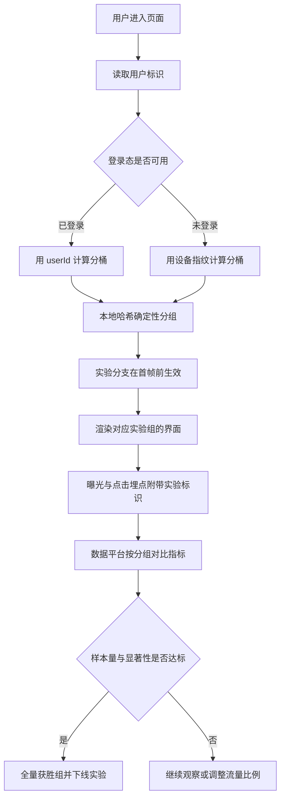

```javascript
// A/B 接入：首帧前确定性分流 + 埋点标识 + 登录身份归一
function getVariant(userId, experiment, ratios = [0.5, 0.5]) {
  let h = 0;
  for (const c of `${experiment}:${userId}`) h = (h * 31 + c.charCodeAt(0)) >>> 0;
  const slot = (h % 10000) / 10000;         // 同一用户永远得到同一结果
  let acc = 0;
  for (let i = 0; i < ratios.length; i++) {
    acc += ratios[i];
    if (slot < acc) return i;
  }
  return ratios.length - 1;
}

// 首帧前执行：head 内联脚本或 SSR 注入，渲染前确定分支，不闪默认样式
const variant = getVariant(userId || getDeviceId(), 'home-redesign-v2');
document.documentElement.dataset.variant = variant;
// CSS 按分支渲染：html[data-variant="1"] .hero { background: url(new-banner.webp); }

// 埋点统一附带实验上下文，供数据平台分组对比
function trackWithExperiment(event, payload) {
  track(event, { ...payload, exp: { key: 'home-redesign-v2', variant } });
}

// 登录后身份归一：匿名分桶与登录分桶做映射上报，保证漏斗连续
onLogin((uid) => trackWithExperiment('ab-identity', { anonId: getDeviceId(), userId: uid }));
```

### SCN-117：无障碍审计发现大量问题，如何排优先级并分阶段落地改造？
**答**：
- 按"影响人群 × 阻断程度"排序：P0 = 键盘不可达（Tab 顺序、focus 管理）与功能性图片无 alt——直接导致功能不可用；P1 = 表单无 label、对比度不足、动态内容无 aria-live 播报；P2 = 装饰性优化。
- 工程化防增量：eslint-plugin-jsx-a11y 进 CI 拦截新增问题，axe-core 自动扫描 + 季度读屏人工抽检。
- 改造任务与业务需求同车排期，按页面渐进推进，不搞一次性专项（永远排不上）。

```jsx
// P0 改造示例：键盘可达 + 语义化 + focus 管理
function Modal({ open, onClose, title, children }) {
  const ref = useRef(null);
  useEffect(() => {
    if (!open) return;
    ref.current?.querySelector('button')?.focus();   // 打开时焦点进入弹窗
    const onKey = (e) => {
      if (e.key === 'Escape') onClose();
      if (e.key === 'Tab') trapFocus(e, ref.current); // Tab 循环困在弹窗内
    };
    document.addEventListener('keydown', onKey);
    return () => document.removeEventListener('keydown', onKey);
  }, [open]);

  return (
    <div ref={ref} role="dialog" aria-modal="true" aria-label={title} hidden={!open}>
      {children}
      <button onClick={onClose}>关闭</button>
    </div>
  );
}

// P1：异步结果必须 aria-live 播报，读屏用户才能感知
// <div aria-live="polite">{submitMessage}</div>

// CI 防线：eslint-plugin-jsx-a11y 拦截新增问题
// npx eslint src --ext .jsx --plugin jsx-a11y --rule '{ "jsx-a11y/alt-text": "error" }'
```

### SCN-118：多语言切换时页面文字瞬闪（先中文后英文），且部分文案翻译缺失，如何处理？
**答**：
- 瞬闪根因：语言包异步加载完成前先用默认语言渲染。方案：语言包与首屏资源并行预载、入口 await 语言包就绪后再 mount；SSR 场景按 Accept-Language/cookie 同源输出。
- 缓存：语言包按版本存 localStorage（内容变更提升版本号天然失效），并清理旧版本防膨胀。
- 缺 key 兜底回退链：当前语言 → 默认语言 → key 本身，缺失 key 上报翻译平台，让遗漏可被发现。

```javascript
// i18n 增强：语言包预载 + 版本缓存 + 缺失回退上报
const LANG_VER = 'v7';   // 语言包内容变更时提升，天然失效旧缓存

async function loadLocale(lang) {
  const cacheKey = `i18n:${lang}:${LANG_VER}`;
  const cached = localStorage.getItem(cacheKey);
  if (cached) return JSON.parse(cached);
  const dict = await fetch(`/locales/${lang}.${LANG_VER}.json`).then((r) => r.json());
  localStorage.setItem(cacheKey, JSON.stringify(dict));
  // 清理旧版本缓存，防 localStorage 膨胀
  Object.keys(localStorage)
    .filter((k) => k.startsWith(`i18n:${lang}:`) && k !== cacheKey)
    .forEach((k) => localStorage.removeItem(k));
  return dict;
}

// 首屏无瞬闪：入口先载语言包，再 mount 应用
const lang = navigator.language.startsWith('zh') ? 'zh-CN' : 'en';
i18n.addResourceBundle(lang, 'translation', await loadLocale(lang));
app.mount('#app');

// 缺 key 回退链 + 上报：翻译遗漏可发现
function t(key) {
  const val = i18n.t(key, { lng: lang });
  if (val === key && lang !== 'en') {
    report({ type: 'i18n-missing', key, lang });   // 上报缺失 key 给翻译平台
    return i18n.t(key, { lng: 'en' });             // 回退默认语言而不是裸 key
  }
  return val;
}
```

### SCN-119：骨架屏与真实内容高度不一致，数据到达时页面跳动（CLS 高），如何对齐？
**答**：
- 骨架屏的本质是"真实内容的等高预测"：骨架与真实卡片共用同一套布局 class（头像/标题/行高一致），文本行数用 line-clamp 固定，高度就可预测。
- 设计期约定内容档位（标题 1 行、摘要 2 行），列表骨架行数与分页 size 一致；数据替换发生在同一位置，零位移。
- 上线后用 CLS 指标验证（目标 < 0.1），而不是肉眼判断。

```vue
<!-- 骨架屏与真实卡片共用尺寸系统，消除内容替换时的跳动 -->
<template>
  <!-- 真实卡片：行数固定，高度可预测 -->
  <div v-if="!loading" class="card">
    
    <div class="title clamp-1">{{ item.title }}</div>
    <div class="desc clamp-2">{{ item.desc }}</div>
  </div>
  <!-- 骨架屏：与真实卡片同一套 class，只替换内容为占位 -->
  <div v-else class="card" aria-hidden="true">
    <div class="avatar skeleton" />
    <div class="title clamp-1 skeleton" />
    <div class="desc clamp-2 skeleton" />
  </div>
</template>

<style>
/* 行数钳制：真实文本与骨架行数一致，高度稳定 */
.clamp-1 { display: -webkit-box; -webkit-line-clamp: 1; -webkit-box-orient: vertical;
  overflow: hidden; height: 22px; }
.clamp-2 { display: -webkit-box; -webkit-line-clamp: 2; -webkit-box-orient: vertical;
  overflow: hidden; height: 44px; }
.avatar { width: 40px; height: 40px; }
.skeleton {
  background: linear-gradient(90deg, #eee 25%, #f5f5f5 50%, #eee 75%);
  background-size: 200% 100%;
  animation: shimmer 1.2s infinite;
  border-radius: 4px;
}
@keyframes shimmer { from { background-position: 200% 0; } to { background-position: -200% 0; } }
</style>
```

### SCN-120：错误页与空态被用户当成"页面坏了"大量客诉，如何建立状态设计规范并落地？
**答**：
- 规范先行：区分四类状态并规定各自要素——空态（说明 + 引导动作"去创建"）、无权限（说明原因 + 找谁开通）、可重试错误（重试按钮 + 错误码）、不可恢复错误（返回首页）。文案句式统一：发生了什么 + 用户能做什么。
- 工程收敛：封装 StatePage 组件四态开箱即用，lint/review 层面禁止业务手写"暂无数据"，保证全站一致。
- 错误态自动带错误码与"重试点击"埋点，客服反馈能直接按错误码归因。

```jsx
// StatePage：四态统一组件，强制团队收敛空态与错误体验
const STATE_CONFIG = {
  empty:     { iconCls: 'icon-empty', action: 'create' },
  forbidden: { iconCls: 'icon-lock',  action: null, fallbackDesc: '请联系管理员开通权限' },
  error:     { iconCls: 'icon-warn',  action: 'retry' },
  fatal:     { iconCls: 'icon-tools', action: 'home' },
};

function StatePage({ type = 'empty', title, desc, onRetry, onCreate, children }) {
  if (type === 'none') return children;      // 正常态直接渲染内容
  const cfg = STATE_CONFIG[type];
  const actions = {
    create: { text: '去创建', onClick: onCreate },
    retry:  { text: '重试', onClick: onRetry },
    home:   { text: '返回首页', onClick: () => (location.href = '/') },
  };
  const action = cfg.action ? actions[cfg.action] : null;
  return (
    <div className="state-page">
      <span className={cfg.iconCls} aria-hidden="true" />
      <h3>{title}</h3>
      <p>{cfg.fallbackDesc ?? desc}</p>
      {action && <button onClick={action.onClick}>{action.text}</button>}
    </div>
  );
}

// 使用：接口失败自动落到可重试态，错误码埋点方便归因
const { data, error, refetch } = useQuery(['list'], api.getList);
if (error) {
  return <StatePage type="error" title="加载失败" desc={`错误码 ${error.code}`}
    onRetry={() => { track('error-retry', { code: error.code }); refetch(); }} />;
}
if (!data?.length) {
  return <StatePage type="empty" title="还没有订单" onCreate={() => nav('/create')} />;
}
```

## 二十二、移动端与跨端

### SCN-121：App 内 H5 离线包上线后部分用户未命中、仍在走网络，如何排查？
**答**：
- 命中链路分四环逐一排查：请求拦截是否注册并覆盖该域名 → 包是否下载完成且版本比对通过 → URL 匹配规则是否覆盖（hash 路由、query、大小写差异）→ 完整性校验（manifest md5）是否通过。
- 常见根因：包未下载完用户就进了页面（需要等待或回退网络）、版本号比对逻辑对灰度包不生效。
- 前端埋点上报命中状态与未命中明细（区分原因），让"命中率"变成可观测指标，按 App 版本下钻定位。

```javascript
// 离线包命中上报：区分未命中原因，定位问题环节
window.addEventListener('load', () => {
  const entries = performance.getEntriesByType('resource');
  const checks = entries
    .filter((e) => /\.(js|css)(\?|$)/.test(e.name))
    .map((e) => ({
      url: e.name,
      // App 拦截器返回本地文件时 transferSize 为 0 且有实际内容
      hit: e.transferSize === 0 && e.decodedBodySize > 0,
      size: e.decodedBodySize,
    }));
  const hitRate = checks.filter((c) => c.hit).length / (checks.length || 1);

  report({
    type: 'offline-package',
    hitRate,
    appVersion: window.NativeBridge?.getVersion(),     // 区分 App 版本兼容问题
    packageVersion: window.__OFFLINE_PKG__?.version,   // 离线包管理器注入
    misses: checks.filter((c) => !c.hit).slice(0, 10), // 未命中明细供逐条归因
  });
});
```

### SCN-122：小程序首页打开要 4 秒，如何围绕分包机制做加载优化？
**答**：
- 主包瘦身：主包只留首屏页面，其余页面、组件库、大图片全部移入分包（主包 2M 硬限制）；静态资源上 CDN。
- 分包预下载：用户停留主包时用 preloadRule 预拉即将进入的分包，点击时分包已就绪；非登录落地页用独立分包，跳过主包启动流程。
- 辅以冷启动预请求：App onLaunch 阶段并行发起首页数据请求，与分包加载重叠执行。

```json
{
  "pages": ["pages/index/index"],
  "subpackages": [
    {
      "root": "pkgOrder",
      "pages": ["pages/list/list", "pages/detail/detail"]
    },
    {
      "root": "pkgActivity",
      "pages": ["pages/landing/landing"],
      "independent": true
    }
  ],
  "preloadRule": {
    "pages/index/index": {
      "network": "all",
      "packages": ["pkgOrder"]
    },
    "pkgOrder/pages/list/list": {
      "network": "wifi",
      "packages": ["pkgActivity"]
    }
  }
}
```

### SCN-123：运营落地页要求"点击按钮唤起 App"，未安装跳应用商店，如何设计唤起与兜底？
**答**：
- 按优先级选通道：iOS 首选 Universal Link（系统级分发、无确认弹窗、未安装自动回退网页）；Android 用 Intent URL（可携带 fallback_url，部分机型免确认）；scheme 覆盖老版本但无法感知是否安装成功。
- scheme 兜底逻辑：触发 scheme 后用 visibilitychange + 计时器（2.5 秒）判定——页面未离开视为唤起失败，跳转应用商店。
- 唤起结果打点（成功/失败/跳商店），持续优化跳转策略与文案。

```javascript
// H5 唤起 App：scheme 尝试 + 超时兜底商店，Universal Link 直接导航
const SCHEME = 'myapp://detail?id=1001';
const STORE = 'https://app.example.com/download';
const isIOS = /iphone|ipad/i.test(navigator.userAgent);
const isAndroid = /android/i.test(navigator.userAgent);

function openApp() {
  if (isIOS && supportsUniversalLink()) {
    // Universal Link：未安装自动回退网页，体验最佳
    location.href = 'https://app.example.com/detail?id=1001';
    return;
  }
  const start = Date.now();
  let left = false;
  document.addEventListener('visibilitychange', () => { if (document.hidden) left = true; });

  if (isAndroid) {
    // intent 协议：未安装时由系统直接走 fallback_url
    location.href = `intent://detail?id=1001#Intent;scheme=myapp;`
      + `package=com.example.app;S.browser_fallback_url=${encodeURIComponent(STORE)};end`;
  } else {
    location.href = SCHEME;
  }
  // 兜底：2.5 秒仍未离开页面说明唤起失败
  setTimeout(() => {
    if (!left && !document.hidden) {
      location.href = STORE;
      track('app-launch-fallback', { cost: Date.now() - start });
    }
  }, 2500);
}

function supportsUniversalLink() {
  // iOS 9.3+ 且 App 已配置 apple-app-site-association 才支持
  const m = navigator.userAgent.match(/OS (\d+)_/);
  return !!m && +m[1] >= 9;
}
```

### SCN-124：H5 页面要与 App 的 JSBridge 通信，但线上有 5 个 App 版本接口行为不一致，如何做兼容层？
**答**：
- 建 BridgeAdapter 适配层：按"能力探测"注册（WKWebView messageHandlers / Android addJavascriptInterface / scheme 拦截），而不是按版本号写 if-else——版本会越积越多，能力不会。
- App 注入能力矩阵（bridge capabilities），调用前协商：旧版不支持的方法走前端 fallback（如 setTitle 不支持就用 document.title + 前端 UI）。
- 所有调用 promise 化 + 回调超时，防止原生侧不回调导致业务挂起。

```javascript
// JSBridge 适配器：按能力探测而非按版本写 if-else
class BridgeAdapter {
  handlers = new Map();

  constructor() {
    // 三种宿主探测：WKWebView / Android addJavascriptInterface / scheme
    if (window.webkit?.messageHandlers) this.native = window.webkit.messageHandlers.bridge;
    else if (window.NativeInterface) this.native = window.NativeInterface;
    this.capabilities = window.__BRIDGE_INFO__?.capabilities ?? {};   // App 注入能力矩阵
  }

  call(method, params = {}, { timeout = 5000 } = {}) {
    // 能力协商：旧版 App 不支持的方法走前端 fallback
    if (this.capabilities[method] === false) return this.fallback(method, params);
    const id = crypto.randomUUID();
    return new Promise((resolve, reject) => {
      const timer = setTimeout(() => reject(new Error(`bridge timeout: ${method}`)), timeout);
      this.handlers.set(id, (result) => { clearTimeout(timer); resolve(result); });
      this.native
        ? this.native.postMessage(JSON.stringify({ id, method, params }))
        : this.schemeCall({ id, method, params });
    });
  }
  // 原生回调统一入口
  onNativeMessage({ id, result }) {
    this.handlers.get(id)?.(result);
    this.handlers.delete(id);
  }
  schemeCall(payload) {
    const iframe = document.createElement('iframe');
    iframe.style.display = 'none';
    iframe.src = `myapp://bridge?payload=${encodeURIComponent(JSON.stringify(payload))}`;
    document.body.appendChild(iframe);
    setTimeout(() => iframe.remove(), 100);
  }
  fallback(method, params) {
    // 例：旧版不支持原生 setTitle，前端用 document.title 兜底
    if (method === 'setTitle') document.title = params.title;
    return Promise.resolve({ degraded: true });
  }
}
```

### SCN-125：直播页要求低延迟观看（3 秒内），前端技术选型与降级方案是什么？
**答**：
- 协议按延迟/成本权衡：HLS（6-30s，兼容最好）、LL-HLS（2-5s，需服务端改造）、HTTP-FLV over MSE（2-5s，国内直播常用）、WebRTC（<1s，需 SFU 成本高）。常规选型：mpegts/flv.js 为主，iOS Safari 原生 HLS 兜底。
- 前端核心是"延迟追帧"：缓冲积压时自动倍速追赶，把延迟压在目标值内；关闭播放器内部 stash 缓冲降低固有延迟。
- 打点延迟与卡顿率两大指标（延迟 = 墙钟 - 播放进度），超标报警驱动选型迭代。

```javascript
// 低延迟播放器：mpegts/flv 主方案 + 延迟追帧 + 协议降级
async function createLivePlayer(el, streams) {
  // 优先 flv（延迟 2-5s），不支持 MSE 降级 HLS（延迟高但兼容）
  if (window.mpegts?.isSupported()) {
    const player = mpegts.createPlayer(
      { type: 'flv', url: streams.flv, isLive: true },
      {
        liveBufferLatencyChasing: true,   // 追帧：缓冲积压时自动倍速追赶
        liveBufferLatencyMaxLatency: 3,   // 目标最大延迟 3s
        liveBufferLatencyMinRemain: 0.5,
        enableStashBuffer: false,         // 关闭内部缓冲，降低固有延迟
      }
    );
    player.attachMediaElement(el);
    player.load();

    // 延迟与卡顿打点：直播页核心指标
    el.addEventListener('timeupdate', () => {
      const latency = player.getLiveLatency?.() ?? estimateLatency(el);
      if (latency > 5) report({ type: 'live-high-latency', latency });
    });
    el.addEventListener('waiting', () => report({ type: 'live-stall' }));
    return player;
  }
  // 降级路径：iOS Safari 原生 HLS
  el.src = streams.hls;
  return null;
}

// 延迟估算兜底：墙钟与播放进度的差值
function estimateLatency(video) {
  return (Date.now() - window.__STREAM_START_TS__) / 1000 - video.currentTime;
}
```

## 二十三、电商与交易场景

### SCN-126：大促下单如何用前端配合后端防超卖？
**答**：
- 超卖的根因在后端扣减，前端职责是"减少无效请求 + 保证用户只发一次"：按钮锁（状态机 idle/submitting/polling）防连击与重复提交。
- 提交前做库存预检，提前拦截必然失败的请求；预检通过后真正下单，以服务端扣减结果为准。
- 排队削峰场景下，下单接口返回"受理中"，前端轮询最终结果，避免用户看到中间态乱点。
- 所有分支都要解锁按钮并给出明确文案，失败时允许重试但复用同一状态机。

```javascript
// 下单状态机：按钮锁 + 库存预检 + 结果轮询
class OrderSubmitGuard {
  state = 'idle'; // idle | submitting | polling
  constructor(skuId) { this.skuId = skuId; }

  async submit(createOrder, { onToast, onGoPay } = {}) {
    if (this.state !== 'idle') return;               // 前端按钮锁：防连击与重复提交
    this.state = 'submitting';
    try {
      const stock = await api.checkStock(this.skuId); // 预检：拦截必败请求，减少大促无效流量
      if (!stock.available) return this.reset(onToast, '已售罄，看看其他商品吧');
      const { orderNo } = await createOrder();        // 真正扣减在服务端，前端预检只是前置过滤
      this.poll(orderNo, onToast, onGoPay);           // 排队削峰：受理成功后轮询终态
    } catch (e) {
      this.reset(onToast, e.code === 'SOLD_OUT' ? '手慢了' : '网络异常，请重试');
    }
  }

  poll(orderNo, onToast, onGoPay, retries = 10) {
    this.state = 'polling';
    const timer = setInterval(async () => {
      try {
        const r = await api.queryOrder(orderNo);
        if (r.status === 'PROCESSING' && --retries > 0) return;
        clearInterval(timer); this.state = 'idle';
        r.status === 'SUCCESS' ? onGoPay(r.payUrl) : onToast('未抢到，再试一次');
      } catch { /* 网络抖动留给下一轮 */ }
    }, 800);
    this._timer = timer;
  }

  reset(onToast, msg) { clearTimeout(this._timer); this.state = 'idle'; onToast?.(msg); }
}
```

### SCN-127：优惠券叠加规则复杂多变，前端如何做一个可配置的校验引擎？
**答**：
- 把"能否叠加"拆成原子规则（互斥、门槛、品类、限次），每条规则是 `test(ctx) -> boolean` 的纯函数，配置化注册而不是 if-else 堆叠。
- 校验通过后做优惠分摊：金额按 SKU 价格占比分摊并处理分位尾差，保证合计精确，这是下单报文必须的。
- 规则文案随规则一起返回，让 UI 能精确提示"为什么不可用"，而不是笼统的"不可用"。
- 规则变更是常态：后端下发规则标识与参数，前端引擎只负责执行，改规则不改代码。

```javascript
// 优惠券叠加校验引擎：规则可配置注册，分摊处理尾差
const RULES = [
  { id: 'exclusive', test: s => s.coupons.filter(c => c.kind === 'cash').length <= 1,
    msg: '现金券一次只能使用一张' },
  { id: 'threshold', test: s => s.coupons.every(c => s.goodsAmount >= c.minSpend),
    msg: '商品总额未达到使用门槛' },
  { id: 'category',  test: s => s.coupons.every(c => !c.categoryIds || c.categoryIds.includes(s.categoryId)),
    msg: '该券不适用于当前品类' },
];
const RULE_MAP = new Map(RULES.map(r => [r.id, r]));

// 服务端只下发规则标识与参数，前端执行引擎不改代码
export function validateCoupons(serverRules, ctx) {
  for (const { id, params } of serverRules) {
    const rule = RULE_MAP.get(id);
    if (rule && !rule.test({ ...ctx, ...params })) return { ok: false, reason: rule.msg };
  }
  return { ok: true, apportion: apportionDiscount(ctx) };
}

// 分摊：按 SKU 价格占比分摊，最后一项吸收尾差保证合计相等
function apportionDiscount({ skus, discount }) {
  const total = skus.reduce((s, k) => s + k.price, 0);
  let left = discount;
  return skus.map((k, i) => {
    if (i === skus.length - 1) return { skuId: k.skuId, cut: left };
    const cut = Math.round((k.price / total) * discount * 100) / 100;
    left = Math.round((left - cut) * 100) / 100;
    return { skuId: k.skuId, cut };
  });
}
```

### SCN-128：拼团页要求多人拼单进度实时刷新，如何设计更新链路？
**答**：
- 优先 WebSocket 推送（拼团频道按 teamId 订阅）；不支持时降级 SSE；两者都不可用退化为指数退避轮询，三条链路收敛到同一个 store 更新入口。
- 推送消息带版本号（自增 seq），前端丢弃乱序旧消息，避免"进度回退"。
- 进度条与"还差 N 人"由 store 派生，单点更新全局生效；满员瞬间要停掉轮询并锁定按钮。
- 页面隐藏（visibilitychange）时暂停订阅，回来时先拉一次快照再恢复订阅，防止缺口。

```javascript
// 拼团进度订阅：WS 优先 -> SSE 兜底 -> 轮询保底，seq 防乱序
class GroupBuySync {
  seq = 0;
  constructor(teamId, store) { this.teamId = teamId; this.store = store; }

  async start() {
    await this.fetchSnapshot();                       // 先快照再订阅，防缺口
    try { await this.openWS(); }
    catch { this.openSSE().catch(() => this.startPolling()); }
  }
  openWS() {
    return new Promise((resolve, reject) => {
      const ws = new WebSocket(`wss://im.example.com/groupbuy/${this.teamId}`);
      ws.onerror = reject;
      ws.onmessage = e => this.apply(JSON.parse(e.data));
      ws.onopen = () => { this.ws = ws; resolve(); };
      this.ws = ws;
    });
  }
  openSSE() {
    return new Promise((resolve, reject) => {
      const es = new EventSource(`/api/groupbuy/${this.teamId}/progress`);
      es.onerror = () => { es.close(); reject(new Error('sse fail')); };
      es.onmessage = e => this.apply(JSON.parse(e.data));
      es.onopen = resolve;
      this.es = es;
    });
  }
  startPolling() {
    this.timer = setInterval(() => this.fetchSnapshot(), 5000); // 保底轮询
  }
  apply(msg) {
    if (msg.seq <= this.seq) return;                  // 丢弃乱序旧消息，防进度回退
    this.seq = msg.seq;
    this.store.set({ joined: msg.joined, need: msg.need, status: msg.status });
    if (msg.status === 'FULL') this.stop();           // 满员停订阅并锁按钮
  }
  stop() { this.ws?.close(); this.es?.close(); clearInterval(this.timer); }
  fetchSnapshot() { return api.getProgress(this.teamId).then(s => this.apply({ ...s, seq: s.seq ?? this.seq + 1 })); }
}
```

### SCN-129：秒杀倒计时如何做到与服务端开抢时刻一致，且开抢瞬间页面不抖动？
**答**：
- 倒计时的时钟基准必须是服务端：进入页面后请求一次时间接口，计算 `offset = serverTime - Date.now()`，之后本地 `serverNow() = Date.now() + offset`，并用 rAF 周期性重校准。
- 秒级渲染只更新文本节点，不重建 DOM；避免每秒 layout 抖动，数字用等宽数字（`font-variant-numeric: tabular-nums`）防止宽度跳变。
- 开抢瞬间是峰值：提前一秒把大区块动画全部停止、禁用重绘，解锁按钮只用 class 切换，并给用户点击加 200~500ms 随机抖动错峰请求。
- 网络慢的用户不能"看到开抢但接口还没开"：以服务端返回的开抢标识为准做二次确认，倒计时只是视觉引导。

```javascript
// 服务端时间校准 + 秒级倒计时 + 开抢瞬间错峰
let timeOffset = 0;
export async function calibrateClock() {
  const t0 = Date.now();
  const { serverTime } = await fetch('/api/time').then(r => r.json());
  const rtt = Date.now() - t0;
  timeOffset = serverTime - t0 - rtt / 2;            // 单向偏移 = 服务端时间 - 本地时间 - 半程 RTT
  // 每分钟用同一接口重校准，抵消本地时钟漂移
  setTimeout(calibrateClock, 60_000);
}
const serverNow = () => Date.now() + timeOffset;

export function runCountdown(endTs, { el, onGo }) {
  let lastSecond = -1;
  const tick = () => {
    const left = Math.max(0, endTs - serverNow());
    const sec = Math.ceil(left / 1000);
    if (sec !== lastSecond) {                        // 秒不变不写 DOM，避免无效重绘
      lastSecond = sec;
      el.textContent = `${String(Math.floor(sec / 60)).padStart(2, '0')}:${String(sec % 60).padStart(2, '0')}`;
      el.style.fontVariantNumeric = 'tabular-nums';  // 等宽数字防宽度抖动
    }
    if (left > 0) return requestAnimationFrame(tick);
    // 开抢瞬间：随机延迟错峰 + 以服务端开抢标识二次确认
    setTimeout(async () => {
      const { started } = await api.checkSeckillStarted();
      started ? onGo() : api.waitStart().then(onGo);
    }, 200 + Math.random() * 300);
  };
  requestAnimationFrame(tick);
}
```

### SCN-130：地址簿省市区街道四级联动，数据量大且要求秒开，怎么做？
**答**：
- 懒加载：首屏只请求省级列表，市/区/街道在用户展开上一级时按需拉取，四级数据一起传会让首屏白白多几百 KB。
- 缓存以父级 code 为 key 缓存 Promise 而不是结果，天然解决并发重复请求（同一级快速展开两次也只发一次）。
- 已选路径回显（编辑模式）时用一次接口按 code 反查整条路径，而不是逐级拉四层。
- 末级（街道）数据量最大，可在用户选到区后再预取街道，把等待藏进交互间隙。

```javascript
// 四级联动懒加载：按父级 code 缓存 Promise，防并发重复请求
const regionCache = new Map();

export function loadRegion(parentCode = '0') {
  if (!regionCache.has(parentCode)) {
    // 缓存 Promise 本身：并发调用复用同一个请求
    regionCache.set(
      parentCode,
      fetch(`/api/regions?parent=${parentCode}`).then(r => {
        if (!r.ok) throw new Error('region load failed');
        return r.json();
      }).catch(e => { regionCache.delete(parentCode); throw e; }) // 失败不缓存，允许重试
    );
  }
  return regionCache.get(parentCode);
}

// 编辑地址：按已存 code 一次性反查路径，避免逐级拉取四层
export async function restoreRegionPath([province, city, district, street]) {
  return api.getRegionPath({ codes: [province, city, district, street] });
}

// 预取：用户选到"区"后，在后台悄悄拉街道，点开瞬间已就绪
export function prefetchStreets(districtCode) {
  loadRegion(districtCode).catch(() => {});
}
```

### SCN-131：订单详情页的状态时间轴，如何设计成状态机驱动而不是写死模板？
**答**：
- 时间轴本质是"状态序列 + 当前位置"：定义节点顺序（提交→付款→发货→收货→完成），由订单当前 status 定位 activeIndex，之前的节点 done、之后的 todo。
- 取消/退款这类"旁路状态"作为额外节点挂在对应位置后（如付款后可出现"已取消"），由后端 statusHistory 决定是否展示，前端不猜测。
- 每个节点的时间与描述来自 statusHistory，而不是前端按 status 编故事，保证与后端口径一致。
- 新增状态（如"部分发货"）只需在配置数组加节点，不改渲染逻辑。

```javascript
// 状态机驱动的时间轴：配置数组 + statusHistory 渲染
const TIMELINE_NODES = [
  { key: 'CREATED',  label: '提交订单' },
  { key: 'PAID',     label: '付款成功' },
  { key: 'SHIPPED',  label: '商品发货' },
  { key: 'RECEIVED', label: '确认收货' },
  { key: 'DONE',     label: '交易完成' },
];
// 旁路节点：只在出现过时插入，位置由 after 指定
const BRANCH_NODES = [
  { key: 'CANCELLED',  label: '订单已取消', after: 'CREATED' },
  { key: 'REFUNDING',  label: '退款中',     after: 'PAID' },
];

export function buildTimeline(order) {
  const history = new Map(order.statusHistory.map(h => [h.status, h]));
  // 组装展示序列：主链节点 + 出现过的旁路节点按 after 插入
  const nodes = [];
  for (const n of TIMELINE_NODES) {
    for (const b of BRANCH_NODES) {
      if (b.after === n.key && history.has(b.key)) nodes.push(b);
    }
    nodes.push(n);
    if (order.status === n.key) break;                 // 当前状态之后的节点不展示
  }
  const activeIndex = nodes.length - 1;
  return nodes.map((n, i) => ({
    ...n,
    time: history.get(n.key)?.createdAt,
    desc: history.get(n.key)?.desc,
    state: i < activeIndex ? 'done' : i === activeIndex ? 'active' : 'todo',
  }));
}
```

### SCN-132：收银台支持微信、支付宝、银行卡多渠道，跳转第三方后回跳如何保证不丢单？
**答**：
- 跳转前把 `orderNo + channel + 发起时间` 写入 sessionStorage，回跳落地页先恢复现场再谈其他。
- 回跳后状态未知：立即轮询订单状态，而不是相信 URL 参数；成功去结果页，处理中继续轮询，失败才允许重新支付（换渠道前先调关单接口防止两个渠道都付成功）。
- 兜底：轮询超时给"支付遇到问题？查看订单/联系客服"出口，并把"我已支付"按钮做成强校验入口。
- 渠道切换要防并发：A 渠道未关单就切 B，是丢单与双扣的主要来源。

支付回跳状态机：

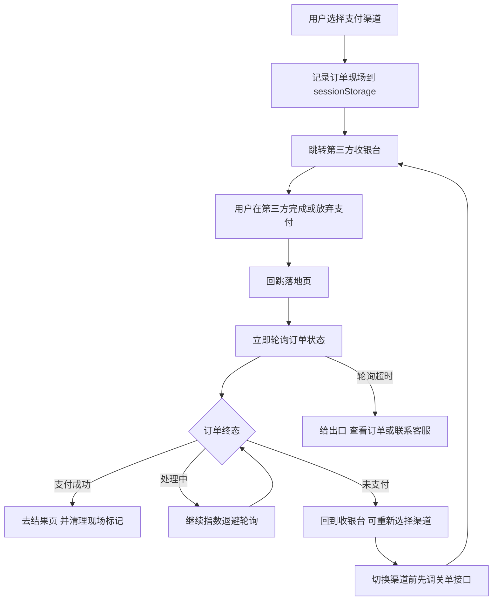

```javascript
// 收银台回跳恢复：现场标记 + 轮询裁决 + 换渠道先关单
const PAY_FLAG = 'pay_ctx';
export function startPay(orderNo, channel) {
  sessionStorage.setItem(PAY_FLAG, JSON.stringify({ orderNo, channel, ts: Date.now() }));
  location.href = api.getPayUrl(orderNo, channel);      // 微信/支付宝跳第三方
}

export async function resumeAfterPay() {
  const ctx = JSON.parse(sessionStorage.getItem(PAY_FLAG) ?? 'null');
  if (!ctx) return renderCashierPage();                 // 正常进收银台
  // 回跳后不信 URL，轮询订单状态裁决
  const status = await pollOrder(ctx.orderNo, { timeout: 15_000, interval: 1_000 });
  if (status === 'PAID') { sessionStorage.removeItem(PAY_FLAG); location.href = '/pay/success'; }
  else if (status === 'UNPAID') renderCashierPage({ resumeOrder: ctx.orderNo });
}

export async function switchChannel(orderNo, nextChannel) {
  await api.closePay(orderNo);                          // 关掉旧渠道支付单，防双扣
  startPay(orderNo, nextChannel);
}

async function pollOrder(orderNo, { timeout, interval }) {
  const deadline = Date.now() + timeout;
  while (Date.now() < deadline) {
    const { status } = await api.queryOrderStatus(orderNo);
    if (status !== 'PAYING') return status;             // PAID / UNPAID / CLOSED
    await new Promise(r => setTimeout(r, interval));
  }
  return 'TIMEOUT';                                     // 超时给查看订单/客服出口
}
```

### SCN-133：售后入口要支持退款、换货、维修三种流程，表单字段差异大，如何实现？
**答**：
- 用"类型 → schema"的映射替代三套页面：每种售后类型声明字段列表（name/type/校验/联动），一个渲染器统一消费。
- 类型间共享部分（图片凭证、联系方式）抽公共字段组，schema 里复用引用，避免复制三份。
- 联动规则也进 schema：如退款金额上限 = 可退金额、换货可选 SKU 过滤同款，由渲染器根据 depends/maxFrom 解析。
- 后端新增售后类型（如"价保"）时前端只加一份 schema，渲染器零改动。

```jsx
// 售后多态表单：schema 驱动，一个渲染器支持退款/换货/维修
const AFTER_SALE_SCHEMAS = {
  refund: [
    { name: 'reason',   type: 'select',   required: true, options: 'refundReasons' },
    { name: 'amount',   type: 'money',    required: true, maxFrom: ctx => ctx.order.refundable },
    { name: 'channel',  type: 'select',   options: 'refundChannels', default: 'original' },
  ],
  exchange: [
    { name: 'reason',   type: 'select',   required: true, options: 'refundReasons' },
    { name: 'swapSkuId', type: 'skuPicker', required: true,
      filter: ctx => sku => sku.spuId === ctx.order.spuId }, // 换货只能选同款其他规格
  ],
  repair: [
    { name: 'desc',     type: 'textarea', required: true, maxLength: 200 },
    { name: 'images',   type: 'uploader', required: true, max: 6, tip: '请拍清楚故障位置' },
  ],
};
// 三类共用的公共字段组
const COMMON_FIELDS = [
  { name: 'contact', type: 'tel', required: true },
];

export function AfterSaleForm({ type, order, sdk }) {
  const ctx = { order, sdk };
  const fields = [...AFTER_SALE_SCHEMAS[type], ...COMMON_FIELDS];
  return (
    <Form initialValues={pickDefaults(fields)}>
      {fields.map(f => (
        <Form.Item key={f.name} name={f.name} label={f.label}
          rules={[{ required: f.required, message: `请填写${f.label ?? f.name}` }]}>
          {renderField(f, ctx)}
        </Form.Item>
      ))}
    </Form>
  );
}

function renderField(f, ctx) {
  const comps = {
    select: () => <Select options={sdk.options(f.options)} />,
    money: () => <InputNumber min={0.01} max={f.maxFrom?.(ctx)} precision={2} />,
    skuPicker: () => <SkuPicker skus={ctx.order.skus.filter(f.filter(ctx))} />,
    textarea: () => <Input.TextArea maxLength={f.maxLength} />,
    uploader: () => <ImageUploader max={f.max} />,
    tel: () => <Input type="tel" />,
  };
  return comps[f.type]?.() ?? <Input />;
}
```

### SCN-134：大促期间购物车本地数据与服务端数据冲突（离线加购、多端编辑），合并策略是什么？
**答**：
- 分清两种车：本地车（弱网/未登录可用）与服务端车（登录后为准）；登录瞬间触发合并，按 skuId 归并。
- 冲突规则要明确：同一 SKU 两边都有时数量取大（加购是"想要更多"语义）、勾选状态以服务端为准、删除优先级最高（本地删过就不再出现）。
- 合并必须幂等：合并请求带本地车版本号，服务端以版本号判断是否重复提交，重复则直接返回已合并结果。
- 合并过程中购物车页展示 loading 态并禁止结算，完成后一次性刷新，避免出现"中间态金额"。

```javascript
// 购物车合并：本地车 + 服务端车按 skuId 归并，幂等提交
export async function mergeCart(localCart, { localVersion }) {
  const remote = await api.getCart();
  const remoteMap = new Map(remote.items.map(i => [i.skuId, i]));

  const merged = new Map(remoteMap);
  for (const l of localCart.items) {
    const r = merged.get(l.skuId);
    if (l.deleted) { merged.delete(l.skuId); continue; }   // 本地删除优先
    if (!r) merged.set(l.skuId, { ...l, from: 'local' });
    else merged.set(l.skuId, {
      ...r,
      quantity: Math.max(r.quantity, l.quantity),          // 数量取大：加购语义
      checked: r.checked,                                  // 勾选状态以服务端为准
    });
  }
  const payload = { localVersion, items: [...merged.values()] };
  // 幂等：携带本地版本号，服务端对重复合并直接返回缓存结果
  return api.mergeCart(payload);
}

// 本地车存储：读写都带版本号，用于幂等与冲突检测
export const cartStorage = {
  key: 'cart:v1',
  load() { try { return JSON.parse(localStorage.getItem(this.key)) ?? { version: 0, items: [] }; } catch { return { version: 0, items: [] }; } },
  save(cart) { localStorage.setItem(this.key, JSON.stringify({ ...cart, version: cart.version + 1 })); },
  clear() { localStorage.removeItem(this.key); },
};

```

## 二十四、内容与社区场景

### SCN-135：无限信息流刷到几百条后切走再回来，如何恢复到原阅读位置？
**答**：
- 不能靠 scrollTop 恢复：内容是分页拉的，直接滚回去下面可能是空白或错位。正确做法是记录"锚点"：首条可见 item 的 id + 它相对视口的偏移。
- 恢复时用锚点向服务端请求"锚点前后各 N 条"的窗口内容，渲染后找到锚点元素，把它滚回记录的偏移位置。
- 配合虚拟列表时锚点即列表索引 + offset；不配合时用 `anchorId` 定位 DOM。锚点丢失（内容被删）则回退到最新一页。
- 位置持久化到 sessionStorage，跨页面跳转（点进详情再返回）也能恢复。

```javascript
// 信息流位置恢复：锚点记录 + 窗口拉取 + 偏移还原
export function saveAnchor(container, feedKey) {
  const items = container.querySelectorAll('[data-feed-id]');
  for (const el of items) {
    const { top, bottom } = el.getBoundingClientRect();
    if (top <= 0 && bottom > 0) {                      // 第一条跨越视口顶部的元素即锚点
      sessionStorage.setItem(feedKey, JSON.stringify({
        anchorId: el.dataset.feedId,
        offset: -top,                                  // 锚点顶部相对视口顶部的偏移
      }));
      return;
    }
  }
}

export async function restoreAnchor(container, feedKey) {
  const saved = JSON.parse(sessionStorage.getItem(feedKey) ?? 'null');
  if (!saved) return loadLatestPage(container);
  // 以锚点为中心请求窗口内容，而不是从第一页重放
  const list = await api.getFeedWindow({ anchorId: saved.anchorId, before: 10, after: 10 });
  if (!list.length) return loadLatestPage(container);  // 锚点内容被删则回退最新
  renderFeed(container, list);
  const el = container.querySelector(`[data-feed-id="${saved.anchorId}"]`);
  if (el) container.scrollTop += el.getBoundingClientRect().top - saved.offset;
  else container.scrollTop = 0;
}

// 离开页面时自动保存：详情页返回后可恢复
export function useFeedAnchorRestore(containerRef, feedKey) {
  document.addEventListener('visibilitychange', () => {
    if (document.visibilityState === 'hidden') saveAnchor(containerRef.current, feedKey);
  });
}
```

### SCN-136：热门内容点赞 QPS 很高，点赞动画与数字更新如何不把页面拖垮？
**答**：
- 用户反馈要即时：点击瞬间本地 +1 并播放动画（一次性 CSS animation，不用 JS 逐帧），不等接口。
- 数字更新防抖：同一内容 800ms 内的多次点赞（自己点 + 收到的实时推送）合并渲染一次，避免数字疯狂跳动。
- 请求聚合：窗口内的点赞批量上报（数量 + 是否取消合并为净增量），服务端聚合扣减，把 QPS 压下来。
- 乐观更新要能回滚：批量上报失败时回退数字并静默重试一次，不打断用户浏览。

```javascript
// 点赞：即时动画 + 数字防抖聚合 + 批量上报可回滚
class LikeAggregator {
  pending = new Map();                                 // contentId -> 净增量
  shown = new Map();                                   // contentId -> 正在展示的数字
  constructor(flushInterval = 800) { this.flushInterval = flushInterval; }

  like(contentId, baseCount) {
    const delta = this.pending.get(contentId) ?? 0;
    this.pending.set(contentId, delta + 1);
    this.playAnim(contentId);                          // 动画立即播，不等网络
    this.scheduleFlush();
    this.scheduleRender(contentId, baseCount);
  }

  scheduleFlush() {
    if (this.timer) return;
    this.timer = setTimeout(async () => {
      this.timer = null;
      if (!this.pending.size) return;
      const batch = [...this.pending];                 // [[id, delta], ...]
      this.pending = new Map();
      try { await api.batchLike(batch); }
      catch {
        batch.forEach(([id, d]) => this.pending.set(id, (this.pending.get(id) ?? 0) + d));
        setTimeout(() => this.scheduleFlush(), 2000);  // 失败回滚进下一窗口静默重试
      }
    }, this.flushInterval);
  }

  scheduleRender(contentId, baseCount) {
    clearTimeout(this.renderTimers?.get(contentId));
    (this.renderTimers ??= new Map()).set(contentId, setTimeout(() => {
      const count = baseCount + [...this.pending].filter(([id]) => id === contentId)
        .reduce((s, [, d]) => s + d, 0);
      this.shown.set(contentId, count);
      updateLikeText(contentId, count);                // 窗口内只渲染一次，数字不跳动
    }, 400));
  }

  playAnim(contentId) {
    const el = document.querySelector(`#like-${contentId} .heart`);
    if (!el) return;
    el.classList.remove('heart-pop');                  // 一次性 CSS animation，无 JS 逐帧
    void el.offsetWidth;                               // 强制 reflow 以重启动画
    el.classList.add('heart-pop');
  }
}
```

### SCN-137：评论区"盖楼"嵌套层级很深，渲染与交互怎么设计？
**答**：
- 数据上是树，渲染上扁平化：把楼中楼拍平成带 depth 的列表，避免深层递归组件导致的栈深与复用困难。
- 默认只展示前 2~3 条子评论，"查看全部 N 条回复"懒加载展开，长楼不拖累首屏。
- 折叠状态记录在 commentId 集合中（store），展开/收起只改集合，列表按需重新拼接，不做整树重渲染。
- depth 超过 3 层视觉上压平为"回复 @某人"，控制缩进宽度。

```javascript
// 评论盖楼：树扁平化 + 折叠集合驱动渲染
export function flattenComments(roots, collapsed) {
  const out = [];
  const walk = (list, depth, rootId) => {
    list.forEach((c, i) => {
      out.push({ ...c, depth, rootId });
      const isCollapsed = collapsed.has(c.id) ||
        (depth > 0 && collapsed.has(rootId));
      const hidden = depth === 1 && i >= 3 && !expanded.has(c.id); // 默认只露 3 条
      if (hidden) { out.push({ type: 'more', parentId: c.id, total: c.replyCount }); return; }
      if (!isCollapsed) walk(c.replies ?? [], Math.min(depth + 1, 3), rootId);
    });
  };
  const expanded = new Set(roots.flatMap(r => r.expanded ? [r.id] : []));
  walk(roots, 0, null);
  return out;
}

// 折叠状态管理：Set 记录，交互只改集合
export function createCommentStore() {
  const collapsed = new Set();
  return {
    toggle(id) { collapsed.has(id) ? collapsed.delete(id) : collapsed.add(id); },
    isCollapsed: id => collapsed.has(id),
    // 展开"更多回复"：懒加载该楼剩余内容后合并进树
    async loadMore(commentId) {
      const rest = await api.getReplies(commentId, { offset: 3 });
      return rest; // 由上层合并进对应节点的 replies 再触发列表重算
    },
  };
}
```

### SCN-138：正文里 #话题#、[表情]、@用户混排，如何做高亮与跳转而不被正则坑？
**答**：
- 用"词法解析"思路：一条组合正则逐段扫描，产出 token 数组（text/topic/emoji/mention），渲染时 token 映射为对应节点，正则只解析不拼 HTML，天然防 XSS。
- 话题的边界要处理嵌套与转义：`##` 空话题、未闭合的 `#` 都要落回纯文本。
- 跳转用 router 跳转 + 埋点，`@` 用户要校验存在性（后端返回 mention 列表比对），防止伪造 `@` 钓鱼。
- 长文本（评论精选、公告）解析结果按文本 hash 做记忆化，避免滚动列表反复解析。

```javascript
// 词法解析：一次扫描产出 token，渲染层自行映射，防 XSS
const TOKEN_RE = /#([^#\s]{1,30})#|@([\w\u4e00-\u9fa5-]{2,20})|(\[[\u4e00-\u9fa5a-zA-Z]{1,8}\])/gu;

const MENTION_CACHE = new Map();

export function parseRichText(text) {
  const tokens = [];
  let last = 0, m;
  TOKEN_RE.lastIndex = 0;
  while ((m = TOKEN_RE.exec(text))) {
    if (m.index > last) tokens.push({ type: 'text', value: text.slice(last, m.index) });
    if (m[1] !== undefined) tokens.push({ type: 'topic', value: m[1] });        // #话题#
    else if (m[2] !== undefined) tokens.push({ type: 'mention', value: m[2] }); // @用户
    else tokens.push({ type: 'emoji', value: m[3] });                           // [表情]
    last = TOKEN_RE.lastIndex;
  }
  if (last < text.length) tokens.push({ type: 'text', value: text.slice(last) });
  return tokens; // 未闭合的 # 没匹配上，自动落回 text
}

// React 渲染：token 映射节点，跳转走 router，不走 dangerouslySetInnerHTML
export function RichText({ text, mentions }) {
  const valid = mentions ?? MENTION_CACHE.get(text) ?? [];
  return parseRichText(text).map((t, i) => {
    if (t.type === 'topic')
      return <TopicTag key={i} name={t.value} onClick={() => router.push(`/topic/${encodeURIComponent(t.value)}`)} />;
    if (t.type === 'mention') {
      const ok = valid.includes(t.value);              // 校验 @ 的用户真实存在，防伪造钓鱼
      return ok ? <MentionLink key={i} name={t.value} /> : <span key={i}>{`@${t.value}`}</span>;
    }
    if (t.type === 'emoji') return <Emoji key={i} code={t.value} />;
    return <span key={i}>{t.value}</span>;
  });
}
```

### SCN-139：创作者后台的富文本草稿，要求 PC 写一半、手机上能接着写，怎么做多端同步？
**答**：
- 本地先行：每次编辑防抖 2s 写入 IndexedDB（草稿 id 为 key），弱网/未登录也不丢。
- 云端同步带版本：`draft = { content, baseVersion, updatedAt }`，PUT 时带 baseVersion 做乐观锁；冲突时不能默默覆盖——保留两版让用户选。
- 内容用结构化 JSON（而不是 HTML 字符串）同步，多端渲染器各自还原，规避不同端富文本实现的标签差异。
- 网络恢复后统一 flush：监听 online 事件 + 启动时扫描"脏草稿"队列。

```javascript
// 富文本草稿多端同步：IndexedDB 先行 + 乐观锁 + 冲突双版本
const DB_NAME = 'drafts', STORE = 'draft';
const db = indexedDB.open(DB_NAME, 1);
db.onupgradeneeded = e => e.target.result.createObjectStore(STORE, { keyPath: 'id' });

export async function saveLocal(draft) {
  const store = (await db).transaction(STORE, 'readwrite').objectStore(STORE);
  store.put({ ...draft, dirty: true });                // 本地先行，标脏
}

export function debounceSync(draftId, getDraft, wait = 2000) {
  let timer;
  return () => {
    clearTimeout(timer);
    timer = setTimeout(async () => {
      await saveLocal(getDraft());
      try {
        const d = getDraft();
        await api.putDraft(draftId, { content: d.content, baseVersion: d.version }); // 乐观锁
        saveLocal({ ...d, version: d.version + 1, dirty: false });
      } catch (e) {
        if (e.code === 'VERSION_CONFLICT') {           // 冲突：不覆盖，双版本让用户选
          const remote = await api.getDraft(draftId);
          saveConflict(draftId, { mine: getDraft(), theirs: remote });
        }
        // 网络失败保持 dirty，等 online 再 flush
      }
    }, wait);
  };
}

window.addEventListener('online', flushDirtyDrafts);   // 网络恢复统一补交
async function flushDirtyDrafts() {
  const dirty = await listDirtyDrafts();
  dirty.forEach(d => debounceSync(d.id, () => d, 0)());
}

function saveConflict(id, pair) {
  localStorage.setItem(`conflict:${id}`, JSON.stringify(pair));
}
```

### SCN-140：评论区要做敏感词过滤，词库几万条，前端如何做到低延迟？
**答**：
- 逐词 `includes` 是 O(词库×文本)，几万词必卡。用 DFA（trie）把词库建成树，匹配文本时一次扫描 O(文本长度 × 最长词)。
- 词库大、更新频繁，构建放 Worker：主线程零阻塞，词库热更新时重建树再原子替换。
- 前端过滤定位是"第一道闸 + 即时反馈"，命中提示用户修改；发布时后端仍会复核，避免前端词库滞后。
- 常见规避手段（繁体、间隔符、拼音）可用文本归一化先折算再匹配。

```javascript
// 敏感词 DFA：建树放 Worker，主线程只做 O(n) 匹配
// worker.js
let root = null;
self.onmessage = e => {
  if (e.data.type === 'BUILD') {
    root = {};
    for (const raw of e.data.words) {
      const w = normalize(raw);                        // 归一化：全角转半角、去间隔符、繁转简
      if (!w) continue;
      let node = root;
      for (const ch of w) node = node[ch] ??= {};
      node.__end = true;
    }
    self.postMessage({ type: 'READY' });               // 建好后原子替换，主线程无感知
  }
};
function normalize(s) {
  return s.toLowerCase().replace(/[\s·*_.-]/g, '')
    .replace(/[０-９ａ-ｚＡ-Ｚ]/g, c => String.fromCharCode(c.charCodeAt(0) - 0xFEE0));
}

// 主线程：请求 Worker 匹配，文本一次扫描
export class SensitiveFilter {
  ready = false;
  constructor(words) {
    this.worker = new Worker('./worker.js');
    this.worker.postMessage({ type: 'BUILD', words });
    this.worker.onmessage = () => (this.ready = true);
  }
  async check(text) {
    if (!this.ready) return { pass: true, hits: [] };  // 词库未就绪先放行，后端兜底
    return new Promise(resolve => {
      const ch = new MessageChannel();
      this.worker.postMessage({ type: 'CHECK', text }, [ch.port2]);
      ch.port2.onmessage = e => resolve(e.data);
    });
  }
}
// worker 内 CHECK 处理：从每位起沿树走，命中即打码
```

### SCN-141：图片九宫格预览要求双指缩放、双击放大、左右滑动翻页，手势如何实现？
**答**：
- 手势状态机：单指 = 平移/翻页，双指 = 以两指中点为原点缩放，双击 = 1x 与 2.5x 间切换；状态间互斥，避免缩放中出现翻页。
- 缩放用 transform（scale + translate）合成层动画，不用改 width/height；边界回弹用 transition 收尾。
- 翻页判定：scale === 1 且横向位移超阈值才翻页；放大状态下横滑是移动图片，不翻页。
- pointer events 统一鼠标与触摸，`touch-action: none` 阻止浏览器默认手势。

```javascript
// 九宫格预览手势：缩放/平移/双击/翻页状态机
class GridPreview {
  scale = 1; tx = 0; ty = 0;
  index = 0;
  constructor(el) {
    this.el = el;
    el.style.touchAction = 'none';                     // 屏蔽浏览器默认手势
    el.addEventListener('pointerdown', e => this.down(e));
    el.addEventListener('pointermove', e => this.move(e));
    el.addEventListener('pointerup', e => this.up(e));
    el.addEventListener('dblclick', () => this.toggleZoom());
  }
  pointers = new Map();
  down(e) { this.pointers.set(e.pointerId, { x: e.clientX, y: e.clientY }); this.el.setPointerCapture(e.pointerId); }
  move(e) {
    if (!this.pointers.has(e.pointerId)) return;
    const prev = this.pointers.get(e.pointerId);
    this.pointers.set(e.pointerId, { x: e.clientX, y: e.clientY });
    if (this.pointers.size === 2) {                    // 双指：以两指中点为原点缩放
      const [a, b] = [...this.pointers.values()];
      const dist = Math.hypot(a.x - b.x, a.y - b.y);
      if (this.baseDist) this.setScale(this.baseScale * dist / this.baseDist);
      else { this.baseDist = dist; this.baseScale = this.scale; }
    } else if (this.pointers.size === 1) {
      const dx = e.clientX - prev.x, dy = e.clientY - prev.y;
      if (this.scale > 1) { this.tx += dx; this.ty += dy; }  // 放大态拖图片
      else this.dx = (this.dx ?? 0) + dx;              // 1x 态累计横滑
      this.apply();
    }
  }
  up(e) {
    this.pointers.delete(e.pointerId);
    if (this.pointers.size < 2) { this.baseDist = null; }
    if (this.scale === 1 && Math.abs(this.dx ?? 0) > 60) {
      this.dx < 0 ? this.go(1) : this.go(-1);          // 1x 且横滑超阈值才翻页
    }
    this.dx = 0;
  }
  toggleZoom() { this.animateTo(this.scale > 1 ? 1 : 2.5); }
  setScale(s) { this.scale = Math.min(4, Math.max(1, s)); this.apply(); }
  apply() { this.el.style.transform = `translate(${this.tx}px, ${this.ty}px) scale(${this.scale})`; }
  animateTo(s) { this.el.style.transition = 'transform .25s'; this.setScale(s); setTimeout(() => this.el.style.transition = '', 250); }
  go(d) { this.index = Math.max(0, this.index + d); this.reset(); }
  reset() { this.scale = 1; this.tx = this.ty = 0; this.apply(); }
}

```

## 二十五、办公与 B 端场景

### SCN-142：项目管理系统要做甘特图，支持拖拽调整任务时间并实时校验依赖，怎么实现？
**答**：
- 坐标换算与状态分离：条形位置 = 时间 × dayWidth，拖拽时把像素 delta 换算成天数并按 snap（如 0.5 天）取整，落库的是日期而不是像素。
- 性能关键：拖拽中只改当前条 transform，不重排整张表；落点才触发重算与依赖线更新。
- 依赖校验在拖拽时预判：早于前置任务完成时间就吸附到边界并提示，而不是提交后被后端打回。
- 依赖线用 SVG 叠加层画（完成-开始折线），条移动时重算终点坐标。

```javascript
// 甘特图拖拽：像素换算日期 + 依赖吸附 + SVG 依赖线
const DAY_W = 32;                                      // 一天 32px
const pxToDay = px => Math.round((px / DAY_W) * 2) / 2; // 按 0.5 天吸附

export function createGantt(container, tasks, deps) {
  const layer = container.querySelector('.bars');
  const svg = container.querySelector('.dep-svg');

  tasks.forEach(task => {
    const bar = renderBar(task);
    bar.addEventListener('pointerdown', e => startDrag(e, task, bar));
  });

  function startDrag(e, task, bar) {
    const startX = e.clientX;
    const { start: originStart } = task;
    const move = ev => {
      const deltaDay = pxToDay(ev.clientX - startX);
      let next = addDays(originStart, deltaDay);
      // 依赖预判：不能早于所有前置任务的完成日，吸附到边界
      const blockers = deps.filter(d => d.to === task.id).map(d => addDays(getTask(d.from).end, 1));
      const min = blockers.length ? maxDate(...blockers) : null;
      if (min && next < min) next = min;
      bar.style.transform = `translateX(${diffDays(originStart, next) * DAY_W}px)`; // 拖拽中不重排
      bar.dataset.pending = next;
    };
    const up = () => {
      document.removeEventListener('pointermove', move);
      const next = bar.dataset.pending;
      if (next && next !== task.start) commit(task.id, next); // 落点才提交与重算
    };
    document.addEventListener('pointermove', move);
    document.addEventListener('pointerup', up, { once: true });
  }

  function commit(taskId, newStart) {
    api.updateTask(taskId, { start: newStart }).then(() => layoutAll()); // 重算全部条与依赖线
  }

  // 依赖线：SVG 折线 从前置条右边缘 到 后置条左边缘
  function drawDepLine(fromTask, toTask) {
    const x1 = barRight(fromTask), y1 = barMidY(fromTask);
    const x2 = barLeft(toTask),  y2 = barMidY(toTask);
    const mx = (x1 + x2) / 2;
    return `<path d="M${x1} ${y1} H${mx} V${y2} H${x2}" class="dep-line" marker-end="url(#arrow)"/>`;
  }
  svg.innerHTML = deps.map(d => drawDepLine(getTask(d.from), getTask(d.to))).join('');
}
```

### SCN-143：敏捷看板要支持卡片跨列拖拽排序，多人同时操作时如何不乱？
**答**：
- 拖拽拆成状态机：idle → dragging（记录卡片与来源列）→ hovering（目标列 + 插入位置索引）→ committing，状态清晰才能处理好边界（拖回原列、拖出容器取消）。
- 插入位置用"指针相对卡片中点"判定，渲染占位符（不是真的移动卡片），落点才提交 `{ cardId, toColumnId, targetIndex }`。
- 多人并发：后端按列存有序 id 列表并带版本号，提交冲突时以服务端为准做局部重排（FCFS），前端收到推送后只 diff 受影响的列。
- HTML5 DnD 的 dragover 事件在移动端不可用且事件粒度粗，自研 pointer events 更可控。

```javascript
// 看板拖拽状态机：占位符判定插入位置，提交才落库
export function createBoard(el, board, onCommit) {
  let state = { phase: 'idle' };                       // idle | dragging | hovering

  el.addEventListener('pointerdown', e => {
    const card = e.target.closest('.card');
    if (!card) return;
    state = { phase: 'dragging', cardId: card.dataset.id, from: card.dataset.columnId };
    card.classList.add('dragging');
  });

  el.addEventListener('pointermove', e => {
    if (state.phase !== 'dragging' && state.phase !== 'hovering') return;
    const col = e.target.closest('.column');
    if (!col) { clearPlaceholder(); state.phase = 'dragging'; return; }
    const cards = [...col.querySelectorAll('.card:not(.dragging)')];
    // 指针在卡片上半部插到它前面，下半部插到后面
    let index = cards.findIndex(c => e.clientY < c.getBoundingClientRect().top + c.offsetHeight / 2);
    if (index === -1) index = cards.length;
    state = { ...state, phase: 'hovering', to: col.dataset.columnId, index };
    movePlaceholder(col, index);
  });

  el.addEventListener('pointerup', () => {
    if (state.phase !== 'hovering') return cancelDrag();
    const { cardId, from, to, index } = state;
    cancelDrag();
    if (from === to && index === board.indexOf(cardId, from)) return; // 原位不动
    // 提交目标位置索引，服务端重排列并广播版本号
    onCommit({ cardId, fromColumnId: from, toColumnId: to, targetIndex: index });
  });

  // 多人同步：收到推送后只重排受影响的列
  socket.on('board.moved', ({ columnId, cardIds, version }) => {
    if (version <= board.version) return;              // 丢弃旧版本推送
    board.version = version;
    board.setColumns(columnId, cardIds);               // 局部 diff，不整板重渲染
  });
}
```

### SCN-144：报表需求是多级表头（地区 > 省份）加同列值合并单元格，如何渲染？
**答**：
- 多级表头用"列配置树"：递归计算每个表头单元格的 colSpan（叶子数）与 rowSpan（叶子到最深层的距离），表头自然成型，配置改层级不用改渲染器。
- 数据区合并：对指定列做"相邻同值合并"，逐列扫描计算 rowSpan，首个单元格设 rowSpan，后续隐藏。
- 合并会让行选择、hover 跟随变复杂：交互按"逻辑行"处理，视觉合并只是展示层。
- 导出 Excel 时同一份配置树映射为 merges 区域，前后口径一致。

```javascript
// 多级表头 colSpan/rowSpan 计算 + 相邻同值合并
export function measureHead(columns) {
  const maxDepth = depthOf(columns);
  const measure = (col, level) => {
    if (!col.children?.length) {                       // 叶子：撑到最底层
      col.rowSpan = maxDepth - level;
      col.colSpan = 1;
      return 1;
    }
    col.rowSpan = 1;                                   // 分组头：横向占满所有叶子
    return (col.colSpan = col.children.reduce((s, c) => s + measure(c, level + 1), 0));
  };
  columns.forEach(c => measure(c, 0));
  return maxDepth;
}
function depthOf(cols) {
  return cols.some(c => c.children) ? 1 + Math.max(...cols.map(c => c.children ? depthOf(c.children) : 0)) : 1;
}

// 数据区：指定列相邻同值合并，返回 rowSpan 映射
export function computeMerges(rows, mergeKeys) {
  const spanMap = new Map();                           // rowIndex -> { key: span }
  for (const key of mergeKeys) {
    let i = 0;
    while (i < rows.length) {
      let span = 1;
      while (i + span < rows.length && rows[i + span][key] === rows[i][key]) span++;
      spanMap.set(i, { ...(spanMap.get(i) ?? {}), [key]: span });
      for (let k = 1; k < span; k++) spanMap.set(i + k, { ...(spanMap.get(i + k) ?? {}), [key]: 0 }); // 0 表示被合并隐藏
      i += span;
    }
  }
  return spanMap;
}

// 渲染：tbody 行内按 spanMap 输出 rowSpan
export function renderBody(rows, leafColumns, spanMap) {
  return rows.map((row, i) => (
    <tr key={i} data-row={i}>
      {leafColumns.map(col => {
        const span = spanMap.get(i)?.[col.key];
        if (span === 0) return null;                   // 被上方合并吸收
        return <td key={col.key} rowSpan={span || 1}>{row[col.key]}</td>;
      })}
    </tr>
  ));
}
```

### SCN-145：B 端表格要求"Excel 式"行内编辑：方向键移动、Enter 确认换行进下一格、Esc 还原，怎么实现？
**答**：
- 维护一个焦点坐标 `[rowIndex, colIndex]` 与编辑态，全局 keydown 按 Excel 语义分发：方向键移动、Enter 提交并下移、Tab 横移、Esc 还原、双击或直接输入进入编辑。
- 校验失败阻止移动并标红单元格，保证"错误数据不离开当前格"。
- 大表配合虚拟滚动：滚动后按记录的坐标重新聚焦对应单元格（数据坐标而非 DOM 索引）。
- 编辑控件按列类型分发（文本/数字/日期/选择器），Tab 键默认行为要 preventDefault。

```jsx
// 行内编辑：焦点坐标 + Excel 语义键盘分发
export function EditableGrid({ rows, columns, onCellCommit }) {
  const [pos, setPos] = useState({ r: 0, c: 0 });
  const [editing, setEditing] = useState(false);
  const gridRef = useRef();

  const move = (dr, dc) => setPos(p => ({
    r: Math.min(rows.length - 1, Math.max(0, p.r + dr)),
    c: Math.min(columns.length - 1, Math.max(0, p.c + dc)),
  }));

  const onKeyDown = e => {
    if (editing) {
      if (e.key === 'Enter') { commit(); move(1, 0); }        // Enter 提交并下移
      else if (e.key === 'Escape') setEditing(false);         // Esc 还原
      else if (e.key === 'Tab') { e.preventDefault(); commit(); move(0, 1); }
      return;                                          // 编辑态其余按键交给输入框
    }
    const nav = { ArrowUp: [-1, 0], ArrowDown: [1, 0], ArrowLeft: [0, -1], ArrowRight: [0, 1] };
    if (nav[e.key]) { e.preventDefault(); move(...nav[e.key]); }
    else if (e.key === 'Enter') setEditing(true);
    else if (e.key.length === 1) setEditing(true);     // 直接输入即进入编辑
  };

  const commit = () => {
    const cell = getCellValue(rows[pos.r], columns[pos.c]);
    const err = columns[pos.c].validate?.(cell);
    if (err) return markCellError(gridRef.current, pos, err); // 校验失败不移动
    setEditing(false);
  };

  // 虚拟滚动后按数据坐标恢复焦点
  useEffect(() => {
    if (editing) focusCell(gridRef.current, pos);      // 定位 [data-r][data-c]
  }, [pos, editing]);

  return <div ref={gridRef} tabIndex={0} onKeyDown={onKeyDown}>{/* 渲染 rows/columns */}</div>;
}
```

### SCN-146：后台管理要跨页批量操作上千条数据（跨页勾选、反选、按筛选条件全选），选择集怎么管理？
**答**：
- 勾选状态不要存在行数据里，单独建选择集：正向模式（Set 存已选 id）覆盖小批量；"全选 + 排除"模式覆盖按条件全选（只存被排除的 id）。
- 跨页保持勾选：翻页只换展示数据，不动选择集；表头复选框三态（全选/全不选/部分选中）由当页 id 与选择集求交集得出。
- "按当前筛选全选"必须后端配合：前端传筛选条件换回 count 或 id 批次，数量要展示确切数字让用户可确认。
- 操作提交时按模式拼装 id 列表或筛选条件，避免前端拼几万个 id 的巨型请求。

```javascript
// 选择集：正向 Set + 反选模式双态管理
export class SelectionStore {
  selected = new Set();                                // 正向模式：已选 id
  excluded = new Set();                                // 反选模式：被排除 id
  invert = false;                                      // false 正向，true 全选排除
  totalCount = 0;                                      // 按筛选条件全选时的总数（后端返回）

  toggleRow(id) {
    if (this.invert) this.excluded.has(id) ? this.excluded.delete(id) : this.excluded.add(id);
    else this.selected.has(id) ? this.selected.delete(id) : this.selected.add(id);
  }
  togglePage(pageIds) {
    const allOn = pageIds.every(id => this.has(id));
    pageIds.forEach(id => allOn ? this.unselect(id) : this.select(id));
  }
  select(id)   { this.invert ? this.excluded.delete(id) : this.selected.add(id); }
  unselect(id) { this.invert ? this.excluded.add(id) : this.selected.delete(id); }

  async selectAllByFilter(filter) {                    // 按筛选条件全选：走后端
    const { count } = await api.countByFilter(filter);
    this.totalCount = count;
    this.invert = true; this.excluded.clear();         // 切反选模式，免传全量 id
    return count;
  }
  has(id) { return this.invert ? !this.excluded.has(id) : this.selected.has(id); }
  get size() { return this.invert ? this.totalCount - this.excluded.size : this.selected.size; }
  clear() { this.invert = false; this.selected.clear(); this.excluded.clear(); }

  // 提交：按模式拼装查询条件，避免巨型 id 列表
  toPayload(filter) {
    return this.invert
      ? { mode: 'filter', ...filter, excludeIds: [...this.excluded] }
      : { mode: 'ids', ids: [...this.selected] };
  }
}
```

### SCN-147：B 端单据要"打印"：多页分页控制、每页页眉页脚、还要和预印纸（套打）对齐，怎么做？
**答**：
- 打印优先用浏览器原生能力 + 打印样式，而不是生成 PDF：`@media print` 隐藏交互元素，`break-inside: avoid` 保证单据块不被劈开。
- 每页页眉页脚用 CSS `position: fixed`（打印时每页重复），页码用 `@page` 边距 + 计数方案；复杂页码用分页渲染（把数据按每页 N 行手动切）。
- 套打：只打印数据不打印底图，用绝对定位毫米单位模板对准预印纸，先用一张废纸校准再放量。
- 打印前 `window.onbeforeprint` 可以做数据快照兜底，并提供"打印预览"页让用户先看。

```javascript
// 打印方案：分页渲染 + 固定页眉页脚 + 套打模板注入
const PRINT_CSS = `
  @media print {
    .screen-only { display: none !important; }         // 隐藏按钮/导航
    .doc-block { break-inside: avoid; }                // 单据块不跨页劈开
    .page-header, .page-footer { position: fixed; left: 0; right: 0; }
    .page-header { top: 0; } .page-footer { bottom: 0; }
    @page { size: A4; margin: 18mm 12mm; }             // 预留页眉页脚空间
  }
  /* 套打：只打数据层，底图由预印纸提供 */
  .dot-matrix { position: relative; font-family: monospace; }
  .dot-matrix .field { position: absolute; }
`;

export function printDocument(order) {
  const style = document.createElement('style');
  style.textContent = PRINT_CSS;
  document.head.appendChild(style);

  // 手动分页：按每页行数切数据，页码可控
  const ROWS_PER_PAGE = 18;
  const pages = chunk(order.items, ROWS_PER_PAGE).map((items, i) => ({
    items,
    pageNo: i + 1,
    total: Math.ceil(order.items.length / ROWS_PER_PAGE),
  }));

  const win = window.open('', '_blank', 'width=900,height=700');
  win.document.write(renderPrintTemplate(order, pages)); // 每页独立 .page，页眉页脚随页渲染
  win.document.head.appendChild(style.cloneNode(true));
  win.onload = () => { win.focus(); win.print(); };      // 打印完保留窗口由用户关闭
}

// 套打校准：毫米定位 + 微调偏移存 localStorage
export function dotMatrixOffset(key) {
  const saved = JSON.parse(localStorage.getItem(`print-offset:${key}`) ?? '{"x":0,"y":0}');
  return saved; // 模板根节点 transform: translate(Xmm, Ymm)
}
```

### SCN-148：SaaS 产品支持客户自定义品牌色与图标皮肤，如何做运行时动态主题注入？
**答**：
- 主题 = 一组 CSS 变量：运行时生成 `:root { --brand: ... }` 样式注入 `<style id="runtime-theme">`，组件只消费变量，切换零重编译。
- 颜色要有派生计算：主色的 hover/active/浅底色由主色计算（HSL 调整），不能要求客户配十个色值。
- 图标皮肤用 iconfont 多套 CSS 按需切换：替换 `<link>` 的 href 并带 hash 防缓存；SVG symbol 方案则替换 symbol 资源。
- 注入要在首屏渲染前（防闪烁）：把租户主题随 HTML 下发或首字节前同步写入。

```javascript
// 动态主题：CSS 变量注入 + 派生色计算 + iconfont 热切换
function hslShift(hex, { l = 0, s = 0 } = {}) {
  const { h, s: sat, l: lig } = hexToHsl(hex);
  return hslToHex(h, clamp(sat + s, 0, 100), clamp(lig + l, 0, 100));
}

export function applyTheme(theme) {
  const brand = theme.brandColor;
  // 派生色：客户只配主色，hover/active/浅底自动算
  const css = `:root{
    --brand:${brand};
    --brand-hover:${hslShift(brand, { l: -6 })};
    --brand-active:${hslShift(brand, { l: -12 })};
    --brand-bg:${hslShift(brand, { l: 42, s: -20 })};
    --radius:${theme.radius ?? 4}px;
  }`;
  let el = document.getElementById('runtime-theme');
  if (!el) { el = document.createElement('style'); el.id = 'runtime-theme'; document.head.appendChild(el); }
  el.textContent = css;                                // 整体替换，避免多次注入叠加

  // 图标皮肤：换 iconfont link，带 hash 防缓存
  const iconHref = `https://cdn.example.com/skins/${theme.skin}/iconfont.css?v=${theme.skinVersion}`;
  const current = document.getElementById('skin-iconfont');
  if (current?.getAttribute('href') !== iconHref) {
    (current ?? createLink('skin-iconfont')).setAttribute('href', iconHref);
  }
}

// 首屏防闪烁：主题以 JSON 内联在 HTML 里，CSS 加载前同步执行
export function bootTheme() {
  const theme = JSON.parse(document.getElementById('__THEME__')?.textContent ?? '{}');
  if (theme.brandColor) applyTheme(theme);
}
```

### SCN-149：审计要求操作日志可追溯并支持"时间线回放"（按时间轴快进回退看数据变化），如何实现？
**答**：
- 记录侧：每个操作生成 `{ opId, ts, actor, type, diff }`，diff 存字段级前后值（JSON Patch 风格），快照太重、纯事件太散，diff 是回放的原子。
- 回放侧：日志按 ts 排序成时间轴，播放器维护"当前游标"，seek 到任意时刻 = 依次重放/回滚该时刻前的 diff 得到数据快照。
- 回退（反向回放）用 diff 的 before 值逆序应用；跳到最新则直接取服务端当前快照再回滚，避免全量重放。
- 大日志量按窗口加载：seek 到某区间只拉前后 N 条，跳转跨区间时以服务端定时快照为锚点。

```javascript
// 操作日志时间线回放：diff 重放/回滚 + 播放器
export class TimelinePlayer {
  logs = [];                                           // 已按 ts 升序
  cursor = -1;                                         // 已应用到的日志下标
  state = {};

  load(logs, snapshot) { this.logs = logs; this.cursor = logs.length - 1; this.state = snapshot; }

  seekTo(ts) {
    // 向前重放 / 向后回滚，方向由游标与目标差决定
    if (ts >= this.logs[this.cursor]?.ts) {
      for (let i = this.cursor + 1; i < this.logs.length && this.logs[i].ts <= ts; i++) {
        this.apply(this.logs[i], 'after'); this.cursor = i;
      }
    } else {
      for (let i = this.cursor; i >= 0 && this.logs[i].ts > ts; i--) {
        this.apply(this.logs[i], 'before'); this.cursor = i - 1; // 反向应用 before 值
      }
    }
    return structuredClone(this.state);
  }

  apply(log, side) {
    for (const d of log.diff) {                        // diff: [{ path, before, after }]
      setByPath(this.state, d.path, side === 'after' ? d.after : d.before);
    }
  }

  play(speed = 2) {                                    // 自动播放：按日志间隔推进
    this.timer = setInterval(() => {
      const next = this.logs[this.cursor + 1];
      if (!next) return this.pause();
      this.seekTo(next.ts);
      emit('frame', this.state);
    }, 1000 / speed);
  }
  pause() { clearInterval(this.timer); }
}

```

## 二十六、地图与位置场景

### SCN-150："附近的门店"列表要求按距离排序并展示米数，定位与数据如何配合？
**答**：
- 距离用 Haversine 球面距离计算（几百米级精度足够，不必上地心坐标投影），排序在前端做，但门店数据量大会翻页——翻页排序要后端按用户坐标做，前端只算展示用米数。
- 定位做"足够好即可"：优先浏览器 Geolocation，失败降级 IP 定位 / 手动选城市，并缓存最近一次成功定位。
- 位置变化超阈值（如 500 米）才重新请求排序，微小漂移不触发列表重排，防止列表跳动。
- 距离展示聚合到人类可读单位（<1000m 用米，否则用公里），排序变化时给过渡动画减少感知突变。

```javascript
// 附近门店：Haversine 距离 + 定位缓存 + 阈值重排
export function haversine(a, b) {
  const R = 6371000, rad = Math.PI / 180;
  const dLat = (b.lat - a.lat) * rad, dLng = (b.lng - a.lng) * rad;
  const s = Math.sin(dLat / 2) ** 2 +
    Math.cos(a.lat * rad) * Math.cos(b.lat * rad) * Math.sin(dLng / 2) ** 2;
  return 2 * R * Math.asin(Math.sqrt(s));              // 单位：米
}

const LOCATION_KEY = 'last-loc';
export function getLocation() {
  const cached = JSON.parse(localStorage.getItem(LOCATION_KEY) ?? 'null');
  if (cached && Date.now() - cached.ts < 10 * 60_000) return Promise.resolve(cached); // 10 分钟内复用
  return new Promise((resolve, reject) => {
    navigator.geolocation.getCurrentPosition(
      p => {
        const loc = { lat: p.coords.latitude, lng: p.coords.longitude, ts: Date.now() };
        localStorage.setItem(LOCATION_KEY, JSON.stringify(loc));
        resolve(loc);
      },
      () => cached ? resolve(cached) : reject(new Error('geo denied')), // 拒绝授权降级缓存
      { enableHighAccuracy: true, timeout: 8000 }
    );
  });
}

// 排序带阈值：位置变化 <500m 直接复用上次排序，防列表跳动
export async function nearbyStores(api) {
  const loc = await getLocation();
  const last = nearbyStores.last;
  if (last && haversine(loc, last.loc) < 500) return last.stores;
  const stores = await api.getStores(loc);             // 服务端按坐标分页排序
  const decorated = stores.map(s => ({
    ...s,
    distanceText: s.distance < 1000 ? `${s.distance}m` : `${(s.distance / 1000).toFixed(1)}km`,
  }));
  nearbyStores.last = { loc, stores: decorated };
  return decorated;
}
```

### SCN-151：出行轨迹回放要求 10 万个点流畅播放，支持倍速与拖动进度，怎么实现？
**答**：
- 原始点先抽稀：道格拉斯-普克按轨迹形态保留拐点，或简单按"距离 + 时间间隔"双阈值抽稀，10 万点可压到几千点，渲染与插值开销同时下降。
- 播放用 rAF 驱动：把"时间进度"映射到抽稀后轨迹的两个相邻点之间做线性插值（或 Catmull-Rom 平滑），marker 走得平滑而不是逐点跳。
- 倍速只改"仿真时间流速"，与真实时间戳解耦；拖动进度条 = 设定仿真时间后重新插值定位。
- 轨迹线用 Polyline 一次画抽稀后路径，已走部分用第二条线段截断显示，不逐帧重画整条线。

```javascript
// 轨迹回放：抽稀 + 插值平滑 + 倍速与进度 seek
export function simplifyTrack(points, minDistM = 20, minIntervalS = 30) {
  if (points.length < 3) return points;
  const out = [points[0]];
  for (let i = 1; i < points.length - 1; i++) {
    const p = out[out.length - 1], c = points[i];
    const dist = haversine(p, c);
    const dt = (c.ts - p.ts) / 1000;
    if (dist > minDistM || dt > minIntervalS) out.push(c); // 距离或时间双阈值保留
  }
  out.push(points[points.length - 1]);
  return out;
}

export class TrackPlayer {
  constructor(track, { onFrame } = {}) {
    this.track = simplifyTrack(track);
    this.onFrame = onFrame;
    this.simTs = this.track[0].ts;                     // 仿真时间
    this.speed = 1;
  }
  // 仿真时间 -> 相邻两点线性插值，输出平滑坐标
  locateAt(ts) {
    const t = this.track;
    let i = this.hint ?? 0;
    while (i < t.length - 2 && t[i + 1].ts < ts) i++;  // 游标缓存避免每次全表扫描
    this.hint = i;
    const a = t[i], b = t[i + 1];
    const k = Math.min(1, Math.max(0, (ts - a.ts) / (b.ts - a.ts || 1)));
    return { lat: a.lat + (b.lat - a.lat) * k, lng: a.lng + (b.lng - a.lng) * k, progress: i / (t.length - 1) };
  }
  start() {
    let last = performance.now();
    const loop = now => {
      const real = (now - last) / 1000; last = now;
      this.simTs += real * 1000 * this.speed;          // 倍速只改仿真时间流速
      const pos = this.locateAt(Math.min(this.simTs, this.track.at(-1).ts));
      this.onFrame?.(pos);                             // marker 移动 + 已走线段截断
      if (this.simTs < this.track.at(-1).ts) this.raf = requestAnimationFrame(loop);
    };
    this.raf = requestAnimationFrame(loop);
  }
  seek(ratio) { this.simTs = this.track[0].ts + ratio * (this.track.at(-1).ts - this.track[0].ts); }
  setSpeed(s) { this.speed = s; }
  pause() { cancelAnimationFrame(this.raf); }
}
```

### SCN-152：外卖骑手 App 需要地理围栏：进入/离开指定区域要触发提醒，如何实现？
**答**：
- 围栏判断是几何问题：圆形围栏算距离，多边形围栏用射线法（ray casting）判断点在内。前端只做即时提醒，围栏进出的事实上报由后端复核（防止端上丢点误判）。
- GPS 是 1s 级采样，骑手快速穿越小围栏可能两个采样点都在外——对高速移动目标要做轨迹线段与围栏相交检测，而不是只看点。
- 进入/离开要防抖：在边界附近漂移会反复触发，用"连续 N 次在内才报进入、连续 N 次在外才报离开"消抖。
- App 内置围栏列表随区域下发，判断在 Worker 或本地做，避免每秒一次主线程重算。

```javascript
// 地理围栏：射线法 + 线段穿越检测 + 进出消抖
export function pointInPolygon(pt, poly) {
  let inside = false;
  for (let i = 0, j = poly.length - 1; i < poly.length; j = i++) {
    const [xi, yi] = poly[i], [xj, yj] = poly[j];
    const intersect = (yi > pt.lat) !== (yj > pt.lat) &&
      pt.lng < ((xj - xi) * (pt.lat - yi)) / (yj - yi) + xi;
    if (intersect) inside = !inside;                   // 射线法：穿越边次数奇偶
  }
  return inside;
}

export class GeoFenceMonitor {
  insideCount = 0; outsideCount = 0; isInside = false;
  constructor(fences, { onChange, debounce = 3 }) { this.fences = fences; this.onChange = onChange; this.debounce = debounce; }

  onLocation(loc, prevLoc) {
    const hit = this.fences.some(f => pointInPolygon(loc, f.polygon));
    // 轨迹线段穿越检测：两采样点在外但线段穿过围栏 = 短暂进入
    const crossed = !hit && prevLoc &&
      this.fences.some(f => segmentIntersectsPolygon(prevLoc, loc, f.polygon));

    hit || crossed ? this.insideCount++ : this.outsideCount++;
    if (this.insideCount >= this.debounce && !this.isInside) {
      this.isInside = true; this.outsideCount = 0;
      this.onChange({ type: 'ENTER', fence: hit ? locateFence(this.fences, loc) : null });
    } else if (this.outsideCount >= this.debounce && this.isInside) {
      this.isInside = false; this.insideCount = 0;
      this.onChange({ type: 'LEAVE' });
    }
  }
}

function segmentIntersectsPolygon(a, b, poly) {
  return poly.some((p, i) => segIntersect(a, b, p, poly[(i + 1) % poly.length]));
}
```

### SCN-153：定位在写字楼、高架下漂移严重（一次跳动 200 米），如何得到稳定位置？
**答**：
- 单点不可信，滑动窗口采样：缓存最近 5~10 个定位点，先剔除离群值（与中位距离 > 阈值的点，多反映 GPS 反射跳变），再取中位数坐标。
- 速度校验：与上一个稳定点的时间差算出瞬时速度，超物理极限（步行 > 10m/s）的跳点丢弃。
- 精度字段（accuracy）参与权重：accuracy > 100m 的点降权或丢弃，室内场景可结合 Wi-Fi/基站定位融合结果。
- 对外只暴露"稳定位置"事件：位置变化超过阈值且通过消抖才通知业务方，避免 UI 上的 marker 乱跳。

```javascript
// 定位漂移处理：滑窗采样 + 离群剔除 + 中位数 + 速度校验
export class StableLocator {
  window = [];
  stable = null;
  constructor({ size = 7, jumpLimitM = 150, maxSpeedMps = 10 } = {}) {
    Object.assign(this, { size, jumpLimitM, maxSpeedMps });
  }

  feed(raw) {
    if (raw.accuracy > 100) return;                    // 精度太差的点直接丢弃
    this.window.push(raw);
    if (this.window.length > this.size) this.window.shift();

    const median = {
      lat: medianOf(this.window.map(p => p.lat)),
      lng: medianOf(this.window.map(p => p.lng)),      // 中位数抗离群，优于均值
    };
    // 离群剔除：距中位数过远的点不算数
    const trusted = this.window.filter(p => haversine(p, median) <= this.jumpLimitM);
    if (trusted.length < Math.ceil(this.size / 2)) return this.stable; // 噪声占多时不更新

    const candidate = {
      lat: medianOf(trusted.map(p => p.lat)),
      lng: medianOf(trusted.map(p => p.lng)),
      ts: raw.ts,
    };
    // 速度校验：与上一稳定点对比，超物理极限视为跳点
    if (this.stable) {
      const dt = (candidate.ts - this.stable.ts) / 1000;
      const speed = haversine(this.stable, candidate) / Math.max(dt, 1);
      if (speed > this.maxSpeedMps) return this.stable;
      if (haversine(this.stable, candidate) < 15) return this.stable; // 微漂移不广播
    }
    this.stable = candidate;
    return candidate;                                  // 业务方只拿到稳定位置
  }
}
function medianOf(arr) {
  const s = [...arr].sort((a, b) => a - b);
  const m = s.length >> 1;
  return s.length % 2 ? s[m] : (s[m - 1] + s[m]) / 2;
}
```

### SCN-154：地图页是转化核心页但首屏慢，地图 JSAPI 2MB、切片上百个，如何优化首屏加载？
**答**：
- 最大头是"按需初始化"：地图不在首屏可视区就延迟初始化，JSAPI 用动态 import 在需要时加载，首屏 JS 体积直接减掉 2MB。
- 初始化后切片按可视范围 + 缩放级别加载，移动/缩放时做切片预取；静态底图选栅格瓦片按需，矢量瓦片量大但交互体验好，按产品形态取舍。
- 覆盖物（marker）多时不能全量打点：视口裁剪 + 聚合（cluster），几千个 marker 一次性 addLayer 会卡死主线程。
- 定位、周边搜索等附加服务与地图初始化并行 Promise.all，别串行排队。

```javascript
// 地图首屏优化：延迟初始化 + 动态加载 JSAPI + 视口切片预取
export function useLazyMap(containerRef, { center }) {
  useEffect(() => {
    const el = containerRef.current;
    const io = new IntersectionObserver(async ([entry]) => {
      if (!entry.isIntersecting) return;
      io.disconnect();
      // 动态 import：JSAPI 不进主包
      const AMap = await loadJSAPI('https://webapi.amap.com/maps?v=2.0&key=KEY');
      const map = new AMap.Map(el, { center, zoom: 13, viewMode: '2D', showBuildingBlock: false });
      // 初始只加载可视范围切片：设置 limitBounds 防止预加载远处切片
      map.setLimitBounds(map.getBounds());
      // 移动结束做视口数据加载 + 周边预取下一屏
      map.on('moveend', () => {
        loadMarkersInView(map);                        // 视口裁剪 + 聚合
        prefetchTiles(map.getBounds().offset(0, map.getHeight())); // 相邻屏预取
      });
      loadMarkersInView(map);
    }, { rootMargin: '200px' });                       // 差一点进视口就开始准备
    io.observe(el);
    return () => io.disconnect();
  }, []);
}

// marker 聚合：几千个点聚合渲染，而不是逐点 addMarker
function loadMarkersInView(map) {
  const bounds = map.getBounds();
  const points = store.getStores().filter(s => bounds.contains([s.lng, s.lat]));
  AMap.MarkerCluster && map.addCluster(points, { gridSize: 60 }); // 网格聚合
}
```

### SCN-155：H5 页面点"导航"要唤起手机上的高德/百度地图 App，失败还要能兜底，如何兼容？
**答**：
- 各 App 唤起协议不同：iOS 用 URL Scheme / Universal Link，Android 用 intent:// 或 scheme，同一供应商还要区分版本，维护一张"目标 + 平台 → scheme"的配置表。
- 尝试唤起后无法直接知道成功与否：用 visibilitychange/pagehide 当作"唤起成功"信号，800~1200ms 后仍在本页则视为失败。
- 失败兜底两级：先试 App，再降级该地图的 H5 网页版 URI API，最后提示手动复制地址。
- Universal Link 优先于 scheme（iOS），因为未安装时不会报错弹窗；scheme 放在 iOS 低版本或 WebView 场景。

```javascript
// 唤起地图导航：平台 scheme 表 + 成功信号探测 + 两级兜底
const NAV_SCHEMES = {
  amap: {
    ios:    { universal: 'https://uri.amap.com/navigation?', scheme: 'iosamap://navi?' },
    android:{ scheme: 'amapuri://route/plan?' },
    web:    'https://uri.amap.com/navigation',         // 兜底网页版
  },
  baidu: {
    ios:    { scheme: 'baidumap://map/direction?' },
    android:{ scheme: 'bdapp://map/direction?' },
    web:    'https://api.map.baidu.com/direction',
  },
};

export async function navigateTo(dest, { prefer = 'amap' } = {}) {
  const target = NAV_SCHEMES[prefer];
  const query = `destination=${dest.lat},${dest.lng}&mode=driving&src=web`;
  const isIOS = /iPhone|iPad/.test(navigator.userAgent);

  if (isIOS && target.ios.universal) {
    location.href = target.ios.universal + query;      // Universal Link：未安装也不报错
    return;
  }
  const scheme = (isIOS ? target.ios?.scheme : target.android?.scheme);
  if (scheme) {
    const launched = await tryLaunch(scheme + query);  // 先试 App
    if (launched) return;
  }
  location.href = `${target.web}?${query}&coordtype=gcj02`; // 兜底网页版地图
}

// 唤起探测：页面隐藏视为成功，超时视为失败
function tryLaunch(url, timeout = 1000) {
  return new Promise(resolve => {
    let done = false;
    const onHide = () => { done = true; cleanup(); resolve(true); };
    const cleanup = () => {
      document.removeEventListener('visibilitychange', onVis);
      document.removeEventListener('pagehide', onHide);
      clearTimeout(timer);
    };
    const onVis = () => document.hidden && onHide();
    document.addEventListener('visibilitychange', onVis);
    document.addEventListener('pagehide', onHide);
    const timer = setTimeout(() => { if (!done) { cleanup(); resolve(false); } }, timeout);
    location.href = url;                               // 触发 scheme
  });
}

```

## 二十七、音视频场景

### SCN-156：聊天 App 的 H5 版要发语音消息：录音、实时波形、时长限制，如何实现？
**答**：
- 录音用 `MediaRecorder`（浏览器原生，输出 webm/ogg），按住说话模式：touchstart 开始、touchend 停止，上滑取消要区分"取消区"和"发送区"。
- 波形不靠猜：接 `AnalyserNode`（Web Audio）每帧取时域数据算振幅，采样存成数组，发送时随音频一起上传，播放端按数据画静态波形，播放进度染色的体验一致。
- 时长限制双保险：录到 60s 自动停；MediaRecorder 的 timeslice 分片输出，方便边录边显示已录时长。
- 权限与降级：麦克风授权被拒给引导；`MediaRecorder` 不可用的老设备降级提示改用文字。

```javascript
// 语音消息：MediaRecorder + AnalyserNode 波形采样
export class VoiceRecorder {
  constructor({ maxDuration = 60_000 } = {}) { this.maxDuration = maxDuration; }

  async start() {
    this.stream = await navigator.mediaDevices.getUserMedia({ audio: true });
    const ctx = new AudioContext();
    const source = ctx.createMediaStreamSource(this.stream);
    this.analyser = ctx.createAnalyser();
    this.analyser.fftSize = 256;
    source.connect(this.analyser);

    this.recorder = new MediaRecorder(this.stream);
    this.chunks = [];
    this.recorder.ondataavailable = e => this.chunks.push(e.data);
    this.recorder.start(500);                          // timeslice：500ms 一片，可边录边计时

    this.samples = [];                                 // 振幅采样，随消息上传
    this.tick = requestAnimationFrame(this.sampleAmplitude);
    this.autoStop = setTimeout(() => this.stop(), this.maxDuration); // 60s 自动停
  }

  sampleAmplitude = () => {
    const data = new Uint8Array(this.analyser.frequencyBinCount);
    this.analyser.getByteTimeDomainData(data);
    let peak = 0;
    for (const v of data) peak = Math.max(peak, Math.abs(v - 128));
    this.samples.push(Math.round(peak / 128 * 100));   // 0~100 振幅
    renderWaveform(this.samples, { live: true });      // 实时波形
    this.tick = requestAnimationFrame(this.sampleAmplitude);
  };

  async stop() {
    clearTimeout(this.autoStop); cancelAnimationFrame(this.tick);
    const blob = await new Promise(r => { this.recorder.onstop = () => r(new Blob(this.chunks)); this.recorder.stop(); });
    this.stream.getTracks().forEach(t => t.stop());
    const duration = this.chunks.length ? estimateDuration(blob) : 0;
    if (duration < 1000) throw new Error('TOO_SHORT');  // 1 秒内视为误触
    return { blob, duration, samples: this.samples };   // samples 上传后供播放端画静态波形
  }
}

// 播放端：静态波形按进度染色
export function renderWaveform(samples, { progress = 0, live = false } = {}) {
  const bars = samples.map((v, i) => {
    const played = live || i / samples.length <= progress;
    return `<i style="height:${Math.max(4, v * 0.4)}px" class="${played ? 'on' : ''}"></i>`;
  });
  waveEl.innerHTML = bars.join('');
}
```

### SCN-157：课程详情页有几十个视频，如何做到"列表秒开 + 点击即播"？
**答**：
- 列表页只渲染封面图，视频绝不自动加载：`<video>` 不设 src，封面用后端截的首帧图（或前端截图上报），懒加载进入视口才插 video 节点。
- 点击时才创建 video 并 `preload="metadata"` 拿到时长再播放；metadata 拉取失败/慢时直接给封面 + 加载态。
- 预加载下一个视频的 metadata（不下载媒体数据），用户连播时感知更快。
- 首帧慢的兜底：服务端转码时产出"首帧关键帧前置"的版本，前端 start/首帧渲染耗时打点监控。

```jsx
// 视频列表：封面懒加载 + 点击才建 video + 预热下一个 metadata
function VideoCell({ item, nextItem }) {
  const [active, setActive] = useState(false);
  const wrapRef = useRef();
  const inViewRef = useRef(false);

  // 封面懒加载：进入视口才渲染 img
  useEffect(() => {
    const io = new IntersectionObserver(([e]) => e.isIntersecting && (inViewRef.current = true) && io.disconnect());
    io.observe(wrapRef.current);
    return () => io.disconnect();
  }, []);

  const play = () => {
    setActive(true);                                   // 点击才创建 video，列表零视频开销
    // 预热下一个：只拉 metadata 不拉媒体流
    if (nextItem) {
      const probe = document.createElement('video');
      probe.preload = 'metadata';                      // 只拿时长/尺寸
      probe.src = nextItem.url;
      probe.load();
    }
  };

  return (
    <div ref={wrapRef} className="video-cell">
      {active
        ? <video src={item.url} controls autoPlay preload="metadata"
            onLoadedData={reportFirstFrame(item.id)} playsInline />
        : <div className="cover" onClick={play} style={{ display: inViewRef.current ? 'block' : 'none' }}>
            
            <span className="duration">{item.durationText}</span>
          </div>}
    </div>
  );
}

// 首帧打点：视频核心指标是点击到首帧的耗时
function reportFirstFrame(id) {
  report({ type: 'video-first-frame', id, cost: performance.now() - clickStartTs[id] });
}
```

### SCN-158：直播弹幕每秒几千条，全量渲染必卡，前端如何渲染撑住"弹幕风暴"？
**答**：
- 源头聚合：服务端（或网关）按 500ms 窗口聚合下发（同用户去重、相似内容合并、只送高热弹幕 + 计数），把几千条/秒压到几十条/包。
- 前端双层过滤：单包超量时按优先级（贵宾/首条/高赞）截断，普通弹幕转为"N 人说：xxx"的聚合样式。
- 渲染走轨道模型：固定 N 条轨道，每条轨道记录"最后一条弹幕的出轨时间"，新弹幕找最空的轨道，轨道满则丢弃低优先级弹幕。
- 每条弹幕用 transform 合成层动画（离场自动回收 DOM，对象池复用），rAF 单点驱动，不依赖 CSS animation 泛滥。

弹幕渲染链路：

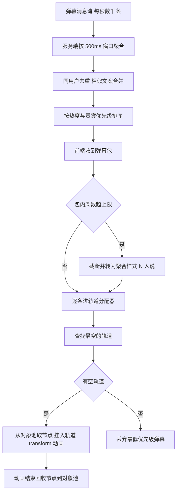

```javascript
// 弹幕风暴渲染：轨道分配 + 对象池 + 单 rAF 驱动
class DanmakuEngine {
  constructor(el, { lanes = 8, maxPerPack = 30 } = {}) {
    this.lanes = Array.from({ length: lanes }, () => ({ lastEnd: 0, el: null }));
    this.pool = [];                                    // 对象池：DOM 节点复用
    this.queue = [];
    this.maxPerPack = maxPerPack;
    this.rafLoop();
  }
  pushPack(pack) {
    // 包内超量截断：贵宾与高赞优先
    const list = [...pack.items].sort((a, b) => (b.vip - a.vip) || (b.likes - a.likes));
    if (list.length > this.maxPerPack) {
      this.queue.push(makeAggregated(list.slice(this.maxPerPack))); // 剩余聚合为 N 人说
      list.length = this.maxPerPack;
    }
    this.queue.push(...list);
  }
  allocEl() { return this.pool.pop() ?? document.createElement('span'); }
  spawn(item) {
    // 选"最空"的轨道：预估到达时间最早的
    const lane = this.lanes.reduce((a, b) => a.lastEnd <= b.lastEnd ? a : b);
    const now = performance.now();
    if (lane.lastEnd > now) return false;              // 全满则丢弃（低优先级已被截断）
    const el = this.allocEl();
    el.textContent = item.text;
    el.className = `danmaku p${item.priority}`;
    lane.el ??= this.createLaneHolder();
    lane.el.appendChild(el);
    const duration = 8000;
    lane.lastEnd = now + duration * 0.15;              // 同轨间隔：出场前 15% 时间可接新条
    el.animate([{ transform: 'translateX(100vw)' }, { transform: `translateX(-${el.scrollWidth}px)` }],
      { duration, easing: 'linear' }).onfinish = () => { el.remove(); this.pool.push(el); };
    return true;
  }
  rafLoop = () => {
    // 每帧最多 spawn 2 条，防止一包瞬间全部入轨
    for (let i = 0; i < 2 && this.queue.length; i++) {
      if (!this.spawn(this.queue.shift())) break;
    }
    requestAnimationFrame(this.rafLoop);
  };
}
```

### SCN-159：要做浏览器端 1v1 音视频客服通话，WebRTC 的前端流程和关键坑有哪些？
**答**：
- 流程五步：取媒体（getUserMedia）→ 本地预览 → 创建 RTCPeerConnection 生成 offer/answer（SDP 协商，经信令服务器转发）→ 双向交换 ICE candidate（打洞）→ ontrack 渲染远端流。
- 信令只管"介绍认识"，媒体数据 P2P 直连；NAT 打不通时走 TURN 中继，TURN 配额是成本大头，前端要上报连接类型便于监控。
- 经典坑：协商期间不要重复 createOffer（glare，用 perfect negotiation 规则）；设备热插拔要监听 devicechange 重建流；静音检测与网络质量（getStats）驱动 UI 提示。
- 关闭要彻底：先 stop 所有 track 再 close 连接，否则摄像头指示灯不灭、内存泄漏。

```javascript
// WebRTC 1v1 通话：信令协商 + ICE 交换 + 质量监控
export async function startCall(roomId, signaling) {
  const localStream = await navigator.mediaDevices.getUserMedia({
    video: { width: 1280 }, audio: { echoCancellation: true, noiseSuppression: true },
  });
  document.getElementById('local').srcObject = localStream;

  const pc = new RTCPeerConnection({ iceServers: [{ urls: 'turn:turn.example.com', username: 'u', credential: 'p' }] });
  localStream.getTracks().forEach(t => pc.addTrack(t, localStream));
  pc.ontrack = e => { document.getElementById('remote').srcObject = e.streams[0]; };

  // ICE candidate 逐个经信令转发给对端
  pc.onicecandidate = e => e.candidate && signaling.send('ice', roomId, e.candidate.toJSON());
  // 连接状态驱动 UI：检查中/已连接/断开
  pc.onconnectionstatechange = () => emit('state', pc.connectionState);

  // 发起方：createOffer -> setLocal -> 经信令发给对端
  const offer = await pc.createOffer();
  await pc.setLocalDescription(offer);
  signaling.send('sdp', roomId, offer);

  // 收对端 answer 与 ice（信令路由省略）
  signaling.on('sdp', async desc => {
    if (desc.type === 'answer') await pc.setRemoteDescription(desc);
    if (desc.type === 'offer') {                       // 被叫分支
      await pc.setRemoteDescription(desc);
      const answer = await pc.createAnswer();
      await pc.setLocalDescription(answer);
      signaling.send('sdp', roomId, answer);
    }
  });
  signaling.on('ice', c => pc.addIceCandidate(c).catch(console.warn));

  // 质量监控：getStats 上报 RTT 与丢包，差网络提示用户
  setInterval(async () => {
    const stats = await pc.getStats();
    stats.forEach(r => r.type === 'inbound-ratio' || (r.type === 'inbound-rtp' &&
      report({ type: 'rtc-quality', rtt: r.jitterBufferDelay, lost: r.packetsLost })));
  }, 5000);

  return () => endCall(pc, localStream);              // 挂断句柄
}

export function endCall(pc, stream) {
  stream.getTracks().forEach(t => t.stop());          // 先停轨：摄像头灯灭
  pc.close();                                         // 再关连接
}
```

### SCN-160：音频课程页切到后台（或锁屏）后回来，进度要无缝续播，多端还要同步，怎么做？
**答**：
- 本地续播：定期（5s 或按章节）把 `{ audioId, position, duration }` 写 localStorage/IndexedDB；visibilitychange 进入 hidden 时立即保存一次并暂停计时。
- 回来自动恢复：seek 到保存位置；进度恢复要做"容差校验"（保存点与文件时长不符时回退到上一章节），防止坏数据。
- 多端同步以后端为准但"新者胜"：每次保存带 `updatedAt`，打开页面时拉云端进度，本地更新时间更新才用本地；播放中云端推送他人进度不打断当前播放。
- 后台播放本身用 MediaSession API：锁屏控制、封面、进度条走系统 UI。

```javascript
// 音频后台续播：本地锚点 + MediaSession + 多端新者胜
const PLAY_KEY = 'audio-progress';

export function bindAudioProgress(audio, audioId) {
  const save = () => localStorage.setItem(PLAY_KEY, JSON.stringify({
    audioId, position: audio.currentTime, duration: audio.duration, updatedAt: Date.now(),
  }));

  audio.addEventListener('timeupdate', throttle(save, 5000)); // 周期保存
  document.addEventListener('visibilitychange', () => {
    if (document.visibilityState === 'hidden') save(); // 切后台立即保存
    else restore(audio, audioId);                      // 回前台无缝续播
  });

  // 锁屏/后台播放的系统控制
  if ('mediaSession' in navigator) {
    navigator.mediaSession.metadata = new MediaMetadata({ title: audioId });
    navigator.mediaSession.setActionHandler('seekbackward', () => audio.currentTime -= 15);
    navigator.mediaSession.setActionHandler('seekforward', () => audio.currentTime += 30);
  }
}

async function restore(audio, audioId) {
  const local = JSON.parse(localStorage.getItem(PLAY_KEY) ?? 'null');
  const cloud = await api.getProgress(audioId).catch(() => null);
  // 多端同步：新者胜，本地较新才用本地
  const best = !cloud ? local
    : (!local || cloud.updatedAt > local.updatedAt) ? { ...cloud, ...{ position: cloud.position } }
    : local;
  if (best?.audioId !== audioId) return;
  const pos = (best.position >= 0 && best.position < audio.duration - 5)
    ? best.position : 0;                               // 越界坏数据回退
  audio.currentTime = pos;
}

// 云端进度在播放间隙上报，播放中收到他人进度不打断
setInterval(() => localProgress && api.pushProgress(localProgress), 30_000);
```

### SCN-161：短视频 feed 要求上滑秒切下一个视频，预加载策略怎么设计？
**答**：
- 预加载分三档：当前视频完整播放、下一个视频预取元数据与首段（Range 请求前 1~2MB）、下下个仅预解析 id。带宽是零和的，预取过多反而挤占当前播放。
- 滑动意图预判：用户手指上滑超过 30% 屏高或速度超阈值，立即把"下一个"升级为完整预加载；滑回则取消。
- MSE 场景把预取的分片直接喂给下一个播放器实例（预建 player），切换时几乎零等待；src 直连场景用 `video.preload='auto'` 的隐藏实例。
- 全局并发与流量控制：预取队列并发 1，弱网（navigator.connection）下调预取档位。

```javascript
// 短视频预加载：三档策略 + 滑动意图升级 + 弱网降级
const LEVELS = { CURRENT: 2, NEXT_META: 1, NONE: 0 };

export class ShortVideoPreloader {
  cache = new Map();                                   // id -> mediaSource/segments
  constructor(feed) {
    this.feed = feed;
    this.bandwidth = navigator.connection?.effectiveType ?? '4g';
  }
  levelFor(index) {
    if (index === this.feed.current) return LEVELS.CURRENT;
    if (index === this.feed.current + 1) {
      // 弱网只预 metadata，好网络预取首段
      return ['slow-2g', '2g'].includes(this.bandwidth) ? LEVELS.NEXT_META : LEVELS.CURRENT;
    }
    return LEVELS.NONE;
  }
  sync() {
    for (let i = this.feed.current - 1; i <= this.feed.current + 2; i++) {
      const item = this.feed.get(i);
      if (!item) continue;
      const level = this.levelFor(i);
      if (level === LEVELS.CURRENT && !this.cache.has(item.id)) this.prefetch(item);
      if (level === LEVELS.NEXT_META) this.prefetchMeta(item);
    }
  }
  async prefetch(item) {
    if (this.inflight) return;                         // 全局并发 1：不挤占当前播放带宽
    this.inflight = true;
    try {
      // Range 请求只拉首段，MSE 交给预建 player
      const head = await fetch(item.url, { headers: { Range: 'bytes=0-1572864' } }); // 前 1.5MB
      this.cache.set(item.id, await head.arrayBuffer());
    } finally { this.inflight = false; }
  }
  prefetchMeta(item) {
    const v = document.createElement('video');
    v.preload = 'metadata';
    v.src = item.url;
    v.load();
    this.cache.set(`meta:${item.id}`, v);
  }
  // 滑动意图：上滑速度超阈值立即升级预取
  onDrag(dy, velocity) {
    if (dy < -screen.height * 0.3 || velocity > 1.2) {
      const next = this.feed.get(this.feed.current + 1);
      next && !this.cache.has(next.id) && this.prefetch(next);
    }
  }
}
```

### SCN-162：视频播放中用户切换清晰度（1080P → 720P），如何做到无卡顿、不回到片头？
**答**：
- 关键是"续播切换"：记录当前 `currentTime`，切换源后等新流可播（`loadeddata`/MSE append 完成）再 seek 回原位置，全程保持封面帧避免闪黑。
- MSE/HLS 原生方案（hls.js 的 currentLevel）可以直接切 level，同一媒体管线内无缝；不能无缝的（两个独立 mp4）只能换源 + seek，把黑屏时间藏进"清晰度切换中"的过渡态。
- 切换策略上提供"自动模式"：按 getStats 的带宽估算选档，卡顿时降档、带宽充裕升档，升降档要有迟滞（hysteresis）防止来回跳。
- 切换失败的兜底：新源加载超时回退旧源续播，清晰度 UI 回滚并提示。

```javascript
// 清晰度无缝切换：记录进度 -> 换源 -> seek 回原位
export async function switchQuality(video, targetLevel, levels) {
  if (video.hls) {                                     // hls.js：管线内直接切 level，无缝
    video.hls.currentLevel = targetLevel.index;
    video.hls.nextLevel = targetLevel.index;           // 立即从下一段生效
    return;
  }
  // 独立 mp4：换源续播
  const resumeAt = video.currentTime;
  const wasPlaying = !video.paused;
  video.pause();
  video.classList.add('switching');                    // 过渡态遮罩，藏住黑屏

  const nextSrc = levels[targetLevel.index].url;
  try {
    await Promise.race([
      new Promise((resolve, reject) => {
        video.src = nextSrc;
        video.addEventListener('loadeddata', resolve, { once: true });
        video.addEventListener('error', reject, { once: true });
      }),
      new Promise((_, reject) => setTimeout(() => reject(new Error('SWITCH_TIMEOUT')), 6000)),
    ]);
    video.currentTime = resumeAt;                      // 新流可播后 seek 回原位
    wasPlaying && video.play();
    video.classList.remove('switching');
  } catch {
    // 兜底：切失败回退旧源续播
    video.src = levels[video.dataset.currentLevel].url;
    video.addEventListener('loadeddata', () => { video.currentTime = resumeAt; wasPlaying && video.play(); }, { once: true });
  }
}

// 自动清晰度：带宽估算 + 迟滞防抖动
export function autoQuality(video, levels, current) {
  const bandwidthMbps = estimateBandwidth(video);      // 由 getStats/分片下载速度估算
  const ranked = levels.map((l, i) => ({ ...l, i })).filter(l => l.bitrate / 1000 <= bandwidthMbps * 0.8);
  const target = ranked.at(-1)?.i ?? 0;
  const diff = target - current;
  if (Math.abs(diff) < 2) return current;              // 迟滞：差 2 档以内不切，防来回跳
  switchQuality(video, levels[target], levels);
  return target;
}

```

## 二十八、游戏化与互动

### SCN-163：签到日历要求展示整月签到状态、连续天数，并支持用补签卡补昨天的漏签，如何设计？
**答**：
- 月历数据以服务端快照为准：一次请求返回当月 `{ date: status }` 映射 + 连签天数 + 剩余补签卡，前端不做任何"推断签到"，避免与后端口径漂移。
- 补签是业务操作不是"改状态"：弹确认（消耗一张卡 → 补某天 → 连签可能重算）成功后用服务端返回的新快照整体刷新，不做本地增量猜测。
- "今天"的边界处理：跨天瞬间（23:59 签到）、时区（服务端按东八区下发 date 字符串，前端只展示不计算）。
- 补签限制（只能补最近 7 天、每月 2 次）由后端校验，前端提前灰置入口并说明原因，减少无效点击。

```javascript
// 签到日历：快照渲染 + 补签确认 + 跨月懒加载
export async function buildCalendar(year, month) {
  // 服务端快照：statuses 为 date 字符串映射，前端不算日期逻辑
  const { statuses, streak, cardsLeft, today, serverDate } =
    await api.getSignSnapshot({ year, month });

  const firstDay = new Date(Date.UTC(year, month - 1, 1));
  const daysInMonth = new Date(Date.UTC(year, month, 0)).getUTCDate();
  const cells = Array.from({ length: daysInMonth }, (_, i) => {
    const date = `${year}-${String(month).padStart(2, '0')}-${String(i + 1).padStart(2, '0')}`;
    const status = statuses[date] ?? 'none';           // signed | patched | none
    const canPatch = status === 'none'
      && date < serverDate                             // 只能补已过去的日期（服务端也会校验）
      && diffDays(date, serverDate) <= 7;              // 7 天内可补
    return { date, status, isToday: date === today, canPatch };
  });
  return { cells, streak, cardsLeft };
}

export async function patchSign(date, cardsLeft) {
  if (cardsLeft <= 0) return showToast('补签卡已用完');
  const confirmed = await confirm(`将消耗 1 张补签卡，补签 ${date}，继续吗？`);
  if (!confirmed) return;
  // 补签成功用服务端新快照整体刷新，不本地猜连签
  const snapshot = await api.patchSign({ date });
  renderCalendar(snapshot);
  showToast(`补签成功，当前连签 ${snapshot.streak} 天`);
}

// 跨天处理：停留过午夜时刷新"今天"标记
setInterval(async () => {
  const { serverDate } = await api.getServerTime();
  if (serverDate !== currentRenderedDate) rerenderWithNewDay(serverDate);
}, 60_000);
```

### SCN-164：会员成长值结算后，进度条要从旧值动画滚到新值，数字也要跟着滚，怎么实现？
**答**：
- 数字滚动与进度条动画共享同一个进度源：用 rAF + easeOutCubic 缓动，从旧值插值到新值，DOM 写入统一在一个帧回调里，避免数字和进度条节奏不同步。
- 长距离滚动（如 200 → 9800）不能匀速拉完：缓动函数前快后慢，超过 2s 的动画在中间值分段吸附（先滚到整百再细滚），观感更好。
- 页面切走时暂停（rAF 天然停），回来从当前值继续；结算增量在动画开始前已锁定，不中途变化。
- 完成态给一次性反馈（徽章升级），动画只播一次，组件重挂载（路由切回）不重播。

```javascript
// 成长值滚动：rAF + easeOutCubic，数字与进度条同帧驱动
export function rollGrowthValue(el, barEl, { from, to, duration = 1200, formatter = v => Math.round(v).toLocaleString() }) {
  const start = performance.now();
  const easeOutCubic = t => 1 - Math.pow(1 - t, 3);

  function frame(now) {
    const t = Math.min(1, (now - start) / duration);
    const value = from + (to - from) * easeOutCubic(t);
    el.textContent = formatter(value);                 // 数字
    barEl.style.transform = `scaleX(${value / to})`;   // 进度条：transform 不触发重排
    barEl.style.transformOrigin = 'left';
    if (t < 1) requestAnimationFrame(frame);
    else onFinish(to);
  }
  requestAnimationFrame(frame);

  // 页面隐藏时 rAF 自动暂停，恢复后基于当前值继续（duration 按剩余比例）
  function onFinish(final) {
    el.textContent = formatter(final);
    reportOnce('growth-rolled', { to: final });        // 只上报一次，防重播重复埋点
  }
}

// 组件挂载去重：路由切回不重播动画，直接呈现终值
const played = sessionStorage.getItem('growth-played') === '1';
if (played) { el.textContent = formatter(to); barEl.style.transform = `scaleX(1)`; }
else { rollGrowthValue(el, barEl, { from, to }); sessionStorage.setItem('growth-played', '1'); }

// 超长距离分段吸附：先滚到整百位再细滚
function 分段吸附(from, to) {
  const coarse = Math.round(to / 100) * 100;           // 9800 -> 先到 9800 整百
  return coarse !== to ? [coarse, to] : [to];
}
```

### SCN-165：营销活动要"红包雨"：每秒几十个红包从顶部掉落，点击可抢，性能如何保障？
**答**：
- 数量可控就用 DOM + transform 动画（方便绑定点击），但必须对象池复用节点：红包雨几百上千个节点创建销毁会把 GC 打爆。
- 动画只用 `transform: translate3d` 走合成层，不用 top/left；点击热区略大于视觉尺寸提升手感，命中判定直接读节点坐标。
- Canvas 方案适合量更大时：离屏渲染红包贴图 + requestAnimationFrame 逐帧更新，点击做矩形命中检测，DOM 零开销。
- 抢红包结果聚合：点击先本地动效（炸开），请求合并排队发送，防手速用户连点打爆接口。

```javascript
// 红包雨：DOM 对象池 + transform 合成层动画 + 点击命中
class RedPacketRain {
  constructor(stage, { rate = 20, duration = 15_000 } = {}) {
    this.stage = stage;
    this.pool = [];                                    // 对象池
    this.active = [];
    this.rate = rate;                                  // 每秒生成数
    this.onGrab = null;
  }
  acquire() {
    // 复用节点：无空闲才新建
    const el = this.pool.pop() ?? this.createNode();
    return el;
  }
  createNode() {
    const el = document.createElement('div');
    el.className = 'red-packet';
    el.addEventListener('pointerdown', e => this.hit(e.currentTarget));
    this.stage.appendChild(el);
    return el;
  }
  spawn() {
    const el = this.acquire();
    const x = Math.random() * (this.stage.clientWidth - 60);
    el.style.transform = `translate3d(${x}px, -60px, 0)`;
    el.style.visibility = 'visible';
    el.dataset.id = String(Math.random());
    this.active.push({ el, x, y: -60, vy: 160 + Math.random() * 120, grabbed: false });
  }
  start() {
    this.spawner = setInterval(() => this.spawn(), 1000 / this.rate);
    let last = performance.now();
    const loop = now => {
      const dt = (now - last) / 1000; last = now;
      const H = this.stage.clientHeight;
      this.active = this.active.filter(p => {
        p.y += p.vy * dt;                              // 只更新 transform，合成层动画
        p.el.style.transform = `translate3d(${p.x}px, ${p.y}px, 0) rotate(${p.y * 0.1}deg)`;
        if (p.y > H + 60) { p.el.style.visibility = 'hidden'; this.pool.push(p.el); return false; } // 落底回收
        return true;
      });
      this.raf = requestAnimationFrame(loop);
    };
    this.raf = requestAnimationFrame(loop);
    this.stopTimer = setTimeout(() => this.stop(), this.duration ?? 15_000);
  }
  hit(el) {
    const p = this.active.find(a => a.el === el && !a.grabbed);
    if (!p) return;
    p.grabbed = true;
    p.el.classList.add('burst');                       // 先播本地炸开动效
    this.queueGrab(p.el.dataset.id);                   // 请求排队，防连点打爆接口
    setTimeout(() => { p.el.style.visibility = 'hidden'; this.pool.push(p.el); }, 300);
  }
  grabs = [];
  queueGrab(id) {
    this.grabs.push(id);
    clearTimeout(this.flushTimer);
    this.flushTimer = setTimeout(async () => {         // 200ms 窗口聚合上报
      const ids = this.grabs.splice(0);
      try { const res = await api.grabPackets({ ids }); this.onGrab?.(res); }
      catch { showToast('网络开小差，奖励稍后补发'); }   // 服务端按活动兜底
    }, 200);
  }
  stop() { clearInterval(this.spawner); cancelAnimationFrame(this.raf); }
}
```

### SCN-166：在线答题 PK 双人同屏竞技，倒计时必须双方一致，如何对抗网络延迟与时钟偏差？
**答**：
- 展示时钟必须锚定服务器时间：开局时服务端下发 `startAt（服务器时间戳）+ duration`，前端按"服务器时间 - 本地时间"偏移计算剩余，而不是自己起 setInterval。
- 服务器时间偏移用 NTP 式三采样取最小 RTT 那次的偏移（RTT 最小 = 最准）。
- 判定权在服务端：答题提交带客户端本地耗时仅作参考，服务端按收到时间判定是否超时，前端倒计时到 0 只是锁 UI。
- 网络抖动的补偿：倒计时与对方答题推送用同一时钟基准展示；掉线重连后立即重新对时 + 拉题目状态快照。

```javascript
// 答题 PK 计时：服务器时间锚定 + 三采样取最优 + 服务端判定
export async function calibrateNTP(fetchTime) {
  let best = null;
  for (let i = 0; i < 3; i++) {                        // 三次采样，取 RTT 最小的
    const t0 = Date.now();
    const { serverTime } = await fetchTime();
    const rtt = Date.now() - t0;
    const offset = serverTime - t0 - rtt / 2;
    if (!best || rtt < best.rtt) best = { rtt, offset };
  }
  return best.offset;
}

export class PkTimer {
  constructor({ serverStartAt, durationMs, offset }) {
    this.startAt = serverStartAt;                      // 服务器开考时间
    this.durationMs = durationMs;
    this.offset = offset;
    this.finished = false;
  }
  remainMs() {
    const serverNow = Date.now() + this.offset;        // 一切以服务器时钟为准
    return Math.max(0, this.startAt + this.durationMs - serverNow);
  }
  start(onTick, onEnd) {
    const loop = () => {
      const remain = this.remainMs();
      onTick(remain);
      if (remain <= 0 && !this.finished) { this.finished = true; onEnd(); return; }
      this.raf = requestAnimationFrame(loop);
    };
    requestAnimationFrame(loop);
  }
}

// 提交：带本地耗时仅作参考，超时与否由服务端收到时间判定
export async function submitAnswer(questionId, choice, timer) {
  const localCost = timer.durationMs - timer.remainMs();
  try {
    return await api.submitAnswer({ questionId, choice, localCost, clientTs: Date.now() });
  } catch (e) {
    if (e.code === 'TIMEOUT') return { accepted: false, reason: '已超时' }; // UI 锁死但服务端裁决
    throw e;
  }
}
```

### SCN-167：养成类游戏（种树/养鸡）要计算用户离线期间的收益，回归时结算，怎么设计与防刷？
**答**：
- 收益模型：`离线收益 = 速率 × min(离线时长, 上限)`，离线起点 = 服务端记录的上次活跃时间，前端本地时间不可信。
- 回归流程：客户端展示"您离开 X 小时，收获 N"用本地估算做即时反馈（标注"结算中"），随后以服务端结算结果为准刷新，两端不一致以服务端为准并解释。
- 防刷核心在服务端：速率变更、收益上限、活跃心跳都在服务端记账，前端估算仅供展示；改本地时间无法多得收益。
- 结算与领取分离：结算进"待收取"，用户点击收取才入账（提升一次交互），收取请求幂等（结算单号）。

回归结算时序：

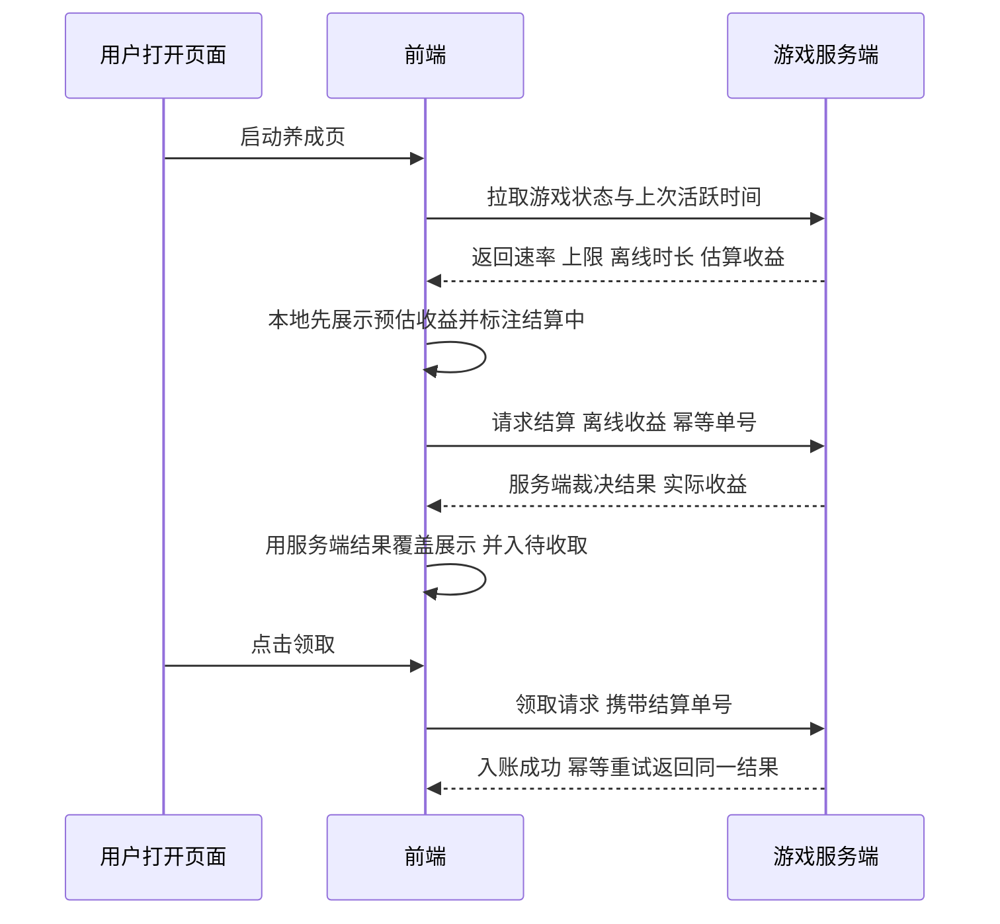

```javascript
// 离线收益：前端估算展示 + 服务端裁决 + 幂等领取
export async function settleOfflineEarnings() {
  // 服务端状态里带上次活跃时间与速率，前端只展示估算
  const state = await api.getFarmState();              // { ratePerHour, lastActiveAt, capHours }
  const offlineHours = Math.min(
    (state.serverNow - state.lastActiveAt) / 3600_000,
    state.capHours                                     // 收益上限：最多累计 12h
  );
  const estimate = Math.floor(state.ratePerHour * offlineHours);

  showOfflineModal({ hours: offlineHours, estimate, pending: true }); // 标注"结算中"

  // 结算：幂等单号防重放，服务端按自己记录的活跃时间裁决
  const settleId = `settle-${state.userId}-${state.lastActiveAt}`;
  const result = await api.settleEarnings({ settleId })
    .catch(() => ({ amount: estimate, authoritative: false }));
  showOfflineModal({ hours: offlineHours, estimate: result.amount, pending: false });

  return result;                                       // { amount, pendingReceiveId }
}

// 领取：幂等，重复点击/重试安全
export async function receiveEarnings(pendingReceiveId) {
  return api.receive({ pendingReceiveId });            // 服务端按单号幂等，重试无副作用
}

```

## 二十九、工程效能场景

### SCN-168：组件库要发 2.0 大版本（Button 移除了 type="ghost"），升级前如何量化评估影响面？
**答**：
- 影响面评估不能靠 grep 拍脑袋：写 AST 扫描脚本，用 `@babel/parser` 遍历所有源码，定位目标组件的 import 与 JSX 使用点，再校验被废弃的 prop/枚举值。
- 产出物是"受影响文件 + 行号 + 违规用法 + 修复建议"清单，直接转成 codemod 或排期表。
- 扫描要覆盖字符串动态用法（如 `type={x}`），动态值单独标"需人工确认"，不误报也不漏报。
- 把扫描接进 CI：2.0 未升级前先"warn"，给出迁移窗口；升级后变"error"卡合入。

```javascript
// 组件库升级影响面评估：AST 扫描废弃 API 用法
import { parse } from '@babel/parser';
import traverse from '@babel/traverse';
import fs from 'fs';
import fg from 'fast-glob';

const DEPRECATED = {
  Button: { removedProps: { type: ['ghost'] }, renameProps: {} }, // type="ghost" 已移除
};

export async function scanImpact(srcDirs = ['src']) {
  const findings = [];
  for (const file of await fg(`${srcDirs}/**/*.{js,jsx,ts,tsx}`)) {
    const code = fs.readFileSync(file, 'utf8');
    const ast = parse(code, { sourceType: 'module', plugins: ['jsx', 'typescript'] });
    const localNames = new Map();                      // import { Button as Btn } 的本地别名
    traverse.default(ast, {
      ImportDeclaration(path) {
        if (path.node.source.value !== '@corp/ui') return;
        path.node.specifiers.forEach(s => {
          if (s.imported && DEPRECATED[s.imported.name])
            localNames.set(s.local.name, s.imported.name);
        });
      },
      JSXOpeningElement(path) {
        const comp = localNames.get(path.node.name.name);
        if (!comp) return;
        path.node.attributes.forEach(attr => {
          if (attr.name?.name !== 'type') return;
          if (!attr.value) return;
          if (attr.value.type === 'StringLiteral' &&
              DEPRECATED[comp].removedProps.type.includes(attr.value.value)) {
            findings.push({ file, line: attr.loc.start.line, comp,
              usage: `type="${attr.value.value}"`,
              fix: `改用 ${comp} 新的视觉层级 API（参考迁移指南 v2）` });
          } else if (attr.value.type !== 'StringLiteral') {
            findings.push({ file, line: attr.loc.start.line, comp,
              usage: 'type 为动态表达式', fix: '需人工确认取值范围' }); // 动态值标人工
          }
        });
      },
    });
  }
  return findings;                                     // 输出受影响清单，转 codemod 或排期
}
```

### SCN-169：monorepo 几十 GB 历史导致克隆一小时起步，新同学与 CI 如何提速？
**答**：
- 三板斧：浅克隆（`--depth=1` 砍历史）、部分克隆（`--filter=blob:none` 按需拉 blob）、sparse-checkout（只检需要的子目录），组合使用克隆时间从小时级降到分钟级。
- CI 优先用缓存 + 浅克隆：构建只需要最新提交与增量 diff，`fetch-depth: 1` 是默认该做的事。
- Git 镜像/内部代理加速大文件：LFS 或构建产物不要进 git 历史，用制品库。
- 文档化"开发者默认克隆姿势"，新人引导脚本内置这些参数，而不是靠口口相传。

```bash
# 大仓库克隆优化：浅克隆 + blob 按需 + 子目录稀疏检出
# 1. 部分克隆：不下载历史 blob，检出时按需拉取
git clone --depth=1 --filter=blob:none --sparse git@git.example.com:corp/monorepo.git
cd monorepo

# 2. 只检出本团队负责的子目录
git sparse-checkout set packages/web-app apps/h5

# 3. 需要追溯历史时按需加深（只拉取近 30 条）
git fetch --deepen=30

# 4. 查看某文件历史：自动按需下载对应 blob，不用全量历史
git log --oneline -- packages/web-app/src/index.ts

# CI 侧（以 GitHub Actions 为例）：单提交 + sparse
# jobs.build.steps:
#   - uses: actions/checkout@v4
#     with:
#       fetch-depth: 1        # 浅克隆
#       sparse-checkout: packages/web-app
#       filter: blob:none     # blob 按需

# 5. 构建产物与设计资源走制品库，禁止进 git（仓库瘦身守则）
find . -size +10M -not -path './.git/*'   # CI 定期扫大文件报警
```

### SCN-170：CI 里 e2e 用例时好时坏（flaky），重试也救不了信任度，如何系统性治理？
**答**：
- 先分类再动手：收集一段时间内的失败记录（trace/video），按"环境不稳 / 等待不当 / 测试间耦合 / 真实 bug"四类归因，前三类是治理对象。
- 等待不当是大头：删掉固定 sleep，统一用"等待状态"（locator 等元素可交互、waitForResponse 等接口返回），用例写法进 lint/评审规范。
- 测试间耦合：用例必须自建数据（factory/seed），不依赖执行顺序与共享账号；并行 worker 用独立数据空间。
- 治理闭环：CI 对 flaky 用例自动打标（失败后重跑通过即记 flaky），周报排名，连续两周 flaky 率超阈值的用例隔离到 nightly，不允许阻塞主干合入。

```yaml
# e2e 稳定性治理：重试隔离 + trace 留档 + 并行数据隔离（Playwright 配置示例）
# playwright.config.yml（节选，实际项目为 .ts，此处以 yaml 说明关键项）
workers: 4                    # 并行，但要求用例数据自建
retries: 2                    # 失败重试 2 次
fullyParallel: true
reporter:
  - list
  - html:
      outputFolder: reports/e2e
use:
  trace: retain-on-failure    # 失败留 trace：定位 flaky 归因的第一手证据
  video: retain-on-failure
  screenshot: only-on-failure

projects:
  - name: stable              # 主干门禁：只跑稳定用例
    testDir: tests/stable
  - name: flaky-quarantine   # flaky 隔离区：nightly 才跑，不阻塞合入
    testDir: tests/quarantine
```

```javascript
// flaky 自动打标：失败后重试通过即记录，周报输出 flaky 榜
export function trackFlaky(results) {
  const flaky = results.filter(r => r.outcome === 'flaky'); // Playwright 结果自带 flaky 判定
  const board = {};
  for (const r of flaky) {
    board[r.title] ??= { count: 0, errors: [] };
    board[r.title].count++;
    board[r.title].errors.push(r.errors?.[0]?.message?.slice(0, 200));
  }
  // 连续超标则移动到隔离区并建 issue
  for (const [title, s] of Object.entries(board)) {
    if (s.count >= 3) {
      gitmvTest(title, 'tests/quarantine/');
      createIssue({ title: `flaky: ${title}`, body: s.errors.join('\n') });
    }
  }
  reportWeekly({ flakyRate: flaky.length / results.length, board });
}
```

### SCN-171：团队要在 MR 流程里接入"AI 代码预审"，人工评审只看 AI 拦不住的问题，如何设计架构？
**答**：
- 定位是"预审"而不是"替代评审"：AI 负责机械性问题（风格、常见 bug 模式、测试缺失、敏感信息），人负责设计与业务正确性。
- 链路：MR webhook → 拉 diff（带上下文文件）→ 按文件分片（超长 diff 截断策略）→ 调 LLM → 结构化结果（行级评论）回写到 MR，总评贴在描述区。
- 结果必须是"建议 + 级别"而不是"阻断"：初期 observe 模式跑两周校准误报率，再按类别逐步升级为 warn/error。
- 成本与安全：diff 不含未授权代码外发（私有化部署或脱敏），缓存相同 blob hash 的评审结果，大 MR 拆片并行。

```javascript
// AI 预审服务：webhook -> diff 分片 -> LLM -> 行级评论回写
export async function reviewMr(req) {
  const { mrId, project } = parseWebhook(req);
  const diff = await gitlab.getMrDiff(project, mrId);
  const findings = [];

  for (const shard of shardDiff(diff, { maxLines: 400 })) { // 超长 diff 分片，带上下文文件
    const cacheKey = hashBlob(shard);
    const cached = await cache.get(cacheKey);
    if (cached) { findings.push(...cached); continue; }      // 相同内容命中缓存省成本

    const res = await llm.chat({
      system: '你是资深前端评审。只输出 JSON：[{line, level: info|warn|error, kind, message, suggestion}]。仅评机械性问题：空指针、异步未捕获、样式副作用、测试缺失、疑似密钥。不确定的不要说。',
      user: renderShardPrompt(shard),
      json: true,
    });
    const parsed = safeParse(res).filter(f => CONFIDENT[kindLevel(f)]); // 过滤低置信
    findings.push(...parsed);
    await cache.set(cacheKey, parsed, { ttl: '7d' });
  }

  // 回写：error 级行内评论，其余汇总进总评
  await gitlab.postMrSummary(project, mrId, summarize(findings));
  for (const f of findings.filter(f => f.level === 'error')) {
    await gitlab.postLineComment(project, mrId, f);
  }
  // observe 模式不阻断；校准后按 kind 配置升级为必须解决
  await metrics.record('ai-review', { mrId, count: findings.length, kinds: tally(findings, 'kind') });
}

function shardDiff(diff, { maxLines }) {
  // 每片附带被改文件全文的关键上下文，单纯 diff 会让 AI 误判
  return groupBy(diff.files, maxLines).map(files => ({ files, context: files.map(f => f.content) }));
}
```

### SCN-172：产品要求频繁做 A/B 实验与功能开关，flag 如何全链路管理（创建、生效、清理）？
**答**：
- flag 有生命周期就必然要管"归还"：创建必须登记 owner、过期时间、影响面；到期的 flag 进CI 扫描清单，未清理就报警——遗忘的 flag 分支组合爆炸是事故源。
- 生效链路统一：服务端下发 flag 快照（登录时 + 关键操作时刷新），前端只消费快照，不做本地逻辑判断（用户分桶、百分比全在服务端），保证同用户全端一致。
- 前端接入用统一 SDK：`flag('new-checkout')`，未注册的 flag 读取时在 dev 环境报错，防手滑拼错。
- 清理自动化：CI 定期扫描代码中引用的 flag 与平台登记比对，"平台已删除但代码还在读"与"平台存活但代码无引用"都报。

```javascript
// feature flag SDK：快照消费 + 未注册校验 + 曝光埋点
export function createFlagClient(snapshot, { env }) {
  const registry = snapshot.flags;                     // { 'new-checkout': { value, variant, meta } }
  const exposed = new Set();
  return {
    get(key, defaultValue = false) {
      const f = registry[key];
      if (!f && env !== 'prod') console.error(`[flag] 未注册的 flag: ${key}`); // 拼错尽早暴露
      if (f && !exposed.has(key)) {                    // 曝光埋点：实验分析的数据基础
        exposed.add(key);
        report({ type: 'flag-exposed', key, variant: f.variant, bucket: snapshot.bucket });
      }
      return f?.value ?? defaultValue;
    },
    variant: key => registry[key]?.variant ?? 'control',
  };
}

// CI 清理扫描：代码引用 vs 平台登记 双向比对
// node scripts/flag-audit.js
export async function flagAudit() {
  const [used, registered] = await Promise.all([
    scanCodeUsage('src/**/*.{js,ts,tsx}', /flags?\.(get|variant)\(\s*['"]([\w.-]+)['"]/g),
    api.listFlags({ status: 'active' }),
  ]);
  const orphans = registered.filter(f => !used.has(f.key));   // 平台存活但代码不用：该清理
  const missing = [...used].filter(k => !registered.find(f => f.key === k)); // 代码在用但未登记
  const expired = registered.filter(f => f.expireAt < Date.now());           // 过期未清理
  if (orphans.length || missing.length || expired.length) {
    console.table([...orphans, ...missing, ...expired]);
    process.exit(1);                                   // 卡合入：新代码不允许引用未登记 flag
  }
}
```

### SCN-173：开发、测试、预发、生产四套环境，如何避免"测试环境登错生产账号"这类串环境事故？
**答**：
- 第一道隔离是域名与浏览器存储：每个环境独立域名（*.test.example.com），localStorage/cookie 天然按域隔离，跨环境 token 物理上放不到一起。
- 存储 key 加环境前缀只防"同域多环境部署"的边缘情况；真正要防的是视觉混淆：非生产环境全局挂横幅（环境名 + 醒目颜色），登录页显示当前环境与账号白名单提示。
- 账号体系隔离：测试环境用假账号池（自动生成的 13xxxx 手机号），生产真实账号禁止在测试环境复用密码；SSO 按环境注册不同 client。
- 提供环境切换器（内部工具页）一键带 token 跳转，替代"手改域名"这种易错操作。

```javascript
// 多环境账号隔离：域名隔离 + 环境横幅 + token key 前缀
export const ENV = (host => {
  if (/\.test\./.test(host)) return 'test';
  if (/\.staging\./.test(host)) return 'staging';
  return 'prod';
})(location.hostname);

// token 存储 key 带环境前缀：防同域多环境部署时的串号
const storageKey = name => `${ENV}:${name}`;
export const authStore = {
  get token() { return localStorage.getItem(storageKey('token')); },
  set token(v) { v ? localStorage.setItem(storageKey('token'), v) : localStorage.removeItem(storageKey('token')); },
};

// 非生产环境全局横幅：一眼可辨当前环境，防"以为在生产操作"
export function mountEnvBanner() {
  if (ENV === 'prod') return;
  const colors = { test: '#e6a23c', staging: '#f56c6c' };
  const el = document.createElement('div');
  el.textContent = `${ENV.toUpperCase()} 环境 · 数据非真实 · 严禁使用生产账号`;
  el.style.cssText = `position:fixed;top:0;left:0;right:0;z-index:99999;height:24px;
    background:${colors[ENV]};color:#fff;font-size:12px;display:flex;align-items:center;justify-content:center;`;
  document.body.appendChild(el);
  document.documentElement.style.setProperty('--banner-h', '24px');
}

// 环境切换器：内部工具页一键带票据跳转，替代手改域名
export async function switchEnv(target) {
  const ticket = await api.getTransferTicket();        // 短时一次性票据，不传 token 本体
  location.href = `https://${target}.example.com/sso/transfer?ticket=${ticket}`;
}
```

### SCN-174：几十个前端仓库依赖升级全靠人肉，如何用机器人（Renovate）建立自动化升级流水线？
**答**：
- 分级策略是关键：patch/minor 自动合并（有测试保护的前提下），major 建单独 MR + 指定 owner 评审；安全补丁最高优先级立即升。
- 合并门槛写进配置：CI 必须全绿（lint/单测/build/e2e 冒烟），锁文件由机器人维护，人不手改。
- 噪声治理：`schedule` 错峰（每周固定窗口批量处理），`automerge` 白名单限定低风险依赖（types、eslint 插件类），框架级依赖（react/vue）永远人工。
- 升级信息要带上下文：MR 描述带 changelog 与 breaking changes 链接，评审人只做判断不做考古。

```yaml
# renovate.json（JSON 即合法 YAML）：分级自动升级策略
{
  "extends": ["config:recommended", ":semanticCommits"],
  "timezone": "Asia/Shanghai",
  "schedule": ["after 10am and before 4pm every weekday"],  # 错峰：工作时段批量处理
  "packageRules": [
    {
      "description": "安全补丁最高优先级立即升级",
      "matchUpdateTypes": ["patch"],
      "matchDepTypes": ["dependencies"],
      "vulnerabilityAlerts": { "labels": ["security"] },
      "automerge": true,
      "automergeType": "pr"
    },
    {
      "description": "低风险 devDependencies 自动合并",
      "matchDepTypes": ["devDependencies"],
      "matchUpdateTypes": ["patch", "minor"],
      "automerge": true,
      "matchPackagePatterns": ["@types/", "eslint-", "prettier"]
    },
    {
      "description": "框架级 major 永远人工：单独 MR 加评审人与升级清单",
      "matchPackagePatterns": ["^react$", "^vue$", "^vite$", "^typescript$"],
      "automerge": false,
      "reviewers": ["team:frontend-core"],
      "labels": ["major-upgrade"],
      "prBodyNotes": ["请对照迁移指南升级，并跑全量 e2e"]
    },
    {
      "description": "限制并发 MR 数量，防升级风暴",
      "prConcurrentLimit": 5,
      "branchConcurrentLimit": 10
    }
  ],
  "lockFileMaintenance": { "enabled": true, "schedule": ["before 6am on monday"] }
}
```

### SCN-175：老板要每天看核心页面的性能趋势（LCP/INP/CLS），如何搭一条自动化看板链路？
**答**：
- 数据两条腿：线上真实用户数据（web-vitals 上报 → 数仓）是"体感"，实验室数据（Lighthouse CI 定时跑关键页面）是"可复现归因"，两条线都要有。
- 实验室侧自动化：CI 定时任务对核心页面矩阵（机型 × 网络 × 页面）跑 Lighthouse，结果结构化入库。
- 看板只展示"趋势 + 突变"：每天与上周基线对比，超阈值标红并自动建 issue，避免人肉盯曲线。
- 告警要带归因入口：突变时自动对比两次构建的资源体积（bundle diff），多数性能回退是资源膨胀。

```bash
#!/bin/bash
# 每日性能看板采集：Lighthouse CI 矩阵跑分 + 入库 + 突变检测
set -euo pipefail

PAGES=("home:https://www.example.com/" "list:https://www.example.com/list" "detail:https://www.example.com/item/1")
PROFILE=("mobile:slow4G" "desktop:4G")
OUT=./perf-results/$(date +%F)
mkdir -p "$OUT"

for p in "${PAGES[@]}"; do
  name="${p%%:*}"; url="${p#*:}"
  for prof in "${PROFILE[@]}"; do
    device="${prof%%:*}"
    lhci collect \
      --url="$url" \
      --numberOfRuns=3 \
      --settings.emulatedFormFactor="$device" \
      --settings.throttling.rttMs=150
    lhci assert --assertions.categories:performance=["error"] \
      || echo "::warning::${name}/${device} 性能分低于阈值"
    mv .lighthouseci "$OUT/${name}-${device}"
  done
done

# 结构化入库：提取关键指标供看板消费
node scripts/extract-metrics.js "$OUT" | curl -s -X POST "$METRICS_API/vitals" \
  -H 'Content-Type: application/json' -d @-

# 突变检测：与上周基线对比，超阈值自动建 issue
node scripts/compare-baseline.js --metric LCP --threshold 0.15 \
  && echo "OK" || node scripts/create-issue.js "性能回退 $(date +%F)"
```

### SCN-176：测试覆盖率数字年年涨但线上事故没少，如何用"增量覆盖率门禁"让指标真正起作用？
**答**：
- 全量覆盖率没有治理意义，有价值的是"本次 MR 新增代码的覆盖率"：CI 里拿 diff 行，与 istanbul 覆盖率报告求交集，算出增量行覆盖率。
- 门禁分级：核心域（支付、下单）增量必须 80%+，工具类必须 100%，UI 壳层豁免；阈值随文件路径配置而不是一刀切。
- 报告要"可行动"：MR 评论里直接列出未覆盖的行号与函数名，并给出"应补什么用例"的提示，而不是甩一个百分比。
- 防止刷指标：断言质量抽查（变异测试抽样）+ 禁止生成无断言的快照空测。

```javascript
// 增量覆盖率门禁：diff 行 ∩ 覆盖率报告，按路径分级阈值
import { diffLines } from './git-utils.js';
import lcovParse from 'parse-lcov';

const THRESHOLDS = [
  { pattern: /src\/(payment|order|cart)\//, min: 0.8, label: '核心交易域' },
  { pattern: /src\/utils\//, min: 1.0, label: '工具库' },
  { pattern: /.*/, min: 0.5, label: '常规代码' },
];

export async function diffCoverageGate({ base = 'origin/main' }) {
  const changed = await diffLines(base);               // Map<file, Set<line>>
  const lcov = lcovParse(await readFile('coverage/lcov.info'));
  const report = [];

  for (const [file, lines] of changed) {
    const rec = lcov.find(r => r.file === file);
    if (!rec) continue;                                // 新增文件由整体 diff 覆盖率统计
    const hit = new Set(rec.lines.details.filter(d => d.hit > 0).map(d => d.line));
    const added = [...lines].filter(l => isCodeLine(file, l)); // 排除空行/注释
    if (!added.length) continue;
    const covered = added.filter(l => hit.has(l)).length;
    const ratio = covered / added.length;
    const rule = THRESHOLDS.find(r => r.pattern.test(file));
    report.push({ file, ratio, min: rule.min, rule: rule.label,
      uncovered: added.filter(l => !hit.has(l)) });
  }

  const failed = report.filter(r => r.ratio < r.min);
  if (failed.length) {
    // MR 评论：直接列未覆盖行号，评审可行动
    await gitlab.mrComment(failed.map(r =>
      `**${r.rule}** \`${r.file}\` 增量覆盖率 ${(r.ratio * 100).toFixed(0)}%（要求 ${r.min * 100}%），未覆盖行：${r.uncovered.join(',')}`
    ).join('\n\n'));
    process.exit(1);                                   // 门禁卡合入
  }
}

```

## 三十、深度排查场景

### SCN-177：偶现的样式错乱（部分用户页面排版崩了，刷新可能恢复），如何按"缓存、版本、竞争"三条分支系统性排查？
**答**：
- 排查先分桶：用监控把出错用户按"资源版本、浏览器、是否命中缓存"分桶，三条分支对应三类根因，先定位大方向再深挖。
- 缓存分支：HTML 与 CSS 的缓存策略不一致（HTML 短缓存 + CSS 长缓存），发版后老 HTML 引用已删除的旧 CSS——检查出错用户加载的 CSS 版本与 HTML 版本是否配套。
- 版本分支：CSS 分包/异步 chunk 的版本不齐（部分请求命中 CDN 不同节点），或灰度导致页面 half 新 half 旧。
- 竞争分支：CSS 注入顺序不确定（异步 chunk 加载顺序），或 JS 在样式就绪前测量 DOM（getBoundingClientRect）。修复方向：关键 CSS 内联 + 资源引用原子化 + 注入顺序确定化。

```javascript
// 样式错乱排查：加载指纹上报，三分支定位
export function reportStyleHealth() {
  window.addEventListener('load', () => {
    const sheets = [...document.styleSheets].map(s => ({
      href: s.href,                                    // 实际加载的 CSS 版本指纹
      rules: (() => { try { return s.cssRules.length; } catch { return -1; } })(),
    }));
    // 关键节点探测：正常布局下根元素宽度与主容器有确定关系
    const main = document.querySelector('.page-main');
    const probe = main ? { w: main.offsetWidth, h: main.offsetHeight } : null;
    const healthy = probe && probe.w > 300 && probe.h > 200;
    report({
      type: 'style-health',
      healthy: !!healthy,
      htmlVersion: window.__BUILD_VERSION__,           // 页面版本
      sheets,                                          // CSS 版本是否与 HTML 配套（缓存分支）
      fp: performance.getEntriesByType('resource')     // 资源加载来源与耗时（版本/竞争分支）
        .filter(r => r.name.endsWith('.css'))
        .map(r => ({ url: r.name.split('/').pop(), fromCdn: r.nextHopProtocol, dur: r.duration })),
      cssInjected: !!document.getElementById('runtime-style'), // 动态注入样式的存在性（竞争分支）
    });
  });
}

// 预防：关键 CSS 内联 + 异步 chunk 样式注入顺序固定
export function injectChunkStyles(chunkId, cssText) {
  let el = document.getElementById(`chunk-style-${chunkId}`);
  if (!el) {
    el = document.createElement('style');
    el.id = `chunk-style-${chunkId}`;
    el.dataset.order = CHUNK_ORDER[chunkId];           // 注入顺序由配置定，不由网络时序定
    document.head.appendChild(el);
  }
  el.textContent = cssText;
  // 注入后按 order 重排，保证覆盖关系稳定
  [...document.querySelectorAll('style[data-order]')]
    .sort((a, b) => a.dataset.order - b.dataset.order)
    .forEach(e => document.head.appendChild(e));
}
```

### SCN-178：iOS 某个系统版本出现输入框被键盘遮挡、position fixed 失效等渲染问题，如何定级与规避？
**答**：
- 先定级：影响转化（下单页输入）定 P0 立即规避；影响体验（动画掉帧）定 P2 排期。定级依据是"受影响用户占比 × 页面重要性"，从监控机型分布拿数据。
- 规避优先于修根因：系统 bug 修不了，用特性检测圈出问题版本，针对性切换实现（如 fixed 改 absolute + 滚动补偿、键盘事件用 visualViewport 监听）。
- 常见 iOS 渲染坑的规避手段：软键盘弹起用 `visualViewport` 计算可视区并 scrollIntoView；fixed 元素在滚动中错位加 `transform: translateZ(0)` 触发独立合成层；`-webkit-overflow-scrolling: touch` 引发的空白用内容高度补偿。
- 系统版本 bug 建立内部知识库：现象、版本号、规避方案、验证用例，升级大版本时回归这一页。

```javascript
// iOS 渲染 bug 定级规避：特性检测 + visualViewport 键盘适配
const ua = navigator.userAgent;
const iosVersion = (() => {
  const m = ua.match(/OS (\d+)[._](\d+)/);
  return m ? { major: +m[1], minor: +m[2] } : null;
})();

// 规避开关：已知问题版本集合，随知识库维护
const IOS_WORKAROUNDS = {
  keyboardCover: iosVersion && (iosVersion.major === 15 && iosVersion.minor < 4), // iOS 15.0-15.3
  fixedJitter: iosVersion && iosVersion.major === 14,
};

export function applyIosWorkarounds() {
  if (!/iPhone|iPad|iPod/.test(ua)) return;
  if (IOS_WORKAROUNDS.keyboardCover) {
    // 键盘遮挡规避：监听 visualViewport，把聚焦输入框滚进可视区
    const vv = window.visualViewport;
    vv.addEventListener('resize', () => {
      const active = document.activeElement;
      if (active?.tagName === 'INPUT' || active?.tagName === 'TEXTAREA') {
        const r = active.getBoundingClientRect();
        if (r.bottom > vv.height) active.scrollIntoView({ block: 'center', behavior: 'smooth' });
      }
    });
  }
  if (IOS_WORKAROUNDS.fixedJitter) {
    document.documentElement.classList.add('ios14-fixed-hack'); // fixed 元素强制合成层
    // css: .ios14-fixed-hack .fixed-bar { transform: translateZ(0); }
  }
  report({ type: 'ios-workaround', version: iosVersion, flags: IOS_WORKAROUNDS });
}

// 定级数据：从监控拉受影响版本占比，支撑 P0/P2 决策
export async function assessSeverity(bugKey) {
  const dist = await monitor.queryUserDist({ dimension: 'iosVersion', page: 'checkout' });
  const affected = dist.filter(d => matchesBug(bugKey, d.version)).reduce((s, d) => s + d.pv, 0);
  const total = dist.reduce((s, d) => s + d.pv, 0);
  return { affectedRatio: affected / total, level: affected / total > 0.05 ? 'P0' : 'P2' };
}
```

### SCN-179：部分用户的页面出现"灵异"错乱（多了浮层、按钮变形、请求被改），本地无法复现，怀疑是 Chrome 插件，如何确认与防御？
**答**：
- 识别手段：插件会往页面注入脚本/样式，特征是"不在你的 bundle 里的执行代码"与"非你注入的 DOM"。监控里比对 `document.scripts` 的 src 来源，或让用户开无痕模式（默认禁插件）对比复现。
- 远程取证：让用户导出插件清单（chrome://extensions 可截图），常见嫌疑是翻译、广告拦截、密码管理类插件改 DOM 或代理请求。
- 防御措施：关键数据不依赖 DOM 文本回读（插件会改文案）；对翻译插件给 `translate="no"` 标记；样式防污染用 Shadow DOM 包裹核心组件。
- 监控上报"可疑环境"：检测到注入特征时在错误上报里附带标记，让排查不再靠猜。

```javascript
// Chrome 插件问题的确认与防御：注入检测 + 无痕引导 + 隔离
export function detectSuspiciousExtensions() {
  const own = new Set(window.__OWN_SCRIPTS__);         // 构建时登记自己的脚本名
  const foreign = [...document.scripts]
    .filter(s => s.src && !own.has(s.src.split('/').pop()))
    .filter(s => !/^(https?:)?\/\/(cdn|static)\.example\.com/.test(s.src));
  // chrome-extension:// 协议直接实锤
  const injected = foreign.filter(s => s.src.startsWith('chrome-extension://'));
  if (injected.length) report({
    type: 'extension-injected',
    ids: injected.map(s => s.src.match(/chrome-extension:\/\/([^/]+)/)?.[1]), // 插件 id 可定位到具体插件
  });
  return injected.length > 0;
}

// 防御 1：核心组件 Shadow DOM 隔离，插件注入的全局样式进不来
export function mountIsolatedWidget(el) {
  const host = document.createElement('div');
  const shadow = host.attachShadow({ mode: 'closed' }); // closed：外部脚本也无法查询内部结构
  shadow.innerHTML = `<style>:host{all:initial} .btn{...}</style><button class="btn">支付</button>`;
  el.appendChild(host);
}

// 防御 2：翻译类插件改文案导致表单校验错乱，标记不翻译
export function protectText(root) {
  root.setAttribute('translate', 'no');
  root.classList.add('notranslate');                   // Google Translate 识别的标准标记
}

// 排查引导：上报可疑环境后，客服话术引导用户无痕验证
export const INCognitoGuide = '请用无痕窗口（默认禁用插件）打开同一页面，若问题消失即可确认插件影响';
```

### SCN-180：同一条接口"时好时坏"（部分用户超时，刷新又好），从 DNS 与负载均衡视角如何排查？
**答**：
- "时好时坏"的第一嫌疑是"用户打到了不同节点"：多机房/多 SLB 节点中某个节点故障，DNS 轮询导致用户时而命中正常节点时而命中故障节点。
- 排查路径：取故障用户日志看接入 IP → 逐节点直连探测（绕过 DNS）→ 确认坏节点 → 看是 SLB 健康检查失灵还是后端单实例异常。
- DNS 视角：检查解析 TTL 与权威 DNS 是否把流量分到了故障机房；运营商 LocalDNS 缓存会让"改了 DNS 但部分用户还指向旧节点"持续一段时间。
- 前端配合：接入层地址上报（响应头里的节点标识），网关超时与重试策略（对幂等接口换节点重试），把单节点故障对用户的伤害降到最低。

```bash
# 接口时好时坏排查：DNS 与负载均衡逐节点探测
# 1. 看域名当前解析（多个 A 记录 = 多节点轮询）
dig +short api.example.com
# 116.62.10.1  116.62.10.2  61.135.20.3

# 2. 逐节点直连探测，绕过 DNS 找出坏节点
for ip in 116.62.10.1 116.62.10.2 61.135.20.3; do
  code=$(curl -so /dev/null -w '%{http_code} %{time_total}s' \
    --resolve "api.example.com:443:$ip" https://api.example.com/health --max-time 3)
  echo "$ip -> $code"
done
# 输出示例：116.62.10.2 -> 000 3.000s   # 该节点超时，其余正常 => 锁定坏节点

# 3. 对比 LocalDNS：不同运营商用户可能解析到不同结果
dig @223.5.5.5 api.example.com +short     # 阿里 DNS
dig @119.29.29.29 api.example.com +short  # 腾讯 DNS

# 4. 检查 TTL：改 DNS 后 TTL 过长导致旧解析长时间存活
dig api.example.com | grep -A1 'ANSWER' | grep -E 'TTL|[0-9]+\s+IN\s+A'
```

```javascript
// 前端配合：节点标识上报 + 幂等请求换节点重试
export function createResilientFetch() {
  return async function fetchWithNodeRetry(input, init) {
    try {
      const res = await fetch(input, init);
      const node = res.headers.get('X-Access-Node');   // 网关注入的接入节点标识
      report({ type: 'api-node', api: input, node, status: res.status });
      return res;
    } catch (e) {
      if (init?.method === 'GET') {                    // 幂等接口：失败重试（DNS 可能轮到好节点）
        await new Promise(r => setTimeout(r, 200));
        return fetch(input, init);
      }
      throw e;
    }
  };
}
```

### SCN-181：发版后部分用户加载到旧版本 chunk 报 404（Loading chunk failed），hash 不一致如何排查与根治？
**答**：
- 根因几乎都是"HTML 与 chunk 的发布不是原子的"：CDN 上新 HTML 引用新 hash chunk，但 chunk 还没上传完；或老 chunk 被清理脚本删了，老 HTML（缓存/未关闭的页面）还在引用。
- 排查：拿报错 chunk 名反查发布记录与 CDN 存在性，确认是"HTML 先于 chunk 可见"还是"老 chunk 被提前清理"。
- 根治三件套：发布先传 chunk 后切 HTML（chunk 上传完成并预热后才发布 HTML）；保留最近 N 个版本的老 chunk 不删；运行时 chunk 加载失败自动拉最新 HTML 重载一次。
- SPA 长驻页面是重灾区：路由切换才懒加载的 chunk，在页面打开数小时后必然 404，必须有运行时降级。

```javascript
// chunk 404 根治：发布原子性约定 + 运行时降级重载
// webpack/vue-cli 侧：publicPath 与 CDN 同源，output 带 contenthash
// 发布脚本约定（CI 中）：
//   1. 先上传 assets/*.js（含老版本保留 10 个）
//   2. CDN 预热完成后，再上传 index.html
//   3. 清理脚本只删 "保留窗口" 之外的 chunk

// 运行时降级：懒加载 chunk 404 时拉最新 HTML 重建资源映射
export function installChunkFallback(router) {
  window.addEventListener('error', e => {
    const isChunkError = /Loading( CSS)? chunk .* failed/i.test(e.message);
    if (!isChunkError || sessionStorage.getItem('chunk-reloaded')) return;
    sessionStorage.setItem('chunk-reloaded', '1');     // 只自动重载一次，防循环
    // 用户停留在旧 HTML 上：其引用的 chunk 已被新版本清理
    // 方案：强刷到最新版本（保留当前路由路径）
    location.replace(`${location.pathname}#/__reloading__`);
    setTimeout(() => location.reload(), 0);
  });
  router.beforeEach(() => sessionStorage.removeItem('chunk-reloaded')); // 路由切换后允许再次兜底
}

// 服务端配合：HTML 响应头禁长缓存，保证版本切换即时生效
// nginx:
//   location = /index.html {
//     add_header Cache-Control "no-cache";   # 协商缓存：每次校验 etag
//   }
//   location ^~ /assets/ {
//     add_header Cache-Control "public, max-age=31536000, immutable";  # hash 资源永久缓存
//   }

// 发布校验：上线前检查 HTML 引用的 chunk 全部存在于 CDN（防"HTML 先行"）
export async function verifyRelease(htmlUrl) {
  const html = await fetch(htmlUrl).then(r => r.text());
  const chunks = [...html.matchAll(/(?:src|href)="(\/assets\/[^"]+\.(?:js|css))"/g)].map(m => m[1]);
  const missing = [];
  for (const c of chunks) {
    const res = await fetch(`https://cdn.example.com${c}`, { method: 'HEAD' });
    if (res.status !== 200) missing.push(c);           // 缺失即阻断发布
  }
  if (missing.length) throw new Error(`发布阻断，缺失产物：${missing.join(', ')}`);
}
```

### SCN-182：线上问题用户能复现、测试环境复现不了，如何用"环境对齐法"把变量一个个消掉？
**答**：
- 复现的本质是"变量没对齐"：把环境拆成可枚举的维度——代码版本、数据、账号、网络、设备/系统、配置开关、时序，逐项对齐，直到复现出现，对不上的那一项就是根因方向。
- 优先对齐"最可疑的两项"：代码版本（用户的资源版本指纹）与数据（用户的具体数据形态，如超长昵称、特殊字符）；数据形态差异是"本地无法复现"的头号来源。
- 用用户的真实输入回放：把用户的请求体（脱敏后）在测试环境重放，比"模拟一个类似的"有效得多。
- 都对齐了还复现不了，就要怀疑时序与并发：用慢速网络（DevTools throttling）+ 多 tab 竞争复现竞态。

```bash
# 环境对齐法 checklist 脚本：逐项输出用户与测试环境的差异
#!/bin/bash
USER_ID=$1

echo "== 1. 代码版本对齐 =="
# 从用户错误上报里拿资源版本指纹，检查测试环境是否同一版本
echo "用户 HTML 版本: $(grep 'BUILD_VERSION' user-report-$USER_ID.json)"
echo "测试环境版本: $(curl -s https://test.example.com | grep -o 'BUILD_VERSION[^,]*')"

echo "== 2. 数据形态对齐 =="
# 用户请求体脱敏重放到测试环境（头号复现手段）
jq '.request' user-report-$USER_ID.json > replay-body.json
curl -s -X POST https://test.example.com/api/order \
  -H 'Content-Type: application/json' -H "X-Replay-User: $USER_ID" \
  --data @replay-body.json | jq '.code'

echo "== 3. 设备与系统对齐 =="
grep -E '"ua"|"devicePixelRatio"|"screen"' user-report-$USER_ID.json

echo "== 4. 网络条件对齐 =="
# 用户上报的网络类型，测试时用 DevTools throttling 模拟
grep '"effectiveType"' user-report-$USER_ID.json

echo "== 5. 配置开关对齐 =="
curl -s "https://test.example.com/api/flags?userId=$USER_ID" | jq .
# 与用户上报的 flag 快照比对，灰度开关不一致是隐形变量
```

```javascript
// 用户输入回放：把真实交互序列在测试环境重放（时序类问题）
export function recordUserSession() {
  const events = [];
  ['click', 'input', 'submit'].forEach(type =>
    document.addEventListener(type, e => events.push({
      type, ts: performance.now(),
      target: selectorOf(e.target),
      value: e.target.value ? maskValue(e.target.value) : undefined, // 脱敏
    }), true));
  window.__SESSION_EVENTS__ = events;
  window.addEventListener('beforeunload', () =>
    report({ type: 'session-events', events: events.slice(-200) }));
}

// 测试环境重放：按记录的时间差依次触发
export async function replaySession(events) {
  let t0 = events[0].ts;
  for (const e of events) {
    await new Promise(r => setTimeout(r, e.ts - t0));  // 保留原始时序
    t0 = e.ts;
    const el = document.querySelector(e.target);
    if (!el) continue;
    el.dispatchEvent(new MouseEvent('click', { bubbles: true })); // 按事件类型分发
  }
}
```

### SCN-183：监控大屏某天错误率从 0.1% 突增到 5%，但客服没接到任何用户投诉，如何判断是误报并治理？
**答**：
- 先验分母：错误率 = 错误数 / PV，PV 口径变化（埋点 SDK 抽样调整、新页面接入导致分母变小或构成变化）会让比率虚高，绝对错误数才是第一眼该看的。
- 再验分子：错误是否集中在某个版本/某个非关键路径（如埋点接口自身的失败被计入"页面错误"），噪声源常是新接入的第三方脚本。
- 用户影响验证：有没有真实的用户行为损伤（转化率、下单成功率同步变化）？指标背离 = 大概率误报。
- 治理：错误率告警改为"绝对错误数 + 影响用户数"双阈值；按错误类型分级（JS 异常/接口失败/资源失败），非关键路径错误单独口径；告警风暴限流。

```javascript
// 误报治理：分母校验 + 噪声源识别 + 双阈值告警
export async function triageErrorSpike(window) {
  const [errors, pv, conversions] = await Promise.all([
    monitor.query({ metric: 'error.count', window, groupBy: ['errorType', 'source'] }),
    monitor.query({ metric: 'pageview', window }),           // 分母
    monitor.query({ metric: 'order.success', window }),      // 用户真实损伤
  ]);

  // 1. 分母校验：PV 异常下跌导致比率虚高
  const prevPv = await monitor.query({ metric: 'pageview', window: previous(window) });
  const pvDropped = pv.total < prevPv.total * 0.7;

  // 2. 噪声源识别：错误是否集中在非关键路径
  const noise = errors.items.filter(e =>
    e.source.startsWith('tracker') || e.errorType === 'resource-thirdparty');

  // 3. 用户损伤验证：转化率有没有同步变化
  const conversionChanged = conversions.rate < conversions.prevRate * 0.98;

  const verdict = {
    isFalseAlarm: (pvDropped || noise.ratio(errors.total) > 0.6) && !conversionChanged,
    pvDropped, noiseRatio: noise.ratio(errors.total), conversionChanged,
  };
  if (verdict.isFalseAlarm) {
    autoTriage({ label: 'suspected-false-alarm', window, verdict });   // 自动标注不拉人
    return verdict;
  }
  pageOnCall(verdict);                                 // 真实损伤才拉人
  return verdict;
}

// 告警策略改造：绝对错误数 + 影响用户数 双阈值，且排除非关键路径
export const alertRule = {
  metric: 'error.distinctUsers',                       // 影响用户数比错误次数更真实
  thresholds: { count: 500, users: 100 },              // 双阈值同时满足才触发
  exclude: [/^tracker\./, /thirdparty-/],              // 噪声源单独口径
  dedupe: { window: '30m', by: 'errorSignature' },     // 同签名错误 30 分钟只告警一次
};
```

### SCN-184：WebSocket 心跳一直正常，但业务消息偶发丢失，如何在传输层之上做可靠性设计？
**答**：
- 心跳只证明"连接活着"，不保证"消息必达"：服务端发出消息时客户端可能正在重连的间隙、或消息在网络中丢弃，TCP 断连重连期间的消息天然丢失。
- 可靠层核心是"序号 + 确认 + 补拉"：每条业务消息带自增 seq，客户端检测到 seq 断档，携带 lastSeq 请求增量补发；服务端保留每个连接最近 N 分钟的消息 ring buffer。
- 关键业务消息（交易通知）走"客户端确认"：服务端未收到 ACK 定时重投；客户端对消息幂等消费（seq 去重）。
- 重连后的第一件事永远是"带着 lastSeq 拉快照 + 增量"，而不是干等推送。

消息可靠层时序：

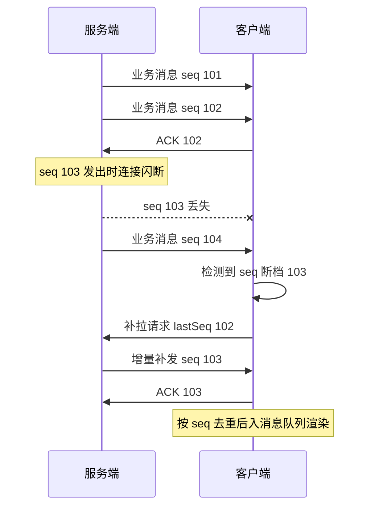

```javascript
// WebSocket 可靠层：seq 连续性检测 + ACK + 断线补拉
export class ReliableSocket {
  lastSeq = 0;
  buffer = new Map();                                  // 乱序暂存
  constructor(url, handlers) {
    this.handlers = handlers;
    this.connect(url);
  }
  connect(url) {
    this.ws = new WebSocket(url);
    this.ws.onopen = () => this.resync();              // 每次连接先补拉，防缺口
    this.ws.onmessage = e => this.onMessage(JSON.parse(e.data));
    this.ws.onclose = () => setTimeout(() => this.connect(url), this.backoff());
  }
  onMessage(msg) {
    if (msg.seq > this.lastSeq + 1) {                  // 检测到断档：103 丢了
      this.requestResync(this.lastSeq);
    }
    if (msg.seq <= this.lastSeq || this.buffer.has(msg.seq)) return; // 幂等：seq 去重
    if (msg.seq === this.lastSeq + 1) {
      this.lastSeq = msg.seq;
      this.handlers.message(msg);
      // 放行暂存区里连续的后续消息
      while (this.buffer.has(this.lastSeq + 1)) {
        this.lastSeq++;
        this.handlers.message(this.buffer.get(this.lastSeq));
        this.buffer.delete(this.lastSeq);
      }
      this.ack(msg.seq);                               // 关键消息确认
    } else {
      this.buffer.set(msg.seq, msg);                   // 乱序先暂存
    }
  }
  ack(seq) { this.send({ type: 'ACK', seq }); }
  requestResync(lastSeq) { this.send({ type: 'RESYNC', lastSeq }); }
  async resync() {
    // 重连后：服务端按 lastSeq 从 ring buffer 补发增量
    this.send({ type: 'RESYNC', lastSeq: this.lastSeq });
  }
  send(data) { this.ws.readyState === 1 && this.ws.send(JSON.stringify(data)); }
  backoff() { return Math.min(30_000, (this._b = (this._b ?? 500) * 2)); }
}

```

### SCN-185：监控发现部分用户的页面所有接口请求都发了两遍（甚至全局状态错乱），如何排查"页面被初始化两次"？
**答**：
- 先证实是"双实例"而不是重复渲染：给应用初始化打唯一实例 id（`crypto.randomUUID()`）并随请求上报，若同一会话出现两个实例 id，实锤页面跑了两份应用。
- 常见根因四类：入口脚本被引了两次（构建配置重复注入 + 手写 script）、预渲染/预取（如 Instant Pages、MPA prefetch）把页面在隐藏 iframe 里跑了一份、路由库与微前端各自挂载（双份 root 渲染）、热更新残留（生产不该出现 HMR）。
- 排查手段：上报 root 元素数量与入口脚本引用路径（initiator），把"哪来的第二份"定位出来。
- 修复方向：入口注入去重（构建层幂等）、预取类插件白名单排除敏感页、微前端挂载前检测已有实例并复用。

```javascript
// 双实例排查：实例 id 上报 + 引用路径取证 + 挂载防重
const INSTANCE_ID = crypto.randomUUID();

export function initApp() {
  // 1. 实例指纹：每次初始化登记，全局可查
  window.__APP_INSTANCES__ ??= [];
  window.__APP_INSTANCES__.push(INSTANCE_ID);
  if (window.__APP_INSTANCES__.length > 1) {
    // 取证：第二份从哪来（入口脚本引用路径与 root 数量）
    report({
      type: 'app-dual-instance',
      instances: window.__APP_INSTANCES__,
      roots: document.querySelectorAll('[data-app-root]').length,
      scripts: [...document.scripts]
        .filter(s => s.src.includes('entry'))
        .map(s => ({ src: s.src, initiator: s.getAttribute('data-initiator') ?? 'unknown' })),
    });
  }

  // 2. 挂载防重：检测已有实例则复用，拒绝二次初始化
  const root = document.querySelector('[data-app-root]');
  if (root.dataset.booted === 'true') {
    report({ type: 'app-mount-blocked', id: INSTANCE_ID });
    return;                                            // 已有实例接管，直接跳过
  }
  root.dataset.booted = 'true';
  createApp(App).mount(root);
}

// 3. 请求侧打点：所有 API 带实例 id，监控按实例 id 聚合发现双份流量
export function withInstanceId(headers = {}) {
  return { ...headers, 'X-Instance-Id': INSTANCE_ID };
}

// 4. 预取插件排除：Instant Pages / prefetch 类插件会在隐藏 iframe 里预执行页面
//    对写操作敏感的页面必须排除（否则双实例 + 副作用双触发）
export function setupPrefetchGuard() {
  document.addEventListener('mouseover', e => {
    const a = e.target.closest('a');
    if (a) a.setAttribute('data-no-instant', '');      // 敏感页链接排除预取
  }, { capture: true });
}
```

## 三十一、架构落地场景

### SCN-186：同一个业务要在 H5、小程序、App 内嵌页三端实现，页面 90% 相同，如何收敛技术方案？
**答**：
- 先量化再选型：盘点页面清单、交互差异（手势/分享/支付）、端能力 API 重合度。90% 重合是跨端框架的甜蜜区，差异部分走"平台分支"而不是三份代码。
- 选型对比三线：跨端框架（Taro/uni-app，一套代码多端产出）、自研适配层（业务代码 + 端能力抽象接口）、微前端（不适用多端）。结论通常是跨端框架 + 薄适配层。
- 架构分层：UI 与业务逻辑归框架层，端能力（支付/分享/定位/存储）收口到 adapter 接口，三端各实现一份，业务代码零条件分支。
- 渐进迁移：新页面一律新架构，老页面按改动频率逐步迁，设"端差异只允许出现在 adapter 层"的 lint 规则。

```javascript
// 三端收敛：端能力 adapter 抽象，业务代码零平台分支
// adapter 定义：端差异只允许出现在这里
export interface PlatformAdapter {
  pay(orderNo: string): Promise<PayResult>;
  share(payload: SharePayload): Promise<void>;
  getLocation(): Promise<{ lat: number; lng: number }>;
  setNavTitle(title: string): void;
  storage: { get(k: string): any; set(k: string, v: any): void };
}

// h5Adapter.ts —— H5 实现
export const h5Adapter: PlatformAdapter = {
  async pay(orderNo) { location.href = await api.getPayUrl(orderNo, 'h5'); return { channel: 'h5' }; },
  async share(payload) { await navigator.share?.(payload).catch(() => copyLink(payload.url)); },
  getLocation() { return geo.getCurrentPosition(); },
  setNavTitle: t => (document.title = t),
  storage: localStorageLike,
};

// taroAdapter.ts —— 小程序实现（Taro API）
export const taroAdapter: PlatformAdapter = {
  async pay(orderNo) { return Taro.requestPayment(await api.getPayParams(orderNo)); },
  share: payload => new Promise((res, rej) => Taro.showShareMenu({ success: res, fail: rej })),
  getLocation: () => Taro.getLocation({ type: 'gcj02' }),
  setNavTitle: t => Taro.setNavigationBarTitle({ title: t }),
  storage: { get: k => Taro.getStorageSync(k), set: (k, v) => Taro.setStorageSync(k, v) },
};

// 业务代码：只依赖接口，不知道自己跑在哪端
export function useCheckout(adapter: PlatformAdapter) {
  return {
    async submit(orderNo: string) {
      const result = await adapter.pay(orderNo);       // 三端同一份业务逻辑
      track('pay_submit', { orderNo, channel: result.channel });
      return result;
    },
  };
}
// 平台差异 lint：业务层 import 端 API 直接报错，只能 import adapter
// eslint rule: no-restricted-imports ["error", { paths: [{ name: "@tarojs/taro", message: "业务层禁止直接使用端 API，请用 adapter" }] }]
```

### SCN-187：老项目代码腐化严重，PM 又要加新功能，如何做到"新功能不背旧债"？
**答**：
- 隔离优先：新功能以独立模块/挂载点接入老页面，不 import 老代码（老代码只通过明确的接口暴露数据），防止新代码被旧风格感染。
- 全局污染防护：新模块用 Shadow DOM 或 CSS Modules + 命名空间，不依赖也不修改老页面的全局变量与样式；router/store 各用各的实例。
- 数据契约显式化：老页面 → 新模块只传 props，新模块 → 老页面只发事件，双向都不直接摸对方内部状态。
- 把"隔离"变成可度量约定：lint 禁止新目录 import 旧目录，CI 里新模块的依赖关系图单向。

```javascript
// 老页面加新功能：挂载点隔离 + 事件通信 + 依赖单向
// 老页面（遗留代码，不改动）：只预留一个挂载点与基础数据
// legacy.html: <div id="loyalty-widget"></div>

// 新功能模块（全新目录 src/features/loyalty/）：不 import 任何旧代码
export function mountLoyaltyWidget(hostEl, { getUserInfo, subscribeEvent }) {
  // 样式隔离：Shadow DOM，老页面全局样式进不来，新样式也不外泄
  const shadow = hostEl.attachShadow({ mode: 'open' });
  shadow.innerHTML = `
    <style>/* 组件自有样式，与老页面完全隔离 */ .card { border-radius: 8px; }</style>
    <div class="card" id="root"></div>`;

  // 数据通过显式契约进入，不直接读老页面全局变量
  getUserInfo().then(u => render(shadow.getElementById('root'), u));

  // 对外只发事件，老页面决定要不要响应
  emit(hostEl, 'loyalty:exchange', { points: 500 });

  return {
    // 老页面事件通过订阅进入新模块，数据流向始终单向
    destroy: () => { unsubscribe(); hostEl.shadowRoot?.replaceChildren(); },
  };
}
function emit(el, type, detail) { el.dispatchEvent(new CustomEvent(type, { detail, bubbles: true })); }

// 桥接层（唯一允许接触两边代码的文件，控制在一个文件内）
// src/bridges/loyalty-bridge.js
import { mountLoyaltyWidget } from '@/features/loyalty';
export function initLegacyLoyalty() {
  const host = document.getElementById('loyalty-widget');   // 老页面挂载点
  const widget = mountLoyaltyWidget(host, {
    getUserInfo: () => window.__LEGACY_API__.fetchUser(),   // 老系统 API 经契约暴露
    subscribeEvent: window.__LEGACY_BUS__.on,
  });
  host.addEventListener('loyalty:exchange', e => window.__LEGACY_BUS__.emit('openExchange', e.detail));
  return widget;
}
// CI 约束：features/** 禁止 import legacy/**，bridge 目录白名单放行
```

### SCN-188：各团队埋点口径混乱（同名事件含义不同、公共属性缺失），如何治理？
**答**：
- 口径乱的根源是"埋点没有 schema"：定义统一事件词典——事件名规范（模块_对象_动作）、必选公共属性（uid、page、ab 桶、时间戳）、每个事件一个 owner。
- 技术上单出口：所有埋点走统一 SDK，`track('page_view', {...})` 内部做 schema 校验（dev 环境不合规直接报错 + 上报采样审计），杜绝各处手拼字符串。
- 治理存量：跑历史数据统计"孤儿事件"（无 owner/无文档/30 天无消费），通知 owner 确认删除或补文档。
- 防新增失控：新事件登记进词典才允许发布，CI 校验代码中的事件名是否已注册。

```javascript
// 埋点治理：统一 SDK + schema 校验 + 事件词典登记
// schema.json（事件词典，代码生成 TS 类型，登记是发版前置条件）
const SCHEMA = {
  page_view: { props: ['page', 'referrer'], owner: 'infra', desc: '页面 PV' },
  order_submit: { props: ['orderId', 'amountRange', 'channel'], owner: 'trade', desc: '订单提交' },
};

export function createTracker({ env, getCommon }) {
  return function track(event, props = {}) {
    const def = SCHEMA[event];
    if (!def) {
      if (env !== 'prod') throw new Error(`[track] 事件未登记词典: ${event}`); // 未登记不允许埋
      report({ type: 'unregistered-event', event });  // 线上采样审计漏网之鱼
      return;
    }
    const common = getCommon();                        // 统一公共属性：uid、page、abBucket、ts
    const missing = def.props.filter(k => !(k in props));
    if (missing.length) {
      if (env !== 'prod') throw new Error(`[track] ${event} 缺少必选属性: ${missing}`); // dev 即报错
      report({ type: 'event-schema-violation', event, missing });   // 线上不丢数据但记录违规
    }
    sendTracking({ event, ...common, ...props, ts: Date.now() });
  };
}

// CI 校验：扫描代码中的事件名，未在词典登记的 MR 卡住
// node scripts/track-audit.js
export async function trackAudit() {
  const used = await scanTrackCalls('src/**/*.{js,ts,tsx}');
  const registered = new Set(Object.keys(SCHEMA));
  const illegal = [...used].filter(e => !registered.has(e));
  if (illegal.length) {
    fail(`以下事件未登记埋点词典，请先到 tracker-registry 仓库补充：${illegal.join(', ')}`);
  }
}

// 存量治理：孤儿事件月报
export async function orphanReport() {
  const consumed = await warehouse.listConsumedEvents({ lastNDays: 30 });
  const orphans = Object.keys(SCHEMA).filter(e => !consumed.has(e));
  orphans.forEach(e => notify(SCHEMA[e].owner, `事件 ${e} 30 天无消费，请确认是否下线`));
}
```

### SCN-189：公司代码要出内网不能传公网 npm，公共代码要在团队间复用，如何搭 npm 私服？
**答**：
- 私服双职责：托管私有包（内网组件库/工具库）+ 上游代理缓存（npmjs 拉取加速与离线可用），Verdaccio/Nexus 二选一，企业级多仓选 Nexus。
- 同步策略是核心矛盾：上游代理自动缓存公有包；私有包发布权限收紧（白名单 + 发布账号），防止内网包名撞上未来公有包（加 @corp scope 天然隔离）。
- 客户端配置：`.npmrc` 把 @corp scope 指向私服，其余走代理；token 走环境变量不入库。
- 配套治理：私有包必须带 CI 发布（禁止本地 publish）、版本 changelog 自动生成、弃用包 deprecate 标记。

```yaml
# Verdaccio 私服配置：scope 隔离 + 上游代理 + 发布权限
storage: /verdaccio/storage
auth:
  htpasswd:
    file: /verdaccio/htpasswd
    max_users: 20                                     # 账号收紧，新增走审批
uplinks:
  npmjs:
    url: https://registry.npmjs.org/                  # 上游代理：公有包缓存加速
    cache: true
    timeout: 10s
packages:
  '@corp/*':                                          # 私有 scope：只进内网，绝不外传
    access: $authenticated
    publish: $authenticated
    unpublish: team-frontend-core                     # 撤包仅核心团队
  '@*/*':                                             # 其他 scope：走上游代理
    access: $all
    publish: $authenticated
    proxy: npmjs
  '**':
    access: $all
    publish: $authenticated
    proxy: npmjs
middlewares:
  audit: { enabled: true }
logs: { content: stdout }
publish:                                              # 私有包发布前置校验（配合 CI）
  allow_publish: true
```

```ini
# 项目 .npmrc：scope 分流（token 从环境变量取，不入库）
@corp:registry=https://npm.example.com/
registry=https://npm.example.com/            # 其余走私服代理缓存
//npm.example.com/:_authToken=${NPM_TOKEN}
always-auth=true
```

```bash
# 发布流水线：CI 内发布（禁止本地 publish），版本与 changelog 自动化
# .gitlab-ci.yml 片段
publish-package:
  stage: release
  only: { refs: [tags] }                              # 只有打 tag 才发布，tag 即版本
  script:
    - npm version "$CI_COMMIT_TAG" --no-git-tag-version
    - npm publish --access restricted                 # @corp scope 默认私有
    - node scripts/gen-changelog.js >> RELEASE.md     # 从 conventional commits 生成变更记录
```

### SCN-190：长期重构与新需求并行，重构分支拖了几个月合不回主干，如何破局？
**答**：
- 破局原则：重构必须"持续可上线"，长分支是错误信号。策略改为绞杀者模式（strangler）：新旧实现共存于主干，按路由/模块逐步切换流量，而不是一次性替换。
- 旧功能被改时迁一格：紧急需求落在旧模块，顺带把该模块迁移到新架构（或以 adapter 包一层），重构范围随需求自然收敛。
- 用契约测试保护重构：对旧模块的外部行为固化测试用例，新实现跑同一套契约测试，绿灯才允许切流量。
- 双跑验证：高风险模块新旧实现对同一请求双跑（shadow），比对结果差异后再切量 1% → 10% → 100%。

```javascript
// 绞杀者模式：新旧实现共存主干，路由级切流 + 契约测试保护
export function resolveCheckoutImpl(route) {
  const migrated = ['cart', 'address'];                // 已迁移模块清单，随进度维护
  return migrated.includes(route.module) ? newCheckout : legacyCheckout;
}

// 新旧实现共用契约测试：行为一致才允许上线
// contracts/checkout.contracts.js
export const CHECKOUT_CONTRACTS = [
  { name: '提交空购物车返回 SPECIFIC_ERROR', input: { items: [] }, expectCode: 'EMPTY_CART' },
  { name: '优惠叠加金额合计精确', input: fixture('coupon-stack'), expect: r => sum(r.amounts) === r.total },
];

// 新实现跑同一套契约，绿灯才能进入切流名单
describe('new checkout contracts', () => CHECKOUT_CONTRACTS.forEach(c =>
  it(c.name, async () => expect(await newCheckout(c.input)).toSatisfy(c))));

// 切流执行器：按模块 + 白名单百分比，出问题秒回滚
export async function switchTraffic(module, { percent, userId }) {
  const inBucket = hash(userId + module) % 100 < percent;
  if (!inBucket) return legacyImpl;
  // 双跑观察期：新旧同时执行，只采样新实现结果 + 记录差异
  startShadowCompare(module);
  return newImpl;
}
// 回滚 = 把切流配置改回 0，不需要回滚代码
```

### SCN-191：运营每周要做十几个活动页，前端被机械劳动占满，如何把营销页做成"模板化自助交付"？
**答**：
- 营销页结构高度重复（头图 + 楼层 + 表单 + 规则弹窗），抽象成"楼层组件库 + 页面 schema"：运营在搭建后台拖拽产出 JSON，前端渲染器统一消费，零代码发布。
- 边界要清晰：模板化覆盖 80% 标准页面，超出模板能力的进"定制通道"（开发排期），避免为了 20% 特殊需求把渲染器做成大杂烩。
- 楼层组件是资产：按业务域沉淀（抽奖、邀请、榜单），物料带数据 schema、埋点 schema、降级方案。
- 稳定性配套：schema 发布走审核 + 预览 + 灰度；页面 URL 与版本绑定，改错可秒回滚。

```javascript
// 营销页模板化：schema 驱动的楼层渲染器
// 运营后台产出的页面 schema（审核 + 版本化存储）
const pageSchema = {
  id: 'promo-20261111',
  version: 3,
  floors: [
    { type: 'hero-banner', props: { image: 'cdn://banner.png', link: '/main' } },
    { type: 'coupon-wall', props: { batchId: 'b_123' }, track: { exposure: 'coupon_wall_view' } },
    { type: 'invite-list', props: { limit: 10 } },
    { type: 'rule-dialog', props: { content: 'markdown://rules.md' } },
  ],
};

// 渲染器：注册表分发楼层，物料自带降级
const FLOOR_REGISTRY = new Map([
  ['hero-banner', HeroBanner],
  ['coupon-wall', CouponWall],
  ['invite-list', InviteList],
  ['rule-dialog', RuleDialog],
]);

export function MarketingPage({ schema }) {
  usePageVersion(schema.version);                      // URL 与版本绑定，可秒回滚
  return schema.floors.map((f, i) => {
    const Floor = FLOOR_REGISTRY.get(f.type);
    if (!Floor) return <FloorFallback key={i} type={f.type} />; // 未注册楼层降级占位
    return (
      <ErrorBoundary key={i} fallback={<FloorFallback type={f.type} />}>
        <Floor {...f.props} track={f.track} />          {/* 楼层自带埋点 schema */}
      </ErrorBoundary>
    );
  });
}

// 物料示例：数据 schema + 埋点 + 降级三件套
function CouponWall({ batchId, track }) {
  const { data, error } = useQuery(['coupon-wall', batchId], () => api.getBatch(batchId), {
    fallbackData: STATIC_COUPONS,                      // 接口失败降级静态兜底数据
  });
  useEffect(() => { !error && track?.exposure && report(track.exposure, { batchId }); }, []);
  if (error && !data) return null;                     // 无兜底则静默降级，不白屏
  return <div>{data.map(c => <Coupon key={c.id} {...c} />)}</div>;
}
```

### SCN-192：多团队各自实现灰度标记（cookie、URL 参数、响应头都有），口径打架，如何统一？
**答**：
- 灰度标记乱的本质是"身份与分流判定的实现分散"：统一为"网关侧判定 + 全链路透传"，各端只读不判。
- 标准化身份：统一的设备指纹 / uid 生成与下发（登录前匿名 id，登录后并轨），网关按身份 + 分流规则计算灰度命中，结果写入响应头 `X-Gray-Bucket`。
- 前端只做两件事：把响应头里的灰度标记写入统一 cookie（透传给后续请求与第三方监控），把标记附进所有上报（分析时能分桶）。
- 灰度判定永不放前端：前端 JS 做分流会导致刷新/多端不一致与被篡改，前端只消费结论。

```javascript
// 灰度标记统一：网关判定，前端只透传与上报
// nginx（网关侧）示例：按 uid 计算 bucket 并注入响应头
// upstream 里由分流服务判定，此处示意注入点
// location /api/ {
//   proxy_set_header X-Uid $cookie_uid;
//   add_header X-Gray-Bucket $upstream_http_x_gray_bucket always;  # 透传到浏览器
// }

// 前端统一入口：首请求响应头 -> 写标准 cookie -> 全链路透传
export function captureGrayBucket(response) {
  const bucket = response.headers.get('X-Gray-Bucket');
  if (!bucket) return;
  // 统一口径：单一 cookie，各团队禁止自造
  document.cookie = `gray_bucket=${bucket}; path=/; max-age=86400; samesite=lax`;
  report({ type: 'gray-bucket', bucket, ts: Date.now() });   // 监控/分析按此分桶
  window.__GRAY_BUCKET__ = bucket;
}

// 请求层透传：后续所有请求自动带上，后端不用重复判定
export function withGrayHeaders(headers = {}) {
  const bucket = document.cookie.match(/gray_bucket=([^;]+)/)?.[1];
  return bucket ? { ...headers, 'X-Gray-Bucket': bucket } : headers;
}

// 禁止各团队私搭灰度：SDK 层面收口，dev 环境直接报错
export function legacyGrayCheck(name) {               // 旧接口，发现即治理
  console.error(`[gray] 禁止前端自判灰度（${name}），请使用网关统一 bucket`);
  report({ type: 'gray-violation', name });
  return false;
}
```

### SCN-193：集团十几个业务线共用一个登录体系，token 各存各的、刷新各刷各的，如何统一治理？
**答**：
- 收口到"统一鉴权域 + 短时票据换发"模式：登录、token 存储、刷新全部收敛在 sso.example.com，各业务站不持有长效 token，只持有短时访问票据（15 分钟）+ 一次性 refresh ticket。
- 子站认证流程重定向到统一登录域完成（或静默 iframe 续期），回跳带 code 换票据；刷新动作只在鉴权域发生，业务站零刷新逻辑。
- 登出全端生效：鉴权域维护会话，登出撤销会话并广播（各子站监听 storage 事件 + 服务端会话失效）。
- 迁移兼容：老站 token 过渡期双读（老 token 继续有效但新会话只发新票据），设下线时间表。

```javascript
// 共享登录态治理：鉴权域换发 + 静默续期 + 全端登出
// sso.example.com（鉴权域，唯一持有 refresh token 的地方）
export async function exchangeTicket(code) {           // 子站回跳后到鉴权域换票据
  return api.post('/sso/token', { code });             // { accessToken(15min), expiresAt }
}

// 子站 SDK：只管使用票据，刷新逻辑收敛在鉴权域
export function createAuth() {
  let token = null;
  async function ensureToken() {
    if (token && token.expiresAt > Date.now() + 60_000) return token.accessToken;
    // 静默续期：隐藏 iframe 向鉴权域要新票据（会话仍有效则免登录）
    const code = await silentRenew();                  // iframe postMessage 返回一次性 code
    token = await exchangeTicket(code);
    return token.accessToken;
  }
  return {
    fetch: async (input, init = {}) => {
      const accessToken = await ensureToken();
      return fetch(input, { ...init, headers: { ...init.headers, Authorization: `Bearer ${accessToken}` } });
    },
    logout: async () => {                              // 全端登出：撤销鉴权域会话并广播
      await api.post('/sso/logout');
      localStorage.setItem('sso-logout', String(Date.now())); // 同域子站 storage 事件兜底
      location.href = 'https://sso.example.com/logout';
    },
  };
}

// 多 tab 会话一致性：其他 tab 登出时本 tab 跟随失效
window.addEventListener('storage', e => {
  if (e.key === 'sso-logout') { token = null; redirectToLogin(); }
});

// 静默续期实现：鉴权域会话有效时 iframe 返回一次性 code
function silentRenew() {
  return new Promise((resolve, reject) => {
    const iframe = document.createElement('iframe');
    iframe.src = 'https://sso.example.com/silent-renew?client=shop';
    iframe.style.display = 'none';
    const onMsg = e => {
      if (e.origin !== 'https://sso.example.com') return;
      e.data.code ? resolve(e.data.code) : reject(new Error('SESSION_EXPIRED')); // 会话失效需重登录
      iframe.remove(); window.removeEventListener('message', onMsg);
    };
    window.addEventListener('message', onMsg);
    document.body.appendChild(iframe);
    setTimeout(() => { iframe.remove(); reject(new Error('RENEW_TIMEOUT')); }, 8000);
  });
}

```

## 三十二、新技术融合场景

### SCN-194：团队想用 WebGPU 做数据大屏的 3D 可视化，如何评估接入并设计降级链路？
**答**：
- 先做能力评估：WebGPU 需要 `navigator.gpu`、用户开启（部分浏览器默认关闭）、硬件支持；目标用户群的支持率决定它只能是"增强"而不是"依赖"。
- 渲染栈选型：直接用 WebGPU API 成本极高，评估现成库（three.js 的 WebGPURenderer、Babylon.js）是否满足需求，自研着色器只做差异化部分。
- 降级链路必须设计进架构：WebGPU → WebGL2 → Canvas2D（静态图兜底），三档能力由同一套场景描述驱动，上层业务无感知。
- 上线配套：能力检测打点（统计真实支持率）、性能对比（WebGPU 并非在所有场景快，小场景初始化反而更慢）、特性开关可一键回 WebGL。

```javascript
// WebGPU 接入：能力检测 + 三档降级链路 + 支持率打点
export async function createRenderer(canvas, scene) {
  const support = await detectGPU();
  report({ type: 'gpu-capability', ...support });       // 上线后统计真实支持率

  if (support.webgpu) {
    try {
      // 现成库优先：three.js WebGPURenderer 自动管理管线
      const { WebGPURenderer } = await import('three/webgpu');
      const renderer = new WebGPURenderer({ canvas, antialias: true });
      await renderer.init();                            // WebGPU 需要显式异步初始化
      return renderScene(renderer, scene);
    } catch (e) {
      report({ type: 'gpu-init-fail', msg: String(e) }); // 设备存在但初始化失败：驱动问题
    }
  }
  if (support.webgl2) {
    // 降级 1：WebGL2 渲染同一场景描述
    const renderer = new THREE.WebGLRenderer({ canvas });
    return renderScene(renderer, scene);
  }
  // 降级 2：Canvas2D 静态兜底（渲染一张预生成的场景图 + 关键数字）
  return renderStaticFallback(canvas, scene);
}

async function detectGPU() {
  const result = { webgpu: false, webgl2: false, adapter: null };
  if (navigator.gpu) {
    try {
      const adapter = await navigator.gpu.requestAdapter();
      result.webgpu = !!adapter;
      if (adapter) result.adapter = adapter.info?.architecture ?? 'unknown';
    } catch { /* 权限或设备问题按不支持处理 */ }
  }
  result.webgl2 = !!document.createElement('canvas').getContext('webgl2');
  return result;
}

// Canvas2D 兜底：大屏至少可看（截图或简化图表），业务指标不丢
function renderStaticFallback(canvas, scene) {
  const ctx = canvas.getContext('2d');
  ctx.fillStyle = '#0b1020'; ctx.fillRect(0, 0, canvas.width, canvas.height);
  scene.kpis.forEach((k, i) => {
    ctx.fillStyle = '#fff';
    ctx.fillText(`${k.label}: ${k.value}`, 40, 60 + i * 40);  // 关键指标文本兜底
  });
  return { dispose() {}, mode: 'canvas2d' };
}
```

### SCN-195：要在业务后台嵌入"AI 助手"，用户说"帮我把这个订单改成加急"，如何安全落地对话式操作？
**答**：
- 核心安全设计：AI 只产出"意图 + 参数"的草案，不直接执行；执行走受控 action 白名单，且高危操作（改单、退款）必须预览确认。
- 上下文注入要克制：给模型的信息是页面当前实体的结构化摘要（订单号、状态、权限），不是整个 DOM 或全量数据，控制 token 与敏感信息外泄。
- 结果校验：AI 返回的参数按 action schema 校验（枚举、格式），不合法直接要求澄清，不进入执行。
- 埋点与审计：每次对话、每次确认执行都落审计日志（谁、在哪个页面、让 AI 做了什么），这是 B 端 AI 功能的合规底线。

```javascript
// 对话式操作：意图草案 -> schema 校验 -> 预览确认 -> 白名单执行
const ACTIONS = {
  markUrgent: {
    schema: { orderId: /^\d{10,}$/, level: ['high', 'normal'] },
    risk: 'medium',
    preview: (p, ctx) => `将订单 ${p.orderId} 改为${p.level === 'high' ? '加急' : '常规'}`,
    execute: p => api.updateOrder(p.orderId, { urgent: p.level === 'high' }),
    permission: 'order:write',
  },
  queryOrder: { schema: { orderId: /^\d{10,}$/ }, risk: 'low',
    execute: p => api.getOrder(p.orderId) },
};

export async function handleUserUtterance(text, ctx) {
  // 1. 意图解析：模型只输出结构化草案，带页面上下文摘要
  const draft = await llm.chat({
    system: `你是订单后台助手。只输出 JSON：{action, params, clarify?}。
可用 action：${Object.keys(ACTIONS).join(', ')}。信息不足时输出 clarify 字段。禁止编造订单号。`,
    user: `用户输入：${text}\n当前页面上下文：${JSON.stringify(ctx.summary)}`, // 摘要而非全量
    json: true,
  });
  const parsed = safeParse(draft);
  if (parsed.clarify) return askUser(parsed.clarify);  // 信息不足先澄清

  // 2. 白名单 + schema 校验：不认识或参数不合法一律不执行
  const def = ACTIONS[parsed.action];
  if (!def || !checkPermission(ctx.user, def.permission)) return deny('无权限或操作不支持');
  if (!validateSchema(def.schema, parsed.params)) return askUser('参数校验失败，请确认订单号与选项');

  // 3. 高危操作预览确认：AI 不碰执行按钮
  if (def.risk !== 'low') {
    const ok = await confirmDialog({ title: 'AI 待执行操作', body: def.preview(parsed.params, ctx) });
    if (!ok) return cancel();
  }
  // 4. 执行 + 审计
  const result = await def.execute(parsed.params);
  auditLog({ userId: ctx.user.id, action: parsed.action, params: parsed.params, utterance: text });
  return result;
}
```

### SCN-196：团队在用 Next.js Pages Router，传闻要迁 RSC（React Server Components），如何做迁移评估而不是盲目跟风？
**答**：
- RSC 的收益是有条件的：内容重、数据聚合多、客户端 bundle 大的页面收益明显；重交互、重状态的后台页面收益趋近于零。评估第一步是现状盘点，不是学 API。
- 盘点三件事：组件树里 server-safe 组件占比（无状态、无事件、可服务端渲染）、客户端 bundle 构成（数据获取库占了多少）、数据流复杂度（多少瀑布式请求能被服务端聚合掉）。
- 成本面：数据获取模式变化（fetch 缓存语义）、第三方库兼容（依赖 window/Context 的库不能进 server 组件）、团队心智（server/client 边界调试成本）。
- 结论输出为决策矩阵：按页面逐个标"直接迁/改造后迁/不迁"，给出预估收益（bundle 减少 x%、TTFB 改善），而不是全站口号式迁移。

```jsx
// RSC 迁移评估：组件树盘点脚本 + 决策矩阵
// scripts/rsc-audit.tsx：扫描组件树，评估 server-safe 占比
import { parse } from '@babel/parser';
import traverse from '@babel/traverse';
import fg from 'fast-glob';

const CLIENT_SIGNALS = ['useState', 'useEffect', 'useReducer', 'useContext', 'onClick', 'onChange'];
const BANNED_IN_SERVER = ['window', 'document', 'localStorage', 'framer-motion', 'react-hook-form'];

export async function auditRscReadiness(pagesDir = 'src/pages') {
  const report = [];
  for (const file of await fg(`${pagesDir}/**/*.tsx`)) {
    const ast = parse(readFile(file), { sourceType: 'module', plugins: ['tsx'] });
    let hooks = 0, handlers = 0, clientOnlyImports = [];
    traverse.default(ast, {
      CallExpression(p) { if (CLIENT_SIGNALS.includes(p.node.callee.name)) hooks++; },
      JSXAttribute(p) { if (/^on[A-Z]/.test(p.node.name.name)) handlers++; },
      ImportDeclaration(p) {
        const src = p.node.source.value;
        if (BANNED_IN_SERVER.some(b => src.includes(b))) clientOnlyImports.push(src);
      },
    });
    report.push({
      file,
      serverSafeRatio: 1 - Math.min(1, (hooks + handlers * 0.5) / 20), // 启发式：交互越少越安全
      blockers: clientOnlyImports,
      verdict: hooks + handlers === 0 && !clientOnlyImports.length ? 'direct' // 可直接转 server 组件
        : clientOnlyImports.length < 3 ? 'refactor' : 'keep-client',       // 需改造 / 保持 client
    });
  }
  // 输出决策矩阵：按页面给出迁移建议与预期 bundle 收益
  return report.sort((a, b) => a.serverSafeRatio - b.serverSafeRatio);
}
// 评估结论示例：
//   pages/list       serverSafe 0.9  verdict direct       预期 bundle -40%（表格纯展示）
//   pages/dashboard  serverSafe 0.3  verdict keep-client  重交互后台，不迁
```

### SCN-197：营销活动页要用 Serverless（云函数）做 SSR，冷启动导致尾延迟飙高，如何应对？
**答**：
- 冷启动的现实：Node 函数冷启动几百 ms 到秒级，无法根治只能"藏"：预热（定时触发器保活）、最小化依赖（bundle 瘦身比 runtime 优化更有效）、容器复用（模块顶层做连接池，handler 外的代码只在冷启动执行一次）。
- 用户体验兜底：SSR 超时（如 800ms）内没返回就先推静态骨架（HTML 流式输出 / CDN 兜底页），数据到了再 hydrate，用户永远先看到东西。
- 架构上分层：静态部分走 CDN（HTML 壳 + 资源），只有动态数据走函数，把函数的调用量与冷启动面都压到最小。
- 监控按"尾延迟"治理：P99 而不是平均值，冷启动占比单独打点，作为容量与预热的依据。

```javascript
// Serverless SSR：预热保活 + 流式输出 + CDN 兜底
// handler：冷启动开销移出 handler，模块顶层只执行一次（容器复用期共享）
import express from 'express';                         // 最小依赖：宁可手写路由也不引全家桶
const app = express();
app.get('/promo/:id', async (req, res) => renderPromo(req, res));

let dbPool;                                            // 连接池随容器复用
async function init() {
  dbPool ??= createPool({ min: 1, max: 4 });           // 顶层初始化，handler 内零建连
  await warmTemplateCache();                           // 模板预编译，避免首请求编译
}
const ready = init();                                  // 冷启动路径只走一次

export async function handler(req, res) {
  await ready;
  // 流式输出：骨架先走，数据到了再补，冷启动与查询延迟都被"藏"住
  res.writeHead(200, { 'Content-Type': 'text/html; charset=utf-8' });
  res.write(renderSkeletonHtml(req.params.id));        // 1. 骨架立即可见
  const data = await withTimeout(fetchPromoData(dbPool, req.params.id), 800);
  res.write(renderDynamicSection(data ?? null));       // 2. 动态区块（失败给客户端兜底标记）
  res.write('</body></html>');
  res.end();
}

function withTimeout(p, ms) {
  return Promise.race([p, new Promise((_, rej) => setTimeout(() => rej(new Error('SSR_TIMEOUT')), ms))]);
}
// SSR 超时时动态区块输出客户端兜底标记，前端接管为 CSR 拉取
function renderDynamicSection(data) {
  return data
    ? renderList(data)
    : `<div id="promo-root" data-csr-fallback="1"></div>`; // 客户端检测到标记则走 CSR 补拉
}

// 预热：定时触发器每 5 分钟打一次，保持容器存活（配合厂商并发预留更稳）
// serverless.yml 节选
//   functions:
//     ssr:
//       events:
//         - schedule: rate(5 minutes)   # 预热触发
//       provisionedConcurrency: 2       # 预留并发：热路径零冷启动
```

### SCN-198：内部工具要"桌面化"：员工不想每次开浏览器找书签，PWA 桌面化如何落地？
**答**：
- PWA 桌面化 = manifest 安装（独立窗口、任务栏图标）+ Service Worker 缓存（内网弱环境可用）+ 系统能力（通知、协议唤起）。Chrome/Edge 支持最好，安装用 `beforeinstallprompt` 捕获引导。
- 缓存策略按资源分层：App shell（框架 HTML/CSS/JS）precache + 版本化更新，接口数据 network-first 带超时回退缓存，静态资源 cache-first。
- 更新体验是重点：SW 检测到新版本不自动刷新（打断工作），提供"有新版本，点击更新"的全局提示条，用户确认后 `skipWaiting` + 刷新。
- 内网特殊问题：证书信任、多子域 Cookie、SW 作用域要提前验证；离线可用范围要明确（工具类缓存最近数据快照即可）。

```javascript
// PWA 桌面化：安装引导 + SW 分层缓存 + 可控更新
// 1. 安装引导：捕获 beforeinstallprompt，在合适时机弹安装按钮
let deferredPrompt = null;
window.addEventListener('beforeinstallprompt', e => {
  e.preventDefault();
  deferredPrompt = e;                                  // 存起来，别让浏览器乱弹
});
export async function installApp() {
  if (!deferredPrompt) return showToast('当前浏览器不支持安装，可用 Chrome/Edge');
  deferredPrompt.prompt();
  const { outcome } = await deferredPrompt.userChoice;
  report({ type: 'pwa-install', outcome });
  deferredPrompt = null;
}

// 2. Service Worker：资源分层缓存
// sw.js
const SHELL_CACHE = 'shell-v12';                       // App shell：版本化
self.addEventListener('install', e => {
  e.waitUntil(caches.open(SHELL_CACHE)
    .then(c => c.addAll(['/', '/app.css', '/app.js'])) // 精确列出 shell 资源
    .then(() => self.skipWaiting()));
});
self.addEventListener('activate', e => {
  e.waitUntil(caches.keys().then(keys =>
    Promise.all(keys.filter(k => k !== SHELL_CACHE).map(k => caches.delete(k)))));
});

self.addEventListener('fetch', e => {
  const { request } = e;
  if (request.method !== 'GET') return;
  const url = new URL(request.url);
  if (url.pathname.startsWith('/api/')) {
    // 接口：network-first 带超时，失败回退缓存快照（工具离线可看最近数据）
    e.respondWith(
      fetch(request).then(res => {
        const clone = res.clone();
        caches.open('api-cache').then(c => c.put(request, clone));  // 顺带更新快照
        return res;
      }).catch(() => caches.match(request))
    );
  } else {
    // 静态资源：cache-first，miss 才网络
    e.respondWith(caches.match(request).then(hit => hit ?? fetch(request)));
  }
});

// 3. 更新提示：新版本就绪后提示用户手动刷新，不打断当前工作
navigator.serviceWorker.register('/sw.js').then(reg => {
  reg.addEventListener('updatefound', () => {
    const sw = reg.installing;
    sw.onstatechange = () => {
      if (sw.state === 'installed' && navigator.serviceWorker.controller) {
        showUpdateBar(() => { sw.postMessage('SKIP_WAITING'); location.reload(); });
      }
    };
  });
});
```

### SCN-199：页面要接入 Web Share API 与系统剪贴板，权限被拒或能力缺失时如何兜底？
**答**：
- 系统能力接入的统一姿势是"能力检测 → 请求权限 → 优雅降级"三层：能检测支持与否（`navigator.share` / `clipboard`）、能查权限状态（Permissions API）、每一层都有替代路径。
- 分享降级链：Web Share（含文件）→ 复制链接 + toast 提示 → 手动复制引导；桌面端没有 share sheet，直接走复制。
- 剪贴板写入的坑：非安全上下文（http）不可用、需用户手势触发、iOS Safari 需要在 promise 链内同步触达 DOM；复制富文本/图片各有 API 差异（ClipboardItem）。
- 权限被拒后的体验：明确告知"为什么需要 + 如何开启"（引导改设置），而不是静默失败让用户困惑。

```javascript
// 系统能力接入：能力检测 + 权限查询 + 逐层降级
export async function shareContent({ title, text, url, files }) {
  // 层 1：Web Share（支持文件分享）
  if (navigator.canShare?.({ files }) && files?.length) {
    try { await navigator.share({ files, title }); return { level: 'native-files' }; } catch (e) { if (e.name === 'AbortError') throw e; }
  }
  if (navigator.share) {
    try { await navigator.share({ title, text, url }); return { level: 'native' }; }
    catch (e) {
      if (e.name === 'AbortError') throw e;            // 用户主动取消不算失败
      report({ type: 'share-fallback', reason: e.name });
    }
  }
  // 层 2：复制链接 + 提示（桌面主路径）
  const copied = await copyToClipboard(url);
  if (copied) { toast('链接已复制，去粘贴给好友吧'); return { level: 'copy' }; }
  // 层 3：手动复制引导
  showManualCopyDialog(url);                           // 选中文本 + Ctrl C 教程
  return { level: 'manual' };
}

export async function copyToClipboard(text) {
  // 层 1：Async Clipboard API（安全上下文）
  if (navigator.clipboard && window.isSecureContext) {
    try { await navigator.clipboard.writeText(text); return true; }
    catch (e) {
      // 权限被拒：引导用户开权限，而不是静默降级
      if (e.name === 'NotAllowedError') { promptClipboardPermission(); return false; }
    }
  }
  // 层 2：execCommand 兜底（必须在用户手势同步链内）
  try {
    const ta = document.createElement('textarea');
    ta.value = text;
    ta.style.cssText = 'position:fixed;opacity:0';
    document.body.appendChild(ta);
    ta.select();
    const ok = document.execCommand('copy');           // 弃用但仍是最后的兜底
    ta.remove();
    return ok;
  } catch { return false; }
}

// 富文本/图片复制：ClipboardItem 按类型分发
export async function copyRichContent(node) {
  const html = node.innerHTML, blob = await domToPngBlob(node);
  await navigator.clipboard.write([
    new ClipboardItem({
      'text/html': new Blob([html], { type: 'text/html' }),
      'image/png': blob,
    }),
  ]);
}

// 权限状态查询 + 被拒引导
export async function checkClipboardPermission() {
  const st = await navigator.permissions.query({ name: 'clipboard-write' }).catch(() => null);
  return st?.state ?? 'prompt';                        // granted | prompt | denied
}
```

### SCN-200：低代码平台产出的页面与手写代码页面要长期共存，如何设计架构避免两套体系互相拖累？
**答**：
- 先定边界：低代码承接"标准 CRUD + 流程表单"（80% 内部工具），手写承接"高性能/复杂交互/品牌体验"页面。边界写进需求准入评审，防止低代码平台被逼成全能框架。
- 共存的关键是"物料协议"：手写团队把复杂组件封装成符合低代码协议的物料（props schema + 事件声明），低代码页可以消费手写组件，反过来低代码产物也可以作为组件被手写页面嵌入。
- 路由层统一：一个应用内通过路由分发到两套渲染管线（低代码渲染器 / 手写页面组件），共享登录态、主题、埋点等基础设施。
- 治理配套：低代码 schema 进 git（可评审可回滚）而不是只存在数据库；两套体系的版本升级节奏独立，但物料协议版本必须兼容。

```javascript
// 低代码与手写共存：路由分发 + 物料协议 + schema 入 git
// 1. 路由层统一分发，两套管线共享基础设施
const routes = [
  { path: '/admin/dashboard', component: HandWrittenDashboard },   // 手写管线
  { path: '/lc/:schemaId', component: LowCodeRenderer },           // 低代码管线
];
export function AppRoot() {
  useSharedInfra();                                    // 登录态/主题/埋点统一注入
  return <Router routes={routes} />;
}

// 2. 低代码渲染器：只消费注册过的物料，schema 来自 git 仓库（可评审回滚）
export function LowCodeRenderer({ schemaId }) {
  const schema = useSchemaFromGit(schemaId);           // build 时从物料仓库拉取编译，非运行时查库
  return schema.components.map((node, i) => {
    const Material = MaterialRegistry.get(node.type);
    if (!Material) return <MaterialMissing key={i} type={node.type} />;
    return <Material key={i} {...bindProps(node.props)} {...bindEvents(node.events, schema.actions)} />;
  });
}

// 3. 物料协议：手写组件封装成低代码可用物料
export const RichTableMaterial = {
  type: 'corp.rich-table',
  version: '2.1.0',                                    // 协议版本独立演进，向下兼容声明
  propsSchema: {                                       // 低代码编辑器据此渲染配置面板
    columns: { type: 'array', items: { key: 'string', title: 'string', type: 'enum:text|money|date' } },
    dataSource: { type: 'api', description: '数据源 API 地址' },
    selectable: { type: 'boolean', default: true },
  },
  events: ['rowClick', 'selectionChange'],             // 声明可绑定的输出事件
  Component: RichTable,                                // 手写实现，享受完整工程能力
};
MaterialRegistry.register(RichTableMaterial);

// 4. 反向嵌入：低代码页面产物可作为区块组件被手写页引用
import { LCBlock } from '@corp/lowcode-runtime';
export function HandWrittenPage() {
  return (
    <>
      <CustomHero />                                    {/* 手写复杂头部 */}
      <LCBlock schemaId="approval-summary" />           {/* 低代码区块直接嵌入 */}
      <CustomFooter />
    </>
  );
}
```

### SCN-201：AI 助手要做打字机效果：用 fetch + ReadableStream 消费 LLM 流式接口，中断与渲染节流怎么设计？

**答**：
- 选型先想清楚：`EventSource` 只能 GET、不能带 Authorization 头和自定义 body、不能控制重连——LLM 网关需要 POST + token + 多轮上下文，所以统一用 `fetch` + `ReadableStream`，SSE 协议层解析复用 AGT-041 的状态机（本场景给出面向 UI 的精简版）。
- 解析要点：`res.body` 是字节流，必须 `new TextDecoder()` 配 `{ stream: true }` 跨 chunk 解码（否则中文多字节字符被 chunk 切开时乱码）；SSE 按**空行**分帧，`data:` 字段多行用 `\n` 连接，OpenAI 风格流以 `data: [DONE]` 收尾；每轮末尾留有不完整帧要放回缓冲区。
- 中断设计：一个 `AbortController` 的 `signal` 贯穿整个请求；"停止生成"就是 `abort()`，`fetch` 与 `reader.read()` 都以 `AbortError` 拒绝；React 18 StrictMode 开发期 effect 双执行，cleanup 必须 abort，Vue 在 `onBeforeUnmount` abort，且中断后**已生成的文本要保留**。
- 渲染节流：每个 chunk 都 `setState` 会造成每秒几十次重渲（外加整段 markdown 反复解析），把增量缓冲进 ref，`requestAnimationFrame`（或 30-50ms 定时）每帧批量刷入 state——渲染频率与网络 chunk 频率解耦；流式中的 markdown 渲染配合 AGT-149 处理未闭合代码块。

```javascript
// streamChat.js：fetch 流式消费 SSE（POST + Authorization，EventSource 做不到）
export async function streamChat({ messages, signal, onDelta }) {
  const res = await fetch('/api/chat', {
    method: 'POST',
    headers: { 'Content-Type': 'application/json', Authorization: `Bearer ${getToken()}` },
    body: JSON.stringify({ messages, stream: true }),
    signal,
  });
  if (!res.ok) throw new Error(`HTTP ${res.status}`);      // 出错时响应不是流，按普通 HTTP 处理
  const reader = res.body.getReader();
  const decoder = new TextDecoder();                       // decode(value, {stream:true}) 才能正确跨 chunk 解中文
  let buf = '';
  while (true) {
    const { done, value } = await reader.read();
    if (done) break;
    buf += decoder.decode(value, { stream: true });
    const frames = buf.split('\n\n');                      // SSE 以空行分帧
    buf = frames.pop();                                    // 末段可能不完整，留回缓冲区
    for (const frame of frames) {
      const data = frame.split('\n')
        .filter((line) => line.startsWith('data:'))
        .map((line) => line.slice(5).replace(/^ /, ''))
        .join('\n');                                       // 多行 data 用 \n 连接
      if (data === '[DONE]') { await reader.cancel(); return; }
      if (data) onDelta(JSON.parse(data).choices?.[0]?.delta?.content ?? '');
    }
  }
}
```

```jsx
// useChatStream.js：缓冲 + rAF 批量刷新 + AbortController 全链路
export function useChatStream() {
  const [answer, setAnswer] = useState('');
  const [status, setStatus] = useState('idle');            // idle | streaming | done | aborted | error
  const bufRef = useRef('');
  const rafRef = useRef(0);
  const ctrlRef = useRef(null);

  const flush = () => {                                    // 每帧最多渲染一次
    rafRef.current = 0;
    if (bufRef.current) setAnswer((prev) => prev + bufRef.current);
    bufRef.current = '';
  };
  const enqueue = (chunk) => {                             // chunk 只进缓冲，不直接 setState
    bufRef.current += chunk;
    if (!rafRef.current) rafRef.current = requestAnimationFrame(flush);
  };

  useEffect(() => () => {                                  // 卸载兜底：abort + 取消挂起的帧
    ctrlRef.current?.abort();
    cancelAnimationFrame(rafRef.current);
  }, []);

  const send = async (messages) => {
    ctrlRef.current?.abort();                              // 上一轮未结束先掐断
    const ctrl = new AbortController();
    ctrlRef.current = ctrl;                                // 记录本轮 controller，用于区分中断来源
    setAnswer(''); bufRef.current = '';
    setStatus('streaming');
    try {
      await streamChat({ messages, signal: ctrl.signal, onDelta: enqueue });
      if (ctrlRef.current !== ctrl) return;                // 已被新一轮 send 接管，别覆盖状态
      flush();                                             // 流结束补刷最后一段
      setStatus('done');
    } catch (e) {
      if (e.name === 'AbortError') {
        if (ctrlRef.current !== ctrl) return;              // 被"停止生成"或新一轮掐断的旧请求：不覆盖状态
        flush(); setStatus('aborted');                     // 用户停止：保留已生成文本
      } else {
        setStatus('error');
      }
    }
  };
  const stop = () => ctrlRef.current?.abort();             // "停止生成"按钮直接调用
  return { answer, status, send, stop };
}
```

```javascript
// Vue 3 版差异点：shallowRef 避免长文本深响应开销，onBeforeUnmount 接管中断
// （send/AbortController 链路与上方 React 版同构，ctrl 为当轮请求的 AbortController）
const answer = shallowRef('');
const buf = shallowRef('');
let raf = 0;
function enqueue(chunk) {
  buf.value += chunk;
  if (!raf) raf = requestAnimationFrame(() => {            // 与 React 同思路：帧级批量刷
    answer.value += buf.value; buf.value = ''; raf = 0;
  });
}
onBeforeUnmount(() => { ctrlRef.current?.abort(); if (raf) cancelAnimationFrame(raf); });
```

### SCN-202：流式接口上线后"开发环境好好的，线上整段一次性吐出"——代理缓冲、保活、降级怎么排查与落地？

**答**：
- 症状一「整段一次吐出」：反向代理（Nginx 默认 `proxy_buffering on`）把 SSE chunk 攒满缓冲区才转发；首选后端在该接口响应头自声明 `X-Accel-Buffering: no`（单接口生效、不动全局配置），或在对应 location 设 `proxy_buffering off`；同时确认 gzip 不作用于此接口（压缩同样攒数据）、响应头带 `Content-Type: text/event-stream` 与 `Cache-Control: no-cache`。
- 症状二「长回答中途断流」：Nginx `proxy_read_timeout` 默认 60s，模型思考期无字节即被掐断；比无限调大超时更可控的做法是**后端每 15s 发一条 SSE 注释行 `: ping` 保活**——注释行不进入 data 解析，客户端无感。
- 症状三「越用越卡」：渲染节流的框架差异（承接 SCN-201）——React 用 rAF 缓冲每帧刷一次 state；Vue 用 `shallowRef` 存会话/长文本避免深响应代理开销；两边共同点都是"渲染频率与 chunk 频率解耦"，且 markdown 重解析只针对增量。
- 兜底链：代理层不可改（无法关缓冲）时退化为一次性 JSON，前端用本地匀速动画模拟打字机；流中断后已生成文本保留，按"整轮重发"重试；埋点把 **TTFT（首 token 延迟）、总时长、中断率**分开上报，TTFT 高时先给"思考中"动效而不是空白。

```nginx
# Nginx：为流式接口单独开 location（全局关闭会影响普通接口的缓冲收益）
location /api/chat {
    proxy_pass http://llm_gateway;
    proxy_http_version 1.1;
    proxy_set_header Connection '';
    proxy_buffering off;              # 关键：chunk 到达即转发，不攒满再吐
    proxy_cache off;
    proxy_read_timeout 300s;          # 兜底；配合后端 : ping 保活更可控
    gzip off;                         # 压缩模块同样会攒数据，流式接口必须关
}
```

```http
# 后端单接口自声明（推荐）：不动 Nginx 配置，随代码走
Content-Type: text/event-stream; charset=utf-8
Cache-Control: no-cache
X-Accel-Buffering: no
```

```javascript
// 后端保活：空闲期发 SSE 注释行（": " 开头），客户端解析器天然忽略
const keepAlive = setInterval(() => res.write(': ping\n\n'), 15000);
req.on('close', () => clearInterval(keepAlive));          // 连接断开必须清掉

// 前端降级：真流式不可用时本地匀速播放（视觉一致，但无逐 token 中断语义）
export function localTypewriter(text, { speed = 24, signal } = {}) {
  return new Promise((resolve) => {
    let i = 0;
    const timer = setInterval(() => {
      if (signal?.aborted) { clearInterval(timer); return resolve(false); }
      i = Math.min(text.length, i + 2);
      render(text.slice(0, i));
      if (i === text.length) { clearInterval(timer); resolve(true); }
    }, speed);
  });
}
```

```javascript
// 埋点：TTFT 与总时长分开报——首 token 慢是网关/模型问题，中途断流是代理问题
const t0 = performance.now();
let first = true;
streamChat({
  messages,
  signal,
  onDelta: (chunk) => {
    if (first) { report('ttft', Math.round(performance.now() - t0)); first = false; }  // 首个 delta 时刻
    enqueue(chunk);
  },
});
```
