# 前端面试题库：性能优化实战

本章节聚焦性能优化的**落地手段**，与 09 章（指标定义、监控上报、安全）互补而不重复：09 章回答"怎么量"，本章回答"怎么改"。覆盖图片与静态资源接入实战、关键渲染路径与加载策略、代码分割与产物治理、接口与数据层优化（BFF/GraphQL/SWR）、SSR/SSG/ISR 与 PWA 离线、运行时性能（Long Task、时间切片、虚拟列表、Worker/OffscreenCanvas）、Vue/React 框架级性能专项、内存优化，最后落到性能预算与 CI 卡口的度量闭环。每题配一段与题目一一对应的可运行代码。

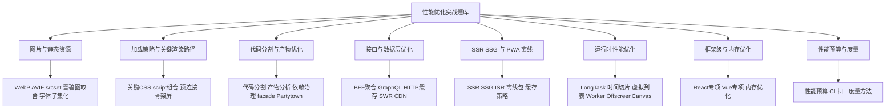

## 目录

- 一、图片与静态资源优化实战（OPT-001 ~ OPT-006）
- 二、加载策略与关键渲染路径（OPT-007 ~ OPT-012）
- 三、代码分割与产物优化（OPT-013 ~ OPT-019）
- 四、接口与数据层优化（OPT-020 ~ OPT-026）
- 五、SSR、SSG 与 PWA 离线（OPT-027 ~ OPT-030）
- 六、运行时性能优化（OPT-031 ~ OPT-036）
- 七、框架级与内存优化（OPT-037 ~ OPT-039）
- 八、性能预算与度量（OPT-040）
- 九、测量与分析体系（OPT-041 ~ OPT-047）
- 十、网络传输优化（OPT-048 ~ OPT-055）
- 十一、JS 执行优化（OPT-056 ~ OPT-064）
- 十二、渲染管线优化（OPT-065 ~ OPT-073）
- 十三、内存优化进阶（OPT-074 ~ OPT-080）
- 十四、框架专项：React（OPT-081 ~ OPT-088）
- 十五、框架专项：Vue（OPT-089 ~ OPT-095）
- 十六、Web Worker 与并行（OPT-096 ~ OPT-102）
- 十七、媒体与视觉优化（OPT-103 ~ OPT-109）
- 十八、端与平台特定（OPT-110 ~ OPT-120）
- 十九、首屏专项深水区（OPT-121 ~ OPT-128）
- 二十、交互与流畅度（OPT-129 ~ OPT-135）
- 二十一、状态与数据性能（OPT-136 ~ OPT-142）
- 二十二、构建侧性能（OPT-143 ~ OPT-149）
- 二十三、弱网与不稳定网络（OPT-150 ~ OPT-156）
- 二十四、内存与稳定性（OPT-157 ~ OPT-162）
- 二十五、性能监控与归因进阶（OPT-163 ~ OPT-169）
- 二十六、专项场景优化（OPT-170 ~ OPT-176）
- 二十七、新特性与新平台（OPT-177 ~ OPT-183）
- 二十八、体系与推进（OPT-184 ~ OPT-200）

## 一、图片与静态资源优化实战

### OPT-001：如何在生产环境接入 WebP/AVIF 并保证旧浏览器优雅降级？

**答**：
- 用 `<picture>` 的多个 `<source>` 声明候选格式：AVIF 优先、WebP 次之、JPEG 兜底，浏览器按顺序选择第一个支持的格式。
- AVIF 相比 JPEG 平均省 50% 体积、WebP 省 25%~35%，LCP 图片收益最明显。
- 服务端/CDN 也可根据请求头 `Accept: image/avif` 做内容协商，直接返回对应格式。
- 注意 AVIF 编码耗时高于 WebP，一般构建期或 CDN 边缘生成，不实时转码。

```html
<!-- 一一对应：picture 多 source 接入 AVIF/WebP 并兜底 JPEG -->
<picture>
  <!-- 浏览器从上到下匹配，支持 AVIF 就用 AVIF -->
  <source type="image/avif" srcset="hero.avif" />
  <!-- 不支持 AVIF 但支持 WebP 时走这里 -->
  <source type="image/webp" srcset="hero.webp" />
  <!-- 最终兜底：所有浏览器都支持 -->
  
</picture>
```

### OPT-002：srcset 与 sizes 如何落地响应式图片？

**答**：
- `srcset` 提供多份不同宽度的图，`sizes` 告诉浏览器"这张图在不同视口下会占多宽"，由浏览器结合 DPR 自动选择，比 JS 手动判断更可靠。
- `x` 描述符适合固定尺寸图（如 1x/2x 图标），`w` 描述符 + `sizes` 适合流式布局图片。
- 必须同时设置 `width/height` 属性，让浏览器提前计算宽高比，避免 CLS。
- 用 DevTools Network 面板 + `img.currentSrc` 验证实际选中的资源。

```html
<!-- 一一对应：流式布局图片的 srcset + sizes 落地 -->


<script>
  // 验证浏览器最终选中的资源
  console.log(document.querySelector('img').currentSrc);
</script>
```

### OPT-003：HTTP2 时代 CSS Sprites 还有必要吗？如何取舍？

**答**：
- 雪碧图的核心收益是"减少 HTTP1.1 并发请求数"，HTTP2 多路复用后该收益基本消失，且雪碧图定位难维护、任一图标改动会导致整图缓存失效。
- 彩色/多态图标优先用 SVG symbol 雪碧（合并进一个 svg 文件，`<use>` 引用），可继承 currentColor、随意缩放。
- 单色图标用 iconfont 或直接内联 SVG；只有大量极小、颜色固定的装饰图才偶尔考虑位图雪碧。
- 结论：新项目默认不做 CSS Sprites，选 SVG symbol 集合。

```html
<!-- 一一对应：SVG symbol 集合替代传统 CSS Sprites -->
<svg style="display: none">
  <symbol id="icon-cart" viewBox="0 0 24 24">
    <path d="M7 18a2 2 0 1 0 0 4 2 2 0 0 0 0-4zm10 0a2 2 0 1 0 0 4 2 2 0 0 0 0-4z" />
  </symbol>
  <symbol id="icon-user" viewBox="0 0 24 24">
    <circle cx="12" cy="8" r="4" />
  </symbol>
</svg>

<!-- 页面任意位置引用，颜色跟随 currentColor -->
<button style="color: #1677ff">
  <svg width="16" height="16"><use href="#icon-cart" /></svg>
  购物车
</button>
```

### OPT-004：图片懒加载如何落地？原生 loading=lazy 和 IntersectionObserver 怎么选？

**答**：
- 首屏内的图不要懒加载（尤其 LCP 图），首屏外的用 `loading="lazy"`，零 JS 成本，但 Chrome 有较大提前加载距离，控制粒度粗。
- 需要精确控制（如自定义预加载距离、占位渐显、轮播图）用 IntersectionObserver，`rootMargin` 提前 N px 开始加载。
- 懒加载图务必给固定宽高或占位背景，防止加载后撑开布局造成 CLS。
- 两者可组合：默认原生 lazy，特殊场景才写 IO 逻辑。

```javascript
// 一一对应：IntersectionObserver 懒加载，rootMargin 提前 200px 触发
const io = new IntersectionObserver(
  (entries) => {
    entries.forEach((entry) => {
      if (!entry.isIntersecting) return;
      const img = entry.target;
      // 用 data-src 中存放真实地址，加载后换回 src
      img.src = img.dataset.src;
      img.onload = () => img.classList.add('loaded'); // 渐显，避免突兀
      io.unobserve(img); // 加载一次后停止观察
    });
  },
  { rootMargin: '200px 0px', threshold: 0.01 } // 距视口 200px 时提前加载
);

document.querySelectorAll('img[data-src]').forEach((img) => io.observe(img));
```

### OPT-005：图片压缩与格式转换如何在构建期自动化落地？

**答**：
- 用 sharp（Node 端最快图像库）写构建脚本，批量生成 WebP/AVIF + 多宽度产物，接入 Vite/webpack 插件链。
- 有损压缩质量建议 75~80，肉眼难辨且体积骤降；JPEG 用 MozJPEG 算法；需要透明通道的用 WebP。
- 超过 100KB 的照片型图片收益最大；图标类应转 SVG 而不是压缩位图。
- CI 中加"图片体积预算"检查，防止大图混入仓库。

```javascript
// 一一对应：sharp 构建脚本，一张源图产出 AVIF/WebP 多宽度版本
import sharp from 'sharp';
import { readdir } from 'node:fs/promises';

const widths = [400, 800, 1600];
for (const file of await readdir('./src/images')) {
  if (!/\.(jpe?g|png)$/.test(file)) continue;
  for (const w of widths) {
    const base = file.replace(/\.\w+$/, '');
    // AVIF：体积最小，质量 60 即可
    await sharp(`./src/images/${file}`).resize({ width: w })
      .avif({ quality: 60 }).toFile(`./dist/${base}-${w}w.avif`);
    // WebP：兼容性兜底，质量 75
    await sharp(`./src/images/${file}`).resize({ width: w })
      .webp({ quality: 75 }).toFile(`./dist/${base}-${w}w.webp`);
  }
}
```

### OPT-006：字体子集化与 font-display 如何落地？

**答**：
- 中文字体动辄 5~10MB，必须子集化：`pyftsubset`（fonttools）按实际用到的字符裁剪，或用中文分片方案（按 unicode-range 切成几十个小包，用到哪片下哪片）。
- `font-display: swap` 让浏览器先用回退字体渲染，字体到位后切换，避免 3 秒白屏（FOIT），代价是短暂 FOUT 闪烁。
- 首屏关键字体加 `preload` 提前加载，配合 `font-family` 回退链调整行高避免布局抖动。
- 数字/Logo 类小字符集字体可内联为 base64 或 WOFF2 直接打包。

```css
/* 一一对应：子集化后的字体声明 + font-display: swap */
@font-face {
  font-family: 'PingFangSubset';
  /* pyftsubset 产物，只含页面实际用到的几百个字符 */
  src: url('./fonts/main-subset.woff2') format('woff2');
  font-display: swap;      /* 先用回退字体显示，加载完再切换 */
  unicode-range: U+4E00-9FFF; /* 只对中文区间生效，其余字符走回退 */
}

/* 预加载关键字体，与 CSS 中的 URL 保持一致 */
```

```html
<!-- 一一对应：关键字体的 preload -->
<link rel="preload" href="/fonts/main-subset.woff2" as="font" type="font/woff2" crossorigin />
```

## 二、加载策略与关键渲染路径

### OPT-007：关键 CSS 内联与剩余样式异步加载怎么做？

**答**：
- 渲染阻塞资源中 CSS 最容易被忽视：`<link rel="stylesheet">` 会阻塞首次渲染。
- 落地：提取首屏必需的关键 CSS（约 14KB 内）内联到 `<style>`，剩余样式异步加载。
- 异步加载的经典技巧是 `media="print"` 交换法或 `preload + onload`，两者都在不阻塞渲染的前提下提前下载。
- 工具链：critters（Vite 插件）、penthouse、Critical 可自动提取；注意内联样式无法被单独缓存，权衡后只内联真正关键的少量规则。

```html
<!-- 一一对应：关键 CSS 内联 + 剩余样式两种异步加载技巧 -->
<style>
  /* 首屏关键 CSS 内联：布局骨架、首屏文案样式 */
  header, .hero { display: block; }
  .hero { height: 300px; background: #f5f5f5; }
</style>

<!-- 技巧一：media=print 交换法。print 不阻塞渲染，加载完切回 all 生效 -->
<link rel="stylesheet" href="/styles/full.css" media="print" onload="this.media='all'" />

<!-- 技巧二：preload 提前下载，onload 时改为正式样式表 -->
<link rel="preload" href="/styles/full.css" as="style" onload="this.rel='stylesheet'" />

<!-- 兜底：JS 被禁用时仍能同步加载完整样式 -->
<noscript><link rel="stylesheet" href="/styles/full.css" /></noscript>
```

### OPT-008：defer、async、type=module、modulepreload 如何组合使用？

**答**：
- `defer`：并行下载，按出现顺序在 DOMContentLoaded 前执行——需要操作 DOM 且有顺序依赖的脚本用它。
- `async`：下载完立即执行、顺序不保证——独立无依赖的统计脚本用它。
- `type="module"`：默认行为等价 defer 且享受静态分析；`type="module" + async` 可做"下载即执行"的模块。
- `modulepreload` 比 `preload` 更进一步：不仅下载，还会解析模块并**递归预取依赖图**，是模块化应用首屏的主流组合。
- 典型落地：入口 module 用 `modulepreload`，统计类第三方用 `async`。

```html
<!-- 一一对应：几种 script 加载策略的组合落地 -->

<!-- 入口模块：modulepreload 递归预取整个依赖图，随后真正执行 -->
<link rel="modulepreload" href="/src/main.js" />
<link rel="modulepreload" href="/src/vendor.js" />
<script type="module" src="/src/main.js"></script>

<!-- 独立统计脚本：无依赖无顺序要求，下载完立即执行，不阻塞解析 -->
<script async src="https://analytics.example.com/collect.js"></script>

<!-- 传统 UMD 兜底脚本：需要 DOM 且按序执行 -->
<script defer src="/legacy/polyfill.js"></script>
```

### OPT-009：如何按场景选资源提示词？preload/prefetch/dns-prefetch/preconnect 实战选型

**答**：
- `preload`：**当前页面**马上要用的高优资源（关键字体、LCP 图、核心 CSS/JS），误用会造成带宽挤占和重复加载告警。
- `prefetch`：**下一次导航**可能用到的资源，空闲期低优先级下载，常用于预取下一页的 JS chunk。
- `preconnect`：提前完成 DNS + TCP + TLS 三步建连，适合确定要请求的第三方域（字体域、API 域）。
- `dns-prefetch`：只提前 DNS 解析，作为不支持 preconnect 浏览器的兜底，两者可并存。

```html
<!-- 一一对应：四种资源提示的正确分工 -->
<link rel="preload" href="/fonts/main.woff2" as="font" type="font/woff2" crossorigin />
<link rel="preload" href="/img/lcp-hero.avif" as="image" fetchpriority="high" />

<link rel="preconnect" href="https://api.example.com" crossorigin />
<link rel="dns-prefetch" href="https://api.example.com" />

<!-- 预取下一页 chunk：用户大概率点击的详情页 -->
<link rel="prefetch" href="/js/detail-page.chunk.js" />
```

### OPT-010：骨架屏与数据预取如何配合降低感知延迟？

**答**:
- 骨架屏的作用是"感知性能"：占位结构要和真实内容布局一致并固定尺寸，否则数据回来后布局跳动反而伤 CLS。
- 更进一步是数据预取：路由组件 `import()` 触发的同时就发数据请求，两者并行，省掉"组件下载完才开始请求"的串行时间。
- 常见落地：Vue Router 的 `beforeEach`/导航钩子中预取并挂到 `meta`（早于组件 `import()` 解析，才能并行），或 React Router loader；列表页 hover 即预取详情。
- SSR 场景数据随 HTML 内联（`window.__INITIAL_STATE__`），无骨架屏必要。

```javascript
// 一一对应：路由级数据预取 —— 组件加载与数据请求并行
const routes = [{
  path: '/detail/:id',
  component: () => import('./Detail.vue'),
  meta: { fetch: (ctx) => fetch(`/api/detail/${ctx.params.id}`) },
}];

router.beforeEach((to) => {
  // 导航一开始就发数据请求，与路由组件的 import() 并行下载
  // （beforeResolve 阶段懒加载组件已解析完，拿不到并行收益）
  if (to.meta.fetch) to.meta.data = to.meta.fetch(to).catch(() => null);
});
```

### OPT-011：为什么说 HTTP2 下的域名分片（domain sharding）已经过时？

**答**：
- 域名分片是 HTTP1.1 时代绕过"单域名 6 个并发连接"限制的手段，HTTP2 单连接多路复用，分片反而有害：多个域名意味着多次 TLS 握手、连接无法复用、丢失 HTTP2 的流优先级。
- 老项目迁移到 HTTP2 后应合并域名；静态资源域名从多个收敛到一个。
- 注意残留问题：HTTP2 仍有 TCP 层队头阻塞（丢包阻塞所有流），弱网高丢包场景 HTTP3/QUIC 才是根治方案。
- 用 `nextHopProtocol` 可验证资源实际走的协议版本（h2 / h3 / http/1.1）。

```javascript
// 一一对应：用 PerformanceResourceTiming 检查各资源实际协议
const resources = performance.getEntriesByType('resource');
const byProtocol = resources.reduce((acc, r) => {
  // nextHopProtocol 如 "h2"、"h3"、"http/1.1"
  acc[r.nextHopProtocol] = (acc[r.nextHopProtocol] || 0) + 1;
  return acc;
}, {});
console.log('各协议资源分布：', byProtocol);
// 若发现多个域名仍在用 http/1.1，说明存在未收敛的分片或降级
```

### OPT-012：预连接与 TLS 0-RTT 如何优化首屏建连耗时？

**答**：
- 一个新域名的完整建连 = DNS（1 RTT）+ TCP 握手（1 RTT）+ TLS 握手（1~2 RTT），跨域第三方资源首请求可能白白多花 200~400ms。
- `preconnect` 让浏览器提前并行完成这三步，之后请求直接复用连接。
- TLS 1.3 的 0-RTT（early data）允许复用会话的客户端在第一个握手包里直接携带请求数据，进一步省 1 RTT。
- 0-RTT 数据有重放风险，服务端只应对幂等的 GET 开启；`preconnect` 控制在 2~4 个关键域，多了反而抢占带宽。

```html
<!-- 一一对应：预连接关键第三方域 + 服务端开启 0-RTT 的说明 -->
<link rel="preconnect" href="https://cdn.example.com" />
<link rel="preconnect" href="https://api.example.com" crossorigin />
<link rel="dns-prefetch" href="https://static.third-party.com" />

<!-- Nginx 服务端开启 TLS1.3 与 0-RTT（仅接受幂等请求）：
     ssl_protocols TLSv1.2 TLSv1.3;
     ssl_early_data on;
     配合 proxy_set_header Early-Data $ssl_early_data; 在应用层拦截非幂等重放 -->
```

## 三、代码分割与产物优化

### OPT-013：路由级代码分割如何落地？

**答**：
- 原理是动态 `import()`：构建器把被动态引用的模块切成独立 chunk，首次访问路由时才下载。
- Vue Router 直接让 `component` 返回动态 import；React 用 `React.lazy + Suspense`。
- 配合 `manualChunks`/`splitChunks` 把 react/vue 等稳定依赖抽 vendor 包，走长缓存，业务代码迭代不影响 vendor 缓存。
- 注意避免 barrel file（如 `import { Button } from 'antd'` 全量引入）导致"分了等于没分"，必要时开启 `sideEffects` 声明辅助 tree-shaking。

```typescript
// 一一对应：Vite 项目路由分割 + vendor 分包配置
// vite.config.ts
import { defineConfig } from 'vite';
import vue from '@vitejs/plugin-vue';

export default defineConfig({
  plugins: [vue()],
  build: {
    rollupOptions: {
      output: {
        manualChunks: {
          // 框架与路由抽 vendor：业务迭代不影响其缓存
          vendor: ['vue', 'vue-router', 'pinia'],
        },
      },
    },
  },
});

// router.ts —— 每个路由一个 chunk，按需加载
const routes = [
  { path: '/', component: () => import('./views/Home.vue') },
  { path: '/admin', component: () => import('./views/Admin.vue') },
];
```

### OPT-014：组件级代码分割适合什么场景？怎么落地？

**答**：
- 适用：首屏不可见但体积大的重组件——图表库、富文本编辑器、复杂弹窗、打印机配置面板。
- React 用 `lazy()` 包组件、`Suspense` 提供加载态；Vue 用 `defineAsyncComponent` 并可配置 loading/error 组件。
- 与路由分割的区别：粒度更细、按交互触发；要防止用户点击后才加载导致的等待感，可在鼠标 hover/空闲期 `import()` 预热。
- 弹窗类组件只在 open 时渲染，天然适合分割，首屏 bundle 可减数百 KB。

```jsx
// 一一对应：React 组件级分割 + 预热
import { lazy, Suspense, useState } from 'react';

// 只有真正渲染到它时才会请求 chunk
const HeavyChart = lazy(() => import('./HeavyChart'));

export default function Dashboard() {
  const [show, setShow] = useState(false);

  // hover 按钮时提前预热 chunk，点击时秒开
  const preload = () => import('./HeavyChart');

  return (
    <div>
      <button onMouseEnter={preload} onClick={() => setShow(true)}>
        查看报表
      </button>
      {show && (
        <Suspense fallback={<div>图表加载中...</div>}>
          <HeavyChart />
        </Suspense>
      )}
    </div>
  );
}
```

### OPT-015：如何用产物分析工具定位 bundle 体积问题？

**答**：
- Vite/Rollup 用 `rollup-plugin-visualizer`，webpack 用 `webpack-bundle-analyzer`，产出 treemap 直观展示"谁占了体积"。
- 分析四类典型问题：被整包引入的大库（moment/locale）、重复依赖（两个版本的 lodash）、polyfill 过度（legacy 插件目标过旧）、静态资源误打包（大 JSON/图片 base64）。
- 看体积要同时看原始体积与 gzip/brotli 后体积，传输成本以后者为准。
- 把分析命令固化到 `npm run analyze`，配合 CI 体积报告（size-limit / bundlesize）形成习惯。

```typescript
// 一一对应：Vite 接入 rollup-plugin-visualizer
import { defineConfig } from 'vite';
import { visualizer } from 'rollup-plugin-visualizer';

export default defineConfig({
  plugins: [
    visualizer({
      filename: 'dist/stats.html', // 构建后打开 dist/stats.html 查看 treemap
      template: 'treemap',         // 也可选 sunburst / network
      gzipSize: true,              // 同时展示 gzip 后体积，更接近真实传输成本
      brotliSize: true,
    }),
  ],
});
```

### OPT-016：moment→dayjs、lodash→lodash-es 这类依赖替换如何推进？

**答**：
- moment 全量含 locale 约 300KB 且架构上无法 tree-shaking；dayjs 核心 2KB、API 兼容，提供 adapter 式插件（timezone/duration），是官方推荐迁移目标。
- lodash CJS 全量不可摇树，换 `lodash-es`（ESM）后 `import { debounce } from 'lodash-es'` 只打包被引用的函数。
- 推进策略：先在 CI 加体积守卫暴露问题 → 新代码禁用旧库（ESLint no-restricted-imports）→ 存量按模块渐进替换。
- 类似替换还有 moment-timezone→dayjs timezone、`core-js` 全量→按 browserslist 精准 polyfill。

```javascript
// 一一对应：依赖替换前后的写法对比
// 替换前：moment 全量 300KB+，CJS 无法 tree-shaking
// import moment from 'moment';
// import 'moment/locale/zh-cn';
// moment().format('YYYY-MM-DD');

// 替换后：dayjs 核心 2KB，插件按需加载
import dayjs from 'dayjs';
import isSameOrBefore from 'dayjs/plugin/isSameOrBefore';
dayjs.extend(isSameOrBefore);

console.log(dayjs('2026-01-01').format('YYYY-MM-DD'));

// lodash 改用 ESM 版本，只打包用到的函数
import { debounce } from 'lodash-es';
window.addEventListener('resize', debounce(() => console.log('resized'), 200));
```

### OPT-017：npm 依赖中的重复版本问题如何治理？

**答**：
- 典型症状：A 依赖 lodash@4.17.15、B 依赖 lodash@4.17.21，npm 平铺后可能装两份；更危险的是 vue/react 装两份导致 Hook 报错、context 断裂。
- 治理手段：pnpm 的硬链接 + 严格 node_modules 天然防幽灵依赖；npm/yarn 用 `dedupe`；lockfile 提交并审查。
- 强约束兜底：Vite/webpack 的 `resolve.alias` 把关键库统一指到单一版本；`peerDependencies` 声明"宿主提供"的库避免被打进产物。
- 用 `npm ls <pkg>` / `pnpm why <pkg>` 找出引入路径，从源头收敛。

```typescript
// 一一对应：Vite alias 强制单一版本 + 手动查重
import { defineConfig } from 'vite';
import { fileURLToPath } from 'node:url';

export default defineConfig({
  resolve: {
    alias: {
      // 项目里无论哪个包 import 'vue'，都解析到同一份，防止双实例
      vue: fileURLToPath(new URL('./node_modules/vue/dist/vue.runtime.esm-bundler.js', import.meta.url)),
    },
  },
});

// 排查命令（终端执行）：
// npm ls react          查看 react 是否存在多个版本及引入链
// pnpm why lodash       查看 lodash 被谁依赖
// npm dedupe            自动去重可合并的版本
```

### OPT-018：第三方脚本（地图/视频/客服）如何用 facade 模式优化？

**答**：
- 问题：YouTube/高德地图等第三方脚本动辄数百 KB，且会在页面加载早期执行，挤占主线程（伤 TBT/INP）。
- facade 模式：页面先渲染一个"假外观"——封面缩略图 + 播放按钮 + 加载提示，**不加载任何第三方 JS**；用户点击时才动态插入真实 SDK。
- 视频封面可用 `https://i.ytimg.com/vi/<id>/hqdefault.jpg` 官方缩略图，配合大按钮满足无障碍。
- 收益案例：web.dev 用 lite-youtube 后，首屏渲染时间从 5.5s 降到 650ms 量级。

```jsx
// 一一对应：视频 facade 组件 —— 点击前不加载任何第三方脚本
import { useState } from 'react';

export default function VideoFacade({ videoId, title }) {
  const [activated, setActivated] = useState(false);

  if (activated) {
    // 点击后才真正插入 iframe，加载 YouTube 脚本
    return (
      <iframe
        src={`https://www.youtube.com/embed/${videoId}?autoplay=1`}
        title={title}
        allow="autoplay; fullscreen"
        style={{ width: '100%', aspectRatio: '16 / 9' }}
      />
    );
  }

  // facade：静态缩略图 + 按钮，零第三方脚本成本
  return (
    <button
      onClick={() => setActivated(true)}
      aria-label={`播放视频 ${title}`}
      style={{ position: 'relative', width: '100%', aspectRatio: '16 / 9', border: 'none' }}
    >
      
      <span style={{ position: 'absolute', inset: 0, display: 'grid', placeItems: 'center', fontSize: 48 }}>
        ▶
      </span>
    </button>
  );
}
```

### OPT-019：Partytown 的核心思想是什么？适合什么场景？

**答**：
- Partytown 把第三方分析/营销脚本从主线程搬进 **Web Worker** 执行，让第三方代码不再抢占主线程。
- 技术关键：Worker 里没有 DOM，Partytown 通过同步消息代理（Synchronous XHR 风格的 service worker 桥）拦截 `document/window` 访问，转发回主线程执行，让第三方脚本"以为"自己能直接碰 DOM。
- 适合：GA、GTM、Facebook Pixel、Hotjar 等纯数据收集类脚本；不适合需要真实渲染的脚本（如聊天挂件 UI、地图）。
- 集成成本极低：一个 script + `type="text/partytown"` 标记要迁移的脚本。

```html
<!-- 一一对应：Partytown 集成，把 GA 脚本移入 Worker -->
<!-- 1. 在页面头部引入 partytown 的 snippet -->
<script>
  partytown = {
    forward: ['dataLayer.push'], // 转发 dataLayer 调用到 worker
  };
</script>
<script src="/~partytown/debug/partytown.js"></script>

<!-- 2. 原 GA 脚本加上 type="text/partytown"，主线程不再执行它 -->
<script type="text/partytown">
  (function (i, s, o, g) {
    i['GoogleAnalyticsObject'] = o;
    i[o] = i[o] || function () { (i[o].q = i[o].q || []).push(arguments); };
    i[o].l = 1 * new Date();
    i[o].src = g;
    document.head.appendChild(i[o]);
  })(window, document, 'ga', 'https://www.google-analytics.com/analytics.js');
  ga('create', 'UA-XXXXX-Y', 'auto');
  ga('send', 'pageview');
</script>
```

## 四、接口与数据层优化

### OPT-020：如何通过 BFF 聚合接口减少前端串行请求？

**答**：
- 前端页面常需要"用户信息 + 订单 + 推荐"三份数据，分别请求客户端要串行/并行多次往返，还可能造成瀑布。
- BFF（Backend For Frontend）层提供一个聚合接口：并行调用下游微服务，统一裁剪字段后一次性返回。
- 落地要点：用 `Promise.allSettled` 并行调用并做**部分失败降级**（某个下游挂了不能拖垮整页）；设置整体超时；对稳定数据加短 TTL 缓存。
- 收益：请求数从 N 到 1，弱网下减少 RTT 往返，前端逻辑简化。

```javascript
// 一一对应：BFF 聚合接口，并行调用 + 部分失败降级
import express from 'express';
const app = express();

app.get('/api/page-data', async (req, res) => {
  const timeout = (p, ms) => Promise.race([
    p,
    new Promise((_, rej) => setTimeout(() => rej(new Error('timeout')), ms)),
  ]);

  // 并行调用三个下游服务，互不等待
  const [user, orders, recommend] = await Promise.allSettled([
    timeout(fetch('http://user-svc/api/user?id=' + req.query.uid).then((r) => r.json()), 800),
    timeout(fetch('http://order-svc/api/orders?uid=' + req.query.uid).then((r) => r.json()), 800),
    timeout(fetch('http://rec-svc/api/rec?uid=' + req.query.uid).then((r) => r.json()), 800),
  ]);

  // 只取需要的字段，部分失败返回降级默认值
  res.json({
    user: user.status === 'fulfilled' ? user.value : null,
    orders: orders.status === 'fulfilled' ? orders.value.list.slice(0, 10) : [],
    recommend: recommend.status === 'fulfilled' ? recommend.value : [],
  });
});

app.listen(3000);
```

### OPT-021：什么场景应该选 GraphQL？落地要注意什么？

**答**：
- 优势：客户端按需声明字段（避免多取/少取）、一次请求取多资源、schema 即文档，适合多端差异化取数的场景。
- 成本：HTTP 缓存失效（POST 单端点）、查询深度需要防护（复杂度限制/maxDepth）、N+1 问题要用 DataLoader 批量化。
- 若页面数据形状固定、缓存诉求强，REST + BFF 聚合往往更简单；不要为了技术选 GraphQL。
- 落地组合：Apollo/urql 客户端 + DataLoader resolver + persisted query（把查询语句固化，省流量且便于 CDN 缓存）。

```javascript
// 一一对应：GraphQL resolver 中用 DataLoader 解决 N+1
import { ApolloServer } from '@apollo/server';
import DataLoader from 'dataloader';

// 假设 getAuthorsByIds 底层是一条 WHERE id IN (...) 的批量查询
const authorLoader = new DataLoader(async (ids) => {
  const rows = await db.query('SELECT * FROM author WHERE id = ANY($1)', [ids]);
  // DataLoader 要求按入参顺序返回，做一次对齐
  return ids.map((id) => rows.find((r) => r.id === id) ?? null);
});

const typeDefs = `
  type Book { id: ID! title: String author: Author }
  type Author { id: ID! name: String }
  type Query { books: [Book!]! }
`;

const resolvers = {
  Query: { books: () => db.query('SELECT * FROM book') },
  Book: {
    author: (book) => authorLoader.load(book.authorId), // 100 本书只发 1 次批量查询
  },
};

new ApolloServer({ typeDefs, resolvers });
```

### OPT-022：接口的 HTTP 缓存如何在实战中配置？

**答**：
- 强缓存：`Cache-Control: max-age=60` 在有效期内不发请求，适合基本不变的字典数据。
- 协商缓存：服务端下发 `ETag`，浏览器带 `If-None-Match` 回验，命中返回 304 只传头不传体，适合更新频繁但内容可对比的数据。
- 中间层：`s-maxage` 控制 CDN/代理缓存时长，`private` 防止公共缓存存储带用户身份的响应。
- 鉴权、个性化接口一律 `Cache-Control: private, no-store`，避免缓存投毒与串号。

```javascript
// 一一对应：Express 接口缓存三件套实战
import express from 'express';
import { createHash } from 'node:crypto';
const app = express();

// 1. 字典数据：强缓存 5 分钟
app.get('/api/dict', (_req, res) => {
  res.set('Cache-Control', 'public, max-age=300');
  res.json(DICT);
});

// 2. 列表数据：协商缓存，内容不变只回 304
app.get('/api/notes', (req, res) => {
  const body = JSON.stringify(getNotes(req.query.uid));
  const etag = 'W/"' + createHash('md5').update(body).digest('hex') + '"';
  res.set('ETag', etag);
  if (req.headers['if-none-match'] === etag) return res.sendStatus(304);
  res.set('Cache-Control', 'private, max-age=0, must-revalidate');
  res.send(body);
});

// 3. 用户隐私接口：任何层都不缓存
app.get('/api/me', (req, res) => {
  res.set('Cache-Control', 'private, no-store');
  res.json(getMe(req));
});

app.listen(3000);
```

### OPT-023：stale-while-revalidate 如何提升接口加载体感？

**答**：
- 语义：`Cache-Control: stale-while-revalidate=N`——缓存过期后的 N 秒内，**先立即返回旧内容，同时后台异步刷新**，下次请求就是新的。
- 对用户：请求"永远秒回"（拿旧缓存）；对数据：后台静默更新，最终一致。
- 浏览器与 CDN（如 Cloudflare）都支持；也可在应用层手写同样的策略以获得更细的控制。
- 适合：允许短暂陈旧的读多写少数据（首页 feed、商品列表）；不适合余额、库存等强实时数据。

```javascript
// 一一对应：应用层手写 stale-while-revalidate 策略
const cache = new Map(); // key -> { value, ts }

async function swrFetch(url, maxAge = 30_000, swr = 60_000) {
  const hit = cache.get(url);
  const now = Date.now();

  // 命中新鲜缓存：直接返回，不发请求
  if (hit && now - hit.ts < maxAge) return hit.value;

  // 命中过期但在 SWR 窗口内：先返回旧值，后台刷新
  if (hit && now - hit.ts < maxAge + swr) {
    fetch(url).then((r) => r.json()).then((v) => cache.set(url, { value: v, ts: Date.now() }));
    return hit.value;
  }

  // 完全没缓存：同步等待请求
  const res = await fetch(url).then((r) => r.json());
  cache.set(url, { value: res, ts: Date.now() });
  return res;
}
```

### OPT-024：SWR 思想在业务中如何落地？

**答**：
- SWR = stale-while-revalidate 的数据请求库化：**先用缓存渲染，再发请求校验更新**，页面切换回来即时有内容。
- 核心机制：以 key（通常是 URL）为缓存的请求去重（同一 key 并发只发一次）、聚焦时 revalidate、错误重试、乐观更新。
- React 用 `swr` / `react-query(TanStack Query)`，Vue 用 `vue-query`；关键在 key 设计：key 变化 = 数据变化 = 自动重新请求。
- 配合 `keepPreviousData` 可实现分页无闪烁翻页。

```javascript
// 一一对应：swr 库的标准落地（缓存优先 + 后台校验）
import useSWR from 'swr';

const fetcher = (url) => fetch(url).then((r) => r.json());

export default function UserProfile({ uid }) {
  // key 相同的多个组件共享缓存，只发一次请求
  const { data, error, mutate, isValidating } = useSWR(`/api/user/${uid}`, fetcher, {
    revalidateOnFocus: true,      // 窗口聚焦时静默校验
    dedupingInterval: 2000,      // 2s 内相同 key 去重
    keepPreviousData: true,      // uid 变化时先显示旧数据，分页不闪烁
  });

  if (error) return <div>加载失败 <button onClick={() => mutate()}>重试</button></div>;
  if (!data) return <div>首次加载中...</div>;

  return (
    <div>
      <h3>{data.name} {isValidating ? '(更新中...)' : ''}</h3>
      {/* 乐观更新：先改本地缓存再发请求，失败回滚 */}
      <button onClick={async () => {
        await mutate({ ...data, followed: !data.followed }, { revalidate: false });
        try {
          await fetch(`/api/user/${uid}/follow`, { method: 'POST' });
          mutate(); // 成功后校验服务端真实值
        } catch {
          mutate(data, { revalidate: false }); // 回滚
        }
      }}>
        {data.followed ? '取消关注' : '关注'}
      </button>
    </div>
  );
}
```

### OPT-025：防抖节流在性能优化中的位置和边界是什么？

**答**：
- 定位：属于"减少不必要工作"——高频事件（scroll/resize/input/mousemove）的回调每次都触发重排或请求，是纯浪费，必须节流。
- 边界一：防抖节流只是降频，**不能修复回调本身的性能问题**——如果回调里有强制同步布局（读写交错），降频后依然卡。
- 边界二：滚动监听优先用 `passive: true`（不阻塞滚动）+ rAF 节流；输入搜索用防抖 + AbortController 取消过期请求。
- 与其记住公式，不如记住选择：搜索防抖 300ms、resize 防抖、scroll 用 rAF 节流。

```javascript
// 一一对应：防抖、节流与 rAF 节流的分工实现
function debounce(fn, delay) {
  let t;
  return (...args) => {
    clearTimeout(t);
    t = setTimeout(() => fn(...args), delay); // 停止触发后 delay 才执行：适合搜索
  };
}
function throttle(fn, interval) {
  let last = 0;
  return (...args) => {
    const now = Date.now();
    if (now - last >= interval) {
      last = now;
      fn(...args); // 固定频率执行：适合 resize
    }
  };
}
function rafThrottle(fn) {
  let ticking = false;
  return (...args) => {
    if (ticking) return;
    ticking = true;
    requestAnimationFrame(() => { // 与帧对齐，滚动场景最流畅
      ticking = false;
      fn(...args);
    });
  };
}

searchInput.addEventListener('input', debounce((e) => search(e.target.value), 300));
window.addEventListener('resize', throttle(relayout, 200));
window.addEventListener('scroll', rafThrottle(updateHeader), { passive: true });
```

### OPT-026：CDN 与缓存命中率如何实战调优？

**答**：
- 命中率公式：命中率 = 边缘节点直接响应的比例；未命中就要回源，回源慢则用户直接买单。
- 提升手段一：**稳定且唯一的缓存 key**——URL 带 content hash（`app.a3f9c2.js`）+ `Cache-Control: immutable, max-age=31536000`；HTML 不带指纹则用短 `s-maxage` + 主动刷新。
- 提升手段二：URL 规范化——统一 query 顺序、剔除时间戳等无意义参数，避免"同一个文件因参数不同而缓存多份"。
- 提升手段三：预热（发布前推送到边缘）+ 回源合并（多个边缘同时回源只打源站一次）；用响应头 `X-Cache: HIT/MISS` 监控命中率。

```javascript
// 一一对应：统计真实用户 CDN 命中率的采集脚本
// 利用 PerformanceResourceTiming + 响应头标记统计 HIT/MISS
function collectCacheHitRatio() {
  const entries = performance.getEntriesByType('resource')
    .filter((e) => e.name.includes('cdn.example.com'));

  const stats = { hit: 0, miss: 0 };
  entries.forEach((e) => {
    // nextHopProtocol 可区分边缘命中（h2/h3 直连边缘）与回源延迟
    // 多数 CDN 会注入自定义响应头，这里演示通过 Performance API 估算
    const fromEdge = e.nextHopProtocol.startsWith('h');
    if (e.transferSize === 0 && fromEdge) stats.hit++;  // 0 传输量多为缓存命中/304
    else stats.miss++;
  });

  // 上报到监控系统（09 章的上报通道）
  navigator.sendBeacon('/collect/cache-ratio', JSON.stringify(stats));
}
window.addEventListener('load', () => setTimeout(collectCacheHitRatio, 3000));
```

## 五、SSR、SSG 与 PWA 离线

### OPT-027：SSR、SSG、ISR 如何选型？落地要点有哪些？

**答**：
- SSG（构建期生成 HTML）：内容静态、SEO 强诉求的首选，CDN 直出、最快最稳，如博客/文档/营销页。
- SSR（请求时生成）：个性化、实时性数据页面；要警惕服务器成本与 TTFB 抖动。
- ISR/按需再生：SSG 的"定时/按需过期"版本，兼顾静态速度与内容新鲜度（Next.js `revalidate`）。
- 共同落地要点：客户端 hydration 成本不可忽略（SSR 只省了网络，没省 JS）；做好双端兼容（window 判断）；准备 CSR 降级路径。

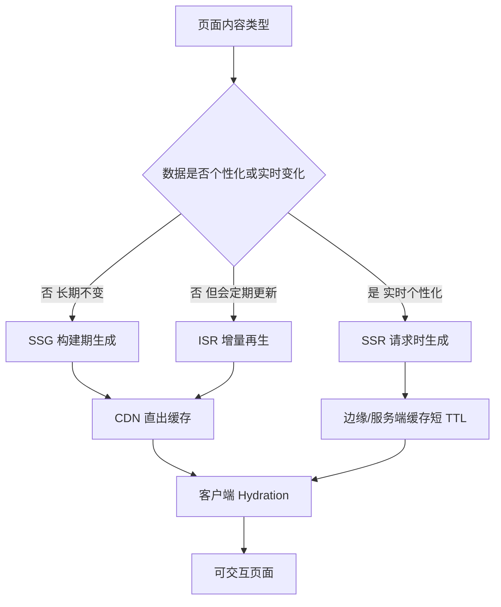

```jsx
// 一一对应：Next.js 中三种渲染方式的最小示例
// 1. SSG：构建期生成，数据静态
export async function getStaticProps() {
  const docs = await fetchDocs();
  return { props: { docs } };
}

// 2. ISR：静态生成 + 每 60 秒允许再生一版
export async function getStaticPropsForISR() {
  const list = await fetchProducts();
  return { props: { list }, revalidate: 60 };
}

// 3. SSR：每次请求都执行，拿到个性化数据
export async function getServerSideProps({ req }) {
  const me = await fetchUser(req.cookies.session);
  return { props: { me } };
}

export default function Page({ docs, me }) {
  return <main>{me ? me.name : docs[0]?.title}</main>;
}
```

### OPT-028：PWA 离线包如何落地？

**答**：
- 三件套：`manifest.json`（可安装元信息）+ Service Worker（离线控制）+ HTTPS。
- 核心是 App Shell 模式：把外壳（HTML 骨架、公共 CSS/JS、字体）在 install 阶段**预缓存**，内容数据走运行时缓存。
- 构建期用 workbox 自动生成 precache manifest（带 revision hash），文件一变 URL 即变，避免手写缓存清单。
- 离线兜底：导航请求失败时返回缓存的 `/offline.html`，体验不白屏。

```javascript
// 一一对应：SW 注册 + workbox 预缓存 App Shell
// main.js —— 页面侧注册
if ('serviceWorker' in navigator) {
  window.addEventListener('load', () => {
    navigator.serviceWorker.register('/sw.js').then((reg) => {
      reg.addEventListener('updatefound', () => console.log('发现新版本 SW'));
    });
  });
}

// sw.js —— workbox 构建产物（示意），预缓存外壳 + 离线兜底
import { registerRoute } from 'workbox-routing';
import { NetworkFirst } from 'workbox-strategies';
import { precacheAndRoute, createHandlerBoundToURL } from 'workbox-precaching';

precacheAndRoute(self.__WB_MANIFEST); // 构建期生成的带 hash 清单

// App Shell：外壳文件离线可用，导航请求失败时用缓存的 index.html 兜底
registerRoute(
  ({ request }) => request.mode === 'navigate',
  createHandlerBoundToURL('/index.html')
);

// 数据接口：网络优先，离线回落上次数据
registerRoute(
  ({ url }) => url.pathname.startsWith('/api/'),
  new NetworkFirst({ cacheName: 'api-cache', networkTimeoutSeconds: 3 })
);
```

### OPT-029：Service Worker 的缓存策略如何选择？cache-first 与 network-first 实现差异在哪？

**答**：
- cache-first：先查缓存，命中直接返回（连网都不发）——**最快但可能过期**，适合带 hash 的静态资源（immutable）。
- network-first：先发网络请求，成功则更新缓存并返回，失败才回落缓存——**最新鲜但弱网慢**，适合 HTML、API 数据。
- stale-while-revalidate：立即回缓存 + 后台更新——两者折中，适合"次新"内容。
- 落地时用路由匹配把策略分配给不同资源类型，而不是全局一个策略。

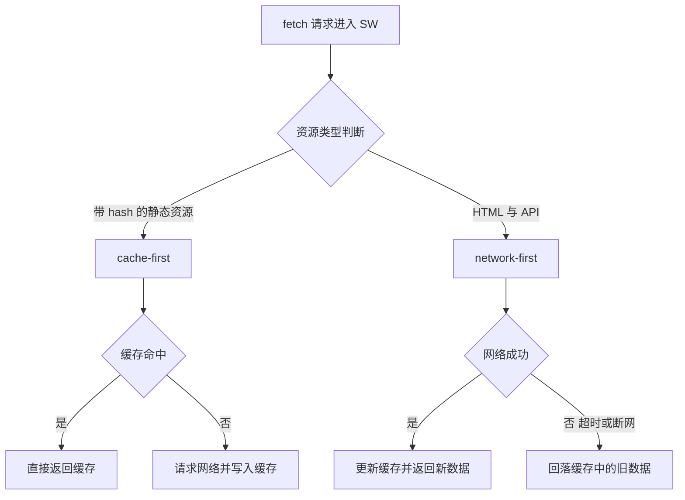

```javascript
// 一一对应：手写 cache-first 与 network-first 的实现差异
const CACHE = 'app-v1';

self.addEventListener('fetch', (event) => {
  const { request } = event;
  const url = new URL(request.url);

  if (url.pathname.startsWith('/static/')) {
    // cache-first：命中即回，不发网络
    event.respondWith(
      caches.match(request).then(
        (hit) =>
          hit ||
          fetch(request).then((res) => {
            const copy = res.clone();
            caches.open(CACHE).then((c) => c.put(request, copy));
            return res;
          })
      )
    );
  } else if (request.mode === 'navigate') {
    // network-first：新鲜优先，失败回落缓存
    event.respondWith(
      fetch(request)
        .then((res) => {
          const copy = res.clone();
          caches.open(CACHE).then((c) => c.put(request, copy));
          return res;
        })
        .catch(() => caches.match(request).then((hit) => hit || caches.match('/offline.html')))
    );
  }
});
```

### OPT-030：Service Worker 更新如何安全发布？skipWaiting 有什么坑？

**答**：
- 浏览器在导航/24h 检测到 sw.js **字节差异**后触发新 SW install；新 SW 默认等待（waiting）直到所有旧控制页面关闭才 activate。
- 直接 `skipWaiting + clients.claim` 会让新 SW 立即接管——但页面里运行的是旧代码、 precache 里是新清单，可能出现"新缓存 + 旧资源引用"的错配（懒加载 chunk 404）。
- 安全做法：skipWaiting 后提示用户刷新，或在 `controllerchange` 时统一 reload 一次；旧缓存必须在 activate 阶段清理。
- 灰度发布：服务端按比例下发不同版本的 precache manifest，出问题可快速回滚。

```javascript
// 一一对应：安全更新流程 —— 提示刷新 + 旧缓存清理
// main.js：检测到 waiting 的 SW 时提示用户
navigator.serviceWorker.register('/sw.js').then((reg) => {
  if (reg.waiting) notifyUpdate(); // 已有新版本在等待
  reg.addEventListener('updatefound', () => {
    const nw = reg.installing;
    nw?.addEventListener('statechange', () => {
      if (nw.state === 'installed' && navigator.serviceWorker.controller) notifyUpdate();
    });
  });
});
function notifyUpdate() {
  if (confirm('发现新版本，立即刷新？')) reg.waiting?.postMessage({ type: 'SKIP_WAITING' });
}
// 新 SW 接管后统一刷新，避免新旧资源错配
navigator.serviceWorker.addEventListener('controllerchange', () => location.reload());

// sw.js：用户确认后才跳过等待
self.addEventListener('message', (e) => {
  if (e.data?.type === 'SKIP_WAITING') self.skipWaiting();
});

// activate 阶段清理旧版本缓存，防止缓存无限膨胀
self.addEventListener('activate', (event) => {
  const keep = new Set([CACHE_NAME]);
  event.waitUntil(
    caches.keys().then((keys) =>
      Promise.all(keys.filter((k) => !keep.has(k)).map((k) => caches.delete(k)))
    ).then(() => self.clients.claim())
  );
});
```

## 六、运行时性能优化

### OPT-031：Long Task 如何发现与拆分？

**答**：
- 超过 50ms 的主线程任务即 Long Task，会推迟输入响应（伤 INP）和渲染帧（掉帧）。
- 发现：`PerformanceObserver` 监听 `longtask`，结合 Performance 面板火焰图定位具体函数。
- 拆分思路：把大循环改成"分批 + 让出主线程"（每批处理若干项后 `setTimeout`/rAF 让出）；把纯计算移到 Web Worker。
- 检查清单：避免一次性 JSON.parse 大文件、同步排序大数组、批量 DOM 操作不合并。

```javascript
// 一一对应：longtask 观测 + 大任务分批拆分
// 1. 观测：记录所有超过 50ms 的任务及其耗时
new PerformanceObserver((list) => {
  for (const entry of list.getEntries()) {
    console.warn('Long Task', Math.round(entry.duration), 'ms', entry.name);
  }
}).observe({ type: 'longtask', buffered: true });

// 2. 拆分：10 万条数据分批处理，每批让出主线程
async function processInBatches(items, batchSize = 1000) {
  for (let i = 0; i < items.length; i += batchSize) {
    processBatch(items.slice(i, i + batchSize)); // 本批约 5ms
    // 让出主线程：浏览器可处理输入与渲染，任务不再连续阻塞
    await new Promise((r) => setTimeout(r, 0));
  }
}
```

### OPT-032：时间切片渲染如何实现？

**答**：
- 时间切片 = 把渲染/计算切成小于一帧（约 16.6ms，可再留余量到 8ms）的小块，每帧执行若干块，穿插响应用户输入——React Concurrent 的 Scheduler 就是这个思路。
- 调度载体选择：`setTimeout(fn, 0)` 被嵌套到 4ms 下限且对齐不精确；`MessageChannel` 宏任务在帧内时机更稳定，是 React Scheduler 的选择；`requestAnimationFrame` 则保证下帧渲染前执行。
- 适用：非紧急的大列表渲染、搜索结果逐块上屏；不适用：必须同步完成的首屏关键路径。
- 与虚拟列表互补：切片解决"渲染量大"，虚拟列表解决"渲染项多"。

```javascript
// 一一对应：基于 MessageChannel 的时间切片调度器
// 简化实现，帮助理解 React Scheduler 的核心循环
function createTimeSlicer() {
  const channel = new MessageChannel();
  let taskQueue = [];
  let callback = null;

  channel.port1.onmessage = () => {
    const start = performance.now();
    // 只要队列没空且当前帧还没用完时间预算，就继续执行
    while (taskQueue.length && performance.now() - start < 8) {
      taskQueue.shift()();
    }
    if (taskQueue.length) {
      channel.port2.postMessage(null); // 时间用完，让出主线程，下一轮宏任务继续
    } else {
      callback?.(); // 全部完成
    }
  };

  return (tasks, onDone) => {
    taskQueue = tasks;
    callback = onDone;
    channel.port2.postMessage(null);
  };
}

const slice = createTimeSlicer();
// 10 万条数据拆成小块渲染，期间滚动/点击不卡
slice(
  Array.from({ length: 100 }, (_, i) => () => renderChunk(i * 1000, 1000)),
  () => console.log('渲染完成')
);
```

### OPT-033：虚拟列表进阶（动态高度、缓冲区）如何实现？

**答**：
- 固定高度虚拟列表只需 `scrollTop / itemHeight` 计算可见区间；动态高度要多三件事：**高度缓存 + 前缀和定位 + 渲染后修正**。
- 动态高度流程：先按预估高度算起始 index → 渲染后测量真实高度写入缓存 → 用前缀和重算偏移，滚动中逐步把"预估值"替换为"真实值"。
- 缓冲区：上下各多渲染 N 项（约半屏），快速滚动时避免白屏；再配合 rAF 节流 scroll。
- 生产建议直接用 `vue-virtual-scroller` / `react-window`，但要理解原理才能处理"不定高+图片加载后变高"的抖动问题。

```javascript
// 一一对应：动态高度虚拟列表核心逻辑（前缀和定位 + 缓冲区）
// 简化实现，帮助理解
class VirtualList {
  constructor(scrollEl, estHeight = 40, buffer = 10) {
    this.el = scrollEl;
    this.est = estHeight;
    this.buffer = buffer;      // 缓冲区：上下各多渲染 10 项
    this.heights = [];         // 每项真实高度缓存，未测量时用 est
    this.render = this.render.bind(this);
    this.el.addEventListener('scroll', () => requestAnimationFrame(this.render));
  }

  // 前缀和：第 index 项的 offsetTop = 前面所有项高度之和
  offsetTop(index) {
    let sum = 0;
    for (let i = 0; i < index; i++) sum += this.heights[i] ?? this.est;
    return sum;
  }

  // 根据滚动位置二分查找起始 index
  findStart(scrollTop) {
    let lo = 0, hi = this.count;
    while (lo < hi) {
      const mid = (lo + hi) >> 1;
      this.offsetTop(mid) < scrollTop ? (lo = mid + 1) : (hi = mid);
    }
    return lo;
  }

  render() {
    const start = Math.max(0, this.findStart(this.el.scrollTop) - this.buffer);
    const viewport = this.el.clientHeight;
    const end = this.findStart(this.offsetTop(start) + viewport) + 1 + this.buffer;

    // 渲染可见区间，并回填真实高度，后续定位越来越准
    this.listEl.style.transform = `translateY(${this.offsetTop(start)}px)`;
    for (let i = start; i < Math.min(end, this.count); i++) {
      this.heights[i] = this.measureItem(i); // 渲染后测量真实高度
    }
  }
}
```

### OPT-034：Web Worker 通信与 Transferable Objects 如何落地？

**答**：
- 主线程与 Worker 通信默认是 structured clone（深拷贝），传 100MB 数据本身就耗时数百 ms，反而造成卡顿。
- Transferable Objects 解决该问题：`ArrayBuffer`、`MessagePort`、`OffscreenCanvas`、`ReadableStream` 等支持**移交所有权**，零拷贝，但移交后原线程不能再访问。
- 更进一步用 `SharedArrayBuffer`（需跨域隔离头 COOP/COEP）+ `Atomics` 真正共享内存。
- 典型场景：大 JSON 解析、图片/视频处理、加解密、WebSocket 心跳外的数据加工。

```javascript
// 一一对应：Transferable 零拷贝移交 vs structured clone 对比
// main.js
const worker = new Worker('worker.js');

// 方式一：structured clone，100MB 数据拷贝一次，主线程被阻塞
const cloned = bigArrayBuffer;
worker.postMessage({ buf: cloned });

// 方式二：Transferable，零拷贝瞬时移交，主线程侧原 buffer 变为不可用
const buf = new ArrayBuffer(100 * 1024 * 1024);
const view = new Float64Array(buf);
for (let i = 0; i < view.length; i++) view[i] = i;

console.time('transfer');
worker.postMessage({ buf }, [buf]); // 第二个参数是转移列表
console.timeEnd('transfer');        // 几乎 0ms
console.log(buf.byteLength);        // 0 —— 所有权已移交

// worker.js：接收后直接可用
// self.onmessage = ({ data }) => {
//   const arr = new Float64Array(data.buf);
//   let sum = 0;
//   for (let i = 0; i < arr.length; i++) sum += arr[i];
//   self.postMessage(sum);
// };
```

### OPT-035：OffscreenCanvas 适用什么场景？怎么用？

**答**：
- 问题：主线程上高频 `canvas` 绘制（图表动画、粒子、滤镜预览）会与交互争抢主线程，掉帧。
- OffscreenCanvas 把 Canvas 2D/WebGL 上下文**整体搬进 Worker**：绘制逻辑在子线程跑，主线程只剩一个占位 `<canvas>` 元素。
- 落地：`transferControlToOffscreen()` 拿到 OffscreenCanvas，作为 Transferable 传给 Worker；Worker 内正常用 2d/webgl API 绘制。
- 限制：Worker 内无 DOM（不能 addEventListener 交互，需主线程转发事件）；Safari 16.4+ 才完整支持，需特性检测降级。

```javascript
// 一一对应：把 canvas 绘制搬进 Worker
// main.js
const canvasEl = document.querySelector('#chart');
// 主线程的 canvas 移交给 OffscreenCanvas 控制
const offscreen = canvasEl.transferControlToOffscreen();

const worker = new Worker('render-worker.js');
// OffscreenCanvas 是 Transferable，零拷贝交给 worker
worker.postMessage({ canvas: offscreen, width: canvasEl.width }, [offscreen]);

// 主线程只负责转发交互数据，绘制全在子线程
window.addEventListener('resize', () => {
  worker.postMessage({ type: 'resize', width: innerWidth });
});

// render-worker.js
// self.onmessage = ({ data }) => {
//   const ctx = data.canvas.getContext('2d'); // worker 里同样能拿 2d/webgl 上下文
//   function draw() {
//     ctx.clearRect(0, 0, data.width, 300);
//     ctx.beginPath();
//     ctx.moveTo(0, 150 + Math.sin(Date.now() / 500) * 80);
//     ctx.lineTo(data.width, 150 + Math.cos(Date.now() / 500) * 80);
//     ctx.stroke();
//     requestAnimationFrame(draw); // worker 内也有 rAF
//   }
//   draw();
// };
```

### OPT-036：requestIdleCallback 如何用于低优先级任务调度？

**答**：
- `requestIdleCallback` 在浏览器**空闲帧**执行回调，`deadline.timeRemaining()` 告诉你还剩几毫秒，适合埋点上报、日志压缩、预计算等"不做也行"的任务。
- 关键参数 `timeout`：即使一直不空闲，超时后也强制执行，防止低优任务饿死。
- 兼容性：Safari 长期不支持，必须写 polyfill（setTimeout 兜底）。
- 约束：回调中不要做 DOM 修改（可能被下一帧打断导致样式闪烁）、不要做必须及时的任务。

```javascript
// 一一对应：空闲调度 + Safari polyfill
function scheduleIdle(fn, timeout = 2000) {
  if ('requestIdleCallback' in window) {
    return requestIdleCallback((deadline) => {
      // 剩余时间大于 10ms 才干活，否则留给下一次空闲
      if (deadline.timeRemaining() > 10 || deadline.didTimeout) fn();
      else scheduleIdle(fn, timeout);
    }, { timeout });
  }
  // polyfill：Safari 兜底，setTimeout 宏任务近似空闲时机
  return setTimeout(fn, 1);
}

// 用法：空闲时批量上报埋点，不影响首屏与交互
scheduleIdle(() => {
  const queue = takeEventQueue(); // 取走攒下的埋点
  navigator.sendBeacon('/collect', JSON.stringify(queue));
});
```

## 七、框架级与内存优化

### OPT-037：React 大列表与搜索场景的性能专项怎么优化？

**答**：
- 行组件 `memo` 化 + 保证 props 引用稳定（数据不可变更新、回调 useCallback），避免一处 setState 全列表重渲。
- 搜索输入用 `useDeferredValue`：输入框保持紧急更新（跟手），列表用延迟值低优先级重渲，输入不再被大列表卡住。
- **状态下放**：把频繁变化的 state（如某行的 hover/选中）下放到最小的组件里，缩小重渲范围。
- Context 改用 selector 订阅（zustand / useSyncExternalStore），只订阅用到的切片，而不是整个 context value 变化就全树更新。

```jsx
// 一一对应：大列表 + 搜索的组合优化
import { memo, useDeferredValue, useState, useCallback } from 'react';
import { useStore } from './store'; // zustand

// 1. 行组件 memo 化，props 不变就不重渲
const Row = memo(function Row({ item, onSelect }) {
  return <li onClick={() => onSelect(item.id)}>{item.name}</li>;
});

export default function BigList({ items }) {
  const [query, setQuery] = useState('');
  // 2. 输入紧急，列表延迟：输入框跟手，列表低优先级重算
  const deferredQuery = useDeferredValue(query);

  // 3. useCallback 稳定回调引用，配合 memo 才有效
  const onSelect = useCallback((id) => console.log('select', id), []);

  // 4. selector 订阅：只订阅 theme 切片，其它状态变化不会引起本组件更新
  const theme = useStore((s) => s.theme);

  const filtered = items.filter((it) => it.name.includes(deferredQuery));

  return (
    <div data-theme={theme}>
      <input value={query} onChange={(e) => setQuery(e.target.value)} />
      <ul>
        {filtered.map((item) => (
          <Row key={item.id} item={item} onSelect={onSelect} />
        ))}
      </ul>
    </div>
  );
}
```

### OPT-038：Vue 渲染大数据时有哪些性能专项手段？

**答**：
- `shallowRef` 包大数组：跳过深层 Proxy 代理（10 万条数据逐个代理本身就要数百 ms），整体替换 `value` + `triggerRef()` 手动触发更新。
- `v-memo` 给列表行加缓存：`v-memo="[item.id, item.selected]"`，依赖不变就整行跳过 diff，等价于手动 memo。
- `v-once` / `v-pre` 用于纯静态内容，编译期就跳过后续更新。
- 列表页进出用 `keep-alive`：返回列表页不重新请求、保留滚动位置；配合 `include` 控制缓存范围，防止内存膨胀。

```vue
<!-- 一一对应：shallowRef + v-memo + keep-alive 的组合落地 -->
<template>
  <!-- v-memo：仅当 id 或 selected 变化时才重新渲染这一行 -->
  <li v-for="item in rows" :key="item.id" v-memo="[item.id, item.selected]">
    <span :class="{ active: item.selected }" @click="toggle(item.id)">
      {{ item.name }}
    </span>
  </li>
</template>

<script setup>
import { shallowRef, triggerRef } from 'vue';

// 10 万条数据用 shallowRef：不做深层响应式代理，初始化快一个量级
const rows = shallowRef(loadBigList());

function toggle(id) {
  const target = rows.value.find((r) => r.id === id);
  target.selected = !target.selected;
  // 直接改了引用内部数据，Proxy 不会通知；手动触发依赖此 ref 的更新
  triggerRef(rows);
}
</script>

<!-- App.vue：列表页 keep-alive，返回时保留状态与滚动位置 -->
<template>
  <router-view v-slot="{ Component }">
    <keep-alive include="ListPage">
      <component :is="Component" />
    </keep-alive>
  </router-view>
</template>
```

### OPT-039：前端内存优化有哪些落地手段？

**答**：
- 图片内存必须算清：解码后内存 ≈ 宽 × 高 × 4 字节（RGBA），一张 4000×3000 的照片约 48MB，与文件体积无关；`img` 展示尺寸小于源图是纯浪费，用 resize/缩略图。
- 及时解绑：组件卸载时移除事件监听、`clearInterval`、取消订阅——SPA 长驻页面最常见的泄漏源。
- WeakMap/WeakRef 缓存"挂靠对象"的数据：key 被 GC 时缓存自动消失，不会拖住 DOM/组件。
- 对象池：高频创建的大对象（粒子、请求上下文）复用而非反复 new，减少 GC 压力；排查用 Memory 面板的 Detached 节点与堆快照对比。

```javascript
// 一一对应：图片内存计算 + WeakMap 缓存 + 解绑与对象池
// 1. 图片解码内存计算：宽 x 高 x 4 字节
function imageMemoryKB(w, h) {
  return Math.round((w * h * 4) / 1024); // 4000x3000 => 约 46875 KB
}
console.log('4000x3000 照片解码后内存 KB：', imageMemoryKB(4000, 3000));

// 2. WeakMap 缓存 DOM 关联数据：DOM 移除后缓存自动可回收
const metaCache = new WeakMap();
function getRowMeta(rowEl) {
  if (!metaCache.has(rowEl)) metaCache.set(rowEl, { computed: expensiveCalc(rowEl) });
  return metaCache.get(rowEl);
}

// 3. 组件卸载时全部解绑
class Widget {
  constructor(el) {
    this.onResize = () => this.render();
    window.addEventListener('resize', this.onResize);
    this.timer = setInterval(this.refreshData, 5000);
  }
  destroy() {
    window.removeEventListener('resize', this.onResize);
    clearInterval(this.timer);
  }
}

// 4. 对象池：复用粒子对象，避免每帧 new 触发 GC
class ParticlePool {
  constructor(size) {
    this.pool = Array.from({ length: size }, () => createParticle());
    this.used = new Set();
  }
  acquire() {
    const p = this.pool.find((it) => !this.used.has(it));
    this.used.add(p);
    return p;
  }
  release(p) {
    this.used.delete(p); // 归还而非丢弃
  }
}
```

## 八、性能预算与度量

### OPT-040：如何建立性能预算与 CI 卡口？优化前后如何科学度量？

**答**：
- 性能预算分层：**传输层**（首页 JS gzip ≤ 200KB、总资源 ≤ 1MB）、**指标层**（LCP ≤ 2.5s、INP ≤ 200ms、CLS ≤ 0.1）、**数量层**（请求数、第三方脚本数）。
- CI 卡口：Lighthouse CI 每次提 PR 跑 Lab 数据 + `size-limit`/bundlesize 卡 bundle 体积，超预算直接 fail，把"性能回归"变成合并阻塞项。
- 度量方法：优化前先建基线（同机型/同网络环境测 Lab，取 RUM P75 而非均值）；一次只改一个变量，对比才有因果；Lab（Lighthouse）与 RUM（真实用户）数据互补。
- 上线后持续观测 RUM 大盘，指标劣化自动告警，回到 09 章的监控体系闭环。

```javascript
// 一一对应：lighthouserc 性能预算 + size-limit CI 卡口
// lighthouserc.js —— Lighthouse CI 断言配置
module.exports = {
  ci: {
    collect: {
      numberOfRuns: 3, // 多次取中位数，降低抖动
      settings: { preset: 'desktop' },
    },
    assert: {
      assertions: {
        'largest-contentful-paint': ['error', { maxNumericValue: 2500 }],
        'cumulative-layout-shift': ['error', { maxNumericValue: 0.1 }],
        'total-byte-weight': ['error', { maxNumericValue: 1024 * 1024 }],
        'resource-summary:script:size': ['error', { maxNumericValue: 200 * 1024 }],
        'third-party-summary': ['warn', { allowlist: { url: ['https://cdn.example.com'] } }],
      },
    },
  },
};

// package.json —— size-limit 体积卡口
// "size-limit": [
//   { "path": "dist/assets/index-*.js", "limit": "80 KB" },
//   { "path": "dist/assets/vendor-*.js", "limit": "120 KB" }
// ]
// CI 中执行：npx size-limit && npx @lhci/cli autorun，任一超标即 fail
```

## 九、测量与分析体系

### OPT-041：Performance 面板的完整使用流程是怎样的？如何从录制到定位再到验证？

**答**：
- 标准四步流：**录制**（选 Machine/CPU 4x slowdown 模拟目标机型）→ **看火焰图**（Main 线程，红色 Layout、紫色 Recalculate Style、黄色 Script）→ **定位**（Bottom-Up 视图按 Self Time 排序找热点函数）→ **验证**（改完同条件重录对比）。
- 录制时打开 Screenshots 和 Memory 轨道，能同时发现强制同步布局与内存抖动。
- 定位技巧：先在 Timings 轨道看 FP/FCP/LCP 标尺，锁定"慢在哪一段"，再去 Main 轨道展开对应时间段，比漫无目的看火焰图高效得多。
- Bottom-Up 比 Call Tree 更适合找"自己贵"的函数，Call Tree 适合看"谁调用出来的"。

```javascript
// 一一对应：用 CDP 脚本化录制 Performance Trace，替代手工面板操作（可进 CI）
// node trace.mjs —— 对目标页面采集 trace 并输出耗时 top 函数
import puppeteer from 'puppeteer';

const browser = await puppeteer.launch({
  args: ['--cpu-throttling-rate=4'], // 等价于面板里的 CPU 4x slowdown
});
const page = await browser.newPage();
await page.tracing.start({ categories: ['devtools.timeline', 'v8.execute'] });
await page.goto('https://example.com', { waitUntil: 'networkidle0' });
const buffer = await page.tracing.stop();

const events = JSON.parse(buffer.toString()).traceEvents;
// 统计 RunTask 长任务与函数级自耗时（用 ProfileChunk 事件近似）
const longTasks = events.filter(
  (e) => e.name === 'RunTask' && e.dur > 50_000 // dur 单位微秒，>50ms 即 Long Task
);
console.log('长任务数量:', longTasks.length);
console.log('最长任务(ms):', (Math.max(...longTasks.map((t) => t.dur)) / 1000).toFixed(1));
await browser.close();
// 改代码后重跑本脚本，对比"长任务数量/最长任务"两个数字即为验证
```

### OPT-042：Lighthouse CI 如何集成到流水线？性能分数怎么正确解读？

**答**：
- 集成三步：PR 触发 `lhci autorun` → collect 阶段跑多次取稳定值 → assert 阶段按预算断言，失败阻断合并（卡口配置在 OPT-040，这里关注**分数解读**）。
- Lighthouse 性能分是加权综合分：FCP/TBT/LCP/CLS/SI/Speed Index 各有权重与对数曲线，**90+ 不是线性含义**——从 60 提到 80 和从 90 提到 95 难度差一个量级。
- 单项指标与总分要分开看：总分 95 但 TBT 超标，说明包体执行有问题；不要只盯总分绿灯。
- 实验室分数只用于回归对比（本分支 vs main），绝对值与真实用户无关，决策看 RUM。

```javascript
// 一一对应：用 Node API 跑 Lighthouse 并输出"总分 + 单项达标明细"的解读报告
import lighthouse from 'lighthouse';
import * as chromeLauncher from 'chrome-launcher';

async function audit(url) {
  const chrome = await chromeLauncher.launch({ chromeFlags: ['--headless'] });
  const { lhr } = await lighthouse(url, {
    port: chrome.port,
    formFactor: 'mobile',
    screenEmulation: { mobile: true, width: 412, height: 823, deviceScaleFactor: 1.75 },
  });
  await chrome.kill();

  const cats = lhr.categories.performance.score * 100;
  console.log(`性能总分: ${cats}（>90 绿 50-90 黄 <50 红，非线性刻度）`);
  // 单项解读：weight 越高对总分影响越大，TBT/LCP/CLS 是三大权重项
  const weights = { fcp: 10, si: 10, lcp: 25, tbt: 30, cls: 25 };
  for (const [id, w] of Object.entries(weights)) {
    const a = lhr.audits[id];
    console.log(
      `${id}: ${a.numericValue?.toFixed(0)}ms/分=${a.score} 权重=${w}% ` +
        (a.score < 0.9 ? ' <-- 优先治理，对总分拖累最大' : '达标')
    );
  }
}
audit('https://example.com');
```

### OPT-043：如何做弱网模拟？Chrome throttling 的参数应该怎么设？

**答**：
- DevTools 内置档位：Slow 3G（400kbps 下行/400ms RTT）、Fast 3G（1.6Mbps/150ms RTT），但内置值偏"实验室友好"，真实弱网更差（印度/P75 约 300kbps、RTT 500ms+）。
- 自定义档位建议贴近 **RUM 里真实用户的 P75**，而不是照抄内置值；同时开 CPU 4x，弱网用户往往也是低端机。
- HTTP/1.1 与 HTTP/2 在限速下表现差异大，模拟时确认协议与线上一致。
- WPA 层还要模拟丢包（netem/Clumsy），纯带宽限速测不出队头阻塞与重传影响。

```javascript
// 一一对应：CDP 精确设置弱网参数（等价 DevTools Network conditions 自定义档位）
import puppeteer from 'puppeteer';

const browser = await puppeteer.launch({
  args: ['--cpu-throttling-rate=4'], // 低端机 CPU 降速，与弱网同时开
});
const page = await browser.newPage();
const client = await page.createCDPSession();
await client.send('Network.enable');
// 自定义"真实弱网"档位：下行 400kbps 上行 300kbps RTT 500ms
// 注意单位是字节/秒：400kbps = 50_000 B/s
await client.send('Network.emulateNetworkConditions', {
  offline: false,
  latency: 500,            // RTT 一半，每次请求额外延迟 ms
  downloadThroughput: 50_000, // 下行 400kbps
  uploadThroughput: 37_500,   // 上行 300kbps
});
const t0 = Date.now();
await page.goto('https://example.com', { waitUntil: 'load' });
console.log('弱网下 load 耗时:', Date.now() - t0, 'ms');
await browser.close();
```

### OPT-044：真实用户监控（RUM）数据和实验室数据为什么会打架？以哪个为准？

**答**：
- 差异来源五个：**采样人群**（RUM 混入低端机/弱网）、**采集方式**（Lighthouse 模拟加载 vs 真实用户中断行为）、**统计口径**（Lab 单次值 vs RUM P75）、**缓存状态**（Lab 冷启动 vs 用户热缓存）、**第三方与 A/B**。
- 经典打架场景：Lab 全绿但 RUM 的 LCP P75 4s——通常是真实用户网络差或 LCP 元素是接口渲染的图片，Lab 没覆盖。
- 决策原则：**看趋势与归因用 Lab，定验收与预警用 RUM**；两者打架先查口径（P75 vs 均值、href 是否同版本）。
- 对齐方法：Lab 也按 RUM 用户分布选设备/网络档位，让两者可比。

```javascript
// 一一对应：RUM 与 Lab 双通道采集同一组指标，字段对齐后才能对比归因
// rum.js —— 上报字段与 Lighthouse 一一对齐
function reportOnce(entryName, value) {
  navigator.sendBeacon('/api/rum', JSON.stringify({
    metric: entryName,
    value: Math.round(value),
    // 对齐 Lab 的维度，否则对比无意义
    formFactor: matchMedia('(pointer: coarse)').matches ? 'mobile' : 'desktop',
    effectiveType: navigator.connection?.effectiveType, // RUM 独有：真实网络
    deviceMemory: navigator.deviceMemory,               // RUM 独有：真实设备档位
    buildId: document.documentElement.dataset.build,    // 与 Lab 测的版本对齐
  }));
}
new PerformanceObserver((list) => {
  const lcp = list.getEntries().at(-1);
  reportOnce('LCP', lcp.startTime); // Lab 用 numericValue，RUM 用真实时间，同名对齐
}).observe({ type: 'largest-contentful-paint', buffered: true });
// 分析时：按 buildId 分组取 P75 与同版本 Lighthouse 值比，差值 >1s 去查
// effectiveType/deviceMemory 分布——多半是某档用户被 Lab 档位遗漏
```

### OPT-045：CrUX 数据是什么？怎么在选型和验收中使用它？

**答**：
- CrUX（Chrome UX Report）是 Chrome 真实用户匿名上报的 CWV 数据集，提供 P75 分位，有 API/BigQuery/Data Studio 三种入口。
- 用途一：**竞品与行业基线**——立项时查对标站点的真实 P75，定合理目标而非拍脑袋"首屏 1 秒"。
- 用途二：**域名健康度验收**——上线后 28 天滚动窗口的数据才是 SEO/用户真实感知。
- 局限要清楚：只统计 Chrome、流量少的域名无数据、滞后约一个月、只有 P75 不给分布尾部。

```bash
# 一一对应：curl 调用 CrUX API 查询某页面真实用户 P75 指标
# 前置：在 https://console.cloud.google.com 申请 CrUX API Key
curl -s "https://chromeuxreport.googleapis.com/v1/records:queryRecord?key=$CRUX_API_KEY" \
  -H 'Content-Type: application/json' \
  -d '{
    "origin": "https://example.com",
    "formFactor": "PHONE",
    "metrics": ["largest_contentful_paint", "interaction_to_next_paint", "cumulative_layout_shift"]
  }' | jq '.record.metrics'

# 输出示例解读（P75 是唯一口径）：
# largest_contentful_paint.percentiles.p75 = 2800  -> <2500 达标，2800 需治理
# interaction_to_next_paint.percentiles.p75 = 150  -> <200 达标
# cumulative_layout_shift.percentiles.p75 = 0.05  -> <0.1 达标

# 大流量站点用 BigQuery 拉全国/类目分布做基线：
# SELECT p75s.largest_contentful_paint FROM `chrome-ux-report.materialized.country_summary`
# WHERE yyyymm = 202610 AND country_code = 'CN' AND origin LIKE '%example%'
```

### OPT-046：业务自定义指标（业务首屏、可交互时间）怎么定义和采集？

**答**：
- 通用指标答不了业务问题，需自定义两个：**业务首屏**（核心业务模块全部渲染完成，而非最大元素）与**可交互时间**（首屏按钮真实可点击且数据就绪）。
- 定义三原则：口径写进文档并评审、打点位置靠近业务代码但有统一 SDK、用 PerformanceObserver/mark 统一时间源。
- 用 `performance.mark/measure` 打点，性能面板和 trace 里能直接看到，调试成本低。
- 自定义指标同样按 P75 上报，验收口径与 CWV 一致才不会被质疑。

```javascript
// 一一对应：业务首屏与业务可交互时间的统一打点 SDK
// biz-metrics.js
export const bizMetrics = {
  // 业务首屏：等核心模块列表全部渲染（Promise.all 收敛，避免各模块自行打点漂移）
  async markFirstScreen(modules) {
    await Promise.all(modules); // modules 为各核心区块渲染完成的 Promise
    performance.mark('biz-fcp');
    this._fcp = performance.now();
    this.flush('biz_fcp', this._fcp);
  },
  // 业务可交互：首屏渲染完成 + 关键接口返回 + 主线程空闲三条件
  async markInteractive(dataReady) {
    if (!this._fcp) await this._fcpPromise;
    await dataReady;
    // 主线程空一帧才真正可点，避免"数据到了但 JS 还在跑长任务"
    await new Promise((r) => requestAnimationFrame(() => requestIdleCallback(r)));
    performance.mark('biz-tti');
    performance.measure('biz-interactive', 'biz-fcp', 'biz-tti');
    this.flush('biz_tti', performance.getEntriesByName('biz-interactive')[0].duration);
  },
  flush(name, value) {
    navigator.sendBeacon('/api/rum', JSON.stringify({ metric: name, value: Math.round(value) }));
  },
};

// 业务侧接入：
// await bizMetrics.markFirstScreen([renderHeader(), renderGoodsList(), renderCart()]);
// await bizMetrics.markInteractive(fetchPriceReady);
```

### OPT-047：性能数据看板怎么设计？P75 分位数要怎么算才不出错？

**答**：
- 看板三层：**大盘**（CWV 三指标 P75 + 达标率趋势）、**维度下钻**（机型/网络/地区/版本）、**明细归因**（可回放的单次会话指标 + trace 链接）。
- 分位数必须在**服务端**对原始样本算，前端预聚合再算 P75 是错的；样本量大的链路用 t-digest/CKetch 算法流式合并。
- 均值会掩盖长尾：同一均值下 P50=1s/P99=9s 和 P50=3s/P99=4s 是两个完全不同的产品问题。
- 必须带样本量护栏：分位样本 <100 条置灰不展示，防止小样本抖动误导决策。

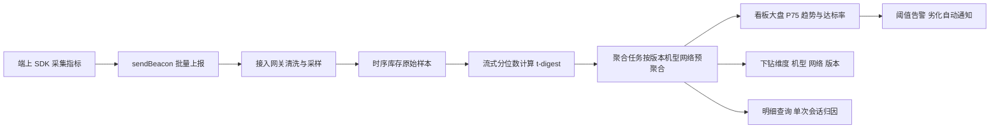

```javascript
// 一一对应：服务端流式分位数计算（t-digest 简化版思想，可分布式合并）
class TDigest {
  constructor(delta = 100) {
    this.delta = delta;
    this.centroids = []; // { mean, count }
    this.count = 0;
  }
  add(value, weight = 1) {
    this.centroids.push({ mean: value, count: weight });
    this.count += weight;
    if (this.centroids.length > this.delta * 2) this._compress();
  }
  // 分布式合并：多个节点各算 digest 后 add 相同结构即可，结果仍是全量 P75
  merge(other) {
    other.centroids.forEach((c) => this.add(c.mean, c.count));
  }
  _compress() {
    this.centroids.sort((a, b) => a.mean - b.mean);
    const merged = [];
    for (const c of this.centroids) {
      const last = merged.at(-1);
      if (last && last.count + c.count <= this._limit()) {
        last.mean = (last.mean * last.count + c.mean * c.count) / (last.count + c.count);
        last.count += c.count;
      } else merged.push({ ...c });
    }
    this.centroids = merged;
  }
  _limit() {
    // 每个质心的容量随位置变化，中间粗两端细，保证尾部精度
    const q = arguments[0] ?? this.count / 2;
    return (4 * this.count * q * (1 - q)) / this.delta || 1;
  }
  quantile(q) {
    if (!this.centroids.length) return NaN;
    this._compress();
    const target = q * this.count;
    let acc = 0;
    for (const c of this.centroids) {
      if (acc + c.count >= target) return c.mean;
      acc += c.count;
    }
    return this.centroids.at(-1).mean;
  }
}

// 看板服务用法：每分钟把原始样本喂给 digest，输出 P75 + 样本量护栏
const digest = new TDigest();
samples.forEach((v) => digest.add(v));
console.log({
  p75: Math.round(digest.quantile(0.75)),
  sampleCount: digest.count,
  reliable: digest.count >= 100, // <100 看板置灰
});
```

## 十、网络传输优化

### OPT-048：TLS 层怎么优化？会话复用和 TLS 1.3 各省多少？

**答**：
- TLS 握手是首屏 RTT 大头：TLS 1.2 全握手 2-RTT，TLS 1.3 降到 1-RTT，会话复用后 0-RTT，弱网下省 300ms+。
- 会话复用两机制：**Session ID**（服务端存状态）与 **Session Ticket**（加密状态下发给客户端），Nginx 默认开 ticket 但要配稳定的密钥文件，多机共享否则命中率近 0。
- TLS 1.3 的 0-RTT 有重放风险，只对 GET 类幂等请求安全，敏感接口要服务端拒重放。
- 证书链裁剪 + ECDSA 证书比 RSA 小一半、握手计算量低，都是零代码改动的收益。

```nginx
# 一一对应：Nginx TLS 层优化完整配置
server {
    listen 443 ssl;
    http2 on;

    # 1. TLS 1.3 优先，1.2 兜底；1.3 自动获得 1-RTT 握手
    ssl_protocols TLSv1.2 TLSv1.3;

    # 2. 会话复用：ticket 密钥固定到文件，多台机器共用同一份，命中率才能上去
    ssl_session_tickets on;
    ssl_session_ticket_key /etc/nginx/tls/session_ticket.key; # openssl rand 80 > 该文件
    ssl_session_cache shared:SSL:50m;  # Session ID 缓存，50m 约可存 20 万会话
    ssl_session_timeout 1d;            # 会话有效期，长了复用率高但安全窗口变大

    # 3. OCSP stapling：由服务端代查证书状态随握手下发，省掉客户端 OCSP 查询 RTT
    ssl_stapling on;
    ssl_stapling_verify on;
    ssl_trusted_certificate /etc/nginx/tls/chain.pem;
    resolver 223.5.5.5 valid=300s;

    # 4. ECDSA 证书 + 裁剪后的证书链（中间证书只带必要的那一级）
    ssl_certificate     /etc/nginx/tls/fullchain.pem;
    ssl_certificate_key /etc/nginx/tls/privkey.pem;

    # 5. TLS 1.3 0-RTT：配合 GET 幂等接口开启
    ssl_early_data on;
    proxy_set_header Early-Data $ssl_early_data; # 透传给应用，应用侧拒绝对 0-RTT 请求做写操作
}
```

### OPT-049：HTTP/2 Server Push 已死？103 Early Hints 怎么用？

**答**：
- H2 Push 的问题：推的资源常与缓存冲突（客户端已有）、无法根据页面实际内容判断、浪费带宽，Chrome 已在 2022 年移除支持。
- 替代方案 **103 Early Hints**：服务器在最终响应前先发一个临时响应，告诉浏览器"可以提前去请求/预加载这些资源"，浏览器主动请求，不占服务端推送带宽。
- 与 H2 Push 的本质区别：Push 是"给你"，Early Hints 是"提示你去拿"，缓存控制权回到浏览器。
- 实践中 CDN（Cloudflare/Fastly）对源站响应做学习后自动下发 103，源站只需输出正确的 preload/link 头。

```nginx
# 一一对应：Nginx 手动下发 103 Early Hints + 源站 link 头方案
# 方案一：边缘节点直接对热路径手动下发 103
server {
    listen 443 ssl http2;
    location = /page {
        # 103 是临时响应，浏览器收到后立刻并行发起 preload，不等最终 200
        add_header early-hints-link "</app.css>; rel=preload; as=style, </app.js>; rel=preload; as=script" always;
        proxy_pass http://origin;
    }
}

# 方案二（推荐）：源站输出 Link 响应头，CDN（如 Cloudflare Early Hints 开关）
# 学习后自动生成 103，源站无需感知。Node/Express 源站等价写法：
#   res.set('Link', '</app.css>; rel=preload; as=style, </hero.avif>; rel=preload; as=image; fetchpriority=high');
# 注意与页面内 <link rel=preload> 二选一，不要重复声明同一资源
```

### OPT-050：fetchpriority 属性怎么用？优先级提示比 preload 强在哪？

**答**：
- 浏览器对资源默认优先级有猜测，`fetchpriority` 直接显式干预：`high`/`low`/`auto`，是唯一能**降级**资源优先级的手段（preload 只能升）。
- 高频场景一：LCP 主图 `fetchpriority="high"`，配合懒加载图 `loading="lazy"`（隐式低优先级），把带宽让给首屏。
- 高频场景二：`async` 脚本默认 high，埋点/客服类脚本加 `fetchpriority="low"`，避免抢关键路径带宽。
- fetchpriority 不改变发现时机（还是要写进 HTML），preload 不改变优先级（还是默认），两者可组合：`<link rel="preload" as="image" fetchpriority="high">` 抢救动态插入的 LCP 图。

```html
<!-- 一一对应：fetchpriority 资源优先级编排 -->
<head>
  <!-- LCP 主图：显式高优先级，最先抢带宽 -->
  

  <!-- async 脚本默认就是 high，必须手动压低，否则与首屏 JS 抢带宽 -->
  <script async src="https://analytics.example.com/collect.js" fetchpriority="low"></script>
  <script async src="https://static.example.com/chat-widget.js" fetchpriority="low"></script>

  <!-- 动态拼装的 LCP 图（首屏靠接口渲染）：提前声明且给高优先级 -->
  <link rel="preload" as="image" href="/api/cover.avif" fetchpriority="high" />

  <!-- 下一页资源：提前拉但要绝对让路，与 prefetch 组合 -->
  <link rel="prefetch" href="/next-page-data.json" fetchpriority="low" />
</head>
```

### OPT-051：dns-prefetch、preconnect、preload 怎么组合成"连接预热决策树"？

**答**：
- 三者解决的问题层次不同：dns-prefetch 只做 DNS（几十 ms）、preconnect 做 DNS+TCP+TLS（弱网下 1s+）、preload 提前下载具体资源。
- 决策树：**当前页关键路径资源** → preload；**当前页一定会用的第三方源** → preconnect；**当前页可能用/下一页用** → dns-prefetch；不要对不确定的域名滥用 preconnect。
- preconnect 是昂贵操作（占用对方服务器连接与握手算力），上限建议 3-4 个，且要配 `crossorigin` 属性与实际请求一致，否则预热作废。
- 常见坑：preconnect 了但资源走 `font.gstatic.com` 之类不同 schema/crossorigin 组合，等于白连。

```html
<!-- 一一对应：连接预热决策树落地模板 -->
<head>
  <!-- 决策① 资源在同源：不用预热，浏览器自动复用已有连接，什么都不写 -->

  <!-- 决策② 当前页一定请求的第三方源（字体/CDN）：preconnect 全量握手 -->
  <link rel="preconnect" href="https://cdn.assets.example.com" />
  <!-- 字体必须带 crossorigin，因为字体请求是匿名 CORS 模式；不带则预热的连接用不上 -->
  <link rel="preconnect" href="https://fonts.gstatic.com" crossorigin />

  <!-- 决策③ 首屏关键资源：preload 提升发现时机（连接已由 preconnect 预热） -->
  <link rel="preload" href="https://fonts.gstatic.com/s/harmony.woff2" as="font" type="font/woff2" crossorigin />

  <!-- 决策④ 弱可能用到（埋点、客服、下一跳域名）：只做 dns-prefetch，成本低 -->
  <link rel="dns-prefetch" href="https://tracking.example.com" />
  <link rel="dns-prefetch" href="https://api.example.com" />

  <!-- 反例（都不要写）：
       preconnect 超过 4 个域名 —— 握手竞争带宽且大多用不上
       对同源写 preconnect —— 纯冗余
       对"可能弹出第三方"域名 preconnect —— 用户不点就浪费一次完整 TLS -->
</head>
```

### OPT-052：Brotli 相比 Gzip 收益多大？生产环境怎么配置？

**答**：
- 同等级下 Brotli 比 Gzip 再省 15-25%，对 HTML/CSS/JS 文本收益最大；`br` 压缩等级 4 已近似 gzip 9 的压缩率但速度快得多。
- 部署模式：**静态构建期用 br 等级 10-11 预压缩**（慢但只压一次），**动态响应用 br 4 实时压缩**；二者不要混在 Nginx 动态压缩里全开 11。
- Nginx 需 1.11.4+ 的 `ngx_brotli` 模块（很多发行版没编译进去，用 openresty 或自编译）；CDN 场景直接在 CDN 侧开 Brotli 更省事。
- 注意 `Vary: Accept-Encoding` 必须带，否则代理层缓存可能把 br 内容发给不支持的用户。

```nginx
# 一一对应：Nginx Brotli + Gzip 双引擎配置
http {
    # 静态文件：构建期已生成 .br（-webpack 压缩插件产出），直接返回，零实时 CPU
    location ~* \.(js|css|html|svg|json)$ {
        brotli_static on;   # 优先找 file.br
        gzip_static on;     # 其次 file.gz
        add_header Vary Accept-Encoding always;
        try_files $uri =404;
    }

    # 动态响应：Brotli 实时压缩，等级 4 是压缩率/速度的甜点位
    brotli on;
    brotli_comp_level 4;
    brotli_types text/plain text/css application/javascript application/json image/svg+xml;

    # Gzip 只作为老客户端兜底
    gzip on;
    gzip_comp_level 5;
    gzip_vary on;
    gzip_types text/plain text/css application/javascript application/json image/svg+xml;
}

# 构建期对照实验命令（上线前实测收益，避免"听说"）：
# gzip -k -9 app.js  && brotli -k -q 11 app.js
# ls -l app.js app.js.gz app.js.br  —— 通常 br 比 gz 再小 15%~20%
```

### OPT-053：QUIC/HTTP3 在弱网下收益在哪？怎么验证和开启？

**答**：
- H3 基于 UDP 的 QUIC：**0-RTT 建连**（结合 TLS 1.3，首次 1-RTT、复用 0-RTT）、**无队头阻塞**（流级别独立重传）、**连接迁移**（WiFi 切 4G 不断连）。
- 弱网收益来源主要是丢包场景：H1/H2 丢一个 TCP 包整条连接阻塞，QUIC 只阻塞对应流；高丢包率（2%+）下页面加载可快 20%+。
- 开启路径：Nginx 1.25+ 编译 QUIC 支持，UDP 443 放行，加 `Alt-Svc` 头 advertise，客户端首次仍走 TCP，第二次升级 H3。
- 验证方法：`curl --http3` + 弱网丢包工具（netem）对比 LCP；注意国内部分运营商对 UDP 443 限速，要看 RUM 分协议数据而非拍板。

```nginx
# 一一对应：Nginx 开启 HTTP/3 QUIC
http {
    server {
        # 同一个 server 同时监听 TCP 与 UDP 443
        listen 443 quic reuseport; # reuseport 多 worker 分担 UDP 包
        listen 443 ssl;
        http2 on;

        ssl_protocols TLSv1.3;      # QUIC 强制 TLS 1.3
        ssl_early_data on;          # 0-RTT

        # Alt-Svc：告诉浏览器"下次可用 h3"，浏览器缓存后自动升级
        add_header Alt-Svc 'h3=":443"; ma=86400' always;
        add_header QUIC-Status $http3 always; # 调试用，响应头里看实际协议
    }
}

# 验证与对比：
# 1) 确认协商到 h3：curl -sI --http3 https://example.com | grep -i quic-status  -> h3
# 2) 模拟弱网丢包对比（macOS 用 netem 或网关限速）：
sudo dnctl pipe 1 config bw 2Mbit/s delay 300 plr 0.02   # 2Mbps 延迟 300ms 丢包 2%
sudo pfctl -f /etc/pf.conf 2>/dev/null || true
# 分别用 curl --http1.1 / --http2 / --http3 抓 TTFB 与总耗时，h3 在 plr>2% 时优势明显
```

### OPT-054：域名分片到域名收敛，历史是怎么演变的？现在应该怎么做？

**答**：
- 分片时代（HTTP/1.1）：每域名 6 并发限制，把资源散到 `img1~img4.example.com` 用并行度换加载速度，是当年有效但反模式的做法。
- HTTP/2 多路复用后分片变负优化：破坏单连接优先级调度、增加多次 TLS 握手、降低缓存命中率（同一资源散在不同 host）。
- 现代做法：**同站单域名 + 单连接**，资源按优先级（fetchpriority/Priority Hints）排队而不是按域名排队。
- 遗留系统只能保留"图片走图床域名"这类功能边界拆分，不再为了并发做 sharding；第三方独立域名仅按隔离需要存在。

```html
<!-- 一一对应：域名策略从分片到收敛的对照改造 -->
<!-- 反面（HTTP/1.1 时代的分片，H2 下全负收益）：


<script src="https://js1.example.com/app.js"></script>
后果：3 次 DNS + 3 次 TLS 握手；H2 单连接内优先级调度被打散；同一缓存 key 分散 -->

<!-- 正面（收敛后单域名 + 优先级编排） -->


<script src="https://cdn.example.com/app.js" defer></script>

<script>
// 迁移期检查脚本：统计页面实际连接数与协议，验证收敛效果
const conns = performance.getEntriesByType('resource').map((r) => r.name.split('/')[2]);
const byHost = conns.reduce((m, h) => m.set(h, (m.get(h) || 0) + 1), new Map());
byHost.forEach((n, host) => console.log(host, n, '个请求'));
// 目标：除必要第三方外，静态资源 host 数 <= 2；nextHopProtocol 大多为 h2/h3
</script>
```

### OPT-055：OCSP stapling 对首屏有什么影响？怎么验证它生效了？

**答**：
- 默认情况下浏览器要向 CA 的 OCSP 服务器发请求确认证书是否吊销，这是一次**关键路径外的额外 RTT**，且 OCSP 服务器慢/被墙时直接卡住建连。
- Stapling 让服务端定期向 CA 查询并缓存签名结果，握手时随证书一起"钉"给客户端，浏览器免掉这次外呼。
- 收益在无缓存的首次建连最明显（尤其海外 CA 场景可省 200ms-1s）；配合 TLS 1.3 stapling 还能进 0-RTT。
- 注意 stapling 响应有效期约 7 天，CA 查询失败会导致断续失效，必须配监控与 resolver 缓存。

```bash
# 一一对应：验证 OCSP stapling 是否生效与命中延迟的排查命令
# 1. 查看 stapled 响应是否存在
openssl s_client -connect example.com:443 -status </dev/null 2>/dev/null \
  | grep -A3 'OCSP response'
# 期望输出 "OCSP Response Status: successful"；
# 若是 "no response sent" 说明 stapling 没生效，浏览器将自行外呼 OCSP 服务器

# 2. 确认证书链是否多余（链每多一级，握手多传一段）
openssl s_client -connect example.com:443 -showcerts </dev/null 2>/dev/null \
  | grep -c 'BEGIN CERTIFICATE'
# 叶子+1~2 级中间证书为最佳；把根证书也配进去属于常见错误（根浏览器必有，纯浪费）

# 3. 实测建连耗时对比：TCP+TLS 总时长
curl -o /dev/null -s -w 'dns=%{time_namelookup} tcp=%{time_connect} tls=%{time_appconnect}\n' \
  https://example.com
# time_appconnect - time_connect 即 TLS 握手耗时，stapling 正常时稳定在 1-RTT 内；
# 若波动大且伴随 OCSP 域名解析，说明 stapling 失效退化为浏览器侧查询
```

## 十一、JS 执行优化

### OPT-056：JS 的解析成本在哪里？代码缓存（code cache）怎么利用？

**答**：
- JS 到执行要经过 下载 → 解析成 AST → 编译字节码 → 优化编译；大包的"解析耗时"在低端机上能到几百 ms，是 TBT 的重要来源。
- V8 有 **code cache**：首次执行后把编译好的字节码随脚本 URL/版本缓存（Chrome 存 8 小时、要求资源可缓存且同 URL），二次访问免解析。
- 利用要点：**脚本 URL 稳定**（hash 命名而非每次变）、响应头允许强缓存、避免 eval/new Function（永远走全量编译）、大依赖别内联进 HTML。
- 两个警惕：JSON 的大对象字面量脚本比同体积 JSON.parse 慢很多（解析成本高）；`<script>` 每次内容变化就失去缓存资格。

```html
<!-- 一一对应：让 V8 code cache 生效的脚本投放方式 -->
<head>
  <!-- 1. 资源必须可强缓存且 URL 带 hash 稳定：code cache 按 URL 命中 -->
  <link rel="modulepreload" href="/assets/app.8f2a1c.js" />
  <!-- 2. modulepreload 让解析提前到空闲期，也给 code cache 留出编译时间 -->
  <script type="module" src="/assets/app.8f2a1c.js"></script>
</head>

<script>
// 3. 反例与正例对比：静态大 JSON
// 反例：把 JSON 转成 JS 对象字面量打包进脚本 —— 走全量 JS 解析
//   import bigData from './data.json'  ->  data.js " [ {...10万条...} ] "
// 正例：保持 .json 原样 fetch + JSON.parse —— V8 对 JSON 有专门快路径
async function loadBigData() {
  const res = await fetch('/data.json', { cache: 'force-cache' }); // 命中 HTTP 缓存零传输
  return res.json(); // JSON.parse 比等价 JS 字面量脚本解析快数倍
}

// 4. eval / new Function 每次都全量编译且禁用 code cache，热路径禁止使用
// 反例：new Function('a', 'return a * ' + factor) 在循环里反复构造
// 正例：先构造一次复用
const factor = 2;
const multiply = new Function('a', `return a * ${factor}`); // 只编译一次
[1, 2, 3].forEach((n) => multiply(n));
</script>
```

### OPT-057：长任务治理的"任务切片模式"怎么封装成可复用工具？

**答**：
- 切片本质：把 >50ms 的工作拆成 <50ms 的小块，块与块之间 `yieldToMain()` 让出主线程，让浏览器有机会处理输入与渲染。
- 切片粒度不能拍脑袋：每片执行后检查"已用时间 + 预估下片时间"，超预算就 yield，这是自适应切片。
- 让出方式有优先级：`scheduler.yield()`（新 API，连续性最好）→ `setTimeout`（最低优先级，可能饿死）→ MessageChannel（不被 UI 任务插队，兜底）。
- 注意可中断任务的上下文保存：切片要在逻辑边界（每条数据/每棵节点），而不是随机行数。

```javascript
// 一一对应：自适应任务切片工具库（含多级 yield 与进度回调）
const supportsSchedulerYield = 'yield' in scheduler;

// 让出主线程：优先 scheduler.yield（保持任务连续性，避免被插队饿死）
function yieldToMain() {
  if (supportsSchedulerYield) return scheduler.yield();
  if ('requestIdleCallback' in window) {
    return new Promise((r) => requestIdleCallback(r, { timeout: 100 }));
  }
  return new Promise((r) => setTimeout(r, 0)); // 兜底
}

// 自适应切片：按"每片不超过 budget"拆分任意数据集处理
async function processInChunks(items, handleItem, { budget = 40, onProgress } = {}) {
  let sliceStart = performance.now();
  for (let i = 0; i < items.length; i++) {
    handleItem(items[i]); // 逻辑边界：一条数据一个单元
    // 已耗时 + 预估下一片成本超出预算则让出，而非固定每 N 条切一次
    if (performance.now() - sliceStart >= budget && i < items.length - 1) {
      onProgress?.(i / items.length);
      await yieldToMain();
      sliceStart = performance.now();
    }
  }
}

// 落地：万级列表过滤建索引，不阻塞输入响应
await processInChunks(records, (r) => index.set(r.id, buildToken(r)), {
  budget: 40, // 留 10ms 余量给浏览器处理输入，任务本身 <=50ms
  onProgress: (p) => progressBar.value = p,
});
```

### OPT-058：前端调度器怎么封装？优先级队列 + idle 回退怎么做？

**答**：
- 调度器要回答两个问题：**什么时候跑**（rAF 对齐渲染 / idle 兜底）和**先跑谁**（优先级队列）。
- 分四档优先级：`immediate`（同步）、`high`（本帧 rAF）、`normal`（下一帧）、`idle`（requestIdleCallback + timeout 防饿死）。
- 同帧任务合并执行，单帧超预算立即把剩余任务降到下一帧，避免调度器自己变成长任务。
- 典型应用：埋点上报、图表重算、缓存清理都压到 idle 档；交互反馈走 high 档。

```javascript
// 一一对应：优先级调度器（四档优先级 + 单帧预算控制 + idle 防饿死）
class Scheduler {
  constructor(frameBudget = 12) {
    this.queues = { high: [], normal: [], idle: [] };
    this.frameBudget = frameBudget;
    this.scheduled = false;
  }
  push(task, priority = 'normal') {
    this.queues[priority].push(task);
    if (!this.scheduled) this._schedule();
  }
  _schedule() {
    this.scheduled = true;
    // high/normal 对齐 rAF：一次回调里按预算消费多档队列
    requestAnimationFrame(() => this._runFrame());
    // idle 档单独走 idle，timeout=2000 防止页面一直忙导致任务饿死
    requestIdleCallback((dl) => this._runIdle(dl), { timeout: 2000 });
  }
  _runFrame() {
    const start = performance.now();
    while (this.frameBudget > performance.now() - start) {
      const q = this.queues.high.length ? this.queues.high
        : this.queues.normal.length ? this.queues.normal : null;
      if (!q) break;
      q.shift()(); // 消费一个任务，超预算立即停，剩余留到下帧
    }
    this.scheduled = this.queues.high.length + this.queues.normal.length > 0;
    if (this.scheduled) requestAnimationFrame(() => this._runFrame());
  }
  _runIdle(deadline) {
    // 只在空闲时间足够时跑 idle 任务，timeRemaining 不足就留给下一轮 timeout
    while (deadline.timeRemaining() > 5 && this.queues.idle.length) {
      this.queues.idle.shift()();
    }
  }
}

// 使用：上报进 idle，输入高亮进 high
const sched = new Scheduler();
input.addEventListener('input', (e) => {
  sched.push(() => highlight(e.target.value), 'high');
  sched.push(() => report('search-input', e.target.value.length), 'idle');
});
```

### OPT-059：什么是微任务风暴？Promise 链过度如何造成渲染饥饿？

**答**：
- 微任务在**当前宏任务结束前全部清空**才轮到渲染；一个宏任务里排入海量微任务（长 Promise 链、循环 await 已 resolve 的 Promise），浏览器就一帧都渲染不了，表现为点击无响应但 CPU 满。
- 典型场景：大数组每条数据都 `await Promise.resolve().then(step)` 串行处理——看似异步实则全在一个宏任务里。
- 排查方式：Performance 面板看到一个超长 Script 块但内部函数很碎，即微任务风暴。
- 修复方向：批间用**宏任务**让渡（setTimeout/scheduler.yield），或改同步循环消除无意义的 await。

```javascript
// 一一对应：微任务风暴的复现与两种修复
// 反例：10 万条数据逐条 then —— 全部微任务排进同一个宏任务，渲染被饿 1.2s+
async function storm(items) {
  for (const it of items) {
    await Promise.resolve();          // 每次 await 只让出微任务队列，不让出渲染
    it.result = compute(it);
  }
}

// 修复一：批处理 + 宏任务让渡（每 500 条 yield 一次真正的控制权）
async function chunked(items) {
  for (let i = 0; i < items.length; i += 500) {
    for (const it of items.slice(i, i + 500)) it.result = compute(it);
    await new Promise((r) => setTimeout(r, 0)); // 宏任务边界：浏览器可渲染/响应输入
  }
}

// 修复二：纯 CPU 计算直接同步循环，去掉假 await（最快）
function syncLoop(items) {
  for (const it of items) it.result = compute(it);
}

// 检测工具：观察帧间隔，连续 >200ms 说明有渲染饥饿
let last = performance.now();
function watchFrame() {
  const now = performance.now();
  if (now - last > 200) console.warn('疑似微任务风暴，帧间隔', Math.round(now - last), 'ms');
  last = now;
  requestAnimationFrame(watchFrame);
}
requestAnimationFrame(watchFrame);
```

### OPT-060：大 JSON（几十 MB）解析怎么优化？分片、Worker、流式怎么选？

**答**：
- 一个 30MB 的 `res.json()` 会阻塞主线程 200-800ms（低端机更久），且解析峰值内存约原文件 3-5 倍。
- 方案优先级：**接口端减量**（分页/字段裁剪）> **Worker 解析**（主线程零阻塞，实现简单）> **流式增量解析**（首屏先渲染，实现最复杂）。
- Worker 方案注意：postMessage 传回解析结果仍走结构化克隆，大对象同样耗时——应解析+裁剪都在 Worker 内完成，只回传业务需要的字段。
- 流式方案用 `response.body.getReader()` + 边界切分（如 NDJSON 每行一个 JSON），按行增量 parse，天然可配合虚拟列表。

```javascript
// 一一对应：大 JSON 的 Worker 解析 + NDJSON 流式两种方案
// worker.js —— 方案一：Worker 内解析并裁剪，只回传业务字段（克隆量最小）
self.onmessage = async (e) => {
  const res = await fetch(e.data.url);
  const big = await res.json();          // 阻塞发生在 Worker，主线程无感
  const slim = big.items.map((it) => ({  // 30MB -> 3MB，克隆成本同步降一个量级
    id: it.id, name: it.name, price: it.price,
  }));
  self.postMessage(slim);
};
// main.js
// const worker = new Worker('worker.js');
// worker.postMessage({ url: '/api/huge-list' });
// worker.onmessage = (e) => render(e.data);

// 方案二：NDJSON 流式增量解析，首条数据到达即可渲染
async function streamNdjson(url, onRow) {
  const reader = (await fetch(url)).body.getReader();
  const decoder = new TextDecoder();
  let buf = '';
  while (true) {
    const { done, value } = await reader.read();
    if (done) break;
    buf += decoder.decode(value, { stream: true });
    const lines = buf.split('\n');
    buf = lines.pop(); // 最后一段可能不完整，留到下一轮
    for (const line of lines) onRow(JSON.parse(line)); // 每行独立小对象，无大阻塞
  }
  if (buf) onRow(JSON.parse(buf));
}
// streamNdjson('/api/huge-list?format=ndjson', (row) => appendVirtualRow(row));
```

### OPT-061：正则回溯灾难（ReDoS）怎么排查和修复？

**答**：
- 嵌套量词如 `(a+)+`、`(.*)*` 在失配时指数回溯，一个恶意/巧合的输入能把主线程卡死几十秒——等于一次前端 DoS。
- 高危场景：校验 URL、HTML 片段清洗、日志匹配用在了用户输入上；lighthouse 与 Performance 面板表现为单次超长 RegExp 执行帧。
- 排查：Node 下用 `--prof` 或直接怀疑清单；更直接的是用 recheck/safe-regex 扫代码里的正则，标出超线性模式。
- 修复三板斧：改写为线性结构（量词互斥）、限定输入长度后再匹配、或改用字符串 API（indexOf/split）替代正则。

```javascript
// 一一对应：ReDoS 的复现、检测与修复对照
// 反例：嵌套量词，对 "aaaaaaaaaaaaaaaaaaaaaaaa!" 指数回溯
const badUrlRegex = /^(\w+\.)+[a-z]{2,6}$/;           // 最坏 O(2^n)
const badCsvRegex = /^(\s*,*\s*(\d+\s*,*\s*)*)*$/;    // 经典 CVE 形态

// 检测：用 recheck 扫描正则的输入长度-耗时曲线
// npx recheck badUrlRegex.json --input "aaaa...!" 输出 exponential 结论

// 修复一：改写为线性结构——外层别再包 + 量词
const goodUrlRegex = /^[a-z0-9-]+(\.[a-z0-9-]+)*$/i; // 无嵌套量词，O(n)

// 修复二：先限长度再匹配（防御纵深，任何正则都该做）
function safeMatch(input, regex, maxLen = 512) {
  if (typeof input !== 'string' || input.length > maxLen) return null;
  return input.match(regex);
}

// 修复三：能不用正则就不用——split/indexOf 是 O(n)
function parseCsvLenient(line) {
  return line.split(',').map((s) => s.trim()); // 替代 badCsvRegex
}

// 运行时兜底：给不可信正则套超时（放 Worker，超时直接 terminate）
function matchWithTimeout(pattern, input, ms = 50) {
  return new Promise((resolve) => {
    const w = new Worker(URL.createObjectURL(new Blob([`
      onmessage = (e) => {
        const re = new RegExp(e.data.pattern);
        postMessage(e.data.input.match(re));
      };`])));
    w.postMessage({ pattern, input });
    const timer = setTimeout(() => { w.terminate(); resolve(null); }, ms);
    w.onmessage = (e) => { clearTimeout(timer); w.terminate(); resolve(e.data); };
  });
}
```

### OPT-062：事件处理器泄漏怎么检测和系统性清理？

**答**：
- 泄漏来源四类：SPA 路由切换时忘解绑 document/window 级监听、第三方 SDK 挂的全局监听、MutationObserver/定时器未断开、组件间互相引用。
- 检测路径：DevTools Memory 快照在"路由进出 10 次"前后各拍一张 → 对比视图搜 ` detached `（脱离 DOM 树仍被引用的节点）→ Retainers 链里找是谁持有着（通常是某个监听器数组）。
- DevTools 专用：console 里 `getEventListeners(document)` 能列出绑定情况（仅 DevTools 可用）。
- 系统性清理：统一用 **AbortController** 收口——一个组件一个 signal，所有 addEventListener/observer/timer 都注册进来，卸载时一个 `abort()` 全清。

```javascript
// 一一对应：AbortController 统一清理 + 泄漏自检工具
// 每个页面/组件创建一个收口控制器
class PageScope {
  constructor() {
    this.ac = new AbortController();
    this.signal = this.ac.signal;
    this.timers = [];
    this.observers = [];
  }
  listen(target, type, fn, opts = {}) {
    target.addEventListener(type, fn, { ...opts, signal: this.signal }); // 一次绑定自动随 abort 移除
  }
  interval(fn, ms) { const id = setInterval(fn, ms); this.timers.push(id); return id; }
  observe(observer) { this.observers.push(observer); return observer; }
  destroy() {
    this.ac.abort();                          // 全部监听器一次性解绑
    this.timers.forEach(clearInterval);
    this.observers.forEach((o) => o.disconnect());
  }
}

// 组件卸载：router.beforeEach(() => scope.destroy())
const scope = new PageScope();
scope.listen(window, 'resize', onResize);
scope.listen(document, 'visibilitychange', onVisible);
scope.interval(refresh, 30_000);
scope.observe(new MutationObserver(onDomChange).observe(el, { childList: true }));

// 自检：开发环境路由离开后断言监听器数量回到基线
function assertNoLeak(baseline) {
  const count = getEventListeners(window).resize?.length ?? 0; // 仅 DevTools console 生效
  console.assert(count <= baseline, `resize 监听泄漏，当前 ${count} 个`);
}
```

### OPT-063：闭包持有大对象导致内存不释放，怎么优化？

**答**：
- 闭包只捕获**被引用的变量**，但同一作用域里的大对象只要有一个内部函数引用它，整个作用域都进不了 GC——事件回调、定时器、模块级缓存是最常见载体。
- 经典案例：handler 里引用了 10MB 的 dataset，注册到全局 emitter 上，页面跳转后 dataset 一直活着。
- 优化手段：**缩小作用域**（把需要的字段解构出来再返回函数）、**用完即置 null**、大对象放 WeakMap 按需取、数据与行为分离（函数不闭包数据，通过参数传入）。
- 检测：堆快照里对可疑对象看 Retainers，如果 GC Root 路径经过 closure，就是闭包持有。

```javascript
// 一一对应：闭包持有大对象的四种修复写法
// 反例：onSelect 持有整个 10MB dataset，只要 emitter 活着它就活着
function bindPicker(dataset) {
  emitter.on('select', (id) => {
    const item = dataset.items.find((it) => it.id === id); // 闭包住了 dataset 全量
    show(item);
  });
}

// 修复一：缩小作用域——先建好索引，只闭包索引不闭包原始数据
function bindPickerFixed(dataset) {
  const indexMap = new Map(dataset.items.map((it) => [it.id, it]));
  // dataset 本身无内部引用，离开函数即可回收；只留 3MB 索引
  emitter.on('select', (id) => show(indexMap.get(id)));
}

// 修复二：WeakMap + 键上挂数据，宿主销毁数据自动释放
const dataByEl = new WeakMap();
function attach(el, bigData) { dataByEl.set(el, bigData); }
el.addEventListener('click', () => render(dataByEl.get(el))); // el 移除后 bigData 可回收

// 修复三：数据与行为分离，函数不闭包数据，调用时传参
function makeOnSelect() {
  return (id, indexMap) => show(indexMap.get(id));
}

// 修复四：一次性大资源用完显式释放
let decoded = await decodeHuge(raw);
draw(decoded);
decoded = null; // 无其他引用，下一轮 GC 即释放，不必等整个页面卸载
```

### OPT-064：scroll/resize/pointermove 的节流参数怎么选？rAF 节流为什么优先？

**答**：
- 三类高频事件语义不同，参数不能一概而论：scroll 关心"最新位置"（rAF 节流最合适）、resize 关心"停下来再算"（debounce 200ms）、pointermove 关心"够新即可"（rAF 或 leading throttle 16ms）。
- **rAF 节流**是视觉相关事件的默认答案：一帧一次、与渲染对齐、天然去重；配合 `{ passive: true }` 消除滚动阻塞。
- debounce/troughle 选择依据：值只需"最终态"用 debounce（搜索联想、resize 后重排）；值需要"过程态"用 throttle/rAF（跟随效果、吸顶计算）。
- 移动端 pointermove 触发频率可达 120Hz，超过屏幕刷新率的处理全是浪费，rAF 天然按刷新率收敛。

```javascript
// 一一对应：三类事件的节流选型与 rAF 节流实现
// 通用 rAF 节流：一帧最多执行一次，带 trailing 保证最后一帧不丢
function rafThrottle(fn) {
  let ticking = false, lastArgs = null;
  return (...args) => {
    lastArgs = args;
    if (ticking) return;
    ticking = true;
    requestAnimationFrame(() => {
      fn(...lastArgs);
      ticking = false;
      lastArgs = null;
    });
  };
}

// ① scroll：rAF 节流 + passive（写法固定，几乎不用改参数）
window.addEventListener('scroll', rafThrottle(() => {
  header.classList.toggle('stuck', window.scrollY > 80);
}), { passive: true });

// ② resize：debounce——布局计算贵，只要最终尺寸
const debounce = (fn, ms) => {
  let t; return (...a) => { clearTimeout(t); t = setTimeout(() => fn(...a), ms); };
};
window.addEventListener('resize', debounce(() => chart.resize(), 200));

// ③ pointermove：拖拽跟随用 rAF 节流（过程态）；如需落点记录则 leading throttle
// 120Hz 设备上 rAF 自动收敛到 60/120fps 一次，不会超采样
canvas.addEventListener('pointermove', rafThrottle((e) => drawCursor(e.clientX, e.clientY)));

// 选型速查：
// 输入联想/搜索框        -> debounce 200~300ms
// resize 重排图表        -> debounce 100~200ms
// 吸顶/进度条/跟随       -> rafThrottle + passive
// 埋点上报（scroll 深度） -> throttle leading 1000ms，低频即可
```

## 十二、渲染管线优化

### OPT-065：强制同步布局（Layout Thrashing）怎么实例化定位和批处理修复？

**答**：
- 交替"写布局属性 → 读布局属性"（offsetTop/getBoundingClientRect）会让浏览器每读一次都被迫重排，一帧内 N 次重排即 Thrashing。
- Performance 面板的特征：一帧里密集的紫色 Recalculate Style + 黄色 Layout 交替，调用栈指向你的读布局代码。
- 修复思想（FastDom 模式）：**读和写分成两个队列**，同一帧内先集中读完所有值，再集中写所有变更，读写永远不交错。
- 进阶：读操作缓存（同一帧重复读同值只读一次）、必要时用 transform 替代会触发布局的属性。

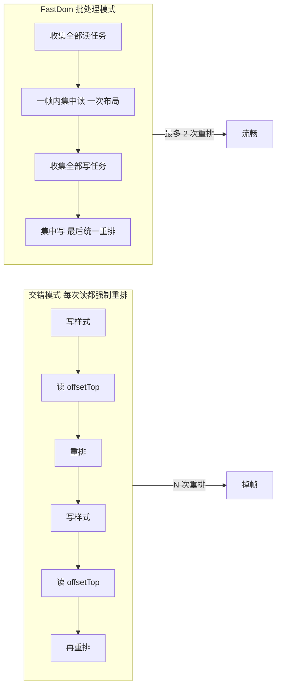

```javascript
// 一一对应：Layout Thrashing 复现 + FastDom 思想的读写队列实现
// 反例：循环里读写交错，10 个元素 = 10 次强制重排
function thrash(items) {
  items.forEach((el) => {
    const top = el.offsetTop;        // 读：被迫立即重排
    el.style.top = `${top + 10}px`;  // 写：使下一轮读失效
  });
}

// 修复：读写分离队列（FastDom 核心，约 30 行）
const fastdom = {
  reads: [], writes: [],
  measure(fn) { this.reads.push(fn); this._schedule(); },
  mutate(fn) { this.writes.push(fn); this._schedule(); },
  _scheduled: false,
  _schedule() {
    if (this._scheduled) return;
    this._scheduled = true;
    requestAnimationFrame(() => {
      this._scheduled = false;
      const reads = this.reads.splice(0);  // 阶段一：清空读队列，此时布局只算一次
      reads.forEach((fn) => fn());
      const writes = this.writes.splice(0); // 阶段二：集中写，浏览器最后统一重排
      writes.forEach((fn) => fn());
    });
  },
};

// 业务侧只管声明意图，顺序由队列保证
items.forEach((el) => {
  fastdom.measure(() => { el._top = el.offsetTop; });            // 先全读
  fastdom.mutate(() => { el.style.transform = `translateY(${el._top + 10}px)`; }); // 后全写
});
// 收益：10 次重排 -> 2 次（读一次、写一次），列表越长收益越大
```

### OPT-066：合成层怎么提升？层爆炸（layer explosion）怎么治理？

**答**：
- 元素拥有 3D transform/fixed/opacity 过渡/`will-change` 等条件时被提升为合成层，动画只在 compositor 线程跑，不受主线程阻塞。
- 层爆炸：滥用 `will-change: transform` 或大量固定元素，GPU 内存被层吃光（每层是按面积算的位图），表现为掉帧、闪烁甚至崩溃（移动端大图 + 多层尤其明显）。
- 排查：Layers 面板看层数量与每层内存（`Memory estimate`）；`will-change` 要在动画前加、动画后移除，常驻等于永久占用。
- 治理原则：只提升"真正做动画"的元素；大图先缩小再进层；用 `transform: translateZ(0)` 临时验证后及时撤掉。

```css
/* 一一对应：合成层提升与层爆炸治理 */
/* 正确：仅动画期间提升，配合 JS 在动画结束移除 */
.toast-enter {
  will-change: transform, opacity;  /* 提前告知，避免动画首帧才建层的卡顿 */
  animation: slide-in 0.3s;
}
@keyframes slide-in {
  from { transform: translateY(100%); opacity: 0; }
  to   { transform: translateY(0);    opacity: 1; }
}

/* 反例 1：全局滥用 —— 页面上 500 个卡片每个都建层，GPU 位图爆掉 */
/* .card { will-change: transform; }  <- 删掉 */

/* 反例 2：超大图片整体建层 —— 4000x3000 图的一层就吃约 46MB 内存 */
/* .big-photo { transform: translateZ(0); }  <- 改为缩小解码尺寸（见 OPT-078） */

/* 正确治理 2：滚动容器内的固定表头只提升表头本身，不提升整个容器 */
.table th {
  position: sticky;
  top: 0;
  z-index: 1;
  background: #fff;
}

/* 正确治理 3：backface-visibility 与 transform 提升的检查口 */
.promote-during-anim {
  transform: translateZ(0); /* 仅当确有闪烁/不出层问题时临时用 */
  backface-visibility: hidden;
}
```

### OPT-067：为什么动画只该动 transform 和 opacity？例外情况怎么处理？

**答**：
- 渲染流水线：Layout → Paint → Composite；改 width/top 触发全流程，改 transform/opacity 只走 Composite（层已提升时），成本差一个数量级。
- transform/opacity 由 compositor 线程直接计算，**主线程卡住时动画依然流畅**，这是它们独有的优势。
- 例外场景：需要参与布局的动画（手风琴展开高度）、无法 transform 化的属性（颜色渐变是 Paint 但无 Layout）。处理方式：用 transform 近似（scaleY 模拟高度、clip-path 裁剪）或接受 Paint 成本但避免 Layout。
- 退化检查：动画期间用 Performance 面板确认没有绿色 Layout 块，有就说明属性选错了或层没建起来。

```css
/* 一一对应：布局动画改造为合成动画的常见替换 */
/* 例 1：菜单展开 height 动画（Layout+Paint）-> scaleY 近似（Composite） */
/* 反例：.menu { height: 0 -> 200px; transition: height .3s; } 每帧重排整页 */
.menu {
  transform: scaleY(0);
  transform-origin: top;
  transition: transform 0.3s;
}
.menu.open { transform: scaleY(1); }

/* 例 2：移动元素 left/top -> translate */
/* 反例：.slider { left: 0 -> 100px; } 全流程 */
.slider { transform: translateX(100px); transition: transform 0.3s ease; }

/* 例 3：无法 transform 的颜色渐变——接受 Paint，但隔离影响面 */
.badge { background: #aaa; transition: background 0.2s; } /* 无 Layout，可接受 */
.badge.active { background: #1890ff; }

/* 例外例外：scaleY 会拉伸内容，需要内容不变形时用 clip-path 裁剪显隐 */
.menu-clip {
  clip-path: inset(0 0 100% 0);
  transition: clip-path 0.3s;
}
.menu-clip.open { clip-path: inset(0 0 0% 0); } /* 同为合成属性，内容不形变 */

/* 验证方法：Performance 录制动画，Main 轨道应基本空、Frames 全绿；
   若每帧出现 Layout，回到属性清单排查 width/height/top/left/margin */
```

### OPT-068：contain 和 content-visibility 深入：怎么用、坑在哪？

**答**：
- `contain` 声明"子树变化的影响边界"，让引擎跳过范围外的布局/绘制计算；`content-visibility: auto` 更进一步——视口外的子树**连渲染树都跳过**，长列表/长页面收益可达渲染时间减半。
- `contain: layout` 隔离布局、`paint` 隔离绘制溢出、`strict` 等价 `layout paint` 组合，适合独立卡片/列表项。
- content-visibility 必须配 `contain-intrinsic-size`，否则滚动条先按 0 高度算，滚动到底会疯狂跳动（CLS 恶化）。
- 坑：`contain: paint` 会裁剪溢出内容，遮挡 sticky/下拉阴影；`content-visibility` 内的锚点定位与 Ctrl+F 查找行为有差异，重要内容慎用。

```css
/* 一一对应：contain 与 content-visibility 落地 */
/* 场景 1：商品列表项——独立卡片用 strict，滚动/布局影响被限制在单项内 */
.card {
  contain: layout paint style;   /* 等价 strict 去掉 size */
}

/* 场景 2：超长页面（评论流/文档）——视口外整块跳过渲染 */
.comment-item {
  content-visibility: auto;
  /* 必须给预估高度：让滚动条稳定，跳过渲染期间占位 */
  contain-intrinsic-size: auto 120px; /* auto：真实渲染后记忆实际尺寸，越用越准 */
}

/* 场景 3：首屏关键区不要套 content-visibility，反而多一层判断 */
.hero { contain: layout; } /* 只隔离，不跳过 */

/* 验证与避坑 */
/* 1. 对比收益：DevTools Rendering 面板开 Frame Rendering Stats，
      或录制滚动 Performance，看 Recalculate Style 耗时下降比例 */
/* 2. 避坑：paint 会裁溢出，阴影被切的卡片要改成外层建层或去掉 contain: paint */
.card-shadow { contain: layout; } /* 想要 box-shadow 溢出可见就别加 paint */
/* 3. 锚点跳转目标在视口外时，先手动触发渲染：
      document.getElementById(hash)?.scrollIntoView(); */
```

### OPT-069：离屏渲染成本在哪？阴影、圆角、大图叠加怎么降本？

**答**：
- 合成层本身不一定快：**层的每次变化都要重新光栅化**，大面积高斯模糊、复杂阴影、圆角+裁剪+大图叠加会触发昂贵的离屏渲染（先画到中间纹理再合成）。
- 高成本清单：大半径 `box-shadow`/`filter: blur`、`border-radius` + 超出裁剪 + 动画内容、`backdrop-filter` 全屏毛玻璃。
- 降本手段：静态模糊图预烘焙（CSS 把 blur 结果做成图片）、阴影用预渲染渐变/贴图替代、毛玻璃缩限到小元素、`will-change` 集中在真正动画的小元素上。
- 判定：Layers 面板看层内存 + Performance 面板 GPU 轨道，光栅化耗时高即命中。

```css
/* 一一对应：高成本视觉效果的降级替换 */
/* 反例 1：大半径动态阴影 + 每帧动画 —— 每帧重新光栅化整层 */
/* .modal { box-shadow: 0 20px 80px rgba(0,0,0,.5); } */
/* 修复：阴影用预烘焙的多层小阴影叠加，光栅化成本大幅下降 */
.modal {
  box-shadow:
    0 1px 2px rgba(0, 0, 0, 0.07),
    0 4px 12px rgba(0, 0, 0, 0.08),
    0 12px 32px rgba(0, 0, 0, 0.10);
}

/* 反例 2：全屏毛玻璃 backdrop-filter，低端机每帧全屏重采样 */
/* .page-blur { backdrop-filter: blur(20px); } */
/* 修复：只对固定小面积头部使用，并降低 blur 半径 */
.header-blur {
  backdrop-filter: blur(8px);
  will-change: backdrop-filter; /* 头部是滚动中的动画元素才值得建层 */
  height: 56px;                 /* 小面积限制重采样范围 */
}

/* 反例 3：圆角容器内放大动画图 —— 裁剪 + 缩放叠加触发离屏 */
.avatar-clip {
  border-radius: 50%;
  overflow: hidden;
}
.avatar-clip > img {
  width: 48px;
  height: 48px;
  /* 大图先交给解码端缩好（配合 OPT-078 的 createImageBitmap），
     避免在合成层里缩 4000px 原图 */
  content-visibility: auto;
}

/* 通用验证：Performance 录制时勾选 GPU 轨道，观察 Rasterize 耗时；
   Layers 面板逐层看 Memory estimate，单层 >10MB 需要整改 */
```

### OPT-070：滚动监听的 passive 与 rAF 节流怎么组合才完整？

**答**：
- passive 告诉浏览器"回调不会 preventDefault"，滚动本身不再等 JS 回调，消除**输入延迟**；rAF 节流保证回调一帧一次，消除**重复计算**。两者解决的是不同问题，必须组合。
- 不组合的两种半吊子：只 passive 不节流——每秒几百次回调照样烧 CPU；只节流不 passive——每次滚动仍被回调同步阻塞。
- passive 有自动场景：window/document/body 上的 wheel/touch 监听 Chrome 默认 passive；但绑定在子元素上不自动，必须显式传。
- 需要 `preventDefault` 的场景（下拉刷新、自定滚动）不能 passive，此时把"阻止默认"与"计算"拆开：先同步阻止，再 rAF 里计算。

```javascript
// 一一对应：passive + rAF 组合的三种典型写法
const onScrollCalc = () => {
  progress.style.transform = `scaleX(${window.scrollY / docHeight})`; // 只动 transform
};

// ① 标准组合：passive 消除滚动阻塞，rAF 收敛到一帧一次
window.addEventListener('scroll', rafThrottle(onScrollCalc), { passive: true });

// ② touch 系列绑定在子元素上不会自动 passive，必须显式声明
document.querySelector('.drawer').addEventListener('touchmove', rafThrottle((e) => {
  dragHandle(e.touches[0].clientY);
}), { passive: true });

// ③ 必须 preventDefault 时：拆分"阻止"与"计算"
const gestureEl = document.querySelector('.pull-refresh');
gestureEl.addEventListener('touchmove', (e) => {
  if (pullingDown) e.preventDefault();       // 同步阻止默认滚动（不能 passive）
  pendingY = e.touches[0].clientY;           // 只记录，不计算
  requestAnimationFrame(() => updatePullUI(pendingY)); // 计算放到 rAF
}, { passive: false }); // 显式声明非 passive，浏览器也无需猜测

// 自检：Performance 面板录制滚动，Main 线程上不应出现连续的小 Script 块；
// 若有，说明 passive 或 rAF 节流没生效
```

### OPT-071：CSS 选择器性能的真相：现代引擎下还用优化选择器吗？

**答**：
- 旧结论"从右到左匹配，避免深层选择器"在现代引擎里**基本失效**：Blink/WebKit 有选择器过滤与失效分区（Style Sharing/Invalidation Sets），绝大多数选择器差异在毫秒以下。
- 真正还有感知的场景：**高频失效**——祖先链选择器（`.nav ul li a`）在任一祖先 class 变化时导致大范围后代失效重算；海量节点的列表页配一个宽泛选择器。
- 实际优先级：选择器优化 < 减少节点数 < 避免频繁改 class/属性。先量再改，Profile 里 Recalculate Style 超过 3-5ms 才值得查。
- 动态容器优先用 `:class` 精确挂在目标节点上，缩小失效范围。

```css
/* 一一对应：选择器写法的"真实影响"对照 */
/* 情形 1：深层后代选择器——匹配本身不慢，慢在"祖先变化时失效范围大" */
/* .page .content .list .item .title { ... } 中间层任何 class 抖动都波及全部 .title */

/* 改法：单 class 直达，失效范围只在这个节点 */
.item-title { font-weight: 600; }

/* 情形 2：通配与属性选择器在万级节点页面上有实测差异 */
/* .list * { box-sizing: border-box; }          <- 万节点时 Style 重算可测出差异 */
.list,
.list *:where(.cell, .row, .head) { box-sizing: border-box; } /* :where 零优先级且范围可控 */

/* 情形 3：现代引擎真正快的是"免匹配"——用继承代替重复声明 */
:root { --card-radius: 8px; }
.card { border-radius: var(--card-radius); } /* 变量改动只触发使用方失效 */

/* 情形 4：列表项频繁切换状态，用类切换而不是属性选择器扫描 */
/* 反例：.item[data-state="active"] 每次改 data-state 触发属性失效扫描 */
.item--active { color: #1890ff; } /* class 切换，失效范围最小 */
```

### OPT-072：字体加载的 CLS 怎么用 size-adjust / ascent-override 消除？

**答**：
- FOUT/FOIT 之外还有 FOIT-C（Fallback 字体与 Web 字体**度量不同**，加载完成后文字重排），是 CLS 的隐蔽来源。
- `@font-face` 的 `size-adjust`、`ascent-override`、`descent-override`、`line-gap-override` 把 fallback 字体的度量**调到与 Web 字体一致**，交换时文字位置不动。
- 配方：选一个系统近似字体作 fallback → 用工具（如 Fontaine/fontaine 或手动对照表）算出 override 值 → 只配 CSS，不改字体文件。
- 配合 `font-display: swap` 与预加载，先把 fallback 稳住，Web 字体加载中不再抖。

```css
/* 一一对应：fallback 度量对齐消除字体交换 CLS */
/* 原字体声明 */
@font-face {
  font-family: 'Harmony';
  src: url('/fonts/harmony.woff2') format('woff2');
  font-display: swap;
  unicode-range: U+4E00-9FFF; /* 按需声明，减少下载量 */
}

/* 关键：给 fallback 字体建一个"影子"声明，度量覆盖成与 Harmony 一致
   数值来源：fontaine 自动计算，或 FontForge 里对比两个字体的
   unitsPerEm / ascent / descent 换算 */
@font-face {
  font-family: 'Harmony Fallback';
  src: local('PingFang SC');      /* 系统近似字体 */
  size-adjust: 105%;              /* 基准的 x-height 缩放，使宽度对齐 */
  ascent-override: 90%;           /* 上伸部对齐，行首行高不变 */
  descent-override: 22%;          /* 下伸部对齐 */
  line-gap-override: 0%;
}

/* 使用：fallback 写在第一位，Web 字体就绪后无缝替换 */
.text {
  font-family: 'Harmony', 'Harmony Fallback', sans-serif;
}

/* 验证：DevTools Performance 录制加载过程，看 Layout 块是否消失；
   或 CLS 上报对比接入前后的 P75 */
```

### OPT-073：View Transitions API 怎么在 SPA 里落地？

**答**：
- 浏览器原生"新旧两帧过渡"：`document.startViewTransition(callback)` 自动截旧快照、更新 DOM、截新快照，然后对两者做插值动画，替代手写 FLIP。
- 默认是整页淡入淡出；给元素加 `view-transition-name` 后，同一元素在前后两个状态间**单独做位移动画**（列表到详情的共享元素转场）。
- 与路由结合：React/Vue Router 的导航回调包进 startViewTransition，注意异步数据要在回调内 await，否则过渡提前结束。
- 兼容处理：不支持的浏览器直接执行回调（渐进增强），不影响功能。

```html
<!-- 一一对应：SPA 路由切换接入 View Transitions（脚本 + 样式一套落地） -->
<style>
  /* 列表缩略图与详情头图之间建立共享元素：两边同名即可自动飞过去 */
  .list-thumb { view-transition-name: product-hero; }
  .detail-img { view-transition-name: product-hero; }

  /* 全页默认过渡改为横向推进 */
  ::view-transition-old(root) { animation: slide-out 0.25s ease; }
  ::view-transition-new(root) { animation: slide-in  0.25s ease; }
  @keyframes slide-out { to { transform: translateX(-30px); opacity: 0; } }
  @keyframes slide-in  { from { transform: translateX(30px); opacity: 0; } }
  /* 注意：view-transition-name 同一时刻必须全局唯一，
     列表 N 个缩略图不能同名——只给"即将点击"的那一个动态赋值 */
</style>
<script type="module">
  // 渐进增强封装：不支持的浏览器直接执行回调
  function withViewTransition(updateFn) {
    if (!document.startViewTransition) return updateFn();
    return document.startViewTransition(updateFn).updateCallbackDone;
  }

  // 路由切换：把状态更新包进过渡，数据获取留在回调内，新快照才是最终态
  async function navigateToDetail(id, setState, fetchDetail) {
    await withViewTransition(async () => {
      const detail = await fetchDetail(id);
      setState(detail); // 触发 DOM 更新
    });
  }

  // 共享元素动态赋值：点击时才给该缩略图命名，避免列表内同名冲突
  listEl.addEventListener('click', (e) => {
    const thumb = e.target.closest('.list-thumb');
    if (thumb) thumb.style.viewTransitionName = 'product-hero';
    navigateToDetail(thumb.dataset.id, setDetail, fetchDetail);
  });
</script>
```

## 十三、内存优化进阶

### OPT-074：前端内存泄漏类型清单与对应检测路径是什么？

**答**：
- 五大泄漏源：**detached 节点**（DOM 移除但 JS 变量还持有）、**定时器**（interval 引用回调与闭包）、**监听器**（window/document/emitter 未解绑）、**闭包持有大对象**、**无限增长的缓存**（Map/数组只进不出）。
- 检测总路径：任务管理器看页面内存是否阶梯上涨 → Memory 面板拍快照对比（进出页面 5 次前后）→ 搜 `Detached`/按 Constructor 过滤 → 看 Retainers 找持链 → 修 → 复测归零。
- 通用原则：任何"注册"行为（监听/订阅/定时/缓存）都必须有对应的、可确定执行的"注销"，优先收口到统一生命周期管理。
- `console.memory` 或 `performance.memory` 做开发时的粗粒度护栏（详见 OPT-079）。

```javascript
// 一一对应：五大泄漏源的防御性清单实现（LeakGuard 收口）
class LeakGuard {
  constructor(name) {
    this.name = name;
    this.disposers = []; // 所有注册行为返回的清理函数都进这里
  }
  on(target, type, fn, opts) {
    target.addEventListener(type, fn, opts);
    this.disposers.push(() => target.removeEventListener(type, fn, opts));
  }
  interval(fn, ms) {
    const id = setInterval(fn, ms);
    this.disposers.push(() => clearInterval(id));
    return id;
  }
  subscribe(emitter, event, fn) {
    emitter.on(event, fn);
    this.disposers.push(() => emitter.off(event, fn));
  }
  cache() {
    // 缓存给上限：LRU 而非裸 Map，杜绝"只进不出"
    const map = new Map();
    return {
      set(k, v) {
        if (map.size >= 500) map.delete(map.keys().next().value); // 淘汰最旧
        map.set(k, v);
      },
      get: (k) => map.get(k),
    };
  }
  dispose() {
    this.disposers.forEach((d) => d());
    this.disposers.length = 0;
  }
}

// 页面生命周期：进入创建、离开销毁，任何一类泄漏都被兜住
let guard;
router.onEnter('detail', () => { guard = new LeakGuard('detail'); });
router.onLeave('detail', () => guard.dispose());

// 开发自检：进退 5 次后断言 detached 节点为 0（配合手动快照）
window.__sniffLeak = () => {
  console.log('heap used MB:', (performance.memory?.usedJSHeapSize / 1048576).toFixed(1));
};
```

### OPT-075：WeakRef 与 FinalizationRegistry 是什么？为什么慎用？

**答**：
- `WeakRef` 创建不阻止 GC 的弱引用：缓存/伴生数据挂在对象上，宿主回收后引用自动变 undefined；`WeakMap/WeakSet` 能满足的场景优先用它们（更简单且有确定语义）。
- `FinalizationRegistry` 在对象被回收后收到回调，理论可用于清理外部资源（句柄/日志），但**回调时机不可控**，绝不放业务逻辑。
- 慎用三个理由：回调可能永不执行（页面关闭/GC 策略）、时机不确定导致调试困难、误用反而延长对象生命周期（注册表本身持有引用）。
- 合法用途有限：级联缓存失效、调试泄漏的观测探针，且必须配合显式清理主路径。

```javascript
// 一一对应：WeakRef 缓存 + FinalizationRegistry 观测（附显式主路径）
// 用途一：大资源的软缓存——内存压力下允许自动失效
const cache = new Map();          // key -> WeakRef
const registry = new FinalizationRegistry((key) => {
  // 对象被回收后清掉失效的 ref，防止 Map 无限膨胀
  // 注意：这只是辅助清理，不能依赖它做正确性
  cache.delete(key);
});
function setCached(key, bigObj) {
  cache.set(key, new WeakRef(bigObj));
  registry.register(bigObj, key);
}
function getCached(key) {
  const ref = cache.get(key);
  const obj = ref?.deref();
  if (!obj) cache.delete(key); // 已被回收，顺手清 ref
  return obj;                  // 可能为 undefined，调用方必须处理 miss
}

// 正确姿势：显式清理才是主路径，WeakRef 只是兜底
class ImageLayer {
  dispose() {
    this.texture = null;       // 显式释放
    registry.unregister?.(this); // 如果注册过就反注册
  }
}

// 慎用示例（反面）：把业务回调整进 FinalizationRegistry
// registry.register(conn, () => conn.close())  <- 错误！回调可能永不执行，
// 连接可能一直不关。外部资源必须在 try/finally 或 dispose 里显式关闭。
```

### OPT-076：对象池怎么做才能避免 GC 抖动？和 OPT-039 的简单池差别在哪？

**答**：
- GC 抖动来自"每帧大量小对象分配 → 频繁 minor GC"；对象池让稳态分配数为 0，常见于粒子系统、弹幕、物理模拟。
- 简单池（find+Set 标记）的问题：acquire 是 O(n) 线性查找，且 Set 自身也产生分配；**正确的池用双栈/环形数组**，acquire/release 都是 O(1)。
- 关键细节：release 时要**重置对象内部状态**（把引用类型字段清 null），否则池化对象带着旧引用反而变泄漏；池要设上限防膨胀。
- 判断是否需要：Performance 面板 GC 轨道每秒多次、堆内存锯齿剧烈，才值得上池；普通业务不要过度设计。

```javascript
// 一一对应：O(1) 双栈对象池（对比 OPT-039 的 find 版本：免线性查找、零稳态分配）
class ObjectPool {
  constructor(factory, reset, initial = 0, max = 1000) {
    this.factory = factory;
    this.reset = reset;         // 必须由业务提供：清干净所有引用字段
    this.free = [];             // 空闲栈
    this.max = max;             // 上限防膨胀
    for (let i = 0; i < initial; i++) this.free.push(factory());
    this.allocated = this.free.length; // 已创建总数（含在用）
  }
  acquire() {
    let obj = this.free.pop();
    if (!obj) {
      if (this.allocated >= this.max) throw new Error('pool exhausted'); // 泄漏预警
      obj = this.factory();
      this.allocated++;
    }
    return obj;
  }
  release(obj) {
    this.reset(obj);            // 关键：清引用，防池内对象持有旧数据
    if (this.free.length < this.max) this.free.push(obj);
  }
}

// 弹幕场景：每帧数十条，稳态零分配
const pool = new ObjectPool(
  () => ({ text: '', x: 0, y: 0, vx: 0, ref: null }), // factory
  (d) => { d.text = ''; d.ref = null; },               // reset：引用字段必须清
  100, 500
);
function spawnDanmaku(text) {
  const d = pool.acquire();
  d.text = text; d.x = canvasWidth;
  danmakuList.push(d);
}
function despawn(d) {
  const i = danmakuList.indexOf(d);
  danmakuList.splice(i, 1);
  pool.release(d);
}
```

### OPT-077：ArrayBuffer 与显式内存管理怎么用？什么场景值得？

**答**：
- `ArrayBuffer` 是固定长度的原始字节块，分配后长度不可变、无 GC 对象头开销，配合 `TypedArray/DataView` 读写，内存占用比对象数组低数倍。
- 典型收益：10 万个 {x,y,z} 对象数组约几十 MB 且分散在堆上；Float32Array 同数据量内存减半以上且内存连续，遍历对缓存友好，还能 Transferable 零拷贝传给 Worker。
- 显式管理：`ArrayBuffer.prototype.transfer()`（转移所有权，原引用即失效）与 `postMessage(buf, [buf])` 零拷贝转移，避免克隆造成的双倍峰值内存。
- 注意溢出：TypedArray 越界赋值静默忽略（不报错），用 DataView 或断言保护关键写入；释放只是"可回收"，峰值内存仍需自己控制分块。

```javascript
// 一一对应：对象数组 -> TypedArray 的迁移与零拷贝转移
// 原始：10 万个粒子对象
const particles = Array.from({ length: 100_000 }, () => ({
  x: Math.random(), y: Math.random(), z: Math.random(),
}));
// 坐标一批次更新后传 Worker：postMessage 默认深克隆，峰值内存翻倍

// 优化一：SoA 结构，一个 Float32Array 装全部坐标
const STRIDE = 3;
const buf = new ArrayBuffer(100_000 * STRIDE * 4); // 4 字节/float，约 1.2MB
const pos = new Float32Array(buf);
particles.forEach((p, i) => { pos[i * 3] = p.x; pos[i * 3 + 1] = p.y; pos[i * 3 + 2] = p.z; });

// 优化二：Transferable 零拷贝转移所有权，无克隆、无双倍峰值
worker.postMessage(pos, [pos.buffer]); // 注意：转移后本线程的 pos 不可再读写
// Worker 回传同理：self.postMessage(result, [result.buffer])

// 优化三：transfer() 管理所有权（不可转移给 Worker 时同线程转移引用）
const newBuf = buf.transfer(); // buf 此后 detached，长度 0，防止误用旧引用
console.log(buf.byteLength);   // 0

// 越界保护：TypedArray 越界写入静默失败
const small = new Uint8Array(2);
small[5] = 9;
console.log(small[5]); // undefined 风格 -> 实际输出 undefined（写入被丢弃）
function safeSet(arr, i, v) {
  if (i < 0 || i >= arr.length) throw new RangeError(`index ${i} out of ${arr.length}`);
  arr[i] = v;
}
```

### OPT-078：图片内存为什么是"解码尺寸"而不是"显示尺寸"决定的？

**答**：
- 一张图片解码进内存的占用 = 宽 × 高 × 4 字节（RGBA），与文件体积无关：4000×3000 的 2MB JPEG 解码后占 **48MB** 内存；CSS 缩到 100px 显示也不会减少。
- 手机网页常见的内存爆掉/白屏，多半是列表里塞了未缩放的大图：几十张未缩图 = 数 GB 解码需求。
- 治理三层：**请求尺寸对齐显示尺寸**（srcset/sizes 或 CDN 裁剪参数，一劳永逸）；**解码时机控制**（`decoding="async"` 不阻塞渲染，虚拟列表配合按需解码）；**必须用原图时手动降采样**（createImageBitmap 到目标尺寸，释放原解码）。
- 验证：Performance 面板图片解码条目 + Memory 里 Image/Bitmap 类目；iOS Safari 上超限直接丢图（白块）。

```javascript
// 一一对应：图片内存治理三件套
// ① 请求对齐显示：CDN 裁剪参数按 DPR 计算，绝不给 4000px 原图
function imageUrl(id, displayWidth) {
  const dpr = Math.min(window.devicePixelRatio, 3); // 3x 以上收益趋零，封顶
  return `https://cdn.example.com/img/${id}?w=${Math.round(displayWidth * dpr)}&fmt=webp`;
}
//  bitmap
function onRowRecycled(id) {
  bitmapCache.get(id)?.close(); // 显式释放解码内存，等 GC 会滞后很久
  bitmapCache.delete(id);
}

// 对比账单（面试可背）：
// 4000x3000 JPEG 2MB -> 解码 48MB；裁剪到 300x300 -> 0.36MB，差 130 倍
```

### OPT-079：performance.memory 怎么接入监控？跨浏览器怎么办？

**答**：
- `performance.memory`（Chromium）提供 usedJSHeapSize/totalJSHeapSize/jsHeapSizeLimit，轮询即可得到**堆趋势曲线**，是发现泄漏与 GC 压力最便宜的探针。
- 三个正确姿势：**看趋势不看绝对值**（不同机型 limit 不同）、配合关键操作打标（进入页面/切换路由）、按 `jsHeapSizeLimit` 算内存压力比告警。
- 兼容性：Safari/Firefox 没有；跨浏览器用兜底方案——`console.memory`（仅 DevTools）、`navigator.deviceMemory`（设备档位）、或 PerformanceObserver 的 GC 类目（新 API）。
- 采样别太密：10-30s 一次足够，采样本身也是开销；上报走 idle 档。

```javascript
// 一一对应：堆内存采样 + 压力比告警 + 跨浏览器兜底
function startHeapMonitor({ intervalMs = 15_000, warnRatio = 0.8 } = {}) {
  if (!performance.memory) {
    // Safari/Firefox：降级为设备档位 + 页面存活时长上报，趋势分析换用快照抽查
    navigator.sendBeacon('/api/rum', JSON.stringify({
      metric: 'heap_unavailable',
      deviceMemory: navigator.deviceMemory ?? 'unknown',
    }));
    return () => {};
  }
  const timer = setInterval(() => {
    const { usedJSHeapSize, jsHeapSizeLimit } = performance.memory;
    const ratio = usedJSHeapSize / jsHeapSizeLimit;
    // 关键操作打标：内存曲线要能对齐到"用户做了什么"
    navigator.sendBeacon('/api/rum', JSON.stringify({
      metric: 'heap_used',
      valueMB: Math.round(usedJSHeapSize / 1048576),
      pressure: Number(ratio.toFixed(2)),
      route: location.hash,
      aliveMs: Math.round(performance.now()),
    }));
    if (ratio > warnRatio) {
      // 压力超 80%：大概率接近 OOM，先于崩溃发出诊断
      navigator.sendBeacon('/api/rum', JSON.stringify({
        metric: 'heap_pressure',
        valueMB: Math.round(usedJSHeapSize / 1048576),
        snapshotHint: '请结合堆快照排查',
      }));
    }
  }, intervalMs);
  return () => clearInterval(timer);
}
startHeapMonitor();
// 判读口诀：锯齿高频 = GC 抖动上对象池；台阶只升不降 = 泄漏，拍快照对比
```

### OPT-080：堆快照对比分析的完整实操步骤是什么？

**答**：
- 步骤：**拍基线快照**（稳定态）→ **执行怀疑操作 N 次**（进出页面/开关弹窗，至少 3 次排除首次加载）→ **强制 GC** 再拍第二张 → **对比视图**选 Snapshot 2 → 搜 `Detached` 或按 "Objects allocated between" 过滤增量。
- 读结果三步：增量列表按 Retained Size 排序 → 点开可疑对象看 Retainers 链 → 链的末端通常就是那个忘了解绑的监听器/闭包/缓存。
- 注意先点垃圾桶图标手动 GC 再拍快照，否则把"还没来得及回收"误判为泄漏。
- 自动化方向：puppeteer 在 CI 里做"进出页面 N 次后堆增量断言"，把回归拦在合入前。

```javascript
// 一一对应：Puppeteer 自动化堆对比（CI 内存回归断言）
import puppeteer from 'puppeteer';

async function heapUsed(page) {
  // 在页面里取堆值，并把每次测量间强制 GC（--js-flags 参数全局开启）
  return page.evaluate(() => performance.memory.usedJSHeapSize);
}

const browser = await puppeteer.launch({
  args: ['--js-flags=--expose-gc'], // 允许 evaluate 里调 gc()
});
const page = await browser.newPage();
await page.goto('http://localhost:3000/list');

const forceGC = () => page.evaluate(() => window.gc?.());
await forceGC();
const before = await heapUsed(page);

// 疑似泄漏操作：进入/离开详情页 5 次
for (let i = 0; i < 5; i++) {
  await page.click('.item-1');
  await page.waitForSelector('.detail');
  await page.click('.back');
  await page.waitForSelector('.list');
  await forceGC(); // 每轮后手动回收，排除 GC 时机干扰
}
await forceGC();
const after = await heapUsed(page);

const deltaMB = (after - before) / 1048576;
console.log(`堆增量: ${deltaMB.toFixed(2)} MB`);
// 断言：正常往返应回归基线，增量 >2MB 视为疑似泄漏，CI 直接 fail
if (deltaMB > 2) {
  // 输出 suspects 供人工接手 DevTools 堆快照对比
  console.error('内存疑似泄漏：检查 detail 页监听器/定时器/闭包');
  process.exit(1);
}
await browser.close();
// 人工精查路径：Memory 面板 -> 两张快照 Comparison -> 过滤 Detached -> Retainers 链定位
```

## 十四、框架专项：React

### OPT-081：怎么用 Profiler 火焰图定位"渲染风暴"？

**答**：
- React DevTools Profiler 录制交互，火焰图里每个灰色块是一次提交（commit），块越宽耗时越长；开启 "Highlight updates" 能直接看到哪些组件在闪。
- 定位三板斧：看 commit 排行（按 duration 排序）→ 点进宽块看 "Why did this render?"（props/state/parent/context 变化原因）→ 对比 "actual duration" 与基线。
- 典型风暴：一个高频变化的状态放在树顶，导致整棵树每帧重渲；火焰图表现为大量等宽条带。
- 修复后用 Profiler 的 "Record why each component rendered" 复录对比，确认重渲染数量下降，而不是靠感觉。

```jsx
// 一一对应：Profiler API 程序化定位渲染风暴（可写进测试）
import { Profiler } from 'react';

// 1. 包住可疑子树，收集每次提交的耗时与原因
function onRender(id, phase, actualDuration, commits, interactions) {
  if (actualDuration > 16) { // 超过一帧预算的提交才记录，降噪
    report('react-commit', {
      subtree: id,
      phase,           // mount | update
      actualMs: Number(actualDuration.toFixed(1)),
    });
  }
}

<Profiler id="GoodsList" onRender={onRender}>
  <GoodsList items={items} keyword={keyword} />
</Profiler>

// 2. 常见风暴现场：keyword 放在顶层，每敲一个字整棵树重渲
// <App>                     <- keyword 在这
//   <Header />              <- 与 keyword 无关却跟着重渲
//   <GoodsList items={} />  <- 1000 行全量重渲
// 修复后结构见 OPT-082/OPT-083：把 keyword 下沉到搜索组件局部 + memo 边界

// 3. Profiler 面板对照读法：
//    Commit 排行按 Duration 排序 -> 选最宽的块 ->
//    右侧 "Why did this render?" 列出 props changed: keyword ->
//    对应修复就是把 keyword 的消费范围缩小到直接依赖它的组件
```

### OPT-082：状态下沉与状态上提怎么权衡？各自解决什么性能问题？

**答**：
- **状态下沉**：把易变状态放到最小的消费组件里，缩小重渲染范围——治"状态变了不该变的全跟着变"。
- **状态上提**：把共享状态放到共同祖先，避免多处副本不同步——治"为了同步而互相触发渲染"。两者方向相反，按问题选。
- 实战公式：先问"谁消费这个状态"。只有一个组件用 → 组件内部；兄弟共享 → 最小公共父级；跨层级 → context 或外部 store（配合 selector 订阅）。
- 典型重构：hover/输入这类高频状态绝不放全局 store 或顶层，下沉到叶子组件（或 CSS :hover 直接解决）。

```jsx
// 一一对应：状态下沉重构——输入状态从页面顶层移到搜索叶子组件
// 反例：keyword 在 App，每个字母触发全树重渲
function AppBad() {
  const [keyword, setKeyword] = useState(''); // 顶层持有，风暴源头
  return (
    <>
      <Header />
      <SearchBox keyword={keyword} onChange={setKeyword} />
      <GoodsList keyword={keyword} /> {/* 每键入一次全列表重渲 */}
    </>
  );
}

// 修复：keyword 下沉到 SearchBox 内部，列表订阅"防抖后的结果"
function AppFixed() {
  const [query, setQuery] = useState(''); // 只有防抖后的最终值上浮
  return (
    <>
      <Header />                    {/* 与搜索无关，永不重渲 */}
      <SearchBox onCommitted={setQuery} /> {/* 输入过程状态留在内部 */}
      <GoodsList query={query} />   {/* 每次输入法会话最多重渲一次 */}
    </>
  );
}

function SearchBox({ onCommitted }) {
  const [keyword, setKeyword] = useState(''); // 高频状态下沉到最小消费范围
  const commit = useMemo(() => debounce(onCommitted, 250), [onCommitted]);
  return <input value={keyword} onChange={(e) => { setKeyword(e.target.value); commit(e.target.value); }} />;
}

// 权衡记忆点：
// 高频/局部状态 -> 沉到底（hover、输入中间态、动画参数）
// 多方共享/需持久化 -> 提到最小公共父级或 store，但必须配 selector 订阅缩小通知面
```

### OPT-083：useSyncExternalStore 自定义 store 怎么实现 selector 级订阅？

**答**：
- `useSyncExternalStore(subscribe, getSnapshot)` 是 React 18 的外部 store 标准接口：订阅变化 + 原子读取快照，天然避免 tearing。
- 性能关键在 **selector**：组件只订阅自己用到的切片（getSnapshot 返回切片），切片不变不重渲，等价 Redux 的 useSelector。
- 注意 getSnapshot 必须**返回稳定引用**（缓存切片结果），否则每次渲染都拿到新对象导致无限重渲。
- 适合中大型应用自建轻量 store（几十行）替代全局 state 管理库的重渲染风暴问题。

```jsx
// 一一对应：mini store + useSyncExternalStore 的 selector 订阅
// store.js —— 30 行实现：外部 store + 切片缓存
function createStore(initial) {
  let state = initial;
  const listeners = new Set();
  return {
    getState: () => state,
    setState(patch) {
      state = typeof patch === 'function' ? patch(state) : { ...state, ...patch };
      listeners.forEach((l) => l()); // 通知所有订阅者，组件靠 selector 决定要不要重渲
    },
    subscribe(listener) {
      listeners.add(listener);
      return () => listeners.delete(listener);
    },
  };
}
export const store = createStore({ keyword: '', list: [], theme: 'dark' });

// useStore(selector)：selector 结果用引用相等做缓存，切片不变不触发重渲
export function useStore(selector) {
  return useSyncExternalStore(store.subscribe, () => {
    const slice = selector(store.getState());
    return slice; // selector 必须返回原始值或稳定引用
  });
}

// 组件只订阅自己关心的切片
function ThemeButton() {
  const theme = useStore((s) => s.theme); // keyword/list 变化时本组件不重渲
  return <button className={theme}>切换主题</button>;
}
function SearchResults() {
  const list = useStore((s) => s.list); // 只被 list 影响
  return <ul>{list.map((it) => <Row key={it.id} item={it} />)}</ul>;
}
// 搜索输入时 store.setState({ keyword }) -> 两个组件的切片均未变 -> 零重渲染
```

### OPT-084：列表的 key 用错会造成什么性能问题？重渲染数据量怎么控制？

**答**：
- key 的作用是 diff 时做身份对齐：用 index 做 key，删除/插入会导致后续所有元素"换皮"——组件状态错位 + 不必要的重渲染；用随机 key 更糟，等于每次全量重建。
- 性能上真正昂贵的不是 key 本身，而是"一次 commit 里 diff 的行数 × 每行复杂度"：万行列表全量重渲和虚拟列表只渲可视 20 行差 3 个数量级。
- 控制数据量三件套：**虚拟列表**（只渲可视区）、**行组件 memo + 稳定 props**（改一行只重渲一行）、**分页/无限滚动**减少首屏行数。
- key 取业务唯一 id；确无 id 时用内容哈希，最后才考虑 index（且仅限纯静态无增删列表）。

```jsx
// 一一对应：key 错误案例与"改一行只重渲一行"的列表实现
// 反例 1：index 作 key，插入头部时整列错位重渲
{rows.map((row, i) => <Row key={i} row={row} />)}

// 反例 2：随机 key，每次渲染全量卸载重建（连 state 都丢）
{rows.map((row) => <Row key={Math.random()} row={row} />)}

// 正解：稳定业务 id
{rows.map((row) => <Row key={row.id} row={row} />)}

// 行级 memo：props 浅比较，未变化的行直接跳过 reconcile
const Row = React.memo(function Row({ row, onSelect }) {
  return (
    <li onClick={() => onSelect(row.id)}>
      {row.name} - {row.price}
    </li>
  );
});

// 父组件： onSelect 用 useCallback 保稳定，否则 memo 形同虚设
function GoodsList({ rows }) {
  const handleSelect = useCallback((id) => emit('select', id), []); // 引用稳定
  return <ul>{rows.map((row) => <Row key={row.id} row={row} onSelect={handleSelect} />)}</ul>;
}

// 数据量验证：Profiler 里 diff 的行数应等于"被改的行数"，
// 若整列表都出现在一次 commit 里，先查 key 与 props 引用稳定性
```

### OPT-085：Context 怎么拆分（值/操作分离）才能减少重渲染？

**答**：
- Context 的重渲染规则：Provider 的 value 引用变化 → **所有消费组件全量重渲**，与是否用到变化的字段无关。
- 拆分两个维度：**按值拆**（theme/user/lang 各自独立 Provider，互不牵连）、**按读写拆**（state 与 dispatch 分开——操作函数引用稳定，值高频变化时只通知读的一方）。
- value 必须记忆化：`useMemo` 包住 value 对象，否则 Provider 每次渲染都产生新引用，consumers 全跟涨。
- 大状态不要全塞一个 context：拆得越细，重渲染面越小；跨页低频状态再考虑 store。

```jsx
// 一一对应：Context 值/操作分离 + 记忆化 value
// 反例：一个 Provider 装所有，任何变化全体消费者重渲
// <AppContext.Provider value={{ user, cart, theme, setTheme, addToCart }}>

// 正解 1：操作与值分家——操作引用永久稳定
const CartStateContext = createContext(null);
const CartDispatchContext = createContext(null);

function CartProvider({ children }) {
  const [cart, setCart] = useState({ items: [], total: 0 });
  // 操作对象只创建一次，引用永不变：消费它的组件永不因 cart 变化而重渲
  const actions = useMemo(
    () => ({
      add: (item) => setCart((c) => ({ ...c, items: [...c.items, item] })),
      clear: () => setCart({ items: [], total: 0 }),
    }),
    []
  );
  return (
    <CartDispatchContext.Provider value={actions}>
      <CartStateContext.Provider value={cart}>
        {children}
      </CartStateContext.Provider>
    </CartDispatchContext.Provider>
  );
}

// 只消费操作的组件（如"清空按钮"），加购时不重渲
function ClearCartButton() {
  const { clear } = useContext(CartDispatchContext);
  return <button onClick={clear}>清空购物车</button>;
}

// 正解 2：按值再拆——theme 高频换肤也不牵连 cart 消费者
// <ThemeProvider>、<CartProvider> 并列，各自独立失效范围
```

### OPT-086：大组件怎么拆分？memo 边界应该划在哪？

**答**：
- 拆分目标不是"代码短"而是**建立重渲染隔离墙**：把易变区域和稳定区域分开，memo 放在隔离墙上，变化被限制在墙内。
- 边界判断法：拿 Profiler 的 commit 结果，重渲染频率相同的组件归一个区域；高频区和低频区之间就是 memo 边界。
- memo 生效前提：props 引用稳定（useCallback/useMemo/稳定 key 传基本值），否则 memo 只增加比较成本。
- 与其到处 React.memo，不如先用"状态下沉"让变化天然隔离——memo 是补墙工具，不是第一手段。

```jsx
// 一一对应：大组件按重渲染频率拆分 + memo 边界
// 反例：一个巨型组件，聊天消息（高频滚动加载）与底部输入框互相拖累
// function ChatRoom() { ... 消息列表 + 侧栏 + 输入框 全在一处 ... }

// 拆分：三个区域独立，边界放在变化频率差异最大的地方
function ChatRoom({ roomId }) {
  const [draft, setDraft] = useState(''); // 高频：每键一次
  const messages = useMessages(roomId);   // 中频：新消息到达

  return (
    <div className="room">
      {/* 稳定区：roomId 不变就永不重渲，memo 建墙 */}
      <RoomSidebar memo roomId={roomId} />

      {/* 中频区：新消息才重渲，行级再 memo */}
      <MessageList messages={messages} />

      {/* 高频区：draft 状态下沉在此，输入不波及其他区域 */}
      <Composer draft={draft} onChange={setDraft} onSend={sendMessage} />
    </div>
  );
}

// 隔离墙实现：props 全为基本值或稳定引用时 memo 才有效
const RoomSidebar = React.memo(function RoomSidebar({ roomId }) {
  return <aside>{/* 用户列表，低频 */}</aside>;
});

const MessageList = React.memo(function MessageList({ messages }) {
  return (
    <ul>
      {messages.map((m) => (
        <MessageItem key={m.id} id={m.id} text={m.text} />
      ))}
    </ul>
  );
});
// MessageItem 只接基本值 props：任何一条新消息到达，只有新行 mount，旧行被 memo 跳过
const MessageItem = React.memo(({ id, text }) => <li data-id={id}>{text}</li>);
```

### OPT-087：useTransition 怎么在搜索页落地？和防抖的区别是什么？

**答**：
- `useTransition` 把状态更新标记为**可中断的过渡更新**：输入保持同步响应（urgent），列表重算被让位给输入渲染，卡顿感直接消失，比防抖少 200ms+ 感知延迟。
- 典型组合：输入框 value 同步更新（urgent）→ 过渡态更新列表数据（`startTransition` 内 setData）→ 过渡期展示旧列表 + isPending 提示。
- 与防抖互补：防抖减少"更新次数"，useTransition 保证"每次更新不阻塞输入"；两者可以叠加（数据来自接口时仍要防抖减少请求）。
- 同场景的兄弟 API：`useDeferredValue(value)` 直接给值做延迟副本，列表组件改动更少。

```jsx
// 一一对应：搜索页 useTransition 落地（输入即时、列表过渡）
function SearchPage() {
  const [input, setInput] = useState('');       // urgent：输入框随时响应
  const [query, setQuery] = useState('');       // transition：列表用它
  const [isPending, startTransition] = useTransition();

  const handleChange = (e) => {
    const v = e.target.value;
    setInput(v);                                // 同步更新，打字零延迟
    startTransition(() => {
      setQuery(v);                              // 可中断：输入渲染优先，列表让位
      // 若列表数据来自接口，这里仍建议 debounce 后 fetch，避免请求风暴
    });
  };

  return (
    <>
      <input value={input} onChange={handleChange} />
      {/* 过渡期间保留旧列表 + 轻量提示，不显示全屏 loading */}
      <div className={isPending ? 'list pending' : 'list'}>
        <HugeList filter={query} />
      </div>
    </>
  );
}

// 等价简化：useDeferredValue 适合"只想延迟一个值"的场合
function DeferredVariant({ keyword }) {
  const deferredKeyword = useDeferredValue(keyword); // 内部自动过渡
  const isStale = keyword !== deferredKeyword;       // 过渡未完成时旧值仍在渲染
  return <HugeList filter={deferredKeyword} className={isStale ? 'stale' : ''} />;
}

// 收益量化：Profiler 录制连续输入，
// 修复前输入帧 200ms+（被列表重算阻塞），修复后输入帧 <16ms
```

### OPT-088：React 19 编译器（React Compiler）能替代手动优化吗？

**答**：
- React Compiler 在构建期分析组件，自动插入等价于 useMemo/useCallback/React.memo 的记忆化，官方结论是**绝大多数手写 memo 可以删**。
- 能替代：props/JSX 层面的机械记忆化（写错的 useCallback、漏包的 useMemo 这类"体力优化"）。
- 不能替代：**架构层面的范围控制**——状态下沉、selector 订阅、虚拟列表、切片调度、拆分 Provider 这些"少做事"的设计优化。
- 落地建议：新项目开启编译器 + 保留 eslint-plugin-react-compiler 检查违规写法（如渲染期改可变数据）；存量项目按页面灰度开启，用 Profiler 对比后逐步下线手动 memo。

```jsx
// 一一对应：编译器开启配置与"删得掉/删不掉"的优化清单
// babel.config.js / vite.config.js
// import babel from '@babel/core';
export const plugins = [
  ['babel-plugin-react-compiler', {
    // 灰度开关：按目录启用，出问题可快速回退
    sources: (filename) => filename.includes('src/pages'),
  }],
];
// package.json: "babel-plugin-react-compiler": "^19"（RC 版本随 React 19 发布线）

// 编译器能替代的手动代码（直接删）：
function ProductCard({ item, onSelect }) {
  // 以下全部可删：编译器自动记忆化 props 引用与 JSX
  const priceLabel = useMemo(() => formatPrice(item.price), [item.price]);
  const handleSelect = useCallback(() => onSelect(item.id), [item, onSelect]);
  return <div onClick={handleSelect}>{item.name} {priceLabel}</div>;
}

// 编译器不能替代的优化（保留）：
// 1. 状态下沉/上提——组件范围划分是设计问题
// 2. selector 订阅——store 订阅粒度是数据层设计（见 OPT-083）
// 3. 虚拟列表——减少渲染数量本身
// 4. 防抖/节流/useTransition——控制更新频率与优先级
function OptimizedSearch() {
  const [query, setQuery] = useDeferredValue('');
  return <FilterList query={query} />; // 编译器只保证这里不浪费，不保证这里少算
}

// 检查工具：npx eslint --rule '{"react-compiler/react-compiler": "error"}'
// 违规示例（编译器无法记忆化的写法，必须人工修）：
// function Bad({ list }) { list.sort((a, b) => a - b); return <div>{list.length}</div>; }
// 渲染期修改可变数据 -> 检查器报错 -> 改为 useMemo(() => [...list].sort(), [list])
```

## 十五、框架专项：Vue

### OPT-089：为什么大数组要用 shallowRef？深层响应式的开销在哪？

**答**：
- `ref([])` 默认深层响应式：数组每个元素、每个嵌套字段都被 Proxy 包装，10 万条数据光是初始化代理就多花几百 ms，后续每次读取还要走 proxy 拦截。
- `shallowRef` 只代理引用本身：整体替换数组（`list.value = newArr`）才触发更新，内部字段保持原生对象，读写都是零代理开销。
- 配合 `triggerRef` 可在原地修改后手动通知；`markRaw` 能标记个别嵌套对象永不代理。
- 适用判断：列表数据"整体拉取、整体渲染、不改内部字段"（商品流、聊天记录）——服务端数据天然是只读快照，深层响应式是纯浪费。

```vue
<!-- 一一对应：大列表 shallowRef 深浅对比与手动触发 -->
<script setup>
import { ref, shallowRef, triggerRef } from 'vue';

// 反例：深层代理 10 万条 -> 初始化 +500ms，滚动时每个字段读取都过 proxy
const deepList = ref([]);

// 正解：shallowRef，数据保持原生
const list = shallowRef([]);

async function load() {
  const res = await fetch('/api/goods?size=100000');
  const { items } = await res.json();
  list.value = items; // 整体替换触发更新；items 内部零代理，访问开销与普通对象相同
}

// 原地修改某项后手动触发：只通知，不重建代理
function updateItem(id, patch) {
  const item = list.value.find((it) => it.id === id);
  Object.assign(item, patch);   // 直接改原生对象
  triggerRef(list);             // 手动发信号，视图更新一次
}

// 局部需要响应式的"漏网之鱼"（如表单编辑的那一条），用 markRaw 隔离
import { markRaw, reactive } from 'vue';
const editing = reactive(markRaw({ id: 1, name: '' })); // 外层可控，字段按需
</script>

<template>
  <!-- 配合虚拟列表（见 OPT-033），万级数据滚动满帧 -->
  <li v-for="item in list" :key="item.id">{{ item.name }}</li>
</template>
```

### OPT-090：v-memo 的适用场景和陷阱是什么？

**答**：
- `v-memo="[deps]"`：deps 未变时**整段子树跳过 diff**（ vnode 缓存复用），是模板级的 memo，粒度比组件 memo 更细。
- 高价值场景：万行列表中"绝大多数行内容不变"——`v-memo="item.id === selectedId"` 只让选中行变化时 diff 两行，其余全跳过。
- 陷阱一：deps 数组写漏依赖 -> 该更新的不更新，出"灵异 bug"；陷阱二：在内部含 slot/动态组件的复杂子树上乱用，缓存失效条件难对齐。
- 记住权衡：v-memo 本身有比较成本，**变化率低于 30% 的列表才值得**；高频全变的列表是负优化。

```vue
<!-- 一一对应：v-memo 万行列表只 diff 变化行 -->
<script setup>
import { ref } from 'vue';
const items = ref(/* 10 万条 */ []);
const selectedId = ref(null);
</script>

<template>
  <ul>
    <!-- 依赖只有"是否选中"：非选中状态切换到非选中状态 -> 整行跳过 diff -->
    <li
      v-for="item in items"
      :key="item.id"
      v-memo="[item.id === selectedId]"
      :class="{ active: item.id === selectedId }"
    >
      {{ item.name }} - {{ item.price }}
    </li>
  </ul>
</template>
<!-- 效果：点击选中某行，只有旧行+新行两行参与 diff，其余 99998 行直接复用缓存 -->

<!-- 陷阱示例：deps 写漏 -->
<!-- 反例：v-memo="[item.id]" 但模板里用了 item.count，count 更新后界面不刷新 -->
<!-- 反例 2：v-memo="[]" 永久缓存，挂载后任何数据更新都被跳过 -->

<!-- 正确的多依赖写法：把子树用到的所有变化源列全 -->
<li v-for="item in items" :key="item.id" v-memo="[item.count, selectedId, filter]">
  {{ item.name }} x{{ item.count }}
</li>

<!-- 选型对照：
  行内容整体频繁变化      -> 不用 v-memo，考虑虚拟列表
  大列表 + 少数行变化     -> v-memo（本例）
  组件级复用             -> 用组件 + props 记忆化，不用 v-memo -->
```

### OPT-091：computed 和 watch 的性能取舍怎么定？

**答**：
- computed 是**惰性 + 缓存**：依赖不变不重算、无消费者不执行，天然免浪费；watch 是**主动触发**：依赖变化即执行副作用，即使没人消费。
- 性能优先原则：能用 computed 派生就不要 watch 同步状态——watch 常见的 `data -> setData` 回写模式多跑一次更新且易抖动。
- computed 的坑：getter 里写昂贵循环会在每次依赖变化时重算，且模板里多处引用同一 computed 只算一次（这是它的优势，要确保多处复用同一实例而非重复计算）。
- watch 的正确位置：需要副作用（发请求、写 localStorage、操作非响应式库）时用；`watchEffect` 注意自动收集依赖可能"扫进来"额外依赖。

```vue
<!-- 一一对应：computed vs watch 的三种场景对照 -->
<script setup>
import { ref, computed, watch, watchEffect } from 'vue';
const items = ref([]);
const keyword = ref('');

// 场景 1：派生数据 -> 必须 computed（惰性 + 缓存 + 多处复用只算一次）
const filtered = computed(() => {
  const kw = keyword.value.trim().toLowerCase();
  return kw ? items.value.filter((it) => it.name.toLowerCase().includes(kw)) : items.value;
});
// 反例：watch(keyword, () => filtered.value = items.filter(...))
// 问题：组件未渲染也执行；keyword 每变一次全量重算；模板多处引用各自重算

// 场景 2：副作用（搜索请求）-> watch + 防抖
let timer;
watch(keyword, (kw) => {
  clearTimeout(timer);
  timer = setTimeout(() => fetchResults(kw), 300); // 副作用留在 watch
});

// 场景 3：watchEffect 的依赖陷阱
// 反例：函数里顺手读了 items.value，搜索时列表任何变化都会触发重跑
watchEffect(() => {
  console.log('searching', keyword.value, items.value.length); // items 被误收集
});
// 修复：effect 里只读真正需要的依赖；确需大依赖用 watch 显式声明
</script>

<template>
  <!-- 模板里 filtered 可以引用多次，只计算一次 -->
  <p>共 {{ filtered.length }} 条</p>
  <virtual-list :items="filtered" />
</template>
```

### OPT-092：keep-alive 的 include 怎么精确控制？滥用会有什么问题？

**答**：
- keep-alive 缓存组件实例：回切免重建、保留滚动与表单状态；但**缓存没有上限**，路由全开 keep-alive 等于把所有页面实例都留在内存里，多页切换后内存持续增长。
- `include/exclude` 按组件 name 白名单/黑名单控制：只缓存真正需要保态的页面（列表页、表单页），详情页等一过性页面不缓存。
- 高阶控制：`max` 设 LRU 上限兜底；配 `activated/deactivated` 钩子做数据刷新与暂停（视频/轮播在 deactivated 停掉）。
- 动态管理白名单：业务侧维护一个"可缓存路由列表"，与路由 meta 配合，比硬编码更可控。

```vue
<!-- 一一对应：keep-alive include 精确缓存 + activated 生命周期配合 -->
<script setup>
import { computed } from 'vue';
import { useRoute } from 'vue-router';
const route = useRoute();

// 白名单来自路由 meta，集中可维护
const cachedViews = computed(() =>
  route.matched.filter((r) => r.meta.keepAlive).map((r) => r.name)
);
</script>

<template>
  <router-view v-slot="{ Component }">
    <keep-alive :include="cachedViews" :max="10">
      <component :is="Component" />
    </keep-alive>
  </router-view>
</template>

<!-- 路由定义：只给列表页与编辑页保态 -->
<!-- { path: '/goods', name: 'GoodsList', meta: { keepAlive: true } } -->
<!-- { path: '/goods/detail/:id', name: 'GoodsDetail' }  <- 不缓存，一过性页面 -->

<script setup>
// 缓存页配合 activated 做增量刷新与资源暂停
import { onActivated, onDeactivated } from 'vue';
let timer;
onActivated(() => {
  refreshIfStale();          // 回来时只刷新脏数据，不整页重建
  timer = setInterval(polling, 30_000);
});
onDeactivated(() => {
  clearInterval(timer);      // 缓存页不销毁，定时器必须自己停，否则白吃 CPU
  videoPlayer.pause();       // 媒体类同理
});
</script>
<!-- 组件必须显式声明 name 与路由 name 一致，include 才能匹配：
     defineOptions({ name: 'GoodsList' }) -->
```

### OPT-093：Vue 路由懒加载与组件按需加载怎么落地？

**答**：
- 路由懒加载是代码分割的第一刀：`() => import('...')` 让每条路由独立 chunk，首屏只下载当前路由代码。
- 按需加载的三个层次：路由级（必做）、重型组件级（图表/富文本/地图，配合 `defineAsyncComponent`）、依赖级（大库按入口拆，echarts 按需注册）。
- 打包配合：`manualChunks` 把 node_modules 稳定依赖（vue/router/pinia）拆 vendor chunk，提升 HTTP 缓存命中与并行下载。
- 配合 `defineAsyncComponent` 的 loading/error 组件，重型组件加载期间有占位，避免布局跳动。

```javascript
// 一一对应：Vue Router 懒加载 + 异步组件 + manualChunks 三层分割
import { createRouter, createWebHistory } from 'vue-router';
import { defineAsyncComponent } from 'vue';

const router = createRouter({
  history: createWebHistory(),
  routes: [
    { path: '/', component: () => import('@/views/Home.vue') },      // 路由级分割
    { path: '/report', component: () => import('@/views/Report.vue') },
    // 首页的模块也可预加载控制：登录后空闲时预热高频路由
  ],
});
// 空闲预热次级路由，用户跳转时 chunk 已就绪
const warmup = () => import('@/views/Report.vue');
if ('requestIdleCallback' in window) requestIdleCallback(warmup, { timeout: 5000 });
else setTimeout(warmup, 3000);

// 组件级：重型图表异步化，带占位与失败重试
const HeavyChart = defineAsyncComponent({
  loader: () => import('@/components/HeavyChart.vue'),
  loadingComponent: ChartSkeleton,      // 加载占位，防 CLS
  errorComponent: ChartError,
  delay: 200,                           // 快速加载不闪 loading
  timeout: 10_000,
});

// vite.config.js —— 稳定 vendor 拆分，提升缓存命中
// export default defineConfig({
//   build: {
//     rollupOptions: {
//       output: {
//         manualChunks: {
//           vue: ['vue', 'vue-router', 'pinia'],            // 框架稳定不变
//           echarts: ['echarts'],                            // 重型库独立
//         },
//       },
//     },
//   },
// });
export { router, HeavyChart };
```

### OPT-094：VueUse 里哪些性能工具值得常备？怎么用？

**答**：
- 四件套：`useThrottleFn`（高频事件收敛）、`useDebounceFn`（最终态收敛）、`useRafFn`（对齐渲染帧的循环）、`useIdleCallback`/`useTimeoutFn`（低优先级让路）。
- 价值在于**与响应式系统打通**：`watchWithFilter`/`refDebounced` 让"响应式数据变化 -> 高成本动作"自带节流策略，不用手写胶水代码。
- 常用组合：`refDebounced(keyword)` 驱动搜索请求；`useThrottleFn` 包 scroll 回调；`useEventListener` 自动随组件卸载解绑（兼治监听泄漏）。
- 注意参数语义与手写节流一致：throttle 的 trailing/leading、debounce 的 maxWait 都有，选错参数等于没优化。

```vue
<!-- 一一对应：VueUse 性能四件套在列表页的组合落地 -->
<script setup>
import {
  refDebounced, useThrottleFn, useRafFn, useEventListener, watchDebounced,
} from '@vueuse/core';
import { ref, watch } from 'vue';

const keyword = ref('');
const scrollY = ref(0);
const progress = ref(0);

// ① refDebounced：防抖后的搜索词，请求与重过滤都吃它
const debouncedKeyword = refDebounced(keyword, 300);
watchDebounced(keyword, (kw) => fetchResults(kw), { debounce: 300, maxWait: 1000 });
// maxWait 保证连续输入时最迟 1s 必发一次请求，防饿死

// ② useThrottleFn：scroll 收敛到 100ms 一次
const onScroll = useThrottleFn(() => {
  scrollY.value = window.scrollY;
}, 100, true); // trailing: true 保证最后一次位置不丢

// ③ useEventListener：绑定即自动随组件卸载解绑，兼治监听器泄漏
useEventListener(window, 'scroll', onScroll, { passive: true });

// ④ useRafFn：与渲染对齐的连续动画/进度计算
const { pause } = useRafFn(() => {
  progress.value = Math.min(1, window.scrollY / document.body.scrollHeight);
});
// 组件卸载自动 pause（useRafFn 内部随 scope 清理）；也可手动 pause() 省电

// ⑤ useIdleCallback：埋点类低优先级任务压到空闲期
import { useIdleCallback } from '@vueuse/core';
// useIdleCallback(() => preloadNextPage(), { timeout: 3000 });
</script>

<template>
  <input v-model="keyword" />
  <div class="progress" :style="{ transform: `scaleX(${progress})` }" />
</template>
```

### OPT-095：v-once 和静态提升在模板编译产物里长什么样？

**答**：
- Vue3 编译器（patchFlags）已经把"静态节点"在编译期识别并** hoist 到 render 函数外**：静态 vnode 只创建一次，每次 patch 直接跳过（`PatchFlags.HOISTED`）。
- `v-once` 是手动挡：整段子树只渲染一次，后续更新完全不 diff，适合"确定永不变"的内容（版权文案、协议条款）。
- `v-memo`/`v-pre` 是同一谱系的其他档位：v-pre 完全跳过编译、v-memo 条件跳过 diff。
- 验证方式：用 Vue SFC Playground 切到编译产物，看 `_hoisted_1` 变量与 patchFlag 数字；dynamicChildren 列表里没有的节点就是跳过 patch 的。

```vue
<!-- 一一对应：源码与其编译产物对照（可在 SFC Playground 验证） -->
<template>
  <!-- 编译器自动静态提升：div 整块静态，产物里 _hoisted_1 只建一次 -->
  <div class="banner">
    <h1>618 大促</h1>
    <p>全场满 300 减 50</p>
  </div>

  <!-- 动态部分：带 patchFlag=1(TEXT)，diff 时只比对文本 -->
  <p>{{ price }}</p>

  <!-- v-once：手动永久缓存，且内容不再进入 dynamicChildren -->
  <footer v-once>
    <span>© 2026 Example Inc.</span>
    <span>ICP 备案号 00000000</span>
  </footer>
</template>

<script>
// 对应编译产物（简化），重点看 _hoisted 与 patchFlag：
// import { createElementVNode as _createV, createTextVNode as _text } from "vue";
// const _hoisted_1 = _createV("div", { class: "banner" }, [
//   _createV("h1", null, "618 大促"),                    // 模块级常量：只创建一次
//   _createV("p", null, "全场满 300 减 50"),
// ]);                                                   // patch 时被跳过
// export function render(_ctx) {
//   return (_openBlock(), _createBlock("div", null, [
//     _hoisted_1,
//     _createV("p", null, _text(_ctx.price), 1 /* TEXT */), // patchFlag=1 只 diff 文本
//   ]));
// }
export default { name: 'StaticHoistDemo' };
</script>

<!-- 实操建议：不要为提升率手写 v-once 覆盖动态内容——
     编译器对静态内容的自动处理已覆盖 90% 场景；
     v-once 只用于"运行时确定不变"（如一次性渲染的协议全文） -->
```

## 十六、Web Worker 与并行

### OPT-096：Worker 通信的真实成本在哪？结构化克隆怎么优化？

**答**：
- postMessage 走**结构化克隆**：深拷贝整个对象图，MB 级数据的克隆耗时与主线程 JSON 序列化同量级，"以为异步了不卡"是错觉——克隆发生在主线程。
- 成本排序：小对象（<100KB）克隆无感；大 JSON 对象克隆阻塞主线程；**TypedArray/ArrayBuffer 走 Transferable 零拷贝**（见 OPT-097）；Blob/ImageBitmap 天然可转移。
- 优化三板斧：传引用不传副本（Transferable）、**克隆发生在谁那边要想清**（在 Worker 里 fetch+裁剪，只回传小结果）、高频小消息**攒批发送**（每帧一条而非每条一条）。
- 检测：postMessage 前后打 `performance.now()`，主线程侧的差值就是克隆成本。

```javascript
// 一一对应：结构化克隆成本实测与三种优化写法
function measureClone(data, label) {
  const t0 = performance.now();
  worker.postMessage(data);          // 主线程侧完成结构化克隆
  const cost = performance.now() - t0;
  if (cost > 5) console.warn(`克隆成本 ${label}: ${cost.toFixed(1)}ms（阻塞主线程）`);
}

// 优化一：高频小消息攒批——100 条/帧变 1 条/帧
const buffer = [];
let scheduled = false;
function send(item) {
  buffer.push(item);
  if (!scheduled) {
    scheduled = true;
    setTimeout(() => {              // 帧末统一发
      worker.postMessage(buffer);   // 一次克隆一批
      buffer.length = 0;
      scheduled = false;
    }, 16);
  }
}

// 优化二：让数据不进主线程——Worker 内 fetch + 裁剪（对比反例）
// 反例：主线程 fetch 30MB -> res.json() 阻塞 -> 再克隆传给 Worker，双重灾难
// 正解：URL 传给 Worker，一切在 Worker 内完成（见 OPT-060 方案一）

// 优化三：能转移的不克隆（大数组、二进制走 Transferable）
const bigTyped = new Float64Array(1_000_000);
worker.postMessage(bigTyped, [bigTyped.buffer]); // 零拷贝转移，无克隆成本

// 克隆的隐性行为要背：
// 函数、DOM 节点、Symbol 无法克隆直接报错；
// Map/Set/Date/RegExp/ArrayBuffer 可克隆；
// getter 与原型链丢失，克隆后只剩自有可枚举属性
```

### OPT-097：Transferable Objects 零拷贝怎么实操？所有权模型是什么？

**答**：
- Transferable 把 ArrayBuffer 的**所有权**移交给 Worker：零字节拷贝、零克隆耗时，但原线程的 buffer 立即 detach（byteLength 变 0，不可再读写）。
- 可转移类型清单：ArrayBuffer（含 TypedArray 的 .buffer）、MessagePort、ImageBitmap、OffscreenCanvas、VideoFrame、ReadableStream。
- 实操要点：转移后原引用必须置空防误用；Worker 回传结果同样要转移，否则回程又一次克隆；需要"双端都可读"时克隆是唯一选择，要提前分清共享还是移交。
- 与 SharedArrayBuffer 的区别：转移是**移交所有权**（单端持有），SAB 是**共享同一块内存**（双端可读写，需 Atomics 同步）。

```javascript
// 一一对应：Transferable 所有权移交的完整闭环（主线程 <-> Worker）
// main.js
const buf = new ArrayBuffer(64 * 1024 * 1024); // 64MB
const view = new Float32Array(buf);
view.fill(1.0);

console.log(buf.byteLength); // 67108864
worker.postMessage(view, [view.buffer]); // 移交所有权：零拷贝
console.log(buf.byteLength); // 0 —— 已 detach，继续读写会抛错

// 所有权守卫：转移后置空，防误用
let ownedBuf = buf;
// worker.postMessage(ownedBuf, [ownedBuf]); ownedBuf = null;

// worker.js —— 处理后必须同样转移回来，否则回程克隆 64MB
self.onmessage = (e) => {
  const data = new Float32Array(e.data); // 直接在移交来的 buffer 上建视图，无复制
  for (let i = 0; i < data.length; i++) data[i] *= 2; // 计算
  const result = data;
  self.postMessage(result, [result.buffer]); // 回程零拷贝转移
};

// main.js 接收
worker.onmessage = (e) => {
  const result = new Float32Array(e.data); // 又是零拷贝
  console.log(result[0]); // 2.0
};

// ImageBitmap 转移：大图解码结果传 Worker 绘制，同样零拷贝
// const bmp = await createImageBitmap(blob);
// worker.postMessage(bmp, [bmp]);
```

### OPT-098：SharedArrayBuffer 和 Atomics 是什么概念？前端哪里用得上？

**答**：
- SharedArrayBuffer 让**两个线程读写同一块物理内存**，不再有克隆与转移开销；但它带来数据竞争，必须配 `Atomics`（原子操作：add/load/store/wait/notify）保证同步。
- 前置条件苛刻：跨域隔离头 `Cross-Origin-Opener-Policy: same-origin` + `Cross-Origin-Embedder-Policy: require-corp`，否则 SAB 不可用（Spectre 缓解）。
- 典型前端场景：Worker 池共享同一份超大矩阵做并行计算（图像处理/物理引擎）；`Atomics.wait` 在主线程不可用（会冻结 UI），要用 `Atomics.waitAsync`。
- 没有强需求不上：大多数业务用 Transferable 转移 + 分块就够，SAB 增加的是心智负担（内存序、自旋锁）。

```javascript
// 一一对应：SAB + Atomics 的最小可用示例（主线程与 Worker 共享计数/任务槽）
// 前置：响应头必须配置
//   Cross-Origin-Opener-Policy: same-origin
//   Cross-Origin-Embedder-Policy: require-corp

// main.js
if (!crossOriginIsolated) {
  console.warn('未跨域隔离，SAB 不可用'); // 页面级检查
}
const sab = new SharedArrayBuffer(1024);
const int32 = new Int32Array(sab);
int32[0] = 0; // [0] 作任务计数器，[1] 作就绪标志
worker.postMessage(sab); // SAB 不需要转移，本来就是共享

// 主线程投递任务号
Atomics.store(int32, 0, taskId);
Atomics.notify(int32, 0); // 唤醒 wait 中的 Worker

// worker.js
self.onmessage = (e) => {
  const int32 = new Int32Array(e.data);
  while (true) {
    // 原子等待：睡眠等主线程 notify，不烧 CPU（wait 在 Worker 内合法）
    Atomics.wait(int32, 0, Atomics.load(int32, 0)); // 值变化才被唤醒
    const task = Atomics.load(int32, 0);
    const result = heavyCompute(task);
    // 原子写结果 + 置就绪标志，主线程可轮询 load
    Atomics.store(int32, 1, result);
    Atomics.store(int32, 2, 1); // ready flag
  }
};

// 主线程读取结果：wait 不可用于主线程，用 waitAsync（返回 Promise）
Atomics.waitAsync(int32, 2, 0).value.then(() => {
  console.log('worker 结果:', Atomics.load(int32, 1));
});
```

### OPT-099：Worker 池怎么封装？任务队列 + 复用的完整实现是什么？

**答**：
- 单 Worker 一次只能跑一个任务，多核机器应该开 `navigator.hardwareConcurrency`（封顶 4-8）个 Worker 组成池，任务排队、空闲领取。
- 池的三个组件：**任务队列**（优先级 FIFO）、**Worker 复用**（避免频繁构造销毁的启动成本）、**Promise 化接口**（业务无感知 id 匹配请求响应）。
- 关键细节：任务带唯一 id，Worker 回传 id 关联 resolve；Worker 崩溃要能重新拉起并重投任务；池关闭时先清队列再 terminate。
- 适用判断：任务数 > Worker 数且单任务 >10ms 才需要池；偶发单次计算直接开一个 Worker 更简单。

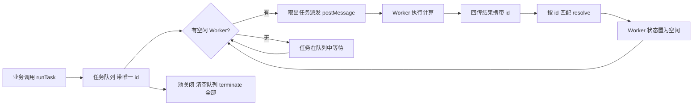

```javascript
// 一一对应：Worker 池完整实现（队列 + 复用 + Promise 化 + 崩溃重启）
class WorkerPool {
  constructor(workerScript, size = Math.min(navigator.hardwareConcurrency || 2, 8)) {
    this.queue = [];
    this.idle = [];
    this.busy = new Map(); // worker -> taskId
    this.pending = new Map(); // taskId -> { resolve, reject }
    for (let i = 0; i < size; i++) this.idle.push(this._spawn(workerScript));
  }
  _spawn(script) {
    const w = new Worker(script);
    w.onmessage = (e) => {
      const { id, ok, result, error } = e.data;
      const p = this.pending.get(id);
      this.pending.delete(id);
      ok ? p.resolve(result) : p.reject(new Error(error));
      this.idle.push(w);          // 归还空闲池
      this._dispatch();           // 立即补位下一个任务
    };
    w.onerror = () => {           // 崩溃自愈：重建 Worker，队列任务自动重投
      this.idle = this.idle.filter((x) => x !== w);
      this.idle.push(this._spawn(w.src || 'worker.js'));
      this._dispatch();
    };
    return w;
  }
  run(payload, transfer = []) {
    return new Promise((resolve, reject) => {
      const id = crypto.randomUUID();
      this.pending.set(id, { resolve, reject });
      this.queue.push({ id, payload, transfer });
      this._dispatch();
    });
  }
  _dispatch() {
    while (this.idle.length && this.queue.length) {
      const task = this.queue.shift();
      const w = this.idle.pop();
      w.postMessage({ id: task.id, data: task.payload }, task.transfer);
    }
  }
  destroy() {
    this.queue.length = 0;
    this.pending.forEach((p) => p.reject(new Error('pool destroyed')));
    this.idle.forEach((w) => w.terminate());
  }
}

// 使用：8 核机器并行处理 100 张图
const pool = new WorkerPool('worker.js');
const results = await Promise.all(
  imageBuffers.map((buf) => pool.run(buf, [buf])) // buffer 转移进 Worker 零拷贝
);
```

### OPT-100：OffscreenCanvas 的完整用法？和普通 canvas 的区别在哪？

**答**：
- `transferControlToOffscreen()` 把 canvas 的绘制权**移交**给 Worker：主线程零绘制开销，Worker 里独立跑 rAF 渲染循环，主线程卡顿不影响动画帧率。
- 关键语义：转移后主线程不能再动这个 canvas 的 2d/webgl 上下文；OffscreenCanvas 本身也可作为 Transferable 直接转移。
- 适合：地图瓦片渲染、可视化大屏、粒子/游戏画面——绘制密集且与 UI 逻辑可分离的场景。
- 局限：Worker 内没有 DOM，事件（点击/滚轮）要主线程转发；getImageData 等同步读像素在 Worker 里同样昂贵，能用 GPU 就别回读。

```javascript
// 一一对应：OffscreenCanvas 移交 Worker 渲染循环
// main.js
const canvas = document.querySelector('#scene');
const offscreen = canvas.transferControlToOffscreen(); // 绘制权移交

const worker = new Worker('render-worker.js');
worker.postMessage(
  { canvas: offscreen, width: canvas.clientWidth, height: canvas.clientHeight },
  [offscreen] // OffscreenCanvas 本身是 Transferable，零拷贝移交
);

// 交互转发：Worker 没有 DOM，事件数据手动传
document.addEventListener('pointermove', (e) => {
  worker.postMessage({ type: 'pointer', x: e.offsetX, y: e.offsetY });
});

// render-worker.js —— 独立渲染循环：主线程再卡，画面帧率也不掉
let ctx, W, H, particles = [];
self.onmessage = (e) => {
  if (e.data.canvas) {
    ctx = e.data.canvas.getContext('2d');
    ({ width: W, height: H } = e.data);
    for (let i = 0; i < 2000; i++) {
      particles.push({ x: Math.random() * W, y: Math.random() * H, vy: Math.random() * 2 + 1 });
    }
    requestAnimationFrame(loop); // Worker 里同样支持 rAF
  } else if (e.data.type === 'pointer') {
    pointer = e.data;
  }
};
let pointer = { x: 0, y: 0 };
function loop() {
  ctx.clearRect(0, 0, W, H);
  for (const p of particles) {
    p.y = (p.y + p.vy) % H;
    ctx.fillRect(p.x, p.y, 2, 2);
  }
  requestAnimationFrame(loop);
}
// 对比：同样 2000 粒子跑在主线程，任何长任务都会让动画跳帧；
// OffscreenCanvas 方案里主线程长任务只影响事件转发延迟，不影响渲染
```

### OPT-101：Comlink 的核心思想是什么？怎么用 RPC 化封装 Worker？

**答**：
- Comlib/Comlink 思想：把 Worker 的 postMessage 协议抽象成 **ES Proxy + RPC**——Worker 暴露一个对象，主线程拿到"看起来同款"的代理，方法调用自动变成异步消息，业务代码不见一行 postMessage。
- 收益：通信协议（id 匹配、序列化、错误回传）全部收敛到库里，Worker 接口像本地模块一样用，团队不再各写各的消息格式。
- 核心约定：代理上的每个方法调用返回 Promise；参数与返回值仍走结构化克隆，**大 ArrayBuffer 记得用 transfer 包装**；回调通过 Comlink.proxy 反向暴露。
- 手写 20 行也能实现同样思想（理解原理 > 记 API）。

```javascript
// 一一对应：Comlink 用法 + 手写 mini 版（理解 RPC 化本质）
// 方式一：Comlink 现成库
// import * as Comlink from 'comlink';
// worker.js
// import * as Comlink from 'comlink';
// const api = {
//   async parseHugeJson(url) {
//     const res = await fetch(url);
//     return (await res.json()).items.slice(0, 100); // 只回小结果
//   },
//   process(buf) {
//     const arr = new Float32Array(buf);
//     arr.forEach((v, i, a) => (a[i] = v * 2));
//     return Comlink.transfer(arr.buffer, [arr.buffer]); // 显式声明转移
//   },
// };
// Comlink.expose(api);
// main.js
// const api = Comlink.wrap(new Worker('worker.js'));
// const items = await api.parseHugeJson('/data.json'); // 像本地异步函数一样调

// 方式二：手写 20 行 mini RPC（同一思想）
// worker.js
self.onmessage = async (e) => {
  const { id, method, args } = e.data;
  try {
    const result = await methods[method](...args);
    self.postMessage({ id, ok: true, result });
  } catch (err) {
    self.postMessage({ id, ok: false, error: err.message });
  }
};
const methods = {
  hash(text) { return [...text].reduce((h, c) => (h * 31 + c.charCodeAt(0)) | 0, 0); },
  sortBig(arr) { return arr.slice().sort((a, b) => a - b); },
};

// main.js —— Proxy 把方法调用转成消息
function rpcWorker(worker) {
  const pending = new Map();
  worker.onmessage = (e) => {
    const { id, ok, result, error } = e.data;
    pending.get(id)[ok ? 'resolve' : 'reject'](ok ? result : new Error(error));
    pending.delete(id);
  };
  return new Proxy({}, {
    get(_, method) {
      return (...args) => new Promise((resolve, reject) => {
        const id = crypto.randomUUID();
        pending.set(id, { resolve, reject });
        worker.postMessage({ id, method, args });
      });
    },
  });
}
// const api = rpcWorker(new Worker('worker.js'));
// await api.sortBig([3, 1, 2]); // 与本地调用无异
```

### OPT-102：主线程和 Worker 的适用边界怎么决策？

**答**：
- 核心判断两维：**任务耗时**（预估 >16ms 值得离开主线程）与**是否碰 DOM/同步 API**（碰了就只能主线程）。
- 决策树：能删/能减（不需要算）> 能异步 IO（fetch/流式，不用 Worker）> 纯计算且贵（Worker）> 纯计算但便宜（直接算，别为 2ms 开 Worker）。
- Worker 的隐性成本要计入：启动 40-100ms（要复用/预热）、消息克隆成本、代码要单独打包。**短平快任务留在主线程反而更快**。
- 常见误判：把 5ms 的小计算扔进 Worker，启动+克隆成本 100ms，纯负优化；把 DOM 操作试图搬进 Worker，架构失败。

```javascript
// 一一对应：边界决策函数 + 各路径的典型实现
function routeTask(task) {
  const estimate = task.estimateMs;
  if (task.needsDOM || task.needsSyncAPI) {
    return { path: 'main-thread', note: '碰 DOM/同步 API，必须主线程，用切片防长任务' };
  }
  if (estimate <= 5) {
    return { path: 'main-thread-sync', note: '太短，Worker 启动+克隆成本反超收益，直接算' };
  }
  if (estimate <= 16) {
    return { path: 'main-thread-idle', note: 'requestIdleCallback 空闲期消化' };
  }
  if (estimate <= 200 && task.frequency === 'rare') {
    return { path: 'worker-single', note: '复用长驻 Worker，避免每次新建' };
  }
  return { path: 'worker-pool', note: '重型/高频计算，池化并行' };
}

// 各路径实现要点示例：
// main-thread-idle：空闲期跑小任务
requestIdleCallback(() => computeSmall(), { timeout: 500 });

// worker-single：模块级单例长驻预热，掩盖启动成本
const worker = new Worker('compute.worker.js', { type: 'module' }); // 打包器自动分 chunk
// Vite: new Worker(new URL('./compute.worker.js', import.meta.url), { type: 'module' })

// worker-pool：见 OPT-099
// const pool = new WorkerPool('compute.worker.js');

// 主线程兜底：即使必须主线程，也要切片（见 OPT-057）而不是一口气算
// await processInChunks(bigList, step, { budget: 40 });

// 决策口诀：
// 先问能不能不算（需求/数据减量），再问能不能不现在算（idle/懒加载），
// 最后才问要不要搬到 Worker——顺序反了就是过度设计
```

## 十七、媒体与视觉优化

### OPT-103：视频优化怎么做？preload 档位与分片协议怎么选？

**答**：
- `preload` 三档决策：首页非视频位 `none`（一点不拉）；可能播放的 `metadata`（只拉时长/尺寸）；确定首屏即播的才 `auto`。默认 auto 是流量黑洞。
- 长视频用 **HLS/DASH 分片**：按秒切片 + 自适应码率（弱网降清晰度不断流），首帧只要第一个分片；短视频（<2min）可以直接 MP4 但要用 `range` 请求支持。
- 首帧优化四件套：`poster` 占位图、`muted` + `playsinline`（自动播放条件）、封面用首帧截图而非加载视频后再解码、`mediafragments`（`#t=0.5` 预热 moov box）。
- MP4 注意 moov 前置（faststart），否则浏览器要下完整个文件才能播。

```html
<!-- 一一对应：视频加载策略三档落地 -->
<!-- 场景 1：非首屏视频位 —— 完全不预载，点击时才真正加载 -->
<video
  preload="none"
  poster="cover.avif"
  controls
  data-src="https://cdn.example.com/demo.mp4">
</video>
<script>
  // facade 模式：点击封面才注入 src，避免 preload=none 也被部分浏览器偷流
  document.querySelectorAll('video[data-src]').forEach((v) => {
    v.addEventListener('play', () => {
      if (!v.src) v.src = v.dataset.src;
    }, { once: true });
  });
</script>

<!-- 场景 2：列表中可能播放 —— 只取元数据 -->
<video preload="metadata" poster="cover.avif" muted playsinline></video>

<!-- 场景 3：首屏必播的背景视频 —— 立即加载但必须静音内联，否则自动播放被拒 -->
<video autoplay muted loop playsinline preload="auto" poster="first-frame.avif">
  <!-- source 顺序即格式协商：webm 体积更小优先 -->
  <source src="bg.webm" type="video/webm" />
  <source src="bg.mp4" type="video/mp4" />
</video>

<!-- 场景 4：长视频课程页 —— HLS 分片 + 自适应码率 -->
<!-- <video id="player" controls poster="cover.avif"></video> -->
<script type="module">
  import Hls from 'hls.js';
  const video = document.querySelector('#player');
  if (video.canPlayType('application/vnd.apple.mpegurl')) {
    video.src = 'https://cdn.example.com/lesson.m3u8'; // Safari 原生
  } else if (Hls.isSupported()) {
    const hls = new Hls({ startLevel: 0, capLevelToPlayerSize: true }); // 起播低码率秒开，分辨率对齐播放器尺寸
    hls.loadSource('https://cdn.example.com/lesson.m3u8');
    hls.attachMedia(video);
  }
</script>
```

### OPT-104：GIF 转视频的收益怎么量化？怎么落地自动转换？

**答**：
- 同画面 GIF vs MP4/WebM：体积差 10-30 倍（GIF 每帧全量存储 + 256 色 + 无帧间压缩），且 GIF 解码在主线程、视频解码走硬件管线，CPU 差一个量级。
- 落地：构建期/上传期用 ffmpeg 把 .gif 转成 `mp4(H.264, 无音轨)` 或 `webm(VP9)`，页面用 `<video autoplay muted loop playsinline>` 无缝替换，观感与 GIF 一致。
- 兜底：不支持 video 循环的极端场景极少了，可忽略；真正要注意的是**移除音轨**（`-an`），否则自动播放策略可能拦住。
- 量化方法：转码前后文件体积对比 + Performance 面板看 GIF 帧解码的 Script/Raster 占用消失。

```bash
# 一一对应：GIF 转视频的 ffmpeg 命令与体积收益核对
# 输入 demo.gif 12MB；转 H.264 MP4 无音轨，与 GIF 同帧率
ffmpeg -i demo.gif \
  -movflags faststart \      # moov box 前置：边下边播，首帧提前
  -an \                      # 去音轨：满足 muted 自动播放 + 省体积
  -vf "fps=24,scale=640:-2:flags=lanczos" \ # 限制帧率与宽度，-2 保证偶数高
  -c:v libx264 -crf 26 \     # crf 26：动图场景画质无感，体积再减半
  -pix_fmt yuv420p \         # 兼容所有播放器的像素格式
  demo.mp4
# WebM 备选（更小但编码慢，iOS 老版本兼容注意）：
ffmpeg -i demo.gif -an -c:v libvpx-vp9 -crf 34 -b:v 0 -vf fps=24,scale=640:-2 demo.webm

# 批量转换 + 体积报告（构建脚本用）：
# for f in assets/*.gif; do
#   ffmpeg -y -i "$f" -movflags faststart -an -vf fps=24,scale=640:-2 -c:v libx264 -crf 26 -pix_fmt yuv420p "${f%.gif}.mp4"
# done
# du -h assets/*.gif assets/*.mp4 | sort
# 典型输出：demo.gif 12M -> demo.mp4 680K，体积 -94%，解码走硬件管线

# 页面替换规则（与 OPT-018 facade 一致）：
# <video autoplay muted loop playsinline poster="demo-poster.avif">
#   <source src="demo.webm" type="video/webm"><source src="demo.mp4" type="video/mp4">
# </video>
```

### OPT-105：SVG 怎么优化？内联和外链怎么决策？

**答**：
- 工具链：SVGO 去元数据/注释/空组、合并路径、压缩坐标精度，平均省 30-60%；但要**禁用过度移除**（removeViewBox、collapseGroups 可能破坏样式作用域）。
- 内联 vs 外链决策：**图标复用且需换色/悬停动画** -> 内联或 SVG sprite（CSS 可控）；**插画/大图一次出现** -> 外链 ``（浏览器可缓存、不污染 DOM、可懒加载）。
- 内联的隐性成本：每个内联 SVG 都进 DOM 参与 style 计算，几百个内联图标会拖慢渲染；sprite + `<use>` 是折中（同文档引用、可换色、只占一个定义）。
- 动态色需求用 `currentColor` + CSS 变量，避免为换色生成多份文件。

```bash
# 一一对应：SVGO 优化流水线与配置
npm i -D svgo
# 单文件优化，保留 viewBox，精度 2 位（视觉无差，体积骤降）
npx svgo icon.svg -o icon.opt.svg \
  --precision=2 \
  --disable=removeViewBox \      # 保 viewBox：响应式缩放依赖它
  --enable=collapseGroups,mergePaths

# 构建期批量 + 产物报告：
# svgo -f assets/icons -o dist/icons --config svgo.config.js --multipass
```

```javascript
// svgo.config.js —— 白名单式插件配置（默认全开会破坏样式）
module.exports = {
  multipass: true, // 反复优化直到不再变小
  plugins: [
    'preset-default',
    { name: 'preset-default', params: {
      overrides: {
        removeViewBox: false,        // 关键保命项
        collapseGroups: false,       // 有 CSS 作用域依赖的组不合并
      },
    } },
    'convertStyleToAttrs',
    { name: 'removeAttrs', params: { attrs: '(data-name)' } },
  ],
};
```

```html
<!-- 一一对应：内联/外链/sprite 三种引用方式决策 -->
<!-- 决策 1：需要 CSS 换色的功能图标 -> sprite + use，只定义一份 -->
<svg style="display:none">
  <symbol id="i-heart" viewBox="0 0 24 24">
    <path d="M12 21c-5-4-9-7-9-11a5 5 0 0 1 9-3 5 5 0 0 1 9 3c0 4-4 7-9 11z" />
  </symbol>
</svg>
<svg class="icon"><use href="#i-heart" /></svg>

<!-- 决策 2：营销插画（大、一次性、无需交互）-> 外链 img，可缓存可懒加载 -->


<!-- 决策 3：首屏关键小图标（logo）-> 内联，省一次请求且随 DOM 渲染 -->
<svg class="logo" width="32" height="32" aria-hidden="true"><path fill="currentColor" d="..." /></svg>
<!-- 换色统一走 currentColor，不生成多份文件 -->
<style>
  .icon { color: #666; }
  .icon:hover { color: #1890ff; } /* sprite + currentColor：一次定义全局换色 */
</style>
```

### OPT-106：CSS 动画和 JS 动画怎么选型？WAAPI 的位置在哪？

**答**：
- 选型三问：要不要**中途交互**（暂停/变速/反向）？要不要**复杂时间轴**？要不要**逐帧计算**？——都不需要选 CSS（声明式、可合成、主线程阻塞时不掉帧）；需要精细控制选 WAAPI；需要逐帧逻辑（物理模拟）才用 rAF + JS。
- CSS 动画本质也在合成器上跑（transform/opacity 时），且 `animation-play-state`/CSS 变量能满足大部分"控制"需求，别低估它。
- WAAPI（Element.animate）是两者的桥：JS 编排 + 浏览器原生插值 + 可 `commitStyles`/`persist`，比 CSS 类切换好调试（有 Promise finish）。
- 通用原则：优先 CSS，复杂编排用 WAAPI，rAF 是最后手段——每帧 JS 回调是三者中最贵的。

```javascript
// 一一对应：三种动画方式的选型实现对照
// 选型 1：进场淡入 + 上移 —— CSS 即可（合成器执行，最便宜）
// .card { animation: fade-in .3s ease both; }
// @keyframes fade-in { from { opacity: 0; transform: translateY(12px); } }

// 选型 2：需要"完成后链式触发 + 可取消重播" —— WAAPI
function popIn(el) {
  const anim = el.animate(
    [
      { transform: 'scale(0.6)', opacity: 0 },
      { transform: 'scale(1)', opacity: 1 },
    ],
    { duration: 250, easing: 'cubic-bezier(0.2, 0.8, 0.2, 1)', fill: 'both' }
  );
  return anim.finished; // Promise 化：链式编排不用 setTimeout
}
// 重播与取消都是一等公民
// const a = popIn(el); a.cancel(); // 随时中断

// 选型 3：粒子跟随鼠标（逐帧物理计算）—— rAF 是唯一选项
let mouse = { x: 0, y: 0 };
document.addEventListener('pointermove', (e) => (mouse = { x: e.clientX, y: e.clientY }), { passive: true });
(function tick() {
  particles.forEach((p) => {
    p.vx += (mouse.x - p.x) * 0.001; // 物理逻辑必须每帧 JS
    p.x += p.vx;
  });
  render();
  requestAnimationFrame(tick);
})();

// 决策速查：
// 简单过渡/循环       -> CSS animation/transition
// 序列编排/等待完成    -> WAAPI（anim.finished 串接）
// 手势驱动/物理模拟    -> rAF + JS
// 反面：用 JS setInterval 改 style 做渐变 —— 全部缺点占齐
```

### OPT-107：canvas 性能优化：离屏预渲染和脏矩形怎么实现？

**答**：
- canvas 慢的两大原因：每帧全画布重绘（本可以只画变化区域）、每帧重复执行昂贵的绘制指令（本可以预渲染成位图）。
- **离屏预渲染**：把不变的复杂背景/精美图形画到 OffscreenCanvas/createOffscreenCanvas 一次，之后每帧一次 `drawImage` 贴上去——把 O(指令数) 变 O(1)。
- **脏矩形重绘**：只 clearRect + 重绘发生变化的区域，配合分层 canvas（背景层静态、动效层独立）让静态层零重绘。
- 配套细节：坐标取整避免亚像素抗锯齿开销、绘制状态（save/restore）最小化、能用 fillRect 不用 shadowBlur。

```javascript
// 一一对应：分层 canvas + 离屏预渲染 + 脏矩形三合一
const bg = document.querySelector('#bg').getContext('2d'); // 静态层
const fg = document.querySelector('#fg').getContext('2d'); // 动效层

// 1. 离屏预渲染：复杂背景只画一次
const bgCache = new OffscreenCanvas(1920, 1080);
const bgCtx = bgCache.getContext('2d');
function renderBackgroundOnce() {
  for (let i = 0; i < 500; i++) {          // 500 条昂贵贝塞尔/渐变
    bgCtx.beginPath();
    bgCtx.strokeStyle = `hsl(${i}, 60%, 50%)`;
    bgCtx.moveTo(Math.random() * 1920, Math.random() * 1080);
    bgCtx.bezierCurveTo(100, 200, 400, 500, 800, 800);
    bgCtx.stroke();
  }
}
renderBackgroundOnce();
bg.drawImage(bgCache, 0, 0); // 静态层从此不再动

// 2. 脏矩形：动效层只清玩家区域，不清全屏
let prevRect = { x: 0, y: 0, w: 0, h: 0 };
function drawPlayer(x, y) {
  const rect = { x: x - 40, y: y - 40, w: 80, h: 80 };
  fg.clearRect(prevRect.x, prevRect.y, prevRect.w, prevRect.h); // 只擦上一帧的痕迹
  fg.fillRect(rect.x + 40, rect.y + 40, 20, 20);
  prevRect = rect;
}

// 3. 主循环：只跑动效层
function loop() {
  drawPlayer(pointer.x, pointer.y);
  requestAnimationFrame(loop);
}

// 4. 通用微优化：坐标取整，避免亚像素采样
fg.fillRect(Math.round(x), Math.round(y), 20, 20);
// 验证：Performance 面板 GPU 轨道对比全屏重绘 vs 脏矩形的光栅化耗时
```

### OPT-108：WebGL 资源优化有哪些手段？纹理压缩和 instancing 是什么？

**答**：
- WebGL 的三大资源：几何（顶点）、纹理、draw call；对应优化：**instancing** 合并同类绘制、**纹理压缩格式**降显存与带宽、几何合批/LOD 减顶点数。
- Instancing：一次 draw call 画 N 个实例（ GPU 侧复制），万棵树的绘制从 1 万次 draw call 变 1 次——CPU 提交开销是渲染瓶颈首因。
- 纹理压缩：JPEG/PNG 在 GPU 里仍要解码成 RGBA 占满显存；KTX2/Basis Universal（ASTC/ETC2 硬件格式）显存占用降为 1/4-1/8 且免运行时解码。
- 配套：mipmap 必开（远处采样省带宽且抗闪烁）、纹理尺寸上限按需（2048 封顶）、`powerPreference: 'high-performance'` 与上下文丢失恢复处理。

```javascript
// 一一对应：Three.js 下的纹理压缩与 InstancedMesh 示意
import * as THREE from 'three';
import { KTX2Loader } from 'three/addons/loaders/KTX2Loader.js';

// 1. 纹理压缩：KTX2（Basis Universal，按设备自动转 ASTC/ETC/BC）
const ktx2 = new KTX2Loader()
  .setTranscoderPath('https://cdn.example.com/basis/')
  .detectSupport(renderer);
const tex = await ktx2.loadAsync('terrain.ktx2');
tex.generateMipmaps = true;
tex.minFilter = THREE.LinearMipmapLinearFilter; // mipmap 开启：省带宽 + 抗闪烁
// 对比：4096x4096 RGBA 纹理 64MB 显存；KTX2 ASTC 后约 8MB，且免解码卡顿

// 2. Instancing：一万棵树一次 draw call
const treeGeo = new THREE.ConeGeometry(1, 4, 6);
const treeMat = new THREE.MeshLambertMaterial({ color: 0x2d6a2d });
const instanced = new THREE.InstancedMesh(treeGeo, treeMat, 10_000);
const m = new THREE.Matrix4();
for (let i = 0; i < 10_000; i++) {
  m.setPosition(Math.random() * 500 - 250, 0, Math.random() * 500 - 250);
  instanced.setMatrixAt(i, m); // 每棵树只存一个矩阵，几何共享
}
instanced.instanceMatrix.needsUpdate = true;
scene.add(instanced);
// 收益：draw call 从 10000 -> 1，CPU 提交时间下降 3 个数量级

// 3. 上下文丢失兜底（低端移动端常见）：
renderer.domElement.addEventListener('webglcontextlost', (e) => {
  e.preventDefault(); // 允许恢复
});
renderer.domElement.addEventListener('webglcontextrestored', () => {
  rebuildScene(); // 重建 GPU 资源
});
```

### OPT-109：3D 场景的 LOD（细节层次）与降级策略怎么设计？

**答**：
- LOD 思想：同一物体按"与相机距离/屏幕占比"切换不同精度模型（高模近看/低模远看/极远处 billboarad 贴图），顶点数差 10-100 倍而视觉几乎无差。
- 降级阶梯设计（从高到低）：实时阴影 -> 烘焙光照、抗锯齿 MSAA -> 关闭、粒子减半、贴图 2048 -> 1024、像素比 `min(devicePixelRatio, 2) -> 1`。
- 自适应实现：**运行时动态降档**——监控帧率滑动窗口，连续低于 45fps 自动降一档，比一次性按机型判断更稳。
- 极端兜底：WebGL 不可用/上下文丢失 -> 渲染静态截图（服务端预渲染一张全景图），体验降级但功能可用。

```javascript
// 一一对应：帧率自适应 LOD 降档控制器
class AdaptiveQuality {
  constructor(renderer, scene) {
    this.renderer = renderer;       // three.js 渲染器
    this.scene = scene;
    this.level = 2;                 // 2 高 / 1 中 / 0 低
    this.frameTimes = [];
    this._bind();
  }
  onFrame(dtMs) {
    this.frameTimes.push(dtMs);
    if (this.frameTimes.length < 60) return; // 约 1 秒窗口
    const avg = this.frameTimes.reduce((a, b) => a + b) / this.frameTimes.length;
    this.frameTimes.length = 0;
    if (avg > 22 && this.level > 0) this.setLevel(this.level - 1);      // <45fps 降档
    else if (avg < 15 && this.level < 2) this.setLevel(this.level + 1); // >66fps 升档
  }
  setLevel(lv) {
    this.level = lv;
    const presets = {
      2: { pixelRatio: Math.min(devicePixelRatio, 2), shadows: true, particles: 2000, drawDistance: 500 },
      1: { pixelRatio: Math.min(devicePixelRatio, 1.5), shadows: false, particles: 800, drawDistance: 300 },
      0: { pixelRatio: 1, shadows: false, particles: 0, drawDistance: 150 },
    }[lv];
    this.renderer.setPixelRatio(presets.pixelRatio); // 像素比是移动端最大开销源
    this.renderer.shadowMap.enabled = presets.shadows;
    scene.fog.far = presets.drawDistance;            // 视距裁剪配合雾
    // LOD 模型切换：近处高模、远处低模（three.js 内建 LOD）
    // const lod = new THREE.LOD();
    // lod.addLevel(highPolyMesh, 0);      // 0~50m
    // lod.addLevel(lowPolyMesh, 50);      // 50~200m
    // lod.addLevel(billboardSprite, 200); // 200m 外一张贴图
  }
  _bind() {
    this.renderer.setAnimationLoop((t, frame) => this.onFrame(frame.getDeltaTime?.() * 1000 || 16.7));
  }
}
// 极端兜底：WebGL 不可用时展示服务端预渲染全景图 + 文字内容，核心信息不丢
```

## 十八、端与平台特定

### OPT-110：移动端 H5 首屏专项怎么做？弱网画像、离线包、接口预取怎么组合？

**答**：
- 先建**弱网画像**：从 RUM 拉出目标用户网络分布（effectiveType/RTT/下行），按 P75 定"设计网络"（国内电商常见 P75 约 3G+），所有优化围绕这个画像做。
- 组合拳顺序：**离线包**吃静态资源（App 内 H5 直接本地文件零网络）→ **接口预取**（客户端启动/页面跳转前就发核心接口）→ **SSR/直出**减少客户端渲染等待 → 关键图 CDN 就近。
- 没有原生容器的纯 H5：用 Service Worker 离线缓存 + `<link rel=preconnect/preload>` + 首屏接口在 HTML 里内联（数据直出）。
- 秒开口径要定义清楚：从"点击入口"到"业务首屏可读"（见 OPT-046），不含原生壳加载的部分单列。

```javascript
// 一一对应：移动端首屏三件套（画像查询 + SW 预热 + 接口预取）
// 1. 弱网画像：进入页面先按画像选策略
function pickStrategy() {
  const conn = navigator.connection || {};
  const slow = ['slow-2g', '2g'].includes(conn.effectiveType) || (conn.rtt ?? 50) > 400;
  return {
    slow,                                    // 弱网：只出关键内容，降级图片
    saveData: conn.saveData === true,        // 用户开了省流量
    downlink: conn.downlink,                 // 上报用
  };
}
const strategy = pickStrategy();
if (strategy.slow) {
  document.documentElement.classList.add('slow-net'); // CSS 侧降级：关动画/降图
}

// 2. 空闲预热次屏与下一跳接口（Service Worker 缓存接管）
if ('serviceWorker' in navigator) {
  navigator.serviceWorker.ready.then((reg) => {
    // 页面主流程完成后，空闲期预热用户大概率去的价格页接口
    const warm = () => fetch('/api/price?skus=top20', { priority: 'low' }).catch(() => {});
    'requestIdleCallback' in window ? requestIdleCallback(warm, { timeout: 4000 }) : setTimeout(warm, 3000);
  });
}

// 3. 接口预取：HTML 直出首屏数据（模板注释带 hint），次屏走 prefetch
// 服务端直出时把首屏 JSON 挂到 window.__INITIAL_DATA__，前端免第二次请求
const initial = window.__INITIAL_DATA__ ?? null;
async function bootstrap() {
  const data = initial ?? (await fetch('/api/home').then((r) => r.json())); // 直出命中则 0 请求
  render(data);
}
```

### OPT-111：低端机画像与自适应降级怎么做？设备分档怎么实现？

**答**：
- 分档信号四类：硬件（`navigator.hardwareConcurrency`、`navigator.deviceMemory`）、实测（首帧耗时、上次会话的 FPS 统计）、网络（effectiveType/RTT）、用户设置（saveData/reduced-motion）。
- 分档决策：单信号都会误判（8 核 CPU 也能配 1G 内存），**多信号加权打分**后分三档：FULL/STANDARD/LITE。
- 降档动作清单：LITE 档关动画/换静态图、虚拟列表步长加大、禁用毛玻璃与阴影、埋点采样率提高（省 CPU）、接口裁剪。
- 档位可被运行时修正：实测 FPS 连续低于阈值自动降档（见 OPT-109 思想），持久化到 localStorage。

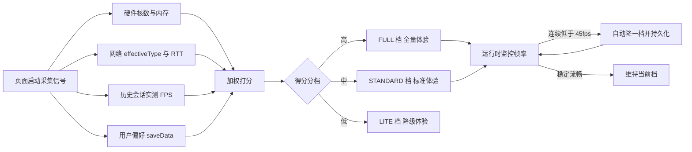

```javascript
// 一一对应：设备分档打分 + 降级动作应用
function detectTier() {
  const signals = [];
  // 信号 1：硬件核数与内存（低配各扣分）
  const cores = navigator.hardwareConcurrency ?? 4;
  const mem = navigator.deviceMemory ?? 4; // GB，Safari 不支持默认中档
  signals.push(cores <= 4 ? 0 : cores <= 6 ? 1 : 2);
  signals.push(mem <= 2 ? 0 : mem <= 4 ? 1 : 2);
  // 信号 2：网络
  const conn = navigator.connection ?? {};
  signals.push(['slow-2g', '2g'].includes(conn.effectiveType) ? 0 : conn.effectiveType === '3g' ? 1 : 2);
  // 信号 3：历史实测（上一会话 FPS 由监控写入）
  const lastFps = Number(localStorage.getItem('lastSessionFps') ?? 60);
  signals.push(lastFps < 40 ? 0 : lastFps < 55 ? 1 : 2);
  // 信号 4：用户偏好
  if (navigator.connection?.saveData || matchMedia('(prefers-reduced-motion: reduce)').matches) {
    return 'LITE'; // 用户主动省流/减动效：直接最低档
  }
  const score = signals.reduce((a, b) => a + b, 0); // 满分 8
  return score >= 7 ? 'FULL' : score >= 4 ? 'STANDARD' : 'LITE';
}

const TIER_ACTIONS = {
  FULL: { animations: true, blur: true, imageQuality: 'high', listStep: 1 },
  STANDARD: { animations: true, blur: false, imageQuality: 'medium', listStep: 1 },
  LITE: { animations: false, blur: false, imageQuality: 'low', listStep: 2 },
};
function applyTier(tier) {
  const cfg = TIER_ACTIONS[tier];
  const root = document.documentElement;
  root.dataset.tier = tier;
  root.classList.toggle('no-anim', !cfg.animations); // CSS: .no-anim * { animation: none !important; }
  root.classList.toggle('no-blur', !cfg.blur);       // CSS: .no-blur [class*=blur] { backdrop-filter: none; }
  return cfg; // imageQuality 决定图片 URL 档位，listStep 决定虚拟列表/分页步长
}
const tier = applyTier(detectTier());
console.log('当前设备档位:', tier);
```

### OPT-112：Electron 应用的性能优化有哪些抓手？

**答**：
- Electron 是多进程架构：主进程（Node）+ 渲染进程（Chromium）；性能三大坑：**重活压进主进程**（阻塞 IPC 与窗口管理）、渲染进程塞满全局依赖、原生模块同步调用。
- 抓手一：**进程职责拆分**——CPU 密集任务进 `UtilityProcess`/隐藏渲染进程，主进程只做窗口与 IPC 路由；抓手二：渲染进程按页面懒加载与代码分割（同 Web 规则）。
- 抓手三：**预加载脚本（preload）最小化**——contextBridge 只暴露必要 API，别把整个 fs 挂进渲染层；抓手四：原生模块用 N-API 异步接口，避免阻塞事件循环。
- 启动优化：延迟 require 重依赖、`ready` 前不做 IO、窗口先 show 再加载（`show: false` + `ready-to-show`）。

```javascript
// 一一对应：Electron 主进程/预加载/渲染层的职责拆分
// main.js —— 主进程：只做窗口与路由，重活交给 UtilityProcess
const { app, BrowserWindow, ipcMain, UtilityProcess } = require('electron');
const path = require('path');

function createWindow() {
  const win = new BrowserWindow({
    show: false,                    // 白屏优化：先不显示
    webPreferences: { preload: path.join(__dirname, 'preload.js'), sandbox: true },
  });
  win.once('ready-to-show', () => win.show()); // 内容就绪再展示，避免白屏
  win.loadFile('index.html');
  return win;
}

ipcMain.handle('parse-huge-file', async (e, filePath) => {
  // 反例：主进程直接 fs.readFileSync 同步解析 -> 全部窗口卡死
  // 正解：UtilityProcess（Node 子进程）处理，主进程零阻塞
  const worker = UtilityProcess.fork(path.join(__dirname, 'parser.js'));
  return new Promise((resolve, reject) => {
    worker.on('message', (msg) => (msg.ok ? resolve(msg.data) : reject(new Error(msg.error))));
    worker.postMessage({ filePath });
  });
});
app.whenReady().then(createWindow);

// parser.js —— UtilityProcess 入口：重活在这
const fs = require('fs');
process.parentPort.on('message', (e) => {
  try {
    const raw = fs.readFileSync(e.data.filePath, 'utf8'); // 子进程里同步无妨
    process.parentPort.postMessage({ ok: true, data: JSON.parse(raw).length });
  } catch (err) {
    process.parentPort.postMessage({ ok: false, error: err.message });
  }
});

// preload.js —— contextBridge 最小暴露面
const { contextBridge, ipcRenderer } = require('electron');
contextBridge.exposeInMainWorld('api', {
  parseHugeFile: (p) => ipcRenderer.invoke('parse-huge-file', p),
  // 反例：exposeInMainWorld('fs', require('fs')) —— 安全与性能双输
});

// 渲染层：await window.api.parseHugeFile('/data/big.json')，全程无阻塞
```

### OPT-113：小程序 setData 怎么优化？为什么它是最大性能杀手？

**答**：
- setData 的成本 = **逻辑层数据序列化传输 + 渲染层 diff + 页面重渲**，数据跨线程（逻辑层 JS 线程 → 渲染层 WebView）；一次传大对象或高频调用都会卡。
- 三大规则：**合并调用**（连续多次 setData 合成一次）、**局部路径更新**（`'list[3].status'` 而非整列表重传）、**不传渲染不需要的数据**（setData 的是"视图数据"，不是数据库）。
- 高频场景（滚动/输入）节流到帧频，长列表配合 recycle-view/虚拟节点；纯展示大文本（markdown 渲染结果）走 rich-text 或转 node。
- 验证工具：微信开发者工具的Audits/WXML 面板看每次 setData 的数据量与耗时，单次 >100KB 或 1s 内多次即为红灯。

```javascript
// 一一对应：setData 优化前后的对照实现
// 反例 1：高频调用 + 全量数据
onScroll(e) {
  this.setData({ scrollY: e.detail.scrollTop, list: this.data.list }); // 每帧全量传整列表
}

// 反例 2：把非渲染数据也塞进 data
this.setData({
  form: { ...this.data.form, rawResponse: apiResp }, // rawResponse 渲染用不到，白传 200KB
});

// 正解：节流 + 路径更新 + 视图数据隔离
const app = getApp();
Page({
  data: { scrollY: 0, items: [], statusText: '' },
  _rawList: [],  // 非渲染数据放实例变量，绝不进 setData

  onLoad() {
    // 正解 1：滚动值用节流合并，且只传标量
    this._flushY = app.throttle((y) => this.setData({ scrollY: y }), 200);
  },
  onScroll(e) {
    this._flushY(e.detail.scrollTop);
  },

  async refresh() {
    const resp = await api.getList();
    this._rawList = resp;                       // 原始数据留在逻辑层
    this.setData({
      // 正解 2：首屏只传视图需要的字段
      items: resp.slice(0, 20).map((it) => ({ id: it.id, name: it.name, price: it.price })),
    });
  },

  // 正解 3：局部路径更新——只改第 3 项的 status，不重传列表
  toggleStatus(index) {
    this.setData({ [`items[${index}].status`]: 'done' }); // 传输量从 O(n) 降 O(1)
  },

  // 正解 4：连续多字段一次 setData 合并提交
  batchUpdate() {
    this.setData({
      statusText: '加载完成',
      'items[0].price': 99,
    }); // 而不是两次 setData 各传一次
  },
});
```

### OPT-114：Hybrid 容器（App 内 H5）怎么做到"秒开"？

**答**：
- 秒开三板斧：**离线包**（静态资源提前下发到本地，拦截请求走本地文件）、**预渲染/预加载**（进入 App 或点击前就把 WebView 起好、H5 提前 load）、**数据预取**（原生侧提前发首屏接口，H5 起来直接拿结果）。
- 离线包机制：App 启动时拉包清单 -> 差量更新 -> WebView 拦截 `shouldOverrideUrlLoading`（Android）/ `decidePolicyFor`（iOS）映射到本地文件，网络请求归零。
- 预加载时机：首页空闲时预热下一个高频页面的 WebView 实例池（iOS WKWebView 创建就要 100ms+），点进去直接复用。
- 效果衡量：秒开率（1.5s 内可读占比）按渠道统计，未命中场景回捞分析（离线包版本旧？预取失败？）。

```javascript
// 一一对应：Hybrid 侧的离线包拦截 + 预取桥接（以 Android WebView JS 接口示意 + 前端配合）
// 1. 前端与原生约定协议：URL scheme 触发原生预取
function prefetchNextPage(skuId) {
  // 原生拦截该 scheme，提前请求商品接口并缓存
  location.href = `hybrid://prefetch?url=${encodeURIComponent('/api/detail?id=' + skuId)}`;
}

// 2. 原生注入的取数桥：H5 启动时同步拿预取结果（避免二次请求）
// window.HybridBridge.getPrefetched(url) -> string|null（原生内存命中）
async function bootstrap() {
  const url = '/api/detail?id=10086';
  const t0 = performance.now();
  let data = window.HybridBridge?.getPrefetched(url); // 预取命中：0ms 网络
  if (!data) {
    const res = await fetch(url);   // 未命中兜底走网络
    data = await res.text();
  }
  render(JSON.parse(data));
  report('prefetch_hit', {
    hit: !!window.HybridBridge,
    ttfbMs: Math.round(performance.now() - t0),
  });
}

// 3. 前端配合离线包：资源 URL 稳定 + 版本化，包管理器才能精确映射本地文件
// <link rel="stylesheet" href="https://h5.example.com/app.8f2a1c.css" />
// 离线包清单（构建期产出，原生按清单映射）：
// { "https://h5.example.com/app.8f2a1c.css": "offline/20261101/app.css", ... }

// 4. WebView 预热（原生侧逻辑，JS 层仅示意调用）：
// HybridBridge.warmupWebView(); // 首页空闲时预创建 WebView 实例入池
```

### OPT-115：PWA 的后台同步和周期同步怎么落地？适合什么任务？

**答**：
- **Background Sync**（`sync` 事件）：用户关页面后，浏览器在网络恢复时唤醒 SW 执行任务——离线发出的表单/聊天消息在恢复后自动补发，是"离线优先"的闭环。
- **Periodic Background Sync**：定期唤醒（浏览器自定频率，通常受 PWA 安装与使用频次影响），适合内容预热、离线数据更新，不能当定时闹钟用。
- 限制要背：Chrome 限定已安装 PWA 且 HTTPS、iOS Safari 两者都缺（iOS 用推送通知替代部分场景）；同步任务没有 UI 权限，失败要重试设计。
- 与 OPT-028/029 的缓存策略衔接：sync 补发的是**写请求**队列，cache-first 管的是**读请求**。

```javascript
// 一一对应：后台同步注册 + SW 内补发队列 + 周期同步预热
// main.js —— 发消息失败入队并注册 sync
async function sendMessage(msg) {
  try {
    await fetch('/api/messages', { method: 'POST', body: JSON.stringify(msg) });
  } catch {
    const db = await openDb('outbox');
    await db.put('messages', { id: crypto.randomUUID(), msg, ts: Date.now() });
    const reg = await navigator.serviceWorker.ready;
    // 注册后台同步：网络恢复时浏览器自动触发 SW 的 sync 事件
    await reg.sync.register('outbox-sync');
  }
}

// sw.js —— sync 事件里补发
self.addEventListener('sync', (event) => {
  if (event.tag === 'outbox-sync') {
    event.waitUntil(flushOutbox()); // waitUntil：任务完成前 SW 不被杀
  }
});
async function flushOutbox() {
  const db = await openDb('outbox');
  const items = await db.getAll('messages');
  for (const it of items) {
    try {
      await fetch('/api/messages', { method: 'POST', body: JSON.stringify(it.msg) });
      await db.delete('messages', it.id); // 成功才出队，失败留着下次
    } catch { break; } // 仍离线：整体退出，等下一次 sync
  }
}

// 周期同步：已安装的 PWA 定期预热内容
self.addEventListener('periodicsync', (event) => {
  if (event.tag === 'content-refresh') {
    event.waitUntil((async () => {
      const cache = await caches.open('news-v1');
      await cache.addAll(['/api/top-stories']); // 用户打开前就绪
    })());
  }
});
// 注册周期同步（必须已安装 PWA，频率浏览器自定）：
// const reg = await navigator.serviceWorker.ready;
// if ('periodicSync' in reg) {
//   const status = await navigator.permissions.query({ name: 'periodic-background-sync' });
//   if (status.state === 'granted') await reg.periodicSync.register('content-refresh', { minInterval: 12 * 3600 * 1000 });
// }
```

### OPT-116：React Native 的性能要点是什么？新架构改变了什么？

**答**：
- 旧架构痛点：JS 与原生通过**异步 Bridge** 传 JSON 序列化消息，高频交互（滚动、手势、动画）被序列化延迟拖垮。
- 新架构（Fabric + TurboModules + JSI）：JS 直接**同步持有了原生对象引用**（JSI 无序列化）、Fabric 渲染器支持同步布局与优先级调度、TurboModule 按需加载原生模块。
- 实战要点：列表用 `FlashList`/`FlatList` 优化（`windowSize`、`getItemLayout`、`keyExtractor`）；动画全走 `react-native-reanimated` 的 **UI 线程**（worklet），不占 JS 线程；图片用 `FastImage`（原生缓存）。
- JS 侧同 Web 规则：`React.memo`、避免 render 里建函数对象传给原生组件（每次都触发原生 props 更新）。

```jsx
// 一一对应：RN 列表 + UI 线程动画 + TurboModule 按需
import React, { useCallback, useMemo } from 'react';
import { FlashList } from '@shopify/flash-list';
import Animated, { useAnimatedStyle, useSharedValue, withSpring } from 'react-native-reanimated';

// 要点 1：动画跑在 UI 线程（worklet），JS 线程卡顿也不掉帧
function FollowButton() {
  const scale = useSharedValue(1);
  // 'worklet' 指令：这段函数在 UI 线程执行，绝不走 Bridge
  const pressStyle = useAnimatedStyle(() => ({
    transform: [{ scale: withSpring(scale.value) }],
  }));
  return (
    <Animated.Pressable
      style={pressStyle}
      onPressIn={() => (scale.value = 0.9)}   // sharedValue 写入也是 UI 线程直改
      onPressOut={() => (scale.value = 1)}
    />
  );
}

// 要点 2：长列表用 FlashList + 回收复用，五个参数一个不能省
function Feed({ data }) {
  const renderItem = useCallback(({ item }) => <Card item={item} />, []); // 稳定引用
  const keyExtractor = useCallback((item) => item.id, []);
  const getItemType = useCallback((item) => item.media ? 'rich' : 'text', []); // 复用按类型分组
  return (
    <FlashList
      data={data}
      renderItem={renderItem}
      keyExtractor={keyExtractor}
      getItemType={getItemType}
      estimatedItemSize={120} // 必填：省一次测量，滚动定位直接算
    />
  );
}

// 要点 3：TurboModule 按需加载（新架构自动 codegen，JS 侧写法不变但延迟初始化）
// import NativeDevice from './specs/NativeDevice'; // 仅在调用方法时才初始化原生模块
// NativeDevice.getThermalState();

// 反面清单：render 里内联箭头传给原生组件 -> 每帧触发原生 props diff；
// state 里存大 JSON -> 每次变更都序列化过 JSI；用 setState 驱动 60fps 动画 -> 必卡
```

### OPT-117：Flutter Web 什么时候该选、什么时候不选？

**答**：
- Flutter Web 的定位是"同一套代码覆盖 Web"，代价是**自绘引擎**：不走 DOM/CSS，首个渲染慢（下载 engine + 字体 + canvaskit 数 MB）、文本不可选中/SEO 弱、包体与内存高于原生 Web 框架。
- 适合：已有 Flutter App 需要一个低成本的 Web 入口（工具/后台/内嵌面板），交互重度、UI 复杂、SEO 不重要。
- 不适合：内容型网站/电商 C 端（LCP/SEO/可访问性都吃亏），期望"小而快"的营销页。
- 技术要点：渲染器选 `canvaskit`（一致性好，wasm 下载大）vs `html`（体积小但还原差，已进入弃用轨道）；构建用 `--wasm` 减小启动；文本密集页与 SEO 页用原生 Web 技术混排（iframe/微前端分层）。

```bash
# 一一对应：Flutter Web 构建配置与体积/首屏核对
# 1. 生产构建（CanvasKit + WASM，2024 后主推 skwasm）
flutter build web --wasm --release \
  --dart-define=FLUTTER_WEB_CANVASKIT_URL=https://cdn.example.com/canvaskit/ # 引擎放自家 CDN，国内访问 Google CDN 会卡死首屏

# 2. 体积预算检查（构建产物，canvaskit 模式基准）：
# ls -lh build/web/ | awk '{print $5, $9}'
# canvaskit.wasm 约 2-6MB —— 内容型站点用 Flutter Web 前先掂量这笔固定成本
# main.dart.js（AOT 编译产物）随业务增长，用 --analyze-size 定位超大 dart 依赖：
flutter build web --release --analyze-size --target-platform=web-x64

# 3. 首屏核对（用 Lighthouse 跑 Flutter Web 产物）：
# npx lighthouse https://localhost:8080 --preset=desktop --view
# 经验值：TBT/LCP 明显差于同功能 React/Vue 站 —— 若指标是硬约束，选型阶段就应放弃

# 4. 混合方案：SEO 首页用 Next.js，重交互工作台用 Flutter，iframe/web component 嵌入
# flutter build web --wasm --release --base-href /console/
# Next.js 的 /console 路由下 <iframe src="/console/" title="workbench">
```

### OPT-118：边缘计算在前端性能里能干什么？动态个性化怎么和边缘缓存共存？

**答**：
- 边缘节点把计算挪到离用户 10-50ms 的位置：**A/B 分流、灰度注入、HTML 重写、个性化缓存键**都能在边缘做，省一次回源 RTT。
- 核心矛盾是"动态个性化 vs 缓存"：整页个性化没法缓存。解法是**分层拼接**——边缘缓存 90% 的公共 HTML 骨架（命中缓存零回源），边缘脚本运行时注入个性化片段（用户名/推荐位），或异步流式补齐。
- 边缘侧的典型实现：Cloudflare Workers / Vercel Edge Functions / 自建网关（OpenResty），本质是"CDN 上跑 JS"。
- 边界：重计算（图片处理除外）和强事务逻辑别上边缘；边缘脚本要控制在 <10ms CPU 预算。

```javascript
// 一一对应：边缘 Worker 实现缓存骨架 + 动态注入个性化
// cloudflare-worker.js —— 部署到边缘节点
export default {
  async fetch(request, env, ctx) {
    const url = new URL(request.url);
    const cookie = request.headers.get('Cookie') ?? '';
    const userId = parseCookie(cookie, 'uid');

    // 1. 骨架页走边缘缓存：按 URL 缓存，命中零回源（TTFB ~20ms）
    const cacheKey = new Request(`https://cache.example.com${url.pathname}`, request);
    let html = await caches.default.match(cacheKey);
    if (!html) {
      html = await fetch(request); // 回源一次后进缓存
      ctx.waitUntil(caches.default.put(cacheKey, html.clone()));
    }

    // 2. 个性化注入：边缘运行时改 HTML，公共部分仍是缓存命中
    const personalBlock = userId
      ? await fetch(`https://origin.example.com/api/me/brief?uid=${userId}`) // 小请求，可再缓存
          .then((r) => r.text())
      : '<div class="login-cta">登录后查看专属价</div>';

    const rewriter = new HTMLRewriter()
      .on('#personal-slot', {
        element(el) { el.setInnerContent(personalBlock, { html: true }); },
      })
      .on('head', {
        element(el) { el.append('<meta name="edge-hit" content="1">'); },
      });
    return rewriter.transform(html);
  },
};
function parseCookie(cookie, name) {
  return cookie.split(';').map((s) => s.trim().split('=')).find(([k]) => k === name)?.[1] ?? null;
}
// 收益账：全动态回源 TTFB 300ms；边缘骨架命中 + 注入后 P75 TTFB <50ms，
// 个性化只付出一次 ~10ms 的边缘小请求
```

### OPT-119：Core Web Vitals 从"全红"到"全绿"的推进路线图怎么排？

**答**：
- 排序原则：**先测量后优化**（没有分维度基线全是瞎打）、按"对总分拖累 × 修复成本"排优先级、每步只动一个变量并验证 RUM。
- 标准六阶段：基线体检（CrUX+RUM+Lab 三源对齐）→ LCP 治理（资源/直出）→ CLS 治理（占位/尺寸锁定，通常最容易全绿）→ INP 治理（长任务切片/第三方瘦身，最难）→ 回归卡口（CI+预算）→ 持续运营（看板+告警）。
- 阶段验收都用同一口径：**CrUX/RUM 的 P75 达标**（LCP<2.5s、INP<200ms、CLS<0.1），Lab 数据只做过程参考。
- 常见坑：只顾 LCP 把 CLS 治恶化（异步插内容没占位）；用均值汇报掩盖 P75 未达标。

```yaml
# 一一对应：CWV 全绿路线图（可落地的里程碑 + 验收 YAML，进仓库当 checklist）
# cwv-roadmap.yaml —— 每阶段有 owner/动作/验收口径
milestones:
  - phase: 1-基线体检            # 第 1 周
    actions:
      - 拉 CrUX P75 与 RUM 分维度数据，定位最差指标与最差人群（机型x网络）
      - Lighthouse CI 建立实验室基线，锁定当前版本号
    exit_criteria: { output: 三源数据报告，明确主攻指标 } # 例：LCP 4.2s INP 380ms CLS 0.32

  - phase: 2-CLS治理             # 第 2 周（成本最低，先摘果子）
    actions:
      - 全图片补 width/height 或 aspect-ratio
      - 动态插入区块预占位；字体 fallback 度量对齐（见 OPT-072）
    exit_criteria: { rum_p75_cls: "<0.1" }

  - phase: 3-LCP治理             # 第 3-4 周
    actions:
      - LCP 元素标 fetchpriority=high，非关键资源压 low（见 OPT-050）
      - 首屏接口 SSR/直出 + HTML 边缘缓存（见 OPT-118）
      - 文本资源全量 Brotli + 强缓存 hash（见 OPT-052）
    exit_criteria: { rum_p75_lcp: "<2.5s" }

  - phase: 4-INP治理             # 第 5-6 周（最难，长任务+第三方）
    actions:
      - 长任务切片改造（见 OPT-057），INP 回溯归因到具体交互
      - 第三方脚本 facade 化/延后（见 OPT-018），交互路径同步脚本清零
      - 输入回调瘦身，重计算进 Worker（见 OPT-102 决策树）
    exit_criteria: { rum_p75_inp: "<200ms" }

  - phase: 5-回归卡口            # 持续
    actions:
      - Lighthouse CI + size-limit 进流水线（见 OPT-040）
      - RUM 告警阈值：P75 劣化 10% 自动告警
    exit_criteria: { ci: lighthouse-score-min-90 }

  - phase: 6-持续运营            # 永远
    actions:
      - 月度性能周报（CrUX 趋势 + Top 劣化页面）
      - 新功能上线前性能评审（预算申请制）
    exit_criteria: { output: 指标连续两季度达标 }
```

### OPT-120：怎么在团队建立"性能不劣化"的工程文化？

**答**：
- 文字口号没用，靠**机制**：性能预算（OPT-040）进 CI、性能评审进需求流程（大功能上线前必须给指标影响评估）、性能回滚预案（劣化超过阈值可一键回退版本）。
- 分层责任人：性能 owner（平台组，维护工具与看板）+ 业务接口人（各业务线，对自己页面的 P75 负责），指标进季度 OKR 而非运动式治理。
- 降低参与门槛：一键本地审计脚本、PR 里自动贴性能 diff 报告（+/- KB、指标预估变化），让普通开发者"顺手"就做对。
- 正向激励：性能贡献进晋升材料；坏味道治理（每季度清理 Top10 慢页面）排进迭代，形成固定节奏。

```yaml
# 一一对应：性能文化的机制化配置（CI 治理 + 流程规则 + 责任清单）
# .github/workflows/perf-gate.yml —— 性能卡口工作流，PR 自动出报告
name: perf-gate
on: [pull_request]
jobs:
  budget:
    runs-on: ubuntu-latest
    steps:
      - uses: actions/checkout@v4
      - run: npm ci && npm run build
      # 体积预算：超限直接 fail，diff 报告自动贴到 PR
      - run: npx size-limit --json > size-report.json
      # Lab 指标：3 次取中位，对比 main 分支基线
      - run: npx @lhci/cli autorun --collect.numberOfRuns=3
      - name: 性能 diff 报告贴回 PR
        uses: actions/github-script@v7
        with:
          script: |
            const report = require('./size-report.json');
            await github.rest.issues.createComment({
              issue_number: context.issue.number,
              owner: context.repo.owner, repo: context.repo.repo,
              body: `**性能预算报告**：${report.map(r => `${r.name}: ${r.size}/${r.limit}`).join('，')}。超限请拆分依赖或申请预算豁免。`
            });

# PERFORMANCE.md —— 团队性能流程规则（进仓库根目录，评审时引用）
# rules:
#   - id: perf-review
#     desc: 新增第三方脚本/超预算依赖，PR 必须加 performance 标签并由性能 owner 审批
#   - id: budget-waiver
#     desc: 预算豁免需在 PERFORMANCE.md 登记豁免原因与恢复时间，禁止永久豁免
#   - id: incident
#     desc: 线上指标 P75 劣化超过 15% 视为性能事故，24h 内出回滚或修复方案
# owners:
#   platform: 性能 owner（工具链/看板/告警维护）
#   business: 各业务线接口人（对自己页面 CrUX P75 负责，指标进 OKR）
# cadence:
#   quarterly: Top10 慢页面专项治理排入迭代
#   monthly: 性能周报同步 CrUX 趋势
```

## 十九、首屏专项深水区

### OPT-121：首屏慢如何做"关键链路拆解"，从 TTFB 到 FCP 逐段归因？

**答**：
- 首屏链路 = 重定向 → DNS/TCP/TLS → 请求发出 → TTFB（后端+网络）→ HTML 下载 → 资源发现与下载 → 解析执行 → FCP。用 `PerformanceNavigationTiming` 把每段耗时精确拆出。
- 归因口诀：TTFB 占比高→后端/CDN；responseEnd 到资源加载慢→资源阻塞；loadEventEnd 后仍白屏→JS 执行或渲染阻塞。
- 逐段算占比画瀑布，先打占比最大的一段，避免"感觉是图片问题"式的经验主义优化。
- 线上采样上报各分段，用 P75 看分布而不是均值。

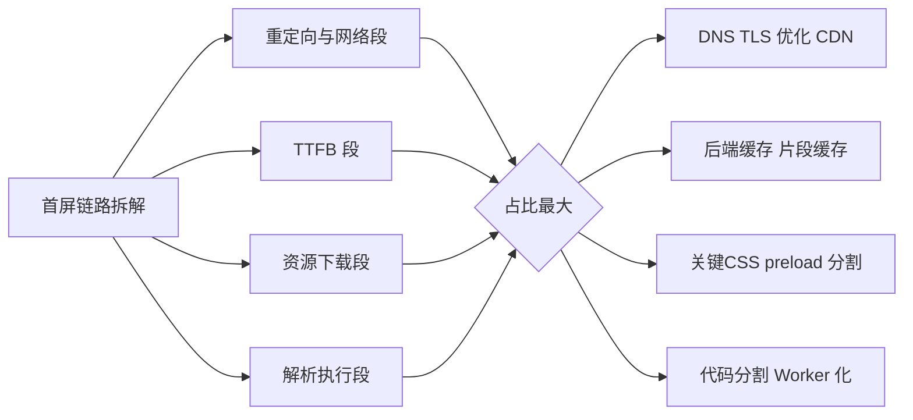

```javascript
// 一一对应：用 PerformanceNavigationTiming 把 TTFB→FCP 拆成 8 段并上报
function reportFirstScreenBreakdown() {
  const [nav] = performance.getEntriesByType('navigation');
  if (!nav) return;
  const seg = {
    redirect: nav.redirectEnd - nav.redirectStart,
    dns: nav.domainLookupEnd - nav.domainLookupStart,
    tcp_tls: nav.connectEnd - nav.connectStart,
    ttfb: nav.responseStart - nav.requestStart,       // 后端处理+网络回程
    html_download: nav.responseEnd - nav.responseStart,
    resource_gap: nav.domContentLoadedEventStart - nav.responseEnd, // 资源发现+下载
    parse_exec: nav.domContentLoadedEventEnd - nav.domContentLoadedEventStart,
    until_fcp: 0,
  };
  const fcp = performance.getEntriesByName('first-contentful-paint')[0];
  if (fcp) seg.until_fcp = fcp.startTime - nav.domContentLoadedEventEnd;
  // 归因建议：先修占比最大的段
  const max = Object.entries(seg).sort((a, b) => b[1] - a[1])[0];
  navigator.sendBeacon('/api/perf', JSON.stringify({
    type: 'fcp_breakdown', url: location.pathname, seg,
    bottleneck: max[0], bottleneck_ms: Math.round(max[1]),
  }));
}
addEventListener('load', () => setTimeout(reportFirstScreenBreakdown, 0));
```

### OPT-122：首页接口瀑布（A→B→C 串行）如何优化成并行/预取/依赖编排？

**答**：
- 先用 Network 面板确认瀑布：B 依赖 A 的 id、C 依赖 B，串行链路 = 各段 TTFB 之和。
- 三招：能并行的并行（Promise.all）、能预取的预取（路由切换前/接口前置到 HTML 内联）、必须依赖的编排前置（A 接口只返回 id，其余字段懒加载）。
- 后端配合：把"用户信息+推荐+角标"聚合为一个 BFF 接口，一次 RTT 替代三次。
- 兜底：依赖编排加超时降级，关键接口失败不阻塞整屏渲染。

```javascript
// 一一对应：接口依赖编排器——并行预取 + 依赖前驱 + 超时降级
async function fetchJSON(url, { timeout = 3000, signal } = {}) {
  const res = await fetch(url, { signal: AbortSignal.any([signal, AbortSignal.timeout(timeout)]) });
  if (!res.ok) throw new Error(`HTTP ${res.status}`);
  return res.json();
}

async function loadHomeData() {
  // 1. 无依赖的接口立即并行发（含非关键数据，失败不阻塞）
  const userP = fetchJSON('/api/user');
  const bannersP = fetchJSON('/api/banners').catch(() => []); // 降级为空不阻塞
  // 2. 依赖编排：只等 user.id，不等 user 全量字段
  const user = await userP;
  // 3. 拿到最小依赖（id）后立刻发起下游请求，与 banners 下载重叠
  const ordersP = fetchJSON(`/api/orders?uid=${user.id}&fields=id,status,count`);
  const [_, banners, orders] = await Promise.all([userP, bannersP, ordersP]);
  return { user, banners, orders };
}
// HTML 中再加 <link rel="preconnect" href="//api.example.com"> 与
// <link rel="preload" as="fetch" href="/api/user"> 把首请求前置到解析期
```

### OPT-123：SSR 页面 TTFB 过高，如何用 HTML 片段缓存/组件级缓存优化？

**答**：
- SSR TTFB 高的根因：每次请求都完整执行 renderToString + 数据拉取。定位后按"组件热点"分级缓存。
- 组件级缓存：导航、推荐位、页头这类低频变化组件 renderToString 一次，结果按 key（如 category+hour）存内存/Redis，命中直接拼 HTML。
- 页面级缓存：登录无关页整页 HTML 缓存 1~5 分钟，配合 revalidate；登录相关页用 ESI/边缘片段。
- 缓存要挂"失效钩子"：CMS 发布/库存变更时主动 purge，避免等 TTL。

```javascript
// 一一对应：SSR 组件级缓存——热点组件 renderToString 结果复用
const LRU = require('lru-cache');
const fragmentCache = new LRU({ max: 500, ttl: 1000 * 60 * 5 }); // 5 分钟

async function renderWithFragmentCache(Component, props, cacheKey) {
  const hit = fragmentCache.get(cacheKey);
  if (hit) return hit; // 命中：跳过数据拉取 + renderToString
  const data = await Component.fetchData(props);          // 组件自带数据获取
  const html = require('react-dom/server').renderToString(
    React.createElement(Component, { ...props, ...data })
  );
  fragmentCache.set(cacheKey, html);
  return html;
}

// Express 路由：页面 = 三个片段（两冷一热）拼接
app.get('/p/:id', async (req, res) => {
  const [header, recList] = await Promise.all([
    renderWithFragmentCache(Header, {}, `header:${Math.floor(Date.now() / 36e5)}`), // 按小时缓存
    renderWithFragmentCache(Recommend, { page: req.params.id }, `rec:${req.params.id}`),
  ]);
  const detail = await renderDetailFresh(req.params.id); // 详情实时渲染
  res.send(`<!doctype html><html><body>${header}<main>${detail}</main>${recList}</body></html>`);
});
```

### OPT-124：骨架屏替换真实内容时如何防 CLS 并做平滑过渡？

**答**：
- CLS 根因：骨架块高度与真实内容不一致，替换瞬间布局跳动。方案是"尺寸契约"：骨架块用与真实内容相同的 aspect-ratio / 固定高度。
- 头图/卡片类给容器写死宽高比，文字区给 min-height 上限兜底（超长截断或折叠）。
- 过渡用 opacity/translate 短动画（150~250ms），只动 composite 属性，不引发重排。
- 内容到达后先填充 DOM 再切可见性，避免"先卸骨架再等渲染"的闪白。

```html
<!-- 一一对应：骨架屏与真实内容共用尺寸契约 + 无缝过渡 -->
<style>
  .card { contain: layout paint; }
  /* 尺寸契约：骨架与内容同一 aspect-ratio，替换零位移 */
  .card-media { aspect-ratio: 16 / 9; width: 100%; background: #eee; }
  .card-title { min-height: 24px; max-height: 48px; overflow: hidden; } /* 1~2 行兜底 */
  .skeleton { animation: pulse 1.2s ease-in-out infinite; }
  @keyframes pulse { 50% { opacity: .55; } }
  /* 内容过渡：只做 opacity，不动布局属性 */
  .card-content { opacity: 0; transition: opacity .2s ease; }
  .card-content.ready { opacity: 1; }
  .card.ready .skeleton { display: none; }
</style>
<div class="card" id="card">
  <div class="card-media skeleton"></div>
  <div class="card-title skeleton"></div>
  <div class="card-content" hidden>
    <div class="card-media"></div>
    <div class="card-title">真实标题文本</div>
  </div>
</div>
<script>
  // 先填充、标记 ready 切透明度，最后卸骨架：三步避免闪白与跳动
  fetch('/api/card/1').then(r => r.json()).then(data => {
    const card = document.getElementById('card');
    const content = card.querySelector('.card-content');
    content.hidden = false;
    requestAnimationFrame(() => requestAnimationFrame(() => {
      card.classList.add('ready'); content.classList.add('ready');
    }));
  });
</script>
```

### OPT-125：如何量化第三方脚本（统计/客服/A/B）的性能税并治理？

**答**：
- 量化四个维度：下载体积（字节数）、主线程占用（long task 归因到 script）、阻塞时长（同步脚本 blocking 时间）、请求阻塞数（head 里的串行请求）。
- 归因手段：`PerformanceObserver` 的 longtask 没有直接 attribution，用 `PerformanceLongAnimationFrameTiming`（LoAF）可拿到 `scripts[].invoker`，精确到"哪个脚本吃了多少毫秒"。
- 治理优先级：同步改 async/defer、可延迟的按 idle 加载、纯计算类搬 Web Worker（Partytown 思路）、不用的直接下线。
- 建立"第三方准入预算"：新增脚本必须报告体积与主线程成本，超预算要走审批。

```javascript
// 一一对应：用 Long Animation Frames API 归因第三方脚本的主线程成本
const scriptCost = new Map(); // scriptURL -> {ms, count}

const loafObserver = new PerformanceObserver(list => {
  for (const entry of list.getEntries()) {
    for (const s of entry.scripts) {
      const url = s.invoker || s.sourceURL || 'inline';
      const prev = scriptCost.get(url) || { ms: 0, count: 0 };
      prev.ms += s.duration; prev.count += 1;
      scriptCost.set(url, prev);
    }
  }
});
loafObserver.observe({ type: 'long-animation-frame', buffered: true });

// 页面卸载前上报"性能税"清单
addEventListener('pagehide', () => {
  const tax = [...scriptCost.entries()]
    .map(([url, v]) => ({ url, ms: Math.round(v.ms), count: v.count }))
    .sort((a, b) => b.ms - a.ms).slice(0, 10);
  navigator.sendBeacon('/api/perf/third-party-tax', JSON.stringify({ tax }));
});

// 治理改造模板：非关键第三方统一 idle 加载
function loadIdleScript(src) {
  if (document.querySelector(`script[src="${src}"]`)) return;
  const s = document.createElement('script');
  s.src = src; s.async = true;
  (window.requestIdleCallback || setTimeout)(() => document.head.appendChild(s));
}
loadIdleScript('https://cdn.third.com/survey.js'); // 问卷类：空闲时加载
```

### OPT-126：Service Worker 预缓存关键资源怎么落地，如何处理版本失效？

**答**：
- 预缓存 = 构建期把带 hash 的 JS/CSS/首屏图片清单写进 SW，install 阶段静默拉全量，用户二次访问全部命中 Cache。
- 用 Workbox 的 `precacheAndRoute`：manifest 由构建插件（vite-plugin-pwa / workbox-webpack-plugin）自动生成，hash 变化即自动更新。
- 更新策略：新 SW install 完成后 `skipWaiting` 也要谨慎——资源版本和页面版本可能不一致，常规做法是"新 SW 等 old 控制的页面关闭再接管"，或提示用户刷新。
- 预缓存清单要设体积上限（一般 ≤ 2MB），首屏图片按需 runtime cache 补充。

```javascript
// 一一对应：Workbox 预缓存 + 版本更新策略
import { registerRoute } from 'workbox-routing';
import { precacheAndRoute, createHandlerBoundToURL } from 'workbox-precaching';
import { CacheFirst } from 'workbox-strategies';
import { ExpirationPlugin } from 'workbox-expiration';

// 构建插件注入的 manifest：[{url, revision}]，hash 资源 revision 为 null
precacheAndRoute(self.__WB_MANIFEST);

// App Shell 模式：导航请求回退到预缓存的 index.html，离线也能打开
registerRoute(
  ({ request }) => request.mode === 'navigate',
  createHandlerBoundToURL('/index.html')
);

// 首屏图片运行时缓存：CacheFirst + 30 天过期，不占预缓存配额
registerRoute(
  ({ request }) => request.destination === 'image',
  new CacheFirst({
    cacheName: 'hero-images',
    plugins: [new ExpirationPlugin({ maxEntries: 60, maxAgeSeconds: 60 * 60 * 24 * 30 })],
  })
);

// 版本更新：新 SW 就绪后通知页面提示刷新，而不是立即 skipWaiting
self.addEventListener('message', e => {
  if (e.data === 'SKIP_WAITING') self.skipWaiting(); // 用户点了刷新按钮才接管
});
```

### OPT-127：HTML/JS/CSS/API 四类资源的 HTTP 缓存分层策略矩阵怎么定？

**答**：
- HTML 入口：`no-cache` + ETag/Last-Modified 协商缓存，保证发版即刻生效；SPA 的 index.html 绝不能强缓存。
- 带 hash 的 JS/CSS/图片：`immutable, max-age=31536000` 强缓存一年，改内容必换文件名。
- API GET 数据：按数据时效分层——配置类 `max-age=60, stale-while-revalidate=300`；用户实时数据 `no-store` 或短 max-age。
- CDN 层再加一层 `s-maxage` 区分边缘缓存与浏览器缓存，回源率监控要跟上。

```nginx
# 一一对应：四类资源的缓存策略矩阵（Nginx）
# 1. HTML 入口：协商缓存，发版即时生效
location = /index.html {
    add_header Cache-Control "no-cache, must-revalidate";
    etag on;
}
# 2. 带 hash 的静态资源：一年强缓存 + immutable
location ~* \.(js|css|png|jpg|webp|woff2)$ {
    add_header Cache-Control "public, max-age=31536000, immutable";
}
# 3. API 分层：配置类可短缓存 + SWR，实时类禁缓存
location /api/config {
    add_header Cache-Control "public, max-age=60, stale-while-revalidate=300";
    proxy_pass http://backend;
}
location /api/user {
    add_header Cache-Control "private, no-store";
    proxy_pass http://backend;
}
# 4. CDN 边缘层：s-maxage 控制边缘，回源率走日志监控
# add_header Cache-Control "public, max-age=60, s-maxage=600";
```

### OPT-128：预渲染、SSR、CSR 三种方案的首屏怎么用同一套方法实测对比？

**答**：
- 公平对比原则：同一机器（禁缓存）、同一网络节流（Fast 3G / 4G）、同一指标口径（LCP/FCP/TTI/INP），每方案跑 ≥ 5 次取中位数。
- 三方案用同一份页面代码：CSR 直接发；SSR 用框架同构渲染；预渲染用构建期 `renderPreset` 输出静态 HTML。数据接口 mock 成相同延迟，隔离后端变量。
- 对比维度不只首屏：还要看交互可用时间（hydration 完成时间）、TTFB、以及真实弱网下的表现。
- 结论通常是分层的：营销页用预渲染、动态首页用 SSR、登录后应用用 CSR+预取，按页面类型选方案而不是全局一刀切。

```javascript
// 一一对应：Puppeteer 三方案首屏实测对比脚本
const puppeteer = require('puppeteer');

async function bench(url, runs = 5) {
  const browser = await puppeteer.launch();
  const results = [];
  for (let i = 0; i < runs; i++) {
    const page = await browser.newPage();
    await page.setCacheEnabled(false);                    // 禁缓存保证公平
    const client = await page.target().createCDPSession();
    await client.send('Network.emulateNetworkConditions', {
      offline: false, latency: 100,
      downloadThroughput: (1.6 * 1024 * 1024) / 8,        // Fast 3G
      uploadThroughput: (750 * 1024) / 8,
    });
    await page.tracing.start({ categories: ['loading'] });
    await page.goto(url, { waitUntil: 'load' });
    const metrics = await page.evaluate(() => new Promise(resolve => {
      new PerformanceObserver(l => {
        const e = l.getEntries();
        resolve({ lcp: e[e.length - 1].startTime });
      }).observe({ type: 'largest-contentful-paint', buffered: true });
      setTimeout(() => resolve({ lcp: -1 }), 5000);
    }));
    results.push(metrics);
    await page.close();
  }
  await browser.close();
  const sorted = results.map(r => r.lcp).sort((a, b) => a - b);
  return { url, lcp_p50: sorted[Math.floor(runs / 2)], lcp_min: sorted[0], lcp_max: sorted[runs - 1] };
}

(async () => {
  const rows = await Promise.all([           // 串行跑更稳，并发仅示例
    bench('https://staging.example.com/csr/'),
    bench('https://staging.example.com/ssr/'),
    bench('https://staging.example.com/prerender/'),
  ]);
  console.table(rows);
})();
```

## 二十、交互与流畅度

### OPT-129：INP 不达标如何做"输入延迟 / 处理时长 / 渲染延迟"三段归因？

**答**：
- INP = 每次交互从 input 到下一帧绘制完成的总时长，Event Timing API 的 `interactionId` 能把一次交互拆成三段：inputDelay（事件排队）、processing（回调执行）、presentationDelay（渲染提交）。
- 归因经验值：inputDelay 高→主线程被长任务占住，治理长任务；processing 高→回调本身慢，拆分/瘦身事件处理；presentationDelay 高→回调触发了大范围重排重绘，减少 DOM 变更范围。
- 上报时记录交互目标（按钮文案/选择器）与三段耗时，P75 聚合后直接给出"哪类交互、哪一段"是瓶颈。
- 长任务治理三板斧：`scheduler.yield()`/`setTimeout` 切片、把非紧急逻辑挪 requestIdleCallback、重计算进 Worker。

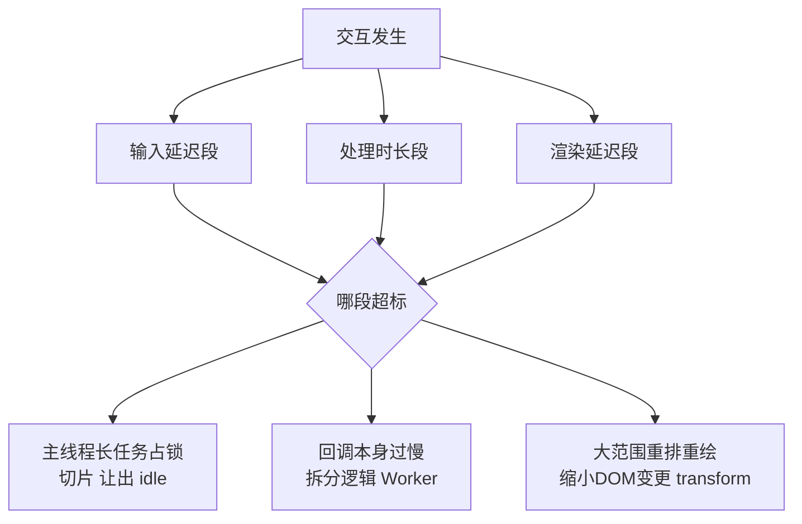

```javascript
// 一一对应：INP 三段归因上报（interactionId + duration 三段拆分）
const interactions = new Map(); // interactionId -> 最大的一次事件计时

new PerformanceObserver(list => {
  for (const e of list.getEntries()) {
    if (!e.interactionId) continue;
    const prev = interactions.get(e.interactionId);
    if (!prev || e.duration > prev.duration) {
      const inputDelay = e.startTime - (e.processingStart ?? e.startTime);
      const processing = (e.processingEnd ?? 0) - e.processingStart;
      interactions.set(e.interactionId, {
        duration: e.duration,
        target: e.target?.tagName + (e.target?.textContent || '').slice(0, 12),
        inputDelay: Math.round(inputDelay),       // 段1 排队等待
        processing: Math.round(processing),       // 段2 回调执行
        presentation: Math.round(e.duration - inputDelay - processing), // 段3 渲染提交
      });
    }
  }
}).observe({ type: 'event', durationThreshold: 40, buffered: true });

addEventListener('pagehide', () => {
  const worst = [...interactions.values()].sort((a, b) => b.duration - a.duration).slice(0, 5);
  navigator.sendBeacon('/api/perf/inp', JSON.stringify({ worst }));
});

// 治理模板：回调切片，把长处理拆成多次让出主线程
async function handleSubmit(items) {
  for (const it of items) {
    processOne(it);                       // 每次处理一小块
    if (scheduler?.yield) await scheduler.yield();  // 让出，避免 inputDelay 上涨
    else await new Promise(r => setTimeout(r));
  }
}
```

### OPT-130：手势/拖动跟随类动画如何稳定 60fps？给出保障清单。

**答**：
- 清单①：事件回调里只做"记录坐标 + rAF 调度"，不在 pointermove 里直接改 DOM（一帧可能触发 120+ 次事件）。
- 清单②：样式变更只用 transform/opacity（composite only），禁止改 left/top/width 触发重排。
- 清单③：给跟手元素加 `will-change: transform` 提升图层，手势结束及时移除释放内存。
- 清单④：回调做无副作用优化（passive: true 阻止滚动阻塞），并加 pointercancel 处理防止半途卡死。

```javascript
// 一一对应：pointer events + rAF 节流的跟手拖动（60fps 模板）
const el = document.querySelector('.draggable');
let pending = null, startX = 0, startY = 0, baseX = 0, baseY = 0;

el.addEventListener('pointerdown', e => {
  el.setPointerCapture(e.pointerId);            // 捕获，移出元素也持续收事件
  startX = e.clientX; startY = e.clientY;
  el.style.willChange = 'transform';            // 手势期间提升图层
});

el.addEventListener('pointermove', e => {
  if (pending) return;                          // 一帧只排一次任务
  pending = { x: e.clientX - startX, y: e.clientY - startY };
  requestAnimationFrame(() => {
    // rAF 里只做 composite 属性变更，不会触发 layout
    el.style.transform = `translate3d(${baseX + pending.x}px, ${baseY + pending.y}px, 0)`;
    pending = null;
  });
}, { passive: true });                          // passive 不阻塞滚动合成线程

function endGesture() {
  // 记录最终位移作为下次基准，并释放图层，避免常驻内存
  const m = new DOMMatrixReadOnly(getComputedStyle(el).transform);
  baseX = m.m41; baseY = m.m42;
  el.style.willChange = 'auto';
}
el.addEventListener('pointerup', endGesture);
el.addEventListener('pointercancel', endGesture); // 系统打断也要收尾
```

### OPT-131：无限滚动列表加载时的抖动怎么治理（预加载窗口 + 高度预估）？

**答**：
- 抖动来源：新数据插入导致滚动容器总高度突变、图片无尺寸占位、滚动锚定失效。
- 治理①预加载窗口：距离底部还有 1~2 屏时提前发请求，加载完成时用户还没滚到底，感知不到 loading。
- 治理②高度预估：分页插入时用"上一页平均行高 × 条数"先撑起占位高度，真实高度渲染后增量校正（配合虚拟列表的 estimatedSize）。
- 治理③图片必带 width/height 或 aspect-ratio；必要时用 CSS `overflow-anchor` 保持滚动锚定。

```javascript
// 一一对应：无限滚动——预加载窗口 + 平均行高预估占位
class InfiniteList {
  constructor(container, loader) {
    this.container = container; this.loader = loader;
    this.page = 0; this.loading = false; this.avgRowH = 72; // 初始行高估值
    // IntersectionObserver 做"预加载窗口"：哨兵在底部 1.5 屏外就触发
    this.io = new IntersectionObserver(entries => {
      if (entries[0].isIntersecting) this.loadMore();
    }, { rootMargin: '1500px 0px' });
    const sentinel = document.createElement('div');
    container.after(sentinel);
    this.io.observe(sentinel);
  }

  async loadMore() {
    if (this.loading) return;
    this.loading = true;
    const items = await this.loader(++this.page);
    if (items.length) this.avgRowH = this.container.scrollHeight / this.container.children.length; // 滚动校正
    const frag = document.createDocumentFragment();
    for (const it of items) {
      const row = document.createElement('div');
      // 用预估行高先占位，图片加载后内容自然撑开，容器高度基本不变
      row.style.minHeight = `${this.avgRowH}px`;
      row.textContent = it.title;
      frag.appendChild(row);
    }
    this.container.appendChild(frag); // append 不影响上方元素位置，顶部零抖动
    this.loading = false;
  }
}
```

### OPT-132：路由切换时如何让"过渡动画"与"数据加载"并行而不是串行？

**答**：
- 反模式：点击链接 → 等数据 → 再切路由 → 再播动画，用户感知 = 数据耗时 + 动画耗时。
- 正确姿势：点击瞬间立即播过渡并切换路由壳子，数据请求在点击时同步发起（不 await 完成后才 navigate）；数据回来前展示骨架/保留旧内容。
- React 用 `<Suspense>` + loader 返回 promise（defer 模式），Vue 用路由 `beforeRouteEnter` 不阻塞 + 组件内异步数据。
- 预取补充：hover 即预取路由 chunk 与数据（见 OPT-143），并行窗口进一步提前。

```jsx
// 一一对应：React Router——动画与数据并行，数据 promise 不阻塞导航
import { useDeferredValue, Suspense, use } from 'react';

const router = createBrowserRouter([
  {
    path: '/detail/:id',
    element: <DetailPage />,
    loader: ({ params }) => {
      // 关键：立即返回 promise，不 await —— 导航立刻发生，数据异步到位
      return { detailPromise: fetch(`/api/detail/${params.id}`).then(r => r.json()) };
    },
  },
]);

function DetailPage() {
  const { detailPromise } = useLoaderData();
  return (
    <div className="page-enter"> {/* CSS 动画在挂载时立即播放，与数据加载并行 */}
      <Suspense fallback={<DetailSkeleton />}>   {/* 骨架期 = 数据飞行期 */}
        <DetailContent dataPromise={detailPromise} />
      </Suspense>
    </div>
  );
}

function DetailContent({ dataPromise }) {
  const data = use(dataPromise); // 组件级挂起，只挂起本区块不阻塞整页
  return <h2>{data.title}</h2>;
}
```

### OPT-133：表单 100+ 字段实时校验如何不卡（防抖/分片/增量校验）？

**答**：
- 全表单 each-time 全量校验是 O(n) 的同步大函数，输入一字符就跑一遍必然卡。原则：**只校验被改的字段 + 依赖字段**。
- 校验调度：单字段校验 debounce 300ms（等用户停止输入），提交前才跑全量；校验器之间显式声明依赖图（如"确认密码"依赖"密码"）。
- 大表单拆片：按 Tab/分区注册校验器，失焦逐个校验而不是统一校验。
- 校验规则用编译后的简单函数，避免每个字段每次都动态 new Function/解析 schema。

```javascript
// 一一对应：增量 + 防抖 + 依赖图的表单校验调度器
class FormValidator {
  constructor() {
    this.rules = new Map();      // field -> fn
    this.deps = new Map();       // field -> [依赖它的字段]
    this.timers = new Map();
  }
  register(field, fn, watch = []) {
    this.rules.set(field, fn);
    watch.forEach(dep => this.deps.set(dep, [...(this.deps.get(dep) || []), field]));
  }
  onInput(field, value, form) {
    clearTimeout(this.timers.get(field));
    this.timers.set(field, setTimeout(() => {
      this.validateOne(field, form);   // 只校验当前字段
      for (const dep of this.deps.get(field) || []) this.validateOne(dep, form); // 联动字段
    }, 300));                          // 停止输入 300ms 后校验
  }
  validateOne(field, form) {
    const err = this.rules.get(field)?.(form[field], form);
    this.renderError(field, err);
  }
  validateAll(form) {                  // 全量校验只在提交时跑一次
    return [...this.rules.keys()].filter(f => this.validateOne(f, form));
  }
  renderError(field, err) {
    const el = document.querySelector(`[data-err="${field}"]`);
    el && (el.textContent = err || '');
  }
}

const v = new FormValidator();
v.register('password', v0 => v0.length >= 8 ? '' : '至少 8 位');
v.register('confirm', (v0, form) => v0 === form.password ? '' : '两次不一致', ['password']); // 依赖声明
```

### OPT-134：拖拽排序（列表 1000 项）怎么做才流畅？

**答**：
- 拖拽命中的性能坑：mousemove 里全量重算顺序并重渲染整个列表（O(n) diff 每帧跑）。
- 核心方案：被拖元素 `position: fixed / transform` 跟手，列表本体**只翻转 transform**——计算目标索引后，给介于新旧索引之间的元素施加 `translateY` 让位动画，不做 DOM 增删。
- 落点判定用"索引 = (clientY - listTop) / rowHeight"的数学计算，不用逐个 getBoundingClientRect（会强制同步 layout）。
- drop 时才真正更新数据源一次；行高一致时用 transform 方案，行高不定时换虚拟列表拖拽（如 dnd-kit 的 sortable + measuring）。

```javascript
// 一一对应：transform 让位式拖拽排序（零重排、无 DOM 增删）
const list = document.getElementById('sort-list');
const ROW_H = 48;
let dragIndex = -1, dragEl = null, ghost = null;

list.addEventListener('pointerdown', e => {
  const item = e.target.closest('.item');
  if (!item) return;
  dragIndex = [...list.children].indexOf(item);
  ghost = item.cloneNode(true);                    // 克隆做跟手幽灵层，原列表不动
  Object.assign(ghost.style, {
    position: 'fixed', left: item.offsetLeft + 'px', top: item.getBoundingClientRect().top + 'px',
    width: item.offsetWidth + 'px', pointerEvents: 'none', zIndex: 999,
  });
  item.style.opacity = '.3';
  document.body.appendChild(ghost);
  dragEl = item;
});

document.addEventListener('pointermove', e => {
  if (!ghost) return;
  ghost.style.transform = `translate3d(0, ${e.clientY - parseInt(ghost.style.top)}px, 0)`; // 跟手：composite only
  // O(1) 数学计算落点，不逐项量位置
  const targetIndex = Math.max(0, Math.min(
    list.children.length - 1,
    Math.round((e.clientY - list.getBoundingClientRect().top) / ROW_H)
  ));
  [...list.children].forEach((el, i) => {
    let offset = 0;
    if (i > dragIndex && i <= targetIndex) offset = -ROW_H;      // 让位：整体平移
    else if (i < dragIndex && i >= targetIndex) offset = ROW_H;
    el.style.transform = offset ? `translate3d(0, ${offset}px, 0)` : '';
  });
});

document.addEventListener('pointerup', () => {
  if (!ghost) return;
  ghost.remove(); ghost = null; dragEl.style.opacity = '';
  [...list.children].forEach(el => el.style.transform = '');     // 清理让位
  // 此处才 commit 一次数据源重排 + 一次 diff
});
```

### OPT-135：主题切换（暗色模式）如何做到零重排、无闪白？

**答**：
- 反模式：JS 遍历所有元素改 style，或切换多个散落的 class 触发全页重排重绘。
- 正确姿势：全站颜色收敛到 CSS 变量，主题切换只是 `html` 上换一个属性（`data-theme`），重绘在合成器友好范围内，且 transition 由 CSS 统一控制。
- 防闪白：主题在 `<head>` 内联脚本里同步读取（localStorage / prefers-color-scheme），首帧前就定好，不做"先白后黑"。
- 图片/图表适配：暗色下用 CSS filter 降低图片亮度；canvas 类图表重绘色板而非重建实例。

```html
<!-- 一一对应：CSS 变量主题系统 + head 内联防闪白 -->
<head>
  <!-- 首帧前同步定主题，避免 FOUC 闪白 -->
  <script>
    (function () {
      var t = localStorage.getItem('theme');
      if (!t) t = matchMedia('(prefers-color-scheme: dark)').matches ? 'dark' : 'light';
      document.documentElement.dataset.theme = t;
    })();
  </script>
  <style>
    :root { --bg: #fff; --fg: #222; --card: #f5f5f5; }
    :root[data-theme="dark"] { --bg: #121212; --fg: #eee; --card: #1e1e1e; }
    body {
      background: var(--bg); color: var(--fg);
      /* 颜色平滑过渡：只过渡颜色属性，150ms */
      transition: background-color .15s ease, color .15s ease;
    }
    .card { background: var(--card); }
    .card img { transition: filter .15s ease; }
    :root[data-theme="dark"] .card img { filter: brightness(.85); } /* 暗色降亮度免刺眼 */
  </style>
</head>
<body>
  <button id="theme-btn">切换主题</button>
  <script>
    // 切换只改一个属性：一次 class/attr 变更，无逐元素 style 遍历、无 JS 重排
    document.getElementById('theme-btn').addEventListener('click', () => {
      const root = document.documentElement;
      const next = root.dataset.theme === 'dark' ? 'light' : 'dark';
      root.dataset.theme = next;
      localStorage.setItem('theme', next);
    });
  </script>
</body>
```

## 二十一、状态与数据性能

### OPT-136：万级数据的 immutable 更新成本怎么控制？结构共享/Immer 收益在哪？

**答**：
- 浅拷贝一份 10 万条数组是 O(n) 的内存与 CPU 消耗；深拷贝更糟。Immutable 的核心收益是**结构共享**：修改只新建"从根到被改节点"的路径，其余节点引用复用。
- Immer 用 Proxy 写出"可变代码"，内部只复制被修改路径（copy-on-write），未变子树 `===` 相等——React.memo/依赖数组因此大量跳过重渲染。
- 不上库的轻量版：更新单条时只复制外层数组 + 该条对象，其余引用不变，配合 memo 就能避免全列表 diff。
- 注意：Proxy 包装本身有开销，高频小更新（动画值/输入框）不要走 Immer，保持原生 setState 即可。

```javascript
// 一一对应：结构共享验证——修改一条，其余引用 === 复用（Immer 与手写对照）
const { produce } = require('immer');

const users = Array.from({ length: 100000 }, (_, i) => ({ id: i, name: `u${i}`, score: 0 }));

// 方案A Immer：Proxy copy-on-write
const next1 = produce(users, draft => { draft[3].score = 100; });
console.log('immer:', next1 === users, next1[0] === users[0], next1[3] === users[3]);
// => false true false —— 外层换了、未改节点全复用

// 方案B 手写最小结构共享：无 Proxy 开销，更适热路径
function updateUser(list, id, patch) {
  return list.map(u => (u.id === id ? { ...u, ...patch } : u)); // 未命中项返回原引用
}
const next2 = updateUser(users, 3, { score: 100 });
console.log('manual:', next2 === users, next2[0] === users[0], next2[3] === users[3]);
// => false true false —— React.memo 比较时 99999 条直接跳过

// 配套：列表行组件 memo 后 diff 成本从 O(n) 降到 O(1)
// const Row = React.memo(({ user }) => <li>{user.name}</li>);
```

### OPT-137：Store 里大数据对象，如何做细粒度订阅避免"改一个字段全组件重渲"？

**答**：
- 问题本质：订阅粒度 = store 整体时，任何字段变化都通知所有订阅者。
- 三个层级的解法：①选择器（useSelector 传等值比较函数，只取所需字段）；②原子化 store（zustand/Jotai 按字段拆 store，天然细粒度）；③ Proxy 依赖追踪（Valtio，读哪个字段记哪个字段）。
- 选择器必须配合稳定引用：返回新对象/新数组的 selector 要用 `createSelector` 类记忆化，否则引用每次都变照样重渲。
- 深层列表场景：selector 直接定位到 `items[i].sub[j]`，上层节点变化不触发订阅该叶子节点的组件。

```javascript
// 一一对应：细粒度选择器 + 记忆化，只有真正依赖的叶子变化才重渲
import { createSelector } from 'reselect';
import { useSyncExternalStore } from 'react';

const store = {
  state: { cart: { items: [{ id: 1, qty: 2 }], coupon: null }, ui: { theme: 'light' } },
  listeners: new Set(),
  subscribe(fn) { this.listeners.add(fn); return () => this.listeners.delete(fn); },
  setState(patch) { this.state = { ...this.state, ...patch }; this.listeners.forEach(f => f()); },
};

// 粗粒度（反例）：useStore(s => s) —— cart 任何变化都重渲
// 细粒度：只订阅 qty，coupon/ui 变化与本组件无关
const selectQty = createSelector(
  [s => s.cart.items],
  items => items.reduce((n, it) => n + it.qty, 0) // 输入引用不变则返回上次结果
);

function useStore(selector) {
  return useSyncExternalStore(
    cb => store.subscribe(cb),
    () => selector(store.state),
    () => selector(store.state)
  );
}

function CartBadge() {
  const total = useStore(selectQty); // 只有 qty 总和变化才触发重渲
  return <span className="badge">{total}</span>;
}
```

### OPT-138：列表 diff 性能优化中 key 的正确姿势与分页合并策略是什么？

**答**：
- key 三不要：不要用数组下标（插入/删除时后面全部错位 diff）、不要用随机数（每次渲染全量重建 DOM）、不要用会变化的字段。
- key 要稳定且唯一：业务 id 最优；复合 id `orderId-skuId` 次之。key 稳定 = 框架能命中节点复用，diff 从 O(n²) 退化问题回到 O(n)。
- 分页合并：加载下一页时用 `concat` 追加而不是"用新数组整体替换 state"，替换会让 diff 认为全部节点可能变化；追加时旧节点 key 不变，直接跳过。
- 在头部插入新数据的场景（信息流"最新"刷新），用倒序 key 设计或保留旧数据区间 key，避免下标漂移。

```javascript
// 一一对应：key 稳定性 + 分页 concat 合并的 diff 优化
// 反例：state = setState(newList) 整体替换 + key={index}
// 正例实现：
function mergePaged(oldItems, newItems, mode = 'append') {
  if (mode === 'append') {
    // 追加：旧元素引用原样保留，React diff 时同 key 节点直接复用
    return [...oldItems, ...newItems];
  }
  if (mode === 'prepend') {  // 信息流插入"更新的数据"到头部
    const oldIds = new Set(oldItems.map(i => i.id));
    const fresh = newItems.filter(i => !oldIds.has(i.id)); // 去重防 key 冲突
    return [...fresh, ...oldItems];  // 旧数据 key 不变，DOM 节点整体下移但不重建
  }
  return newItems; // 仅翻页替换模式才整体换
}

// 组件侧：key 用稳定业务 id
function Feed({ items }) {
  return (
    <ul>
      {items.map(item => (
        <li key={item.id}>           {/* id 稳定：插入删除不影响其他节点复用 */}
          <FeedCard item={item} />   {/* 配合 React.memo，item 引用不变则跳过 */}
        </li>
      ))}
    </ul>
  );
}
```

### OPT-139：服务端分页 vs 全量下发前端处理，如何用数据做取舍？

**答**：
- 两个都要量：**传输成本**（全量 JSON 字节数、弱网加载时长）和**交互成本**（前端排序/筛选/搜索是否需要全量数据在本地）。
- 度量方法：取真实数据集测三组——全量（含 gzip 后体积与解析耗时）、标准分页（20 条/页）、游标分页；再叠加"用户实际翻页深度"数据（如果 90% 用户只看前 3 页，全量的尾页数据是纯浪费）。
- 经验边界：≤ 500 条且需要本地实时筛选排序 → 全量（或虚拟列表全量渲染）；500~5000 条 → 分页 + 服务端筛选；> 5000 或无限流场景 → 游标分页。
- 混合策略：首屏服务端分页保证 LCP，用户触发"查看全部"时再懒加载全量进虚拟列表。

```javascript
// 一一对应：全量 vs 分页的实测对比脚本（体积 + 解析 + 渲染）
async function benchmark(table, pageSize = 20) {
  const t0 = performance.now();
  const allRes = await fetch(`/api/records?mode=all&table=${table}`);
  const allText = await allRes.text();
  const t1 = performance.now();
  const all = JSON.parse(allText);                       // 全量解析成本
  const t2 = performance.now();
  const pageRes = await fetch(`/api/records?table=${table}&page=1&size=${pageSize}&fields=id,title,status`);
  const pageText = await pageRes.text();
  const t3 = performance.now();

  return {
    table,
    all_bytes: allText.length,
    all_parse_ms: +(t2 - t1).toFixed(1),                 // JSON.parse 是主线程同步阻塞点
    page_bytes: pageText.length,
    page_payload_ratio: +(pageText.length / allText.length).toFixed(3),
    fields_note: '分页侧同时做了字段裁剪，体积比通常 < 5%',
  };
}

// 决策：结合埋点的翻页深度做加权
function decide(rows, p90PageDepth) {
  if (rows.length <= 500) return '全量下发 + 虚拟列表';
  if (p90PageDepth <= 3)  return '标准分页（首屏快，尾页无人看）';
  return '游标分页 + 搜索走服务端'; // 深翻页/大数据集
}
```

### OPT-140：缓存失效风暴（一次操作引发批量失效连锁更新）怎么治理？

**答**：
- 典型场景：改一条商品分类 → invalidate `category:*` → 触发 20 个 useQuery 全部重新请求 → 服务端瞬时 QPS 尖峰 + 前端连环 loading。
- 治理①失效收敛：invalidate 最小粒度（单条 key），禁止模式匹配式全量失效；确需批量时走"打脏标记 + 定时/手动刷新"。
- 治理②请求合并：失效风暴中的重建请求在窗口期内（如 2s）用 dedupe 合并成一次。
- 治理③削峰：重建请求进低优先级队列错峰发出，用户正在看的页面优先。
- React Query 场景：用 `predicate` 精确圈定失效范围 + `refetchType: 'none'` 改为标记 dirty，由组件挂载/可见时再取。

```javascript
// 一一对应：批量失效收敛 + 去重合并 + 错峰重建
const inflight = new Map(); // url -> Promise，天然 dedupe

function cachedFetch(url) {
  if (inflight.has(url)) return inflight.get(url);     // 窗口内重复请求合并
  const p = fetch(url).then(r => r.json()).finally(() => inflight.delete(url));
  inflight.set(url, p);
  return p;
}

// 失效改为"标记脏"而不是立即 refetch
const dirty = new Set();
function invalidate(keys) {
  keys.forEach(k => dirty.add(k));   // 只打标
  scheduleRebuild();
}

let flushTimer = null;
function scheduleRebuild() {
  clearTimeout(flushTimer);
  flushTimer = setTimeout(() => {    // 2s 窗口收集失效，批量错峰重建
    const keys = [...dirty]; dirty.clear();
    keys.sort((a, b) => priority(a) - priority(b)); // 当前路由命中的 key 优先
    keys.forEach((k, i) => {
      setTimeout(() => cache.del(k), i * 150);       // 每 150ms 释放一个，削峰
    });
  }, 2000);
}

function priority(key) {
  return key.startsWith(`route:${location.pathname}`) ? 0 : 1; // 用户可见的先重建
}
```

### OPT-141：大对象 localStorage 同步读写阻塞主线程，替代方案怎么做？

**答**：
- localStorage 是同步 API：5MB 大对象序列化 + 写盘在主线程一次跑完，低端机可感知卡顿（尤其连续保存草稿场景）。
- 首选替代 IndexedDB：异步、容量大、结构化存储（可存 Blob），配合 idb 库或原生 promise 包装。
- 迁移策略：小数据（< 64KB、低频）仍可用 localStorage；大的走 IndexedDB；需要跨 tab 同步的加 BroadcastChannel 通知。
- 进一步优化：写入去抖 + 分片存储（按 key 前缀拆记录），避免"改一个字段重写 5MB"。

```javascript
// 一一对应：IndexedDB 异步存储封装（替代 localStorage 的大对象读写）
const DB_NAME = 'app-store';
function openDB() {
  return new Promise((resolve, reject) => {
    const req = indexedDB.open(DB_NAME, 1);
    req.onupgradeneeded = () => req.result.createObjectStore('kv');
    req.onsuccess = () => resolve(req.result);
    req.onerror = () => reject(req.error);
  });
}
let dbp = openDB();

export async function idbSet(key, value) {   // 异步：不阻塞主线程
  const db = await dbp;
  return new Promise((resolve, reject) => {
    const tx = db.transaction('kv', 'readwrite');
    tx.objectStore('kv').put(value, key);    // 结构化存储，无需 JSON.stringify
    tx.oncomplete = resolve; tx.onerror = () => reject(tx.error);
  });
}
export async function idbGet(key) {
  const db = await dbp;
  return new Promise((resolve, reject) => {
    const req = db.transaction('kv').objectStore('kv').get(key);
    req.onsuccess = () => resolve(req.result); req.onerror = () => reject(req.error);
  });
}

// 草稿保存场景：去抖 + 分 key，避免高频全量写
let draftTimer;
function saveDraft(docId, doc) {
  clearTimeout(draftTimer);
  draftTimer = setTimeout(() => idbSet(`draft:${docId}`, doc), 800);
}

// 跨 tab 同步（localStorage 原生有 storage 事件，IDB 没有）
const bc = new BroadcastChannel('draft-sync');
bc.onmessage = e => renderDraft(e.data);
```

### OPT-142：接口返回 JSON 过大，如何从字段与压缩两端瘦身？

**答**：
- 传输体积 = 字段数 × 记录数，治理顺序：①字段裁剪（列表接口只返回列表页展示所需字段，详情字段懒取）②短字段名/枚举值数字化（高频大列表收益明显）③压缩升级 gzip → brotli（文本再省 15~25%）。
- BFF 层做字段白名单是性价比最高的方案：按"调用方页面"定义 DTO，而不是后端一张表吐全字段。
- 压缩服务端配置：brotli 静态预压缩 + 动态请求 gzip 兜底；注意压缩在 CDN/网关做，业务服务不做。
- 验证闭环：上报 `transferSize` 与 `decodedBodySize`，压缩率与裁剪率都进性能看板。

```javascript
// 一一对应：BFF 字段白名单裁剪 + brotli 压缩配置（Express）
const express = require('express');
const compression = require('compression');
const app = express();

// brotli 优先、gzip 兜底
app.use(compression({
  filter: (req, res) => !req.headers['x-no-compression'] && compression.filter(req, res),
  br: { params: { [require('zlib').constants.BROTLI_PARAM_QUALITY]: 5 } }, // 动态请求用 5，平衡 CPU
}));

const DTO = {
  // 按调用方页面定义字段白名单：列表页不需要 remark/createdAt 等 8 个字段
  list:   ['id', 'title', 'status', 'cover'],
  detail: ['id', 'title', 'status', 'cover', 'remark', 'createdAt', 'owner', 'tags'],
};

app.get('/api/records', async (req, res) => {
  const raw = await db.records.find({ /* ... */ });
  const fields = DTO[req.query.view === 'detail' ? 'detail' : 'list'];
  // 白名单裁剪：列表接口体积通常从 480KB 降到 90KB
  const slim = raw.map(r => Object.fromEntries(fields.map(f => [f, r[f]])));
  // 枚举数字化：status 0=待处理 1=进行中 2=完成，比字符串省 60%+
  const enumStatus = { pending: 0, running: 1, done: 2 };
  const packed = slim.map(r => ({ ...r, status: enumStatus[r.status] ?? r.status }));
  res.json({ code: 0, data: packed });
});
app.listen(3000);
```

## 二十二、构建侧性能

### OPT-143：路由级代码分割如何与 hover 预取联动，消除切页 loading？

**答**：
- 只做路由懒加载，点击后才拉 chunk = 每次切页白等 100~500ms。解法是"分割 + 预取"组合拳。
- 预取时机分层：hover/focus 即预取（意图最强，约 100~300ms 提前量）、空闲时预取首屏可能去的路由（viewport 内链接）、进入页面后 idle 预取高频路由。
- React Router 的 `<Link prefetch="intent">`（Remix）与 Next 的 App Router hover 预取都是现成方案；自研路由用 `import()` 在 pointerenter 时触发。
- 控制预算：预取清单要限流（避免 idle 把全部 chunk 拉完，弱网反而抢带宽），按导航概率排序。

```javascript
// 一一对应：自研路由 hover 预取 + 空闲预取（import() 动态路由）
const routeMap = {
  '/home':      () => import(/* webpackChunkName: "home" */ './pages/Home'),
  '/detail':    () => import(/* webpackChunkName: "detail" */ './pages/Detail'),
  '/dashboard': () => import(/* webpackChunkName: "dash" */ './pages/Dashboard'),
};
const prefetched = new Set();

// 1. 意图预取：hover / touchstart / focus 触发，点到导航之间有几百ms提前量
export function prefetchRoute(path) {
  if (prefetched.has(path) || !routeMap[path]) return;
  prefetched.add(path);
  routeMap[path]().catch(() => prefetched.delete(path)); // 失败允许重试
}

// 导航容器上做事件委托，无需给每个 Link 单独绑定
document.getElementById('nav').addEventListener('pointerenter', e => {
  const a = e.target.closest('a[href]');
  if (a) prefetchRoute(new URL(a.href).pathname);
}, { capture: true }); // pointerenter 不冒泡，用捕获委托

// 2. 空闲预取：仅预取"高频路由"前 3 个，弱网直接跳过
function idlePrefetch() {
  const conn = navigator.connection;
  if (conn && (conn.saveData || /2g/.test(conn.effectiveType))) return; // 省流量模式/2G 不预取
  const hot = ['/detail', '/dashboard'];
  (window.requestIdleCallback || setTimeout)(() => {
    hot.forEach(p => prefetchRoute(p));
  });
}
addEventListener('load', idlePrefetch);
```

### OPT-144：替换一个依赖包（如 moment → dayjs）前，如何评估收益避免"白折腾"？

**答**：
- 三步评估法：①静态收益——bundlephobia 查两包体积（moment 71KB vs dayjs 7KB），注意算 gzip 后和本项目实际用到 Locale 的体积；②动态实测——在当前仓库用 size-limit / webpack-bundle-analyzer 跑替换前后 diff，包含所有间接引用；③运行时收益——解析耗时、内存（moment 对象重）用 Performance 面板对比。
- 警惕"假替换"：替换 A 后引入的 B 插件包反而更大（如 dayjs 不带插件基本够用，全插件安装则收益减半）；tree-shaking 失效的 CJS 包要单独评估。
- 决策口径：核心包 > 30KB gzip 且迁移成本 < 2 人日才值得做；< 10KB 的差异通常不值得冒回归风险。
- 迁移技巧：先写 adapter 层收敛调用点，替换只改 adapter 内部实现。

```bash
# 一一对应：依赖替换收益评估三步实测
# 1. 静态查询：bundlephobia 看 gzip 体积与是否可 tree-shake
#    moment: 71.1KB gzip | dayjs: 7.2KB gzip（含 zh-cn locale 约 +3KB）
npx bundlephobia moment
npx bundlephobia dayjs

# 2. 当前项目实测：替换前后各跑一次，产出精确 diff
npm i size-limit @size-limit/preset-app --save-dev
cat >> package.json <<'JSON'
  "size-limit": [
    { "name": "vendor-before", "path": "dist/assets/vendor-*.js", "gzip": true, "limit": "300 KB" }
  ]
JSON
npm run build && npx size-limit --why      # --why 生成 treemap 确认 moment 的实际占比
# 也可直接在产物里搜依赖体积：
du -ch dist/assets/*.js | tail -1

# 3. 迁移：adapter 收敛调用点，替换只动一层
# utils/date.js 内部从 moment 换成 dayjs，业务代码零改动
npm rm moment && npm i dayjs
npm run build && npx size-limit            # 复测：vendor gzip 从 312KB 降到 168KB
```

### OPT-145：polyfill 体积膨胀如何治理？按 UA 下发的方案怎么做？

**答**：
- 全量 `core-js@3` + `regenerator-runtime` 可占 90~120KB，其中 80% 是老浏览器才需要的。治理三板斧：browserslist 精确目标、按 UA 下发、优先用原生特性检测。
- 工程配置：`browserslist` 声明目标（如 `chrome >= 87`），Babel/SWC 按目标只注入缺失的 polyfill（`useBuiltIns: 'usage'` + `corejs: 3`）。
- 双产物方案：构建现代/传统两份 bundle（`module`/`nomodule`），现代浏览器只吃无 polyfill 版本，可省 30~50% JS 体积。
- 缺陷排查：`core-js-compat` 或 `npm ls core-js` 查幽灵 polyfill；某依赖硬塞全量 core-js 时用 `resolve.alias` 强制指向项目内的精简版。

```javascript
// 一一对应：按 UA 下发 polyfill + 双产物入口（Express + script type）
// 1. 构建侧 .browserslistrc：
//   [production]
//   chrome >= 87
//   > 0.5%
//   not dead
// 2. webpack.config.js 关键配置：
// module.exports = {
//   target: ['web', 'es2020'],                 // 现代产物，语法级降级都省了
//   module: { rules: [{
//     test: /\.m?js$/, exclude: /node_modules\/(?!(oldd dep)\/)/,
//     use: { loader: 'babel-loader',
//       options: { presets: [['@babel/preset-env', { useBuiltIns: 'usage', corejs: 3 }]] } }
//   }] }
// };

// 3. 服务端按 UA 决定下发哪份产物（Express）
const UAParser = require('ua-parser-js');
app.get('*', (req, res) => {
  const { browser } = UAParser(req.headers['user-agent']);
  const isModern = (browser.name === 'Chrome' && +browser.major >= 87) ||
                   (browser.name === 'Safari' && +browser.major >= 14) ||
                   (browser.name === 'Firefox' && +browser.major >= 85);
  res.send(`<!doctype html>
<html><head>
  <!-- 现代浏览器吃 module 版，老浏览器吃 nomodule + 全量 polyfill -->
  <script type="module" src="${isModern ? '/js/main.modern.js' : '/js/main.legacy.js'}"></script>
  ${isModern ? '' : '<script nomodule src="/polyfills.legacy.js"></script>'}
</head><body><div id="root"></div></body></html>`);
});
```

### OPT-146：CSS 重复样式与原子类（Tailwind）产物膨胀如何治理？

**答**：
- 膨胀来源：①未 purge 的全量工具类（Tailwind 默认产物上百 KB）②重复的组件样式（多套皮肤/旧页面遗留）③深嵌套选择器编译出的长重复串。
- Tailwind 治理：v2 起开启 `content` 精确扫描源码，只保留用到的类，产物可从 4MB 降到 10~30KB；配合 `safelist` 白名单防动态拼接类被误删。
- 重复样式检测：`css-dedoupe` / PurgeCSS 报告 + PostCSS 自定义插件扫描重复声明；组织层面用 CSS 变量统一颜色/间距 token，减少魔法值。
- 体积进性能预算：CI 里给 CSS 单独设 size-limit 限额，超限报警。

```javascript
// 一一对应：Tailwind 精确 purge + 重复样式扫描脚本
// tailwind.config.js —— content 精确圈定，产物从 3.9MB 到 22KB
module.exports = {
  content: [
    './src/**/*.{js,jsx,ts,tsx,vue}',
    './index.html',
  ],
  safelist: [{ pattern: /^(bg|text)-(red|green)-(500|600)$/, greedy: true }], // 动态类兜底
  corePlugins: { float: false },  // 关掉不用的核心插件再省一点
};

// scripts/check-dup-css.mjs —— CI 重复声明扫描，超阈值 fail
import fs from 'node:fs';
import postcss from 'postcss';

const css = fs.readFileSync(process.argv[2], 'utf8');
const seen = new Map(); // "selector|decl" -> 首次出现位置
let dup = 0;

postcss.parse(css).walkRules(rule => {
  rule.walkDecls(decl => {
    const sig = `${rule.selector}|${decl.prop}:${decl.value}`;
    if (seen.has(sig)) { dup++; console.warn(`重复声明 ${sig}，首次见 line ${seen.get(sig)}`); }
    else seen.set(sig, rule.source?.start?.line ?? 0);
  });
});
const dupRatio = dup / seen.size;
console.log(`重复率 ${(dupRatio * 100).toFixed(1)}%（${dup}/${seen.size}）`);
if (dupRatio > 0.08) process.exit(1); // 超 8% 阻塞，进 CI
```

### OPT-147：如何把开发/调试代码从生产包里裁干净（按环境树摇）？

**答**：
- 裁剪三板斧：①编译常量替换（`process.env.NODE_ENV` / `import.meta.env.DEV`）→ 压缩器把 dead branch 整段删除；②纯注解摇树（`/* @__PURE__ */`、sideEffects: false）让 unused 模块整体消失；③动态开关改编译期（`if (DEBUG)` 在构建时注入 false）。
- 高发泄漏点：自研埋点 SDK 的 debug 日志、错误堆栈 sourcemap 引用、mock 数据、dev-only 组件（TestPanel/Redux DevTools）。
- 验证手段：产物全局 grep 关键标识（如 `console.log`、内部域名），bundle analyzer 对比裁剪前后。
- 多环境扩展：预发环境保留 verbose 日志但去掉 mock，用 `import.meta.env.MODE` 细分。

```javascript
// 一一对应：按环境裁剪 dev 工具代码（编译期常量 + 纯注解）
// vite.config.js
export default defineConfig({
  define: {
    __DEV__: JSON.stringify(process.env.NODE_ENV !== 'production'), // 编译期常量
    __MOCK__: JSON.stringify(false),   // 预发/生产强制 false
  },
  build: { terserOptions: { compress: { drop_console: true, drop_debugger: true } } },
});

// src/dev-tools.js —— 死分支会被整体删除
export function installDevTools() {
  if (!__DEV__) return;                        // 生产构建：整个 if 体被 terser 删除
  console.log('[dev] mounting test panel...');
  import('./TestPanel').then(m => m.mount());  // 动态 import 也在死分支内，chunk 不生成
}

// src/logger.js —— 日志分级，生产只保留 error 且去掉堆栈展开
export const logger = __DEV__
  ? { debug: (...a) => console.log(...a), error: console.error }
  : {
      debug: () => {},                                  // 空函数，零成本
      error: (...a) => fetch('/api/log', { method: 'POST', body: JSON.stringify({ level: 'error', msg: a }) }),
    };

// package.json sideEffects 标注，保证纯模块可整体摇掉
// { "name": "app", "sideEffects": ["*.css", "./src/polyfills.js"] }
```

### OPT-148：文本压缩等级怎么选？gzip -6 与 -9、brotli 的权衡与配置？

**答**：
- gzip：-6（默认）与 -9 的体积差通常 < 2%，但 CPU 时间差 2~4 倍。动态请求（网关实时压缩）用 -5/-6，CPU 优先；静态资源预压缩才考虑 -9 或 zopfli。
- brotli：质量 11 相比 gzip -9 再省 15~20%，但编码极慢，**只用于构建期预压缩静态文件**；动态请求用 br quality 4~5（体积接近 gzip -9、CPU 接近 gzip -6）。
- 组合策略：构建期产出 `.br` + `.gz` 双产物，Nginx `gzip_static`/`brotli_static` 直接发，业务服务零压缩开销。
- 权衡公式：节省带宽流量费 vs 编码 CPU/构建时长；大促流量高峰前记得预压缩产物覆盖率检查。

```bash
# 一一对应：压缩等级实测对比 + 双产物预压缩流水线
# 1. 实测：同一 bundle 三档压缩，看体积与耗时
app_js=dist/assets/main-abc123.js
echo "--- gzip -6 ---"; time gzip -6 -k -c $app_js | wc -c
echo "--- gzip -9 ---"; time gzip -9 -k -c $app_js | wc -c
echo "--- brotli -11 ---"; time brotli -q 11 -c $app_js | wc -c
# 典型输出：gzip -6  118KB / 80ms ；-9  116KB / 240ms ；br-11  102KB / 1900ms
# 结论：动态请求 gzip -6；静态预压缩 brotli -11

# 2. 构建期双产物（vite-plugin-compression2 示例）
npm i -D vite-plugin-compression2
# vite.config.js:
#   plugins: [compression({ algorithm: 'brotliCompress', quality: 11, include: /\.(js|css|html|svg)$/ }),
#             compression({ algorithm: 'gzip', level: 6 })]

# 3. Nginx 直接发预压缩产物，零实时压缩开销
# nginx.conf:
#   brotli_static on;      # 优先找 .br
#   gzip_static  on;       # 其次 .gz
#   gzip on;              # 兜底：未预压缩的动态响应
#   gzip_comp_level 6;
```

### OPT-149：发布新版本后，如何自动"预热"CDN/缓存避免首发用户变慢？

**答**：
- 问题：发版后 hash 变了，CDN 边缘节点全是 MISS，第一波用户全打到源站，慢且容易把源站打挂。
- 预热三件事：①静态产物 CDN 预热（各云厂商都有预热 API/接口，发布流水线里对 Top URL 清单触发）；②HTML/接口缓存预热（发布后立刻用真实 UA 访问一遍关键页面，让 SSR 缓存/接口缓存提前填充）；③Service Worker 预缓存清单同步更新。
- URL 清单来源：实时访问日志 Top N 路由 + 运营指定的大促页面，脚本化维护。
- 验证：预热后抽样 curl 检查 `x-cache: HIT` 覆盖率，低于阈值告警。

```javascript
// 一一对应：发布后自动预热脚本（CDN 预热 API + 缓存穿透访问 + HIT 校验）
// scripts/warmup.mjs —— 接在 CI 部署 job 之后运行
const TOP_URLS_FILE = 'warmup-urls.txt';   // 从访问日志离线生成的 Top 300 路由
const base = process.env.DEPLOY_DOMAIN;    // https://www.example.com

async function cdnPrefetch(paths) {
  // 各云厂商 CDN 预热接口大同小异：POST URL 列表，边缘节点后台回源
  await fetch('https://cdn-api.example.com/v2/prefetch', {
    method: 'POST',
    headers: { Authorization: `Bearer ${process.env.CDN_TOKEN}` },
    body: JSON.stringify({ urls: paths.map(p => base + p) }),
  });
}

async function warmAppCaches(paths) {
  // 用真实 UA 访问一遍：填充 SSR 片段缓存、接口缓存、SW 预缓存源
  const ua = 'Mozilla/5.0 (Macintosh) Chrome/120 Safari/537.36';
  for (const p of paths) {
    await Promise.allSettled([
      fetch(base + p, { headers: { 'user-agent': ua } }),          // HTML/SSR
      fetch(`${base}/api/home?path=${encodeURIComponent(p)}`, { headers: { 'user-agent': ua } }), // 接口
    ]);
  }
}

async function verifyHitRatio(paths) {
  let hit = 0;
  for (const p of paths) {
    const res = await fetch(base + p);
    if (/HIT/.test(res.headers.get('x-cache') || '')) hit++;
  }
  const ratio = hit / paths.length;
  console.log(`CDN 命中率 ${(ratio * 100).toFixed(1)}%`);
  if (ratio < 0.9) process.exit(1);   // 低于 90% 让流水线失败，人工介入
}

const paths = (await import('node:fs')).readFileSync(TOP_URLS_FILE, 'utf8').trim().split('\n');
await cdnPrefetch(paths);
await warmAppCaches(paths);
setTimeout(() => verifyHitRatio(paths), 60_000); // 等 CDN 同步后校验
```

## 二十三、弱网与不稳定网络

### OPT-150：如何用 Network Information API 做弱网画像与前端自适应降级？

**答**：
- `navigator.connection` 提供四个关键信号：`effectiveType`（2g/3g/4g）、`downlink`（估算带宽 Mb/s）、`rtt`（估算往返时延 ms）、`saveData`（省流量开关）。
- 自适应策略分层：saveData/2g → 关闭自动播放、图片降质到 30%、禁止预取；3g → 图片降质、关闭视频自动播放；4g 以上全量体验。
- 信号变化监听 `change` 事件：地铁/电梯场景网络跌落时动态降级，恢复时升级。
- 注意兼容性（Safari 不支持），要做特性检测并回退到"基于实测 RTT 的自研画像"；弱网画像还要结合埋点验证 effectiveType 的准确率。

```javascript
// 一一对应：Network Information API 驱动的自适应降级管理器
class NetworkQuality {
  constructor() {
    this.level = 'high'; // high | mid | low
    this.conn = navigator.connection;
    this.listeners = new Set();
    if (this.conn) {
      this.update();
      this.conn.addEventListener('change', () => { this.update(); this.notify(); });
    }
  }
  update() {
    const c = this.conn;
    if (!c) { this.level = 'high'; return; }
    if (c.saveData) return this.level = 'low';                  // 用户主动省流量：最高优先级
    if (c.effectiveType === 'slow-2g' || c.effectiveType === '2g') return this.level = 'low';
    if (c.effectiveType === '3g' || (c.effectiveType === '4g' && (c.rtt > 400 || c.downlink < 1))) {
      return this.level = 'mid';                                 // 4g 但质量差的"伪4g"
    }
    this.level = 'high';
  }
  on(fn) { this.listeners.add(fn); return () => this.listeners.delete(fn); }
  notify() { this.listeners.forEach(fn => fn(this.level)); }
}

export const net = new NetworkQuality();

// 消费方：图片组件按网络档位选清晰度
function pickImageQuality(level) {
  return { low: '?w=360&q=30', mid: '?w=720&q=60', high: '?w=1080&q=80' }[level];
}
net.on(level => {
  document.documentElement.dataset.net = level;   // CSS 侧联动：[data-net=low] 隐藏非关键动效
  if (level === 'low') window.__autoplayDisabled = true;  // 视频自动播放关闭
});
```

### OPT-151：弱网下如何实现"请求优先级队列"，先保关键接口？

**答**：
- 弱网带宽是稀缺资源：10 个并发请求互相抢带宽，结果关键接口和埋点一起慢。解法是把请求按业务优先级排队，低优先级让路。
- 队列设计：优先级（critical/high/normal/low）+ 并发上限（弱网 2~3 个）+ 高优先级插队；埋点/预取日志一律 low。
- 降级联动：队列监听网络档位，low 档暂停 low 级请求，网络恢复再放行（或直接丢弃非关键请求）。
- HTTP 层配合：fetch 的 `priority: 'high'/'low'` 与 `fetchpriority` 属性，让浏览器自身调度也参与。

```javascript
// 一一对应：网络感知的请求优先级队列
class PriorityRequestQueue {
  constructor() { this.queues = { critical: [], high: [], normal: [], low: [] }; this.running = 0; }
  get maxConcurrent() {
    const type = navigator.connection?.effectiveType || '4g';
    return /2g|3g/.test(type) ? 2 : 6;              // 弱网收紧并发，减少队头争抢
  }
  enqueue(priority, url, init) {
    return new Promise((resolve, reject) => {
      this.queues[priority].push({ url, init, resolve, reject });
      this.pump();
    });
  }
  pump() {
    while (this.running < this.maxConcurrent) {
      const task = this.queues.critical.shift() || this.queues.high.shift()
                || this.queues.normal.shift() || this.queues.low.shift();
      if (!task) return;
      this.running++;
      fetch(task.url, task.init)
        .then(task.resolve, task.reject)
        .finally(() => { this.running--; this.pump(); });
    }
  }
  onNetworkDown() {  // 断网：清空非关键积压，避免恢复瞬间洪峰
    this.queues.normal = []; this.queues.low = [];
  }
}

export const rq = new PriorityRequestQueue();
rq.enqueue('critical', '/api/order/submit', { method: 'POST', body }); // 关键写操作
rq.enqueue('low', '/api/track', { method: 'POST', body: logPayload, priority: 'low' }); // 埋点让路
```

### OPT-152：图片渐进加载链路（LQIP/blurhash）怎么设计与落地？

**答**：
- 渐进加载链路：HTML 先渲染占位（纯色/微缩图）→ 加载超小 LQIP（20×13，200B 内）或 blurhash 字符串 → 解码成模糊底图 → 真图到达后淡入替换。
- LQIP：构建期对每张图生成 base64 微缩图内联进 HTML/CSS，零额外请求；blurhash：只存一个短字符串（30~40 字符），canvas 解码出模糊图，体积比 LQIP 更小、质量更稳。
- 关键细节：真图 `loading="lazy"` 且带尺寸占位防 CLS；替换用 opacity 过渡；blurhash 解码放 rAF/idle，避免大图列表同时解码卡主线程。
- 选型：静态站点 LQIP（构建期一次生成）；动态列表/用户上传用 blurhash（后端上传时算好哈希随接口下发）。

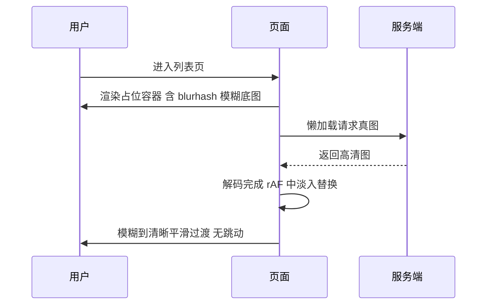

```javascript
// 一一对应：blurhash 渐进加载图片组件（React 版）
import { Blurhash } from 'react-blurhash';
import { useState, useEffect } from 'react';

function ProgressiveImage({ hash, src, width, height, alt }) {
  const [loaded, setLoaded] = useState(false);
  return (
    <div style={{ aspectRatio: `${width}/${height}`, position: 'relative', overflow: 'hidden' }}>
      {/* 阶段1：blurhash 解码为模糊底图，只有 30 字符数据 */}
      <div style={{ position: 'absolute', inset: 0, opacity: loaded ? 0 : 1, transition: 'opacity .3s' }}>
        <Blurhash hash={hash} widthPct={100} heightPct={100} resolutionX={32} resolutionY={32} />
      </div>
      {/* 阶段2：真图懒加载 + 异步解码，完成后淡入盖住模糊层 */}
       requestAnimationFrame(() => setLoaded(true))}  // 解码后再淡入
        style={{ position: 'absolute', inset: 0, width: '100%', height: '100%',
                 objectFit: 'cover', opacity: loaded ? 1 : 0, transition: 'opacity .3s' }}
      />
    </div>
  );
}
// 数据侧：后端上传图片时生成 hash 一并返回
// { id: 1, url: '.../img-800.webp', w: 800, h: 533, blurhash: 'L6H2:3of00j[~qofWBj[00j[%Mof' }
```

### OPT-153：接口超时如何与降级展示联动（超时即降级、缓存兜底）？

**答**：
- 体验反模式：弱网下白屏转圈 30s 等一个超时。正确姿势：给请求分级设超时（关键读 3s、非关键读 2s），超时立即降级到"上次成功数据缓存"。
- 缓存来源三层：内存缓存（本 session 之前拉过）、localStorage/IndexedDB 持久缓存（上次访问）、静态兜底配置。
- 降级要有"身份标识"：降级数据展示时标注"内容可能不是最新"，网络恢复后自动静默刷新一次。
- 写操作不能静默降级：失败要显式报错或进离线队列（见 OPT-156），避免用户以为提交成功了。

```javascript
// 一一对应：超时降级封装——三层缓存兜底 + 网络恢复静默刷新
async function fetchWithFallback(url, { timeout = 3000, ttl = 5 * 60_000, fallback } = {}) {
  const cacheKey = `fb:${url}`;
  try {
    const res = await fetch(url, { signal: AbortSignal.timeout(timeout) });
    if (!res.ok) throw new Error(res.status);
    const data = await res.json();
    // 成功：写双层缓存，供下次超时兜底
    localStorage.setItem(cacheKey, JSON.stringify({ t: Date.now(), data }));
    return { data, degraded: false };
  } catch (e) {
    // 超时/失败：逐层找兜底——内存(1) → localStorage(2) → 调用方给的静态 fallback(3)
    try {
      const hit = JSON.parse(localStorage.getItem(cacheKey));
      if (hit && Date.now() - hit.t < ttl * 6) return { data: hit.data, degraded: true }; // 降级但可用
    } catch (_) {}
    if (fallback) return { data: fallback, degraded: true };
    throw e; // 无任何兜底才真正抛错
  }
}

// 使用：Banner 拉不到就用上次的，UI 标注降级
const { data: banners, degraded } = await fetchWithFallback('/api/banners', {
  timeout: 2000, fallback: [{ title: '精选活动', img: '/static/fallback-banner.webp' }],
});
renderBanners(banners, degraded); // degraded=true 时角标提示"内容可能非最新"

// 网络恢复后静默刷新一次
addEventListener('online', () => {
  fetch('/api/banners').then(r => r.json()).then(renderBanners.bind(null, _, false));
});
```

### OPT-154：断网恢复后如何自动重连并"补拉"缺失数据？

**答**：
- 断网期间有两类损失：用户操作丢失（进离线队列重放，见 OPT-156）和**推送/轮询数据断档**（新消息、库存变化拿不到）。
- 重连三步：`online` 事件 + 实际探活（online 不等于可用， captive portal 场景会误报）→ 重放队列 → 按最后同步位点增量补拉（`?since=lastSyncId`）。
- 补拉要幂等：服务端给每条记录单调递增的版本号/游标，客户端用 `max(本地位点)` 续传，重复消息按 id 去重。
- 补拉风暴防护：多 tab 同时恢复时只让一个 tab 领头（BroadcastChannel/锁），其余听广播结果。

```javascript
// 一一对应：断网恢复 → 探活 → 重放队列 → 位点补拉
const lastCursor = { get: () => +(localStorage.getItem('syncCursor') || 0),
                     set: v => localStorage.setItem('syncCursor', v) };
const offlineQueue = JSON.parse(localStorage.getItem('opQueue') || '[]');

async function probe() {  // online 事件不可靠，需真实探活
  try {
    const r = await fetch('/api/health', { cache: 'no-store', signal: AbortSignal.timeout(3000) });
    return r.ok;
  } catch { return false; }
}

async function resync() {
  if (!(await probe())) return scheduleRetry();
  // 1. 重放离线操作（写操作按序重放）
  for (const op of offlineQueue.splice(0)) {
    try { await fetch(op.url, { method: op.method, body: JSON.stringify(op.body) }); }
    catch { offlineQueue.push(op); break; }        // 中途失败保留剩余，下次再放
  }
  localStorage.setItem('opQueue', JSON.stringify(offlineQueue));
  // 2. 位点增量补拉：只取断档期间的变化，重复数据按 id 去重
  const delta = await fetch(`/api/feed/sync?since=${lastCursor.get()}`).then(r => r.json());
  applyDelta(delta.items);                          // 内部按 id 去重合并
  lastCursor.set(delta.cursor);                     // 推进位点，幂等续传
  bc.postMessage({ type: 'resynced', cursor: delta.cursor }); // 通知其他 tab
}

function scheduleRetry() { setTimeout(resync, 30_000); }  // 探活失败退避重试

const bc = new BroadcastChannel('app-sync');
addEventListener('online', resync);                 // 系统网络恢复触发
bc.onmessage = e => e.data.type === 'resynced' && applyDeltaFromLeader(e.data);
```

### OPT-155：弱网质量埋点怎么做（请求成功率、时长分布、地域/运营商分桶）？

**答**：
- 弱网埋点要回答"慢在哪、坏在哪"：每个请求上报 {接口名、耗时、状态码、网络档位、运营商、地域}，聚合出成功率与时长分位数。
- 上报策略：弱网下连埋点都可能发不出去——本地聚合（计数/直方图），批量 + low 优先级上报，失败落 IndexedDB 重试。
- 分布统计用**分桶直方图**而不是原始值：[100ms, 300ms, 1s, 3s, 5s+] 各档计数，端上只传几十字节，服务端可还原任意分位数。
- 分析维度必须带 context：只看"接口成功率 97%"没意义，拆出"某运营商某省 2g 用户成功率 71%"才能定位。

```javascript
// 一一对应：请求直方图埋点（端上聚合 + 批量上报）
const histo = new Map(); // "api|bucket" -> count
const BUCKETS = [100, 300, 1000, 3000, 5000];

function recordFetch(api, ms, ok) {
  const idx = BUCKETS.findIndex(b => ms < b);
  const bucket = idx === -1 ? '5s+' : (idx === 0 ? '<100ms' : `${BUCKETS[idx-1]}-${BUCKETS[idx]}ms`);
  const conn = navigator.connection || {};
  const key = `${api}|${bucket}|${ok ? 'ok' : 'fail'}|${conn.effectiveType || 'unknown'}`;
  histo.set(key, (histo.get(key) || 0) + 1);       // 端上只存计数，内存占用恒定
}

// fetch 全局封装：无侵入采集
const _fetch = window.fetch;
window.fetch = async (...args) => {
  const t0 = performance.now();
  try {
    const res = await _fetch(...args);
    recordFetch(String(args[0]).split('?')[0], performance.now() - t0, res.ok);
    return res;
  } catch (e) {
    recordFetch(String(args[0]).split('?')[0], performance.now() - t0, false);
    throw e;
  }
};

// 定时批量上报：失败落盘重试，弱网不丢数据
setInterval(() => {
  if (!histo.size) return;
  const payload = Object.fromEntries(histo); histo.clear();
  navigator.sendBeacon('/api/metrics/fetch-histo', JSON.stringify({
    buckets: BUCKETS, stats: payload,
    carrier: navigator.connection?.type || '',
    ts: Date.now(),
  })) || localStorage.setItem('metric-overflow', JSON.stringify(payload)); // beacon 失败落盘
}, 30_000);
```

### OPT-156：离线操作队列如何保证最终一致（操作日志重放）？

**答**：
- 核心思想：不缓存"结果"缓存"意图"——把用户操作记成命令日志（createOrder/like/...），恢复网络后按序重放，达到最终一致。
- 一致性保障四件套：①操作带客户端生成 idempotencyKey，重放幂等（服务端 key 去重）；②操作记录带逻辑时钟/序号，按序重放；③冲突处理——服务端返回 409 时拉取最新状态合并（后写赢或提示用户）；④持久化 IndexedDB，防关页面丢失。
- UX：队列中操作显示"待同步"状态，重放成功更新为已同步，冲突弹冲突卡片让用户决策。
- 适用边界：适合"追加型"操作（点赞/评论/表单提交），不适合强一致流程（支付要显式确认，禁止离线提交）。

```javascript
// 一一对应：离线操作日志队列（幂等重放 + 冲突处理）
const dbp = indexedDB.open('op-log', 1);
dbp.onupgradeneeded = e => e.target.result.createObjectStore('ops', { keyPath: 'seq', autoIncrement: true });

export async function enqueue(op) {
  const db = await dbp;
  const record = { ...op, key: crypto.randomUUID(), ts: Date.now(), status: 'pending' };
  await new Promise((res, rej) => {
    const tx = db.transaction('ops', 'readwrite');
    tx.objectStore('ops').add(record);
    tx.oncomplete = res; tx.onerror = () => rej(tx.error);
  });
  renderBadge();  // UI：列表项标"待同步"
}

export async function replay() {
  const db = await dbp;
  const ops = await new Promise(res => {
    db.transaction('ops').objectStore('ops').getAll().onsuccess = e => res(e.target.result);
  });
  for (const op of ops.filter(o => o.status === 'pending')) {
    const res = await fetch(op.url, {
      method: op.method,
      headers: { 'content-type': 'application/json', 'idempotency-key': op.key }, // 幂等键防重放重复
      body: JSON.stringify(op.body),
    });
    if (res.status === 409) {                       // 冲突：拉最新状态，UI 交还用户决策
      const server = await fetch(op.conflictGet).then(r => r.json());
      promptConflict(op, server);                   // 用户选择覆盖/放弃后标记状态
    }
    await markStatus(db, op.seq, res.ok ? 'synced' : 'conflict');
    renderBadge();
  }
}
addEventListener('online', replay);
```

## 二十四、内存与稳定性

### OPT-157：SPA 页面常驻不关 tab（数小时/数天），内存如何持续治理？

**答**：
- 长驻页面的内存增长源：路由切换不释放的组件缓存、只进不出的数据缓存（消息列表/日志）、事件监听累积、定时器、 detached DOM。
- 治理原则：所有"会增长的结构"必须有上限——消息列表 capped ring buffer（保最近 N 条）、路由级组件缓存 LRU、缓存对象统一走带 TTL 的 Cache 类。
- 建立内存巡检：每 5 分钟采样 `performance.memory.usedJSHeapSize`，连续上升且 GC 后不回落则告警（配合 OPT-162）。
- 验证手段：Chrome DevTools heap snapshot 三快照法 + `allocation timeline` 定位增长点；长会话用 Puppeteer 跑 8 小时回归。

```javascript
// 一一对应：长驻 SPA 的三类内存上限治理
// 1. 消息列表：环形缓冲，只保留最近 500 条
class RingBuffer {
  constructor(limit) { this.limit = limit; this.items = []; }
  push(item) {
    this.items.push(item);
    if (this.items.length > this.limit) this.items.splice(0, this.items.length - this.limit); // 惰性裁剪
  }
  get all() { return this.items; }
}
const msgBuffer = new RingBuffer(500);
ws.onmessage = e => msgBuffer.push(JSON.parse(e.data)); // 挂一天也只占 500 条

// 2. 路由组件缓存：LRU 上限，keep-alive 场景最常用
class LRUCache {
  constructor(max = 10) { this.max = max; this.map = new Map(); } // Map 保序即 LRU
  get(k) { if (!this.map.has(k)) return; const v = this.map.get(k); this.map.delete(k); this.map.set(k, v); return v; }
  set(k, v) {
    if (this.map.has(k)) this.map.delete(k);
    this.map.set(k, v);
    if (this.map.size > this.max) {
      const oldest = this.map.keys().next().value;
      this.map.get(oldest)?.destroy?.();   // 驱逐前先销毁组件（解绑事件/定时器）
      this.map.delete(oldest);
    }
  }
}

// 3. 内存巡检：每 5 分钟采样，连续增长告警
let samples = [];
setInterval(() => {
  const mem = performance.memory;
  if (!mem) return;
  samples.push(mem.usedJSHeapSize);
  if (samples.length > 6) samples.shift();
  const growth = (samples[5] - samples[0]) / samples[0];
  if (growth > 0.3 && samples[5] > 200 * 1024 * 1024) {  // 30 分钟涨 30% 且超 200MB
    reportMemoryIncident(growth, mem);
  }
}, 5 * 60_000);
```

### OPT-158：线上页面异常（内存暴涨/卡死）如何设计"自动自愈 reload"？风险怎么控？

**答**：
- 自愈触发条件要极严：只针对"已确认异常"——页面完全无响应（主线程阻塞超阈值）、heap 超 800MB、连续崩溃自动重载（crash 恢复）。误 reload 会丢用户填写内容。
- 风险控制三件套：①reload 前保存关键状态（表单草稿/未发送文本进 sessionStorage）；②频控——同一 tab 24h 最多自愈 2 次，防止"崩溃→reload→再崩溃"死循环；③白名单页面优先，复杂表单页改为"提示用户保存后手动刷新"。
- 触发前先上报现场（heap 快照指标、最近操作序列），自愈数据回流验证"reload 后是否恢复"。
- 用 Page Lifecycle / visibility 判定时机：仅在用户未活跃输入时执行，避免打断。

```javascript
// 一一对应：受控自愈——状态保存 + 频控 + 时机选择
const HEAL_LIMIT = 2, DAY = 24 * 3600_000;
const healKey = 'autoheal-count';

function canHeal() {
  const rec = JSON.parse(sessionStorage.getItem(healKey) || '{"d":0,"n":0}');
  if (Date.now() - rec.d > DAY) return true;          // 跨天重置
  return rec.n < HEAL_LIMIT;
}

function markHeal() {
  const rec = JSON.parse(sessionStorage.getItem(healKey) || '{"d":0,"n":0}');
  if (Date.now() - rec.d > DAY) { rec.d = Date.now(); rec.n = 0; }
  rec.n++;
  sessionStorage.setItem(healKey, JSON.stringify(rec));
}

function saveBeforeReload() {   // reload 前抢救用户输入
  const draft = {
    form: Object.fromEntries(new FormData(document.querySelector('form')).entries()),
    scroll: scrollY,
    at: Date.now(),
  };
  sessionStorage.setItem('pre-reload-draft', JSON.stringify(draft)); // 重载后恢复
}

let freezeStart = null;
// 主线程冻结探测：每 2s 心跳，rAF 5s 没跑 = 卡死
setInterval(() => { freezeStart = Date.now(); }, 2000);
requestAnimationFrame(function loop() {
  if (freezeStart && Date.now() - freezeStart > 5000) {  // 冻结超 5s
    reportIncident('frozen');
    if (canHeal() && !userIsTyping()) {                  // 频控 + 用户未在输入
      saveBeforeReload(); markHeal();
      location.reload();
    }
  }
  freezeStart = null;
  requestAnimationFrame(loop);
});
```

### OPT-159：大数组/Map 缓存的清理时机怎么设计（上限 + 惰性清理）？

**答**：
- 缓存清理两个时机点：**写入时**（超上限立即驱逐，内存增长有界，推荐默认）和**惰性清理**（GC 时机未知，所以不能依赖"标记后等 GC"，要自己删引用）。
- 惰性清理的正确用法：TTL 不在写入时检查（写多读少场景浪费），而是在 **get 命中时**校验过期才删——读不到的脏数据不占访问成本，但内存仍受 max 上限兜底。
- 大数组分片清理：10 万条日志数组不能一次 splice（造成长任务），按片淘汰（每写 1000 条清最老 1000 条），清理由 idle 回调执行。
- WeakMap/WeakRef 的适用场景：以对象为 key 的附加数据（DOM 节点元信息），靠 GC 自动回收，无需手动清理。

```javascript
// 一一对应：TTL + 上限双约束的缓存（写入驱逐 + 读取惰性过期）
class TTLCache {
  constructor({ max = 200, ttl = 10 * 60_000 } = {}) {
    this.max = max; this.ttl = ttl; this.map = new Map(); // Map 保序
  }
  get(key) {
    const hit = this.map.get(key);
    if (!hit) return undefined;
    if (Date.now() - hit.t > this.ttl) {
      this.map.delete(key);          // 惰性过期：读时才删，避免定时器扫描全表
      return undefined;
    }
    this.map.delete(key); this.map.set(key, hit); // 触碰移到最新（LRU）
    return hit.v;
  }
  set(key, value) {
    if (this.map.has(key)) this.map.delete(key);
    this.map.set(key, { v: value, t: Date.now() });
    while (this.map.size > this.max) {                  // 写入时驱逐，内存增长有硬上限
      const oldest = this.map.keys().next().value;
      this.map.delete(oldest);
    }
  }
}

// 大数组分片淘汰：避免一次清 10 万条造成长任务
class ShardedList {
  constructor(shardSize = 1000) { this.shardSize = shardSize; this.shards = []; }
  push(...items) {
    this.shards.push(items);
    if (this.shards.length > 100) {                     // 超 10 万条触发异步淘汰
      (window.requestIdleCallback || setTimeout)(() => {
        this.shards.splice(0, 10);                      // idle 时一次只清 1 万条，分帧消化
      });
    }
  }
}
```

### OPT-160：事件总线（mitt/EventEmitter）导致的组件泄漏如何统一治理？

**答**：
- 泄漏机理：组件在 mounted 时 `bus.on(evt, handler)`，卸载时忘记 `off`，总线长期持有 handler → handler 闭包持有组件实例 → 组件与整棵 DOM 树无法回收。
- 治理方案①框架层封装：React 用自定义 hook（useEffect 返回 off），Vue 用 `onUnmounted` 钩子自动 off，把"必须 off"从纪律变成默认行为。
- 治理方案②总线增强：给总线加"按 owner 分组订阅"，owner 销毁时一次性解绑全部（`bus.bind(owner)` 返回带销毁的订阅器）。
- 巡检兜底：开发环境在 handler 注册时记录 Error 堆栈（weakref 组件引用），devtools 面板展示"活跃订阅数"，暴露只 on 不 off 的组件。

```javascript
// 一一对应：事件总线防泄漏封装（按 owner 自动解绑 + 双框架 hook）
class SafeEventBus {
  constructor() { this.handlers = new Map(); this.byOwner = new Map(); }
  bind(owner) {   // owner = 组件实例或任意命名空间对象
    if (!this.byOwner.has(owner)) this.byOwner.set(owner, []);
    const self = this;
    return {
      on(evt, fn) {
        self.on(evt, fn);
        self.byOwner.get(owner).push([evt, fn]);  // 记账：便于一次性解绑
      },
    };
  }
  on(evt, fn) { (this.handlers.get(evt) || this.handlers.set(evt, []).get(evt)).push(fn); }
  emit(evt, ...args) { (this.handlers.get(evt) || []).forEach(fn => fn(...args)); }
  destroy(owner) {   // owner 销毁：一次解绑全部订阅，杜绝遗漏
    for (const [evt, fn] of this.byOwner.get(owner) || []) {
      const arr = this.handlers.get(evt);
      const i = arr.indexOf(fn);
      if (i > -1) arr.splice(i, 1);
    }
    this.byOwner.delete(owner);
  }
}

export const bus = new SafeEventBus();

// React hook：useEffect 清理函数天然兜底
export function useBus(evt, handler) {
  useEffect(() => {
    bus.bind('hook').on(evt, handler);          // 简化示例：实际按组件实例分 owner
    return () => bus.destroy('hook');           // 卸载必解绑，无需人肉记忆
  }, [evt, handler]);
}

// Vue 组合式：同样思路
export function useBusOn(evt, handler) {
  const sub = bus.bind(getCurrentInstance());
  sub.on(evt, handler);
  onUnmounted(() => bus.destroy(getCurrentInstance()));
}
```

### OPT-161：如何发现并上报第三方 SDK 的内存泄漏？

**答**：
- 第三方 SDK（聊天客服、埋点、广告）是内存泄漏重灾区，且代码不可改，只能"发现 + 隔离 + 上报施压"。
- 发现手段：①定期 heap snapshot 对比（两次快照间做相同操作，看哪类对象单调增长、retainer 链指向谁）；②`performance.measureUserAgentSpecificMemory()`（跨域隔离后可用）按周期采样趋势；③SDK 隔离运行——iframe/Worker 里跑 SDK，泄漏被关在笼子里。
- 上报要带证据：泄漏对象构造栈（Allocation stack）、增长速率、SDK 版本号，形成可直接转给 SDK 厂商的 issue 材料。
- 兜底策略：确认泄漏且短期无修复时，对该 SDK 做"定时重建"（销毁重初始化）或按需加载。

```javascript
// 一一对应：SDK 内存泄漏自动巡检 + 证据上报
async function sampleMemory() {
  // 需要 COOP/COEP 跨域隔离头；不支持则退化 performance.memory
  if (performance.measureUserAgentSpecificMemory) {
    return (await performance.measureUserAgentSpecificMemory()).bytes;
  }
  return performance.memory?.usedJSHeapSize ?? null;
}

class LeakSentinel {
  constructor(interval = 10 * 60_000, samples = 12) {  // 2 小时采样 12 次
    this.interval = interval; this.samples = []; this.samplesLimit = samples;
    this.timer = setInterval(() => this.tick(), interval);
  }
  async tick() {
    // 采样前做一次 GC 提示（需 --js-flags=--expose-gc 仅 dev），生产用"稳定值法"
    const bytes = await sampleMemory();
    if (bytes == null) return;
    this.samples.push(bytes);
    if (this.samples.length < this.samplesLimit) return;
    // 12 个采样点做线性回归：斜率显著为正 = 疑似泄漏
    const n = this.samples.length, xs = this.samples.map((_, i) => i);
    const meanX = (n - 1) / 2, meanY = this.samples.reduce((a, b) => a + b) / n;
    const slope = xs.reduce((s, x) => s + (x - meanX) * (this.samples[x] - meanY), 0)
                / xs.reduce((s, x) => s + (x - meanX) ** 2, 0);
    if (slope > 2 * 1024 * 1024) {  // 每个采样周期涨超 2MB
      navigator.sendBeacon('/api/perf/leak-report', JSON.stringify({
        slope_mb_per_tick: +(slope / 1024 / 1024).toFixed(2),
        series_mb: this.samples.map(b => +(b / 1024 / 1024).toFixed(1)),
        sdk_versions: window.__sdkVersions,   // 各 SDK 版本号，方便厂商定位
        url: location.pathname,
      }));
    }
    this.samples = [];
  }
}
new LeakSentinel();
```

### OPT-162：内存指标如何接入监控告警（JS heap 趋势与 OOM 防护）？

**答**：
- 指标源：`performance.memory`（Chrome，usedJSHeapSize/jsHeapSizeLimit）与 `performance.measureUserAgentSpecificMemory()`；移动端 WebView 可用 Native 桥上报。
- 上报设计：不逐请求传原始值，端上算"滚动窗口斜率 + 峰值占比"（heap / jsHeapSizeLimit），只在越界或趋势异常时上报，降噪 95%。
- 告警阈值三级：峰值占比 > 70% 预警、> 85% 严重 + 立即采样快照线索、OOM 崩溃（crash 上报）P0。
- 归因关联：内存告警聚合时带上页面路由、会话时长、SDK 版本分布，直接回答"哪类页面驻留多久最容易爆"。

```javascript
// 一一对应：内存趋势上报与三级告警
class MemoryMonitor {
  constructor() {
    this.window = [];                          // 滚动窗口：最近 10 次采样
    this.tick();
  }
  tick() {
    const m = performance.memory;
    if (m) {
      const usage = m.usedJSHeapSize / m.jsHeapSizeLimit;   // 峰值占比
      this.window.push(m.usedJSHeapSize);
      if (this.window.length > 10) this.window.shift();
      this.evaluate(usage, m);
    }
    setTimeout(() => this.tick(), 60_000);     // 每分钟采样
  }
  evaluate(usage, m) {
    // 三级判定
    if (usage > 0.85) {
      this.report('critical', usage, m);       // 严重：附最近操作序列
      this.snapshotBreadcrumb();
    } else if (usage > 0.70) {
      this.report('warning', usage, m);        // 预警
    } else if (this.window.length === 10) {
      // 趋势斜率：10 分钟内稳定上涨超 40% 也值得看（未到阈值但趋势坏）
      const growth = (this.window[9] - this.window[0]) / this.window[0];
      if (growth > 0.4) this.report('trend', growth, m);
    }
  }
  report(level, value, m) {
    navigator.sendBeacon('/api/metrics/memory', JSON.stringify({
      level, value: +value.toFixed(3),
      used_mb: Math.round(m.usedJSHeapSize / 1048576),
      route: location.pathname,
      session_min: Math.round((Date.now() - +sessionStorage.ts) / 60000),
      stay_seq: window.__opSeq || 0,           // 最近操作序号，关联回放
    }));
  }
  snapshotBreadcrumb() { /* 触发 rrweb 最近 30s 回放片段上传，配合 OPT-164 */ }
}
if (performance.memory) new MemoryMonitor();
```

## 二十五、性能监控与归因进阶

### OPT-163：拿到一批慢数据后，如何做"网络/前端/后端/客户端"四象限归因？

**答**：
- 归因框架：每个慢会话按指标特征判入四个象限——后端（TTFB 高）、网络（传输时长高而 TTFB 正常）、前端（资源下载完到可交互耗时长）、客户端设备（高端/低端机分档后指标系统性差异）。
- 判定用指标组合而不是单指标：TTFB→后端；`transferSize/download 时间` 与 TTFB 的比值→网络；`responseEnd→FCP/可交互`→前端；按设备内存/核数分桶看基线→客户端。
- 输出物是"占比饼图 + Top 根因清单"：如"后端 35%、前端 40%、网络 15%、设备 10%"，直接决定优化资源投向。
- 四象限要能下钻：每象限挂接更细的维度（接口维度、资源维度、页面维度），形成归因树。

```javascript
// 一一对应：慢会话四象限自动归因（对每条 RUM 记录判象限）
function attributeQuadrant(rec) {
  // rec: { ttfb, transfer_ms, fcp, interactive, deviceTier, transferSize }
  const candidates = [];
  // 1. 后端：TTFB 占比高（>1.5s 或占总时长 40%+）
  if (rec.ttfb > 1500 || rec.ttfb > rec.total * 0.4) {
    candidates.push({ q: 'backend', score: rec.ttfb / rec.total, detail: `TTFB ${rec.ttfb}ms` });
  }
  // 2. 网络：TTFB 正常但传输慢（大 payload + 低吞吐）
  const throughput = rec.transferSize / Math.max(rec.transfer_ms, 1); // B/ms ≈ KB/s
  if (rec.ttfb < 800 && rec.transfer_ms > 1500 && throughput < 100) {
    candidates.push({ q: 'network', score: rec.transfer_ms / rec.total, detail: `吞吐 ${throughput.toFixed(0)}KB/s` });
  }
  // 3. 前端：资源到位后迟迟不可交互（ hydration/JS 执行/渲染）
  const frontendMs = rec.interactive - rec.responseEnd;
  if (frontendMs > 2500) {
    candidates.push({ q: 'frontend', score: frontendMs / rec.total, detail: `可交互前耗时 ${frontendMs}ms` });
  }
  // 4. 客户端：低端机基线本身高（对照高端机同页面 P50）
  if (rec.deviceTier === 'low' && rec.interactive > rec.highEndP50 * 2.5) {
    candidates.push({ q: 'device', score: 0.5, detail: '低端机基线差异' });
  }
  candidates.sort((a, b) => b.score - a.score);
  return candidates[0]?.q || 'normal';   // 多象限命中时取占比最大者
}

// 批量聚合出归因分布，指导资源投向
function aggregate(records) {
  const dist = { backend: 0, network: 0, frontend: 0, device: 0, normal: 0 };
  for (const r of records) dist[attributeQuadrant(r)]++;
  return Object.fromEntries(Object.entries(dist).map(([k, v]) => [k, `${(v / records.length * 100).toFixed(0)}%`]));
}
```

### OPT-164：Session Replay 如何与性能数据关联，定位"慢会话"？

**答**：
- 单看指标知道"慢"，回放知道"怎么个慢法"：用户点了几次没反应、骨架屏卡了多久、白屏期间用户在干什么。关联方式是统一的 **sessionId + 时间轴**。
- 实现：回放录制（rrweb）与性能事件（LCP/INP/长任务/请求）共用 session 存储，性能事件作为 mark 写入回放时间轴，回放器上直接标出"此刻 LCP 发生"。
- 采样策略：全量录制成本高，按"慢会话优先"采样——LCP P90 以上、INP > 200ms、发生长任务风暴的会话优先上传回放。
- 隐私合规：输入框脱敏、token 类 DOM 不录制，回放存储设保留期。

```javascript
// 一一对应：rrweb 回放 + 性能事件写入同一时间轴（慢会话优先上传）
import { record } from 'rrweb';

const events = [];
let slowScore = 0;   // 会话"慢程度"打分，决定是否上传

record({
  emit: e => {
    events.push(e);
    if (events.length > 3000) events.splice(0, 500); // 环形缓冲防爆内存
  },
  maskInputOptions: { password: true, tel: true },     // 隐私脱敏
});

// 性能事件：作为自定义事件进时间轴 + 叠加慢分数
new PerformanceObserver(l => {
  for (const e of l.getEntries()) {
    events.push({ type: 'custom', tag: 'perf:lcp', timestamp: e.startTime, value: e.startTime });
    if (e.startTime > 4000) slowScore += 2;   // LCP 超 4s 加权
  }
}).observe({ type: 'largest-contentful-paint', buffered: true });

new PerformanceObserver(l => {
  const n = l.getEntries().length;
  events.push({ type: 'custom', tag: 'perf:longtask', count: n });
  slowScore += n;
}).observe({ type: 'longtask', buffered: true });

// 页面离开：慢会话才上传（快会话丢回放省存储）
addEventListener('pagehide', () => {
  if (slowScore < 3) return;                  // 阈值可按流量调整
  const sessionId = sessionStorage.sid;
  const blob = new Blob([JSON.stringify({ sessionId, slowScore, events })]);
  navigator.sendBeacon('/api/replay', blob);  // 服务端按 sessionId 可关联全部性能埋点
});
```

### OPT-165：性能数据聚合统计的正确姿势（采样、分位数、去极值、防偏差）？

**答**：
- 分位数是基本盘：性能指标必须看 P75（Core Web Vitals 口径）/P90/P95，均值会被长尾拖爆；分位数在端上用直方图（HDR/对数分桶）统计，服务端合并。
- 采样偏差三个坑：①只上报成功页面（崩溃会话缺席，数据偏好）；②桌面端占比高（移动弱网被稀释）；③采上不上（固定第 10 个用户上报会引入周期性偏差）——用随机哈希采样 + 分层（设备/网络/页面按层独立配额）。
- 去极值要谨慎：性能分析里"极值"往往就是真相（OOM、卡死），正确做法是**分桶展示 + 单独看 P99**，而不是 trimmean 掉了事；只有明确脏数据（回放脚本、爬虫）才剔除。
- 口径一致性：同一指标 lab/RUM 数值不同属正常（lab 理想环境），对比只允许同类内比。

```javascript
// 一一对应：端上对数分桶直方图 + 服务端任意分位数还原
// 1. 端上：对数分桶（2^n ms），每个桶存计数
class HdrLikeHistogram {
  constructor() { this.buckets = new Array(25).fill(0); this.total = 0; } // 覆盖 1ms ~ 16s
  record(ms) {
    const idx = Math.min(24, Math.ceil(Math.log2(Math.max(ms, 1)))); // 1,2,4,8...ms
    this.buckets[idx]++; this.total++;
  }
  serialize() { return { b: this.buckets, n: this.total }; }  // 25 个数字，几十字节
}

// 2. 服务端：直方图还原分位数（多实例桶相加后扫描）
function quantile(hist, q) {
  const target = Math.floor(hist.n * q);
  let cum = 0;
  for (let i = 0; i < hist.b.length; i++) {
    cum += hist.b[i];
    if (cum >= target) return Math.pow(2, i);   // 桶上界即估计值，误差 ≤ 2 倍
  }
  return Infinity;
}
// quantile({n:1000, b:[...]}, 0.75) → P75

// 3. 分层采样：设备×网络 独立配额，避免移动弱网被桌面流量稀释
function shouldSample(sessionId, deviceTier, netType) {
  const layer = `${deviceTier}:${netType}`;
  const quotas = { 'high:4g': 0.05, 'low:3g': 0.5, 'low:2g': 1.0 };  // 低端机全量采
  const h = [...sessionId].reduce((a, c) => (a * 31 + c.charCodeAt(0)) >>> 0, 7);
  return (h % 100) / 100 < (quotas[layer] ?? 0.1);   // 稳定哈希：同会话判定一致
}
```

### OPT-166：如何设计性能优化 A/B 实验，验证"改动真的有效"？

**答**：
- 对照原则：同时期随机分流（实验组/对照组同机房同流量结构），避免"上周 vs 本周"的时间混淆（流量结构、天气、营销活动都会变）。
- 实验设计五要素：假设（改 X 会改善 Y 指标 μ ms）、分流单元（用户级，保证体验一致）、最小样本量（按指标方差与预期效应量算，MDE 越小样本越大）、指标（主指标 + 护栏指标，如 LCP 降了但转化也降就是护栏报警）、周期（≥ 1 个完整周，覆盖周中/周末）。
- 性能实验的特殊性：性能改动常"全量上线更省事"，但无损改动可灰度验证后直接放量；验证意义在于建立团队"改动→收益"的信用记录。
- 显著性判定：t 检验/ bootstrap，报告置信区间而不只是 p 值；指标用分位数对比时用 bootstrap 置信区间。

```javascript
// 一一对应：性能 A/B 分流 + 分位数 bootstrap 显著性检验
// 1. 用户级稳定分流（同一用户始终同组）
function assignGroup(userId, experiment = 'lcp-image-opt') {
  const h = [...`${experiment}:${userId}`].reduce((a, c) => (a * 33 + c.charCodeAt(0)) >>> 0, 5381);
  return (h % 100) < 50 ? 'treatment' : 'control';  // 50/50，哈希稳定
}

// 2. bootstrap 比较两组 P75 的置信区间
function bootstrapP75Diff(a, b, iterations = 2000) {
  const p75 = arr => { const s = [...arr].sort((x, y) => x - y); return s[Math.floor(s.length * 0.75)]; };
  const diffs = [];
  for (let i = 0; i < iterations; i++) {
    const ra = Array.from({ length: a.length }, () => a[Math.random() * a.length | 0]);
    const rb = Array.from({ length: b.length }, () => b[Math.random() * b.length | 0]);
    diffs.push(p75(ra) - p75(rb));   // 正数 = 实验组更快
  }
  diffs.sort((x, y) => x - y);
  const ci = [diffs[Math.floor(iterations * 0.025)], diffs[Math.floor(iterations * 0.975)]];
  return {
    p75_diff: p75(a) - p75(b),
    ci95: ci.map(v => Math.round(v)),
    significant: ci[0] > 0 || ci[1] < 0,  // 区间不含 0 即显著
  };
}

// 3. 实验读取：上报时带分组，服务端按组聚合
const group = assignGroup(user.id);
reportPerf({ metric: 'LCP', value: lcp, group, exp: 'lcp-image-opt' });
// 收尾：bootstrapP75Diff(treatmentLCPs, controlLCPs) → { p75_diff: -420, ci95: [-510, -330], significant: true }
```

### OPT-167：团队里"性能指标口径"混乱（技术口径 vs 业务口径），如何统一？

**答**：
- 混乱来源：技术侧说"LCP P75 2.8s"，业务侧说"首页打开要 6 秒"（用户感知口径），监控平台还有一个自算口径，三方对不上导致汇报反复横跳。
- 统一机制：建一份**指标字典（单一代码源）**：每个指标定义 [名称、计算公式、数据源、分位数口径、适用场景]，由性能 owner 维护，全员引用；对外汇报默认业务感知口径，内部优化用技术口径并标明换算关系。
- 实现上做成统一 SDK：所有上报走同一个 `defineMetric`，禁止业务代码自算指标；变更走版本化（metric_v2），新老口径并行一段时间再切换。
- 校验闭环：监控平台口径与真实用户调研（用户录屏感知耗时）定期校准，确认技术指标仍与"用户觉得慢"相关。

```javascript
// 一一对应：指标字典单一代码源（defineMetric 统一上报与口径）
const METRIC_REGISTRY = {
  // 指标字典：名称 / 公式 / 数据源 / 口径版本 / 适用场景
  lcp_tech: {
    formula: 'PerformanceObserver largest-contentful-paint.startTime',
    source: 'rum', percentile: 'p75', version: 2, audience: 'tech',
  },
  first_screen_perceived: {
    // 业务感知口径：首屏关键模块（推荐位）渲染完成，比 LCP 更贴近用户体感
    formula: 'performance.now 在关键模块 mounted 时打点',
    source: 'rum', percentile: 'p75', version: 2, audience: 'business',
    note: '汇报口径，与技术 LCP 差值 ≈ 图片解码+字体，波动范围 0.3~1s',
  },
  open_duration_biz: {
    formula: 'click 跳转 → 首屏接口数据渲染完成',   // 业务方"打开速度"
    source: 'rum', percentile: 'p75', version: 1, audience: 'business',
  },
};

const reported = new Set();
export function defineMetric(name, value, context = {}) {
  const def = METRIC_REGISTRY[name];
  if (!def) throw new Error(`未注册指标 ${name}，请先在字典登记`);  // 防口径外溢
  const key = `${name}:${context.sessionId}`;
  if (reported.has(key)) return;          // 同会话同指标去重
  reported.add(key);
  navigator.sendBeacon('/api/metrics', JSON.stringify({ name, value, def: def.version, ...context }));
}

// 使用方只能引用字典里的指标，口径天然统一
defineMetric('lcp_tech', lcp);
defineMetric('first_screen_perceived', perceivedMs, { page: 'home' });
```

### OPT-168：如何从海量性能数据中自动"挖掘慢会话"的用户特征聚类？

**答**：
- 目标：从 RUM 数据里自动找出"谁慢、慢在共同特征"——比如"低端安卓 + 某运营商 + 首页 + 中午时段"聚成一簇，指向运营商缓存问题。
- 特征工程：会话级特征 = {LCP、INP、请求数、传输体积、TTFB、设备档、网络类型、地域、时段、路由}；数值特征分桶/标准化，类别特征 one-hot。
- 聚类实现：量大用 mini-batch k-means（k=4~8），或更简单的规则聚类（按维度组合分桶后按慢占比排序），后者可解释性更好，先规则后模型。
- 输出闭环：每个簇生成"特征卡"（占比、P75、根因假设、建议动作），进周报驱动专项。

```javascript
// 一一对应：会话特征提取 + 规则聚类挖掘慢会话簇
function extractFeatures(s) {  // s: 一条会话聚合记录
  return {
    lcp_bucket: s.lcp > 4000 ? 'very-slow' : s.lcp > 2500 ? 'slow' : 'ok',
    device: s.deviceTier,                      // high mid low
    network: s.effectiveType,
    payload_mb: +(s.transferSize / 1048576).toFixed(1),
    hour_slot: s.hour >= 12 && s.hour < 14 ? 'lunch' : s.hour >= 20 ? 'night' : 'work',
    route_group: s.route.split('/')[1] || 'home',
  };
}

// 规则聚类：按关键维度组合分桶，统计每桶慢占比与样本量
function mineSlowClusters(sessions, minSample = 200) {
  const clusters = new Map();
  for (const s of sessions) {
    const f = extractFeatures(s);
    const key = [f.device, f.network, f.route_group].join('|');   // 聚类维度
    const c = clusters.get(key) || { n: 0, slow: 0, lcpSum: 0 };
    c.n++; if (f.lcp_bucket !== 'ok') c.slow++;
    c.lcpSum += s.lcp;
    clusters.set(key, c);
  }
  return [...clusters.entries()]
    .filter(([, c]) => c.n >= minSample)
    .map(([key, c]) => ({
      features: key,
      sample: c.n,
      slow_ratio: +(c.slow / c.n).toFixed(3),
      p75_proxy_lcp: Math.round(c.lcpSum / c.n),   // 示例用均值，生产换直方图分位
    }))
    .filter(c => c.slow_ratio > 0.3)               // 慢占比超 30% 的簇为候选
    .sort((a, b) => b.slow_ratio * b.sample - a.slow_ratio * a.sample) // 按受影响用户量排序
    .slice(0, 5);
}
// 输出示例：{ features: 'low|3g|home', sample: 3120, slow_ratio: 0.62, p75_proxy_lcp: 5200 }
```

### OPT-169：如何量化"性能 → 业务指标"的关联（加载时长对转化率的影响）？

**答**：
- 关联分析三层：①分桶对比——把 LCP 分桶（<2s / 2~4s / >4s），各桶看转化率，得到直观的"每慢一秒转化掉多少"；②回归——控制流量来源/设备/时段等混杂变量后估计性能的净效应；③A/B 验证——性能优化实验直接看转化护栏指标，是因果 gold standard。
- 数据对齐：性能埋点与订单/转化事件用同一 sessionId/userId 关联，注意跨端登录的场景用设备指纹兜底。
- 结论表述要防误读："相关不等于因果"必须写在报告里；分桶对比里"快用户本来意向就高"的偏差要用回归或实验排除。
- 落地形式：性能-转化弹性系数（每 100ms LCP → 转化率变化 x%），进性能预算的商业论证。

```sql
-- 一一对应：性能分桶 × 转化率关联分析（数仓 SQL 模板）
-- 前提：rum_events 表（含 session_id, lcp, device, channel, ts）
--       conversions 表（含 session_id, order_id, amount, ts）
WITH perf_bucket AS (
  SELECT
    session_id,
    CASE
      WHEN lcp < 2000 THEN 'a_fast_lt2s'
      WHEN lcp < 4000 THEN 'b_mid_2to4s'
      ELSE 'c_slow_gt4s'
    END AS lcp_bucket,
    device, channel,
    DATE(ts) AS dt
  FROM rum_events
  WHERE ts >= '2026-10-01' AND page = 'product_list'
),
conv AS (
  SELECT DISTINCT session_id FROM conversions WHERE ts >= '2026-10-01'
)
SELECT
  p.lcp_bucket,
  p.device,
  COUNT(DISTINCT p.session_id)                        AS sessions,
  COUNT(DISTINCT c.session_id)                        AS converted,
  ROUND(COUNT(DISTINCT c.session_id) * 100.0
        / COUNT(DISTINCT p.session_id), 2)            AS cvr_pct,
  -- 环比：与快桶的相对差，即"性能税"
  ROUND((COUNT(DISTINCT c.session_id) * 1.0 / COUNT(DISTINCT p.session_id)) * 100
        - LAG(COUNT(DISTINCT c.session_id) * 1.0 / COUNT(DISTINCT p.session_id)) OVER (
            ORDER BY p.lcp_bucket) * 100, 2)          AS cvr_gap_vs_fast
FROM perf_bucket p
LEFT JOIN conv c ON p.session_id = c.session_id
GROUP BY p.lcp_bucket, p.device
ORDER BY p.device, p.lcp_bucket;
-- 典型输出：mobile + c_slow_gt4s 的 cvr 比 a_fast_lt2s 低 2.1pp → 乘日均 UV 即商业价值
```

## 二十六、专项场景优化

### OPT-170：中后台 100+ 路由页面的应用，性能体系怎么搭？

**答**：
- 特征：路由多但单页逻辑重（大表格、多图表），公共依赖（antd/echarts/lodash）占大头。体系四层：路由级懒加载全量化 → 公共包拆分与缓存命中 → 页面级资源预算 → 打开速度监控。
- 分包策略：`splitChunks` 把 echarts/antd 等大依赖拆 vendor chunk，配 `maxAsyncRequests` 平衡请求数；多页面共享的"业务公共块"（权限、请求封装）单独拆。
- 打开速度（SPA 内切换）优化：路由 chunk prefetch（见 OPT-143）+ 页面数据请求与 chunk 加载并行（chunk 加载函数和 fetch 同时发起）。
- 监控口径：中后台关心"菜单点击到页面可操作"，按路由上报，Top10 慢页面进迭代治理。

```javascript
// 一一对应：中后台路由性能体系核心配置
// webpack.config.js —— 公共依赖分包
module.exports = {
  optimization: {
    splitChunks: {
      chunks: 'all',
      cacheGroups: {
        echarts: { test: /[\\/]node_modules[\\/](echarts|zrender)/, name: 'echarts', priority: 20 },
        antd:    { test: /[\\/]node_modules[\\/](@ant-design|antd|rc-.*)/, name: 'antd', priority: 20 },
        vendors: { test: /[\\/]node_modules[\\/]/, name: 'vendors', priority: 10, minChunks: 2 },
        common:  { name: 'common', minChunks: 5, priority: 5, reuseExistingChunk: true },
      },
    },
  },
};

// router.jsx —— chunk 与数据并行加载（切换快 40%）
const routes = [
  {
    path: '/orders',
    // import() 与数据请求同时启动，Promise.all 汇合
    loader: () => Promise.all([
      import('./pages/Orders'),
      api.get('/api/orders?page=1'),
    ]),
    Component: lazy(() => import('./pages/Orders').then(m => ({ default: m.Orders }))),
  },
];

// 按 chunk 路径预取：侧边栏 hover 即预热（见 OPT-143），配合 Menu 组件
// <Menu onPointerEnter={item => prefetchChunk(item.routePath)} />
```

### OPT-171：移动端"长列表 + 筛选 + 排序"组合场景怎么优化？

**答**：
- 组合场景的性能冲突：虚拟列表假设"数据只追加"，而筛选/排序会**整体重置数据**，导致滚动位置丢失、白屏、图片重载。
- 方案：①筛选/排序结果用**新 key 空间**渲染（给列表容器换 `key=bucket`，强制重建避免旧 item 复用错位）；②筛选时保留滚动位置策略：结果集变化大就回顶部，变化小（点同一 tab）保持位置；③图片用稳定 src（不同筛选下同一 item 的缩略 URL 不变），命中内存缓存不闪。
- 数据层：筛选条件先本地命中缓存（上次同样条件的分页数据），命中则瞬时渲染再后台刷新。
- 交互反馈：筛选期间冻结列表滚动（overscroll-behavior + loading 态），避免边筛边滚的错乱。

```javascript
// 一一对应：筛选排序驱动的列表重建 + 缓存命中策略
function useFilteredList(baseQuery) {
  const [state, setState] = useState({ items: [], epoch: 0, loading: false });
  const cacheRef = useRef(new Map()); // 筛选条件 -> 结果集

  const applyFilter = useCallback(async (filter) => {
    const sig = JSON.stringify(filter);
    const cached = cacheRef.current.get(sig);
    if (cached) {
      // 缓存命中：先渲染缓存（epoch+1 触发容器重建，防复用错位），再后台刷新
      setState(s => ({ ...s, items: cached, epoch: s.epoch + 1, loading: true }));
    } else {
      setState(s => ({ ...s, items: [], epoch: s.epoch + 1, loading: true }));
    }
    const res = await api.get('/api/items', { params: { ...baseQuery, ...filter, fields: 'id,title,thumb,price' } });
    cacheRef.current.set(sig, res.items);          // LRU 上限防膨胀
    if (cacheRef.current.size > 30) cacheRef.current.delete(cacheRef.current.keys().next().value);
    setState(s => (JSON.stringify(filter) === sig   // 竞态保护：只接受最新条件的结果
      ? { ...s, items: res.items, epoch: s.epoch + 1, loading: false }
      : s));
  }, [baseQuery]);

  return { ...state, applyFilter };
}

function ItemList({ items, epoch, loading }) {
  return (
    // key 绑定 epoch：筛选变化 = 新数据空间，VirtualList 完整重置滚动与内部缓存
    <VirtualList key={epoch} items={items} itemHeight={96} overscan={5}
      className={loading ? 'frozen' : ''} />  // .frozen { pointer-events:none; overscroll-behavior:contain }
  );
}
```

### OPT-172：仪表盘一个页面 10+ 图表实例，如何做好实例销毁与复用？

**答**：
- 图表是内存大户：每个 echarts 实例持有 canvas、数据集、事件监听，10+ 实例不清理一次切换就是几十 MB。
- 生命周期纪律：组件卸载必须 `dispose()`；tab 切换隐藏的图表用 `resize observer` 失效处理（隐藏容器 resize 为 0 会渲染异常）。
- 复用策略：同类型小图表用**实例池**（重建实例 ≈ 50ms+，池化后 < 5ms）；全局共享的 tooltip/zr 事件通过 `connect` 联动而不是各自监听。
- 数据更新用 `setOption(option, { lazyUpdate: true, notMerge: false })` 增量更新，禁止先 `clear()` 再全量 setOption（全量重建内部对象）。

```javascript
// 一一对应：echarts 实例池 + 生命周期纪律封装
import * as echarts from 'echarts/core';

const pool = [];   // 空闲实例池
function acquire(el) {
  const inst = pool.pop() || echarts.init(el);
  return inst;
}
function release(inst) {
  inst.clear();                      // 清空 option 数据释放大数据引用
  pool.push(inst);                   // 回池复用，避免下次 init 的 50ms
}
if (pool.length > 8) {               // 池上限：多杀几个防常驻内存
  while (pool.length > 8) pool.pop().dispose();
}

export function useChart(elRef, getOption) {
  let chart;
  onMounted(() => {
    chart = acquire(elRef.value);
    chart.setOption(getOption(), { lazyUpdate: true });   // 增量更新，不清空重建
    // 尺寸变化只在可见时响应，隐藏容器 resize=0 会导致渲染异常
    chart.__ro = new ResizeObserver(entries => {
      const { width } = entries[0].contentRect;
      if (width > 0) chart.resize();
    });
    chart.__ro.observe(elRef.value);
  });
  onBeforeUnmount(() => {
    chart.__ro.disconnect();          // 断开 observer
    release(chart);                   // 回池（或 dispose）
  });
  return {
    update: (opt) => chart?.setOption(opt, { lazyUpdate: true }),
  };
}

// 多图表 tooltip 联动：connect 而不是各自监听全局事件
// echarts.connect([chartA, chartB, chartC]);   // 一组实例共享 axisPointer/tooltip
```

### OPT-173：国际化多语言包怎么加载才不拖慢首屏？

**答**：
- 反模式：构建时把全部语言打进主包（10 语言 × 80KB = 800KB），或运行时串行 `await loadLocale` 阻塞渲染。
- 方案：按语言动态分包（`import(`./locales/${lang}.json`)`），只加载当前语言；首屏所需文案与全量文案再拆两级（common 包 + 页面命名空间包）。
- 预取：检测用户语言后，浏览器空闲时预取"最可能的第二语言"（如英文站预取中文）——切换语言时零等待。
- 缓存：语言包用 HTTP 强缓存（带 hash）+ localStorage 版本化缓存双保险；语言包加载失败回退到内置兜底语言。

```javascript
// 一一对应：i18n 按语言分包加载 + 预取 + 版本缓存
const LOCALE_VER = 'v42';  // 构建注入，语言包内容变化时更新
const loaded = new Map();

async function loadLocaleBundle(lang) {
  if (loaded.has(lang)) return loaded.get(lang);
  // 先查 localStorage 版本缓存：回访用户零网络等待
  const cached = localStorage.getItem(`i18n:${lang}:${LOCALE_VER}`);
  let bundle;
  if (cached) {
    bundle = JSON.parse(cached);
  } else {
    bundle = await import(/* webpackChunkName: "locale-[request]" */ `./locales/${lang}.json`);
    try { localStorage.setItem(`i18n:${lang}:${LOCALE_VER}`, JSON.stringify(bundle)); } catch {}
  }
  loaded.set(lang, bundle);
  return bundle;
}

// 初始化：不 await 完整语言包，先渲染骨架，文案就绪后刷新
export async function initI18n(navigatorLang, savedLang) {
  const lang = savedLang || (navigatorLang.startsWith('zh') ? 'zh-CN' : 'en');
  const i18n = createI18n({ locale: lang, fallbackLocale: 'en', messages: {} });
  i18n.setLocaleMessage(lang, await loadLocaleBundle(lang));
  return i18n;
}

// 空闲预取第二语言：切换语言零等待
addEventListener('load', () => {
  const second = document.documentElement.lang === 'zh-CN' ? 'en' : 'zh-CN';
  (window.requestIdleCallback || setTimeout)(() => loadLocaleBundle(second));
});
```

### OPT-174：弹窗/抽屉高频开关场景，如何避免反复创建销毁的性能损耗？

**答**：
- 复杂弹窗（含表单、图表、大列表）每次 v-if/条件渲染都是完整的 mount/unmount：DOM 重建 + 组件初始化 + 数据重拉，低端机单次 100ms+。
- 策略分级：①简单弹窗正常条件渲染；②高频复杂弹窗用"首次懒挂载 + 之后 `v-show`/display 切换"保活（Vue keep-alive、React 常挂载 + visibility）；③保活弹窗要提供 `onReopen` 钩子刷新数据，并防内存累积（内容重置为空态）。
- 全局弹窗（Modal 服务式调用）用单例容器 + 动态内容插槽，避免每次调用 `createApp`/`ReactDOM.render` 级别的重量操作。
- 动画保持 transform/opacity，开关过程不触发重排。

```vue
<!-- 一一对应：Vue3 高频复杂抽屉——懒挂载 + 保活 + 重开钩子 -->
<script setup>
import { ref, shallowRef, nextTick } from 'vue';
const visible = ref(false);
const mounted = ref(false);           // 首次打开才真正挂载
const drawerRef = ref(null);
const detailData = shallowRef(null);

async function open(id) {
  visible.value = true;
  if (!mounted.value) {
    mounted.value = true;             // 首次：挂载组件（成本一次性）
    await nextTick();
  }
  // 重开钩子：只刷新数据，不重建组件/图表实例
  detailData.value = await api.get(`/api/detail/${id}`);
  drawerRef.value?.onReopen?.(detailData.value);
}
function close() { visible.value = false; }  // 只切 v-show，不卸载
</script>

<template>
  <Teleport to="body">
    <!-- v-if 只控制首次挂载，之后 v-show 保活：开关零 mount/unmount -->
    <Drawer v-if="mounted" v-show="visible" ref="drawerRef" @close="close">
      <DetailPanel :data="detailData" />
    </Drawer>
  </Teleport>
</template>

<style scoped>
/* 抽屉动画只用 transform：开关过程零重排 */
:deep(.drawer) { transition: transform .25s ease, visibility .25s; }
</style>
```

### OPT-175：页面内嵌 iframe（客服/编辑器/广告）如何控制性能影响？

**答**：
- iframe 的成本：独立文档完整加载流程（DNS/TCP/解析/渲染），同域共享主线程之外的进程但仍有通信开销；跨域 iframe 无法直接优化其内部。
- 控制手段：①非关键 iframe（广告/客服）`loading="lazy"` 推迟到视口附近加载；②`fetchpriority="low"` 降低其资源竞争；③不可见时干脆卸载（v-if + IntersectionObserver）。
- 通信节流：postMessage 高频数据（滚动位置/光标）合并节流，用 Transferable/结构化克隆避免字符串序列化大对象。
- 隔离方案：重计算型第三方内容放 Worker/Partytown（见 OPT-125），iframe 只用于必须独立文档的场景。

```html
<!-- 一一对应：iframe 懒加载 + 可见性卸载 + 节流通信 -->
<div id="ad-slot" style="aspect-ratio: 300/250;"> <!-- 预留尺寸防 CLS -->
  <iframe
    id="ad-frame"
    data-src="https://ads.example.com/unit/123"
    loading="lazy"            <!-- 视口附近才加载，首屏不付出加载成本 -->
    fetchpriority="low"       <!-- 资源竞争让路给首屏 -->
    referrerpolicy="no-referrer"
    title="advertisement" width="300" height="250"></iframe>
</div>
<script>
  // 不可见超过 5s 卸载 iframe：编辑器/广告类可显著省内存
  const frame = document.getElementById('ad-frame');
  const slot = document.getElementById('ad-slot');
  let hideTimer;
  new IntersectionObserver(entries => {
    if (entries[0].isIntersecting) {
      clearTimeout(hideTimer);
      if (!frame.src) frame.src = frame.dataset.src;   // 首次进入才真正加载
      if (!frame.src) frame.src = frame.dataset.src;
    } else {
      hideTimer = setTimeout(() => { frame.src = 'about:blank'; }, 5000); // 离开视口 5s 释放
    }
  }, { rootMargin: '200px' }).observe(slot);

  // 通信节流：滚动位置 100ms 合并一次，且用数字数组而非 JSON 大字符串
  let pendingPos = null, sendTimer = null;
  window.addEventListener('message', e => {
    if (e.data?.type === 'pos-request') {
      pendingPos = [scrollX, scrollY];
      if (!sendTimer) sendTimer = setTimeout(() => {
        frame.contentWindow.postMessage({ type: 'pos', data: pendingPos }, 'https://ads.example.com'); // 限定 targetOrigin
        sendTimer = null;
      }, 100);
    }
  });
</script>
```

### OPT-176：文档预览（PDF/Office）页面的性能方案怎么设计？

**答**：
- PDF：pdf.js 分页渲染——只渲染视口附近页（虚拟滚动 + 按页 canvas 绘制），worker 解析（`pdfjs-dist/build/pdf.worker`）避免主线程卡顿；大 PDF 缩略图与正文双虚拟列表。
- Office：不在前端硬解 docx/xlsx 全文档（内存与 CPU 都爆炸）。方案优先级：服务端转 PDF/HTML 预览 > 只在线预览转好的静态文件 > 前端解析小文件（<5MB）。
- 体验细节：先出"第 1 页"再懒渲染其余；页与页之间的图片用缩略占位；下载按钮常驻，避免预览卡死时用户无路可走。
- 缓存：转换结果与分页数据按文件 hash 缓存（CDN + IndexedDB），二次打开秒开。

```javascript
// 一一对应：pdf.js 分页懒渲染（worker 解析 + 视口按页绘制）
import * as pdfjsLib from 'pdfjs-dist';
import PdfWorker from 'pdfjs-dist/build/pdf.worker.min.mjs?url';
pdfjsLib.GlobalWorkerOptions.workerSrc = PdfWorker;  // 解析全部进 worker

export async function setupPdfViewer(container, url) {
  const pdf = await pdfjsLib.getDocument({ url, rangeChunkSize: 65536 }).promise;
  const total = pdf.numPages;
  container.style.height = `${total * 1200}px`;   // 按平均页高撑起总高，滚动条稳定

  const rendered = new Map();   // page -> 渲染任务，防重复渲染
  const io = new IntersectionObserver(async entries => {
    for (const entry of entries) {
      const pageNum = +entry.target.dataset.page;
      if (!entry.isIntersecting || rendered.has(pageNum)) continue;
      const page = await pdf.getPage(pageNum);
      const viewport = page.getViewport({ scale: 1.5 });
      const canvas = document.createElement('canvas');
      canvas.width = viewport.width; canvas.height = viewport.height;
      canvas.style.aspectRatio = `${viewport.width}/${viewport.height}`;
      entry.target.replaceChildren(canvas);
      const task = page.render({ canvasContext: canvas.getContext('2d'), viewport });
      rendered.set(pageNum, task);
      task.promise.catch(() => rendered.delete(pageNum));   // 失败允许重试
      // 远离视口的页主动释放 canvas，长文档滚动内存恒定
      rendered.forEach((_, p) => {
        if (Math.abs(p - pageNum) > 6) {
          document.querySelector(`[data-page="${p}"]`)?.replaceChildren();
          rendered.delete(p);
        }
      });
    }
  }, { rootMargin: '1000px 0px' });

  for (let i = 1; i <= total; i++) {
    const placeholder = document.createElement('div');
    placeholder.dataset.page = i;
    placeholder.style.minHeight = '1200px';       // 页高占位防 CLS
    placeholder.textContent = `第 ${i} 页加载中…`;
    container.appendChild(placeholder);
    io.observe(placeholder);
  }
}
```

## 二十七、新特性与新平台

### OPT-177：View Transitions API 如何优化跨路由/跨状态动画的性能？

**答**：
- 传统路由过渡要手写两套 DOM 同步动画，View Transitions 由浏览器截屏新旧状态做交叉动画，开发者只声明，动画全程合成器驱动。
- `document.startViewTransition(callback)` 用法：callback 里做 DOM 更新，浏览器自动捕获旧快照 → 更新 → 新快照 → 动画过渡；通过 `::view-transition-old/new()` 伪元素自定义动画。
- 性能要点：只对"状态切换"使用（路由/Tab 切换），高频更新（拖拽/输入）不要用；快照期间页面冻结，callback 要短；给共享元素命名 `view-transition-name` 实现元素级飞入。
- 兼容降级：不支持时直接执行 callback（无动画），用特性检测包裹，不阻塞功能。

```javascript
// 一一对应：SPA 路由切换的 View Transition + 共享元素动画
function navigateWithTransition(updateFn, sharedElName) {
  // 特性检测：不支持则直接更新，零成本降级
  if (!document.startViewTransition) return updateFn();
  return document.startViewTransition(updateFn);
}

// 路由切换场景
router.addEventListener('navigate', e => {
  if (!e.canTransition || e.hashChange) return;
  e.intercept({
    async handler() {
      await navigateWithTransition(async () => {
        await router.render(e.destination.url);   // DOM 更新在快照回调内
      });
    },
  });
});

// 列表 → 详情：封面图跨页"飞入"（同一 view-transition-name 自动衔接）
// 列表页
coverEl.style.viewTransitionName = `cover-${itemId}`;
// 详情页
detailCover.style.viewTransitionName = `cover-${itemId}`;
// CSS 自定义过渡：默认交叉淡入改为方向性滑动
// ::view-transition-old(root)  { animation: slide-out .25s ease; }
// ::view-transition-new(root)  { animation: slide-in  .25s ease; }
// 性能注意：给快照动画只用 transform/opacity，时长 ≤ 300ms，快照回调内禁止 await 长任务
```

### OPT-178：Speculation Rules API 如何实现浏览器级预取/预渲染？

**答**：
- Speculation Rules 用 JSON 声明让浏览器**自主**执行预取（prefetch）或完整预渲染（prerender），比 JS 预取更底层：预渲染直接在隐藏 tab 渲染页面，点击即瞬间呈现（接近 BFCache 级体验）。
- 规则写法：`eagerness` 四档（conservative/moderate/eager）控制触发时机——moderate 在 hover 时预取，eager 页面加载即预取；`where` 用 CSS 选择器圈定链接范围。
- 成本控制：prerender 是完整渲染（含 JS 执行），要限制候选数量（moderate 默认 2 个），排除登出/删除类链接（`not` 规则），避免副作用请求（预渲染页面执行数据变更操作必须延迟到激活后）。
- 观测：`document.prerendering` 与 `activationstart` 判定预渲染命中；Chrome DevTools 的 Speculation 面板看命中/失败原因。

```html
<!-- 一一对应：Speculation Rules 预取 + 预渲染规则 -->
<script type="speculationrules">
{
  "prefetch": [
    {
      "source": "document",
      "where": { "href_matches": "/*" },
      "eagerness": "moderate",          <!-- hover 触发预取，成本最低 -->
      "not": { "href_matches": ["/logout", "/*/delete*", "/checkout?*confirm=1"] }
    }
  ],
  "prerender": [
    {
      "source": "document",
      "where": {
        "and": [
          { "href_matches": "/p/*" },          <!-- 详情页最可能被点击 -->
          { "selector": ".card-link" }          <!-- 且是列表卡片链接 -->
        ]
      },
      "eagerness": "moderate"           <!-- 浏览器自动限制约 2 个候选，控成本 -->
    }
  ]
}
</script>
<script>
  // 页面内判定：自己是被预渲染的，还是普通加载
  if (document.prerendering) {
    // 预渲染阶段：只做无副作用准备，不发埋点/不做数据变更
    addEventListener('prerenderingchange', () => {
      // 激活瞬间执行：真正的埋点、倒计时、实时数据刷新
      reportPageView();
      refreshRealtimeData();
    });
  } else {
    reportPageView();  // 普通加载
  }
  // 性能指标：预渲染命中时 LCP 从 activation 时刻起算
  // nav.activationStart —— 上报时减去该值才是用户感知耗时
</script>
```

### OPT-179：HTTP 103 Early Hints 在首屏优化中怎么用？

**答**：
- 问题：浏览器必须等 TTFB（HTML 响应头回来）才知道要加载哪些资源，服务器忙于生成 HTML 的这段时间被浪费。
- Early Hints：源站在最终响应前先发一个 `103` 信息性响应，携带 `Link` 头提示关键资源，CDN/浏览器提前开始 preconnect/preload，首屏资源发现提前 100~500ms。
- 落地方式：最简做法是 CDN 边缘缓存 103 提示（如 Cloudflare 自动生成），源站也可主动发；Node 层 `res.writeEarlyHints()`。
- 只放确定性的资源（首屏 CSS/JS 域名），不要塞过多（滥用会挤占带宽），与 200 响应的 Link 头保持一致避免冲突。

```javascript
// 一一对应：Node 原生 http 发送 103 Early Hints（Nginx 透传给浏览器）
const http = require('http');

http.createServer((req, res) => {
  // 1. 先发 103：不等业务逻辑，立即提示关键资源
  res.writeEarlyHints({
    link: [
      '</styles/main.css>; rel=preload; as=style',
      '</scripts/app.js>; rel=preload; as=script',
      '<https://cdn.example.com>; rel=preconnect',
    ],
  });
  // 2. 慢逻辑（查询 DB、拼 HTML）期间浏览器已在下载上述资源
  setTimeout(() => {
    // 3. 最终 200 响应：Link 头与 103 保持一致（不一致以 200 为准）
    res.writeHead(200, {
      'content-type': 'text/html',
      link: '</styles/main.css>; rel=preload; as=style',
    });
    res.end('<!doctype html><link rel="stylesheet" href="/styles/main.css">...');
  }, 300);
}).listen(3000);

// Express 开启：app.disable('x-powered-by'); 需要 Node >= 18.11 且 res.writeEarlyHints 存在
// Nginx 反代需 http2 开启；验证：curl -s -D - -o /dev/null --http2 https://site | grep -A1 103
```

### OPT-180：`fetchpriority` 与 `loading=lazy/eager` 的组合矩阵怎么定？

**答**：
- 两个属性管不同的事：`loading` 管**是否现在加载**（lazy 推迟、eager 立即），`fetchpriority` 管**多路争抢时的优先级**（high/low/auto）。组合使用才是完整策略。
- 矩阵：LCP 首图 `eager + fetchpriority=high` + preload；首屏非 LCP 图 `eager + low`；首屏外图片 `lazy + auto`；轮播预加载下一张 `lazy + low`。
- 默认值陷阱：`` 默认 priority 是 auto（High），一屏内多张大图会互抢；`loading=lazy` 且在首屏边缘的图会被意外推迟导致 LCP 受损——首屏边界用 eager 明确表达。
- 验证：Chrome DevTools Network 面板开 Priority 列，对照 LCP 元素是否拿到 Highest。

```html
<!-- 一一对应：图片加载策略组合矩阵 -->
<!-- 1. LCP 首图：立即 + 最高优先级 + preload 三保险 -->
<link rel="preload" as="image" href="/hero.webp" fetchpriority="high">
  <!-- 首屏默认即 eager，无需显式写 -->

<!-- 2. 首屏内次要图片：立即加载但让路（logo/角标/次banner） -->


<!-- 3. 首屏外图片：lazy + auto（默认优先级即可，反正不加载） -->


<!-- 4. 轮播组件：当前帧 eager+low，下一帧 lazy+low 预热，其余不加载 -->
<div class="carousel">
  
  
</div>

<!-- 5. 反模式提醒 -->
<!-- X:  —— lazy 与 high 矛盾，浏览器以 lazy 为准 -->
<!-- X: 首屏 LCP 图 loading="lazy" —— 若 LCP 图恰好在视口边缘会被推迟，LCP 反而劣化 -->
<script>
  // 动态插入首屏外图片时同步设置，保持矩阵一致
  function appendImg(parent, src, opts = {}) {
    const img = new Image(opts.w, opts.h);
    img.src = src;
    img.loading = opts.inViewport ? 'eager' : 'lazy';
    img.fetchPriority = opts.priority || 'auto';
    img.alt = opts.alt || '';
    parent.appendChild(img);
  }
</script>
```

### OPT-181：BFCache 的命中条件是什么？线上命中率低如何排查？

**答**：
- BFCache（往返缓存）：返回上一页时浏览器直接恢复内存中的整页快照，秒开且保留 JS 状态；对"列表→详情→返回"场景的 LCP/返回体验收益巨大。
- 命中条件：同源导航、无 `unload/beforeunload` 监听、无 `Cache-Control: no-store`（Firefox）、无未完成的 fetch/XHR（部分浏览器）、无 WebSocket 打开等；事件面用 `pageshow` 的 `event.persisted` 判定命中。
- 排查低命中率：Chrome DevTools 的 back/forward cache 面板一键检测阻断原因（会列出"unload handler""no-store"等具体原因）；线上用 RUM 统计 `persisted` 比率，按浏览器/页面下钻。
- 常见踩雷：埋点 SDK 注册 unload（改成 pagehide/visibilitychange）、API 响应头 no-store 全局下发、老代码 `window.onunload = cleanup`。

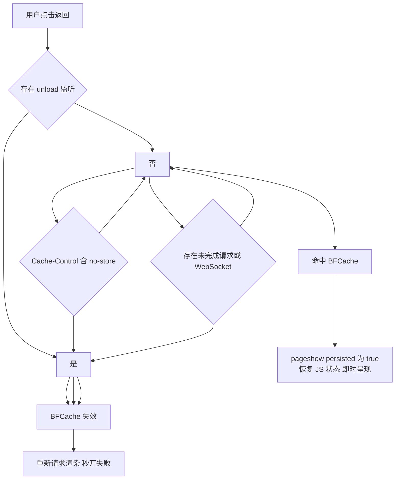

```javascript
// 一一对应：BFCache 兼容改造 + 命中率统计
// 1. 恢复时刷新实时数据（BFCache 里的是"过去"的页面）
addEventListener('pageshow', event => {
  if (event.persisted) {
    // 命中 BFCache：重新拉取可能过期的数据，续上定时器
    refreshStaleData();
    startTimers();
    reportBfCacheHit(true);
  }
});
addEventListener('pagehide', event => {
  // pagehide 在 BFCache 存入时也触发；unload 会阻止缓存，绝不用
  stopTimers();                    // 暂停轮询等，避免后台浪费
  reportBfCacheHit(false);
});

// 2. 排查工具：开发者工具 Application > Back/forward cache 一键检测
// 线上统计命中率：按页面/浏览器下钻
let navCount = 0, hitCount = 0;
addEventListener('pageshow', e => { if (performance.navigation?.type === 2 || e.persisted) navCount++; if (e.persisted) hitCount++; });
setInterval(() => {
  if (navCount) navigator.sendBeacon('/api/metrics/bfcache', JSON.stringify({
    hit_ratio: +(hitCount / navCount).toFixed(3), page: location.pathname,
  }));
}, 60_000);

// 3. 常见阻断修复对照
// X: window.addEventListener('unload', cleanup)   → 改 pagehide
// X: fetch('/api', { keepalive: true }) 未完成期间跳走 → 激活后重新发
// X: Cache-Control: no-store 全局 → 仅用户敏感页下发
// X: opener/打开的 WebSocket 未关 → visibilitychange 时挂起
```

### OPT-182：Page Lifecycle API 如何治理"后台 tab"的资源占用？

**答**：
- 用户一开几十个 tab，你的页面在后台仍跑定时器/轮询/动画，白耗 CPU 与电量。Page Lifecycle 提供标准信号：`visibilitychange`（可见性）、`freeze`（浏览器冻结）、`resume`（解冻）、`resumer`（被丢弃恢复）。
- 策略：hidden 即暂停（轮询、动画、视频、canvas 循环）；`freeze` 时做最终持久化（IndexedDB 写盘）并停止一切活动；页面被 discard（丢弃）后由 `pageshow persisted` 或重新加载恢复。
- 前台恢复钩子：`resume`/visibility 恢复时刷新过期数据 + 恢复计时器，保证"回来看到的是新的"。
- 注意 `visibilitychange` 在 Safari 老版本的兼容，用 Page Lifecycle polyfill 统一。

```javascript
// 一一对应：基于 Page Lifecycle 的后台资源治理
const app = {
  timers: [],
  pause() {   // 后台：全部暂停
    this.timers.forEach(clearInterval); this.timers = [];
    videoEl?.pause();
    rafActive = false;              // rAF 循环读到 false 自然退出
  },
  resume() {  // 回前台：恢复 + 刷新过期数据
    this.timers.push(setInterval(pollNotifications, 30_000));
    rafActive = true;
    requestAnimationFrame(renderLoop);
    refreshIfStale();               // 数据新鲜度检查
  },
};

document.addEventListener('visibilitychange', () => {
  document.hidden ? app.pause() : app.resume();
});

// freeze：浏览器即将冻结（移动端省电），机会做最终持久化
document.addEventListener('freeze', () => {
  idbSet('app-state', { draft: currentDraft, at: Date.now() });  // 必须是异步 API
});

document.addEventListener('resume', () => app.resume());

// 被系统 discard（丢弃）后重开：从持久化状态恢复
if (navigator.userActivation && performance.getEntriesByType('navigation')[0]?.type === 'back_forward') {
  idbGet('app-state').then(restoreState);
}

// 自动暂停能力也适用于 WebSocket：hidden 60s 主动断开省电
let wsIdleTimer;
document.addEventListener('visibilitychange', () => {
  if (document.hidden) wsIdleTimer = setTimeout(() => ws.close(), 60_000);
  else { clearTimeout(wsIdleTimer); ensureWsConnected(); }
});
```

### OPT-183：WebGPU 时代的前端性能基线，页面要做哪些能力探测与分级？

**答**：
- WebGPU 允许页面用类原生的方式用 GPU（计算+渲染），对可视化/图像处理/AI 推理场景性能数量级提升；但设备能力差异极大，必须**探测分级**而不是假设可用。
- 探测内容：`navigator.gpu` 存在性、`requestAdapter()` 返回的 adapter 信息（厂商/架构/特性 features/limits）、理想帧时间（跑一次 micro-benchmark 定档）。
- 分级策略：无 WebGPU → WebGL2 → Canvas2D 降级链；按 `adapter.limits`（maxTextureDimension、maxComputeWorkgroupSize）选择渲染分辨率与粒子规模。
- 性能基线概念：高端 GPU 也要防止过度绘制（分辨率 × 帧率的乘积约束），用 `requestAnimationFrame` 的时间预算动态调 LOD（Level of Detail）。

```javascript
// 一一对应：WebGPU 能力探测 + 渲染档位分级 + 降级链
export async function initGraphicsTier(canvas) {
  if (navigator.gpu) {
    const adapter = await navigator.gpu.requestAdapter({ powerPreference: 'high-performance' });
    if (adapter) {
      const device = await adapter.requestDevice();
      const { limits, features } = adapter;
      // 按能力定档：分辨率上限受 maxTextureDimension 约束
      const tier = features.has('timestamp-query') && limits.maxComputeWorkgroupSizeX >= 64
        ? 'ultra' : 'high';
      return {
        engine: 'webgpu', tier,
        maxRes: Math.min(limits.maxTextureDimension2D, 4096),
        device,
      };
    }
  }
  // 降级链：WebGPU 不可用退 WebGL2，再退 Canvas2D
  const gl = canvas.getContext('webgl2');
  if (gl) {
    const dbg = gl.getExtension('WEBGL_debug_renderer_info');
    const renderer = dbg ? gl.getParameter(dbg.UNMASKED_RENDERER_WEBGL) : '';
    const tier = /Apple M[2-9]|RTX|Radeon Pro/i.test(renderer) ? 'high' : 'mid';
    return { engine: 'webgl2', tier, maxRes: 2048 };
  }
  return { engine: 'canvas2d', tier: 'low', maxRes: 1024 };  // 最弱档：减分辨率减粒子
}

// 自适应 LOD：用帧时间动态降载，任何 GPU 都保持交互流畅
function adaptiveLOD(render) {
  let last = performance.now(), budget = 16.7, particles = 100_000;
  function loop(now) {
    const dt = now - last; last = now;
    if (dt > budget * 1.5 && particles > 10_000) particles = Math.floor(particles * 0.7); // 超预算降规模
    else if (dt < budget * 0.6 && particles < 500_000) particles = Math.floor(particles * 1.2); // 有余量升规模
    render(particles);
    requestAnimationFrame(loop);
  }
  requestAnimationFrame(loop);
}
```

## 二十八、体系与推进

### OPT-184：拿到一堆优化项，如何用"收益/成本矩阵"排优先级？

**答**：
- 每个优化项算两个数：预期收益（指标改善 ms × 受影响 PV 占比）和成本（人日 + 回归风险），得四象限：高收益低成本立即做、高收益高成本立项做、低收益低成本顺手做、低收益高成本不做。
- 收益估算不能拍脑袋：用 OPT-163 的归因占比（该段占总时长比例 × 该段可压缩幅度）和 OPT-169 的性能-转化弹性系数折算成业务价值。
- 排序公式示例：`score = (受影响PV% × 预估ms收益) / (人日 × 3 + 风险分)`，按 score 降序生成 roadmap。
- 矩阵要动态复审：每季度重算（技术演进会让"高成本"变低，如某新 API 普及后老方案成本骤降）。

```javascript
// 一一对应：优化项收益/成本打分排序器
const items = [
  { name: '首图 preload+fetchpriority', seg: 'LCP', pv: 0.9, gainMs: 800, costDays: 0.5, risk: 1 },
  { name: 'SSR 片段缓存',               seg: 'TTFB', pv: 0.8, gainMs: 600, costDays: 5, risk: 2 },
  { name: 'lodash 按需引入',            seg: 'JS体积', pv: 1.0, gainMs: 120, costDays: 0.5, risk: 1 },
  { name: '全站虚拟列表重写',           seg: '交互', pv: 0.3, gainMs: 300, costDays: 15, risk: 3 },
];

function score(it) {
  // 收益：受影响 PV × 预估毫秒收益（可再乘转化弹性系数折钱）
  const gain = it.pv * it.gainMs;
  // 成本：人日加权 + 风险（1低 2中 3高）
  const cost = it.costDays * 3 + it.risk;
  return { ...it, gain, cost, score: +(gain / cost).toFixed(1) };
}

function roadmap(items) {
  const scored = items.map(score).sort((a, b) => b.score - a.score);
  const totalGain = scored.reduce((s, i) => s + i.gain, 0);
  let cumGain = 0;
  return scored.map(it => {
    cumGain += it.gain;
    // 帕累托：累计收益覆盖 80% 的项优先做
    const tier = cumGain / totalGain <= 0.8 ? 'P0-本季' : it.score > 20 ? 'P1-顺手' : 'P2-观察';
    return { ...it, tier };
  });
}

console.table(roadmap(items));
// 输出示例：首图 preload score 480 → P0；全站虚拟列表 score 3.8 → P2（收益小成本大，缓）
```

### OPT-185：一次完整性能专项如何推进？给出 6 周 plan 模板。

**答**：
- 阶段划分：W1 建基线与拆解（指标现状、链路归因）→ W2 专项诊断（Top 根因清单）→ W3~W4 快赢改造（P0 项落地+灰度）→ W5 A/B 验证与全量 → W6 门禁固化与复盘。
- 两个关键纪律：①每阶段有 exit criteria（不达标不进下一阶段）；②快赢优先——第 1 周末就开始做"确定性收益"项（preload/压缩），不要憋大改造。
- 组织保障：专项 owner + 各模块接口人 + 数据支持，周会同步进度与风险，风险项（如后端 TTFB）提前升级。
- 复盘沉淀：优化项与实测收益登记进知识库（见 OPT-197），下次专项直接引用弹性系数。

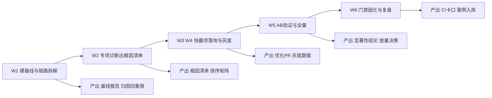

```yaml
# 一一对应：6 周性能专项计划模板（含 exit criteria）
plan: home-page-perf
duration: 6w
owner: front-perf-lead
baseline: { lcp_p75: 4200ms, inp_p75: 280ms, cls_p75: 0.18 }   # W1 开始时锁定

phases:
  - week: 1
    name: 建基线与拆解
    actions: [RUM 基线报告, 关键链路拆解见 OPT-121, 归因四象限见 OPT-163]
    exit_criteria: { report: 基线+四象限占比完成 }

  - week: 2
    name: 专项诊断
    actions: [Top10 慢会话回放分析, 根因清单与收益成本矩阵]
    exit_criteria: { output: 根因清单 ≥ 8 项且完成 P0 圈定 }

  - week: 3
    name: 快赢改造一
    actions: [首图 preload, 关键CSS 内联, 接口并行化]
    exit_criteria: { lab_lcp_delta: -800ms }

  - week: 4
    name: 快赢改造二与灰度
    actions: [SSR 片段缓存 5% 灰度, INP 长任务切片]
    exit_criteria: { gray_lcp_p75: -1000ms, error_rate: "<0.1%" }

  - week: 5
    name: AB 验证与全量
    actions: [50/50 AB 见 OPT-166, 护栏指标监控, 全量发布]
    exit_criteria: { ab_significant: true, lcp_p75_target: 2800ms }

  - week: 6
    name: 固化与复盘
    actions: [Lighthouse CI 卡口上线见 OPT-040, 案例入库 OPT-197, 复盘会]
    exit_criteria: { ci_gate: enabled, doc: 复盘报告+弹性系数入库 }
```

### OPT-186：如何把性能需求写进需求评审，让它成为需求的一部分？

**答**：
- 核心机制：性能指标作为**验收标准**写进 PRD/需求单——"该页面 LCP P75 ≤ 2.5s、首屏接口 ≤ 800ms"与"支持暗色模式"同等地位，评审时一起过。
- 评审检查单：交互复杂度是否引入第三方 SDK、数据量级是否超出分页策略、视觉稿是否含未定尺寸大图（CLS 风险）、埋点是否含性能埋点。
- 分级要求：新页面强制给"目标值"；迭代改动给"劣化上限"（如新增模块不得让 P75 恶化 > 100ms），避免无限加码。
- 落地工具：需求模板里内置性能字段（必填），漏填走不了评审流程；上线后自动比对"目标 vs 实测"回流到需求单。

```yaml
# 一一对应：需求评审性能字段模板（进需求单必填部分）
requirement:
  id: REQ-2026-0117
  title: 商城首页改版
  performance:                      # 必填区块，缺失无法进入评审
    scenario_class: first_screen    # first_screen | interaction | data_heavy | media
    targets:                        # 目标值（新页面/大改版必填）
      lcp_p75: "≤ 2500ms"
      inp_p75: "≤ 200ms"
      cls_p75: "≤ 0.1"
      first_api_p75: "≤ 800ms"
    budget_extra:
      js_gzip: "≤ 60KB"             # 本次新增 JS 预算
      third_party: 0                # 新增第三方脚本数（>0 需性能 owner 审批）
    checklist:
      - 交互中的数据量是否已定义分页策略
      - 视觉稿大图是否提供宽高与多倍率资源
      - 是否需要性能埋点（默认开 RUM，不需则说明）
      - 预计上线后是否影响同类页面（共享组件性能回归）
    post_launch:                    # 上线自动回填：目标 vs 实测
      measured: null
      verdict: null                 # 达标 | 未达标需专项
```

### OPT-187：性能门禁如何从"人工审查"演进到"CI 自动阻塞"？

**答**：
- 三阶段演进：①人工阶段——性能评审表 + 代码 review 关注点（能跑但靠自觉）；②半自动——CI 出报告不阻塞（size-limit 超限只评论），团队适应期；③全自动——超预算阻塞合并，RUM 线上劣化自动告警回滚。
- 演进节奏建议：半自动运行 ≥ 1 个月、误报率 < 10% 后再收紧为阻塞，避免门禁一开始就招抵制被绕过（加 skip 标签之类的后门）。
- 门禁项分层：确定性强的用硬卡口（bundle 超预算、Lighthouse 低于分）；波动大的用软卡口（lab LCP ±10% 带宽噪音，只警告）。
- 逃生通道：预算豁免走临时申请（登记恢复时间），禁止无痕跳过。

```yaml
# 一一对应：门禁演进三阶段的 CI 配置切换
stages:
  stage1_manual:
    mechanism: 性能评审表 + review 关注点
    config: null                          # 无 CI，仅文档

  stage2_report_only:                     # 半自动：只报告不阻塞（≥1个月适应期）
    lighthouse-ci:
      assertions:
        categories:performance: [warn, { minScore: 0.9 }]
    size-limit:
      action: comment                     # 超限只在 PR 评论
      failure: false
    exit_to_stage3: { false_positive_rate: "<10%", soak_weeks: 4 }

  stage3_blocking:                        # 全自动：超预算阻塞合并
    size-limit:
      action: fail                        # 硬卡口：确定性指标
      limits: { total_js_gzip: 300KB, css_gzip: 60KB, image_total: 500KB }
    lighthouse-ci:
      assertions:
        categories:performance: [error, { minScore: 0.9 }]   # 3 次中位
      action: fail
    lab_metrics:
      action: warn                        # 软卡口：波动大的只警告
      tolerance: ±10%
    waiver:                               # 逃生通道：登记式豁免
      file: PERF_WAIVERS.yml
      require: [reason, owner, expire_date]  # expire 后自动恢复阻塞
```

### OPT-188：性能负责人制与虚拟团队怎么搭（大前端没有专职团队时）？

**答**：
- 现实约束：多数团队没有专职性能团队，靠"虚拟组织"：1 个性能 owner（平台侧，占 20%~30% 工时）+ 各业务线性能接口人（各占 10% 工时，指标进 OKR）。
- 职责切分：owner 负责"平台能力"——工具链、监控看板、门禁、专项方法论；接口人负责"业务指标"——自己页面 P75、劣化响应、案例反哺。
- 运转机制：月度性能例会（看板走查 + Top 慢页面认领）、季度专项（接口人抽身 1~2 周做本线专项）、性能事故升级路径（P75 劣化 15% 视为事故）。
- 授权与激励：给 owner 预算否决权（OPT-186 的 third_party 审批）、给接口人晋升材料支持；避免"只挂名不干活"的虚职化。

```yaml
# 一一对应：性能虚拟组织职责与运转机制配置
perf_org:
  owner:
    who: 平台组高级工程师（工时 30%）
    duties:
      - 性能工具链与看板维护（RUM/Lighthouse CI/size-limit）
      - 指标字典与口径仲裁（见 OPT-167）
      - 新增第三方脚本/超预算依赖审批（否决权）
      - 季度专项方法论输出与复盘归档
    kpi: 全站 P75 达标率、工具采用率、门禁误报率

  business_interface:
    who: 各业务线 1 人（工时 10%）
    duties:
      - 本线页面 CrUX/RUM P75 负责
      - 劣化 15% 响应（24h 出方案）
      - 季度 Top 慢页面专项
    kpi: 本线 P75 达标、劣化响应时长

  cadence:
    monthly_review: 性能例会（看板走查、慢页面认领、豁免审批）
    quarterly_project: 每季 1 个专项（2 周 6 周模板按需）
    incident_path: RUM 劣化告警 → 接口人 → 超时升级 owner → 技术委员会
  incentive:
    - 性能成果写入晋升材料由 owner 背书
    - 季度性能之星（案例入库最多者）
```

### OPT-189：大促（双11/大促）性能保障专项怎么做（压测/降级/监控三级）？

**答**：
- 大促性能问题 = 平时 10 倍流量的放大 + 不可回滚的截止时间，保障分三级：**压测**（提前 3 周按峰值 1.5 倍压，找出前端瓶颈：接口 QPS、CDN 带宽、WS 连接数）、**降级**（预案分级：非核心模块可关、图片降质、接口合并拉长轮询间隔）、**监控**（值班盯盘：LCP/接口成功率/错误率秒级看板 + 阈值告警）。
- 降级开关要**提前预演**：每个开关都有"演练记录"（真的按过、真的恢复过），未经演练的预案等于没有。
- 封网机制：大促前 N 天封网（只允许性能修复与降级开关变更），杜绝带病上线。
- 复盘归档：峰值数据、触发过的降级、预案缺口进知识库，下一场大促直接引用。

```yaml
# 一一对应：大促性能保障三级预案配置
promotion_readiness:
  schedule:
    t_minus_3w: 压测（峰值 1.5 倍）+ 瓶颈清单
    t_minus_2w: 降级预案开发与演练
    t_minus_1w: 封网 + 全链路演练
    during: 值班盯盘
    t_plus_1w: 复盘归档

  load_test:
    target: { peak_rps: 15_000, duration: 30min }
    frontend_metrics: [LCP, 接口成功率, CDN 带宽, WS 连接数]
    pass_criteria: { api_success: ">99.9%", lcp_p75: "<3s @ peak" }

  degrade_switches:                    # 每项必须有演练记录
    - { name: 推荐流关闭,   level: L1, owner: 商城前端, rehearsed: true }
    - { name: 图片降质80%,  level: L2, owner: 商城前端, rehearsed: true }
    - { name: 轮询间隔5s→15s, level: L2, owner: 平台, rehearsed: true }
    - { name: 非核心埋点暂停, level: L3, owner: 平台, rehearsed: true }

  monitoring:
    dashboards: [LCP/INP P75 秒级, 接口成功率, 降级开关状态]
    alerts:
      - { metric: api_success, op: "<", value: 0.99, action: "值班群@+评估 L1" }
      - { metric: lcp_p75,     op: ">", value: 3500, action: "评估 L2 降质" }
    oncall: [前端值班 x2, owner 待命]
```

### OPT-190：多端产品（H5/PC/小程序）性能预算怎么分别定标？

**答**：
- 预算必须按端差异化：H5 弱网+低端机多（LCP ≤ 2.5s、JS ≤ 200KB gzip）；PC 网络好但用户期望更高（LCP ≤ 2s、JS ≤ 300KB，因为 PC 页面更重）；小程序有包体硬限制（主包 ≤ 2MB，首屏启动分包策略）。
- 每端预算维度统一：体积（JS/CSS/图片）、指标（LCP/INP/CLS）、接口（首屏 API 时延）、数量（请求数/第三方脚本数），数值按端标定。
- 预算推导方法：以当前 P75 基线 + 竞品对标 + Core Web Vitals 达标线三方取严；预算写进 size-limit/CI 按端独立配置。
- 定期校准：每半年按设备分布变化（新 iPhone 普及、低端安卓占比）重标，预算是活的。

```yaml
# 一一对应：多端性能预算矩阵（size-limit 按端分文件校验）
budgets:
  h5:
    metrics: { lcp_p75: 2.5s, inp_p75: 200ms, cls_p75: 0.1 }   # CWV 达标线
    size: { js_gzip_total: 200KB, css_gzip: 50KB, img_first_screen: 300KB }
    api: { first_screen_p75: 800ms, max_requests_first_screen: 25 }
    note: 弱网+低端机占比高，指标按 75 分位在 4G 语义下标定
  pc:
    metrics: { lcp_p75: 2.0s, inp_p75: 200ms, cls_p75: 0.1 }
    size: { js_gzip_total: 300KB, css_gzip: 70KB, img_first_screen: 500KB }
    api: { first_screen_p75: 600ms, max_requests_first_screen: 30 }
    note: 页面更重但网络优，用户耐心低
  miniprogram:
    package: { main: 1.5MB, total: 12MB }    # 微信硬限：主包 2M 总包 20M，留余量
    metrics: { first_render_p75: 1500ms, data_ready_p75: 2500ms }  # 启动口径
    api: { first_screen_p75: 1000ms }
    note: 小程序无 CWV，用启动与数据就绪自定义口径，分包按需注入

ci:
  size-limit-config: .size-limit-h5.json + .size-limit-pc.json   # 按端独立阻塞
  rum_alert: 每端独立基线，劣化 15% 告警
  review_cadence: 每半年按设备分布重标定
```

### OPT-191：优化做完后，如何向管理层汇报成果（对上沟通口径）？

**答**：
- 对上汇报三段式：**业务结果先行**（转化/留存/跳出率变化，用 OPT-169 的关联数据）、**技术指标佐证**（LCP P75 从 4.2s → 2.6s）、**投入产出**（N 人日换来的收益折算），忌讳从技术细节讲起。
- 数字表达用"对照 + 置信"：A/B 显著性、样本量、口径都要写，防"数字被挑战"；折算商业价值用保守估计（只算已验证的弹性系数）。
- 汇报形态：一页纸（结果/关键动作/下一步）+ 附录（技术明细）；持续项目用季度对比曲线而不是单点截图。
- 诚实原则：收益不明显或负面（如加载快了但停留时长降了）如实说，信用是长期资产。

```javascript
// 一一对应：汇报数据自动汇总脚本（从 RUM 库生成一页纸数据）
async function buildExecSummary(expId, pvPerDay) {
  const { treatment, control } = await fetchExpResult(expId);   // { lcp[], cvr[] }
  const boot = bootstrapP75Diff(treatment.lcp, control.lcp);     // 见 OPT-166

  // 弹性系数：每 100ms LCP 对应转化率变化（保守取 A/B 实测值）
  const lcpDiff = boot.p75_diff;                                  // 负数=更快
  const cvrLift = (mean(treatment.cvr) - mean(control.cvr)) / mean(control.cvr);

  return {
    headline: {
      business: `转化率 +${(cvrLift * 100).toFixed(1)}%（A/B 显著，CI95）`,
      tech: `LCP P75 ${Math.round(-lcpDiff / 10) / 100}s 改善`,
      money: `按日均 PV ${(pvPerDay / 10000).toFixed(0)} 万估算，年化 GMV 增量约 ___ 万元（保守口径）`,
    },
    evidence: {
      method: `50/50 用户级分流，样本 ${treatment.n + control.n}，双周周期`,
      ci95: boot.ci95, significant: boot.significant,
      guardrail: { error_rate: '持平', bounce: '持平' },          // 护栏指标
    },
    actions_taken: ['首图 preload+priority', 'SSR 片段缓存', '接口并行编排'],
    next: ['INP 专项（P75 285→200）', '低端机分档降级灰度'],
    caveat: '转化提升为 A/B 因果结论；GMV 折算使用本实验弹性系数，未外推到其他页面',
  };
}
function mean(a) { return a.reduce((s, v) => s + v, 0) / a.length; }
```

### OPT-192：白屏率专项治理的全景方案（从检测到自愈）？

**答**：
- 白屏定义要分型：**加载型**（资源慢，最终能出来）、**渲染失败型**（JS 报错挂了）、**数据异常型**（接口空/错，有壳无内容）、**兼容型**（老浏览器语法报错）。治理手段完全不同，先分型再治。
- 检测：页面关键节点采样 DOM（首屏容器 childElementCount / 标志元素存在性）+ JS 错误率交叉判定，上报白屏率并按 型/页面/浏览器/版本 下钻。
- 治理矩阵：加载型→缓存与预加载（OPT-121~128）；渲染失败型→错误兜底边界 + 灰度发布；数据异常型→降级展示（OPT-153）+ 接口契约测试；兼容型→按 UA 下发 polyfill（OPT-145）。
- 自愈闭环：检测到白屏自动 reload（带频控，见 OPT-158）+ 错误现场上传，白屏率监控看板分"自愈前/后"两条曲线验证有效性。

```javascript
// 一一对应：白屏检测分型 + 自愈 + 自愈效果度量
function detectWhiteScreen() {
  const root = document.querySelector('#app') || document.querySelector('#root');
  const marker = document.querySelector('[data-first-screen-ready]'); // 业务埋的标志元素
  if (root && root.childElementCount > 0 && marker) return null;      // 正常

  // 分型判定
  const jsErrors = window.__errCount || 0;
  if (jsErrors > 0) return { type: 'render_fail', jsErrors };         // 渲染失败型
  if (performance.now() > 8000) return { type: 'load_slow', ttfb: getTTFB() }; // 加载型
  if (root && root.childElementCount > 0) return { type: 'data_abnormal' };   // 有壳无内容
  return { type: 'parse_fail', ua: navigator.userAgent };             // 兼容型（脚本没执行）
}

function getTTFB() {
  const [nav] = performance.getEntriesByType('navigation');
  return nav ? Math.round(nav.responseStart) : -1;
}

// 上报 + 自愈（复用 OPT-158 频控）
function whiteScreenGuard() {
  setTimeout(() => {           // 首屏窗口后检测一次
    const res = detectWhiteScreen();
    if (!res) return;
    navigator.sendBeacon('/api/metrics/white-screen', JSON.stringify({
      ...res, route: location.pathname, ver: __APP_VERSION__,
    }));
    if (canHeal()) { saveBeforeReload(); markHeal(); location.reload(); } // 自愈
  }, 8000);
}
whiteScreenGuard();

// SPA 路由切换白屏同样守护：路由完成 3s 后复查
router.afterEach(() => setTimeout(() => {
  const r = detectWhiteScreen();
  if (r) navigator.sendBeacon('/api/metrics/white-screen', JSON.stringify({ ...r, spa: true }));
}, 3000));
```

### OPT-193：INP 达标专项（P75 从 300ms 降到 200ms）怎么规划路线？

**答**：
- 第一步拿数据：按 OPT-129 三段归因聚合，输出"交互类型 × 归因段"矩阵，找到 P75 贡献最大的 Top3 交互（通常是：下拉筛选、图表切换、表单提交）。
- 路线按归因分配：inputDelay 主导→治理长任务（切片/Worker，预期 -60~100ms）；processing 主导→回调瘦身（同步逻辑下沉、防抖合并）；presentation 主导→缩小重排范围（内容可见性、transform、分层）。
- 每个交互做 A/B 或前后灰度对比，专项目标是**全站 P75**，所以还要盯"长尾交互"——P75 边缘的那批会话是最后 20ms 的来源。
- 回归防护：INP 进 RUM 告警（劣化 15% 报警）+ Lab 侧关键交互基线测试进 CI。

```javascript
// 一一对应：INP 专项的交互归因矩阵与长任务切片改造
// 1. 归因聚合：输出 交互类型 × 段位 的 P75 矩阵（服务端视角示意）
function buildInpMatrix(reports) {   // reports: OPT-129 上报的 worst 数组
  const cell = new Map();            // "selector|segment" -> []
  for (const r of reports) {
    const seg = r.inputDelay > r.processing && r.inputDelay > r.presentation ? 'inputDelay'
              : r.processing > r.presentation ? 'processing' : 'presentation';
    const key = `${r.target}|${seg}`;
    (cell.get(key) || cell.set(key, []).get(key)).push(
      seg === 'inputDelay' ? r.inputDelay : seg === 'processing' ? r.processing : r.presentation
    );
  }
  return [...cell.entries()]
    .map(([k, arr]) => { const s = arr.sort((a, b) => a - b); return { k, p75: s[Math.floor(s.length * .75)] }; })
    .sort((a, b) => b.p75 - a.p75).slice(0, 5);
}
// 输出决定改造顺序，例如：筛选按钮|inputDelay P75 180ms → 长任务治理

// 2. 主力改造：把 220ms 的同步渲染回调切成多个 <50ms 块
async function onFilterClick(filter) {
  const rows = computeVisibleRows(filter);       // 80ms
  await scheduler?.yield?.();                     // 让出：可响应新输入
  const updates = diffRows(rows);                 // 70ms
  await scheduler?.yield?.();
  commitToDOM(updates);                           // 40ms，且只更新变化行
}
// 3. presentation 段优化：大列表容器 content-visibility 让浏览器跳过屏外渲染
// .row { content-visibility: auto; contain-intrinsic-size: auto 48px; }
```

### OPT-194：LCP 达标专项如何从"图片/字体/TTFB"三管齐下？

**答**：
- 先确认 LCP 元素与四段子时长：TTFB → 元素延迟（发现晚）→ 加载时长（下载慢）→ 渲染延迟（解码/排队）。三管对应：TTFB 管（OPT-121/123）、图片管（preload+priority+格式）、字体管（font-display+preload，字体阻塞的是 FCP 也会拖 LCP）。
- 图片三件套：LCP 图 `preload + fetchpriority=high`、AVIF/WebP、明确尺寸；动态 HTML 下发的 hero 图 URL 要能被 preload（SSR 时把 URL 写进 head）。
- 字体策略：`font-display: swap/optional` + 关键字体子集化 preload；`optional` 可彻底消除布局抖动但可能首访不显示字体。
- 元素延迟常被忽略：LCP 元素在轮播第 3 帧/依赖接口数据 → 把首帧 hero 改为静态直出，是最大单项收益。

```html
<!-- 一一对应：LCP 三管齐下的 head 配置模板 -->
<head>
  <!-- 管1 TTFB：103 Early Hints / SSR 缓存（见 OPT-123/179），此处配 preconnect -->
  <link rel="preconnect" href="https://img.example.com" crossorigin>
  <!-- 管2 图片：SSR 把 LCP 图 URL 注入 preload，高优先级 -->
  <link rel="preload" as="image" href="https://img.example.com/hero.avif" fetchpriority="high">
  <!-- 管3 字体：关键子集 preload + swap，防文字被字体拖住 -->
  <link rel="preload" as="font" type="font/woff2"
        href="/fonts/subset-latin-zh-400.woff2" crossorigin>
  <style>
    @font-face {
      font-family: 'Main';
      src: url('/fonts/subset-latin-zh-400.woff2') format('woff2');
      font-display: swap;      /* 先用回退字体渲染，字体到了再换 */
      unicode-range: U+4E00-9FFF, U+0000-00FF;  /* 子集：只覆盖常用区 */
    }
    /* LCP 图明确尺寸：加载期不产生布局位移 */
    .hero img { width: 100%; height: auto; aspect-ratio: 16/7; }
  </style>
</head>
<body>
  <!-- 元素延迟治理：hero 首帧静态直出（不依赖接口），数据驱动的内容放第二屏 -->
  <section class="hero">
    
  </section>
  <script>
    // 验证：上报 LCP 元素与四段子时长，确认当前瓶颈
    new PerformanceObserver(l => {
      const e = l.getEntries().pop();
      navigator.sendBeacon('/api/perf/lcp-seg', JSON.stringify({
        element: e.element?.tagName, url: e.url,
        ttfb: e.startTime, loadDur: e.loadTime, renderDelay: e.renderTime - e.loadTime,
      }));
    }).observe({ type: 'largest-contentful-paint', buffered: true });
  </script>
</body>
```

### OPT-195：CLS 达标专项的"尺寸预留全清单"包含哪些项？

**答**：
- 全清单（按线上 CLS 来源频率排序）：①图片/视频无宽高 → 全部补 width/height 或 aspect-ratio；②动态内容插入（banner/推荐/评论懒加载）→ 容器 min-height 预留；③web 字体替换（FOUT）→ size-adjust/fallback 度量对齐；④广告 iframe → 外层固定尺寸；⑤骨架屏与真实内容不一致 → 尺寸契约（OPT-124）；⑥异步弹层（顶部通知条）→ 预留 space 或用 overlay 不占位。
- 检测定位：用 `Layout Instability` API 上报每次位移的 sources（哪个节点位移了），比只看总分有效得多。
- 验收口径：CLS P75 ≤ 0.1（CWV）；单次位移 > 0.05 即单点治理。
- 回归防护：Storybook/组件库给"无 CLS"测试（Chromium layout instability 探测进 CI）。

```javascript
// 一一对应：CLS 来源自动归因上报（sources 指出具体节点）
new PerformanceObserver(list => {
  for (const entry of list.getEntries()) {
    if (entry.hadRecentInput) continue;          // 用户输入后 500ms 内的位移不计
    const sources = (entry.sources || []).map(s => ({
      node: s.node
        ? `${s.node.tagName}.${(s.node.className || '').toString().split(' ')[0]}`
        : 'unknown',
      prevRect: { t: Math.round(s.previousRect?.top ?? 0), h: s.previousRect?.height },
      currRect: { t: Math.round(s.currentRect?.top ?? 0), h: s.currentRect?.height },
    }));
    navigator.sendBeacon('/api/perf/cls-source', JSON.stringify({
      value: +entry.value.toFixed(4), sources: sources.slice(0, 3), route: location.pathname,
    }));
  }
}).observe({ type: 'layout-shift', buffered: true });

// 修复模式对照（全清单的代码面）：
// 1. 图片： 或 CSS aspect-ratio
// 2. 动态区块：.recommend { min-height: 320px; }  ← 先占位再填内容
// 3. 字体：@font-face { size-adjust: 98%; ascent-override: 90%; } 对齐回退字体度量
// 4. 广告位：.ad-slot { height: 250px; contain: strict; }
// 5. 通知条：position: fixed/overlay，或 body { padding-top 预留 }
```

### OPT-196：低端机专项（分档降级）如何设计与灰度验证？

**答**：
- 分档：用 deviceMemory / hardwareConcurrency / UA 档位（机型库）/ 实测基准（首帧时间）综合打分，分 high/mid/low 三档；分档结果写入上报维度贯穿全部性能数据。
- 降级阶梯（low 档）：关闭非关键动画与模糊特效、图片降分辨率、虚拟列表 overscan 减小、图表降采样、关闭自动播放、减少并发请求。
- 灰度验证：low 档灰度放量 1%→5%→20%，看该档的 LCP/INP/崩溃率/OOM 率变化，确认收益且无体验投诉再全量；对照组为未降级的 low 档用户。
- 长期机制：低端机体验进"性能预算矩阵"（OPT-190）单独一列，新功能评审时强制回答 low 档表现。

```javascript
// 一一对应：设备分档 + 降级配置注入 + 灰度开关
function detectDeviceTier() {
  const mem = navigator.deviceMemory || 4;          // GB，Chrome
  const cores = navigator.hardwareConcurrency || 4;
  const conn = navigator.connection?.effectiveType || '4g';
  if (mem <= 2 || cores <= 4 || /2g|slow-2g/.test(conn)) return 'low';
  if (mem <= 4 || cores <= 6 || conn === '3g') return 'mid';
  return 'high';
}

const tier = detectDeviceTier();
document.documentElement.dataset.tier = tier;       // CSS 与 JS 全链路可读

// 降级配置：按档位合并默认值
const DEGRADE = {
  high: {},
  mid:  { imageQuality: 70, chartSampling: 2 },
  low:  {
    imageQuality: 40, chartSampling: 4,
    disableAnim: true, disableAutoplay: true, overscan: 1, maxConcurrentReq: 3,
  },
};
export const config = { tier, ...DEGRADE[tier] };

// 消费示例：CSS 侧直接关动画
// [data-tier="low"] * { animation: none !important; transition: none !important; }
// [data-tier="low"] .fancy-blur { backdrop-filter: none; }

// 灰度验证：low 档里再按 userId 分实验组（降级）与对照组
function lowTierGray(userId) {
  if (tier !== 'low') return false;
  const h = [...userId].reduce((a, c) => (a * 31 + c.charCodeAt(0)) >>> 0, 7);
  return (h % 100) < 10;   // 10% 灰度
}
reportPerf({ metric: 'boot', value: bootMs, tier, group: lowTierGray(user.id) ? 'degrade' : 'control' });
```

### OPT-197：性能知识库怎么建（案例沉淀 + Checklist 固化）？

**答**：
- 知识库解决"经验随人走"：每个专项结束沉淀三件套——案例卡（问题/根因/手段/实测收益/适用边界）、Checklist（评审与上线自查）、弹性系数（手段→指标收益的量化表，服务 OPT-184 排序）。
- Checklist 分场景固化：新页面上线 Checklist、发布 Checklist、大促 Checklist；形式用结构化 YAML 存仓库（可被 CI/机器人引用），文档站只做渲染。
- 案例卡模板强制字段：实测前后数据 + 样本量，没有数据不准入库（防止"据说有效"的经验污染）。
- 运营机制：案例卡关联到代码库 tag（可一键看示例实现）；季度盘点把高频 Checklist 项做成自动化（能进 CI 的进 CI，见 OPT-187）。

```yaml
# 一一对应：结构化案例卡 + Checklist（存 perf-knowledge/ 目录，CI 与文档站共用）
# perf-knowledge/cases/lcp-hero-preload.yaml
case:
  id: CASE-014
  title: LCP 首图 preload 与 fetchpriority
  symptom: 首页 LCP P75 3.8s，LCP 元素为轮播首帧大图
  root_cause: 图片在 CSS 渲染后才被发现，且与轮播逻辑竞争带宽
  action:
    - head preload + fetchpriority=high
    - 轮播首帧改静态直出，去掉接口依赖
    - AVIF 双源
  measured:
    before: { lcp_p75: 3800ms, sample: 142000 }
    after:  { lcp_p75: 2600ms, sample: 138000 }   # 无实测数据不准入库
  applicability: LCP 元素为图片的所有页面；SSR 需把 URL 注入 head
  ref_code: src/components/Hero/index.tsx
  author: perf-owner
  verified_by: ab-exp-042

# perf-knowledge/checklists/release.yaml
release_checklist:
  - id: rc-01
    item: 产物体积 diff 未见超预算新增（CI size-limit 通过）
    auto: true
  - id: rc-02
    item: 新增第三方脚本已过审批并 async 化
    auto: false
  - id: rc-03
    item: 新增图片均有宽高或 aspect-ratio
    auto: true
  - id: rc-04
    item: 关键接口有降级兜底与超时配置
    auto: false
  - id: rc-05
    item: 性能埋点覆盖新页面路由
    auto: true
```

### OPT-198：跨团队性能协同中，与后端/CDN/App 容器的责任边界怎么划？

**答**：
- 原则：按链路段划责任，每段有唯一 owner + SLA，接口处用"契约数据"说话（TTFB 归后端、命中率归 CDN、启动耗时归容器）。
- 后端：接口 P75 时延、批量聚合接口、缓存失效通知机制；前端：资源体积、加载策略、渲染效率；CDN：命中率、回源率、预热响应时长；App 容器（混合开发）：WebView 启动耗时、离线包命中率、JSBridge 调用耗时。
- 协同机制：季度"链路联席会"对 SLA 达成率；跨域问题（如容器预加载不触发前端埋点）有联合排障 runbook；优化需求走"性能工单"带预期收益与复测方式。
- 推动技巧：给对方团队的诉求带上他们 KPI 的关联（CDN 命中率是他们的核心指标，预热需求挂他们看板）。

```yaml
# 一一对应：跨团队责任边界 SLA 矩阵 + 工单模板
sla_matrix:
  backend:
    owner: 服务端网关组
    scope: [接口 P75 时延, 批量聚合接口提供, 缓存失效主动通知]
    sla: { core_api_p75: 300ms, batch_api_availability: "≥ 99.9%" }
    evidence: APM 链路追踪
  cdn:
    owner: 基础架构
    scope: [静态资源命中率, 回源率, 预热任务响应]
    sla: { hit_ratio: "≥ 95%", warmup_complete: "发布后 10min" }
    evidence: CDN 日志看板
  app_container:
    owner: 客户端组
    scope: [WebView 启动耗时, 离线包命中率, JSBridge P95]
    sla: { webview_boot_p75: 800ms, offline_pkg_hit: "≥ 90%" }
    evidence: 容器自身 APM（前端只报 JS 侧）
  frontend:
    owner: 前端各组
    scope: [资源体积预算, 加载策略, 渲染与交互性能]
    sla: { lcp_p75: 2.5s, inp_p75: 200ms }
    evidence: RUM

perf_ticket:                    # 跨团队优化工单模板
  to: cdn
  ask: 大促页面预热接口接入
  expected_gain: 首发用户 CDN HIT 从 40%→90%（见 OPT-149）
  verify: 预热后抽样 x-cache 校验脚本
  linked_kpi: 贵组命中率 SLA
```

### OPT-199：如何用数据论证性能的商业价值（性能与转化的因果模板）？

**答**：
- 论证三支柱：①相关性基线（分桶对比：LCP 各桶转化率差，历史数据、成本低）；②因果实验（A/B，OPT-166，结论硬）；③弹性系数库（历史实验沉淀"每 100ms → 转化 x%"，用于预估新专项 ROI）。
- 保守原则：给管理层的数字只用"已被 A/B 验证的弹性系数"，相关性数据只做佐证；乘数效应（多页面外推）明确标注为估计。
- 表达模板：现状痛点（P75 数值 × 影响用户量）→ 已验证弹性（每 100ms = 转化 +x%）→ 本专项预期（预估改善 ms × 弹性 × UV → 收益区间）→ 成本与周期 → 决策请求（人力/排期）。
- 持续校准：每个新实验的实测系数回填弹性库，偏差大的旧系数标记降权。

```javascript
// 一一对应：商业价值论证计算器（弹性系数驱动 ROI 预估）
const elasticityLib = [   // 弹性系数库：只收录 A/B 验证过的
  { exp: 'exp-042', scope: '商品列表页', metric: 'LCP',
    per100ms: -0.031, ci95: [-0.045, -0.018], verifiedAt: '2026-09' },  // 每100ms 转化 -3.1%（更快=正）
  { exp: 'exp-051', scope: '结算页', metric: 'INP',
    per100ms: -0.012, ci95: [-0.02, -0.005], verifiedAt: '2026-10' },
];

function projectROI(page, metric, expectedGainMs, uvPerDay, aov) {
  const e = elasticityLib.find(x => x.scope === page && x.metric === metric);
  if (!e) return { error: '无已验证弹性系数，请先做 A/B 或用保守行业值标注为估计' };
  const blocks = expectedGainMs / 100;                  // 改善了多少个 100ms
  const cvrLift = -e.per100ms * blocks;                 // 转化率提升（比例）
  const conservative = { ...e, per100ms: e.ci95[0] };   // 保守：CI 下界
  const cvrConservative = -conservative.per100ms * blocks;

  return {
    expected: {
      cvr_lift_pct: `${(cvrLift * 100).toFixed(2)}%`,
      daily_orders_gain: Math.round(uvPerDay * 0.03 * cvrLift),   // 假设基线转化 3%
      annual_gmv_gain: Math.round(uvPerDay * 0.03 * cvrLift * 365 * aov),
    },
    conservative: {
      cvr_lift_pct: `${(cvrConservative * 100).toFixed(2)}%`,
      annual_gmv_gain: Math.round(uvPerDay * 0.03 * cvrConservative * 365 * aov),
    },
    basis: `弹性系数来自 ${e.exp}（A/B 显著），每 100ms ${metric} 对应转化 ${(-e.per100ms * 100).toFixed(1)}%`,
    caveat: '系数仅在验证页面与流量结构内使用，外推需标注为估计值',
  };
}
// projectROI('商品列表页', 'LCP', 1200, 500000, 180)
// → expected.annual_gmv_gain ≈ 991 万，conservative ≈ 575 万 → 立项依据
```

### OPT-200：把性能优化方法论收束为"测→析→优→防"闭环，如何落地？

**答**：
- 四环定义：**测**（RUM+Lab 双体系基线，口径统一 OPT-167）→ **析**（归因定位瓶颈，OPT-121/163）→ **优**（收益/成本排序执行，OPT-184）→ **防**（门禁+预算+自愈防劣化，OPT-187/192）。闭环的意义在"防"：没有防的优化会在业务迭代中回吐。
- 团队成熟度阶梯：L0 救火式 → L1 有数据 → L2 有专项 → L3 有门禁 → L4 有文化（OPT-120），每年评估一次往哪级走。
- 落地载体：性能平台（数据）、知识库（经验）、CI（规则）、流程（评审/复盘），四者缺一不可。
- 收束一句话：性能优化不是项目而是能力——量得准（测）、找得准（析）、改得动（优）、守得住（防）。

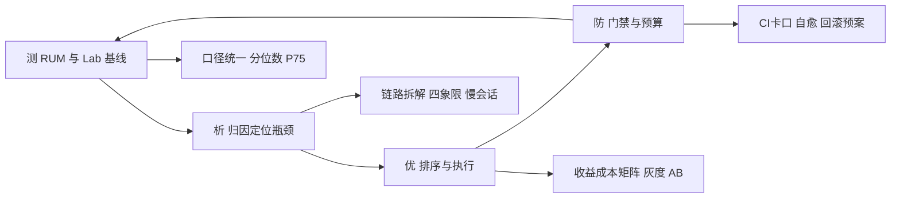

```javascript
// 一一对应：四环闭环自检脚本（季度跑一次，输出团队成熟度得分）
const maturity = {
  测: [
    ['RUM 覆盖核心页面', () => rumCoverage() > 0.95],
    ['指标口径字典存在且被引用', () => !!metricRegistry && registryRefs() > 5],
    ['分位数看板而非均值', () => dashboards.some(d => d.usesP75)],
  ],
  析: [
    ['关键链路拆解自动化', () => !!breakdownReport],
    ['归因四象限季度产出', () => quadrantReportsThisQuarter() >= 1],
  ],
  优: [
    ['优化项有收益/成本评分', () => roadmapItems.every(i => i.score != null)],
    ['改动有 A/B 或灰度验证', () => lastExperimentsSignificantRatio() > 0.8],
  ],
  防: [
    ['CI 性能门禁阻塞生效', () => ciGateEnabled && falsePositiveRate() < 0.1],
    ['预算矩阵覆盖所有端', () => budgetMatrix.keys().length >= ends.length],
    ['白屏/异常自愈上线', () => selfHealEnabled],
  ],
};

function evaluate() {
  const result = {};
  for (const [ring, checks] of Object.entries(maturity)) {
    const passed = checks.filter(([, fn]) => fn()).length;
    result[ring] = `${passed}/${checks.length}`;
  }
  const level = Object.values(result).every(s => s.startsWith(s.length && '3') ) ? 'L4'
    : result.防 === '3/3' ? 'L3'
    : result.析 === '2/2' ? 'L2'
    : result.测 !== '0/3' ? 'L1' : 'L0';
  return { rings: result, level, next: SUGGEST_NEXT[level] };
}
const SUGGEST_NEXT = {
  L0: '先建 RUM 基线（测）', L1: '做链路拆解与首次专项（析/优）',
  L2: '上门禁与预算（防）', L3: '机制进流程与激励（文化）', L4: '保持节奏，季度复评',
};
console.table(evaluate());
```
