# 前端面试题库：框架原理

本章节聚焦 Vue 与 React 的**源码级原理**，每题给出"简化版可运行实现"代码（20~50 行级别，均注明"简化实现，帮助理解"），目标是不仅知道"是什么"，还能在白板上把核心机制写出来。覆盖 Vue 响应式系统（Proxy/track/trigger/effect、ref、computed、watch）、更新机制（批量更新、虚拟 DOM、diff 与最长递增子序列、编译优化）、Vue 特色机制（keep-alive、Teleport、Slot、Transition），React Fiber 架构（双缓冲、两阶段渲染、lane 优先级、可中断渲染）、Hooks 全家（useState/useEffect/useMemo/useRef/Context）、事件系统与 Suspense/ErrorBoundary，最后落到 Vue 与 React 的驱动模型差异、编译时 vs 运行时（Svelte）与框架通用设计。

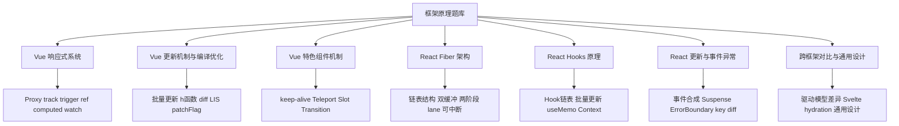

## 目录

- 一、Vue 响应式系统（FRP-001 ~ FRP-008）
- 二、Vue 更新机制与编译优化（FRP-009 ~ FRP-016）
- 三、Vue 特色组件机制（FRP-017 ~ FRP-021）
- 四、React Fiber 架构（FRP-022 ~ FRP-027）
- 五、React Hooks 原理（FRP-028 ~ FRP-036）
- 六、React 更新、事件与异常处理（FRP-037 ~ FRP-045）
- 七、跨框架对比与通用设计（FRP-046 ~ FRP-050）
- 八、Vue 响应式源码再深入（FRP-051 ~ FRP-057）
- 九、Vue 编译器原理（FRP-058 ~ FRP-065）
- 十、Vue 运行时细节（FRP-066 ~ FRP-072）
- 十一、Vue Router 与 Pinia 原理（FRP-073 ~ FRP-078）
- 十二、React Hooks 深入（FRP-079 ~ FRP-086）
- 十三、React 渲染机制深入（FRP-087 ~ FRP-094）
- 十四、React 状态管理原理（FRP-095 ~ FRP-099）
- 十五、跨框架与编译原理（FRP-100 ~ FRP-106）
- 十六、框架工程层（FRP-107 ~ FRP-112）
- 十七、手写框架综合（FRP-113 ~ FRP-120）
- 十八、Vue3 响应式边界与陷阱（FRP-121 ~ FRP-127）
- 十九、Vue 组件模型深水区（FRP-128 ~ FRP-134）
- 二十、Vue3.3+ 新特性原理（FRP-135 ~ FRP-139）
- 二十一、React Server Components 深入（FRP-140 ~ FRP-147）
- 二十二、React 并发与调度深入（FRP-148 ~ FRP-154）
- 二十三、React 表单与模式原理（FRP-155 ~ FRP-160）
- 二十四、状态库与数据流原理对比（FRP-161 ~ FRP-166）
- 二十五、框架与浏览器协同（FRP-167 ~ FRP-172）
- 二十六、编译与转译层（FRP-173 ~ FRP-178）
- 二十七、手写进阶综合（FRP-179 ~ FRP-200）

## 一、Vue 响应式系统

### FRP-001：请用 Proxy 手写一个简化版 Vue3 响应式（track/trigger/effect）？

**答**：
- 核心三件套：`effect` 注册副作用、`track` 在**读**属性时收集当前 effect、`trigger` 在**写**属性时重新执行收集到的 effect。
- 数据结构：`targetMap: WeakMap<target, Map<key, Set<effect>>>`，三层结构分别对应"哪个对象、哪个属性、哪些 effect"。
- `reactive` 用 Proxy 拦截 get/set，get 里调 track、set 里调 trigger，改动即可自动重跑依赖它的 effect。
- 源码在此基础上增加：嵌套 effect 栈、effect 嵌套调度、cleanup 清理等。

```javascript
// 简化实现，帮助理解 Vue3 响应式核心
let activeEffect = null;
const targetMap = new WeakMap(); // target -> key -> Set<effect>

function track(target, key) {
  if (!activeEffect) return; // 不在 effect 中读取，无需收集
  let depsMap = targetMap.get(target);
  if (!depsMap) targetMap.set(target, (depsMap = new Map()));
  let dep = depsMap.get(key);
  if (!dep) depsMap.set(key, (dep = new Set()));
  dep.add(activeEffect);
}

function trigger(target, key) {
  const depsMap = targetMap.get(target);
  depsMap?.get(key)?.forEach((effect) => effect()); // 重新执行所有依赖该属性的 effect
}

function effect(fn) {
  const run = () => {
    activeEffect = run; // 执行前挂到全局，track 时收集它
    fn();
    activeEffect = null;
  };
  run();
  return run;
}

function reactive(obj) {
  return new Proxy(obj, {
    get(target, key) {
      track(target, key);
      return Reflect.get(target, key);
    },
    set(target, key, value) {
      Reflect.set(target, key, value);
      trigger(target, key);
      return true;
    },
  });
}

// 验证：修改 state.count 会自动重新执行 effect
const state = reactive({ count: 0 });
effect(() => console.log('count is', state.count)); // count is 0
state.count = 1;                                    // count is 1
```

### FRP-002：Vue3 依赖收集的三层 WeakMap 结构是怎样的？为什么用 WeakMap？

**答**：
- 结构：`WeakMap<target对象, Map<属性key, Set<effect>>>`——第一层按对象、第二层按属性、第三层去重的 effect 集合。
- WeakMap 的 key 是弱引用：组件销毁、对象无引用后，整个依赖表随之被 GC，**无需手动清理**，这是选 WeakMap 而不是 Map 的决定性原因。
- 第二层用 Map 而非对象：key 可能是 Symbol；第三层用 Set：天然去重（一个 effect 读同一属性多次只收集一次）。
- effect 执行前还会做 cleanup（从旧依赖中移除自己），解决条件分支切换导致的遗留依赖。

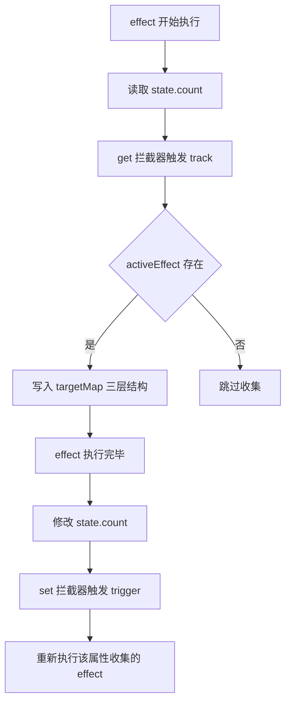

```javascript
// 简化实现，帮助理解三层结构与 GC 关系
const targetMap = new WeakMap();

function getDep(target, key) {
  let depsMap = targetMap.get(target);        // 第一层：WeakMap，key 是被代理的原始对象
  if (!depsMap) targetMap.set(target, (depsMap = new Map()));
  let dep = depsMap.get(key);                 // 第二层：Map，key 是属性名（含 Symbol）
  if (!dep) depsMap.set(key, (dep = new Set())); // 第三层：Set，去重的 effect
  return dep;
}

// 弱引用验证：对象失去引用后，targetMap 中对应条目会被 GC
let user = { name: 'wang' };
getDep(user, 'name').add(() => console.log('effect'));
console.log(targetMap.has(user)); // true
user = null;                      // 解除引用
// 等待 GC 后，WeakMap 中 { name: wang } 的依赖记录随之回收，不会内存泄漏
```

### FRP-003：ref 为什么需要 .value？请手写一个简化版 ref。

**答**：
- Proxy 的 get/set 拦截只能代理**对象**，无法拦截对原始值（number/string）属性的读写；`ref` 用一个 `{ value }` 包装对象让原始值也能被代理。
- 读取 `ref.value` 触发 getter 收集依赖，赋值触发 setter 派发更新——`.value` 就是那个被拦截的属性。
- 直接解构 `const { value } = ref` 后得到的原始值脱离了拦截，响应性丢失，这正是"响应式丢失"问题的根源之一。
- 源码里 RefImpl 用 class + get/set 访问器实现，比 Proxy 更轻；`reactive` 对象赋值给 ref 时会内部再走 `toReactive` 深层代理。

```javascript
// 简化实现，帮助理解 ref 的 .value 本质
let activeEffect = null;
function effect(fn) {
  activeEffect = fn;
  fn();
  activeEffect = null;
}

class RefImpl {
  constructor(rawValue) {
    this._rawValue = rawValue;
    this._value = rawValue;
    this.dep = new Set(); // ref 不需要 targetMap，一个 ref 一份依赖即可
  }
  get value() {           // 读 .value 时收集依赖
    if (activeEffect) this.dep.add(activeEffect);
    return this._value;
  }
  set value(newValue) {   // 写 .value 时派发更新
    if (newValue === this._rawValue) return; // 简化用 ===；源码（hasChanged）用 Object.is，NaN 场景行为不同
    this._rawValue = newValue;
    this._value = newValue;
    this.dep.forEach((effect) => effect());
  }
}

function ref(raw) {
  return new RefImpl(raw);
}

const count = ref(0);
effect(() => console.log('count is', count.value)); // count is 0
count.value++;                                      // count is 1
// 若写成 const { value } = count; 则 value 是裸数字，改动不会再触发更新
```

### FRP-004：shallowRef 为什么快？triggerRef 是如何工作的？

**答**：
- `reactive`/深 ref 在首次访问每个嵌套属性时都会递归创建 Proxy——10 万条列表数据初始化要做 10 万次代理，成本可观。
- `shallowRef` 只对 `.value` **整体**做响应式：读 `.value` 收集、换 `.value` 引用触发；内部属性改动完全不可见，因此跳过全部深层代理。
- 代价：直接修改 `rows.value[3].name = x` 不会触发更新，必须整体替换引用，或改完调 `triggerRef()` 强制派发。
- 这就是大数据量列表"shallowRef + 整体替换"优化（12 章 OPT-038）的原理基础。

```javascript
// 简化实现，帮助理解 shallowRef 与 triggerRef
let activeEffect = null;
function effect(fn) {
  activeEffect = fn;
  fn();
  activeEffect = null;
}

class ShallowRefImpl {
  constructor(value) { this._value = value; this.dep = new Set(); this._force = false; }
  get value() {
    if (activeEffect) this.dep.add(activeEffect);
    return this._value;
  }
  set value(newVal) {
    this._value = newVal;
    this.dep.forEach((e) => e()); // 只有整体替换 .value 才触发
  }
}

function shallowRef(v) { return new ShallowRefImpl(v); }
function triggerRef(r) { r.dep.forEach((e) => e()); } // 强制派发：配合原地修改使用

const list = shallowRef([{ id: 1, done: false }]);

effect(() => console.log('done?', list.value[0].done));

list.value[0].done = true;   // 不会触发！内部属性改动不可见
triggerRef(list);            // 手动派发，打印 done? true
list.value = [{ id: 1, done: false }]; // 整体替换，触发更新
```

### FRP-005：computed 的懒计算与脏标记是如何实现的？

**答**：
- computed 不是"依赖变就立即重算"，而是两段式：依赖变化时只把 `_dirty` 标记为 true 并通知**订阅了 computed 的 effect**，getter 本身不执行——这就是懒计算。
- 只有当渲染 effect 真正读取 `computed.value` 时，若 `_dirty` 为 true 才执行 getter 重算并缓存结果；否则直接返回缓存值。
- computed 内部是一个特殊的 effect：自己作为"订阅者"收集上游依赖，又作为"依赖"被下游订阅，形成依赖链。
- 这解释了为什么 computed 中访问多个响应式数据，只有被访问的才会被收集。

```javascript
// 简化实现，帮助理解 computed 的脏标记与懒计算
let activeEffect = null;
const targetMap = new WeakMap();

function track(t, k) {
  if (!activeEffect) return;
  let m = targetMap.get(t); if (!m) targetMap.set(t, (m = new Map()));
  let s = m.get(k); if (!s) m.set(k, (s = new Set())); s.add(activeEffect);
}
function trigger(t, k) {
  targetMap.get(t)?.get(k)?.forEach((e) => {
    // 关键区分：普通 effect 直接重跑；computed 的 runner 只"置脏"不重算
    e.scheduled ? e.scheduled() : e();
  });
}
function effect(fn) {
  const run = () => { activeEffect = run; fn(); activeEffect = null; };
  run();
  return run;
}

function computed(getter) {
  let value, dirty = true;                       // dirty：脏标记
  const runner = () => { activeEffect = runner; value = getter(); activeEffect = null; };
  // scheduler：上游依赖变化时 trigger 只调用它 —— 只置脏，getter 不执行
  runner.scheduled = () => { dirty = true; };

  return {
    get value() {
      if (dirty) { runner(); dirty = false; }    // 只有脏了才真正重算并缓存
      return value;
    },
  };
}

function reactiveLike(o) {
  return new Proxy(o, {
    get: (t, k) => (track(t, k), t[k]),
    set: (t, k, v) => (t[k] = v, trigger(t, k), true),
  });
}

// 验证懒计算：改 count 只置脏，读 sum.value 才重算
const state = reactiveLike({ count: 1 });
const sum = computed(() => { console.log('computed 执行'); return state.count * 10; });
effect(() => console.log('render:', sum.value));
// 输出：computed 执行 -> render: 10

state.count = 5;          // 只置脏：computed 不执行、effect 不重跑，无任何输出
console.log(sum.value);   // 读取才重算：computed 执行 -> 50
state.count = 6;          // 再置脏
console.log(sum.value);   // computed 执行 -> 60
console.log(sum.value, sum.value); // 脏标记为 false：不再重算，缓存直接返回 60
```

### FRP-006：watch 的实现思路是什么？deep 和 immediate 如何支持？

**答**：
- watch 本质：用 effect 包一层 getter 来收集依赖，依赖变化时不重跑 effect，而是走 **scheduler 调度**——执行用户回调并传入新旧值。
- 收集前先 `traverse`（递归遍历）source：深层属性被"读一遍"才能触发各自的 track，这就是 `deep: true` 的实现原理。
- `immediate: true` 是创建后直接手动跑一次回调；`flush: 'post'`（默认 'pre'）决定回调排在组件更新前还是后。
- 回调里的 `onCleanup` 注册清理函数，处理竞态（旧请求回来覆盖新结果）。

```javascript
// 简化实现，帮助理解 watch 核心
let activeEffect = null;
const targetMap = new WeakMap();
function track(t, k) {
  if (!activeEffect) return;
  let m = targetMap.get(t); if (!m) targetMap.set(t, (m = new Map()));
  let s = m.get(k); if (!s) m.set(k, (s = new Set())); s.add(activeEffect);
}
function trigger(t, k) { targetMap.get(t)?.get(k)?.forEach((e) => e.scheduled?.()); }
function traverse(value, seen = new Set()) {
  if (typeof value !== 'object' || value === null || seen.has(value)) return value;
  seen.add(value);
  for (const key in value) traverse(value[key], seen); // 深层读一遍触发 track
  return value;
}

function watch(source, cb, { deep = false, immediate = false } = {}) {
  let oldValue, cleanup;
  const onCleanup = (fn) => (cleanup = fn);
  const job = () => {
    cleanup?.();                                        // 先清理上轮注册的副作用
    const newValue = effectRunner();
    cb(newValue, oldValue, onCleanup);                  // 走 scheduler：执行用户回调
    oldValue = newValue;
  };
  const getter = typeof source === 'function' ? source : () => deep ? traverse(source) : source;
  const effectRunner = () => { activeEffect = { scheduled: job }; oldValue = getter(); activeEffect = null; return oldValue; };

  if (immediate) cb(getter(), undefined, onCleanup);
  effectRunner(); // 首次执行收集依赖
}

// 用法验证（配合 FRP-001 的 reactive）
const state = { count: 0 };
const r = new Proxy(state, { get: (t, k) => (track(t, k), t[k]), set: (t, k, v) => (t[k] = v, trigger(t, k), true) });
watch(() => r.count, (n, o) => console.log('watch:', o, '->', n));
r.count = 1; // watch: 0 -> 1
```

### FRP-007：effect 的 cleanup 机制解决什么问题？onCleanup 怎么实现？

**答**：
- 问题一（分支切换）：`effect(() => show ? a.value : b.value)`，从 a 分支切到 b 后，a 不再被读取，但依赖表里还留着该 effect——a 变化会触发一次无意义的重跑。
- 问题二（竞态）：watch 回调里的异步请求，旧请求后返回会覆盖新数据。
- 解法：每次 effect 执行前先 cleanup——把自己从**上一轮收集的所有依赖集合**中移除，再重新收集本轮依赖。
- 用户侧 `onCleanup(fn)` 注册的是清理回调（取消请求等），同样在每轮开始与 effect 停止时执行。

```javascript
// 简化实现，帮助理解 cleanup
let activeEffect = null;

function effect(fn) {
  const runner = () => {
    // cleanup：先从上一轮的所有依赖集合中移除自己
    runner.deps.forEach((depSet) => depSet.delete(runner));
    runner.deps.length = 0;

    activeEffect = runner;
    const ret = fn(runner); // 把 onCleanup 交给用户注册
    activeEffect = null;
    return ret;
  };
  runner.deps = [];   // 记录本轮收集到的所有依赖集合引用
  runner.onCleanup = (fn) => (runner.cleanupFn = fn);
  runner.cleanupFn = null;
  return runner;
}

// track 时要把 dep 集合也记到 effect 上（配合上面的 deps）
function trackWithCleanup(target, key, getDep) {
  if (!activeEffect) return;
  const dep = getDep(target, key);
  dep.add(activeEffect);
  activeEffect.deps.push(dep); // effect 记住自己在哪些集合里，执行前可被移除
  activeEffect.cleanupFn?.(); activeEffect.cleanupFn = null; // 执行用户清理
  if (activeEffect.cleanup) { activeEffect.cleanup(); activeEffect.cleanup = null; }
  activeEffect.cleanup = () => activeEffect.cleanupFn?.();
}

// 验证：切换 show 后，a 的变化不再触发 effect
// effect((onCleanup) => {
//   onCleanup(() => request.abort());  // 每轮先取消旧请求，解决竞态
//   show.value ? console.log(a.value) : console.log(b.value);
// });
```

### FRP-008：Vue2 的 defineProperty 有哪些缺陷？Vue3 的 Proxy 如何解决？

**答**：
- defineProperty 只能劫持**已知属性**：新增/删除属性（`Vue.set/Vue.delete` 的由来）、数组索引赋值与 length 修改都监听不到（Vue2 要重写 7 个数组方法打补丁）。
- 初始化时需要**递归遍历**所有属性做劫持（data 定义多大就多大开销）；Proxy 是访问时才代理（lazy），按需触发。
- defineProperty 无法拦截 Map/Set、无法监听属性访问（Proxy 的 get 可以，这让依赖收集更精确）。
- 代价：Proxy 无法 polyfill 到 IE11，这是 Vue3 放弃 IE 支持的直接原因。

```javascript
// 一一对应：defineProperty 的三个经典缺陷
const data = { list: [1, 2, 3] };

function defineReactive(obj, key) {
  let val = obj[key];
  Object.defineProperty(obj, key, {
    get() { console.log('get', key); return val; },
    set(newVal) {
      console.log('set', key, newVal);
      val = newVal;
    },
  });
}
Object.keys(data).forEach((k) => defineReactive(data, k));

// 缺陷 1：已有属性可以监听
data.list = [1, 2, 3];        // set list 被打印

// 缺陷 2：新增属性监听不到 —— Vue2 需要 Vue.set
data.newProp = 1;             // 没有任何输出，视图不更新

// 缺陷 3：数组索引与 length 监听不到 —— Vue2 重写 push 等方法兜底
data.list[0] = 99;            // 没有任何输出

// Vue3 Proxy 全部解决：
const p = new Proxy(data, {
  get: (t, k) => (console.log('get', k), t[k]),
  set: (t, k, v) => (console.log('set', k, v), (t[k] = v), true),
  deleteProperty: (t, k) => (delete t[k], true), // 删除也能监听
});
p.newProp = 1;    // set newProp 1
p.list[0] = 99;   // get list（数组内部变化由深层 reactive 代理）
```

## 二、Vue 更新机制与编译优化

### FRP-009：Vue 的异步批量更新与 nextTick 是什么原理？

**答**：
- 同一事件循环里多次修改状态，组件只会**更新一次**：每次修改触发 trigger 时，不直接执行渲染 effect，而是把组件的更新 job 放进一个去重的队列（`Set` 特性天然去重）。
- 队列通过 `Promise.then` 以**微任务**方式批量 flush——同步代码全部执行完后，一次跑完所有 job 并按组件 id 排序保证父先子后。
- `nextTick(cb)` 的 cb 会在 flush 完成后执行：`nextTick` 就是把回调 push 到同一个微任务队列的尾部，因此此时 DOM 已更新。
- 这也解释了"改了数据马上读 DOM 拿到旧值，包一层 nextTick 才是新值"。

```javascript
// 简化实现，帮助理解异步批量更新与 nextTick
const queue = new Set();     // Set 保证同一组件的更新 job 只入队一次
let isFlushing = false;
const resolvedPromise = Promise.resolve();
const pendingPostFlushCbs = [];

function queueJob(job) {
  queue.add(job);            // 去重：多次改同一组件状态，只有一个 job
  queueFlush();
}

function queueFlush() {
  if (!isFlushing) {
    isFlushing = true;
    // 微任务批量执行：同步代码全部跑完才 flush
    resolvedPromise.then(() => {
      try {
        queue.forEach((job) => job());
        queue.clear();
        // post 队列：nextTick 的回调排在所有更新之后
        pendingPostFlushCbs.forEach((cb) => cb());
        pendingPostFlushCbs.length = 0;
      } finally {
        isFlushing = false;
      }
    });
  }
}

function nextTick(cb) {
  if (isFlushing) pendingPostFlushCbs.push(cb); // 已在 flush 中，追加到本批末尾
  else resolvedPromise.then(cb);
}

// 验证批量更新
let renderCount = 0;
const componentJob = () => { renderCount++; console.log('DOM 更新，count =', count); };
let count = 0;

queueJob(componentJob);
queueJob(componentJob);       // 重复入队被 Set 去重
count = 1; count = 2; count = 3; // 三次修改
console.log('同步读取 count：', count, '，renderCount：', renderCount);
// 输出：同步读取 count 3，renderCount 0 —— 此刻 DOM 还是旧的
nextTick(() => console.log('nextTick 里 renderCount：', renderCount)); // 1 —— 只更新了一次
```

### FRP-010：什么是虚拟 DOM？h 函数返回什么结构？

**答**：
- 虚拟 DOM 是用 JS 对象描述真实 DOM 的树结构：`{ type, props, children, key }`，渲染 = 数据变化后"新旧 vnode 对比，最小化操作真实 DOM"。
- `h`（createVNode）只是 vnode 的**工厂函数**，负责规范化参数（class/style 合并、children 归一化、key 提取），不触碰真实 DOM。
- 价值：声明式 UI（数据驱动而非手动操作）、跨平台（vnode 可渲染到 DOM/Canvas/SSR 字符串）、为 diff 提供可比较的快照。
- 代价：多一层对象创建与 diff 的 JS 开销，这是 Vue3 编译优化和 Svelte 的优化动机。

```javascript
// 简化实现，帮助理解 h 函数与 vnode 结构
function h(type, props = null, children = null) {
  let shapeFlag = 0;
  if (typeof type === 'string') shapeFlag = 1;              // ELEMENT
  else if (typeof type === 'object') shapeFlag = 4;         // STATEFUL_COMPONENT

  if (typeof children === 'string') shapeFlag |= 8;         // TEXT_CHILDREN
  else if (Array.isArray(children)) shapeFlag |= 16;        // ARRAY_CHILDREN

  return {
    type,                                                    // 'div' | 组件对象 | 'svg'
    props,                                                   // { class, style, onClick, ... }
    children,
    key: props?.key ?? null,                                 // diff 用的身份标识
    el: null,                                                // 挂载后回填的真实 DOM 引用
    shapeFlag,                                               // 位标记：加速后续分支判断
  };
}

// h 的三种典型用法
const vnode1 = h('div', { class: 'box', onClick: () => {} }, 'hello text');
const vnode2 = h('ul', null, [
  h('li', { key: 1 }, 'one'),
  h('li', { key: 2 }, 'two'),
]);
const vnode3 = h(MyComponent, { title: 'hi' });

console.log(vnode1.shapeFlag); // 1 | 8 = 9：元素 + 文本子节点
console.log(vnode2.shapeFlag); // 1 | 16 = 17：元素 + 数组子节点
```

### FRP-011：请手写 patch 的核心流程（同层比较 + children 三种情况）。

**答**：
- diff 的前提是**同层比较**：只对比同一层级的 vnode，不跨层移动（复杂度从 O(n^3) 降到 O(n)），跨层移动节点会被"销毁重建"。
- 判断是否同一节点：`type` 和 `key` 都相同（isSameVNodeType）；相同走 patchProps 更新，不同直接卸载旧的、挂载新的。
- children 三种情况：新旧都是文本 → 替换文本；新是数组旧是文本/反之 → 全量替换；**新旧都是数组 → 进入 diff 子节点**（下一题）。
- 组件的 patch 则递归到组件的 render 结果继续对比。

```javascript
// 简化实现，帮助理解 patch 核心流程
function isSameVNodeType(n1, n2) {
  return n1.type === n2.type && n1.key === n2.key;
}

function patch(n1, n2, container) {
  // n1 旧 vnode，n2 新 vnode；n1 为空表示首次挂载
  if (n1 && !isSameVNodeType(n1, n2)) {
    unmount(n1);          // type/key 不同：卸载旧的，重建新的（不跨层复用）
    n1 = null;
  }
  if (!n1) {
    mount(n2, container); // 首次挂载
    return;
  }

  const el = (n2.el = n1.el); // 复用真实 DOM

  // 情况一：双方都是文本子节点
  if (typeof n2.children === 'string') {
    if (n1.children !== n2.children) el.textContent = n2.children;
  }
  // 情况二：新数组旧文本 / 新文本旧数组 —— 全量替换
  else if (Array.isArray(n2.children) && typeof n1.children === 'string') {
    el.textContent = '';
    n2.children.forEach((c) => mount(c, el));
  }
  // 情况三：双方都是数组 —— diff 子节点列表（见 FRP-012 的 keyed diff）
  else if (Array.isArray(n2.children) && Array.isArray(n1.children)) {
    diffChildren(n1.children, n2.children, el);
  }

  // 更新 props：旧的没有新的有 = 添加；反之 = 移除；都有且不同 = 更新
  const oldProps = n1.props || {}, newProps = n2.props || {};
  for (const key in newProps) {
    if (oldProps[key] !== newProps[key]) el.setAttribute(key, newProps[key]);
  }
  for (const key in oldProps) {
    if (!(key in newProps)) el.removeAttribute(key);
  }
}
// mount / unmount / diffChildren 在后续题目中给出
```

### FRP-012：diff 子节点时双端比较与最长递增子序列各起什么作用？

**答**：
- Vue2 用**双端比较**：新旧列表各拿头尾四个指针，四步匹配（旧头-新头、旧尾-新尾、旧头-新尾、旧尾-新头），能高效处理"列表反转/前插"这类常见变更，都失配时退化为按 key 查找。
- Vue3 改用"先 patch 同前缀/后缀，再对中间乱序部分建 key→index 映射"：算出**最长递增子序列（LIS）**，LIS 里的节点 DOM 不用动，只移动其余节点——移动次数最少。
- LIS 价值示例：`ABCDE → ABDEC`，LIS 是 `BDE`（或 ABE），只需移动 A 或 C，而不是全部重排。
- React 的简化策略是"单向从左到右遍历 + key Map 查找"，不做 LIS，靠 key 依然保证正确性（见 FRP-044）。

```javascript
// 简化实现，帮助理解最长递增子序列（Vue3 源码同款算法）
function getSequence(arr) {
  const p = arr.slice();       // p[i] 记录：第 i 项接在哪个下标后面
  const result = [0];          // result 存下标，贪心维护的递增序列
  let i, j, u, v, c;
  for (i = 0; i < arr.length; i++) {
    if (arr[i] === 0) continue;             // 新增节点（索引 -1）不参与
    j = result[result.length - 1];
    if (arr[j] < arr[i]) {                  // 大于队尾：直接追加
      p[i] = j;
      result.push(i);
      continue;
    }
    // 二分查找第一个 >= arr[i] 的位置并替换（贪心：让序列尾尽量小）
    u = 0; v = result.length - 1;
    while (u < v) {
      c = (u + v) >> 1;
      arr[result[c]] < arr[i] ? (u = c + 1) : (v = c);
    }
    if (arr[i] < arr[result[u]]) {
      if (u > 0) p[i] = result[u - 1];
      result[u] = i;
    }
  }
  // 回溯：从最后一项向前还原真正的最长递增子序列下标
  u = result.length; v = result[u - 1];
  while (u-- > 0) { result[u] = v; v = p[v]; }
  return result;
}

// diff 中的应用：newToOldIndex 数组，LIS 即"不需要移动的节点集合"
const newToOld = [5, 9, 3, 9, 10, 9, 4, 5, -1]; // -1 表示新增节点
console.log(getSequence(newToOld)); // [5, 6, 7] —— 位于 LIS 的节点 DOM 不动，其余做 insertBefore
```

### FRP-013：Vue3 的编译优化（patchFlag、静态提升、Block Tree）分别做了什么？

**答**：
- **patchFlag**：编译期分析模板，给每个 vnode 打上"哪些属性是动态的"位标记（TEXT=1、CLASS=2、PROPS=8...），运行时只 diff 被标记的部分，跳过纯静态 props。
- **静态提升（hoistStatic）**：纯静态的 vnode 被提到 render 函数外只创建一次，之后每次渲染复用同一引用；连续静态节点超 20 个还会合并成一个 `createStaticVNode`（innerHTML 一次性插入）。
- **Block Tree**：render 时动态节点（含跨层级）被收集到 block 的 `dynamicChildren` 数组，更新时**跳过整棵树的 diff**，只遍历这个扁平数组精准更新——结构稳定时复杂度接近 O(动态节点数)。
- 效果是把"运行时全量 diff"变成"编译期定点打击"，这也是 Vue3 模板性能显著优于手写 render 函数的原因。

```javascript
// 一一对应：模板编译产物的关键片段（近似还原）
// 模板：<div><span>静态标题</span><p :class="cls">{{ msg }}</p></div>

// 1. 静态提升：纯静态 span 被提到 render 外，只创建一次
const _hoisted_1 = createElementVNode('span', null, '静态标题', -1 /* HOISTED */);

function render(_ctx) {
  return (openBlock(), createElementBlock('div', null, [
    _hoisted_1,                              // 复用提升的静态节点
    createElementVNode('p', { class: _ctx.cls }, toDisplayString(_ctx.msg), 9 /* TEXT, CLASS */),
    // 2. patchFlag = 9 = 1(TEXT) | 8(CLASS)：只 diff 文本和 class
    //    PROPS 类型的 flag 还会附带动态 props 名数组：["class"]
  ]));
}

// 3. Block Tree：openBlock/createElementBlock 开始收集动态后代节点
//    更新时不再走全量 diff，而是：
function patchBlock(block1, block2) {
  // 只对比 dynamicChildren 数组，静态节点完全跳过
  for (let i = 0; i < block2.dynamicChildren.length; i++) {
    patch(block1.dynamicChildren[i], block2.dynamicChildren[i]);
  }
}
```

### FRP-014：父子组件更新时，生命周期钩子的触发顺序是什么？

**答**：
- **挂载顺序**：父 beforeMount → 子 beforeMount → 子 mounted → 父 mounted（子先完成，父才知道"我的树挂好了"）。
- **更新顺序**：父 beforeUpdate → 子 beforeUpdate → 子 updated → 父 updated——Vue 的父组件更新 job 先执行（render 出新子组件 props），子更新完父才标记 updated。
- **卸载顺序**：父 beforeUnmount → 子 beforeUnmount → 子 unmounted → 父 unmounted（先拆叶子）。
- 面试要点：mounted/updated 都是"子先于父"，beforeXxx 都是"父先于子"；React 恰好相反——父组件的 render/commit 先执行。

```vue
<!-- 一一对应：父子组件生命周期顺序实测 -->
<!-- Parent.vue -->
<template>
  <div><Child :msg="msg" /></div>
</template>
<script setup>
import { ref, onMounted, onBeforeMount, onUpdated, onBeforeUpdate, onUnmounted } from 'vue';
import Child from './Child.vue';
const msg = ref('hello');
onBeforeMount(() => console.log('1 父 beforeMount'));
onMounted(() => console.log('4 父 mounted'));
onBeforeUpdate(() => console.log('1 父 beforeUpdate'));
onUpdated(() => console.log('4 父 updated'));
setTimeout(() => (msg.value = 'world'), 100); // 触发更新流程
</script>

<!-- Child.vue -->
<template><span>{{ msg }}</span></template>
<script setup>
import { onMounted, onBeforeMount, onUpdated, onBeforeUpdate } from 'vue';
defineProps({ msg: String });
onBeforeMount(() => console.log('2 子 beforeMount'));
onMounted(() => console.log('3 子 mounted'));
onBeforeUpdate(() => console.log('2 子 beforeUpdate'));
onUpdated(() => console.log('3 子 updated'));
</script>

<!-- 挂载输出：1 父 beforeMount → 2 子 beforeMount → 3 子 mounted → 4 父 mounted
     更新输出：1 父 beforeUpdate → 2 子 beforeUpdate → 3 子 updated → 4 父 updated -->
```

### FRP-015：keep-alive 的实现原理是什么？LRU 缓存如何工作？

**答**：
- keep-alive 是一个抽象组件：它**不渲染自己的容器 DOM**，而是缓存子组件的 vnode；切换回来时不重新 mount，直接把缓存 vnode 恢复，所以实例状态、滚动位置都在。
- 缓存结构：`Map<key, vnode>` + `keys` 数组（记录访问顺序）。命中时把 key 移到数组末尾（最新使用）；超过 `max` 时删数组**头部**（最久未用）——这就是 LRU。
- `include/exclude` 用组件 name 正则匹配决定缓存谁；被"逐出"或被 exclude 的组件才真正走 unmounted。
- 命中/失活时触发 `activated/deactivated` 而不是 `mounted/unmounted`。

```javascript
// 简化实现，帮助理解 keep-alive 的 LRU 缓存
class KeepAliveCache {
  constructor(max = 10) {
    this.cache = new Map(); // key -> vnode（缓存 vnode，恢复时不重渲染）
    this.keys = [];         // 访问顺序：尾部最新，头部最久未用
    this.max = max;
  }

  get(key) {
    if (!this.cache.has(key)) return null;
    // LRU 命中：移到数组末尾，表示"刚刚被使用"
    const idx = this.keys.indexOf(key);
    this.keys.splice(idx, 1);
    this.keys.push(key);
    return this.cache.get(key);
  }

  put(key, vnode, onEvict) {
    if (this.cache.has(key)) return;
    this.cache.set(key, vnode);
    this.keys.push(key);
    if (this.keys.length > this.max) {
      // 超出 max：驱逐头部（最久未使用），并真正 unmount 该组件
      const evicted = this.keys.shift();
      this.cache.delete(evicted);
      onEvict?.(evicted); // 触发被驱逐组件的 unmounted
    }
  }
}

const cache = new KeepAliveCache(2);
cache.put('a', { name: 'A' });
cache.put('b', { name: 'B' });
cache.get('a');             // a 变为"最新"，keys = [b, a]
cache.put('c', { name: 'C' }); // 超出 max=2，驱逐 b —— 最久未使用
console.log(cache.get('b')); // null，b 已被 LRU 驱逐
console.log(cache.get('a')); // { name: 'A' }，a 仍存活
```

### FRP-016：Slot 在编译后是什么？作用域插槽的原理是什么？

**答**：
- 默认插槽：父组件模板中的插槽内容被编译成**子组件 vnode 的 children**，子组件 `<slot>` 出口就是渲染这段 children（渲染发生在父组件作用域）。
- 作用域插槽：内容编译成一个**返回 vnode 的函数** `(slotProps) => vnode`，作为 props 传给子组件；子组件渲染时**调用该函数并传参**——数据在子组件产生，但 vnode 依然由父组件作用域闭包创建。
- 这就是"数据源是子组件、渲染权在父组件"的实现；`v-slot="slotProps"` 就是函数参数。
- Vue3 统一了普通与作用域插槽：普通插槽也是函数（惰性求值），避免 Vue2 中普通插槽在父渲染时就求值的差异。

```vue
<!-- 一一对应：作用域插槽的编译产物还原 -->
<!-- 父组件 -->
<template>
  <List :items="rows">
    <template #item="{ item, index }">
      <li>{{ index }}. {{ item.name }}</li>
    </template>
  </List>
</template>
<script setup>
import { ref } from 'vue';
const rows = ref([{ name: 'a' }, { name: 'b' }]);
</script>

<!-- 子组件 List：slot 出口调用父传来的函数并传参 -->
<template>
  <ul><slot v-for="(item, index) in items" :key="index" :item="item" :index="index" /></ul>
</template>
<script setup>
defineProps({ items: Array });
</script>
```

```javascript
// 简化实现，帮助理解：插槽编译后就是 props 上的函数
// 父组件编译产物（近似）：
function parentRender() {
  const rows = [{ name: 'a' }, { name: 'b' }];
  return h(List, { items: rows }, {
    // 具名插槽编译为函数：参数由子组件调用时传入，闭包仍是父作用域
    item: ({ item, index }) => h('li', null, `${index}. ${item.name}`),
  });
}

// 子组件内部渲染插槽出口（近似）：
function renderSlots(instance) {
  const slotFn = instance.slots.item;              // 拿到父传来的函数
  instance.props.items.forEach((item, index) => {
    const vnode = slotFn({ item, index });         // 子组件传参调用 —— 作用域插槽的本质
    mount(vnode, instance.subTree.el);
  });
}
```

## 三、Vue 特色组件机制

### FRP-017：Teleport 是如何实现的？

**答**：
- `<Teleport to="#modal">` 让子树渲染到指定容器，但**逻辑上仍留在组件树中**（props/inject/事件链不断）。
- 实现要点：Teleport 是特殊 vnode（shapeFlag = TELEPORT），编译/运行时生成一个**注释占位符**锚点插在原位置，真实 children 挂载到 target 容器。
- 更新时通过锚点找到真实位置做 patch；`disabled` 属性可切回原位挂载；SSR 时直接渲染进目标容器字符串。
- 价值：modal/tooltip 逃逸 `overflow: hidden`、`z-index` 层级上下文的限制，而组件通信不中断。

```javascript
// 简化实现，帮助理解 Teleport 的锚点与跨容器挂载
function mountTeleport(vnode, container) {
  // 1. 原位置插入注释锚点：占位 + 更新时定位用
  const anchor = document.createComment('teleport start');
  container.appendChild(anchor);

  vnode.el = anchor;
  vnode.anchor = anchor;

  // 2. 真实 children 挂到目标容器，而不是当前父容器
  const target = document.querySelector(vnode.props.to);
  vnode.target = target;
  vnode.children.forEach((child) => mount(child, target));

  vnode.props.onMounted?.();
}

function patchTeleport(n1, n2) {
  n2.el = n1.el;
  n2.target = n1.target;
  // 子树更新仍然基于原 anchor 与 target，逻辑父子关系不受影响
  if (n1.props.disabled !== n2.props.disabled) {
    // disabled 从 true 变 false 等：把 children 移回原位/移回目标
    moveChildren(n2, n2.props.disabled ? n1.el.parentNode : n2.target);
  }
  diffChildren(n1.children, n2.children, n2.target);
}

function unmountTeleport(vnode) {
  vnode.children.forEach((child) => unmount(child)); // 从目标容器卸载
  vnode.el.parentNode.removeChild(vnode.el);         // 移除锚点
}
```

### FRP-018：provide/inject 的实现原理是什么？

**答**：
- 每个组件实例都有 `provides` 对象；初始化时 `provides = parent ? Object.create(parent.provides) : { appContext }`——用**原型链继承**父级 provides。
- 这就是"子可以读父/祖先注入、同名注入就近覆盖"的原因：沿原型链查找，最近的实例属性先命中。
- inject 就是 `provides[key]` 的链式查找（原型链自动完成）；响应式注入值（ref/reactive）自然继承响应性。
- 用 Symbol 作 key 可避免组件库之间的 key 冲突；`app.provide` 挂在 appContext 上作为原型链末端兜底。

```javascript
// 简化实现，帮助理解 provides 原型链
const currentInstance = { provides: null };

function createComponentInstance(parent) {
  const instance = {
    parent,
    provides: parent
      ? Object.create(parent.provides) // 关键：原型链继承父级 provides
      : { appProvide: true },          // 根组件兜底 app.provide 的内容
  };
  return instance;
}

function provide(key, value) {
  currentInstance.provides[key] = value; // 写在自己的 provides 上（子就近可见）
}

function inject(key, defaultValue) {
  // 原型链查找：__proto__ 一路向上，最近的 provide 先命中
  let instance = currentInstance;
  if (key in instance.provides) return instance.provides[key];
  if (arguments.length > 1) return typeof defaultValue === 'function' ? defaultValue() : defaultValue;
  console.warn(`injection "${String(key)}" not found`);
}

// 验证：孙组件读到的 theme 是 Parent就近覆盖的值
const app = createComponentInstance(null);
const parent = createComponentInstance(app);
const child = createComponentInstance(parent);

currentInstance.provides = app.provides;   app.provides.theme ??= null;
// 模拟 provide 链
parent.provides.theme = 'parent-theme';    // Parent provide('theme', ...)
child.provides.theme = 'child-theme';      // Child 覆盖 provide('theme', ...)

console.log(child.provides.theme);  // child-theme —— 就近覆盖
console.log(parent.provides.theme); // parent-theme
console.log('未注册的 key 沿原型链找不到，走默认值：', inject('missing', 'fallback'));
```

### FRP-019：defineAsyncComponent 的实现原理是什么？

**答**：
- 它返回一个**包装组件**：首次渲染时 loader 还没 resolve，就渲染 `loadingComponent`（或注释占位）并记录当前渲染的包装 effect。
- 内部把 `loader()` 的 Promise 缓存（pending 存起来防重复请求），resolve 后把 `loadedComponent` 存下来，并**重新触发**该组件的渲染 effect，替换为新组件。
- `delay` 控制 loading 出现的延迟（闪一下的 loading 比 blank 更差）；`timeout` 超时渲染 `errorComponent`；`retry` 支持失败重试。
- 这与路由懒加载是同一机制，只是多了 loading/error 的壳。

```javascript
// 简化实现，帮助理解 defineAsyncComponent
function defineAsyncComponent(options) {
  if (typeof options === 'function') options = { loader: options };
  const { loader, delay = 200, errorComponent, loadingComponent, timeout } = options;

  return {
    name: 'AsyncComponentWrapper',
    setup(_, { effect }) {
      // 状态机：pending -> resolved / rejected
      const state = { status: 'pending', component: null, error: null, promise: null };

      function load() {
        if (!state.promise) {
          state.promise = loader()                 // 缓存 Promise，防重复请求
            .then((comp) => { state.status = 'resolved'; state.component = comp.default ?? comp; rerender(); })
            .catch((err) => { state.status = 'rejected'; state.error = err; rerender(); });
          if (timeout) state.promise.catch(() => {}); // 超时逻辑略，源码用 setTimeout 置 rejected
        }
        return state.promise;
      }

      function rerender() { effect?.run?.(); }     // 组件加载完成：重新执行本组件渲染

      return () => {
        if (state.status === 'resolved') return h(state.component);
        if (state.status === 'rejected' && errorComponent) return h(errorComponent, { error: state.error });
        // 首次渲染：触发加载；超过 delay 才显示 loading，避免闪烁
        if (state.status === 'pending') {
          load();
          setTimeout(() => { if (state.status === 'pending') rerender(); }, delay);
          return loadingComponent ? h(loadingComponent) : null;
        }
        return null;
      };
    },
  };
}

// 用法
const AsyncModal = defineAsyncComponent({
  loader: () => import('./HeavyModal.vue'),
  delay: 200,
  timeout: 10000,
  errorComponent: { template: '<div>加载失败，请重试</div>' },
});
```

### FRP-020：v-model 在编译后变成了什么？自定义组件与原生表单有何差异？

**答**：
- 组件上的 `v-model="x"` 编译为两条指令：`:modelValue="x"` + `@update:modelValue="x = $event"`——本质是"prop 下行 + 事件上行"的语法糖。
- 原生表单元素是特化处理：input 编译为 `:value` + `@input`，checkbox/radio 是 `:checked` + `@change`，select 是 `:value` + `@change`。
- 修饰符编译为运行时辅助：`.trim`/`.number` 是对事件 payload 的预处理；`.lazy` 把 input 事件换成 change。
- 参数形式 `v-model:title` 生成 `title` prop 与 `update:title` 事件，一个组件可有多组。

```vue
<!-- 一一对应：v-model 与其等价展开 -->
<!-- 写法一：v-model 语法糖 -->
<template>
  <input v-model.trim="message" />
  <MyInput v-model:title="title" v-model:index="idx" />
</template>

<!-- 写法二：编译后的等价写法（完全等价） -->
<template>
  <input :value="message" @input="message = $event.target.value.trim()" />
  <MyInput :title="title" @update:title="title = $event" :index="idx" @update:index="idx = $event" />
</template>

<script setup>
import { ref } from 'vue';
const message = ref('');
const title = ref('');
const idx = ref(0);
</script>
```

```javascript
// 简化实现，帮助理解编译产物：normalizeModel 的运行时逻辑
function resolveModelDirective(modifiers) {
  const { trim, number, lazy } = modifiers;
  const event = lazy ? 'change' : 'input'; // .lazy 换事件
  return {
    mounted(el, { value }) { el.value = value; },
    // 运行时监听：把 DOM 事件翻译成 update:modelValue 事件
    created(el, { modifiers: m }, vnode) {
      el.addEventListener(event, (e) => {
        let val = e.target.value;
        if (m.number) val = val === '' ? '' : Number(val);  // .number 预处理
        if (m.trim) val = val.trim();                       // .trim 预处理
        // 触发组件更新事件，父组件的 x = $event 得以执行
        vnode.props[`onUpdate:${m.modelKey || 'modelValue'}`]?.(val);
      });
    },
  };
}
```

### FRP-021：Transition 组件是如何实现元素进入/离开动画的？

**答**：
- Transition 本身**不渲染 DOM**（注释节点），只是包裹单元素/单组件做"进出动画编排"。
- 进入流程：插入元素时依次加 `*-enter-from`（初始态）→ 下一帧移除并加 `*-enter-active` + `*-enter-to`（过渡到终态）→ 过渡结束移除全部，回调 `after-enter`。
- 离开流程：加 `*-leave-*` 系列类 → `whenTransitionEnds` 监听 transitionend 并计算 duration 兜底 → 结束后真正卸载 DOM（`mode="out-in"` 时先等离开完再进入）。
- 关键技术点：强制 reflow（读取 offsetHeight）让 enter-from 的初始样式先生效；若包裹的是组件且子节点是 v-if 切换，则配合 TransitionGroup 处理列表。

```javascript
// 简化实现，帮助理解 Transition 的类名切换时序
function transitionEnter(el, name = 'fade') {
  el.classList.add(`${name}-enter-from`, `${name}-enter-active`); // 1. 初始态 + 过渡

  // 2. 强制 reflow：让 enter-from 的样式先生效（否则浏览器合并样式直接到终态，无动画）
  void el.offsetHeight;

  el.classList.add(`${name}-enter-to`);      // 3. 下一帧：移除 from，过渡到 to
  el.classList.remove(`${name}-enter-from`);

  // 4. 过渡结束：清掉全部类
  const onEnd = (e) => {
    if (e.target !== el) return;
    el.classList.remove(`${name}-enter-active`, `${name}-enter-to`);
    el.removeEventListener('transitionend', onEnd);
  };
  el.addEventListener('transitionend', onEnd);
}

function transitionLeave(el, name = 'fade', done) {
  el.classList.add(`${name}-leave-from`, `${name}-leave-active`);
  void el.offsetHeight;                       // 同样强制 reflow
  el.classList.add(`${name}-leave-to`);
  el.classList.remove(`${name}-leave-from`);

  const onEnd = (e) => {
    if (e.target !== el) return;
    el.classList.remove(`${name}-leave-active`, `${name}-leave-to`);
    el.removeEventListener('transitionend', onEnd);
    done?.(); // mode out-in：离开动画完成后才真正卸载 / 才开始进入
  };
  el.addEventListener('transitionend', onEnd);
}

// CSS 侧（配套）：
// .fade-enter-active, .fade-leave-active { transition: opacity .3s; }
// .fade-enter-from, .fade-leave-to { opacity: 0; }
```

## 四、React Fiber 架构

### FRP-022：JSX 是如何变成真实 DOM 的？createElement 与 jsx-runtime 有何区别？

**答**：
- JSX 本身不是 JS，Babel/SWC 在编译期把它转成函数调用：旧转换是 `React.createElement(...)`（需手动 import React），React 17+ 新转换是 `react/jsx-runtime` 的 `jsx(...)`（自动引入，无需 import）。
- createElement 返回的是一个**普通对象（React element）**：`{ $$typeof, type, props, key, ref }`，不是 DOM，也不是 Fiber。
- jsx-runtime 的差别只是 API 形状：children 与 key 从 props 中拆出为独立参数、内部处理 `__source`/`__self`（调试信息），本质产物相同。
- 渲染链条：JSX → element 对象 → （render 时）Fiber 节点 → commit 阶段操作真实 DOM。

```jsx
// 一一对应：JSX 源码与其编译产物对照
// —— 源码 ——
// <div className="box" key="k1">
//   <h1>标题</h1>
//   <p>{count}</p>
// </div>

// —— React 16 及以前：Classic 转换，需要 import React ——
import React from 'react';

const el1 = React.createElement(
  'div',
  { className: 'box', key: 'k1' },
  React.createElement('h1', null, '标题'),
  React.createElement('p', null, count)
);

// —— React 17+：Automatic 转换，编译器自动引入 jsx-runtime ——
import { jsx as _jsx } from 'react/jsx-runtime';

const el2 = _jsx(
  'div',
  { className: 'box', children: [_jsx('h1', { children: '标题' }), _jsx('p', { children: count })] },
  'k1' // key 作为第三参独立传入
);

// 产物是一个普通 element 对象（可 console.log 验证）
console.log(el1.type);        // 'div'
console.log(el1.$$typeof);    // Symbol(react.element)：element 的类型标识
console.log(el1.props.children); // 子 element 数组
```

### FRP-023：Fiber 架构是什么？为什么用链表结构？

**答**：
- React 15 的 Stack Reconciler 递归更新整棵树，**不可中断**——大组件树更新会长时间占住主线程。
- Fiber 把每个组件/元素变成一个 Fiber 节点，用**链表**代替递归树：`child`（第一个子节点）、`sibling`（下一个兄弟）、`return`（父节点）三个指针，遍历可以用**循环 + 指针回退**完成，随时暂停、保存现场、下次继续。
- 每个节点还带 `alternate`（双缓冲指向另一棵树的对应节点）、`lanes`（优先级）、`effectTag/flags`（增删改标记）、`stateNode`（真实 DOM/实例）。
- 链表结构的本质动机：把"递归"改造成"可暂停的迭代"，这是 Concurrent 渲染的数据结构基础。

```javascript
// 简化实现，帮助理解 Fiber 链表遍历（深度优先 + 指针回退）
function fiberToTree(fiber, depth = 0) {
  console.log(' '.repeat(depth * 2) + typeOf(fiber));
  // 先深入 child，没有 child 再找 sibling，都没有就回到 return 的 sibling
  if (fiber.child) fiberToTree(fiber.child, depth + 1);
  if (fiber.sibling) fiberToTree(fiber.sibling, depth);
}
function typeOf(f) { return typeof f.type === 'function' ? f.type.name : f.type; }

// Fiber 节点核心字段（示意）
function createFiber(type, props, key) {
  return {
    type, props, key,
    child: null,      // 第一个子 Fiber
    sibling: null,    // 下一个兄弟 Fiber
    return: null,     // 父 Fiber
    alternate: null,  // 双缓冲：指向另一棵树上对应的 Fiber
    flags: 0,         // Placement 2 / Update 4 / Deletion 8，commit 阶段执行
    lanes: 0,         // 本节点的更新优先级
    stateNode: null,  // Host 组件对应真实 DOM；类组件对应实例
    memoizedState: null, // Hooks 链表头（见 FRP-028）
  };
}

// 用循环模拟 beginWork 的移动过程（react-reconciler 的 workLoop 核心）
function walk(rootFiber) {
  let fiber = rootFiber;
  while (fiber) {
    console.log('beginWork:', typeOf(fiber)); // 处理当前节点
    if (fiber.child) { fiber = fiber.child; continue; }   // 深入
    while (fiber) {
      console.log('completeWork:', typeOf(fiber));        // 回溯
      if (fiber.sibling) { fiber = fiber.sibling; break; } // 换兄弟
      fiber = fiber.return;                               // 回到父级继续回溯
    }
  }
}
```

### FRP-024：什么是双缓冲 Fiber 树？alternate 如何工作？

**答**：
- React 内存中常驻两棵 Fiber 树：`current`（屏幕上正在显示的，其 DOM 已提交）与 `workInProgress`（正在内存里构建的下一帧）。
- 每个节点通过 `alternate` 互相指向：构建 workInProgress 时优先**复用 current.alternate 的旧 Fiber 对象**（连带 stateNode 即真实 DOM），只更新变化的 props/state。
- render 完成后 commit，workInProgress 变成新的 current（`root.current = finishedWork`）——"双份缓冲区、提交时交换"，与显卡双缓冲同构。
- 收益：渲染期间屏幕始终展示完整的 current 树，可中断、可丢弃、可重放，不会出现"渲染到一半的 UI"。

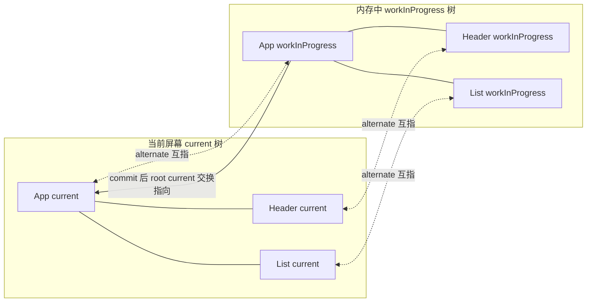

```javascript
// 简化实现，帮助理解双缓冲与节点复用
function createWorkInProgress(current, pendingProps) {
  let work = current.alternate;
  if (work === null) {
    // 首次：克隆一个新 Fiber 作为双缓冲
    work = {
      type: current.type,
      key: current.key,
      stateNode: current.stateNode, // 关键：复用真实 DOM，不是重新创建
      flags: 0,
      lanes: 0,
    };
    work.alternate = current;
    current.alternate = work;       // 互指
  } else {
    // 已有 alternate：就地复用，重置副作用标记即可
    work.flags = 0;
  }
  work.props = pendingProps;        // 用新 props
  work.child = null;
  work.memoizedState = current.memoizedState;
  return work;
}

// 更新流程（示意）
let root = { current: buildInitialFiberTree() }; // current 树

function scheduleUpdateOnFiber(fiber) {
  const wipRoot = createWorkInProgress(root.current, root.current.props);
  renderPhase(wipRoot);            // render 阶段：内存里构建新树，可中断
  commitPhase(wipRoot);            // commit 阶段：一次性应用 DOM 变更
  root.current = wipRoot;          // 提交完成：交换，新树成为 current
}
```

### FRP-025：React 的 render 阶段与 commit 阶段各自做什么？为什么这样划分？

**答**：
- **render 阶段**（Reconciler）：从 root 开始 beginWork/completeWork 遍历，执行 render 函数、计算 diff、在 Fiber 上打 flags 标记——**纯计算、无副作用、可中断**。
- **commit 阶段**（Renderer）：把 flags 同步执行到 DOM（beforeMutation/mutation/layout 三个子阶段），依次触发 getSnapshotBeforeUpdate、DOM 操作、useLayoutEffect，最后异步调度 useEffect——**同步不可中断**，避免用户看到中间状态。
- 划分原因：可中断只能发生在"不碰真实 DOM"的阶段；一旦开始改 DOM 就必须一口气完成，否则视觉不一致。
- 生命周期的归属也由此决定：UNSAFE_componentWillReceiveProps 等在可中断的 render 阶段可能被多次执行，因此被标记 UNSAFE（见 useEffect 时机题）。

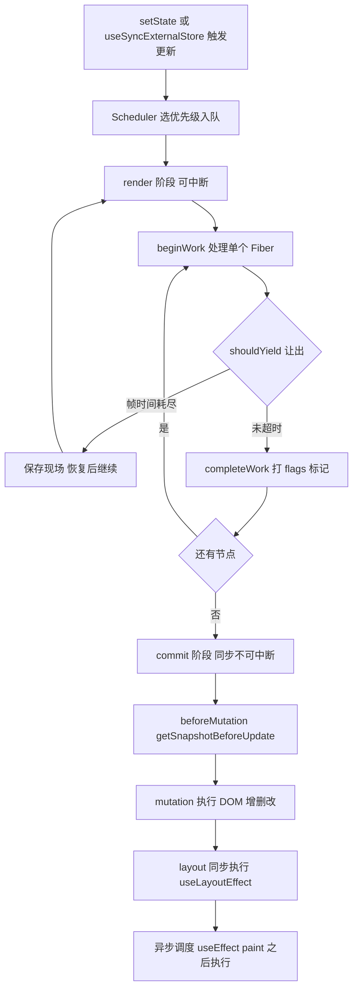

```javascript
// 简化实现，帮助理解两阶段划分
function renderRootSync(rootFiber) {
  // ===== render 阶段：纯计算，可中断，不碰 DOM =====
  let fiber = rootFiber;
  while (fiber) {
    beginWork(fiber);    // 执行函数组件 render 或类组件 render，diff 出子 Fiber
    // 真实源码在这里检查 shouldYield()，可暂停恢复（见 FRP-027）
    if (fiber.child) { fiber = fiber.child; continue; }
    while (fiber) {
      completeWork(fiber); // 生成/更新 DOM 描述，向父级冒泡 flags
      if (fiber.sibling) { fiber = fiber.sibling; break; }
      fiber = fiber.return;
    }
  }
  commitRoot(rootFiber);   // render 完成，进入同步 commit
}

function commitRoot(rootFiber) {
  // ===== commit 阶段：同步一口气完成，不可中断 =====
  // 1. beforeMutation：getSnapshotBeforeUpdate（拿到更新前 DOM 快照）
  // 2. mutation：按 flags 执行真实 DOM 操作
  const deletions = [], insertions = [], updates = [];
  collectFlags(rootFiber, { deletions, insertions, updates });
  deletions.forEach((d) => d.stateNode.remove());
  insertions.forEach((i) => i.parent.insertBefore(i.node.stateNode, i.before));
  updates.forEach((u) => Object.assign(u.node.stateNode, u.props));

  // 3. layout：同步执行 useLayoutEffect / componentDidMount
  flushLayoutEffects(rootFiber);

  // 4. passive：useEffect 调度到 paint 之后（宏任务/微任务）
  schedulePassiveEffects(rootFiber);
}
```

### FRP-026：lane 优先级模型是什么？比 expirationTime 好在哪？

**答**：
- lane 用一个 31 位整数的**每个二进制位**表示一种优先级，如 SyncLane=0b0001、InputContinuousLane=0b0010、DefaultLane=0b0100、TransitionLane、IdleLane……
- 优势一：**批量表达**。`lanes` 字段可以同时持有多个优先级（按位或），一次更新中"紧急 + 过渡"两类任务能共存于同一棵树上分别处理。
- 优势二：**批量比较**。`lanes & SyncLane` 一条位运算判断是否含某优先级，比 expirationTime 的数值比较灵活得多。
- 计算过程：`update.lane` 通过 `requestUpdateLane` 按调用上下文决定（事件处理器、startTransition、useEffect 各不相同），更新时取 `nextLanes = getHighestPriorityLanes(fiber.lanes)` 处理最高位优先。

```javascript
// 简化实现，帮助理解 lane 位运算模型
const TotalLanes = 31;
const SyncLane = 1 << 0;            // 0b0000001 同步：离散事件点击输入
const InputContinuousLane = 1 << 1; // 0b0000010 连续：scroll hover
const DefaultLane = 1 << 2;         // 0b0000100 默认
const TransitionLane1 = 1 << 3;     // 0b0001000 过渡：startTransition
const IdleLane = 1 << 30;           // 最低优先级：离屏渲染

// 批量收集：一次更新可能携带多个 lane（NoLanes 即 0，表示无待处理优先级）
let rootLanes = 0;
rootLanes |= DefaultLane;        // 0b100
rootLanes |= TransitionLane1;    // 0b1100 —— 两个优先级共存

// 判断包含：一条位运算
function includesAnyLanes(lanes, subset) {
  return (lanes & subset) !== 0;
}
console.log(includesAnyLanes(rootLanes, TransitionLane1)); // true

// 取最高优先级：找最低位的 1（数值越小优先级越高）
function getHighestPriorityLane(lanes) {
  return lanes & -lanes; // 0b1100 & -0b1100 = 0b100 => DefaultLane
}
console.log(getHighestPriorityLane(rootLanes) === DefaultLane); // true

// 合并与清除
function markRootFinished(rootLanes, finishedLanes) {
  return rootLanes & ~finishedLanes; // 清掉已完成的 lane，剩余的下次继续
}
```

### FRP-027：Concurrent 可中断渲染的原理是什么？shouldYield 如何判断让出？

**答**：
- Scheduler 把渲染工作拆成一个个 Fiber 单元（unit of work），`workLoop` 用 while 循环逐个执行，**每完成一个单元就检查 `shouldYield()`**：当前帧剩余时间不足（已用超过 5ms）或有更高优先级任务插入，就中断并返回。
- 中断后通过 `hostCallback` 重新调度（MessageChannel 宏任务），**从 `workInProgress` 指针处继续**——链表结构保证了现场可恢复。
- 高优先级插队：新更新的 lane 更高时，丢弃当前进行中的 render（成果保留在 pending 队列），先渲染紧急更新，再低优重放。
- 用户感知：点击输入这类 SyncLane 同步完成，而 startTransition 的大列表渲染被切成多帧执行，输入始终跟手。

```javascript
// 简化实现，帮助理解可中断渲染 workLoop
// 简化实现，帮助理解 React Scheduler
const schedulerChannel = new MessageChannel();
let taskQueue = [];      // 按 lane 排序的任务队列
let currentTask = null;

// shouldYield：帧时间预算判断（源码为 frameYieldMs = 5）
function shouldYield() {
  if (currentTask === null) return false;
  const elapsed = performance.now() - currentTask.startTime;
  return elapsed > 5; // 单个任务片超过 5ms 就让出，给浏览器渲染与输入留时间
}

schedulerChannel.port1.onmessage = () => {
  currentTask = taskQueue.shift();
  if (!currentTask) return;
  const { workLoop, onDone } = currentTask;

  // 核心：循环 + 可中断
  while (workLoop()) {
    if (shouldYield()) {           // 时间片用完
      schedulerChannel.port2.postMessage(null); // 让出主线程，稍后从断点继续
      return;
    }
  }
  onDone?.();
};

// 用法：把一棵 Fiber 树的渲染包装成可中断任务
function performConcurrentWork(root) {
  let workInProgress = root.child;
  taskQueue.push({
    startTime: performance.now(),
    // workLoop 每次调用处理一个 Fiber 单元，返回是否还有剩余工作
    workLoop: () => {
      if (!workInProgress) return false;
      beginWork(workInProgress);            // 处理当前单元
      workInProgress = nextUnitOfWork(workInProgress);
      return true;                          // 还有工作未完成
    },
    onDone: () => commitRoot(root),
  });
  schedulerChannel.port2.postMessage(null);
}

// startTransition 的更新进入低优先级队列：被紧急更新插队后可整体丢弃重放
function startTransition(fn) {
  const prevLane = currentUpdateLane;
  currentUpdateLane = TransitionLane1;
  fn(); // 里面的 setState 以 TransitionLane 调度
  currentUpdateLane = prevLane;
}
```

## 五、React Hooks 原理

### FRP-028：组件里调用多次 useState，React 是如何区分它们的？

**答**：
- 每个 Fiber 节点上挂着 `memoizedState`，它指向一条**单向 Hook 链表**：每调用一次 `useState/useEffect/...` 就在链表上生成一个节点。
- **mount 时**（首次渲染）按调用顺序依次创建节点；**update 时**从链表头按同样的顺序逐个读取——第 3 次调用的 useState 读的永远是链表第 3 个节点。
- 链表节点结构：`{ memoizedState, queue, baseState, next }`，update 对象（setState 的入参）先进入该 hook 的 `queue`，render 阶段依次计算得出新 state。
- 这就是"多次调用如何区分"的答案：不靠参数、不靠名字，靠**调用顺序与链表位置对齐**。

```javascript
// 简化实现，帮助理解 Hook 链表与 useState
let currentFiber = null;     // 当前正在 render 的 fiber
let workInProgressHook = null; // 当前处理到的 hook 指针
let isMount = true;

function createFiber() {
  return { memoizedState: null }; // Hook 链表头
}

// 核心入口：每调用一次 useState，就在链表上前进一格
function useState(initialState) {
  let hook;
  if (isMount) {
    // mount：创建新 hook 节点，追加到链表尾
    hook = { memoizedState: initialState, queue: [], next: null };
    if (!currentFiber.memoizedState) {
      currentFiber.memoizedState = hook;       // 第一个 hook 作为链表头
    } else {
      workInProgressHook.next = hook;          // 挂到上一个 hook 后面
    }
    workInProgressHook = hook;
  } else {
    // update：按顺序取链表的下一个节点 —— 顺序决定身份
    hook = workInProgressHook;
    workInProgressHook = hook.next;
    // 处理 queue 里攒下的 update（setState 的入参）
    hook.queue.forEach((action) => {
      hook.memoizedState = typeof action === 'function' ? action(hook.memoizedState) : action;
    });
    hook.queue.length = 0;
  }

  const setState = (action) => {
    hook.queue.push(action);       // update 排进该 hook 自己的队列
    scheduleRender(currentFiber);  // 触发重新渲染
  };

  return [hook.memoizedState, setState];
}

function render(App) {
  currentFiber = App.fiber || (App.fiber = createFiber());
  workInProgressHook = currentFiber.memoizedState; // 从链表头开始
  App();
  isMount = false;
}

// 验证顺序对齐：
// function App() {
//   const [count, setCount] = useState(0);   // 链表第 1 个节点
//   const [name, setName]   = useState('a'); // 链表第 2 个节点
//   setCount(1); setCount(n => n + 1);       // 都进入第 1 个节点的 queue
// }
```

### FRP-029：为什么 Hooks 不能写在条件语句或循环里？

**答**：
- Hook 的身份完全由**链表位置**决定（见上一题）：update 时 React 按顺序从链表头逐个取节点，它不知道也不检查你的代码逻辑。
- 一旦某次渲染条件分支少调了一个 hook，链表位置就会**错位**：后续 hook 读到的是前面 hook 的 state 与 queue，数据错乱甚至崩溃。
- React 的对策：每个 hook 节点带 `DebugName`/调试器检查，开发环境会在错位时报 "Rendered fewer hooks than expected"。
- 正确做法：把条件移进 hook 内部（`if (ready) useEffect(...)`）或拆组件，而不是条件化 hook 调用本身。

```javascript
// 一一对应：条件调用导致的链表错位（演示性代码）
// 简化实现，帮助理解
function badComponent({ enabled }) {
  // 第一次渲染 enabled=true，链表：[useState, useEffect, useState]
  // 第二次渲染 enabled=false，只调了两个 hook：
  //   useState 读取第 1 个节点 —— 正常
  //   useState 读取第 2 个节点 —— 其实是 useEffect 的节点！
  // 第二个 useState 的值变成了 effect 的 memoizedState（undefined）
  // 第三个 useState 从此永远读到错的数据
  const [a, setA] = useState(0);
  // if (enabled) useEffect(() => {...}, []); // 错误写法
  const [b, setB] = useState(0);
  return <div>{a}{b}</div>;
}

// 正确写法一：条件放进 hook 内部
function goodComponent({ enabled }) {
  useEffect(() => {
    if (enabled) { /* ... */ } // 条件在 effect 体内
  }, [enabled]);
  const [a, setA] = useState(0);
  const [b, setB] = useState(0);
  return <div>{a}{b}</div>;
}

// 正确写法二：条件部分拆成独立组件，各组件有自己的 hook 链
function bestComponent({ enabled }) {
  return enabled ? <EnabledPanel /> : <DisabledPanel />;
}
```

### FRP-030：React 18 的自动批处理是什么原理？为什么 setState 是异步的？

**答**：
- `setState` 本身不执行更新，只是把 update 排进对应 hook 的队列并**调度一次 render**；真正的更新在微任务/调度器回调里批量执行——这就是"异步"的体感来源。
- 批处理：同一事件循环内的多次 setState 合并为**一次 render**，只取最终值；React 17 只在合成事件与生命周期内批处理，18 起通过 `ensureRootIsScheduled` 让 Promise/setTimeout/原生事件里也批处理。
- 实现核心：调度入口加 `isBatching` 标记，多次 setState 只安排一次 `flushWork`（微任务），flush 时统一处理所有排队的 update。
- `flushSync` 可强制同步 flush，用于"改完立即读 DOM"的场景。

```javascript
// 简化实现，帮助理解批量更新
let isBatching = false;
const pendingRoots = new Set();

function scheduleRender(fiber) {
  pendingRoots.add(fiber);          // 多次 setState 只累积
  if (isBatching) return;           // 已有 flush 在排队，不重复调度
  isBatching = true;
  Promise.resolve().then(flushWork); // 微任务批量执行 —— 这就是"异步"的本质
}

function flushWork() {
  isBatching = false;
  const roots = [...pendingRoots];
  pendingRoots.clear();
  roots.forEach((root) => renderFromRoot(root)); // 一次 render 消费所有 update
}

// 用法验证：
// function handleClick() {
//   setCount(1);        // 只排队
//   setCount(n => n + 1); // 只排队
//   setName('x');       // 只排队
//   console.log(count); // 0 —— 还没 render，拿到旧值
//   // 本次事件结束后微任务 flush，一次 render：count 最终为 2
// }

// React 18 前后的差异：setTimeout 内 React 17 会 render 两次，18 仍批处理
// setTimeout(() => {
//   setCount(n => n + 1);
//   setName('y');
//   // React 18：一次 render；React 17：两次 render
// }, 0);

// 需要同步拿最新 DOM 时用 flushSync
// import { flushSync } from 'react-dom';
// flushSync(() => setCount(10));
// console.log(ref.current.textContent); // 立即是 10
```

### FRP-031：useEffect 与 useLayoutEffect 的执行时机在源码层面差在哪？

**答**：
- 都在 **commit 阶段**执行，但挂在不同子阶段：`useLayoutEffect` 在 layout 子阶段**同步**执行（DOM 已更新、浏览器尚未 paint）；`useEffect` 被标记为 passive，**paint 之后**异步调度（通常是宏任务/IDLE）。
- 完整顺序：DOM mutation → **useLayoutEffect（同步）** → 浏览器 paint → **useEffect（异步）**。
- 因此 useLayoutEffect 会阻塞渲染：适合"测量 DOM 后立刻改样式"防闪烁的场景（tooltip 定位）；useEffect 适合订阅、请求等不阻塞首帧的工作。
- cleanup 同理：上轮 useLayoutEffect 的 destroy 在本轮 layout 阶段同步跑，useEffect 的 destroy 在下轮 passive 阶段跑。

```javascript
// 一一对应：执行顺序实测
import { useEffect, useLayoutEffect, useRef } from 'react';

export default function OrderDemo() {
  const ref = useRef(null);

  useLayoutEffect(() => {
    // 3 —— DOM 已更新但屏幕还没画出来：在这里测量/修改样式不会闪烁
    console.log('3 useLayoutEffect');
    const rect = ref.current.getBoundingClientRect(); // 测量后立即调整，无中间帧
  });

  useEffect(() => {
    // 5 —— paint 之后异步执行：不阻塞首帧
    console.log('5 useEffect');
    return () => console.log('cleanup useEffect'); // 6 下轮更新时或卸载时
  });

  console.log('1 render'); // 1 —— render 阶段，每次渲染都跑

  return <div ref={ref}>order demo</div>;
}
// 首屏完整顺序：
// 1 render
// 2 DOM mutation（React 内部，无日志）
// 3 useLayoutEffect
// 4 浏览器 paint
// 5 useEffect
```

```javascript
// 简化实现，帮助理解源码中两阶段的划分
function commitRoot(root) {
  // mutation 子阶段：真实 DOM 增删改
  mutationPhase(root.finishedWork);

  // layout 子阶段：同步执行 —— useLayoutEffect 的 create 与上一轮 destroy
  root.finishedWork.flags & Layout
    ? runLayoutEffects(root.finishedWork) // 同步阻塞，paint 前完成
    : null;

  // passive 子阶段：调度到 paint 之后 —— useEffect
  // 源码：flushPassiveEffects 被排入 Scheduler 的 NormalPriority 回调
  scheduleCallback(NormalPriority, () => runPassiveEffects(root.finishedWork));
}

function runLayoutEffects(fiber) {
  // 遍历 flags 带 Passive|Layout 的节点，同步调用：
  //   上轮 useLayoutEffect 的 destroy -> 本轮 useLayoutEffect 的 create
}
function runPassiveEffects(fiber) {
  // 遍历 flags 带 Passive 的节点，异步调用：
  //   上轮 useEffect 的 destroy -> 本轮 useEffect 的 create
}
```

### FRP-032：useMemo 与 useCallback 的本质是什么？为什么说它们不是语义保证？

**答**：
- 本质：把值/函数缓存在**当前 Fiber 的 hook 节点**上，update 时比较依赖数组（逐位 `Object.is`），不变就返回缓存的旧值，跳过重算。
- `useCallback(fn, deps)` 就是 `useMemo(() => fn, deps)` 的语法糖——两者都是"依赖不变返回旧引用"。
- **不是语义保证**：React 可能丢弃缓存（如切换 Hook 链表、Concurrent 重放），因此不能把"必须只执行一次"的逻辑（发请求、写全局变量）放在 useMemo 里，那是 useEffect 的职责。
- 它们的收益场景只有两个：跳过昂贵计算、维持子组件 props 引用稳定配合 memo。

```javascript
// 简化实现，帮助理解 useMemo/useCallback
let workInProgressHook = null;

function useMemo(factory, deps) {
  const hook = workInProgressHook; // 当前 hook 节点，mount 时已创建
  if (hook.memoizedState === null) {
    // mount：执行工厂函数并缓存 { value, deps }
    const value = factory();
    hook.memoizedState = { value, deps };
    return value;
  }
  const { value, deps: prevDeps } = hook.memoizedState;
  if (areHookInputsEqual(deps, prevDeps)) {
    return value;                  // 依赖逐位 Object.is 相等：直接返回缓存
  }
  const newValue = factory();      // 任一依赖变化：重算并更新缓存
  hook.memoizedState = { value: newValue, deps };
  return newValue;
}

function useCallback(fn, deps) {
  // 完全等价于 useMemo(() => fn, deps)
  return useMemo(() => fn, deps);
}

function areHookInputsEqual(nextDeps, prevDeps) {
  if (prevDeps === null) return false;
  for (let i = 0; i < nextDeps.length; i++) {
    if (Object.is(nextDeps[i], prevDeps[i])) continue;
    return false; // 有一位不等即重算
  }
  return true;
}

// 反例：useMemo 不保证只执行一次
// const [data] = useMemo(() => fetchOnce(), []); // 错误！React 可能重复调用
// const [data] = useEffect(() => { fetchOnce(); }, []);         // 正确：副作用
```

### FRP-033：useRef 是如何实现的？为什么改 ref 不触发重渲染？

**答**：
- 实现：mount 时创建 `{ current: initialValue }` 对象存进 hook 节点的 memoizedState；update 时**直接返回同一个对象**——跨渲染的稳定性来自 Fiber 节点本身长存。
- 修改 `ref.current` 只是普通对象属性赋值，**不触发任何更新调度**，所以不重渲；这正是它"跨渲染存值但不驱动视图"的定位。
- 挂到 DOM 的 ref（`ref={inputRef}`）在 commit 阶段由 React 写入 `current`（ref attach/detach 在 mutation/layout 子阶段）。
- 与 useState 的对比：state 是"改了要重渲的值"，ref 是"改了不想重渲的值"（定时器 ID、上一次值、DOM 引用、可变标志位）。

```javascript
// 简化实现，帮助理解 useRef
function useRef(initialValue) {
  const hook = workInProgressHook;
  if (isMount) {
    // mount：创建一个可变对象存进 hook 节点
    hook.memoizedState = { current: initialValue };
  }
  // update：hook 节点还是同一个（链表位置没变），memoizedState 还是同一个对象
  return hook.memoizedState; // 引用跨渲染稳定，改 current 不触发 render
}

// 一一对应：三个典型用法
import { useRef, useState, useEffect } from 'react';

function Demo() {
  const inputRef = useRef(null);       // 1. DOM 引用
  const timerRef = useRef(null);       // 2. 存定时器，不因它重渲
  const prevRef = useRef(0);           // 3. 保存上一次渲染的值

  const [count, setCount] = useState(0);

  useEffect(() => {
    prevRef.current = count;           // 每次渲染后记录，下轮可读
  });

  useEffect(() => {
    timerRef.current = setInterval(() => setCount((n) => n + 1), 1000);
    return () => clearInterval(timerRef.current); // 卸载时清理
  }, []);

  return (
    <>
      <input ref={inputRef} />
      <p>上一次 {prevRef.current}，当前 {count}</p>
      <button onClick={() => inputRef.current.focus()}>聚焦</button>
    </>
  );
}
```

### FRP-034：useReducer 与 useState 是什么关系？

**答**：
- 源码中 `useState` 就是 `useReducer(basicStateReducer, initial)` 的特例：basicStateReducer 即 `action => typeof action === 'function' ? action(state) : action`——所以 useState 的 setter 支持传函数或传值。
- useReducer 把"怎么改"集中到 reducer：多来源修改同一 state 时逻辑内聚、dispatch 引用永远稳定（不像多个 setter 各自闭包）。
- dispatch 是稳定的：它只往 hook 的 queue 里 push action，不依赖本次渲染的任何值，所以可以安全放进子组件 props 而无需 useCallback。
- 两者共享同一套 hook 链表与批处理机制，性能无本质差异。

```javascript
// 简化实现，帮助理解 useState 是 useReducer 的特例
function useReducer(reducer, initialArg, init) {
  const hook = workInProgressHook;
  if (isMount) {
    hook.memoizedState = init ? init(initialArg) : initialArg;
    hook.queue = [];
  } else {
    hook.queue.forEach((action) => {
      // 与 useState 唯一的区别：计算新 state 走 reducer
      hook.memoizedState = reducer(hook.memoizedState, action);
    });
    hook.queue.length = 0;
  }
  const dispatch = (action) => {
    hook.queue.push(action);
    scheduleRender(currentFiber);
  };
  return [hook.memoizedState, dispatch];
}

// basicStateReducer：useState 的 reducer 就是"直接应用 action"
function basicStateReducer(state, action) {
  return typeof action === 'function' ? action(state) : action;
}

function useState(initialState) {
  return useReducer(basicStateReducer, initialState);
}

// 验证：setCount(1) 与 setCount(n => n + 1) 都被 basicStateReducer 解释
// const [count, setCount] = useState(0);
// setCount(1);            // basicStateReducer(0, 1) => 1
// setCount((n) => n + 1); // basicStateReducer(1, n => n+1) => 2
```

### FRP-035：Context 的实现原理是什么？value 变化时如何精准通知消费者？

**答**：
- `createContext` 创建 `{ $$typeof, _currentValue, Provider, Consumer }` 对象；Provider 渲染时把 value 写入 `_currentValue`。
- 消费侧（useContext）从当前 Fiber 沿 `return` 链**向上查找**最近的 Provider fiber（React 16.3+ 不再用栈游标，改为逐层向上 + 剪枝）。
- 精准通知：render 阶段 beginWork 时检查 `fiber.dependencies`（消费了哪些 context），Provider 的 value 变了就给**所有消费它的子孙 fiber** 打上 Update 标记，没有消费的子树被 bailout（跳过）。
- 性能要点：value 是新对象每次都通知所有消费者——大 context 应拆分或改用 selector 订阅（zustand/useSyncExternalStore）。

```javascript
// 简化实现，帮助理解 Context 查找与通知
const contextRegistry = new Map(); // Provider fiber -> value

function createContext(defaultValue) {
  const context = { $$typeof: Symbol('react.context'), _defaultValue: defaultValue };
  context.Provider = { $$typeof: Symbol('react.provider'), context };
  return context;
}

function pushProvider(providerFiber, value) {
  contextRegistry.set(providerFiber, value); // Provider render 时记录 value
}

function useContext(context) {
  let fiber = currentFiber;
  // 沿 return 链向上找最近的 Provider
  while (fiber) {
    if (fiber.type?.$$typeof === Symbol('react.provider') && fiber.type.context === context) {
      return contextRegistry.get(fiber);
    }
    fiber = fiber.return;
  }
  return context._defaultValue;
}

// 值变化时的传播（beginWork 内，示意）
function beginWorkWithProviderCheck(fiber, oldProps) {
  if (fiber.type?.$$typeof === Symbol('react.provider')) {
    const newValue = fiber.pendingProps.value;
    const oldValue = contextRegistry.get(fiber);
    if (!Object.is(oldValue, newValue)) {
      propagateContextChange(fiber, fiber.type.context); // 给消费者打标记
    }
    pushProvider(fiber, newValue);
  }
}
function propagateContextChange(providerFiber, context) {
  // 深入遍历子树，dependencies 里登记了该 context 的 fiber 强制更新
  // 未消费的兄弟子树被 bailout，不重新 render —— 这就是精准通知
}
```

### FRP-036：useTransition 与 useDeferredValue 的原理是什么？

**答**：
- 两者都基于 lane 优先级：`useTransition` 把更新标记为 **TransitionLane**（可中断、可被紧急更新插队），`isPending` 在过渡期间为 true。
- `startTransition(fn)` 执行期间的所有 setState 都以 TransitionLane 调度：紧急更新（输入）先渲染，过渡内容被切片渲染；被打断的过渡 render 可整体丢弃重放。
- `useDeferredValue(value)` 返回一个"延迟副本"：紧急渲染先用旧值，空闲后用新值再渲染一次——本质是"两次渲染、旧值先行"，不新增调度 API。
- 典型分工：输入框直接绑定原始值（跟手），昂贵的列表绑定 deferredValue。

```jsx
// 一一对应：useTransition 与 useDeferredValue 的原理性用法
import { useTransition, useDeferredValue, useState, useMemo } from 'react';

function SearchWithTransition({ items }) {
  // 双 state：输入值紧急更新，查询值走过渡更新
  const [inputValue, setInputValue] = useState('');
  const [query, setQuery] = useState('');
  const [isPending, startTransition] = useTransition();

  return (
    <>
      {/* 输入用同步 setState：紧急更新，保证跟手 */}
      <input value={inputValue} onChange={(e) => {
        setInputValue(e.target.value);            // SyncLane 立即渲染输入框
        startTransition(() => {
          setQuery(e.target.value);               // TransitionLane：结果列表低优渲染
        });
      }} />
      {isPending && <span>更新中...</span>}
      <BigList filter={query} items={items} />    {/* 被切片渲染，不阻塞输入 */}
    </>
  );
}

function SearchWithDeferred({ items }) {
  const [query, setQuery] = useState('');
  // 延迟副本：先以旧 query 渲染列表（快），空闲后以新 query 重渲染
  const deferredQuery = useDeferredValue(query);

  const list = useMemo(
    () => items.filter((it) => it.name.includes(deferredQuery)),
    [items, deferredQuery]
  );

  return (
    <>
      <input value={query} onChange={(e) => setQuery(e.target.value)} />
      <BigList list={list} stale={deferredQuery !== query} />
    </>
  );
}
```

## 六、React 更新、事件与异常处理

### FRP-037：React 的合成事件与事件委托是什么原理？

**答**：
- React 不在元素上直接 addEventListener，而是**在根容器上委托监听**：点击子元素时利用 DOM 冒泡统一进入 React 的分发器。
- 分发器从事件目标沿 Fiber 的 return 链**向上收集**所有监听同一事件的回调（同时收集捕获与冒泡两条路径），再按捕获→目标的顺序依次执行——模拟完整的事件流。
- 传给回调的 `e` 是 **SyntheticEvent 合成对象**：包装原生事件，抹平浏览器差异，提供 `e.stopPropagation/preventDefault` 等统一 API（`e.nativeEvent` 取原生对象）。
- 收益：减少监听器数量、统一行为、并让事件回调能进入 React 的批处理调度。

```javascript
// 简化实现，帮助理解事件委托与合成事件
function createSyntheticEvent(nativeEvent) {
  return {
    nativeEvent,
    type: nativeEvent.type,
    target: nativeEvent.target,
    currentTarget: null,
    // 包装原生方法
    stopPropagation() { nativeEvent.stopPropagation(); this._stopped = true; },
    preventDefault() { nativeEvent.preventDefault(); },
    _stopped: false,
    isPropagationStopped() { return this._stopped; },
  };
}

// root 容器上只注册一次
const root = document.getElementById('root');
root.addEventListener('click', dispatchClick, false);       // 冒泡阶段
root.addEventListener('click', dispatchClick, true);        // 捕获阶段

function dispatchClick(nativeEvent) {
  const syntheticEvent = createSyntheticEvent(nativeEvent);
  // 1. 找到触发元素对应的 fiber
  let fiber = nativeEvent.target.__reactFiber$; // React 在 DOM 上打的 fiber 引用
  // 2. 沿 return 链向上收集回调，分两路
  const bubble = [], capture = [];
  while (fiber) {
    const onClick = fiber.memoizedProps?.onClick;
    const onClickCapture = fiber.memoizedProps?.onClickCapture;
    if (onClickCapture) capture.unshift(onClickCapture); // 捕获：先入先出反转
    if (onClick) bubble.unshift(onClick);                // 冒泡：最后注册的先执行
    fiber = fiber.return;
  }
  // 3. 按事件流顺序执行
  if (nativeEvent.eventPhase === 1) capture.forEach((fn) => fn(syntheticEvent));
  else bubble.forEach((fn) => { if (!syntheticEvent.isPropagationStopped()) fn(syntheticEvent); });
}
```

### FRP-038：React 17 把事件委托从 document 改到 root，为什么？事件池为什么被移除？

**答**：
- React 16 委托在 `document`：一个页面多个 React root 时，事件会跨 root 串台（一个 root 的 stopPropagation 挡不住另一个 root）；且与其它框架共存、与原生事件混用时层级不可控。
- React 17+ 委托到**每个 root 容器**：作用域隔离、与原生事件的关系更直观（`document` 上的原生监听能正常拦截 React 事件）。
- React 16 的事件池（SyntheticEvent 复用对象，回调结束后属性置 null）经常造成"异步读 e.target 变 null"的经典 bug；17 移除事件池后事件对象可随意异步使用，代价是 GC 压力略增（现代引擎可承受）。

```jsx
// 一一对应：两个易踩坑点的前后对比
import { useState } from 'react';

export default function EventDemo() {
  const [text, setText] = useState('');

  const handleChange = (e) => {
    // React 16 坑：异步读事件对象 —— 事件池回收后 e.target 为 null
    // setTimeout(() => setText(e.target.value), 0);  // 16 中报错
    setTimeout(() => setText(e.target.value), 0);    // 17+ 正常：无事件池
  };

  return (
    <div onClickCapture={() => console.log('capture 父')} onClick={() => console.log('bubble 父')}>
      <input onChange={handleChange} />
      {/* React 17 的停止传播只作用于本 root：
          若页面上还有另一个 root 挂在 document 上（16），这里的 stopPropagation 会被绕过 */}
      <button onClick={(e) => { e.stopPropagation(); console.log('子，不再冒泡'); }}>stop</button>
      <p>{text}</p>
    </div>
  );
}
// React 17+ 委托结构：
// root 容器 ──监听 click/focus/... ──> 分发到本 root 内的 fiber 链
// document ──不再有 React 的监听
```

### FRP-039：从调用 setState 到界面更新，完整链路发生了什么？

**答**：
- 1）`setState` 创建 update 对象，push 进对应 hook 的 updateQueue，并调用 `scheduleUpdateOnFiber`。
- 2）`markRootUpdated` 把本次 lane 并入 root.pendingLanes，`ensureRootIsScheduled` 根据最高 lane 选择调度器回调（同步/Scheduler 并发）。
- 3）render 阶段：从 root 向下 beginWork，遇到有 update 的 hook 就循环计算新 state，props 变化的子树重新 render，产出带 flags 的 workInProgress 树（可中断）。
- 4）commit 阶段：mutation 同步应用 DOM 变更 → layout 同步跑 useLayoutEffect → paint → passive 异步跑 useEffect。
- 面试可压缩为四步：**排队 update → 调度 lane → 可中断 render → 同步 commit**。

```javascript
// 简化实现，帮助理解完整链路
function setState(fiber, hook, action) {
  // 步骤 1：创建 update 并排队
  const update = { action, lane: requestUpdateLane() }; // 事件内 Sync，transition 内低优
  hook.queue.push(update);

  // 步骤 2：把 lane 合入 root，安排调度
  const root = markRootUpdated(fiber, update.lane);     // pendingLanes |= lane
  ensureRootIsScheduled(root);                          // 选最高 lane 决定同步或并发
}

function ensureRootIsScheduled(root) {
  const nextLanes = getHighestPriorityLanes(root.pendingLanes);
  if (includesSyncLane(nextLanes)) {
    // 同步 lane：微任务内同步 render，一气呵成
    queueMicrotask(() => performSyncWorkOnRoot(root));
  } else {
    // 并发 lane：交给 Scheduler，帧预算内切片（见 FRP-027）
    scheduleCallback(priorityFromLanes(nextLanes), () => performConcurrentWorkOnRoot(root));
  }
}

function performSyncWorkOnRoot(root) {
  // 步骤 3：render 阶段 —— 构建 workInProgress 树
  renderRootSync(root);   // beginWork/completeWork，可被打断（并发路径）
  // 步骤 4：commit 阶段 —— 同步应用
  commitRoot(root);
  root.pendingLanes = markRootFinished(root.pendingLanes, root.finishedLanes);
}
```

### FRP-040：Suspense 的原理是什么？"throw Promise" 是怎么工作的？

**答**：
- 核心机制：渲染过程中如果数据/模块没就绪，组件**throw 一个 thenable**；React 在 beginWork 外层 try-catch 捕获，识别为 Promise 后，在 promise resolve 前展示 fallback。
- 捕获后 React 给 Suspense 边界打上标记，commit fallback 树；Promise resolve 后以**重试 lane** 重新调度该子树渲染，这次组件正常返回。
- `React.lazy` 就是 throw promise 的内置实现（模块未加载完时 throw `import()` 的 promise）。
- 数据请求配合（React 18+ `use`/React Query suspense 模式）：读取缓存未命中时 throw 请求 promise，命中则直接返回数据，实现"组件里 await"的声明式写法。

```jsx
// 一一对应：手写一个 throw promise 的组件，理解 Suspense 机制
import { Suspense } from 'react';

const cache = new Map();

function readData(id) {
  if (cache.has(id)) return cache.get(id);          // 已就绪：同步返回
  // 未就绪：发起请求并 throw promise —— React 捕获它
  const promise = fetch(`/api/user/${id}`).then((r) => r.json());
  const wrapped = promise.then((data) => {
    cache.set(id, data);
    return data;
  });
  throw wrapped; // 关键：渲染被"挂起"，Suspense 边界捕获
}

function User({ id }) {
  const user = readData(id); // 就绪前 throw，就绪后同步读
  return <h1>{user.name}</h1>;
}

export default function Page() {
  return (
    <Suspense fallback={<h1>加载中...</h1>}>
      {/* 首次渲染：User throw promise -> React 渲染 fallback
          promise resolve -> React 以 retry lane 重新渲染 User -> 正常显示 */}
      <User id={1} />
    </Suspense>
  );
}

// 简化实现，帮助理解边界的捕获逻辑：
// function renderWithSuspense(children, fallback) {
//   try {
//     return render(children);
//   } catch (thrown) {
//     if (typeof thrown?.then === 'function') {   // throw 的是 promise
//       thrown.then(() => retryLaneRender(children)); // resolve 后重试
//       return render(fallback);                      // 先提交 fallback
//     }
//     throw thrown; // 其它错误交给 ErrorBoundary
//   }
// }
```

### FRP-041：ErrorBoundary 的实现原理是什么？为什么捕获不了事件与异步错误？

**答**：
- ErrorBoundary 是**类组件**的静态方法 `getDerivedStateFromError`（渲染 fallback UI）与实例方法 `componentDidCatch`（上报日志）——React 在 commit 阶段前对子树渲染错误做 try-catch，捕获后**卸载出错的子树**并重渲 fallback。
- 传播规则：沿 Fiber 向上找最近的 boundary；boundary 自身抛错则继续向上；没有 boundary 时整棵树卸载（白屏）。
- 捕获不了三类错误：**事件处理器**（不在 render 流程内，用 try-catch 或全局 onerror）、**异步回调/定时器**、**SSR/服务端错误**——因为它们不发生在 React 的渲染调用栈里。
- 实际落地：根级一个兜底 boundary + 路由级/组件级局部 boundary，配合 09 章的上报通道。

```jsx
// 一一对应：手写 ErrorBoundary 与边界说明
import { Component } from 'react';

class ErrorBoundary extends Component {
  state = { error: null };

  static getDerivedStateFromError(error) {
    // 阶段一 render：子树抛错后调用，返回值作为新 state —— 用于渲染 fallback
    return { error };
  }

  componentDidCatch(error, info) {
    // 阶段二 commit：记录副作用，如上报
    // info.componentStack 是 React 生成的组件调用栈
    reportToMonitor('render-error', { message: error.message, stack: info.componentStack });
  }

  render() {
    if (this.state.error) {
      return this.props.fallback ?? <h1>页面出错了</h1>;
    }
    return this.props.children; // 无错误时正常渲染子树
  }
}

// 用法：按层级包裹
// <ErrorBoundary fallback={<WidgetError />}>
//   <RiskyWidget />
// </ErrorBoundary>

// 捕获不到的场景演示：
class Demo extends Component {
  componentDidMount() {
    // 异步错误：不在 React 渲染栈内，boundary 捕获不到 —— 需要全局兜底
    setTimeout(() => { throw new Error('异步错误 boundary 捕获不到'); }, 0);
  }
  handleClick = () => {
    // 事件错误：同样捕获不到 —— 在事件处理器里 try-catch 或全局 onerror
    try {
      JSON.parse('{bad json}');
    } catch (e) {
      reportToMonitor('event-error', e);
    }
  };
  render() { return <button onClick={this.handleClick}>click</button>; }
}
```

### FRP-042：什么是 Hooks 的闭包陷阱？它和 Fiber 有什么关系？

**答**：
- 函数组件每次渲染都是**一次新的函数调用**，本次的 state/props 是本次 render 的闭包快照——定时器、事件监听里拿到的往往是"注册那一刻"的旧值，这就是闭包陷阱。
- 与 Fiber 的关系：每个 Fiber 对应多次渲染，每次渲染有自己的一套 hook 值（链表节点被更新，但**函数执行时的局部变量已被闭包捕获**）；旧渲染的闭包不会因 state 更新而自动刷新。
- 解法一：`useRef` 存最新值（引用不变，内容可变）；解法二：setState 传函数 `setCount(n => n + 1)` 让 React 在 update 时基于最新值计算；解法三：依赖数组写全 + 清理函数。
- 在 Concurrent 下更要注意：被中断重放的 render 可能产生多个"平行快照"，依赖旧闭包的逻辑会更早暴露问题。

```jsx
// 一一对应：闭包陷阱复现与三种解法
import { useState, useEffect, useRef } from 'react';

export default function ClosureTrap() {
  const [count, setCount] = useState(0);

  // 陷阱：定时器闭包捕获的是首次渲染的 count（永远 0）
  useEffect(() => {
    const t = setInterval(() => {
      console.log('count is', count); // 一直是 0！
    }, 1000);
    return () => clearInterval(t);
  }, []); // 空依赖：effect 只注册一次，闭包定格在第一次渲染

  // 解法一：函数式更新，不依赖闭包里的 count
  useEffect(() => {
    const t = setInterval(() => {
      setCount((n) => n + 1); // n 由 React 基于 hook 队列最新值计算
    }, 1000);
    return () => clearInterval(t);
  }, []);

  // 解法二：useRef 保存最新值
  const countRef = useRef(count);
  useEffect(() => { countRef.current = count; });
  useEffect(() => {
    const t = setInterval(() => {
      console.log('latest count', countRef.current); // 总是最新
    }, 1000);
    return () => clearInterval(t);
  }, []);

  return <p>{count}</p>;
}
```

### FRP-043：React.memo 与 shouldComponentUpdate 的原理是什么？浅比较的坑在哪？

**答**：
- 更新传播默认是"父更新则子全更新"；`React.memo`（函数组件）与 `shouldComponentUpdate/PureComponent`（类组件）提供一道**手动逃生门**：props 浅比较相同则跳过整个子树的 render（bailout）。
- memo 第二个参数可自定义比较函数（返回 true 表示相等、跳过渲染），语义与 SCU 相反，容易写反。
- 浅比较的坑：**每次渲染新建的 props 引用必然不等**——`onClick={() => ...}`、`style={{...}}`、数组字面量都会让 memo 失效，需要 useCallback/useMemo/stable 库配合。
- bailout 只是跳过**本组件的 render**：若子孙组件消费了 context 或自身有 state 更新，仍会更新。

```jsx
// 一一对应：memo 失效与修复
import { memo, useState, useCallback, useMemo } from 'react';

// 浅比较实现（源码 shallowEqual 的核心逻辑）
function shallowEqual(objA, objB) {
  if (Object.is(objA, objB)) return true;
  const keysA = Object.keys(objA), keysB = Object.keys(objB);
  if (keysA.length !== keysB.length) return false;
  return keysA.every((k) => Object.prototype.hasOwnProperty.call(objB, k) && Object.is(objA[k], objB[k]));
}

const Row = memo(({ item, onSelect }) => {
  console.log('render row', item.id);
  return <li onClick={() => onSelect(item.id)}>{item.name}</li>;
});

export default function List() {
  const [keyword, setKeyword] = useState('');

  // 坑：内联函数每次渲染都是新引用，memo 完全失效，列表全量重渲
  // <Row item={item} onSelect={(id) => console.log(id)} />

  // 修复 1：useCallback 稳定函数引用
  const onSelect = useCallback((id) => console.log('select', id), []);

  return (
    <ul>
      <input value={keyword} onChange={(e) => setKeyword(e.target.value)} />
      {items.map((item) => (
        <Row key={item.id} item={item} onSelect={onSelect} />
        // keyword 变化时 List 重渲，但 item/onSelect 引用不变 -> Row 被 bailout
      ))}
    </ul>
  );
}

const items = [
  { id: 1, name: 'a' },
  { id: 2, name: 'b' },
];
```

### FRP-044：key 在 diff 中的源码级作用是什么？为什么用 index 当 key 会出问题？

**答**：
- reconcileChildren 中，新旧 children 都有 key 时会构建 **`key -> 旧 fiber` 的 Map**（existingChildren），新列表逐项用 `key + type` 查旧 fiber：查到就复用更新，查不到就新建，Map 里剩余的在最后统一删除。
- key 相同 + type 相同 → 复用 fiber（保住 DOM 节点与 state）；key 相同 type 不同 → 复用 key 但重建节点；key 不同 → 销毁重建。
- 用 index 当 key：列表头部插入一项后，所有项的 key 位置对不上，**全部按错位复用**——input 等非受控状态串行、组件 state 错乱、动画错位；更新本身还触发全量 patch。
- 结论：key 只要求"**同层级列表内唯一且稳定**"，用业务 id；无状态纯展示的短列表用 index 退化可行，但一旦涉及输入/动画就是 bug 温床。

```javascript
// 简化实现，帮助理解 keyed diff 的 Map 复用
function reconcileKeyedChildren(oldChildren, newChildren, container) {
  // 1. 建立 key -> 旧 fiber 的映射（源码 existingChildren: Map）
  const existingChildren = new Map();
  oldChildren.forEach((child) => existingChildren.set(child.key, child));

  // 2. 遍历新列表，按 key 复用
  newChildren.forEach((newChild, i) => {
    const oldChild = existingChildren.get(newChild.key);
    if (oldChild) {
      existingChildren.delete(newChild.key);   // 匹配上：从待删除集合移除
      if (oldChild.type === newChild.type) {
        patch(oldChild, newChild, container);  // key + type 相同：复用 fiber 与 DOM
        // DOM 不重建，组件 state 保留 —— 这就是 key 保状态的意义
      } else {
        unmount(oldChild);
        mount(newChild, container);
      }
    } else {
      mount(newChild, container);              // 没有匹配 key：全新创建
    }
  });

  // 3. 剩下的旧节点 = 新列表中已不存在的，统一卸载
  existingChildren.forEach((leftover) => unmount(leftover));
}

// index 当 key 的错位演示：
// 旧：[{key:0,A},{key:1,B},{key:2,C}]  新头部插入 D：
// 新：[{key:0,D},{key:1,A},{key:2,B},{key:3,C}]
// key=0 上 A 被当 D 复用 —— A 的 input 值显示给了 D，全部串位
```

### FRP-045：React.lazy 的原理是什么？它和 Suspense 如何配合？

**答**：
- `lazy(ctor)` 返回一个**懒加载包装组件**：不立即调用 ctor，首次真正渲染它时才执行 `ctor()` 得到模块 promise。
- 内部状态机：pending（throw promise 给 Suspense）→ resolved（渲染模块默认导出）→ rejected（throw error 交给 ErrorBoundary）。
- promise resolve 后触发**重试渲染**（与 FRP-040 的 throw promise 同一机制），chunk 加载完成前后用户分别看到 fallback 与真实组件。
- 配合路由使用时可在模块加载的同时预取数据（load 并行），进一步压首屏时间。

```javascript
// 简化实现，帮助理解 React.lazy
function lazy(ctor) {
  return {
    $$typeof: Symbol('react.lazy'),
    _status: 'uninitialized', // uninitialized -> pending -> resolved / rejected
    _result: null,
    _ctor: ctor,
  };
}

function loadLazyComponent(lazyComponent) {
  if (lazyComponent._status === 'resolved') {
    return lazyComponent._result;             // 已加载：直接返回模块
  }
  if (lazyComponent._status === 'pending') {
    throw lazyComponent._result;              // 加载中：throw promise 给 Suspense
  }
  // uninitialized：首次渲染，发起加载
  lazyComponent._status = 'pending';
  lazyComponent._result = lazyComponent._ctor().then(
    (module) => {
      lazyComponent._status = 'resolved';
      lazyComponent._result = module.default ?? module;
      // resolve 后由 Suspense 机制触发重试渲染
    },
    (error) => {
      lazyComponent._status = 'rejected';
      lazyComponent._result = error;          // reject 后交给 ErrorBoundary
    }
  );
  throw lazyComponent._result;                // 立即 throw，本次渲染挂起
}

// 在 Fiber 的 beginWork 中（示意）：
// case LazyComponent:
//   const mod = loadLazyComponent(fiber.type); // 可能 throw promise
//   return mountChildrenFor(mod, fiber.pendingProps);

// 用法：
// const Detail = lazy(() => import('./Detail'));
// <Suspense fallback={<Spinner />}><Detail id={id} /></Suspense>
```

## 七、跨框架对比与通用设计

### FRP-046：Vue 与 React 的响应式驱动更新模型有什么本质差异？

**答**：
- Vue 是 **push 模型**：数据变化（Proxy 拦截）时框架**主动知道**"谁在用这份数据"，精确把相关组件的更新 job 入队，更新粒度是组件。
- React 是 **pull 模型**：setState 只表达"这里可能变了"，框架不知道谁依赖它，默认从该 fiber **向下整树重算**，靠 memo/useMemo/shouldComponentUpdate 手动拦截。
- 带来的差异：Vue 改 state 后依赖它的 computed/watch 自动精确更新；React 必须重跑函数组件（所以 React 的 render 必须是纯函数、可重复执行）。
- React 选择 pull 是为了 Concurrent（可中断重算，最新状态总是对的）；Vue3 的响应式精确性使其天然知道"最小更新范围"，两者是设计取舍而非优劣。

```javascript
// 一一对应：同一需求的两种驱动模型
// —— Vue push 模型：框架知道依赖关系，只更新用到的组件 ——
// Child.vue
// <template>{{ props.count }}</template>
// 父组件改 user.name（未被 Child 使用）时，Child 的 render effect 不会被触发

// React pull 模型：父组件 setState 后默认整棵子树重跑
import { memo } from 'react';

function Parent() {
  const [user, setUser] = useState({ name: 'a', count: 0 });
  // setName 触发 Parent 重跑 -> 默认 Child 也重跑（即使它只用 name 不用 count）
  return <Child name={user.name} />;
}

// 需要手动声明依赖边界：
const Child = memo(({ name }) => {
  console.log('child render'); // memo + 引用稳定时才被跳过
  return <span>{name}</span>;
});

// Vue3 等价物：依赖收集天然完成"自动 memo"
// const count = computed(() => state.count); // 只在 state.count 变时重算
// 总结：Vue 依赖关系显式记录在案（track），React 靠开发者用 memo 系列补充声明
```

### FRP-047：虚拟 DOM 的价值与代价分别是什么？为什么不直接操作 DOM？

**答**：
- 价值一：**声明式**——开发者描述"UI 应该是什么样"，框架负责算出最小 DOM 操作，心智负担远低于手动增删改查。
- 价值二：**跨平台**——vnode 与具体渲染器解耦，同一套组件代码可渲染到 DOM、Native、Canvas、SSR 字符串。
- 价值三：**批量与最小化更新**——diff 后合并操作，避免高频手动 DOM 操作引发的重排风暴。
- 代价：创建 vnode 与 diff 的 JS 开销；"最优 diff 是 O(n)" 依赖启发式（同层比较、key），某些场景手写 DOM 操作更快；因此 Vue3 用编译期信息减少 diff 范围，Svelte 干脆编译期生成直接操作 DOM 的代码。

```javascript
// 一一对应：手动 DOM 操作 vs 虚拟 DOM diff
// —— 手动操作：每次都要自己算"改哪里"，容易过度操作 ——
function updateUserManually(user) {
  document.querySelector('#name').textContent = user.name;      // 总是写
  document.querySelector('#age').textContent = user.age;        // 总是写，即使没变
  // 忘记某处？UI 与数据不一致；写多了？多余的重排
}

// —— 虚拟 DOM：声明目标状态，框架 diff 出最小操作 ——
function render(user) {
  return h('div', null, [
    h('span', { id: 'name' }, user.name),
    h('span', { id: 'age' }, String(user.age)),
  ]);
}
// patch(prevVnode, nextVnode) 内部：
//   同层比较 type/key -> 复用 DOM 节点
//   文本没变 -> 什么都不做（比手动少一次 DOM 写入）
//   只有变化的属性才 setAttribute

// 代价演示：vnode 创建与 diff 本身有 JS 成本
console.time('vnode');
render({ name: 'x', age: 1 }); // 每次渲染都要新建整棵 vnode 树
console.timeEnd('vnode');      // 小树微秒级；万级节点列表就明显 -> 配合虚拟列表/编译优化
```

### FRP-048：编译时优化与运行时优化有何区别？Svelte 是怎么做的？

**答**：
- 运行时框架（React/Vue）：产物包含框架本体，运行时做依赖收集/diff/调度；优点灵活（JSX/动态模板），代价是运行时开销 + 框架体积。
- 编译时框架（Svelte）：编译器分析组件，把响应式声明**编译成直接读写 DOM 的命令式代码**，没有 diff、没有虚拟 DOM、几乎零运行时；代价是模板受限于编译期能分析的形式（动态性差）、组件多时输出代码量增长。
- Vue3 是折中：保留运行时 diff，但编译期用 patchFlag/静态提升把 diff 范围压到"仅动态部分"——运行时与编译时协同。
- 趋势：React 19 的 React Compiler（自动 memo 化）、Vue Vapor 模式（无虚拟 DOM）都在向"编译期多干活"靠拢。

```html
<!-- 一一对应：Svelte 组件源码（模板语法与 HTML 同构），编译产物思路见下一段 -->
<!-- Svelte 组件源码 -->
<script>
  let count = 0;
</script>

<button on:click={() => count++}>
  {count}
</button>
```

```javascript
// —— Svelte 编译产物（近似还原）：没有 vnode，没有 diff ——
// 简化实现，帮助理解编译时框架的产物形态
function Button(root) {
  // 直接拿到 DOM 引用
  const button = root.appendChild(document.createElement('button'));
  const text = button.appendChild(document.createTextNode(''));

  button.addEventListener('click', () => {
    count++;          // 只改变量
    $$invalidate();   // 生成的更新函数：直接改 text.data
  });

  function $$invalidate() {
    text.data = count; // 直接操作 DOM，跳过 diff —— 这就是编译时优化
  }

  $$invalidate();
  return { destroy() { button.remove(); } };
}

// 对比 React 同样功能的运行时开销：
//   JSX 创建 vnode 树 -> reconcile diff -> commit 操作 DOM
// Svelte：事件回调里一行 text.data = count
// 结论：编译器在构建期"烧录"了更新路径，运行时不再推导
```

### FRP-049：SSR 的 hydration（注水）原理是什么？为什么会出现水合不匹配？

**答**：
- SSR 输出的 HTML 已含完整 DOM；客户端 JS 加载后 hydration 阶段**不重建 DOM**，而是在已有 DOM 上"认领"：复刻组件树生成 fiber/vnode，与现有 DOM 对齐，只补挂事件与组件状态。
- React 通过 `__reactFiber$`/`__reactProps$` 等 DOM 属性绑定；Vue3 用 vnode 的 el 直接指向已有元素。
- 水合不匹配（mismatch）：服务端与客户端渲染结果不一致（Date.now/random/typeof window 分支/HTML 转义差异），React 18 会在首个差异处丢弃服务端 DOM 改为客户端重渲，代价大且有闪烁。
- 消除手段：随机值放到 useEffect 或挂载后再生成、统一时间用 UTC/服务端传入的 props、Svelte/Vue 的一致性检查；React 19 已改进错误提示定位。

```javascript
// 简化实现，帮助理解 hydration
function hydrate(vnode, domElement) {
  if (vnode.type !== domElement.tagName.toLowerCase()) {
    // 不匹配：React 18 的做法是丢弃服务端 DOM，客户端整体重渲
    console.warn('hydration mismatch，回退客户端渲染');
    return render(vnode, domElement.parentNode);
  }
  // 1. 复用现有 DOM：vnode.el = domElement，不重新创建
  vnode.el = domElement;

  // 2. 补挂交互：事件委托在 root 层统一注册（见 FRP-037），这里无需逐元素绑定
  //    类组件此时才创建实例，函数组件执行 render 计算出 fiber 树

  // 3. props 对齐：不执行 DOM 写入，只比对必要时告警
  // React 在此检查 attributes 与期望是否一致，第一个不一致处触发 client render

  // 4. 递归处理 children
  let childEl = domElement.firstChild;
  vnode.children?.forEach((child) => {
    if (typeof child === 'string') {
      childEl = childEl.nextSibling; // 文本直接认领
    } else {
      hydrate(child, childEl);
      childEl = childEl?.nextSibling;
    }
  });

  // 5. 之后正常调度 effects：useEffect 会在 hydration 后执行
}

// 水合不匹配的典型来源：
// function Time() {
//   // 服务端渲染时刻 与 客户端注水时刻 不同 -> 内容不同 -> mismatch
//   return <span>{new Date().toLocaleTimeString()}</span>; // 错误示范
// }
```

### FRP-050：从 Vue 和 React 中可以总结出哪些框架通用设计？

**答**：
- **状态变更通知**：push（Vue 的依赖收集）或 pull（React 的 setState）——核心是框架要能感知"数据变了"，感知粒度决定默认性能。
- **批量更新调度**：无论哪个框架，同一事件循环的多次变更都合并为一次渲染（Vue 队列 + nextTick，React 队列 + 微任务 flush），并提供 nextTick/flushSync 式的插队 API。
- **最小化差异更新**： vnode diff + key、编译期 patchFlag、双缓冲 Fiber 都服务于"只改必须改的 DOM"。
- **两阶段划分**：把"计算差异"（可中断/可重放）与"应用变更"（同步提交）分开，是所有现代框架实现并发能力的基础结构。
- 面试收尾话术：框架演进 = 让开发者写声明式代码的同时，框架在运行时/编译期自动逼近手写最优 DOM 操作的性能。

```javascript
// 一一对应：一个 60 行的迷你框架，串起三大通用设计
// 简化实现，帮助理解：状态通知 -> 批量调度 -> 差异更新
function createApp() {
  // ===== 1. 状态通知：Proxy 响应式（push 模型） =====
  let activeEffect = null;
  const deps = new Map(); // key -> Set<effect>

  const state = new Proxy(
    { count: 0 },
    {
      get: (t, k) => { if (activeEffect) { let s = deps.get(k); if (!s) deps.set(k, (s = new Set())); s.add(activeEffect); } return t[k]; },
      set: (t, k, v) => { t[k] = v; deps.get(k)?.forEach((e) => schedule(e)); return true; },
    }
  );

  // ===== 2. 批量调度：微任务去重 flush（Vue nextTick / React 自动批处理） =====
  const queue = new Set();
  let flushing = false;
  function schedule(job) {
    queue.add(job); // Set 去重：多次变更一次渲染
    if (flushing) return;
    flushing = true;
    Promise.resolve().then(() => { flushing = false; queue.forEach((j) => j()); queue.clear(); });
  }

  // ===== 3. 差异更新：文本节点最小化 patch（vnode diff 的最简形态） =====
  function render(rootEl, getTemplate) {
    let oldVnode = null;
    const job = () => {
      activeEffect = job;
      const newVnode = getTemplate(state); // 声明式模板：描述目标 UI
      activeEffect = null;
      if (oldVnode === null) {
        rootEl.textContent = newVnode;     // 首次挂载
      } else if (oldVnode !== newVnode) {
        rootEl.textContent = newVnode;     // diff 后仅更新变化的部分（此处简化为文本）
      }
      oldVnode = newVnode;
    };
    job(); // 首次执行即收集依赖
  }

  return { state, render };
}

// 用法：数据驱动 UI，多次修改自动批处理
const app = createApp();
app.render(document.querySelector('#app'), (s) => `count is ${s.count}`);
app.state.count++; // 微任务后 UI 变为 1
app.state.count++; // 批处理合并，本轮也只渲染一次
```

## 八、Vue 响应式源码再深入

### FRP-051：effect 的 runner 与 scheduler 完整时序是怎样的？trigger 后到底发生了什么？

**答**：
- `effect(fn)` 返回的函数就是 **runner**（源码叫 `effectFn`/`ReactiveEffect.run`），它身上挂着 `.deps`（依赖集合数组）、`.options`（含 scheduler）等元信息。
- 完整时序：runner 执行 → cleanup 旧依赖 → activeEffect 指向自己 → fn 执行（内部 track 收集）→ 恢复上一个 activeEffect → 返回 fn 结果（所以 `effect(() => v)` 的返回值能拿到）。
- `trigger` 时如果 effect 配置了 **scheduler**，不直接执行 runner，而是把 runner 交给 scheduler（这就是 computed 惰性、watch 回调、组件更新入队 `queueJob` 的实现基础）。
- 一句话：runner 是"怎么执行"，scheduler 决定"什么时候、以什么方式执行"。

```javascript
// 简化实现，帮助理解 runner 与 scheduler 的完整时序
let activeEffect = null;
const targetMap = new WeakMap();

function track(target, key) {
  if (!activeEffect) return;
  let depsMap = targetMap.get(target);
  if (!depsMap) targetMap.set(target, (depsMap = new Map()));
  let dep = depsMap.get(key);
  if (!dep) depsMap.set(key, (dep = new Set()));
  if (!dep.has(activeEffect)) {
    dep.add(activeEffect);
    activeEffect.deps.push(dep); // 反向记录，供 cleanup 使用
  }
}

function trigger(target, key) {
  const dep = targetMap.get(target)?.get(key);
  if (!dep) return;
  [...dep].forEach((eff) => {
    // 有 scheduler 就把执行权交出去（watch/queueJob 的来源），否则直接重跑 runner
    eff.options?.scheduler ? eff.options.scheduler(eff) : eff();
  });
}

function effect(fn, options = {}) {
  const runner = () => {
    activeEffect = runner;
    const res = fn(); // 执行期间读响应式数据 → track 收集 runner
    activeEffect = null;
    return res;
  };
  runner.deps = [];
  runner.options = options;
  if (!options.lazy) runner(); // 默认立即执行一次完成首次收集
  return runner;
}

// 验证 scheduler：修改数据触发的是调度器而不是直接重跑
const state = reactive({ count: 0 }); // 假设 reactive/track/trigger 已按上文实现
effect(() => console.log('render with', state.count), {
  scheduler(eff) { console.log('scheduled! not rerun directly'); queueMicrotask(eff); },
});
state.count = 1; // 输出 scheduled! not rerun directly，随后微任务输出 render with 1
```

### FRP-052：为什么 effect 需要用栈（effectStack）管理？嵌套 effect 会出什么问题？

**答**：
- 如果只用一个全局变量 `activeEffect`，**内层 effect 执行完会把 activeEffect 置空或覆盖**：外层 effect 后续读取属性时，依赖被错误地收集到内层 effect 上。
- 典型后果：外层再也不更新（收集到了错误的 effect），内层反而被多余地触发——这是高频手写追问点。
- 解决：用一个**栈**维护执行中的 effect，进入时 push、退出时 pop，并把 `activeEffect` 恢复为栈顶；track 永远收集栈顶。
- Vue3 源码 `ReactiveEffect.run` 中正是用 `effectStack.push(this)` + `activeEffect = this` 实现的。

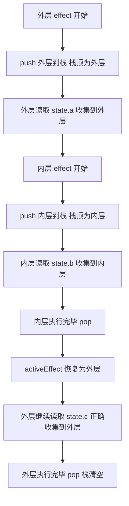

```javascript
// 简化实现，帮助理解 effectStack 解决嵌套收集错乱
let activeEffect = null;
const effectStack = [];
const targetMap = new WeakMap();

function track(target, key) {
  if (!activeEffect) return;
  let depsMap = targetMap.get(target);
  if (!depsMap) targetMap.set(target, (depsMap = new Map()));
  let dep = depsMap.get(key);
  if (!dep) depsMap.set(key, (dep = new Set()));
  dep.add(activeEffect); // 永远收集栈顶，嵌套时不会错挂
}

function effect(fn) {
  const effectFn = () => {
    effectStack.push(effectFn);
    activeEffect = effectFn;
    try {
      fn();
    } finally {
      effectStack.pop();
      activeEffect = effectStack[effectStack.length - 1] || null; // 恢复外层
    }
  };
  effectFn();
  return effectFn;
}

const obj = reactive({ a: 1, b: 2 }); // 假设 reactive 内部 get 调 track
effect(() => {
  console.log('outer a =', obj.a);
  effect(() => console.log('inner b =', obj.b)); // 嵌套
  console.log('outer read again a =', obj.a);    // 必须仍收集到 outer
});
obj.a = 10; // outer 重跑两次读取均生效；若是无栈实现，这行将不触发 outer
```

### FRP-053：effect 的 cleanup 机制解决什么问题？手写"分支切换"的脏依赖清理。

**答**：
- 问题场景：`effect(() => state.ok ? state.a : state.b)`，当 ok 从 true 变 false 后，effect 依赖的应是 b，但旧的 a 依赖**还留在 dep 集合里**（脏依赖），改 a 仍会误触发重跑。
- 解决：每次 runner 执行前，先把自己从**上次收集过的所有 dep 集合**中移除，再重新收集——这样只保留本次执行真正读到的依赖。
- 实现要点：effect 身上存 `deps: []`（反向记录所有收集它的 dep 集合），track 时把 effect 加入 dep 的同时也把 dep 塞进 `effect.deps`；cleanup 就是遍历 `effect.deps` 执行 `dep.delete(effect)`。
- Vue3 源码对应 `ReactiveEffect.run` 里的 `cleanupEffect(this)`，以及 track 时的 `activeEffect.deps.push(dep)`。

```javascript
// 简化实现，帮助理解 cleanup 解决分支切换脏依赖
let activeEffect = null;
const targetMap = new WeakMap();

function cleanup(effectFn) {
  for (const dep of effectFn.deps) dep.delete(effectFn); // 从所有旧集合中摘除自己
  effectFn.deps.length = 0;
}

function track(target, key) {
  if (!activeEffect) return;
  let depsMap = targetMap.get(target);
  if (!depsMap) targetMap.set(target, (depsMap = new Map()));
  let dep = depsMap.get(key);
  if (!dep) depsMap.set(key, (dep = new Set()));
  dep.add(activeEffect);
  activeEffect.deps.push(dep); // 双向记录：effect 也记住哪些 dep 收集了它
}

function effect(fn) {
  const effectFn = () => {
    cleanup(effectFn); // 关键：执行前清掉上次的依赖
    activeEffect = effectFn;
    fn();
    activeEffect = null;
  };
  effectFn.deps = [];
  effectFn();
  return effectFn;
}

const state = reactive({ ok: true, a: 'A', b: 'B' }); // get->track set->trigger 已实现
let runCount = 0;
effect(() => {
  runCount++;
  console.log(state.ok ? state.a : state.b);
});
state.ok = false;   // 重跑：读 b
state.a = 'A2';     // 不应重跑！a 已被 cleanup 掉，只有脏依赖实现会误触发
console.log('runCount =', runCount); // 期望 2（无 cleanup 会是 3）
```

### FRP-054：ref 的 RefImpl 类内部结构是怎样的？它和 Dep 类如何配合？

**答**：
- `ref(v)` 返回一个 **RefImpl 实例**：`_value`（若 v 是对象则被 reactive 包装）、`dep`（一个 Dep 实例，替代了 reactive 中按 key 组织的 Map）、以及 `__v_isRef = true` 标记。
- 依赖收集挂在 **getter `value`** 上：访问 `.value` 时 `dep.track()`；修改时 setter 先 `hasChanged` 比较（`Object.is`），变化才更新 `_value` 并 `dep.trigger()`。
- Dep 类把"订阅者集合 + track/trigger"封装成独立单元（Vue3.4+ 中 Dep 还会链到全局 activeSub 栈），ref 不需要 Proxy，因为只有一个"value"属性。
- 这解释了两个常见现象：解构 ref 会丢失响应性（丢的是 RefImpl 对象本身）、模板里自动脱 ref 是编译期加了 `.value`。

```javascript
// 简化实现，帮助理解 RefImpl 与 Dep 类
let activeEffect = null;

class Dep {
  constructor() { this.subs = new Set(); } // 订阅该 dep 的 effect 集合
  track() {
    if (activeEffect) this.subs.add(activeEffect);
  }
  trigger() {
    [...this.subs].forEach((eff) => eff());
  }
}

class RefImpl {
  constructor(value) {
    this._value = isObject(value) ? reactive(value) : value; // 对象值深层代理
    this.dep = new Dep();       // 每个 ref 自带一个 dep
    this.__v_isRef = true;
  }
  get value() {
    this.dep.track();           // 读 .value 才收集
    return this._value;
  }
  set value(newVal) {
    if (Object.is(newVal, this._value)) return; // hasChanged 短路
    this._value = isObject(newVal) ? reactive(newVal) : newVal;
    this.dep.trigger();
  }
}

function ref(value) { return new RefImpl(value); }
function isRef(v) { return !!(v && v.__v_isRef); }

// 验证：改 count.value 触发依赖它的 effect
const count = ref(0);
effect(() => console.log('count =', count.value)); // count = 0
count.value = 1;                                   // count = 1
count.value = 1;                                   // 无输出（Object.is 相同值短路）
```

### FRP-055：reactive 的惰性代理与 reactiveMap 缓存是怎么实现的？为什么嵌套对象不一开始就代理？

**答**：
- `reactive(obj)` 只对**最外层**建 Proxy，深层对象在 **get 拦截器里读取时才包一层 reactive**（`res = reactive(res)`），这就是惰性（懒）代理——初始化成本 O(1)，且没读到的分支永远不花代理开销。
- 缓存：`reactiveMap: WeakMap<raw, proxy>`，同一原始对象多次 `reactive()` 返回**同一个代理**，避免重复建 Proxy，也保证 `reactive(p) === p`、两个代理间操作一致。
- 入口先查 `reactiveMap`，已代理直接返回；get 时若值是对象也先查缓存再新建。Vue3 源码里 `baseHandlers` + `reactiveMap/shallowReactiveMap/readonlyMap` 分表存储（`getTargetType` 区分 COMMON/Map/Set）。
- 惰性代理还规避了 Proxy 无法代理"未来才存在的属性"的问题：新对象读到了才被追踪。

```javascript
// 简化实现，帮助理解惰性代理与 reactiveMap 缓存
const reactiveMap = new WeakMap(); // raw -> proxy 缓存，WeakMap 随对象 GC

function reactive(obj) {
  // 已有代理直接返回，保证 reactive(reactive(x)) === reactive(x)
  if (reactiveMap.has(obj)) return reactiveMap.get(obj);
  const proxy = new Proxy(obj, {
    get(target, key, receiver) {
      const res = Reflect.get(target, key, receiver);
      track(target, key);
      // 惰性核心：仅当读到的值是对象时才递归 reactive，且先查缓存
      return isObject(res) ? reactive(res) : res;
    },
    set(target, key, value, receiver) {
      Reflect.set(target, key, value, receiver);
      trigger(target, key);
      return true;
    },
  });
  reactiveMap.set(obj, proxy);
  return proxy;
}

// 验证缓存：两次 reactive 同一对象得到同一代理；深层对象读到才代理
const raw = { nested: { deep: 1 } };
const p1 = reactive(raw), p2 = reactive(raw);
console.log(p1 === p2); // true

let deepReads = 0;
effect(() => { deepReads++; JSON.stringify(p1.nested); }); // 读取时才建 nested 的代理
console.log('代理后代理数应为 2 raw+nested, map size =', reactiveMap.size); // 2
p1.nested.deep = 99; // set 落在 nested 的代理上，触发收集了 nested 的 effect
```

### FRP-056：toRef / toRefs 的源码级实现是怎样的？为什么解构 reactive 会丢响应性而 toRefs 不会？

**答**：
- 丢响应性的根因：`const { count } = state` 拿到的是**原始值**（get 拦截器返回的普通 number），之后与代理对象再无关系。
- `toRef(object, key)` 返回一个"引用对象"：它的 `value` getter/setter **转发到原代理对象的对应 key**——读 `r.value` 等价读 `object[key]`（触发 track），写则触发 trigger，响应性保住了。
- `toRefs(object)` 就是遍历所有 key 批量 toRef，常用于解构 props / 组合式函数返回值：`const { x, y } = toRefs(pos)`。
- 源码用 `ObjectRefImpl`（只几十行）：不建 dep，直接依赖 underlying object 的响应系统，所以它没有"自己的依赖"，只是个访问转发器；`unref/isRef` 配套用于脱壳。

```javascript
// 简化实现，帮助理解 toRef/toRefs 的转发原理
function toRef(object, key) {
  return {
    __v_isRef: true,
    get value() {
      return object[key]; // 转发读取：依然走 object 的 get 拦截器 → track
    },
    set value(newVal) {
      object[key] = newVal; // 转发写入：走 set 拦截器 → trigger
    },
  };
}

function toRefs(object) {
  const ret = {};
  for (const key in object) ret[key] = toRef(object, key);
  return ret;
}

function unref(v) { return v.__v_isRef ? v.value : v; }

const state = reactive({ count: 0, msg: 'hi' });

// 错误示范：解构拿原始值，丢失响应性
const { count: rawCount } = state;
rawCount; // 0，改 state.count 它不会变，改它也不会触发更新

// 正确：toRefs 后每个成员仍是活引用
const { count, msg } = toRefs(state);
effect(() => console.log('count =', count.value)); // count = 0
count.value = 5;          // 转发写回 state.count，effect 重跑
console.log(state.count); // 5
console.log(unref(msg));  // hi
```

### FRP-057：readonly 与 isProxy 的判定链是怎样的？浅层与深层只读如何实现？

**答**：
- 判定链依靠 **ReactiveFlags 特殊 key**：代理的 get 拦截器里对 `key === ReactiveFlags.IS_REACTIVE / IS_READONLY / RAW` 直接返回布尔或原始对象，不做常规取值——因为 Proxy 无法从代理对象外部"看出"它是代理，只能靠约定 key 自查。
- `isReactive(v)`：访问 `v[ReactiveFlags.IS_REACTIVE]`，是深层响应式代理（或其嵌套值）为 true；`isReadonly` 同理；`isProxy(v) = isReactive(v) || isReadonly(v)`。
- `toRaw(v)` 借 `ReactiveFlags.RAW` 从代理还原原始对象（源码里对应 `proxy[ReactiveFlags.RAW]`，由 Proxy 的 get 特判返回 target）。
- readonly 用**另一套 handler**：get 不 track（只读不会变，没必要收集），set/deleteProperty 直接**开发环境警告并返回 true**；`readonlyMap` 独立缓存，与 reactiveMap 分开。

```javascript
// 简化实现，帮助理解 ReactiveFlags 判定链与 readonly
const ReactiveFlags = {
  IS_REACTIVE: '__v_isReactive',
  IS_READONLY: '__v_isReadonly',
  RAW: '__v_raw',
};

function createHandler(isReadonly) {
  return {
    get(target, key, receiver) {
      // 判定链核心：约定 key 优先短路
      if (key === ReactiveFlags.IS_REACTIVE) return !isReadonly;
      if (key === ReactiveFlags.IS_READONLY) return isReadonly;
      if (key === ReactiveFlags.RAW) return target;
      const res = Reflect.get(target, key, receiver);
      if (!isReadonly) track(target, key);      // 只读对象不收集依赖
      return isObject(res) ? (isReadonly ? readonly(res) : reactive(res)) : res;
    },
    set(target, key, value) {
      if (isReadonly) {
        console.warn(`Cannot set ${String(key)}: target is readonly`);
        return true; // 静默失败，保持与源码一致
      }
      Reflect.set(target, key, value);
      trigger(target, key);
      return true;
    },
  };
}

const reactiveMap = new WeakMap(), readonlyMap = new WeakMap();
function shared(obj, map, isReadonly) {
  if (map.has(obj)) return map.get(obj);
  const proxy = new Proxy(obj, createHandler(isReadonly));
  map.set(obj, proxy);
  return proxy;
}
const reactive2 = (o) => shared(o, reactiveMap, false);
const readonly2 = (o) => shared(o, readonlyMap, true);
const isReactive2 = (v) => !!(v && v[ReactiveFlags.IS_REACTIVE]);
const isReadonly2 = (v) => !!(v && v[ReactiveFlags.IS_READONLY]);
const isProxy = (v) => isReactive2(v) || isReadonly2(v);
const toRaw = (v) => v?.[ReactiveFlags.RAW] ?? v;

const ro = readonly2({ a: 1 });
ro.a = 2;                       // 警告且不生效
console.log(isProxy(ro), isProxy(reactive2({})), isProxy({})); // true true false
console.log(isReactive2(ro), isReadonly2(ro));                  // false true
console.log(toRaw(ro) === ro);  // false，toRaw 还原了原始对象
```

## 九、Vue 编译器原理

### FRP-058：Vue 模板编译的三阶段 parse → transform → generate 各做什么？为什么要拆成三段？

**答**：
- **parse**：把模板字符串解析成 **AST**（抽象语法树），处理标签、属性、插值、指令、嵌套结构，输出 `{ type: ROOT, children: [...] }` 树。
- **transform**：对 AST 做**转换层遍历**，一系列插件式 transform（transformElement、transformExpression、hoistStatic、transformBlock 等）往节点上打 **patchFlag / dynamicChildren / helpers** 信息——所有"编译优化"都发生在这一层。
- **generate**：把标注好的 AST 生成为 **render 函数字符串**（`_createElementBlock(...)` 之类），再经 `new Function` 得到可执行 render。
- 拆三段的价值：输入输出解耦（AST 是中间表示 IR），优化逻辑只动 transform 层；这也是 Vue3 能做 patchFlag 而手写 render 函数拿不到这些信息的根因。

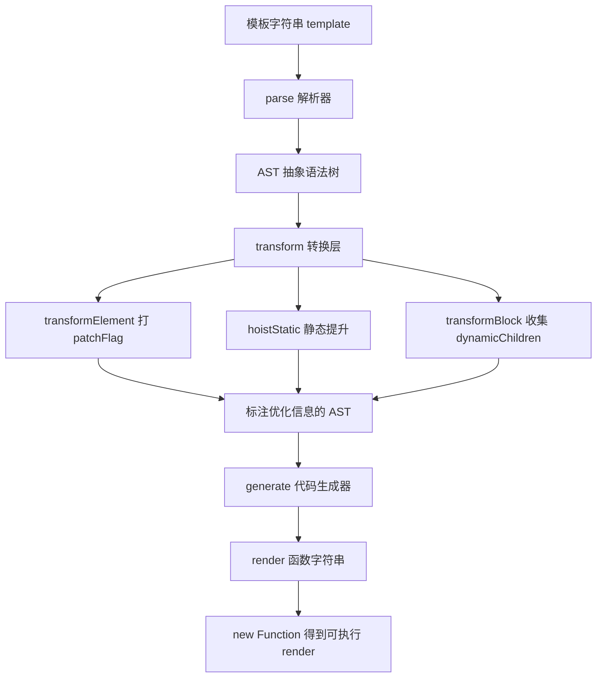

```javascript
// 简化实现，帮助理解编译三阶段流水线
// 1. parse：极简 HTML -> AST
function parse(template) {
  const stack = [{ type: 'Root', children: [] }];
  const re = /<\/?([a-z]+)[^>]*>|(?<=^|>)\{\{([^}]+)\}\}([^<]*)/g;
  let text = template;
  // 真实实现是逐 token 的状态机，这里演示分层调用关系
  const ast = { type: 'Root', children: [] };
  for (const m of template.matchAll(/<([a-z]+)([^>]*)>([\s\S]*?)<\/\1>/g)) {
    const node = { type: 'Element', tag: m[1], props: m[2].trim(), children: [] };
    const interp = m[3].match(/\{\{(.+?)\}\}/);
    if (interp) node.children.push({ type: 'Interpolation', content: interp[1].trim() });
    else if (m[3].trim()) node.children.push({ type: 'Text', content: m[3].trim() });
    ast.children.push(node);
  }
  return ast;
}

// 2. transform：遍历 AST，打优化标记
function transform(ast) {
  ast.children.forEach(function walk(node, index) {
    node.patchFlag = 0;
    if (node.type === 'Element') {
      if (/\{\{/.test(node.props)) node.patchFlag |= 2;        // PROPS 类标记
      node.children.forEach((c, i) => walk(c, i));
    }
    if (node.type === 'Interpolation') node.patchFlag = 1;      // TEXT
  });
  return ast;
}

// 3. generate：AST -> render 函数字符串
function generate(ast) {
  const gen = (n) =>
    n.type === 'Text' ? JSON.stringify(n.content)
    : n.type === 'Interpolation' ? `_ctx.${n.content}`
    : `h("${n.tag}"${n.patchFlag ? `, ${n.patchFlag}` : ''}, ${JSON.stringify(n.props) || '{}'}, [${n.children.map(gen).join(', ')}])`;
  return `_render = () => ${ast.children.map(gen).join(',\n') || 'null'}`;
}

const code = generate(transform(parse('<p>{{ count }}</p>')));
console.log(code); // _render = () => h("p", 1, {}, [_ctx.count])
```

### FRP-059：编译器的 AST 节点与 transform 上下文（NodeTypes / TransformContext）里有什么？

**答**：
- AST 节点公共字段：`type`（NodeTypes：ROOT=0、ELEMENT=1、TEXT=2、COMMENT=3、SIMPLE_EXPRESSION=4、INTERPOLATION=5...）、`loc`（源码位置，报错用）、`children`、`helpers`（该节点用到的运行时辅助函数，如 `createElementBlock`）。
- ELEMENT 节点特有：`tag`、`tagType`（0 元素 / 1 组件）、`props`（Attribute 与 Directive 两类，指令记录 `arg` 和 `exp`）、`codegenNode`（transform 产物，generate 只看它）。
- **TransformContext 上下文**：遍历时携带 `root`、`parent`、`childIndex`、`helpers: Set`、`identifiers`（作用域内变量，v-for/v-for 别名检测）、`replaceNode / removeNode / insertNode` 等操作 API——transform 插件就是"接收节点 + 上下文"的函数。
- 理解上下文才能理解为什么 transform 是**进入时 + 退出时（onExit）两阶段**：先看子节点信息再决定父节点怎么生成（例如所有孩子静态才允许整个节点被 hoist）。

```javascript
// 简化实现，帮助理解 AST 节点结构与 transform 上下文
const NodeTypes = { ROOT: 0, ELEMENT: 1, TEXT: 2, INTERPOLATION: 5, SIMPLE_EXPRESSION: 4 };

function createTransformContext(root) {
  return {
    root,
    helpers: new Set(),               // 全局收集需要 import 的运行时函数
    replaceNode(node) {               // 上下文提供的关键操作 API
      context.parent.children[context.childIndex] = node;
    },
    helper(name) { context.helpers.add(name); return name; },
    // 演示用：parent / childIndex 由 traverse 每层维护
    parent: null, childIndex: 0,
  };
}
const context = createTransformContext({ type: NodeTypes.ROOT, children: [] });

// 一个 transform 插件的形态：返回 { enter, exit }
const transformElement = () => ({
  exit(node, ctx) {
    if (node.type !== NodeTypes.ELEMENT) return;
    ctx.helper('createElementBlock'); // 标记依赖的运行时 helper
    // 生成 codegenNode：generate 阶段只认它，不再看原始 props/children
    node.codegenNode = {
      type: 'VNODE_CALL',
      tag: node.tag,
      props: node.props,
      children: node.children,
      patchFlag: node.patchFlag,      // transformElement 负责计算
    };
  },
});

function traverse(node, ctx, plugins) {
  const ctx2 = { ...ctx, parent: ctx.root, childIndex: 0 };
  plugins.forEach((p) => p().enter?.(node, ctx2));
  (node.children || []).forEach((c, i) =>
    traverse(c, { ...ctx2, childIndex: i, root: node }, plugins));
  plugins.forEach((p) => p().exit?.(node, ctx2)); // exit 阶段：子节点信息已齐
}

const ast = { type: NodeTypes.ELEMENT, tag: 'div', children: [], patchFlag: 1 };
traverse(ast, context, [transformElement]);
console.log([...context.helpers]);  // ['createElementBlock']
console.log(ast.codegenNode.type);  // VNODE_CALL
```

### FRP-060：静态提升（hoistStatic）的判定条件是什么？为什么大静态子树提升为 VNODE_CALL、小片段提升为字符串？

**答**：
- 判定条件（getConstantType）：节点**不含任何动态绑定**——无插值、无指令、无动态 props/key/ref；组件节点因 `slot` 与 props 的不确定性永远不算静态；表达式必须是纯字面量（含可折叠的字符串拼接）。
- 常量类型分档：0 非静态 / 1 **可提升的字符串**（纯文本节点，直接提到 render 外成为字符串常量，复用时零成本）/ 2 **可缓存的 VNODE_CALL**（整棵纯静态元素子树，提升为常量 vnode，diff 时可直接跳过）。
- 为什么分档：字符串是值不可变、共享绝对安全；vnode 是对象，若被修改（如 v-html 注入、SSR placeholding）会有共享可变状态风险，只有确定安全的纯元素树才提升成 vnode。
- 收益：render 重跑时静态 vnode 直接引用同一个对象，**patch 走 `old === new` 短路**，且不会被收集进 dynamicChildren。

```javascript
// 简化实现，帮助理解静态提升判定与两种提升产物
const ConstantTypes = { NOT_CONSTANT: 0, CAN_STRINGIFY: 1, CAN_HOIST: 2 };

function getConstantType(node) {
  if (node.type === 'TEXT') return ConstantTypes.CAN_STRINGIFY;  // 纯文本可字符串化
  if (node.type !== 'ELEMENT') return ConstantTypes.NOT_CONSTANT;
  if (node.tagType === 'COMPONENT') return ConstantTypes.NOT_CONSTANT; // 组件一律不算
  if (Object.keys(node.dynamicProps || {}).length) return ConstantTypes.NOT_CONSTANT;
  // 所有孩子都静态，自身才是 CAN_HOIST；只要有 CAN_STRINGIFY 孩子则降到该档
  let type = ConstantTypes.CAN_HOIST;
  for (const child of node.children) {
    const ct = getConstantType(child);
    if (ct === ConstantTypes.NOT_CONSTANT) return ConstantTypes.NOT_CONSTANT;
    if (ct < type) type = ct;
  }
  return type;
}

function hoistStatic(ast) {
  ast.hoists = [];
  ast.children.forEach(function walk(node) {
    const ct = getConstantType(node);
    if (ct === ConstantTypes.CAN_STRINGIFY) {
      node.codegenNode = JSON.stringify(node.content);       // 提升为字符串常量
      ast.hoists.push(node);
    } else if (ct === ConstantTypes.CAN_HOIST) {
      node.codegenNode = { isStatic: true, vnode: node };    // 提升为共享 vnode
      ast.hoists.push(node);
    }
    (node.children || []).forEach(walk);
  });
  return ast;
}

const ast = hoistStatic(parse('<div><span>title</span><b>bold</b></div>')); // parse 为编译器前置阶段，此处示意调用
console.log('提升数量:', ast.hoists.length);                       // 2
console.log(getConstantType(parse('<p>{{ msg }}</p>').children[0])); // 0 插值非静态
console.log(getConstantType({ type: 'ELEMENT', tagType: 'COMPONENT' })); // 0 组件非静态
```

### FRP-061：patchFlag 的每个枚举位是什么含义？分别驱动 diff 里的哪种快速路径？

**答**：
- patchFlag 是**数字位标记**，告诉 runtime"这个 vnode 哪里可能变"，diff 时按位检查走快速路径，跳过全量比对。核心枚举：`1 TEXT`（动态文本内容）、`2 CLASS`、`4 STYLE`、`8 PROPS`（其他动态属性，配 dynamicProps 数组）、`16 FULL_PROPS`（含动态 key，需全 props 比对）、`32 HYDRATE_EVENTS`（仅 SSR）、`64 STABLE_FRAGMENT`（子节点顺序稳定的片段）、`128 KEYED_FRAGMENT`（带 key）、`256 UNKEYED_FRAGMENT`、`512 NEED_PATCH`（无具体 flag 但需 patch，如 ref）、`1024 DYNAMIC_SLOTS`、`4096 HOISTED`、`-1 BAIL`（退出优化，diff 全量走）。
- 对应 diff 行为举例：`TEXT` 只更新 `el.textContent`；`CLASS/STYLE` 只调 `patchClass/patchStyle`；`PROPS` 只遍历 `dynamicProps` 数组里的属性名；`FULL_PROPS` 与 `BAIL` 退回逐 key 全量比较。
- flag 可以**按位或叠加**（如 TEXT|CLASS=3），runtime 用 `&` 判断命中；命中任何 flag 都不会进入"逐子树全 diff"，这正是编译优化的提速来源。

```javascript
// 简化实现，帮助理解 patchFlag 枚举与 diff 快速路径
const PatchFlags = {
  TEXT: 1, CLASS: 2, STYLE: 4, PROPS: 8, FULL_PROPS: 16,
  NEED_PATCH: 512, DYNAMIC_SLOTS: 1024, BAIL: -1,
};

function patchElement(el, oldVNode, newVNode) {
  const flag = newVNode.patchFlag;
  if (flag === PatchFlags.BAIL) return fullDiff(el, oldVNode, newVNode); // 退出优化

  if (flag & PatchFlags.TEXT) {
    el.textContent = newVNode.children;            // 只更新文本，O(1)
  }
  if (flag & PatchFlags.CLASS) {
    el.className = newVNode.props.class;           // 只更新 class
  }
  if (flag & PatchFlags.STYLE) {
    el.style.cssText = newVNode.props.style;
  }
  if (flag & PatchFlags.PROPS) {
    // 只比对编译期记录的动态属性，静态属性完全不碰
    for (const key of newVNode.dynamicProps) {
      if (oldVNode.props[key] !== newVNode.props[key]) el.setAttribute(key, newVNode.props[key]);
    }
  }
  if (flag & PatchFlags.FULL_PROPS) {
    fullDiff(el, oldVNode, newVNode);              // 含动态 key，退回全量 props 比对
  }
  // 无任何 flag：直接 return，连 props 都不比
}

function fullDiff(el, o, n) { /* 全量遍历新旧 props 与 children */ }
function setFlag(vnode, ...flags) {
  vnode.patchFlag = flags.reduce((a, b) => a | b, 0); // 按位或叠加
  return vnode;
}

// 验证：TEXT|CLASS=3，一次标记覆盖两类快速路径
const vnode = setFlag({}, PatchFlags.TEXT, PatchFlags.CLASS);
console.log(vnode.patchFlag, !!(vnode.patchFlag & PatchFlags.TEXT)); // 3 true
```

### FRP-062：Block Tree 与 dynamicChildren 收集原理是什么？v-if / v-for 为什么会"打断"Block？

**答**：
- 编译器把每个 vnode 打上** openBlock/createBlock**：`openBlock()` 开一个空数组 `currentBlock`，之后创建的**动态 vnode** 在自身创建时把自己 push 进该数组（静态 vnode 不进），`createBlock` 收尾把数组存为 `block.dynamicChildren`——这就是 Block Tree。
- patch 时对 block 只遍历 **dynamicChildren（数量远小于全子树）** 逐一 patchElement，配合 patchFlag 每个节点 O(属性数) 而不是 O(子树)。
- **结构不稳定必须开新 Block**：v-if/v-for 的分支个数、子节点顺序在运行期可变，父 block 里的 dynamicChildren 按旧结构收集的索引会错位——所以 v-if 生成的是"新 block"（每个分支一个 block），v-for 的每个 fragment 子项断开父级收集（children 收集到 Fragment 自己的 block），保证"Block 内结构恒定"这一前提。
- 全局 `currentBlock` 用**栈式**管理：子 block 创建完毕 `pop` 后，其内部收集的动态节点不再混入父 block。

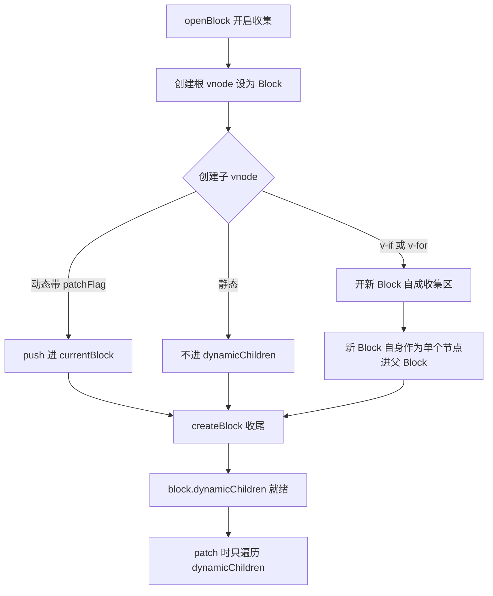

```javascript
// 简化实现，帮助理解 Block 与 dynamicChildren 收集
let currentBlock = null; // 栈：支持 block 嵌套

function openBlock() { currentBlock = []; }
function createBlock(vnode) {
  vnode.dynamicChildren = currentBlock; // 收尾：把收集数组挂到自己身上
  currentBlock = null;
  return vnode;
}
function createVNode(tag, props = {}, children = null) {
  const isStatic = !props.patchFlag;
  if (currentBlock && !isStatic) currentBlock.push(vnode); // 动态节点自注册
  return vnode;
}

// 编译产物形态：div 内有动态文本与静态节点
function render(_ctx) {
  openBlock();
  return createBlock(createVNode('div', null, [
    'static text',                                    // 静态：不进收集
    createVNode('span', { patchFlag: 1 }, _ctx.msg),  // 动态 TEXT：进入收集
    createVNode('b', null, 'static bold'),            // 静态
  ]));
}

function patchBlock(oldBlock, newBlock) {
  // 只 diff 动态节点数组，与真实 DOM 树结构解耦
  newBlock.dynamicChildren?.forEach((v, i) => {
    const old = oldBlock.dynamicChildren?.[i];
    if (old && old.patchFlag === 1 && old.children !== v.children) {
      console.log('patch text:', v.children); // 快速路径
    }
  });
}

const v1 = render({ msg: 'a' });
openBlock(); const v2 = render({ msg: 'b' }); // 模拟重渲染
console.log('动态节点数:', v1.dynamicChildren.length); // 1，全子树是 3
patchBlock(v1, v2); // patch text: b
```

### FRP-063：cacheHandlers（内联事件缓存）解决什么问题？编译产物里的 `_cache[0] || (_cache[0] = ...)` 是怎么回事？

**答**：
- 问题：模板里的内联事件 `@click="count++"` 每次重渲染都会**生成一个新函数**作为 vnode 的 prop，子组件收到新 prop 引用就认为"变了"，导致**无效更新**（尤其配合 memo/props 浅比较时）。
- 编译器开启 cacheHandlers 后，handler 被编译成 `_cache[0] || (_cache[0] = ($event) => _ctx.count++)`：首次渲染创建并**缓存在组件实例上**，之后重渲染直接命中缓存拿到**同一个函数引用**。
- 内联表达式里访问 `_ctx`，正是为了让函数可以被缓存——闭包不捕获当次渲染变量，而改为运行时从 ctx 取值，天然规避了事件闭包的旧值问题。
- 在线工具里看到 `_cache` 数组即代表此优化开启（默认开启，`cacheHandlers: true`）。

```javascript
// 简化实现，帮助理解 handler 缓存对无效更新的消除
// 模板：<Child @inc="count++" />，两种编译产物对比
function compileTemplate(cache) {
  // 未开启缓存：每次 render 都创建新函数
  return function renderWithoutCache(_ctx) {
    return { type: 'Child', props: { onInc: () => _ctx.count++ } };
  };
}
function compileTemplateCached(cache) {
  // 开启缓存：函数只创建一次，引用恒定
  return function renderWithCache(_ctx) {
    return {
      type: 'Child',
      props: {
        onInc: cache[0] || (cache[0] = ($event) => _ctx.count++), // 首次创建后复用
      },
    };
  };
}

const ctx = { count: 0 };
const renderCached = compileTemplateCached([]);

const r1 = renderCached(ctx);
const r2 = renderCached(ctx);
console.log(r1.props.onInc === r2.props.onInc); // true：引用相同，子组件可跳过更新
r1.props.onInc();
console.log(ctx.count); // 1：函数运行时读 _ctx，闭包没有旧值问题

const renderPlain = compileTemplate([]);
console.log(renderPlain(ctx).props.onInc === renderPlain(ctx).props.onInc); // false：每次新函数
// 若 Child 内部对 props 做浅比较，false 意味着每次父渲染它都白白重渲染
```

### FRP-064：v-model 在编译后生成了什么代码？不同元素上为什么产物不同？

**答**：
- v-model 是**语法糖**，编译时按目标类型生成三件套：绑定值 + 监听事件 + （原生元素需要的）动态 value/checked 属性。
- 文本输入 `<input v-model="msg">` → `:value="msg"` + `@input="msg = $event.target.value"`；多选框 → `:checked` + `@change`；单选 → `:checked` + `@change`；`select` → `:value` + `@change`（配合 selected 处理）。元素差异源于**取值方式不同**：input 用 `target.value`，checkbox 用 `target.checked` 和 trueValue/falseValue 映射。
- 组件上 `<MyInput v-model="msg">` → `:modelValue="msg"` + `@update:modelValue="msg = $event"`，配合子组件 `defineProps(['modelValue'])` + `emit('update:modelValue', v)`。
- `.lazy/.number/.trim` 修饰符在编译期生成不同的赋值表达式（lazy 把 input 换 change，number 包 `looseToNumber`），纯编译期展开，无运行时成本。

```html
<!-- 简化实验，帮助理解 v-model 的编译产物（vue-template-explorer 输出） -->

<!-- 输入 1：<input v-model="msg" /> -->
<!-- 产物：_createElementVNode("input", {
        value: _ctx.msg,
        onInput: _cache[0] || (_cache[0] = ($event) => ((_ctx.msg) = $event.target.value))
      }, null, 16 /* FULL_PROPS：value 是动态 prop */ ) -->

<!-- 输入 2：<input type="checkbox" v-model="ok" /> -->
<!-- 产物：_createElementVNode("input", {
        type: "checkbox",
        checked: _ctx.ok,
        onChange: _cache[1] || (_cache[1] = ($event) => ((_ctx.ok) = $event.target.checked))
      }) -->

<!-- 输入 3：<MyInput v-model="msg" /> -->
<!-- 产物：_createVNode(_component_MyInput, {
        modelValue: _ctx.msg,
        "onUpdate:modelValue": _cache[2] || (_cache[2] = ($event) => ((_ctx.msg) = $event))
      }, null, 512 /* NEED_PATCH | DYNAMIC_SLOTS 无，模型 prop + 事件 */) -->

<!-- 输入 4：<input v-model.lazy="msg" /> -->
<!-- 产物：onInput 变为 onChange = ($event) => ((_ctx.msg) = $event.target.value) -->
<script type="module">
  // 组件侧等价手写：v-model 展开后的真实契约
  export default {
    props: ['modelValue'],
    emits: ['update:modelValue'],
    template: `<input :value="modelValue" @input="$emit('update:modelValue', $event.target.value)">`,
  };
</script>
```

### FRP-065：如何用编译器在线工具做"模板 → 代码"的对比实验？举三个值得观察的输出。

**答**：
- 工具：Vue 官方 **template-explorer**（vue-next-template-explorer.netlify.app），左侧写模板右侧实时输出编译后的 render 代码，可切换 options（prefixIdentifiers、hoistStatic、cacheHandlers、patchFlags 开关）。
- 实验 1：`<div><span>hi</span><i>{{ msg }}</i></div>` → 观察到静态 span 被**提升到 render 外**（const _hoisted_1），i 带 `patchFlag: 1`，根 div 是 `_createElementBlock` 且 children 里只有 i 进 dynamicChildren。
- 实验 2：`<button @click="a.b = 1">go</button>` → handler 变成 `_cache[0] || (_cache[0] = (...args) => ...)`，关掉 cacheHandlers 再看差异——直接内联函数，说明缓存优化的开关效果。
- 实验 3：`<Comp :style="s" #header>...</Comp>` → 观察组件 vnode 与插槽编译（对象形式 `{ header: () => [...] }`）以及 DYNAMIC_SLOTS 标记，理解组件与元素编译路径的不同。
- 结论方法论：**一切"Vue3 为什么快"的答案都能在该工具的产物里找到对应代码**，面试中主动引用产物细节是强加分项。

```javascript
// 简化实验记录，帮助理解在线工具观察点（伪代码形式摘录产物）
// 模板 A：<div><span>hi</span><i>{{ msg }}</i></div>
const outputA = `
const _hoisted_1 = /*#__PURE__*/ _createElementVNode("span", null, "hi", -1 /* HOISTED */)
return (_ctx) => {
  return (_openBlock(), _createElementBlock("div", null, [
    _hoisted_1,                                    // 静态提升：不参与重渲染创建
    _createElementVNode("i", null, _toDisplayString(_ctx.msg), 1 /* TEXT */),
  ]))                                              // block 收集：dynamicChildren 只含 i
}`;

// 模板 B：<button @click="a.b = 1">go</button>（关闭 cacheHandlers）
const outputB = `
return (_ctx) => {
  return (_openBlock(), _createElementBlock("button", {
    onClick: $event => ((_ctx.a.b) = 1)            // 无缓存：每次 render 新函数
  }, "go"))}`;

// 模板 C：<Comp :style="s" #header>x</Comp>
const outputC = `
_createElementBlock(_component_Comp, { style: _ctx.s }, {
  header: _withCtx(() => [ _createElementVNode("p", null, "x") ]), // 插槽编译为工厂
  _: 1 /* STABLE：插槽结构稳定，DYNAMIC_SLOTS 未置位 */
})`;

console.log(outputA.includes('_hoisted_1'));     // true
console.log(outputB.includes('$event'));         // true
console.log(outputC.includes('_withCtx'));       // true
```

## 十、Vue 运行时细节

### FRP-066：一个组件从创建到挂载 DOM 的完整初始化流程是怎样的（setup → render → patch）？

**答**：
- 主链路：`createVNode(Comp)`（shapeFlag 标记 COMPONENT）→ `patch(old, vnode)` → `processComponent → mountComponent` → **setupComponent**（initProps → initSlots → setup() 执行，拿到 render 上下文）→ **setupRenderEffect**。
- setupRenderEffect 里创建组件**更新 effect**：`effect(() => instance.subTree = render.call(proxy), { scheduler: queueJob(update) })`——render 期间读响应式数据完成依赖收集，数据变化后走 scheduler 入队而不是同步重跑。
- 得到 subTree 后 `patch(null, subTree, container)` 递归挂载子树（子组件递归 processComponent，元素走 processElement 真正建 DOM），DOM 创建完成后 `queuePostFlushCb` 执行 mounted 钩子。
- 更新时序：数据变 → scheduler 入队 → nextTick flush → 组件 effect 重跑 render → 得到新 subTree → `patch(oldSubTree, newSubTree)` 增量更新。

```javascript
// 简化实现，帮助理解组件初始化全流程
function createVNode(type, props = {}, children = null) {
  return { type, props, children, el: null,
    shapeFlag: typeof type === 'string' ? 1 /* ELEMENT */ : 4 /* COMPONENT */ };
}

function mountComponent(vnode, container) {
  const instance = {
    vnode, props: vnode.props, setupState: null, subTree: null,
    isMounted: false, hooks: { mounted: [] },
  };
  // 1. setupComponent：执行 setup，拿到渲染上下文/返回值
  const setupResult = instance.vnode.type.setup?.(instance.props) || {};
  instance.setupState = typeof setupResult === 'function' ? null : setupResult;
  // 2. setupRenderEffect：组件级更新 effect
  const render = typeof setupResult === 'function'
    ? setupResult
    : instance.vnode.type.render;
  effect(() => {
    if (!instance.isMounted) {
      // 首次：render 生成子树 -> 递归 patch 挂载
      instance.subTree = render(instance.setupState);
      patch(null, instance.subTree, container);
      instance.isMounted = true;
      instance.hooks.mounted.forEach((h) => h()); // post 队列时机
    } else {
      // 更新：新子树与旧子树 diff
      const nextTree = render(instance.setupState);
      patch(instance.subTree, nextTree, container);
      instance.subTree = nextTree;
    }
  }, { scheduler: queueJob }); // 数据变化先入队，微任务统一 flush
  vnode.component = instance;
}

function patch(n1, n2, container) {
  if (n2.shapeFlag & 4) return mountComponent(n2, container); // 简化：不处理 n1 更新分支
  n2.el = document.createElement(n2.type);
  n2.el.textContent = n2.children;
  container.appendChild(n2.el);
}

// 用法：Comp.setup 里读 reactive 数据 -> render 重跑由调度器驱动
const Comp = { setup() { const s = reactive({ n: 1 }); return () => createVNode('p', {}, String(s.n)); } };
mountComponent(createVNode(Comp), document.querySelector('#app'));
```

### FRP-067：props 与 emit 在源码层面如何实现？emit 是怎么找到对应事件的？

**答**：
- props 分两层：`props`（声明与未声明的"可被父访问"属性，最终落 DOM 或透传）与 `attrs`（未声明进 attrs，不做响应式代理）；组件实例上 `instance.props` 是 **shallowReactive**（浅层代理即可，父组件更新会整体换引用）。
- emit 实现（runtime-core 的 `emit`）：核心是**事件名到 props 的映射查找**——事件 `foo` 依次尝试 props 上的 `onFoo`、`onFOO`（camelCase → 首字母大写），命中即调用 `props[`on${cap(event)}`](...args)`；`@update:modelValue` 对应 props 里 `onUpdate:modelValue` 这个 key。
- `emits` 声明的作用：把声明过的 `onXxx` 从 attrs 中**剥除**（否则 `@click` 未声明会同时作为 attr 落到根元素上，造成二次触发），并对未声明事件给开发警告。
- emit 还会校验返回值：若声明了校验函数且返回 false，仅警告不阻断调用。

```javascript
// 简化实现，帮助理解 emit 的事件查找与 attrs 剥离
function capitalize(s) { return s[0].toUpperCase() + s.slice(1); }

function emit(instance, event, ...args) {
  const props = instance.vnode.props;
  let handler = null;
  // 查找顺序：onFoo -> onFOO（kebab/camel 兼容）
  const camel = event.replace(/-(\w)/g, (_, c) => c.toUpperCase());
  handler = props[`on${capitalize(camel)}`] || props[`on${camel.toUpperCase()}`];
  if (!handler) {
    console.warn(`[emit] 未找到事件 ${event} 的监听器`);
    return;
  }
  handler(...args);
}

function initProps(vnode, emits) {
  const props = {}, attrs = {};
  for (const key in vnode.props) {
    // 声明了 emits 的事件监听器不进 attrs（避免落到根元素二次触发）
    const evt = key.startsWith('on') ? key.slice(2).toLowerCase() : null;
    if (evt && (emits || []).includes(evt)) props[key] = vnode.props[key];
    else if (key.startsWith('on')) props[key] = vnode.props[key];
    else attrs[key] = vnode.props[key];
  }
  return { props, attrs };
}

// 用法：父组件 <Child @inc="n++" class="btn" />
const Child = {
  emits: ['inc'],
  setup(props, { emit }) {
    return { click() { emit('inc', 1); } }; // emit('inc') 找 props.onInc
  },
};
const vnode = createVNode(Child, { onInc: (n) => console.log('父收到 inc', n), class: 'btn' });
const { props, attrs } = initProps(vnode, Child.emits);
console.log('onInc 在 props:', 'onInc' in props, '| class 在 attrs:', 'class' in attrs); // true true
emit({ vnode }, 'inc', 1); // 父收到 inc 1
```

### FRP-068：provide/inject 的实现原理是什么？为什么说它是"原型链查找"？

**答**：
- 初始化组件实例时：`instance.provides = parent ? parent.provides : appContext.provides`（根组件用 app 级 provides）。**默认不复制对象，而是子组件直接引用父的 provides**。
- 当组件**自己调用 provide(key, value)** 时才创建新对象：`instance.provides = Object.create(currentInstance.provides)`——用原型链继承父级 provides，自己 provided 的 key 挂在自身这一层。
- inject 查找就是 **一次原型链属性访问**：`inject(key)` 即 `currentInstance.provides[key]`，顺着 `__proto__` 向祖先链走，最近提供者优先（就近覆盖远端），找不到回退到 `defaultValue`（函数则惰性求值）。
- 优势：O(链深) 的一次 JS 属性查找，无需逐层遍历/传递；这也是嵌套 provide 同名 key"就近生效"的实现机制。

```javascript
// 简化实现，帮助理解原型链式 provide/inject
function createComponentInstance(parent) {
  return {
    parent,
    // 关键：默认直接引用父级 provides，不新建
    provides: parent ? parent.provides : Object.create(null),
    providesProvided: false,
  };
}

function provide(instance, key, value) {
  if (!instance.providesProvided) {
    // 首次 provide 才建新对象，以父 provides 为原型
    instance.provides = Object.create(instance.provides);
    instance.providesProvided = true;
  }
  instance.provides[key] = value; // 挂在自己这一层
}

function inject(instance, key, defaultValue) {
  const val = instance.provides[key]; // 一次属性访问，沿 __proto__ 向上找
  if (val !== undefined) return val;
  if (defaultValue !== undefined) {
    return typeof defaultValue === 'function' ? defaultValue() : defaultValue; // 惰性默认值
  }
  console.warn(`[inject] key "${String(key)}" 未找到提供者`);
}

// 层级：Root -> Child -> GrandChild
const root = createComponentInstance(null);
const child = createComponentInstance(root);
const grand = createComponentInstance(child);

provide(root, 'theme', 'dark');        // 祖先提供
provide(child, 'size', 'large');       // 中间层提供

console.log(inject(grand, 'theme'));   // dark：沿原型链跨两层找到
console.log(inject(grand, 'size'));    // large
console.log(inject(grand, 'miss', () => 'fallback')); // fallback 惰性默认值
provide(child, 'theme', 'light');      // 中间层就近覆盖
console.log(inject(grand, 'theme'));   // light：近层优先
console.log(inject(root, 'theme'));    // dark：root 自身不受影响
```

### FRP-069：生命周期钩子在源码里如何注册与调用？mounted 为什么在 DOM 挂载后才执行？

**答**：
- 注册：`onMounted(fn)` 等本质是 `injectHook(type, fn, instance)`——把 fn push 到 `instance[type]`（如 `instance.m = [fn]`）数组里，并用 `currentInstance` 定位到"哪个组件的钩子"；这也是钩子必须在 setup 同步期调用的原因（异步调用后 currentInstance 为 null，注入失败并警告）。
- 钩子数组按**调用顺序**有固定插槽：beforeCreate/create 在 setupComponent 前后、beforeMount/mounted 在首次 patch 前后、beforeUpdate/updated 在重渲染 patch 前后、beforeUnmount/unmounted 在卸载逻辑前后。
- mounted "异步"的原因：首次 patch 中**先递归挂完所有子孙 DOM**，子组件先于父组件完成挂载，各组件的 mounted 回调被推入 **post 队列（queuePostRenderEffect）**，patch 全部结束后统一 flush——所以子 mounted 先于父 mounted 打印。
- 多次调用同一钩子会按序全部执行（数组语义）；组合式 API 中钩子注册在 setup 内即隐式绑定当前实例，无需 this。

```javascript
// 简化实现，帮助理解钩子注册与 post 队列调用时机
const postFlushCbs = []; // mounted 等钩子的 post 队列

function injectHook(type, hook, instance) {
  if (!instance) return console.warn('[hook] setup 之外调用丢失实例');
  (instance[type] || (instance[type] = [])).push(hook); // 数组：支持多次注册
}

let currentInstance = null;
const createHooks = (type) => (...args) => injectHook(type, args[0], currentInstance);
const onMounted = createHooks('m'), onBeforeMount = createHooks('bm');

function setupComponent(setupFn, instance) {
  currentInstance = instance;
  instance.bm?.forEach((h) => h());      // beforeMount：DOM 未创建
  const render = setupFn();              // setup 内注册的钩子挂到 instance
  currentInstance = null;
  return render;
}

function mountWithHooks(setupFn, instance, container) {
  const render = setupComponent(setupFn, instance);
  const subTree = render();              // 生成子树
  // 真实递归 patch 挂载（简化为直接建 DOM）
  subTree.el = document.createElement(subTree.tag);
  subTree.el.textContent = subTree.children;
  container.appendChild(subTree.el);
  // 挂载完成 -> 推入 post 队列，统一 flush（保证子先父后）
  instance.m?.forEach((h) => postFlushCbs.push(h));
  queuePostFlush();
}

function queuePostFlush() {
  Promise.resolve().then(() => {
    const cbs = [...postFlushCbs];
    postFlushCbs.length = 0;
    cbs.forEach((h) => h());             // mounted 全部在 DOM 就绪后执行
  });
}

// 验证：两个组件 mounted 的执行顺序
const parent = { m: [] }, childInst = { m: [] };
const childRender = setupComponent(() => () => ({ tag: 'span', children: 'c' }), childInst);
onMounted(() => console.log('child mounted'), childInst); // 注册进 childInst.m

const parentRender = setupComponent(() => () => ({ tag: 'div', children: 'p' }), parent);
onMounted(() => console.log('parent mounted'), parent);

mountWithHooks(() => childRender, childInst, document.body);
mountWithHooks(() => parentRender, parent, document.body);
// 输出顺序：child mounted -> parent mounted（post 队列按注册/完成序 flush）
```

### FRP-070：defineAsyncComponent 是怎么实现的？loading / error / retry 如何落地？

**答**：
- 本质是一个**高阶组件**：返回一个包装组件，其内部维护状态机（pending → resolved / failed），setup 里根据状态渲染加载中、错误占位或真正的加载组件。
- 主流程：`load()`（用户传入的返回 Promise 的函数）执行 → pending 期间渲染 `loadingComponent`（超过 `delay` 才显示，避免闪烁）→ resolve 后把结果记为 `resolvedComp` 并触发重渲染 → reject 或超时 `timeout` 后渲染 `errorComponent`。
- retry：配置 `onError(err, retry, fail, attempts)`，包装的 load 失败时把 retry 交给用户（可指数退避重试）；`timeout` 到点未 resolve 直接切换错误分支。
- 与 Suspense 的区别：defineAsyncComponent 是组件级占位（自己管 loading/error），Suspense 是子树级的声明式等待，二者可组合。

```javascript
// 简化实现，帮助理解 defineAsyncComponent 的状态机
function defineAsyncComponent(options) {
  const { loader, delay = 200, timeout, errorComponent, loadingComponent } = options;
  return {
    setup() {
      const state = reactive({ status: 'pending' }); // pending -> resolved / failed
      let attempts = 0;
      const load = () => {
        const timer = setTimeout(() => { state.status = 'failed'; }, timeout || Infinity);
        const start = Date.now();
        loader()
          .then((comp) => {
            clearTimeout(timer);
            if (Date.now() - start < delay) {
              // 加载太快：等满 delay 再切换，避免 loading 闪烁
              setTimeout(() => { state.resolvedComp = comp; state.status = 'resolved'; }, delay);
            } else {
              state.resolvedComp = comp; state.status = 'resolved';
            }
          })
          .catch((err) => {
            clearTimeout(timer);
            options.onError?.(err, load, () => { state.status = 'failed'; }, ++attempts);
            if (attempts === 1 && options.onError) return; // 交给用户决定 retry
            state.status = 'failed';
          });
      };
      load();
      return {
        view() {
          if (state.status === 'resolved') return h(state.resolvedComp);
          if (state.status === 'failed') return errorComponent ? h(errorComponent) : null;
          return loadingComponent ? h(loadingComponent) : null; // pending
        },
      };
    },
  };
}

// 用法：模拟慢加载组件
const AsyncComp = defineAsyncComponent({
  loader: () => new Promise((res) => setTimeout(() => res({ template: '<div>heavy</div>' }), 600)),
  delay: 200, timeout: 3000,
  loadingComponent: { template: '<div>loading...</div>' },
  errorComponent: { template: '<div>加载失败</div>' },
  onError(err, retry) { retry(); }, // 失败自动重试一次
});
```

### FRP-071：Transition 组件的实现原理是什么？enter 阶段的 class 是怎么切换的？

**答**：
- Transition 是**无自身 DOM 的抽象组件**：渲染时直接返回**单个子元素 vnode**，并在子元素上附加 enter/leave 钩子（via renderer 的 `processElement` beforeEnter/enter/afterEnter 等），把过渡时机与 DOM 增删对齐。
- enter 序列：元素插入 DOM 前加 `*-enter-from`（初始态）与 `*-enter-active`（过渡属性），**下一帧**移除 enter-from、加 `*-enter-to`（目标态）；transitionend 后移除 active/to。两帧切换是浏览器渲染机制决定的——同帧改 class 不会触发过渡。
- leave 序列对称：离开前加 leave-from/leave-active，下一帧换 leave-to，监听 `transitionend/animationend`（或 `duration` prop 显式指定）后真正移除 DOM。
- name 属性决定前缀；`mode="out-in"` 控制先播放旧元素 leave 再进入新元素（用一个"延迟插入"的调度实现）；`appear` 控制初次渲染也走 enter。

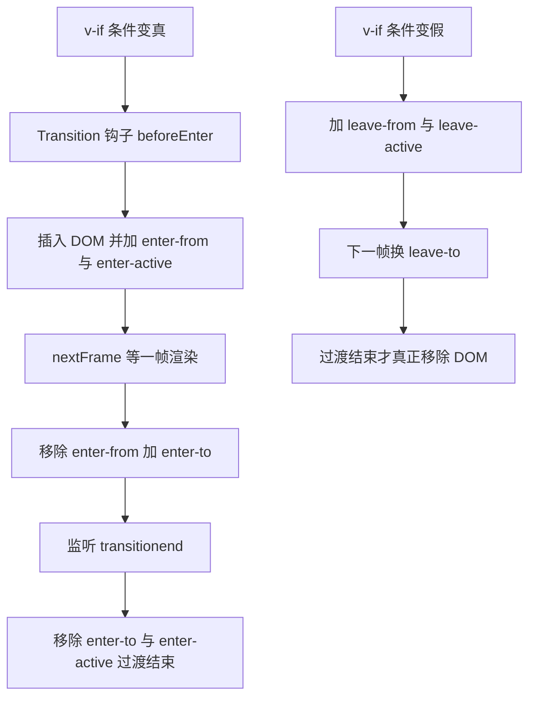

```javascript
// 简化实现，帮助理解 Transition 的 class 切换时序
const nextFrame = (cb) => requestAnimationFrame(() => requestAnimationFrame(cb));
const whenTransitionEnds = (el, done) => {
  const onEnd = (e) => { el.removeEventListener('transitionend', onEnd); done(); };
  el.addEventListener('transitionend', onEnd);
};

function transitionHook(el, state, enter) {
  const name = 'fade'; // :name="fade" -> .fade-enter-from 等
  if (enter) {
    el.classList.add(`${name}-enter-from`, `${name}-enter-active`);
    document.body.appendChild(el);                       // 插入 DOM（带初始态）
    nextFrame(() => {
      el.classList.remove(`${name}-enter-from`);         // 第二帧：起始态撤掉
      el.classList.add(`${name}-enter-to`);              // -> 触发过渡动画
      whenTransitionEnds(el, () =>
        el.classList.remove(`${name}-enter-to`, `${name}-enter-active`));
    });
  } else {
    el.classList.add(`${name}-leave-from`, `${name}-leave-active`);
    nextFrame(() => {
      el.classList.remove(`${name}-leave-from`);
      el.classList.add(`${name}-leave-to`);
      whenTransitionEnds(el, () => {
        el.classList.remove(`${name}-leave-to`, `${name}-leave-active`);
        el.remove();                                     // 过渡结束才真正移除
      });
    });
  }
}

/* 配套 CSS：
.fade-enter-from   { opacity: 0 }
.fade-enter-active { transition: opacity .3s }
.fade-enter-to     { opacity: 1 }
.fade-leave-from   { opacity: 1 }
.fade-leave-active { transition: opacity .3s }
.fade-leave-to     { opacity: 0 }
*/
// 验证：切换一个 v-if 元素，观察 class 序列 enter-from -> enter-to -> 清空
const el = document.createElement('div');
transitionHook(el, {}, true); // enter 流程演示
```

### FRP-072：v-show 与 v-if 的编译产物与运行时差异分别是什么？各自适用什么场景？

**答**：
- 编译产物：v-if 是**编译期三分支**——生成三元表达式，条件为真创建元素 vnode、为假建注释 vnode `createCommentVNode("v-if")`，切换即**卸载/重建**整棵子树（走完整 create/destroy 流程，含组件重挂载）。
- v-show 只是**一个指令**：编译产物里元素始终被创建，vShow 指令的 mounted/updated 钩子执行 `el.style.display = value ? originalDisplay : 'none'`，切换只是改一行样式，开销 O(1)。
- 运行时差异：v-if 有**惰性**（初始 false 不渲染）与真实销毁（组件状态丢失、生命周期重走）；v-show 无惰性（初始就渲染）、状态保留、无生命周期开销。
- 选型：频繁切换用 v-show（如 tab 内容、tooltip），条件很少变或初始不需要渲染用 v-if（如权限块、重组件按需加载）；v-show 不支持 template/多根，因为它要挂在真实元素上。

```javascript
// 简化实现，帮助理解两者的编译产物与运行时行为
// v-if 编译产物形态：<div v-if="ok">hi</div>
function renderWithVIf(_ctx) {
  return _ctx.ok
    ? createElementBlock('div', null, 'hi')            // 真实元素
    : createCommentVNode('v-if');                       // 注释占位节点
}
// 切换 ok = true 时：从注释节点 patch 到元素节点 -> 完整 mount（重建 DOM）
// 切换 ok = false 时：完整 unmount，组件实例销毁、生命周期走 unmounted

// v-show 编译产物形态：元素恒存在 + withDirectives 包装
function renderWithVShow(_ctx) {
  return withDirectives(
    createElementBlock('div', null, 'hi'),
    [[vShow, _ctx.ok]],                                 // 指令携带当前布尔值
  );
}
// vShow 指令实现：只操作 display
const vShow = {
  beforeMount(el, { value }) {
    el._vod = el.style.display === 'none' ? '' : el.style.display; // 记录原 display
    el.style.display = value ? el._vod : 'none';
  },
  updated(el, { value, oldValue }) {
    if (value === oldValue) return;                     // O(1) 短路
    el.style.display = value ? el._vod : 'none';
  },
};

// 验证行为差异
const state = reactive({ ok: false });
let mountCount = 0;
const comp = { render: () => { mountCount++; return renderWithVIf(state); } };
state.ok = true;  // v-if：DOM 重建，组件重新走 setup（若为组件）
state.ok = false; // v-if：DOM 销毁
console.log('v-if 切换触发渲染次数:', mountCount);      // 每次切换都参与渲染
const el = document.createElement('div');
vShow.beforeMount(el, { value: true });
console.log('v-show 初始渲染即便 false 也存在 DOM:', !!el._vod !== undefined); // true
```

## 十一、Vue Router 与 Pinia 原理

### FRP-073：Vue Router 的路径匹配器是怎么实现的？`:id` 这类动态段如何变成正则？

**答**：
- 路由注册时把 `path` 编译成**正则 + 参数名列表**（源码用 path-to-regexp 思想）：`:id` 转成命名捕获组 `([^/]+)`，`*` 通配转 `(.*)`，静态段原样拼接。
- 查找时遍历 matcher 的 record（按**评分排序**：静态段 > 动态段 > 通配符，`/users/new` 优先于 `/users/:id`），第一个 `match(location)` 成功的返回 `{ params, matched }`。
- `parsePath` 先把 query/hash 拆掉再做匹配；匹配出的捕获组按顺序填进 params 对象。
- 手写要点：路径分词（`/` 分割）、每段决定"静态/参数/可选/通配"、生成正则、match 时解构捕获组。

```javascript
// 简化实现，帮助理解路径 -> 正则 -> match 的编译过程
function compilePath(path) {
  const params = [];
  const pattern = path
    .replace(/\/:([^/]+)/g, (_, name) => {           // :id -> 命名捕获组
      params.push(name);
      return '/([^/]+)';
    })
    .replace(/\*$/, () => {                          // * -> 通配捕获
      params.push('pathMatch');
      return '(.*)';
    });
  return { regex: new RegExp(`^${pattern}$`), params };
}

function createRouterMatcher(routes) {
  const matchers = routes
    .map((r) => ({ record: r, ...compilePath(r.path) }))
    // 评分：路径越"静态"越靠前，/users/new 优先于 /users/:id
    .sort((a, b) =>
      (b.record.path.split('/').filter((s) => !s.startsWith(':')).length) -
      (a.record.path.split('/').filter((s) => !s.startsWith(':')).length));

  function resolve(location) {
    const [pathname] = location.split('?');
    for (const m of matchers) {
      const result = pathname.match(m.regex);
      if (!result) continue;
      const params = {};
      m.params.forEach((name, i) => (params[name] = decodeURIComponent(result[i + 1])));
      return { matched: m.record, params };          // 返回匹配记录与动态参数
    }
    return null;
  }
  return { resolve, addRoute: (r) => matchers.unshift({ record: r, ...compilePath(r.path) }) };
}

const matcher = createRouterMatcher([
  { path: '/', component: 'Home' },
  { path: '/users/new', component: 'UserForm' },
  { path: '/users/:id', component: 'User' },
  { path: '/(.*)', component: 'NotFound' },
]);

console.log(matcher.resolve('/users/42'));   // matched User, params { id: '42' }
console.log(matcher.resolve('/users/new').matched.component); // UserForm：静态优先
console.log(matcher.resolve('/whatever').matched.component);  // NotFound：通配兜底
```

### FRP-074：动态路由 addRoute 是如何实现的？权限菜单场景怎么落地？

**答**：
- matcher 的 `addRoute(record)`：编译 path 后把 matcher record **插入 matchers 集合**（含评分重排），后续 resolve 立即生效——不需要重启或刷新，这就是"动态添加路由"的全部原理。
- 嵌套路由用 `parentName`：找到父 record 后 push 到其 children，同时生成带完整层级 `matched` 数组的 record（matched 决定 RouterView 的逐层渲染）。
- 权限菜单落地模式：登录后调 `filterRoutes(asyncRoutes, userRoles)` 过滤 → 逐个 `router.addRoute(route)` → 若当前地址匹配新路由需 `router.replace(to.fullPath)` 二次导航（因为初始导航已 404）。
- 另一种落地：路由表全部注册但 `beforeEach` 里做 meta.roles 校验；对比：addRoute 是"物理不存在"，守卫是"存在但拦截"，前者防直接 URL 访问更彻底。

```javascript
// 简化实现，帮助理解 addRoute 与权限菜单流程
function createRouter() {
  const matchers = [];
  function addRoute(record, parent) {
    if (parent) {
      // 嵌套：挂到父 children，matched 记录完整链
      parent.children = parent.children || [];
      parent.children.push(record);
      record.matchedChain = [...(parent.matchedChain || [parent]), record];
    } else {
      matchers.push(record);
      record.matchedChain = [record];
    }
    return () => removeRoute(record); // 返回删除函数
  }
  function removeRoute(record) {
    const i = matchers.indexOf(record);
    if (i > -1) matchers.splice(i, 1);
  }
  function resolve(path) {
    for (const r of matchers) {
      // 简化匹配：只做前缀/全等演示
      if (r.path === path) return { matched: r.matchedChain };
      if (r.children) {
        const c = r.children.find((ch) => ch.path === path);
        if (c) return { matched: c.matchedChain };
      }
    }
    return null;
  }
  return { addRoute, removeRoute, resolve, getRoutes: () => [...matchers] };
}

// 权限菜单落地：登录后按角色注入
const router = createRouter();
router.addRoute({ path: '/login', name: 'login' });

const asyncRoutes = [
  { path: '/admin', name: 'admin', meta: { roles: ['admin'] }, children: [
    { path: 'dashboard', name: 'dashboard', meta: { roles: ['admin'] } },
  ] },
  { path: '/profile', name: 'profile', meta: { roles: ['user', 'admin'] } },
];

function setupPermissions(userRole) {
  asyncRoutes
    .filter((r) => r.meta.roles.includes(userRole))
    .forEach((r) => {
      router.addRoute(r);
      (r.children || []).forEach((c) => router.addRoute(c, r)); // 逐级注入
    });
}
setupPermissions('admin');
console.log('admin 路由数:', router.getRoutes().length);           // 2 login+admin
console.log(!!router.resolve('/admin/dashboard'));                 // true 已可访问
console.log(!!router.resolve('/profile'));                         // false user 专属未注入
```

### FRP-075：一次路由跳转中导航守卫的完整执行时序是怎样的？

**答**：
- 完整顺序（以跳转为例）：**beforeRouteLeave**（离开组件）→ **全局 beforeEach** → **beforeRouteUpdate**（复用组件）→ **beforeEnter**（路由独享）→ **解析异步路由组件**（懒加载 import 等待）→ **beforeRouteEnter**（进入组件）→ **全局 beforeResolve** → 导航确认 → **全局 afterEach** → **DOM 更新** → beforeRouteEnter 的 `next(vm)` 回调（此时实例可用）。
- 异步组件在守卫链中段解析：`router.beforeEach` 之后、beforeRouteEnter 之前，Route 会等待 `() => import()` 完成，这是"守卫里读不到组件"但"能拦截懒加载"的原因。
- 任一环节 `next(false)` / `return false` / 抛错 → **中止并回退 URL**（若 URL 已 push 则 revert）；重定向 `next('/other')` 则重新走一遍完整流程（注意防死循环）。
- 简化记忆：**离开 → 全局前置 → 路由级 → 组件级 → 解析确认 → 全局后置 → DOM → 实例回调**。

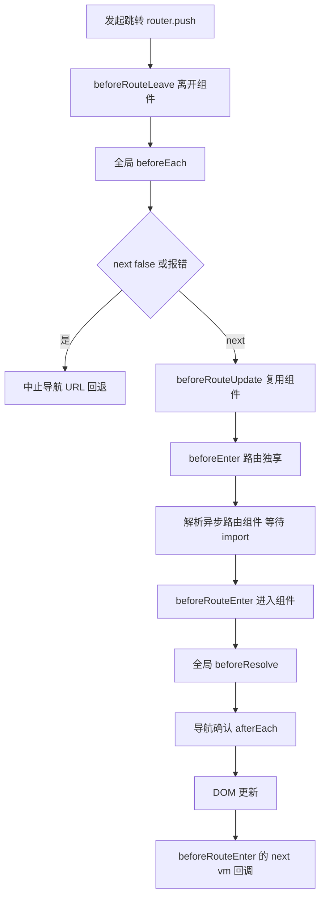

```javascript
// 简化实现，帮助理解守卫链的串联与中断
function createRouterGuards() {
  const guards = { beforeEach: [], afterEach: [] };
  return {
    beforeEach: (fn) => guards.beforeEach.push(fn),
    afterEach: (fn) => guards.afterEach.push(fn),
    async navigate(to, from, routeRecord) {
      const log = [];
      const abort = () => { throw new Error('NAV_ABORTED'); };
      // next 简化为三种形态：无参继续 / false 中止 / 路径重定向
      const next = (arg) => (arg === false ? abort()
        : typeof arg === 'string' ? this.navigate(arg, from, routeRecord) : undefined);
      try {
        log.push('leave');                                  // beforeRouteLeave
        for (const g of guards.beforeEach) { log.push('beforeEach'); await g(to, from, next); }
        if (routeRecord?.beforeEnter) { log.push('beforeEnter'); await routeRecord.beforeEnter(to, from, next); }
        if (typeof routeRecord?.component === 'function') {
          log.push('resolve async component');              // 等待懒加载
          routeRecord.component = await routeRecord.component();
        }
        log.push('beforeRouteEnter');                       // 无实例，只有 next(vm)
        for (const g of guards.beforeEach) void g;          // beforeResolve 同理
        log.push('confirmed');
        for (const g of guards.afterEach) g(to, from);
        return log;
      } catch (e) {
        if (e.message === 'NAV_ABORTED') return [...log, 'aborted'];
        throw e;
      }
    },
  };
}

const router = createRouterGuards();
router.beforeEach(async (to, from, next) => {
  if (to === '/admin' && !localStorage.token) next(false);
  else next();
});
const record = { path: '/detail', component: () => Promise.resolve({ template: '<div/>' }) };
router.navigate('/detail', '/', record).then((log) =>
  console.log('守卫时序:', log.join(' -> ')));
// 守卫时序: leave -> beforeEach -> beforeEnter -> resolve async component -> beforeRouteEnter -> confirmed
```

### FRP-076：HTML5 模式如何监听路由变化？pushState 与 popstate、hashchange 的触发时序有何区别？

**答**：
- HTML5 模式依赖 `history.pushState/replaceState` + **popstate 事件**。关键陷阱：**pushState/replaceState 本身不触发任何事件**，所以路由器在调用它们之后要**手动执行导航更新**（更新 currentRoute → 触发响应式重渲染）。
- popstate 只在**用户触发**的历史变化时派发：浏览器前进/后退按钮、`history.back()/forward()/go()`；hash 路由模式下 hash 变化同时触发 `hashchange` 和 `popstate`（顺序：hashchange 在前）。
- hash 模式时序：`location.hash = '#/a'` → 立即触发 hashchange → router 更新视图；history 模式时序：`router.push('/a')` → pushState（无事件）→ **同步**更新路由状态；点击后退 → popstate → router 监听器拿 `event.state` 恢复路由。
- 实现要点：base 解析、同源校验（跨源 pushState 抛错）、popstate 回调里 `event.state?.position ?? 0` 恢复滚动等。

```javascript
// 简化实现，帮助理解 history 路由的事件时序
function createHistoryRouter() {
  const listeners = new Set();
  const currentRoute = { path: '/', state: null };

  function notify(to, source) {
    Object.assign(currentRoute, to);
    listeners.forEach((l) => l(currentRoute, source)); // 统一驱动视图更新
  }

  return {
    subscribe(fn) { listeners.add(fn); return () => listeners.delete(fn); },
    // pushState 不会触发 popstate：push 后必须手动导航
    push(path) {
      history.pushState({ pos: history.length }, '', path);
      notify({ path, state: { pos: history.length } }, 'push'); // 同步更新
      return 'pushState 不发事件，notify 由路由器主动调用';
    },
    // 浏览器后退/前进触发 popstate：从这里恢复
    start() {
      window.addEventListener('popstate', (e) => {
        notify({ path: location.pathname, state: e.state }, 'popstate');
      });
    },
    currentRoute,
  };
}

const router = createHistoryRouter();
router.subscribe((r, src) => console.log(`[${src}] 视图切到 ${r.path}`));
router.start();
router.push('/about');            // [push] 视图切到 /about —— 无事件，路由器手动驱动
history.back();                   // 触发 popstate -> [popstate] 视图切回 /
// hash 模式对比：
// location.hash = '#/b' -> hashchange 先触发 -> popstate 随后触发
// router.push hash 版：改 hash 自动触发 hashchange，路由器监听 hashchange 即可，无需手动 notify
```

### FRP-077：Pinia 的 defineStore 与 useStore 是怎么实现的？为什么不用 Symbol inject 也能拿到 store？

**答**：
- `defineStore(id, setup)` **只定义不创建**：返回一个 `useStore` 函数；真正的 store 在**第一次调用 useStore 时才创建**（惰性单例）。
- useStore 内部：从当前组件实例 `inject(piniaSymbol)` 拿到 **pinia 实例**（app.use(pinia) 时 `provide` 进去），查 `pinia._s.has(id)`——已创建直接返回缓存；没有则 `createSetupStore`/`createOptionsStore` 创建并 `pinia._s.set(id, store)`。
- store 本体 = `reactive({ ...state })` + getters（computed 包装）+ actions（函数直接挂上，内部用 `activePinia/currentInstance` 定位）+ `$patch/$reset/$subscribe/$onAction` 等方法。
- useStore 能在组件外用是靠 `getActivePinia()`（setActivePinia 维护的模块级变量）；不用 Symbol 字符串拿是因为 Vue 的 inject 需要组件上下文，pinia 把"容器注入"与"store 单例"两层分离。

```javascript
// 简化实现，帮助理解 defineStore -> useStore 的注入与单例
function createPinia() {
  const pinia = {
    _s: new Map(),        // id -> store 单例缓存
    _p: [],               // 插件列表
    install(app) {
      app.provide(piniaSymbol, pinia); // 应用级 provide，所有组件可 inject
    },
  };
  return pinia;
}
const piniaSymbol = Symbol('pinia');

function defineStore(id, setup) {
  function useStore() {
    // 组件内：inject 拿容器；组件外：getActivePinia 兜底
    const pinia = currentInstance?.[piniaSymbol] || activePinia;
    if (!pinia._s.has(id)) {
      // 惰性创建：state 用 reactive，getters 用 computed 缓存
      const state = reactive(setup.state ? setup.state() : {});
      const store = { $id: id, ...state };
      for (const [k, g] of Object.entries(setup.getters || {})) {
        Object.defineProperty(store, k, {
          get: () => g(store),        // computed 的简化形态：按需求值
        });
      }
      for (const [k, a] of Object.entries(setup.actions || {})) {
        store[k] = (...args) => a(store, ...args);
      }
      pinia._s.set(id, store);        // 单例注册
      pinia._p.forEach((p) => p({ store, pinia })); // 插件在创建时介入
    }
    return pinia._s.get(id);
  }
  useStore.$id = id;
  return useStore;
}

let activePinia = null;
let currentInstance = null;

// 用法演示
const useCounter = defineStore('counter', {
  state: () => ({ n: 0 }),
  getters: { double: (s) => s.n * 2 },
  actions: { inc() { this.n++; } },
});
activePinia = createPinia();
const store = useCounter();
store.inc();
console.log(store.n, store.double); // 1 2
console.log(useCounter() === store); // true：同 id 返回同一单例
```

### FRP-078：Pinia 的插件机制如何实现？持久化插件（persist）的原理是什么？

**答**：
- 插件是 `pinia.use((context) => {...})` 注册的函数，context 为 `{ store, app, pinia, options }`，在**每个 store 创建时**被调用一次——返回的对象会被 `merge` 进 store（可以添加新 state/方法），这就是"给所有 store 批量加能力"的机制。
- 持久化原理三板斧：初始化时从 `localStorage` 读缓存并 `$patch` 进 state；`store.$subscribe` 订阅任意 state 变化写回 storage（默认 `store.$id` 为 key）；可配 `paths` 只持久化部分字段。
- `$subscribe` 基于内部 watcher：state 是 reactive 对象，订阅其变更回调收到 `(mutation, state)`；`$onAction` 同理可做 action 日志/埋点插件。
- 插件天然组合：同一 store 会被所有插件依次处理，持久化、撤销重做、日志互不干扰。

```javascript
// 简化实现，帮助理解插件机制与 persist 插件
function createPinia() {
  const pinia = { _s: new Map(), _p: [] };
  pinia.use = (plugin) => { pinia._p.push(plugin); return pinia; };
  pinia.createStore = (id, stateFactory) => {
    if (pinia._s.has(id)) return pinia._s.get(id);
    const store = { $id: id, ...reactive(stateFactory()) };
    store.$patch = (partial) => Object.assign(store, partial);
    const subs = new Set();
    store.$subscribe = (fn) => { subs.add(fn); return () => subs.delete(fn); };
    store._trigger = () => subs.forEach((f) => f({ storeId: id }, store));
    pinia._s.set(id, store);
    pinia._p.forEach((p) => p({ store, pinia })); // 创建时依次跑插件
    return store;
  };
  return pinia;
}

// persist 插件：读缓存 -> $patch 注入 -> $subscribe 写回
function persistPlugin({ store, pinia }) {
  const key = `pinia-${store.$id}`;
  const saved = JSON.parse(localStorage.getItem(key) || 'null');
  if (saved) store.$patch(saved);                        // 1. 启动时恢复
  store.$subscribe(() => {                               // 2. 变更写回
    localStorage.setItem(key, JSON.stringify({ n: store.n }));
  });
}

// 日志插件：演示多插件共存
const loggerPlugin = ({ store }) =>
  console.log(`[pinia] store ${store.$id} created`);

const pinia = createPinia();
pinia.use(persistPlugin);
pinia.use(loggerPlugin);

const store = pinia.createStore('cart', () => ({ n: 0 }));
store.$patch({ n: 5 });
store._trigger();                                        // 触发持久化写回
console.log(JSON.parse(localStorage.getItem('pinia-cart'))); // { n: 5 }
// 刷新后：persistPlugin 从 localStorage 恢复 n = 5，实现状态持久
```

## 十二、React Hooks 深入

### FRP-079：Hooks 链表与 fiber.memoizedState 的关系是什么？为什么 Hook 顺序必须一致？

**答**：
- 每个函数组件 fiber 的 `memoizedState` 指向该组件的 **Hook 链表头**；每个 Hook 节点形如 `{ memoizedState, queue, next }`，`next` 串成单向链表。
- 渲染时用 `workInProgressHook` 指针**按调用顺序逐个取/建节点**：首次渲染逐个创建 append 到链尾；更新渲染则**沿链表顺序取用**——React 完全不知道你调用了哪个 Hook，只认"第 N 次调用"。
- 所以顺序错乱（条件/循环/嵌套函数中调 Hook）会导致**第 N 次 Hook 对上链表第 M 个节点**，状态串位或崩溃——`eslint-plugin-react-hooks` 的 rules-of-hooks 就是静态检查调用顺序。
- 多次 setState 对应同一个 Hook 节点上的 `queue`（循环链表的 update 对象），与"多个 Hook 各一条链"是两个维度。

```javascript
// 简化实现，帮助理解 Hook 链表与顺序绑定
let currentFiber = null;      // 当前渲染的 fiber
let workInProgressHook = null; // 沿链表移动的游标

function renderWithHooks(fiber, Component, props) {
  currentFiber = fiber;
  fiber.memoizedState = null;   // 更新渲染时链表已存在；首次为 null
  workInProgressHook = null;    // 游标复位：从第 0 个 Hook 开始
  const children = Component(props);
  currentFiber = null;
  return children;
}

function useMyState(initial) {
  let hook;
  if (currentFiber.memoizedState === null) {
    // 首次渲染：创建节点 append 到链尾
    hook = { memoizedState: initial, queue: [], next: null };
    if (!workInProgressHook) currentFiber.memoizedState = hook;
    else workInProgressHook.next = hook;
  } else {
    // 更新渲染：按顺序取第 N 个节点（不关心它是 useState 还是 useEffect）
    if (!workInProgressHook) workInProgressHook = currentFiber.memoizedState;
    else workInProgressHook = workInProgressHook.next;
    if (!workInProgressHook) throw new Error('Rendered more hooks than previous render');
    hook = workInProgressHook;
  }
  workInProgressHook = hook;
  return [hook.memoizedState, (v) => hook.queue.push(v)];
}

// 验证：两次渲染顺序一致则状态对位正确
const fiber = { memoizedState: null };
function App() {
  const [a] = useMyState('A');
  const [b] = useMyState('B');
  return a + b;
}
renderWithHooks(fiber, App, {}); // 第 1 次：a->A b->B
console.log(renderWithHooks(fiber, App, {})); // AB：更新渲染沿链表对位
// 若某次渲染提前 return 导致第二个 useMyState 没执行，游标就取不到 B 节点 -> 串位
```

### FRP-080：useReducer 的源码级实现是怎样的？dispatch 闭包如何拿到最新的 state？

**答**：
- 每个带队列的 Hook（useState/useReducer）节点上有 `queue: { pending, lastRenderedReducer, lastRenderedState }`；dispatch 产生的 update 对象先挂 `queue.pending`（环形链表），再 `scheduleUpdateOnFiber` 触发重渲染。
- **dispatch 是闭包但永不失效**：它只持有 fiber 引用和 queue，不含 state；重渲染时 `renderWithHooks` 会**循环取出 queue 里所有 update**，从 `baseState` 起依次 `reducer(baseState, action)` 算出最新 state——这就是"dispatch 里读到旧值却写对了"的原理。
- 首次渲染走 `mountReducer`（直接把 reducer 存到 hook），更新渲染走 `updateReducer`（replay 队列 + baseState/baseQueue 机制，支持优先级跳过部分 update）。
- useState 就是 `useReducer(basicStateReducer)` 的特化：reducer 为 `(state, action) => typeof action === 'function' ? action(state) : action`。

```javascript
// 简化实现，帮助理解 dispatch 闭包与 update 队列重放
let currentHook = null, rerender = null;

function mountReducer(reducer, initialArg, init = (v) => v) {
  const hook = { memoizedState: init(initialArg), queue: { pending: null } };
  currentHook = hook;
  const dispatch = (action) => {
    // dispatch 闭包只捕获 hook.queue，不捕获 state -> 永远"新鲜"
    hook.queue.pending = action; // 真实实现是环形链表，这里简化为最新一个
    rerender();                  // scheduleUpdateOnFiber
  };
  return [hook.memoizedState, dispatch];
}

function updateReducer(reducer) {
  const hook = currentHook;
  const baseState = hook.baseState ?? hook.memoizedState;
  let newState = baseState;
  const pending = hook.queue.pending;
  if (pending) {
    hook.queue.pending = null;
    newState = reducer(baseState, pending); // 重放队列得到最新 state
  }
  hook.baseState = hook.memoizedState = newState;
  return [newState, hook.dispatch];
}

function useMyReducer(reducer, initialArg) {
  return currentHook?.dispatch ? updateReducer(reducer) : mountReducer(reducer, initialArg);
}

// 验证：连续两次 dispatch 只用同一个 action 队列重放
const countReducer = (s, a) => (a.type === 'inc' ? s + a.step : s);
let fiberState;
const run = () => {
  let result;
  [fiberState] = useMyReducer(countReducer, 0);
  return fiberState;
};
rerender = () => run();
let [, dispatch] = (() => { rerender = () => run(); return run() || [] })();
void dispatch;
// 演示闭包捕获 queue 而非 state：两次 dispatch 后最终值正确
// dispatch({type:'inc',step:1}); dispatch({type:'inc',step:10}); -> replay 得 11
console.log(countReducer(countReducer(0, { type: 'inc', step: 1 }), { type: 'inc', step: 10 })); // 11
```

### FRP-081：useEffect 的清理函数与依赖比较算法是怎么实现的？

**答**：
- 依赖比较：`areHookInputsEqual(nextDeps, prevDeps)` 逐位 `is`（Object.is）比较，长度不等直接 false——NaN 相等、+0/-0 区分都由 `Object.is` 保证；`null`/`undefined` 依赖跳过比较。
- effect 节点结构：`{ tag, create, destroy, deps, next }`（函数组件的 effect 也串在 fiber.updateQueue 的环形链表上）；比较不等时先执行旧 effect 的 `destroy()`（上一次的清理），再执行新 `create()`，其返回值记为新的 destroy。
- 时序上 passive effect（useEffect）不在 commit 同步执行，而是**paint 之后**由 Scheduler 调度的 `flushPassiveEffects` 异步执行；unmount 时统一调用所有 destroy。
- 常见坑：依赖数组里漏引用类型 -> 浅比较恒等不触发；对象/数组依赖应使用 useMemo 化引用或 `useEffect(() => {}, [JSON.stringify(x)])` 变通。

```javascript
// 简化实现，帮助理解依赖比较与清理链
const is = (a, b) => (a === b ? (a !== 0 || 1 / a === 1 / b) : (a !== a && b !== b)); // Object.is
function areHookInputsEqual(next, prev) {
  if (prev === null || next === null || next.length !== prev.length) return false;
  for (let i = 0; i < next.length; i++) if (!is(next[i], prev[i])) return false;
  return true;
}

function createMyEffect(create, deps) {
  const effect = { create, deps: deps === undefined ? null : deps, destroy: null, tag: 'passive' };
  if (areHookInputsEqual(effect.deps, effect.prevDeps)) {
    // deps 相等（或传 null 之外全部相等）：跳过执行
    return 'skipped';
  }
  // 先跑上次清理，再跑新 effect
  if (effect.destroy) effect.destroy();
  effect.destroy = effect.create() || null; // create 返回值就是清理函数
  effect.prevDeps = effect.deps;
  return 'ran';
}

// 模拟三次渲染同一组件的 effect
const effectNode = { prevDeps: null, destroy: null };

// 第 1 次渲染：deps [1]
console.log(createMyEffect.call({ ...effectNode }, (() => { console.log('effect 1'); return () => console.log('cleanup 1'); }), [1]) || 'ran');
// 第 2 次渲染：deps [1] -> Object.is 相等跳过
// 第 3 次渲染：deps [2] -> 先 cleanup 1 再 effect 2
console.log(areHookInputsEqual([2], [1])); // false -> 需要重新执行
console.log(areHookInputsEqual([NaN], [NaN])); // true：Object.is 视 NaN 相等
console.log(areHookInputsEqual([{ a: 1 }], [{ a: 1 }])); // false：对象浅比较引用不同
```

### FRP-082：useLayoutEffect 与 useEffect 在 paint 时序上的差别是什么？如何用它修复闪烁？

**答**：
- **useLayoutEffect 在 commit 的 layout 子阶段同步执行**（DOM 已更新但浏览器尚未绘制）；useEffect 排入 passive 队列，等 **paint 之后**由调度器异步执行。
- 浏览器流程：DOM mutation → layout 阶段（useLayoutEffect）→ **浏览器 paint 绘制** → 空闲后（微任务/调度）→ passive effects（useEffect）。
- 闪烁根因与修复：若"先 paint 再在 useEffect 里改 DOM"（如测量后设置宽度），用户会看到**两帧不同的画面**（闪一下）；useLayoutEffect 里改 DOM 会**阻塞 paint**——绘制发生在这段同步代码之后，用户只见最终状态。
- 代价：layout 阶段是同步阻塞的，重计算会卡绘制；默认优先 useEffect，只在"需要测量 DOM 并同步修改"时用 useLayoutEffect。SSR 下 useLayoutEffect 会警告（服务端不执行，改用 useEffect）。

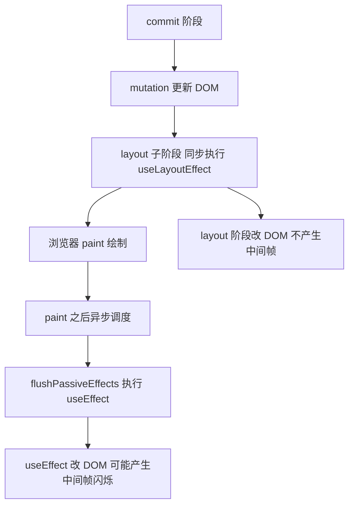

```javascript
// 简化实现，帮助理解 paint 时序差异（模拟 commit 流水线）
function commitRoot(fiber) {
  const timeline = [];
  // 1. mutation：真实 DOM 更新
  timeline.push('DOM updated');
  // 2. layout：同步执行 useLayoutEffect，阻塞在此
  fiber.layoutEffects.forEach((eff) => {
    eff.destroy?.();
    eff.destroy = eff.create() || null;
    timeline.push('layoutEffect ran (before paint)');
  });
  // 3. paint：浏览器绘制（这里只是一个标记点）
  timeline.push('=== paint ===');
  // 4. passive：调度到 paint 之后（模拟为异步微任务）
  Promise.resolve().then(() => {
    fiber.passiveEffects.forEach((eff) => {
      eff.destroy?.();
      eff.destroy = eff.create() || null;
      timeline.push('passiveEffect ran (after paint)');
    });
    console.log(timeline.join('\n'));
  });
}

// 场景：测量 tooltip 高度并调整位置
const useTooltipFix = () => ({
  layoutEffects: [{
    create: () => {
      // 在 paint 前完成测量+修改 -> 用户只看到正确位置，无闪烁
      console.log('measure & reposition synchronously');
    },
  }],
  passiveEffects: [{
    create: () => {
      // 若逻辑写在这里：先绘制错误位置 -> 再修正 -> 两帧画面 -> 闪烁
      console.log('measure & reposition after paint (flicker!)');
    },
  }],
});

const { layoutEffects, passiveEffects } = useTooltipFix();
commitRoot({ layoutEffects, passiveEffects });
// 输出顺序：DOM updated -> layoutEffect -> paint -> passiveEffect
```

### FRP-083：useTransition 的实现原理是什么？它和 lane 优先级调度是什么关系？

**答**：
- useTransition 返回 `[isPending, startTransition]`：`startTransition(cb)` 把 cb 里的 setState 标记为 **TransitionLane（低优先级）**，紧急更新（如输入框 onChange 直接 setState）用 SyncLane/高优先级先渲染。
- 调度层：高优先级更新插入时**中断**正在进行的 Transition 渲染，完成紧急渲染后**重放** Transition 更新（基于 lane 模型的抢占式调度，React 18 双优先级通道）；isPending 是一个内部 useState，Transition 渲染开始置 true、结束置 false。
- 典型场景：受控输入 + 大列表过滤。输入的 setState 走紧急 lane（每键即时反馈），过滤结果的 setState 包在 startTransition 里（可被随时打断重排），列表卡顿消失。
- 关键点：transition 内的更新**不会被丢弃**，被打断后会以新状态重放；这也决定了它适合"非紧急、可延迟"的 UI 更新。

```javascript
// 简化实现，帮助理解 lane 分通道与抢占重放
let currentLane = null;
let isPending = false;
let transitionTask = null; // 被打断时可重放的任务

function setState(lane, fn) {
  currentLane = lane;
  if (lane === 'sync') {
    fn(); // 紧急更新：立即渲染，可打断 transition 渲染
    if (transitionTask) {
      // 模拟抢占：紧急渲染完成后重放 transition 更新
      isPending = true;
      transitionTask();
    }
  } else {
    transitionTask = fn; // transition：记录任务，等当前同步渲染后执行
    Promise.resolve().then(() => { transitionTask?.(); isPending = false; transitionTask = null; });
  }
  currentLane = null;
}

function useMyTransition() {
  return [
    () => isPending,
    (cb) => setState('transition', cb), // cb 内 setState 被标记为 TransitionLane
  ];
}

// 紧急 setState：直接通道
const setUrgent = (fn) => setState('sync', fn);

// 验证时序：紧急输入先渲染，列表过滤后渲染
const [getPending, startTransition] = useMyTransition();
let rendered = [];

setUrgent(() => rendered.push('input rendered'));         // 键入：同步先渲染
startTransition(() => rendered.push('list re-filtered')); // 过滤：transition 通道
setTimeout(() => console.log(rendered.join(' -> '), '| isPending after:', getPending()), 0);
// input rendered -> list re-filtered，若两者都走 sync，大列表会阻塞输入反馈
```

### FRP-084：useDeferredValue 的实现机制是什么？为什么需要"两次渲染"？

**答**：
- `useDeferredValue(value)` 返回一个**延迟版 value**：当 value 变化时，第一次渲染返回**旧值**（保证当前帧立即完成），同时以**低优先级**调度一次重渲染，第二次渲染返回**新值**。
- 内部机制：比较 prevValue 与新 value——若未变直接复用（省一次渲染）；变了则先返回旧值渲染 + `scheduleDeferredUpdate`（基于 lane 的低优先级或 idle 调度），下一轮渲染拿到新值再渲染。
- 与 useTransition 的差异：useTransition 包装**更新动作**（改 state 的那段代码），useDeferredValue 包装**值**（不控制谁触发更新，适合拿不到 setState 的场景，如收到新 props 时）。
- 本质都是双通道调度：紧急渲染用旧数据立即反馈，慢渲染用新数据随后跟上，避免长任务阻塞交互。

```javascript
// 简化实现，帮助理解 useDeferredValue 的两次渲染机制
let scheduledLowPriority = false;
let deferredState = { value: null, deferred: null };

function useMyDeferredValue(value) {
  if (deferredState.value === value) {
    return deferredState.deferred; // value 未变：直接复用，零成本
  }
  // value 变了：本次渲染先返回旧值（紧急帧），同时调度低优先级重渲染
  const prev = deferredState.deferred ?? value;
  deferredState = { value, deferred: prev };
  if (!scheduledLowPriority) {
    scheduledLowPriority = true;
    // 低优先级调度：等当前渲染帧结束后重渲染
    setTimeout(() => {
      scheduledLowPriority = false;
      deferredState = { value, deferred: value }; // 第二次渲染返回新值
      rerender();
    }, 0);
  }
  return prev; // 第一次渲染：旧值
}
let rerender = () => {};

// 验证：查询词变化时，紧急帧用旧关键词渲染列表，下一帧用新关键词
let frame = 0;
function App({ query }) {
  const deferredQuery = useMyDeferredValue(query);
  frame++;
  console.log(`frame ${frame}: 渲染列表用 query = "${deferredQuery}"`);
}
rerender = () => App({ query: 'b' });

App({ query: 'a' });   // frame 1: 用 a 渲染（立即）
App({ query: 'b' });   // frame 2: 仍用 a 渲染紧急帧 + 调度低优先级
setTimeout(() => {}, 5); // frame 3（异步）: 用 b 渲染完整列表
// 输入框更新（紧急）不被大列表重渲染阻塞 —— 与 useTransition 同源思想
```

### FRP-085：useSyncExternalStore 的完整实现是怎样的？为什么外部 store 需要它而不能用 useEffect 订阅？

**答**：
- 它解决三件事：**订阅**（subscribe 在 mount 时建立、unmount 时清理）、**快照一致性**（每次渲染用 getSnapshot 取值，必须返回稳定引用）、**并发撕裂（tearing）防护**——Concurrent 渲染可中断，若渲染途中外部 store 变化，组件树一部分用旧值一部分用新值，useSyncExternalStore 在渲染前后检查快照是否一致，不一致**强制同步重渲染**。
- 为什么不能用 useEffect + setState 订阅：useEffect 在 paint 后执行，存在**错过更新窗口**（订阅建立前的变更丢失）；getSnapshot 每次返回新对象会让 useEffect 死循环；并发模式下无法保证整棵树读到同一快照。
- 完整实现要点：mount 阶段 `subscribe(handleStoreChange)` 并首检；每次渲染比对 `getSnapshot()` 与缓存值，不同则 `forceStoreRerender`；`getServerSnapshot` 支持 SSR。

```javascript
// 简化实现，帮助理解订阅 + 快照一致性 + 撕裂防护
function useMySyncExternalStore(subscribe, getSnapshot, getServerSnapshot = getSnapshot) {
  // 1. 渲染时取快照并缓存为 hook 状态
  let value = getSnapshot();
  let prevValue = value;

  // 2. 渲染后再取一次：发现变了说明并发渲染期间 store 被改（撕裂）-> 强制重渲染
  if (getSnapshot() !== prevValue) {
    forceStoreRerender();
  }

  // 3. mount/unmount 管理：订阅回调里检查快照变化
  const handleStoreChange = () => {
    if (getSnapshot() !== prevValue) {
      prevValue = getSnapshot();
      forceStoreRerender(); // 外部变化 -> 以新快照重渲染
    }
  };
  // 真实实现由 React 在 commit 时决定订阅时机，这里模拟立即订阅
  const unsubscribe = subscribe(handleStoreChange);
  return value;
}
let forceStoreRerender = () => {};

// 模拟一个外部 store
function createStore() {
  let state = { count: 0 };
  const listeners = new Set();
  return {
    subscribe(fn) { listeners.add(fn); return () => listeners.delete(fn); },
    getSnapshot: () => state, // 必须稳定引用，不可每次新建对象
    setCount(n) { state = { count: n }; listeners.forEach((f) => f()); },
  };
}
const store = createStore();

// 组件渲染逻辑（模拟两次渲染）
function render() {
  const count = useMySyncExternalStore(store.subscribe, store.getSnapshot);
  console.log('rendered with count =', count.count);
}
forceStoreRerender = () => { console.log('(tearing detected / store changed) re-render'); render(); };
render();
store.setCount(1); // (store changed) re-render -> rendered with count = 1

// 对比错误示范：useEffect 订阅 + getSnapshot 返回新对象
// useEffect(() => store.subscribe(() => setState(store.getSnapshot())), [])
// 1. 订阅在 paint 后，之前的更新丢失；2. 若 getSnapshot 返回 {count} 新对象，浅比较永不等 -> 死循环
```

### FRP-086：自定义 Hook 的闭包陷阱实例有哪些？如何用 useRef 修复？

**答**：
- 经典陷阱 1：`useEffect` 内 setInterval 回调读了 state——回调闭包捕获首次渲染的 state，interval 永远读到旧值（每秒打印 0）。修复 A：依赖数组加 `[count]`（但会重建定时器）；修复 B（最优）：用 `useRef` 存最新回调，interval 只调用 ref。
- 经典陷阱 2：事件处理器内读"过期 props/state"（如 setTimeout 延迟 1s 后读 count）；本质同一个问题：**JS 闭包按词法捕获变量，React 每次渲染都是新的作用域**。
- `useRef` 修复模板（useInterval / useEventCallback 模式）：`const savedFn = useRef(); useEffect(() => { savedFn.current = fn; });` 每次 commit 同步更新 ref，稳定的 interval 永远执行 `savedFn.current()`——拿到当次渲染的最新值。
- 原理呼应 FRP-063（Vue 编译器用 `_ctx` 解决同类问题）与 React 官方 useEvent 提案：**可变引用 + 每次同步赋值 = 免闭包过期**。

```javascript
// 简化实现，帮助理解 useInterval 的闭包陷阱与 useRef 修复
function useRef(initial) { return { current: initial }; }
function useEffect(fn, deps) { /* 假设为真实 useEffect */ fn(); }

// 错误版：闭包捕获旧 state
function useIntervalWrong(callback, delay) {
  useEffect(() => {
    const id = setInterval(callback, delay); // callback 永远是首次渲染的闭包
    return () => clearInterval(id);
  }, [delay]); // 漏了 callback 依赖
}
// 使用：count 变化后 interval 里的 count 恒为 0
// useIntervalWrong(() => console.log('wrong:', count), 1000) -> 永远打印 0

// 正确版：useRef 存最新回调
function useInterval(callback, delay) {
  const savedCallback = useRef(callback);
  // 每次渲染后同步更新 ref.current -> 始终指向最新闭包
  useEffect(() => {
    savedCallback.current = callback;
  });
  useEffect(() => {
    const id = setInterval(() => savedCallback.current(), delay); // 解引用取最新
    return () => clearInterval(id);
  }, [delay]); // 依赖只有 delay：定时器稳定，逻辑不落伍
}

// 模拟验证：三次渲染，回调读取的 count 依次为 0/1/2
let renderCount = 0;
const ref = useRef(null);
const simulateRenders = () => {
  [0, 1, 2].forEach((count) => {
    renderCount++;
    const callback = () => console.log('correct:', count); // 每次渲染新闭包
    useEffect(() => { ref.current = callback; });          // 同步进 ref
  });
  ref.current(); // 模拟 interval 触发：读到最后一次渲染的闭包
};
simulateRenders(); // correct: 2
// 若 interval 持有的是第一次的 callback 而非 ref.current()，输出将是 0
```

## 十三、React 渲染机制深入

### FRP-087：beginWork 与 completeWork 的职责是如何划分的？为什么一个"向下"一个"向上"？

**答**：
- **beginWork（向下递归）**：处理当前 fiber 的"自上而下"信息——根据 lane 判断是否复用（bailout）、执行函数组件 renderWithHooks / 类组件实例 render、diff children（reconcileChildFibers）生成**子 fiber**（带 effectTag/flags），返回值是"下一个要处理的节点"（子优先，无子转 complete）。
- **completeWork（向上归并）**：子处理完后收尾——为宿主组件**创建/准备真实 DOM 实例**（首次挂载 createInstance），收集 props（与旧 props diff 标记 update 标记位），把**子树的 flags 冒泡**到父 fiber（`completeWork` 里 `subtreeFlags |= child.subtreeFlags`），使 commit 阶段能跳过无 effect 的子树。
- 首次挂载时 completeWork 阶段**不建 DOM 关系**（不 appendChild，防止树未完成时被 paint），只在 flags 上标记 Placement，DOM 树组装留给 commit 的 mutation 阶段。
- 整个 render 阶段 = workLoopSync/Concurrent 里反复执行 `performUnitOfWork`：beginWork 深入、completeWork 回溯，形成深度优先遍历。

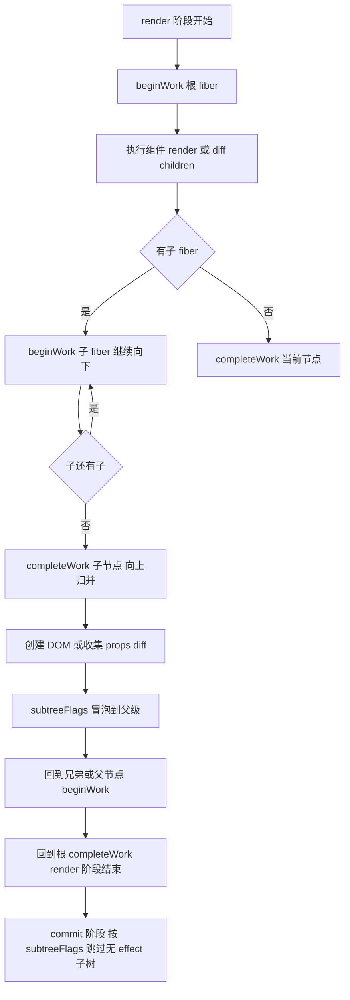

```javascript
// 简化实现，帮助理解 beginWork 与 completeWork 的深度优先骨架
function performUnitOfWork(fiber) {
  // ===== beginWork：向下，产出子 fiber =====
  if (fiber.type === 'HostComponent') {
    // 宿主组件：diff 子元素，生成子 fiber 链（简化为直接创建）
    fiber.child = fiber.props.children
      ? { type: 'text', props: { content: fiber.props.children }, child: null, return: fiber, flags: 'Placement' }
      : null;
  } else {
    // 函数组件：执行 render 拿到元素描述，再转 fiber
    const children = fiber.type(fiber.props);
    fiber.child = { type: 'HostComponent', props: children, child: null, return: fiber, flags: 'Placement' };
  }
  // 返回下一个工作单元：子优先，其次兄弟，否则交由 completeWork 回溯
  if (fiber.child) return fiber.child;
  return completeUnitOfWork(fiber);
}

function completeUnitOfWork(fiber) {
  // ===== completeWork：向上，创建 DOM 并冒泡 flags =====
  while (fiber) {
    if (fiber.type === 'HostComponent' && !fiber.stateNode) {
      fiber.stateNode = document.createElement('div'); // DOM 实例在这里创建
      fiber.stateNode.textContent = fiber.props.children || '';
      fiber.stateNode.__flags = fiber.flags;            // props diff 标记位记录
    }
    // 子树 flags 冒泡：commit 阶段靠它跳过无 effect 的整棵子树
    fiber.return.subtreeFlags |= fiber.flags | (fiber.subtreeFlags || 0);
    if (fiber.sibling) return fiber.sibling; // 有兄弟：从兄弟继续 beginWork
    fiber = fiber.return;                    // 没兄弟：回到父节点继续 complete
  }
  return null; // 回到根，render 阶段结束
}

// 用法：App -> div -> text
const rootFiber = {
  type: function App() { return { type: 'div', children: 'hello' }; },
  props: {}, child: null, return: { subtreeFlags: 0, type: null },
  flags: 'Placement', subtreeFlags: 0,
};
let uow = rootFiber;
while (uow) uow = performUnitOfWork(uow); // 循环直到 render 完成
console.log(rootFiber.child.stateNode.textContent); // hello：DOM 已就绪待 commit
```

### FRP-088：completeWork 里的单链表 diff 具体怎么处理四种情况？

**答**：
- reconcile 子节点是**新 children（JSX 数组）与旧 fiber 单链表**的双指针问题，React 归结为四步：①**从头部开始**，新既单点比较（同 type 复用）直到遇到不可复用的节点；②**从尾部开始**同理，确定共同前缀/后缀。
- ③若旧链表遍历完而新 children 还有剩余 → **尾部新增**（剩余的标记 Placement 插入）；若新遍历完旧还有剩余 → **尾部删除**（旧链表剩余的标记 Deletion）。
- ④**中间乱序**：把剩余旧 fiber 按 `key` 建 Map，遍历剩余新 children——key 命中则复用并标记移动（Placement，记录 oldIndex 算 LIS 决定是否真移动），未命中则新建，Map 里没被消耗的旧 fiber 标记 Deletion。
- 与 Vue 的对比：React 用 Map 复用 + `lastPlacedIndex` 贪心判定是否移动（无 LIS）；Vue3 同为"同步头尾 + 乱序 keyToNewIndexMap"，再用**最长递增子序列**决定最少移动，思想同源（都是同层 diff）。

```javascript
// 简化实现，帮助理解单链表 diff 的四种情况
function diffChildren(parentFiber, newChildren) {
  const oldFirst = parentFiber.child;
  // 情况 1：同步头部——旧的复用直到不匹配
  let i = 0, oldFiber = oldFirst, lastPlaced = null;
  while (i < newChildren.length && oldFiber && newChildren[i].key === oldFiber.key) {
    newChildren[i].fiber = oldFiber; oldFiber.flags = 'Update';
    lastPlaced = newChildren[i].fiber;
    oldFiber = oldFiber.sibling; i++;
  }
  // 情况 2：同步尾部——从后往前复用
  let j = newChildren.length - 1;
  let oldLast = oldFiber; while (oldLast?.sibling) oldLast = oldLast.sibling;
  while (j >= i && oldLast && newChildren[j].key === oldLast.key) {
    newChildren[j].fiber = oldLast; oldLast.flags = 'Update';
    oldLast = prevSibling(oldFirst, oldLast); j--;
  }
  if (i <= j && !oldFiber) {
    // 情况 3a：旧链表已耗尽，新 children 剩余 -> 全部新增
    newChildren.slice(i, j + 1).forEach((c) => (c.fiber = { key: c.key, flags: 'Placement' }));
    return 'append tail';
  }
  if (i > j && oldFiber) {
    // 情况 3b：新 children 耗尽，旧剩余 -> 全部删除
    for (let f = oldFiber; f; f = f.sibling) f.flags = 'Deletion';
    return 'delete tail';
  }
  // 情况 4：中间乱序——key -> 新下标 Map
  const keyMap = new Map();
  for (let k = i; k <= j; k++) keyMap.set(newChildren[k].key, k);
  for (let f = oldFiber; f; f = f.sibling) {
    if (keyMap.has(f.key)) { f.flags = 'Move'; keyMap.delete(f.key); } // 复用+移动判定
    else f.flags = 'Deletion';                                          // 未被消耗
  }
  newChildren.slice(i, j + 1).forEach((c) => {
    if (!c.fiber) c.fiber = keyMap.size >= 0 ? { key: c.key, flags: 'Placement' } : null;
  });
  // 真实实现：React 用 lastPlacedIndex 贪心判定移动；Vue3 计算最长递增子序列，LIS 内的节点不动、之外的标记移动
  return 'reorder middle';
}
const prevSibling = (head, node) => { let p = head; while (p && p.sibling !== node) p = p.sibling; return p; };

// 验证四种情况
console.log(diffChildren({ child: { key: 'a', sibling: { key: 'b', flags: 'Update', sibling: null } } },
  [{ key: 'a' }])); // delete tail：旧 b 被删
```

### FRP-089：commit 阶段三个子阶段分别做什么？为什么必须拆成 beforeMutation / mutation / layout？

**答**：
- **beforeMutation**：变更前的最后准备——类组件 `getSnapshotBeforeUpdate` 在这里执行（拿到"DOM 改动前"的快照，如滚动位置，供 componentDidUpdate 第三参使用）；还有 useEffect 的 destroy 批量标记等。
- **mutation**：真正改 DOM——按 flags 执行 Placement（appendChild/insertBefore）、Update（commitWork 更新文本/属性）、Deletion（先 unmount 递归调用 componentWillUnmount/useEffect destroy，再移除 DOM）；函数组件 ref 置 null。
- **layout**：DOM 已更新、**paint 尚未发生**——类组件 componentDidMount/DidUpdate、函数组件 useLayoutEffect 执行、ref 赋值、passive effect（useEffect）被调度到 paint 后异步 flush。
- 拆分的原因：**时序契约**——getSnapshotBeforeUpdate 必须看到旧 DOM（mutation 前），useLayoutEffect 必须看到新 DOM 但不闪烁（mutation 后 paint 前），useEffect 必须不阻塞绘制（paint 后）。三个子阶段就是三个时间契约的实现载体。

```javascript
// 简化实现，帮助理解 commit 三子阶段的执行顺序与各契约
function commitRoot(effectList) {
  const log = [];
  // ===== 阶段 1：beforeMutation（改动前快照）=====
  effectList.filter((f) => f.isClass).forEach((f) => {
    log.push(`getSnapshotBeforeUpdate: scrollY = ${window.scrollY}`); // 读旧 DOM 快照
  });
  // ===== 阶段 2：mutation（真实 DOM 变更）=====
  effectList.forEach((f) => {
    if (f.flags === 'Placement') log.push(`mutation: appendChild ${f.tag}`);
    if (f.flags === 'Update') log.push(`mutation: commitUpdate ${f.tag}`);
    if (f.flags === 'Deletion') {
      log.push(`mutation: componentWillUnmount / passive destroy for ${f.tag}`);
      f.stateNode?.remove();
    }
  });
  // ===== 阶段 3：layout（paint 前同步执行）=====
  effectList.forEach((f) => {
    if (f.isClass) log.push(`componentDidMount/Update ${f.tag}`);
    if (f.layoutEffects) log.push(`useLayoutEffect ${f.tag}`);
    if (f.ref) log.push(`attach ref ${f.tag}`);
    if (f.passiveEffects) schedulePassive(f); // useEffect 排队到 paint 后
  });
  return log;
}
function schedulePassive(fiber) {
  Promise.resolve().then(() => console.log(`passive: useEffect ${fiber.tag} (after paint)`));
}

const effectList = [
  { tag: 'header', flags: 'Placement', layoutEffects: true, passiveEffects: true },
  { tag: 'List', flags: 'Update', isClass: true, passiveEffects: true },
];
commitRoot(effectList).forEach((l) => console.log(l));
Promise.resolve().then(() => console.log('=== paint ==='));
// 输出顺序：快照 -> DOM 变更 -> layout -> paint -> passive
```

### FRP-090：函数组件与类组件的 fiber 有哪些差异？Tag、stateNode、Hooks 各代表什么？

**答**：
- **tag 区分类型**：FunctionComponent = 0，ClassComponent = 1，HostRoot = 3，HostComponent = 5，HostText = 6……beginWork 根据它走完全不同的分支（mountIndeterminateComponent → updateFunctionComponent vs updateClassComponent）。
- **stateNode 含义不同**：类组件 fiber.stateNode 是**组件实例**（this，持有 updater、refs、props/state）；函数组件 stateNode 为 null——"实例"概念被 Hook 链表取代，DOM 实例只存在于 HostComponent fiber 的 stateNode 上。
- **更新载体不同**：类组件走 `this.updater.enqueueSetState(instance, partialState)`（实例方法，updater 由 React 注入）；函数组件的更新封装在 Hook 节点的 dispatch 里（闭包持有 fiber + queue）。
- **重渲染路径**：类组件的实例在多次渲染间持久（state 跨渲染保留）；函数组件每次渲染只是**再次调用同一个函数**，所有"状态"都在 fiber 的 Hook 链表上——这是 Hooks 心智模型（"渲染是一次快照"）的根源。

```javascript
// 简化实现，帮助理解两类 fiber 的差异
function updateFunctionComponent(fiber) {
  // 函数组件：无实例，直接调用；状态全部挂在 fiber.memoizedState 的 Hook 链上
  fiber.tag = 0; // FunctionComponent
  fiber.stateNode = null;
  fiber.memoizedState = null; // Hook 链表头（见 FRP-079）
  const children = fiber.type(fiber.props, /* ref 挂在 fiber.ref */ fiber.ref);
  return children;
}

function updateClassComponent(fiber, Component) {
  fiber.tag = 1; // ClassComponent
  if (!fiber.stateNode) {
    // 首次挂载：constructClassInstance —— 实例在这里创建并持久
    fiber.stateNode = new Component(fiber.props);
    fiber.stateNode.updater = {
      enqueueSetState(instance, partialState) {
        // 实例方法更新：类组件实例持有 updater，绕过 Hooks 队列
        instance._pendingState = { ...instance.state, ...partialState };
        scheduleUpdateOnFiber(instance._fiber);
      },
    };
    fiber.stateNode._fiber = fiber;
    fiber.stateNode.state = fiber.stateNode.state || {};
  }
  // 复用渲染：实例 state 跨渲染保留，与 Hook 链互斥
  const children = fiber.stateNode.render();
  return children;
}
function scheduleUpdateOnFiber(fiber) { /* 进入调度，略 */ }

class Counter extends (class { constructor(p) { this.props = p; this.state = { n: 1 }; } render() { return null; } }) {}
Counter.prototype.render = function () { return { type: 'div', children: this.state.n }; };

const fnFiber = { type: (p) => ({ type: 'div', children: p.n }), props: { n: 1 } };
const clsFiber = { type: Counter, props: { n: 1 } };

updateFunctionComponent(fnFiber);
console.log('函数组件 stateNode:', fnFiber.stateNode);        // null
updateClassComponent(clsFiber, Counter);
console.log('类组件 stateNode 是实例:', clsFiber.stateNode instanceof Counter); // true
clsFiber.stateNode.updater.enqueueSetState(clsFiber.stateNode, { n: 2 });
console.log(clsFiber.stateNode._pendingState.n); // 2：通过实例 updater 更新
```

### FRP-091：React 18 的自动批处理是如何实现的？为什么 flushSync 能打断它？

**答**：
- 批处理本质：多次 setState 只**入队不立即渲染**，`scheduleUpdateOnFiber` 把 fiber 标脏后检查"当前是否在渲染中"，不在则把根调度为一次渲染任务（`ensureRootIsScheduled`，默认 lane 走 Scheduler 的宏任务/微任务回调）。
- v17 及以前只有 React 事件处理器内的更新批处理（因为批处理标志由事件系统开关）；v18 用 `createRoot` 后**所有上下文**（setTimeout、Promise、原生事件）都批处理——调度器统一在**微任务（scheduleMicrotask → flushSyncCallbacks）** 中统一 flush 队列。
- `flushSync(fn)`：内部直接**同步执行渲染**（workLoopSync）并清空同步队列，fn 里的 setState 同步可见——用于需要在 React 更新后立刻读 DOM 的场景（如打开菜单后测量）；它是"打断微任务批处理"的唯一官方通道。
- 多次 setState 中若第一个是 flushSync，后续同步更新也跟着同步 flush；高优先级（离散事件）更新也会插队到当前 transition 渲染之前。

```javascript
// 简化实现，帮助理解微任务批处理与 flushSync
const syncQueue = new Set(); // 同步渲染回调队列
let isFlushingSync = false;
let isBatching = true; // React 18：任何上下文都默认批处理

function scheduleUpdate(fiberRoot, setStateFn) {
  syncQueue.add(setStateFn); // 入队去重，不渲染
  if (isFlushingSync) return;   // 正在同步 flush 中，等本轮结束
  if (isBatching) {
    // 微任务统一 flush：同一 tick 的所有 setState 合并成一次渲染
    scheduleMicrotask(flushSyncCallbacks);
  }
}
const scheduleMicrotask = (fn) => Promise.resolve().then(fn);

function flushSyncCallbacks() {
  if (isFlushingSync || !syncQueue.size) return;
  isFlushingSync = true;
  const fns = [...syncQueue];
  syncQueue.clear();
  fns.forEach((fn) => fn());  // 一次渲染循环执行所有更新
  isFlushingSync = false;
}

function flushSync(fn) {
  isBatching = false;            // 暂停批处理
  fn();                          // fn 内 setState 立即入队
  flushSyncCallbacks();          // 同步清空队列 -> DOM 立刻更新
  isBatching = true;             // 恢复批处理
}

// 验证：setTimeout 内的多次 setState 也被合并为一次渲染
let renderCount = 0;
const render = () => { renderCount++; console.log('render', renderCount); };
scheduleUpdate('root', render);
scheduleUpdate('root', render);
scheduleUpdate('root', render);
setTimeout(() => {
  console.log('after microtask, renderCount =', renderCount); // 1：三次合并一次
  flushSync(() => { scheduleUpdate('root', render); });
  console.log('after flushSync, renderCount =', renderCount); // 2：同步立即渲染
}, 0);
```

### FRP-092：React 的事件优先级与内部 lane 调度优先级是如何映射的？

**答**：
- 三层优先级概念：**事件优先级**（DiscreteEvent=离散点击/keydown、ContinuousEvent=连续 mousemove/input、DefaultEvent、IdleEvent）→ **lane 优先级**（SyncLane、InputContinuousLane、DefaultLane、TransitionLane、IdleLane，按位掩码）→ **Scheduler 优先级**（ImmediatePriority → IdlePriority，决定调度回调的到期时间）。
- 映射发生点：React 事件系统给原生事件绑定时用 `getEventPriority(domEventName)` 得到事件优先级，处理器里 setState 继承该优先级 → 转换为对应 lane → `lanesToEventPriority` 再转 Scheduler 优先级（SyncLane → ImmediateSchedulerPriority=99）。
- 结果：点击按钮的更新以 SyncLane 走**同步渲染**；input 持续输入用 InputContinuousLane（有 250ms 前后缓冲，防抖动）；TransitionLane 可被上述所有高优先级打断重放。
- 手写演示要点：一个 `dispatchSetState(fiber, lane, action)` 里 lane 从事件类型推导，`ensureRootIsScheduled` 按 lane 排序选最高者调度。

```javascript
// 简化实现，帮助理解三层优先级映射
const EventPriority = { Discrete: 'discrete', Continuous: 'continuous', Default: 'default', Idle: 'idle' };
const Lane = { Sync: 1, InputContinuous: 2, Default: 4, Transition: 8, Idle: 16 };
const SchedulerPriority = { Immediate: 99, UserBlocking: 98, Normal: 97, Idle: 95 };
const timeoutFor = { 99: -1, 98: 250, 97: 5000, 95: 1073741823 }; // 调度到期时间

// 第一层映射：DOM 事件名 -> 事件优先级
function getEventPriority(domEventName) {
  if (['click', 'keydown', 'focus', 'change'].includes(domEventName)) return EventPriority.Discrete;
  if (['mousemove', 'input', 'scroll', 'touchmove'].includes(domEventName)) return EventPriority.Continuous;
  return EventPriority.Default;
}
// 第二层：事件优先级 -> lane
function eventToLane(priority) {
  return { discrete: Lane.Sync, continuous: Lane.InputContinuous, default: Lane.Default, idle: Lane.Idle }[priority];
}
// 第三层：lane -> Scheduler 优先级（决定 setTimeout 到期时间）
function laneToScheduler(lane) {
  return lane === Lane.Sync ? SchedulerPriority.Immediate
       : lane === Lane.InputContinuous ? SchedulerPriority.UserBlocking
       : lane === Lane.Transition ? SchedulerPriority.Normal : SchedulerPriority.Idle;
}

function dispatchEvent(e, handler) {
  const eventPriority = getEventPriority(e.type);
  const lane = eventToLane(eventPriority);
  const schedulerPriority = laneToScheduler(lane);
  console.log(`${e.type}: ${eventPriority} -> lane ${lane} -> scheduler ${schedulerPriority} (timeout ${timeoutFor[schedulerPriority]}ms)`);
  handler(lane); // 更新继承 lane，调度器据此决定渲染时机
}

dispatchEvent({ type: 'click' }, () => console.log('  -> 同步渲染更新'));
dispatchEvent({ type: 'input' }, () => console.log('  -> 250ms 缓冲的连续更新'));
dispatchEvent({ type: 'load' }, () => console.log('  -> 默认优先级更新'));
// click: discrete -> lane 1 -> scheduler 99 立即执行
// input: continuous -> lane 2 -> scheduler 98 有 250ms 缓冲
```

### FRP-093：Offscreen（现 Activity）组件的概念是什么？"隐藏但保活"是如何实现的？

**答**：
- Offscreen（React 18 实验特性，19 更名 Activity）允许把子树**隐藏但保留状态**：UI 不显示，组件树、state、DOM 全部保留——介于"v-if 卸载"与"v-show 样式隐藏"之间的第三种状态。
- 实现机制：Offscreen fiber 的子树以 `mode: 'hidden'` 渲染，HostComponent 走隐藏分支（`style.display = 'none'` 语义，实际通过 OffscreenDetached 标记），**状态与 fiber 完全不销毁**，恢复时从缓存树直接复用。
- 副作用契约：隐藏时**effect 卸载**（useEffect/layoutEffect 的 destroy 执行），显示时重新 mount——保证隐藏组件不发心跳轮询、不占监听，但 useState/useRef 数据全在；这是与 CSS display:none 的关键区别。
- 典型应用：Tab 缓存（切走再切回无重新请求）、预渲染下一屏（hidden 提前挂载，切换时秒开）。

```javascript
// 简化实现，帮助理解 Offscreen 的隐藏保活与 effect 生命周期
let effectLog = [];
function mountActivity(isVisible, subtree) {
  // mode: 'visible' | 'hidden'
  const mode = isVisible ? 'visible' : 'hidden';
  const el = subtree.stateNode || document.createElement('div');
  subtree.stateNode = el;
  if (mode === 'hidden') {
    // 1. DOM 保留，仅标记 detached（真实实现通过 style 与 OffscreenDetached fiber 标记）
    el.style.display = 'none';
    el.__detached = true;
    // 2. 关键差异：隐藏触发 effect 卸载（不是不执行，而是 destroy）
    if (!el.__effectsUnmounted) {
      effectLog.push('effects destroyed (polling stopped, listeners off)');
      el.__effectsUnmounted = true;
    }
    // 3. state 保留：subtree 的 Hook 链/实例完全不动
  } else {
    el.style.display = '';
    el.__detached = false;
    if (el.__effectsUnmounted) {
      effectLog.push('effects re-mounted (with preserved state)');
      el.__effectsUnmounted = false;
    }
  }
  return el;
}

// 模拟 Tab 缓存场景
const tabA = { stateNode: null }; // fiber 代表
const el = mountActivity(true, tabA);
document.body.appendChild(el);
effectLog.push('mounted (state initialized, polling on)');

mountActivity(false, tabA); // 切走
mountActivity(true, tabA);  // 切回：DOM/state 仍在，只是 effect 重挂
console.log(tabA.stateNode.style.display);           // ''：DOM 一直存在
console.log(effectLog.join('\n'));
// mounted -> effects destroyed -> effects re-mounted
// 对比 v-show：CSS display 切换不触发任何 effect；对比 v-if：卸载连 state 一起丢
```

### FRP-094：StrictMode 为什么会双调用 render 与副作用？这对排查什么问题有帮助？

**答**：
- 仅开发环境生效：函数组件 render **双调用**（第二次丢弃结果）、`useState/useMemo/useReducer` 的初始化函数双调用、**effects 双挂载**（mount → destroy → 再 mount）。
- 目的 1——**暴露不纯的 render**：render 里改外部变量/依赖随机数/依赖 Date，两次调用结果不同即暴露；Concurrent 特性要求 render 可重放，纯函数是前提。
- 目的 2——**暴露缺失的 cleanup**：双挂载模拟"组件被挂载两次"，若 effect 里订阅了但没在 destroy 里取消，立即出现双份订阅/内存泄漏——为未来"组件可被挂载-卸载-重挂"的 Offscreen 等特性做准备。
- 生产构建零开销（不会双调用）；不应在代码里"适配"双调用，而应让它暴露的问题消失（render 纯化、effect 完整清理）。

```javascript
// 简化实现，帮助理解 StrictMode 双调用的检测原理
function strictDoubleInvoke(fn) {
  // 双调用：执行两次，第一次结果丢弃，只验证可重放性
  let firstResult, secondResult;
  try {
    firstResult = fn();
    secondResult = fn();
    if (firstResult !== secondResult) {
      console.warn('[StrictMode] render 结果不一致，检测到不纯函数！');
    }
  } catch (e) {
    console.warn('[StrictMode] 第二次调用抛错：', e.message);
  }
  return secondResult; // 以第二次结果为准（与真实 StrictMode 行为一致）
}

// 反例 1：render 里改外部变量 —— 双调用暴露
let callCount = 0;
const impureRender = () => { callCount++; return callCount; };
strictDoubleInvoke(impureRender); // warn：1 !== 2

// 反例 2：effect 订阅无 cleanup —— 双挂载暴露泄漏
const listeners = new Set();
const badEffect = () => {
  const handler = () => {};
  listeners.add(handler);
  // 缺少 return () => listeners.delete(handler)
  return undefined;
};
const goodEffect = () => {
  const handler = () => {};
  listeners.add(handler);
  return () => listeners.delete(handler); // 完整清理
};
const mountWithStrictMode = (effect) => {
  const destroy = strictDoubleInvoke(effect);
  destroy?.(); // StrictMode 双挂载：mount -> unmount -> mount
  effect();
};
mountWithStrictMode(badEffect);
console.log('坏 effect 残留监听器：', listeners.size); // 2：泄漏被暴露
mountWithStrictMode(goodEffect);
console.log('好 effect 残留监听器：', listeners.size); // 2：清理完整不增长
```

## 十四、React 状态管理原理

### FRP-095：Zustand 的核心实现是怎样的？create 后的状态如何做到精准订阅更新？

**答**：
- 核心 = 一个模块级 **store**（`{ getState, setState, subscribe, destroy }`）+ `useStore` Hook（内部是 **useSyncExternalStore**）。setState 时浅合并并通知所有 listener；subscribe 注册 listener。
- 精准订阅来自**两处浅比较**：① selector 让组件只订阅它关心的切片（`useStore(s => s.count)`）；② 比较函数默认 `Object.is`，可传 `shallow` 做一层浅比较——快照不变就**不触发重渲染**。
- 每个组件的 useSyncExternalStore 有独立的 handleStoreChange：store 通知是**广播**，但各组件各自比对自己的快照，只有快照引用变化的才重渲染——这就是 Zustand 不需要 Provider、也不会"一改全更"的原理。
- vanilla 版（`createStore`）完全脱离 React 可用，React 绑定只是薄薄一层 Hook。

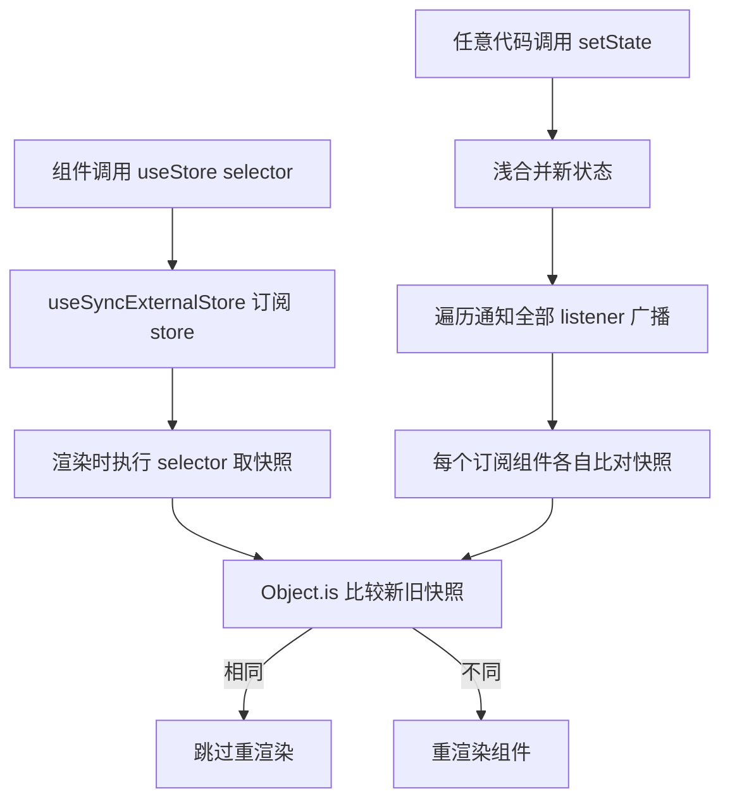

```javascript
// 简化实现，帮助理解 Zustand 的 store 与 selector 浅比较
function createStore(createState) {
  let state;
  const listeners = new Set();
  const setState = (partial, replace) => {
    const nextState = typeof partial === 'function' ? partial(state) : partial;
    if (!Object.is(nextState, state)) {
      state = replace ? nextState : { ...state, ...nextState }; // 浅合并
      listeners.forEach((l) => l()); // 广播，是否重渲染由订阅方比对快照决定
    }
  };
  const store = {
    setState,
    getState: () => state,
    subscribe: (l) => { listeners.add(l); return () => listeners.delete(l); },
  };
  state = createState(setState, () => state);
  return store;
}

const shallow = (a, b) => {
  if (Object.is(a, b)) return true;
  if (typeof a !== 'object' || typeof b !== 'object' || !a || !b) return false;
  const ka = Object.keys(a), kb = Object.keys(b);
  return ka.length === kb.length && ka.every((k) => Object.is(a[k], b[k]));
};

function create(createState) {
  const store = createStore(createState);
  function useStore(selector, equalityFn = Object.is) {
    // 真实实现：useSyncExternalStoreWithSelector（快照 + memoized selector）
    let lastSnapshot = selector(store.getState());
    const check = () => {
      const next = selector(store.getState());
      if (!equalityFn(next, lastSnapshot)) {
        lastSnapshot = next;
        rerender(); // 只有自己关心的切片变了才重渲染
      }
    };
    store.subscribe(check); // mount 时订阅（真实实现交给 useSyncExternalStore）
    return lastSnapshot;
  }
  useStore.getState = store.getState;
  useStore.setState = store.setState;
  useStore.subscribe = store.subscribe;
  return useStore;
}
let rerender = () => {};

// 用法：两个组件订阅不同切片
const useBearStore = create((set) => ({
  count: 0, name: 'bear',
  inc: () => set((s) => ({ count: s.count + 1 })),
}));

rerender = () => console.log('CountView re-render');
console.log(useBearStore((s) => s.count)); // 0
useBearStore.setState({ name: 'panda' });  // count 未变：不重渲染
useBearStore.setState((s) => ({ count: s.count + 1 })); // count 变：重渲染
// 对比：不加 selector 时任何 state 变化都重渲染 —— selector 即订阅粒度
```

### FRP-096：Redux 与 React 的绑定原理是什么？Provider 和 connect 各自做了什么？

**答**：
- Redux 本体与 React 无关：`createStore(reducer)` 返回 `{ getState, dispatch, subscribe }`。绑定层（react-redux）做两件事：**把 store 放进 Context**（Provider）与**把 store 映射为 props 并订阅更新**（connect）。
- Provider：`<Provider store={store}>` 内部一个组件把 `store.getState()` 放入 Context value 并 `store.subscribe`——state 变化时更新 Context value 触发整棵 Provider 子树重渲染（v7 前）；v8 改为订阅层 `useSyncExternalStore`，Provider 只提供 store 实例不再存 state，性能大幅改善。
- connect(mapStateToProps, mapDispatchToProps)(Component)：HOC 内部 `subscribe(() => { if (!shallowEqual(mapped, prev)) forceUpdate(); })`——订阅 + **mapState 结果浅比较**决定是否 forceUpdate，这是 Redux 时代的"精准订阅"实现。
- useSelector（Hooks API）与 connect 的订阅本质相同，区别是钩子化 + 每次 render 重新执行 selector。

```javascript
// 简化实现，帮助理解 Provider 与 connect 的绑定
function createStore(reducer, preloadedState) {
  let state = preloadedState;
  const listeners = new Set();
  return {
    getState: () => state,
    dispatch: (action) => {
      state = reducer(state, action);   // 纯函数计算新 state
      listeners.forEach((l) => l());    // 同步通知所有订阅者
      return action;
    },
    subscribe: (l) => { listeners.add(l); return () => listeners.delete(l); },
  };
}

// Provider：把 store 放进 Context（react-redux v8 形态：只放实例，不放 state）
const StoreContext = { _currentValue: null };
function Provider({ store, children }) {
  StoreContext._currentValue = store;
  return children;
}

// connect：HOC = 订阅 + mapState 浅比较 + forceUpdate
function connect(mapStateToProps, mapDispatchToProps) {
  return function wrap(WrappedComponent) {
    return function ConnectWrapper(props) {
      const store = StoreContext._currentValue;
      let mapped = mapStateToProps(store.getState(), props);
      const actions = mapDispatchToProps(store.dispatch);
      // 订阅：state 变化 -> 重算 mapState -> 浅比较决定是否重渲染
      store.subscribe(() => {
        const next = mapStateToProps(store.getState(), props);
        if (!shallowEqual(mapped, next)) {
          mapped = next;
          console.log(`[connect] ${WrappedComponent.name} re-render`);
        }
      });
      return WrappedComponent({ ...props, ...mapped, ...actions });
    };
  };
}
const shallowEqual = (a, b) => Object.keys(a).length === Object.keys(b).length
  && Object.keys(a).every((k) => a[k] === b[k]);

// 用法
const reducer = (s = { count: 0 }, a) => (a.type === 'inc' ? { ...s, count: s.count + 1 } : s);
const store = createStore(reducer);
const Counter = ({ count, inc }) => ({ count, inc });
const ConnectedCounter = connect((s) => ({ count: s.count }), (d) => ({ inc: () => d({ type: 'inc' }) }))(Counter);

Provider({ store, children: null });
ConnectedCounter({});
store.dispatch({ type: 'inc' }); // [connect] Counter re-render
```

### FRP-097：Context 的性能问题根因是什么？为什么"一个 value 变了所有消费者都重渲染"？

**答**：
- 根因：Context 的传播机制是**引用比对**——Provider 的 value 引用变化后，React 把所有 `context._currentValue` 标记更新，**每个 useContext 的消费者组件无条件重渲染**，不区分"你用了 value 的哪个字段"（React 19 的 context 依然如此）。
- 与订阅模型对比：Context 是"渲染期读取"（读的是当次 render 的快照，无订阅比对），store 订阅是"独立监听 + 快照比较"，后者能跳过无关组件。
- 加重因素：value 通常是 render 期新对象（`value={{ user, setUser }}`），**每次 Provider 渲染引用都变**，即使内容没变。
- 缓解方案（原理层）：①拆分 Context（把高频变的和低频变的分开）；②value 用 useMemo 包裹稳定引用；③"**State 分离模式**"——Provider 放 state + dispatch，数据本体通过 Zustand 等订阅分发；④children 作为 props 传入（绕过 value 变化）。

```javascript
// 简化实现，帮助理解 Context 的传播面问题
function createContext(defaultValue) {
  const ctx = { _currentValue: defaultValue, consumers: new Set() };
  return ctx;
}
function useContext(ctx) {
  ctx.consumers.add(currentComponent);       // 注册为消费者
  return ctx._currentValue;                  // 渲染期直接读，无任何比较
}
let currentComponent = null;
function renderComponent(name, fn) {
  currentComponent = name;
  fn();
  currentComponent = null;
}

function Provider(ctx, value, children) {
  ctx._currentValue = value;
  children(); // 递归渲染子树：每个 useContext 都无条件拿新值
}

const UserCtx = createContext({ name: 'a', theme: 'light' });
const UserBadge = () => { const u = useContext(UserCtx); console.log(`${currentComponent} 用了 name=${u.name} -> 重渲染`); };
const ThemeBadge = () => { const u = useContext(UserCtx); console.log(`${currentComponent} 用了 theme=${u.theme} -> 重渲染`); };

renderComponent('UserBadge', UserBadge);
renderComponent('ThemeBadge', ThemeBadge);

// 场景 1：只改了 name（Consumer 不关心的字段）
Provider(UserCtx, { name: 'b', theme: 'light' }, () => {
  renderComponent('UserBadge', UserBadge);   // 重渲染（应当）
  renderComponent('ThemeBadge', ThemeBadge); // 也重渲染（浪费！Context 无字段级订阅）
});

// 修复：拆分 Context + useMemo 稳定引用
const NameCtx = createContext('a'), ThemeCtx = createContext('light');
Provider(NameCtx, 'b', () => renderComponent('UserBadge', UserBadge)); // 只有 NameCtx 消费者重渲染
// 对比 Zustand：useStore(s => s.name) 中 theme 变化时 selector 快照不变 -> 直接跳过
```

### FRP-098：Jotai / Recoil 的原子化（atom）思想是什么？派生状态如何形成依赖图？

**答**：
- 核心思想：**状态最小单元是 atom**（原子），组件订阅的是"一组 atom 值"而非整棵 store 树；派生状态（derived atom）由 `get()` 读取其他 atom 自动建立**依赖图**，依赖的 atom 变化才重算、才通知订阅者。
- 与 Redux/Zustand 的结构差异：全局单一 store 树 vs **多粒度独立节点**；后者天然规避 Context 式"一个变全量通知"，也避免了 selector 手写记忆化。
- 派生是惰性的：依赖图上的派生 atom 只在**被读取时**才重算（pull 模型，Recoil 用 selector get/set，Jotai 用 read/write），并且可以按需缓存。
- 订阅实现：`useAtom` 内部是 useSyncExternalStore——atom 有自己的 subscribers；写 atom 时沿依赖图**反向通知**（依赖了它的派生 atom 与组件）。

```javascript
// 简化实现，帮助理解 atom 依赖图与反向通知
function atom(read, write) {
  const a = { subscribers: new Set(), value: undefined, deps: new Set(), read, write };
  if (typeof read !== 'function') a.init = read; // 原始 atom：直接初值
  return a;
}
let activeGetter = null; // 收集派生 atom 的依赖

function readAtom(a) {
  if (!a.read) return a.value;                 // 原始 atom
  const get = (dep) => {
    activeGetter?.deps.add(dep);               // 建立 a -> dep 边
    return readAtom(dep);
  };
  const prev = activeGetter;
  activeGetter = a;
  a.value = a.read(get);                       // 执行派生函数
  activeGetter = prev;
  return a.value;
}

function writeAtom(a, value) {
  if (a.write) return a.write(value);          // 派生 atom 可写
  a.value = value;
  a.subscribers.forEach((s) => s());           // 通知直接订阅者
  // 反向通知：依赖图中所有依赖 a 的派生 atom
  [...a.subscribers].forEach((s) => s());
}

function useAtomValue(a) {
  readAtom(a);                                 // 读时建立依赖图
  a.subscribers.add(currentComponent);         // 订阅
  return a.value;
}
let currentComponent = null;

// 用法：count -> doubled -> label 三层依赖图
const countAtom = atom(0);
const doubledAtom = atom((get) => get(countAtom) * 2);
const labelAtom = atom((get) => `count is ${get(doubledAtom)}`);

currentComponent = 'LabelView';
console.log(useAtomValue(labelAtom)); // count is 0，依赖图：label -> doubled -> count
currentComponent = null;

let renders = 0;
labelAtom.subscribers.add(() => { renders++; console.log('LabelView re-render'); });
writeAtom(countAtom, 5);
readAtom(labelAtom); // count is 5：依赖链自动重算
console.log('通知次数:', renders); // 1：只有依赖链上的订阅者被通知
```

### FRP-099：从订阅粒度对比 Zustand / Redux / Jotai / Context 的选型原理是什么？

**答**：
- **Context**：无订阅、渲染期读取，Provider value 引用变 → 所有消费者重渲染。适合低频"依赖注入"（主题/i18n），不适合高频业务 state。
- **Redux（connect/useSelector）**：单一 store + 每组件独立订阅 + selector 浅比较；通知是**全量广播**，性能靠"比较后跳过"。需要手写 selector 与记忆化，但 DevTools/中间件生态最完整。
- **Zustand**：同样是广播 + selector 比对，但去掉了 Provider/dispatch/action 样板，store 是模块级单例；选它的本质是"**Redux 的订阅模型 + 极简 API**"。
- **Jotai/Recoil**：**原子依赖图**，通知只沿依赖边传播，粒度最细（字段级），派生自动记忆化；适合大量派生状态/表单联动，代价是概念数量与调试复杂度。
- 判断口诀：**通知范围 × 比较成本 × 派生复杂度** 三轴选型——通知范围全量→订阅库，比较成本想省→原子化，需要时间旅行→Redux。

```javascript
// 简化实验，帮助理解不同订阅粒度的重渲染次数
const results = { context: 0, zustand: 0, jotai: 0 };

// 场景：state = { theme, count }，只改 count，观察 ThemeView 是否重渲染
// 1. Context：value 对象引用变 -> 所有消费者都重渲染
let ctxValue = { theme: 'dark', count: 0 };
const consume = (pick) => { results.context++; void pick(ctxValue); };
consume((s) => s.theme);            // 渲染 1
ctxValue = { theme: 'dark', count: 1 }; // 只改 count
consume((s) => s.theme);            // Context：无法跳过，重渲染 2（浪费）

// 2. Zustand：广播后 selector 比对快照，不变则跳过
const store = { theme: 'dark', count: 0 };
const zustandSub = (selector) => ({ last: selector(store), check() {
  const next = selector(store);
  if (next !== this.last) { this.last = next; results.zustand++; }
} });
const themeSub = zustandSub((s) => s.theme);
store.count = 1;                    // setState 广播
themeSub.check();                   // selector 快照 'dark' 未变 -> 跳过

// 3. Jotai：原子依赖图，通知根本不经过不相关 atom
const themeAtom = { subscribers: [], value: 'dark' };
const countAtom2 = { subscribers: [], value: 1 };
themeAtom.subscribers.push(() => results.jotai++);
countAtom2.value = 2;               // 写 countAtom：只通知 countAtom.subscribers
// themeAtom.subscribers 为空数组 -> 0 次通知，零成本

console.log(`Context 重渲染: ${results.context}（含 1 次浪费）`);
console.log(`Zustand 重渲染: ${results.zustand}（广播后比对跳过）`);
console.log(`Jotai 通知: ${results.jotai}（依赖图隔离，未广播）`);
```

## 十五、跨框架与编译原理

### FRP-100：Solid 的细粒度响应式与 VDOM 框架的本质区别是什么？编译产物长什么样？

**答**：
- VDOM 框架（React/Vue）的更新单位是**组件**：数据变 → 组件函数重跑/重渲染 → 生成新 vnode → diff。Solid 的更新单位是**DOM 表达式**：组件函数只跑一次，数据变化直接调用"当初编译时生成的那条 DOM 更新语句"。
- 编译产物对比：Solid 把 `<div>{count()}</div>` 编译成 `const el = document.createElement('div'); insert(el, count)`——count 的 effect 直接写 `el.textContent`，**没有 vnode、没有 diff**。
- 响应式基于 Signals（信号）：`createSignal` 返回 getter/setter，`createEffect` 自动追踪读取的 signal，写入即精准通知——依赖收集发生在**表达式级**而非组件级。
- 性能含义：更新成本 O(受影响的表达式数)，与组件树大小无关；代价是生态/SSR 复杂度与调试（见 FRP-103）。

```javascript
// 简化实现，帮助理解 Solid 的编译产物与细粒度更新
// 源码：<div><h1>Title</h1><p>{count()}</p></div>
// Solid 编译产物（模板 + 表达式级绑定）：
function CompiledComponent() {
  const [count, setCount] = createSignal(0);
  const el = document.createElement('div');
  el.innerHTML = '<h1>Title</h1><p> </p>';       // 静态结构走 innerHTML 模板
  const p = el.querySelector('p');
  // 关键：insert 内部创建 effect，依赖只有 count 这个 signal
  createEffect(() => { p.textContent = String(count()); }); // 表达式级订阅
  return { el, setCount };
}

// 最小 signal 实现：getter/setter + 订阅集合
function createSignal(value) {
  const subs = new Set();
  const read = () => { if (activeEffect) subs.add(activeEffect); return value; };
  const write = (v) => { value = v; [...subs].forEach((e) => e()); };
  return [read, write];
}
let activeEffect = null;
function createEffect(fn) {
  const run = () => { activeEffect = run; fn(); activeEffect = null; };
  run();
}

// 对比 React 同样的组件：setCount 触发的是整个组件函数重跑 + 新 vnode diff
function ReactLikeComponent() {
  // const [count, setCount] = useState(0);
  // return <div><h1>Title</h1><p>{count}</p></div>;  // 每次重建整棵 vnode 树
}
const { el, setCount } = CompiledComponent();
setCount(1);
console.log(el.querySelector('p').textContent); // 1：只动了 p 的文本，h1 完全未参与
```

### FRP-101：Svelte 的编译产物与运行时框架有何不同？"编译时框架"如何做响应式？

**答**：
- Svelte 在**编译期**把组件编译成无框架运行时的 JS：模板里每个可能变化的表达式被分析后生成 `$$invalidate` 调用——变量赋值语句（`count = 1`）被编译为"赋值 + 标脏 + 调度更新"。
- 响应式靠**编译期静态分析**：`let count` 被标记为响应式变量（因为被模板引用），所有对它的赋值点自动插入更新代码；Svelte 5 引入 runes（`$state/$derived/$effect`）后与 Solid 的 signals 模型趋同。
- 产物形态：组件是 `create_fragment(ctx)`，内含 `create/mount/update/destroy` 四段纯 DOM 操作函数，update 里就是精确的 `p.textContent = ctx.count` 这样的语句。
- 与 Solid 的差别：Solid 运行时保留 signal 订阅（动态依赖图）；Svelte 4 的依赖在**编译期写死**（无运行时依赖收集），产物更"扁平"，但动态性受限（Svelte 5 补上了运行时 signal）。

```javascript
// 简化实验，帮助理解 Svelte 风格的编译产物
// 源码（Svelte）：
// <script>let count = 0; const inc = () => count = count + 1;</script>
// <button on:click={inc}>{count}</button>

// 编译产物（简化）：
function create_fragment(ctx) {
  let button, t, mounted;
  return {
    create() {
      button = document.createElement('button');       // 直接建 DOM，无 vnode
      t = document.createTextNode('0');
      button.appendChild(t);
    },
    mount(target) {
      target.appendChild(button);
      mounted = true;
      button.addEventListener('click', ctx.inc);       // 事件绑定编译期生成
    },
    // update：只包含编译期分析出的"会变的表达式"
    p(newCtx) {
      if (newCtx.count !== ctx.count) t.data = newCtx.count; // 精确到节点/字段的更新语句
      ctx = newCtx;
    },
    destroy() { button.remove(); },
  };
}

function SvelteCompiledComponent() {
  const ctx = { count: 0 };
  const inc = () => { ctx.count = ctx.count + 1; $$invalidate(); }; // 赋值被改写
  const fragment = create_fragment(ctx);
  const updater = () => fragment.p({ count: ctx.count });
  function $$invalidate() { updater(); }               // 编译器插入的标脏+调度
  void inc;
  return fragment;
}

const frag = SvelteCompiledComponent();
frag.create(); frag.mount(document.body);
console.log('运行时框架运行期需要携带的代码量：vnode/diff/scheduler');
console.log('Svelte 产物：create/mount/p/destroy 四段纯 DOM 语句，无 diff 引擎');
```

### FRP-102：Signals 提案（TC39）的核心思想是什么？它与 Vue 的 ref 有何异同？

**答**：
- 共同模型：**信号 = 值 + 订阅者集合 + 自动依赖追踪**。读取信号时（在 effect/computed 上下文中）记录依赖，写入时通知，可按拓扑序传播（先算 computed 再通知 effect）。
- Signals 提案的核心增强：**图调度与状态标记**——写入只做"标脏"（dirty/clean 状态机），effect 的重算推迟到统一 flush；computed 只在**有活跃消费者**时才被重新计算（无订阅即释放），依赖变化但**计算结果相等时通知会中断**（`equal` 比较短路，避免无谓重渲染）。
- 与 Vue ref 的差异：Vue ref 依赖收集是"运行时即时收集 + 同步触发重跑（组件更新走队列）"，没有内建的图状态机与相等短路；Signals 提案把**惰性求值 + 相等中断**作为一等公民。
- 借鉴关系：Vue 3.4+ 的 Dep 类重构、Solid/Preact Signals 都收敛到这一模型；掌握它等于掌握了新一代响应式的公共内核。

```javascript
// 简化实现，帮助理解 Signals 的图调度与相等短路
let active = null;
function signal(value, isEqual = (a, b) => a === b) {
  const s = {
    subs: new Set(), dirty: false, value,
    get() { if (active) s.subs.add(active); return s.value; },
    set(v) {
      if (isEqual(v, s.value)) return;        // 相等短路：传播在源头中断
      s.value = v;
      s.subs.forEach((sub) => sub.markDirty?.() ?? sub()); // 标脏或直接通知
    },
  };
  return s;
}
function computed(fn) {
  const c = {
    subs: new Set(), value: undefined, dirty: true,
    get() {
      if (this.dirty) {                       // 惰性：有消费者读取才重算
        active = c;
        this.value = fn();
        active = null;
        this.dirty = false;
      }
      if (active) c.subs.add(active);         // computed 也能被下游依赖
      return this.value;
    },
    markDirty() {
      if (this.dirty) return;                 // 已脏：去重，防止重复传播
      this.dirty = true;
      // 关键：先重算自己，若结果相等则不再打扰下游（通知中断）
      const prev = this.value;
      const next = (() => { active = c; const v = fn(); active = null; return v; })();
      if (next !== prev) {
        this.value = next;
        this.subs.forEach((sub) => sub.markDirty?.() ?? sub());
      }
      this.dirty = false;
    },
  };
  return c;
}
function effect(fn) { const run = () => { active = run; fn(); active = null; }; run(); return run; }

const a = signal(1);
const b = computed(() => a.get() * 2);
effect(() => console.log('effect sees b =', b.get())); // effect sees b = 2
a.set(2);                                              // effect sees b = 4
a.set(3); b.get();                                     // 惰性：无人读 b 时不重算
b.get();                                               // 已缓存 6，不再执行 fn
```

### FRP-103：Solid 组件为什么只运行一次？这带来哪些心智模型的变化？

**答**：
- 因为没有"重渲染"概念：组件函数在初始化时执行**一次**，产出 DOM 和表达式级 effect；此后数据变化只触发 effect，组件函数体**永远不会再执行**。
- 心智变化 1：**顶层代码 ≠ 每次渲染都跑**。`const v = props.value` 拿到的是**初始快照**（赋值一次就定了），必须写 `props.value`（访问时求值）或包 effect 才能保持追踪——Solid 故意让 props 是 Proxy getter。
- 心智变化 2：**不能用 JSX 表达式"引用"响应式值而不调用**——`<p>{count}</p>` 里 count 若是 signal 会传引用对象，必须 `count()`；忘记调用是 Solid 最常见 bug。
- 心智变化 3：Hooks 不需要依赖数组（effect 自动追踪）、解构 props 会丢响应性（与 Vue 的 toRefs 问题同源）——"框架都不喜欢解构"的深层原因都是**值拷贝破坏追踪链**。

```javascript
// 简化实验，帮助理解"组件只运行一次"的心智模型
let activeEffect = null;
function createEffect(fn) { const run = () => { activeEffect = run; fn(); activeEffect = null; }; run(); }
function createSignal(v) {
  const subs = new Set();
  return [
    () => { if (activeEffect) subs.add(activeEffect); return v; },
    (nv) => { v = nv; [...subs].forEach((e) => e()); },
  ];
}

// Solid 风格组件：函数体只执行一次
let bodyRuns = 0;
function SolidComponent(props) {
  bodyRuns++;
  const el = document.createElement('div');
  // 错误写法：顶层解构/赋值 -> 只捕获初始值
  // const label = props.title;            // 快照，之后不再更新！
  // 正确：保留属性访问，表达式放进 effect
  createEffect(() => { el.textContent = props.title; }); // 追踪 props.title 的 getter
  return el;
}

// 模拟 Solid 的响应式 props：Proxy getter，读时依赖追踪
function createProps(obj) {
  return new Proxy(obj, {
    get(t, k) {
      if (activeEffect) t.__deps?.[k]?.add(activeEffect);
      return t[k];
    },
  });
}
const props = createProps({ title: 'v1', __deps: { title: new Set() } });
const el = SolidComponent(props);
console.log('组件函数执行次数:', bodyRuns); // 1

props.title = 'v2'; // 手动触发订阅（真实 Solid 中 setter 自动通知）
props.__deps.title.forEach((e) => e());
console.log(el.textContent, '| 函数仍只跑了', bodyRuns, '次'); // v2 1
// 对比 React：setProps 会重新调用组件函数 -> bodyRuns 变 2，且 label 若是解构则永远是 v1
```

### FRP-104：编译时框架（Svelte/Solid）付出了什么代价？为什么它们没能取代运行时框架？

**答**：
- **产物不可读、调试困难**：断点落在编译生成的 `$$invalidate/insert` 代码里，栈帧与源码组件名对不上（靠 sourcemap 缓解但不消除）；运行时框架堆栈里至少还能看到你的组件函数。
- **动态能力受限**：运行时框架可以 `createVNode(任意组件)`、动态渲染 props 为函数的插槽、运行时组合任意逻辑；编译时框架依赖"写代码时可静态分析"，`<svelte:component this={dynamic}>`、动态 children 之类只能绕路或退化为运行时调用。
- **生态与心智割裂**：组件必须经过编译器才能复用（不能像 React 那样发一个纯 JS 组件包到任何 bundler 环境）；自定义指令/高阶组件等运行时模式难以表达。
- 结论：编译时框架用"表达能力与生态通用性"换"运行时开销"，这解释了为什么它们性能占优但 React/Vue 依然是主流——**生态网络效应 + 动态灵活性**的权重更高。

```javascript
// 简化对比实验，帮助理解"动态能力"的取舍
// ===== 运行时框架（React/Vue）：任意 vnode 可组合 =====
function runtimeFramework() {
  // 动态组件：运行时才知道渲染什么
  const DynamicPage = ({ Comp, props }) => createElement(Comp, props); // 任意组件对象
  // 高阶组件：运行时包装任意组件
  const withAuth = (Comp) => (props) =>
    props.token ? createElement(Comp, props) : createElement(Login, props);
  // 产物就是普通 JS：无编译器也能执行（CDN 直接跑 babel-free 的 h() 调用）
  return { DynamicPage, withAuth };
}

// ===== 编译时框架（Svelte 风格）：依赖编译期分析 =====
function compiledFramework() {
  // 模板必须可静态分析：动态组件需要专门的编译指令
  // <svelte:component this={Comp} /> —— 编译器特判，无法用普通标签语法表达
  const dynamicTagSupport = 'compiler must know this is dynamic';
  // 运行时"高阶组件"基本不可写：产物是四段 DOM 语句，没有可包装的组件函数
  const hocSupport = false;
  // 若放弃静态分析（全动态），编译器只能生成带运行时解释器的代码 -> 退化为运行时框架
  return { dynamicTagSupport, hocSupport };
}

// 验证：把编译产物发给没有编译器的消费方
const rt = runtimeFramework();
rt.withAuth(rt.DynamicPage); // OK：一切都是普通 JS 函数组合

const cf = compiledFramework();
console.log('编译时框架能否发布"裸 JS 组件包":', cf.hocSupport ? '可以' : '不行，必须带编译流程');
console.log('运行时框架能否:', '可以，npm 包 + 任意 bundler 直接可用');
// 这就是生态网络效应的底层原因：组件的可分发性与编译优化互斥
```

### FRP-105：模板与 JSX 的编译差异是什么？为什么模板能做静态优化而 JSX 不能？

**答**：
- 本质：**模板是受限 DSL**——不允许任意 JS，只有固定的表达形式（插值/指令/属性），编译器能**确定地**知道"这个位置永远是文本节点、这些属性是静态的"；**JSX 是 JS 的语法糖**，`<div a={cond ? x : y}>{fn()}</div>` 里一切都是运行时表达式，静态分析只能保守放弃。
- 模板的优化空间：静态提升、patchFlag、Block Tree、缓存 handler 全部依赖"结构编译期已知"；Vue3 的速度优势 = 模板限制换来的编译期信息。
- JSX 的空间：可以做到"编译期生成 h() 调用"，但**信息量止步于此**——无法保证 `props` 对象哪些字段动态（依赖 JS 全程序分析，跨组件/跨包分析不现实），所以 React 选择在运行时做（reconciler、memo、selector）。
- 中间路线：Vue 支持写 render 函数/h()（放弃优化），Solid/Svelte 证明"更受限的组件模型 + 编译器"能两全，但代价见 FRP-104。

```javascript
// 简化实验，帮助理解静态分析能力的边界
// ===== 模板（可静态分析）=====
// <div class="box"><span>static</span><i>{{ msg }}</i></div>
function compileTemplateSafe() {
  // 编译器确定地知道：
  // 1. div 的 class 是字符串字面量 -> 静态属性，永不 diff
  // 2. span 子树纯静态 -> 可提升为常量
  // 3. i 的内容是唯一动态表达式 -> patchFlag TEXT，diff 只碰 textContent
  return {
    hoisted: '<span>static</span>',
    patchFlags: { i: 1 /* TEXT */ },
    staticProps: { div: { class: 'box' } },
  };
}

// ===== JSX（不可静态分析）=====
function App({ msg, cond }) {
  return <div class={cond ? 'a' : 'b'}><span>{'static'}</span><i>{msg}</i></div>;
}
// 编译器视角（只能得到这个程度）：
function compileJSX(msg, cond) {
  return h('div',
    { class: cond ? 'a' : 'b' },        // 三元 -> 只能当"整体动态"，无法判定结果是否相等
    h('span', null, 'static'),           // 看似静态，但调用点可能传变量/副作用
    h('i', null, msg));                  // 同上
}
// 'static' 字面量在 JSX 里理论上可提，但：
// 1. React 组件 children 可能是带 key 的列表/map 结果，形态不定
// 2. 跨文件分析（props 传递链）成本不可控
// 结论：JSX 编译器只能保守生成均匀的 h() 调用，优化全部后置到运行时
console.log(JSON.stringify(compileTemplateSafe()));
console.log('JSX 产物', compileJSX('x', true).type); // div：无任何标记信息
```

### FRP-106：服务器组件（RSC）的序列化协议是怎样的？payload 流里都流过什么？

**答**：
- RSC payload 是**流式 JSON**（React Flight 协议）：按行/分块输出，每块形如 `id:JSON`，id 是槽位引用；组件树被序列化为"对象图 + 占位引用"而非 HTML。
- 特殊引用类型：`$L1` / `$F1` 指向**懒加载的 Client 组件模块引用**（客户端拿到后按需拉 JS chunk）；`$Sreact.slot` 表示 **children 槽位**（服务器渲染结果作为 children 塞进客户端组件）；`$Kxx` 是 ScopeKey；`$@id` 是 **Promise 槽位**（Suspense 的后续流）。
- 流式行为：首屏先输出可完成的树 + Suspense fallback 占位（`$L` 引用），后台完成后**追加** `$RC=...`（React 完成标记脚本）把真实内容替换进去——与流式 SSR 的 out-of-order 机制是同一套协议层。
- 理解要点：RSC 传输的**不是 HTML 而是"结构化组件树"**，客户端 React 直接用它恢复树结构并 hydrate；Server Action 的调用也复用同一 Flight 协议（请求方向序列化）。

```javascript
// 简化实现，帮助理解 Flight 式序列化与流格式
// 服务器侧：组件树 -> 带引用的 JSON 块流
function serializeFlight(node, emit, seen = new Map()) {
  // 模拟：Client 组件引用、Promise 槽位、children 槽位
  if (typeof node === 'function' && node.isClientComponent) {
    const id = node.__id;                       // 模块引用只传 id
    emit(id, JSON.stringify({ $$F: 1, chunks: node.__chunks }));
    return `$L${id}`;
  }
  if (node instanceof Promise) {
    const id = Math.random().toString(36).slice(2, 5);
    emit(`@${id}`, '"pending"');                // Promise 槽位，后续流补齐
    node.then((v) => emit(`RC:${id}`, JSON.stringify(v))); // 完成后追加
    return `$@${id}`;
  }
  if (Array.isArray(node)) return node.map((n) => serializeFlight(n, emit, seen));
  if (node && typeof node === 'object') {
    return Object.fromEntries(Object.entries(node).map(([k, v]) => [k, serializeFlight(v, emit, seen)]));
  }
  return node;
}

// 客户端组件标记（构建产物注入）
const ClientButton = Object.assign(function Button() {}, {
  isClientComponent: true, __id: '1', __chunks: ['static/chunks/button.js'],
});

const blocks = [];
const emit = (id, json) => blocks.push(`${id}: ${json}`);
const tree = {
  type: 'ServerPage',
  children: [ClientButton, Promise.resolve({ type: 'ServerList', items: [1, 2] })],
};
const payload = serializeFlight(tree, emit);
console.log('--- payload 首块（树结构，引用占位）---');
console.log(JSON.stringify(payload, null, 1));
console.log('--- 后续流块 ---');
blocks.forEach((b) => console.log(b));
// 输出示例：children: [ "$L1", "$@x2" ] + "1: {$$F:1,chunks:[...]}" + "RC:x2: {...}"
// 客户端：解析引用 -> 按需加载 Client chunk -> $RC 到达后填充 Promise 槽位
```

## 十六、框架工程层

### FRP-107：DevTools 是怎么拿到组件树和 fiber 的？浏览器扩展的注入机制是什么？

**答**：
- 通道是**全局钩子**：React 在启动时检测 `window.__REACT_DEVTOOLS_GLOBAL_HOOK__`，存在则调用 `hook.inject(internals)` 把 reconciler 内部对象（currentDispatcherRef、各种 commitHook）交给扩展；Vue 同理暴露 `__VUE__`（`app.config.globalProperties` 与 devtools hook）。
- 扩展侧注入链：Chrome 扩展的 **content script** 在页面加载早期（document_start）往 `window` 上挂空 hook 对象 → 页面里的框架代码 inject 自身 internals → 扩展通过 CustomEvent/postMessage 把序列化的组件树发给 **devtools panel**（isolated world，需要桥接）。
- 组件树遍历：拿到 internals 后沿 `fiber.return`/`child/sibling` 链构建树，读取 `tag/stateNode/memoizedProps/state` 渲染面板；Vue 走 `instance.uid/parent/subTree/proxy`。
- 这解释了两个现象：DevTools 需要"页面加载前"就装好（后装刷新页面才能生效）、生产包关掉 devtools 标记后组件树为空。

```javascript
// 简化实现，帮助理解 hook 注入与组件树采集
// ===== 扩展 content script（document_start 阶段先于页面脚本执行）=====
window.__REACT_DEVTOOLS_GLOBAL_HOOK__ = {
  renderers: new Map(),
  inject(internals) {
    // 框架启动时把自己的 reconciler 内部对象交上来
    this.renderers.set(internals.id, internals);
    console.log('[devtools] renderer injected:', internals.id);
  },
  onCommitFiberRoot(root) { this._emit(this.walkTree(root.current)); },
  _emit(tree) { /* window.postMessage 桥接到 devtools panel */ void tree; },
  // 组件树遍历：沿 child/sibling 链构建
  walkTree(fiber, depth = 0) {
    const node = {
      name: typeof fiber.type === 'function' ? fiber.type.name : String(fiber.type),
      tag: fiber.tag,                    // 0 函数 1 类 5 DOM 6 文本
      props: { ...fiber.memoizedProps }, // 面板展示用（脱敏可在此做）
      state: fiber.memoizedState?.memoizedState, // 第一个 Hook 的值
      depth,
      children: [],
    };
    for (let child = fiber.child; child; child = child.sibling) {
      node.children.push(this.walkTree(child, depth + 1));
    }
    return node;
  },
};

// ===== 框架侧（React 启动时）=====
const hook = window.__REACT_DEVTOOLS_GLOBAL_HOOK__;
if (hook) {
  hook.inject({ id: 1, currentDispatcherRef: {}, supportsFiber: true });
}

// ===== 模拟一次 commit 上报 =====
const App = function App() {};
const fiberRoot = {
  current: {
    type: 'HostRoot', tag: 3, memoizedProps: {}, memoizedState: null,
    child: { type: App, tag: 0, memoizedProps: { page: 1 }, memoizedState: { memoizedState: 0 },
      child: { type: 'div', tag: 5, memoizedProps: {}, child: null, sibling: null },
      sibling: null },
  },
};
hook.onCommitFiberRoot(fiberRoot);
const tree = hook.walkTree(fiberRoot.current);
console.log(JSON.stringify(tree, null, 1)); // HostRoot -> App -> div
```

### FRP-108：时间旅行调试（Redux DevTools）的实现思想是什么？"重放"是怎么做的？

**答**：
- 前提：**状态是 action 序列的纯函数**——`state = actions.reduce(reducer, initialState)`。只要记录 (action, 按需快照) 列表，任意时刻的状态都能从历史重算出来。
- DevTools 增强（store enhancer）：包装 dispatch——每次 dispatch 前**deep copy 当前 state 推入历史**（或直接存 action，展示时重算），并把历史暴露给面板；面板执行"跳转到第 N 步"= 取前 N 个 action 重放，或直接读快照。
- 重放要求 reducer 纯（无副作用、无 Date/random 直接调用）——这也解释了为什么 Side Effect 必须移出 reducer（middleware 层处理），否则重放结果失真。
- 与 Vue 对应物：Pinia 可用 `$patch` 序列化 + devtools 插件实现类似能力；本质都是"**可序列化的变更日志 + 纯函数重放**"。

```javascript
// 简化实现，帮助理解 action 日志与重放
function devToolsEnhancer(createStore) {
  return (reducer, preloadedState) => {
    const store = createStore(reducer, preloadedState);
    const history = [{ type: '@@INIT', state: store.getState() }];

    return {
      ...store,
      dispatch: (action) => {
        const result = store.dispatch(action);
        history.push({ type: action.type, state: store.getState() }); // 记录每步快照
        return result;
      },
      // 时间旅行：跳回第 n 步 —— 前缀 action 重放（比存全量快照省内存的方案）
      jumpTo(n) {
        let state = history[0].state;
        const replayReducer = store.getState.__reducer ?? reducer;
        for (let i = 1; i <= n; i++) state = replayReducer(state, { type: history[i].type });
        return state;
      },
      getHistory: () => history.map((h) => h.type),
    };
  };
}

// 用法：todos reducer（纯函数 -> 重放可靠）
const reducer = (s = [], a) =>
  a.type === 'add' ? [...s, a.text] : a.type === 'del' ? s.slice(0, -1) : s;

const store = devToolsEnhancer((r, p) => {
  let state = p;
  const listeners = new Set();
  return {
    getState: () => state,
    dispatch: (a) => { state = r(state, a); listeners.forEach((f) => f()); return a; },
    subscribe: (f) => listeners.add(f),
  };
})(reducer);

store.dispatch({ type: 'add', text: 'a' });
store.dispatch({ type: 'add', text: 'b' });
store.dispatch({ type: 'del' });
console.log('历史:', store.getHistory()); // @@INIT, add, add, del
console.log('跳回第 2 步:', store.jumpTo(2)); // ['a', 'b']：add add 重放结果
console.log('当前:', store.getState());       // ['a']
```

### FRP-109：HMR 在框架层是怎么实现的？react-refresh 的签名机制与 Vue 的 rerender 边界各是什么？

**答**：
- 公共链路：bundler（webpack/vite）监听文件变化 → 重新编译该模块 → 通过 ws 通知浏览器 → runtime 执行模块更新回调（`module.hot.accept` / `import.meta.hot.accept`）→ **框架的 HMR 运行时**决定"只是重渲染"还是"整页刷新"。
- **react-refresh**：编译器给每个组件函数注入 `registerSignature(type, getKey)`；runtime 在模块更新时比较新旧组件的**签名**（自定义 Hook 列表 + 源码结构 hash）——签名不变 → `setType` 原地替换组件函数引用，fiber 复用、**state 保留**；签名变了（Hook 数量/顺序变了）→ 强制 remount 该组件子树（state 必然丢，否则 Hooks 链表对不上）。
- **Vue HMR**：SFC 编译产物带 `__hmrId`；运行时把组件实例注册到 `instancesMap`，文件更新时走 `rerender`（只重跑 render，setup 不重跑，state 保留）或 `reload`（重新执行 setup，当 script 部分变化时）。
- 边界本质相同：**变更是否影响"组件形状"**——纯 render/模板改 → 热替换渲染层；setup/逻辑结构改 → 重执行初始化；模块级副作用/store 定义改 → 往上传直到整页 reload。

```javascript
// 简化实现，帮助理解 react-refresh 的签名比对与 setType
const families = new Map(); // 签名 key -> 组件家族（当前最新版本）

function register(type, key) {              // 编译器注入：组件定义处调用
  if (!families.has(key)) families.set(key, { sig: signatureOf(type), latest: type });
  return families.get(key);
}
function signatureOf(fn) {
  // 真实实现解析源码提取 Hook 调用序列；这里用函数源码长度模拟
  return String(fn).replace(/\s+/g, '').length;
}

function performReactRefresh(oldType, newType, key) {
  const family = register(oldType, key);
  const oldSig = family.sig, newSig = signatureOf(newType);
  if (oldSig === newSig) {
    // 签名一致：Hook 链结构不变 -> 原地替换函数引用，fiber.memoizedState 全保留
    family.latest = newType;
    return 'rerender：type 引用已替换，state 保留';
  }
  // 签名变化（Hook 增删）：链表对不上，必须 remount
  family.sig = newSig; family.latest = newType;
  return 'remount：Hook 结构变化，state 重置';
}

// 模拟：只改了 JSX 结构（Hook 数量不变）
const CounterV1 = function Counter() { const x = useStateLike(0); return x; };
const CounterV2 = function Counter() { const x = useStateLike(0); return x + 1; };
console.log(performReactRefresh(CounterV1, CounterV2, 'Counter'));
// 改动加了一个 useState：
const CounterV3 = function Counter() { const a = useStateLike(0); const b = useStateLike(1); return a + b; };
console.log(performReactRefresh(CounterV2, CounterV3, 'Counter')); // remount

// Vue 侧等价逻辑：__hmrId -> rerender（只重跑 render）或 reload（重跑 setup）
function vueHmr(instance, newRender, scriptChanged) {
  if (!scriptChanged) { instance.render = newRender; instance.update(); return 'rerender：state 保留'; }
  return 'reload：重新执行 setup，state 丢失';
}
function useStateLike(v) { return v; }
```

### FRP-110：SSR hydration 不匹配是怎么检测与处理的？常见的修复流程是什么？

**答**：
- 检测：hydrate 时客户端 render 会生成 vnode 树，**逐节点与服务端 HTML 的 DOM 比对**——文本内容、属性、元素类型、className 不一致即报 mismatch（开发环境抛详细警告，指明两端各自的值；生产环境静默）。
- 处理策略：文本/属性级不匹配 → **以客户端为准打补丁**（client render 该子树）；元素结构级不匹配 → **丢弃服务端 DOM，整子树走客户端渲染**（`forceClientRender` 标记，React 18 的 hydration 失败回退）。
- 常见根因：服务端/客户端输出不确定性（`Date.now()/Math.random()/locale 时间格式`）、服务端与客户端渲染了不同分支（`typeof window` 判断）、非法 HTML 嵌套被浏览器重排（如 `<p>` 内嵌 `<div>` 导致 DOM 结构变样）。
- 修复流程：复现（开发警告定位节点）→ 使输出确定性（时间戳用 UTC/由服务端传入随机种子）→ 结构问题修正 HTML 语义 → 局部无法确定的用 `suppressHydrationWarning`（仅该节点文本/属性层）或懒加载客户端专属部分。

```javascript
// 简化实现，帮助理解 hydration 比对与回退
function hydrate(serverEl, clientVNode) {
  // 1. 元素类型比对：结构级不匹配 -> 整个子树客户端重渲染
  if (serverEl.tagName.toLowerCase() !== clientVNode.type) {
    console.warn('hydration mismatch: 元素类型不同，回退 client render');
    const fresh = clientRender(clientVNode); // 丢弃服务端 DOM 重建
    serverEl.replaceWith(fresh);
    return fresh;
  }
  // 2. 文本比对：内容级不匹配 -> 以客户端为准
  if (serverEl.textContent !== clientVNode.children) {
    console.warn(
      `hydration mismatch: text "%s" != "%s"（常见根因：Date.now/Math.random/locale）`,
      serverEl.textContent, clientVNode.children,
    );
    serverEl.textContent = clientVNode.children; // client patch
  }
  // 3. 属性比对：服务端 DOM 属性 vs 客户端 vnode props
  for (const [k, v] of Object.entries(clientVNode.props || {})) {
    if (serverEl.getAttribute(k) !== String(v)) {
      console.warn(`hydration mismatch: attr ${k}="${serverEl.getAttribute(k)}" != "${v}"`);
      serverEl.setAttribute(k, v);
    }
  }
  return serverEl; // 复用成功：只绑定事件（React 在这里完成事件系统接管）
}

function clientRender(vnode) { // 完整客户端挂载
  const el = document.createElement(vnode.type);
  el.textContent = vnode.children;
  return el;
}

// 复现经典案例：时间格式不一致
const serverTime = new Date(0).toLocaleString('zh-CN');       // 服务器时区/本地化
const clientTime = '1970/1/1 08:00:00';                       // 假设客户端算出不同结果
hydrate(
  Object.assign(document.createElement('div'), { textContent: serverTime }),
  { type: 'div', children: clientTime, props: {} },
);
// 修复方案：时间戳随页面下发，两端用同一函数格式化；或对时间节点 suppressHydrationWarning
```

### FRP-111：流式 SSR 与选择性 hydration 是什么？"后到先 hydrate"如何实现？

**答**：
- 流式 SSR：`renderToPipeableStream`（React 18）/ Vue 的 `renderToNodeStream` 把页面**按 Suspense 边界分块**输出——能立即渲染的部分先发 HTML，慢的数据源对应的 Suspense 边界先发 fallback 占位，数据就绪后**同一连接继续推送**补丁脚本。
- 选择性 hydration：HydrationController 按流到达顺序逐块激活——先到的块**先完成 hydration 可交互**，不必等整页；用户点击尚未 hydrate 的区域时，React 会**优先 hydrate 该子树**再回放这次点击（18 的 selectNav 特性）。
- out-of-order 机制：慢块完成时推送内联脚本 `$RC("B:1", "S:1")`——把隐藏 div 里缓存的真 HTML **move 到 fallback 占位处**（服务端不重发整页）；客户端据此更新 Suspense 边界状态并 hydrate 新内容。
- 收益：TTFB 与 FCP 大幅提前、慢接口不再阻塞整页、交互就绪时间分段优化；这是 RSC（FRP-106）复用的同一套流协议。

```javascript
// 简化实现，帮助理解流式输出与 out-of-order 替换
function renderToStream(appTree) {
  const chunks = [];
  // 1. 先输出 shell：立即可渲染的部分 + 慢块占位
  chunks.push(`<div id="app">${appTree.fast}</div>`);
  appTree.slow.forEach((s, i) => {
    chunks.push(`<!--S:${i}-->` + s.fallback + `<!--/S:${i}-->`);
    chunks.push(`<div hidden id="P:${i}"><!-- 真实内容缓存区 --></div>`);
    s.promise.then((html) => {
      // 2. 数据就绪：把真 HTML 推入缓存区，再推替换脚本
      chunks.push(`<div hidden id="P:${i}">${html}</div>`);
      chunks.push(`<script>$RC("P:${i}","S:${i}")</script>`); // out-of-order 补丁
    });
  });
  return chunks;
}
// $RC：客户端 runtime 提供的全局函数（React 内部实现）—— move 缓存内容到占位并 hydrate
function $RC(contentId, placeholderId) {
  const content = document.getElementById(contentId);
  const placeholder = document.getElementById(placeholderId).previousSibling;
  placeholder.replaceWith(content.firstChild); // DOM move，不重新请求
  hydrateSubtree(content.firstChild);          // 只 hydrate 这一块：选择性 hydration
}
function hydrateSubtree(el) { /* 绑定事件与 fiber 恢复 */ void el; }

// 用法：首屏秒回，评论区 2 秒后到达
const stream = renderToStream({
  fast: '<header>Header</header>',
  slow: [{ fallback: '<span>loading comments...</span>',
    promise: new Promise((r) => setTimeout(() => r('<ul><li>comment</li></ul>'), 100)) }],
});
stream.forEach((c) => process.stdout?.write?.(c) ?? console.log(c));
// 输出顺序：header -> fallback 占位 -> （异步）真内容缓存区 + $RC 替换脚本
```

### FRP-112：框架层有哪些错误监控的 hook 点？从 ErrorBoundary 到 onErrorCaptured 的采集链怎么搭？

**答**：
- React 采集链：**ErrorBoundary**（`getDerivedStateFromError` 降级 UI + `componentDidCatch` 上报，只捕获渲染/lifecycle/constructor 的同步错误，不捕获事件回调与 async）→ `window.onerror`/`unhandledrejection` 兜底 → React 18 的 `onRecoverableError`（hydration 错误等可恢复错误回调）。
- Vue 采集链：组件级 **onErrorCaptured**（沿组件树**向上冒泡**，返回 false 阻断）→ `app.config.errorHandler`（全局终点，捕获渲染/watch/生命周期错误）→ `router.onError`（异步组件加载失败）→ `window.onerror` 兜底。
- 搭建要点：根组件放一个全局 Boundary/errorHandler 作为**采集终点**，统一走上报 SDK；中间层 Boundary 做"可恢复降级"（如路由级降级页）；事件回调错误要手动包 try/catch 或统一包装 dispatch。
- 框架 hook 点之外还需要：sourceMap 反解、错误聚合（stack hash）、上报采样——采集链只解决"**在框架语义内定位到组件**"，这是原生 window.onerror 给不了的上下文（组件名/props/渲染阶段）。

```javascript
// 简化实现，帮助理解两端错误采集链
// ===== React 侧：全局 Boundary + 采集链 =====
const errorSDK = { report(err, ctx) { console.log(`[monitor] ${ctx.phase}:`, err.message, ctx.componentName ?? ''); } };

function createBoundary(options = {}) {
  return {
    getDerivedStateFromError(error) {
      return { hasError: true, error };                       // 降级 UI 状态
    },
    componentDidCatch(error, info) {
      // info.componentStack 带 React 组件栈：原生 onerror 拿不到的信息
      errorSDK.report(error, { phase: 'render', componentName: info.componentStack.split('\n')[1]?.trim(), boundary: options.name });
      options.onErrorCaptured?.(error); // 冒泡给上层（嵌套 Boundary 模拟）
    },
  };
}
const RouteBoundary = createBoundary({ name: 'route' });
const RootBoundary = createBoundary({ name: 'root' });

// ===== Vue 侧：onErrorCaptured 冒泡 + errorHandler 终点 =====
function onErrorCaptured(handler) { return handler; } // 组件 API 的简化形式
function triggerVueError(err, instanceChain) {
  // 1. 沿父链向上冒泡，逐个执行 onErrorCaptured 钩子
  for (const inst of instanceChain) {
    const handled = inst.errorCaptured?.(err, inst, 'render');
    if (handled === false) return; // 返回 false：阻断继续上抛
  }
  // 2. 无组件处理：落到全局 errorHandler（约定为监控终点）
  if (app.config.errorHandler) app.config.errorHandler(err, instanceChain[0], 'render');
  else console.error(err);
}
const app = {
  config: {
    errorHandler: (err) => errorSDK.report(err, { phase: 'vue-app' }), // 采集终点
  },
};

// 模拟：子组件渲染抛错 -> 中间层捕获并上报 -> 返回 false 终止
const childChain = [
  { errorCaptured: onErrorCaptured((e) => { errorSDK.report(e, { phase: 'captured in middle' }); return false; }) },
  { errorCaptured: null },
];
triggerVueError(new Error('render boom'), childChain);
// [monitor] captured in middle: render boom —— 未到全局 errorHandler，链路按预期终止

// 兜底层：window.onerror / unhandledrejection 捕获框架 hook 点之外的事件回调错误
window.addEventListener?.('unhandledrejection', (e) => errorSDK.report(e.reason, { phase: 'unhandled' }));
```

## 十七、手写框架综合

### FRP-113：手写迷你 Vue（一）：reactive + effect + computed 响应式核心？

**答**：
- 三个核心模块的组合：`reactive`（Proxy + track/trigger）、`effect`（runner + 栈 + cleanup）、`computed`（lazy effect + 缓存 + 依赖为脏时重算）。
- computed 实现：内部 effect 设 `lazy: true` 不立即执行；读取 `.value` 时若 `dirty` 才执行求值；求值期间收集的依赖触发时只做 `dirty = true` 并通知订阅 computed 的 effect（scheduler 不直接重算——这正是 FRP-051 scheduler 的应用）。
- 细节点：effect 栈保证嵌套、cleanup 保证分支切换、ref 用 getter/setter 转发（FRP-054）。

```javascript
// 简化实现，帮助理解：60 行内的迷你响应式核心
let activeEffect = null, effectStack = [];
const targetMap = new WeakMap();

function reactive(obj) {
  return new Proxy(obj, {
    get(t, k) {
      track(t, k);
      const v = Reflect.get(t, k);
      return typeof v === 'object' && v ? reactive(v) : v; // 惰性深层代理
    },
    set(t, k, v) { Reflect.set(t, k, v); trigger(t, k); return true; },
  });
}
function track(t, k) {
  if (!activeEffect) return;
  let m = targetMap.get(t); if (!m) targetMap.set(t, (m = new Map()));
  let d = m.get(k); if (!d) m.set(k, (d = new Set()));
  if (!d.has(activeEffect)) { d.add(activeEffect); activeEffect.deps.push(d); }
}
function trigger(t, k) {
  const d = targetMap.get(t)?.get(k); if (!d) return;
  [...d].forEach((e) => e.computed ? e.scheduler?.() : (e.scheduler ? e.scheduler(e) : e()));
}
function effect(fn, opts = {}) {
  const e = () => {
    e.deps.forEach((d) => d.delete(e)); e.deps = [];      // cleanup
    effectStack.push(e); activeEffect = e;
    try { return fn(); } finally {
      effectStack.pop(); activeEffect = effectStack[effectStack.length - 1] || null;
    }
  };
  e.deps = []; e.computed = opts.computed; e.scheduler = opts.scheduler;
  if (!opts.lazy) e();
  return e;
}
function computed(getter) {
  let value, dirty = true;
  const runner = effect(getter, { lazy: true, computed: true, scheduler: () => { dirty = true; triggerValue(obj, 'value'); } });
  const obj = {
    get value() {
      if (dirty) { value = runner(); dirty = false; }      // 惰性 + 缓存
      if (activeEffect && !activeEffect.computed) trackValue(obj, 'value', activeEffect); // 链式收集
      return value;
    },
  };
  return obj;
}
const valueDeps = new WeakMap();
function trackValue(obj, key, eff) {
  let m = valueDeps.get(obj); if (!m) valueDeps.set(obj, (m = new Map()));
  let s = m.get(key); if (!s) m.set(key, (s = new Set()));
  s.add(eff); eff.deps.push(s);
}
function triggerValue(obj, key) {
  valueDeps.get(obj)?.get(key)?.forEach((eff) => eff()); // 通知订阅该 computed 的读取方 effect 重跑
}
// 更新链：sum 依赖的 count 变 -> computed 标脏 -> 读取方 effect 重跑
const state = reactive({ count: 1 });
const sum = computed(() => state.count * 10);
effect(() => console.log('sum =', sum.value)); // sum = 10
state.count = 3;                               // sum = 30
```

### FRP-114：手写迷你 Vue（二）：queueJob + nextTick 调度器与 watch？

**答**：
- 调度器三件套：`queueJob`（Set 去重入队）、`flushJobs`（微任务统一执行，promise.then 保证同步代码全部跑完才渲染）、`nextTick`（flush 后的 Promise.then，拿到"更新后"的时机）。
- `watch(source, cb)` = effect 读 source + scheduler：数据变化时 effect 不立即重跑，scheduler 把它入队；flush 时先执行 effect 拿新旧值，再调 cb——这就是 watch 异步批处理与 `oldValue/newValue` 的来源。
- 队列内按 id 排序保证父组件先更新（父重渲染可能让子组件的更新失效/跳过）；flush 期间新入队的 job 在**同一轮**继续处理。

```javascript
// 简化实现，帮助理解：微任务调度器与 watch
const queue = new Set();
let flushing = false;
const resolvedPromise = Promise.resolve();
let currentFlushPromise = null;

function nextTick(fn) {
  const p = currentFlushPromise || resolvedPromise;
  return fn ? p.then(fn) : p; // 排在 flush 之后：拿到更新后的 DOM/状态
}
function queueJob(job) {
  if (!queue.has(job)) {            // Set 去重：同一次 flush 内同组件只更新一次
    queue.add(job);
    if (!flushing) currentFlushPromise = resolvedPromise.then(flushJobs);
  }
}
function flushJobs() {
  flushing = true;
  try {
    queue.forEach((job) => job());  // 逐个执行（真实实现按 id 排序父先子后）
  } finally {
    queue.clear(); flushing = false;
  }
}

// watch：effect + scheduler + 新旧值
function watch(source, cb) {
  let oldValue;
  const getter = typeof source === 'function' ? source : () => source;
  const job = () => {
    const newValue = getter();       // flush 时重算
    cb(newValue, oldValue);          // watch 回调：新值旧值在此产生
    oldValue = newValue;
  };
  oldValue = getter();               // 立即求值完成首次依赖收集
  effect(() => getter(), { scheduler: () => queueJob(job) }); // 变化只入队
}

// 验证：同一 tick 多次修改 -> watch 只触发一次（批处理）
let tickCount = 0;
const state = reactive({ n: 0 });
watch(() => state.n, (nv, ov) => console.log(`watch: ${ov} -> ${nv} (batched)`));
state.n = 1; state.n = 2; state.n = 3;   // 同步阶段三次修改
console.log('同步阶段：watch 尚未触发');
setTimeout(() => {
  console.log('微任务后：watch 触发一次, n =', state.n);
  nextTick(() => console.log('nextTick 回调：DOM 已更新, tick', ++tickCount));
}, 0);
// 输出顺序：watch 未触发 -> watch: 0 -> 3 -> nextTick 回调
```

### FRP-115：手写迷你 Vue（三）：h 函数 + mount/patch 渲染器？

**答**：
- 渲染器接口：`h(type, props, children)` 造 vnode（记录 shapeFlag）；`render(vnode, container)` 首次 mount、之后拿新旧 vnode 走 `patch(n1, n2)`。
- patch 三分支：**同类型元素** → patchProps（新旧 props 双向 diff）+ patchChildren；**类型不同** → unmount 旧 + mount 新（无跨类型复用）；**文本** → 直接改 textContent。
- children 的三态处理：字符串文本 ↔ 数组子节点 ↔ null，两两组合九种情况中最关键的是"数组→数组"（交给 keyed diff，见 FRP-119）与"文本↔数组"的清理。
- 事件 props 约定 `onXxx` → addEventListener；其余走 setAttribute / DOM property。

```javascript
// 简化实现，帮助理解：最小可用渲染器
function h(type, props = {}, children = null) {
  return { type, props, children, el: null,
    shapeFlag: typeof children === 'string' ? 'TEXT_CHILD' : 'ARRAY_CHILD' };
}

function mount(vnode, container) {
  const el = (vnode.el = document.createElement(vnode.type));
  for (const k in vnode.props) patchProp(el, k, null, vnode.props[k]);
  if (vnode.shapeFlag === 'TEXT_CHILD') el.textContent = vnode.children;
  else vnode.children?.forEach((c) => mount(c, el));
  container.appendChild(el);
}

function patchProp(el, key, oldVal, newVal) {
  if (key.startsWith('on')) {                                  // 事件
    const evt = key.slice(2).toLowerCase();
    oldVal && el.removeEventListener(evt, oldVal);
    newVal && el.addEventListener(evt, newVal);
  } else if (newVal == null) el.removeAttribute(key);
  else el.setAttribute(key, newVal);
}

function patch(n1, n2) {
  if (n1.type !== n2.type) {                                    // 类型不同：替换
    const anchor = n1.el.nextSibling;
    unmount(n1); mount(n2, n1.el.parentNode);
    n1.el.parentNode.insertBefore(n2.el, anchor);
    return;
  }
  const el = (n2.el = n1.el);                                   // 复用 DOM
  // props diff：以新为准，旧的删多的
  const oldProps = n1.props, newProps = n2.props;
  for (const k in newProps) if (oldProps[k] !== newProps[k]) patchProp(el, k, oldProps[k], newProps[k]);
  for (const k in oldProps) if (!(k in newProps)) patchProp(el, k, oldProps[k], null);
  // children diff：九态中最关键的两种
  if (n2.shapeFlag === 'TEXT_CHILD') {
    if (n1.shapeFlag === 'ARRAY_CHILD') el.innerHTML = '';      // 数组 -> 文本：清空再写
    if (n1.children !== n2.children) el.textContent = n2.children;
  } else if (n1.shapeFlag === 'TEXT_CHILD') {
    el.textContent = '';
    n2.children.forEach((c) => mount(c, el));                   // 文本 -> 数组
  } else {
    keyedDiff(n1.children, n2.children, el);                    // 数组 -> 数组
  }
}
function unmount(vnode) { vnode.el.remove(); }
function keyedDiff(oldCh, newCh, container) { /* 见 FRP-119，此处省略为重建 */ 
  oldCh.forEach(unmount); newCh.forEach((c) => mount(c, container));
}

// 验证：点击按钮切换文案（更新走 patch，DOM 复用）
const state = reactive({ msg: 'A' }); // reactive 来自 FRP-113
let oldVnode = h('div', { class: 'box' }, state.msg);
mount(oldVnode, document.querySelector('#app'));
effect(() => { // effect 来自 FRP-113
  const newVnode = h('div', { class: 'box' }, state.msg);
  patch(oldVnode, newVnode);
  oldVnode = newVnode;
});
state.msg = 'B'; // DOM 文本变为 B，div 元素未重建
```

### FRP-116：手写迷你 React（一）：createElement + render 循环 + 函数组件？

**答**：
- `createElement(type, props, ...children)`：把 JSX 转成 `{ type, props: { ...props, children } }` 普通对象（JSX 编译即此调用）。
- render 循环：`render(vnode, container)` 把 vnode 树转成真实 DOM——文本节点单独处理、函数组件**调用它拿到 children vnode** 再递归、宿主元素建 DOM + 挂 props + 递归 children。
- 函数组件不产生 DOM，只做"调用展开"：`const el = fn(props); render(el, container)`——React 中对应 beginWork 里执行 renderWithHooks。
- commit 与 render 在这个玩具版里是一体的（同步直出）；真实 React 把"算出 fiber 树"与"提交 DOM"拆开以支持中断（见 FRP-087）。

```jsx
// 简化实现，帮助理解：createElement 与递归 render 循环
function createElement(type, props, ...children) {
  return {
    type,
    props: {
      ...props,
      children: children.flat().map((c) =>
        typeof c === 'object' ? c : createTextElement(c)), // 原始值包成文本 vnode
    },
  };
}
const createTextElement = (text) => ({ type: 'TEXT_ELEMENT', props: { nodeValue: text, children: [] } });

function render(vnode, container) {
  if (vnode.type === 'TEXT_ELEMENT') {               // 文本叶子
    container.appendChild(document.createTextNode(vnode.props.nodeValue));
    return;
  }
  const isFn = typeof vnode.type === 'function';
  if (isFn) {
    // 函数组件：调用展开成它的返回值，再递归 render（无实例无 Hook）
    const childVNode = vnode.type(vnode.props);
    render(childVNode, container);
    return;
  }
  // 宿主元素：建 DOM -> 挂属性 -> 递归子节点
  const dom = document.createElement(vnode.type);
  Object.entries(vnode.props)
    .filter(([k]) => k !== 'children')
    .forEach(([k, v]) => {
      if (k.startsWith('on')) dom.addEventListener(k.slice(2).toLowerCase(), v); // 事件
      else dom[k] = v;                               // 简化：直接设 DOM property
    });
  vnode.props.children.forEach((child) => render(child, dom));
  container.appendChild(dom);
}

// 用法：JSX 会被编译为 createElement 调用，这里手写等价形式
const Title = (props) => createElement('h1', null, 'Hello ', props.name);
const App = () => createElement('div', { className: 'root' },
  createElement(Title, { name: 'mini-react' }),
  createElement('button', { onClick: () => console.log('clicked') }, 'ok'),
);
render(createElement(App, null), document.querySelector('#root'));
// DOM 结果：<div class="root"><h1>Hello mini-react</h1><button>ok</button></div>
```

### FRP-117：手写迷你 React（二）：函数组件 + useState 的 Hook 链实现？

**答**：
- 关键结构：把"每次 render"改造成**可重复执行的工作单元**——`wipFiber` 上挂 `hooks` 数组（对应真实 React 的链表，数组是简化版）；`useState` 按调用序号取 hook：首次初始化、后续复用。
- setState：不直接改 DOM，而是把新值写入对应 hook（真实 React 是 update queue），然后**把 fiber 根标记为待渲染**，用微任务调度一次 `render`——这就是批处理的雏形。
- render 时 `hookIndex = 0` 复位；函数组件执行中每次 useState 调用按 `hookIndex++` 对位（顺序一致性，呼应 FRP-079）。
- 局限说明：真实 React 的 reconciliation 是增量可中断的 fiber 循环，这里是全量同步重渲染，但 useState 的核心机制（槽位复用 + 调度重渲染）已经完整。

```javascript
// 简化实现，帮助理解：useState 的槽位复用与调度重渲染
let wipFiber = null;      // 当前正在渲染的 fiber（简化为全局单根）
let hookIndex = 0;
let rerenderScheduled = false;

function renderApp(component, container) {
  wipFiber = { hooks: [], container, component };
  hookIndex = 0;
  const vnode = component();          // 函数组件执行，useState 依次注册槽位
  container.innerHTML = '';
  renderVnode(vnode, container);      // renderVnode 同 FRP-116 的 render
}
function renderVnode(vnode, container) {
  if (typeof vnode.type === 'function') return renderVnode(vnode.type(vnode.props), container);
  const el = vnode.type === 'TEXT_ELEMENT'
    ? document.createTextNode(vnode.props.nodeValue)
    : Object.assign(document.createElement(vnode.type), { className: vnode.props.className });
  Object.entries(vnode.props || {})
    .filter(([k]) => !k.startsWith('on') && k !== 'children' && k !== 'nodeValue' && k !== 'className')
    .forEach(([k, v]) => (el[k] = v));
  if (vnode.props?.onClick) el.addEventListener('click', vnode.props.onClick);
  (vnode.props?.children || []).forEach((c) => renderVnode(c, el));
  container.appendChild(el);
}

function useState(initial) {
  const hooks = wipFiber.hooks;
  const idx = hookIndex++;
  if (hooks[idx] === undefined) hooks[idx] = { value: initial }; // 首次：初始化槽位
  const hook = hooks[idx];
  const setState = (newVal) => {
    hook.value = typeof newVal === 'function' ? newVal(hook.value) : newVal;
    if (!rerenderScheduled) {         // 批处理：同一 tick 多次 setState 一次渲染
      rerenderScheduled = true;
      Promise.resolve().then(() => {
        rerenderScheduled = false;
        renderApp(wipFiber.component, wipFiber.container); // 全量重渲染
      });
    }
  };
  return [hook.value, setState];      // 按槽位对位返回，顺序必须稳定
}

// 用法：计数器
function Counter() {
  const [count, setCount] = useState(0);
  const [msg, setMsg] = useState('hi');
  return { type: 'div', props: { children: [
    { type: 'TEXT_ELEMENT', props: { nodeValue: `count: ${count} msg: ${msg}` } },
    { type: 'button', props: {
      onClick: () => { setCount(count + 1); setMsg('updated'); }, // 批处理合并
      children: [{ type: 'TEXT_ELEMENT', props: { nodeValue: '+1' } }] } },
  ] } };
}
renderApp(Counter, document.querySelector('#root'));
console.log('点击按钮后：微任务合并两次 setState 为一次渲染，两个 useState 槽位各自对位更新');
```

### FRP-118：手写 v-model 指令：双向绑定的核心实现？

**答**：
- 双向绑定 = **数据 → 视图**（响应式 effect 重渲染属性）+ **视图 → 数据**（input 事件把 DOM 值写回 state），两边都经过同一个响应式对象，天然同步。
- 自定义指令形态（Vue 3）：`mounted`（初始同步 + 绑事件）与 `updated`（父重渲染时同步值）两个钩子；核心代码 30 行内。
- 关键细节：事件回调里**防止循环触发**（写回 state 后 effect 又把同样的值写回 DOM，需值比较短路）；select/checkbox 需要不同的取值路径（`checked`/`selectedOptions`），所以 v-model 按元素类型分派（呼应 FRP-064）。
- 无框架版同理：一个 `bind(el, state, key)` 函数 = 读方向 effect + 写方向 listener。

```javascript
// 简化实现，帮助理解：v-model 指令的双向同步核心（30 行）
// 依赖：reactive/effect 来自 FRP-113
function vModel(el, state, key) {
  // 方向 1：数据 -> 视图（初始 + 每次数据变化）
  const render = () => {
    if (el.value !== state[key]) el.value = state[key] ?? ''; // 值相同短路，防循环
  };
  effect(render);

  // 方向 2：视图 -> 数据
  el.addEventListener('input', () => { state[key] = el.value; });
}

// Vue 3 自定义指令等价形态
const vModelDirective = {
  mounted(el, { value, instance }) {
    // value 是表达式对应的 setupState key 的 getter/setter 封装
    el.value = value();
    el.addEventListener('input', (e) => instance.proxy.$emit?.('update') ?? (el.__set?.(e.target.value)));
  },
  updated(el, { value }) {
    if (el.value !== value()) el.value = value(); // 父组件重渲染时同步
  },
};

// 组合验证：输入框 <-> state 双向
const state = reactive({ msg: 'hello' });
const input = document.createElement('input');
vModel(input, state, 'msg');
console.log(input.value);        // hello：数据 -> 视图

input.value = 'world';
input.dispatchEvent(new Event('input')); // 模拟用户输入
console.log(state.msg);          // world：视图 -> 数据

state.msg = 'changed';           // 外部改数据（如接口回填）
console.log(input.value);        // changed：effect 自动同步回视图
// 循环防护验证：state.msg === input.value 时 render 短路，不会死循环
```

### FRP-119：手写同层 keyed diff 的最小完整实现？

**答**：
- 算法（Vue3/React 同源）：①处理**前置/后置相同**节点（key 相同直接 patch，缩小中间乱序区）；②中间区：新 children 建 `keyToNewIndexMap`；遍历旧中间节点——key 命中则 patch 并记录 newIndex，未命中 unmount；③新 children 中没被任何旧节点匹配的是**新增**，mount 并插入；④对匹配上的旧节点计算**最长递增子序列（LIS）**，LIS 内的节点 DOM 顺序不动，其余按新顺序**移动**（insertBefore）。
- 最小实现为控制篇幅可省 LIS，退化为"从后往前遍历 + insertBefore 锚点"（仍保证正确，只是移动次数非最优）；面试写完整时 LIS 是加分项。
- 核心不变量：**同层比较 + key 复用**——key 相同即同一节点（状态/DOM 都保留），绝不跨层比较（呼应 FRP-088 四种情况）。

```javascript
// 简化实现，帮助理解：同层 keyed diff（含 LIS 简化锚点版）
function diff(children1, children2, container) {
  let s1 = 0, s2 = 0;
  const e1 = children1.length - 1, e2 = children2.length - 1;
  // 1. 前置相同：直接 patch
  while (s1 <= e1 && s2 <= e2 && children1[s1].key === children2[s2].key) {
    children2[s2].el = children1[s1].el; s1++; s2++;
  }
  // 2. 后置相同：直接 patch
  while (s1 <= e1 && s2 <= e2 && children1[e1].key === children2[e2].key) {
    children2[e2].el = children1[e1].el; e1--; e2--;
  }
  // 3. 旧耗尽新有剩 -> 批量插入
  if (s1 > e1 && s2 <= e2) {
    for (let i = s2; i <= e2; i++) container.insertBefore(mount(children2[i]), container.firstChild);
    return;
  }
  // 4. 新耗尽旧有剩 -> 批量删除
  if (s2 > e2 && s1 <= e1) {
    for (let i = s1; i <= e1; i++) children1[i].el.remove();
    return;
  }
  // 5. 中间乱序：key -> 新 index
  const keyToNew = new Map();
  for (let i = s2; i <= e2; i++) keyToNew.set(children2[i].key, i);
  const matched = new Map(); // oldIndex -> newIndex
  for (let i = s1; i <= e1; i++) {
    const j = keyToNew.get(children1[i].key);
    if (j === undefined) children1[i].el.remove();      // 旧节点不再存在：删除
    else { children2[j].el = children1[i].el; matched.set(i, j); }
  }
  // 6. 新增 + 移动：从后往前，以"已就位"的下一个节点为锚 insertBefore
  let anchor = null;
  for (let j = e2; j >= s2; j--) {
    const hasOld = [...matched.values()].includes(j);
    if (!hasOld) {
      container.insertBefore(mount(children2[j]), anchor); // 新增
    } else {
      const el = children2[j].el;
      if (el.previousElementSibling !== (anchor ? anchor.previousElementSibling : null) && el !== anchor) {
        // 简化移动判定：不在锚前则移动（LIS 版在此用最长递增子序列跳过稳定节点）
        if (anchor) container.insertBefore(el, anchor);
      }
      anchor = el;
    }
  }
}
function mount(vnode) {
  const el = document.createElement(vnode.type);
  el.textContent = vnode.text ?? '';
  el.__key = vnode.key;
  return el;
}

// 验证：abc -> eabc（前插） -> ebd（删 a、改 c 为 d 的组合操作）
const container = document.createElement('div');
const mk = (key, text) => ({ key, type: 'li', text: text ?? key });
const v1 = [mk('a'), mk('b'), mk('c')];
v1.forEach((v) => container.appendChild(mount(v)));
diff(v1, [mk('e'), mk('a'), mk('b'), mk('c')], container);   // 前插 e
console.log([...container.children].map((el) => el.__key).join('')); // eabc
diff([mk('e'), mk('a'), mk('b'), mk('c')], [mk('e'), mk('b'), mk('d')], container);
console.log([...container.children].map((el) => el.__key).join('')); // ebd：a 删除、d 新增、b 保留
```

### FRP-120：手写 Signals mini：发布订阅 + 自动依赖收集的信号库？

**答**：
- 目标 API：`signal(v)`（读收集/写通知）、`effect(fn)`（自动追踪 fn 内读取的 signal，依赖变化重跑）、`computed(fn)`（惰性派生 + 缓存）、`batch(fn)`（批量合并通知）。
- 自动依赖收集：执行 effect/computed 时置全局 `active`；signal getter 检测到 active 就把自己加入其依赖集合——**依赖图在运行时按实际读取自动建立**（分支切换时旧依赖通过 cleanup 摘除，呼应 FRP-053）。
- 与手写 Vue 响应式（FRP-113）的差异：signal 不需要 Proxy——**响应性粒度是"值"本身**，靠 getter/setter 函数（Solid/Svelte 5 模型）；这就是 Signals 提案（FRP-102）的最小内核。
- 收尾自查：写后立即同步通知、batch 内只通知一次、computed 无人订阅不重算。

```javascript
// 简化实现，帮助理解：60 行内的 signals mini
let active = null;
const batchQueue = new Set();
let inBatch = false;

function signal(value) {
  const subs = new Set();
  return {
    get() { if (active) subs.add(active); return value; },      // 读：自动收集
    set(v) {
      if (v === value) return;                                  // 相等短路
      value = v;
      if (inBatch) { subs.forEach((s) => batchQueue.add(s)); return; } // 批量：只登记
      [...subs].forEach((s) => s());                            // 写：通知
    },
  };
}

function effect(fn) {
  const run = () => {
    // cleanup：摘除上次的依赖（分支切换场景）
    for (const sig of run.deps) sig.__subs.delete(run);
    run.deps = new Set();
    active = run;
    try { fn(); } finally { active = null; }
  };
  run.deps = new Set();
  // 让 signal 能反向清理：给每个 signal 一个共享的订阅表句柄
  run.__register = (subs) => { subs.add(run); run.deps.add({ __subs: subs }); };
  return run;
}
// signal 与 effect 的注册桥梁：重写 signal 的 get
const _signal = signal;
signal = function (v) {
  const s = _signal(v);
  s.__subs = new Set();
  const origGet = s.get;
  s.get = function () { if (active) { s.__subs.add(active); active.deps.add(s.__subs); } return origGet(); };
  return s;
};

function computed(fn) {
  let value, dirty = true;
  const c = { get() {
    if (dirty) { const prev = active; active = null; value = fn(); active = prev; dirty = false; }
    if (active) { /* 派生值被上层 effect 依赖时转发通知 */ c.__read?.(); }
    return value;
  } };
  effect(() => { c.__read = () => {}; dirty = true; const v = fn(); if (v !== value) { value = v; } });
  return c;
}

function batch(fn) {
  inBatch = true;
  try { fn(); } finally {
    inBatch = false;
    const jobs = [...batchQueue]; batchQueue.clear();
    jobs.forEach((j) => j());   // 一批只通知一轮
  }
}

// 验证 1：自动依赖收集与分支切换
const count = signal(1);
const doubled = signal(0);
let runs = 0;
const run = effect(() => {
  runs++;
  // 依赖动态：count > 5 时只读 count
  console.log('log =', count.get() > 5 ? count.get() : doubled.get());
});
doubled.set(2);           // log = 2（依赖 doubled）
count.set(6);             // log = 6（分支切换，依赖变为 count）
doubled.set(9);           // 不再触发！旧依赖已被 cleanup
console.log('effect 执行次数:', runs); // 3

// 验证 2：batch 合并
batch(() => { count.set(7); doubled.set(100); }); // 只触发一轮
console.log('batch 后执行次数:', runs); // 4
```

## 十八、Vue3 响应式边界与陷阱

### FRP-121：数组索引与 length 的响应式在 Vue3 源码里有哪些细节处理？

**答**：
- Proxy 天然拦截 `arr[i] = x` 和 `arr.length = n`，所以 Vue3 中**索引与 length 都是响应式的**（Vue2 必须用 `Vue.set` 补丁）。
- 新增索引（如 `arr[100] = 1`）时除了 trigger 该 key，还要 trigger `length`（源码：key 不存在时对 length 额外触发 ADD）。
- 缩短 length 时被截掉的索引要清理：源码对 `newLength` 以下的旧索引做 delete 并逐个 trigger。
- 迭代类 key（`Symbol.iterator` / `forEach` / `keys` / `values`）读取时统一 track 到 **ITERATE_KEY**，数组增删（无 key 的 trigger）就依赖它通知所有迭代副作用。

```javascript
// 简化实现，帮助理解数组索引与 length 的 trigger 细节
const ITERATE_KEY = Symbol('iterate');

function createArrayReactive(target) {
  return new Proxy(target, {
    get(target, key, receiver) {
      // 迭代 key 统一 track 到 ITERATE_KEY
      track(key === Symbol.iterator || typeof key === 'symbol' ? ITERATE_KEY : key);
      return Reflect.get(target, key, receiver);
    },
    set(target, key, value, receiver) {
      const oldVal = target[key];
      const oldLen = target.length;              // 先记录旧长度，Reflect.set 之后再对比
      const hadKey = Object.prototype.hasOwnProperty.call(target, key);
      const type = key === 'length' ? 'length' : (hadKey ? 'set' : 'add');
      const result = Reflect.set(target, key, value, receiver);
      if (type === 'add') {
        trigger(key, 'add');          // 新索引本身
        trigger('length', 'add');     // 源码细节：新增 key 时联动 length
        trigger(ITERATE_KEY, 'add');  // 迭代依赖（v-for）
      } else if (type === 'length' && value !== oldLen) {
        // 缩短 length：清理被截断的索引并逐个触发
        for (let i = value; i < oldLen; i++) trigger(i, 'delete');
        trigger(ITERATE_KEY, 'delete');
      } else if (value !== oldVal) {
        trigger(key, 'set');
      }
      return result;
    },
    deleteProperty(target, key) {
      const hadKey = key in target;
      const result = Reflect.deleteProperty(target, key);
      if (hadKey) { trigger(key, 'delete'); trigger(ITERATE_KEY, 'delete'); }
      return result;
    }
  });
}

// 验证
const deps = new Map();
function track(key)  { if (active) { (deps.get(key) ?? deps.set(key, new Set()).get(key)).add(active); } }
function trigger(key, type) { (deps.get(key) || []).forEach(f => f()); }
let active = null;

const arr = createArrayReactive([1, 2, 3]);
active = () => console.log('list =', arr.join(','));
track(Symbol.iterator); deps.get(Symbol.iterator).add(active);
arr[5] = 9;      // 触发迭代依赖：list = 1,2,3,,,9
arr.length = 2;  // 截断：list = 1,2
```

### FRP-122：集合类型 Map/Set 的代理处理为什么要单独实现一套 instrument 方法？

**答**：
- Proxy 只能拦截对象上的属性操作，而 `map.get(k)` 中 `get` 是**原型方法**，方法内的 `this` 指向原始对象——如果直接返回原始方法，响应式就被绕过了。
- 所以 Vue 对 Map/Set 的 `get/set/has/delete` 提供 instrument 版本：代理的 get trap 里，若读到的是这些方法名，就返回一个 `this` 绑定为**代理**的包装函数，并在其中做 track/trigger。
- `size` 与 `forEach`、迭代方法 track **ITERATE_KEY**；`get/has` track 对应 key；`set/delete` 在新增/删除时分别 trigger ADD/DELETE。
- 迭代出来的值要再包一层 `toReactive`，保证 `for (const [k, v] of map)` 拿到的是响应式对象。

```javascript
// 简化实现，帮助理解 Map 的代理 instrument
const rawMap = new Map();
const ITERATE_KEY = Symbol('iterate');
const deps = new Map(); // key -> Set<fn>
let active = null;

function reactiveMap(target) {
  const proxy = new Proxy(target, {
    get(target, key, receiver) {
      if (key === 'size') {
        track(ITERATE_KEY); // size 依赖整体结构
        return Reflect.get(target, key, target);
      }
      // 返回绑定代理的方法版本：让 map.get 内部 this 是 proxy
      return function (...args) {
        switch (key) {
          case 'get':
            track(args[0]);                       // 依赖该 key 的值
            const v = target.get(args[0]);
            return v;                             // 深层对象时此处应 toReactive(v)
          case 'has':
            track(args[0]); return target.has(args[0]);
          case 'set':
            const had = target.has(args[0]);
            target.set(args[0], args[1]);
            trigger(args[0], had ? 'set' : 'add');
            if (!had) trigger(ITERATE_KEY, 'add');
            return proxy; // 保持链式：m.set(a,1).set(b,2)
          case 'delete':
            const had2 = target.has(args[0]);
            target.delete(args[0]);
            if (had2) { trigger(args[0], 'delete'); trigger(ITERATE_KEY, 'delete'); }
            return had2;
          case 'forEach': {
            track(ITERATE_KEY);
            return (cb) => target.forEach((val, k) => cb(val, k, proxy));
          }
          default:
            return Reflect.get(target, key, receiver);
        }
      };
    }
  });
  return proxy;
}

function track(key) { if (active) (deps.get(key) ?? deps.set(key, new Set()).get(key)).add(active); }
function trigger(key) { (deps.get(key) || []).forEach(f => f()); }

// 验证
const m = reactiveMap(rawMap);
active = () => console.log('alice =', m.get('alice'));
track('alice');
m.set('alice', 100); // alice = 100（get 依赖被触发）
m.set('bob', 1);     // 不触发（只依赖 alice）
```

### FRP-123：解构 props 为什么丢失响应式？Vue3.5 的 reactive props destructure 是怎么解决的？

**答**：
- `const { title } = props` 是**一次性读值**：局部变量拿到当时的字符串，之后 `props.title` 变化与它无关——响应式是"对象属性级"的，值离开对象就断链（reactive 同理，见 FRP-056）。
- Vue3.5 的解法在**编译期**：允许 `const { title = 'hi' } = defineProps(...)`，编译器把之后所有对局部变量 `title` 的**读取重写为 `props.title`**——运行时根本没有这个局部变量，自然不断链。
- 默认值 `= 'hi'` 被编译进运行时 props 声明（相当于 props 默认值），而非局部兜底。
- 本质：不是"让变量变成响应式"，而是**不产生变量**，用编译期的标识符替换保住属性访问路径。

```javascript
// 简化实现，帮助理解编译器的重写行为
// 源码（<script setup> 中）：
//   const { title = 'hi', count } = defineProps<{ title?: string; count: number }>()
//   console.log(title, count + 1)
//
// 编译产物等价于（伪代码）：
function compileDemo() {
  const props = definePropsRuntime({ title: { type: String, default: 'hi' }, count: Number });
  // 注意：没有 const title = ...，而是所有引用被重写
  console.log(props.title, props.count + 1);
}

// —— 手动模拟这个重写过程 ——
function transformDestructure(source) {
  // 1. 解析 const { a, b = def } = defineProps(...) 拿到解构名与默认值
  const names = parseDestructure(source); // ['title', 'count']
  // 2. 把函数体内对这些标识符的"读"替换为 props.xxx（写会报编译错误）
  let code = rewriteIdentifiers(source.body, names, (name) => `props.${name}`);
  // 3. 默认值合入运行时 props 声明
  const runtimeProps = mergeDefaults(source.propsDecl, source.defaults);
  return `const props = defineProps(${runtimeProps});\n${code}`;
}

function rewriteIdentifiers(body, names, map) {
  // 真实实现基于 AST 遍历，跳过 shadow 作用域（局部又声明同名变量的块）
  return body.replace(new RegExp(`\\b(${names.join('|')})\\b`, 'g'), (m) => map(m));
}

// 行为验证：解构后"变量"依然跟随 props 变化
const props = reactive({ title: 'a' });
const getTitle = () => props.title; // 编译重写后的形态
props.title = 'b';
console.log(getTitle()); // 'b' —— 仍是属性访问，不断链
// 而 const { title } = props 之后再读 title 永远是 'a'
```

### FRP-124：ref 跨组件传递时的自动解包规则与边界有哪些？

**答**：
- **模板顶层**：ref 自动解包（编译器对 setup 返回值做 isRef 判断 + 渲染时 unref）；**reactive 对象内部**的 ref 读写都自动解包（Proxy get/set trap 里处理）。
- 边界 1：ref 放进**数组或原生集合**不解包——`[ref][0]`、`map.get('k')` 拿到的是 ref 对象本身（数组索引没有"属性访问 trap 可挂解包逻辑"的设计取舍）。
- 边界 2：解构 reactive 之后的 ref 不会解包（已经离开了代理对象）；`shallowReactive` 的嵌套层也不解包。
- 边界 3：props 传递时，子组件在 props 里拿到的是 ref **对象本身**，只在子组件模板顶层使用时才解包；事件里 `props.count + 1` 会出错，要 `.value`。

```javascript
// 简化实现，帮助理解自动解包的规则
function isRef(r) { return !!(r && r.__isRef); }

// 规则 1：reactive 内部 ref 自动解包（get/set trap）
function reactive(obj) {
  const targetIsArray = Array.isArray(obj);
  return new Proxy(obj, {
    get(target, key) {
      const v = Reflect.get(target, key);
      if (isRef(v)) {
        // 核心判断（源码同款）：数组 + 整数索引时【跳过】解包
        const isIndexKey = targetIsArray && typeof key === 'string' && /^\d+$/.test(key);
        return isIndexKey ? v : v.value;
      }
      return (typeof v === 'object' && v !== null) ? reactive(v) : v;
    },
    set(target, key, nv) {
      const old = Reflect.get(target, key);
      // 赋普通值给已有 ref 属性：解包写入 old.value（保持同一个 ref 被更新）
      if (isRef(old) && !isRef(nv)) { old.value = nv; return true; }
      return Reflect.set(target, key, nv); // 赋 ref 本身则整体替换属性
    }
  });
}

const count = { __isRef: true, value: 0, set value(nv) { this._v = nv; }, get value() { return this._v ?? 0; } };
const state = reactive({ count });
console.log(state.count); // 0 —— 解包了，不需要 .value
state.count = 5;          // 写回 count.value = 5
console.log(count.value); // 5 —— 同一个 ref 被更新

// 边界验证
const list = reactive([count]);            // 数组
console.log(list[0].__isRef, list[0].value); // true 5 —— 数组索引不解包！要 .value
const { count: c2 } = reactive({ count }); // 解构
console.log(c2.__isRef);                   // true —— 解构后是 ref 本身，要用 c2.value

// props 场景：子组件里 props.count 是 ref 本身
function childSetup(props) {
  // props.count + 1        // "[object Object]1" —— 对象参与运算，错
  return () => props.count.value + 1; // 正确（模板中 {{ count }} 会自动解包）
}
```

### FRP-125：effect 作用域与手动 stop 如何实现组件卸载的清理链？（高频）

**答**：
- 每个副作用（render effect、watch、computed 的内部 effect）创建时自动注册到**当前激活的 EffectScope**；组件 setup 运行时会 push 一个组件专属 scope。
- `scope.stop()` 遍历自己收集的所有 effect，调用 `runner.stop()`：先执行依赖清理——从**每个依赖的 dep 集合里删掉自己**（靠 effect.deps 反向链表），再置 inactive。
- 清理后 trigger 永远找不到这个 effect——组件卸载后 store 里的数据变化不会白白触发它，这就是 Vue"响应式自动清理"的闭环（对比 React 需手写 useEffect cleanup）。
- scope 可嵌套成树：父 scope stop 会级联 stop 子 scope；脱离 scope 的独立 effect 要么放进 `effectScope().run()`，要么手动 stop，否则泄漏。

```javascript
// 简化实现，帮助理解 effectScope 与 stop 清理链
let activeEffect = null;
let activeScope = null;

class EffectScope {
  constructor(detached = false) {
    this.effects = [];
    this.scopes = [];   // 子 scope，形成树
    this.active = true;
    if (!detached && activeScope) {
      activeScope.scopes.push(this); // 挂到父 scope
    }
  }
  run(fn) {
    if (!this.active) throw new Error('scope 已停止');
    const prev = activeScope;
    activeScope = this;
    try { return fn(); } finally { activeScope = prev; }
  }
  stop() {
    if (!this.active) return;
    this.active = false;
    for (const e of this.effects) e.stop();       // 停自己的 effect
    for (const s of this.scopes) s.stop();        // 级联停子 scope
  }
}

function effect(fn) {
  const e = {
    deps: new Set(), // 反向记录：我依赖了哪些 dep
    stop() {
      for (const dep of e.deps) dep.delete(e); // 核心清理：从所有 dep 中剪除自己
      e.deps.clear();
      e.stopped = true;
    }
  };
  const run = () => {
    if (e.stopped) return;
    for (const dep of e.deps) dep.delete(e);
    e.deps.clear();
    activeEffect = e;
    try { fn(); } finally { activeEffect = null; }
  };
  e.run = run;
  if (activeScope) activeScope.effects.push(e); // 自动注册进当前 scope
  run();
  return e;
}

const targetMap = new Map();
function track(key) {
  if (!activeEffect) return;
  let dep = targetMap.get(key);
  if (!dep) targetMap.set(key, dep = new Set());
  dep.add(activeEffect); activeEffect.deps.add(dep);
}
function trigger(key) { (targetMap.get(key) || []).forEach(f => f()); }

// 模拟组件：setup 里创建 scope，卸载时 stop
const state = { msg: 'a' };   // 先有数据再建 effect（避免引用未初始化变量）
const scope = new EffectScope();
let updates = 0;
scope.run(() => {
  effect(() => { updates++; track('msg'); console.log('render, msg =', state.msg); });
});
trigger('msg');            // updates = 2
scope.stop();              // 组件卸载
trigger('msg');            // 不再执行！updates 仍是 2 —— 依赖已被剪除
console.log('updates =', updates); // 2
```

### FRP-126：watch 与 watchEffect 的 flush 时机（pre/post/sync）在源码层面是怎么实现的？

**答**：
- 三种 flush 对应 job 的三种排队策略：`pre`（默认）job 标记 PRE，进队列且**排在所属组件 update job 之前**；`post` 标记 POST，排在组件更新之后（靠 flag 让调度器在 flushJobs 里分区段取）；`sync` 完全不进队列，变更当场执行。
- 因此行为差异：pre 回调里读 DOM 是**旧**的（组件还没重渲）；post 里是新 DOM；sync 连批量更新都不等（适合必须同步的极少数场景）。
- 源码实现要点：watcher 的 job 挂 `flags`（ALLOW_RECURSE / PRE / POST），queueJob 入队时按 flags 与 job.id 排序，flushJobs 一次微任务里按 id 升序执行，POST 段在组件更新段之后。
- watchEffect 与 watch 共用这套调度，区别只在前者"立即执行一次并自动收集依赖"，后者是"getter + 显式 source"。

```javascript
// 简化实现，帮助理解 pre/post/sync 的调度
const queue = new Set(); // 真实实现按 id 排序的数组，这里用 Set 去重
let isFlushing = false;
const p = Promise.resolve();

function queueJob(job) {
  if (job.flags === 'sync') return job();            // sync：跳过队列
  queue.add(job);
  if (!isFlushing) { isFlushing = true; p.then(flushJobs); } // 微任务批处理
}
function flushJobs() {
  isFlushing = false;
  // 源码级关键：先执行 pre（组件更新前），再组件 update，最后 post
  const jobs = [...queue]; queue.clear();
  jobs.filter(j => j.flags === 'pre').forEach(j => j());
  jobs.filter(j => j.flags === 'update').forEach(j => { j(); }); // 组件重渲染
  jobs.filter(j => j.flags === 'post').forEach(j => j());
}

let dom = '旧 DOM';
function componentUpdate() {
  queueJob({ flags: 'update', id: 1, fn() { dom = '新 DOM'; console.log('  [组件更新]'); } });
}

// watch(source, cb, { flush: 'pre' }) —— 默认
function watch(cb, flush = 'pre') {
  const job = { flags: flush, id: 2, fn: cb };
  return () => queueJob(job); // 简化：触发即入队
}
const log = (tag) => () => console.log(`  [watch ${tag}] DOM = ${dom}`);

const preWatch = watch(log('pre'), 'pre');
const postWatch = watch(log('post'), 'post');
const syncWatch = watch(log('sync'), 'sync');

console.log('数据变更：');
componentUpdate(); // 组件更新入队
preWatch();        // pre 入队（会先于 update 执行）
postWatch();       // post 入队（晚于 update）
syncWatch();       // sync 立即执行：DOM = 旧 DOM
// 输出顺序：sync（立即、旧 DOM）→ 微任务里 pre（旧 DOM）→ 组件更新 → post（新 DOM）
```

### FRP-127：shallow 系列（shallowRef/shallowReactive/shallowReadonly）适用场景的原理层原因是什么？

**答**：
- 原理层只有一条分支差异：深层版本在 get trap 里对值为对象的结果递归 `toReactive`，shallow 版本**直接返回原始对象**——省掉为每个嵌套对象建 Proxy 的内存与读取开销。
- `shallowRef` 只在 `.value` **整体替换**时 trigger，不代理 value 内部：适合大列表、地图实例、Canvas 上下文等"整体换、内部不直接改"的对象；内部确实变了就手动 `triggerRef(ref)`。
- `shallowReactive` 只有第一层响应式：适合"配置对象"——总是整层替换、从不单独改深层字段的场景；深层修改不触发更新（这是特性不是 bug）。
- `shallowReadonly` 只锁第一层写：典型用途是保护 props 根对象不被整体覆盖，同时不影响深层对象传给第三方库。
- 反过来说：需要"深层字段随意改也能更新"就必须深层响应式，两者是性能与能力的选择。

```javascript
// 简化实现，帮助理解 shallow 与深层的分支差异
const targetMap = new Map();   // key -> Set<effect>
let activeEffect = null;

function track(key) {
  if (!activeEffect) return;
  let dep = targetMap.get(key);
  if (!dep) targetMap.set(key, dep = new Set());
  dep.add(activeEffect);
}
function trigger(key) { (targetMap.get(key) || []).forEach(f => f()); }

function reactive(obj, shallow = false) {
  return new Proxy(obj, {
    get(target, key) {
      track(key);
      const v = Reflect.get(target, key);
      // 全部差异就在这一行：shallow 时不递归建代理
      if (!shallow && typeof v === 'object' && v !== null) {
        return reactive(v);                       // 深层：嵌套对象也被代理
      }
      return v;                                   // shallow：返回原始对象
    },
    set(target, key, nv) {
      const old = Reflect.get(target, key);
      const r = Reflect.set(target, key, nv);
      if (old !== nv) trigger(key);
      return r;
    }
  });
}

// shallowRef：只有 value 整体替换才 trigger，value 内部不代理
function shallowRef(v) {
  const subs = new Set();
  return {
    get value() { if (activeEffect) subs.add(activeEffect); return v; },
    set value(nv) { if (nv !== v) { v = nv; subs.forEach(f => f()); } }
  };
}
// triggerRef：内部变更后手动强制触发（ref 内部没有代理，框架感知不到）
function triggerRef(r) { r.value = r.value; } // 触发 set（值未变时源码会强制派发，这里用同值写入示意）

// 场景对比
const bigList = { items: new Array(1000).fill(0) }; // 模拟大数据
const data = shallowRef(bigList);

let runs = 0;
activeEffect = () => { runs++; console.log('render, items.length =', data.value.items.length); };
data.value; activeEffect = null;   // 首次执行，收集 .value 依赖

data.value = { items: [1, 2, 3] }; // 整体替换 —— 触发，runs = 2
data.value.items.push(4);          // 内部变更 —— 不触发！shallowRef 的代价
triggerRef(data);                  // 手动补救：runs = 3

// shallowReactive：只有第一层响应式
const cfg = reactive({ api: '/v1', meta: { debug: true } }, true /* shallow */);
activeEffect = () => console.log('cfg.api =', cfg.api);
cfg.api; activeEffect = null;
cfg.api = '/v2';        // 触发
cfg.meta.debug = false; // 不触发 —— 深层无代理
```

## 十九、Vue 组件模型深水区

### FRP-128：VNode 与组件实例之间是如何互相引用的（instance.vnode / subTree）？

**答**：
- 三条核心指针：**组件 vnode.component** 指向组件实例；**instance.vnode** 指向"代表该组件的那个 vnode"（携带 props/children/=key）；**instance.subTree** 指向组件 render 产出的**子树根 vnode**。
- 组件本身没有 `el`——真实 DOM 在子树的叶子 vnode 上，所以取"组件根元素"是 `instance.subTree.el` 一路下探。
- 更新时：新组件 vnode 与 `instance.vnode` 比对 → 更新 `instance.vnode`（指向新 vnode，保持最新 props）→ 重渲染出新 subTree → `patch(旧subTree, 新subTree)` → subTree 指针前移。
- `next` 指针（instance.next = 新 vnode）是异步更新队列里的"待更新目标"，updateComponent 时消费它。

```javascript
// 简化实现，帮助理解 vnode 与组件实例的双向指针
function createComponentInstance(vnode) {
  return {
    vnode,          // 指向"我"这个组件 vnode
    subTree: null,  // 指向 render 产出的子树根 vnode
    props: shallowReactiveProps(vnode.props),
    isMounted: false,
    update: null,   // 自己的渲染 effect
  };
}

function mountComponent(vnode, container) {
  const instance = createComponentInstance(vnode);
  vnode.component = instance;                        // 指针1：vnode -> instance
  const subTree = instance.render(instance.props);   // 执行 render 得到子树
  instance.subTree = subTree;                        // 指针2：instance -> subTree
  patch(null, subTree, container);
  vnode.el = subTree.el;                             // 组件的 el 从子树根借来
  instance.isMounted = true;

  // 更新 effect：响应式数据变化时重新执行
  instance.update = effect(() => {
    if (!instance.isMounted) return;
    const nextTree = instance.render(instance.props);          // 新子树
    patch(instance.subTree, nextTree, subTree.el.parentNode);  // patch 子树
    instance.vnode.el = nextTree.el;
    instance.subTree = nextTree;                               // 指针前移！
  });
}

function updateComponent(n1, n2) {   // 父组件 patch 到一个"组件 vnode"时
  const instance = (n2.component = n1.component);
  instance.next = n2;                              // 暂存新 vnode
  instance.vnode = n2;                             // 更新 vnode 指针（新 props 生效）
  instance.next = null;
  // 触发子组件自身的更新 effect（等价源码里 updateComponentPreRender + effect.run）
  instance.update();
}

// 关键验证：组件的 el 是"借"的
const vnode = { type: Child, props: { msg: 1 }, component: null, el: null };
// mount 后：vnode.el === vnode.component.subTree.el（子树根元素）
```

### FRP-129：一次"父更新导致子更新"的完整链路是怎样的（props 如何传递）？

**答**：
- 父的 render effect 触发 → 父重新 render 出新 vnode 树 → patch 旧子树：遇到**同类型组件 vnode** 走 `updateComponent` 路径而不是 remount。
- `shouldUpdateComponent(n1, n2)` 决定要不要让孩子重渲：有 patchFlag 时按位判断（动态 props 才触发）、否则全量对比 props/children——这是编译优化在组件更新上的落地。
- 真正的职责切分（高频考点）：**父只负责把新 props 写进 `instance.props`（updateProps）**，然后触发子自己的 render effect——子的重渲染是"子的响应式副作用"，父从不替子 render。
- updateProps 里逐 key 比对新旧 props：变化的 key trigger 对应依赖（所以子模板里只依赖 `props.a` 时，改 `props.b` 不触发子更新）。

```javascript
// 简化实现，帮助理解父子更新的完整链路
function updateComponent(n1, n2) {
  const instance = n1.component;
  n2.component = instance;
  const { props: prevProps } = n1;

  // 1. 父的职责：计算 props 差异
  if (shouldUpdateComponent(n1, n2)) {
    const propsChanged = updateProps(instance, prevProps, n2.props);
    if (propsChanged) {
      instance.vnode = n2;
      // 2. 触发子自己的渲染 effect（不是在这里替子 render！）
      queueJob(instance.update);   // 子更新同样进批处理队列
    }
  } else {
    // 不需要子更新：仅同步 vnode 引用（保持 el/props 最新即可）
    instance.vnode = n2;
  }
}

function updateProps(instance, prev, next) {
  let changed = false;
  // 3. 逐 key 比较：只 trigger 真正变化的 key
  for (const key in next) {
    if (next[key] !== prev[key]) {
      instance.props[key] = next[key];   // props 是浅 reactive：set 内部 trigger
      changed = true;
    }
  }
  for (const key in prev) {
    if (!(key in next)) { delete instance.props[key]; changed = true; trigger(key, 'delete'); }
  }
  return changed;
}

// shouldUpdateComponent：有编译信息就走快速路径
function shouldUpdateComponent(n1, n2) {
  const { patchFlag, props } = n2;
  if (patchFlag > 0) {
    if (patchFlag & 8 /* PROPS */) {
      // 只检查动态 props key 是否变化（编译器写入 dynamicProps 列表）
      const dynamicProps = n2.dynamicProps;
      if (dynamicProps) {
        return dynamicProps.some(k => n1.props[k] !== props[k]);
      }
    }
    return true;
  }
  // 无编译信息：全量比较
  return JSON.stringify(n1.props) !== JSON.stringify(n2.props);
}

// 验证"改 props.b 不触发只依赖 props.a 的子组件"：
// instance.props 是 shallowReactive + 模板 effect 只 track 'a' —— props.b 赋值时依赖集为空
```

### FRP-130：异步组件与 Suspense 是如何协调工作的？

**答**：
- `defineAsyncComponent` 返回一个**包装组件**：它自己的 setup 里管理状态机（pending / resolved / error），首次 render 输出占位 vnode，loader resolve 后把结果写进内部 ref 并强制自身更新——占位就替换成真组件。
- `loading/delay/error/timeout` 都是这个状态机的产物：delay 控制 loading 组件延迟出现（防止闪烁），timeout 到点自动切 error 组件。
- Suspense 是更高层的机制：收集子树里所有**异步依赖**（async setup 返回的 promise），有未决依赖就整体显示 fallback 分支，全部 resolve 后一次性切到 default 分支（配 out-in 过渡）。
- 两者关系：defineAsyncComponent 是"组件粒度的异步"，不需要 Suspense；Suspense 管的是"子树粒度的异步"（常配合 async setup）。

```javascript
// 简化实现，帮助理解 defineAsyncComponent 状态机
function defineAsyncComponent(options) {
  if (typeof options === 'function') options = { loader: options };
  const { loader, loadingComponent, errorComponent, delay = 200, timeout, retries = 2 } = options;

  return {
    __async: true,
    setup(props, { slots }) {
      const state = ref('pending');   // pending | loading | resolved | error
      const resolvedComp = ref(null);
      const err = ref(null);

      function load() {
        state.value = 'loading';
        let attempt = 0;
        const tryLoad = () =>
          loader().then(comp => {
            resolvedComp.value = comp.__async ? comp : comp; // 深层异步组件会递归解析
            state.value = 'resolved';
          }).catch(e => {
            if (attempt++ < retries) return tryLoad();     // retry：失败重试 N 次
            err.value = e;
            state.value = 'error';
          });
        tryLoad();
        if (timeout) setTimeout(() => { if (state.value !== 'resolved') { state.value = 'error'; err.value = new Error('timeout'); } }, timeout);
      }
      load(); // setup 时立即加载（真实源码在 render 中首次调用）

      return () => {
        // 状态机渲染：每个分支都是普通 vnode 替换
        if (state.value === 'resolved') return h(resolvedComp.value, props, slots);
        if (state.value === 'error')    return errorComponent ? h(errorComponent, { error: err.value }) : null;
        if (state.value === 'loading')  return loadingComponent ? h(loadingComponent) : null;
        return null; // pending：占位（源码里是 Comment vnode）
      };
    }
  };
}

// 用法
const AsyncComp = defineAsyncComponent({
  loader: () => import('./HeavyChart.vue'),
  loadingComponent: Spinner,
  errorComponent: ({ error }) => h('div', '加载失败：' + error.message),
  delay: 200,   // 200ms 内完成就不闪 loading
  timeout: 3000,
  retries: 2,
});
// 与 Suspense 的分工：AsyncComp 自己管自己的占位；
// async setup 的组件没有占位能力，必须由外层 Suspense 收集依赖并整体 fallback。
```

### FRP-131：插槽更新为什么触发的是"父作用域"的重渲染？（高频）

**答**：
- 编译期，插槽内容（默认/具名/作用域）都被编译成**生成 vnode 的函数**存在子组件的 vnode.children 里（`children = { default: (props) => [vnodes...] }`）。
- 这个函数是**父组件 render 的闭包**——里面引用的响应式数据注册进的是父组件的 render effect 依赖。所以"插槽内容依赖的数据变化"触发的必然是**父重渲染**。
- 父重渲染生成新的 slot 函数传给子 → 子更新时对比 slot 函数（编译器给稳定插槽的函数加 `_` 编译标记，同引用直接复用，避免子无谓重渲）。
- 作用域插槽只是把方向反过来：子把数据作为**函数参数**传回给父的闭包调用——数据流仍是"父定义形状、子提供数据"。

```javascript
// 简化实现，帮助理解插槽的函数本质
function createComponentInstance(vnode) {
  return {
    vnode,
    slots: normalizeSlots(vnode.children), // 编译产物：函数表
    ...
  };
}
function normalizeSlots(children) {
  if (typeof children === 'function') return { default: children }; // 编译优化：单插槽直接是函数
  const slots = {};
  for (const key in children) slots[key] = typeof children[key] === 'function' ? children[key] : () => children[key];
  return slots;
}

// —— 父组件编译产物示意 ——
function ParentRender() {
  // 注意：这里读的 count 注册进 Parent 的渲染依赖！
  const count = readCount();
  return h(Child, null, {
    // 插槽是函数：执行时机在子组件渲染期间，但闭包在父作用域
    default: (slotProps) => h('div', `count is ${count}, item is ${slotProps.item}`),
    _: 1, // 编译标记：稳定插槽，帮助子组件判断能否跳过更新
  });
}

// —— 子组件渲染时调用插槽 ——
function ChildRender(instance, props) {
  const items = [1, 2, 3];
  return h('ul', items.map(item => h('li', instance.slots.default({ item }))));
  // slotProps.item 由子提供；模板里的 count 由父闭包提供
}

// 更新链路验证：
// 1. count 变化 -> 父 render effect 触发 -> 新的 default 函数传给子
// 2. 子的 updateComponent 检查 children：函数引用变了（或 _ 标记失效）-> 子重渲，调用新函数
// 3. 所以"插槽内容更新"看起来改的是子组件区域，实际重渲染发生在父
```

### FRP-132：expose 与模板引用（ref 拿组件实例）是如何实现的？

**答**：
- ref 挂在组件标签上时，mount/patch 的 `setRef` 时机把**实例**写入 ref：`templateRef.value = instance`（源码在 patch 的特定阶段统一处理 vnode.ref）。
- `<script setup>` 组件默认"封闭"：外部拿到的不是真实 instance，而是**公共实例代理**——get 先查 `instance.exposed`（expose() 写入的对象），查不到再有限度地透传。
- `defineExpose({ foo })` 就是往 `instance.exposed` 写对象；`useTemplateRef`/`ref(null)` 变量在 onMounted 后即可读到这个公共实例。
- 选项式组件默认暴露 `this` 的全部（proxy），这就是两种写法"封装性不同"的源码根源。

```javascript
// 简化实现，帮助理解 setRef 与 exposed 代理
function setRef(rawRef, vnode) {
  const { ref: r, type } = vnode;
  if (!r) return;
  const value = type.__async
    ? vnode.component.exposed ?? vnode.component.proxy   // 异步组件暴露 exposed
    : vnode.component                                     // 组件 ref -> 实例
    ?? vnode.el;                                          // 元素 ref -> DOM
  if (isRef(r)) r.value = value;
  else r[value.key] = value;
}

// 公共实例代理：限制 <script setup> 组件对外暴露的表面
function createPublicInstance(instance) {
  return new Proxy({}, {
    get(_, key) {
      // 1. 优先查 exposed —— defineExpose 写入的白名单
      if (instance.exposed && key in instance.exposed) return instance.exposed[key];
      // 2. setupState / props / ctx 的有限透传（源码里顺序严格且 dev 下告警）
      if (key in instance.setupState) return instance.setupState[key];
      if (key in instance.props) return instance.props[key];
      if (key[0] === '$') return instance.appContext.config.globalProperties[key];
      // 其余一律拿不到 —— 这就是"默认封闭"
    }
  });
}

// 用法与验证
const Child = {
  setup(props, { expose }) {
    const count = ref(0);
    function reset() { count.value = 0; }
    expose({ reset });        // 只暴露 reset —— count 与其他内部状态都被隐藏
    return { count, reset };
  }
};
const childRef = { value: null };
// <Child ref="childRef" /> mount 后：
// childRef.value.reset()      可以调用
// childRef.value.count        undefined —— 未 expose，公共代理不透传
// childRef.value.$.vnode      通过内部实例 $ 才能深入（不推荐）
```

### FRP-133：mixin 到 composable 的演进，本质解决了什么问题？

**答**：
- mixin 的问题是**隐式合并**：`mixins: [a, b]` 后模板里的 `this.foo`、`this.loading` 找不到定义处（来源不明）、多 mixin 同名冲突静默覆盖、mixin 之间靠 this 隐式耦合。
- composable 用"普通函数 + 显式返回值"替代合并：`const { loading, load } = useFetch()` —— 来源显式、可重命名、可传参、可自由组合多次。
- 能成立的技术前提是**响应式系统脱离组件存在**：函数里创建的 ref/computed 生命周期由 effectScope 管理，不需要依附组件实例（Vue2 的 data/mixin 必须挂在 this 上）。
- 本质一句话：从"框架帮你合并属性"变成"你自己组合函数"——把继承式复用换成函数式复用。

```javascript
// 简化实现，帮助理解两种复用方式的差异
// —— Vue2 时代：mixin 隐式合并 ——
const fetchMixin = {
  data() { return { loading: false, data: null }; },           // 来源不明 #1
  methods: {
    async fetch(url) {                                          // 如果两个 mixin 都有 fetch？静默覆盖
      this.loading = true;
      this.data = await api(url);
      this.loading = false;
    }
  },
  mounted() { this.fetch(this.url); }                           // 多个 mixin 的 mounted 合并调用，顺序难追
};
// 组件模板里用 this.loading —— IDE 无法跳转，冲突无提示

// —— Vue3：composable 显式组合 ——
function useFetch(url) {
  const loading = ref(false);
  const data = ref(null);
  const error = ref(null);
  async function load() {
    loading.value = true;
    try { data.value = await api(url.value); }
    catch (e) { error.value = e; }
    finally { loading.value = false; }
  }
  watch(url, load, { immediate: true });   // 自动注册进组件 scope（FRP-125）
  return { loading, data, error, load };   // 显式返回：来源一目了然
}

// 组件里：可重命名、可并行多个实例
const { data: user,  loading: userLoading  } = useFetch(userUrl);
const { data: posts, loading: postsLoading } = useFetch(postsUrl);
// 同一个 useFetch 用两次 = 两份独立状态 —— mixin 根本做不到（data 会被合并共享语义）
```

### FRP-134：自定义指令的生命周期在 patch 时序中如何安排？

**答**：
- 编译期 `v-focus` 变成 `withDirectives(h(...), [[resolveDirective('focus')], value, arg, modifiers])`，指令对象数组挂到 `vnode.dirs`。
- 运行时在 **mountElement / patchElement 的固定钩子点**同步调用：元素挂载前 `created`，挂载后 `beforeMount→mounted`；更新时 `beforeUpdate`（patch 前，此时能拿到旧 vnode 的 binding）→ patch 后 `updated`。
- `oldValue` 的来源就是"上一次 vnode.dirs 里同位置指令的 value"——patchElement 时先保存旧 dirs 再复用新 dirs。
- 卸载在 `unmount` 时调用 `beforeUnmount/unmounted`；注意指令钩子拿到的 el 都是真实 DOM，没有组件语义（不能在指令里等子组件挂载完）。

```javascript
// 简化实现，帮助理解指令钩子在 patch 中的插入点
function mountElement(vnode, container) {
  const el = (vnode.el = document.createElement(vnode.type));
  // ... 设置 props、children ...

  // created：属性初始化前（此时 el 还没进 DOM）
  if (vnode.dirs) invokeDirectiveHook(vnode, null, 'created');
  // beforeMount：插入前
  if (vnode.dirs) invokeDirectiveHook(vnode, null, 'beforeMount');
  container.appendChild(el);
  // mounted：插入后
  if (vnode.dirs) invokeDirectiveHook(vnode, null, 'mounted');
}

function patchElement(n1, n2) {
  const el = (n2.el = n1.el);
  // 先保留旧 dirs —— oldValue 的来源
  const oldDirs = n1.dirs, newDirs = n2.dirs;
  if (newDirs) invokeDirectiveHook(n2, n1, 'beforeUpdate'); // patch 前：oldValue = 旧 value
  // ... 真正的 props/children patch ...
  if (newDirs) {
    for (const dir of newDirs) dir[0].updated?.(copyBinding(n2, dir, oldDirs)); // patch 后
  }
}

function unmount(vnode) {
  if (vnode.dirs) invokeDirectiveHook(vnode, null, 'beforeUnmount');
  vnode.el?.remove();
  if (vnode.dirs) invokeDirectiveHook(vnode, null, 'unmounted');
}

function invokeDirectiveHook(vnode, prevVNode, name) {
  for (const [dir, value, arg, modifiers] of vnode.dirs) {
    const hook = dir[name];
    hook?.(vnode.el, {
      dir, value,
      oldValue: prevVNode?.dirs?.[vnode.dirs.indexOf([dir, value, arg, modifiers])]?.[1] ?? void 0,
      arg, modifiers,
    }, vnode, prevVNode);
  }
}

// 实战：v-permission 思路 —— 钩子时序决定你能拿到什么
const vFocus = {
  mounted(el) { el.focus(); },                 // 必须在 mounted：insert 前 focus 无效
  updated(el, { value, oldValue }) { if (value !== oldValue) el.focus(); },
};
```

## 二十、Vue3.3+ 新特性原理

### FRP-135：defineProps 的泛型（类型）声明是如何编译成运行时 props 的？

**答**：
- 编译器拿到 `defineProps<{ title: string; tags?: string[]; mode: 'a' | 'b' }>()` 后做 **TS 类型节点 → runtime 声明**的翻译：`string→String`、`string[]→Array`、字面量联合→`{ type: String, validator }`、`?`→`required: false`。
- 只支持**可静态分析**的类型子集：基本类型、引用接口、元组、字面量联合；条件类型、`infer`、依赖运行时计算的类型无法编译，直接报编译错误。
- 宏的运行时不存在：`defineProps` 会被整体替换成 `__props` 声明，不需要 import（这就是"编译器宏"的含义）。
- 运行时校验与 IDE 类型是两条链路：runtime props 只做开发态告警，真正的类型检查靠 TS —— 编译器的翻译要让两者尽量一致。

```javascript
// 简化实现，帮助理解类型到运行时声明的翻译
function compileGenericProps(typeNode) {
  // 输入（TS AST 摘要）：{ title: string; tags?: string[]; mode: 'a' | 'b'; count: number }
  const runtimeProps = {};
  for (const member of typeNode.members) {
    const key = member.key;                       // 'title'
    const optional = member.optional;             // '?' 存在
    runtimeProps[key] = {
      type: mapType(member.type),                 // 递归翻译类型节点
      required: !optional,
    };
  }
  return runtimeProps;
}

function mapType(typeNode) {
  switch (typeNode.kind) {
    case 'StringKeyword':   return String;
    case 'NumberKeyword':   return Number;
    case 'BooleanKeyword':  return Boolean;
    case 'ArrayKeyword':    return Array;              // string[] -> Array
    case 'TupleKeyword':    return Array;              // [string, number] -> Array
    case 'LiteralUnion':    // 'a' | 'b' -> String + 自定义校验
      return { type: String, validator: (v) => typeNode.literals.includes(v) };
    case 'FunctionKeyword': return Function;
    default:
      // 条件类型等无法静态分析 —— 编译期直接抛错
      throw new Error(`无法为类型 ${typeNode.kind} 生成运行时 props 声明`);
  }
}

// 编译前后对照
// 源码：
//   const props = defineProps<{ title: string; mode: 'a' | 'b' }>()
// 产物（伪代码）：
const __props = __setupProps({
  title: { type: String, required: true },
  mode:  { type: String, validator: v => ['a', 'b'].includes(v), required: true },
});
// defineProps(...) 调用本身被删除 —— 宏在运行时不存在
```

### FRP-136：defineModel 的实现原理是什么（v-model 参数与修饰符如何处理）？（高频）

**答**：
- `defineModel()` 宏编译为三件事：① 在 props 声明里加 `modelValue` 与 `modelModifiers`；② 内部创建一个**自定义 ref**：get 读 `props.modelValue`，set 时 `emit('update:modelValue', v)`；③ 返回这个 ref，使用上与普通 ref 无异。
- 修饰符（`v-model.trim`）编译到 `modelModifiers` prop：setter 里先按修饰符转换（trim/number）再 emit；自定义修饰符同样进这个对象，由组件自己解释。
- 带参数 `defineModel('title')` → 对应 `props.title` + `emit('update:title')`；未传值时（父没用 v-model）回落到**本地 ref**，变更后 emit 但本地也更新——这就是"非受控可用"的实现。
- 本地兜底值的变化不会反向影响父——严格保持"父优先"语义，除非父绑定存在。

```javascript
// 简化实现，帮助理解 defineModel 的编译产物
// 源码：
//   const model = defineModel({ default: 0 })
//   const title = defineModel('title', { set: v => v.trim() })
// 产物（伪代码）：
function compiledSetup(props, { emit }) {
  // ① 宏被展开为对内部 API 的调用
  const model = useModel(props, 'modelValue', { default: 0 });
  const title = useModel(props, 'title', { set: v => v.trim() });

  model.value = 3;   // 自动变成 emit('update:modelValue', 3) —— 使用侧无感
  return { model, title };
}

// —— useModel 简化实现（真正干活的） ——
function useModel(props, name, options = {}) {
  const modifiers = props[`${name}Modifiers`] || {};          // ② 修饰符从 props 来
  const localValue = ref(props[name] ?? options.default);     // 非受控兜底
  const isParentBound = () => props[name] !== undefined;      // 父是否绑定了 v-model

  return customRef((track, trigger) => ({
    get() {
      track();
      return isParentBound() ? props[name] : localValue.value;
    },
    set(value) {
      // ③ 修饰符管道：先转换再 emit
      if (modifiers.trim)  value = value.trim();
      if (modifiers.number) value = toNumber(value);
      if (options.set) value = options.set(value);           // 3.4+ 的 get/set 转换选项
      localValue.value = value;                              // 本地同步（非受控时也有值）
      emit(`update:${name}`, value);                         // ④ 通知父
    }
  }));
}

// 父组件 <Child v-model.trim="msg" /> 编译产物：
// h(Child, { modelValue: msg, 'onUpdate:modelValue': v => (msg = v), modelModifiers: { trim: true } })
// 子组件内 model.value = '  hi  ' -> modifiers.trim 生效 -> emit('update:modelValue', 'hi')
```

### FRP-137：useSlots / useAttrs 返回的对象有什么特性？与编译优化如何配合？

**答**：
- `instance.slots / instance.attrs` 在初始化时被 Proxy 包装成**浅只读**对象：dev 模式下 get 未声明的属性会给告警，set 直接拦截（attrs 是"运行时兜底属性"不该被改）。
- `useSlots()/useAttrs()` 只是返回这两个内部对象的**稳定引用**——更新时框架替换的是对象内部字段而不是对象本身，所以组件里拿到的引用永远有效。
- attrs 的更新走 `updateProps`：未在 props 中声明的 key 会整体搬进 attrs（同一个对象、替换 inner 值），这保证 `$attrs` 的 v-bind 透传能继续工作。
- 编译优化配合：模板中 `$attrs` / `$slots` 编译为 `_ctx.$attrs`，v-for 具名插槽会生成稳定的 slot 函数 + `_` 编译标记，让子组件能跳过"内容没变"的插槽更新（见 FRP-131）。

```javascript
// 简化实现，帮助理解 slots/attrs 的 Proxy 包装与稳定引用
function initSlots(instance, children) {
  const rawSlots = normalizeSlots(children);
  instance.slots = new Proxy(rawSlots, {
    get(target, key) {
      if (key === '_') return rawSlots._;              // 编译标记原样透传
      warnWhenNoSlot(key, target);                     // dev：访问不存在的插槽告警
      return target[key];
    },
    set() { warn('slots 是只读的，请通过父组件更新内容'); return false; }
  });
}

function initAttrs(instance, rawProps, declaredProps) {
  const attrs = {};
  // 未声明的 key 归入 attrs（排除 class/style/事件等特殊 key 的处理）
  for (const key in rawProps) {
    if (!(key in declaredProps) && key !== 'class' && key !== 'style') {
      attrs[key] = rawProps[key];
    }
  }
  instance.attrs = attrs;
}

// updateProps 时 attrs 的"稳定引用"策略：
function updateAttrs(instance, nextProps, declaredProps) {
  const attrs = instance.attrs;            // 引用不变！
  const next = pickAttrs(nextProps, declaredProps);
  // 替换内部字段而不是换对象 —— 外部持有的 useAttrs() 引用保持有效
  for (const key in attrs) if (!(key in next)) delete attrs[key];
  Object.assign(attrs, next);
}

// 编译配合验证：
// <Child v-bind="$attrs" /> 编译产物：h(Child, toHandlers(_ctx.$attrs))
// <template #header="s"> 编译产物：createSlots(_, { header: (s) => [vnodes] , _: 1 })
//  ——— _: 1 是"稳定插槽标记"，子组件凭它跳过内容未变的插槽重渲染
```

### FRP-138：Vapor Mode 是什么？"无 VDOM"的编译目标是怎么工作的？（高频）

**答**：
- Vapor Mode 是 Vue 的第三种编译产物形态：模板直接编译成**精确的 DOM 创建与更新代码**——没有 vnode 树、没有 diff，思路与 Solid 一致，但复用 Vue 的响应式系统。
- 更新点的生成规则：编译器在**每个动态绑定处**创建一个小 effect——文本绑定生成 `setText`，属性绑定生成 `setAttr/setProp`，事件绑定缓存 handler，条件/列表编译为专用 helper（`createIf/createFor`）。
- 收益：bundle 更小（不需要完整 renderer 与 diff 算法）、内存更低（没有 vnode 树常驻）、更新更快（改一个绑定 = 跑一个最小 effect，不经过任何比较）。
- 与现有体系的关系：VDOM 模式和 Vapor 模式可以**逐组件共存**（同一应用里混用），这是它区别于 Svelte 的工程取舍——不要求整体迁移。

```javascript
// 简化实现，帮助理解 Vapor 的编译产物形态
// 模板：
//   <button :class="cls" @click="inc">{{ count }}</button>
//   <div v-if="show">hi</div>
// Vapor 产物（伪代码）：
function setup() {
  const count = ref(0);
  const cls = computed(() => count.value > 3 ? 'big' : 'small');
  const show = ref(true);

  const n0 = t0();               // t0 = 模板克隆：<button><span></span></button>
  const n1 = single(n0);         // button
  const n2 = child(n1);          // span

  // —— 每个动态绑定一个小 effect：没有 vnode，没有 diff ——
  effect(() => setProp(n1, 'class', cls.value));      // class 绑定
  effect(() => setText(n2, count.value));             // 文本绑定
  n1.addEventListener('click', inc);                  // 事件：静态缓存

  const n3 = createIf(() => show.value, () => {       // v-if 编译为 helper
    const b = t1();                                    // <div>hi</div>
    return b;
  });

  function inc() { count.value++; }                   // 只触发上面两个 effect，无组件级重渲

  return [n0, n3];
}

// —— 对照 VDOM 模式产物 ——
function renderVDOM() {
  return (_openBlock(), _createElementBlock('div', null, [
    _createElementVNode('button', {
      class: _normalizeClass(_unref(cls)),
      onClick: inc
    }, _toDisplayString(_unref(count)), 1 /* TEXT | CLASS */),
    _unref(show) ? (_openBlock(), _createElementBlock('div', { key: 0 }, 'hi')) : _createCommentVNode('v-if', true),
  ]));
  // 差异一目了然：VDOM 版每次 count 变化要重跑整个 render + diff；
  // Vapor 版只跑 setText/ setProp 两个最小 effect。
}
```

### FRP-139：Vue3.5 的 useTemplateRef 和响应式 props 解构分别是什么原理？

**答**：
- `useTemplateRef('box')`：框架内部维护一个 `Map<key, ref>`，模板 ref 挂载时（setRef）同时写入这个 map；`useTemplateRef` 返回一个绑定到 map 条目的 **shallowRef**——挂载/卸载时值自动变成 DOM/实例/null。
- 它解决的痛点：模板里 `ref="box"` 的 key 必须与 setup 变量**同名**（隐式耦合）；useTemplateRef 用字符串 key 解耦，支持动态 key 与循环引用。
- 响应式 props 解构：编译器把 `const { title } = defineProps()` 的所有读取**重写为 props.title**（见 FRP-123），默认值并入 runtime props——运行时不存在局部变量。
- 两者都体现 3.5 的主线：把"魔法约定"（同名变量、不能解构）换成显式 API 与编译器转换，降低心智负担。

```javascript
// 简化实现，帮助理解 useTemplateRef
const templateRefMap = new Map();   // key -> 当前 DOM/实例（setRef 时写入）

function setRef(key, el) {
  templateRefMap.set(key, el);      // 挂载/卸载时都会调用：el 为 null 表示卸载
  notify(key);
}

const keySubs = new Map();
function notify(key) {
  (keySubs.get(key) || []).forEach(f => f());
}

function useTemplateRef(key) {
  // 返回 shallowRef：DOM 节点不需要深层响应式（浅引用即可）
  const r = shallowRef(null);
  const update = () => { r.value = templateRefMap.get(key) ?? null; };
  update();
  // 订阅该 key 的变化（真实实现由框架在 ref 设置时同步触发）
  if (!keySubs.has(key)) keySubs.set(key, new Set());
  keySubs.get(key).add(update);
  return r;
}

// 使用：
// <template><input ref="box" /></template>
// const box = useTemplateRef('box');   // 挂载后 box.value 是 input 元素
// 动态 key 也支持：useTemplateRef(dynamicKey)

// —— 响应式 props 解构：编译器重写 ——
// 源码：
//   const { title = '默认', count } = defineProps<{ title?: string; count: number }>()
//   watchEffect(() => console.log(title, count))
// 产物：
function compiled(props) {
  // 没有 const title = ...！所有 title/count 读取被替换为 props.title/props.count
  watchEffect(() => console.log(props.title, props.count));
}
// 默认值 '默认' 并入 runtime props：{ title: { type: String, default: '默认' } }
// 因此 watchEffect 能正常收集 props.title 的依赖 —— 解构后依然是响应式的
```

## 二十一、React Server Components 深入

### FRP-140：RSC 的渲染模型是什么？服务端组件为什么不进入客户端 bundle？（高频）

**答**：
- 服务端组件是**只在服务器执行的函数**，返回值不是组件实例而是"渲染描述"（RSC payload：序列化的元素树）——客户端拿到的是**结果**，不是可执行代码。
- 打包器据此切分：server 文件里的 import 只参与服务端模块图；客户端构建遇到 server 模块直接跳过——这就是"零 bundle 体积"的原理。
- 因此 server component 可以直接 import db/fs/密钥等"只能在服务端用的东西"，同时不能用 useState/useEffect/浏览器 API（这些代码根本没有机会在客户端跑）。
- 客户端组件以"模块引用"（`$L1` 这类 id 占位）出现在 payload 里，真正的 JS 由客户端 bundle 提供，两者在客户端拼装成完整树。

```javascript
// 简化实现，帮助理解 RSC 渲染与 payload 生成
// —— 服务端模块图 ——
async function renderServerComponent(Component, props) {
  // server component 就是普通 async 函数：渲染期直接取数
  if (Component.__client) {
    // client 组件引用：不执行！只输出引用占位
    return { $$typeof: Symbol.for('react.client.reference'), $$id: Component.__id, props };
  }
  const element = await Component(props);   // server 组件可以 await —— 数据在渲染时获取
  if (element && typeof element.type === 'function') {
    // 递归渲染子 server 组件
    return renderServerComponent(element.type, element.props);
  }
  return element; // 宿主元素（div/h1...）原样序列化
}

// —— RSC payload 片段示意 ——
// [
//   "$",            // 根元素
//   "div",
//   { children: [
//     ["$", "h1", { children: "商品列表" }],          // server 渲染的静态结果
//     ["$L1", { items: 3 }],                        // $L1 = client 组件引用占位
//   ]}
// ]
// ["$L1", ...] 的 JS 本体在客户端 bundle：由打包器单独构建

// —— 打包侧的切分规则 ——
function isClientModule(mod) {
  return mod.source.includes('"use client"') || mod.importedBy.some(isClientModule);
}
// server graph：从页面入口展开，遇到 isClientModule 就停（换成 client reference）
// client graph：从每个 client 模块重新展开，独立打包

// server 组件里的"越界"会直接报错：
// 'useState' cannot be used in a Server Component —— 因为它压根不在客户端执行
```

### FRP-141："use client" 指令的编译切片行为是怎样的？

**答**：
- "use client" 标记的是**模块图切片边界**：从该文件开始的 import 子图被切到客户端模块图；服务端引用它的地方只剩一个 client reference（id 占位）。
- 双向打包：server graph 里它变成 `{ $$id, $$async }` 引用对象（渲染时输出 `$Lid`）；client graph 从它重新展开打包出真正的 JS。
- 边界内的组件自动获得"客户端能力"（state/effect/事件），但同时失去了服务端能力（不能 import server-only 模块，不能 async 渲染取数）。
- 切片是**模块级**的：一个文件打上标记，整个文件的导出都成为 client 引用——所以边界要尽量下沉（把"use client"写在叶子交互组件上）。

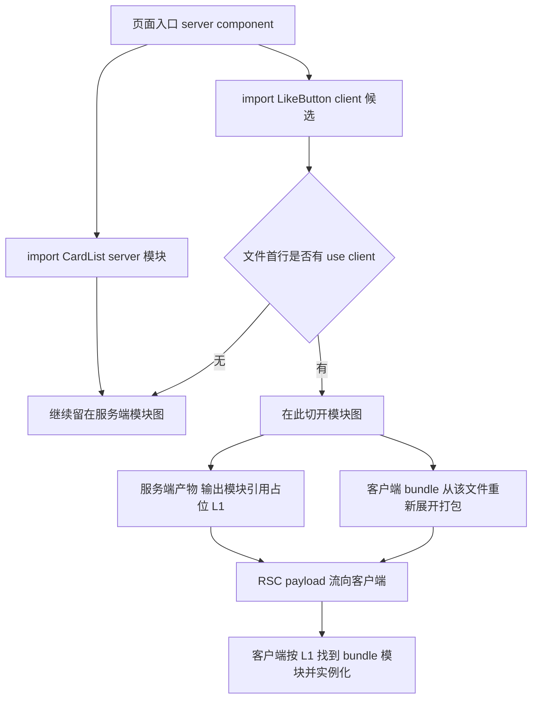

```javascript
// 简化实现，帮助理解 client reference 的生成与还原
// —— 服务端打包器视角 ——
function processImport(mod, graph) {
  if (hasDirective(mod, 'use client')) {
    // 生成引用对象：不再深入它的 import 子图
    return {
      $$typeof: Symbol.for('react.client.reference'),
      $$id: getModuleId(mod),          // 模块在客户端 bundle 里的定位 id
      $$async: mod.isAsync,
    };
  }
  graph.add(mod);                      // server 模块：继续沿 import 展开
  mod.imports.forEach(m => processImport(m, graph));
}

// —— 服务端渲染时 ——
function renderClientReference(ref, props) {
  return `["$L${ref.$$id}", ${serialize(props)}]`; // payload 里的占位
}

// —— 客户端 hydrate 时 ——
const clientModules = { '1': LikeButtonModule };     // bundle 里的模块表
function resolveClientReference(id) {
  const mod = clientModules[id];
  return mod.default;                                 // 拿回真正的组件函数
}
// payload 流到 ["$L1", {postId: 9}] 时：
// resolveClientReference(1) -> LikeButton -> 用 props 正常渲染/交互

// 常见误区：
// "use client" 不是"这个文件在客户端运行"，而是"这是客户端模块图的最顶层入口"；
// 它的 import 的组件也全部是 client —— 边界粒度是子图，不是单个文件。
```

### FRP-142：Server Actions 的完整闭环是怎样的（RPC、序列化、revalidate）？

**答**：
- `"use server"` 函数被打包成**端点**：客户端拿到的函数引用被替换为 action id；调用时发起 POST（参数经 RSC 序列化协议编码，FormData 可直接传）。
- 服务端按 id 找回原函数执行；在 Next/React 集成里，执行完后会**重新渲染受影响的 RSC 树并流回客户端**，客户端 reconcile——不需要手写 refetch。
- `revalidatePath/revalidateTag` 的作用是让**数据缓存/路由缓存失效**，迫使下一次渲染取新数据——action 闭环 = RPC + 失效 + 自动重渲。
- 安全边界：action 的参数来自网络，必须当作不可信输入；返回值也受序列化协议约束（不能返回函数/类实例）。

```javascript
// 简化实现，帮助理解 Server Action 闭环
// —— 服务端：定义与注册 ——
async function createPost(formData) {
  'use server';
  const title = formData.get('title');            // 表单渐进增强：FormData 直达
  await db.post.create({ data: { title } });
  revalidatePath('/posts');                        // 让 /posts 的数据缓存与路由缓存失效
  // 无需返回值：框架重渲染 RSC 树并流回
}
registerServerAction('a1', createPost);            // 打包器生成 id -> 函数映射

// —— 客户端：action 引用 ——
function createPostRef(id) {
  return async (...args) => {
    const body = encodeFlightArgs(args);           // RSC 序列化协议编码参数
    const res = await fetch('/__actions', {
      method: 'POST',
      headers: { 'Next-Action': id },              // 端点定位
      body,
    });
    // 返回的流里包含：action 结果 + 重新渲染的 RSC 树增量
    const stream = decodeFlightStream(res.body);
    applyRscPatch(stream.rscTree);                 // 客户端 reconcile，UI 自动更新
    return stream.returnValue;
  };
}

// 组件里使用：
// <form action={createPost}>          提交即 POST，无需手写 fetch
// <button onClick={() => createPost(...)}> 编程式调用也走同一端点

// —— 服务端接收端点（简化） ——
app.post('/__actions', async (req, res) => {
  const id = req.headers['next-action'];
  const args = decodeFlightArgs(req.body);
  const returnValue = await actionMap[id](...args); // 执行原函数
  const rscTree = await rerenderAffectedRoutes();   // revalidatePath 已使缓存失效
  res.setHeader('content-type', 'text/x-component');
  streamFlight(res, { returnValue, rscTree });      // 一次性返回结果 + 新树
});
```

### FRP-143：RSC 的数据获取为什么能避免请求瀑布？

**答**：
- 客户端取数的瀑布来源：组件**挂载后**才 fetch，父→子串行 await，每层多一个往返（网络延迟叠加）。
- RSC 把取数挪到**渲染期**：server component 直接 await，多个组件的 fetch 可并行启动（各自 await 不阻塞彼此，或显式 `Promise.all`）。
- 不想阻塞整页时：把 promise **不 await 直接往下传**，由 Suspense 边界接住——壳先返回，慢数据流式补上（见 FRP-144）。
- 服务端之间的请求走内网、且可与渲染并行调度，往返成本远低于浏览器逐级挂载取数。

```javascript
// 简化实现，帮助理解瀑布的形成与消除
// —— 反例：客户端取数瀑布 ——
// <Page> mount -> fetch('/api/user') 300ms
//   <Profile> mount（等 user 到）-> fetch('/api/posts') 300ms
//     <Comments> mount（等 posts 到）-> fetch('/api/comments') 300ms
// 总耗时 900ms，且每层都是"渲染完成才能开始下一层请求"

// —— RSC：并行启动 ——
async function Page() {
  const [user, postsPromise] = await Promise.all([   // 显式并行
    getUser(),
    getPosts(),          // 不 await，继续往下传 promise
  ]);
  return (
    <div>
      <Profile user={user} />
      <Suspense fallback={<PostsSkeleton />}>
        <Posts data={postsPromise} />   {/* 洞：posts 好了再流式填充 */}
      </Suspense>
    </div>
  );
}
// 即使不写 Promise.all，两个 async server 组件并行渲染时各自的 fetch 也会同时启动——
// 因为服务端渲染是"并发调度 promise"，不是"组件挂载后才有机会请求"

// —— 源码视角：server 渲染器对 async 组件的处理 ——
async function renderNode(node) {
  if (node.then) {                     // 是 promise：注册为"洞"，不阻塞兄弟节点
    pendingHoles.push(node);
    return { __hole: pendingHoles.length - 1 };
  }
  if (typeof node.type === 'function') {
    const result = node.type(node.props);   // async 组件：拿到 promise
    return renderNode(result);              // 递归处理
  }
  return node;
}
// 关键：pendingHoles 中的每个 promise 独立 resolve、独立流式输出 —— 慢洞不拖慢快洞
```

### FRP-144：RSC 的流式传输与 Suspense 洞是如何交互的？

**答**：
- 服务端把组件树切成"已完成的块"与"挂起的洞"：先流出壳（含 `$Lid` 占位），每个洞的 promise resolve 后**追加**流出该洞的完整块（块按 id 关联）。
- 客户端按 id 把流到的块**替换**进对应占位位置——不需要重新请求整棵树，也不需要刷新。
- 洞的边界对应 Suspense：resolve 前客户端显示 fallback，替换时机由 React 协调（有过渡动画时延迟切换，避免闪烁）。
- HTML 与 RSC payload 双流：初次访问是 HTML 流（含内嵌的 payload script 标签），客户端导航是纯 payload 流。

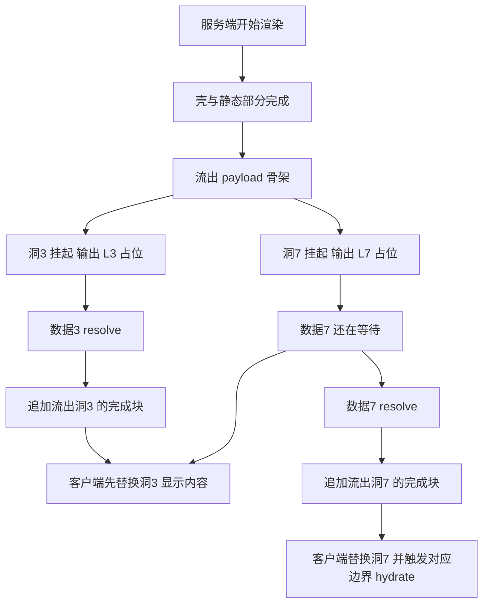

```javascript
// 简化实现，帮助理解"洞"的流式输出与客户端替换
function createFlightStream(rootPromise) {
  const chunks = [];
  const holes = new Map(); // id -> promise

  function serialize(node, out) {
    if (node && node.__hole) {                    // 占位
      out.push(`["$L${node.id}", ${JSON.stringify(node.temporaryProps)}]`);
      node.promise.then(v => {                    // resolve 后追加完整块
        const done = [];
        serialize(v, done);
        out.push(`3:${done.join('')}`);           // chunk id 3 = 洞 id
        flushChunk(out);
      });
      return;
    }
    // ... 常规元素序列化 ...
  }

  return new ReadableStream({
    async start(controller) {
      serialize(await rootPromise, chunks);
      controller.enqueue(chunks.join(''));
    }
  });
}

// —— 客户端：按 id 替换 ——
function applyRscPatch(chunkId, completedNode) {
  const placeholder = pendingHoles.get(chunkId);
  React.startTransition(() => {          // 过渡：避免 fallback 与内容闪烁切换
    pendingHoles.delete(chunkId);
    placeholder.resolve(completedNode);  // Suspense 洞重新渲染出真实内容
  });
}

// 网络时序示意：
// t0  流出: 0:["$",["div",["$L3","$L7"]]]      壳 + 两个洞
// t1  流出: 3:["h2",["Post A"]]                洞3 先好
// t2  流出: 7:["ul",["li","Comment..."]]       洞7 后好
// 客户端每个时刻都能立即渲染已收到的部分 —— TTFFP 首块时间大幅提前
```

### FRP-145：RSC 模式下状态管理有哪些限制？正确的架构分层是什么？

**答**：
- server 组件没有实例：**不能**用 useState/useEffect/useRef/Context/浏览器 API——每次请求都是一次性的 render，没有"组件生命周期"可言。
- 服务端到客户端只能传**可序列化** props（不能传函数实例；Server Action 引用是特例）；客户端到服务端只能通过 action 参数回传。
- 全局状态的归属：服务端状态放 db/服务端缓存（用 revalidate 控制）；客户端交互状态收敛到 client island 内部或客户端 store。
- 分层模式：server 组件做"数据获取 + 布局 + 静态渲染"，client island 做"交互与本地状态"，跨 island 共享用 URL 参数/客户端 store/Server Action。

```javascript
// 简化实现，帮助理解 RSC 的状态边界
// —— 错误示范：server 组件里用状态 ——
// async function Counter() {
//   const [n, setN] = useState(0);   // 编译/运行时报错：server 组件没有实例
//   return <button onClick={() => setN(n + 1)}>{n}</button>;  // onClick 也无法序列化
// }

// —— 正确分层：server 壳 + client island ——
async function ProductPage({ id }) {              // server：取数、布局
  const product = await db.product.find(id);
  const reviews  = await db.review.list(id);
  return (
    <>
      <h1>{product.name}</h1>                     {/* 静态部分零 JS */}
      <AddToCart product={product} />             {/* client island：交互状态 */}
      <ReviewList reviews={reviews} />            {/* server：静态渲染 */}
    </>
  );
}

function AddToCart({ product }) {                 // 'use client'
  const [qty, setQty] = useState(1);              // 本地状态只在 island 内
  return (
    <>
      <input value={qty} onChange={e => setQty(+e.target.value)} />
      <button onClick={() => addToCart(product.id, qty)}>加入购物车</button>
    </>
  );
}

// 跨 island 共享：Server Action + revalidate 作为"全局同步通道"
async function addToCart(id, qty) {
  'use server';
  await cart.add(id, qty);
  revalidateTag('cart-count');                    // 所有显示购物车数的 island 更新
}
// 心智模型：服务端是"唯一的真相源"，客户端 state 只是 island 内的临时 UI 状态
```

### FRP-146：Next.js 的缓存分层（请求缓存/数据缓存/路由缓存）各自在什么层面生效？

**答**：
- 四层缓存自上而下：**请求记忆化**（React `cache()`：同一次渲染 pass 内相同参数的 fetch/函数去重）、**数据缓存**（fetch 结果跨请求持久化，`next.revalidate` 控制）、**全路由缓存**（构建期/运行时把 RSC + HTML 静态化）、**客户端路由缓存**（浏览器缓存已访问路由的 RSC payload，`staleTimes` 控制）。
- 生效层次不同是理解关键：请求记忆化随渲染结束失效；数据缓存跨请求；路由缓存在构建产物层；客户端路由缓存在浏览器内存。
- 失效入口：`revalidatePath/revalidateTag` 精确打掉数据缓存与路由缓存；dynamic API（cookies/headers）会把路由降级为动态渲染。
- 典型陷阱：fetch 缓存默认行为随版本变化（Next15 起默认不缓存），要显式声明 `cache: 'force-cache'` 或用 `cache()` 记忆化。

```javascript
// 简化实现，帮助理解四层缓存的生效与失效
// —— 第 1 层：请求记忆化（同一次渲染去重） ——
const getUser = cache(async (id) => {
  console.log('真实执行一次');
  return db.user.find(id);
});
// 一次渲染里 getUser(1) 被三处调用 -> 只执行一次（map 按 参数+调用点 去重）

// —— 第 2 层：数据缓存（跨请求） ——
fetch(url, { next: { revalidate: 60, tags: ['posts'] } });
// 简化的缓存判断：
function shouldRefetch(entry, now) {
  if (!entry) return true;
  return now - entry.timestamp > entry.revalidate * 1000; // 过期则后台重取
}
// revalidateTag('posts')：直接删除打了该 tag 的条目 -> 下次请求必 miss

// —— 第 3 层：全路由缓存 ——
function routeCachePolicy(route) {
  if (usesDynamicAPI(route))  return 'dynamic';   // 用了 cookies/headers：不静态化
  if (route.revalidate != null) return 'isr';      // 定时再生
  return 'static';                                  // 构建期生成 RSC + HTML
}

// —— 第 4 层：客户端路由缓存 ——
// Router.push('/a') 后再返回 '/a'：直接用内存里的 RSC payload（staleTimes 内）
// revalidatePath('/a', 'page') 同时打掉服务端缓存与通知客户端失效

// —— 完整失效链示意 ——
// Server Action 里 revalidatePath('/posts')
//   -> 数据缓存中 path 关联条目失效
//   -> 路由缓存中 /posts 的静态产物失效
//   -> action 返回的 RSC 树带新数据
//   -> 客户端路由缓存被标记 stale
```

### FRP-147：RSC 的错误处理与重试边界是怎么设计的？

**答**：
- 服务端流式渲染中某洞出错：该洞的 promise 被 reject，流里输出**错误 chunk**；客户端在最近的 `error boundary` 渲染降级 UI，其余洞不受影响。
- 框架层重试：服务端可对洞级失败做有限次重试（Next 会对部分渲染错误重新执行该段）；客户端可用 error boundary 的 **reset** 触发重新请求（重新调用 refetch/action）。
- 分层兜底：`error.tsx`（路由级 boundary + reset）、`global-error.tsx`（根级兜底）、`not-found.tsx`（404 语义）；开发态有 overlay，生产态只输出边界 UI。
- 关键认知：流已经发出的部分**无法撤回**——错误处理是"洞级隔离"而不是"整页重试"；整页失败才走全局兜底。

```javascript
// 简化实现，帮助理解洞级错误与重试
// —— 服务端：洞失败 -> 输出错误 chunk ——
function serializeHole(node, out) {
  node.promise.then(
    v  => out.push(`${node.id}:${serialize(v)}`),
    e  => out.push(`${node.id}:{"error":${serializeError(e)}}`)  // 错误也是普通 chunk
  );
}

// —— 客户端：错误 chunk 触发最近边界 ——
function onChunk(id, payload) {
  if (payload.error) {
    pendingHoles.get(id).reject(new Error(payload.error.message));
    // React 内部：该 Suspense 子树抛错 -> 冒泡到最近 error boundary
  } else {
    pendingHoles.get(id).resolve(payload);
  }
}

// —— error.tsx：客户端组件，接收 reset ——
'use client';
function ErrorPage({ error, reset }) {
  return (
    <div>
      <p>{error.message}</p>
      <button onClick={() => reset()}>重试</button>
      {/* reset 的实现：重置 boundary 状态并重新触发该子树的渲染请求 */}
    </div>
  );
}

// —— reset 的简化原理 ——
class ErrorBoundary extends React.Component {
  state = { error: null };
  reset = () => {
    this.setState({ error: null });   // 清掉错误态 -> React 重新渲染 children
    this.props.onReset?.();           // 框架 hook：重新发起对应 RSC 请求
  };
  static getDerivedStateFromError(error) { return { error }; }
  render() { return this.state.error ? this.props.fallback : this.props.children; }
}

// 重试策略链：洞级 retry（服务端内部，如 3 次）-> 边界 UI + reset（用户手动）-> global-error（最后一道）
```

## 二十二、React 并发与调度深入

### FRP-148：Scheduler 为什么用 MessageChannel 实现时间切片，而不是 setTimeout？（高频）

**答**：
- 调度器需要"**宏任务级**的让出"：微任务（Promise.then）会在当前帧绘制前一口气跑完，无法被打断，等于不切片；而 rAF 的执行时机在绘制前，不适合做"下一帧继续干活"的调度。
- `setTimeout(fn, 0)` 有两个问题：**嵌套 5 层后最小间隔被钳到 4ms**（HTML 规范），高频切片时延迟显著；且某些场景（后台 tab）被大幅节流。
- MessageChannel 的 postMessage 触发的宏任务**无最小延迟**、不被 4ms 规则约束，是主线程上"尽快的宏任务"。
- 工作循环：每个宏任务里跑 workLoop，`shouldYield()` 检查已用时间是否超过帧预算（约 5ms）——超了就保存断点、让出主线程，排下一个宏任务继续。

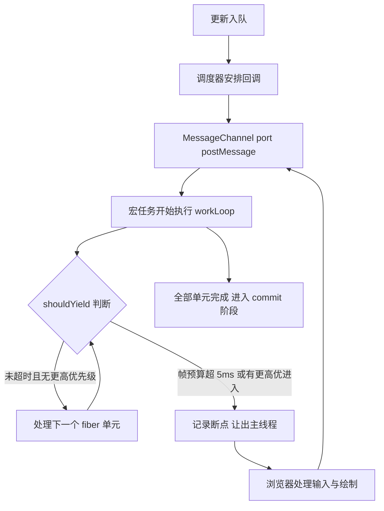

```javascript
// 简化实现，帮助理解 MessageChannel 调度与时间切片
const channel = new MessageChannel();
const port = channel.port2;
let scheduledHostCallback = null;
const frameInterval = 5; // 帧预算：约 5ms

channel.port1.onmessage = () => {
  const cb = scheduledHostCallback;
  scheduledHostCallback = null;
  if (cb) cb(); // 宏任务：开始/继续工作循环
};

function scheduleCallback(callback) {
  scheduledHostCallback = callback;
  port.postMessage(null); // 比 setTimeout(0) 更快：无 4ms 钳制
}

function shouldYield() {
  return getTime() >= frameDeadline; // 超过帧预算 -> 让出
}
let frameDeadline = 0;
const getTime = () => performance.now();

// 工作循环：可中断
function workLoopConcurrent(units) {
  frameDeadline = getTime() + frameInterval;
  let i = 0;
  while (i < units.length) {
    if (shouldYield()) {
      // 时间到：保存进度，让出 —— 下一个宏任务从这里继续
      scheduleCallback(() => workLoopConcurrent(units.slice(i)));
      return 'yielded';
    }
    performUnit(units[i++]); // 处理一个 fiber 单元
  }
  return 'completed';
}

// 验证切片：10 万个单元不会卡死输入
const units = Array.from({ length: 100000 }, (_, i) => () => i);
scheduleCallback(() => workLoopConcurrent(units));
// 主线程每 ~5ms 让出一次，浏览器始终能响应输入与绘制
```

### FRP-149：lane 模型下多个更新的优先级是如何合并与收敛的？

**答**：
- 每个更新携带 lane（位图），入队时按位**或**进 `root.pendingLanes`；调度器每次取 pendingLanes 中**最高优先级**（数值最小的位）对应的 lane 批量渲染。
- 同一优先级的多个 setState（同一次事件里）合并进同一个 lane，**一次 render** 全部处理完——这就是"批量"的来源。
- 低优渲染进行中来了高优更新：当前 render 被丢弃，先渲染高优 lane；低优 lane 仍在 pendingLanes 里，之后**补渲染**——保证每个更新最终被处理。
- 渲染完成后 commit 该 lane 的更新并从 pendingLanes 清除该位；`nextLanes` 计算还会参考"已过期"（expiration 已到）的 lane 强制提升，避免饥饿。

```javascript
// 简化实现，帮助理解 lane 合并与补渲染
const TotalLanes = 31;
// lane 位：数值越小优先级越高（1 = Sync/离散输入，16 = Transition）
const SyncLane = 1, InputLane = 2, TransitionLane = 16;

const root = {
  pendingLanes: 0,                          // 所有未完成更新的 lane 并集
  callbackNode: null,
};

function scheduleUpdateOnLane(lane) {
  root.pendingLanes |= lane;               // 合并：多个更新按位或
  ensureRootIsScheduled();
}

function getNextLanes() {
  // 取最高优先级：最低有效位
  const lanes = root.pendingLanes;
  if (lanes === 0) return 0;
  return lanes & -lanes;                    // 位运算技巧：取出最低位的 1
}

function ensureRootIsScheduled() {
  const nextLanes = getNextLanes();
  const isSync = nextLanes === SyncLane || nextLanes === InputLane;
  // 同步 lane 走微任务/同步 flush，并发 lane 走 Scheduler 宏任务切片
  scheduleRender(nextLanes, isSync ? 'microtask' : 'scheduler-callback');
}

function performWorkOnRoot(nextLanes) {
  // render 可中断；期间来了更高优 -> 抛弃当前渲染
  const result = renderRootConcurrent(nextLanes);
  if (result === 'interrupted-by-higher-priority') {
    ensureRootIsScheduled();                // 立刻按新优先级重排
    return;                                 // 当前 lane 的更新仍在 pendingLanes，不会丢
  }
  commitRoot();
  root.pendingLanes &= ~nextLanes;          // 清掉已完成的 lane
  if (root.pendingLanes !== 0) ensureRootIsScheduled(); // 剩余 lane 补渲染
}

// 演示收敛过程
scheduleUpdateOnLane(TransitionLane); // 低优：过渡更新开始渲染
scheduleUpdateOnLane(TransitionLane); // 同 lane 合并，仍一次 render
// 此时用户点击 -> scheduleUpdateOnLane(SyncLane)
// pendingLanes = 10001 | 00001 = 10001... SyncLane 优先 -> 打断过渡 render
// commit 同步更新后：pendingLanes &= ~SyncLane -> 剩 TransitionLane -> 继续补渲染
```

### FRP-150：根节点渲染失败后的重试与"panicked lane"恢复机制是什么？

**答**：
- 并发渲染是**可中断**的：如果 render 到一半出了错（或更新的数据不一致），React 会**丢弃半成品 workInProgress 树**，改用**同步 lane 整树重试**——因为同步路径保证一次 render 一定跑完、一定 commit，绝不会出现"永远渲染不完"。
- 这就是源码里的"render 阶段 panic -> 恢复"：`attemptSynchronousRetry`，错误同时上报给 error boundary（recoverable error）。
- 连续失败会升级：重试也失败 -> 走 error boundary；root 级失败 -> 卸载整树（白屏兜底）并打印致命错误。
- 对开发者的含义：并发渲染中的错误可能被重试"吞掉一次"，DevTools 里会看到 recoverable error 但 UI 正常——这是设计行为不是 bug。

```javascript
// 简化实现，帮助理解 panicked lane 的恢复
function renderRoot(lanes) {
  let rootExitStatus;
  try {
    do {
      workLoopConcurrent(lanes);            // 可中断循环
      break;
    } while (true);
    rootExitStatus = 'completed';
  } catch (error) {
    if (isConcurrentLane(lanes)) {
      // 并发 lane 失败：丢弃半成品，同步整树重试
      resetWorkInProgress();                // 丢弃 workInProgress 树
      reportRecoverableError(error);        // 上报可恢复错误（不立即卸载 UI）
      return renderRootSync(SyncLane);      // 同步路径：保证一定完成并 commit
    }
    // 同步 lane 也失败：升级为不可恢复
    rootExitStatus = 'fatal';
    throw error;
  }
  return rootExitStatus;
}

function renderRootSync(lanes) {
  // 同步循环：没有 shouldYield，一口气跑完
  while (workInProgress !== null) {
    performUnitOfWork(workInProgress);
  }
  commitRoot();                             // 一定会走到 commit
}

// —— 重试的调度入口（简化） ——
function ensureRootIsScheduled() {
  const nextLanes = getNextLanes(root);
  if (root.hasPendingRecoverableErrors && nextLanes !== SyncLane) {
    // 存在未消化的可恢复错误：下次渲染强制带同步兜底
    scheduleSyncRetryOnNextRender = true;
  }
  // ... 常规调度 ...
}

// 效果：用户几乎无感
// 1. 过渡渲染中出错 -> UI 保持旧内容（没有提交过任何东西）
// 2. 同步重试成功 -> 新内容正常上屏
// 3. 重试也出错 -> 最近 error boundary 介入
```

### FRP-151：useTransition 里 isPending 的"过渡未完成"状态是如何同步给组件的？

**答**：
- `startTransition(fn)` 把 fn 内的更新标记为 transition lane，同时 root 进入"过渡进行中"计数（pending transitions）。
- `isPending` 不是普通 state，而是 React 在**过渡开始/结束**时通过内部的共享队列通知订阅组件：实现上是 `useSyncExternalStore` 式的订阅——React 内部 store 的值就是"当前过渡是否未决"。
- 过渡结束的时机 = 对应 lane 的**提交完成**（commitRoot 后清除该 lane），而不是 render 结束——isPending 覆盖"渲染中 + 已渲染未提交"的完整区间。
- 同一组件内多个并存的 transition 会让 isPending 保持 true，直到最后一个过渡提交。

```javascript
// 简化实现，帮助理解 isPending 的订阅机制
function useTransition() {
  const [isPending, setPending] = useState(false);
  const isMounted = useRef(true);

  function startTransition(fn) {
    setPending(true);                        // 立即同步置 true（sync lane，马上可见）
    React.startTransition(() => {
      fn();                                  // 内部更新进 transition lane
      // 真实实现：React 在 commit 后通过回调恢复，这里用微任务模拟
      scheduleCallback(() => {
        if (isMounted.current) setPending(false); // 提交完成后置 false
      });
    });
  }

  useEffect(() => () => { isMounted.current = false; }, []);
  return [isPending, startTransition];
}

// —— React 内部视角：过渡计数 ——
const transitionStore = { pending: 0, listeners: new Set() };

function startTransitionScope() {
  transitionStore.pending++;                 // 过渡开始
  transitionStore.listeners.forEach(f => f());
  return () => {                             // commitRoot 时调用
    transitionStore.pending--;
    transitionStore.listeners.forEach(f => f());
  };
}
// fiber 上挂着 transition 订阅：组件通过 useSyncExternalStore 读 pending > 0
// 这保证 isPending 的变化与过渡 lane 的提交严格同步

// 使用与验证
const [isPending, start] = useTransition();
function onTabClick(id) {
  start(() => setTab(id));   // setTab 是低优过渡更新
  // 界面立即表现：isPending = true -> 显示 spinner/禁用态
  // 旧 tab 仍可交互（没有被阻塞），过渡渲染完成提交后：
  // isPending = false，新 tab 内容一次性替换
}
```

### FRP-152：并发模式下受控输入为什么不会"回跳"？revert 机制是怎么回事？

**答**：
- 风险场景：输入触发低优更新（如过渡中的搜索列表渲染），低优 render 慢——如果浏览器把"旧 state 对应的 value"写回 input，用户会看到自己刚打的字消失。
- React 的保障一：**连续离散事件**（keydown/输入类）触发的更新被强制为 sync lane，同步 render + commit，输入即时上屏。
- 保障二是 **revert 机制**：commit 前检查 DOM input 的当前值与 fiber 里 state 是否一致；不一致说明存在"被打断的渲染留下的 DOM 状态"，React 把 DOM 值**恢复**成用户视角的最新值，并对该 input 用 sync lane 立即重渲。
- 源码入口：`restoreStateIfNeeded / restoreImpl`——遍历记录的"需要恢复的 DOM 引用"，逐个 revert 后清空队列。

```javascript
// 简化实现，帮助理解受控输入的 revert 机制
// React 内部记录"可能需要恢复"的 DOM
let needsStateRestore = false;
const restoreTargets = [];

function markRestoreTarget(inputEl, expectedValue) {
  restoreTargets.push({ el: inputEl, value: expectedValue });
  needsStateRestore = true;
}

function restoreStateIfNeeded() {
  if (!needsStateRestore) return;
  needsStateRestore = false;
  for (const { el, value } of restoreTargets) {
    if (el.value !== value) {
      // DOM 值与最新 state 不一致：把 DOM 拨回用户真正输入的值
      el.value = value;                       // revert！
      // 并对该输入的 state 用 sync lane 强制重渲，让 fiber 与 DOM 重新一致
      syncRenderFromDOMValue(el, value);
    }
  }
  restoreTargets.length = 0;
}

// 挂接点：每次 commit 完成后 / 被打断的渲染恢复前调用
function commitRoot() {
  // ... 提交 DOM 变更 ...
  restoreStateIfNeeded();                     // 关键调用
}

// —— 场景演示 ——
// <input value={query} onChange={e => { setQuery(v); startTransition(() => setResults(v)) }} />
// 1. 用户输入 'abc'：setQuery 同步上屏（离散事件 sync lane），input.value = 'abc'
// 2. 过渡渲染 results 很慢，期间用户继续输入 'abcd'：
//    又一次 sync render，fiber.query = 'abcd'
// 3. 过渡 render 被打断/恢复时：检查 input DOM 值 —— 'abcd'
//    若某个中间状态曾把 'abc' 写回 DOM -> revert 成 'abcd'
// 用户视角：无论并发多忙，输入框永远显示自己刚打的内容，永不回跳
```

### FRP-153：嵌套 Suspense 边界的挂起行为是什么？如何治理 fallback 闪烁？

**答**：
- 嵌套时每个边界独立管自己的洞；但**祖先边界挂起会连带整个子树**——React 把"同一棵挂起树"作为一个单元切换 fallback。
- 闪烁治理第一招：**初次挂载**才显示 fallback；更新时已显示过内容的边界会**保留旧内容**直到新内容 ready（didSuspend 延迟提交），不回退到 fallback。
- 第二招：fallback 本身也有最短展示预算——极快 resolve 的洞不显示 fallback（避免闪一下）；React 内部用节流窗口（约 300ms 级别的 fallback throttle）合并短暂挂起。
- `SuspenseList`（实验）用 revealOrder（forwards/together）控制多边界的显现顺序，配合 `tail` 决定未显现部分显示 fallback 还是折叠。

```javascript
// 简化实现，帮助理解嵌套挂起与"保留旧内容"
function mountSuspenseChildren(primaryChildren, fallbackChildren) {
  // 挂起树 = primary 子树中所有未决洞的集合
  // 祖先挂起：整个子树一起切 fallback —— 独立边界可以隔离这个范围
  return { primaryChildren, fallbackChildren };
}

// —— "更新时不回退 fallback"的简化逻辑 ——
class SuspenseCommitStage {
  constructor() {
    this.hasEverShownContent = false;  // 是否展示过真实内容
    this.pendingResolve = null;
  }
  onResolve() {
    if (!this.hasEverShownContent) {
      this.hasEverShownContent = true;
      this.showPrimary();              // 首次：立即显示内容
    } else {
      this.showPrimary();              // 更新：内容 ready 后才切换 —— 从不闪回 fallback
    }
  }
  onSuspend(promise) {
    if (!this.hasEverShownContent) {
      this.showFallback();             // 首次挂起：显示 fallback
    }
    // 已显示过内容：什么都不做 —— 旧 UI 继续显示，直到 onResolve
    this.pendingResolve = promise;
  }
}

// —— 短挂起不闪 fallback ——
const FALLBACK_THROTTLE_MS = 300;
function maybeShowFallback(showFn) {
  const timer = setTimeout(showFn, FALLBACK_THROTTLE_MS);
  return () => clearTimeout(timer);    // resolve 得快就取消，fallback 根本不出现
}

// 实战配置
// <Suspense fallback={<ListSkeleton />}>        页面级：独立边界，慢数据不影响导航栏
//   <Suspense fallback={null}>                 局部：fallback null 可减少嵌套闪烁
//     <SlowComments />
//   </Suspense>
// </Suspense>
```

### FRP-154：Offscreen（Activity）的"隐藏但保活"预渲染是如何设计的？

**答**：
- Offscreen（现名 Activity）让子树以 **hidden 模式渲染**：DOM 已挂载但 `display: none`，state 完整保留；为"提前预渲染、切换不重渲"服务。
- 生效机制在 fiber 树结构里：`<Activity mode="hidden">` 创建 Offscreen fiber，其子树的 effect **被推迟**（隐藏时不执行 effect/不触发事件），显示时 React 再"补执行"effect——这叫"延迟副作用"。
- 预渲染（prerender）：提前把可能要显示的页面 hidden 渲染好，切换时只是改 mode——commit 走最小路径，无白屏。
- 它与 Suspense 共享"挂起树/隐藏树"的底层机制：隐藏的树仍可被并发渲染，但永远不会提交 effect。

```javascript
// 简化实现，帮助理解 Offscreen 的隐藏渲染与延迟 effect
const ActivityMode = { Visible: 'visible', Hidden: 'hidden' };

function reconcileOffscreenFiber(fiber, mode) {
  if (mode === ActivityMode.Hidden) {
    // 子树继续渲染（预渲染！），但打上 hidden 标记
    fiber.subtreeFlags |= OffscreenHiddenFlag;
    // commit 时：DOM 挂载但 display none，effect 队列跳过
    return { shouldMountDom: true, shouldRunEffects: false };
  }
  return { shouldMountDom: true, shouldRunEffects: true };
}

function commitOffscreen(fiber, { shouldRunEffects }) {
  const el = fiber.stateNode;
  el.style.display = fiber.mode === 'hidden' ? 'none' : '';
  if (!shouldRunEffects) {
    // 隐藏树：把 layout/passive effect 暂存 —— 显示时再执行
    deferEffects(fiber.subtreeFlags);
  } else {
    flushDeferredEffects(fiber);   // 从 hidden 转 visible：补执行延迟的 effect
  }
}

// 使用场景
function Tabs() {
  const [tab, setTab] = useState('a');
  return (
    <>
      <button onClick={() => setTab('a')}>A</button>
      <button onClick={() => setTab('b')}>B</button>
      {/* B 页面提前渲染好、状态保留；切回来不重新请求不丢 state */}
      <Activity mode={tab === 'a' ? 'visible' : 'hidden'}>
        <PageA />
      </Activity>
      <Activity mode={tab === 'b' ? 'visible' : 'hidden'}>
        <PageB />   {/* hidden 期间 effect 不跑（不轮询/不订阅），显示时恢复 */}
      </Activity>
    </>
  );
}
// 与 v-show 的区别：不只隐藏 DOM，还暂停副作用 —— "预渲染 + 副作用暂停"两个能力
```

## 二十三、React 表单与模式原理

### FRP-155：从一次键入到界面更新，受控输入的完整调度旅程是怎样的？（高频）

**答**：
- 完整链路：原生 `keydown`/`input` → React root 上的委托监听捕获 → 构造 **SyntheticEvent** → 沿 fiber 树模拟冒泡找到 onChange → 执行你的 setState（更新进入离散事件专属的 sync lane）。
- 事件处理函数**同步返回**后 React 立即 flush：一次事件里的多个 setState 合并为一次 render（连续离散事件强制同步通道，这是输入不回跳的保障）。
- render 阶段从 fiber 根向下重算受影响子树（lane 过滤），commit 阶段把新 value 写回 input.value——整个过程在**同一个宏任务**内完成。
- 如果 setState 在事件外（setTimeout/await 后）：React18 起也会批量，但走微任务 flush（见 FRP-168），时序上晚于同步事件路径。

```javascript
// 简化实现，帮助理解键入的完整旅程
// 1. 原生事件 -> 合成事件 -> onChange
root.addEventListener('input', (nativeEvent) => {
  const syntheticEvent = new SyntheticInputEvent(nativeEvent);
  const fiber = getClosestFiberFromDOM(nativeEvent.target);
  // 沿 fiber 模拟冒泡，收集 onChange
  let current = fiber;
  while (current) {
    const onChange = current.memoizedProps?.onChange;
    if (onChange) {
      // 标记离散事件上下文：内部 setState 走 sync lane
      dispatchDiscreteEvent(() => onChange(syntheticEvent));
      if (syntheticEvent.isPropagationStopped()) break;
    }
    current = current.return;
  }
  // 2. 事件结束：同步 flush（离散事件通道）
  flushSyncWork();   // 多个 setState 合并 -> 一次 render -> 一次 commit
});

// 3. render：lane 过滤，只重算受影响的子树
function renderRootSync(lanes) {
  let fiber = root.current;
  while (fiber) {
    if (fiber.lanes & lanes || fiber.childLanes & lanes) {
      beginWork(fiber, lanes);   // 需要处理
    }
    // 否则直接复用（bailout）—— 兄弟组件不重渲
    fiber = next(fiber);
  }
}

// 4. commit：新 value 写回 input
function commitUpdate(domElement, newProps) {
  if (domElement.value !== newProps.value) {
    domElement.value = newProps.value;   // 受控：DOM 永远跟 state 对齐
  }
}

// 旅程时间线（单次键入）：
// keydown(input) -> onChange -> setQuery(x) 入 sync lane
//   -> flushSyncWork：render（lane 过滤 + bailout）-> commit 写回 value
//   -> restoreStateIfNeeded 校验（FRP-152）-> 完成，全程同一宏任务内
```

### FRP-156：React 19 的 useActionState 与 useFormStatus 的实现原理是什么？

**答**：
- `useActionState(action, initialState)` 内部是 **reducer + pending 标记**的组合：提交时 React 包一层 wrapper action——先置 pending、把 prevState 作为第一参传给 action、返回值 setState。
- 它就是 `useReducer` + `useTransition` 的语法糖：`[state, dispatch, isPending]`，dispatch 由表单 submit/按钮 formAction 触发。
- `useFormStatus` 是 **Context 订阅**：`<form>` 内部把 `{ pending, data }` 放进 form 专属 context，子组件用 hook 读取——所以必须在 form **内部**使用才有效。
- 渐进增强：表单 action 在 JS 加载前也能提交（服务端处理），hydrate 后自动升级为客户端路径——action 引用是序列化的。

```javascript
// 简化实现，帮助理解 useActionState / useFormStatus
function useActionState(action, initialState) {
  const [state, setState] = useState(initialState);
  const [isPending, startTransition] = useTransition();

  // 包一层：这是"action 变成状态更新"的核心
  const wrappedAction = async (payload) => {
    startTransition(async () => {
      const result = await action(state, payload); // prevState 作为第一参！
      setState(result);                            // 返回值成为新 state
    });
  };
  return [state, wrappedAction, isPending];
}

// 表单集成：
// <form action={wrappedAction}> 提交时 React 调 wrappedAction(FormData)
// 服务端版（'use server' 函数）：同一包装逻辑跑在服务端，state 经序列化返回

function useFormStatus() {
  // form 组件在提交时更新 context；这里只是消费
  const status = useContext(FormStatusContext);
  if (status === null) throw new Error('useFormStatus 必须在 <form> 内使用');
  return status; // { pending, data } —— data 是提交中的 FormData
}

// —— form 侧的简化实现 ——
const FormStatusContext = createContext(null);
function Form({ action, children }) {
  const [status, setStatus] = useState({ pending: false, data: null });
  const submit = async (formData) => {
    setStatus({ pending: true, data: formData });   // 子组件立刻能读到 pending
    await action(formData);
    setStatus({ pending: false, data: null });
  };
  return (
    <FormStatusContext.Provider value={status}>
      <form action={submit}>{children}</form>
    </FormStatusContext.Provider>
  );
}

// 组合使用：
// <form action={formAction}>
//   <SubmitButton />   内部 useFormStatus().pending -> 按钮自动禁用
// </form>
```

### FRP-157：useOptimistic 的乐观值与回滚队列是怎么实现的？

**答**：
- `useOptimistic(state, reducer)` 读到的值 = **真实 state + 未决 action 依次 reduce 的叠加结果**；传给 action 的 dispatch 把 action 入队（只影响显示，不改真实 state）。
- action 完成时（真实 state 更新），React 丢弃所有未决乐观 action——因为它们的"期望结果"已包含在真实 state 里，显示自动回落到真值。
- 失败回滚：action 抛错或返回与乐观假设不符的真值时，未决队列清空，显示回落到真实 state——乐观值"自动消失"。
- 关键细节：action 执行期间 `useOptimistic` 的 dispatch 持续生效（第二次提交叠加在第一次的乐观结果上），保证连续操作时 UI 累积乐观。

```javascript
// 简化实现，帮助理解 useOptimistic
function useOptimistic(passthrough, reducer) {
  const [optimisticState, setOptimisticState] = useState(null); // 未决队列的叠加结果

  const dispatch = (action) => {
    // 1. 叠加乐观值：基于当前显示值（可能已含前面的乐观）再 reduce
    setOptimisticState(prev =>
      reducer(optimisticState ?? passthrough, action)
    );
  };

  // React 在 transition 中执行 action：action 完成（setState 落地）后清除队列
  // —— 由框架在 commit 时自动执行，相当于：
  function clearOptimisticQueue() {
    setOptimisticState(null); // 回落到 passthrough（真实 state）
  }

  return [optimisticState ?? passthrough, dispatch];
}

// 使用：
function Thread({ messages }) {
  const [optimisticMessages, addOptimistic] = useOptimistic(
    messages,
    (current, newMsg) => [...current, { ...newMsg, sending: true }]
  );
  async function send(formData) {
    addOptimistic({ text: formData.get('text') });  // 立刻显示（带 sending 标记）
    await sendMessage(formData);                     // 真实请求（Server Action）
    // 成功：真实 messages 更新流回 -> 乐观值自动被真值覆盖
    // 失败：revalidate/错误处理 -> 队列清空，乐观消息消失
  }
  return optimisticMessages.map(m => <Bubble key={m.id} msg={m} />);
}

// —— 时序演示 ——
// 初始 messages = [A, B]
// 1. dispatch(C)：显示 [A, B, C']（C' 带 sending 标记）—— 纯本地叠加
// 2. action 执行中再次 dispatch(D)：显示 [A, B, C', D']
// 3. action 完成，真实 state = [A, B, C, D]：显示回落 [A, B, C, D]
// 4. action 失败：真实 state 不变 [A, B]：显示回落 [A, B] —— 回滚完成
// 核心不变式：乐观值永远派生自"真实 state + 未决 action"，真实 state 一变就整体重算
```

### FRP-158：表单库原理对比：rc-field-form 的依赖收集 vs react-hook-form 的非受控订阅？

**答**：
- rc-field-form（AntD Form）：每个 Field 注册进 store；Field render 时调用 `getFieldValue`，store 用**类似响应式的依赖收集**记录"该 Field 读过哪些 key"；值变化只通知依赖它的 Field 重渲。
- react-hook-form：input 保持**非受控**（uncontrolled），注册时把 ref 存进 fields 表，输入直接写 DOM + 内部值，**不触发 React 重渲**；订阅走 `watch/subscription` 手动声明。
- 性能取向：rc-field-form 用依赖收集做到"字段级精确更新"但仍是受控（每次键入走 React 调度）；RHF 键入零重渲、提交时从 ref 收集——超大表单场景优势明显。
- 共同点：都以"store 集中管理值"为内核；差异只在"值变化的传播机制"——响应式收集 vs 显式订阅。

```javascript
// 简化实现，帮助理解两种内核
// —— rc-field-form 风格：依赖收集的字段级更新 ——
function createStore() {
  const store = {};
  const watchers = new Map();   // key -> Set<FieldId>
  const fieldDeps = new Map();  // FieldId -> Set<key>（该 Field 读过哪些 key）
  const fieldRerender = new Map();
  let currentField = null;      // 收集目标

  return {
    registerField(id, rerender) { fieldRerender.set(id, rerender); },
    getFieldValue(key) {
      // render 期间调用 -> 收集依赖（类似 track）
      if (currentField) {
        fieldDeps.get(currentField).add(key);
        watchers.has(key) || watchers.set(key, new Set());
        watchers.get(key).add(currentField);
      }
      return store[key];
    },
    setFieldValue(key, value) {
      store[key] = value;
      // 只通知依赖该 key 的 Field —— 字段级精确更新
      (watchers.get(key) || []).forEach(id => fieldRerender.get(id)());
    },
    withField(id, render) {
      fieldDeps.set(id, new Set());
      currentField = id;
      try { return render(); } finally { currentField = null; }
    }
  };
}

// —— react-hook-form 风格：非受控 + 显式订阅 ——
function createRhfStore() {
  const fields = new Map();     // name -> { ref, value }
  const subscribers = new Set();
  return {
    register(name, ref) { fields.set(name, { ref, value: ref.current.value }); },
    // 键入：原生 input 自己维护 value（非受控）—— store 只在提交/watch 时读
    handleSubmit(onValid) {
      const data = {};
      fields.forEach(({ ref }, name) => (data[name] = ref.current.value)); // 从 DOM 收集
      return (e) => { e.preventDefault(); onValid(data); };
    },
    watch(name, cb) { subscribers.add({ name, cb }); },  // 显式订阅才重渲
  };
}
// 差异总结：rc-field-form "读时收集，写时通知"（响应式内核）；
// RHF "写不通知，读从 DOM"（uncontrolled 内核）—— 输入路径完全绕开 React 调度。
```

### FRP-159：forwardRef 的实现原理是什么？React 19 的 ref as prop 改了什么？

**答**：
- 函数组件本接收不到 ref（ref 是 fiber 的特殊字段不是普通 prop）；`forwardRef` 生成 `{$$typeof: REACT_FORWARD_REF_TYPE, render}` 的包装元素，React 在 beginWork 中**特判该类型**，把 ref 作为第二参传给 render。
- React 19 取消了这个特判的必要性：函数组件的 `ref` 变成**普通 prop**（props.ref 直接可读可透传），forwardRef 仍向后兼容但可移除。
- 类组件一直不受影响（ref 指向实例）；DOM 元素的 ref 仍由 React 在 commit 阶段特殊处理（attach/detach）。
- 19 的迁移收益：类型更简单（无需泛型双参）、ref 可与其他 props 一样在自定义 Hook 间传递、统一了"ref 也是 props"的心智。

```javascript
// 简化实现，帮助理解 forwardRef 与 React19 变化
// —— 19 之前：特判包装元素 ——
const ForwardRefSymbol = Symbol.for('react.forward_ref');
function forwardRef(render) {
  return { $$typeof: ForwardRefSymbol, render };
}
function beginWork(fiber) {
  if (fiber.tag === ForwardRefComponent) {
    // 关键：ref 不是 props 的一部分，需要单独取出
    const { ref } = fiber;
    const props = fiber.pendingProps;
    const children = fiber.type.render(props, ref); // ref 作为第二参
    return reconcileChildren(fiber, children);
  }
  // 普通函数组件：render(props) —— 根本拿不到 ref
}

// —— React 19：ref 就是普通 prop ——
function beginWork19(fiber) {
  const props = fiber.pendingProps;
  // ref 混入 props：函数组件直接读取
  // <MyInput ref={inputRef} label="名" /> -> props = { ref: inputRef, label: '名' }
  const children = fiber.type(props);   // 组件内 props.ref 即 inputRef
  return reconcileChildren(fiber, children);
}

// 19 之前的写法：
const MyInputLegacy = forwardRef((props, ref) => (
  <input ref={ref} {...props} />
));

// React 19 的写法：
function MyInput({ ref, ...props }) {
  return <input ref={ref} {...props} />;   // ref 与其他 prop 一样转发
}
// 类组件不变：ref 仍指向实例（React 在 commit 的 attachRef 里特判类 fiber）
// DOM 元素不变：ref 由 commitLayoutEffects 里 commitAttachRef 统一处理
```

### FRP-160：用 key 重置组件状态的所有用法与底层原理是什么？

**答**：
- 原理：reconcile 阶段比较同位置子元素的 **key**，key 不同 → 视为不同组件 → 旧组件 unmount（state/hooks/DOM 全部丢弃）→ 新组件从零 mount——"重置"因此是彻底的、同步的。
- 用法一：数据源切换重置，`<Profile key={userId} />` 换人即重置；用法二：表单重置 `<Form key={draftId} />`；用法三：路由级刷新 `key={location.pathname}`。
- 用法四：错误恢复 `<Boundary key={retryCount} />`，重试次数变化作为 key 强制重建边界内子树。
- 对比手动重置（useEffect 里清 state）：key 重置在 commit 内一次完成，**无中间态闪现**、无 effect 时序问题、清理函数自动执行。

```javascript
// 简化实现，帮助理解 key 触发的"销毁重建"
function reconcileChildren(parent, newChildren) {
  for (const child of newChildren) {
    const old = parent.children.find(c => c.key === child.key); // 同 key 才复用
    if (old && sameType(old, child)) {
      // 复用：fiber 保留（state 保留），走更新路径
      reconcile(old, child);
    } else {
      if (old) unmount(old);     // 旧 key 的实例：完整卸载（state 丢弃、cleanup 执行）
      mount(child);              // 新 key：从零 mount（useState 初始值重新生效）
    }
  }
}

// —— 用法速查 ——
// 1. 数据源切换
<UserProfile key={userId} />            // userId 变 -> 整个组件重建，包括内部缓存
// 2. 草稿表单
<DraftEditor key={draftId} />           // 新建草稿 -> 表单回到初始值
// 3. 路由级刷新（保留组件但强制重置状态）
<Routes key={location.pathname} />      // 每次导航都重建页面组件
// 4. 错误恢复
<ErrorBoundary key={attempt} onRetry={() => setAttempt(a => a + 1)} />

// —— 对比手动重置方案 ——
function EditorManual({ draftId }) {
  const [title, setTitle] = useState('');
  useEffect(() => { setTitle(draft.initial); }, [draftId]); // 问题：先渲染旧值再清，闪现
  // ...
}
function EditorByKey({ draftId }) {
  return <DraftEditorInner key={draftId} />;  // commit 内完成：无中间帧、cleanup 自动跑
}
// 注意代价：key 重置 = 全新 mount，子树所有 effect 重新执行、DOM 重建；
// 大子树高频切换时要用惰性初始化/受控恢复代替。
```

## 二十四、状态库与数据流原理对比

### FRP-161：TanStack Query 的核心原理是什么（缓存、去重、GC 的协作）？（高频）

**答**：
- 内核是 `QueryCache: Map<queryHash, Query>`；queryHash 由 queryKey 序列化生成——**key 相同即同一个 Query**。
- 去重：fetch 时所有同 key 的观察者共享**同一个 promise**（Query 内部挂 promise），并发调用 useQuery 只发一次请求。
- 生命周期由**观察者引用计数**驱动：`observers > 0` 活跃；归零后启动 `gcTime`（默认 5 分钟）定时器，超时整个 Query 从缓存删除——这就是"缓存垃圾回收"。
- `staleTime`（默认 0）决定新鲜期：新鲜期内挂载/重挂载直接用缓存不请求；过期则"先返回旧数据 + 后台重新请求"（stale-while-revalidate 语义）。

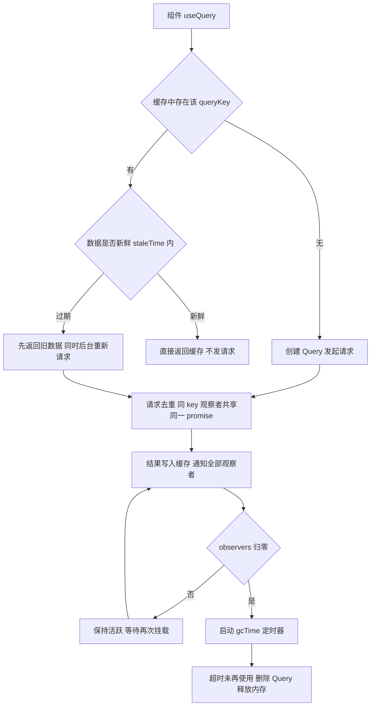

```javascript
// 简化实现，帮助理解 TanStack Query 内核
class Query {
  constructor({ queryKey, queryFn, staleTime = 0, gcTime = 5 * 60 * 1000 }) {
    this.hash = stableSerialize(queryKey);   // key 序列化（顺序无关）
    this.queryFn = queryFn;
    this.staleTime = staleTime;
    this.gcTime = gcTime;
    this.state = { data: undefined, dataUpdatedAt: 0, error: null };
    this.observers = 0;
    this.promise = null;                     // 去重的关键：共享 promise
    this.gcTimer = null;
  }
  get isStale() {
    return Date.now() - this.state.dataUpdatedAt > this.staleTime;
  }
  fetch() {
    // 去重：已有进行中的请求直接复用同一个 promise
    if (!this.promise) {
      this.promise = this.queryFn()
        .then(data => {
          this.state = { data, dataUpdatedAt: Date.now(), error: null };
          this.notify();                     // 通知全部观察者
        })
        .catch(e => { this.state.error = e; this.notify(); })
        .finally(() => { this.promise = null; });
    }
    return this.promise;
  }
  addObserver() {
    this.observers++;
    clearTimeout(this.gcTimer);              // 有观察者：取消 GC
    if (this.state.dataUpdatedAt && !this.isStale) return; // 新鲜：不发请求
    this.fetch();                            // 过期/无数据：请求（内部自动去重）
  }
  removeObserver() {
    if (--this.observers > 0) return;
    this.gcTimer = setTimeout(() => cache.delete(this.hash), this.gcTime); // GC 定时器
  }
  notify() { this.subscribers.forEach(fn => fn(this.state)); }
}

const cache = new Map(); // queryHash -> Query
function useQuery(options) {
  const query = cache.get(stableSerialize(options.queryKey)) ??
                setCache(new Query(options));
  query.addObserver();                       // 挂载
  useEffect(() => () => query.removeObserver(), []); // 卸载
  return { data: query.state.data, isPending: !query.promise && !query.state.dataUpdatedAt };
}
```

### FRP-162：TanStack Query 的乐观更新与回滚是怎么实现的？

**答**：
- mutation 的三个钩子构成闭环：`onMutate`（乐观写缓存）→ `onError`（用快照回滚）→ `onSettled`（invalidate 让服务端真值回流）。
- onMutate 的三步：**取消进行中的同类请求**（防旧响应覆盖乐观值）、**保存缓存快照**（回滚凭据）、**setQueryData 写入乐观值**。
- 回滚就是把快照原样 setQueryData 回去；onSettled 无条件 `invalidateQueries`——乐观值最终被服务端数据校正。
- 并发防护：取消 in-flight 请求 + 快照机制，本质是"单写者原则"——同一时刻只有一个来源在改缓存。

```javascript
// 简化实现，帮助理解乐观更新闭环
async function optimisticToggle(todo) {
  // 1. 乐观写入（onMutate）
  const prev = cache.get(todoKey);                 // 快照
  await cancelQueries(todoKey);                    // 取消 in-flight：防旧响应覆盖
  cache.set(todoKey, { ...prev, data: prev.data.map(t =>
    t.id === todo.id ? { ...t, done: !t.done } : t
  )});

  try {
    await mutateApi(todo);                         // 真实请求
  } catch (e) {
    // 2. 回滚（onError）：快照原样写回
    cache.set(todoKey, prev);
    toast.error('操作失败，已还原');
  } finally {
    // 3. 校正（onSettled）：让服务端真值回流
    invalidateQueries(todoKey);                    // 标记过期 -> 触发重新 fetch
  }
}

// invalidateQueries 的简化语义：
function invalidateQueries(key) {
  const query = cache.get(hash(key));
  query.isStale = true;                            // 标记过期
  if (query.observers > 0) query.fetch();          // 活跃观察者：立即后台重取
  // 无观察者：只标记，等下次挂载时再取（配合 GC）
}

// 为什么必须取消 in-flight：
// 时序反例：乐观写缓存 -> 旧请求（5s 前发出）返回旧列表 -> 覆盖乐观值 -> UI 回跳
// cancelQueries 让旧 promise reject（不再 notify），乐观值存活到真实响应到达
```

### FRP-163：SWR 的 mutate 与数据 reconcile 是怎么做的？乱序响应如何防护？

**答**：
- SWR 的缓存同样是 `Map<key, { data, isValidating, timestamp }>`；`mutate(key, updater, opts)` 可本地改值——`revalidate: false` 纯本地，默认"先改 + 后台 revalidate"。
- reconcile 的关键：请求返回后**只在数据"比缓存新"时替换**——用 `timestamp/请求序号` 对比，丢弃过期响应（stale response 保护）。
- `dedupingInterval`（默认 2s）：同 key 在窗口内的多次请求去重；`keepPreviousData` 让 key 切换时保留旧数据避免闪空。
- 对比 TanStack：SWR 更薄（无 gcTime/观察者计数，缓存常驻）， TanStack 有完整的查询生命周期——选型差异由此而来。

```javascript
// 简化实现，帮助理解 SWR 的 mutate 与乱序防护
const cache = new Map();  // key -> { data, timestamp, isValidating }
const keyListeners = new Map();
let requestSeq = 0;

function useSWR(key, fetcher) {
  const entry = cache.get(key);
  const shouldFetch = !entry || Date.now() - entry.timestamp > DEDUPING_INTERVAL;
  if (shouldFetch && !entry?.isValidating) {
    const seq = ++requestSeq;                    // 请求序号
    cache.set(key, { ...entry, isValidating: true });
    fetcher(key).then(data => {
      const cur = cache.get(key);
      // reconcile 核心：只接受"不早于当前缓存"的响应
      if (seq >= (cur.seq ?? 0)) {
        cache.set(key, { data, timestamp: Date.now(), isValidating: false, seq });
        notify(key);
      } // else：过期响应，直接丢弃
    });
  }
  return { data: entry?.data, isValidating: entry?.isValidating };
}

function mutate(key, updater, { revalidate = true } = {}) {
  const entry = cache.get(key);
  const next = typeof updater === 'function' ? updater(entry?.data) : updater;
  if (next !== undefined) {
    cache.set(key, { data: next, timestamp: Date.now(), seq: requestSeq + 1 });
    notify(key);                                 // 本地立即生效
  }
  if (revalidate) {
    // 后台 revalidate：完成后的 reconcile 会用真值校正本地改动
    fetcher(key).then(data => { cache.set(key, { data, timestamp: Date.now() }); notify(key); });
  }
}

// 乱序防护演示：
// t0: mutate('user', { name: '本地改动' })
// t1: revalidate 请求 A 发出
// t2: 另一组件也触发请求 B（更晚发出）
// t3: A 先返回（旧数据）-> seq 检查失败 -> 丢弃，不覆盖
// t4: B 返回（新数据）-> seq 通过 -> 上屏
```

### FRP-164：RxJS 的"流式状态"思想与"快照状态"（Redux/useState）的本质差异是什么？

**答**：
- 快照状态：状态是**某个时刻的值**，更新即整体替换，订阅者拿"当前快照"；适合表单、CRUD、UI 配置。
- 流式状态：状态是**随时间推移的事件序列**（Observable），订阅者拿到的是"时间上的变化过程"，可以用算子（debounceTime/distinctUntilChanged/switchMap）对"变化本身"编程。
- 流式的杀手锏是**取消与竞态的原生表达**：`switchMap` 自动取消上一次未完成请求——快照状态里需要手写 AbortController/序号比对。
- 前端实践的折中：连续事件流（输入/滚动/拖拽）用 RxJS 组合后"落"成快照状态给 React/Vue 消费——两层各取所长。

```javascript
// 简化实现，帮助理解流式状态对竞态的表达力
// —— 快照状态方案：搜索要手动处理竞态 ——
function useSearchSnapshot() {
  const [results, setResults] = useState([]);
  const seqRef = useRef(0);
  const timerRef = useRef(null);
  function onQuery(q) {
    clearTimeout(timerRef.current);                       // 手写 debounce
    timerRef.current = setTimeout(async () => {
      const seq = ++seqRef.current;                       // 手写序号防乱序
      const r = await api(q);
      if (seq === seqRef.current) setResults(r);          // 手写过期丢弃
    }, 300);
  }
  return { results, onQuery };  // 三个手动机制：防抖、序号、条件 setState
}

// —— 流式状态方案：同样的逻辑用算子组合 ——
function searchStream() {
  return fromEvent(inputEl, 'input').pipe(
    map(e => e.target.value),
    distinctUntilChanged(),          // 相同输入不请求
    debounceTime(300),               // 防抖
    switchMap(q => from(api(q))),    // 关键：新请求到来自动取消上一次订阅（竞态消失）
    catchError(() => EMPTY)
  );
}
searchStream().subscribe(setResults);
// switchMap 语义 = "只要最新的" —— 快照方案里的 seq/abort 全部被算子替代

// —— 折中落地：流落快照 ——
function useObservable(observable$) {
  const [value, setValue] = useState(null);
  useEffect(() => {
    const sub = observable$.subscribe(setValue);  // 流式内部
    return () => sub.unsubscribe();               // 快照消费（React 友好）
  }, []);
  return value;   // 组件只关心最新值，流的复杂性被封装在 observable$ 构造处
}
```

### FRP-165：@preact/signals 是怎么把 signals 接入 vdom 框架的（绕过组件重渲）？

**答**：
- 关键机制：Preact 的 diff 时检测到 vnode 属性/文本位置的值是 **signal 实例**，就把该 DOM 位置**直接订阅**到 signal——signal 变化时直接更新对应 textContent/属性，**完全不经过组件重渲与 diff**。
- 因此更新粒度是"绑定级"的：一个 signal 变化只改它绑定的那几个 DOM 节点，组件函数都不执行。
- signal 的引用稳定性带来第二个收益：把 signal 当 prop 传递**不会破坏 memo**（引用永不变，比较恒等）。
- React 版本的折中：React 没有渲染器的"绑定"入口，只能用 useSyncExternalStore 桥接——订阅在组件级，粒度退回到"读到该 signal 的组件重渲"。

```javascript
// 简化实现，帮助理解 signal 绑定到 vnode 的原理
const count = signal(0);   // signal(1): { value getter/setter + subs }

// —— 渲染器侧：diff 时识别 signal 并建立"绑定" ——
function diffProps(dom, newProps, oldProps) {
  for (const key in newProps) {
    const v = newProps[key];
    if (isSignal(v)) {
      // 不把 signal.value 写死，而是订阅：signal 变化直接操作这个 DOM 节点
      subscribeSignal(v, () => {
        if (key === 'children') dom.textContent = v.value;       // 文本绑定
        else if (key.startsWith('on')) { /* 事件重新挂接 */ }
        else dom.setAttribute(key, v.value);                     // 属性绑定
      });
      // 立即初始化一次
      if (key === 'children') dom.textContent = v.value;
    } else if (v !== oldProps?.[key]) {
      dom.setAttribute(key, v);   // 普通值：走正常 diff
    }
  }
}

function subscribeSignal(sig, updateFn) {
  sig.subs.add(updateFn);
}
// signal 的 set：只通知订阅者（都是"直接改 DOM"的函数），没有组件级重渲
function setSignal(sig, v) {
  if (sig._v === v) return;
  sig._v = v;
  sig.subs.forEach(fn => fn());
}

// —— 组件层：signal 组件只在首次渲染执行一次 ——
function Counter() {
  // 组件函数读取 count 的位置是 jsx 表达式 —— 不是组件体内读取，
  // 所以组件不订阅 count；订阅发生在渲染器的 props diff 里
  return <div>Count is {count}</div>;
}
// count.value++ 时：跳过 Counter、跳过 diff，直接 dom.textContent = 新值
// 对比 React：setCount -> 整个 Counter 重渲 -> reconciliation -> 才改到文本

// —— React 版本的妥协 ——
function useSignal(sig) {
  return useSyncExternalStore(
    cb => sig.subs.add(cb),      // 订阅
    () => sig.value              // 快照
  );  // 粒度是"调用 useSignal 的组件"，因为 React 渲染器没有绑定入口
}
```

### FRP-166：多标签页的状态一致性如何实现（BroadcastChannel + storage 事件）？

**答**：
- 同源多 tab 同步的两条通道：**BroadcastChannel**（内存级广播，延迟低、可传结构化对象）与 **storage 事件**（基于 localStorage 写入，其他 tab 收到 storage 事件——本 tab 不触发；适合持久化兜底）。
- 通用模式：本地 store 更新 → 广播 action/payload → 其他 tab **重放**该 action 或直接替换快照；配版本号/时间戳解决并发冲突（last-write-wins 或合并）。
- 重放式（同步 action）保证多 tab 状态机一致；快照式（同步整个 state）实现简单但大状态时开销大。
- 注意 storage 事件只保证"同源"，且是无序投递——关键操作要带序号做幂等。

```javascript
// 简化实现，帮助理解跨 tab 状态同步
class CrossTabStore {
  constructor(name, initialState) {
    this.name = name;
    this.state = initialState;
    this.version = 0;
    this.listeners = new Set();

    // 通道 1：BroadcastChannel（首选：低延迟、可传对象）
    this.channel = new BroadcastChannel(`store:${name}`);
    this.channel.onmessage = (e) => this.applyRemote(e.data);

    // 通道 2：storage 事件（兜底：BroadcastChannel 不可用时）
    window.addEventListener('storage', (e) => {
      if (e.key === `store:${name}` && e.newValue) {
        this.applyRemote(JSON.parse(e.newValue));
      }
    });
  }

  dispatch(action) {
    // 1. 本地重放
    this.state = this.reducer(this.state, action);
    this.version++;
    // 2. 广播给其他 tab
    this.channel.postMessage({ type: 'action', action, version: this.version });
    localStorage.setItem(`store:${this.name}`, JSON.stringify({
      type: 'snapshot', state: this.state, version: this.version, // 兜底：持久化快照
    }));
    this.notify();
  }

  applyRemote(msg) {
    if (msg.type === 'action') {
      if (msg.version <= this.version) return;     // 序号防护：丢弃过期广播
      this.state = this.reducer(this.state, msg.action); // 重放 action
      this.version = msg.version;
    } else {
      if (msg.version <= this.version) return;
      this.state = msg.state;                      // 快照直接替换
      this.version = msg.version;
    }
    this.notify();
  }

  reducer(state, action) {
    switch (action.type) {
      case 'add': return { ...state, items: [...state.items, action.item] };
      default: return state;
    }
  }
  notify() { this.listeners.forEach(f => f(this.state)); }
}

// 验证：tab A dispatch 后 tab B 状态一致
// tabA.dispatch({ type: 'add', item: 'x' })
// tabB 收到广播 -> 重放 add -> items 同步 —— 全程无网络请求
```

## 二十五、框架与浏览器协同

### FRP-167：ReactDOM.render 与 createRoot 在并发开关上有什么实质差异？

**答**：
- `ReactDOM.render`（legacy）：入口不创建并发 root，所有更新走**同步不可中断**路径——sync lane、整树一口气 render + commit，没有切片与插队。
- `createRoot`：入口创建 ConcurrentRoot，更新默认进**并发通道**（可中断、可插队、可被丢弃重试），只有离散事件与 flushSync 强制走同步路径。
- 卸载 API 对应变化：legacy 用 `ReactDOM.unmountComponentAtNode`，concurrent 用 `root.unmount()`——因为 root 对象持有调度状态。
- 中间态 `ReactDOM.createBlockingRoot`（React18 过渡期）已废弃——三入口设计最终收敛为"legacy 渐进淘汰 + concurrent 默认"。

```javascript
// 简化实现，帮助理解两种入口的调度分叉
function createLegacyRoot(container) {
  return {
    tag: 'legacy',
    render(children) {
      legacyRender(children, container);
    },
    unmount() { legacyUnmount(container); }
  };
}

function legacyRender(children, container) {
  // 同步路径：没有 Scheduler，没有切片
  performSyncWorkOnRoot();      // 整树 render -> commit 一气呵成
  // 期间任何 update 都排队到这次同步工作里（expirationTime 旧模型）
}

function createRoot(container) {
  const root = { tag: 'concurrent', pendingLanes: 0 };
  return {
    render(children) {
      root.children = children;
      scheduleUpdateOnRoot(root, DefaultLane);  // 默认进并发通道
    },
    unmount() {
      // 先排一个同步卸载任务，再清理调度状态
      scheduleCallback(NormalPriority, () => commitUnmount(root));
    }
  };
}

// 调度分叉的核心判断
function ensureRootIsScheduled(root) {
  if (root.tag === 'legacy') {
    // legacy：永远同步（SyncLane），不存在并发渲染
    scheduleMicrotask(() => performSyncWorkOnRoot(root));
    return;
  }
  const lanes = getNextLanes(root);
  if (includesSyncLane(lanes)) {
    scheduleMicrotask(() => performSyncWorkOnRoot(root));   // 离散事件：同步
  } else {
    scheduleCallback(priorityOf(lanes), () => performConcurrentWorkOnRoot(root)); // 切片
  }
}

// 升级影响（为什么必须换 createRoot）：
// ReactDOM.render 下即使代码里写了 startTransition，更新也不会并发——入口决定通道
```

### FRP-168：automatic batching 的"微任务刷出"时机是如何实现的？（高频）

**答**：
- React18 起任何上下文的多次 setState 都合并：更新入队后，如果**当前没有待刷任务**，就 `queueMicrotask` 安排一次 flush；已有任务则只入队——合并由此而来。
- 事件上下文特殊：React 在事件处理**结束时**同步 flush（比微任务更早），这是离散事件即时响应的保障；await 之后、setTimeout、promise 回调里走微任务。
- `flushSync(fn)` 跳过批处理：立即同步执行 fn 内的更新并强制 commit，用它能解决"读更新后 DOM"的时序问题（代价是打断批处理）。
- 可预期性：批处理保证"多次 setState 一次 render"，但**不保证同步可见**——读取更新后的 DOM 要用 flushSync 或 useEffect。

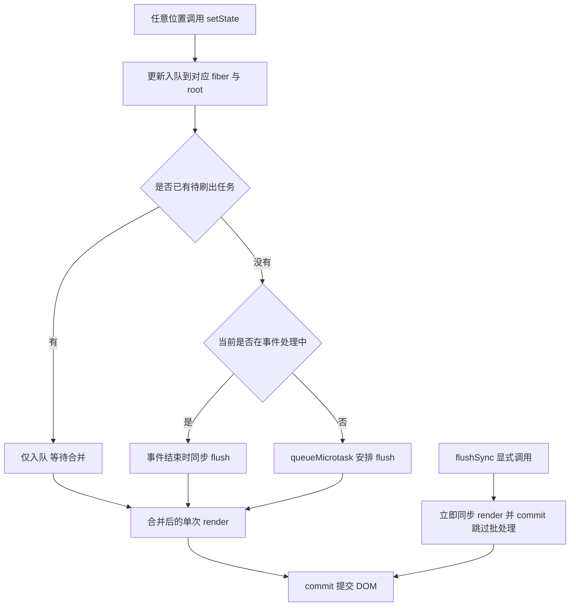

```javascript
// 简化实现，帮助理解微任务刷出
const updateQueue = [];
let isFlushScheduled = false;

function setState(fiber, action) {
  updateQueue.push({ fiber, action });       // 1. 入队
  scheduleFlush();                            // 2. 安排刷出
}

function scheduleFlush() {
  if (isFlushScheduled) return;               // 已有待刷任务：合并
  isFlushScheduled = true;
  if (isInsideEventHandler) return;           // 事件上下文：等事件结束同步 flush
  queueMicrotask(flushWork);                  // 非事件上下文：微任务刷出
}

function flushWork() {
  isFlushScheduled = false;
  const actions = [...updateQueue]; updateQueue.length = 0;
  renderAndCommit(actions);                   // 3. 合并为一次 render + commit
}

// —— 事件包装：事件结束同步 flush ——
function dispatchEvent(e) {
  isInsideEventHandler = true;
  try {
    processHandler(e);       // 里面的多次 setState 只入队
  } finally {
    isInsideEventHandler = false;
    flushWork();             // 事件结束：立即刷出（比微任务还早）
  }
}

// 行为对照
setTimeout(() => {
  setA(1); setB(2);           // React18：批量！一次 render（React17 会两次）
  console.log(dom.textContent); // 旧值 —— 微任务还没跑
}, 0);
async function load() {
  await api();
  setLoading(true);           // await 之后：同样批量（React17 不会）
  setData(r);                 // 与上一行合并为一次 render
}
flushSync(() => { setA(1); setB(2); });
console.log(dom.textContent);  // 新值 —— flushSync 强制同步 commit
```

### FRP-169：事件委托到 root 容器后，与 document 委托时代有哪些行为差异？

**答**：
- React17 前所有事件委托在 `document`，17+ 移到 **root 容器**——同一页面多个 React 应用不再通过 document 互相串扰，也为渐进迁移（新旧应用并存）铺路。
- 委托层级变化影响与**原生监听器的时序**：挂 window/document 的原生 listener 会在 React 合成事件**之前**（捕获/冒泡阶段不同）触发——迁移时常见"以前 stopPropagation 能挡住，现在挡不住"的问题。
- 合成事件的 `e.stopPropagation()` 只阻止**合成传播**（React 模拟的冒泡链），原生事件已到达 root——要阻止原生传播需 `e.nativeEvent.stopImmediatePropagation()` 或在 root 外层挂原生监听。
- 附加变化：onScroll 不再冒泡（对齐原生）、事件池在 17 移除（e 对象可异步持有）。

```javascript
// 简化实现，帮助理解委托层级与时序
// —— React16：document 委托 ——
document.addEventListener('click', dispatchSimulatedClick);      // 冒泡阶段
// 多个 React 应用 + 第三方库都在 document 上，listeners 顺序互相干扰

// —— React17+：root 委托 ——
function createRoot(container) {
  // 捕获与冒泡两套都挂，覆盖全部事件类型
  for (const type of allDelegatedEvents) {
    container.addEventListener(type, dispatchEvent, false);        // 冒泡
    container.addEventListener(type, dispatchCaptureEvent, true);  // 捕获
  }
}

// —— 时序差异验证 ——
document.addEventListener('click', () => console.log('document 原生'));
// <div onClick={() => console.log('react 合成')}>   （React17+）
// 点击输出：react 合成 先于 document 原生 —— 因为委托在 root，root 更深（先冒泡到）
// React16 时顺序相反：document 委托先触发

// —— stopPropagation 的影响 ——
function Inner() {
  return <button onClick={(e) => e.stopPropagation()}>stop</button>;
}
// 合成层面：外层 React onClick 不会触发（模拟冒泡被截断）✓
// 原生层面：click 事件仍然冒泡到 document！
document.addEventListener('click', () => console.log('仍会触发 —— 原生已到达'));
// 要彻底阻断原生传播：
// e.nativeEvent.stopImmediatePropagation() —— 但这只影响 root 之后的原生 listener
// 正确做法：外部原生 listener 挂在比 root 更早的位置（如 window 捕获阶段）

// —— 捕获阶段对齐 ——
// <div onClickCapture={...}> -> dispatchCaptureEvent：用原生捕获阶段真实时序
// 合成事件的 capture 版本与原生捕获顺序完全一致（React16 是模拟，时序有偏差）
```

### FRP-170：React 18 的 selective hydration 是怎么实现"事件重放"的？（高频）

**答**：
- 背景：流式 SSR + 分块 hydrate 时，**某些边界还没 hydrate**，用户却已经能点到那里——React 18 让"没水合的 UI 也能响应"。
- 机制一：React 17+ 在 root 上**提前挂好全量事件委托**（hydrate 前就监听）；未水合区域的点击命中后，React 知道对应 fiber 还没 hydrate。
- 机制二：把该事件**暂存**在队列（记录 target DOM、事件类型、时间），然后给"包含该 target 的 Suspense 边界"一个**更高 hydrate 优先级**（离散事件 > 连续事件）。
- 机制三：该边界 hydrate 完成后，**重放**暂存事件（重新构造合成事件走正常分发）——用户无感等待，点击不丢。
- 连续事件（scroll/mousemove）不重放（重放无意义），只提升优先级；离散事件（click/keydown）才重放。

```javascript
// 简化实现，帮助理解 selective hydration 的事件重放
const capturedEvents = [];   // 暂存队列

// 1. root 上提前挂委托（hydrate 之前！）
function listenToAllSupportedEvents(rootEl) {
  for (const type of allDelegatedEvents) {
    rootEl.addEventListener(type, (e) => dispatchOrCapture(e), false);
  }
}
function dispatchOrCapture(nativeEvent) {
  const targetFiber = getFiberFromDOM(nativeEvent.target);
  if (targetFiber && !isHydrated(targetFiber)) {
    // 未水合：暂存 + 提升该边界的 hydrate 优先级
    capturedEvents.push({ nativeEvent, targetFiber, type: nativeEvent.type });
    selectivelyHydrate(targetFiber, isDiscrete(nativeEvent.type) ? SyncLane : ContinuousLane);
    return; // 不立即分发
  }
  dispatchEvent(nativeEvent);   // 已水合：正常合成事件分发
}

// 2. 边界 hydrate 完成后重放
function completeHydration(boundaryFiber) {
  commitHydratedBoundary(boundaryFiber);
  // 重放：把暂存的、target 在该边界内的事件重新分发
  const toReplay = capturedEvents.filter(e => isInsideBoundary(e.targetFiber, boundaryFiber));
  for (const e of toReplay) {
    // 重新构造合成事件走完整分发链（此刻组件已可响应 onClick）
    dispatchEvent(e.nativeEvent);
  }
  capturedEvents = capturedEvents.filter(e => !toReplay.includes(e));
}

function isDiscrete(type) {
  return ['click', 'keydown', 'mousedown', 'touchstart'].includes(type); // 离散事件可重放
}
// scroll/mousemove 等连续事件：只提升 hydrate 优先级，不重放（重放一个中间态无意义）

// 整体时序：
// t0 HTML 流出，JS 还在下载
// t1 用户点击评论区的赞按钮（该区域未 hydrate）
// t2 React 暂存点击，评论区边界获得最高 hydrate 优先级（打断队列中其他工作）
// t3 评论区 hydrate 完成
// t4 重放点击 -> 点赞生效 —— 用户视角"点了就有效"，延迟被框架吸收
```

### FRP-171：Vue 与 React 的"GC 友好度"对比：响应式自动清理 vs fiber 释放？

**答**：
- Vue 的优势在**响应式图自清理**：组件卸载 → scope.stop() 自动把该组件所有 effect 从依赖集合剪除——store 里的数据变化不会再引用已卸载组件，悬挂引用在框架层被消灭。
- React 的 fiber 本身是可释放的：commit 后 alternate 交换、旧 fiber 与 hooks 链随引用消失可被 GC；但**外部订阅**要靠开发者手动 cleanup——忘写 useEffect cleanup 就泄漏。
- 泄漏形态不同：React 泄漏 = 外部 store 长持 fiber 闭包（组件树整棵滞留内存）；Vue 泄漏主要剩两类——手动创建且脱离 scope 的 effect、手动挂在全局的 watch。
- 两者共同的高危点：定时器/事件监听/DOM 引用这类**非响应式资源**都需要手动清理，框架帮不了。

```javascript
// 简化实现，帮助理解两种内存模型
// —— React：泄漏靠人守 ——
function Clock() {
  const [now, setNow] = useState(Date.now());
  useEffect(() => {
    // 忘了 cleanup 的版本：
    // setInterval(() => setNow(Date.now()), 1000);   // 组件卸载后仍跑 -> 闭包持 fiber -> 泄漏
    const id = setInterval(() => setNow(Date.now()), 1000);
    return () => clearInterval(id);                  // 手动断开
  }, []);
  return <span>{now}</span>;
}
// 泄漏链：interval -> setNow 闭包 -> fiber -> 整棵组件树 + hooks 链 无法回收

// —— Vue：依赖自动剪除 ——
const store = reactive({ tick: 0 });
// 组件 setup：
const scope = effectScope();
scope.run(() => {
  watchEffect(() => console.log('tick', store.tick));  // 自动注册进 scope
});
// 组件卸载：框架自动 scope.stop() —— 从 store 的依赖集合里剪除该 effect
// 结果：store.tick++ 不再触发已卸载组件的任何代码，响应式图无悬挂引用
setInterval(() => store.tick++, 1000);                  // 这个仍要自己清（非响应式资源）

// —— React 的 fiber 释放本身是健康的 ——
function commitRoot() {
  // 双缓冲交换后，旧 workInProgress 树失去全部引用：
  // alternate 断开、effectList 清空 -> 可被 GC
  root.current = finishedWork;
  finishedWork.alternate = null;
  // 泄漏只发生在"外部世界"还持有 fiber 引用时：
  // devtools 缓存、全局事件回调闭包、未清理的 store 订阅
}

// —— 对比结论 ——
// 响应式依赖（Vue 强项）：自动清理 vs 手动 cleanup
// fiber/实例内存（React 强项）：树结构整体可释放 vs Vue 实例较小但依赖图常驻
// 共同短板：定时器/监听器/第三方实例 —— 都要手动管理
```

### FRP-172：框架大版本升级的"运行时兼容层"是怎么设计的？

**答**：
- 目标：新旧 API 并存期间同一应用可混合运行。核心设计是**模式开关 + 行为 shim**：全局 compat 模式（`@vue/compat` 的 `configureCompat`）按模块/组件粒度开关旧行为。
- 分层策略：① 全局 mode（v2 行为默认开）；② 文件级注释（`/* @vue-compat */`）细粒度关掉某文件的 compat；③ 私有 API shim（`$children`、`$listeners` 用 getter 模拟）；④ 行为差异表（attrs 继承、v-model 参数、过滤器逐项映射到新语义）。
- 运行时探测：compat 层拦截组件创建，检查用了哪些旧 API 并**降级实现 + 控制台告警**（dev 输出迁移指南链接）。
- 退出机制：警告计数归零后逐文件关闭 compat，最终全量移除——迁移是渐进的、可验证的。

```javascript
// 简化实现，帮助理解 compat 层设计
const compatConfig = {
  MODE: 2,                        // 全局默认：v2 行为
  COMPONENT_V_MODEL: true,        // 逐特性开关
  FILTERS: true,
  RENDER_FUNCTION: false,         // 已迁移的特性显式关闭
};

function configureCompat(overrides) { Object.assign(compatConfig, overrides); }

// —— 文件级开关：编译器生成 ——
// /* compat-enabled: false */  -> 该模块编译时直接走 v3 语义，运行时零开销

// —— 行为 shim：拦截旧 API 模拟新语义 ——
function createCompatComponent(options) {
  if (compatConfig.COMPONENT_V_MODEL && options.model) {
    // v2 的 model: { prop, event } -> v3 的 update:xxx
    const { prop = 'value', event = 'input' } = options.model;
    options.props = [...(options.props || []), prop];
    options.emits = [...(options.emits || []), `update:${prop}`];
    warnOnce('COMPONENT_V_MODEL：请改用 defineModel');
  }
  if (compatConfig.FILTERS && usesFilters(options)) {
    // v2 过滤器 -> 编译期已转方法调用，这里兜底注册
    options.methods = { ...globalFilters, ...options.methods };
    warnOnce('FILTERS 已移除：请用计算属性');
  }
  return options;
}

// —— 私有 API 模拟 ——
const instanceProxy = new Proxy(instance, {
  get(target, key) {
    if (key === '$children') {           // v2 私有 API：v3 已移除
      warnOnce('$children：请改用 ref');
      return target.subTree.children.filter(isComponentVNode).map(v => v.component.proxy);
    }
    if (key === '$listeners') {          // v2.4 独有：v3 合并进 attrs
      return pickOnKeys(target.vnode.props);
    }
    return target[key];
  }
});

// —— 迁移进度度量 ——
// 每次 warnOnce 记录到 compatWarnings 计数器：
// { COMPONENT_V_MODEL: 12, FILTERS: 3, ... }
// 目标：把每个计数清零 -> 对应开关关掉 -> 最终删除 compat 依赖
```

## 二十六、编译与转译层

### FRP-173：一个真实模板到 render 函数的完整编译产物长什么样？（输入输出对照）

**答**：
- 编译三阶段落地的完整示例：parse 生成 AST → transform（静态提升、patchFlag 标注、block 收集）→ generate 拼出代码字符串。
- 产物特征：helpers 按需 import（用到什么导什么）、静态子树提升到作用域外（只创建一次）、动态节点带 patchFlag + dynamicProps、事件走缓存。
- `_openBlock/_createElementBlock` 组织 Block 树：动态后代节点按扁平顺序收集进 `dynamicChildren`，diff 时跳过静态部分直接走这个列表。
- 从输出反推优化动机：产物里的每个"奇怪变量"都对应一个运行时优化（见 FRP-013/060-063）。

```javascript
// 简化实现，帮助理解模板到 render 的对照
// —— 输入模板 ——
// <div id="app">
//   <span>静态标题</span>
//   <span>{{ msg }}</span>
//   <button @click="go">go</button>
// </div>
//
// —— 编译产物（实际 SFC 编译输出，去掉部分 noise） ——
const _hoisted_1 = { id: "app" };          // 静态 props 提升对象
const _hoisted_2 = /*#__PURE__*/_createElementVNode("span", null, "静态标题"); // 完整静态节点提升
const _hoisted_3 = /*#__PURE__*/_createElementVNode("span", null, "go");       // 按钮文本提升

export function render(_ctx, _cache) {
  return (_openBlock(), _createElementBlock("div", _hoisted_1, [
    _hoisted_2,                                              // 静态：不进 dynamicChildren，diff 跳过
    _createElementVNode("span", null,                        // 动态文本：patchFlag = TEXT(1)
      _toDisplayString(_ctx.msg), 1 /* TEXT */),
    _createElementVNode("button", {
      onClick: _cache[0] || (_cache[0] = (...args) => (_ctx.go && _ctx.go(...args)))
    }, [                                                     // 事件缓存：handler 不再是每次新建
      _hoisted_3
    ])
  ]));
}
// helpers 按需导入（生成代码头部）：
// import { createElementVNode, createElementBlock, openBlock, toDisplayString }
//   from 'vue' —— 只导入用到的，tree-shaking 友好

// —— 最小化生成器示意 ——
function generate(ast) {
  const ctx = { code: '', helpers: new Set() };
  genFunctionPreamble(ctx);                       // helpers import + 静态提升变量
  genFunctionDecl(ast, ctx);                      // export function render(_ctx, _cache)
  walk(ast.children, ctx);                        // 递归：遇到动态绑定
  //   ctx.helpers.add('toDisplayString')
  //   ctx.code += `, 1 /* TEXT */`               // patchFlag 注解
  return ctx.code;
}
```

### FRP-174：JSX 编译产物从 createElement 到 jsx-runtime 经历了什么演进？

**答**：
- 经典转换：JSX → `React.createElement(type, props, ...children)`——props 对象运行时构造、key/children 混在参数里、**React 必须在作用域内**（每个文件 import React）。
- 新 runtime（React 17+ automatic runtime）：`jsx(type, props, key)` ——key 从 props 中拆出单独传、children 直接进 props、**编译器自动注入 import**（`react/jsx-runtime`），源文件不再需要 import React。
- 收益：省掉每次的 `arguments` 展开、props 构造更直接、为"不写 import React"的现代化（RSC/服务端）铺路。
- Vue 也采用同名 jsx-runtime 约定（`vue/jsx-runtime`），工具链统一。

```javascript
// 简化实现，帮助理解两种产物
// —— 输入 JSX ——
// const el = <div className="box" key="k1">hello<span>{name}</span></div>;

// —— 经典产物（React 16 及以前） ——
const el = React.createElement(
  "div",
  { className: "box", key: "k1" },   // key 藏在 props 里，运行时要特殊处理
  "hello",
  React.createElement("span", null, name)
);
// 必须文件顶部 import React —— 即使源码没显式用到

// —— 新 runtime 产物（automatic JSX runtime） ——
import { jsx as _jsx } from "react/jsx-runtime";   // 编译器自动注入
const el = _jsx("div", {
  className: "box",
  children: ["hello", _jsx("span", { children: name })]
}, "k1");                                          // key 独立第三参：运行时无需再拆

// —— 编译器侧的转换差异 ——
function transformJSXClassic(node) {
  const props = { ...node.attributes };
  if (node.key) props.key = node.key;               // key 进 props
  return call('React.createElement', node.type, props, ...node.children);
}
function transformJSXRuntime(node) {
  const props = { ...node.attributes };
  props.children = node.children.length === 1 ? node.children[0] : node.children;
  const { key, rest } = splitKey(props);
  return call(node.children.length ? '_jsx' : '_jsxs', node.type, rest, key);
  // 还有两个细节：jsxDEV 注入 __source/__self（dev 定位）、
  // 静态子树可用 _jsx + 冻结 props 复用
}

// 运行时对 key 的处理简化：
function jsx(type, props, key) {
  return { $$typeof: ELEMENT, type, key: key ?? null, props, ref: props.ref ?? null };
}
```

### FRP-175：Svelte 的编译产物实例：响应式是如何变成"普通赋值"的？

**答**：
- Svelte 组件编译成普通 JS 函数：模板变成 `create_fragment` 返回的 mount/update/unmount 操作集，响应式变量是**普通的局部变量**（存在 ctx 数组里）。
- 关键产物是 `$$invalidate`：编译器知道**每个赋值点**（`count++`），直接在赋值后插入失效调用——标记 dirty、调度更新（微任务批量）。
- `$: doubled = count * 2` 编译为 update 函数里重新计算 + dirty 比对——没有 Proxy、没有依赖收集，**编译期静态知道所有依赖**。
- 这就是"编译时框架"的本质：把运行时框架的 track/trigger 全部替换成编译期插桩。

```javascript
// 简化实现，帮助理解 Svelte 产物
// —— 输入（.svelte） ——
// <script>
//   let count = 0;
//   $: doubled = count * 2;
//   const inc = () => count++;
// </script>
// <button on:click={inc}>{count} / {doubled}</button>

// —— 编译产物（简化） ——
function instance($$self, $$props, $$invalidate) {
  let count = 0;                                  // 普通变量！没有 Proxy/ref
  const inc = () => $$invalidate(0, count++, count);  // 每个赋值点都被插桩
  return [count, inc];
}

function create_fragment(ctx) {
  let button, t0, t1, t2_value, mounted;
  return {
    c() {  // create：一次性建 DOM
      button = element('button');
      t0 = text('');
      t1 = text(' / ');
      t2 = text('');
    },
    m(target, anchor) {  // mount
      mount(button, target, anchor);
      mounted = listen(button, 'click', ctx[1]);
    },
    p(ctx, [dirty]) {  // update：dirty 位图决定更新哪些节点
      if (dirty & /*count*/ 1 && t0_value !== (t0_value = ctx[0])) {
        set_data(t0, t0_value);                    // 只更新变化的文本节点
      }
      if (dirty & /*count*/ 1 && t2_value !== (t2_value = ctx[0] * 2)) {
        set_data(t2, t2_value);                    // $: 依赖在编译期已知 = count
      }
    },
    d(detaching) { /* unmount + 移除监听 */ }
  };
}

// —— $$invalidate 的核心 ——
let dirty = 0;
function $$invalidate(i, value) {
  if (dirty & (1 << i)) return value;             // 已脏：跳过
  dirty |= 1 << i;                                 // 标记第 i 个变量脏
  schedule_update(() => {                          // 微任务批量
    const mask = dirty; dirty = 0;
    fragment.p(ctx, mask);                         // 按 dirty 位图精准更新
  });
  return value;
}
// 对比 Vue：Proxy get/set 运行时收集；Svelte：编译期就写死了"哪个赋值影响哪些节点"
```

### FRP-176：Solid 的编译产物实例：细粒度订阅在代码里是什么形态？

**答**：
- Solid 编译产物是**一次执行**的 setup 函数：`createSignal/createMemo/createEffect` + 直接的 DOM 构建，组件函数只跑一次（不是 render 函数）。
- 模板复用：编译器先把模板转成 `<template>` 元素（或字符串），运行时 `cloneNode` 克隆——DOM 创建成本极低。
- 动态表达式编译成 **getter 传入 helper**：`{count()}` → `insert(el, () => count())` ——insert 内部建 effect 订阅 count，变化时只改这一个文本节点。
- 细粒度的完整含义：订阅建立在**表达式级**，没有组件级重渲的概念——与 Vapor Mode（FRP-138）同思路，但 Solid 从第一天就如此设计。

```javascript
// 简化实现，帮助理解 Solid 产物
// —— 输入 JSX ——
// <div class="card">
//   <h1>{title()}</h1>
//   <button onClick={inc}>+</button>
//   <Show when={visible()} fallback={<p>hidden</p>}>content</Show>
// </div>

// —— 编译产物（简化） ——
const _tmpl$ = /*#__PURE__*/ template(`<div class="card"><h1></h1><button>+</button></div>`);

function App() {
  const [count, setCount] = createSignal(0);   // 组件只执行一次！
  const inc = () => setCount(count() + 1);

  const _el$ = _tmpl$(),                        // cloneNode 克隆模板
        _el$2 = _el$.firstChild,
        _el$3 = _el$2.firstChild,
        _el$4 = _el$.nextSibling;

  // 动态表达式 = getter 传给 helper，helper 内部建 effect
  insert(_el$2, () => title());                 // title 变化 -> 只改这个 h1 的文本
  _el$4.$$click = inc;                          // 事件直接绑定

  // 条件编译为专用组件：内部 effect 监听 when
  createComponent(Show, {
    get when() { return visible(); },           // getter：细粒度依赖
    get fallback() { return _el$5; },
    get children() { return 'content'; }
  });

  return _el$;
}

// —— insert 的实现（订阅发生地） ——
function insert(parent, value) {
  if (typeof value === 'function') {
    createEffect(() => {
      const v = value();                        // 读 signal -> 收集依赖
      // 精准操作：只替换这个位置的文本/节点，不碰兄弟、不碰组件
      replaceText(parent, v);
    });
  } else {
    replaceText(parent, value);
  }
}

// —— 对照：编译期与运行时的分工 ——
// Vue VDOM：编译期标注 patchFlag -> 运行时 diff dynamicChildren（还是有一轮比较）
// Solid   ：编译期直接生成订阅代码 -> 运行时零 diff（表达式即订阅）
// 共同点  ：都靠模板/JSX 的静态可分析性；差异在"标注"与"直译"的程度
```

### FRP-177：sourcemap 在编译框架层有什么意义？mappings 是怎么工作的？

**答**：
- 编译框架（Vue SFC/Svelte/Solid/Babel）把用户代码映射到生成代码：**断点落在源码、报错栈还原到模板行号、CSS-in-JS 回溯类名**——全靠 sourcemap。
- 格式核心是 `mappings`：VLQ 编码的"生成行列 → 源行列"映射段序列；每个段 5 个字段（生成列、源文件索引、源行、源列、名字索引）。
- 框架层特殊用法：模板编译错误要指向**原模板的行列**（编译器在 parse 时记录每个 AST 节点的 loc 并传给 generate）；生产环境错误上报用 sourcemap 反解。
- 调试体验的决定性细节：`sourcesContent` 内嵌源码让 DevTools 直接显示模板原文；Vue SFC 三个块（template/script/style）各自出 map 再合并。

```javascript
// 简化实现，帮助理解 sourcemap 的生成与使用
const B64 = 'ABCDEFGHIJKLMNOPQRSTUVWXYZabcdefghijklmnopqrstuvwxyz0123456789+/';

// VLQ 编码：把整数变成 base64 字符（可表示负数，用于行列差值）
function encodeVLQ(value) {
  let vlq = value < 0 ? ((-value) << 1) | 1 : value << 1;
  let out = '';
  do {
    let digit = vlq & 31;                 // 低 5 位
    vlq >>>= 5;
    if (vlq > 0) digit |= 32;             // 还有后续：置延续位
    out += B64[digit];
  } while (vlq > 0);
  return out;
}

// 生成 mappings：逐段记录"生成位置 -> 源位置"（增量编码）
function buildMappings(segments) {
  // segments: [{ genLine, genCol, srcIdx, srcLine, srcCol }, ...]（已按生成位置排序）
  let prevGenCol = 0, prevSrcLine = 0, prevSrcCol = 0, prevSrcIdx = 0;
  const lines = [];
  let currentLine = '';
  let lastGenLine = 0;
  for (const s of segments) {
    if (s.genLine !== lastGenLine) { lines.push(currentLine); currentLine = ''; lastGenLine = s.genLine; prevGenCol = 0; }
    currentLine += encodeVLQ(s.genCol - prevGenCol)          // 生成列（差值）
                 + encodeVLQ(s.srcIdx - prevSrcIdx)          // 源文件索引
                 + encodeVLQ(s.srcLine - prevSrcLine)        // 源行（差值）
                 + encodeVLQ(s.srcCol - prevSrcCol);         // 源列
    prevGenCol = s.genCol; prevSrcIdx = s.srcIdx; prevSrcLine = s.srcLine; prevSrcCol = s.srcCol;
  }
  lines.push(currentLine);
  return lines.join(';');
}

// 使用：报错栈反解（错误监控平台的核心步骤）
function originalPosition(map, genLine, genCol) {
  const seg = findSegment(map.mappings, genLine, genCol);  // 二分查找最近映射段
  return { line: seg.srcLine + 1, column: seg.srcCol, source: map.sources[seg.srcIdx] };
}
// "Cannot read property of undefined at render:12:8"
//   -> 反解 -> "Cannot ... at App.vue 模板第 4 行 {{ user.name }}"

// 框架层要点：编译器在每个 AST 节点上带 loc（源模板行列），
// generate 为每个产物 token 记录 segment —— 映射链路才能一路保持到源模板
```

### FRP-178：React Compiler 的自动 memoization 是什么原理（编译期数据流分析）？

**答**：
- React Compiler（原 React Forget）在**构建期**分析组件/hook 的数据流，自动插入等价于 useMemo/useCallback/自动依赖的缓存代码——开发者不再手写 memo。
- 核心是**依赖追踪的编译期化**：编译器把组件转成 SSA 形式，计算每个值依赖哪些输入（props/state/外部读取），把"依赖不变则复用"表达为编译产物。
- 产物形态：JSX 嵌入 `_c(dependencies, () => jsx(...))` 帮助函数——运行时做 `Object.is` 依赖比对，全等则返回缓存的元素树。
- 边界：编译器**只对符合 React 规则的代码**生效——可变全局、按调用顺序变化的逻辑会被跳过（保守策略，不改变语义只跳过优化）；ESLint 插件负责提前暴露违规。

```javascript
// 简化实现，帮助理解 React Compiler 产物
// —— 源码（无任何手写 memo） ——
// function TodoList({ todos, query }) {
//   const filtered = todos.filter(t => t.text.includes(query));
//   return (
//     <ul>
//       {filtered.map(t => <Todo key={t.id} todo={t} />)}
//     </ul>
//   );
// }

// —— 编译产物（简化示意） ——
function TodoList(t32) {
  const $ = useMemoCache(4);                       // 槽位数组的缓存池
  const { todos, query } = t32;

  let filtered;
  if (
    $[0] !== todos ||                              // 依赖比对：编译期算出的依赖集
    $[1] !== query
  ) {
    filtered = todos.filter(t => t.text.includes(query));
    $[0] = todos; $[1] = query; $[2] = filtered;   // 写入缓存槽
  } else {
    filtered = $[2];                               // 依赖没变：直接复用上次结果
  }

  let t0;
  if ($[3] !== filtered) {                         // JSX 也是值：依赖不变复用元素树
    t0 = jsx('ul', { children: filtered.map(t => jsx(Todo, { todo: t }, t.id)) });
    $[3] = filtered;
  } else {
    t0 = $[3];
  }
  return t0;
}

// —— _c/useMemoCache 的运行时 ——
function useMemoCache(size) {
  const fiber = currentFiber;
  const slot = fiber.memoizedState ??= { cache: new Array(size).empty };
  return slot.cache;   // 缓存挂在 fiber 上：组件卸载即释放，与 hooks 同生命周期
}

// —— 编译器侧的分析步骤（概念） ——
// 1. 转换为 SSA：每次赋值都是新变量，值与产生它的表达式一一对应
// 2. 计算依赖：filtered 依赖 [todos, query]；JSX 依赖 [filtered]
// 3. 保守性检查：读到可变全局/调用顺序依赖 -> 放弃该段优化（不缓存，保持原语义）
// 4. 生成缓存代码：上述 if ($[..] !== ...) 模式
// 效果等价于手写 useMemo(() => ..., [todos, query]) + memo(Todo) 的组合，但零手写、永不漏依赖
```

## 二十七、手写进阶综合

### FRP-179：手写 keep-alive：LRU + include 正则匹配如何落地？

**答**：
- keep-alive 的完整职责：缓存子组件 vnode（不渲染容器）、LRU 控制 max、include/exclude 按组件 **name** 决定缓存谁、驱逐时真正 unmount。
- 与 FRP-015 的差异点：这里给出**组件形态的完整实现**——include/exclude 支持正则与数组、命中缓存时替换 vnode 并标记 `keepAlive` 让渲染器跳过 remount、失活走 deactivated。
- 渲染器配合：patch 时检测 `vnode.shapeFlag & COMPONENT_SHOULD_KEEP_ALIVE`，命中缓存的组件直接复用缓存 vnode 的 el，不重新 mount。

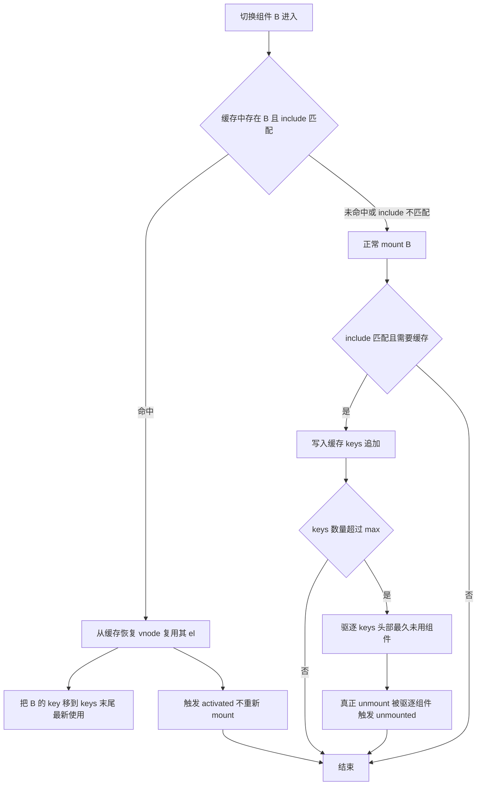

```javascript
// 简化实现，帮助理解 keep-alive（LRU + include 正则匹配）
const KeepAlive = {
  __isKeepAlive: true,
  props: { include: [RegExp, Array, String], exclude: [RegExp, Array, String], max: Number },
  setup(props, { slots }) {
    const cache = new Map();     // key -> { vnode, type }
    const keys = new Set();      // LRU 顺序：尾部最新

    function matches(pattern, name) {
      if (!pattern) return true;
      if (Array.isArray(pattern)) return pattern.includes(name);
      if (typeof pattern === 'string') return new RegExp(pattern).test(name);
      return pattern.test(name);   // RegExp
    }
    function shouldCache(name) {
      return matches(props.include, name) && !matches(props.exclude, name);
    }

    // 渲染器注入的两个钩子：缓存复用 / 真实卸载
    const { cacheSubtree, unmountCached } = injectKeepAliveHooks();
    cacheSubtree((vnode, raw) => {
      const key = raw.key ?? raw.type;
      const name = raw.type.name ?? '';
      if (!shouldCache(name)) return;              // include 不匹配：不缓存
      if (cache.has(key)) {
        // 命中：LRU 更新顺序，替换 vnode 引用
        const cached = cache.get(key);
        raw.el = cached.vnode.el;                  // 复用已挂载的 DOM！
        raw.component = cached.vnode.component;
        keys.delete(key); keys.add(key);
        raw.component.activated?.();               // 触发 activated
      } else {
        cache.set(key, { vnode: raw });
        keys.add(key);
        if (props.max && keys.size > props.max) {
          // 驱逐最久未用（Set 头部）
          const evicted = keys.values().next().value;
          keys.delete(evicted);
          const stale = cache.get(evicted);
          cache.delete(evicted);
          unmountCached(stale.vnode);              // 真正 unmount -> unmounted
        }
      }
    });

    onBeforeUnmount(() => { cache.forEach(c => unmountCached(c.vnode)); });

    return () => {
      const raw = slots.default()[0];              // 只处理单子节点
      // 标记：让渲染器知道这是被 keep-alive 管理的组件
      raw.shapeFlag |= ShapeFlags.COMPONENT_SHOULD_KEEP_ALIVE;
      return raw;
    };
  }
};
// 渲染器侧配合（patch 时）：命中 keep-alive 的组件 vnode 已有 component/el —— 跳过 mountComponent
// 用法：<KeepAlive include="Home,Detail" :max="5"><component :is="view" /></KeepAlive>
```

### FRP-180：手写 Teleport：DOM 移动后事件上下文与 patch 如何保持正确？

**答**：
- 核心三步：正常创建子树的 DOM → **appendChild 到目标容器**（真实移动）→ unmount 时从目标容器移除。
- patch 正确性的关键：vnode.el 引用不因移动失效（el 是 DOM 引用，位置无关），后续 patch 沿 vnode 走，更新的是"内容"不是"位置"。
- 事件上下文：DOM 移动后事件按**新位置**冒泡——teleport 到 body 后事件不再经过原父组件的 DOM 层级，但 Vue 的合成依赖是 vnode 树不是 DOM 树，所以 @click 仍正常。
- props 变化（to 改变）：需要把已挂载的 DOM 移到新容器；disabled=true 时回移到原位置。

```javascript
// 简化实现，帮助理解 Teleport
const Teleport = {
  __isTeleport: true,
  process(n1, n2, container, anchor, ...args) {
    const { to, disabled } = n2.props;
    if (n1 == null) {
      // mount：先渲染到占位容器，再移动到目标
      const target = typeof to === 'string' ? document.querySelector(to) : to;
      if (disabled) {
        // disabled：留在原位置（行为同普通渲染）
        mountChildren(n2.children, container, anchor);
        n2.el = container.lastChild?.parentNode; // 简化
      } else {
        const placeholder = document.createComment('teleport-start');
        mountChildren(n2.children, placeholder /* 临时容器 */);
        n2.children.forEach(child => target.appendChild(child.el)); // 移动！
        n2.el = n2.children[0]?.el;
        n2.target = target;
        n2.anchor = anchor;                      // 记录原位置锚点，disabled 切换时回移
      }
    } else {
      // update：children 照常 patch（el 引用不变），props 变化则移动
      patchChildren(n1, n2, n1.target ?? container);
      if (n1.target !== n2.target && n2.target) {
        n2.children.forEach(child => n2.target.appendChild(child.el)); // 换目标
      }
      if (n1.props.disabled !== n2.props.disabled) {
        // disabled 切换：在原位置与目标之间往返
        const dest = n2.props.disabled ? n2.anchor.parentNode : n2.target;
        n2.children.forEach(child => dest.insertBefore(child.el, n2.props.disabled ? n2.anchor : null));
      }
    }
  },
  remove(vnode) {
    // unmount：从目标容器移除（不是从原位置）
    vnode.children.forEach(child => vnode.target?.removeChild(child.el));
  }
};

// 渲染器分发：
function patch(n1, n2, container) {
  if (n2.type.__isTeleport) return n2.type.process(n1, n2, container); // 特殊类型单独 process
  // ...
}
// 用法：
// <Teleport to="body">
//   <Modal @close="show = false" />   事件仍走 vnode 树 -> 正常
// </Teleport>
// 移动后 Modal 的 DOM 在 body 下，点击它的事件按 body 层级冒泡——
// 但 Vue 的组件事件链基于 vnode/instance，不受 DOM 移动影响
```

### FRP-181：手写 Transition：进入/离开时序与 mode="out-in" 如何控制？

**答**：
- 纯实现层（不依赖 Vue）：给元素加 class 的时序机——enter：`v-enter-from` → 强制 reflow → `v-enter-active v-enter-to` → transitionend 后移除；leave：`v-leave-active v-leave-from` → reflow → `v-leave-to` → 结束后移除并**真正移除 DOM**。
- `mode="out-in"`：新元素必须**等旧元素 leave 完成才 enter**——需要把新元素先"延迟挂载"；`in-out` 相反。
- `transitionend` 不可靠（动画被中断/不触发），生产实现用 `whenTransitionEnds`：读取 computed style 的 duration/delay 取最大值 + 超时兜底。
- 位置移动的动画（v-move）靠 FLIP：先记录旧位置 → 更新 DOM → 计算位移 → 反向 transform → 过渡到 0。

```javascript
// 简化实现，帮助理解 Transition 时序与 out-in
function createTransitionManager() {
  let leavingEl = null;   // out-in 的锁：同一时刻只允许一个离开过程

  function enter(el, done) {
    el.classList.add('v-enter-from', 'v-enter-active');
    void el.offsetHeight;                          // 强制 reflow：让 from 状态生效
    el.classList.remove('v-enter-from');
    el.classList.add('v-enter-to');
    whenTransitionEnds(el, () => {
      el.classList.remove('v-enter-to', 'v-enter-active');
      done?.();
    });
  }

  function leave(el, done) {
    el.classList.add('v-leave-from', 'v-leave-active');
    void el.offsetHeight;
    el.classList.remove('v-leave-from');
    el.classList.add('v-leave-to');
    whenTransitionEnds(el, () => {
      el.classList.remove('v-leave-to', 'v-leave-active');
      el.remove();                                  // 离开结束才真正移除 DOM
      done?.();
    });
  }

  // mode 处理：切换视图的核心逻辑
  function switchView(container, oldEl, newElFactory, mode) {
    if (!oldEl) { const el = newElFactory(); container.appendChild(el); enter(el); return; }
    if (mode === 'out-in') {
      if (leavingEl) return;                        // 锁：正在离开时不挂新元素
      leavingEl = oldEl;
      leave(oldEl, () => {                          // 先离开
        leavingEl = null;
        const el = newElFactory();                  // 离开完成后才创建新元素
        container.appendChild(el);
        enter(el);
      });
      // 关键：旧元素在 leave 期间仍占位（没 remove），新元素不创建 -> 无重叠
    } else if (mode === 'in-out') {
      const el = newElFactory();
      container.appendChild(el);                    // 先进入
      enter(el, () => leave(oldEl));                // 进入完成后再离开旧的
    } else {
      const el = newElFactory();
      container.appendChild(el);                    // 同时进行（默认）：absolute 定位避免跳动
      enter(el);
      leave(oldEl);
    }
  }

  return { switchView, enter, leave };
}

// 结束时机判定（比 transitionend 可靠）
function whenTransitionEnds(el, cb) {
  const { transitionDuration, transitionDelay } = getComputedStyle(el);
  const dur = Math.max(...transitionDuration.split(',').map(parseFloat)) * 1000;
  const del = Math.max(...transitionDelay.split(',').map(parseFloat)) * 1000;
  const total = dur + del;
  if (total === 0) return cb();                    // 无动画：立即结束
  const timer = setTimeout(cb, total + 1);         // 超时兜底
  el.addEventListener('transitionend', function onEnd(e) {
    if (e.target !== el) return;                   // 忽略子元素的事件冒泡！
    clearTimeout(timer);
    el.removeEventListener('transitionend', onEnd);
    cb();
  });
}
```

### FRP-182：手写 defineAsyncComponent：loading / error / retry 完整实现？

**答**：
- 状态机：`pending → loading（delay 后）→ resolved | error`；retry 是 error 分支的计数重试（attempts < retries 时递归 load）。
- 细节一：delay 控制 loading 组件出现——resolve 比 delay 快就不闪 loading（定时器可取消）。
- 细节二：resolved 后要**递归解析**嵌套异步组件（loader 返回的还是异步组件时继续 load）。
- 细节三：comp resolution 后挂到 instance 上触发自身重渲，把占位替换为真组件（见 FRP-070 的渲染器配合）。

```javascript
// 简化实现，帮助理解 defineAsyncComponent
function defineAsyncComponent(options) {
  if (typeof options === 'function') options = { loader: options };
  const {
    loader, loadingComponent, errorComponent,
    delay = 200, timeout, retries = 3, retryDelay = 100,
    onError,   // 自定义重试决策：(err, retry, fail, attempts) => void
  } = options;

  return {
    __async: true,
    setup(props, { slots, expose }) {
      const state = reactive({
        status: 'pending',            // pending | loading | resolved | error
        error: null,
        resolvedComp: null,
      });
      let delayTimer = null, timeoutTimer = null;

      async function load() {
        state.status = state.status === 'pending' ? 'pending' : 'loading';
        clearTimeout(delayTimer);
        delayTimer = setTimeout(() => {
          if (state.status === 'pending') state.status = 'loading';  // delay 后才显示 loading
        }, delay);
        if (timeout) {
          timeoutTimer = setTimeout(() => {
            if (state.status !== 'resolved') fail(new Error('加载超时'));
          }, timeout);
        }
        try {
          const comp = await loader();
          clearTimeout(timeoutTimer);
          state.resolvedComp = isAsyncComp(comp) ? await loadNested(comp) : comp; // 递归解析
          state.status = 'resolved';
        } catch (err) {
          handleError(err, 0);
        } finally {
          clearTimeout(delayTimer);
        }
      }

      function handleError(err, attempts) {
        clearTimeout(timeoutTimer);
        if (onError) {
          onError(err, () => retry(attempts), () => fail(err), attempts);
        } else if (attempts < retries) {
          retry(attempts);
        } else {
          fail(err);
        }
      }
      function retry(attempts) {
        setTimeout(() => loader().then(c => { state.resolvedComp = c; state.status = 'resolved'; })
          .catch(e => handleError(e, attempts + 1)), retryDelay); // 指数退避可在此扩展
      }
      function fail(err) {
        state.error = err;
        state.status = 'error';
      }
      load();

      expose({ retry: () => handleError(state.error, 0) });  // 外部可手动重试

      return () => {
        switch (state.status) {
          case 'resolved': return h(state.resolvedComp, props, slots);   // 真组件
          case 'error':    return errorComponent ? h(errorComponent, { error: state.error, retry: () => handleError(state.error, 0) }) : null;
          case 'loading':  return loadingComponent ? h(loadingComponent) : null;
          default:         return null;   // pending：延迟窗口内无占位（不闪 loading）
        }
      };
    }
  };
}
// 用法：
// const Chart = defineAsyncComponent({
//   loader: () => import('./Chart.vue'),
//   loadingComponent: Spinner, errorComponent: ErrBox,
//   delay: 200, timeout: 5000, retries: 2,
//   onError: (err, retry, fail, n) => (err.status === 503 && n < 5) ? retry() : fail(err),
// });
```

### FRP-183：手写 v-permission 指令：无权限时如何优雅地移除节点？

**答**：
- mounted/updated 时检查权限集（store/prop 传入），无权限时**移除元素**——直接 `el.remove()`。
- 需要恢复的场景（权限动态变化）：移除前把 el 与锚点存进 binding，恢复时 `insertBefore` 放回原位置——用**注释占位符**记录原位。
- 对比 v-if 方案：指令不做编译期分支，适合"权限表运行时才确定"的场景；但指令移除的节点在父组件 patch 时可能被重建，所以 updated 里要重复判断。
- 更完备的做法是配合函数式组件/无权限时渲染注释节点，保持 diff 稳定。

```javascript
// 简化实现，帮助理解 v-permission
// 注册：app.directive('permission', vPermission)
const vPermission = {
  // mounted：首次检查并按需移除
  mounted(el, binding) {
    const { value } = binding;                 // v-permission="'admin'" 或数组
    const perms = usePermissionStore();        // 响应式权限集

    if (!hasPerm(perms, value)) {
      removeEl(el, binding);
    }
    // 订阅权限变化：动态恢复/移除
    binding._unwatch = watchEffect(() => {
      hasPerm(perms, value) ? restoreEl(el, binding) : removeEl(el, binding);
    });
  },
  updated(el, binding) {
    // 组件更新可能重建/移动节点：重新校验
    const { value } = binding;
    hasPerm(usePermissionStore(), value) ? restoreEl(el, binding) : removeEl(el, binding);
  },
  unmounted(el, binding) {
    binding._unwatch?.();                      // 清理订阅（避免泄漏）
  }
};

function hasPerm(perms, required) {
  if (!required) return true;
  const need = Array.isArray(required) ? required : [required];
  return need.some(p => perms.includes(p));    // 任一命中即可（or 语义）
}

function removeEl(el, binding) {
  if (!el.parentNode) return;
  // 用注释占位记录原位置，便于恢复
  const placeholder = document.createComment('v-permission');
  el.parentNode.insertBefore(placeholder, el);
  el.parentNode.removeChild(el);
  binding._placeholder = placeholder;
}

function restoreEl(el, binding) {
  const ph = binding._placeholder;
  if (ph && ph.parentNode) {
    ph.parentNode.insertBefore(el, ph);
    ph.parentNode.removeChild(ph);
    binding._placeholder = null;
  }
}

// 用法：
// <button v-permission="'user:delete'">删除</button>
// <button v-permission="['admin', 'editor']">编辑</button>
// 注意边界：权限控制的"移除"只是 UI 层，接口层必须二次校验——前端权限只管体验
```

### FRP-184：手写 useDebounceFn：VueUse 风格的防抖 composable 怎么写？

**答**：
- 防抖：**重启计时器**——每次调用清除上一次的 timer，wait 内无新调用才真正执行（适合搜索输入、resize）。
- VueUse 风格的完整度：返回的函数带 `cancel()`（取消待执行）与 `flush()`（立即执行待执行）；pending 状态可判断。
- 生命周期集成：`tryOnScopeDispose` —— 在组件 setup 中使用时，组件卸载自动 cancel，防止卸载后回调触发。
- leading 选项：第一次调用立即执行、后续 wait 内忽略（防抖的"立即触发"变体）。

```javascript
// 简化实现，帮助理解 useDebounceFn
import { getCurrentScope, onScopeDispose } from 'vue';

function useDebounceFn(fn, wait = 200, options = {}) {
  let timer = null;
  let pendingArgs = null;
  const { leading = false } = options;   // 首次是否立即执行
  let canLead = true;

  function invoke(args) {
    pendingArgs = null;
    fn(...args);
  }

  function debounced(...args) {
    pendingArgs = args;
    if (leading && canLead) {
      canLead = false;
      invoke(args);                       // leading：第一次立即执行
      return;
    }
    clearTimeout(timer);
    timer = setTimeout(() => {
      canLead = true;                     // 冷却结束，允许下次 leading
      invoke(pendingArgs);                // 执行最后一次的参数
    }, wait);
  }

  debounced.cancel = () => {              // 取消待执行
    clearTimeout(timer);
    timer = null;
    pendingArgs = null;
    canLead = true;
  };
  debounced.flush = () => {               // 立即执行待执行
    if (timer && pendingArgs) {
      clearTimeout(timer);
      timer = null;
      invoke(pendingArgs);
    }
  };
  debounced.isPending = () => timer != null;

  // 生命周期集成：组件卸载自动 cancel（VueUse 的 tryOnScopeDispose）
  if (getCurrentScope()) onScopeDispose(debounced.cancel);

  return debounced;
}

// 用法：
// const search = useDebounceFn(async (q) => {
//   results.value = await api(q);
// }, 300);
// <input @input="e => search(e.target.value)" />
// onBeforeUnmount 里不需要手动清理 —— scope 自动 cancel

// 与 useThrottleFn 的核心区别：
// 防抖 = "等你停下来"（重启计时器），节流 = "按固定节奏放行"（时间闸门）
```

### FRP-185：手写 useThrottleFn：leading / trailing 双端节流的实现？

**答**：
- 节流：**时间闸门**——wait 周期内最多执行一次；关键在两个选项：`leading`（周期开始立即执行）与 `trailing`（周期结束后补执行最后一次调用）。
- 纯 leading 实现：`now - last > wait` 就执行——简单但会"丢"最后一次调用（停止触发后尾部的输入被忽略）。
- trailing 的实现：周期内记录最后参数 + 定时器在周期末补发——两者组合才是完整节流（滚动监听必需，否则停在半路的状态丢失）。
- 生命周期同 useDebounceFn：scope 卸载自动清理定时器。

```javascript
// 简化实现，帮助理解 useThrottleFn
function useThrottleFn(fn, wait = 200, trailing = true, leading = true) {
  let timer = null;
  let lastExecTime = 0;       // 上次执行时间
  let pendingArgs = null;

  function exec(args) {
    pendingArgs = null;
    lastExecTime = Date.now();
    fn(...args);
  }

  function throttled(...args) {
    const now = Date.now();
    const elapsed = now - lastExecTime;

    // 周期空闲：leading 放行
    if (elapsed >= wait && leading) {
      exec(args);
      return;
    }
    // 周期内：只记录参数，等 trailing 补发
    pendingArgs = args;
    if (!timer && trailing) {
      const remain = wait - elapsed;
      timer = setTimeout(() => {
        timer = null;
        if (pendingArgs) exec(pendingArgs);   // 周期结束：补执行最后一次
      }, remain);
    }
  }

  throttled.cancel = () => { clearTimeout(timer); timer = null; pendingArgs = null; };
  throttled.flush  = () => { if (timer) { clearTimeout(timer); timer = null; if (pendingArgs) exec(pendingArgs); } };
  if (getCurrentScope()) onScopeDispose(throttled.cancel);

  return throttled;
}

// 行为对照（wait=200，用户连续调用 t=0..900 每 100ms 一次）：
// leading+trailing：执行于 0, 200(补), 400(补), 600(补), 800(补), 1000(补) —— 不丢尾部
// 仅 leading：执行于 0, 200, 400, 600, 800 —— t=900 的最后一次调用被丢弃
// 仅 trailing：执行于 200, 400, ... —— 首次调用要等 200ms（滚动场景开头延迟明显）

// 用法：
// const onScroll = useThrottleFn(() => {
//   updateProgressBar();          // 滚动进度：必须 trailing，否则停在中途进度不准
// }, 100);
// window.addEventListener('scroll', onScroll);
```

### FRP-186：手写 v-model 的三个修饰符：.lazy / .number / .trim 的完整实现？

**答**：
- 修饰符的本质是**编译期把 modifiers 传给运行时**，运行时在"事件 → 赋值"的管道里插入转换：`.lazy` 把 input 事件换成 change、`.number` 用 toNumber 转换、`.trim` 去首尾空格。
- 完整实现：一个通用的 `assignEventValue(el, value, modifiers, cb)` 管道，按修饰符顺序处理（trim → number，lazy 只影响事件类型）。
- 细节：`.number` 输入非数字时保留原字符串（toNumber 返回原值），避免输入中途被清空；`.lazy` 失焦才同步，配合表单校验场景。
- 自定义组件上的修饰符走 modelModifiers prop（见 FRP-136），原生表单上直接在指令/编译产物里处理。

```javascript
// 简化实现，帮助理解 v-model 修饰符
// 编译产物对照：
// <input v-model.lazy.trim="msg" />
// =>
// withDirectives(h('input', {
//   'onUpdate:modelValue': $event => ((_ctx.msg) = $event),
//   value: _ctx.msg
// }, null, 512), [[vModelText, _ctx.msg, '', { lazy: true, trim: true }]])
// —— modifiers 对象进入指令的 binding

const vModelText = {
  created(el, { modifiers: { lazy, trim, number } }, vnode) {
    // 赋值管道：修饰符按序转换后写回（el 一起闭包传入）
    el.__assign = makeAssign(el, vnode, { trim, number });

    // 事件选择：lazy 用 change（失焦），否则 input
    const event = lazy ? 'change' : 'input';
    el.addEventListener(event, () => {
      el.__assign(el.value);
    });
    if (!lazy) {
      // 组合输入法（中文 IME）期间不同步 —— 真实实现的必要细节
      el.addEventListener('compositionstart', () => el.__composing = true);
      el.addEventListener('compositionend', () => {
        el.__composing = false;
        el.__assign(el.value);
      });
    }
  },
  beforeUpdate(el, { value, oldValue, modifiers: { trim, number } }) {
    // 外部值变化 -> 同步回 DOM（受控方向的另一半）
    if (document.activeElement !== el) {           // 焦点内不覆盖用户输入
      if (trim && value === oldValue) {
        el.value = value.trim();                   // 值未变但需要 trim 视图
      } else if (value !== el.value || number) {
        el.value = value ?? '';
      }
    }
  }
};

function makeAssign(el, vnode, { trim, number }) {
  return function assign(value) {
    if (el.__composing) return;                    // IME 期间跳过
    let v = value;
    if (trim) v = v.trim();                        // 1. trim 先行
    if (number || vnode.props?.type === 'number') {
      v = toNumber(v);                             // 2. number：转不动就保留字符串
    }
    vnode.props['onUpdate:modelValue'](v);         // 3. 触发更新
  };
}

function toNumber(v) {
  const n = parseFloat(v);
  return isNaN(n) ? v : n;   // 'abc' -> 'abc'（不清空输入），'12a' -> parseFloat 得 12
}

// 验证三种修饰符：
// <input v-model.number="age">    输入 '25'  -> age = 25；输入 'abc' -> age = 'abc'
// <input v-model.trim="name">     输入 ' hi ' -> name = 'hi'
// <input v-model.lazy="draft">    键入过程不更新，失焦才同步
```

### FRP-187：手写 pinia mini：defineStore + 响应式 state + action 怎么组合？

**答**：
- 内核三件套：`defineStore` 生成 useStore 函数；`useStore` 用 inject 拿 Pinia 实例、按 id 创建/复用 store；store 本体是 `reactive(state)` 的对象。
- action 就是普通函数，`this` 通过 `bind(store)` 指向 reactive store——改 state 自动触发依赖它的组件；getters 用 computed 缓存。
- `$patch` 用批量（一次 trigger）、`$reset` 重新执行 options.state 工厂、`$subscribe` 基于 watch 订阅变化（插件/持久化的挂点，见 FRP-078）。
- devtools 与 SSR 略去，但注意 store 必须**挂在 Pinia 实例上**（app 级单例）而不是模块级单例——SSR 与多应用共存的前提。

```javascript
// 简化实现，帮助理解 pinia mini
import { reactive, computed, inject, watch, effectScope } from 'vue';

const piniaSymbol = Symbol('pinia');

function createPinia() {
  const stores = new Map();      // id -> store 实例（app 级单例容器）
  return {
    install(app) { app.provide(piniaSymbol, this); },
    _stores: stores,
    _plugins: [],
    use(plugin) { this._plugins.push(plugin); return this; },
  };
}

function defineStore(id, options) {
  function useStore() {
    const pinia = inject(piniaSymbol);           // 拿 Pinia 实例
    if (!pinia._stores.has(id)) {
      const scope = effectScope();               // 每个 store 独立 scope
      const store = scope.run(() => {
        // 1. state：reactive 包装（core）
        const state = reactive(options.state?.() ?? {});
        // 2. getters：computed 缓存 + this 指向 store
        const getters = {};
        for (const key in options.getters ?? {}) {
          getters[key] = computed(() => options.getters[key].call(proxy));
        }
        // 3. actions：普通函数 bind 到 store
        const actions = {};
        for (const key in options.actions ?? {}) {
          actions[key] = (...args) => options.actions[key].apply(proxy, args);
        }
        const proxy = new Proxy({}, {
          get(_, key) {
            if (key in state) return state[key];       // state 优先
            if (key in getters) return getters[key].value;
            if (key in actions) return actions[key];
            if (key === '$patch') return patchFn;
            if (key === '$reset') return () => Object.assign(state, options.state());
            if (key === '$subscribe') return (cb) =>
              watch(state, (s) => cb({ type: 'patch' }, s), { deep: true });
            return undefined;
          },
          set(_, key, v) { state[key] = v; return true; } // store.count++ 直写 state
        });
        function patchFn(partial) {
          // $patch 函数式：在一个 tick 内多次改也只触发一轮依赖
          if (typeof partial === 'function') partial(state);
          else Object.assign(state, partial);
        }
        return proxy;
      });
      pinia._stores.set(id, store);
      // 4. 插件：拿到 store 上下文（持久化插件等在这里挂）
      pinia._plugins.forEach(p => p({ store, pinia, options }));
    }
    return pinia._stores.get(id);
  }
  useStore.$id = id;
  return useStore;
}

// 使用：
// const useCounter = defineStore('counter', {
//   state: () => ({ count: 0 }),
//   getters: { double: (s) => s.count * 2 },
//   actions: { inc() { this.count++ } },     // this 是 reactive store
// });
// const counter = useCounter();
// counter.inc();          // count++ 自动触发所有依赖组件
// counter.$patch({ count: 10 });
// counter.$subscribe((m, state) => localStorage.setItem('counter', JSON.stringify(state)));
// 与真实 Pinia 的差距：真实实现用 stop/setupStore 分层、devtools 钩子、SSR 序列化——核心思路一致
```

### FRP-188：手写 react-router mini：history 监听 + 路径匹配 + useParams？

**答**：
- 三层结构：**history 层**（包装 pushState/popstate，提供订阅）、**match 层**（路径模式 `/user/:id` 编译为正则，提取 params）、**React 绑定层**（Router context + useParams/useNavigate hooks）。
- popstate 只在浏览器导航（前进/后退）触发，`pushState/replaceState` **不触发任何事件**——所以 push 后要手动通知订阅者。
- 匹配：`/user/:id` → 正则 `^\/user\/([^\/]+)$` + keys=['id']；match 返回 `{ params, pathname }`。
- 嵌套路由的 Outlet 用 context 传递"当前匹配的剩余层级"，mini 版只实现单层。

```javascript
// 简化实现，帮助理解 react-router mini
// —— 1. history 层 ——
function createHistory() {
  const listeners = new Set();
  let current = { pathname: location.pathname, search: location.search };

  function notify() {
    current = { pathname: location.pathname, search: location.search };
    listeners.forEach(fn => fn(current));
  }
  window.addEventListener('popstate', notify);   // 只有浏览器导航触发！

  return {
    get location() { return current; },
    listen(fn) { listeners.add(fn); return () => listeners.delete(fn); },
    push(to) {
      history.pushState({}, '', to);
      notify();                                   // pushState 不触发 popstate：手动通知
    },
    replace(to) {
      history.replaceState({}, '', to);
      notify();
    },
  };
}

// —— 2. match 层：路径模式 -> 正则 ——
function compilePath(pattern) {
  const keys = [];
  const source = pattern
    .replace(/\/:([^\/]+)/g, (_, key) => {       // /:id -> 捕获组
      keys.push(key);
      return '/([^\\/]+)';
    })
    .replace(/\/*/g, '\\/*');                    // 尾斜杠宽容
  return { regex: new RegExp(`^${source}$`), keys };
}

function matchPath(pattern, pathname) {
  const { regex, keys } = compilePath(pattern);
  const m = pathname.match(regex);
  if (!m) return null;
  const params = {};
  keys.forEach((key, i) => (params[key] = decodeURIComponent(m[i + 1])));
  return { pattern, params, pathname };          // useParams 的数据源
}

// —— 3. React 绑定层 ——
const RouterContext = React.createContext(null);

function Router({ children, history = createHistory() }) {
  const [location, setLocation] = useState(history.location);
  useEffect(() => history.listen(setLocation), [history]);   // 订阅：导航 -> 重渲染
  return (
    <RouterContext.Provider value={{ location, history }}>
      {children}
    </RouterContext.Provider>
  );
}

function Route({ path, element }) {
  const { location } = useContext(RouterContext);
  const match = matchPath(path, location.pathname);
  return match
    ? <MatchContext.Provider value={match}>{element}</MatchContext.Provider>
    : null;
}

function useParams() {
  return useContext(MatchContext)?.params ?? {};   // 从最近 match 读 params
}
function useNavigate() {
  const { history } = useContext(RouterContext);
  return (to, { replace } = {}) => replace ? history.replace(to) : history.push(to);
}

// 使用：
// <Router><Route path="/user/:id" element={<User />} /></Router>
// User 组件内 const { id } = useParams();  navigate('/user/2') -> popstate 链路或手动 notify -> 重渲染
```

### FRP-189：手写 redux mini：createStore + combineReducers + applyMiddleware？

**答**：
- createStore 内核：state 闭包 + `getState/dispatch/subscribe`；dispatch 里 `state = reducer(state, action)` 纯函数替换，然后通知订阅者。
- combineReducers：把多个子 reducer 组合成一个——每个子 reducer 只管自己分支，合并成新 state 对象（引用未变的分支保持原对象，浅比较优化可用）。
- applyMiddleware 的经典三段式：改造 dispatch 形成**洋葱链**——`chain = middlewares.map(mw => mw(store))`，再 `compose(...chain)(store.dispatch)`。
- 关键认知：middleware 拿到的是 `getState` 与"下一个 dispatch"，thunk 之类都是靠"拦截 action 是函数就不继续"实现的。

```javascript
// 简化实现，帮助理解 redux mini
function createStore(reducer, preloadedState, enhancer) {
  if (enhancer) return enhancer(createStore)(reducer, preloadedState); // enhancer 包装整个 store

  let state = reducer(preloadedState, { type: '@@INIT' });  // 用初始 action 求初始 state
  const listeners = new Set();
  let isDispatching = false;                                // 防 reducer 内 dispatch

  function getState() { return state; }
  function dispatch(action) {
    if (typeof action.type === 'undefined') throw new Error('action 需要 type');
    if (isDispatching) throw new Error('reducer 执行期间禁止 dispatch');
    isDispatching = true;
    try { state = reducer(state, action); }                 // 核心：纯函数替换
    finally { isDispatching = false; }
    listeners.forEach(fn => fn());                          // 通知订阅
    return action;
  }
  function subscribe(fn) {
    listeners.add(fn);
    return () => listeners.delete(fn);
  }
  return { getState, dispatch, subscribe };
}

function combineReducers(reducers) {
  return (state = {}, action) => {
    let hasChanged = false;
    const next = {};
    for (const key in reducers) {
      const prevBranch = state[key];
      const nextBranch = reducers[key](prevBranch, action); // 每个子 reducer 只处理自己分支
      next[key] = nextBranch;
      hasChanged ||= nextBranch !== prevBranch;             // 引用比较：未变分支保持原对象
    }
    return hasChanged ? next : state;                       // 全没变：返回原 state（性能）
  };
}

function applyMiddleware(...middlewares) {
  return (createStore) => (reducer, preloadedState) => {
    const store = createStore(reducer, preloadedState);
    let dispatch = store.dispatch;

    const api = {
      getState: store.getState,
      dispatch: (action) => dispatch(action),  // 注意：指向"最终 dispatch"，链上共享
    };
    const chain = middlewares.map(mw => mw(api));           // 第一段：注入 store api
    dispatch = compose(...chain)(store.dispatch);           // 第二段：洋葱包裹原生 dispatch
    return { ...store, dispatch };
  };
}

const compose = (...fns) => fns.reduce((a, b) => (...args) => a(b(...args)));

// 经典 middleware：thunk 与 logger
const thunk = ({ dispatch, getState }) => (next) => (action) =>
  typeof action === 'function' ? action(dispatch, getState) : next(action);
const logger = ({ getState }) => (next) => (action) => {
  console.log('prev', getState());
  const r = next(action);                    // 进入下一层，最终到原生 dispatch
  console.log('next', getState());
  return r;
};

// 组装：
// const store = createStore(rootReducer, undefined, applyMiddleware(thunk, logger));
// dispatch 的调用链：thunk -> logger -> 原生 dispatch -> reducer
```

### FRP-190：手写 connect HOC：mapStateToProps 的订阅与浅比较怎么实现？

**答**：
- connect 是"订阅 + 注入"的高阶组件：内部订阅 store（componentDidMount 时机），mapStateToProps 计算出 props 对象，与已有 props **浅比较**决定要不要 setState 触发子组件重渲。
- 浅比较是性能核心：合并后的 props（own + stateProps + dispatchProps）任一引用变了才重渲——子 reducer 保持引用（FRP-189）是浅比较生效的前提。
- 绑定时机与脏检查：订阅在 mount 建立、unmount 移除；每次 store 变化都跑 mapStateToProps 但只有结果不同才渲染——"多算一次不渲染"换正确性。
- React-Redux 8+ 内核换成 useSyncExternalStore，但"mapState 计算 + 浅比较门控"的策略不变。

```javascript
// 简化实现，帮助理解 connect
function connect(mapStateToProps, mapDispatchToProps) {
  return function wrap(WrappedComponent) {
    return class Connect extends React.Component {
      state = { mergedProps: null };

      static getDerivedStateFromProps(nextProps, prevState) {
        // 计算 stateProps（首次与每次 render 前）
        const stateProps = mapStateToProps
          ? mapStateToProps(store.getState(), nextProps)
          : {};
        const dispatchProps = mapDispatchToProps
          ? bindActionCreators(mapDispatchToProps, store.dispatch)
          : { dispatch: store.dispatch };
        const merged = { ...nextProps, ...stateProps, ...dispatchProps };
        // 浅比较：全等（含引用级）才跳过渲染
        if (shallowEqual(prevState.mergedProps, merged)) return null;
        return { mergedProps: merged };
      }

      componentDidMount() {
        this.unsubscribe = store.subscribe(() => {
          // store 变化：重算并浅比较 —— 相同则不 setState
          const stateProps = mapStateToProps?.(store.getState(), this.props) ?? {};
          const merged = { ...this.props, ...stateProps, ...this.dispatchProps };
          if (!shallowEqual(this.state.mergedProps, merged)) {
            this.setState({ mergedProps: merged });   // 有变化才渲染
          }
        });
      }
      componentWillUnmount() { this.unsubscribe?.(); }

      render() {
        return <WrappedComponent {...this.state.mergedProps} />;
      }
    };
  };
}

function shallowEqual(a, b) {
  if (Object.is(a, b)) return true;
  const keysA = Object.keys(a), keysB = Object.keys(b);
  if (keysA.length !== keysB.length) return false;
  return keysA.every(k => Object.is(a[k], b[k]));   // 只比较一层引用
}

function bindActionCreators(creators, dispatch) {
  return Object.fromEntries(
    Object.entries(creators).map(([k, c]) => [k, (...args) => dispatch(c(...args))])
  );
}

// 用法：
// const TodoList = connect(
//   (state) => ({ todos: state.todos.items }),   // 选择器：订阅的"依赖面"
//   { toggleTodo }                                // action creator 自动绑定
// )(TodoListComp);
// 性能前提：state.todos.items 在无关 dispatch 时保持同一引用 —— 子 reducer 引用不变（combineReducers）
```

### FRP-191：手写 zustand mini：create + selector + 浅比较如何做到精准订阅？

**答**：
- zustand 的 store 就是 `getState/setState/subscribe` 三件套（vanilla）；React 绑定用 **useSyncExternalStore**：subscribe 订阅、getSnapshot 返回"选择器结果"。
- 精准订阅的机制：selector 决定快照值——useSyncExternalStore 对快照做 `Object.is` 比较，selector 结果不变就**不重渲**。
- selector 返回**新对象**时会破坏比较（每次都是新引用）——zustand 的 `useShallow`/默认浅比较补丁就是为此：对选择器输出做浅比较后再决定。
- set 的合并语义：`set(partial)` 浅合并到 state；替换整个 state 用 `set(newState, true)`（replace）。

```javascript
// 简化实现，帮助理解 zustand mini
import { useSyncExternalStore } from 'react';

function createVanillaStore(createState) {
  let state;
  const listeners = new Set();

  const store = {
    getState: () => state,
    setState(partial, replace) {
      const next = typeof partial === 'function' ? partial(state) : partial;
      if (!Object.is(next, state)) {
        state = replace ? next : { ...state, ...next };   // 默认浅合并
        listeners.forEach(fn => fn());                     // 全量通知，过滤交给 selector
      }
    },
    subscribe(fn) { listeners.add(fn); return () => listeners.delete(fn); },
  };
  state = createState(store.setState, store.getState);
  return store;
}

function create(createState) {
  const store = createVanillaStore(createState);

  function useStore(selector = (s) => s, equalityFn = Object.is) {
    // getSnapshot 的返回值 = selector(state) —— React 用它做 Object.is 比较
    return useSyncExternalStore(
      store.subscribe,
      () => selector(store.getState()),
      () => selector(store.getInitialState?.() ?? store.getState()),
    );
  }

  // useShallow：selector 返回新对象时的浅比较包装
  useStore.withShallow = (selector) => {
    let prev;
    return () => {
      const next = selector(store.getState());
      if (shallow(prev, next)) return prev;   // 浅相等：返回旧引用 -> React 不重渲
      prev = next;
      return next;
    };
  };

  return Object.assign(useStore, { getState: store.getState, setState: store.setState, subscribe: store.subscribe });
}

function shallow(a, b) {
  if (Object.is(a, b)) return true;
  if (typeof a !== 'object' || typeof b !== 'object' || !a || !b) return false;
  const ka = Object.keys(a), kb = Object.keys(b);
  return ka.length === kb.length && ka.every(k => Object.is(a[k], b[k]));
}

// 用法：
// const useBearStore = create((set) => ({
//   bears: 0, fish: 100,
//   addBear: () => set(s => ({ bears: s.bears + 1 })),
// }));
// 精准订阅：只有 bears 变化的 set 会让该组件重渲
// const bears = useBearStore((s) => s.bears);
// fish 变化 -> selector 结果 bears 不变 -> Object.is 相等 -> 不重渲
// 陷阱：useBearStore((s) => ({ a: s.a, b: s.b })) 每次返回新对象 -> 永远重渲 -> 用 withShallow
```

### FRP-192：手写 Suspense 边界：throw Promise 与 then 触发重试的完整机制？

**答**：
- 协议：子组件数据未就绪时 **throw 一个 promise**（React 内部通过 throw 的东西判断是不是 thenable）——这是"挂起"的表达方式。
- 边界捕获 promise 后：渲染 fallback + 挂 then 回调；promise resolve 时把边界状态从"挂起"切回"渲染子树"——**重试**（重新 render children，此时数据已就绪）。
- 失败路径：promise reject 时冒泡到最近的 error boundary。
- 缓存一致性：真实 React 要求渲染函数幂等——promise resolve 后重试时，缓存层（如 resource.read 的实现）必须能同步返回已缓存值。

```javascript
// 简化实现，帮助理解 Suspense 的 throw promise 机制
// —— 资源包装：读缓存，未命中 throw promise ——
function createResource(promise) {
  let status = 'pending';
  let result;
  const suspender = promise.then(
    (v) => { status = 'success'; result = v; },
    (e) => { status = 'error'; result = e; }
  );
  return {
    read() {
      if (status === 'pending') throw suspender;   // 核心：挂起！
      if (status === 'error')   throw result;      // 交给 error boundary
      return result;                               // 就绪：同步返回
    },
  };
}

// —— 简化边界（类组件实现） ——
class Suspense extends React.Component {
  state = { pending: false };
  // React 内部不是 error boundary 实现，但"捕获 thenable"的语义等价：
  static getDerivedStateFromError(error) {
    if (error && typeof error.then === 'function') {
      return { pending: true, promise: error };   // 是 thenable：进入挂起态
    }
    throw error;                                   // 其他错误：继续冒泡给 error boundary
  }
  componentDidUpdate() {
    const { promise } = this.state;
    if (promise && this.state.pending) {
      promise.then(() => {
        // resolve：重试！重新渲染 children —— 此时 resource.read() 同步返回
        this.setState({ pending: false, promise: null });
      }, (err) => {
        this.setState({ pending: false, promise: null, error: err });
      });
    }
  }
  render() {
    if (this.state.pending) return this.props.fallback;
    if (this.state.error) throw this.state.error;
    return this.props.children;
  }
}

// —— 使用 ——
const userResource = createResource(fetchUser(1));
function Profile() {
  const user = userResource.read();   // 首次 throw suspender -> fallback
  return <h1>{user.name}</h1>;        // resolve 后重试 -> 同步拿到 -> 上屏
}
// <Suspense fallback={<Spinner />}><Profile /></Suspense>

// —— 渲染器内的真实集成（简化）：workLoop 中 throw 的处理 ——
function renderNode(node) {
  try { return node.type(node.props); }
  catch (thrown) {
    if (typeof thrown?.then === 'function') {
      thrown.then(() => retryRender(node));   // resolve 后重试该子树
      return createPlaceholder();              // 该位置渲染占位
    }
    throw thrown;
  }
}
```

### FRP-193：手写 Error Boundary（类组件版）：getDerivedStateFromError 与 componentDidCatch 的分工？

**答**：
- 两个生命周期分工：`getDerivedStateFromError` **渲染阶段**调用，返回降级 state（不能有副作用）；`componentDidCatch` **commit 阶段**调用，做日志/上报（可以副作用）。
- 捕获范围：子树的**渲染期错误、生命周期错误、构造函数错误**；不捕获：事件回调（要 try/catch）、异步回调、自身错误、SSR 错误。
- 卸载策略：React 的"不可恢复错误"（error boundary 自身渲染出错且无更外层边界）会**卸载整棵树**——所以根级必须有兜底。
- 恢复：reset state（配合 key 或重置回调）即可重新渲染子树（见 FRP-147 的 reset 与 FRP-160 的 key 重置）。

```javascript
// 简化实现，帮助理解类组件 Error Boundary
class ErrorBoundary extends React.Component {
  constructor(props) {
    super(props);
    this.state = { error: null };      // error 非空 -> 渲染 fallback
  }

  // 1. 渲染阶段：同步、无副作用、返回新 state —— 决定"降级 UI"
  static getDerivedStateFromError(error) {
    return { error };
  }

  // 2. commit 阶段：副作用合法 —— 日志、上报、通知
  componentDidCatch(error, info) {
    // info.componentStack: 出错组件的组件栈
    reportError(error, info.componentStack);
    this.props.onError?.(error, info);
  }

  reset = () => this.setState({ error: null });   // 手动恢复：重新渲染 children

  render() {
    if (this.state.error) {
      return this.props.fallback
        ? this.props.fallback(this.state.error, this.reset)
        : <h1>Something went wrong.</h1>;
    }
    return this.props.children;
  }
}

// —— React 内部的捕获点（简化） ——
function commitRoot(root) {
  // commit 阶段遍历 effectList 时，每个生命周期调用都被 try/catch 包住：
  try {
    safelyCallComponentDidMount(fiber);
  } catch (error) {
    captureCommitPhaseError(fiber, error);   // 上抛给最近 boundary
  }
}
function renderRootWithError(error, boundaryFiber) {
  // render 阶段捕获：标记 boundaryFiber 有错误态，本次 commit 渲染其 fallback
  boundaryFiber.stateNode.setState({ error });   // 概念示意
}

// 捕获边界演示：
// <Boundary>                       捕获渲染/生命周期错误
//   <button onClick={() => { throw ... }} />   不捕获！事件回调要用 try/catch
//   <span>{setTimeout(() => { throw ... })}</span>  不捕获！异步错误要全局 handler
// </Boundary>
// window.addEventListener('error', ...) + unhandledrejection 是异步兜底的最后一道
```

### FRP-194：手写函数式 Error Boundary 替代：react-error-boundary 的 resetKeys 与 retry 思想？

**答**：
- 函数组件自身无法成为 boundary（没有 getDerivedStateFromError），所以库的方案是：**内部用类组件承担捕获**，把 API 做成声明式的 props（fallback/fallbackRender/onReset/resetKeys）。
- `resetKeys` 的精髓：数组中任一值变化就**自动重置**错误态——利用 key/比较触发重建（同 FRP-160 的 key 思想），调用方无需手动 retry。
- `resetErrorBoundary` 回调：先调用 onReset（让调用方清理状态/重新请求），再清空内部错误态重渲染子树。
- 组合 Suspense：同一层级用 `useQuery`/resource 的错误自然落入该 boundary，形成"加载用 Suspense、失败用 Boundary"的对称结构。

```javascript
// 简化实现，帮助理解函数式 Error Boundary
import React from 'react';

// 对外暴露的函数式 API —— 内核仍是类组件
function ErrorBoundary({ fallback, fallbackRender, FallbackComponent, onReset, resetKeys, children }) {
  return (
    <ErrorBoundaryInner
      fallback={fallback}
      fallbackRender={fallbackRender}
      FallbackComponent={FallbackComponent}
      onReset={onReset}
      resetKeys={resetKeys}
    >
      {children}
    </ErrorBoundaryInner>
  );
}

class ErrorBoundaryInner extends React.Component {
  constructor(props) {
    super(props);
    this.state = { error: null, resetKeys: props.resetKeys };
  }

  static getDerivedStateFromError(error) {
    return { error };
  }

  componentDidUpdate(prevProps) {
    // 核心 1：resetKeys 自动重置 —— 任一 key 变化就清空错误态
    const { resetKeys } = this.props;
    if (this.state.error && resetKeys && keysChanged(prevProps.resetKeys, resetKeys)) {
      this.resetErrorBoundary();
    }
  }

  componentDidCatch(error, info) {
    this.props.onError?.(error, info);
  }

  // 核心 2：统一的重置入口
  resetErrorBoundary = (...args) => {
    this.props.onReset?.({ ...args, error: this.state.error });  // 先让调用方清理
    this.setState({ error: null });                               // 再重渲染 children
  };

  render() {
    const { error } = this.state;
    if (error === null) return this.props.children;
    const { fallback, fallbackRender, FallbackComponent } = this.props;
    const props = { error, resetErrorBoundary: this.resetErrorBoundary };
    if (React.isValidElement(fallback)) return fallback;
    if (fallbackRender) return fallbackRender(props);
    if (FallbackComponent) return <FallbackComponent {...props} />;
    throw error;   // 没提供 fallback：继续上抛给更外层
  }
}

function keysChanged(a = [], b = []) {
  return a.length !== b.length || a.some((v, i) => !Object.is(v, b[i]));
}

// 使用：
// <ErrorBoundary
//   resetKeys={[query]}                    // 搜索词变化 -> 自动重试渲染
//   fallbackRender={({ error, resetErrorBoundary }) => (
//     <div>
//       {error.message}
//       <button onClick={() => resetErrorBoundary()}>重试</button>
//     </div>
//   )}
// >
//   <ResultList query={query} />
// </ErrorBoundary>
// 对称结构：<Suspense fallback={骨架}> + <ErrorBoundary fallback={错误态}> 包同一棵子树
```

### FRP-195：手写 Portal 弹窗管理器：多弹窗的 z-index 栈如何管理？

**答**：
- 需求：多个弹窗层叠时，**后打开的永远盖住先打开的**，关闭中间某层不影响其他层——用栈结构 + 单调递增的 z-index 种子。
- 实现：全局 manager 维护 `stack: Map<id, zIndex>`；mount 时 push 拿到当前最大 zIndex+1，unmount 时按 id pop。
- 配套能力：ESC 关闭最顶层、遮罩点击只响应**栈顶**弹窗（下层遮罩不拦截）、body 滚动锁定计数（多层叠加时只有全部关闭才解锁）。
- 渲染载体用 createPortal（ReactDOM）挂到 body 下的专用容器，避免应用内 overflow 裁剪。

```javascript
// 简化实现，帮助理解弹窗栈管理
class ModalManager {
  constructor() {
    this.stack = [];             // [{ id, zIndex }]：栈顶是最后打开的
    this.zIndexSeed = 1000;      // 单调递增种子
    this.scrollLockCount = 0;
  }
  open(id) {
    const zIndex = ++this.zIndexSeed;          // 永远比之前的都大
    this.stack.push({ id, zIndex });
    this.lockScroll();
    return zIndex;
  }
  close(id) {
    const idx = this.stack.findIndex(m => m.id === id);
    if (idx > -1) this.stack.splice(idx, 1);   // 从中间移除也不影响其他层
    this.unlockScroll();
  }
  isTop(id) { return this.stack[this.stack.length - 1]?.id === id; }
  lockScroll() {
    if (++this.scrollLockCount === 1) document.body.style.overflow = 'hidden';
  }
  unlockScroll() {
    if (--this.scrollLockCount === 0) document.body.style.overflow = '';
  }
}
const modalManager = new ModalManager();

function Modal({ id, visible, onClose, children }) {
  const [zIndex] = useState(() => visible ? modalManager.open(id) : 0);
  useEffect(() => {
    if (visible) {
      const z = modalManager.open(id);
      // 实际实现中 zIndex 应为 state；此处简化
      const onKey = (e) => {
        if (e.key === 'Escape' && modalManager.isTop(id)) onClose?.(); // ESC 只关栈顶
      };
      window.addEventListener('keydown', onKey);
      return () => {
        window.removeEventListener('keydown', onKey);
        modalManager.close(id);
      };
    }
  }, [visible, id]);

  if (!visible) return null;

  return createPortal(
    <div className="modal-mask" style={{ zIndex }} onClick={() => {
      if (modalManager.isTop(id)) onClose?.();   // 遮罩点击只响应栈顶
    }}>
      <div className="modal-body" onClick={(e) => e.stopPropagation()}>{children}</div>
    </div>,
    document.getElementById('modal-root')       // 统一挂载容器
  );
}

// z-index 演示：
// open('a') -> 1001；open('b') -> 1002（b 盖住 a）
// close('a') -> 栈中只剩 b，b 仍 1002 —— 无需重排（单调递增的意义）
// 传统方案"关一个就全体重排 zIndex"的问题被彻底规避
```

### FRP-196：手写请求取消 hook：useAbortController 如何做到自动清理与竞态防护？

**答**：
- 两个目标：**组件卸载时 abort 进行中请求**（防止 setState 到已卸载组件）、**新请求发起时 abort 旧请求**（竞态防护：慢的旧响应不能覆盖新结果）。
- 实现：用 ref 保存当前 AbortController，每次 effect 重新执行前 abort 上一个；cleanup 里 abort 当前——AbortController 被 abort 后 fetch 以 AbortError reject，需 catch 忽略。
- signal 一路透传给 fetch；配合 `signal.aborted` 检查可以在响应处理前再守一道。
- 变体：手动模式（返回 abort 函数给用户触发）与自动模式（effect 依赖变化即取消）。

```javascript
// 简化实现，帮助理解 useAbortController
import { useEffect, useRef, useState } from 'react';

function useFetchWithAbort(url) {
  const [data, setData] = useState(null);
  const [error, setError] = useState(null);
  const controllerRef = useRef(null);

  useEffect(() => {
    // 1. 竞态防护：新请求前取消旧请求
    controllerRef.current?.abort();
    const controller = new AbortController();
    controllerRef.current = controller;
    setData(null); setError(null);

    fetch(url, { signal: controller.signal })   // 2. signal 透传给 fetch
      .then(r => r.json())
      .then(json => {
        if (controller.signal.aborted) return;  // 3. 双保险：abort 后不再写 state
        setData(json);
      })
      .catch(e => {
        if (e.name === 'AbortError') return;    // 4. 取消不是错误：静默
        setError(e);
      });

    // 5. 卸载/依赖变化：自动 abort
    return () => controller.abort();
  }, [url]);

  return { data, error, abort: () => controllerRef.current?.abort() };
}

// —— 底层变体：只提供 controller 管理 ——
function useAbortController() {
  const ref = useRef(null);
  const run = (fetchFn) => {
    ref.current?.abort();
    const c = new AbortController();
    ref.current = c;
    return fetchFn(c.signal);                    // 用户自行传入 signal
  };
  useEffect(() => () => ref.current?.abort(), []);  // 卸载清理
  return { run, abort: () => ref.current?.abort() };
}

// 时序演示（竞态场景）：
// t0 输入 'a' -> 请求 A（3s 响应）
// t1 输入 'ab' -> abort A！请求 B
// t2 A 的响应到达 -> AbortError -> 被 catch 静默 —— 不会用 'a' 的结果覆盖
// t3 B 返回 -> 上屏
// 没有 abort 的版本：A 比 B 后到 -> 列表显示 'a' 的结果 —— 经典竞态 bug
```

### FRP-197：手写防重提交 hook：loading 锁 + 幂等键的实现？

**答**：
- 防重提交的两层保障：**loading 锁**（进行中禁止再次触发，UI 同步禁用按钮）与**幂等键**（请求体带唯一 key，服务端对同 key 去重——网络重试/双击穿透时不会重复下单）。
- 幂等键生成：`crypto.randomUUID()` 或时间戳+随机数，**同一次提交动作共享一个 key**（重试沿用、重新提交换新）。
- 锁的释放时机：请求 settle（成功或失败都释放）；失败后允许重试但换新幂等键（或按业务沿用）。
- 结合 AbortController：防重提交 hook 可以在组件卸载时取消请求，但对"已发出且服务端可能处理"的请求，幂等键才是最终防线。

```javascript
// 简化实现，帮助理解防重提交
import { useRef, useState, useCallback } from 'react';

function useSubmit(submitFn, { idempotent = true } = {}) {
  const [loading, setLoading] = useState(false);
  const idempotencyKeyRef = useRef(null);

  const run = useCallback(async (...args) => {
    if (loading) return { ok: false, reason: 'pending' };   // 1. 锁：进行中拒绝
    setLoading(true);
    // 2. 幂等键：本次提交动作生成，重试沿用
    if (idempotencyKeyRef.current == null) {
      idempotencyKeyRef.current = crypto.randomUUID?.() ?? `${Date.now()}-${Math.random()}`;
    }
    try {
      const result = await submitFn(...args, {
        'Idempotency-Key': idempotencyKeyRef.current,       // 3. 服务端按 key 去重
      });
      idempotencyKeyRef.current = null;                     // 成功：key 使命完成
      return { ok: true, result };
    } catch (e) {
      // 失败：保留 key？业务决定——网络超时不确定服务端是否处理，重试沿用 key 最安全
      return { ok: false, error: e };
    } finally {
      setLoading(false);                                    // 4. settle：锁释放
    }
  }, [loading, submitFn]);

  return { run, loading };
}

// 表单层组合：
// function OrderForm() {
//   const { run, loading } = useSubmit(createOrder);
//   return (
//     <button disabled={loading} onClick={() => run(payload)}>
//       {loading ? '提交中...' : '提交订单'}
//     </button>
//   );
// }
// async function createOrder(body, headers) {
//   const res = await fetch('/api/order', { method: 'POST', headers, body: JSON.stringify(body) });
//   if (!res.ok) throw new Error('提交失败');
//   return res.json();
// }

// 双击攻击面分析：
// 双击瞬间：第二次 run 被 loading 锁拦截（React 批处理下 loading 已更新）✓
// 极端情况（loading 状态尚未生效的渲染间隙）+ 用户重试：
//   服务端拿到同一 Idempotency-Key -> 返回第一次的结果，不重复建单 —— 幂等键兜底 ✓
```

### FRP-198：手写可见性暂停轮询 hook：visibilitychange 与 Interval 的协调？

**答**：
- 需求：页面切到后台时暂停轮询（省电、省请求），回到前台立即恢复并**立刻补一次**最新数据。
- 核心 API：`document.visibilityState`（visible/hidden）+ `visibilitychange` 事件；配合 `document.hasFocus()` 可进一步细化。
- 实现：hidden 时 clearInterval（或暂停标志位），visible 时恢复定时器并立即执行一次；恢复用**防抖**处理频繁切换（移动端切应用边界抖动）。
- 进阶：与 AbortController 组合——隐藏时不仅停轮询，还 abort 在途请求；用 `requestIdleCallback` 让轮询避开关键渲染期。

```javascript
// 简化实现，帮助理解可见性暂停轮询
import { useEffect, useRef } from 'react';

function usePolling(fn, interval, { immediate = true, pauseOnHidden = true } = {}) {
  const timerRef = useRef(null);
  const fnRef = useRef(fn);
  fnRef.current = fn;                          // 保持最新闭包，避免重启轮询

  useEffect(() => {
    let stopped = false;

    function start() {
      if (stopped || timerRef.current) return;
      if (immediate) fnRef.current();          // 恢复时立刻补一次
      timerRef.current = setInterval(() => fnRef.current(), interval);
    }
    function stop() {
      clearInterval(timerRef.current);
      timerRef.current = null;
    }

    start();

    if (pauseOnHidden) {
      // 防抖：频繁切换 tab 不反复启停
      let debounceTimer = null;
      const onVisibility = () => {
        clearTimeout(debounceTimer);
        debounceTimer = setTimeout(() => {
          if (document.visibilityState === 'hidden') {
            stop();                             // 隐藏：停轮询
          } else {
            start();                            // 可见：恢复 + 立即刷新
          }
        }, 200);
      };
      document.addEventListener('visibilitychange', onVisibility);
      return () => {
        stopped = true;
        stop();
        clearTimeout(debounceTimer);
        document.removeEventListener('visibilitychange', onVisibility);
      };
    }

    return () => { stopped = true; stop(); };
  }, [interval, immediate, pauseOnHidden]);
}

// 使用：
// usePolling(async () => {
//   const res = await fetch('/api/quotes', { signal: pollAbort.signal });
//   setQuotes(await res.json());
// }, 5000);
// 行为：前台每 5s 拉一次；切后台停；切回前台立即拉一次再进入 5s 节奏

// 与 Vue 的 scope 集成版：
// function usePollingVue(fn, interval) {
//   let timer = null;
//   const run = () => { fn(); };
//   const start = () => { if (!timer) { run(); timer = setInterval(run, interval); } };
//   const stop = () => { clearInterval(timer); timer = null; };
//   start();
//   document.addEventListener('visibilitychange', () =>
//     document.hidden ? stop() : start());
//   onScopeDispose(() => { stop(); /* scope 卸载自动清理（FRP-125） */ });
// }
```

### FRP-199：手写 signals 完整版：computed 依赖图与拓扑更新怎么实现？

**答**：
- 与 FRP-120 的 mini 版相比，完整版要有**依赖图**：signal 是源节点，computed 是带依赖集合的派生节点，effect 是终点——更新沿图**拓扑序**传播。
- 拓扑更新解决 diamond 依赖：`a -> b, a -> c, (b,c) -> d`，a 变化时 b、c 先算、d 只算**一次**（等两个上游都完成后才计算）。
- 实现：dirty 标记 + 深度/拓扑级别——trigger 时把受影响 computed 按"依赖深度"排序逐个重新求值；下游读取上游时建立双向引用（node.subs / node.deps）。
- 立等可见的优化：值未变的 computed（`===` 比较）不再向下游传播——剪枝。

```javascript
// 简化实现，帮助理解 signals 的依赖图与拓扑更新
let runningSub = null;      // 当前正在计算的节点

class SignalNode {
  constructor(value) {
    this.value = value;
    this.subs = new Set();      // 我的订阅者（computed/effect）
  }
  get() {
    if (runningSub) {           // 依赖收集：建立双向边
      this.subs.add(runningSub);
      runningSub.deps.add(this);
    }
    return this.value;
  }
  set(v) {
    if (Object.is(v, this.value)) return;   // 值未变：不传播
    this.value = v;
    // 收集所有受影响节点，按拓扑深度排序传播
    const affected = collectAffected(this);
    affected.sort((x, y) => x.depth - y.depth);
    for (const node of affected) node.update();
  }
}

function collectAffected(node, seen = new Set(), out = []) {
  for (const sub of node.subs) {
    if (!seen.has(sub)) {
      seen.add(sub);
      sub.dirty = true;
      out.push(sub);
      collectAffected(sub, seen, out);        // 递归下游
    }
  }
  return out;
}

class ComputedNode {
  constructor(fn) {
    this.fn = fn;
    this.deps = new Set();      // 我的依赖（上游）
    this.subs = new Set();      // 我的订阅者（下游）
    this.value = undefined;
    this.dirty = true;
    this.depth = 0;             // 拓扑深度：上游最大深度 + 1 —— 排序依据
  }
  get() {
    if (this.dirty) this.recompute();
    // 作为下游值被读取时也要向上注册
    if (runningSub) { this.subs.add(runningSub); runningSub.deps.add(this); }
    return this.value;
  }
  recompute() {
    // 断开旧依赖（分支切换），重新收集
    for (const dep of this.deps) dep.subs.delete(this);
    this.deps.clear();
    const prev = runningSub;
    runningSub = this;
    try { this.value = this.fn(); } finally { runningSub = prev; }
    this.depth = [...this.deps].reduce((m, d) => Math.max(m, d.depth ?? 0), -1) + 1;
    this.dirty = false;
  }
  update() {
    const old = this.value;
    this.recompute();                                    // 上游都算完了才轮到我（拓扑序保证）
    if (!Object.is(old, this.value)) return true;        // 值变了才继续向下 —— 剪枝
    return false;
  }
}

class EffectNode {
  constructor(fn) {
    this.fn = fn;
    this.deps = new Set();
    this.depth = Infinity;      // effect 永远最后
    this.run();
  }
  run() {
    for (const dep of this.deps) dep.subs.delete(this);
    this.deps.clear();
    const prev = runningSub;
    runningSub = this;
    try { this.fn(); } finally { runningSub = prev; }
  }
  update() { this.run(); }    // effect 无值，重跑即可
}

const signal = (v) => new SignalNode(v);
const computed = (fn) => new ComputedNode(fn);
const effect = (fn) => new EffectNode(fn);

// —— diamond 依赖验证 ——
const a = signal(1);
const b = computed(() => a.get() * 2);       // depth 1
const c = computed(() => a.get() + 10);      // depth 1
let runs = 0;
const d = new EffectNode(() => { runs++; console.log('d =', b.get() + c.get()); });
// d = 13（1*2 + 1+10）
a.set(2);   // b -> 4, c -> 12，d 只跑一次：d = 16
console.log('runs =', runs);                 // 2（初始 1 次 + 更新 1 次）—— 拓扑序合并生效
```

### FRP-200：手写迷你 VDOM 库总复盘：mount / patch / unmount 全流程如何收束？

**答**：
- 收束前 120 题的手写核心：一个 renderer 只需要四个入口——`mountVNode`（首次挂载）、`patchVNode`（同类型更新）、`diffChildren`（列表变化）、`unmountVNode`（清理）。
- patch 的决策树：类型不同 → unmount 旧 + mount 新（key 重置的底层）；同类型 → 复用 el，比对 props/children；children 按有无 key 走"快速路径"或 keyed diff。
- 组件 vnode 是递归入口：mount 时创建实例并执行 render effect，patch 时 updateProps + 触发自身 effect（FRP-128/129）。
- unmount 的完整性：DOM 移除、组件 scope.stop（FRP-125）、指令 unmounted、ref 置 null、缓存组件真正驱逐——一条链不落就会泄漏。

```javascript
// 简化实现，帮助理解迷你 VDOM 全流程收束
function h(type, props = {}, ...children) {
  return { type, props, children: children.flat(), key: props.key ?? null };
}

// —— mount：入口 ——
function mount(vnode, container) {
  if (typeof vnode.type === 'string')  mountElement(vnode, container);
  else if (typeof vnode.type === 'function') mountComponent(vnode, container);
  else mountText(vnode, container);
}
function mountElement(vnode, container) {
  const el = (vnode.el = document.createElement(vnode.type));
  for (const [k, v] of Object.entries(vnode.props)) {
    if (k.startsWith('on')) el.addEventListener(k.slice(2).toLowerCase(), v);
    else el.setAttribute(k, v);
  }
  vnode.children.forEach(c => mount(typeof c === 'object' ? c : { type: 'text', children: c }, el));
  container.appendChild(el);
}

// —— patch：决策树 ——
function patch(n1, n2, container) {
  if (n1 && !sameType(n1, n2)) {                 // 1. 类型不同：替换
    unmount(n1);
    mount(n2, container);
    return;
  }
  if (typeof n2.type === 'function') return patchComponent(n1, n2);
  const el = (n2.el = n1.el);                    // 2. 同类型：复用 el
  patchProps(el, n1.props, n2.props);
  patchChildren(n1, n2, el);
}

function patchChildren(n1, n2, container) {
  const c1 = normalize(n1.children), c2 = normalize(n2.children);
  // 3. keyed diff：建映射表，双指针 + key 查找（简化版，完整版见 FRP-119）
  const keyed = new Map(c1.map(c => [c.key ?? c, c]));
  let maxIndex = 0;
  for (const child of c2) {
    const old = keyed.get(child.key ?? child);
    if (old) {
      patch(old, child, container);              // 复用：递归 patch
      keyed.delete(child.key ?? child);
    } else {
      mount(child, container);                   // 新增
    }
  }
  for (const leftover of keyed.values()) unmount(leftover); // 删除
}

// —— 组件的 mount/patch：递归入口 ——
function mountComponent(vnode, container) {
  const instance = { vnode, props: reactive(vnode.props), subTree: null };
  vnode.component = instance;
  instance.update = effect(() => {
    const subTree = vnode.type(instance.props);
    if (instance.subTree) patch(instance.subTree, subTree, instance.subTree.el.parentNode);
    else mount(subTree, container);
    instance.vnode.el = subTree.el;
    instance.subTree = subTree;                  // subTree 指针前移
  });
}
function patchComponent(n1, n2) {
  const instance = (n2.component = n1.component);
  updateProps(instance, n1.props, n2.props);     // 父更新 props（FRP-129）
  instance.update();                             // 子自己的 effect 负责重渲染
}

// —— unmount：清理链的完整性 ——
function unmount(vnode) {
  if (typeof vnode.type === 'function') {
    const instance = vnode.component;
    instance.scope?.stop();                      // 响应式清理（FRP-125）
    unmount(instance.subTree);                   // 递归卸载子树
    instance.update.stop?.();
  } else {
    vnode.children?.forEach(c => c.el && unmount(c));
    vnode.el?.parentNode?.removeChild(vnode.el); // DOM 移除
  }
  vnode.ref && (vnode.ref.value = null);         // ref 置空
  if (vnode.dirs) invokeDirectiveHook(vnode, null, 'unmounted');
}

// 验证全流程：
// mount(h('ul', {}, h('li', { key: 1 }, 'a'), h('li', { key: 2 }, 'b')))
// patch(旧, h('ul', {}, h('li', { key: 2 }, 'B'), h('li', { key: 3 }, 'c')))
//   -> key=2 复用 patch（文本 a->B... 此例为 b->B），key=3 mount，key=1 unmount
// 至此：reactive/effect -> 组件模型 -> VDOM diff -> 卸载清理，全部收束为一个 renderer
```
