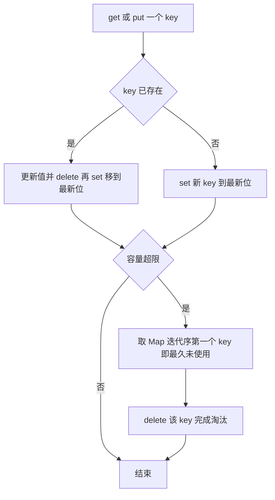
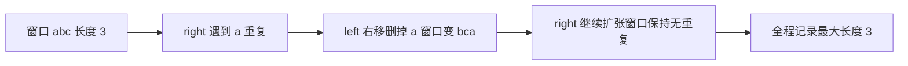
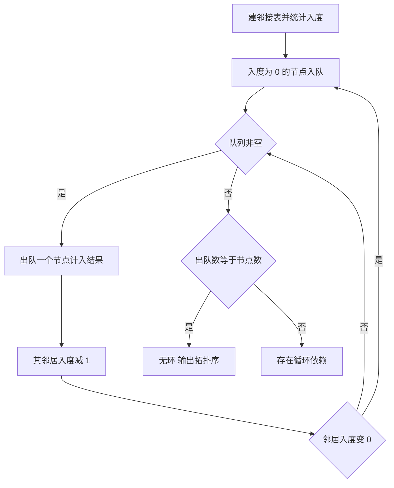
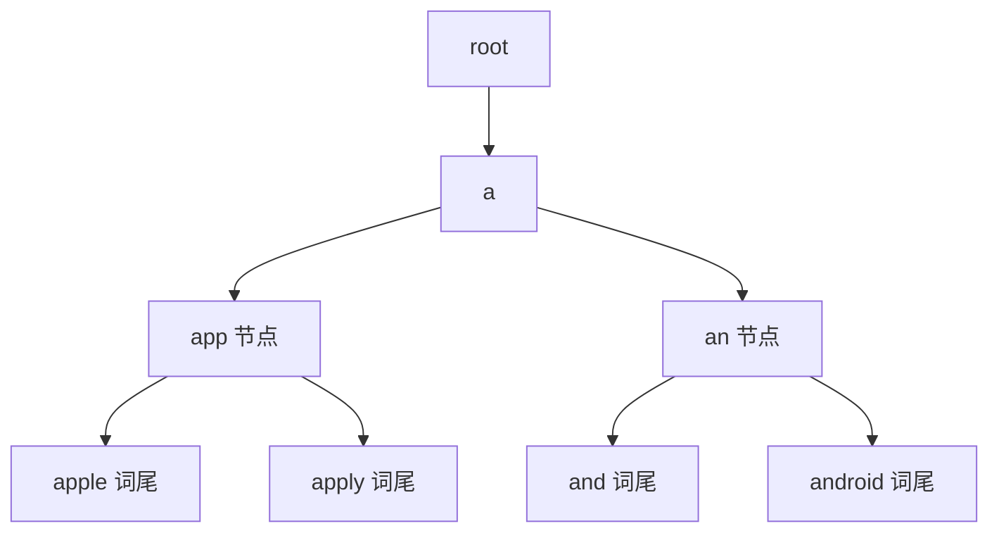
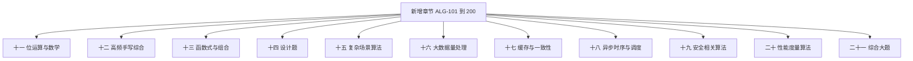
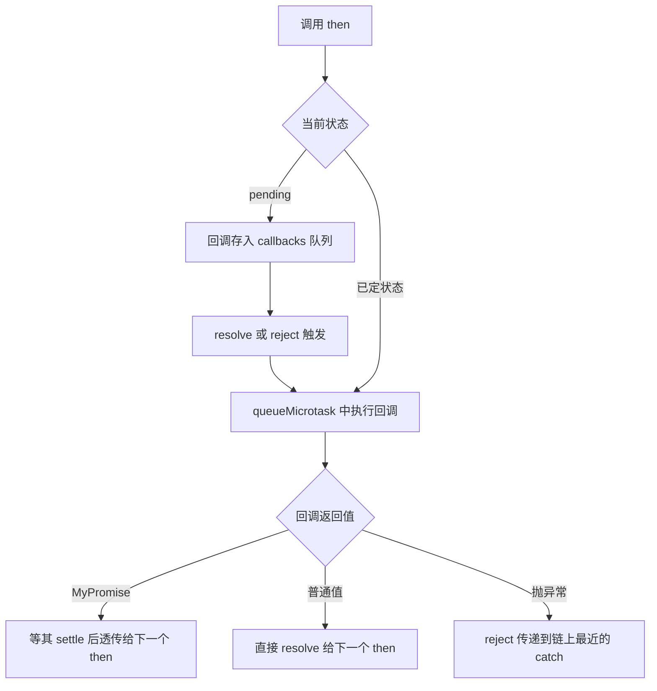
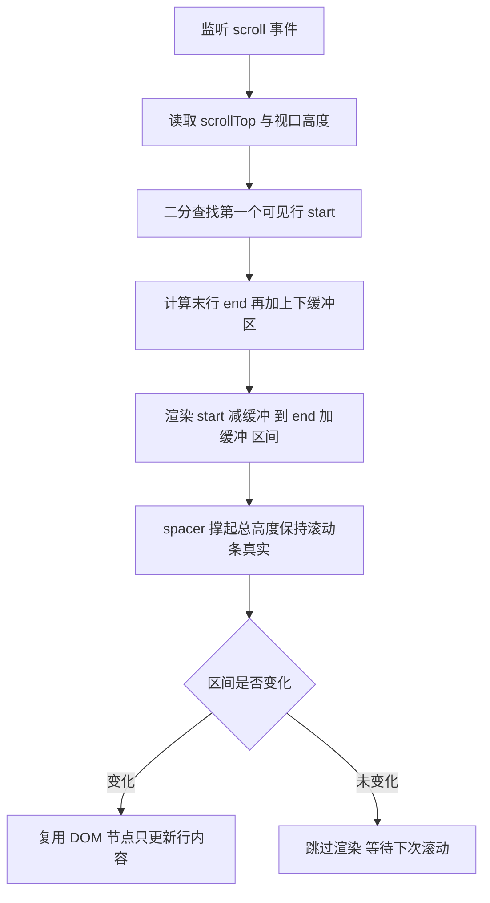
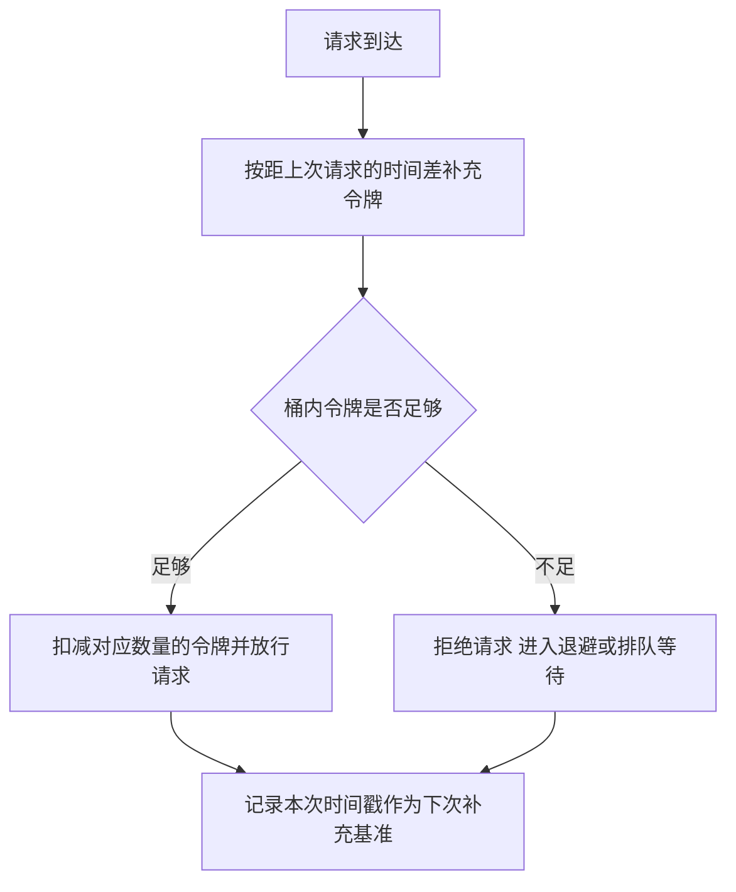
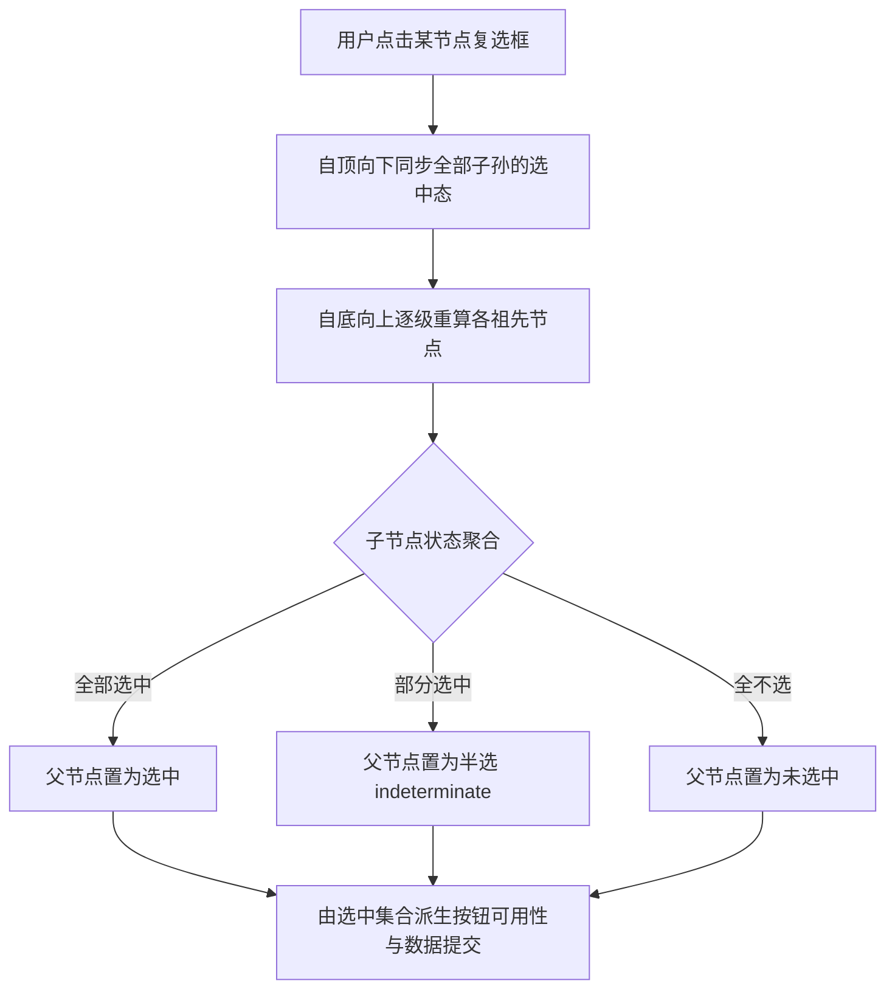

# 前端面试题库：场景算法（基于真实前端场景的算法考察）

> 本文件是前端面试工程算法专题，共 **200 题（ALG-001 ~ ALG-200）**，定位为"基于前端场景的算法考察"：每题先给一个真实前端场景（版本列表、权限树、虚拟列表、购物车、上传、监控、diff、缓存、手写 Promise、限流等），再考察算法功底，**不考裸 LeetCode 原题编号**。ALG-001 ~ ALG-100 为第一至十章，ALG-101 ~ ALG-200 为第十一至二十一章（位运算与数学、高频手写、函数式、设计题、复杂场景、大数据量、缓存一致性、异步调度、安全、性能度量、综合大题）。面向字节、阿里、腾讯等大厂前端面试的高频风格。


## 目录

- 一、数组与集合（ALG-001 ~ ALG-010）
- 二、字符串处理（ALG-011 ~ ALG-020）
- 三、树结构（ALG-021 ~ ALG-033）
- 四、栈与队列（ALG-034 ~ ALG-040）
- 五、链表（ALG-041 ~ ALG-047）
- 六、哈希与设计（ALG-048 ~ ALG-056）
- 七、双指针与滑动窗口（ALG-057 ~ ALG-065）
- 八、二分与排序（ALG-066 ~ ALG-073）
- 九、动态规划与贪心（ALG-074 ~ ALG-086）
- 十、图与综合（ALG-087 ~ ALG-100）
- 十一、位运算与数学（ALG-101 ~ ALG-108）
- 十二、高频手写综合（ALG-109 ~ ALG-121）
- 十三、函数式与组合（ALG-122 ~ ALG-128）
- 十四、设计题（ALG-129 ~ ALG-137）
- 十五、复杂场景算法（ALG-138 ~ ALG-148）
- 十六、大数据量处理（ALG-149 ~ ALG-157）
- 十七、缓存与一致性（ALG-158 ~ ALG-163）
- 十八、异步时序与调度（ALG-164 ~ ALG-170）
- 十九、安全相关算法（ALG-171 ~ ALG-176）
- 二十、性能度量算法（ALG-177 ~ ALG-181）
- 二十一、综合大题（ALG-182 ~ ALG-200）

---

## 一、数组与集合

### ALG-001：接口返回的列表里既有原始值又有对象元素，去重后对象仍然重复出现。请手写一个同时支持原始值与对象数组（可指定 key 字段）的去重函数，并保证 NaN 能被正确去重？
**答**：`Set` 基于 SameValueZero 算法，`NaN` 虽不等于自身但会被 `Set` 判定为同一个值，所以原始值（含 NaN）用 `Set` 即可正确去重。对象因引用不同无法被 `Set` 去重，需要用 `Map` 按序列化结果或指定 key 建立唯一索引。时间 O(n)，空间 O(n)。

```javascript
function dedupe(arr, keyFn) {
  const seen = new Set();      // 原始值，含 NaN
  const objKeys = new Map();   // 对象按 key 索引
  const result = [];
  for (const item of arr) {
    if (item !== null && typeof item === 'object') {
      const k = keyFn ? keyFn(item) : JSON.stringify(item);
      if (objKeys.has(k)) continue;
      objKeys.set(k, item);
      result.push(item);
    } else {
      if (seen.has(item)) continue; // Set 用 SameValueZero，NaN 可正确去重
      seen.add(item);
      result.push(item);
    }
  }
  return result;
}
// dedupe([NaN, 1, NaN, {id:1}, {id:1}], o => o.id) => [NaN, 1, {id:1}]
```

### ALG-002：灰度发布系统里有两个各自按版本号升序排列的发布记录列表（如 1.2.0、1.10.0），需要合并成一个有序总列表。如何比较版本号并归并？
**答**：版本号不能直接用字符串比较（1.10.0 < 1.9.0 会出错），要先按 `.` 拆成数字逐段比较。合并即归并排序的 merge 过程：双指针各指向一个列表，每次取较小者，最后拼接剩余部分。时间 O(m + n)，空间 O(m + n)。

```javascript
function compareVersion(a, b) {
  const pa = a.split('.'), pb = b.split('.');
  const len = Math.max(pa.length, pb.length);
  for (let i = 0; i < len; i++) {
    const x = Number(pa[i] || 0), y = Number(pb[i] || 0);
    if (x !== y) return x - y;
  }
  return 0;
}
function mergeVersionLists(l1, l2) {
  const res = [];
  let i = 0, j = 0;
  while (i < l1.length && j < l2.length) {
    if (compareVersion(l1[i], l2[j]) <= 0) res.push(l1[i++]);
    else res.push(l2[j++]);
  }
  while (i < l1.length) res.push(l1[i++]);
  while (j < l2.length) res.push(l2[j++]);
  return res;
}
```

### ALG-003：报表页拿到一批订单数据 `[{city, amount}]`，需要按城市分组展示，并进一步求每组的金额总和。如何实现通用分组与聚合？
**答**：分组本质是用 `reduce` 以 `keyFn(item)` 为 key 把元素收集进桶，单次遍历完成，O(n)。聚合可在分组结果上再遍历求和。注意用 `Object.create(null)` 或 `Map` 避免 `__proto__` 等 key 污染。时间 O(n)，空间 O(n)。

```javascript
function groupBy(list, keyFn) {
  return list.reduce((acc, item) => {
    const k = keyFn(item);
    (acc[k] || (acc[k] = [])).push(item);
    return acc;
  }, Object.create(null)); // 无原型对象：city 叫 __proto__ 也不会污染
}
// 报表聚合：分组后再求和
function sumBy(list, keyFn, valFn) {
  const grouped = groupBy(list, keyFn);
  return Object.fromEntries(
    Object.entries(grouped).map(([k, items]) => [
      k,
      items.reduce((s, it) => s + valFn(it), 0),
    ])
  );
}
// sumBy(orders, o => o.city, o => o.amount) => { 北京: 300, 上海: 200 }
```

### ALG-004：商品列表表格支持点击表头多列排序（先按分类升序，分类相同再按价格降序）。如何实现一个多字段排序？
**答**：比较器中按规则数组依次比较，前一个字段相等才比较下一个（"字典序"比较）。ES2019 起 `Array.prototype.sort` 是稳定排序，相等的元素保持原相对顺序。时间 O(n log n × k)（k 为字段数），空间 O(n)。

```javascript
function multiSort(list, rules) {
  // rules 形如 [{ field: 'category', order: 1 }, { field: 'price', order: -1 }]
  return [...list].sort((a, b) => {
    for (const { field, order = 1 } of rules) {
      const va = a[field], vb = b[field];
      if (va === vb) continue;       // 当前字段相等，继续比下一个字段
      return (va > vb ? 1 : -1) * order; // order 为 1 升序、-1 降序
    }
    return 0;
  });
}
// multiSort(goods, [{field:'category'},{field:'price',order:-1}])
```

### ALG-005：年会抽奖要求从参与名单中随机抽出中奖顺序，且每个人每个位置概率完全均等。为什么 `sort(() => Math.random() - 0.5)` 是错的，正确写法是什么？
**答**：`sort` 随机比较器不满足传递性与全序要求，结果分布严重偏斜。正确做法是 **Fisher-Yates 洗牌**：从后往前，每个位置 i 与 `[0, i]` 内随机位置交换，数学上可证明 n! 种排列等概率。时间 O(n)，空间 O(n)（复制一份不改原数组）。

```javascript
function shuffle(arr) {
  const a = [...arr];
  for (let i = a.length - 1; i > 0; i--) {
    // j 在 [0, i] 中均匀取值（含自身），保证每种排列等概率
    const j = Math.floor(Math.random() * (i + 1));
    [a[i], a[j]] = [a[j], a[i]];
  }
  return a;
}
// 抽奖：const winners = shuffle(players).slice(0, 10);
```

### ALG-006：发红包时希望金额大的手气被抽中概率更低；AB 实验按 90/10 流量分流。如何实现"按权重随机选择"？
**答**：把权重铺成一条数轴：累加得到总和 total，随机取 `[0, total)` 中的一个点 r，遍历时用 r 依次减去每项权重，减到负数即落在该项区间。频率高时可预构建前缀和数组，用二分查找把单次抽取降到 O(log n)。时间 O(n)（或 O(log n)），空间 O(n)。

```javascript
function weightedPick(items, weightFn) {
  const weights = items.map(weightFn);
  const total = weights.reduce((s, w) => s + w, 0);
  let r = Math.random() * total;
  for (let i = 0; i < items.length; i++) {
    r -= weights[i];
    if (r < 0) return items[i];
  }
  return items[items.length - 1];
}
// AB 分流：weightedPick(['A', 'B'], i => i === 'A' ? 90 : 10)
// 高频调用可预建前缀和 + 二分：prefix = [90, 100]，二分找第一个 > r 的位置
```

### ALG-007：权限系统改版后要对比新旧权限集合，算出"新增权限、回收权限、保留权限"三个列表。如何高效求交集、差集、并集？
**答**：先把一个集合放进 `Set`（O(1) 查询），再遍历另一个数组做 filter，避免 O(n×m) 的双重循环。交集用"在对方集合中"，差集用"不在对方集合中"，并集直接 `new Set` 合并展开。时间 O(n + m)，空间 O(n + m)。

```javascript
const union = (a, b) => [...new Set([...a, ...b])];
const intersect = (a, b) => {
  const sb = new Set(b);
  return [...new Set(a)].filter(x => sb.has(x));
};
const diff = (a, b) => { // a 有 b 没有
  const sb = new Set(b);
  return a.filter(x => !sb.has(x));
};
// 新增权限 = diff(newPerms, oldPerms)
// 回收权限 = diff(oldPerms, newPerms)
// 保留权限 = intersect(oldPerms, newPerms)
```

### ALG-008：批量上传 1000 个文件，接口一次最多接受 10 个，一次性全部并发会打满带宽甚至触发限流。如何实现分片分批上传？
**答**：先写纯函数 `chunk` 把数组按 size 切成二维数组；上传时"批内并发、批间串行"：每批用 `Promise.all` 等全部完成再进入下一批。时间 O(n)，空间 O(n / size)。

```javascript
function chunk(list, size) {
  const res = [];
  for (let i = 0; i < list.length; i += size) {
    res.push(list.slice(i, i + size));
  }
  return res;
}
async function uploadInBatches(files, size, upload) {
  for (const batch of chunk(files, size)) {
    await Promise.all(batch.map(upload)); // 批内并发，批间串行
  }
}
```

### ALG-009：接口返回深层嵌套的分类数据，需要拍平成一维数组（类似 `Array.prototype.flat`），且支持指定展开深度。手写实现递归版与迭代栈版？
**答**：递归版对数组元素判断 `Array.isArray` 且 `depth > 0` 才继续展开。迭代版用栈/队列改写，避免超深嵌套爆栈（注意用 `shift` 实现 O(n²)，可用倒序 `pop` 优化）。时间 O(n)（n 为元素总数），空间 O(n)。

```javascript
function flatten(arr, depth = Infinity) {
  const res = [];
  for (const item of arr) {
    if (Array.isArray(item) && depth > 0) {
      res.push(...flatten(item, depth - 1));
    } else {
      res.push(item);
    }
  }
  return res;
}
// 迭代版（不限制深度，避免递归爆栈）
function flattenStack(arr) {
  const stack = [...arr].reverse(), res = [];
  while (stack.length) {
    const cur = stack.pop();
    if (Array.isArray(cur)) stack.push(...[...cur].reverse());
    else res.push(cur);
  }
  return res;
}
```

### ALG-010：虚拟列表要把数据按"有内容 / 空占位"分成两组渲染，且要求各自内部保持原有相对顺序。如何实现稳定的分区？
**答**：稳定分区（stable partition）不能随便交换元素，`filter` 天然保持相对顺序，遍历两次分装两个数组即可，代码最简且稳定。若要求一次遍历，可开两个结果数组同步 push。时间 O(n)，空间 O(n)。

```javascript
function stablePartition(arr, pred) {
  const yes = [], no = [];
  for (const item of arr) {
    (pred(item) ? yes : no).push(item); // 单次遍历，顺序天然稳定
  }
  return [yes, no];
}
// 两行 filter 版本，同样稳定：
// const yes = arr.filter(pred), no = arr.filter(x => !pred);
```

---

## 二、字符串处理

### ALG-011：金额展示要求 `1234567.89` 格式化为 `1,234,567.89`，支持负数与小数。如何实现千分位格式化？
**答**：整数部分从右往左每 3 位插一个逗号。正则 `\B(?=(\d{3})+(?!\d))` 表示"非单词边界且后面是 3 的倍数个数字"，一次 replace 搞定；也可手写循环从尾部截取。注意先拆出小数部分再处理整数部分。时间 O(n)，空间 O(n)。

```javascript
function formatMoney(num) {
  const [int, dec] = String(num).split('.');
  const sign = int.startsWith('-') ? '-' : '';
  const digits = sign ? int.slice(1) : int;
  const withComma = digits.replace(/\B(?=(\d{3})+(?!\d))/g, ',');
  return sign + withComma + (dec !== undefined ? '.' + dec : '');
}
// formatMoney(-1234567.89) => '-1,234,567.89'
```

### ALG-012：Java 老接口返回 `user_name` 风格字段，前端组件用 `userName` 风格，需要对整个响应（含嵌套对象与数组）做字段名互转。如何递归实现？
**答**：字符串层面用正则互转：`_x` → 大写、`X` → `_x`。对象层面递归：数组 map 每项，对象用 `Object.fromEntries` 把每个 key 转换后重建。时间 O(n)（n 为所有节点数），空间 O(n)。

```javascript
const toCamel = s => s.replace(/_([a-z])/g, (_, c) => c.toUpperCase());
const toSnake = s => s.replace(/[A-Z]/g, c => '_' + c.toLowerCase());

function convertKeys(data, fn) {
  if (Array.isArray(data)) return data.map(v => convertKeys(v, fn));
  if (data !== null && typeof data === 'object') {
    return Object.fromEntries(
      Object.entries(data).map(([k, v]) => [fn(k), convertKeys(v, fn)])
    );
  }
  return data;
}
// convertKeys(res, toCamel) / convertKeys(payload, toSnake)
```

### ALG-013：路由跳转后要解析 `https://a.com/list?tag=front%20end&kw=a+b&tag=vue#top` 这样的 URL，正确处理 `%20`、`+` 编码与重复 key。手写 parseQuery？
**答**：先取 `?` 到 `#` 之间的部分，按 `&` 拆分、每段按第一个 `=` 拆 key/value；还原时先把 `+` 换成空格再 `decodeURIComponent`；重复 key 用数组收集。时间 O(n)，空间 O(n)。

```javascript
function parseQuery(url) {
  const qs = url.slice(url.indexOf('?') + 1).split('#')[0];
  const res = {};
  if (!qs) return res;
  for (const pair of qs.split('&')) {
    if (!pair) continue;
    const eq = pair.indexOf('=');
    const rawK = eq === -1 ? pair : pair.slice(0, eq);
    const rawV = eq === -1 ? '' : pair.slice(eq + 1);
    const k = decodeURIComponent(rawK.replace(/\+/g, ' '));
    const v = decodeURIComponent(rawV.replace(/\+/g, ' '));
    if (k in res) res[k] = [].concat(res[k], v);
    else res[k] = v;
  }
  return res;
}
// => { tag: ['front end', 'vue'], kw: 'a b' }
```

### ALG-014：低代码平台要实现 `您好，{{user.name}}，您有 {{count}} 条消息` 的模板解析，支持点路径取值与缺失值兜底为空串。如何实现？
**答**：用正则匹配 `{{ 变量 }}`，replace 回调里把路径按 `.` 拆分后 `reduce` 逐层取值，任何一层为 `null/undefined` 就返回空串，避免抛错。时间 O(n × d)（d 为路径深度），空间 O(n)。

```javascript
function renderTemplate(tpl, data) {
  return tpl.replace(/\{\{\s*([\w.]+)\s*\}\}/g, (_, path) => {
    const val = path.split('.').reduce(
      (obj, key) => (obj == null ? undefined : obj[key]),
      data
    );
    return val == null ? '' : String(val); // 缺失值兜底
  });
}
// renderTemplate('你好 {{user.name}}，共 {{count}} 条', { user: { name: 'Tom' } })
// => '你好 Tom，共  条'
```

### ALG-015：`JSON.stringify` 遇到循环引用会直接抛 `TypeError: Converting circular structure to JSON`，上传用户数据前需要先检测。如何判断一个对象是否存在循环引用？
**答**：DFS 遍历对象图，用 `WeakSet` 记录"当前递归路径"上的节点；再次遇到路径上的同一引用即为环。`WeakSet` 不阻止垃圾回收；回溯时删除节点可以区分"环"与"普通的共享子对象（DAG）"。时间 O(n)，空间 O(n)。

```javascript
function hasCycle(obj) {
  const onPath = new WeakSet();
  function dfs(cur) {
    if (cur === null || typeof cur !== 'object') return false;
    if (onPath.has(cur)) return true;   // 回到了路径上的节点，成环
    onPath.add(cur);
    for (const key of Object.keys(cur)) {
      if (dfs(cur[key])) return true;
    }
    onPath.delete(cur); // 回溯；不删则会把共享引用也误报为环
    return false;
  }
  return dfs(obj);
}
```

### ALG-016：输入联想要把用户已输入内容与候选词列表比较，找出所有候选词的最长公共前缀用于补全。如何实现？
**答**：以第一个串为初始前缀，遍历其余字符串不断收缩前缀（逐字符比较到第一个不同处），前缀为空提前返回。时间 O(n × L)（L 为前缀长度），空间 O(1)。

```javascript
function longestCommonPrefix(strs) {
  if (!strs.length) return '';
  let prefix = strs[0];
  for (const s of strs) {
    let i = 0;
    while (i < prefix.length && i < s.length && prefix[i] === s[i]) i++;
    prefix = prefix.slice(0, i);
    if (!prefix) return ''; // 前缀已空，提前剪枝
  }
  return prefix;
}
// longestCommonPrefix(['vue-cli', 'vue-router', 'vuex']) => 'vu'
```

### ALG-017：搜索日志有几百万条关键词，要实时算出出现次数 Top 10 的热词。为什么用"哈希计数 + 容量为 K 的小顶堆"而不是全量排序？请实现核心逻辑。
**答**：全量排序 O(n log n) 且要一次性装下所有数据；正确做法是先 `Map` 计数 O(n)，再维护一个容量为 K 的**小顶堆**：堆顶是当前第 K 大，新词频次若大于堆顶才替换并下沉。内存只需 O(K)，总时间 O(n log K)；海量数据下还可分片统计再归并。时间 O(n log K)，空间 O(K)（堆）+ O(n)（计数）。

```javascript
function topK(words, k) {
  const freq = new Map();
  for (const w of words) freq.set(w, (freq.get(w) || 0) + 1);
  const heap = []; // 小顶堆，元素为 [词, 次数]
  const up = i => {
    while (i > 0) {
      const p = (i - 1) >> 1;
      if (heap[p][1] <= heap[i][1]) break;
      [heap[p], heap[i]] = [heap[i], heap[p]]; i = p;
    }
  };
  const down = () => {
    let i = 0;
    for (;;) {
      const l = 2 * i + 1, r = l + 1; let m = i;
      if (l < heap.length && heap[l][1] < heap[m][1]) m = l;
      if (r < heap.length && heap[r][1] < heap[m][1]) m = r;
      if (m === i) break;
      [heap[m], heap[i]] = [heap[i], heap[m]]; i = m;
    }
  };
  for (const item of freq) {
    if (heap.length < k) { heap.push(item); up(heap.length - 1); }
    else if (item[1] > heap[0][1]) { heap[0] = item; down(); }
  }
  return heap.sort((a, b) => b[1] - a[1]).map(([w]) => w);
}
```

### ALG-018：评论输入框要校验用户输入是否为回文（忽略大小写、空格与标点，中英文均可）。如何判断？
**答**：先清洗字符串——转小写、过滤掉非字母数字汉字字符，再用双指针从两端向中间比较，出现不等立即返回 false。清洗 O(n) + 比较 O(n)，空间 O(n)（清洗产生新串，可用双指针跳过非法字符做到 O(1) 额外空间）。

```javascript
function isPalindrome(input) {
  const s = input.toLowerCase().replace(/[^a-z0-9\u4e00-\u9fa5]/g, '');
  let left = 0, right = s.length - 1;
  while (left < right) {
    if (s[left++] !== s[right--]) return false;
  }
  return true;
}
// isPalindrome('A man, a plan, a canal: Panama') => true
// isPalindrome('上海自来水来自海上') => true
```

### ALG-019：不允许直接调用 `String.prototype.indexOf`，在富文本编辑器里实现"查找下一个关键字"功能，手写 indexOf 核心逻辑？
**答**：朴素匹配：主串每个位置 i 尝试对齐模式串，逐字符比较，全部匹配则返回 i；比较失败移动到 i+1。可用"首字符不匹配直接跳过"剪枝。面试可追问 KMP：利用失配表把主串指针不回退，优化到 O(n + m)。时间 O(n × m)，空间 O(1)。

```javascript
function myIndexOf(haystack, needle) {
  if (needle === '') return 0;
  const n = haystack.length, m = needle.length;
  if (m > n) return -1;
  for (let i = 0; i + m <= n; i++) {
    if (haystack[i] !== needle[0]) continue; // 首字符剪枝
    let j = 1;
    while (j < m && haystack[i + j] === needle[j]) j++;
    if (j === m) return i;
  }
  return -1;
}
```

### ALG-020：性能埋点 key 会把同一接口在 1 秒内的多次调用拼成 `aabbcc` 形式，需要压缩成 `a2b2c2` 减少上报体积；若压缩后更长则保留原串。如何实现？
**答**：线性扫描，统计连续相同字符个数，遇到不同字符时把"字符 + 个数"写入结果。注意压缩后可能变长（如 `abc` → `a1b1c1`），最后比较长度取较短者。时间 O(n)，空间 O(n)。

```javascript
function compress(str) {
  if (!str) return str;
  let res = '', count = 1;
  for (let i = 1; i <= str.length; i++) {
    if (str[i] === str[i - 1]) {
      count++;
    } else {
      res += str[i - 1] + count;
      count = 1;
    }
  }
  return res.length < str.length ? res : str; // 变长则退回原串
}
// compress('aabbccddddd') => 'a2b2c2d5'
```

---

## 三、树结构

### ALG-021：侧边栏菜单接口通常返回扁平数组 `[{id, pid, name}]`，需要转成嵌套树结构渲染。如何一次遍历 O(n) 实现？
**答**：先用一遍循环把每个节点按 id 建立到"新节点（带 children 数组）"的 Map；第二遍按 pid 挂到父节点的 children 上，找不到父节点的作为根。避免递归查找父节点导致的 O(n²)。时间 O(n)，空间 O(n)。

```javascript
function buildTree(items) {
  const map = new Map();
  for (const it of items) map.set(it.id, { ...it, children: [] });
  const roots = [];
  for (const it of items) {
    const node = map.get(it.id);
    if (it.pid == null || !map.has(it.pid)) roots.push(node);
    else map.get(it.pid).children.push(node);
  }
  return roots;
}
```

### ALG-022：面包屑组件需要把菜单树还原成扁平列表，每项带上从根到当前节点的路径数组（如 `['首页', '设置', '安全']`）。如何递归实现？
**答**：DFS 携带"祖先路径"参数，进入节点时把当前节点名追加进路径副本（`[...path, name]`），输出 `{id, path, level}`；子节点递归时传入更新后的路径。不修改共享数组，避免兄弟节点互相污染。时间 O(n × d)（d 为路径平均长度），空间 O(n × d)。

```javascript
function flattenTree(root, path = [], out = []) {
  const cur = [...path, root.name];
  out.push({ id: root.id, path: cur, level: cur.length });
  for (const child of root.children || []) {
    flattenTree(child, cur, out);
  }
  return out;
}
// 面包屑还原：item.path.join(' / ') => '首页 / 设置 / 安全'
```

### ALG-023：权限管理页要在权限树中勾选某个节点后，找到该节点并更新其 checked 状态（节点可能藏得很深）。用 DFS 查找节点？
**答**：递归版天然表达"查自己 → 查孩子"；迭代版用显式栈模拟，注意为了保持与递归相同的访问顺序，子节点要倒序入栈。找到即返回引用，调用方可直接改状态。时间 O(n)，空间 O(h)（h 为树高，最坏 O(n)）。

```javascript
function findNode(root, pred) {
  const stack = [root];
  while (stack.length) {
    const node = stack.pop();
    if (pred(node)) return node;         // 命中即返回节点引用
    const children = node.children || [];
    for (let i = children.length - 1; i >= 0; i--) {
      stack.push(children[i]);           // 倒序入栈，保持从左到右访问
    }
  }
  return null;
}
// const node = findNode(tree, n => n.id === 42); node.checked = true;
```

### ALG-024：目录树组件做懒加载：进入目录时要把"当前已展开层"的所有节点按层级分组请求。如何做层序遍历（BFS）？
**答**：队列 + 逐层处理：记录每层节点数 size，一次性把当前层全部出队处理，同时把它们的子节点入队，天然按层分隔。BFS 用队列（FIFO），DFS 用栈（LIFO），这是两者唯一的结构区别。时间 O(n)，空间 O(w)（w 为最大层宽）。

```javascript
function levelOrder(root) {
  if (!root) return [];
  const res = [], queue = [root];
  while (queue.length) {
    const size = queue.length;   // 本层节点数
    const level = [];
    for (let i = 0; i < size; i++) {
      const node = queue.shift();
      level.push(node);
      queue.push(...(node.children || []));
    }
    res.push(level);             // res[i] 即第 i 层所有节点
  }
  return res;
}
```

### ALG-025：工程化工具要检测 React 组件嵌套渲染深度，超过阈值（如 30 层）告警。组件树抽象为多叉树后如何求最大深度？
**答**：多叉树最大深度 = 子树最大深度 + 1，DFS 后序合并即可；也可用 BFS 数层数（层数即深度），BFS 版不会因超深链式结构爆栈，生产建议用迭代。时间 O(n)，空间递归 O(h) / 迭代 O(w)。

```javascript
function maxDepth(node) {
  if (!node) return 0;
  let max = 0;
  for (const child of node.children || []) {
    max = Math.max(max, maxDepth(child));
  }
  return max + 1; // 自身这一层
}
// BFS 版（防爆栈）：
// let depth = 0; 队列初始 [root]; 每处理完一层 depth++;
```

### ALG-026：后台权限树要求：无权限的叶子节点要隐藏，且因它变空的父节点也要级联隐藏。如何过滤树并剪掉空父级？
**答**：后序（自底向上）处理：先递归过滤所有子节点，再判断——自身有权保留，或子节点还有存活则保留，否则返回 null 让父级把自己剔除。时间 O(n)，空间 O(h)。

```javascript
function filterTree(node, pred) {
  const children = (node.children || [])
    .map(c => filterTree(c, pred))
    .filter(Boolean);              // 剔除被剪掉的子树
  if (!pred(node) && children.length === 0) {
    return null;                   // 自身无权限且子级全空 => 级联隐藏
  }
  return { ...node, children };    // 返回新树，不改原数据
}
```

### ALG-027：组件树上要找两个组件最近的公共父组件（用于向上冒泡事件或共享 Context）。如何求多叉树两节点的最近公共祖先（LCA）？
**答**：后序 DFS 返回"子树中命中目标的个数"：某节点自身命中 1，加上各子树命中数；当某节点累计命中 2 且更深处没有记录过答案时，它就是 LCA（因为在更深处分别命中后向上汇聚的第一个交点）。时间 O(n)，空间 O(h)。

```javascript
function lowestCommonAncestor(root, p, q) {
  let found = null;
  const dfs = node => {
    if (!node || found) return 0;
    let hit = (node === p || node === q) ? 1 : 0;
    for (const child of node.children || []) hit += dfs(child);
    if (hit === 2 && !found) found = node; // 两个目标在此汇聚
    return hit;
  };
  dfs(root);
  return found;
}
```

### ALG-028：菜单树里用户点击了某个叶子菜单，需要把从根到该菜单的整条 id 路径回填（全部高亮展开）。如何求根到目标节点的路径？
**答**：DFS 回溯法：进入节点时 push id，命中目标后一路返回 true 停止搜索；未命中则 pop 掉当前 id（回溯）返回 false。也可先给每个节点记录 parent 指针，命中后沿 parent 回溯。时间 O(n)，空间 O(h)。

```javascript
function findPath(root, targetId) {
  const path = [];
  const dfs = node => {
    if (!node) return false;
    path.push(node.id);
    if (node.id === targetId) return true;
    for (const child of node.children || []) {
      if (dfs(child)) return true; // 命中即逐层返回，不再回溯
    }
    path.pop();                    // 此子树无目标，撤销选择
    return false;
  };
  dfs(root);
  return path; // 未命中时为 []
}
```

### ALG-029：画布工具保存了两份组件树快照，需要判断"子树 A 是否作为子结构出现在快照 B 中"（用于树搜索高亮/模板复用检测）。如何判断子树匹配？
**答**：把每个子树序列化成唯一字符串（值 + 括起来的孩子序列），两串相等当且仅当结构完全相同。对大树的每个节点做同样序列化并与目标串比较。优化点：自底向上算哈希可降到 O(n)。时间 O(n × m)，空间 O(n × m)。

```javascript
const serializeSub = node => {
  if (!node) return '#';
  return node.label + '(' + (node.children || []).map(serializeSub).join(',') + ')';
};
function containsSubtree(root, sub) {
  if (!root) return false;
  if (serializeSub(root) === serializeSub(sub)) return true; // 以 root 为根完全匹配
  return (root.children || []).some(c => containsSubtree(c, sub));
}
```

### ALG-030：设计稿要求折叠面板左右对称展开：以中轴为镜像的两个面板结构必须完全对称。如何判断一棵多叉树是否轴对称？
**答**：递归比较"左孩子的第 i 个"与"右孩子的第 n-1-i 个"（镜像位置），值相等且各自的子结构互为镜像才算对称。类似二叉树的 `check(left.left, right.right)` 双指针递归。时间 O(n)，空间 O(h)。

```javascript
function isSymmetric(node) {
  const check = (a, b) => {
    if (!a && !b) return true;
    if (!a || !b || a.label !== b.label) return false;
    const ac = a.children || [], bc = b.children || [];
    if (ac.length !== bc.length) return false;
    const n = ac.length;
    for (let i = 0; i < n; i++) {
      if (!check(ac[i], bc[n - 1 - i])) return false; // 镜像位配对比较
    }
    return true;
  };
  return check(node, node); // 与自身镜像比较
}
```

### ALG-031：在线画布要把节点树保存为字符串、刷新后还原（不能依赖 JSON.stringify 处理 children 引用细节，要求手写序列化/反序列化）。如何实现多叉树的序列化与反序列化？
**答**：先序遍历输出节点值，每棵子树结束后输出 `#` 作为结束标记；反序列化时读值建节点，循环调用 build 直到读到 `#`（该 `#` 同时是子节点列表与当前节点的终结符）。两趟都是 O(n)。时间 O(n)，空间 O(n)。

```javascript
function serialize(node, out = []) {
  out.push(node.value);
  for (const c of node.children || []) serialize(c, out);
  out.push('#'); // 子树结束标记
  return out;
}
function deserialize(data) {
  let i = 0;
  const build = () => {
    if (data[i] === '#') { i++; return null; }
    const node = { value: data[i++], children: [] };
    let child;
    while ((child = build())) node.children.push(child);
    return node;
  };
  return build();
}
```

### ALG-032：组织架构图每层顶部要显示"本层人数"。如何求多叉树第 k 层的节点数？
**答**：BFS 逐层推进，第 level 层的队列长度即该层人数；或在 DFS 里携带 depth 参数，`depth === k` 时计数。BFS 版在找到目标层后可提前返回，不必遍历更深。时间 O(n)，空间 O(w)。

```javascript
function countAtLevel(root, level) {
  if (!root) return 0;
  let queue = [root], depth = 1;
  while (queue.length) {
    if (depth === level) return queue.length; // 本层队列长度即人数
    const next = [];
    for (const node of queue) {
      next.push(...(node.children || []));
    }
    queue = next;
    depth++;
  }
  return 0; // 层数超过树深
}
```

### ALG-033：网盘目录树里删除某个目录（含其所有子目录）。如何从树中删除指定子树？
**答**：若删除的是根，直接返回 null；否则自顶向下递归，在每个节点的 children 中过滤掉目标 id，再继续处理剩余孩子。用 `filter` 生成新数组避免遍历中修改。时间 O(n)，空间 O(h)。

```javascript
function removeSubtree(root, targetId) {
  if (root.id === targetId) return null; // 整棵树被删
  const prune = node => {
    node.children = (node.children || []).filter(c => c.id !== targetId);
    node.children.forEach(prune); // 继续在剩余孩子中查找
  };
  prune(root);
  return root;
}
```

---

## 四、栈与队列

### ALG-034：模板引擎/JSX 编译前要做语法预检，判断 `{{#if}}...{{/if}}`、括号等是否成对闭合。如何用栈做括号匹配校验？
**答**：左括号入栈；遇到右括号弹栈比对类型是否匹配；字符串结束时栈必须为空。三类括号 `()` `[]` `{}` 混用场景经典。提前结束（栈空时遇右括号）或结束非空都算失败。时间 O(n)，空间 O(n)。

```javascript
function isValid(s) {
  const match = { ')': '(', ']': '[', '}': '{' };
  const stack = [];
  for (const ch of s) {
    if (ch === '(' || ch === '[' || ch === '{') {
      stack.push(ch);
    } else if (ch in match) {
      if (stack.pop() !== match[ch]) return false; // 类型不匹配
    }
  }
  return stack.length === 0; // 还有未闭合的左括号也不行
}
```

### ALG-035：页面里有个计算器组件，输入 `3+2*4-6/2` 要按四则运算优先级算出结果。如何用栈实现简版表达式求值（只含 + - * / 和非负整数）？
**答**：一次扫描，维护"待加和栈 + 上一个运算符"：读到数字时，若前一个运算符是 +/- 就把（带符号的）数入栈；是 * / 就弹栈与当前数运算后压回（优先级就地结算）。最后栈内全部相加。时间 O(n)，空间 O(n)。

```javascript
function calculate(s) {
  const stack = [];
  let num = 0, sign = '+';
  for (let i = 0; i <= s.length; i++) {
    const ch = s[i];
    if (ch >= '0' && ch <= '9') num = num * 10 + Number(ch);
    // 遇到运算符或到达末尾，结算上一个运算符
    if (i === s.length || ((ch < '0' || ch > '9') && ch !== ' ')) {
      if (sign === '+') stack.push(num);
      else if (sign === '-') stack.push(-num);
      else if (sign === '*') stack.push(stack.pop() * num);
      else stack.push((stack.pop() / num) | 0);
      sign = ch; num = 0;
    }
  }
  return stack.reduce((a, b) => a + b, 0);
}
// calculate('3+2*4-6/2') => 8
```

### ALG-036：消息推送要求先进先出，但底层只有两个"后进先出"的栈可用。如何用栈实现队列？
**答**：入栈 in 只管进；出栈时若 out 为空，把 in 全部倒入 out（顺序恰好反转，队头到栈顶），再 pop。均摊分析：每个元素一生最多进出每个栈各一次，单次操作均摊 O(1)。时间均摊 O(1)，空间 O(n)。

```javascript
class MyQueue {
  constructor() { this.in = []; this.out = []; }
  push(x) { this.in.push(x); }
  _shift() { // out 空时才搬运，均摊 O(1)
    if (!this.out.length) {
      while (this.in.length) this.out.push(this.in.pop());
    }
  }
  pop() { this._shift(); return this.out.pop(); }
  peek() { this._shift(); return this.out[this.out.length - 1]; }
  get size() { return this.in.length + this.out.length; }
}
```

### ALG-037：浏览器历史记录很长，产品要求"任意时刻 O(1) 拿到历史里最早（最旧）的时间戳"用于清理提示。如何设计一个支持 push/pop 且 O(1) 取最小值的栈（最小栈）？
**答**：双栈：主栈存数据，辅助栈与主栈同步压入"到当前深度为止的最小值"，pop 时两栈同步弹出。空间换时间，每个操作都 O(1)。时间 O(1)，空间 O(n)。

```javascript
class MinStack {
  constructor() { this.stack = []; this.mins = []; }
  push(x) {
    this.stack.push(x);
    const prevMin = this.mins[this.mins.length - 1];
    this.mins.push(prevMin === undefined ? x : Math.min(x, prevMin));
  }
  pop() { this.stack.pop(); this.mins.pop(); }
  top() { return this.stack[this.stack.length - 1]; }
  getMin() { return this.mins[this.mins.length - 1]; } // O(1) 取最旧/最小
}
```

### ALG-038：商品详情页要展示"再等几天会降到更低价"（每日温度的变形：对每天找下一个更低价的天数）。如何用单调栈 O(n) 解决？
**答**：维护一个"价格递增"的下标栈：新价格比栈顶对应价格低时，栈顶元素得到答案（距离 = i - j）并弹栈；否则入栈等待。每个下标最多入栈出栈各一次。结束时栈里剩下的是"之后不会再降价"的日子，填 0。时间 O(n)，空间 O(n)。

```javascript
function nextLowerPrice(prices) {
  const res = new Array(prices.length).fill(0); // 0 表示之后都不会更低
  const stack = []; // 存下标，对应价格严格递增
  for (let i = 0; i < prices.length; i++) {
    while (stack.length && prices[i] < prices[stack[stack.length - 1]]) {
      const j = stack.pop();
      res[j] = i - j; // 也可直接存 prices[i]
    }
    stack.push(i);
  }
  return res;
}
// nextLowerPrice([100, 90, 95, 80]) => [1, 2, 1, 0]
```

### ALG-039：浏览器的前进/后退按钮：访问新页面清空前进栈，后退时当前页进入前进栈。如何用双栈实现 BrowserHistory？
**答**：`backStack` 存后退历史，`forwardStack` 存前进历史，当前页单独一个变量。visit 时清空 forwardStack（新分支历史作废，与真实浏览器一致）；back 把 cur 压入 forward、从 back 弹出；forward 相反。每个操作 O(1)，空间 O(n)。

```javascript
class BrowserHistory {
  constructor(home) { this.back = []; this.forward = []; this.cur = home; }
  visit(url) {
    this.back.push(this.cur);
    this.forward = [];           // 新访问使前进历史作废
    this.cur = url;
  }
  goBack() {
    if (!this.back.length) return this.cur;
    this.forward.push(this.cur);
    return (this.cur = this.back.pop());
  }
  goForward() {
    if (!this.forward.length) return this.cur;
    this.back.push(this.cur);
    return (this.cur = this.forward.pop());
  }
}
```

### ALG-040：弹幕区同一时刻最多渲染 100 条，池满时新弹幕要挤掉最旧的。如何用循环数组实现固定容量的消息池（循环队列）？
**答**：定长数组 + head/tail 指针，下标对容量取模实现"循环"。满时新消息覆盖前先移动 head（丢弃最旧），实现 O(1) 入队出队、零搬运。时间 O(1)，空间 O(cap)。

```javascript
class DanmakuPool {
  constructor(cap = 100) {
    this.buf = new Array(cap);
    this.cap = cap; this.head = 0; this.tail = 0; this.count = 0;
  }
  push(msg) {
    if (this.count === this.cap) {         // 池满：挤掉最旧弹幕
      this.head = (this.head + 1) % this.cap;
      this.count--;
    }
    this.buf[this.tail] = msg;
    this.tail = (this.tail + 1) % this.cap;
    this.count++;
  }
  drain() { // 渲染帧取走全部待渲染弹幕
    const out = [];
    while (this.count) {
      out.push(this.buf[this.head]);
      this.head = (this.head + 1) % this.cap;
      this.count--;
    }
    return out;
  }
}
```

---

## 五、链表

### ALG-041：编辑器的 undo 历史用链表存储，撤销回退需要把历史链整条反转（最新变最旧）。如何原地反转单链表？
**答**：三指针迭代：`prev / cur / next`，每次把 `cur.next` 指向 prev 后整体右移一位。迭代法空间 O(1) 优于递归法（递归栈 O(n)）。时间 O(n)，空间 O(1)。

```javascript
class ListNode {
  constructor(val, next = null) { this.val = val; this.next = next; }
}
function reverseList(head) {
  let prev = null, cur = head;
  while (cur) {
    const next = cur.next; // 先存后继
    cur.next = prev;       // 反指
    prev = cur;            // prev 前进
    cur = next;            // cur 前进
  }
  return prev; // 新头结点
}
```

### ALG-042：两个埋点 SDK 各自按时间升序产出日志链表，要合并成一条全局有序日志流。如何合并两个有序链表？
**答**：经典归并：哑结点 dummy 简化头处理，双指针比较 `time`，小者接上并前进；任一为空后把剩余整段接上。时间 O(m + n)，空间 O(1)。

```javascript
function mergeLogs(a, b) {
  const dummy = { time: 0, next: null };
  let cur = dummy;
  while (a && b) {
    if (a.time <= b.time) { cur.next = a; a = a.next; }
    else { cur.next = b; b = b.next; }
    cur = cur.next;
  }
  cur.next = a || b; // 拼接剩余段
  return dummy.next;
}
```

### ALG-043：模块依赖管理器用链表串起模块加载链，怀疑某次改动引入了循环依赖（加载链成环）。如何 O(1) 空间检测环形链表？
**答**：Floyd 快慢指针：慢指针走 1 步、快指针走 2 步，若成环快指针必在环内追上慢指针；无环则快指针先到达 null。比哈希表记访问节点省空间。时间 O(n)，空间 O(1)。

```javascript
function hasCycle(head) {
  let slow = head, fast = head;
  while (fast && fast.next) {
    slow = slow.next;
    fast = fast.next.next;
    if (slow === fast) return true; // 快指针套圈追上慢指针
  }
  return false;
}
```

### ALG-044：日志链表太长要做裁剪：删除倒数第 N 条日志。如何一次遍历定位倒数第 N 个？
**答**：快慢指针 + 哑结点：快指针先走 N 步拉开距离，然后快慢同步走，快指针到尾时慢指针停在倒数第 N+1 个，直接改指针跳过目标。哑结点免去"删头"特判。时间 O(n)，空间 O(1)。

```javascript
function removeNthFromEnd(head, n) {
  const dummy = { next: head };
  let fast = dummy, slow = dummy;
  for (let i = 0; i < n; i++) fast = fast.next; // 快指针先走 N 步
  while (fast.next) { fast = fast.next; slow = slow.next; }
  slow.next = slow.next.next; // 慢指针正好在倒数第 N+1 个
  return dummy.next;
}
```

### ALG-045：请求去重器发现某个请求链成环导致重复请求死循环，不仅要判断有环，还要定位"环是从哪个节点开始的"（哪个请求被重复发起）。如何找链表环入口？
**答**：Floyd 两阶段：相遇后，把一个指针拨回头结点，两指针同速前进，再次相遇点即环入口。数学依据：头到入口距离 a，入口到相遇点 b，环长 c，相遇时慢指针走了 a+b，快指针走了 a+b+kc，由 2(a+b)=a+b+kc 推出 a = kc-b，即从相遇点走 a 步与从头走 a 步在入口汇合。时间 O(n)，空间 O(1)。

```javascript
function detectCycle(head) {
  let slow = head, fast = head;
  while (fast && fast.next) {
    slow = slow.next; fast = fast.next.next;
    if (slow === fast) {
      let p = head;                 // 一个指针回到起点
      while (p !== slow) { p = p.next; slow = slow.next; }
      return p;                     // 再次相遇处即环入口
    }
  }
  return null;
}
```

### ALG-046：两条 git 提交历史链在某个 commit 后共享同一段历史（rebase 导致），要找到两条链表的相交节点。如何 O(1) 空间求交点？
**答**：双指针 p、q 分别从 a、b 出发，走到尾就"换轨"到另一条链。两指针走过的总步数都是 a+b+c（a 为独有段+共享段交叉抵消），必然在交点相遇；不相交则同时到达 null。时间 O(m + n)，空间 O(1)。

```javascript
function getIntersection(a, b) {
  if (!a || !b) return null;
  let p = a, q = b;
  while (p !== q) {
    p = p ? p.next : b; // 走到尾就切到另一条链，抵消长度差
    q = q ? q.next : a;
  }
  return p; // 交点，或 null（不相交）
}
```

### ALG-047：手写 LRU 时为什么必须用双向链表而不是单链表？请给出双向链表节点与三个关键 O(1) 操作的实现。
**答**：LRU 淘汰"最久未使用"，需要：命中时把节点移到头部——单链表拿到节点后无法 O(1) 拿前驱，删不了自己；双向链表配合 hash 表（Map）即可全部 O(1)。节点必须同时存 key：淘汰尾部节点时要靠 `node.key` 反查并删除 Map 里的记录。get/put 均 O(1)，空间 O(capacity)。

```javascript
class DNode {
  constructor(key, val) { this.key = key; this.val = val; this.prev = null; this.next = null; }
}
// 三个关键操作（配哨兵头尾使用）：
function remove(node) {
  node.prev.next = node.next;
  node.next.prev = node.prev;
}
function addToHead(node, head) {
  node.next = head.next; node.prev = head;
  head.next.prev = node; head.next = node;
}
function moveToHead(node, head) { remove(node); addToHead(node, head); }
// get(key)：Map 取节点 => moveToHead => 返回 val
// put(key, val)：已存在则更新 + moveToHead；不存在则头插新节点，
// 超容量时取 tail.prev，remove + 按 node.key 从 Map 删除。
```

---

## 六、哈希与设计

### ALG-048：Keep-Alive 组件缓存在内存中的实例数有上限，超出要淘汰"最久未访问"的组件实例。请用 Map 实现 LRU 缓存（get/put 均 O(1)）。
**答**：JS 的 `Map` 迭代顺序即插入顺序，可模拟双向链表：get/put 时先 `delete` 再 `set` 把 key 挪到"最新"位置；超容量时 `keys().next().value` 拿到最旧 key 删除。这比手写双向链表简洁得多（手写链表版见 ALG-047）。get/put 均 O(1)，空间 O(capacity)。

```javascript
class LRUCache {
  constructor(capacity) { this.cap = capacity; this.cache = new Map(); }
  get(key) {
    if (!this.cache.has(key)) return -1;
    const val = this.cache.get(key);
    this.cache.delete(key);
    this.cache.set(key, val);   // 重新插入 = 移到最新位置
    return val;
  }
  put(key, value) {
    if (this.cache.has(key)) this.cache.delete(key);
    this.cache.set(key, value);
    if (this.cache.size > this.cap) {
      const oldest = this.cache.keys().next().value; // 插入序最早者
      this.cache.delete(oldest);
    }
  }
}
```



### ALG-049：内存缓存要淘汰"访问次数最少"的条目（LFU），次数相同时淘汰最久未访问的。请实现简版 LFU，并说明严格 O(1) 的做法？
**答**：双 Map：`kv` 存值、`kf` 存频次；淘汰时线性扫描找最小频次，Map 的插入顺序天然保证同频次先淘汰先插入者。严格 O(1) 的 LFU 需要按频次分桶的双向链表（freq → 双向链表 + minFreq 指针），面试讲清思路即可。时间 get O(1)、put 淘汰时 O(n)（严格版 O(1)），空间 O(capacity)。

```javascript
class LFUCache {
  constructor(cap) {
    this.cap = cap;
    this.kv = new Map(); // key -> value（插入序即「最近访问序」）
    this.kf = new Map(); // key -> freq
  }
  _touch(key) {
    this.kf.set(key, this.kf.get(key) + 1);
    // 注意：Map.set 对已存在的 key 不会刷新插入序，
    // 必须显式 delete + set 才能把该 key 挪到「最近访问」位置，
    // 否则同频次淘汰会退化成按初始插入序而非访问序
    const v = this.kv.get(key);
    this.kv.delete(key);
    this.kv.set(key, v);
  }
  get(key) {
    if (!this.kv.has(key)) return -1;
    this._touch(key);
    return this.kv.get(key);
  }
  put(key, value) {
    if (this.kv.has(key)) { this._touch(key); this.kv.set(key, value); return; }
    if (this.kv.size >= this.cap) {
      let victim = null, minF = Infinity;
      for (const k of this.kv.keys()) {     // 按 kv 的访问序扫，同频次先遇到者更久未访问
        const f = this.kf.get(k);
        if (f < minF) { minF = f; victim = k; }
      }
      this.kv.delete(victim); this.kf.delete(victim);
    }
    this.kv.set(key, value);
    this.kf.set(key, 1);
  }
}
```

### ALG-050：购物车"凑单"功能：给定商品价格数组与目标满减金额 X，找出"两件商品价格之和恰好为 X"的组合并高亮。如何 O(n) 求解两数之和的变体？
**答**：一次遍历 + 哈希：对每个商品算 `need = X - price`，若 need 已在 Map 中说明之前的商品能与它凑单，直接返回组合；否则把 `price -> 商品` 存入。相比暴力双循环 O(n²) 大幅提速。时间 O(n)，空间 O(n)。

```javascript
function findCombo(items, target) {
  const seen = new Map(); // price -> item
  for (const item of items) {
    const need = target - item.price;
    if (seen.has(need)) return [seen.get(need), item];
    seen.set(item.price, item); // 注意：先查后存，避免同一商品配自己
  }
  return null; // 找不到可退化为"最接近 target"的两件：排序 + 双指针
}
```

### ALG-051：搜索联想要把 `['listen', 'silent', 'enlist', 'google']` 中互为字母异位词的词聚成一簇展示。如何分组？
**答**：异位词排序后相同——把每个词的字符排序结果作为 Map 的 key，原词归入对应桶。也可用 26 位字母计数字符串作 key（O(L) 而非 O(L log L)）。时间 O(n × L log L)，空间 O(n × L)。

```javascript
function groupAnagrams(words) {
  const map = new Map();
  for (const w of words) {
    const key = [...w].sort().join(''); // 异位词排序后同 key
    if (!map.has(key)) map.set(key, []);
    map.get(key).push(w);
  }
  return [...map.values()];
}
// => [['listen','silent','enlist'], ['google']]
```

### ALG-052：面试常问"如果不用 JS 内置 Map，你会怎么实现 HashMap？"请手写一个支持 set/get/delete 的简版 HashMap（拉链法解决冲突）。
**答**：底层是桶数组，好哈希函数要求分布均匀且稳定：对 key 字符串用 31 进制滚动哈希，模桶数定位桶；冲突的键值对在同一桶的链（数组）里线性查找——这就是"拉链法"。工程上桶数随元素数扩容、桶内过长转红黑树是进阶话题。平均时间 O(1)，最坏 O(n)，空间 O(n)。

```javascript
class SimpleHashMap {
  constructor(size = 1024) {
    this.buckets = Array.from({ length: size }, () => []);
    this.size = size;
  }
  _hash(key) {
    const s = String(key);
    let h = 0;
    for (let i = 0; i < s.length; i++) {
      h = (h * 31 + s.charCodeAt(i)) >>> 0; // 31 进制滚动哈希
    }
    return h % this.size;
  }
  set(key, value) {
    const bucket = this.buckets[this._hash(key)];
    const item = bucket.find(it => it.key === key);
    if (item) item.value = value;
    else bucket.push({ key, value });       // 拉链：冲突挂同一条链
  }
  get(key) {
    return this.buckets[this._hash(key)].find(it => it.key === key)?.value;
  }
  delete(key) {
    const bucket = this.buckets[this._hash(key)];
    const idx = bucket.findIndex(it => it.key === key);
    if (idx !== -1) bucket.splice(idx, 1);
  }
}
```

### ALG-053：全局埋点需要事件总线：支持 on/off/once/emit，off 一个用 once 注册的监听也要能正确移除。手写 EventBus？
**答**：`Map<type, Set<fn>>` 存监听；once 用包装函数实现"执行前先 self-off"，并把原函数挂到 `wrap.origin`，这样 `off(type, 原函数)` 能通过 origin 反查删除包装函数。emit 时复制一份 Set 防止回调中增删监听导致迭代异常。各操作 O(1)（emit O(k) 为该事件监听数），空间 O(n)。

```javascript
class EventBus {
  constructor() { this.events = new Map(); }
  on(type, fn) {
    if (!this.events.has(type)) this.events.set(type, new Set());
    this.events.get(type).add(fn);
    return () => this.off(type, fn); // 返回取消函数
  }
  once(type, fn) {
    const wrap = (...args) => {
      this.off(type, wrap);
      fn(...args);
    };
    wrap.origin = fn; // 供 off 按原函数反查
    this.on(type, wrap);
  }
  off(type, fn) {
    const set = this.events.get(type);
    if (!set) return;
    for (const item of set) {
      if (item === fn || item.origin === fn) set.delete(item);
    }
  }
  emit(type, ...args) {
    const set = this.events.get(type);
    if (set) [...set].forEach(fn => fn(...args)); // 拷贝防迭代中修改
  }
}
```

### ALG-054：上传切片、拉取十几个接口时希望"最多同时 4 个请求在飞"。请手写并发限制器 p-limit 的核心逻辑？
**答**：计数器 active + 等待队列：调用返回 Promise 入队，`next()` 在 active < 限额时出队执行，任务 `finally` 里 active-- 并继续调度下一个。关键点：完成的时机用 `then(resolve, reject)` 透传原 Promise 结果。时间 O(1) 调度，空间 O(队列长)。

```javascript
function createLimit(concurrency) {
  const queue = [];
  let active = 0;
  const next = () => {
    if (active >= concurrency || !queue.length) return;
    active++;
    const { fn, resolve, reject } = queue.shift();
    fn().then(resolve, reject).finally(() => {
      active--;
      next(); // 完成一个立刻补位
    });
  };
  return fn => new Promise((resolve, reject) => {
    queue.push({ fn, resolve, reject });
    next();
  });
}
// const limit = createLimit(4);
// chunks.map(c => limit(() => uploadChunk(c)));
```

### ALG-055：弱网环境下图片接口偶发失败，要求自动重试最多 3 次，且间隔 500ms、1s、2s 指数退避（加随机抖动防止雪崩）。如何实现？
**答**：循环 + 捕获异常：成功即返回；失败且还有额度就等待 `base × factor^attempt` 后重试。指数退避（Exponential Backoff）+ 抖动（jitter）是标准实践，避免大量客户端同时重试打爆服务端。时间 O(重试次数)，空间 O(1)。

```javascript
async function retry(fn, { retries = 3, base = 500, factor = 2 } = {}) {
  let lastErr;
  for (let attempt = 0; attempt <= retries; attempt++) {
    try {
      return await fn(attempt);
    } catch (err) {
      lastErr = err;
      if (attempt === retries) break;
      const delay = base * factor ** attempt;           // 500, 1000, 2000
      const jitter = Math.random() * base;              // 随机抖动防雪崩
      await new Promise(r => setTimeout(r, delay + jitter));
    }
  }
  throw lastErr;
}
// retry(() => fetch('/api/img').then(r => { if (!r.ok) throw 0; }))
```

### ALG-056：长列表首屏有几十张图片：首屏可见的高优先级立即加载，且同一时刻最多 4 张并发，避免与核心接口抢带宽。如何实现带优先级的图片懒加载调度器？
**答**：任务队列 + 优先级：入队时带 priority 与自增 seq（同优先级保持先到先得，稳定）；调度时排序取出优先级最高者执行，`finally` 里补位。加载本体是 `new Image()` 包成 Promise。时间 O(1) 均摊（排序可换堆优化），空间 O(队列长)。

```javascript
function createImageScheduler(concurrency = 4) {
  const queue = []; // { seq, priority, task, resolve }
  let active = 0, seq = 0;
  function pump() {
    while (active < concurrency && queue.length) {
      queue.sort((a, b) => b.priority - a.priority || a.seq - b.seq);
      const { task, resolve } = queue.shift();
      active++;
      task().then(resolve).finally(() => { active--; pump(); });
    }
  }
  return (url, priority = 0) => new Promise((resolve, reject) => {
    queue.push({
      seq: seq++, priority,
      task: () => new Promise((res, rej) => {
        const img = new Image();
        img.onload = res; img.onerror = rej; img.src = url;
      }),
      resolve, reject,
    });
    pump();
  });
}
// IntersectionObserver 回调里：scheduler(src, 10) 首屏高优先级
```

---

## 七、双指针与滑动窗口

### ALG-057：两个日志服务各自吐出按时间升序的日志数组，要合并成一条全局时间线（相同时间戳时先出服务 A 的，保证稳定）。如何用双指针归并？
**答**：双指针 i、j 分别扫描两个数组，比较时间戳取较小者；相等时优先取 A（`<=` 保证稳定）。最后把未扫描完的剩余段整体拼接。这是归并排序 merge 的直接应用。时间 O(m + n)，空间 O(m + n)。

```javascript
function mergeStreams(a, b) {
  const res = [];
  let i = 0, j = 0;
  while (i < a.length && j < b.length) {
    if (a[i].time <= b[j].time) res.push(a[i++]); // 相等时 A 先出，稳定
    else res.push(b[j++]);
  }
  while (i < a.length) res.push(a[i++]);
  while (j < b.length) res.push(b[j++]);
  return res;
}
```

### ALG-058：输入联想的防抖之外，还要统计"输入框内容在本次会话中出现的最长无重复连续片段"（用于分析用户输入习惯）。如何用滑动窗口求无重复字符的最长子串？
**答**：右指针扩张，遇到重复字符时左指针收缩直到窗口内无重复（用 Set 记录窗口内字符），每步更新最大长度。右指针最多走 n 步、左指针最多走 n 步，整体线性——比暴力枚举所有子串的 O(n²) 高效得多。时间 O(n)，空间 O(字符集大小)。

```javascript
function lengthOfLongestSubstring(s) {
  const window = new Set();
  let left = 0, max = 0;
  for (let right = 0; right < s.length; right++) {
    while (window.has(s[right])) {
      window.delete(s[left++]); // 收缩左端直到去掉重复
    }
    window.add(s[right]);
    max = Math.max(max, right - left + 1);
  }
  return max;
}
// lengthOfLongestSubstring('abcabcbb') => 3
```



### ALG-059：性能预算场景：模块依赖数组里每个元素是"加载耗时"，要找出"总耗时 >= 预算 target 的最短连续依赖区间"做按需加载切割。如何用滑动窗口求长度最小的子数组？
**答**：正数数组适用滑动窗口：右扩累计 sum，当 `sum >= target` 时记录窗口长度并左缩到不满足为止，期间持续更新最小值。注意左缩是 while 循环而不是 if，否则会漏掉更短解。时间 O(n)，空间 O(1)。

```javascript
function minSubArrayLen(target, nums) {
  let left = 0, sum = 0, min = Infinity;
  for (let right = 0; right < nums.length; right++) {
    sum += nums[right];
    while (sum >= target) {
      min = Math.min(min, right - left + 1);
      sum -= nums[left++];
    }
  }
  return min === Infinity ? 0 : min;
}
```

### ALG-060：监控大盘的折线图要求每秒展示"过去 60 秒内的最大 QPS"（滑动窗口最大值）。如何用单调队列 O(n) 解决而不是 O(n×k) 暴力扫描？
**答**：双端队列存下标，对应值保持单调递减：新值入队前把队尾比它小的全部弹出（它们不可能再成为最大值）；队头下标滑出窗口范围则从头部弹出；窗口形成后队头即当前窗口最大值。每个元素最多进出队各一次。时间 O(n)，空间 O(k)。

```javascript
function maxSlidingWindow(nums, k) {
  const dq = [], res = []; // dq 存下标，对应值单调递减
  for (let i = 0; i < nums.length; i++) {
    while (dq.length && nums[dq[dq.length - 1]] <= nums[i]) dq.pop(); // 队尾淘汰
    dq.push(i);
    if (dq[0] <= i - k) dq.shift(); // 队头已滑出窗口
    if (i >= k - 1) res.push(nums[dq[0]]);
  }
  return res;
}
// maxSlidingWindow([3,1,4,1,5,9,2,6], 3) => [4,5,9,9,9,9]
```

### ALG-061：超长列表（DOM 数万个节点）要把"滚动锚点"定在中间元素上以平衡上下白屏。如何 O(n) 时间 O(1) 空间找链表/数组中间元素（快慢指针）？
**答**：快指针每次走 2 步、慢指针走 1 步，快指针到尾时慢指针恰在中间（偶数长度时为中点偏后）。数组可直接下标取，但链表结构（如虚拟列表的块链）只能快慢指针。时间 O(n)，空间 O(1)。

```javascript
function middleNode(head) {
  let slow = head, fast = head;
  while (fast && fast.next) {
    slow = slow.next;      // 1 步
    fast = fast.next.next; // 2 步
  }
  return slow; // 偶数长度返回中间偏后那个
}
```

### ALG-062：虚拟列表向上滚动时要移除元素并把有效数据"原地前移压缩"空槽，避免重新分配大数组（要求原地、O(1) 额外空间）。如何原地移除元素？
**答**：经典快慢指针原地覆写：快指针扫描，遇到要保留的元素就写入慢指针位置并前移；结束后 `length = slow` 截断。数组的 `splice` 逐个删是 O(n²)，此写法 O(n)。时间 O(n)，空间 O(1)。

```javascript
function compact(list, isEmpty) { // isEmpty 为 true 表示空槽
  let slow = 0;
  for (let fast = 0; fast < list.length; fast++) {
    if (!isEmpty(list[fast])) {
      list[slow++] = list[fast]; // 保留项原地前移
    }
  }
  list.length = slow; // 截断尾部
  return list;
}
```

### ALG-063：凑单升级版：从商品价格中找"三件组合恰好等于满减金额"，且组合不能重复。如何排序 + 双指针 + 去重解决三数之和的简化版？
**答**：先排序；固定第一位 i，对剩余区间用双指针 l/r 夹逼：和小于目标 l++，大于 r--，等于即输出。去重两处：i 跳过与前一个相同的值；命中后 l/r 各自跳过相同值。时间 O(n²)，空间 O(log n)（排序栈）。

```javascript
function findTriplet(prices, target) {
  prices.sort((a, b) => a - b);
  for (let i = 0; i < prices.length - 2; i++) {
    if (i > 0 && prices[i] === prices[i - 1]) continue; // 第一位去重
    let l = i + 1, r = prices.length - 1;
    while (l < r) {
      const s = prices[i] + prices[l] + prices[r];
      if (s === target) return [prices[i], prices[l], prices[r]];
      s < target ? l++ : r--;
    }
  }
  return null;
}
```

### ALG-064：图表库里有个"柱状图蓄水体积"的可视化插件，要计算一组柱子能接住的雨水总量。请给出前缀最大值版思路与实现（比双指针版更好讲清）？
**答**：每根柱子上方能蓄水 = `min(左侧最高, 右侧最高) - 自身高度`（为负则 0）。预计算两个前缀数组 leftMax、rightMax（各自一遍线性扫描），再一遍求和。时间 O(n)，空间 O(n)（双指针版可压到 O(1) 空间）。

```javascript
function trap(height) {
  const n = height.length;
  if (!n) return 0;
  const leftMax = new Array(n), rightMax = new Array(n);
  leftMax[0] = height[0];
  for (let i = 1; i < n; i++) leftMax[i] = Math.max(leftMax[i - 1], height[i]);
  rightMax[n - 1] = height[n - 1];
  for (let i = n - 2; i >= 0; i--) rightMax[i] = Math.max(rightMax[i + 1], height[i]);
  let water = 0;
  for (let i = 0; i < n; i++) {
    water += Math.min(leftMax[i], rightMax[i]) - height[i];
  }
  return water;
}
```

### ALG-065：输入历史记录数组基本有序，但中间一小段被乱序插入污染了。要找出"最短的连续无序子数组"长度，只需局部重排这一段整体就有序。如何解决？
**答**：从左到右扫描，若当前值小于历史最大值，说明它属于乱序段，更新右边界 end；从右到左扫描，若当前值大于历史最小值，更新左边界 start。`end === -1` 说明全程有序返回 0。时间 O(n)，空间 O(1)。

```javascript
function findUnsortedSubarray(nums) {
  const n = nums.length;
  let end = -1, max = -Infinity;
  for (let i = 0; i < n; i++) {
    if (nums[i] < max) end = i;   // 比前面最大值小 => 在乱序段内
    else max = nums[i];
  }
  if (end === -1) return 0;       // 本来就有序
  let start = n, min = Infinity;
  for (let i = n - 1; i >= 0; i--) {
    if (nums[i] > min) start = i; // 比后面最小值大 => 在乱序段内
    else min = nums[i];
  }
  return end - start + 1;
}
```

---

## 八、二分与排序

### ALG-066：虚拟列表各项高度不定，已预计算每项的累计高度前缀和数组 `offsets`，滚动时要根据 scrollTop 快速定位"视口起点是第几项"。为什么必须用二分查找而不是遍历？
**答**：滚动事件触发频率极高，每帧 O(n) 遍历在几万条数据下会掉帧；`offsets` 单调递增，是标准的二分场景：找"第一个累计底部偏移 >= scrollTop 的下标"，O(log n)，10 万条也只需约 17 次比较。时间 O(log n)，空间 O(1)。这是大厂高频题。

```javascript
function findStartIndex(offsets, scrollTop) {
  let lo = 0, hi = offsets.length - 1;
  while (lo < hi) {
    const mid = (lo + hi) >> 1;
    if (offsets[mid] < scrollTop) lo = mid + 1; // mid 项还在视口上方
    else hi = mid;
  }
  return lo; // 第一个底部越过 scrollTop 的项
}
```

### ALG-067：瀑布流图片按宽度升序排列，新图片插入时要找到"第一个宽度 >= 新图片宽度"的位置保持有序（二分变体：lower bound）。如何实现左闭右开的二分插入位查找？
**答**：lower bound 模板：区间 `[lo, hi)`，`nums[mid] < target` 时答案在右侧 `lo = mid + 1`，否则 `hi = mid`；循环结束 lo 即"第一个 >= target"的位置，恰好也是插入位置。该模板不会死循环，且能返回 `nums.length`（插到末尾）。时间 O(log n)，空间 O(1)。

```javascript
function searchInsert(nums, target) {
  let lo = 0, hi = nums.length; // 左闭右开
  while (lo < hi) {
    const mid = (lo + hi) >> 1;
    if (nums[mid] < target) lo = mid + 1;
    else hi = mid;
  }
  return lo; // 第一个大于等于 target 的下标 = 插入位
}
```

### ALG-068：CDN 节点按"轮换制"调度，日志里节点 id 数组是"原升序数组在某个点旋转后"的结果，要求 O(log n) 找出最小值（轮换起点）。如何对旋转数组二分？
**答**：与右端点 `nums[hi]` 比较：`nums[mid] > nums[hi]` 说明最小值在 mid 右侧（断点在右）；`nums[mid] < nums[hi]` 说明在 mid 及左侧；相等（重复元素）时 `hi--` 安全收缩。注意"与右端点比"而不是与左端点比，否则无法区分"整体有序"与"断点在左"。时间 O(log n)（重复元素最坏 O(n)），空间 O(1)。

```javascript
function findMin(nums) {
  let lo = 0, hi = nums.length - 1;
  while (lo < hi) {
    const mid = (lo + hi) >> 1;
    if (nums[mid] > nums[hi]) lo = mid + 1; // 断点在右半
    else if (nums[mid] < nums[hi]) hi = mid;
    else hi--; // 相等时收缩，兼容重复值
  }
  return nums[lo];
}
```

### ALG-069：表格对 10 万行数据排序，要求"价格相同的行保持原有渲染顺序"（稳定排序）。如何手写归并排序并说明它为什么稳定？
**答**：归并排序分治：递归排左右两半再合并。稳定性来自合并时的判等方向——`left[i] <= right[j]` 时取 left，相等时左半（更早出现）的元素先出。时间 O(n log n) 所有情况，空间 O(n)。

```javascript
function mergeSort(arr) {
  if (arr.length <= 1) return arr;
  const mid = arr.length >> 1;
  const left = mergeSort(arr.slice(0, mid));
  const right = mergeSort(arr.slice(mid));
  const res = [];
  let i = 0, j = 0;
  while (i < left.length && j < right.length) {
    res.push(left[i] <= right[j] ? left[i++] : right[j++]); // <= 保证稳定
  }
  return res.concat(left.slice(i), right.slice(j));
}
```

### ALG-070：面试常要求手写快排，并说清它为什么不稳定、前端什么场景仍会用它。请写一个易懂的三路分区版快排？
**答**：三路分区把数组切成 `< pivot、== pivot、> pivot` 三段，递归排两侧。不稳定的原因：分区交换会把相等元素的原相对顺序打乱（例如 `[3a, 3b]` 中 3b 可能先被交换到前面）。平均时间 O(n log n)，最坏 O(n²)（可用随机 pivot 规避），空间 O(log n) 递归栈；JS 内置 sort 在 V8 中用的是 TimSort（归并 + 插入的混合排序，稳定），早期版本曾用快排。

```javascript
function quickSort(arr) {
  if (arr.length <= 1) return arr;
  const pivot = arr[Math.floor(Math.random() * arr.length)]; // 随机 pivot 防最坏
  const left = [], mid = [], right = [];
  for (const x of arr) {
    if (x < pivot) left.push(x);
    else if (x > pivot) right.push(x);
    else mid.push(x);
  }
  return [...quickSort(left), ...mid, ...quickSort(right)];
}
```

### ALG-071：日志流基本有序（每个元素距离最终位置很近），要在线性近 O(n) 时间排序。为什么插入排序是近乎有序数据的最优选择之一？
**答**：插入排序把新元素向左比较、边比边后移。数据近乎有序时内层 while 几乎不移动，整体接近 O(n)；同时它稳定、原地。逆序数据则退化到 O(n²)。这也是 TimSort（V8 内置 sort）把插入排序用作小区块底层的原因。时间 O(n²) 最坏、O(n) 近乎有序，空间 O(1)。

```javascript
function insertionSort(arr) {
  const a = [...arr];
  for (let i = 1; i < a.length; i++) {
    const cur = a[i];
    let j = i - 1;
    while (j >= 0 && a[j] > cur) {
      a[j + 1] = a[j]; // 大于 cur 的整体后移一格
      j--;
    }
    a[j + 1] = cur;
  }
  return a;
}
```

### ALG-072：评价系统要按评分（整数 1~5）对几万条评价排序展示。评分取值范围极小，用什么排序最快？
**答**：计数排序：开 5 个桶统计各评分出现次数，按分值顺序依次展开输出。不受比较排序 O(n log n) 下界约束，因为没用比较；注意纯计数版是稳定的（按桶顺序展开保持原相对顺序），若需要带原对象稳定排序可在桶内追加原下标。时间 O(n + k)（k=5），空间 O(k)。

```javascript
function sortRatings(reviews) { // reviews: [{score, ...}]
  const count = [0, 0, 0, 0, 0, 0]; // 下标 0 空置
  for (const r of reviews) count[r.score]++;
  const res = [];
  for (let s = 1; s <= 5; s++) {
    for (let c = 0; c < count[s]; c++) res.push(s);
  }
  return res;
}
// 稳定版：遍历原数组把对象 push 进 buckets[score]，再按 1..5 展开桶
```

### ALG-073：面试官问："表格多列排序、评论排序、大列表排序，你在前端分别选什么排序？为什么？"请结合稳定性与复杂度给结论，并用"装饰-排序-去装饰"写一个稳定多键排序兜底方案？
**答**：对比记忆：快排平均 O(n log n) 但不稳定；归并/TimSort O(n log n) 且稳定——所以 ES2019 起 `Array.prototype.sort` 规定为稳定排序，浏览器实际用 TimSort；插入排序适合近乎有序小数组；计数/桶排序适合取值范围小的整数（评分、状态码）。多列排序需要显式多键 comparator；历史上 JS sort 不稳定时要靠"装饰-排序-去装饰"（DSU）补稳定。

```javascript
// 装饰-排序-去装饰：不依赖 sort 稳定性的稳定多键排序
function multiKeySort(rows, keys) {
  return rows
    .map((row, i) => ({ row, i }))                 // 装饰：携带原下标
    .sort((a, b) => {
      for (const { field, order = 1 } of keys) {
        if (a.row[field] !== b.row[field]) {
          return (a.row[field] > b.row[field] ? 1 : -1) * order;
        }
      }
      return a.i - b.i; // 兜底按原下标，绝对稳定
    })
    .map(({ row }) => row);                        // 去装饰
}
```

---

## 九、动态规划与贪心

### ALG-074：分步表单有 N 步，每步可"下一步"（走 1 步）或直接跳到隔一步的字段（走 2 步），求走完表单共有多少种路径？为什么它就是爬楼梯？
**答**：到第 i 步的路径数 = 从第 i-1 步来 + 从第 i-2 步来，即 `f(i) = f(i-1) + f(i-2)`，与爬楼梯同构。只需滚动两个变量，不必开 dp 数组。时间 O(n)，空间 O(1)。

```javascript
function climbStairs(n) {
  let a = 1, b = 1; // f(0) = 1, f(1) = 1
  for (let i = 2; i <= n; i++) {
    [a, b] = [b, a + b]; // 滚动变量
  }
  return b;
}
```

### ALG-075：定时任务队列里相邻两个任务会争抢同一资源不能同时执行，求不相邻任务的最大总收益（打家劫舍）。如何 DP？
**答**：`f(i) = max(f(i-1), f(i-2) + v[i])`：第 i 个任务要么不选（继承 f(i-1)），要么选（f(i-2) + 自身收益）。滚动变量即可。时间 O(n)，空间 O(1)。

```javascript
function rob(values) {
  let prev = 0, cur = 0; // prev = f(i-2), cur = f(i-1)
  for (const v of values) {
    [prev, cur] = [cur, Math.max(cur, prev + v)];
  }
  return cur;
}
```

### ALG-076：监控平台要在 CPU 曲线上找"连续时间段内总和最大的区间"（最大子数组和），定位服务异常最严重的窗口。Kadane 算法如何一次遍历解决？
**答**：定义 `cur` 为"以当前元素结尾的最大子数组和"：`cur = max(cur + x, x)`——之前的累计是负收益就果断舍弃、从 x 重新开始；全局用 `max` 记录历史最优。时间 O(n)，空间 O(1)。

```javascript
function maxSubArray(nums) {
  let cur = 0, max = -Infinity;
  for (const x of nums) {
    cur = Math.max(cur + x, x); // 前缀是负收益则重新起头
    max = Math.max(max, cur);
  }
  return max;
}
```

### ALG-077：满减凑单要选最少数量的商品价格组合恰好凑到目标金额（零钱兑换：每个面额无限用）。如何 DP 求最少张数？
**答**：`dp[i]` 表示凑出金额 i 的最少件数，`dp[i] = min(dp[i - c] + 1)` 对每个面额 c；`dp[0] = 0`，不可达为 Infinity。完全背包的"最少件数"形态。时间 O(amount × n)，空间 O(amount)。

```javascript
function coinChange(coins, amount) {
  const dp = new Array(amount + 1).fill(Infinity);
  dp[0] = 0;
  for (let i = 1; i <= amount; i++) {
    for (const c of coins) {
      if (c <= i && dp[i - c] + 1 < dp[i]) dp[i] = dp[i - c] + 1;
    }
  }
  return dp[amount] === Infinity ? -1 : dp[amount];
}
```

### ALG-078：Vue3 diff 里最长递增子序列（LIS）用来决定"哪些节点不需要移动"。为什么 diff 要用 LIS？请手写 O(n log n) 版本？
**答**：新旧 children 复用后剩余节点要保持相对稳定：LIS 找出"下标保持递增（即不用动）的最长节点集"，其余节点才需要真实 DOM 移动，移动次数最少。Vue3 的 `getSequence` 返回的是"LIS 的下标数组"：贪心 + 二分维护当前最小尾部，`p` 数组记录前驱用于回溯出真正的子序列（直接取 res 会是"长度对但元素不对"的序列）。特殊值 0 表示新增节点，跳过。时间 O(n log n)，空间 O(n)。

```javascript
function getSequence(arr) { // 返回最长递增子序列的下标数组
  const res = [0];         // 存下标，贪心保证尾部最小
  const p = new Array(arr.length);
  for (let i = 0; i < arr.length; i++) {
    const val = arr[i];
    if (val === 0) continue;           // Vue3 中 0 表示新增节点
    const tail = arr[res[res.length - 1]];
    if (tail < val) { p[i] = res[res.length - 1]; res.push(i); }
    else {                              // 二分找第一个 >= val 的位置替换
      let lo = 0, hi = res.length - 1;
      while (lo < hi) {
        const mid = (lo + hi) >> 1;
        if (arr[res[mid]] < val) lo = mid + 1; else hi = mid;
      }
      if (arr[res[lo]] > val && lo > 0) p[i] = res[lo - 1];
      if (arr[res[lo]] > val) res[lo] = i;
    }
  }
  let len = res.length, last = res[len - 1];
  while (last !== undefined) { res[--len] = last; last = p[last]; } // 回溯前驱
  return res;
}
```

### ALG-079：搜索框"您是不是想找"功能要量化用户输入与候选词的相似度，编辑距离（Levenshtein）是最小编辑次数。如何 DP 实现？
**答**：`dp[i][j]` 表示 a 前 i 个字符与 b 前 j 个字符的最小编辑距离：字符相等则继承左上角；否则在"删、插、改"三者中取最小加 1。空间可滚动优化到 O(min(m,n))。时间 O(m × n)，空间 O(m × n)（可优化 O(n)）。

```javascript
function minDistance(a, b) {
  const m = a.length, n = b.length;
  const dp = Array.from({ length: m + 1 }, () => new Array(n + 1));
  for (let i = 0; i <= m; i++) dp[i][0] = i; // 全删
  for (let j = 0; j <= n; j++) dp[0][j] = j; // 全插
  for (let i = 1; i <= m; i++) {
    for (let j = 1; j <= n; j++) {
      dp[i][j] = a[i - 1] === b[j - 1]
        ? dp[i - 1][j - 1]
        : Math.min(dp[i - 1][j],      // 删
                   dp[i][j - 1],      // 插
                   dp[i - 1][j - 1]   // 改
                  ) + 1;
    }
  }
  return dp[m][n];
}
```

### ALG-080：表单校验器要支持简化通配符 `.`（任意单字符）与 `*`（前一个字符重复 0 次或多次）的规则匹配。如何 DP 实现简化正则匹配？
**答**：`dp[i][j]` 表示 s 前 i 个与 p 前 j 个是否匹配。`p[j-1] === '*'` 时两条路：匹配零次 `dp[i][j-2]`；或前一位能对上且 s 消耗一个字符后仍匹配 `dp[i-1][j]`。时间 O(m × n)，空间 O(m × n)。

```javascript
function isMatch(s, p) {
  const m = s.length, n = p.length;
  const dp = Array.from({ length: m + 1 }, () => new Array(n + 1).fill(false));
  dp[0][0] = true;
  for (let j = 1; j <= n; j++) {
    if (p[j - 1] === '*') dp[0][j] = dp[0][j - 2]; // 空串匹配 a*
  }
  for (let i = 1; i <= m; i++) {
    for (let j = 1; j <= n; j++) {
      if (p[j - 1] === '*') {
        dp[i][j] = dp[i][j - 2] ||  // * 匹配零次
          (dp[i - 1][j] && (p[j - 2] === s[i - 1] || p[j - 2] === '.'));
      } else if (p[j - 1] === '.' || p[j - 1] === s[i - 1]) {
        dp[i][j] = dp[i - 1][j - 1];
      }
    }
  }
  return dp[m][n];
}
```

### ALG-081：文件 diff 工具要把两个版本按行比较，找出最长公共行序列（LCS），再据此标记新增/删除行。如何实现 LCS？
**答**：`dp[i][j]`：行相等则 `dp[i-1][j-1] + 1`，否则取"跳过 a 行或跳过 b 行"的较大者。求出长度后按 dp 表回溯即可还原公共序列，diff 工具再对非公共部分标注增删（Myers diff 的思想基础）。时间 O(m × n)，空间 O(m × n)。

```javascript
function lcs(a, b) {
  const m = a.length, n = b.length;
  const dp = Array.from({ length: m + 1 }, () => new Array(n + 1).fill(0));
  for (let i = 1; i <= m; i++) {
    for (let j = 1; j <= n; j++) {
      dp[i][j] = a[i - 1] === b[j - 1]
        ? dp[i - 1][j - 1] + 1
        : Math.max(dp[i - 1][j], dp[i][j - 1]);
    }
  }
  return dp[m][n]; // 回溯 dp 表可还原具体公共行序列
}
```

### ALG-082：轮播图后台要在一组投放档期 `[start, end]` 里选出"互不冲突且数量最多"的档期（区间调度）。为什么按结束时间贪心是对的？
**答**：按 end 升序排序后，每次选"结束最早且与已选不冲突"的区间：交换论证——任何最优解的第一个区间都可以换成结束最早的而不会更差，归纳可得贪心解最优。若按 start 贪会选到超长区间导致数量变少。时间 O(n log n)，空间 O(n)。

```javascript
function maxBanners(items) { // items: [{start, end}]
  const sorted = [...items].sort((a, b) => a.end - b.end); // 结束早者优先
  let count = 0, lastEnd = -Infinity;
  for (const { start, end } of sorted) {
    if (start >= lastEnd) {  // 与已选档期不冲突
      count++;
      lastEnd = end;
    }
  }
  return count;
}
```

### ALG-083：长页面按"屏"切了 N 段懒加载区块，`segments[i]` 表示进入第 i 段最多可预加载到第几段之后，问从第 0 段出发能否把整页加载完（跳跃游戏）？
**答**：贪心维护"能到达的最远下标 far"：从左往右扫，若当前下标 i 超过 far 说明中间有断层返回 false；否则用 `i + segments[i]` 扩张 far，`far >= 末段` 即可达。时间 O(n)，空间 O(1)。

```javascript
function canReach(segments) {
  let far = 0;
  for (let i = 0; i < segments.length; i++) {
    if (i > far) return false;               // 当前段不可达
    far = Math.max(far, i + segments[i]);
    if (far >= segments.length - 1) return true;
  }
  return true;
}
```

### ALG-084：运营发福利：一堆优惠券面额不同，每个用户需求门槛不同，一张券只能给一个人，求"最多满足多少个用户"（分发饼干）。如何贪心？
**答**：双排序 + 双指针：需求小的用户优先用"刚好满足他的最小面额"券——小券先用掉，大券留给大需求。遍历券数组，能喂饱当前最小需求就喂并前进。时间 O(n log n)，空间 O(1)。

```javascript
function assignCoupons(needs, coupons) {
  needs.sort((a, b) => a - b);
  coupons.sort((a, b) => a - b);
  let child = 0;
  for (const c of coupons) {
    if (child < needs.length && c >= needs[child]) child++;
  }
  return child; // 最多满足的用户数
}
```

### ALG-085：回测工具给出一组资产按天的价格序列，只允许"一次买入一次卖出"，求最大收益（及隐含的最佳买卖点）。如何一次遍历？
**答**：维护历史最低价 min，每天计算"今天卖出的收益 = 价格 - min"并更新全局最大；价格创新低则更新 min。等价于 DP 的状态压缩。时间 O(n)，空间 O(1)。

```javascript
function maxProfit(prices) {
  let min = Infinity, profit = 0;
  for (const p of prices) {
    if (p < min) min = p;                  // 记录历史最低买点
    else profit = Math.max(profit, p - min);
  }
  return profit;
}
```

### ALG-086：CMS 配置里一段英文串要按词典切分成合法词组展示（单词拆分：能否用词典中的词完整拼出字符串）。如何 DP？
**答**：`dp[i]` 表示前 i 个字符能否被词典切分：枚举最后一个词的起点 j，`dp[j] && 词典含 s.slice(j, i)` 则 `dp[i] = true`。内层循环可只枚举词典里的词长优化。时间 O(n²)（可优化 O(n × 最长词长)），空间 O(n)。

```javascript
function wordBreak(s, dict) {
  const set = new Set(dict);
  const dp = new Array(s.length + 1).fill(false);
  dp[0] = true; // 空串可切分
  for (let i = 1; i <= s.length; i++) {
    for (let j = 0; j < i; j++) {
      if (dp[j] && set.has(s.slice(j, i))) { dp[i] = true; break; }
    }
  }
  return dp[s.length];
}
// wordBreak('vueandreact', ['vue', 'react', 'and']) => true
```

---

## 十、图与综合

### ALG-087：前端构建编排里任务间有依赖（a 完成后才能跑 b），配置错误可能出现循环依赖导致死等。如何用拓扑排序（Kahn 算法）检测循环依赖并给出执行顺序？
**答**：统计每个节点入度，入度为 0 的进队列；依次出队、把邻居入度减 1，减到 0 就入队。最终出队数 < 节点数说明有环（环上的节点入度永远减不到 0）。这是大厂高频题，微前端加载、npm 依赖树、任务编排都靠它。时间 O(V + E)，空间 O(V + E)。

```javascript
function canFinish(n, deps) { // deps: [pre, next] 表示先 pre 后 next
  const graph = Array.from({ length: n }, () => []);
  const indegree = new Array(n).fill(0);
  for (const [pre, next] of deps) {
    graph[pre].push(next);
    indegree[next]++;
  }
  const queue = [];
  indegree.forEach((d, i) => d === 0 && queue.push(i));
  let done = 0;
  while (queue.length) {
    const cur = queue.shift();
    done++;
    for (const next of graph[cur]) {
      if (--indegree[next] === 0) queue.push(next);
    }
  }
  return done === n; // false 即存在循环依赖
}
```



### ALG-088：手写深拷贝的进阶版场景：组件关系图存在相互引用（循环引用），递归深拷贝会爆栈。如何用"哈希表 + DFS"克隆一张图？
**答**：核心与深拷贝破环一致：`Map<原节点, 克隆节点>` 在递归前先注册"克隆占位"，遇到已访问节点直接返回克隆——环自然断开。这就是 LeetCode 克隆图与手写深拷贝处理循环引用的同一套思路。时间 O(V + E)，空间 O(V)。

```javascript
function cloneGraph(node) {
  if (!node) return null;
  const visited = new Map(); // 原节点 -> 克隆节点
  const dfs = cur => {
    if (visited.has(cur)) return visited.get(cur);
    const copy = { val: cur.val, neighbors: [] };
    visited.set(cur, copy);        // 先注册再递归，破环关键
    for (const nb of cur.neighbors) {
      copy.neighbors.push(dfs(nb));
    }
    return copy;
  };
  return dfs(node);
}
```

### ALG-089：画布上散落着一些互相重叠占位的格子（标记为 1 的连通块），要统计"合并重叠后"独立区域的数量（岛屿数量）。如何用 DFS 沉岛法解决？
**答**：遍历网格遇到 1 就计数 +1，同时 DFS 把该连通块的所有 1"淹没"成 0（避免重复计数），继续扫完整个网格。也可用 BFS 或并查集；DFS 递归深度最坏为格子总数，超大网格换 BFS。时间 O(rows × cols)，空间 O(连通块大小)。

```javascript
function numIslands(grid) {
  const rows = grid.length, cols = grid[0]?.length || 0;
  let count = 0;
  const sink = (r, c) => {
    if (r < 0 || r >= rows || c < 0 || c >= cols || grid[r][c] !== '1') return;
    grid[r][c] = '0';            // 沉岛，标记已访问
    sink(r + 1, c); sink(r - 1, c); sink(r, c + 1); sink(r, c - 1);
  };
  for (let r = 0; r < rows; r++) {
    for (let c = 0; c < cols; c++) {
      if (grid[r][c] === '1') {
        count++;
        sink(r, c);
      }
    }
  }
  return count;
}
```

### ALG-090：搜索联想的核心数据结构是前缀树 Trie：输入 "ap" 立刻拿到 apple、apply 等所有候选。为什么 Trie 比"每次线性过滤词表"快？请实现 insert / search / startsWith？
**答**：Trie 把公共前缀共享：查询只走与输入长度相等的层数，O(L) 与词典规模无关；线性过滤是 O(词典大小 × L)。工程上每个 Trie 节点还可挂"该前缀下的 Top 热词"实现秒出联想。insert/search/startsWith 均 O(L)，空间 O(总字符数 × 字符集)。

```javascript
class Trie {
  constructor() { this.root = {}; this.END = '#'; }
  insert(word) {
    let node = this.root;
    for (const ch of word) {
      if (!node[ch]) node[ch] = {};
      node = node[ch];
    }
    node[this.END] = true; // 单词结束标记
  }
  _find(prefix) {
    let node = this.root;
    for (const ch of prefix) {
      if (!node[ch]) return null;
      node = node[ch];
    }
    return node;
  }
  search(word) {
    const node = this._find(word);
    return !!node && !!node[this.END]; // 必须有结束标记才算完整单词
  }
  startsWith(prefix) {
    return !!this._find(prefix);
  }
}
```



### ALG-091：社交功能要"互相好友"自动归组：好友关系具有传递性（A-B、B-C 则 A、B、C 同组）。如何用并查集（Union-Find）分组并统计组数？
**答**：每个元素初始自成一组，`union` 把两个组的根相连，`find` 沿父指针找根，路径压缩让树几乎扁平（配合按秩合并近 O(α)）。最后根不同的即为不同组，统计根数即分组数。时间近 O(n × α(n))，空间 O(n)。

```javascript
class UnionFind {
  constructor() { this.parent = new Map(); }
  find(x) {
    if (!this.parent.has(x)) this.parent.set(x, x);
    while (this.parent.get(x) !== x) {
      // 路径压缩：直接挂到爷爷节点
      this.parent.set(x, this.parent.get(this.parent.get(x)));
      x = this.parent.get(x);
    }
    return x;
  }
  union(a, b) {
    const ra = this.find(a), rb = this.find(b);
    if (ra !== rb) this.parent.set(ra, rb);
  }
  groups() {
    const roots = new Set();
    for (const k of this.parent.keys()) roots.add(this.find(k));
    return roots.size;
  }
}
```

### ALG-092：管理后台的"权限页导航"要按页面跳转成本算出起点到各页的最短路径（带权有向图）。请手写简版 Dijkstra（线性选最小节点版）并说明堆优化？
**答**：维护 `dist` 表：每轮从未确定的节点里选 dist 最小者 cur（贪心：其最短距离已定），用它松弛邻居 `dist[u] + w < dist[v]`。线性选最小是 O(V²)，用小顶堆（优先队列）可降到 O((V + E) log V)。注意 Dijkstra 不支持负权边。时间 O(V²)（堆优化 O((V+E) log V)），空间 O(V + E)。

```javascript
function dijkstra(graph, start) { // graph: Map<node, Array<{to, weight}>>
  const dist = new Map(), visited = new Set();
  for (const k of graph.keys()) dist.set(k, Infinity);
  dist.set(start, 0);
  while (visited.size < graph.size) {
    let cur = null, min = Infinity;
    for (const [k, d] of dist) {       // 简版线性选最小，生产换小顶堆
      if (!visited.has(k) && d < min) { min = d; cur = k; }
    }
    if (cur === null) break;           // 剩余不可达
    visited.add(cur);
    for (const { to, weight } of graph.get(cur)) {
      if (dist.get(cur) + weight < dist.get(to)) {
        dist.set(to, dist.get(cur) + weight); // 松弛
      }
    }
  }
  return dist;
}
```

### ALG-093：活动页要把互为"竞品"的推荐位分到 A/B 两组轮播（相邻不能同组，即图二染色/二分图判定）。如何用 BFS 染色判断是否可行分组？
**答**：二分图判定：任取未染色节点染成 1，BFS 扩散时邻居必须染相反颜色；发现邻居与自己同色则无法分成两组。图中每个连通分量都要处理。时间 O(V + E)，空间 O(V)。

```javascript
function isBipartite(graph) { // graph: 邻接表
  const color = new Array(graph.length).fill(0); // 0 未染 1/-1 两组
  for (let i = 0; i < graph.length; i++) {
    if (color[i]) continue;
    color[i] = 1;
    const queue = [i];
    while (queue.length) {
      const cur = queue.shift();
      for (const nb of graph[cur]) {
        if (color[nb] === color[cur]) return false; // 冲突
        if (!color[nb]) {
          color[nb] = -color[cur];
          queue.push(nb);
        }
      }
    }
  }
  return true;
}
```

### ALG-094：虚拟列表/图表库要按可视区多次请求不同数据区间，相邻或重叠的请求区间应合并成尽量少的大区间减少请求数。如何做区间合并？
**答**：按起点排序后线性扫：当前区间起点 <= 上一合并区间的终点则重叠，扩展终点（取两者较大值，防止区间被包含）；否则新开一段。时间 O(n log n)，空间 O(n)。

```javascript
function mergeIntervals(list) {
  if (!list.length) return [];
  const sorted = [...list].sort((a, b) => a[0] - b[0]);
  const res = [[...sorted[0]]];
  for (const [s, e] of sorted.slice(1)) {
    const last = res[res.length - 1];
    if (s <= last[1]) {
      last[1] = Math.max(last[1], e); // 重叠则扩张
    } else {
      res.push([s, e]);
    }
  }
  return res;
}
```

### ALG-095：构建流水线要按依赖图并行执行任务：无依赖的任务立刻并行，某任务的所有依赖完成后才解锁执行。如何综合拓扑排序 + Promise 实现依赖任务编排？
**答**：每一轮扫描"依赖全部完成"的任务，用 `Promise.all` 包住当前轮并行动态启动；一轮结束后递归进入下一轮解锁新任务。终止条件：没有可运行任务但仍有未完成任务 => 存在循环依赖，直接抛错。时间 O(V + E)（轮数最多 V），空间 O(V)。

```javascript
async function runTasks(tasks, results = new Map()) {
  // tasks: Map<name, { deps: string[], run: ctx => Promise }>
  const batch = [];
  for (const [name, task] of tasks) {
    if (results.has(name)) continue;
    if (task.deps.every(d => results.has(d))) {
      const ctx = Object.fromEntries(task.deps.map(d => [d, results.get(d)]));
      batch.push(task.run(ctx).then(r => results.set(name, r)));
    }
  }
  if (batch.length) {
    await Promise.all(batch);      // 本轮并行，完成后解锁下一轮
    return runTasks(tasks, results);
  }
  if (results.size < tasks.size) {
    throw new Error('检测到循环依赖');
  }
  return results;
}
```

### ALG-096：手写深拷贝是最高频手写题之一：要求处理循环引用与 Date、RegExp、Map、Set 等特殊类型。如何实现？
**答**：三步走：① 原始值与 null 直接返回；② 内置可克隆类型（Date/RegExp/Map/Set）各自分支处理，Map/Set 的成员也要递归克隆；③ 普通对象/数组用 `WeakMap` 在"递归之前"记录 `原对象 -> 克隆对象`，再次遇到即循环引用，直接返回克隆占位。用 `Reflect.ownKeys` 可带出 Symbol 键。时间 O(n)，空间 O(n)。

```javascript
function deepClone(obj, map = new WeakMap()) {
  if (obj === null || typeof obj !== 'object') return obj;
  if (obj instanceof Date) return new Date(obj);
  if (obj instanceof RegExp) return new RegExp(obj.source, obj.flags);
  if (obj instanceof Map) {
    const res = new Map();
    map.set(obj, res);
    obj.forEach((v, k) => res.set(deepClone(k, map), deepClone(v, map)));
    return res;
  }
  if (obj instanceof Set) {
    const res = new Set();
    map.set(obj, res);
    obj.forEach(v => res.add(deepClone(v, map)));
    return res;
  }
  if (map.has(obj)) return map.get(obj); // 循环引用，返回克隆占位
  const res = Array.isArray(obj) ? [] : {};
  map.set(obj, res);                     // 先注册再递归
  for (const key of Reflect.ownKeys(obj)) {
    res[key] = deepClone(obj[key], map);
  }
  return res;
}
```

### ALG-097：组件 props 变更检测、测试断言都需要"两个对象内容是否完全相等"的 deepEqual，且要兼容循环引用。如何实现？
**答**：先走 `===` 快路径（原始值与同引用）；任一方非对象即 false；用 `WeakMap<对象, 已比较过的对象>` 处理循环引用——配对重复出现视为相等（引用比较语义）；再比较键数量后逐键递归。`===` 同引用短路让大部分调用 O(1)，最坏 O(n)，空间 O(n)。

```javascript
function deepEqual(a, b, seen = new WeakMap()) {
  if (a === b) return true; // 含原始值与同引用
  if (a === null || b === null || typeof a !== 'object' || typeof b !== 'object') {
    return false;
  }
  if (seen.get(a) === b) return true; // 循环引用配对已确认
  seen.set(a, b);
  if (Array.isArray(a) !== Array.isArray(b)) return false;
  const ka = Object.keys(a), kb = Object.keys(b);
  if (ka.length !== kb.length) return false;
  return ka.every(k => deepEqual(a[k], b[k], seen));
}
```

### ALG-098：埋点 SDK 的事件总线要支持通配符订阅：`on('user.*')` 能收到 `user.login`、`user.logout` 等所有 user 开头的事件。如何实现带通配符的 EventEmitter？
**答**：订阅按注册顺序存数组，emit 时遍历：事件名完全相等直接命中；否则若 pattern 以 `*` 结尾，检查事件名是否以去掉 `*` 的前缀开头。emit 中遍历副本防止回调里 off 导致跳项。emit O(k)，on/off O(1) / O(k)，空间 O(n)。

```javascript
class WildcardEmitter {
  constructor() { this.handlers = []; }
  on(pattern, fn) { this.handlers.push({ pattern, fn }); }
  off(pattern, fn) {
    this.handlers = this.handlers.filter(
      h => !(h.pattern === pattern && h.fn === fn)
    );
  }
  emit(event, ...args) {
    for (const { pattern, fn } of [...this.handlers]) { // 遍历副本
      if (pattern === event || this._match(pattern, event)) fn(...args);
    }
  }
  _match(pattern, event) {
    if (!pattern.endsWith('*')) return false;
    return event.startsWith(pattern.slice(0, -1)); // user.* 匹配 user.login
  }
}
```

### ALG-099：请求层需要一个通用工具：`sleep(ms)` 控制轮询间隔；`withTimeout(promise, ms)` 给任意 Promise 加超时上限，超时即拒绝。如何用 Promise 竞态实现？
**答**：`sleep` 是定时器包装的 Promise。`withTimeout` 构造一个 ms 后 reject 的 Promise 与原 Promise `Promise.race`——谁先 settle 谁定结果；`finally` 里 `clearTimeout` 防止定时器泄漏。注意：超时只是"提前拒绝"，原 Promise 仍在跑，真正中断需要 AbortController 配合。时间 O(1)，空间 O(1)。

```javascript
const sleep = ms => new Promise(resolve => setTimeout(resolve, ms));

function withTimeout(promise, ms, label = 'timeout') {
  let timer;
  const timeout = new Promise((_, reject) => {
    timer = setTimeout(() => reject(new Error(label)), ms);
  });
  return Promise.race([promise, timeout]).finally(() => clearTimeout(timer));
}
// 组合用法：搜索节流 300ms 后发请求，5s 超时
async function searchWithTimeout(keyword, fetcher) {
  await sleep(300);
  return withTimeout(fetcher(keyword), 5000, 'request timeout');
}
```

### ALG-100：综合大题：实现大文件（数 GB）上传全链路——分片、并发上限、失败重试、秒传（hash 命中直接跳过）、断点续传（跳过已传分片）。请给出核心调度代码？
**答**：完整链路五步：① `file.slice` 切成固定大小分片；② 抽样 hash（首尾 + 中间各取 2MB + 文件大小）用 `crypto.subtle` 算 SHA-256，先问服务端是否秒传；③ 服务端返回已传分片列表实现断点续传；④ 并发池（固定 active 数）上传分片，单片失败延迟后重新入队实现重试；⑤ 全部完成后通知服务端合并。核心是"队列 + 并发计数 + 补位调度"。时间 O(分片数)，空间 O(并发数)。

```javascript
async function uploadBigFile(file, { chunkSize = 5 * 1024 * 1024, concurrency = 3 } = {}) {
  const total = Math.ceil(file.size / chunkSize);
  // 1. 抽样 hash（首/中/尾各 2MB + 大小），秒传判断
  const sample = new Blob([
    file.slice(0, 2 * 1024 * 1024),
    file.slice(file.size / 2, file.size / 2 + 2 * 1024 * 1024),
    file.slice(-2 * 1024 * 1024),
  ]);
  const digest = await crypto.subtle.digest('SHA-256', await sample.arrayBuffer());
  const hash = [...new Uint8Array(digest)].map(b => b.toString(16).padStart(2, '0')).join('');
  // 2. checkExists / listChunks / uploadChunk / mergeChunks 为服务端接口
  const uploaded = new Set((await checkExists(hash)) ? await listChunks(hash) : []);
  const queue = Array.from({ length: total }, (_, i) => i).filter(i => !uploaded.has(i));
  let active = 0;
  return new Promise((resolve, reject) => {
    const next = () => {
      if (!queue.length && active === 0) return resolve(mergeChunks(hash, total));
      while (active < concurrency && queue.length) {
        const i = queue.shift();
        active++;
        uploadChunk(hash, i, file.slice(i * chunkSize, (i + 1) * chunkSize))
          .catch(() => new Promise(r => setTimeout(r, 1000))
            .then(() => queue.push(i))) // 失败重试：延迟后重新入队
          .finally(() => { active--; next(); });
      }
    };
    next();
  });
}
```

---

> 以上为第一至十章（ALG-001 ~ ALG-100）：数组、字符串、树、栈队列、链表、哈希、双指针、二分排序、动态规划与图。以下进入第十一至二十一章（ALG-101 ~ ALG-200）：位运算与数学、高频手写、函数式组合、设计题、复杂场景、大数据量、缓存一致性、异步调度、安全、性能度量与综合大题。

## 十一、位运算与数学

> ALG-101 ~ ALG-108：位运算技巧与数学基础在前端工程中的落地——虚拟列表容量取整、海量去重打点、埋点对账、权限位统计、指数退避容量、栅格等分、随机公平性、金额大数运算。



### ALG-101：虚拟列表分页容量要求向上取整到 2 的幂（8、16、32）以便分桶缓存。如何判断一个数是 2 的幂并快速取整？
**答**：2 的幂的二进制只有一个 1 位，`n & (n - 1)` 会消掉最低位的 1，因此 `n > 0 && (n & (n - 1)) === 0` 即判定。向上取整可逐位左移，O(log n)；也可用 `Math.pow(2, Math.ceil(Math.log2(n)))`，但 log2 浮点误差对边界值（如 2**53 附近）不安全，位运算更稳。

```javascript
function isPowerOfTwo(n) {
  return n > 0 && (n & (n - 1)) === 0; // 2 的幂只有一个 1 位
}
function nextPowerOfTwo(n) {
  if (n <= 1) return 1;
  let p = 1;
  while (p < n) p <<= 1; // 逐位左移，O(log n)
  return p;
}
// 场景：每页条数自动归一到 2 的幂，方便用位运算算桶号 cacheIndex = id & (cap - 1)
console.log(isPowerOfTwo(64), nextPowerOfTwo(100)); // true 128
// 反例：isPowerOfTwo(0) 为 false，isPowerOfTwo(6) 为 false
```

### ALG-102：打点系统一秒涌入百万级整数用户 id，要求 O(1) 判断某 id 是否首次上报（去重），内存还不能爆。用什么数据结构？
**答**：位图（Bitmap）。用 `Uint32Array`，每个 32 位整数管 32 个 id：`id >> 5` 定位字、`id & 31` 定位位。一亿用户只需约 12.5MB，比 `Set<number>`（每 number 占 8 字节以上）省两个数量级。单次 add/has O(1)，统计总量需遍历 O(N/32)。

```javascript
class Bitmap {
  constructor(maxId) {
    this.bits = new Uint32Array((maxId >> 5) + 1); // 每个 uint32 管 32 个 id
  }
  has(id) { return (this.bits[id >> 5] & (1 << (id & 31))) !== 0; }
  add(id) {
    const w = id >> 5, m = 1 << (id & 31);
    if (this.bits[w] & m) return false; // 已存在 => 重复打点
    this.bits[w] |= m;
    return true; // 首次上报
  }
  count() { // 统计已标记人数：Brian Kernighan 逐字消 1
    let c = 0;
    for (const w of this.bits) { let x = w; while (x) { x &= x - 1; c++; } }
    return c;
  }
}
// 一亿用户 id 的去重位图：new Bitmap(1e8)，约 12.5MB
```

### ALG-103：埋点对账：客户端每个会话成对上报 session_open / session_close，某个会话漏报导致它只出现一次。所有 id 都成对出现、只有一个落单，如何 O(n) 时间 O(1) 空间找出它？
**答**：异或。`a ^ a = 0` 且异或满足交换律，成对的 id 相互抵消为 0，最后只剩落单者。若扩展为"两个都落单"，全体异或得到 `a ^ b`，取其任意为 1 的位（`x & -x`）把集合分成两组再各异或一次即可。时间 O(n)，空间 O(1)，无需排序或哈希表。

```javascript
function findUnpaired(ids) {
  let x = 0;
  for (const id of ids) x ^= id; // 成对抵消，剩下奇数次的那个
  return x;
}
// 扩展：两个会话都落单
function findTwoUnpaired(ids) {
  let x = 0;
  for (const id of ids) x ^= id;      // x = a ^ b
  const low = x & -x;                  // 取最低不同的位，按它把集合分成两组
  let a = 0, b = 0;
  for (const id of ids) (id & low ? (a ^= id) : (b ^= id));
  return [a, b];
}
// findUnpaired([101, 102, 101, 102, 103]) => 103
```

### ALG-104：权限系统用二进制位存储权限（READ=1、WRITE=2、DELETE=4、ADMIN=8），用户态是一个整数。如何统计用户拥有几项权限、如何判断有无某权限？
**答**：统计二进制中 1 的个数用 Brian Kernighan 算法：`n &= n - 1` 每次消掉最低位的 1，循环次数恰好等于 1 的个数，比逐位右移快（只循环 k 次，k 为 1 的个数）。判断权限用按位与：`perm & MASK` 非 0 即有。复杂度 O(k)。

```javascript
function countBits(n) {
  let c = 0;
  while (n) { n &= n - 1; c++; } // 每次消掉最低位的 1
  return c;
}
const READ = 1 << 0, WRITE = 1 << 1, DELETE = 1 << 2, ADMIN = 1 << 3;
const userPerm = READ | ADMIN;             // 二进制 1001
console.log(countBits(userPerm));          // 2 项权限
console.log(Boolean(userPerm & WRITE));    // false，无写权限
console.log(Boolean(userPerm & (READ | ADMIN))); // 掩码组合判断：true
// 撤销权限用清位：userPerm &= ~WRITE（WRITE 不在时无损）
```

### ALG-105：重试策略需要计算指数退避的延迟 `base^n`，n 可能很大；分片调度还需要在模意义下算 2^n 估算容量。如何 O(log n) 实现快速幂？
**答**：把指数写成二进制，底数每次自乘平方、指数右移一位，指数二进制位为 1 时把当前底数累乘进答案。普通快速幂 O(log n) 次乘法；对大数取模版本每步取模防溢出，O(log n)。

```javascript
function quickPow(base, exp) {
  let ans = 1;
  while (exp > 0) {
    if (exp & 1) ans *= base; // 指数二进制最低位为 1 时累乘
    base *= base;             // 底数自平方，指数右移一位
    exp >>= 1;
  }
  return ans;
}
// 大数场景取模防溢出（如估算哈希分片容量 2^n % MOD）
function quickPowMod(base, exp, mod) {
  let ans = 1;
  base %= mod;
  while (exp > 0) {
    if (exp & 1) ans = (ans * base) % mod;
    base = (base * base) % mod;
    exp >>= 1;
  }
  return ans;
}
// quickPow(2, 10) => 1024；quickPowMod(2, 100, 1e9 + 7)
```

### ALG-106：栅格系统要把 1080px 和 1920px 两种宽度的屏幕切成等宽的卡片（间隙另算），求最大可能的卡片宽度与各自的列数。这背后是什么算法？
**答**：最大公约数。两块屏都能被卡片宽整除且卡片最大，即求 gcd(1080, 1920) = 120。多块屏对 gcd 归约即可。辗转相除 O(log(min(a, b)))。

```javascript
function gcd(a, b) { return b === 0 ? a : gcd(b, a % b); }
function gridPlan(screenWidths, gap = 0) {
  const card = screenWidths.reduce((a, b) => gcd(a, b)); // 多屏归约
  const cols = screenWidths.map(w => Math.floor((w + gap) / (card + gap)));
  return { cardWidth: card, cols };
}
// gridPlan([1080, 1920], 0) => { cardWidth: 120, cols: [9, 16] }
// 场景：设计稿令牌按 4/8 的倍数约束间距，本质也是 gcd 约束
```

### ALG-107：抽奖洗牌被测试组质疑不公平。如何实现数学上等概率的洗牌，并在只有 rand5（等概率 0~4）的条件下实现 rand7？
**答**：正确洗牌是 Fisher-Yates：从后往前，每个位置从未定区等概率随机一个下标交换，n! 种排列各 1/n! 概率。rand7 用拒绝采样：rand5*5 + rand5 均匀产生 0~24，只保留 0~20（21 是 7 的倍数），模 7 后严格等概率；拒绝 21~24 重来。不公平的典型错误是"每张牌与随机位置交换一次"。

```javascript
// 拒绝采样：由 rand5 构造等概率 rand7
function rand7() {
  while (true) {
    const x = rand5() * 5 + rand5(); // 均匀产生 0~24
    if (x < 21) return x % 7;        // 只留 21 个（7 的倍数个），其余重试
  }
}
// Fisher-Yates 洗牌：每个位置等概率从未定区取
function shuffle(arr) {
  const a = [...arr];
  for (let i = a.length - 1; i > 0; i--) {
    const j = Math.floor(Math.random() * (i + 1)); // 等概率 0..i
    [a[i], a[j]] = [a[j], a[i]];
  }
  return a;
}
// 验证公平性：百万次洗牌统计每个位置出现每个值的频率，卡方检验应通过
```

### ALG-108：分账系统金额以字符串传来，累加结果超过 Number.MAX_SAFE_INTEGER（约 9e15），浮点还会丢精度。如何精确实现大数加法（含小数）？
**答**：按字符串逐位相加：两数右对齐（小数部分 padEnd 补齐），从最低位开始加并用 carry 进位，最后处理剩余进位。时间 O(len)，空间 O(len)。工程上更推荐金额全程用「分」的整数或 BigInt 运算（见 ALG-200），逐位加法是面试标准答案。

```javascript
function addBigNumber(a, b) {
  const [ia, fa = ''] = a.split('.'), [ib, fb = ''] = b.split('.');
  const fl = Math.max(fa.length, fb.length);          // 小数位对齐
  const A = (ia + fa.padEnd(fl, '0')).split('').reverse();
  const B = (ib + fb.padEnd(fl, '0')).split('').reverse();
  const res = [];
  let carry = 0;
  for (let i = 0; i < Math.max(A.length, B.length); i++) {
    const sum = (+A[i] || 0) + (+B[i] || 0) + carry;
    res.push(sum % 10);
    carry = sum > 9 ? 1 : 0;
  }
  if (carry) res.push(1);
  let s = res.reverse().join('');
  const intPart = fl ? (s.slice(0, -fl) || '0') : s;
  return intPart + (fl ? '.' + s.slice(-fl) : '');
}
// addBigNumber('9007199254740993.99', '0.02') => '9007199254740994.01'
// Number 版会得到 9007199254740994 但精度已不可靠
```

## 十二、高频手写综合

> ALG-109 ~ ALG-121：大厂手写题的高频区——Promise 家族、async/await 语义还原、this 显式绑定三件套、new/instanceof/Object.create/flatMap。考察点不是背代码，而是背后的语言机制。

### ALG-109：核心手写题：实现一个支持状态机、then 链式调用、回调异步执行、值穿透的 Promise（简化版）？
**答**：三个要点：① 状态机 `pending -> fulfilled / rejected` 且不可逆，pending 期回调先存队列，settle 后依次执行；② then 必须返回新 Promise 才能链式调用，回调返回 Promise 时等其 settle 再透传，返回普通值直接 resolve，抛异常则 reject 到链上最近的 catch；③ 回调放进微任务（`queueMicrotask`）保证异步时序。时间 O(1) 每次 then，空间 O(回调数)。



```javascript
class MyPromise {
  constructor(executor) {
    this.state = 'pending'; this.value = undefined; this.reason = undefined;
    this.callbacks = [];
    const resolve = v => {
      if (this.state !== 'pending') return;
      if (v && typeof v.then === 'function') return v.then(resolve, reject); // 展开 thenable
      this.state = 'fulfilled'; this.value = v;
      this.callbacks.forEach(cb => cb());
    };
    const reject = r => {
      if (this.state !== 'pending') return;
      this.state = 'rejected'; this.reason = r;
      this.callbacks.forEach(cb => cb());
    };
    try { executor(resolve, reject); } catch (e) { reject(e); }
  }
  then(onFulfilled, onRejected) {
    return new MyPromise((resolve, reject) => {
      const handle = () => queueMicrotask(() => { // 微任务保证时序
        try {
          const r = this.state === 'fulfilled'
            ? (onFulfilled ? onFulfilled(this.value) : this.value)  // 未传则值穿透
            : (onRejected ? onRejected(this.reason) : (() => { throw this.reason; })());
          r instanceof MyPromise ? r.then(resolve, reject) : resolve(r);
        } catch (e) { reject(e); } // 抛异常沿链传递
      });
      this.state === 'pending' ? this.callbacks.push(handle) : handle();
    });
  }
  catch(onRejected) { return this.then(null, onRejected); }
}
```

### ALG-110：手写 Promise.all：批量预加载 20 张图片，要全部成功才回调、按原顺序返回结果，任一失败立即整体失败？
**答**：计数器模式：对每个元素包一层 `Promise.resolve`（兼容普通值），成功后把结果写入 `results[i]`（按下标写入天然保序，与完成时间无关），计数到达总数才 resolve；任一失败直接把 reject 透传出去——但注意已成功的值不会被"取消"，只是整体结果不再可用。时间 O(n)，空间 O(n)。

```javascript
MyPromise.all = function (list) {
  return new MyPromise((resolve, reject) => {
    const items = Array.from(list);
    const results = new Array(items.length);
    let count = 0;
    if (!items.length) return resolve(results);
    items.forEach((p, i) => {
      MyPromise.resolve(p).then(v => {
        results[i] = v;                    // 按下标写入，保证与原顺序一致
        if (++count === items.length) resolve(results);
      }, reject);                          // 任一失败立即整体 reject
    });
  });
};
MyPromise.resolve = v => (v instanceof MyPromise ? v : new MyPromise(r => r(v)));
// all([img1, img2, img3]) => 全部加载完成才渲染，一张 404 就走降级图
```

### ALG-111：手写 Promise.race，并基于它实现 `withTimeout(promise, ms)` 接口超时降级——超时就放弃请求改用本地缓存数据？
**答**：race 让所有 Promise 竞争，第一个 settle 的决定整体结果（成功或失败都算）。withTimeout 构造一个 ms 后 reject 的定时器 Promise 与业务 Promise 同跑；注意超时后要 `clearTimeout` 防泄漏，且 race 不会取消败者，真正的请求中断需要 AbortController 配合（见 ALG-166）。时间 O(1)，空间 O(n)。

```javascript
MyPromise.race = function (list) {
  return new MyPromise((resolve, reject) => {
    for (const p of list) MyPromise.resolve(p).then(resolve, reject); // 第一个 settle 定胜负
  });
};
// 接口超时降级：3s 拿不到数据就用本地缓存
function withTimeout(p, ms, fallback) {
  let timer;
  const timeout = new MyPromise((_, reject) => {
    timer = setTimeout(() => reject(new Error('timeout')), ms);
  });
  return MyPromise.race([p, timeout])
    .catch(e => (e.message === 'timeout' ? fallback : Promise.reject(e)))
    .finally(() => clearTimeout(timer)); // 防定时器泄漏
}
// withTimeout(fetchBanner(), 3000, cachedBanner)
```

### ALG-112：手写 Promise.allSettled：仪表盘并发拉 8 个数据源，部分挂了也要把成功的数据先渲染出来，失败的格子单独显示重试按钮。如何拿到每个的最终状态？
**答**：与 all 的区别是不短路：每个 Promise 的结果都包装成 `{ status, value | reason }`，全部 settle 后一次性 resolve。实现上每个 then 里无论成败都计数，到达总数 resolve。时间 O(n)，空间 O(n)。

```javascript
MyPromise.allSettled = function (list) {
  return new MyPromise(resolve => {
    const items = Array.from(list);
    const results = new Array(items.length);
    let count = 0;
    if (!items.length) return resolve(results);
    items.forEach((p, i) => {
      MyPromise.resolve(p).then(
        v => { results[i] = { status: 'fulfilled', value: v }; },
        e => { results[i] = { status: 'rejected', reason: e }; }
      ).then(() => {                 // 成败都走到这里再计数
        if (++count === items.length) resolve(results);
      });
    });
  });
};
// allSettled(tasks).then(rs => rs.filter(r => r.status === 'rejected').forEach(retry))
```

### ALG-113：手写 Promise.any：视频上传同时打 3 个 CDN 节点，任何一个成功就用它；全部失败才报错并附上每个节点的错误？
**答**：与 all 相反的短路方向：第一个 fulfill 就整体 resolve；全部 reject 才 reject 一个 `AggregateError`（携带按顺序收集的 errors）。注意错误要按原下标写入，保证 AggregateError.errors 顺序与输入一致。时间 O(n)，空间 O(n)。

```javascript
MyPromise.any = function (list) {
  return new MyPromise((resolve, reject) => {
    const items = Array.from(list);
    const errors = new Array(items.length);
    let count = 0;
    if (!items.length) {
      return reject(new AggregateError([], 'All promises were rejected'));
    }
    items.forEach((p, i) => {
      MyPromise.resolve(p).then(resolve, e => {   // 第一个成功直接定局
        errors[i] = e;                             // 按原顺序收集错误
        if (++count === items.length) {
          reject(new AggregateError(errors, 'All promises were rejected'));
        }
      });
    });
  });
};
// any([cdn1(), cdn2(), cdn3()]).then(fastestUrl).catch(e => e.errors.map(show))
```

### ALG-114：解释 async/await 的本质，并用 generator + Promise 手写一个等价的执行器（co/spawn）？
**答**：async 函数 = 自动执行的 generator + Promise 语法糖。手写执行器四步：① 实例化 generator；② 递归调用 `gen.next()` 驱动；③ 把 yield 的值 `Promise.resolve` 包装后 then——成功走 `next(v)` 把结果还给 await 表达式，失败走 `throw(e)` 让 generator 内 try/catch 捕获；④ done 为 true 时以最后值 resolve 整体 Promise。

```javascript
function spawn(genFn) {
  return new Promise((resolve, reject) => {
    const gen = genFn();
    const step = (nextFn, arg) => {
      let res;
      try { res = nextFn.call(gen, arg); }        // next 或 throw 注入
      catch (e) { return reject(e); }             // generator 内抛出的错误
      const { value, done } = res;
      if (done) return resolve(value);
      // await 后是普通值也包装成 Promise，统一处理
      Promise.resolve(value).then(
        v => step(gen.next, v),                   // 成功 => 结果还给 await
        e => step(gen.throw, e)                   // 失败 => 在 yield 处抛出
      );
    };
    step(gen.next);
  });
}
// function* main() { const r = yield fetchUser(); yield saveLog(r); }
// spawn(main) 等价于 async function main
```

### ALG-115：手写 Function.prototype.call：埋点函数要借用任意模块的 this 记录来源，且不能污染目标对象？
**答**：原理是隐式绑定——把函数临时挂到目标对象上再调用，this 自然指向它。要点：① target 为 null/undefined 时绑到 globalThis（非严格模式）；② 用 `Symbol` 作临时 key 避免覆盖已有属性；③ 调完删除临时属性。apply 只是参数形式不同（数组展开），O(n)。

```javascript
Function.prototype.myCall = function (ctx, ...args) {
  ctx = ctx == null ? globalThis : Object(ctx);  // null/undefined 兜底，原始值包对象
  const key = Symbol('fn');                      // 唯一 key，不覆盖已有属性
  // configurable: true 必须显式声明：defineProperty 默认不可配置，严格模式下 finally 的 delete 会 TypeError
  Object.defineProperty(ctx, key, { value: this, enumerable: false, configurable: true });
  try {
    return ctx[key](...args);                    // 隐式绑定：作为方法调用
  } finally {
    delete ctx[key];                             // 用完删除，不留痕迹
  }
};
// 场景：日志函数借用模块对象记录来源
function log(tag) { console.log(tag, this.name); }
log.myCall({ name: 'order-module' }, '[order]'); // '[order] order-module'
```

### ALG-116：手写 Function.prototype.apply：SDK 要把 arguments 类参数透传给目标方法，参数可能是 null 或数组类对象？
**答**：与 call 同源，区别只在参数是数组/类数组。要点：args 为 null/undefined 视为空参；类数组用 `Array.from` 或展开前校验 length。直接复用 myCall 展开即可，复杂度 O(n)。

```javascript
Function.prototype.myApply = function (ctx, args) {
  // args 为 null/undefined => 无参调用；类数组 => 转真数组后展开
  const list = args == null ? [] : Array.from(args);
  return this.myCall(ctx, ...list);
};
// 场景：桥接旧模块——把 arguments 原样转发给适配器
function legacyAdapter() {
  return api.invoke.myApply(adapter, arguments); // 类数组也能透传
}
// myApply({ name: 'x' }, null) 与 myApply({ name: 'x' }, []) 等价
```

### ALG-117：手写 Function.prototype.bind：组件事件回调要永久绑定组件实例，还要支持预设参数（偏函数），并且 `new bound()` 时不能被绑死的 this 干扰？
**答**：bind 返回一个闭包函数：调用时用 `fn.apply(ctx, [...预置参数, ...实参])`。两个易错点：① 用 `new` 调用 bound 函数时，this 是新实例，优先级高于 bind 的 ctx（ES5 用 `instanceof` 检测，原生通过 new.target 判断）；② bound 的 prototype 要链接回原函数原型，保证 `new bound()` 的实例 instanceof 原构造函数。时间 O(1)。

```javascript
Function.prototype.myBind = function (ctx, ...preArgs) {
  const fn = this;
  const bound = function (...args) {
    // new 调用时 this 是新实例，优先级高于 bind 的 ctx
    return fn.apply(this instanceof bound ? this : ctx, [...preArgs, ...args]);
  };
  // 维持原型链：new bound() 的实例 instanceof 原构造函数成立
  if (fn.prototype) bound.prototype = Object.create(fn.prototype);
  return bound;
};
// 场景：事件回调永久绑定组件实例 + 预设行号
const onRowClick = handleClick.myBind(component, rowIndex);
```

### ALG-118：手写 new 操作符：ORM 工厂要根据构造器动态创建实例，且构造器可能显式 return 一个对象？
**答**：new 做四件事：① 创建空对象，原型指向构造函数的 `prototype`；② 把 this 绑到新对象执行构造函数；③ 若构造函数显式返回对象/函数，则以返回值为准（否则丢弃返回值）；④ 返回新对象。手写时用 `Object.create(Ctor.prototype)` 一步完成原型挂载。时间 O(1)。

```javascript
function myNew(Ctor, ...args) {
  if (typeof Ctor !== 'function') throw new TypeError('not a constructor');
  const obj = Object.create(Ctor.prototype); // 1. 原型指向构造函数 prototype
  const ret = Ctor.apply(obj, args);         // 2. this 绑定新对象执行
  // 3. 显式返回对象或函数时以它为准，否则用新对象
  return (ret !== null && (typeof ret === 'object' || typeof ret === 'function'))
    ? ret
    : obj;
}
// function Model(data) { this.data = data; }
// myNew(Model, { id: 1 }) instanceof Model => true
// function Singleton() { return { shared: true }; } 显式返回对象会被采用
```

### ALG-119：手写 instanceof：iframe 场景下跨 window 的对象用原生 instanceof 会失效，需要沿原型链手查？
**答**：instanceof 的语义是：沿对象的原型链逐层上溯，任何一层严格等于构造函数的 `prototype` 即为 true。手写用 `Object.getPrototypeOf` 循环，终点是 null。注意：① 右操作数必须是函数；② 原始值直接 false；③ 跨 iframe 用原生 instanceof 会因为两个 window 各有一套构造函数而失效，手查原型链可绕开构造函数比对。时间 O(原型链深度)。

```javascript
function myInstanceof(obj, Ctor) {
  if (obj == null || typeof Ctor !== 'function') return false;
  if (typeof obj !== 'object' && typeof obj !== 'function') return false; // 原始值直接 false
  let proto = Object.getPrototypeOf(obj);
  while (proto) {
    if (proto === Ctor.prototype) return true; // 沿原型链逐层比对
    proto = Object.getPrototypeOf(proto);
  }
  return false;
}
// myInstanceof([], Array) => true；myInstanceof('s', String) => false（原始值）
// myInstanceof(new Date(), Object) => true（Date.prototype 在 Object.prototype 链上）
```

### ALG-120：手写 Object.create：搭建对象池时需要"无构造副作用地继承某个原型"，还要支持第二参数的属性描述符？
**答**：核心是临时构造函数桥接：`F.prototype = proto; new F()`——既挂上原型，又不执行任何用户构造逻辑。第二参数用 `Object.defineProperties` 处理属性描述符。注意 proto 为 null 时 F 的原型链会带 Object.prototype，需用 `__proto__`（或 `Object.setPrototypeOf`）置空。时间 O(1)。

```javascript
function objectCreate(proto, props) {
  if (proto === null) {
    // null 原型：new F() 必带 Object.prototype，需单独置空
    const bare = {};
    Object.setPrototypeOf(bare, null);
    if (props) Object.defineProperties(bare, props);
    return bare;
  }
  function F() {}            // 临时构造函数，无副作用
  F.prototype = proto;
  const obj = new F();
  if (props) Object.defineProperties(obj, props); // 支持 { key: { value, writable... } }
  return obj;
}
// const pool = objectCreate({ reset() { this.inUse = false; } }, { inUse: { value: false, writable: true } });
```

### ALG-121：手写 flatMap：把接口返回的嵌套菜单（每个节点可能返回子项数组）拍平一层，且要支持指定展开深度？
**答**：flatMap = map 后再 flatten 一层（默认深度 1）。实现要点：回调返回数组才展开，返回非数组直接收集；递归参数传 `depth - 1` 控制深度；`depth: Infinity` 可全拍平。不展开 `null/undefined` 稀疏位。时间 O(n)，n 为展开后的元素总数。

```javascript
function flatMap(arr, fn, depth = 1) {
  const out = [];
  (function walk(list, d) {
    for (const item of list) {
      if (item == null) continue;             // 跳过稀疏位
      const mapped = fn(item);
      // 是数组且还有展开预算 => 递归展开；否则直接收集
      if (d > 0 && Array.isArray(mapped)) walk(mapped, d - 1);
      else out.push(mapped);
    }
  })(arr, depth);
  return out;
}
// 场景：菜单树拍一层做面包屑
// flatMap([1, 2], x => [x, x * 10]) => [1, 10, 2, 20]
// flatMap([1, [2, [3]]], x => x, Infinity) => [1, 2, 3]
```

## 十三、函数式与组合

> ALG-122 ~ ALG-128：compose/pipe、memoize、once、currying、debounce、throttle、deepEqual——前端数据管道与交互防抖节流的基本功。

### ALG-122：数据清洗管道：原始文案要依次经过 trim、小写化、空白转连字符三步，后续可能还要插步骤。如何用函数组合优雅实现？
**答**：compose 从右往左执行（数学定义 f(g(x))），pipe 从左往右（数据流更直观），两者都是 `reduce` 一次遍历，O(步数)。组合的价值：每个函数单一职责、可独立测试、可自由插拔。进阶版可在每步包 try/catch 或加日志中间件。

```javascript
function compose(...fns) {
  return x => fns.reduceRight((acc, fn) => fn(acc), x); // 从右往左 f(g(x))
}
function pipe(...fns) {
  return x => fns.reduce((acc, fn) => fn(acc), x);      // 从左往右，数据流方向
}
// 场景：slug 生成管道
const toSlug = pipe(
  s => s.trim(),
  s => s.toLowerCase(),
  s => s.replace(/\s+/g, '-')
);
// toSlug('  Hello  World ') => 'hello-world'
// 新需求加步骤：pipe(toSlugSteps..., s => s.slice(0, 50)) 直接插入即可
```

### ALG-123：商品卡片组件每次渲染都重新计算折扣价，同一商品一次滚动会算几十遍。如何实现一个 memoize（支持多参数）？
**答**：闭包持有 `Map` 缓存，命中直接返回，未命中计算后写入。要点：① 默认只按第一个参数做 key，多参数必须传 resolver 生成复合 key；② 用 `Map` 而非对象，避免 `__proto__`/`constructor` 等 key 污染原型链；③ 缓存无淘汰会内存膨胀，长列表场景配 LRU（见思路）。单次调用 O(1)（不算 fn 本身）。

```javascript
function memoize(fn, resolver) {
  const cache = new Map(); // Map 避免 __proto__ 等 key 污染
  const memo = function (...args) {
    const key = resolver ? resolver(...args) : args[0];
    if (cache.has(key)) return cache.get(key);
    const v = fn.apply(this, args);
    cache.set(key, v);
    return v;
  };
  memo.cache = cache;      // 暴露缓存，便于测试与清理
  return memo;
}
// 场景：折扣价计算，price + rate 组合成 key
const calcPrice = memoize(
  (price, rate) => Math.round(price * rate * 100) / 100,
  (p, r) => `${p}:${r}`
);
// calcPrice(199, 0.85) 重复调用只算一次
```

### ALG-124：支付按钮可能被双击或事件重放触发两次，造成重复扣款。如何实现 once 保证初始化/提交逻辑只执行一次？
**答**：闭包记录 `called` 标记，首次执行后所有后续调用直接返回首次结果（而不是报错）——这对"支付/初始化 SDK/注册全局监听"这类幂等需求很关键。进阶：失败时允许重置标记以支持重试；或返回 Promise 版（首次未完成时后续调用复用同一 Promise，即 singleflight，见 ALG-158）。时间 O(1)。

```javascript
function once(fn) {
  let called = false, result;
  return function (...args) {
    if (called) return result;            // 后续调用返回首次结果
    called = true;
    try {
      result = fn.apply(this, args);
      return result;
    } catch (e) {
      called = false;                     // 失败允许重试：重置标记
      throw e;
    }
  };
}
// 场景：支付请求只发一次
const pay = once(amount => requestPayment(amount));
pay(100); pay(100); // 第二次直接返回首次结果，不会重复扣款
```

### ALG-125：埋点 SDK 要求各业务方调用 `track(category, action, label)`，但多数调用点 category 固定。如何用柯里化让业务方少传重复参数？
**答**：柯里化把多参函数转成逐参收集：参数凑齐 `fn.length` 就执行，否则返回收集器继续等。要点：① 以 `fn.length`（形参数）为准，含默认值/剩余参数的函数需特殊处理；② 递归收集而不是嵌套箭头写死参数个数；③ 场景价值——预置通用参数生成"特化函数"。时间 O(1) 每次收集。

```javascript
function curry(fn) {
  return function curried(...args) {
    if (args.length >= fn.length) return fn.apply(this, args); // 参数凑齐则执行
    return (...rest) => curried(...args, ...rest);             // 否则继续收集
  };
}
// 场景：埋点预置 category
const track = curry((category, action, label) => send({ category, action, label }));
const orderTrack = track('order');
orderTrack('submit', 'btn-top');    // 部分调用
orderTrack('cancel', 'btn-side');   // 复用同一特化函数
// track('order', 'submit', 'btn-top') 一次传全也支持
```

### ALG-126：搜索框要 300ms 静默后才发请求，而"立即搜索"按钮要第一次点击立刻执行、之后 500ms 内点击无效。如何实现支持 immediate 的 debounce？
**答**：debounce 核心是"每次触发都重置定时器"。immediate 模式（防抖死区）反转逻辑：首次立即执行并开启冷却期，冷却期内的触发只重置定时器、不执行；定时器到期时仅清空标记（leading 模式）或补一次执行（trailing 模式）。时间 O(1) 每次触发。

```javascript
function debounce(fn, wait, { immediate = false } = {}) {
  let timer = null;
  return function (...args) {
    if (timer) clearTimeout(timer);       // 每次触发重置定时器
    if (immediate) {
      if (!timer) fn.apply(this, args);   // 冷却期外：立即执行
      timer = setTimeout(() => { timer = null; }, wait); // 只负责维持冷却期
    } else {
      timer = setTimeout(() => {
        timer = null;
        fn.apply(this, args);             // 静默期满才执行
      }, wait);
    }
  };
}
const search = debounce(doSearch, 300);                          // 输入防抖
const submitOnce = debounce(doSubmit, 500, { immediate: true }); // 首点立即执行
```

### ALG-127：滚动埋点既要首屏一滚就记（leading），也要用户停在最底部时补记一次（trailing）。如何实现完整版 throttle？
**答**：throttle 用"上次执行时间 + 定时器"双状态：剩余时间 <= 0 直接执行（leading）；否则若无挂起定时器且允许 trailing，就 setTimeout 在静默期末补一次。要点：trailing 执行后要重置 last，避免与下一次 leading 重复过近；`leading: false` 时把初始 last 对齐为 now，使第一次不立即触发。时间 O(1) 每次触发。

```javascript
function throttle(fn, wait, { leading = true, trailing = true } = {}) {
  let timer = null, last = leading ? 0 : Date.now(); // leading 为 false 首次不触发
  return function (...args) {
    const now = Date.now();
    const remain = wait - (now - last);
    if (remain <= 0) {
      last = now;
      if (timer) { clearTimeout(timer); timer = null; }
      fn.apply(this, args);                 // 时间窗到了：直接执行
    } else if (trailing && !timer) {
      timer = setTimeout(() => {            // 静默期末补最后一次
        timer = null;
        last = leading ? Date.now() : 0;
        fn.apply(this, args);
      }, remain);
    }
  };
}
// 滚动埋点：leading 保证进入即记，trailing 保证停在底部也被记录
```

### ALG-128：表单脏检查：用户当前填写的表单对象与初始快照对比，不同才弹「放弃修改？」确认。如何实现 deepEqual（区分 NaN、数组与对象）？
**答**：递归比较：① `a === b` 覆盖原始值与同引用；② `Number.isNaN` 特判（NaN !== NaN 但应视为相等）；③ 双方只要有一方不是对象即不等，`Array.isArray` 不同的直接不等；④ key 数量不同不等，否则对每个 key 递归。提前用 `Object.keys` 长度短路可省大量递归。时间 O(n)（n 为节点总数），最坏 O(深度 × 分支)。

```javascript
function deepEqual(a, b) {
  if (a === b) return true;                                  // 原始值 / 同引用
  if (typeof a === 'number' && typeof b === 'number' &&
      Number.isNaN(a) && Number.isNaN(b)) return true;       // NaN 视为相等
  if (a === null || b === null || typeof a !== 'object' || typeof b !== 'object') return false;
  if (Array.isArray(a) !== Array.isArray(b)) return false;   // 数组 vs 对象
  const ka = Object.keys(a), kb = Object.keys(b);
  if (ka.length !== kb.length) return false;                 // 数量短路
  return ka.every(k => deepEqual(a[k], b[k]));               // 逐字段递归
}
// 场景：表单脏检查
// deepEqual({ name: 'a', tags: [1, 2] }, { name: 'a', tags: [1, 2] }) => true
```

## 十四、设计题

> ALG-129 ~ ALG-137：组件与系统设计中的算法选型——懒加载、虚拟列表、弹幕、抽奖、路由、校验器、调度器、倒计时、无限日历。

### ALG-129：商品详情页有上千张图，全部加载首屏就崩了。设计一个图片懒加载方案（IntersectionObserver + 兜底队列）？
**答**：首选 `IntersectionObserver`：把占位 img 交给 observer，进入视口（可加 rootMargin 提前预加载）才把 `data-src` 换到 src，加载完 unobserve 释放。兜底方案（老浏览器）：scroll 节流时遍历未加载队列，按 `getBoundingClientRect` 判断可见性。要点：占位用固定宽高防布局抖动；加载失败的移出队列。每次回调 O(进入视口的元素数)。

```javascript
class LazyImage {
  constructor({ rootMargin = '200px 0px' } = {}) {
    this.queue = []; // 兜底：不支持 IO 时的待加载队列
    if ('IntersectionObserver' in window) {
      this.io = new IntersectionObserver(entries => {
        for (const e of entries) {
          if (!e.isIntersecting) continue;
          const img = e.target;
          img.src = img.dataset.src;   // 进入视口才加载真实地址
          img.removeAttribute('data-src');
          this.io.unobserve(img);      // 一次性加载后释放
        }
      }, { rootMargin });                // 提前 200px 预加载，用户无感
    }
  }
  observe(container) {
    const imgs = container.querySelectorAll('img[data-src]');
    if (this.io) imgs.forEach(img => this.io.observe(img));
    else this.queue.push(...imgs);      // 兜底：进队列由 scroll 驱动
  }
}
```

### ALG-130：设计一个定高虚拟列表：1 万行日志，DOM 只渲染视口 + 缓冲区，滚动流畅 60fps。给出渲染区间计算与占位方案？
**答**：三个核心件：① 总高度占位——外层容器高度 = total × rowHeight，滚动条长度真实；② 区间计算——start = 满足「首个未滚出视口顶部」的行号，定高可直接 `Math.floor(scrollTop / h)`，用二分实现是为兼容"前缀和存变高行"的扩展（复杂度 O(log n)）；③ 缓冲区——上下各多渲染 N 行，慢速滚动时避免白屏。DOM 复用：只更新可见节点的 data，不重建。整体滚动响应 O(log n)。



```javascript
class FixedVirtualList {
  constructor(scrollEl, itemHeight, { buffer = 5 } = {}) {
    this.el = scrollEl; this.h = itemHeight; this.buffer = buffer;
    this.total = 0; this.lastRange = [-1, -1];
    scrollEl.addEventListener('scroll', () => this.render());
  }
  setTotal(n) { this.total = n; this.el.style.height = n * this.h + 'px'; this.render(); }
  render() {
    const scrollTop = this.el.scrollTop, viewport = this.el.clientHeight;
    let lo = 0, hi = this.total - 1, start = 0;   // 二分找第一个可见行
    while (lo <= hi) {
      const mid = (lo + hi) >> 1;
      if (mid * this.h < scrollTop) { start = mid; lo = mid + 1; }
      else hi = mid - 1;
    }
    const end = Math.min(this.total, Math.ceil((scrollTop + viewport) / this.h) + this.buffer);
    const s = Math.max(0, start - this.buffer);   // 上缓冲
    if (s === this.lastRange[0] && end === this.lastRange[1]) return; // 区间未变不重渲染
    this.lastRange = [s, end];
    this.paint(s, end, s * this.h);               // 偏移定位 + 复用节点
  }
}
```

### ALG-131：设计一个弹幕引擎：每秒几百条弹幕、8 条轨道，要求同轨道后弹幕不追尾，且不能频繁创建对象引发 GC 卡顿？
**答**：两个算法点：① 对象池——弹幕出屏后不销毁，回收进数组复用，`Object.assign` 重置字段，避免频繁 new/销毁触发 GC；② 简化碰撞检测——新弹幕进某轨道前检查该轨道最后一条：若"最后一条的尾部已完全进入屏幕"（进入时间 + 行驶时间 <= now）则安全，否则换轨道或丢弃。spawn O(轨道数)，recycle O(1)。

```javascript
class DanmakuPool {
  constructor(lanes = 8, stageWidth = 800) {
    this.lanes = Array.from({ length: lanes }, () => []); // 每轨存弹幕，按进入顺序
    this.pool = [];            // 对象池：出屏弹幕回收复用
    this.stageWidth = stageWidth;
  }
  spawn(text, width, speed, now) {
    for (const lane of this.lanes) {
      const last = lane[lane.length - 1];
      // 碰撞简化：最后一条尾部已完全进屏才允许新弹幕进入该轨道
      const safe = !last || last.enterTime + this.travelTime(last) <= now;
      if (safe) {
        const d = this.pool.pop() || {};       // 从池里取，池空才新建
        Object.assign(d, { text, width, speed, enterTime: now, lane });
        lane.push(d);
        return d;
      }
    }
    return null; // 8 轨全满：丢弃或进等待队列
  }
  travelTime(d) { return (d.width + this.stageWidth) / d.speed; }
  recycle(d, now) { // 出屏：从轨道移除、入池
    const i = d.lane.indexOf(d);
    if (i >= 0) d.lane.splice(i, 1);
    this.pool.push(d);
  }
}
```

### ALG-132：设计一个抽奖转盘：三个奖区（一等奖 1%、优惠券 39%、谢谢参与 60%），后端决定结果后前端动画必须精确停在中奖区，且时长手感一致？
**答**：算法两步：① 按权重抽取——随机数落在权重轴（`Math.random() * 总权重`，逐段扣除找区间），与扇区视觉角度完全解耦；② 动画时序——先定结果再算目标角度：`基础圈数 × 360 + (360 - (index + 0.5) × 扇区角)`，保证从任意起点转到目标区中心，用 ease-out 缓动让结尾减速自然。注意结果必须由服务端下发，前端权重只做兜底演示。

```javascript
const prizes = [
  { name: '一等奖', weight: 1 },
  { name: '优惠券', weight: 39 },
  { name: '谢谢参与', weight: 60 },
];
function draw() {                        // 权重抽取：与视觉扇区解耦
  const total = prizes.reduce((s, p) => s + p.weight, 0);
  let r = Math.random() * total;         // 落在权重轴上
  for (let i = 0; i < prizes.length; i++) {
    r -= prizes[i].weight;
    if (r < 0) return i;
  }
  return prizes.length - 1;
}
function spinTo(index, baseRotation = 0) {
  const sector = 360 / prizes.length;
  // 5 整圈 + 从 0 度转到目标区中心的角度，相对当前角度累加
  const target = baseRotation + 5 * 360 + (360 - (index + 0.5) * sector);
  wheel.style.transition = 'transform 4s cubic-bezier(0.15, 0.9, 0.25, 1)'; // 先快后慢
  wheel.style.transform = `rotate(${target}deg)`;
}
```

### ALG-133：设计一个前端路由：支持 `/user/:id` 动态段与 `/assets/*` 通配，hash 与 history 双模式，刷新后能恢复？
**答**：路由本质是"模式 → 正则"的编译与匹配：`:id` 编译为 `([^/]+)`（单段），`*` 编译为 `(.*)`（跨段），命中后把捕获组按序传给 handler。history 模式靠 `pushState` + `popstate` 监听；刷新恢复需要服务端把任意路径 fallback 到 index.html。匹配按注册顺序 O(路由数)，可用正则前缀树优化但一般不需要。

```javascript
class Router {
  constructor() { this.routes = []; }
  add(pattern, handler) {
    const re = new RegExp('^' + pattern
      .replace(/:[^/]+/g, '([^/]+)')   // /user/:id => /user/([^/]+)
      .replace(/\*/g, '(.*)') + '$');  // /assets/* => /assets/(.*)
    this.routes.push({ re, handler });
  }
  resolve(path) {
    for (const { re, handler } of this.routes) { // 按注册顺序匹配
      const m = path.match(re);
      if (m) return handler(...m.slice(1));      // 捕获组按序传参
    }
  }
  push(path) {
    history.pushState(null, '', path);           // 不触发页面刷新
    this.resolve(path);
  }
}
window.addEventListener('popstate', () => router.resolve(location.pathname)); // 前进后退
// 服务端需将任意路径 fallback 到 index.html，刷新才能恢复
```

### ALG-134：设计一个链式表单校验器：`new V().required().minLen(6).pattern(...)` 每个规则可自由组合，返回第一个错误信息给 UI 展示？
**答**：链式 API 的关键是每个规则方法把校验函数 push 进数组后 `return this`（返回实例自身才能继续点）。validate 时按注册顺序执行，遇第一个错误短路返回（fail-fast），全过返回 null。多字段并发校验用 `Promise.all` 收集各自结果。规则执行 O(规则数)。

```javascript
class Validator {
  constructor() { this.rules = []; }
  required(msg = '必填项') {
    this.rules.push(v => (v != null && v !== '' ? null : msg));
    return this;                       // 返回 this 维持链式
  }
  minLen(n, msg = `至少 ${n} 个字符`) {
    this.rules.push(v => (v && v.length >= n ? null : msg));
    return this;
  }
  pattern(re, msg = '格式不正确') {
    this.rules.push(v => (re.test(v) ? null : msg));
    return this;
  }
  validate(value) {
    for (const rule of this.rules) {
      const err = rule(value);
      if (err) return err;             // fail-fast：返回第一个错误
    }
    return null;
  }
}
// new Validator().required().minLen(6).pattern(/^\w+$/).validate(input)
// 多字段：fields.map(f => f.validator.validate(f.value))
```

### ALG-135：设计一个任务调度器：上传任务带优先级（VIP 用户优先），并发上限 3，任务完成后自动补位，add 返回 Promise 拿结果？
**答**：经典"队列 + 并发计数 + 补位"：add 把任务包上 resolve/reject 进队列并按优先级排序（生产用最小堆 O(log n)，示例用 sort O(n log n)）；每次入队或任务完成时尝试从队首取任务执行，直到占满并发额度；finally 里 `active--` 并递归 `_next` 补位。add 返回 Promise，业务侧 `await` 拿结果。

```javascript
class Scheduler {
  constructor(concurrency = 3) {
    this.concurrency = concurrency;
    this.active = 0;
    this.queue = [];
  }
  add(task, priority = 0) {            // task: () => Promise
    return new Promise((resolve, reject) => {
      this.queue.push({ task, priority, resolve, reject });
      // 生产环境用最小堆插入 O(log n)；示例用排序表达优先级语义
      this.queue.sort((a, b) => b.priority - a.priority);
      this._next();
    });
  }
  _next() {
    while (this.active < this.concurrency && this.queue.length) {
      const { task, resolve, reject } = this.queue.shift(); // 队首优先级最高
      this.active++;
      task().then(resolve, reject).finally(() => {
        this.active--;
        this._next();                  // 完成即补位
      });
    }
  }
}
// scheduler.add(() => uploadChunk(file), 10) // VIP 高优先级
```

### ALG-136：设计一个秒杀倒计时类：100 个商品位同时倒计时，服务器时间是权威，且页面切后台再回来时间不能错。如何设计？
**答**：三个要点：① 基准校正——构造时用服务器时间与本地时间的差值 offset 修正，每次 tick 都用 `endAt - (Date.now() + offset)` 重算剩余，绝不依赖 interval 累减（累减会漂移，切后台被节流更严重）；② 高频 tick 低频渲染——250ms tick，秒数变化才更新 DOM；③ 多实例——每个实例独立 interval，量大时可合并为一个 ticker 分发（时间轮思想，见 ALG-152）。

```javascript
class Countdown {
  constructor(endAt, { serverNow = Date.now(), onTick, onEnd } = {}) {
    this.endAt = endAt;
    this.offset = serverNow - Date.now(); // 本地时钟与服务器时钟的偏差
    this.onTick = onTick; this.onEnd = onEnd;
    this.lastSec = -1;
    this.timer = setInterval(() => this.tick(), 250); // 高频 tick 低频渲染
  }
  tick() {
    // 漂移校正：始终用时间戳差值重算，与 interval 触发次数无关
    const remain = this.endAt - (Date.now() + this.offset);
    if (remain <= 0) {
      clearInterval(this.timer);
      return this.onEnd();
    }
    const sec = Math.floor(remain / 1000);
    if (sec !== this.lastSec) {           // 秒数变化才渲染，减少重排
      this.lastSec = sec;
      this.onTick(sec);
    }
  }
}
// new Countdown(endAt, { serverNow: apiTime, onTick, onEnd })
```

### ALG-137：设计一个无限日历：用户可以无限往前/往后翻月，每月日程按需拉取，要求翻过的月份再回来瞬时呈现，且缓存不能无限膨胀？
**答**：按月分页 + 缓存窗口：`Map` 以 `年-月` 为 key 缓存月数据（Map 保持插入序便于淘汰）；展示某月时预取前后两个月实现翻页零等待；缓存超上限时按"距离当前月最远"淘汰。注意跨年边界（12 月 + 1 = 次年 1 月）与请求去重（同月并发请求只发一次，可配 singleflight）。

```javascript
class InfiniteCalendar {
  constructor(fetchMonth, cacheLimit = 5) {
    this.fetch = fetchMonth;   // async (year, month) => monthData
    this.cache = new Map();    // key: '2026-11'，保持插入序
    this.limit = cacheLimit;
  }
  async show(year, month) {
    const key = `${year}-${month}`;
    let data = this.cache.get(key);
    if (!data) {
      data = await this.fetch(year, month);
      this.cache.set(key, data);
      this.trim(key);
    }
    this.prefetch(year, month - 1);       // 预取前后月，翻页零等待
    this.prefetch(year, month + 1);
    return data;
  }
  prefetch(y, m) {
    if (m === 0) [y, m] = [y - 1, 12];    // 跨年边界
    if (m === 13) [y, m] = [y + 1, 1];
    const key = `${y}-${m}`;
    if (!this.cache.has(key)) {
      this.fetch(y, m).then(d => { this.cache.set(key, d); this.trim(key); });
    }
  }
  trim(current) {                          // 超窗口淘汰离当前月最远的
    while (this.cache.size > this.limit) {
      const oldest = this.cache.keys().next().value;
      if (oldest === current) break;
      this.cache.delete(oldest);
    }
  }
}
```

## 十五、复杂场景算法

> ALG-138 ~ ALG-148：日历与区间运算、通配符匹配、路径规范化、Excel 列名、罗马数字、棋类判定——场景包装过的经典题。

### ALG-138：酒店预订组件要生成月历网格：固定 6 行 42 格，月初月末用上/下月日期补位，周日起始。如何正确处理所有日期边界？
**答**：四个边界点：① 首日是周几：`(first.getDay() - weekStart + 7) % 7` 得到前面补位数；② 本月天数：`new Date(year, month, 0).getDate()` 巧用"下月 0 号 = 本月末"；③ 上月天数供月初补位；④ 跨年（1 月的上月是去年 12 月、12 月的下月是次年 1 月）用 Date 自动进位或显式分支。固定生成 42 格，标记 `inMonth` 供置灰。O(42)。

```javascript
function monthMatrix(year, month, weekStart = 0) { // month: 1-12
  const start = (new Date(year, month - 1, 1).getDay() - weekStart + 7) % 7; // 首日前补位数
  const daysInMonth = new Date(year, month, 0).getDate();   // 下月 0 号 = 本月末
  const prevDays = new Date(year, month - 1, 0).getDate();  // 上月天数
  const cells = [];
  for (let i = 0; i < 42; i++) {                 // 固定 6 行，高度稳定
    const day = i - start + 1;
    let y = year, m = month, d = day;
    if (day < 1) {
      // 上月补位：1 月的上月是去年 12 月
      [y, m, d] = month === 1 ? [year - 1, 12, prevDays + day] : [year, month - 1, prevDays + day];
    } else if (day > daysInMonth) {
      // 下月补位：12 月的下月是次年 1 月
      const nd = day - daysInMonth;
      [y, m, d] = month === 12 ? [year + 1, 1, nd] : [year, month + 1, nd];
    }
    cells.push({ y, m, d, inMonth: day >= 1 && day <= daysInMonth });
  }
  return cells;
}
```

### ALG-139：日程组件要把用户自由添加的时段（有交叠）合并成连续的忙闲块，并支持快速判断新日程是否冲突。如何做？
**答**：合并 = 排序 + 线性扫描：按 start 升序，当前区间与结果末区间相交（`s <= 末区间 end`，含端点相接）则扩展 end（取 max），否则新开区间。O(n log n) 排序主导。冲突判定用半开区间相交：`ns < e && s < ne`（相接不算冲突），单个判定 O(n)，已排序列表可二分到 O(log n)。

```javascript
function mergeIntervals(list) {
  const sorted = [...list].sort((a, b) => a[0] - b[0]); // 按 start 排序
  const out = [];
  for (const [s, e] of sorted) {
    const last = out[out.length - 1];
    if (last && s <= last[1]) {
      last[1] = Math.max(last[1], e);   // 相交或相接：扩展末区间
    } else {
      out.push([s, e]);                 // 不相交：新开区间
    }
  }
  return out;
}
function hasConflict(existing, ns, ne) {
  // 半开区间相交判定：相接 [10,12) 与 [12,14) 不算冲突
  return existing.some(([s, e]) => ns < e && s < ne);
}
// mergeIntervals([[9,10],[9.5,11],[13,14]]) => [[9,11],[13,14]]
```

### ALG-140：会议室组件：开放可订时间是 [10:00, 18:00]，已有一组预约区间。如何计算"剩余可订"的区间集合（集合差 A - B）？
**答**：对 A 中每个区间，用 B（已排序）逐步"挖洞"：遇相交段时，若占用起点大于当前剩余起点，先把左侧空档收进结果，然后把剩余起点推进到占用结束；循环结束后若还有剩余则收尾。本质是扫描线思想，O(|A| × |B|)，两边都排序可优化到 O(|A| + |B|) 双指针。

```javascript
function subtractIntervals(A, B) {
  const b = [...B].sort((x, y) => x[0] - y[0]);
  const out = [];
  for (let [s, e] of A) {
    for (const [bs, be] of b) {
      if (be <= s || bs >= e) continue;  // 与本段不相交，跳过
      if (bs > s) out.push([s, bs]);     // 占用前的空档收进结果
      s = Math.max(s, be);               // 剩余起点推进到占用之后
      if (s >= e) break;                 // 被完全覆盖
    }
    if (s < e) out.push([s, e]);         // 收尾剩余
  }
  return out;
}
// subtractIntervals([[10,18]], [[12,13],[15,16]])
// => [[10,12],[13,15],[16,18]] 剩余可订时段
```

### ALG-141：促销系统：满减、折扣、会员价各有一个生效时间段，运营要确认三者是否存在共同生效的窗口。如何求多个时间区间的交集？
**答**：区间交集公式：`[max(s1, s2), min(e1, e2))`，起点大于等于终点即空。多个区间用 reduce 两两求交（交集结果仍是区间），任一步为空整体为空。O(n)。

```javascript
function intersection(a, b) {
  const s = Math.max(a[0], b[0]), e = Math.min(a[1], b[1]);
  return s < e ? [s, e] : null;        // 半开区间：s === e 为空
}
function overlapAll(list) {
  return list.reduce((acc, cur) => (acc ? intersection(acc, cur) : null), list[0]);
}
// 场景：满减 [11-1, 11-11]、折扣 [11-3, 11-5]、会员价 [11-4, 11-12]
// overlapAll(...) => [11-4, 11-5] 三活动共同生效窗口
// 运营看板：交集为 null 时提示「活动无重叠期」
```

### ALG-142：权限系统路径匹配：`api/*/read` 的 `*` 匹配单个路径段，`api/**` 的 `**` 匹配任意多层。如何实现这个通配符匹配？
**答**：按 `/` 拆段后递归：`**` 匹配任意段数（包括 0 段，所以要枚举 k 从 j 到末尾）；`*` 只匹配一段（任意字符但不能跨界）；普通段要求完全相等。可加 memo 缓存 (i, j) 状态防指数回溯，最坏 O(n × m)。前端场景也可编译成正则一次复用。

```javascript
function pathMatch(pattern, path) {
  const ps = pattern.split('/'), xs = path.split('/');
  function match(i, j) {
    if (i === ps.length) return j === xs.length;      // 模式耗尽：路径也须耗尽
    if (ps[i] === '**') {
      for (let k = j; k <= xs.length; k++) {          // ** 吞 0 段到全部段
        if (match(i + 1, k)) return true;
      }
      return false;
    }
    if (j === xs.length) return false;                // 路径耗尽但模式没耗尽
    return (ps[i] === '*' || ps[i] === xs[j]) && match(i + 1, j + 1);
  }
  return match(0, 0);
}
// pathMatch('api/*/read', 'api/docs/read')  => true
// pathMatch('api/*/read', 'api/a/b/read')   => false（* 只匹配一段）
// pathMatch('api/**',     'api/a/b/c')      => true
```

### ALG-143：微前端子应用注册时路由写法混乱：`/a/b/../c/./d/`、`//a//c`。如何实现路由 normalize（简化路径，LeetCode 71 场景化）？
**答**：栈处理：按 `/` 拆段，空段与 `.` 忽略，`..` 弹栈（回上级），其余入栈；最后拼 `/` + 栈内容。注意 `/../` 开头弹空栈要忽略（到根了）。O(n)。

```javascript
function normalizePath(path) {
  const stack = [];
  for (const seg of path.split('/')) {
    if (seg === '' || seg === '.') continue; // 空段与当前目录忽略
    if (seg === '..') {
      if (stack.length) stack.pop();         // 回上级；已在根则忽略
    } else {
      stack.push(seg);
    }
  }
  return '/' + stack.join('/');
}
// normalizePath('/a/b/../c/./d/') => '/a/c/d'
// normalizePath('/../a') => '/a'
// 场景：qiankun 注册子应用 activeRule 前统一规范化
```

### ALG-144：表格组件要支持公式引用语法：用户输入 `C2` 引用第 3 列第 2 行。如何实现 Excel 列名与列号的互转（A→0，Z→25，AA→26）？
**答**：Excel 列名是"无零 26 进制"（bijective base-26）：转数字时每位 `n = n * 26 + (字符值)`；数字转名字时每轮先 `i--` 把 1 基修正为 0 基再取模。这是与普通进制转换唯一的差别点，极易踩坑。O(位数)。

```javascript
function colToIndex(name) {   // 'A' => 0, 'Z' => 25, 'AA' => 26
  let n = 0;
  for (const ch of name) {
    n = n * 26 + (ch.charCodeAt(0) - 64); // 无零 26 进制：A=1 起
  }
  return n - 1;
}
function indexToCol(i) {      // 0 => 'A', 25 => 'Z', 26 => 'AA'
  let s = '';
  i += 1;                     // 转回 1 基
  while (i > 0) {
    i--;                      // 关键：先减 1 修正为标准 26 进制再取模
    s = String.fromCharCode(65 + (i % 26)) + s;
    i = Math.floor(i / 26);
  }
  return s;
}
// 场景：表格组件解析公式 '=C2*2' 里的列引用
// colToIndex('C2'.replace(/\d/g, '')) => 2
```

### ALG-145：产品要在"纪念版本"徽章上展示罗马数字（如 v.XXV），并解析历史版本的罗马数字编号。如何互转？
**答**：转罗马：贪心——从大到小遍历面值表（含 900/400/90/40/9/4 这些"小减大"组合），能减就减并拼接。转数字：从左到右累加，若当前字符值小于后一位则做减法（IV = -1 + 5）。O(1)（面值表固定）。

```javascript
const table = [[1000,'M'],[900,'CM'],[500,'D'],[400,'CD'],[100,'C'],[90,'XC'],
               [50,'L'],[40,'XL'],[10,'X'],[9,'IX'],[5,'V'],[4,'IV'],[1,'I']];
function toRoman(n) {
  let s = '';
  for (const [v, sym] of table) {
    while (n >= v) { s += sym; n -= v; } // 贪心：大面值优先
  }
  return s;
}
function fromRoman(s) {
  const map = { I: 1, V: 5, X: 10, L: 50, C: 100, D: 500, M: 1000 };
  let n = 0;
  for (let i = 0; i < s.length; i++) {
    // 小值在大值左侧 => 做减法（IV、IX、XL...）
    n += map[s[i]] < (map[s[i + 1]] || 0) ? -map[s[i]] : map[s[i]];
  }
  return n;
}
// toRoman(2026) => 'MMXXVI'；fromRoman('XXV') => 25
```

### ALG-146：小游戏平台要接入井字棋，裁判逻辑要判出 X 胜、O 胜、平局、进行中四种状态。如何实现？
**答**：8 条连线（3 行 3 列 2 对角线）统一收进数组，任一连线三子相同即该方胜；否则看棋盘是否下满——满且无胜者为平局，否则进行中。O(1)（8 条线 × 3 格固定）。

```javascript
function judge(board) { // board: 3x3，元素 'X' / 'O' / null
  const lines = [];
  for (let i = 0; i < 3; i++) {
    lines.push([board[i][0], board[i][1], board[i][2]]); // 行
    lines.push([board[0][i], board[1][i], board[2][i]]); // 列
  }
  lines.push([board[0][0], board[1][1], board[2][2]]);   // 主对角
  lines.push([board[0][2], board[1][1], board[2][0]]);   // 副对角
  for (const [a, b, c] of lines) {
    if (a && a === b && a === c) return a;               // 'X' 或 'O' 胜
  }
  return board.flat().every(Boolean) ? 'draw' : 'pending';
}
// judge([['X','O','X'],['O','X','O'],['O','X','X']]) => 'X'
```

### ALG-147：表单联动约束：9 个格子填 1-9，要求同行、同列、同 3x3 宫内互不相等（数独校验器的简化版，只校验不求解）。如何一次遍历完成？
**答**：三组 Set（行、列、宫）分别记录已出现的值；遍历每格时算出宫编号 `r/3*3 + c/3`，该值在任一集合中已存在即非法，否则写入三组集合。一次遍历 O(81)，比"对每格查同行同列同宫"的 O(n^3) 优雅得多——空间换时间的典型应用。

```javascript
function isValidSudoku(board) { // 空格用 null 表示
  const rows = Array.from({ length: 9 }, () => new Set());
  const cols = Array.from({ length: 9 }, () => new Set());
  const boxes = Array.from({ length: 9 }, () => new Set());
  for (let r = 0; r < 9; r++) {
    for (let c = 0; c < 9; c++) {
      const v = board[r][c];
      if (v == null) continue;
      const b = Math.floor(r / 3) * 3 + Math.floor(c / 3); // 3x3 宫编号 0~8
      // 同行 / 同列 / 同宫任一重复即非法：三类约束联动校验
      if (rows[r].has(v) || cols[c].has(v) || boxes[b].has(v)) {
        return { valid: false, cell: [r, c] };  // 顺带返回冲突位置供 UI 标红
      }
      rows[r].add(v); cols[c].add(v); boxes[b].add(v);
    }
  }
  return { valid: true, cell: null };
}
```

### ALG-148：看板工具要把 n 张卡片排成 n 行，每行一张，要求任意两张不同列、不同对角线（N 皇后约束），给出所有合法排布的思路与代码？
**答**：回溯 + 集合剪枝：逐行放置，用三个 Set 分别记录已占用的列、主对角线（row - col 为定值）、副对角线（row + col 为定值）；放置前 O(1) 查集合剪枝，递归返回时撤销（回溯模板）。最坏 O(n!)，剪枝后实际可行解极少。

```javascript
function solveNQueens(n) {
  const cols = new Set(), diag1 = new Set(), diag2 = new Set();
  const res = [], path = [];
  function backtrack(row) {
    if (row === n) return res.push([...path]); // n 行放满，收集解
    for (let col = 0; col < n; col++) {
      // O(1) 剪枝：列、两方向对角线任一冲突即跳过
      if (cols.has(col) || diag1.has(row - col) || diag2.has(row + col)) continue;
      cols.add(col); diag1.add(row - col); diag2.add(row + col);
      path.push(col);
      backtrack(row + 1);
      // 回溯：撤销选择
      cols.delete(col); diag1.delete(row - col); diag2.delete(row + col);
      path.pop();
    }
  }
  backtrack(0);
  return res; // res[i] 是每行卡片所在的列号数组
}
// solveNQueens(4) => [[1,3,0,2],[2,0,3,1]]
```

## 十六、大数据量处理

> ALG-149 ~ ALG-157：十万级数据的渲染分片、Worker 分治、流式解析、时间轮、堆取 TopK、基数估算、布隆过滤器、游标分页、指数退避。

### ALG-149：运营后台要一次性渲染 10 万条日志，直接 appendChild 会卡死主线程十几秒。如何用时间分片让页面始终可交互？
**答**：把渲染任务切片，利用 `requestIdleCallback` 在每帧空闲时间（`timeRemaining`）内能塞多少塞多少，不够就排队下一空闲片；rAF/setTimeout 是兜底让出手段。要点：先插入 `DocumentFragment` 再一次性挂载，减少重排次数。整体 O(n)，但每片不超过一帧预算，INP 不劣化。

```javascript
function renderInChunks(items, renderRow, onDone) {
  const frag = document.createDocumentFragment(); // 离线容器，避免中间态重排
  let i = 0;
  const ric = window.requestIdleCallback ||
    (cb => setTimeout(() => cb({ timeRemaining: () => 10 }), 16)); // 兜底一帧
  function work(deadline) {
    while (i < items.length && deadline.timeRemaining() > 1) {
      frag.appendChild(renderRow(items[i++])); // 空闲时间内能渲染多少渲染多少
    }
    if (i < items.length) {
      ric(work);                               // 未完：排队下一个空闲片
    } else {
      onDone(frag);                            // 完成：一次性挂载
    }
  }
  ric(work);
}
// renderInChunks(logs, toRow, frag => listEl.appendChild(frag))
```

### ALG-150：埋点明细页要对 5000 万条记录求和/求均值，主线程算不动。如何用 Web Worker 做分治统计？
**答**：把数组 Transferable 转移（零拷贝）给 Worker，Worker 内分治：递归二分到小块后直接累加，避免单条超长循环被 GC/调度打断（也便于未来多 Worker 各管一段再合并，即 map-reduce）。结果 postMessage 回主线程，全程不阻塞 UI。时间 O(n)，主线程 O(1)。

```javascript
// main.js：创建 worker 并转移数组所有权（零拷贝）
const workerCode = `
  self.onmessage = e => {
    const arr = e.data;
    function sum(lo, hi) {                     // 分治：大段二分、小段直加
      if (hi - lo < 1e6) {
        let s = 0;
        for (let i = lo; i < hi; i++) s += arr[i];
        return s;
      }
      const mid = (lo + hi) >> 1;
      return sum(lo, mid) + sum(mid, hi);
    }
    self.postMessage(sum(0, arr.length));
  };
`;
const worker = new Worker(URL.createObjectURL(new Blob([workerCode])));
function bigSum(arr) {
  return new Promise(resolve => {
    worker.onmessage = e => resolve(e.data);
    worker.postMessage(arr, [arr.buffer]); // Transferable：所有权转移，无克隆
  });
}
// 多核可开 navigator.hardwareConcurrency 个 worker 各管一段，再 reduce 合并
```

### ALG-151：接口要下发一个 80MB 的 JSON（NDJSON 逐行格式），`JSON.parse` 整体解析会oom卡死。如何流式解析？
**答**：用 `response.body.getReader()` 分块读流：每块用 `TextDecoder({ stream: true })` 解码（处理多字节字符跨块），拼接进缓冲区；每凑到完整一行（NDJSON 以换行分隔）立即 `JSON.parse` 并回调消费，缓冲区只保留残余片段，内存占用恒定。整体 O(n)，峰值内存 O(单条记录 + 一个 chunk)。

```javascript
async function parseNDJSONStream(response, onRecord) {
  const reader = response.body.getReader();
  const decoder = new TextDecoder();
  let buf = '';
  while (true) {
    const { done, value } = await reader.read();
    if (done) break;
    buf += decoder.decode(value, { stream: true }); // stream: true 处理跨块多字节字符
    let idx;
    // 每凑到一条完整行立即解析回调，内存只保留残余片段
    while ((idx = buf.indexOf('\n')) >= 0) {
      const line = buf.slice(0, idx).trim();
      buf = buf.slice(idx + 1);
      if (line) onRecord(JSON.parse(line)); // 逐条消费，不攒全量
    }
  }
  if (buf.trim()) onRecord(JSON.parse(buf)); // 收尾最后一条（无换行结尾）
}
// parseNDJSONStream(await fetch('/api/logs'), r => appendRow(r))
```

### ALG-152：在线房间要给上万个道具/Buff 管理到期回调，每个都 setTimeout 会让浏览器定时器爆炸。如何用时间轮思想管理大量定时器？
**答**：时间轮：只开 1 个系统级 tick（如 1s），把任务按「到期 tick 数」哈希到环形槽位；超过一圈的用 round 计数，每轮 tick 命中时 round 减到 0 才真正执行。添加 O(1)、tick 均摊 O(槽内任务数)，万个定时器只占 1 个系统定时器与 O(槽数 + 任务数) 内存。

```javascript
class TimingWheel {
  constructor(slots = 60, tickMs = 1000) {
    this.slots = Array.from({ length: slots }, () => []);
    this.tickMs = tickMs;
    this.current = 0;
    this.timer = setInterval(() => this.tick(), tickMs); // 全局唯一系统定时器
  }
  add(delayMs, fn) {
    const ticks = Math.ceil(delayMs / this.tickMs);
    const slot = (this.current + ticks) % this.slots.length;
    // 超过一圈的任务记 round 数，每轮命中减一，减到 0 才执行
    this.slots[slot].push({ fn, round: Math.floor(ticks / this.slots.length) });
  }
  tick() {
    const cur = this.slots[this.current];
    this.slots[this.current] = [];
    for (const job of cur) {
      if (job.round-- > 0) this.slots[this.current].push(job); // 未到轮数：放回
      else job.fn();
    }
    this.current = (this.current + 1) % this.slots.length;   // 指针步进
  }
}
```

### ALG-153：10 万个商品要取销量前 10 名展示，全量排序 O(n log n) 浪费。如何高效取 TopK？
**答**：维护大小为 K 的小顶堆：遍历销量，比堆顶大就替换并下沉，否则跳过。堆始终保留当前最大的 K 个，遍历完堆内即 TopK。时间 O(n log k)，空间 O(k)——K=10 时几乎是线性扫描。取"最差的前 K"用大顶堆对称处理。

```javascript
class MinHeap {
  constructor() { this.a = []; }
  get top() { return this.a[0]; }
  get size() { return this.a.length; }
  push(x) {
    this.a.push(x);
    let i = this.a.length - 1;                       // 上浮
    while (i > 0) {
      const p = (i - 1) >> 1;
      if (this.a[p] <= this.a[i]) break;
      [this.a[p], this.a[i]] = [this.a[i], this.a[p]]; i = p;
    }
  }
  pop() {
    const top = this.a[0], last = this.a.pop();
    if (this.a.length) {
      this.a[0] = last;
      let i = 0;                                     // 下沉
      while (true) {
        let s = i; const l = 2 * i + 1, r = 2 * i + 2;
        if (l < this.a.length && this.a[l] < this.a[s]) s = l;
        if (r < this.a.length && this.a[r] < this.a[s]) s = r;
        if (s === i) break;
        [this.a[s], this.a[i]] = [this.a[i], this.a[s]]; i = s;
      }
    }
    return top;
  }
}
// TopK：小顶堆只保留最大的 K 个
function topK(items, k) {
  const h = new MinHeap();
  for (const it of items) {
    if (h.size < k) h.push(it.sales);
    else if (it.sales > h.top) { h.pop(); h.push(it.sales); } // 比堆顶大才入堆
  }
  return h.a; // O(n log k)
}
```

### ALG-154：营销页要展示"本周独立访客 UV"，用户量千万级，精确 Set 去重内存吃不消。HyperLogLog 的思想是什么？如何用 JS 演示？
**答**：HLL 核心思想：hash 后的二进制里"前导零个数"越大越罕见，出现的最大前导零可粗估基数；把用户按 hash 前缀分成 m 个桶，各桶独立记录最大前导零，再取调和平均合并——随机性互相抵消，标准误差约 1.04/√m，KB 级内存估千万 UV。演示版用 `Math.clz32` 取前导零；真实实现需偏置校正与分段偏差修正。

```javascript
function hash32(s) {
  let h = 2166136261;
  for (const c of s) { h ^= c.charCodeAt(0); h = Math.imul(h, 16777619); }
  return h >>> 0;
}
class SimpleHLL {
  constructor(buckets = 64) { this.regs = new Array(buckets).fill(0); }
  add(id) {
    const h = hash32(String(id));
    const idx = h & (this.regs.length - 1);            // 低 6 位选桶
    const rest = h >>> 6;
    // 前导零个数：rest 为 0 时取满位宽
    const zeros = rest === 0 ? 26 : Math.clz32(rest) - 5;
    this.regs[idx] = Math.max(this.regs[idx], zeros);  // 每桶记最大前导零
  }
  count() { // 调和平均合并（真实实现另需偏置校正）
    const m = this.regs.length;
    const avg = this.regs.reduce((s, r) => s + Math.pow(2, -r), 0);
    return Math.round(0.79402 * m * m / avg);
  }
}
// 64 桶，KB 级内存估百万 UV，误差约 1.04/8 ≈ 13%
```

### ALG-155：网盘秒传预判、接口缓存防穿透，都要在"不查全量库"的前提下快速判断"这个 key 一定不存在"。布隆过滤器的原理与代价是什么？
**答**：位数组 + k 个独立 hash：add 把 k 个位置全置 1；查询要求 k 个位都为 1 才"可能存在"，任一位为 0 则"一定不存在"（这个方向无假阴性）。代价：存在误判率（哈希碰撞），且不支持删除（标准版）。场景——秒传：本地布隆说"不可能存在"就跳过问服务端；说"可能"再发请求确认。缓存穿透：不存在的 id 先被布隆挡住，不打到存储。

```javascript
class BloomFilter {
  constructor(size = 1 << 20, k = 3) {
    this.bits = new Uint8Array(size >> 3); // 位数组按字节打包
    this.size = size; this.k = k;
  }
  _hashes(str) { // k 个独立 hash（加盐区分）
    const out = [];
    for (let i = 0; i < this.k; i++) {
      let h = 2166136261 ^ i;
      for (const c of str) { h ^= c.charCodeAt(0); h = Math.imul(h, 16777619); }
      out.push((h >>> 0) % this.size);
    }
    return out;
  }
  add(str) {
    for (const h of this._hashes(str)) this.bits[h >> 3] |= 1 << (h & 7);
  }
  mightContain(str) { // false 一定不存在；true 可能存在（有误判）
    return this._hashes(str).every(h => this.bits[h >> 3] & (1 << (h & 7)));
  }
}
// 秒传：bf.mightContain(hash) 为 false 直接走正常上传
```

### ALG-156：feed 流从第 1 万页翻页时，offset 方案越来越慢还可能漏数据。游标分页为什么能解决？前端如何实现？
**答**：offset（`LIMIT 100000, 20`）要让存储引擎扫过并丢弃前 10 万条，且翻页期间有写入会漏/重；游标把"上一页最后一条的排序键"作为下一次查询的起点条件，走索引直接定位，O(log n + pageSize) 恒定，且写入不影响（按序推进）。前端实现：每页响应带 `nextCursor`，请求时原样带回，用户跳页能力需另行设计（或用页号到游标的映射缓存）。

```javascript
// offset 分页：LIMIT 100000, 20 —— 扫过 10 万条丢弃，越深越慢，写入还会漏/重
// 游标分页：WHERE (sort_key, id) < (cursor) ORDER BY sort_key DESC, id DESC LIMIT 20
function buildCursorQuery(lastItem, pageSize = 20) {
  const params = new URLSearchParams({ limit: pageSize });
  if (lastItem) {
    // 游标 = 排序键 + 唯一 id，防同刻重复导致漏行
    params.set('cursor', encodeURIComponent(JSON.stringify({
      sk: lastItem.createdAt,
      id: lastItem.id,
    })));
  }
  return `/api/feed?${params}`;
}
function decodeCursor(cursor) {
  return cursor ? JSON.parse(decodeURIComponent(cursor)) : null;
}
// 消费方：const next = buildCursorQuery(page.items.at(-1))
```

### ALG-157：大促限流后前端集体重试，形成"重试风暴"把刚恢复的服务又打挂。如何用指数退避 + 抖动设计重试？
**答**：三个要点：① 指数退避——第 i 次重试延迟 `base × 2^i`，封顶 cap；② 抖动（jitter）——在 `[0, exp)` 随机取延迟（full jitter），把齐步走的客户端打散，避免同时醒来；③ 只对可重试错误重试（429/5xx），4xx 参数错误重试无意义；配合重试次数上限与幂等键（ALG-163）使用。

```javascript
async function retryWithBackoff(fn, { retries = 5, base = 500, cap = 30000 } = {}) {
  for (let i = 0; i <= retries; i++) {
    try {
      return await fn();
    } catch (e) {
      if (i === retries || !isRetryable(e)) throw e; // 不可重试错误直接抛
      // full jitter：在 0 与指数上限之间随机，打散重试时间防风暴
      const exp = Math.min(cap, base * 2 ** i);
      const delay = Math.random() * exp;
      await new Promise(r => setTimeout(r, delay));
    }
  }
}
const isRetryable = e => [429, 502, 503, 504].includes(e.status);
// 场景：网络层 fetch 统一包裹 retryWithBackoff(() => fetch(url))
```

## 十七、缓存与一致性

> ALG-158 ~ ALG-163：singleflight、SWR、版本迁移、跨标签页广播、乐观锁、幂等键——前端缓存体系的六个必考件。

### ALG-158：首页 10 个组件并发请求同一个 `/api/user/info`，接口瞬间被打 10 次（缓存击穿）。如何用 singleflight 合并？
**答**：singleflight：以请求 key 为索引，第一个请求发起后把 Promise 存入 `inflight` Map，后续同 key 请求直接复用这个 Promise；请求 settle（成功或失败）后在 finally 删除，放行下一次。这样并发塌缩成 1 个网络请求，所有调用方拿到同一结果/同一异常。时间 O(1) 每次 load，空间 O(进行中的 key 数)。

```javascript
function createSingleflight() {
  const inflight = new Map(); // key -> 进行中的 Promise
  return async function load(key, fetcher) {
    if (inflight.has(key)) return inflight.get(key); // 并发请求合并成同一次
    const p = (async () => {
      try {
        return await fetcher();
      } finally {
        inflight.delete(key); // 成功失败都放行，下一次重新发起
      }
    })();
    inflight.set(key, p);
    return p;
  };
}
const loadUser = createSingleflight();
// 首页 10 个组件同时 loadUser('user:me', () => fetch('/api/user/info'))
// => 实际只发 1 个网络请求，10 个调用方共享结果
```

### ALG-159：手写一个 SWR（stale-while-revalidate）缓存：有缓存先返回旧数据立即渲染，同时后台静默更新，更新完触发回调刷新视图？
**答**：三级判断：① 缓存新鲜（未过 TTL）直接返回；② 有缓存但过期——先同步返回旧数据，再后台发请求，完成后写缓存并通知订阅者；③ 无缓存——发起请求并挂到缓存槽（进行中的 Promise 也要能被复用，与 singleflight 合流）。核心是"返回旧值"与"触发更新"是两条独立路径。时间 O(1)，空间 O(key 数)。

```javascript
function createSWR(key, fetcher, { ttl = 60000 } = {}) {
  const cache = new Map(); // key -> { data, ts, promise }
  const listeners = new Set();
  return {
    on(fn) { listeners.add(fn); return () => listeners.delete(fn); },
    async get() {
      const hit = cache.get(key);
      if (hit && Date.now() - hit.ts < ttl) return hit.data;      // 1. 新鲜直接回
      if (hit && hit.promise) return hit.promise;                 // 2. 请求进行中复用
      if (hit) {
        // 3. 有旧数据：先回旧值，后台静默 revalidate
        const p = fetcher()
          .then(d => { cache.set(key, { data: d, ts: Date.now() }); })
          .finally(() => { const h = cache.get(key); delete h.promise; listeners.forEach(f => f(h.data)); });
        cache.set(key, { ...hit, promise: p });
        return hit.data;                    // 先渲染旧数据
      }
      // 4. 无缓存：发请求，Promise 也挂进缓存供复用
      const p = fetcher().then(d => { cache.set(key, { data: d, ts: Date.now() }); return d; });
      cache.set(key, { promise: p });
      return p;
    },
  };
}
```

### ALG-160：发新版后用户 localStorage 里还躺着旧数据结构，直接读会字段错乱。如何用构建版本号做缓存失效与数据迁移？
**答**：缓存 key 带构建 hash（构建时注入），读取时：① 当前版本命中直接用；② 未命中则扫描旧版本 key，按迁移函数转换字段（补默认值、改结构），写回新 key、删除旧 key；③ 无旧数据给默认值。要点：迁移要幂等且容错（try/catch 防脏数据），一次性迁移后清理，避免多版本残留。

```javascript
const BUILD_VERSION = 'a1b2c3';      // 构建时注入的 hash
const KEY = v => `cart:${v}`;
function loadCart() {
  const current = localStorage.getItem(KEY(BUILD_VERSION));
  if (current) return JSON.parse(current);
  // 版本迁移：扫描旧版本 key
  for (let i = 0; i < localStorage.length; i++) {
    const k = localStorage.key(i);
    if (k && k.startsWith('cart:') && k !== KEY(BUILD_VERSION)) {
      try {
        const old = JSON.parse(localStorage.getItem(k));
        // 迁移函数：补默认字段、结构转换（幂等）
        const migrated = {
          items: old.items || [],
          currency: old.currency || 'CNY', // 旧版没有的新字段
        };
        localStorage.setItem(KEY(BUILD_VERSION), JSON.stringify(migrated));
        localStorage.removeItem(k);        // 清理旧版本，防多版本残留
        return migrated;
      } catch { localStorage.removeItem(k); } // 脏数据直接丢
    }
  }
  return { items: [], currency: 'CNY' };
}
```

### ALG-161：用户开了 3 个标签页，在 A 页改了购物车、在 B 页登出，C 页还显示旧状态。如何用 BroadcastChannel 保证多标签页缓存一致？
**答**：`BroadcastChannel` 同源广播：任何标签页 `postMessage`，其余标签页 `onmessage` 收到。约定失效协议——消息只传"哪些 key 失效了"，接收方删本地缓存并按需重拉（不在广播里塞数据，避免大 payload 与序列化版本问题）。登出/登录等强状态变更可附带 `needRefresh`。旧浏览器兜底 `storage` 事件（写 localStorage 触发他页监听）。

```javascript
const cache = new Map();
const channel = new BroadcastChannel('app-cache');
channel.onmessage = ({ data }) => {
  if (data.type === 'invalidate') {
    data.keys.forEach(k => cache.delete(k));       // 失效他页本地缓存
    if (data.needRefresh) refetchActiveViews();    // 状态变更：重拉当前视图
    if (data.type === 'invalidate' && data.keys.includes('session')) {
      location.assign('/login');                   // 登出场景强跳
    }
  }
};
function invalidateAcrossTabs(keys, needRefresh = false) {
  keys.forEach(k => cache.delete(k));              // 先失效自己
  channel.postMessage({ type: 'invalidate', keys, needRefresh }); // 再广播
}
// invalidateAcrossTabs(['session'], true) 全标签页同步登出
```

### ALG-162：协同文档两人同时基于 v3 保存，后到的会静默覆盖先到的修改。如何用乐观锁检测冲突并给出前端处理流程？
**答**：乐观锁：保存请求带上读取时的 `baseVersion`，服务端比对当前版本——一致才写入并自增（CAS）；不一致返回冲突 + 最新内容。前端收到冲突后：拉最新内容 → 三方合并（本地改动 vs 他人改动，基于共同 base）→ 重新提交；简单场景提示用户手动处理。无锁期间不加锁不阻塞，适合低冲突场景；高冲突应升级为 OT/CRDT（见 ALG-184）。

```javascript
class DocStore {
  constructor() { this.version = 1; this.content = ''; }
  save(content, baseVersion) {           // 服务端 CAS：compare-and-swap
    if (baseVersion !== this.version) {
      // 冲突：拒绝写入并返回当前最新态
      return { ok: false, current: this.content, version: this.version };
    }
    this.content = content;
    this.version++;
    return { ok: true, version: this.version };
  }
}
// 客户端：冲突时基于最新内容重放/合并后重试
async function optimisticSave(doc, content) {
  const r = await api.save(doc.id, content, doc.version);
  if (!r.ok) {
    const merged = await mergeThreeWay(doc.baseContent, content, r.current);
    return optimisticSave({ ...doc, version: r.version, baseContent: r.current }, merged);
  }
  return r.version;
}
```

### ALG-163：弱网下用户连点"提交订单"，重试请求到达两次，后端创建了两笔订单。前端如何设计幂等键防止重复提交？
**答**：幂等键（Idempotency-Key）：进入订单页时生成唯一 token（`crypto.randomUUID`），本会话内所有提交请求都带同一个 key 放进请求头；服务端以 key 做去重（首次处理，重复返回首次结果）；请求确认成功后才清掉 token，允许下一次新订单生成新 key。双击、超时重试、断线重发全部命中同一个 key，只创建一笔。要点：token 存 sessionStorage（关页失效），失败（非成功）不清 token 以支持重试。

```javascript
async function submitWithIdempotency(payload, { storage = sessionStorage } = {}) {
  let token = storage.getItem('order:idem-key');
  if (!token) {
    token = crypto.randomUUID();            // 会话内复用同一幂等键
    storage.setItem('order:idem-key', token);
  }
  try {
    const res = await fetch('/api/order', {
      method: 'POST',
      headers: { 'Idempotency-Key': token, 'Content-Type': 'application/json' },
      body: JSON.stringify(payload),
    });
    if (res.ok) {
      storage.removeItem('order:idem-key'); // 确认成功才允许下一笔新订单
    }
    return res.json();
    // 网络失败不清理：重试仍带同一 key，服务端只落一单
  } catch (e) {
    throw e; // 上层重试时复用同一 token
  }
}
```

## 十八、异步时序与调度

> ALG-164 ~ ALG-170：事件循环输出题、sleep 排序、请求竞态、可暂停轮询、微任务与渲染时机、长任务拆分、async 互斥锁。

### ALG-164：经典输出顺序题：setTimeout、Promise.then、queueMicrotask、async/await 混合并与同步代码交错，写出输出并解释？
**答**：规则三条：① 同步代码最先跑完；② 微任务队列（Promise.then、queueMicrotask、await 之后的代码）在每次宏任务结束后、渲染前清空，且先进先出；③ 宏任务（setTimeout/消息事件）每轮取一个。注意 `await null` 会把后续代码放进微任务队列排队，async 函数体在 await 前是同步执行的。本例输出：`1 5 7 3 4 6 2`。

```javascript
console.log('1');                                   // 同步
setTimeout(() => console.log('2'), 0);              // 宏任务
Promise.resolve().then(() => console.log('3'));     // 微任务 1
queueMicrotask(() => console.log('4'));             // 微任务 2
(async () => {
  console.log('5');                                 // async 函数 await 前是同步的
  await null;              // await 之后进入微任务队列
  console.log('6');                                 // 微任务 3（排在 3、4 之后）
})();
console.log('7');                                   // 同步
// 全局脚本（宏任务）执行完 => 清空微任务：3 4 6 => 下一轮宏任务：2
// 最终输出：1 5 7 3 4 6 2
```

### ALG-165：面试趣味题：只用 setTimeout（不用比较排序）把一组非负整数排成升序。写出实现并说明它为什么不能用于生产？
**答**：sleep 排序——按值定时，值小的定时器先醒先输出。复杂度 O(max(n))（时间维度），只能排非负整数、受定时器最小粒度与并发上限（Chrome 同域 setTimeout 链）限制，且值差距小于定时器精度时乱序。考察点是事件循环理解：所有定时器回调在各自到期后的宏任务轮次执行。

```javascript
const sleepSort = (arr, scale = 1) => new Promise(resolve => {
  const out = [];
  arr.forEach(n => {
    setTimeout(() => {
      out.push(n);                     // 值小的定时器先到期先输出
      if (out.length === arr.length) resolve(out);
    }, n * scale);                     // scale 放大间隔可缓解精度乱序
  });
});
// await sleepSort([5, 3, 8, 1, 9]) => [1, 3, 5, 8, 9]
// 不能用于生产：O(max 值) 时间、值小于定时器精度会乱序、只支持非负整数
// 价值在于展示 setTimeout 并发注册与宏任务轮次的理解
```

### ALG-166：搜索联想快速输入时，先发的慢请求后返回覆盖了新结果（竞态）。用 AbortController 与版本号两种方式分别解决？
**答**：① AbortController：新请求发起前 abort 上一个，旧请求真正取消（省带宽，fetch 以 AbortError reject，需 catch 过滤）；② 版本号守卫：每次请求自增 seq，返回后 seq 不等于当前值说明已被 newer 取代，丢弃结果。AbortController 是物理取消，版本号是逻辑丢弃——生产两者常结合：请求前 abort 旧的 + 返回后校验版本。

```javascript
// 方案一：AbortController 物理取消
let controller = null;
async function searchAbort(keyword) {
  controller?.abort();                    // 上一请求直接作废
  controller = new AbortController();
  try {
    const res = await fetch(`/api/search?q=${keyword}`, { signal: controller.signal });
    return res.json();
  } catch (e) {
    if (e.name === 'AbortError') return null; // 被取消是预期行为，静默
    throw e;
  }
}
// 方案二：版本号守卫，简单但旧请求仍在跑
let seq = 0;
async function searchSeq(keyword) {
  const id = ++seq;
  const data = await fetch(`/api/search?q=${keyword}`).then(r => r.json());
  if (id !== seq) throw new DOMException('stale', 'AbortError'); // 已有更新请求
  return data;
}
```

### ALG-167：行情轮询页面切到后台仍在 5s 一次地打接口，浪费流量与电量。如何实现随 visibilitychange 可暂停可恢复的轮询？
**答**：轮询器抽象为 start/stop 状态机：用 running 标记 + while 循环（await sleep 驱动）而非递归 setTimeout 链，stop 只改标记即可让循环自然退出；监听 `visibilitychange`，hidden 时 stop、可见时 start（恢复立刻补一次拉取，避免脏数据）。要点：start 要幂等（已在跑不重复启动），恢复时先拉一次再进入周期。

```javascript
function createPoller(fn, interval = 5000) {
  let running = false;
  async function loop() {
    while (running) {                        // 标记退出，不用 clearTimeout
      try { await fn(); } catch (e) {}       // 单次失败不中断轮询
      await new Promise(r => setTimeout(r, interval));
    }
  }
  return {
    start() {
      if (running) return;                   // 幂等：已在跑不重复启动
      running = true;
      loop();
    },
    stop() { running = false; },
  };
}
const poller = createPoller(fetchQuote, 5000);
document.addEventListener('visibilitychange', () => {
  document.hidden ? poller.stop() : poller.start(); // 后台暂停，回前台恢复
});
```

### ALG-168：面试题：`await Promise.resolve()` 与 `await setTimeout(0)` 之间改两次同一个 DOM，用户分别看到什么？微任务与渲染的关系是什么？
**答**：微任务在"当前宏任务结束 → 渲染之前"清空，所以 await Promise.resolve()（微任务）之间的两次 DOM 修改会被合并成一次渲染，用户只看到最终值；await setTimeout(0)（宏任务）中间隔了一次渲染，用户先看到 B 再看到 C。推论：需要在页面上有"中间态"必须用宏任务或 rAF 让出；纯微任务内多次改样式是零成本合并的。

```javascript
async function demo() {
  const el = document.getElementById('box');
  el.textContent = 'A';
  await Promise.resolve();            // 微任务：渲染前执行
  el.textContent = 'B';               // 用户永远看不到 A，只看到 B
  await new Promise(r => setTimeout(r, 0)); // 宏任务：中间发生了渲染
  el.textContent = 'C';               // 用户先看到 B，再看到 C
}
// 结论：微任务批量修改 => 一次渲染；需要中间帧必须让出主线程
// 常用让出手段：setTimeout(0) / requestAnimationFrame / requestIdleCallback
// queueMicrotask 只用于"本轮渲染前必须完成"的逻辑，如状态同步
```

### ALG-169：批量处理 5 万条数据（逐条计算 + 写缓存）单次跑完是 3 秒的长任务，输入全卡死。如何拆分调度？
**答**：时间片预算调度：每处理一批检查 `performance.now()` 与本次让出的时间差，超过预算（如 8ms，保证每帧主线程还有余量，不超 50ms 长任务阈值）就 `await` 一个宏任务让出——浏览器得以渲染、响应输入。比固定 batch 大小更稳：数据项耗时波动时预算法自适应。整体 O(n)，单段延迟 O(预算)。

```javascript
async function processLargeList(items, processItem, budgetMs = 8) {
  const results = [];
  let lastYield = performance.now();
  for (let i = 0; i < items.length; i++) {
    results.push(processItem(items[i]));
    // 超过时间片预算：主动让出，避免 50ms 长任务
    if (performance.now() - lastYield > budgetMs) {
      await new Promise(r => setTimeout(r, 0)); // 让出：浏览器可渲染、响应输入
      lastYield = performance.now();
    }
  }
  return results;
}
// 更优：用 scheduler.yield()（Chrome 129+）或 requestIdleCallback 让出
// 进度条：抛出 onProgress(i / items.length) 回调即可
```

### ALG-170：两个并发流程同时"读 localStorage 购物车 → push → 写回"，后写的覆盖先写的（丢更新）。如何用 Promise 链实现一个 async 互斥锁？
**答**：把共享状态串行化：锁内部维护一条 Promise 链（`chain`），每个 lock 调用排在链尾执行（`chain.then(() => fn())`）；同时把本次执行结果（吞掉错误后）接回链尾，保证前一个失败不阻断后续。获得锁的执行是"读改写"原子段。时间 O(排队长度) 均摊 O(1)。

```javascript
function createMutex() {
  let chain = Promise.resolve(); // 用 Promise 链当任务队列
  return function lock(fn) {
    const run = chain.then(() => fn());  // 排在队尾，前一个完成才轮到
    chain = run.catch(() => {});         // 吞错误：单个任务失败不阻断后续
    return run;                          // 调用方仍能拿到结果/异常
  };
}
// 场景：购物车读改写原子化，防止并发丢更新
const mutex = createMutex();
const addToCart = item => mutex(async () => {
  const cart = JSON.parse(localStorage.getItem('cart') || '[]');
  cart.push(item);                       // 读 -> 改 -> 写 在同一临界区内
  localStorage.setItem('cart', JSON.stringify(cart));
  return cart.length;
});
// 并发调用 addToCart(a); addToCart(b); 顺序执行，两次都生效
```

## 十九、安全相关算法

> ALG-171 ~ ALG-176：XSS 白名单过滤、水印防篡改、签名时间窗、混淆编码、安全随机、时序安全比较。前端安全算法的共同认知：前端只是第一道防线，权威校验永远在后端。

### ALG-171：富文本评论区允许用户发 `<b>`、`<a>` 等标签，但要防 XSS。如何实现一个简化 DOMPurify（白名单过滤）？
**答**：白名单而非黑名单：用 `DOMParser` 解析后遍历 DOM 树，不在标签白名单的直接移除，不在属性白名单的直接删除，`javascript:` 伪协议的 href 额外拦截；外链补 `rel="noopener noreferrer"`。要点：① 黑名单永远漏（svg/mathml/大小写/编码绕过），白名单宁缺勿滥；② 产出用 innerHTML 前确认树里已无危险节点；③ 生产直接用 DOMPurify，此为原理演示。O(节点数)。

```javascript
const ALLOWED_TAGS = new Set(['p', 'b', 'i', 'a', 'ul', 'ol', 'li', 'br', 'span']);
const ALLOWED_ATTR = new Set(['href', 'class']);
function sanitize(html) {
  const root = new DOMParser().parseFromString(html, 'text/html').body;
  const walk = node => {
    [...node.children].forEach(el => {
      if (!ALLOWED_TAGS.has(el.tagName.toLowerCase())) return el.remove(); // 白名单外移除
      [...el.attributes].forEach(a => {
        const unsafe = !ALLOWED_ATTR.has(a.name) ||                        // 属性白名单
          (a.name === 'href' && /^\s*javascript:/i.test(a.value));         // 伪协议拦截
        if (unsafe) el.removeAttribute(a.name);
      });
      if (el.tagName === 'A' && el.hasAttribute('href')) {
        el.setAttribute('rel', 'noopener noreferrer');                     // 防 window.opener
      }
      walk(el);
    });
  };
  walk(root);
  return root.innerHTML;
}
// sanitize('<p onclick="alert(1)">hi<script>x</script></p>') => '<p>hi</p>'
```

### ALG-172：企业内部系统给页面加了带用户 ID 的水印，防止截图泄密。有人会删 DOM 或改透明度。如何用 MutationObserver 做防篡改？
**答**：`MutationObserver` 监听 body 的 childList（防删除）与水印 style 属性（防改透明度/位置），触发即重建水印并上报安全事件（带路径与时间，便于溯源定位到人）。要点：① observer 回调里再改 DOM 会再次触发自己，注意别死循环（重建前先 disconnect 或做状态判断）；② 防篡改只是提高门槛，权威溯源靠水印内容 + 服务端审计。

```javascript
function protectWatermark(wm) {
  const observer = new MutationObserver(() => {
    const gone = !document.body.contains(wm);
    const faded = parseFloat(getComputedStyle(wm).opacity) < 0.1;
    if (gone || faded) {
      observer.disconnect();               // 先断开，防止重建动作再次触发自己
      wm.style.opacity = '0.08';
      if (gone) document.body.appendChild(wm); // 重建水印
      observer.observe(document.body, {
        childList: true, subtree: true,
        attributes: true, attributeFilter: ['style'],
      });
      reportSecurityEvent('watermark_tamper', { // 上报溯源
        uid: wm.dataset.uid, path: location.pathname, ts: Date.now(),
      });
    }
  });
  observer.observe(document.body, {
    childList: true, subtree: true,
    attributes: true, attributeFilter: ['style'],
  });
  return () => observer.disconnect();
}
```

### ALG-173：抽奖接口被脚本高频调用薅羊毛。前端如何配合"签名 + 时间窗 + 随机数"提高作弊成本？
**答**：请求携带三件套：`ts` 时间戳、`nonce` 一次性随机数、对 `path|ts|nonce|body` 的 HMAC 签名（密钥来自登录后下发的临时凭证）。服务端校验：ts 在 ±60s 窗口内（防重放过期包）、nonce 未用过（防同窗口重放）、签名正确（防改参）。前端 HMAC 用 `crypto.subtle`。认知：前端密钥可被扒，所以这是提高成本的手段，真正的频控与风控规则在后端。

```javascript
async function signedRequest(path, body) {
  const ts = Date.now();
  const nonce = crypto.randomUUID();        // 一次性随机数，防同窗口重放
  const payload = `${path}|${ts}|${nonce}|${JSON.stringify(body)}`;
  // HMAC-SHA256 签名，密钥为登录后下发的临时凭证
  const key = await crypto.subtle.importKey(
    'raw', new TextEncoder().encode(await getClientToken()),
    { name: 'HMAC', hash: 'SHA-256' }, false, ['sign']);
  const sig = await crypto.subtle.sign('HMAC', key, new TextEncoder().encode(payload));
  const signature = btoa(String.fromCharCode(...new Uint8Array(sig)));
  return fetch(path, {
    method: 'POST',
    headers: {
      'Content-Type': 'application/json',
      'X-Ts': ts, 'X-Nonce': nonce, 'X-Sign': signature,
    },
    body: JSON.stringify(body),
  });
}
// 服务端校验：ts 在 ±60s 窗口 && nonce 未出现 && 签名一致
```

### ALG-174：本地存储的接口 mock 数据、调试标记不想被用户一眼看懂，如何用 Base64 + XOR 做轻量混淆？为什么它不是加密？
**答**：XOR 满足自反性 `a ^ k ^ k = a`：编码时逐字节与密钥循环异或再 Base64（二进制转文本），解码反向即可。说它不是加密：密钥在前端代码里任何人都拿得到，XOR 无密钥分发机制、可被已知明文攻击瞬间破解；它只防"随手可见"，防不了有意攻击。敏感数据必须走真正的加密（WebCrypto AES-GCM）且密钥不下发前端。

```javascript
function xorObfuscate(str, key) {
  const bytes = new TextEncoder().encode(str);
  const k = new TextEncoder().encode(key);
  const out = bytes.map((b, i) => b ^ k[i % k.length]); // 循环密钥异或
  return btoa(String.fromCharCode(...out));             // 二进制转可见文本
}
function xorDeobfuscate(encoded, key) {
  const bytes = Uint8Array.from(atob(encoded), c => c.charCodeAt(0));
  const k = new TextEncoder().encode(key);
  // XOR 自反：a ^ k ^ k = a，同一函数即可还原
  return new TextDecoder().decode(bytes.map((b, i) => b ^ k[i % k.length]));
}
// xorObfuscate('debug-on', 'k3y') 存 localStorage；读取时 xorDeobfuscate 还原
// 注意：这仅是混淆不是加密，密钥在前端对攻击者完全可见
```

### ALG-175：密码管理器插件要生成强随机密码。为什么不能用 `Math.random()`？如何实现无模偏差的安全生成？
**答**：`Math.random()` 是伪随机（xorshift128+），状态可被观测反推，安全场景必须用 CSPRNG——`crypto.getRandomValues`。生成还要解决"模偏差"：直接 `% 62` 时 256 不是 62 的倍数，前 8 个字符概率偏高；拒绝采样法：先算 `limit = floor(256/62)*62`，采样到 `>= limit` 就重抽，保证等概率。最后保证每类字符至少一个并 Fisher-Yates 打乱位置。

```javascript
function generatePassword(length = 16, { symbols = true } = {}) {
  const pools = ['abcdefghijkmnpqrstuvwxyz', 'ABCDEFGHJKLMNPQRSTUVWXYZ', '23456789'];
  if (symbols) pools.push('!@#$%^&*_-+=');
  const all = pools.join('');
  const rand = max => {                 // 拒绝采样：消除模偏差
    const limit = Math.floor(256 / max) * max;
    const buf = new Uint8Array(1);
    do { crypto.getRandomValues(buf); } while (buf[0] >= limit);
    return buf[0] % max;                // 每个值严格等概率
  };
  const pwd = pools.map(p => p[rand(p.length)]); // 每类至少一个
  while (pwd.length < length) pwd.push(all[rand(all.length)]);
  for (let i = pwd.length - 1; i > 0; i--) {     // Fisher-Yates 打乱位置
    const j = rand(i + 1);
    [pwd[i], pwd[j]] = [pwd[j], pwd[i]];
  }
  return pwd.join('');
}
// Math.random 的输出序列可被反推，密码生成严禁使用
```

### ALG-176：前端 SDK 校验回调签名时用了 `===`，安全审计指出存在时序攻击面。为什么？如何实现常数时间比较？
**答**：`===` 逐字符比较且短路——第一位不同立即返回 false，攻击者通过精确测量响应耗时，可逐位爆破出正确签名（每一位平均 62 次尝试定位）。常数时间比较：无论哪一位不同，都完整遍历所有字节，用按位或累积差异 `diff |= a[i] ^ b[i]`，最后统一判断，耗时与"正确位数"无关。长度不同可直接返回（长度本身不构成秘密）。

```javascript
function timingSafeEqual(a, b) {
  const ba = new TextEncoder().encode(a);
  const bb = new TextEncoder().encode(b);
  if (ba.length !== bb.length) return false; // 长度差异不泄漏内容，可提前返回
  let diff = 0;
  for (let i = 0; i < ba.length; i++) {
    diff |= ba[i] ^ bb[i];                   // 全量遍历，绝不提前退出
  }
  return diff === 0;                         // 耗时与正确位数无关
}
// 场景：SDK 校验支付回调签名、Webhook token 预检
// 对比：a === b 在第一位就不同时几乎零耗时，攻击者按耗时逐位爆破
```

## 二十、性能度量算法

> ALG-177 ~ ALG-181：FP/FCP 采集、FPS 与掉帧率、长任务检测、曝光度量、内存趋势——性能监控 SDK 的五个核心算法。

### ALG-177：性能 SDK 要采集 FP（首次绘制）与 FCP（首次内容绘制）。如何从 PerformanceEntry 中过滤，并注意哪些失真场景？
**答**：两个来源：`performance.getEntriesByType('paint')` 同步取（可能早于 SDK 初始化，需 `buffered: true` 的 PerformanceObserver 补拿历史记录）；entry.name 区分 `first-paint` / `first-contentful-paint`，startTime 即指标值。上报注意过滤：页面在后台打开时绘制被推迟、startTime 可能异常大或为 0，需按白名单条件丢弃。每次 observe 回调 O(entries)。

```javascript
function getPaintMetrics() {
  const entries = performance.getEntriesByType('paint');
  const find = name => entries.find(e => e.name === name)?.startTime;
  return {
    fp: find('first-paint'),               // 首次绘制：任何像素上屏
    fcp: find('first-contentful-paint'),   // 首次内容绘制：文本/图片/SVG
  };
}
// 推荐：PerformanceObserver 异步收集，buffered 拿到注册前的历史记录
new PerformanceObserver(list => {
  for (const e of list.getEntries()) {
    // 失真过滤：后台标签页打开时 startTime 可能异常（被节流推迟）
    if (e.startTime <= 0 || e.startTime > 30000) continue;
    report({ metric: e.name, value: Math.round(e.startTime) });
  }
}).observe({ type: 'paint', buffered: true });
```

### ALG-178：要在运营页面上展示实时 FPS 与掉帧率（低于 45 报警）。如何用 rAF 计数实现，并算出最严重掉帧？
**答**：rAF 每帧回调一次，窗口期（如 5s）内计数得 FPS；掉帧率 = `max(0, 1 - fps / 60)`（按设备刷新率基准更严谨）；同时记录相邻两帧的最大间隔 `worstGap`，定位最严重的单次卡顿（如一次 300ms 的 GC）。注意：rAF 在后台标签页被暂停，采样窗口自动"冻结"而非堆积回调。O(帧数)。

```javascript
function trackFPS(durationMs = 5000, onReport) {
  let frames = 0;
  let start = performance.now(), last = start, worstGap = 0;
  function loop(now) {
    frames++;
    worstGap = Math.max(worstGap, now - last); // 相邻两帧最大间隔 = 最严重掉帧
    last = now;
    if (now - start < durationMs) {
      requestAnimationFrame(loop);
    } else {
      const fps = frames / ((now - start) / 1000);
      const dropped = Math.max(0, 1 - fps / 60); // 60Hz 基准的掉帧率
      onReport({
        fps: Math.round(fps),
        dropped: +dropped.toFixed(2),
        worstGap: Math.round(worstGap),
      });
    }
  }
  requestAnimationFrame(loop);
}
// trackFPS(5000, r => { if (r.fps < 45) reportPerformanceIssue(r) })
```

### ALG-179：用户反馈"点搜索后卡 1 秒才出结果"。如何用 PerformanceObserver 检测长任务（>50ms）并归因到具体路由与交互？
**答**：`PerformanceObserver` 观察 `longtask` 类型，duration 超过 50ms 即长任务；entry 的 startTime 定位发生时刻、duration 量化阻塞时长、attribution 提供 container 上下文（如 iframe）。归因策略：记录窗口期内的交互事件（click/input），把长任务匹配到最近一次交互上（INP 的思路）。注意 buffered: true 拿注册前的记录，Safari 不支持 longtask 需降级 rAF 间隔估算。

```javascript
const pendingInteraction = { name: null, ts: 0 };
// 记录最近一次交互，用于把长任务归因到交互
['click', 'keydown'].forEach(ev =>
  document.addEventListener(ev, e => {
    pendingInteraction.name = ev; pendingInteraction.ts = performance.now();
  }, { capture: true, passive: true }));
new PerformanceObserver(list => {
  for (const entry of list.getEntries()) {
    // duration 超过 50ms 即长任务，归因到窗口期内的最近交互
    if (entry.startTime - pendingInteraction.ts < 2000) {
      report({
        metric: 'longtask',
        duration: Math.round(entry.duration),
        route: location.pathname,
        interaction: pendingInteraction.name, // 点击后卡顿 => 搜索按钮的问题
      });
    }
  }
}).observe({ type: 'longtask', buffered: true });
```

### ALG-180：广告位结算要"有效曝光"指标：元素 50% 以上进入视口且连续停留 1 秒才算一次曝光。如何用 IntersectionObserver 实现？
**答**：`IntersectionObserver` 的 `threshold: [0.5]` 在比率跨越 0.5 时回调：进入（ratio >= 0.5）记 enterTime 开始计时；离开（ratio < 0.5）用当前时间减 enterTime 得停留时长，达到 minStay 才上报一次有效曝光，并重置计时。要点：① 已曝光过的防重复（可加 once 语义）；② ratio 用 `intersectionRatio` 而非 isIntersecting（后者只要有 1px 就 true）。回调 O(entries)。

```javascript
function trackExposure(el, { threshold = 0.5, minStay = 1000, once = true } = {}) {
  let enterTime = null, reported = false;
  const io = new IntersectionObserver(entries => {
    for (const e of entries) {
      if (e.intersectionRatio >= threshold && enterTime === null) {
        enterTime = performance.now();          // 达到可见比例：开始计时
      } else if (enterTime !== null && e.intersectionRatio < threshold) {
        const stay = performance.now() - enterTime;
        enterTime = null;
        if (stay >= minStay && !(once && reported)) {
          reported = true;                      // 有效曝光：50% 可见 + 停留 1s
          reportExposure(el.dataset.sku, Math.round(stay));
          if (once) io.disconnect();            // 只计一次
        }
      }
    }
  }, { threshold: [threshold] });
  io.observe(el);
  return () => io.disconnect();
}
```

### ALG-181：监控 SDK 要在 Chrome 上采样 JS 堆内存趋势，但 GC 锯齿波动大，直接报警全是误报。如何做平滑与趋势判断？
**答**：定时采样 `performance.memory`（Chrome 专属，非标准），每样本记 usedJSHeapSize；用指数移动平均（EMA：`smooth = α × 当前 + (1-α) × 上次`）滤掉 GC 锯齿；再在平滑序列上做趋势判断——连续 N 个样本单调上升或超过堆上限的阈值比例才告警，区分"GC 波动"与"真泄漏"（泄漏特征：每次 GC 后谷值持续抬高）。

```javascript
function trackMemory(intervalMs = 10000) {
  const samples = [];
  const timer = setInterval(() => {
    const m = performance.memory;      // Chrome 专属，非标准 API
    if (!m) { clearInterval(timer); return; }
    samples.push({ t: Date.now(), used: m.usedJSHeapSize });
    if (samples.length > 60) samples.shift();   // 滑动窗口
    const n = samples.length;
    if (n < 2) return;
    // 指数平滑滤掉 GC 锯齿：α = 0.3
    const smooth = samples[n - 2].used * 0.7 + samples[n - 1].used * 0.3;
    samples[n - 1].smooth = smooth;
    // 趋势告警：连续 5 个平滑样本上升，或超堆上限 80%
    const rising = n >= 5 && samples.slice(-5)
      .every((s, i, a) => i === 0 || s.smooth >= a[i - 1].smooth);
    if (rising || smooth > m.jsHeapSizeLimit * 0.8) {
      reportMemoryWarning({ smooth, samples: samples.slice(-5) }); // 疑似泄漏
    }
  }, intervalMs);
  return () => clearInterval(timer);
}
```

## 二十一、综合大题

> ALG-182 ~ ALG-200：压轴综合题——公式引擎、低代码渲染、协同编辑、布局算法、diff、导出、限流、权限树、命令栈。每题都是"场景设计 + 算法内核"的双层考察。

### ALG-182：前端实现一个简化 Excel 公式引擎：单元格值形如 `=B1+A1*2`，改一个格子要重算所有依赖它的格子，且循环引用要报错。如何设计？
**答**：两阶段：① 依赖解析——用正则提取公式里的引用，构建"被依赖者 -> 依赖者"的依赖图与入度表；② 拓扑排序（Kahn 算法）——入度为 0 的格子先求值，求完把它依赖者的入度减一，减到 0 的入队。排序后仍有剩余格子说明存在循环引用，报错。求值时把引用替换为已算出的值再执行表达式（生产用安全表达式解析器，不用 eval）。建图 O(单元格数 × 引用数)，排序 O(V + E)。

```javascript
function evalExpr(expr, vars) { // 表达式求值：引用已替换成数值
  const js = expr.replace(/([A-Z]+\d+)/g, (_, k) => `(${vars[k] ?? 0})`);
  return Function('"use strict"', `return (${js})`)(); // 生产应换安全解析器
}
function evaluateSheet(cells) {
  // 1. 依赖解析：'=B1+A1*2' 提取引用建图
  const deps = {}, dependents = {}, indeg = {};
  for (const k of Object.keys(cells)) indeg[k] = 0;
  for (const [k, raw] of Object.entries(cells)) {
    deps[k] = typeof raw === 'string' && raw.startsWith('=')
      ? [...raw.matchAll(/([A-Z]+\d+)/g)].map(m => m[1]) : [];
    for (const d of deps[k]) (dependents[d] ||= []).push(k), indeg[k]++;
  }
  // 2. 拓扑排序 Kahn：入度 0 的先算
  const evaluated = {}, queue = Object.keys(indeg).filter(k => !indeg[k]);
  while (queue.length) {
    const k = queue.shift();
    const raw = cells[k];
    evaluated[k] = typeof raw === 'string' && raw.startsWith('=')
      ? evalExpr(raw.slice(1), evaluated)  // 引用的格子此刻都已求值
      : raw;
    for (const dep of dependents[k] || []) {
      if (--indeg[dep] === 0) queue.push(dep);
    }
  }
  if (Object.keys(evaluated).length < Object.keys(cells).length) {
    throw new Error('circular reference');  // 有格子没被求值 => 存在环
  }
  return evaluated;
}
```

### ALG-183：低代码平台把页面描述成 JSON 协议树（type + props + children，props 里带 `{{state.x}}` 数据绑定）。渲染引擎如何把这棵树变成真实 DOM？
**答**：递归三步：① 查物料注册表把 type 映射为组件工厂，未知物料报错（协议校验前置）；② 解析 props 中的 `{{expr}}` 绑定——从状态求值后替换（求值函数由沙箱提供）；③ 递归渲染 children 并 append，形成与协议树同构的组件树。整体 O(节点数 × props 数)。难点延伸：状态更新时按"绑定路径 -> 受影响节点"的索引做最小更新，避免整树重渲。

```javascript
function renderProtocol(node, ctx) {
  const { type, props = {}, children = [] } = node;
  const Component = ctx.registry[type];     // 1. 物料注册表：type => 组件工厂
  if (!Component) throw new Error(`unknown material: ${type}`);
  // 2. 解析数据绑定：'{{state.ok}}' => 从沙箱状态求值
  const resolved = Object.fromEntries(Object.entries(props).map(([k, v]) =>
    [k, typeof v === 'string' && v.startsWith('{{')
      ? ctx.evalExpr(v.slice(2, -2))        // 沙箱内求值，不暴露全局
      : v]));
  const el = Component(resolved);
  // 3. 递归渲染子树
  for (const child of children) el.appendChild(renderProtocol(child, ctx));
  return el;
}
// 协议示例：
// { type: 'Button', props: { text: '{{state.label}}', disabled: '{{!state.ok}}' },
//   children: [{ type: 'Text', props: { value: 'hi' } }] }
```

### ALG-184：协同编辑两人同时在同一位置打字，简单的"最后写入胜出"会丢字。简述 Operational Transform（OT）思想并实现核心 transform 函数？
**答**：OT 思想：① 每个编辑是一条原子操作（Insert(pos, str) / Delete(pos, len)）；② 本地立即应用并异步发送；③ 收到别人的并发操作时，不直接应用，而是先对"自己未确认的操作"做 transform——把它变换到"对方操作已生效"的新文档坐标上，保证两端最终收敛一致。transform 规则：插入点在对方操作点之前则不动，之后则平移（对方插入加长度、删除减长度）；删除区间做裁剪。单次 transform O(1)。

```javascript
function transform(a, b) { // 返回 a'：使 a 基于 b 之后的文档仍表达原意图
  const shift = b.type === 'insert' ? b.str.length : -b.len;
  if (a.type === 'insert') {
    // a 在 b 的作用点之前（或同为插入且更靠前）=> 坐标不变
    if (a.pos < b.pos || (b.type === 'insert' && a.pos === b.pos && true) ||
        (b.type === 'delete' && a.pos <= b.pos)) return a;
    return { ...a, pos: a.pos + shift };  // 在 b 之后 => 平移
  }
  // a 是 delete：起止点按 b 平移，再裁剪出仍然有效的删除区间
  const s0 = a.pos, e0 = a.pos + a.len;
  const bs = b.pos, be = b.pos + (b.type === 'insert' ? b.str.length : b.len);
  const s = s0 + (s0 >= be ? shift : 0);
  const e = e0 + (e0 >= be ? shift : 0);
  return { type: 'delete', pos: Math.min(s, e), len: Math.abs(e - s) };
}
// 客户端：收到并发 op 时，对自己未确认队列里的每个 op 依次 transform(op, remote)
```

### ALG-185：图片瀑布流页面不知道每张图加载后多高，但接口给了宽高比；另一个场景是九宫格头像，n 张图均分 3xN。两个布局算法如何实现？
**答**：瀑布流用"最短列放置"：维护各列当前高度，每张图放入最矮的列（`indexOf(Math.min(...heights))`），高度用 `colWidth × ratio` 提前算出（无需等图片加载），O(n)。九宫格：固定列数下 n 张图占 `ceil(n / 3)` 行，展示上限 `min(n, cols × maxRows)`，末行不足自动补位（CSS grid 处理），算法只需算出行列号定位。两者都是"一维贪心分配"的变体。

```javascript
// 瀑布流：最短列放置，O(n)
function layoutWaterfall(items, colCount, colWidth, gap) {
  const heights = new Array(colCount).fill(0);
  return items.map(item => {
    const col = heights.indexOf(Math.min(...heights)); // 放进最矮的列
    const h = Math.round(colWidth * item.ratio);       // 宽高比提前算高，免等加载
    const pos = { x: col * (colWidth + gap), y: heights[col] + gap };
    heights[col] += h + gap;
    return { ...item, pos, w: colWidth, h };
  });
}
// 九宫格：行列定位，末行补位由 grid 自动处理
function gridPositions(total, cols = 3) {
  return Array.from({ length: total }, (_, i) => ({
    row: Math.floor(i / cols),
    col: i % cols,
  }));
}
// gridPositions(7) => 3 行，末行 1 张，CSS grid-template 自动补位
```

### ALG-186：轨迹回放功能：GPS 上报的定位点有噪声且跳变，直接连线播放像抽搐。如何用 Catmull-Rom 样条做轨迹平滑并逐帧驱动动画？
**答**：Catmull-Rom 样条：对每段 [P1, P2]，用两侧邻居 P0、P3 作为切向约束，t ∈ [0,1] 插值，曲线过所有控制点且二阶连续，无需解方程组（对比 Bezier 还要算控制点）。实现：控制点序列两两成段，每段均匀采样 N 个点展开成逐帧位置；首尾段缺失邻居时复制端点。平滑后 O(段数 × 采样数) 一次性预计算，动画时只查表。

```javascript
function catmullRom(p0, p1, p2, p3, t) { // 在 P1 P2 之间插值，P0 P3 控制形状
  const t2 = t * t, t3 = t2 * t;
  const f = (a, b, c, d) =>
    0.5 * ((2 * b) + (-a + c) * t +
      (2 * a - 5 * b + 4 * c - d) * t2 +
      (-a + 3 * b - 3 * c + d) * t3);
  return { x: f(p0.x, p1.x, p2.x, p3.x), y: f(p0.y, p1.y, p2.y, p3.y) };
}
function smoothTrack(points, samples = 20) {
  const out = [];
  for (let i = 0; i < points.length - 1; i++) {
    // 首尾缺邻居：复制端点补齐 4 点约束
    const p0 = points[Math.max(0, i - 1)], p1 = points[i];
    const p2 = points[i + 1], p3 = points[Math.min(points.length - 1, i + 2)];
    for (let s = 0; s < samples; s++) {
      out.push(catmullRom(p0, p1, p2, p3, s / samples));
    }
  }
  out.push(points[points.length - 1]); // 终点
  return out;                          // 逐帧动画：rAF 里按帧号取 out[i]
}
```

### ALG-187：Canvas 小游戏每帧要做子弹 × 敌机的碰撞检测，200 子弹 × 100 敌机全量两两比较是 2 万次。如何优化？
**答**：AABB（轴对齐包围盒）判定：两矩形在 x、y 两个方向投影都重叠才算碰撞（`a.x < b.x + b.w && a.x + a.w > b.x && ...`），O(1) 每对。批量优化用"排序 + 扫描"粗筛：子弹按 y 排序，敌机按 y 排序后双指针——y 区间不重叠的直接跳过，把均摊复杂度从 O(n×m) 降到 O(n log n + m log m + k)（k 为实际重叠对数）。更高频场景可上四叉树空间划分。

```javascript
function aabbHit(a, b) { // AABB：x 与 y 两个方向投影都重叠才算碰撞
  return a.x < b.x + b.w && a.x + a.w > b.x &&
         a.y < b.y + b.h && a.y + a.h > b.y;
}
function batchHit(bullets, enemies) {
  const hits = [];
  const bs = [...bullets].sort((a, b) => a.y - b.y);
  const es = [...enemies].sort((a, b) => a.y - b.y);
  let j = 0;
  for (const b of bs) {
    // 指针推进：跳过 y 区间整体在子弹上方的敌机（粗筛）
    while (j < es.length && es[j].y + es[j].h < b.y) j++;
    for (let k = j; k < es.length; k++) {
      if (es[k].y > b.y + b.h) break;   // 敌机已在子弹下方：后续更远，剪枝
      if (aabbHit(b, es[k])) hits.push([b, es[k]]);
    }
  }
  return hits;
}
```

### ALG-188：手写一个快照 diff：把上一帧的虚拟节点树与当前帧对比，产出最小变更操作（更新 props、改文本、替换、删除），这是虚拟 DOM 的核心思想。如何实现？
**答**：递归同层对比（深度优先，index 路径定位节点）：① 新节点不存在 => REMOVE；② 类型不同（tag 或文本）=> REPLACE 整树；③ 同类型 => 先 diff props（增/删/改），再对 children 逐位递归——真实框架在此基础上加 key 复用与最长递增子序列优化移动，简化版按位对齐即可。产出 patch 列表由 patch 函数消费。O(节点数)。

```javascript
function diff(oldV, newV, index = [], patches = []) {
  if (oldV === newV) return patches;                        // 同引用直接跳过
  if (!newV) {
    patches.push({ type: 'REMOVE', index });
  } else if (!oldV || oldV.type !== newV.type) {
    patches.push({ type: 'REPLACE', index, node: newV });   // 类型不同：整树替换
  } else if (typeof newV === 'string' || typeof newV === 'number') {
    if (oldV !== newV) patches.push({ type: 'TEXT', index, text: newV });
  } else {
    // 同类型：diff props
    const ops = [];
    for (const k of Object.keys(newV.props))
      if (newV.props[k] !== oldV.props[k]) ops.push([k, newV.props[k]]);
    for (const k of Object.keys(oldV.props))
      if (!(k in newV.props)) ops.push([k, undefined]);
    if (ops.length) patches.push({ type: 'PROPS', index, ops });
    // children 逐位递归
    const len = Math.max(oldV.children.length, newV.children.length);
    for (let i = 0; i < len; i++) {
      diff(oldV.children[i], newV.children[i], [...index, i], patches);
    }
  }
  return patches;
}
// 生产级还需 key 复用（children 重排）与 LIS 优化移动，原理一致
```

### ALG-189：运营报表要导出 100 万行表格为 CSV，一次性 join 字符串内存与主线程都扛不住。如何分批转换并保持页面可响应？
**答**：分批三要点：① 按批（如 5000 行）转 CSV，转完立刻让出一个宏任务，主线程不出现长任务；② 每批字符串收进数组最后一次性 `new Blob(parts)`（避免超大字符串反复拼接的 O(n²)）；③ CSV 转义——值内双引号翻倍、字段用引号包裹防逗号注入。超大文件（>2GB）应升级为 File System Access API + `createWritable` 真流式写入，Blob 方案是常规量级的最优解。O(n)。

```javascript
async function exportCSV(rows, columns, filename, { batch = 5000 } = {}) {
  const encoder = new TextEncoder();
  const parts = [encoder.encode(columns.map(c => c.title).join(',') + '\n')];
  for (let i = 0; i < rows.length; i += batch) {
    const chunk = rows.slice(i, i + batch).map(row =>
      columns.map(c => `"${String(row[c.key] ?? '').replace(/"/g, '""')}"`) // CSV 转义
        .join(',')
    ).join('\n') + '\n';
    parts.push(encoder.encode(chunk));      // 分批转码，不做全量 join
    await new Promise(r => setTimeout(r));  // 每批让出主线程，UI 可响应
    onProgress?.(Math.min(i + batch, rows.length) / rows.length);
  }
  const blob = new Blob(parts, { type: 'text/csv;charset=utf-8' });
  const url = URL.createObjectURL(blob);
  const a = Object.assign(document.createElement('a'),
    { href: url, download: filename });
  a.click();
  URL.revokeObjectURL(url);                 // 释放
}
```

### ALG-190：扫码登录轮询二维码状态：未扫时用户还在打开手机，轮询太快浪费、太慢体验差；已扫码后马上要出确认页。如何设计轮询节奏优化？
**答**：分阶段动态调速：① 待扫码——慢轮询起步（1s）并指数退避到 5s 封顶（没人扫时省资源）；② 已扫码（status=SCANNED）——切 500ms 快轮询（用户马上会确认，等待感敏感）；③ 超时（如 5 分钟）——停轮询并标记 EXPIRED 引导刷新。要点：轮询循环内按上次状态切换节奏，而不是全局固定间隔；配合版本号/AbortController 防竞态（ALG-166）。

```javascript
const sleep = ms => new Promise(r => setTimeout(r, ms));
async function pollQrCodeStatus(qrId, onStatus) {
  let delay = 1000;                                   // 慢轮询起步
  const deadline = Date.now() + 5 * 60 * 1000;        // 5 分钟有效期
  while (Date.now() < deadline) {
    const { status } = await fetch(`/api/qr/${qrId}/status`).then(r => r.json());
    if (await onStatus(status)) return;               // 确认成功，结束
    if (status === 'SCANNED') {
      await sleep(500);                               // 已扫码：快轮询等确认
    } else {
      await sleep(delay);                             // 待扫码：指数退避
      delay = Math.min(delay * 1.5, 5000);            // 1s -> 5s 封顶
    }
  }
  onStatus('EXPIRED');                                // 超时：引导刷新二维码
}
```

### ALG-191：WebSocket 长连接在弱网下会"半开"（TCP 未断但收不到数据）。如何用心跳检测发现死链，并用指数退避做断线重连？
**答**：心跳：固定间隔发 `ping`，把 `alive` 标记置 false；收到 `pong` 时置 true——下个周期发现仍是 false 说明一个完整周期没响应，主动 close 触发重连（半开链路只有靠应用层心跳发现）。重连：指数退避 `1s × 2^n` 封顶 30s 加随机抖动（防服务端恢复瞬间被重连潮打挂，即惊群）；连接成功重置计数。onclose 统一驱动重连，onopen 里重新启动心跳。

```javascript
class HeartbeatWS {
  constructor(url) { this.url = url; this.retries = 0; this.connect(); }
  connect() {
    this.ws = new WebSocket(this.url);
    this.ws.onopen = () => { this.retries = 0; this.heartbeat(); }; // 成功重置退避
    this.ws.onmessage = e => { if (e.data === 'pong') this.alive = true; };
    this.ws.onclose = () => this.reconnect();   // 主动 close 也走这里
  }
  heartbeat() {
    this.alive = true;
    clearInterval(this.timer);
    this.timer = setInterval(() => {
      if (this.alive === false) return this.ws.close(); // 一整个周期无 pong：判死
      this.alive = false;
      this.ws.send('ping');                   // 应用层心跳：唯一能发现半开链路
    }, 5000);
  }
  reconnect() {
    clearInterval(this.timer);
    // 指数退避 + 抖动：1s 2s 4s ... 30s 封顶，防重连潮惊群
    const delay = Math.min(30000, 1000 * 2 ** this.retries++) + Math.random() * 500;
    setTimeout(() => this.connect(), delay);
  }
}
```

### ALG-192：设计一个骨架屏自动生成方案：构建时扫描真实页面 DOM，按元素类型生成同布局的灰色占位块，避免手写每个页面的骨架屏？
**答**：两步算法：① 遍历——`createTreeWalker` 只遍历元素节点，`getBoundingClientRect` 拿每个候选元素（文本类画细灰条、图片/按钮/视频画灰块）的位置尺寸；② 生成——按"fixed 定位 + 灰底 + 圆角"输出骨架层 HTML/JSON，配呼吸动画。要点：① 只取首屏（viewport 内）元素；② 容器命中子元素时跳过（去重），防文本与其父容器叠块；③ 构建时跑一次并缓存，运行时直接注入。遍历 O(节点数)。

```javascript
function generateSkeleton(root, viewportH = innerHeight) {
  const walker = document.createTreeWalker(root, NodeFilter.SHOW_ELEMENT);
  const blocks = [];
  while (walker.nextNode()) {
    const el = walker.currentNode;
    const rect = el.getBoundingClientRect();
    if (rect.top > viewportH) break;          // 只取首屏
    if (rect.width === 0 || rect.height === 0) continue;
    if (el.matches('p, span, h1, h2, h3')) {
      // 文本类：画细灰条（高度取行高，宽度取实际占宽）
      blocks.push({ type: 'line', x: rect.x, y: rect.y, w: rect.width, h: 16 });
    } else if (el.matches('img, video, button')) {
      // 媒体与按钮：画灰块
      blocks.push({ type: 'block', x: rect.x, y: rect.y, w: rect.width, h: rect.height });
    } // 容器自身跳过：其子块已表达布局，防叠块
  }
  // 生成同布局骨架层：fixed 定位灰块 + 呼吸动画
  return blocks.map(b => `<div style="position:fixed;left:${b.x}px;top:${b.y}px;
    width:${b.w}px;height:${b.h}px;background:#eee;border-radius:4px;
    animation:pulse 1.5s ease-in-out infinite"></div>`).join('');
}
```

### ALG-193：埋点单条上报 QPS 太高，集中一批上报又怕页面关闭丢失。如何设计"批量 + 去重 + 定时冲刷 + 离开兜底"的上报队列？
**答**：四个机制协同：① 内存去重——事件唯一 key（id + ts）进 Set，重复丢弃；② 双阈值——队列达到 size 上限立即冲刷，否则由定时器周期性冲刷，兼顾延迟与吞吐；③ 冲刷用 `navigator.sendBeacon`（异步、页面卸载也能送达、不阻塞）；④ `visibilitychange` 到 hidden 时强制冲刷一次兜底（这是移动端最后可靠的时机，beforeunload 不可靠）。冲刷 O(队列长度)。

```javascript
class Tracker {
  constructor({ size = 20, interval = 5000 } = {}) {
    this.queue = [];
    this.seen = new Set();         // 内存去重
    this.size = size;
    this.timer = setInterval(() => this.flush(), interval); // 定时冲刷
    // 兜底：页面进后台（或卸载）前强制冲刷，beforeunload 在移动端不可靠
    document.addEventListener('visibilitychange', () => {
      if (document.hidden) this.flush();
    });
  }
  track(event) {
    const key = `${event.id}:${event.ts}`;
    if (this.seen.has(key)) return;         // 去重：同一事件只入队一次
    this.seen.add(key);
    this.queue.push(event);
    if (this.queue.length >= this.size) this.flush(); // 批量阈值触发
  }
  flush() {
    if (!this.queue.length) return;
    const batch = this.queue.splice(0);     // 取空队列
    this.seen.clear();
    navigator.sendBeacon('/api/track', JSON.stringify(batch)); // 卸载也能送达
  }
}
```

### ALG-194：前端 SDK 对本地埋点发送做限流：每秒最多 10 条，超出的直接丢弃。如何实现固定窗口限流？它有什么缺陷？
**答**：固定窗口：维护"当前窗口起始时间 + 计数"，请求到来时若已超出窗口时长则重置窗口与计数；计数未满放行并加一，满了拒绝。O(1)。缺陷是边界突刺：两个窗口交界处可能瞬间放过 2 倍流量（如上一窗口末尾 10 条 + 下一窗口开头 10 条都落在 1 秒内），对突发敏感的场景要用滑动窗口或令牌桶。

```javascript
function fixedWindowLimit(max, windowMs) {
  let count = 0;
  let windowStart = Date.now();
  return function allow() {
    const now = Date.now();
    if (now - windowStart >= windowMs) {   // 窗口过期：重置
      windowStart = now;
      count = 0;
    }
    if (count < max) {
      count++;
      return true;                         // 放行
    }
    return false;                          // 拒绝：UI 提示操作过快或延后重试
  };
}
// 缺陷：窗口边界突刺——交界瞬间最多放过 2 × max 条
// 例：23:59:59.9 放 10 条，00:00:00.1 又放 10 条，0.2s 内 20 条
```

### ALG-195：固定窗口的边界突刺要消除。如何实现滑动窗口限流？
**答**：滑动窗口记录每次放行的时间戳队列：请求到来时先把"窗口外"（早于 now - windowMs）的时间戳移出，再判断窗口内数量是否达上限。精确无边界突刺，代价是内存与判定 O(窗口内请求数)；高吞吐优化成"分桶"——把窗口切成 10 个小格只存计数，精度换内存。

```javascript
function slidingWindowLimit(max, windowMs) {
  const hits = [];                         // 窗口内每次放行的时间戳
  return function allow() {
    const now = Date.now();
    while (hits.length && hits[0] <= now - windowMs) {
      hits.shift();                        // 移出滑出窗口的旧记录
    }
    if (hits.length < max) {
      hits.push(now);                      // 记录本次放行
      return true;
    }
    return false;                          // 窗口内已满：拒绝
  };
}
// 无边界突刺：任意时刻往回看 windowMs，放行数都不超 max
// 高吞吐优化：分桶平滑——窗口切 10 格只存计数，内存 O(10)，精度略降
// hits.shift 是 O(n)，可用环形数组 / 双端队列优化
```

### ALG-196：批量导出场景既要允许用户瞬时点 10 个请求（突发），又要长期平均不超过每秒 5 个。令牌桶如何同时满足这两个需求？
**答**：令牌桶：桶容量 capacity 决定突发上限，按固定速率往桶里放令牌（不足则封顶）；每个请求按消耗扣令牌，扣不动才拒绝。与窗口限流的本质区别：它以"余额"而非"计数"判断，突发消耗的是历史积蓄，长期平均速率被放令牌速率钳住。实现用惰性补充——不真开定时器，每次请求按距上次的时间差补令牌。O(1)。



```javascript
function tokenBucket({ capacity = 10, refillPerSec = 5 } = {}) {
  let tokens = capacity;                   // 桶初始满额 => 允许首次突发
  let last = Date.now();
  return function allow(cost = 1) {
    const now = Date.now();
    // 惰性补充：不开定时器，按时间差补，封顶 capacity
    tokens = Math.min(capacity, tokens + ((now - last) / 1000) * refillPerSec);
    last = now;
    if (tokens >= cost) {
      tokens -= cost;                      // 扣令牌放行
      return true;
    }
    return false;                          // 余额不足：拒绝或排队
  };
}
// capacity = 突发上限，refillPerSec = 长期平均速率，两个旋钮独立可调
```

### ALG-197：权限管理页勾选某个部门后其所有子部门自动选中；勾掉一个子部门，父部门显示半选。如何实现权限树级联勾选算法？
**答**：双向传播：① 自顶向下（down）——勾选/取消某节点时递归同步所有子孙的选中态；② 自底向上（up）——由子节点状态聚合父节点：全部选中 => 选中，部分选中 => 半选（`indeterminate`，UI 态不进选中集合），全不选 => 清空。叶子节点直接映射选中集合。两次遍历 O(n)。选中集合（Set）是唯一数据源，UI 的 checked 与 indeterminate 都从它派生。



```javascript
function cascadeCheck(nodes, checkedSet) {
  // 自底向上：由子状态聚合父状态，返回 all / partial / none
  function up(node) {
    if (!node.children || !node.children.length) {  // 叶子：直接看集合
      return checkedSet.has(node.id) ? 'all' : 'none';
    }
    const states = node.children.map(up);
    const all = states.every(s => s === 'all');
    const some = states.some(s => s !== 'none');
    if (all) checkedSet.add(node.id);      // 子全选 => 父选中
    else checkedSet.delete(node.id);       // 半选/全不选 => 不进选中集合
    return all ? 'all' : some ? 'partial' : 'none';
  }
  // 自顶向下：勾父带全子，取消父清全子
  function down(node, on) {
    if (on) checkedSet.add(node.id);
    else checkedSet.delete(node.id);
    (node.children || []).forEach(c => down(c, on));
  }
  return { up: () => nodes.forEach(up), down };
}
// UI：input.indeterminate = state === 'partial'，checked 从 Set 派生
```

### ALG-198：通讯录搜索"张"字，要求命中节点保留、其祖先链保留（层级可见）、命中节点自身的子树整体保留。如何实现组织架构树搜索过滤？
**答**：自底向上递归过滤：对每个节点先递归过滤子树，若"自身命中或子树有命中"则保留——自身命中时保留其完整子树（展示下属），子树命中时只保留命中的分支（祖先链）。每个节点访问一次 O(n)，结果树直接驱动渲染，命中关键词另用 `<mark>` 高亮。大树（万级节点）可先建索引（名字 -> 节点路径）把搜索降到 O(命中数)。

```javascript
function searchTree(nodes, keyword) {
  if (!keyword) return nodes;
  const kw = keyword.toLowerCase();
  function filter(list) {
    const out = [];
    for (const n of list) {
      const selfHit = n.name.toLowerCase().includes(kw);
      const children = n.children ? filter(n.children) : [];
      if (selfHit || children.length) {          // 自身命中或后代命中才保留
        out.push({
          ...n,
          // 自身命中：保留完整子树（看下属）；仅后代命中：保留祖先链
          children: selfHit ? n.children || [] : children,
          hit: selfHit,                          // 渲染时包 <mark> 高亮
        });
      }
    }
    return out;
  }
  return filter(nodes);
}
// searchTree(org, '张') => 含「张三」的分支及其全部祖先链
```

### ALG-199：画板要支持 Ctrl+Z / Ctrl+Y 撤销重做；全局弹窗要支持"后开的在上层、Esc 只关最顶层"。两类栈如何设计？
**答**：命令栈（undo/redo）：每条命令封装 `{ do, undo }`；execute 时执行并压 undo 栈、清空 redo 栈（新分支）；undo 弹栈执行 undo 并压入 redo 栈；redo 反向。O(1) 每步，内存 O(limit)。弹窗栈（z-order）：open 压栈并按栈深分配 zIndex（保证后开在上）；全局 Esc 监听只 `closeTop()`，焦点管理同理——永远操作栈顶。两者本质都是"操作序列 + 只在栈顶进出"。

```javascript
// 命令栈：撤销重做
class CommandHistory {
  constructor(limit = 50) { this.undoStack = []; this.redoStack = []; this.limit = limit; }
  execute(cmd) {                          // cmd: { do(), undo() }
    cmd.do();
    this.undoStack.push(cmd);
    if (this.undoStack.length > this.limit) this.undoStack.shift(); // 容量上限
    this.redoStack = [];                  // 新操作使 redo 分支失效
  }
  undo() { const c = this.undoStack.pop(); if (c) { c.undo(); this.redoStack.push(c); } }
  redo() { const c = this.redoStack.pop(); if (c) { c.do(); this.undoStack.push(c); } }
}
// 弹窗栈：z-order 与 Esc 只关最顶层
class ModalStack {
  constructor() { this.stack = []; }
  open(modal) {
    this.stack.push(modal);
    modal.el.style.zIndex = 1000 + this.stack.length; // 后开必在上层
  }
  closeTop() { const m = this.stack.pop(); m?.onClose(); }
}
// 全局 Esc：document.addEventListener('keydown', e => e.key === 'Escape' && modalStack.closeTop())
```

### ALG-200：金额计算：`0.1 + 0.2 !== 0.3`、乘折扣后出现 `19.999999999` 分账不平。如何用「分单位 + BigInt + 定点数」实现金额安全计算？
**答**：三层防线：① 分单位——所有金额以"分"（整数）存储与传输，展示层才转"元"字符串，杜绝 0.1 这类二进制无限小数进入计算；② BigInt——超出 Number.MAX_SAFE_INTEGER 的分账总额用 BigInt 加减，天然无精度问题；③ 定点乘法——费率/折扣用"基点"（0.85 => 8500）表示，`金额 × 基点 / 10000` 用 BigInt 完成，余数做四舍五入（半分向上），并保证分摊各笔之和等于总额（尾差进最后一条）。展示转换用字符串切片而不是除法。

```javascript
const fen = yuan => BigInt(Math.round(Number(yuan) * 100)); // 元 => 分（入参限安全范围）
function toYuan(f) {                       // 分 => 元字符串，不用除法防精度
  const neg = f < 0n ? '-' : '';
  const a = (f < 0n ? -f : f).toString().padStart(3, '0');
  return `${neg}${a.slice(0, -2)}.${a.slice(-2)}`;
}
function mulFen(f, basisPoint) {           // 定点乘：费率 0.85 => 8500 基点
  const v = (f * BigInt(basisPoint)) / 10000n;
  const rem = (f * BigInt(basisPoint)) % 10000n;
  return rem * 2n >= 10000n ? v + 1n : v;  // 余数 >= 半分则进位（四舍五入）
}
// fen(0.1) + fen(0.2) => 30n，toYuan(30n) => '0.30'，无 0.30000000000000004
// 分账尾差：按序 mulFen 各笔，最后一笔 = 总额 - 前几笔之和，保证分摊平账
```

---

> 本文件 ALG-001 ~ ALG-200 收录完毕，共 200 题、二十一章。每题均含场景描述、思路要点与复杂度标注、一一对应的核心实现代码；mermaid 图覆盖 Promise then 链状态、虚拟列表渲染区间、令牌桶限流、权限树级联勾选等核心流程。
