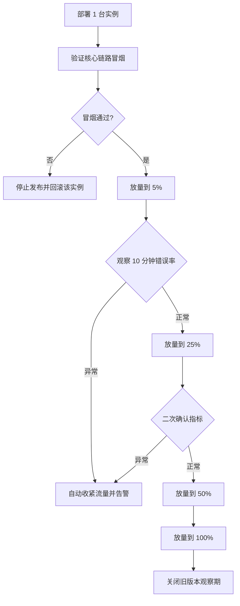
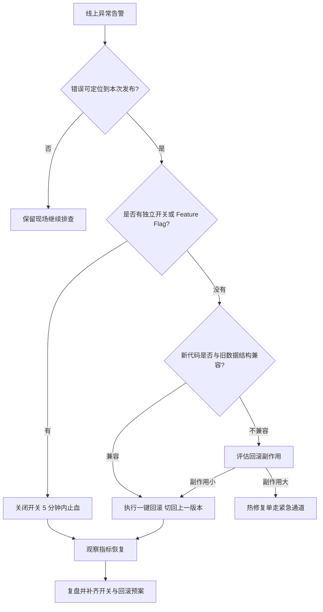
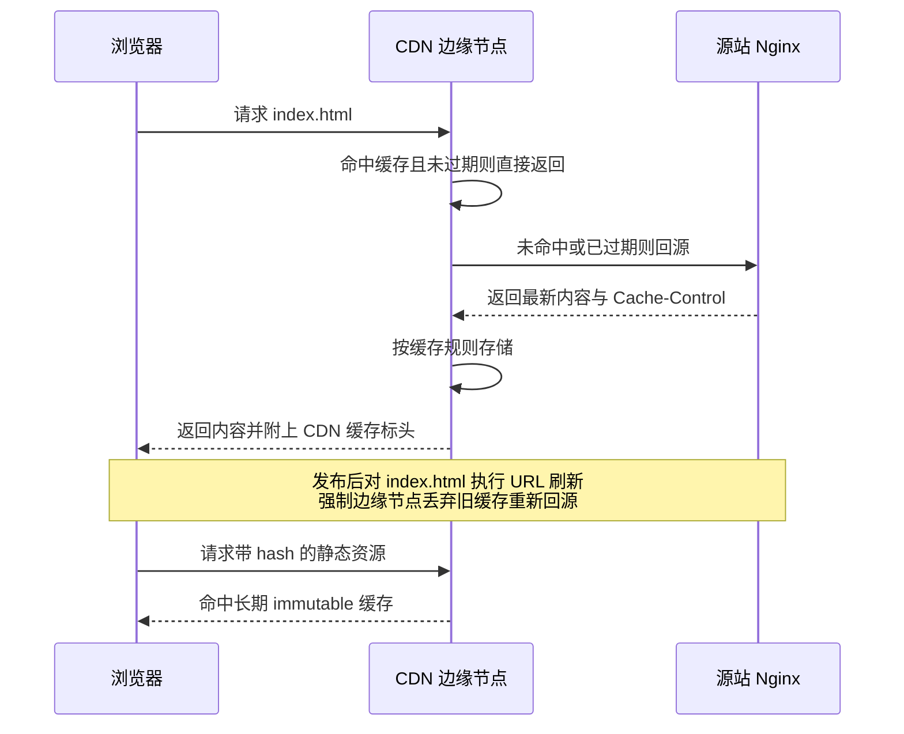
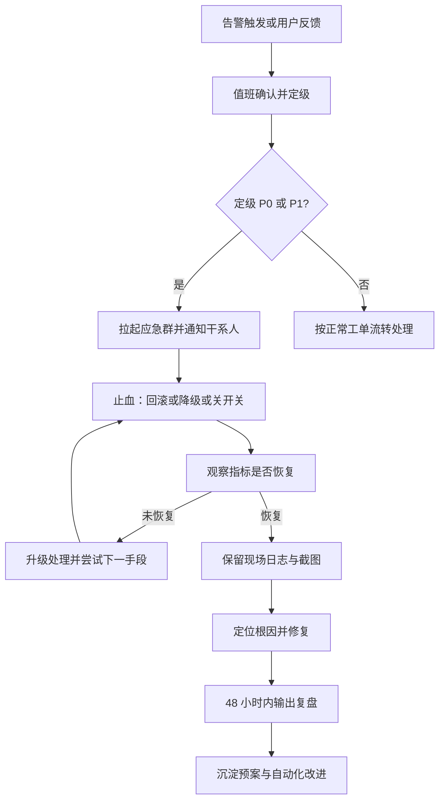
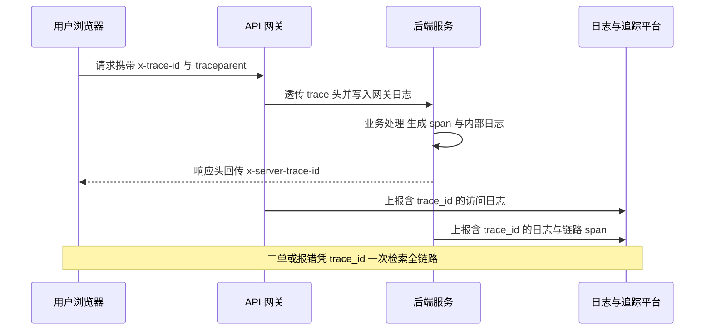
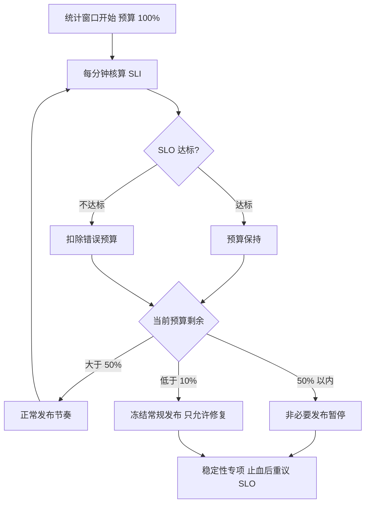
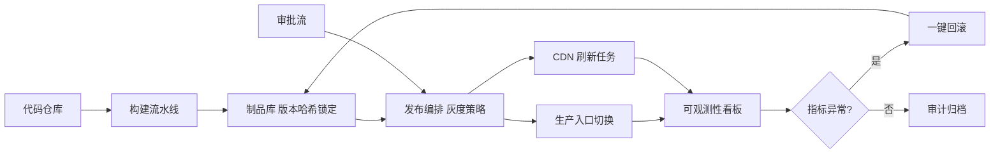
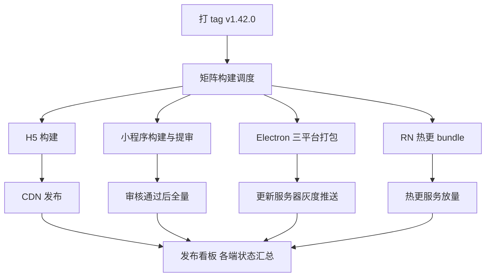
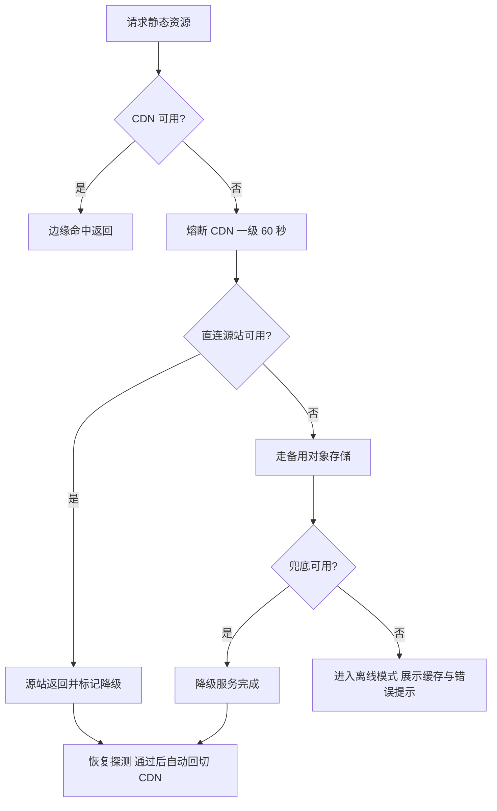
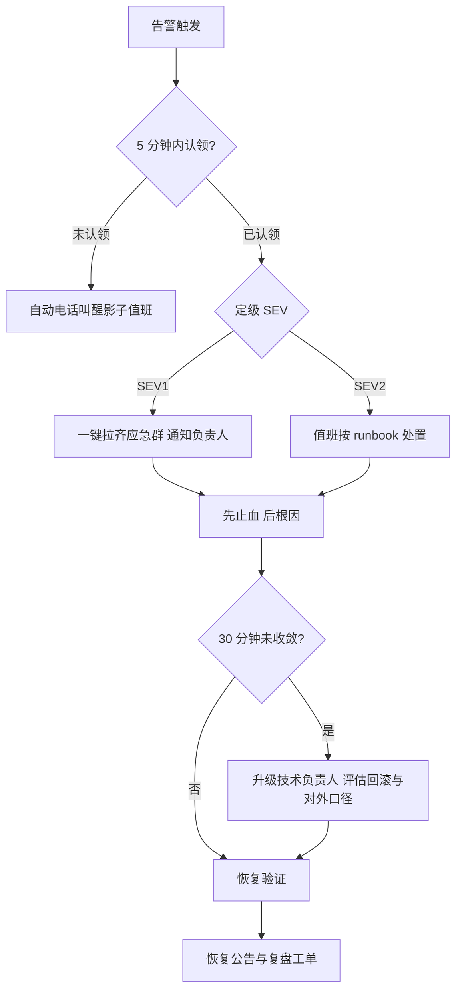

# 前端面试题库：前端运维与上线

> 面向前端面试场景的运维与上线题库，共 200 题（OPS-001 ~ OPS-200，其中 001 ~ 100 为首发，101 ~ 200 后续补充）。覆盖发布策略、回滚与兜底、CDN 与域名、Nginx 实战、容器与编排、CI/CD 流水线、环境与配置、监控告警、sourcemap 错误定位、事故应急与大促保障。核心考察点：工程师能不能把代码安全稳定地送上生产，出事时能不能快速止血兜底。与 08-engineering.md（ENG，构建工具链/规范/基础 CI）互补，本文聚焦"上线之后"的运维生命周期。


## 目录

- 一、发布策略：OPS-001 ~ OPS-010
- 二、回滚与兜底：OPS-011 ~ OPS-018
- 三、CDN 与域名：OPS-019 ~ OPS-028
- 四、Nginx 实战：OPS-029 ~ OPS-040
- 五、容器与编排：OPS-041 ~ OPS-048
- 六、CI/CD 流水线：OPS-049 ~ OPS-058
- 七、环境与配置：OPS-059 ~ OPS-066
- 八、监控告警：OPS-067 ~ OPS-076
- 九、sourcemap 与错误定位：OPS-077 ~ OPS-082
- 十、事故应急与大促保障：OPS-083 ~ OPS-100
- 十一、Nginx 高阶：OPS-101 ~ OPS-110
- 十二、CDN 深入与边缘：OPS-111 ~ OPS-118
- 十三、K8s 深入：OPS-119 ~ OPS-126
- 十四、可观测性深入：OPS-127 ~ OPS-136
- 十五、发布系统设计：OPS-137 ~ OPS-143
- 十六、安全运维：OPS-144 ~ OPS-152
- 十七、成本与效率：OPS-153 ~ OPS-159
- 十八、多端发布：OPS-160 ~ OPS-167
- 十九、容灾与演练：OPS-168 ~ OPS-175
- 二十、值班与流程：OPS-176 ~ OPS-200

---

## 一、发布策略（OPS-001 ~ OPS-010）

发布策略回答的问题是"新版本以什么节奏、什么范围、什么可逆方式进入生产"。核心矛盾是稳定性与发布速度的权衡：全量发布快但爆炸半径大，灰度/金丝雀可控但需要观测数据支撑决策。



### OPS-001：全量发布、灰度发布、蓝绿发布、金丝雀、滚动发布怎么对比？如何选型？
**答**：
- 全量发布：所有机器一次性换版本，速度快、无中间态，但出问题爆炸半径 100%，只适合低风险改动或强回滚能力场景。
- 滚动发布：逐批替换实例，成本低，K8s 默认方式；缺点是新旧版本长时间共存，需要接口向后兼容。
- 蓝绿发布：两套完整环境切流，切换秒级、回滚秒级（切回去即可），但成本翻倍，数据库/接口兼容性问题会被瞬时放大。
- 金丝雀/灰度：先给小流量（1%~5%），观察错误率/性能/业务指标再逐步放量，风险最小；需要流量染色与观测体系配合。
- 选型口诀：普通业务用滚动+灰度，核心链路大改用蓝绿或金丝雀，前端纯静态改动用"多版本目录+切 symlink"即可低成本实现类蓝绿。

```yaml
# 五种发布策略对比矩阵（可作为团队发布选型规范的配置化表达）
strategies:
  full:
    name: 全量发布
    blast_radius: 100%        # 爆炸半径
    rollback_speed: 中        # 依赖重新发布
    cost: 低
    use_case: 低风险改动、内部系统
  rolling:
    name: 滚动发布
    blast_radius: 逐批扩大
    rollback_speed: 中
    cost: 低
    use_case: K8s 默认、接口向后兼容时
  blue_green:
    name: 蓝绿发布
    blast_radius: 切换前为 0
    rollback_speed: 秒级      # 切回旧环境
    cost: 高                  # 双倍资源
    use_case: 核心链路大改版
  canary:
    name: 金丝雀发布
    blast_radius: 1% 起步可调
    rollback_speed: 秒级      # 收紧流量即可
    cost: 中                  # 需要观测体系
    use_case: 高流量 C 端业务
  gray:
    name: 灰度发布
    blast_radius: 按用户维度圈定
    rollback_speed: 秒级
    cost: 中
    use_case: 按渠道、地域、用户尾号渐进放开
default: canary
```

### OPS-002：如何用 Nginx 权重实现最简单的百分比灰度？
**答**：
- 用两个 upstream（旧版本 v1、新版本 v2）分别指向不同发布目录或不同实例组，通过 weight 控制流量比例。
- weight 是无状态的按连接分配，同一用户可能一次命中新版本一次命中旧版本，所以只适合"前后端资源已 hash 隔离、无状态依赖"的场景。
- 放量过程就是改 weight 并 reload，权重调整可以脚本化（改配置 + nginx -s reload）。
- 配合 $request_id 或 cookie 粘住用户可以避免"灰度跳变"，见下一题的定向灰度方案。

```nginx
# /etc/nginx/conf.d/gray.conf
upstream web_v1 {
    server 10.0.1.11:8080;
    server 10.0.1.12:8080;
}
upstream web_v2 {
    server 10.0.2.11:8080;
}

server {
    listen 80;
    server_name www.example.com;

    location / {
        # 灰度放量时按比例调整两边的 weight：10% 时改 weight=9 对 weight=1
        proxy_pass http://gray_pool;
        include /etc/nginx/conf.d/proxy_common.conf;
    }
}

# 灰度池：初始 95:5，放量阶段按 90:10、80:20 递增
upstream gray_pool {
    server 10.0.1.11:8080 weight=95;  # v1 旧版本
    server 10.0.1.12:8080 weight=95;  # v1 旧版本
    server 10.0.2.11:8080 weight=10;  # v2 新版本
}
```

### OPS-003：如何基于 Cookie 或 Header 做定向灰度（内部员工/白名单用户先体验）？
**答**：
- 定向灰度是"指定谁用新版"而不是"多少比例用新版"，用于内部 dogfooding 和种子用户验证。
- 常见载体：登录后下发的灰度 Cookie（如 gray=v2）、特定 Header（网关注入 x-gray-tag）、或白名单 uid 集合。
- Nginx 用 map 把 Cookie/Header 值映射到不同 root 或 upstream，避免散落的 if 判断。
- 前端在监控上报里带上同一标记，保证灰度数据可归因。

```nginx
# 按 Cookie 决定默认版本目录
map $cookie_gray $gray_by_cookie {
    default  /data/web/v1;      # 默认走旧版
    "v2"     /data/web/v2;      # Cookie gray=v2 命中灰度
}
# 网关/Header 优先：header 有值用 header 的目录，否则回落看 Cookie
map $http_x_gray_tag $gray_root {
    default  $gray_by_cookie;
    "v2"     /data/web/v2;
}

server {
    listen 80;
    server_name www.example.com;

    location / {
        root $gray_root;
        index index.html;
        try_files $uri $uri/ /index.html;
    }
}
```

### OPS-004：怎么按"用户 ID 尾号"做灰度？
**答**：
- 尾号灰度的好处是天然均匀且用户感知稳定：同一用户始终落在同一批次，不会今天新版明天旧版。
- 依赖登录态里可读的 uid（一般在 Cookie 或网关注入的 Header 中），用正则取最后一位数字。
- Nginx 用两级 map：第一级用正则提取尾号，第二级把尾号映射到版本；放量就是逐步扩大尾号区间。
- 注意未登录用户没有 uid，默认归入旧版本，登录后再按尾号分流。

```nginx
# 从 Cookie 的 uid 提取尾号，再映射版本：放量时改第二张 map 即可
map $cookie_uid $uid_tail {
    default      "-1";          # 未登录统一旧版
    ~(\d)$       $1;            # 取 uid 最后一位数字
}

map $uid_tail $gray_root {
    default      /data/web/v1;  # 其余尾号走旧版
    "0"          /data/web/v2;  # 第一批：尾号 0
    "1"          /data/web/v2;  # 第二批放量：尾号 0、1
    "2"          /data/web/v2;
    "3"          /data/web/v2;
    "4"          /data/web/v2;
    "5"          /data/web/v2;
    "6"          /data/web/v2;
    "7"          /data/web/v2;
    "8"          /data/web/v2;  # 全量：0 到 9
    "9"          /data/web/v2;
}

server {
    listen 80;
    server_name www.example.com;
    location / {
        root $gray_root;
        try_files $uri $uri/ /index.html;
    }
}
```

### OPS-005：灰度期间应该观测哪些数据？怎么用它们做放量/回滚决策？
**答**：
- 核心三层指标：技术层（JS 错误率、白屏率、接口错误码分布、P95 耗时）、业务层（转化率、下单成功率）、体验层（LCP/INP 投诉反馈）。
- 所有上报必须带灰度标记（upstream/版本号/尾号区间），否则新旧版本数据混在一起无法归因。
- 决策规则要提前定死：如"新版错误率 > 旧版 2 倍或绝对值 > 1% 持续 5 分钟 → 暂停放量并回滚"，避免人肉临时拍脑袋。
- 实践中先用日志快速算，再沉淀成平台化告警；下面是日志侧最小可用的对比脚本。

```bash
#!/usr/bin/env bash
# gray_report.sh：从 nginx 日志按 upstream 版本统计 JS 错误上报与耗时对比
# 日志约定：埋点上报走 /report/gif，$upstream_addr 已写入 access log 的最后字段

LOG=${1:-/var/log/nginx/access.log}
WINDOW=${2:-300}   # 最近 N 秒

NOW=$(date +%s)
FROM=$((NOW - WINDOW))

echo "== 最近 ${WINDOW}s 各版本对比 =="
# 假设日志最后一列是 upstream 版本标记（v1/v2，由 log_format 注入）
for v in v1 v2; do
  total=$(awk -v f="$FROM" -v t="$NOW" -v v="$v" \
    '$1>=f && $1<=t && $NF==v {c++} END{print c+0}' "$LOG")
  # 埋点上报中 status 为 200 的 /report/gif 之外、页面请求 5xx 占比
  err5xx=$(awk -v f="$FROM" -v t="$NOW" -v v="$v" \
    '$1>=f && $1<=t && $NF==v && $2 ~ /^\/api\// && $3 >= 500 {c++} END{print c+0}' "$LOG")
  # P95 接口耗时（第 4 列为 upstream_response_time，取分位）
  p95=$(awk -v f="$FROM" -v t="$NOW" -v v="$v" \
    '$1>=f && $1<=t && $NF==v && $2 ~ /^\/api\// {print $4}' "$LOG" \
    | sort -n | awk '{a[NR]=$1} END{if(NR>0) print a[int(NR*0.95)]; else print 0}')
  rate=$(awk -v e="$err5xx" -v t="$total" 'BEGIN{if(t>0) printf "%.2f%%", e/t*100; else print "N/A"}')
  echo "版本=$v 请求=$total 5xx率=$rate 接口P95=${p95}s"
done

# 决策：v2 5xx 率超过 1% 则输出回滚建议（可对接告警）
awk -v f="$FROM" -v t="$NOW" '
  $1>=f && $1<=t && $NF=="v2" && $2 ~ /^\/api\// {n++; if($3>=500) e++}
  END{ if(n>50 && e/n>0.01) print "ALERT: v2 error rate > 1%, consider rollback" }' "$LOG"
```

### OPS-006：什么是发布窗口与变更管理？为什么前端也要遵守？
**答**：
- 发布窗口：规定允许发布的时段（如工作日 14:00-17:00、避开大促封网期），保证出事时有足够人力处理。
- 变更管理：每次上线有变更单，写清内容、影响面、回滚方案、负责人，出问题可追溯"什么时候改了什么"。
- 前端常见误区是"改个静态资源不算变更"——index.html 一行改动就能白屏全站，必须同等对待。
- 封网期（大促/节假日）冻结常规发布，仅允许紧急修复走特批通道。

```yaml
# 变更单模板（change-ticket.yaml），随 MR 一起提交，发布平台校验必填项
change:
  id: CHG-2026-1101-042
  title: 商城详情页改版上线
  owner: zhang.san             # 变更负责人
  reviewers: [li.si, wang.wu]  # 复核人
  strategy: canary             # 发布策略
  window:                      # 发布窗口
    start: "14:00"
    end: "17:00"
    timezone: Asia/Shanghai
    blackout_periods:          # 封网期，禁止常规发布
      - "2026-11-10 ~ 2026-11-12 双11 封网"
  impact:
    scope: www.example.com/item/*
    risk_level: P2
  rollout_plan:                # 放量计划
    - { percent: 5,  observe: 10m }
    - { percent: 25, observe: 30m }
    - { percent: 100 }
  rollback:
    method: symlink 切回上一版本目录
    time_cost: <1min
  checklist:
    pre: [构建产物校验, 冒烟用例通过, sourcemap 已上传]
    post: [监控无异常, 工单无新增]
```

### OPS-007：发布时如何做到新旧 index.html 与静态资源多版本并存？
**答**：
- 原理：每次构建产出一个带版本号的独立目录（releases/{version}/），index.html 只通过 current 符号链接指向当前版本；历史目录保留不删。
- 只要 JS/CSS 的文件名带 content hash，旧 index.html 引用的旧 chunk 仍然存在，正在浏览旧页面的用户不会 404——这是前端发布安全的地基。
- 切换 = 重建 symlink，原子且瞬时；回滚 = 把 symlink 指回上一版本。
- 定期清理 N 版之前的目录（且要保守，留足"最长停留会话"的时间）。

```bash
#!/usr/bin/env bash
# deploy.sh：版本化目录发布，支持多版本并存与秒级回滚
set -euo pipefail

APP_DIR="/data/web/mall"
RELEASES="$APP_DIR/releases"
VERSION="$(date +%Y%m%d%H%M%S)-$(git -C /tmp/build rev-parse --short HEAD)"
TARGET="$RELEASES/$VERSION"

# 1. 上传新版本目录（目录名含版本号，永不覆盖旧目录）
rsync -az --delete /tmp/build/dist/ "deploy@web01:$TARGET/"
rsync -az --delete /tmp/build/dist/ "deploy@web02:$TARGET/"

# 2. 原子切换：先生成临时链接再 mv，避免出现 symlink 不存在的瞬间
ssh deploy@web01 "ln -sfn $TARGET $APP_DIR/current.tmp && mv -Tf $APP_DIR/current.tmp $APP_DIR/current"
ssh deploy@web02 "ln -sfn $TARGET $APP_DIR/current.tmp && mv -Tf $APP_DIR/current.tmp $APP_DIR/current"

# 3. 只保留最近 10 个版本，且至少保留 24 小时内的全部版本（防止老会话 404）
ssh deploy@web01 "
  cd $RELEASES
  ls -1t | tail -n +11 | while read v; do
    [ \$(find \"\$v\" -maxdepth 0 -mtime +1 2>/dev/null | wc -l) -eq 1 ] && rm -rf \"\$v\"
  done"

echo "deployed $VERSION, rollback: ln -sfn $RELEASES/<old> $APP_DIR/current"
```

### OPS-008：hash 命名与长期缓存怎么配置才不会出现"发布后用户看不到新版本"？
**答**：
- 分层策略：带 content hash 的静态资源（js/css/图片）设 `Cache-Control: public, max-age=31536000, immutable`（一年+不可变）；index.html 设 `no-cache`，每次协商校验。
- immutable 告诉浏览器连条件请求都不发，彻底消除"304 但还是旧文件"的窗口。
- 文件内容变了但文件名没变（如配置 json、图片覆盖式更新）绝对不能加 immutable，会永久卡死旧内容。
- 发布后"看不到新版"的根因几乎都是 index.html 被中间层（CDN/代理/浏览器）缓存了，排查顺序：CDN → 网关 → 浏览器。

```nginx
# 静态资源缓存分层：hash 资源一年 immutable，入口 html 永远协商
server {
    listen 80;
    server_name www.example.com;
    root /data/web/current;

    # 1. 指纹资源：文件名含 8 位以上 hash，内容永不变化
    location ~* ^/assets/.+\.[0-9a-f]{8,}\.(js|css|woff2|png|jpg|svg)$ {
        expires 1y;
        add_header Cache-Control "public, max-age=31536000, immutable";
        access_log off;
    }

    # 2. 非指纹资源（如 config.json、favicon）：短缓存 + 必须协商
    location ~* \.(json|ico|txt)$ {
        add_header Cache-Control "no-cache";
        expires epoch;
    }

    # 3. 入口：no-cache 保证每次拿到最新版本清单
    location = /index.html {
        add_header Cache-Control "no-cache, no-store, must-revalidate";
        add_header Pragma "no-cache";
        add_header ETag on;
    }

    location / {
        try_files $uri $uri/ /index.html;
    }
}
```

### OPS-009：什么是增量发布？如何只上传变更过的文件？
**答**：
- 全量发布每次传整套 dist，大项目数百 MB、慢且浪费带宽；增量发布只传输与上一版本有差异的文件。
- 核心工具是 rsync：`-c`（checksum）保证内容级对比而非仅看大小/时间，`--delete` 清理目标端已删除的文件。
- 两个关键安全点：hash 命名的资源天然只增量（改名即新增）；`--delete` 一定要配合版本化目录使用，绝不能删掉旧版本仍引用的 chunk。
- 灰度/多机场景下，同一版本对每台机器都做一次增量同步，rsync 幂等，重复执行无副作用。

```bash
#!/usr/bin/env bash
# incremental_deploy.sh：基于 rsync checksum 的增量发布
set -euo pipefail

SRC="/tmp/build/dist"
HOSTS=(web01 web02 web03)
APP_DIR="/data/web/mall/releases/$(cat /tmp/build/VERSION)"

for host in "${HOSTS[@]}"; do
  echo "== 增量同步到 $host =="
  rsync -azc --info=progress2,stats2 \
    --checksum \                # 内容校验：内容不变即使时间戳不同也不传
    --delete \                  # 目标端删除源端已不存在的文件
    --delete-excluded \
    --exclude '.map' \          # sourcemap 不上传到生产机，走监控平台通道
    --exclude '.DS_Store' \
    "$SRC/" "deploy@${host}:${APP_DIR}/"
done

# 输出本次实际变更文件数，写入发布单留痕
rsync -azcn --stats "$SRC/" "deploy@web01:${APP_DIR}/" | grep "files transferred"
```

### OPS-010：如何保证发布操作幂等？并发发布冲突怎么防？
**答**：
- 幂等：同一发布任务重复执行结果一致——版本化目录 + symlink 切换天然幂等，rsync 重复执行无副作用。
- 并发锁：两个人同时发布会互相覆盖 current，必须加互斥锁；单机用 flock，分布式用 Redis SETNX 或数据库唯一行。
- 锁要有租约（自动超时释放），防止发布中途 CI 崩溃导致死锁。
- 发布平台还要校验"当前基线"：提交发布时记录 base 版本，若线上已被人推进，拒绝过期任务。

```bash
#!/usr/bin/env bash
# publish_locked.sh：flock 保证同一时间只有一个发布任务在跑，且可重复执行
set -euo pipefail

LOCK_FILE="/var/lock/webapp-publish.lock"
VERSION="${1:?usage: publish_locked.sh <version>}"

# -w 300：最多等 300 秒拿锁；拿到锁后执行发布，退出自动释放
exec 200>"$LOCK_FILE"
if ! flock -w 300 200; then
  echo "ERROR: another publish is running, abort" >&2
  exit 1
fi

publish() {
  local target="/data/web/mall/releases/$VERSION"

  # 幂等点 1：目标目录已存在且校验通过则直接切换（重复执行安全）
  if [ -d "$target" ] && [ -f "$target/.ok" ]; then
    echo "$target already deployed, just switching symlink"
  else
    rsync -azc --delete "/tmp/build/dist/" "deploy@web01:$target/"
    ssh deploy@web01 "touch $target/.ok"   # 完整性标记
  fi

  # 幂等点 2：切换 symlink，无论执行多少次，最终状态一致
  ssh deploy@web01 "ln -sfn $target /data/web/mall/current"
  echo "published $VERSION at $(date -Is)"
}

publish
```

---

## 二、回滚与兜底（OPS-011 ~ OPS-018）

回滚与兜底回答"上线出事怎么办"。原则是：止血永远优先于定位，能一键回滚就不人工修，能用开关降级就不整体回滚。所有方案都要在没事的时候演练过，真出事才敢用。



### OPS-011：如何设计前端一键回滚方案？产物要保留多少、怎么保留？
**答**：
- 基础设施：releases/ 目录保留最近 N 个版本（N 视发布频率定，一般 10~20 个，覆盖至少 48 小时），current symlink 指向当前版本。
- 一键回滚 = `ln -sfn` 把 current 指回上一版本，全机执行，秒级生效；把"回滚到哪个版本、谁执行的、为什么"记录进变更系统。
- 产物保留必须同时覆盖多台机器（或统一从对象存储/制品库重新拉取），防止"机器 A 回滚了机器 B 没回滚"的脑裂。
- 回滚也要冒烟：切完立即验证首页与核心接口，确认不是"回滚到了一个更早就是坏的版本"。

```bash
#!/usr/bin/env bash
# rollback.sh <version>：一键回滚，缺省回滚到上一个版本
set -euo pipefail

APP_DIR="/data/web/mall"
RELEASES="$APP_DIR/releases"
HOSTS=(web01 web02 web03)
TARGET="${1:-}"

# 不指定版本则回滚到 current 之前最近的一个版本
if [ -z "$TARGET" ]; then
  CURRENT=$(basename "$(readlink "$APP_DIR/current")")
  TARGET=$(ssh deploy@web01 "ls -1t $RELEASES | grep -A1 '^$CURRENT$' | tail -n1")
  echo "auto rollback target: $TARGET"
fi

# 前置校验：目标版本必须存在且完整（有 .ok 标记）
for host in "${HOSTS[@]}"; do
  ssh deploy@$host "test -f $RELEASES/$TARGET/.ok" \
    || { echo "ERROR: $TARGET incomplete on $host" >&2; exit 1; }
done

# 全机切换 symlink（原子操作），并记录回滚审计
for host in "${HOSTS[@]}"; do
  ssh deploy@$host "ln -sfn $RELEASES/$TARGET $APP_DIR/current"
  echo "[$host] -> $TARGET"
done

echo "rollback $(date -Is) version=$TARGET operator=$(whoami) reason=${REASON:-unknown}" \
  >> /var/log/deploy_audit.log

# 回滚后立即冒烟
curl -fsS https://www.example.com/healthz >/dev/null && echo "smoke ok"
```

### OPS-012：回滚后用户还是旧页面/接口报错，缓存问题怎么处理？
**答**：
- 三层缓存逐层打穿：浏览器（index.html 已被缓存）、CDN（html 或旧资源被缓存）、网关/Nginx（proxy_cache）。
- 预防优先：index.html 一直 no-cache（见 OPS-008/020）时回滚基本无缓存问题；历史遗留的缓存站点回滚就必须主动刷新 CDN。
- 回滚 checklist 里固定一步：对 html 与关键 json 做 CDN URL 刷新（刷新 html 本身 + 各入口页），hash 资源不用刷（文件名已变）。
- 兜底：对强缓存依赖严重的场景，前端加"版本探针"，发现版本落后主动 `location.reload(true)` 类策略引导刷新。

```bash
#!/usr/bin/env bash
# purge_after_rollback.sh：回滚后刷新 CDN 与网关缓存
set -euo pipefail

CDN_API="https://cdn.console.example.com/api/purge"
CDN_TOKEN="$CDN_PURGE_TOKEN"   # 凭证走环境变量，不入库

# 1. URL 精确刷新：所有入口 html（hash 资源不需要刷）
URLS=(
  "https://www.example.com/index.html"
  "https://www.example.com/m/index.html"
  "https://www.example.com/admin/index.html"
)
curl -fsS -X POST "$CDN_API/url" \
  -H "Authorization: Bearer $CDN_TOKEN" \
  -H "Content-Type: application/json" \
  -d "$(jq -n --argjson urls "$(printf '%s\n' "${URLS[@]}" | jq -R . | jq -s .)" '{type: "url", urls: $urls}')"

# 2. 目录刷新兜底：入口目录下还有 manifest.json 等非 hash 文件
curl -fsS -X POST "$CDN_API/dir" \
  -H "Authorization: Bearer $CDN_TOKEN" \
  -H "Content-Type: application/json" \
  -d '{"type": "dir", "urls": ["https://www.example.com/"]}'

# 3. 验证刷新生效：各边缘节点拿到的是否为新版本的 ETag
sleep 30
for edge in cdn-a cdn-b cdn-c; do
  etag=$(curl -fsS -H "X-Forwarded-Edge: $edge" \
    -o /dev/null -w '%{header_json}' https://www.example.com/index.html | jq -r '."etag"[0]')
  echo "$edge index etag: $etag"
done

echo "purge done: $(date -Is)"
```

### OPS-013：什么是 Feature Flag 止血？前端降级开关怎么设计？
**答**：
- Feature Flag 是"不改代码、不发版本就能关闭某个功能"的运行时开关，是把 30 分钟的回滚变成 30 秒的止血的关键手段。
- 设计要点：开关读取要有本地缓存兜底（配置中心挂了要用最后一份已知配置）；默认值必须偏保守（拿不到配置时关闭高风险功能）。
- 开关粒度到功能级而非页面级，并且每次高风险发布 MR 里声明"本改动涉及哪些开关"，预案里写清关哪个。
- 开关是技术债，要定期清理长期为 true 的死开关，避免分支组合爆炸。

```javascript
// feature-flags.js：带本地缓存兜底的运行时开关
const FLAG_CACHE_KEY = 'app.flags.v1';
const FLAG_TTL = 5 * 60 * 1000; // 缓存 5 分钟
// 保守默认值：配置中心不可用时，高风险功能一律关闭
const SAFE_DEFAULTS = { newCheckout: false, aiAssistant: false, liveChat: true };

async function loadFlags() {
  try {
    const res = await fetch('https://config.example.com/flags/web.json', {
      cache: 'no-store',
      timeout: 3000,
    });
    if (!res.ok) throw new Error(`flag http ${res.status}`);
    const flags = await res.json();
    localStorage.setItem(
      FLAG_CACHE_KEY,
      JSON.stringify({ flags, ts: Date.now() })
    );
    return { ...SAFE_DEFAULTS, ...flags };
  } catch (e) {
    // 兜底：配置中心挂了用最后一份缓存；缓存也没有用安全默认值
    const cached = localStorage.getItem(FLAG_CACHE_KEY);
    if (cached) {
      const { flags, ts } = JSON.parse(cached);
      if (Date.now() - ts < FLAG_TTL * 12) return { ...SAFE_DEFAULTS, ...flags };
    }
    reportError('flag_center_down', e);
    return SAFE_DEFAULTS;
  }
}

export const flags = await loadFlags();
// 使用：flags.newCheckout ? <NewCheckout /> : <OldCheckout />
```

### OPS-014：CDN 整体挂了怎么办？多 CDN 容灾和内联兜底页怎么做？
**答**：
- 多 CDN 容灾：页面从主 CDN 加载 JS/CSS 失败时，自动切换到备用 CDN 域名重试；构建时把资源地址做成可替换的运行时清单。
- 极端兜底：index.html 内联一个极简"服务降级页"（或内联关键逻辑），外链资源全部失败时展示可用的静态内容+重试按钮，而不是白屏。
- 域名层面：CDN 域名配置多 CNAME 或由 DNS 服务做健康检查切换（DNSPod/GSLB），客户端脚本再兜一层。
- 切换动作要上报监控，区分"CDN 故障"和"应用故障"，方便事后向 CDN 厂商追责/复盘。

```javascript
// loader.js：多 CDN 容灾加载器 + 全挂时内联兜底
const CDN_HOSTS = [
  'https://cdn.example.com',      // 主 CDN
  'https://cdn-b.example.com',    // 备 CDN
  'https://cdn.example-cdn.net',  // 第三方兜底
];

function loadScript(src) {
  return new Promise((resolve, reject) => {
    const s = document.createElement('script');
    s.src = src; s.onload = resolve;
    s.onerror = () => { s.remove(); reject(new Error('load fail ' + src)); };
    document.head.appendChild(s);
  });
}

async function bootstrap(entryPath) {
  for (const host of CDN_HOSTS) {
    try {
      await loadScript(`${host}/${entryPath}`);
      reportMetric('cdn_bootstrap', { host, ok: 1 });
      return; // 命中即用，并把本次可用 CDN 记住供后续资源使用
    } catch (e) { /* 换下一个 */ }
  }
  // 所有 CDN 都挂：显示 index.html 里内联的降级内容
  document.getElementById('fallback-page').style.display = 'block';
  reportMetric('cdn_bootstrap', { ok: 0 }); // 打点也走 beacon 兜底
  setTimeout(() => location.reload(), 30000); // 30s 后自动重试
}

bootstrap('__ENTRY_JS__');
```

### OPS-015：接口挂了前端怎么做兜底降级？
**答**：
- 分级兜底：优先用 localStorage 里上次成功的响应（适合首页配置、商品列表等容忍分钟级过期的数据），其次用内置默认数据，最后才展示错误 UI。
- 请求层封装统一拦截：超时/5xx 自动走兜底流程并上报，业务代码无感知。
- 关键接口要定义"降级后可用的最小数据集"（如静态配置一份默认商品位），并评审兜底数据与真实结构的兼容。
- 注意写缓存时打 TTL 标记，过期数据展示要标注"数据更新于 xx"，避免误导用户。

```javascript
// api.js：带本地缓存降级与默认数据的 fetch 封装
const CACHE_PREFIX = 'api_cache.';
const DEFAULT_DATA = {
  '/api/home/banners': [{ img: '/static/default-banner.png', href: '/fallback' }],
};

async function fetchWithFallback(url, { ttl = 10 * 60 * 1000 } = {}) {
  try {
    const res = await fetch(url, { signal: AbortSignal.timeout(5000) }); // fetch 无 timeout 选项，用 AbortSignal
    if (!res.ok) throw new Error(`http ${res.status}`);
    const data = await res.json();
    // 成功则更新本地缓存，附带时间戳
    localStorage.setItem(CACHE_PREFIX + url,
      JSON.stringify({ data, ts: Date.now() }));
    return data;
  } catch (e) {
    reportError('api_fallback', { url, error: String(e) });
    // 兜底 1：最近一次成功响应（容忍一定过期时间）
    const cached = localStorage.getItem(CACHE_PREFIX + url);
    if (cached) {
      const { data, ts } = JSON.parse(cached);
      if (Date.now() - ts < ttl * 6) return { ...data, __stale: true, __cachedAt: ts };
    }
    // 兜底 2：内置默认数据
    if (DEFAULT_DATA[url]) return DEFAULT_DATA[url];
    throw e; // 兜底 3：真的无数据，交给业务错误 UI
  }
}

export { fetchWithFallback };
```

### OPS-016：白屏自动检测与自动切换兜底版本怎么实现？
**答**：
- 检测手段：首屏渲染超时检查（N 秒内 root 容器仍无有效子节点即判定白屏）、渲染后 MutationObserver 验证内容、配合 window.onerror/onunhandledrejection 信号。
- 检测到白屏后的动作链：上报（带版本号与关键上下文）→ 本地自愈（重载一次）→ 仍白屏则切换兜底版本（如旧版静态入口 /legacy.html 或内联降级页）。
- 自动切换要防循环：用 sessionStorage 记录"已自愈次数"，最多两次，避免死循环刷新。
- 白屏判定阈值要结合真实 LCP 数据设定，避免弱网误判。

```javascript
// white-screen-guard.js：白屏检测 + 自动切换兜底版本
const RETRY_KEY = 'ws_guard_retry';

function isEmptyScreen() {
  const root = document.getElementById('app');
  // 容器不存在、或渲染后没有实际内容节点都算白屏
  return !root || root.childElementCount === 0;
}

setTimeout(async () => {
  if (!isEmptyScreen()) return;
  const retryCount = Number(sessionStorage.getItem(RETRY_KEY) || 0);

  reportError('white_screen_detected', {
    version: window.__APP_VERSION__,
    retry: retryCount,
  });

  if (retryCount < 1) {
    // 第一次：清缓存重载自愈
    sessionStorage.setItem(RETRY_KEY, String(retryCount + 1));
    caches?.keys?.().then(ks => ks.forEach(k => caches.delete(k)));
    location.reload();
  } else if (retryCount < 2) {
    // 第二次：切到上一稳定版本的静态入口（由发布系统预置）
    sessionStorage.setItem(RETRY_KEY, String(retryCount + 1));
    location.replace('/legacy.html?from=' + encodeURIComponent(location.pathname));
  } else {
    // 最终兜底：停止重试，展示错误页避免刷新循环
    document.body.innerHTML =
      '<div style="padding:40px;text-align:center">服务暂时不可用，请稍后重试</div>';
  }
}, 8000); // 8s 阈值：结合 LCP P75 数据调整
```

### OPS-017：发布前的检查清单应该包含哪些项？
**答**：
- 代码层：CI 全绿（lint/test/build）、Code Review 通过、目标分支正确、无未合并的依赖改动。
- 产物层：构建产物校验（入口文件存在、体积 diff 无异常暴涨）、sourcemap 已上传监控平台且本地不入生产。
- 兼容层：接口契约与后端确认（新旧版本兼容性）、涉及的功能有 Feature Flag 或回滚预案。
- 流程层：变更单已审批、在发布窗口内、值班人知晓、监控大盘可访问。
- 清单要沉淀到发布系统里做成强制勾选/自动化校验，而不是靠人记。

```yaml
# pre-release-checklist.yaml：发布前置检查，发布平台强制校验
pre_release:
  build:
    ci_status: green            # lint test build 全部通过
    branch: main                # 只允许从保护分支发布
    commit_reviewed: true       # 至少 1 人 approve
  artifact:
    entry_files: [index.html, assets/]   # 入口产物存在
    size_diff_limit: 20%        # 产物体积涨幅超 20% 需人工确认
    sourcemap_uploaded: true    # 已传 Sentry，且生产目录排除 .map
  compatibility:
    api_contract_confirmed: true
    feature_flags_declared: []  # 本次改动涉及的开关清单
    breaking_change: false
  process:
    change_ticket: CHG-2026-1101-042
    in_window: true             # 在发布窗口内且非封网期
    oncall_notified: true
    monitoring_dashboard: https://grafana.example.com/d/web-release
  auto_checks:                  # 可自动化的项由 CI 校验
    - artifact_size
    - sourcemap_uploaded
    - ci_status
```

### OPS-018：发布后的冒烟测试如何自动化？
**答**：
- 冒烟范围：首页可渲染、核心接口 200、关键交互路径（登录→列表→详情→下单）可通过、无 JS 致命错误。
- 层级选择：优先 curl 层做 30 秒内的快速检查（状态码+关键文本），再用 Playwright/Puppeteer 做渲染级验证（root 有内容、无 console error）。
- 冒烟失败要联动：非阻塞提示 → 阻断放量 → 自动回滚（按严重程度配置），且结果写回变更单。
- 多环境复用同一套脚本，预发跑全量用例、生产跑精简关键链路。

```javascript
// smoke.js：发布后冒烟（node >= 18，无额外依赖），生产用精简版
const BASE = process.env.SMOKE_BASE || 'https://www.example.com';
const checks = [
  { name: 'index 200',           fn: () => get(`${BASE}/`, /<div id="app"/) },
  { name: 'healthz ok',          fn: () => get(`${BASE}/healthz`, /ok/) },
  { name: 'api config 200',      fn: () => get(`${BASE}/api/config`, /"version"/) },
  { name: 'static asset hashed', fn: () => get(`${BASE}/assets/`, null, 200) },
];

async function get(url, pattern, expect = 200) {
  const res = await fetch(url, { redirect: 'follow' });
  if (res.status !== expect) throw new Error(`${url} -> ${res.status}`);
  if (pattern) {
    const text = await res.text();
    if (!pattern.test(text)) throw new Error(`${url} body mismatch`);
  }
}

let failed = 0;
for (const c of checks) {
  try { await c.fn(); console.log(`PASS ${c.name}`); }
  catch (e) { failed++; console.error(`FAIL ${c.name}: ${e.message}`); }
}

if (failed > 0) {
  // 冒烟失败回调发布平台：暂停放量/触发回滚
  await fetch(process.env.RELEASE_WEBHOOK, {
    method: 'POST',
    headers: { 'Content-Type': 'application/json' },
    body: JSON.stringify({ release: process.env.RELEASE_VERSION, smoke: 'failed', failed }),
  }).catch(() => {});
  process.exit(1);
}
console.log('ALL SMOKE PASSED');
```

---

## 三、CDN 与域名（OPS-019 ~ OPS-028）

CDN 是前端流量进入的第一跳，也是缓存问题、劫持问题、证书问题的多发区。这一章的关键是理解"源站→边缘→浏览器"的缓存链路，以及每个环节怎么刷、怎么验、怎么兜底。



### OPS-019：CDN 缓存刷新怎么做？URL 刷新、目录刷新、预热分别什么时候用？
**答**：
- URL 刷新：强制失效指定文件，最精准、配额最贵，用于 index.html、manifest.json 等入口文件。
- 目录刷新：整目录失效，用于批量更新，配额有限且会给源站带来回源风暴，慎用。
- 预热（prefetch）：把新版本资源提前拉到边缘节点，用于大版本发布/大促前，让首个用户请求就能命中缓存。
- hash 命名的资源不需要刷新（新内容新文件名），只需要预热；这是"发布后只刷 html、只预热 assets"策略的依据。

```bash
#!/usr/bin/env bash
# cdn_refresh.sh：发布后的刷新与预热（以通用 CDN API 为例，各厂商参数类似）
set -euo pipefail
CDN_API="https://cdn.console.example.com/api"
AUTH="Authorization: Bearer $CDN_PURGE_TOKEN"

VERSION=$(cat /tmp/build/VERSION)

# 1. URL 刷新：入口 html（必做，量小）
curl -fsS -X POST "$CDN_API/purge/url" -H "$AUTH" -H "Content-Type: application/json" -d '{
  "urls": [
    "https://www.example.com/index.html",
    "https://www.example.com/m/index.html"
  ]
}'

# 2. 目录刷新：仅当有大量非 hash 文件更新时使用（有回源风暴风险）
# curl -fsS -X POST "$CDN_API/purge/dir" -H "$AUTH" \
#   -d '{"dir": "https://www.example.com/static/config/"}'

# 3. 预热：从构建产物提取 assets 清单，提前推到边缘节点
jq -r '.assets[].url' /tmp/build/dist/manifest.json |
  sed 's|^|https://cdn.example.com/|' > /tmp/prefetch.list
head -n 500 /tmp/prefetch.list |   # 预热有配额，按关键资源优先
  jq -R . | jq -s '{urls: .}' > /tmp/prefetch.json
curl -fsS -X POST "$CDN_API/prefetch" -H "$AUTH" \
  -H "Content-Type: application/json" -d @/tmp/prefetch.json

echo "refresh+prefetch done for $VERSION"
```

### OPS-020：为什么 index.html 一定不能被 CDN 缓存？各层分别怎么配置？
**答**：
- index.html 是"版本清单"：它引用哪些 hash chunk 决定了用户看到的功能。它若被缓存，新版本发布后用户拿到旧 html，请求的旧 chunk 可能已被清理，直接白屏/404。
- 正确姿势：CDN 对 html 跟随源站 Cache-Control（no-cache），或对 html 路径设置"不缓存"规则；源站 Nginx 也要显式 no-cache。
- 各家 CDN 配置方式不同，但共性是"按文件后缀/路径配置缓存 TTL，html 必须为 0 或遵循源站"。
- 验证方法：curl -I 看响应头里 CDN 加的缓存标记（如 X-Cache: MISS/HIT、Ali-Swift-Swift-Time）与 Cache-Control 实际值。

```nginx
# 源站 Nginx：为不同资源声明正确的缓存策略，CDN 按此遵循
server {
    listen 80;
    server_name www.example.com;
    root /data/web/current;

    # html 入口：CDN 不可缓存，浏览器每次协商
    location ~* \.html$ {
        add_header Cache-Control "no-cache";
        add_header CDN-Cache-Control "no-store" always;  # 部分支持该头的 CDN 可识别
    }

    # 指纹资源：边缘与浏览器都长缓存
    location /assets/ {
        add_header Cache-Control "public, max-age=31536000, immutable";
    }

    # API 与页面路由：绝不缓存
    location /api/ {
        proxy_pass http://backend;
        add_header Cache-Control "no-store";
    }

    location / {
        add_header Cache-Control "no-cache";
        try_files $uri $uri/ /index.html;
    }
}
```

### OPS-021：CDN 缓存命中率异常怎么排查？
**答**：
- 先看大盘：命中率骤降通常伴随发布（新文件全量回源）或刷新操作，属预期；无发布却下降则要查配置与回源。
- 逐请求排查：抽样响应头判断命中与否（X-Cache/CF-Cache-Status 等），看 MISS 的原因（EXPIRED/PASS/BYPASS/DYNAMIC）。
- 常见根因：URL 带 query 未配置"忽略参数缓存"（如 ?t=时间戳直接打穿）、Set-Cookie 响应被 CDN 判为不可缓存、Range 请求未配置缓存。
- 用日志统计验证：拉 CDN 日志按命中状态与文件类型聚合，定位是哪类资源拖低命中率。

```bash
#!/usr/bin/env bash
# cdn_hitrate_check.sh：基于 CDN 边缘节点日志（或源站回源日志）分析命中率
LOG=${1:-/var/log/nginx/cdn_access.log}

echo "== 总体命中率 =="
awk '{hit[$4]++} END {
  total=hit["HIT"]+hit["MISS"]+hit["EXPIRED"]+hit["PASS"]+hit["DYNAMIC"];
  printf "HIT %.1f%%  MISS %.1f%%  PASS %.1f%%\n",
    hit["HIT"]/total*100, hit["MISS"]/total*100, hit["PASS"]/total*100
}' "$LOG"

echo "== MISS 原因 Top（EXPIRED 正常，PASS/DYNAMIC 偏多说明配置问题） =="
awk '$4!="HIT" {print $4, $7}' "$LOG" | sort | uniq -c | sort -rn | head -10

echo "== 带随机 query 打穿缓存的 URL（?t= 或时间戳参数） =="
awk '$4=="MISS" && $7 ~ /\?(t|ts|_)=?[0-9]{10}/ {print $7}' "$LOG" \
  | sed 's/\?.*//' | sort | uniq -c | sort -rn | head -10

echo "== 建议：对上述路径在 CDN 配置忽略该 query 参数参与缓存键 =="
```

### OPS-022：什么是 CDN 劫持？SRI（Subresource Integrity）怎么防？
**答**：
- 劫持：中间节点（不规范的 ISP 缓存/恶意代理）篡改返回的 JS 内容，插入广告或窃取数据，特征是代码在源站不存在。
- SRI：给 script/link 加 integrity 属性（内容 hash），浏览器校验失败直接拒绝执行，从客户端兜底防篡改。
- 构建期用 webpack/vite 插件自动给产物注入 integrity，注意版本更新后 hash 会变，html 与 SRI 要同源发布。
- SRI 会让"CDN 回源重新压缩"类操作失败，要求 CDN 对该资源原样返回；同时配合 CSP report-uri 上报被篡改的样本。

```javascript
// build/sri-loader.js：构建后为 index.html 注入 SRI，并提供运行时被劫持上报
import { createHash } from 'node:crypto';
import { readFileSync, writeFileSync } from 'node:fs';

function sri(file) {
  const buf = readFileSync(file);
  const b64 = createHash('sha384').update(buf).digest('base64');
  return `sha384-${b64}`;
}

// 构建后处理：index.html 中本地 script 注入 integrity + crossorigin
export function injectSri(distDir) {
  let html = readFileSync(`${distDir}/index.html`, 'utf8');
  html = html.replace(/<script src="(\/assets\/[^"]+\.js)"/g, (_, p) => {
    const hash = sri(`${distDir}${p}`);
    return `<script src="${p}" integrity="${hash}" crossorigin="anonymous"`;
  });
  writeFileSync(`${distDir}/index.html`, html);
  console.log('SRI injected');
}

// 运行时：脚本加载失败时区分被篡改与网络问题，上报样本用于追责
export function reportIntegrityFailure() {
  window.addEventListener('error', (e) => {
    const el = e.target;
    if (el?.tagName === 'SCRIPT' && el.integrity) {
      // eslint-disable-next-line no-new-func
      fetch(el.src).then(r => r.text()).then(body => {
        navigator.sendBeacon('/report/hijack', JSON.stringify({
          src: el.src, sample: body.slice(0, 500),
        }));
      }).catch(() => {});
    }
  }, true);
}
```

### OPS-023：多 CDN 容灾切换有哪些方案？客户端测速择优怎么实现？
**答**：
- DNS 层：权威 DNS/GSLB 对 CDN 域名做健康检查，故障自动切到备用 CDN 的 CNAME；生效受 TTL 影响（分钟级）。
- 网关层：自建一层轻代理（或云 WAF/网关）统一回源多 CDN，由网关路由，对前端透明。
- 客户端层：运行时对多个 CDN 域名测速（加载探针图片/脚本计时），选择最快者并持久化偏好；资源加载失败自动降级到下一家。
- 三层通常组合使用：DNS 做粗粒度切换，客户端做细粒度兜底；所有切换都要上报形成 CDN 质量报表。

```javascript
// cdn-picker.js：客户端测速择优 + 加载失败自动切换
const CANDIDATES = [
  'https://cdn.example.com',
  'https://cdn-b.example.com',
];

// 用一个 1x1 图片测 RTT：HEAD 请求不下载主体，计时取相对快慢
async function probe(host) {
  const t0 = performance.now();
  await fetch(`${host}/probe.png?t=${Date.now()}`,
    { mode: 'no-cors', cache: 'no-store' });
  return performance.now() - t0;
}

export async function pickCDN() {
  const cached = localStorage.getItem('cdn.pick');
  if (cached) return cached; // 上次选择在会话间保持，避免每次都测

  const results = await Promise.allSettled(CANDIDATES.map(probe));
  let best = CANDIDATES[0];
  let bestTime = Infinity;
  results.forEach((r, i) => {
    if (r.status === 'fulfilled' && r.value < bestTime) {
      best = CANDIDATES[i]; bestTime = r.value;
    }
  });
  localStorage.setItem('cdn.pick', best);
  navigator.sendBeacon('/report/cdn_pick', JSON.stringify(
    { pick: best, ms: Math.round(bestTime) }));
  return best;
}

// 资源加载：当前 CDN 失败自动顺序切换
export async function loadWithFailover(path) {
  for (const host of [await pickCDN(), ...CANDIDATES]) {
    try { return await fetch(`${host}/${path}`).then(r => r.json()); }
    catch (e) { continue; }
  }
  throw new Error('all CDN failed: ' + path);
}
```

### OPS-024：HTTPS 证书到期如何监控与轮换？
**答**：
- 证书过期是低级但高频的事故：监控要覆盖所有对外域名，提前 30/14/7 天分级告警。
- 检查手段：脚本用 openssl 读取证书 notAfter 与当前时间比较；或接云厂商/UPTRUST 类监控。
- 轮换：能自动化的尽量 ACME 自动续期（certbot/acme.sh + DNS 验证），CDN/负载均衡侧证书同步上传并确认生效。
- 变更流程：证书更新也是变更，更新后要验证全域名链（含二级域名与 API 域名）。

```bash
#!/usr/bin/env bash
# cert_expiry_check.sh：检查证书到期天数，低于阈值告警（配合 crontab 每日执行）
DOMAINS=(
  www.example.com
  api.example.com
  static.example.com
  *.example.com
)
ALERT_WEBHOOK="$OPS_WEBHOOK"   # 企业微信/钉钉/Slack webhook

for d in "${DOMAINS[@]}"; do
  end=$(echo | openssl s_client -servername "$d" -connect "$d:443" 2>/dev/null \
    | openssl x509 -noout -enddate | cut -d= -f2)
  [ -z "$end" ] && { echo "FAIL: $d 无法读取证书"; continue; }
  end_ts=$(date -j -f "%b %e %H:%M:%S %Y %Z" "$end" +%s 2>/dev/null \
    || date -d "$end" +%s)
  days=$(( (end_ts - $(date +%s)) / 86400 ))
  echo "$d: ${days}d remaining"

  if [ "$days" -le 30 ]; then
    level=$([ "$days" -le 7 ] && echo P2 || echo P3)
    curl -fsS -X POST "$ALERT_WEBHOOK" -H 'Content-Type: application/json' \
      -d "{\"msgtype\":\"text\",\"text\":{\"content\":\"[$level] 证书告警 $d 还剩 ${days} 天到期，请安排续期\"}}"
  fi
done

# crontab：每天 09:00 执行
# 0 9 * * * /opt/ops/cert_expiry_check.sh >> /var/log/cert_check.log 2>&1
```

### OPS-025：HTTP 强跳 HTTPS 与 HSTS 怎么配置？有什么坑？
**答**：
- 强跳：Nginx 80 端口统一 301 到 https；同域名所有入口收敛到 443。
- HSTS（Strict-Transport-Security）：告诉浏览器"以后对该域只准 https"，消除首跳明文请求窗口，防 SSL 剥离攻击。
- 坑 1：HSTS 一旦下发对子域生效（includeSubDomains），某些纯 HTTP 的内部子域会直接打不开；坑 2：TTL 内无法回退 http，误配只能等过期或从 Chrome HSTS 清单移除。
- 建议节奏：先只给主域开 max-age=300 观察 → 逐步加到 31536000 → 最后确认所有子域 https 后再开 includeSubDomains 并提交 preload。

```nginx
# HTTP 强跳 + 渐进式 HSTS
server {
    listen 80;
    server_name example.com www.example.com;

    # ACME http-01 验证路径要保持 http 可达
    location /.well-known/acme-challenge/ {
        root /var/www/certbot;
    }

    location / {
        return 301 https://$host$request_uri;
    }
}

server {
    listen 443 ssl http2;
    server_name www.example.com;

    ssl_certificate     /etc/nginx/ssl/www.example.com.fullchain.pem;
    ssl_certificate_key /etc/nginx/ssl/www.example.com.key.pem;
    ssl_protocols TLSv1.2 TLSv1.3;

    # HSTS：确认全站 https 稳定后再调大 max-age 并加 includeSubDomains
    add_header Strict-Transport-Security "max-age=31536000" always;

    # 谨慎阶段配置示例（观察两周无问题后升级）：
    # add_header Strict-Transport-Security "max-age=300" always;
}
```

### OPS-026：泛域名与多站点证书怎么管理？
**答**：
- 站点多时逐个申请证书成本失控，用泛域名证书（*.example.com）覆盖业务子域，一次申请全局复用。
- 泛域名证书必须用 DNS 验证（http-01 无法验证通配符），用 certbot dns 插件或 acme.sh + DNS API 自动化。
- 多级子域（a.b.example.com）不被 *.example.com 覆盖，需要 *.b.example.com 或 SAN 证书补充。
- 证书文件统一放配置中心/密钥管理系统，部署脚本分发到各边缘网关，避免手工 scp 各处不一致。

```bash
#!/usr/bin/env bash
# wildcard_cert.sh：用 certbot DNS 插件签发与续期泛域名证书
set -euo pipefail

# 1. 配置 DNS API 凭证（以 DNSPod 为例），凭证不入 git
cat > /etc/letsencrypt/dnspod.ini <<'INI'
dns_dnspod_email = ops@example.com
dns_dnspod_api_token = ${DNSPOD_TOKEN}
INI
chmod 600 /etc/letsencrypt/dnspod.ini

# 2. 签发泛域名证书（DNS 验证），首次手动，之后 certbot 自动续期
certbot certonly \
  --dns-dnspod \
  --dns-dnspod-credentials /etc/letsencrypt/dnspod.ini \
  -d "example.com" \
  -d "*.example.com" \
  --cert-name example.com-wild \
  --agree-tos -m ops@example.com --non-interactive

# 3. 续期钩子：续期后重载网关并同步到 CDN（deploy-hook 脚本）
cat > /etc/letsencrypt/renewal-hooks/deploy/push-cert.sh <<'HOOK'
#!/usr/bin/env bash
openssl pkcs12 -export \
  -in /etc/letsencrypt/live/example.com-wild/fullchain.pem \
  -inkey /etc/letsencrypt/live/example.com-wild/privkey.pem \
  -out /tmp/cert.p12 -passout pass:tmp
curl -fsS -X POST "https://cdn.console.example.com/api/cert" \
  -H "Authorization: Bearer $CDN_TOKEN" \
  -F "cert=@/etc/letsencrypt/live/example.com-wild/fullchain.pem" \
  -F "key=@/etc/letsencrypt/live/example.com-wild/privkey.pem"
nginx -s reload
HOOK
chmod +x /etc/letsencrypt/renewal-hooks/deploy/push-cert.sh
```

### OPS-027：DNS 切换与 TTL 有什么注意事项？
**答**：
- TTL 决定 DNS 记录在递归 DNS 里的缓存时长：切换前先把 TTL 降到 60~300 秒并等待"旧 TTL"时间生效，否则故障切换要等数小时。
- 计划内切换（迁移机房/换 CDN）：提前降 TTL → 预发验证新目标 → 低峰期改记录 → 监控解析生效比例（分地区 dig）。
- 故障切换：TTL 60s 也要算上客户端/中间resolver 的不遵守缓存，预期 1~5 分钟全量生效，期间用多 CDN/多可用区兜底。
- 改 DNS 一定要留回滚记录（原记录值截图/导出），并通知依赖方（App 端硬编码域名要检查）。

```bash
#!/usr/bin/env bash
# dns_switch.sh：计划内 DNS 切换的标准流程
set -euo pipefail
DOMAIN="static.example.com"
OLD_VALUE="static.example.com.cdn-a.net."
NEW_VALUE="static.example.com.cdn-b.net."
DNSPOD_API="https://dnsapi.cn/Record.Modify"
LOGIN="login_token=${DNSPOD_TOKEN}&format=json"

# 0. 前置：提前 24h 已把 TTL 降到 60（此处校验）
ttl=$(dig +noall +answer "$DOMAIN" CNAME @119.29.29.29 | awk '{print $NF}' | tr -d 'A-Za-z.')
# 上一步取不到时用权威 DNS 查询
[ -z "$ttl" ] && ttl=$(dig +noall +answer "$DOMAIN" @f1g1ns1.dnspod.net | head -1 | awk '{print $2}')
echo "current ttl: $ttl"
[ "$ttl" -gt 300 ] && { echo "ABORT: TTL 未提前降到 300 以内"; exit 1; }

# 1. 切换记录（先拿 record_id）
record_id=$(curl -fsS -X POST "https://dnsapi.cn/Record.List" \
  -d "$LOGIN&domain=example.com&sub_domain=static" | jq -r '.records[0].id')
curl -fsS -X POST "$DNSPOD_API" \
  -d "$LOGIN&domain=example.com&record_id=$record_id&sub_domain=static" \
  -d "record_type=CNAME&record_line_id=0&value=$NEW_VALUE&ttl=60"

# 2. 验证多地解析生效比例
for region in 119.29.29.29 223.5.5.5 8.8.8.8 1.1.1.1; do
  echo -n "$region -> "
  dig +short "$DOMAIN" @"$region" CNAME | head -1
done

# 回滚：把 value 换回 $OLD_VALUE 重新执行即可
echo "rollback value: $OLD_VALUE"
```

### OPS-028：跨域与 Cookie 域如何设计？主域共享登录态怎么做？
**答**：
- 最省事的方案是"同域反代"：前端 www.example.com、接口 www.example.com/api/，天然无跨域，Cookie 直接可用。
- 接口独立域名（api.example.com）时：后端 Set-Cookie 的 Domain 设为主域 example.com，前后端都带 Domain=.example.com 的 Cookie 即可共享登录态；CORS 需配置允许来源与 Allow-Credentials。
- 注意 SameSite=Lax/Strict 跨站限制：跨子域属于同站（site）不受影响；跨主域（mall.com 与 pay.com）则必须 SameSite=None; Secure 并注意第三方 Cookie 政策。
- 多站点（www/m/admin）登录态复用：Token 类方案放主域存储或统一认证中心（SSO）跳换取票。

```nginx
# 方案 A（推荐）：同域反代，无跨域问题
server {
    listen 443 ssl http2;
    server_name www.example.com;

    # 前端静态
    location / {
        root /data/web/current;
        try_files $uri $uri/ /index.html;
    }

    # 接口同域转发：浏览器视角全程 www.example.com
    location /api/ {
        proxy_pass http://api_backend/;
        proxy_set_header Host api.internal:8080;
        proxy_cookie_domain api.internal www.example.com;   # 后端 Cookie 域改写
        proxy_cookie_path / "/; SameSite=Lax; Secure";
    }
}

# 方案 B：接口独立域名时，CORS + 主域 Cookie 的关键响应头
# add_header Access-Control-Allow-Origin "https://www.example.com" always;
# add_header Access-Control-Allow-Credentials "true" always;
# 后端 Set-Cookie: session=xxx; Domain=.example.com; Path=/;
#                Secure; HttpOnly; SameSite=Lax; Max-Age=604800
```

---

## 四、Nginx 实战（OPS-029 ~ OPS-040）

Nginx 是前端上线最常打交道的服务器。面试重点不是背指令，而是理解每段配置解决什么线上问题：路由回退、缓存、限流、代理、安全头，以及出问题时如何从配置定位原因。

### OPS-029：SPA history 路由在 Nginx 怎么配？多应用共存怎么处理？
**答**：
- 核心是 try_files：先找真实文件，找不到回退到该应用的 index.html，由前端路由接管。
- 多个 SPA 共存（主站 /mall、管理台 /admin）时，各自 location 回退各自的入口，避免 404 或回退错应用。
- 回退要区分资源请求与路由请求：带后缀的静态资源缺失应返回 404（暴露问题）而不是回退 html 造成"内容不对但不报错"。
- 子路径部署还要处理前端构建的 base/publicPath 与 Nginx 的 alias 配合。

```nginx
# 单机多 SPA 部署：/ 主站、/admin 管理台、/m 移动端
server {
    listen 80;
    server_name www.example.com;
    root /data/web/current;

    # 主站：文件不存在回退主站入口
    location / {
        index index.html;
        try_files $uri $uri/ /index.html;
    }

    # 管理台子应用：独立目录独立入口
    location /admin/ {
        alias /data/web/current/admin/;
        index index.html;
        try_files $uri $uri/ /admin/index.html;
    }

    # 移动端
    location /m/ {
        alias /data/web/current/m/;
        try_files $uri $uri/ /m/index.html;
    }

    # 静态资源缺失必须 404，不能回退 html 掩盖问题
    location ~* \.(js|css|png|jpg|woff2)$ {
        try_files $uri =404;
        expires 30d;
    }
}
```

### OPS-030：Nginx 里 gzip 和 brotli 怎么配？怎么取舍？
**答**：
- gzip 全生态支持，CPU 开销低，保底开启；brotli 压缩率比 gzip 高 15%~25%，现代浏览器（有 br 的 Accept-Encoding）优先。
- 静态预压缩优于动态压缩：构建时产出 .gz/.br 文件，Nginx 用 gzip_static/brotli_static 直接发文件，线上零压缩开销。
- 压缩级别权衡：级别越高体积越小 CPU 越贵，动态压缩建议 gzip 5~6、brotli 4~5；只压缩文本类，图片视频字体（已压缩格式）不要压。
- 注意 proxy 场景下转发到后端时 gzip 的 Content-Encoding 与 Accept-Encoding 透传关系。

```nginx
# 静态预压缩优先 + 动态压缩兜底
# 构建期产物：app.js / app.js.gz / app.js.br（vite-plugin-compression 等）

gzip_static  on;              # 优先发送同路径的 .gz 预压缩文件
brotli_static on;             # 优先发送 .br（需 ngx_brotli 模块）

gzip on;
gzip_comp_level 5;
gzip_min_length 1024;         # 太小的不压，越压越大
gzip_vary on;                 # 告知 CDN/代理按 Accept-Encoding 区分缓存
gzip_proxied any;             # 代理来的响应也压缩
gzip_types
    text/plain
    text/css
    text/javascript
    application/javascript
    application/json
    application/xml
    image/svg+xml;

brotli on;
brotli_comp_level 5;
brotli_types
    text/css
    application/javascript
    application/json
    image/svg+xml;

location /assets/ {
    # 关闭动态压缩的重复劳动：预压缩文件已就位
    gzip off;
    add_header Vary "Accept-Encoding";
}
```

### OPS-031：静态资源的 expires 与 Cache-Control 怎么按资源类型精细化配置？
**答**：
- 用 map 按类型统一决策，比散落的多个 location 好维护：指纹资源长缓存 immutable，普通图片中等缓存，html/json 短或不缓存。
- expires 指令与 Cache-Control 的 max-age 是两种写法，同用时 Cache-Control 优先，建议统一用 add_header 显式声明，可读性好。
- CDN 边缘缓存与浏览器缓存是两层，可用 CDN-Cache-Control/边缘扩展头差异化（边缘长、浏览器短）。
- 配完用 curl -I 逐类验证，并纳入发布前置检查，防止改配置把 html 改成强缓存。

```nginx
# 按扩展名映射缓存策略
map $uri $cache_policy {
    default                                    "no-cache";
    ~*\.html$                                  "no-cache";
    ~*\.(json)$                                "no-cache";
    ~*\.(jpg|jpeg|png|webp|gif|ico)$           "public, max-age=2592000";        # 图片 30d
    ~*\.(woff2|woff|ttf|eot)$                  "public, max-age=31536000";       # 字体 1y
    ~*\/assets\/.+\.[0-9a-f]{8,}\.(js|css)$    "public, max-age=31536000, immutable";
    ~*\.(js|css)$                              "public, max-age=86400";          # 非指纹 1d
}

server {
    listen 80;
    server_name www.example.com;
    root /data/web/current;

    location / {
        add_header Cache-Control $cache_policy;
        try_files $uri $uri/ /index.html;
    }

    # 边缘节点可以比浏览器缓存更久（对 html 也缓存 60s，抗突发回源）
    location = /index.html {
        add_header Cache-Control "no-cache";
        add_header CDN-Cache-Control "max-age=60";
    }
}
```

### OPS-032：反向代理转发接口要注意哪些配置？
**答**：
- proxy_pass 结尾带不带 / 的语义完全不同：`location /api/ { proxy_pass http://b/; }` 会去掉 /api/ 前缀，不带 / 则原样透传，弄错是 404 高发原因。
- 必须正确传递 Host、X-Real-IP、X-Forwarded-For/Proto，否则后端拿不到真实 IP、生成错误回调域名。
- 超时三件套（connect/send/read）要按业务设置，网关超时必须大于后端处理时间，避免网关先断。
- 大响应慢接口与 SSE 场景要关 proxy_buffering；重试策略 proxy_next_upstream 注意幂等性。

```nginx
upstream api_backend {
    server 10.0.3.11:8080 max_fails=3 fail_timeout=10s;
    server 10.0.3.12:8080 max_fails=3 fail_timeout=10s;
    keepalive 32;                 # 复用到后端的长连接
}

server {
    listen 443 ssl http2;
    server_name www.example.com;

    location /api/ {
        proxy_pass http://api_backend;   # 无尾斜杠：/api/ 前缀原样透传给后端

        # 透传真实客户端信息
        proxy_set_header Host              $host;
        proxy_set_header X-Real-IP         $remote_addr;
        proxy_set_header X-Forwarded-For   $proxy_add_x_forwarded_for;
        proxy_set_header X-Forwarded-Proto $scheme;

        # 复用长连接
        proxy_http_version 1.1;
        proxy_set_header Connection "";

        # 超时：网关超时大于后端 P99
        proxy_connect_timeout 3s;
        proxy_send_timeout    30s;
        proxy_read_timeout    30s;

        # 失败重试：GET 幂等可重试下一台；POST 默认不重试防重复下单
        proxy_next_upstream error timeout http_502 http_503;
        proxy_next_upstream_tries 2;
    }
}
```

### OPS-033：Nginx 限流怎么做？limit_req 和 limit_conn 的区别是什么？
**答**：
- limit_conn 限制并发连接数，防单 IP 大量并发占满资源；limit_req 按速率限制（漏桶算法），防突发流量，两者通常配合使用。
- limit_req_zone 的 rate 是平均速率，burst 允许排队突增，nodelay 表示突发请求立即处理不排队；不配 burst 会把正常突发也拒掉。
- 白名单要先行：内网、健康检查、拨测 IP 必须放行（geo + map 组合），否则监控系统自己触发限流造成误报。
- 被限流要返回 429 并带上 Retry-After，前端可据此提示用户而不是静默失败。

```nginx
# 限流三段式：定义 zone -> 白名单豁免 -> 应用到 location
geo $limit_exempt {
    default         0;
    10.0.0.0/8      1;     # 内网
    192.168.0.0/16  1;     # 办公网
    10.0.3.100      1;     # 拨测机
}
map $limit_exempt $limit_key {
    0   $binary_remote_addr;
    1   "";                # 白名单 key 为空 = 不限流
}

# 速率：单 IP 每秒 20 个请求，内存 10m 约可跟踪 16 万 IP
limit_req_zone  $limit_key  zone=req_perip:10m  rate=20r/s;
limit_conn_zone $limit_key  zone=conn_perip:10m;

# 全站级别：按 server 维度再兜一层，防海量分布式 IP
limit_req_zone  $server_name zone=req_global:10m rate=5000r/s;

server {
    listen 80;
    server_name www.example.com;

    # 接口：单 IP 20r/s，允许 10 个突发立即处理，超出 429
    location /api/ {
        limit_req  zone=req_perip burst=10 nodelay;
        limit_req  zone=req_global burst=1000 nodelay;
        limit_conn conn_perip 20;
        limit_req_status 429;
        limit_conn_status 429;

        proxy_pass http://api_backend;
    }

    # 静态资源限流放宽，避免页面并发加载被误伤
    location /assets/ {
        limit_req zone=req_perip burst=100 nodelay;
    }
}
```

### OPS-034：Nginx 黑白名单 allow/deny 怎么用？和防火墙如何配合？
**答**：
- allow/deny 基于 IP/CIDR，按顺序匹配，适用管理后台限内网、接口只允许网关层访问等场景。
- 与认证组合（satisfy all）：既要 IP 白名单又要 Basic Auth/SSO 网关，双重校验。
- 大规模动态封禁（防刷）不建议写 Nginx 配置（reload 频繁），用 geo 模块加载外部文件或上 WAF/防火墙层。
- 注意真实 IP 问题：前面有 CDN/LB 时 remote_addr 是代理 IP，必须先用 realip 模块从 X-Forwarded-For 还原，否则黑白名单全部失效。

```nginx
# 真实 IP 还原：有 CDN/LB 时必须先做，否则 allow/deny 基于 CDN 节点 IP 全部失真
set_real_ip_from 10.0.0.0/8;          # 信任的代理层网段（CDN 回源段）
real_ip_header X-Forwarded-For;
real_ip_recursive on;

# 管理后台：仅办公网与运维 VPN 可访问
location /admin/ {
    allow 192.168.0.0/16;    # 办公网
    allow 10.8.0.0/24;       # 运维 VPN
    allow 203.0.113.7;       # 驻场外包固定出口
    deny  all;

    alias /data/web/current/admin/;
    try_files $uri $uri/ /admin/index.html;
}

# 内部元数据接口：IP 白名单 + Basic Auth 双重校验
location /internal/meta {
    satisfy all;
    allow 10.0.0.0/8;
    deny  all;
    auth_basic           "restricted";
    auth_basic_user_file /etc/nginx/.htpasswd;
    proxy_pass http://api_backend;
}
```

### OPS-035：老链接迁移（URL 结构调整）用 rewrite 怎么做？
**答**：
- 迁移目标：老 URL 用 301 永久重定向到新结构，保住 SEO 权重与用户收藏；参数需要透传或映射。
- rewrite 正则要精确锚定，避免误伤新结构；多条规则按顺序执行，last、break、permanent、redirect 的语义要清楚。
- 域名级迁移（old.com → new.com）在 server 级做整站 301；路径级迁移在 location 或 rewrite 层做。
- 上线前用小流量验证重定向结果（curl 批量测试表），上线后监控老 URL 的 301 命中量衰减趋势。

```nginx
# URL 结构迁移示例：/item/{id}.html -> /item/{id}，并兼容旧参数
server {
    listen 80;
    server_name www.example.com;

    # 1. 老详情页：/item/12345.html -> /item/12345，透传 query
    rewrite "^/item/([0-9]+)\.html$" /item/$1 permanent;

    # 2. 老分类页：/cate.php?id=x -> /category/x
    if ($arg_id) {
        rewrite ^/cate\.php$ /category/$arg_id? permanent;
    }

    # 3. 活动页整体迁移：return 比 rewrite 性能好，$is_args$args 透传原 query
    location = /act/618.html {
        return 301 /campaign/618$is_args$args;
    }

    # 4. 整站换域名（老站 server 全部 301）
    # server {
    #     server_name old.example.com;
    #     return 301 https://www.example.com$request_uri;
    # }
}

# 上线验证脚本配套（bash）：
# printf '%s\n' /item/123.html /cate.php?id=9 | while read u; do
#   curl -sI "https://www.example.com$u" | awk 'NR==1{print u, $2} u==""{}' u="$u" -
# done
```

### OPS-036：upstream 负载均衡与健康检查怎么配？
**答**：
- 开源 Nginx 只有被动健康检查（max_fails/fail_timeout）：连续失败 N 次在窗口期内摘除节点；主动探测需 Plus 版或第三方模块（upsync+consul 等）。
- 负载策略：默认轮询、weight 权重、ip_hash 会话保持、least_conn 最少连接；前端场景多为无状态，轮询+权重即可。
- keepalive 到上游能显著降低代理开销，但要配合 `proxy_http_version 1.1` 与空 Connection 头。
- 摘除节点只是被动止血，节点恢复检测、优雅上下线（先摘流量再停服务）应固化到发布脚本里。

```nginx
upstream web_pool {
    least_conn;                             # 最少连接，适合请求耗时差异大的场景
    server 10.0.1.11:8080 weight=5 max_fails=3 fail_timeout=15s;
    server 10.0.1.12:8080 weight=5 max_fails=3 fail_timeout=15s;
    server 10.0.1.13:8080 backup;           # 备节点：主力全挂才启用
    keepalive 64;

    # 优雅下线配合：发布前把目标节点标记 down 摘流量，等连接排空再停进程
    # server 10.0.1.14:8080 down;           # 临时摘除的节点示例
}

server {
    listen 80;
    server_name www.example.com;

    location / {
        proxy_pass http://web_pool;
        proxy_http_version 1.1;
        proxy_set_header Connection "";
        proxy_next_upstream error timeout http_502 http_503 http_504;
        proxy_connect_timeout 2s;
    }

    # 主动探测的最简替代：本机 cron 定时打健康检查接口，
    # 连续失败则告警并通知值班（开源版无主动健康检查）
    location = /healthz {
        proxy_pass http://web_pool/status;
        access_log off;
    }
}
```

### OPS-037：Nginx 怎么代理 WebSocket？
**答**：
- WebSocket 升级靠 HTTP 101：必须显式转发 Upgrade 与 Connection 头，且用 HTTP/1.1，否则握手失败。
- 长连接场景要放大 read timeout（或配置心跳），否则 Nginx 默认 60s 空闲断链，表现为"聊天几分钟就掉线"。
- 客户端断线重连要有退避策略，服务端配合心跳（ping/pong）维持连接并清理僵尸连接。
- 多实例的 WS 服务必须共享会话（Redis pub/sub）或用 ip_hash 粘住实例，否则广播消息丢失。

```nginx
# WebSocket 代理：/ws 走独立 location
map $http_upgrade $connection_upgrade {
    default upgrade;    # 有 Upgrade 头则升级
    ""      close;      # 普通 http 请求按 close 处理
}

upstream ws_backend {
    ip_hash;                        # 粘住实例，避免多实例广播丢失
    server 10.0.4.11:9501;
    server 10.0.4.12:9501;
}

server {
    listen 443 ssl http2;
    server_name www.example.com;

    location /ws/ {
        proxy_pass http://ws_backend;
        proxy_http_version 1.1;
        proxy_set_header Upgrade    $http_upgrade;          # 关键：升级头
        proxy_set_header Connection $connection_upgrade;    # 关键：连接头
        proxy_set_header Host       $host;
        proxy_set_header X-Real-IP  $remote_addr;

        # 长连接保活：默认 60s 会踢掉空闲 WS，配合客户端心跳设 300s
        proxy_read_timeout  300s;
        proxy_send_timeout  300s;
    }
}
```

### OPS-038：大文件上传经 Nginx 代理要注意什么？
**答**：
- 默认 client_max_body_size 1m，超过直接 413，前端表现是"上传大文件必失败"，必须按业务放大（如 100m~1g）。
- 三个超时都要放大：client_body_timeout（客户端传 body 间隙）、proxy_send_timeout、proxy_read_timeout。
- 开启 client_body_temp_path 所在磁盘要够；proxy_request_buffering off 可让 Nginx 流式转发不落盘，降低延迟与磁盘压力。
- 分片上传才是根治方案：单分片控制在 5~10m，配合断点续传；Nginx 层面只需保证分片尺寸上限。

```nginx
# 上传通道：独立 location 精细化配置，不影响常规接口
server {
    listen 443 ssl http2;
    server_name www.example.com;

    # 普通接口保持默认小体积，防止误传大 body 占用资源
    location /api/ {
        client_max_body_size 2m;
        proxy_pass http://api_backend;
    }

    # 分片上传接口：单分片 10m
    location /api/upload/chunk {
        client_max_body_size 16m;            # 分片 + 冗余
        client_body_timeout   120s;          # 弱网上传间隔容忍
        client_body_buffer_size 256k;

        proxy_pass              http://api_backend;
        proxy_request_buffering off;         # 流式转发，不在 Nginx 落盘
        proxy_connect_timeout   5s;
        proxy_send_timeout      300s;        # 大分片慢速上传
        proxy_read_timeout      300s;
    }

    # 直传对象存储的预签名场景：只放大超时，URL 由后端签发，Nginx 仅转发
    location /oss-upload/ {
        client_max_body_size 1024m;
        proxy_pass https://bucket.oss.example.com/;
        proxy_set_header Host bucket.oss.example.com;
        proxy_read_timeout 600s;
        proxy_send_timeout 600s;
    }

    error_page 413 /413.json;
    location = /413.json {
        return 429 '{"code":"FILE_TOO_LARGE","msg":"文件超过大小限制"}';
    }
}
```

### OPS-039：Nginx 日志怎么配置？线上日志如何切割与治理？
**答**：
- 日志先规划用途：排错日志（全量、含耗时与上游）、埋点日志（自定义 log_format 输出 JSON 供采集）、监控日志（关键字段精简）。
- 自定义 log_format 是前端运维的基本功：把 request_time、upstream_response_time、upstream_addr、版本号写进日志，排查问题效率翻倍。
- 切割用 logrotate（copytruncate 或 USR1 信号），按天切割保留 N 天，压缩归档。
- 大流量站点 access_log 开 buffer 与按级别关闭（静态资源 access_log off）降低 IO 开销。

```nginx
# log_format：结构化 JSON，直接喂给 filebeat/loki
log_format json_combined escape=json '{'
    '"time":"$time_iso8601",'
    '"remote_addr":"$remote_addr",'
    '"request":"$request",'
    '"status":$status,'
    '"body_bytes":$body_bytes_sent,'
    '"request_time":$request_time,'
    '"upstream_time":"$upstream_response_time",'
    '"upstream_addr":"$upstream_addr",'
    '"referer":"$http_referer",'
    '"ua":"$http_user_agent",'
    '"req_id":"$request_id"'
'}';

server {
    listen 80;
    server_name www.example.com;

    access_log /var/log/nginx/access.json json_combined buffer=64k flush=1s;
    error_log  /var/log/nginx/error.log warn;

    location /assets/ {
        access_log off;               # 静态资源不打访问日志，省 IO
        expires 30d;
    }
}
```

```bash
# /etc/logrotate.d/nginx：按天切割，保留 30 天，配合 USR1 无缝切换
/var/log/nginx/*.log {
    daily
    rotate 30
    missingok
    notifempty
    compress
    delaycompress        # 昨天的日志隔天再压缩，避免句柄问题
    dateext
    sharedscripts
    postrotate
        [ -f /var/run/nginx.pid ] && kill -USR1 $(cat /var/run/nginx.pid)
    endscript
}
```

### OPS-040：Nginx 层应该加哪些安全响应头？CSP 怎么落地？
**答**：
- 基线五件套：CSP、X-Frame-Options（或 CSP frame-ancestors）、X-Content-Type-Options、Referrer-Policy、HSTS。
- CSP 是防 XSS 的纵深手段，落地策略：先 Report-Only 观察上报 → 收敛 inline/style-src → 逐步 enforce； nonce 方案适配现代框架。
- add_header 有继承陷阱：location 内任何 add_header 会覆盖 server 级全部 add_header，公共头要抽 include 文件每处引入。
- 头的值要结合业务：允许的脚本源与 CDN 域名对齐，避免上线即全站报 CSP violation。

```nginx
# /etc/nginx/snippets/security-headers.conf：公共安全头（include 引入，规避继承陷阱）
add_header Content-Security-Policy "default-src 'self';
    script-src 'self' 'nonce-{NONCE}' https://cdn.example.com;
    style-src 'self' 'unsafe-inline' https://cdn.example.com;
    img-src 'self' data: https://*.example.com;
    connect-src 'self' https://api.example.com wss://ws.example.com;
    frame-ancestors 'self';
    report-uri /api/csp-report;" always;

add_header X-Content-Type-Options "nosniff" always;
add_header X-Frame-Options        "SAMEORIGIN" always;
add_header Referrer-Policy        "strict-origin-when-cross-origin" always;
add_header Strict-Transport-Security "max-age=31536000" always;

# server 内使用：
server {
    listen 443 ssl http2;
    server_name www.example.com;

    location / {
        include snippets/security-headers.conf;
        root /data/web/current;
        try_files $uri $uri/ /index.html;
    }

    # CSP 上报接收：先 Report-Only 阶段收集违规样本
    location = /api/csp-report {
        proxy_pass http://api_backend;
        access_log /var/log/nginx/csp_report.log;
    }
}
```

---

## 五、容器与编排（OPS-041 ~ OPS-048）

容器把"在我机器上是好的"变成"在所有机器上是同一个镜像"。前端场景的核心实践：多阶段构建控制镜像体积、启动时注入运行时配置、K8s 侧用探针与滚动更新保证发布无损。

### OPS-041：前端项目的 Dockerfile 多阶段构建怎么写？
**答**：
- 阶段一 builder：装 Node、装依赖、npm run build，产出 dist；阶段二 runtime：只放 nginx/alpine 与 dist，Node、node_modules、构建工具全部不进最终镜像。
- 好处：最终镜像不含构建链（node_modules 动辄几百 MB），体积从 1GB 级降到 50MB 内，拉取快、攻击面小。
- 依赖安装与源码拷贝分层：先 COPY package*.json 再 npm ci，源码变更不触发依赖重装，吃满层缓存。
- nginx 基础镜像里带 SPA 配置与健康检查端点，ENTRYPOINT 保持前台运行。

```dockerfile
# 多阶段构建：构建与运行彻底分离
FROM node:22-alpine AS builder
WORKDIR /app

# 先拷贝依赖清单吃缓存：源码变了不重装依赖
COPY package.json pnpm-lock.yaml ./
RUN corepack enable && pnpm install --frozen-lockfile

COPY . .
RUN pnpm build

# 运行阶段：只有 nginx 与静态产物
FROM nginx:1.27-alpine
COPY docker/nginx.conf /etc/nginx/conf.d/default.conf
COPY --from=builder /app/dist /usr/share/nginx/html

# 健康检查端点 + 探活
RUN printf 'ok' > /usr/share/nginx/html/healthz
HEALTHCHECK --interval=15s --timeout=3s --retries=3 \
  CMD wget -qO- http://127.0.0.1/healthz || exit 1

EXPOSE 80
# nginx 镜像默认前台运行，无需额外 CMD
```

### OPS-042：镜像体积优化有哪些具体手段？
**答**：
- 基础镜像降级：node:22 → node:22-alpine → 运行时干脆换 nginx:alpine/scratch+静态文件；能用静态产物就不带运行时。
- 层优化：依赖安装与源码分层、RUN 命令合并（apk add 与 rm -rf /var/cache/apk 同层）、清理 npm cache/--no-cache。
- .dockerignore 排除 node_modules、.git、dist 之外的无用文件，构建上下文小了 build 才快。
- 用 dive/镜像分层查看工具验证每一层体积，把最大的层作为优化目标。

```dockerfile
# 优化前 vs 优化后对照（体积约 1.2GB -> 42MB）

# 反例：单阶段全量打包
# FROM node:22                     # ~1GB
# COPY . .
# RUN npm install && npm run build # node_modules 全部留在镜像
# CMD ["npm", "start"]

# 正例：alpine + 分层 + 清理缓存
FROM node:22-alpine AS deps
WORKDIR /app
COPY package.json pnpm-lock.yaml ./
RUN corepack enable \
 && pnpm config set store-dir .pnpm-store \
 && pnpm install --frozen-lockfile

FROM node:22-alpine AS builder
WORKDIR /app
COPY --from=deps /app/node_modules ./node_modules
COPY . .
RUN pnpm build \
 && rm -rf node_modules/.cache        # 构建缓存不进产物层

FROM nginx:1.27-alpine                # ~42MB 基底
RUN apk add --no-cache curl           # --no-cache 不留 apk 索引
COPY docker/nginx.conf /etc/nginx/conf.d/default.conf
COPY --from=builder /app/dist /usr/share/nginx/html
EXPOSE 80
```

### OPS-043：容器内 Nginx 如何在启动时注入环境变量（运行时配置）？
**答**：
- 问题：前端代码在浏览器运行，镜像里的 window.__CONFIG__ 是构建时固化的，一套镜像无法多环境使用。
- 方案：镜像里放配置模板 config.template.js（占位符如 __API_BASE__），容器启动时 ENTRYPOINT 脚本用 envsubst 替换成 config.js，Nginx 再按普通文件下发。
- 效果：构建一次（一次镜像审计/一次安全扫描），任意环境通过注入 env 部署，这是"一次构建多环境部署"的标准做法。
- config.js 必须在 index.html 里以同步 script 引入且不被缓存，保证运行时读到当前环境配置。

```bash
#!/usr/bin/env bash
# docker-entrypoint.sh：启动时用环境变量渲染运行时配置
set -euo pipefail

CONF_DIR="/usr/share/nginx/html"
TEMPLATE="$CONF_DIR/config.template.js"

# 模板内容：window.__CONFIG__ = { apiBase: "__API_BASE__", cdnHost: "__CDN_HOST__" }
# 1. 渲染配置：环境变量 -> 实际值（只替换白名单变量，避免 env 泄露）
envsubst '${API_BASE} ${CDN_HOST} ${SENTRY_DSN} ${APP_ENV}' \
  < "$TEMPLATE" > "$CONF_DIR/config.js"

# 2. 校验关键配置已注入，缺了直接让容器启动失败（fail fast）
grep -q "window.__CONFIG__" "$CONF_DIR/config.js" \
  || { echo "config render failed"; exit 1; }
if echo "$(cat $CONF_DIR/config.js)" | grep -q "__API_BASE__"; then
  echo "ERROR: API_BASE not injected"; exit 1
fi

# 3. Nginx 配置里对 config.js 禁缓存（防浏览器拿到别的环境的值）
#    location = /config.js { add_header Cache-Control "no-cache"; }

echo "runtime config rendered:"
cat "$CONF_DIR/config.js"

# 前台启动 nginx（PID 1，保证收到信号正常退出）
exec nginx -g 'daemon off;'
```

### OPS-044：从前端视角怎么理解 K8s 的 Deployment、Service、Ingress、HPA？
**答**：
- Deployment：声明"我要 3 个 nginx 容器跑这个镜像"，负责副本数与滚动更新；前端应用无状态，天然适配。
- Service：一组 Pod 的稳定虚拟 IP 与负载均衡，Pod 重建 IP 会变，Service 名字不变，集群内用 Service 名互访。
- Ingress：七层入口，按域名/路径把外部流量路由到 Service，等价于外面的 Nginx 配置，是发布与灰度的流量开关。
- HPA：根据 CPU/内存/自定义指标自动扩缩副本数，大促前手工扩容+HPA 兜底。

```yaml
# 前端应用的最小 K8s 全家桶：Deployment + Service + Ingress
apiVersion: apps/v1
kind: Deployment
metadata:
  name: web-mall
  labels: { app: web-mall }
spec:
  replicas: 3
  selector: { matchLabels: { app: web-mall } }
  template:
    metadata: { labels: { app: web-mall } }
    spec:
      containers:
        - name: nginx
          image: registry.example.com/web-mall:v2026.11.01-abc1234
          ports: [{ containerPort: 80 }]
          resources:
            requests: { cpu: 100m, memory: 64Mi }
            limits:   { cpu: 500m, memory: 256Mi }
---
apiVersion: v1
kind: Service
metadata:
  name: web-mall-svc
spec:
  selector: { app: web-mall }
  ports: [{ port: 80, targetPort: 80 }]
---
apiVersion: networking.k8s.io/v1
kind: Ingress
metadata:
  name: web-mall-ingress
  annotations:
    nginx.ingress.kubernetes.io/limit-rps: "100"   # Ingress 层限流
spec:
  rules:
    - host: www.example.com
      http:
        paths:
          - path: /
            pathType: Prefix
            backend: { service: { name: web-mall-svc, port: { number: 80 } } }
```

### OPS-045：K8s 滚动更新与就绪探针如何配合保证发布无损？
**答**：
- 没有 readinessProbe 时，新 Pod 启动瞬间 nginx 可能还没监听，Service 就把流量打过去造成 502；readiness 通过前 Pod 不进 endpoints。
- readiness 探 /healthz（业务自检），liveness 探活失败会重启容器（别把依赖下游的检查放 liveness，避免雪崩）。
- strategy.rollingUpdate 的 maxUnavailable/maxSurge 控制"最少保几个可用、最多多起几个"，发布期间容量不掉。
- minReadySeconds + progressDeadlineSeconds：新 Pod 起来观察 N 秒无异常才算 ready，更新卡死自动标记失败并停止。

```yaml
# 滚动更新无损发布的关键配置
apiVersion: apps/v1
kind: Deployment
metadata:
  name: web-mall
spec:
  replicas: 4
  strategy:
    type: RollingUpdate
    rollingUpdate:
      maxUnavailable: 0     # 发布期间可用副本数绝不减少
      maxSurge: 1           # 最多多起 1 个新 Pod，控制资源峰值
  minReadySeconds: 10       # 新 Pod ready 后再观察 10s 才继续
  progressDeadlineSeconds: 300   # 5 分钟没滚完判定发布失败
  selector: { matchLabels: { app: web-mall } }
  template:
    metadata: { labels: { app: web-mall } }
    spec:
      terminationGracePeriodSeconds: 30
      containers:
        - name: nginx
          image: registry.example.com/web-mall:v2026.11.01-abc1234
          readinessProbe:          # 不过 ready 的 Pod 不接流量
            httpGet: { path: /healthz, port: 80 }
            initialDelaySeconds: 2
            periodSeconds: 5
          livenessProbe:           # 挂了自动重启
            httpGet: { path: /healthz, port: 80 }
            initialDelaySeconds: 10
            periodSeconds: 10
          lifecycle:
            preStop:               # 收到终止信号先 sleep，等 LB 摘流再退出
              exec: { command: ["sh", "-c", "sleep 5"] }
```

### OPS-046：ConfigMap 在前端多环境配置里怎么用？
**答**：
- ConfigMap 存非敏感配置（API 地址、开关、CDN 域名），Secret 存敏感信息，两者都通过挂载或环境变量进容器。
- 前端典型用法：config.template.js 由 ConfigMap 挂载，entrypoint envsubst 渲染（接 OPS-043）；不同环境只是同名 ConfigMap 内容不同。
- 注意：挂载文件的更新有同步延迟（约 1 分钟），改 ConfigMap 不会立即生效，滚动更新更可靠。
- 敏感信息绝不进 ConfigMap，且历史经验是 ConfigMap 会被误 git 化管理，务必走声明式仓库+审计。

```yaml
# 环境 config 由 ConfigMap 下发：dev 与 prod 同 key 不同 value
apiVersion: v1
kind: ConfigMap
metadata:
  name: web-mall-config
data:
  config.template.js: |
    window.__CONFIG__ = {
      env: "__APP_ENV__",
      apiBase: "__API_BASE__",
      cdnHost: "__CDN_HOST__",
      sentryDsn: "__SENTRY_DSN__",
      flagsUrl: "__FLAGS_URL__"
    };
---
# Deployment 挂载 ConfigMap 到配置目录
apiVersion: apps/v1
kind: Deployment
metadata: { name: web-mall }
spec:
  template:
    spec:
      containers:
        - name: nginx
          image: registry.example.com/web-mall:v2026.11.01-abc1234
          env:                        # 渲染用的变量来自同环境 ConfigMap
            - name: API_BASE
              valueFrom: { configMapKeyRef: { name: web-mall-env, key: apiBase } }
            - name: APP_ENV
              valueFrom: { configMapKeyRef: { name: web-mall-env, key: env } }
          volumeMounts:
            - name: config-tpl
              mountPath: /usr/share/nginx/html/config.template.js
              subPath: config.template.js
      volumes:
        - name: config-tpl
          configMap: { name: web-mall-config }
```

### OPS-047：前端镜像的 CI 构建 push 流程怎么设计？
**答**：
- 关键点：镜像 tag 要可追溯——用 git sha + 语义版本双 tag；latest 永不用于生产部署。
- 构建加速：BuildKit 层缓存（cache-from/cache-to gha）+ 依赖缓存，把"冷构建 10 分钟"压到"热构建 2 分钟"。
- 安全卡点：镜像扫描（trivy）高危漏洞阻断推送；推完后用 cosign 签名，部署侧只信签名镜像（可选进阶）。
- 推送后把镜像摘要（digest）写入部署产物，K8s 部署用 digest 而非浮动 tag，保证部署的不可变性。

```yaml
# .github/workflows/docker.yml：构建、扫描、推送、输出 digest
name: docker
on:
  push:
    branches: [main]

jobs:
  build-push:
    runs-on: ubuntu-latest
    permissions: { contents: read, packages: write }
    steps:
      - uses: actions/checkout@v4

      - uses: docker/setup-buildx-action@v3

      - name: Login registry
        uses: docker/login-action@v3
        with:
          registry: registry.example.com
          username: ${{ secrets.REG_USER }}
          password: ${{ secrets.REG_TOKEN }}

      - name: Build and push
        uses: docker/build-push-action@v6
        with:
          context: .
          push: true
          tags: |
            registry.example.com/web-mall:${{ github.sha }}
            registry.example.com/web-mall:v2026.11.01
          cache-from: type=gha          # 复用 GH Actions 层缓存
          cache-to: type=gha,mode=max

      - name: Scan image
        uses: aquasecurity/trivy-action@master
        with:
          image-ref: registry.example.com/web-mall:${{ github.sha }}
          severity: CRITICAL,HIGH
          exit-code: "1"                # 高危漏洞阻断流水线

      - name: Export digest for deploy
        run: |
          DIGEST=$(docker buildx imagetools inspect \
            registry.example.com/web-mall:${{ github.sha }} \
            --format '{{json .Manifest.Digest}}')
          echo "digest=$DIGEST" >> $GITHUB_OUTPUT
```

### OPS-048：如何用 docker-compose 在本地模拟生产环境？
**答**：
- 目标：本地一条 `docker compose up` 起出"nginx 前端 + API 后端 + 依赖中间件"的完整拓扑，验证生产配置（反代、缓存、CORS）而不是只跑 vite dev。
- 前端容器直接复用生产 Dockerfile，保证"本地验证的配置 = 上线配置"。
- 用 healthcheck + depends_on condition 控制启动顺序，避免前端容器起来时后端未就绪导致联调误判。
- 数据与配置通过 volume 注入，容器无状态，随时重建。

```yaml
# docker-compose.yml：本地模拟生产拓扑
services:
  web:                       # 前端：生产同款镜像
    build:
      context: .
      dockerfile: Dockerfile
    ports: ["8080:80"]
    environment:
      API_BASE: http://api:3000
      APP_ENV: local-prod-sim
    depends_on:
      api: { condition: service_healthy }
    healthcheck:
      test: ["CMD", "wget", "-qO-", "http://127.0.0.1/healthz"]
      interval: 10s

  api:                       # 后端：本地起真实服务而非 mock
    image: node:22-alpine
    working_dir: /srv
    command: sh -c "npm ci && node server.js"
    volumes: ["./backend:/srv"]
    environment:
      REDIS_URL: redis://redis:6379
    healthcheck:
      test: ["CMD", "wget", "-qO-", "http://127.0.0.1:3000/healthz"]
      interval: 10s

  redis:
    image: redis:7-alpine
    volumes: ["redis-data:/data"]

volumes:
  redis-data:
```

---

## 六、CI/CD 流水线（OPS-049 ~ OPS-058）

CI/CD 是"代码到生产"的自动化通道。考察重点：流水线设计的能力模型（阶段怎么分、卡点放哪、失败怎么办）、不同平台（GitHub Actions/GitLab CI/Jenkins）的落地写法、以及缓存与 Monorepo 视角的效率优化。与 ENG-040~043 的基础写法互补，本节聚焦发布链路与生产实践。


### OPS-049：一条完整的前端发布流水线应该怎么设计？
**答**：
- 阶段划分：静态检查（lint/类型）→ 测试 → 构建 → 镜像与扫描 → 部署预发 → 预发冒烟 → 审批 → 生产灰度 → 全量 → 产物归档。
- 卡点原则：越往右越贵越慢，快速失败（lint 秒级失败不进构建）；人工审批只放在"进生产"一个点，别把流水线做成审批串珠。
- 每个阶段产出可追溯的元数据（版本号、镜像 digest、产物 hash），部署与回滚都引用这些 ID。
- 失败处理：阶段失败自动通知 MR 作者 + 值班群，发布平台记录失败阶段方便复盘。

```yaml
# pipeline.yaml：发布平台/CI 通用流水线描述（平台无关的设计蓝图）
name: web-mall-release
trigger:
  push: { branches: [main] }
  tag: { pattern: "v*" }        # tag 触发生产发布

stages:
  - id: lint
    jobs: [eslint, tsc]
    timeout: 5m
    cache: node_modules

  - id: test
    needs: [lint]
    jobs: [unit-test, coverage-gate-80]
    timeout: 10m

  - id: build
    needs: [test]
    jobs:
      - build-dist              # 产出 dist + sourcemap
      - size-diff               # 产物体积对比基线，涨幅超 20% 警告
    artifacts: [dist, sourcemap]

  - id: image
    needs: [build]
    jobs: [docker-build, trivy-scan, push-registry]
    outputs: { digest: required }

  - id: deploy-staging
    needs: [image]
    jobs: [helm-deploy-staging, staging-smoke]
    environments: [staging]

  - id: approval                # 唯一人工卡点：进生产审批
    needs: [deploy-staging]
    approvers: [release-manager, oncall-frontend]
    timeout: 24h

  - id: deploy-prod
    needs: [approval]
    jobs:
      - canary-5                # 5% 灰度
      - prod-smoke
      - ramp-25-50-100          # 渐进放量
    rollback:
      trigger: smoke-fail | error-rate-above-1pct
      action: one-click-rollback

notifications:
  fail: [mr-author, fe-oncall-group]
  success: [release-channel]
```

### OPS-050：GitHub Actions 完整 workflow 怎么写（矩阵构建、缓存、产物、部署）？
**答**：
- 结构上按 job 拆分：test（矩阵跑多 Node 版本）→ build（上传 artifact）→ deploy（仅 main，下载 artifact 后 rsync/SSH 部署），job 间用 needs 串联。
- 缓存两层：pnpm store（actions/cache）与构建产物缓存；用 concurrency 取消同分支过期运行，省 runner。
- 生产凭证全部走 Secrets，部署用最小权限 SSH key；并发部署用 concurrency group 串行化。
- 发布信息（sha、run id）注入产物版本号，保证"线上版本 ↔ 构建记录"可追溯。

```yaml
# .github/workflows/release.yml
name: release
on:
  push:
    branches: [main]

concurrency:                       # 同分支只保留最新一次运行
  group: release-${{ github.ref }}
  cancel-in-progress: true

env: { PNPM_VERSION: "9" }

jobs:
  test:
    runs-on: ubuntu-latest
    strategy:
      matrix: { node: ["20", "22"] }   # 矩阵：多 Node 版本兼容验证
    steps:
      - uses: actions/checkout@v4
      - uses: pnpm/action-setup@v4
        with: { version: 9 }
      - uses: actions/setup-node@v4
        with: { node-version: "${{ matrix.node }}", cache: pnpm }
      - run: pnpm install --frozen-lockfile
      - run: pnpm lint && pnpm test --coverage

  build:
    needs: test
    runs-on: ubuntu-latest
    steps:
      - uses: actions/checkout@v4
      - uses: pnpm/action-setup@v4
        with: { version: 9 }
      - uses: actions/setup-node@v4
        with: { node-version: 22, cache: pnpm }
      - run: pnpm install --frozen-lockfile
      - run: pnpm build
        env:
          VITE_APP_VERSION: ${{ github.sha }}
      - uses: actions/upload-artifact@v4     # 产物在 job 间传递并留档
        with:
          name: dist-${{ github.sha }}
          path: dist/
          retention-days: 30

  deploy:
    needs: build
    runs-on: ubuntu-latest
    environment: production                  # 关联保护环境（审批/限制分支）
    steps:
      - uses: actions/download-artifact@v4
        with: { name: dist-${{ github.sha }}, path: dist }
      - name: Deploy to production
        env: { SSH_KEY: "${{ secrets.DEPLOY_KEY }}" }
        run: |
          echo "$SSH_KEY" > /tmp/k && chmod 600 /tmp/k
          rsync -azc -e "ssh -i /tmp/k -o StrictHostKeyChecking=yes" \
            dist/ deploy@web01:/data/web/mall/releases/${GITHUB_SHA::8}/
          ssh -i /tmp/k deploy@web01 \
            "ln -sfn /data/web/mall/releases/${GITHUB_SHA::8} /data/web/mall/current"
      - run: node scripts/smoke.js           # 部署后冒烟
```

### OPS-051：GitLab CI 的 stages 与 runner 怎么配置？
**答**：
- stages 顺序执行，stage 内 job 并行；rules 控制哪些分支跑哪些阶段（MR 跑 lint/test，main 加 build/deploy）。
- 缓存用 cache: key 基于 lockfile hash 缓存 node_modules/pnpm store，policy 控制拉/推。
- runner 分共享与项目专用 tag：部署 job 用打了内网标签的专用 runner（能连生产网）。
- environment 声明部署目标，配合 GitLab 的 protected environments 做审批与权限隔离。

```yaml
# .gitlab-ci.yml
stages: [lint, test, build, deploy]

default:
  image: node:22-alpine
  cache:
    key:
      files: [pnpm-lock.yaml]        # lockfile 变化才失效缓存
    paths: [.pnpm-store]
    policy: pull-push

variables:
  PNPM_CACHE_FOLDER: .pnpm-store

lint:
  stage: lint
  script: [corepack enable, pnpm install --frozen-lockfile, pnpm lint, pnpm typecheck]
  rules:
    - if: $CI_PIPELINE_SOURCE == "merge_request_event"
    - if: $CI_COMMIT_BRANCH == "main"

test:
  stage: test
  script: [corepack enable, pnpm install --frozen-lockfile, pnpm test --coverage]
  coverage: '/Lines\s*:\s*(\d+\.\d+)%/'
  artifacts:
    reports: { coverage_report: { coverage_format: cobertura, path: coverage/cobertura-coverage.xml } }
  rules:
    - if: $CI_PIPELINE_SOURCE == "merge_request_event"
    - if: $CI_COMMIT_BRANCH == "main"

build:
  stage: build
  script: [corepack enable, pnpm install --frozen-lockfile, pnpm build]
  artifacts: { paths: [dist/], expire_in: 7 days }
  rules: [{ if: $CI_COMMIT_BRANCH == "main" }]

deploy-prod:
  stage: deploy
  tags: [prod-runner]              # 专用 runner：位于生产网络可达区
  environment: { name: production, url: https://www.example.com }
  script:
    - rsync -azc dist/ deploy@web01:/data/web/mall/releases/$CI_COMMIT_SHORT_SHA/
    - ssh deploy@web01 ln -sfn /data/web/mall/releases/$CI_COMMIT_SHORT_SHA /data/web/mall/current
    - ./scripts/smoke.sh
  rules:
    - if: $CI_COMMIT_BRANCH == "main"
      when: manual                 # 生产部署手动触发，作为审批点
```

### OPS-052：存量 Jenkins 项目怎么写流水线？
**答**：
- 存量团队常见 Jenkins + 声明式 Jenkinsfile：stages 与 GH Actions 概念一一对应，凭据用 credentials() 解耦，凭证零明文。
- agent 标签选择构建机（前端构建机要装 nvm/node 指定版本）；用 stash/archive 传递产物。
- 生产发布用 input 阶段做人工审批，timeout 控制审批有效期，审批通过才继续。
- Jenkinsfile 入库（Pipeline script from SCM），构建配置代码化可审计。

```groovy
// Jenkinsfile（声明式）
pipeline {
  agent { label 'fe-builder' }   // 带 node22 环境的构建机

  options { timestamps(); disableConcurrentBuilds(); timeout(time: 30, unit: 'MINUTES') }

  environment {
    NODE_ENV = 'production'
    DEPLOY_HOST = 'web01'
  }

  stages {
    stage('Install') {
      steps { sh 'npm ci --registry=https://registry.npmmirror.com' }
    }
    stage('Lint & Test') {
      parallel {
        stage('lint') { steps { sh 'npm run lint' } }
        stage('test') { steps { sh 'npm test -- --coverage' } }
      }
      post {
        always { junit 'junit.xml'; publishCoverage adapters: [istanbulCoberturaAdapter('coverage/cobertura-coverage.xml')] }
      }
    }
    stage('Build') {
      steps {
        sh "npm run build -- --version=${env.BUILD_NUMBER}-${env.GIT_COMMIT[0..7]}"
        archiveArtifacts artifacts: 'dist/**', fingerprint: true   // 产物留档可追溯
      }
    }
    stage('Deploy Staging') {
      steps {
        sh "rsync -azc dist/ deploy@staging:/data/web/mall/releases/${env.BUILD_NUMBER}/"
      }
    }
    stage('Approve Production') {      // 人工审批卡点
      steps {
        timeout(time: 24, unit: 'HOURS') {
          input message: '发布到生产?', ok: '发布',
                submitter: 'release-manager,fe-oncall'
        }
      }
    }
    stage('Deploy Prod') {
      steps {
        withCredentials([sshUserPrivateKey(credentialsId: 'deploy-key', keyFileVariable: 'K')]) {
          sh "rsync -azc -e 'ssh -i $K' dist/ deploy@$DEPLOY_HOST:/data/web/mall/releases/${env.BUILD_NUMBER}/"
          sh "ssh -i $K deploy@$DEPLOY_HOST ln -sfn /data/web/mall/releases/${env.BUILD_NUMBER} /data/web/mall/current"
        }
      }
    }
  }
  post {
    failure { slackSend channel: '#fe-oncall', message: "构建失败 ${env.JOB_NAME} #${env.BUILD_NUMBER}" }
  }
}
```

### OPS-053：CI 构建缓存策略有哪些层次？
**答**：
- 依赖缓存：pnpm/yarn store 按锁文件 hash 缓存，安装从几分钟降到几十秒。
- 构建缓存：构建工具内置缓存（vite 缓存目录、webpack filesystem cache）+ Turborepo/Nx 远程缓存，团队共享"任何人构建过的产物"。
- CI 平台缓存：GitHub Actions 的 gha 缓存类型直连 buildx 层缓存（见 OPS-047）。
- 缓存纪律：key 必须含 lockfile hash 与工具版本，否则会踩"缓存了旧构建工具导致产物不一致"的深坑；远程缓存只对可复现构建开启。

```bash
#!/usr/bin/env bash
# ci_cache_setup.sh：三层缓存的 CI 初始化脚本
set -euo pipefail

# 1. 依赖缓存：pnpm store 目录固定，CI 用 key=lockfile-hash 挂载
pnpm config set store-dir .pnpm-store
echo "cache key: $(sha256sum pnpm-lock.yaml | cut -c1-16)"

# 2. Turborepo 远程缓存：团队共享构建产物（需签名验证，防缓存投毒）
export TURBO_TOKEN="$TURBO_TOKEN"          # 从 CI Secret 注入
export TURBO_TEAM="frontend"
npx turbo login --token="$TURBO_TOKEN" || true
npx turbo run build test \
  --filter=web-mall \
  --cache-dir=.turbo/cache \
  --output-hashes=true                     # 输出 hash 用于远程命中

# 3. 构建缓存目录：vite/webpack 缓存纳入 CI 缓存 key
mkdir -p .turbo/cache node_modules/.vite
echo "vite cache dir: node_modules/.vite (key 含 vite 版本)"
node -e "console.log('vite', require('vite/package.json').version)"

# turbo.json 关键配置（json）：
# { "remoteCache": { "signature": true },   // 签名防投毒
#   "tasks": { "build": { "outputs": ["dist/**"] } } }
```

### OPS-054：dev/test/staging/prod 多环境多分支流水线怎么设计？
**答**：
- 分支模型与环境映射：MR → dev 自测，main 常驻 → 自动部署 test，tag/release 分支 → staging 验证 → 生产手动审批。
- 核心纪律：环境只进不退（代码只能向高环境晋升），同一构建产物逐环境晋升，绝不"每个环境重新构建"（避免环境间产物不一致）。
- 环境间差异只体现在配置（ConfigMap/env），不体现在构建产物里。
- 每个环境有独立 Ingress 域名与数据隔离（staging 用脱敏数据），防止误打生产库。

```yaml
# .github/workflows/promote.yml：按分支自动晋升环境
name: promote
on:
  push:
    branches: [main, release/*]      # main -> test；release/* -> staging+prod
  workflow_dispatch:
    inputs:
      env: { description: target env, required: true, type: choice,
             options: [dev, test, staging, production] }

jobs:
  build-once:
    runs-on: ubuntu-latest
    outputs: { version: "${{ steps.v.outputs.ver }}" }
    steps:
      - uses: actions/checkout@v4
      - run: pnpm install --frozen-lockfile && pnpm build
      - id: v
        run: echo "ver=$(git rev-parse --short HEAD)" >> $GITHUB_OUTPUT
      - uses: actions/upload-artifact@v4
        with: { name: dist, path: dist }

  deploy-test:
    needs: build-once
    if: github.ref == 'refs/heads/main'
    runs-on: ubuntu-latest
    environment: test
    steps: { run: ./scripts/deploy.sh test "${{ needs.build-once.outputs.version }}" }

  deploy-staging:
    needs: build-once
    if: startsWith(github.ref, 'refs/heads/release/')
    runs-on: ubuntu-latest
    environment: staging
    steps: { run: ./scripts/deploy.sh staging "${{ needs.build-once.outputs.version }}" }

  deploy-production:
    needs: [build-once, deploy-staging]
    if: startsWith(github.ref, 'refs/heads/release/')
    runs-on: ubuntu-latest
    environment: production          # 受保护环境：需审批 + 仅允许 release/* 分支
    steps:
      - run: ./scripts/deploy.sh production "${{ needs.build-once.outputs.version }}"
      - run: node scripts/smoke.js
```

### OPS-055：GitHub Actions 的手动审批与分支保护怎么配置？
**答**：
- Actions 用 environment 承载审批：给 environment（如 production）配置 required reviewers，deploy job 引用后进入时暂停等审批。
- 分支保护双保险：main 禁止直推、要求 PR + CI 通过 + code review；environment 限制 deployment_branch_policy 只允许指定分支部署。
- 审批记录自动留痕（谁在何时批准了哪个 run），满足审计要求。
- 紧急修复场景配 bypass 权限要克制，事后必须补 review。

```yaml
# .github/workflows/deploy-prod.yml（配合仓库 Settings 的环境与分支保护）
name: deploy-prod
on:
  workflow_dispatch:            # 只允许手动触发生产发布
    inputs:
      version:
        description: git sha or tag to deploy
        required: true

jobs:
  deploy:
    runs-on: ubuntu-latest
    environment:
      name: production          # 该环境配置 required reviewers，进入即暂停审批
      url: https://www.example.com
    steps:
      - uses: actions/checkout@v4
        with: { ref: "${{ inputs.version }}" }   # 只部署审查过的 commit
      - run: pnpm install --frozen-lockfile && pnpm build
      - run: ./scripts/deploy.sh production
      - run: node scripts/smoke.js

# 仓库设置（Settings -> Environments -> production）：
#   - Required reviewers: release-manager, fe-oncall（至少 1 人审批）
#   - Deployment branches: 仅 release/* 与 hotfix/*
# 分支保护（Settings -> Branches -> main）：
#   - require pull request + 1 approve
#   - require status checks: lint, test, build 全绿
#   - 禁止 force push 与直接 push
```

### OPS-056：流水线失败怎么排查？给一套通用思路。
**答**：
- 先分清失败类型：环境问题（runner/网络/依赖源）、代码问题（测试/lint）、基础设施问题（镜像仓库/SSH/权限），处理路径完全不同。
- 打开调试：GH Actions 设 ACTIONS_RUNNER_DEBUG/ACTIONS_STEP_DEBUG，GitLab 用 CI_DEBUG_TRACE，看真实命令输出而非压缩日志。
- 本地复现：act 或在相同镜像里跑同命令；SSH 进 runner（tmate）交互式排查是最快手段。
- 快速解法分层：可重试的失败（网络抖动）re-run failed jobs；环境性失败修流水线配置；代码失败回到 MR 修，绝不跳过检查发版。

```bash
#!/usr/bin/env bash
# ci_debug.sh：流水线失败排查工具箱
set -euo pipefail

# 1. 拉取失败 run 的完整日志（gh CLI）
RUN_ID=$(gh run list --branch main --limit 1 --json databaseId -q '.[0].databaseId')
gh run view "$RUN_ID" --log-failed > /tmp/ci_failed.log
echo "== 失败步骤摘要 =="
grep -E "^##\[error\]|Error:|FAILED" /tmp/ci_failed.log | head -20

# 2. 常见失败模式自动识别
grep -q "ETIMEDOUT\|ENOTFOUND" /tmp/ci_failed.log \
  && echo "TIP: 网络类失败，重跑或检查 runner 出网/镜像源"
grep -q "EACCES\|403" /tmp/ci_failed.log \
  && echo "TIP: 权限类失败，检查 secrets/token 过期与 runner 权限"
grep -q "Cannot find module\|peer dep" /tmp/ci_failed.log \
  && echo "TIP: 依赖类失败，检查 lockfile 是否同步更新"

# 3. 交互式进 runner（仅排查用，用完即关）
#   在 workflow 临时加一步：
#   - name: Debug with tmate
#     uses: mxschmitt/action-tmate@v3
#     if: ${{ failure() }}

# 4. 精确重跑失败 job（网络抖动场景）
gh run rerun "$RUN_ID" --failed
```

### OPS-057：如何用 tag 触发发布并自动 npm publish？
**答**：
- tag 是"发布的事实记录"：打 tag v1.2.3 触发流水线构建、测试、发布，流程与版本号一一对应，天然可追溯可回滚。
- npm 发布用 NPM_TOKEN + `--provenance`（来源证明），只允许 tag 触发防误发；版本号从 tag 提取并校验 package.json 一致。
- 防呆：同 tag 重复推送要拒绝（npm 侧同版本不可覆盖，报错即幂等）；发布后跑冒烟（装包+构建样例工程）。
- 私有包场景用内部 registry（verdaccio/nexus），token 与外部 npm 分开管理。

```yaml
# .github/workflows/publish.yml
name: publish
on:
  push:
    tags: ["v*"]            # git tag v1.2.3 触发

jobs:
  publish:
    runs-on: ubuntu-latest
    environment: npm-publish
    steps:
      - uses: actions/checkout@v4

      - uses: pnpm/action-setup@v4
        with: { version: 9 }
      - uses: actions/setup-node@v4
        with: { node-version: 22, cache: pnpm, registry-url: "https://registry.npmjs.org" }

      - name: Verify tag matches package.json   # 版本一致性防呆
        run: |
          TAG=${GITHUB_REF#refs/tags/v}
          PKG=$(node -p "require('./package.json').version")
          [ "$TAG" = "$PKG" ] || { echo "tag $TAG != package.json $PKG"; exit 1; }

      - run: pnpm install --frozen-lockfile
      - run: pnpm build && pnpm test

      - name: Publish
        run: npm publish --access public --provenance
        env:
          NODE_AUTH_TOKEN: ${{ secrets.NPM_TOKEN }}

      - name: Smoke install          # 发布后真实安装验证
        run: |
          cd /tmp && npm init -y
          npm install $(node -p "require('$GITHUB_WORKSPACE/package.json').name")@latest
          node -e "console.log('installed ok')"
```

### OPS-058：Monorepo 如何按需构建与发布（affected）？
**答**：
- 全量构建慢：每次 push 只构建受影响的包（affected），Turborepo/Nx 基于 DAG 依赖图 + git diff 计算。
- Turborepo：`--filter=...[origin/main]` 表示"main 基线以来受影响的包及其依赖"；远端缓存进一步让无变更的包零构建。
- 发布用 changesets/pnpm filter 圈定要发版本的包，CI 逐包发布。
- 陷阱：affected 的基线选择（merge base）在 MR 与 main 上不同，要统一约定；构建输出必须可校验（hash inputs），否则缓存误命中会出脏产物。

```bash
#!/usr/bin/env bash
# monorepo_release.sh：按需构建 + 按需发布
set -euo pipefail

BASE="${BASE:-origin/main}"          # CI 里设为 merge base

# 1. 查看 affected 范围（先看再构建）
npx turbo run build --dry=json --filter="...[${BASE}]" > /tmp/affected.json
echo "== affected packages =="
jq -r '.tasks[].taskId' /tmp/affected.json | sort -u

# 2. 只构建受影响的包（远端缓存命中则秒完成）
npx turbo run build lint test \
  --filter="...[${BASE}]" \
  --cache-dir=.turbo/cache

# 3. 按需发布：changesets 产出的版本变更包
if [ -f ".changeset/pending" ] || ls .changeset/*.md >/dev/null 2>&1; then
  npx changeset publish              # 发布所有有新版本的包
  git push --follow-tags
fi

# 4. 部署：只部署真正变更的应用
APPS=$(jq -r '.tasks[].taskId' /tmp/affected.json \
  | grep '^web-mall#' | cut -d'#' -f2 || true)
[ -n "$APPS" ] && ./scripts/deploy.sh production "$APPS" \
  || echo "web-mall 未变更，跳过部署"
```

---

## 七、环境与配置（OPS-059 ~ OPS-066）

环境与配置回答"代码怎么在多环境间无损流动"。核心原则：一份构建产物 + 多份配置；环境差异全部配置化；敏感信息永不落代码库。

### OPS-059：开发/测试/预发/生产环境矩阵应该包含哪些维度？
**答**：
- 基本维度：域名与入口、前端版本来源（分支/tag）、后端接口指向、数据库数据形态（mock/脱敏/真实）、配置中心 namespace、监控告警接入。
- 各环境定位：dev 给开发者自测、test 给 QA 回归、staging 与生产"同构"（同拓扑同配置结构，只差数据与规模）、prod 真实流量。
- staging 的价值在"上线前的最后彩排"，必须与生产同构，否则预发过了线上挂的经典事故就会发生。
- 环境矩阵文档化并进配置管理，任何人能在 5 分钟内说清"某个功能在哪个环境怎么验证"。

```yaml
# env-matrix.yaml：环境矩阵（发布平台/新人 onboarding 用）
environments:
  dev:
    domain: https://dev.example.com
    source: feature branches        # 任意功能分支可部署
    api: https://dev-api.example.com
    data: mock / 本地数据
    flags: 全开                     # 实验功能先在 dev 打开
    monitoring: 仅错误日志
  test:
    domain: https://test.example.com
    source: main 自动部署
    api: https://test-api.example.com
    data: 脱敏数据快照
    monitoring: 错误 + 接口报警（值班群）
  staging:
    domain: https://staging.example.com
    source: release/* 部署          # 上线候选版本
    api: https://staging-api.example.com
    data: 生产同构的脱敏数据
    must_match_prod: true           # 同拓扑同配置结构
    monitoring: 全量告警接入（静默渠道）
  production:
    domain: https://www.example.com
    source: tag / release 分支 + 审批
    api: https://api.example.com
    data: 真实数据（只读原则严格）
    monitoring: 全量监控 + oncall
rules:
  - 代码只能向高环境晋升
  - 同一构建产物逐环境部署，环境差异只进配置
```

### OPS-060：环境变量注入"构建时"与"运行时"两种方案怎么对比与选择？
**答**：
- 构建时注入（Vite import.meta.env / webpack DefinePlugin）：简单直接，但每个环境都要重新构建，违背"一次构建多环境部署"，且产物包含环境信息有泄露面。
- 运行时注入：镜像只构建一次，部署时把配置渲染成 window.__CONFIG__（entrypoint envsubst 或挂载 config.js），K8s 多环境共享镜像，回滚也干净。
- 折中：与代码逻辑强相关的静态常量（品牌名、功能结构）构建时定；与部署环境相关的（API 域名、开关、DSN）运行时注入。
- 运行时配置加载要同步（index.html 内先于 bundle 的 script），否则组件初始化时配置还没就绪。

```javascript
// 运行时配置方案的标准实现
// 1. public/config.template.js（镜像内置，占位符待启动渲染）
//    window.__CONFIG__ = { apiBase: "__API_BASE__", cdnHost: "__CDN_HOST__" };

// 2. src/config.ts：统一读取运行时配置，构建时变量只做兜底
export const config = Object.freeze({
  apiBase: window.__CONFIG__?.apiBase ?? import.meta.env.VITE_API_BASE ?? '/api',
  cdnHost: window.__CONFIG__?.cdnHost ?? import.meta.env.VITE_CDN_HOST ?? '',
  env: window.__CONFIG__?.env ?? import.meta.env.MODE,
  buildVersion: window.__APP_VERSION__ ?? 'unknown',   // 构建时注入，用于排障
});

// 3. main.ts 使用前校验配置完整性（fail fast 暴露配置问题）
if (!config.apiBase) {
  document.body.innerHTML = '<pre>运行时配置缺失：apiBase 未注入</pre>';
  throw new Error('runtime config missing apiBase');
}

// 取舍总结（yaml 备忘）：
// build_time:  { envs_per_build: N, rollback: 重新构建, 泄露面: 产物含配置, 适用: 纯静态小站 }
// runtime:     { builds: 1, rollback: 切镜像 tag, 泄露面: 无, 适用: 多环境团队项目 }
```

### OPS-061：什么是配置中心？前端如何运行时拉取配置？
**答**：
- 配置中心（Apollo/Nacos/自研）把"改配置发版本"变成"改配置秒生效"，运营活动开关、降级开关、灰度比例都是典型使用者。
- 前端运行时拉取要点：轮询或长轮询获取更新、本地缓存兜底（配置中心挂了用最后一份）、签名校验防篡改。
- 配置变更要可控：灰度发布配置本身（先 1% 用户）、支持一键回滚到历史版本、变更留审计。
- 高风险配置（支付、安全相关）不走前端拉取，放服务端下发或服务端强制，防止被客户端篡改。

```javascript
// config-center.js：前端配置中心客户端（轮询 + 缓存兜底 + 变更订阅）
const listeners = new Set();
let current = null;

export function subscribe(fn) { listeners.add(fn); return () => listeners.delete(fn); }

async function poll() {
  try {
    const res = await fetch('https://config.example.com/api/web/app.json', {
      cache: 'no-store',
      headers: { 'X-Config-Version': current?._version ?? '0' },
    });
    if (res.status === 304) return;                    // 未变更
    if (!res.ok) throw new Error(`config http ${res.status}`);
    const next = await res.json();
    // 完整性校验：关键 key 缺失则拒绝应用（防配置平台误操作打挂页面）
    for (const k of ['apiBase', 'flags']) {
      if (!(k in next)) throw new Error(`missing key ${k}`);
    }
    if (next._version !== current?._version) {
      current = next;
      localStorage.setItem('app.config', JSON.stringify(next));   // 兜底缓存
      listeners.forEach((fn) => fn(current));
      reportMetric('config_update', { version: next._version });
    }
  } catch (e) {
    // 首次拉取失败：用 localStorage 兜底或空配置 + 告警
    if (!current) {
      const cached = localStorage.getItem('app.config');
      current = cached ? JSON.parse(cached) : { apiBase: '/api', flags: {} };
      reportError('config_center_down', String(e));
    }
  }
}

poll();
setInterval(poll, 30_000);   // 30s 轮询，配 ETag/版本号增量
```

### OPS-062：Secrets 管理有哪些原则？CI 里怎么正确注入？
**答**：
- 铁律：密钥不进代码库（含 git 历史）、不进日志、不进镜像层、不进前端产物——前端代码是公开的，任何进入 dist 的"密钥"都等于公开。
- CI 注入：GitHub Actions Secrets / GitLab Variables / Jenkins credentials，运行时以环境变量出现，配合 mask 防日志泄露。
- 需要 pin 与轮换：最小权限 token、定期轮换、离职回收；组织级 secret 扫描（gitleaks/trufflehog）进 CI 与 push 保护。
- 前端特有的坑：.env.production 误提交、sourcemap 里带出 env 值、错误上报把 token 打进 Sentry。

```yaml
# .github/workflows/secrets-demo.yml：CI 中正确使用 secrets 的姿势
name: secrets-demo
on: [push]

jobs:
  deploy:
    runs-on: ubuntu-latest
    steps:
      - uses: actions/checkout@v4

      # 正确 1：secrets 通过 env 注入，永不写进命令行参数（防 ps 可见与日志打印）
      - name: Deploy with token
        env:
          DEPLOY_TOKEN: ${{ secrets.DEPLOY_TOKEN }}   # 仅此 job 的进程可见
          CDN_TOKEN: ${{ secrets.CDN_PURGE_TOKEN }}
        run: |
          ./scripts/deploy.sh   # 脚本内部读 $DEPLOY_TOKEN，不 echo
          curl -sS -H "Authorization: Bearer $CDN_TOKEN" https://cdn.example.com/api/prefetch

      # 正确 2：临时文件类密钥（SSH key）用完立即清理
      - name: SSH deploy
        env: { SSH_KEY: "${{ secrets.DEPLOY_KEY }}" }
        run: |
          echo "$SSH_KEY" > /tmp/k && chmod 600 /tmp/k
          ssh -i /tmp/k deploy@web01 'true'
          shred -u /tmp/k          # 用完销毁

      # 错误示范（勿抄）：
      # run: curl -H "Auth: ${{ secrets.DEPLOY_TOKEN }}" ...   # 展开会进日志
      # run: echo "token is $DEPLOY_TOKEN"                     # 打印即泄露

# 配套纪律：
#   - gitleaks 进 pre-commit 与 CI，push protection 开启
#   - secrets 轮换周期 90 天，人员离职 24h 内回收
#   - .env* 全部 .gitignore，仓库只留 .env.example（无真实值）
```

### OPS-063：多租户/多站点的前端配置怎么组织？
**答**：
- 租户识别三来源：域名（tenant-a.example.com 或独立域名）、路径（/t/tenant-a/）、登录后用户信息；域名方案对运维最友好（Nginx/Ingress 直接路由）。
- 配置组织：一份代码 + 每租户一份配置（主题、logo、功能开关、域名映射），构建时只产一份产物，租户差异运行时解析。
- 主题差异用 CSS 变量 + 动态注入实现，不搞每租户一次构建。
- 新增租户的 SOP：加域名解析 → 加证书 → 配置中心加租户配置 → Ingress 加路由，全程不改代码。

```javascript
// tenant.js：基于域名的多租户配置解析
const TENANT_CONFIGS = {
  'www.mall-a.com': {
    tenant: 'mall-a',
    theme: { primary: '#ff5000', logo: '/tenants/mall-a/logo.png' },
    features: { live: true, coupon: true },
    apiBase: 'https://api.mall-a.com',
    sentryDsn: 'https://xxx@sentry.mall-a.com/1',
  },
  'www.mall-b.com': {
    tenant: 'mall-b',
    theme: { primary: '#0052ff', logo: '/tenants/mall-b/logo.png' },
    features: { live: false, coupon: true },
    apiBase: 'https://api.mall-b.com',
    sentryDsn: 'https://yyy@sentry.mall-b.com/2',
  },
};
const DEFAULT_TENANT = 'mall-a';

export function resolveTenant(hostname = location.hostname) {
  const conf = TENANT_CONFIGS[hostname];
  if (!conf) {
    reportError('unknown_tenant', { hostname });   // 未登记域名要告警（劫持/配置遗漏）
    return TENANT_CONFIGS[`${DEFAULT_TENANT}.placeholder`] ?? TENANT_CONFIGS['www.mall-a.com'];
  }
  return conf;
}

// 应用主题：CSS 变量注入，杜绝"一个租户一套构建"
export function applyTheme(theme) {
  const root = document.documentElement;
  Object.entries(theme).forEach(([k, v]) => {
    if (k === 'logo') return;
    root.style.setProperty(`--brand-${k}`, v);
  });
  const link = document.querySelector('link[rel=icon]');
  if (link) link.href = theme.logo;
}
```

### OPS-064：接口域名策略：同域反代 vs 独立 API 域名怎么选？
**答**：
- 同域反代（www.example.com/api/）：零跨域、Cookie 简单、CDN/网关统一管控；缺点是前端与接口共享域名容量与缓存策略，网关层多一跳。
- 独立域名（api.example.com）：API 可独立扩缩容、独立安全策略；代价是 CORS 配置、Cookie 主域设计、证书多一套。
- 中大型业务常见折中：页面走 CDN 域名，接口走独立域名但同主域（Cookie 共享），再加一层 API 网关统一鉴权限流。
- 决策因素列表：跨域成本、Cookie 粒度、CDN 缓存冲突（API 被 CDN 误缓存是大事故）、安全边界。

```nginx
# 两种策略的落地配置对照（以 Nginx/Ingress 表达）

# 策略 A：同域反代（默认推荐）
#   前端：https://www.example.com
#   接口：https://www.example.com/api/  ->  proxy 到 api 集群
server {
    listen 443 ssl http2;
    server_name www.example.com;

    location /api/ {
        proxy_pass http://api_gateway;
        proxy_set_header Host $host;                 # 保持同域，后端拿到的就是 www
        add_header Cache-Control "no-store" always;  # 接口绝不进缓存
    }
    location / {
        root /data/web/current;
        try_files $uri $uri/ /index.html;
    }
}

# 策略 B：独立 API 域名（API 独立伸缩与安全边界）
#   接口：https://api.example.com
# server {
#     listen 443 ssl http2;
#     server_name api.example.com;
#     add_header Access-Control-Allow-Origin "https://www.example.com" always;
#     add_header Access-Control-Allow-Credentials "true" always;
#     add_header Access-Control-Allow-Headers "Content-Type, Authorization" always;
#     if ($request_method = OPTIONS) { return 204; }    # 预检快速通过
#     location / { proxy_pass http://api_gateway; }
# }
```

### OPS-065：Mock 平台与接口契约在工程里怎么落地？
**答**：
- 契约先行：接口定义（OpenAPI/自定义 schema）是前后端的共同事实源，mock 数据、类型生成、联调验收都从契约出发。
- mock 平台提供：本地开发 mock、staging 挡板（后端未就绪时前端先开发）、异常场景注入（超时/500/弱网）。
- CI 中做契约测试：mock server 用真实契约，后端联调时 diff 真实响应与契约，不一致即阻断。
- 生产发布前置检查里加一条：涉及接口变更的 MR 必须附契约 diff 与双方确认。

```javascript
// mock/server.js：基于契约的 mock server（node 原生，无依赖）
import { createServer } from 'node:http';
import contract from './contract.json' with { type: 'json' };

// contract.json 片段：
// { "GET /api/items": { "delay": 100, "status": 200,
//     "schema": { "type": "object", "required": ["list", "total"],
//       "properties": { "list": { "type": "array" }, "total": { "type": "number" } } },
//     "body": { "list": [{"id": 1, "name": "商品A"}], "total": 42 } } }

const server = createServer(async (req, res) => {
  const key = `${req.method} ${req.url.split('?')[0]}`;
  const spec = contract[key];

  if (!spec) {
    res.writeHead(404, { 'Content-Type': 'application/json' });
    return res.end(JSON.stringify({ code: 'NOT_IN_CONTRACT', key }));
  }
  // 异常注入：?__mock=timeout/500 模拟故障场景
  const mode = new URL(req.url, 'http://x').searchParams.get('__mock');
  if (mode === 'timeout') return setTimeout(() => res.destroy(), 30_000);
  if (mode === '500') {
    res.writeHead(500, { 'Content-Type': 'application/json' });
    return res.end(JSON.stringify({ code: 'MOCK_500' }));
  }

  await new Promise(r => setTimeout(r, spec.delay ?? 0));
  res.writeHead(spec.status, { 'Content-Type': 'application/json' });
  res.end(JSON.stringify(spec.body));
});

server.listen(4001, () => console.log('mock on :4001'));
```

### OPS-066：预发环境与生产差异会踩哪些坑？
**答**：
- 数据差异：staging 脱敏数据与生产分布不同，压测与缓存行为完全两样——上线后首查缓存穿透。
- 依赖差异：staging 用的第三方沙箱（支付/短信）行为与生产不同；CDN 在 staging 未接入，线上才有缓存链路问题。
- 配置漂移：staging 配置手工改过（没人同步回代码），生产复现不了 staging 的"正常"。
- 治理手段：预发与生产配置 diff 自动化、基础设施用 IaC 保证同构、staging 定期用生产流量影子复制（可选）。

```bash
#!/usr/bin/env bash
# staging_diff.sh：预发与生产关键配置自动 diff，发布前跑，漂移即告警
set -euo pipefail

ALERT=0
check() {  # check <说明> <staging值> <prod值>
  if [ "$2" != "$3" ]; then
    echo "DIFF: $1  staging=[$2] prod=[$3]"
    ALERT=1
  fi
}

# 1. 入口响应头对比（缓存策略/CSP/HSTS 是否同构）
sh=($(curl -sI https://staging.example.com/ | awk -F': ' '/^(Cache-Control|Content-Security-Policy|Strict-Transport-Security)/{print $1"="$2}' | sort))
ph=($(curl -sI https://www.example.com/     | awk -F': ' '/^(Cache-Control|Content-Security-Policy|Strict-Transport-Security)/{print $1"="$2}' | sort))
check "响应头" "${sh[*]}" "${ph[*]}"

# 2. 运行时配置对比（脱敏后 diff flags 与关键域名）
sc=$(curl -fsS https://staging.example.com/config.js | grep -o 'apiBase[^,]*')
pc=$(curl -fsS https://www.example.com/config.js    | grep -o 'apiBase[^,]*')
check "apiBase 指向" "$sc" "$pc"

# 3. 基础设施版本对比（nginx 版本/证书链）
sv=$(curl -sI https://staging.example.com/ | grep -i '^server' )
pv=$(curl -sI https://www.example.com/ | grep -i '^server')
check "server 版本" "$sv" "$pv"

# 4. Feature Flag 快照对比
sf=$(curl -fsS "$FLAGS_URL" -H "X-Env: staging")
pf=$(curl -fsS "$FLAGS_URL" -H "X-Env: prod")
check "feature flags" "$(echo $sf | md5)" "$(echo $pf | md5)"

[ "$ALERT" = "1" ] && {
  echo "staging 与生产存在配置漂移，请先对齐再发布"
  exit 1
}
echo "staging 与生产同构校验通过"
```

---

## 八、监控告警（OPS-067 ~ OPS-076）

监控回答"上线之后系统怎么样了"。设计顺序：定义 SLI/SLO → 采集 → 阈值与告警分级 → 值班响应。告警的最大敌人是"狼来了"，告警风暴治理与告警质量迭代是长期工作。

### OPS-067：上线后应该监控哪些指标？SLI/SLO 怎么定义？
**答**：
- 四类核心指标：可用性（页面可打开率）、错误（JS 错误率、接口错误率）、性能（LCP/INP/CLS、接口 P95）、业务（转化率、核心动作成功率）。
- SLI 是测量值（如"首页加载成功请求占比"），SLO 是目标（如 99.9%），错误预算（1-SLO）决定发布节奏的松紧。
- 指标必须有基线：没有基线就没有"异常"，发布后的对比对象是发布前 7 天同指标。
- 指标要分层到域名/页面/版本号维度，否则全站平均会掩盖单页面劣化。

```yaml
# sli-slo.yaml：前端 SLI/SLO 定义（监控平台配置的声明式表达）
service: web-mall
slis:
  page_availability:
    description: 首页与核心页可正常渲染的会话占比
    metric: dial_test_ok / dial_test_total
    dimensions: [page, region]
  js_error_rate:
    description: JS 错误会话占比（含 window.onerror 与 unhandledrejection）
    metric: error_sessions / total_sessions
    dimensions: [version, page]
  api_success_rate:
    description: 核心 API 2xx 占比
    metric: api_2xx / api_total
    dimensions: [api, upstream]
  web_vitals:
    description: 用户体验指标
    metrics: { LCP: p75, INP: p75, CLS: p75 }
    dimensions: [page, device_type]
slos:
  page_availability: 99.9%
  js_error_rate: <0.5%       # 会话口径
  api_success_rate: 99.95%
  LCP_p75: <2.5s
error_budget:               # 错误预算：耗尽则冻结非紧急发布
  window: 28d
  page_availability_budget: 0.1%
  policy: budget 剩余 < 25% 时，仅允许 P0/P1 修复类发布
dashboards:
  release: https://grafana.example.com/d/web-release   # 发布对比大盘
  business: https://grafana.example.com/d/web-biz
```

### OPS-068：Sentry 怎么接入？告警规则怎么配？
**答**：
- 接入要点：release 关联（版本号与构建一致）、环境标签（prod/staging）、采样率控制成本、beforeSend 清洗敏感信息与已知噪音。
- 告警规则按"新问题 + 回归问题 + 崩溃率"分型：新版本出现的新 error 立刻报（回归），存量低频问题聚合日报（降噪）。
- 告警通道分级：issue 出现进值班群，崩溃率超阈值触发电话/短信（PagerDuty）。
- 与发布联动：部署事件发给 Sentry，release 标记 deployed，异常自动关联"哪次发布引入"。

```javascript
// sentry.js：生产级 Sentry 接入配置
import * as Sentry from '@sentry/react';

Sentry.init({
  dsn: config.sentryDsn,
  release: config.buildVersion,        // 与构建版本一致，用于定位引入版本
  environment: config.env,             // prod / staging
  tracesSampleRate: 0.1,               // 性能采样 10%，控制量
  sampleRate: 1.0,                     // 错误全量
  beforeSend(event) {
    // 1. 清洗敏感信息：URL 参数里的 token、手机号不进平台
    if (event.request?.url) {
      event.request.url = event.request.url.replace(/(token|phone)=[^&]+/g, '$1=***');
    }
    // 2. 降噪：已知第三方扩展报错、浏览器插件脚本直接丢弃
    const msg = event.exception?.values?.[0]?.value ?? '';
    if (msg.includes('chrome-extension://') || msg.includes('ResizeObserver loop')) {
      return null;
    }
    return event;
  },
  integrations: [
    Sentry.browserTracingIntegration(),
    Sentry.replayIntegration({ maskAllInputs: true }),   // 回放脱敏
  ],
});

// 部署联动（在 CI 里执行等价 curl）：
// POST {SENTRY_API}/organizations/{org}/releases/{release}/deploys/
//   { "environment": "production", "name": "web-01" }
```

### OPS-069：前端错误率阈值告警怎么设计才不误报？
**答**：
- 阈值不要拍脑袋：用历史数据算基线（如最近 7 天同时段 P99），阈值 = 基线 × 系数 + 绝对下限，兼顾相对突变与绝对水位。
- 窗口与持续性：单分钟毛刺不报，"连续 N 个窗口超阈值"才报（for: 5m），大幅减少误报。
- 分母保护：流量太小时错误率失真（3 个请求挂 1 个=33%），要加最小请求数门槛。
- 版本维度独立告警：灰度版本单独计算错误率，新版本异常 10 分钟内即可发现，不用等全站数据。

```bash
#!/usr/bin/env bash
# error_rate_alert.sh：基于日志的错误率阈值告警（连续窗口 + 分母保护 + 版本维度）
set -euo pipefail
LOG=/var/log/nginx/access.json
WEBHOOK="$OPS_WEBHOOK"
THRESHOLD=0.01          # 错误率阈值 1%
MIN_REQUESTS=200        # 分母保护：窗口内请求少于 200 不评估
CONSECUTIVE=3           # 连续 3 个窗口超阈值才告警

# 拉取最近 5 分钟按版本分组的接口错误率（日志里 version 字段由埋点注入）
now=$(date +%s)
from=$((now - 300))

rate_for() {  # 按版本计算错误率
  awk -v f="$from" -v v="$1" '
    $0 ~ "\"version\":\"" v "\"" {
      match($0, /"status":[0-9]+/); s=substr($0, RSTART+10, RLENGTH-10);
      match($0, /"request":"[^ ]+ /); req=substr($0, RSTART+11, RLENGTH-11);
      if (req ~ /^\/api\//) { n++; if (s >= 500) e++ }
    }
    END { if (n >= '"$MIN_REQUESTS"') printf "%.4f %d", e/n, n; else print "-1 0" }
  ' "$LOG"
}

streak=0
for i in 1 2 3 4 5; do
  for v in v2026.11.01 v2026.10.25; do   # 当前版本与上一版本对比
    read -r rate n <<< "$(rate_for "$v")"
    [ "$rate" = "-1" ] && continue        # 流量不足跳过
    if awk -v r="$rate" -v t="$THRESHOLD" 'BEGIN{exit !(r>t)}'; then
      streak=$((streak+1))
    else
      streak=0
    fi
  done
  sleep 60
done

if [ "$streak" -ge "$CONSECUTIVE" ]; then
  curl -fsS -X POST "$WEBHOOK" -H 'Content-Type: application/json' \
    -d "{\"msgtype\":\"text\",\"text\":{\"content\":\"[P1] 前端接口错误率连续 ${CONSECUTIVE} 个窗口超 ${THRESHOLD}，请检查最近发布\"}}"
fi
```

### OPS-070：性能基线与劣化告警怎么建设？
**答**：
- 采集：web-vitals 上报 LCP/INP/CLS/TTFB，按页面+设备分维度聚合，取 P75（Google 推荐口径）而非平均。
- 基线：每日 job 计算"昨日 P75"与"近 28 天同页面 P75 均值"对比，劣化超 10% 触发周报级告警，超 25% 触发即时告警。
- 发布联动：每次发布记录发布时刻的 vitals 快照，发布后 24h 对比，自动判定"本次发布是否劣化性能"。
- 常见劣化根因清单：体积暴涨的 chunk、新增的阻塞脚本、第三方 SDK、图片未压缩——告警信息里带上 diff 上下文方便定位。

```javascript
// vitals.js：web-vitals 上报与发布联动基线
import { onLCP, onINP, onCLS, onTTFB } from 'web-vitals';

function report(metric) {
  const payload = {
    name: metric.name,            // LCP / INP / CLS / TTFB
    value: Math.round(metric.name === 'CLS' ? metric.value * 1000 : metric.value),
    page: location.pathname.split('/')[1] || 'home',   // 页面维度归一
    device: matchMedia('(pointer: coarse)').matches ? 'mobile' : 'desktop',
    version: config.buildVersion,
    ts: Date.now(),
  };
  // sendBeacon 不阻塞卸载，失败降级 fetch keepalive
  if (!navigator.sendBeacon('/report/vitals', JSON.stringify(payload))) {
    fetch('/report/vitals', { method: 'POST', body: JSON.stringify(payload), keepalive: true });
  }
}

onLCP(report); onINP(report); onCLS(report); onTTFB(report);

// 服务端基线判定逻辑（伪码注释）：
// baseline = avg(近28天同页面同设备 P75)
// if today_p75 > baseline * 1.10: 周报跟踪
// if today_p75 > baseline * 1.25: 即时告警 [P2]
// if latest_release_p75 > prev_release_p75 * 1.15: 标记"该发布劣化性能"，通知 owner
```

### OPS-071：可用性拨测（定时打开页面检测）怎么做？
**答**：
- 拨测是最接近真实用户的可用性信号：多地域节点定时请求页面 + 断言（状态码、关键内容、渲染级检查）。
- 分级拨测：HTTP 级（每 1 分钟，状态码+关键字）、渲染级（每 5 分钟，headless 打开页面检查 root 有内容、无致命 JS 错误）、事务级（每 30 分钟，走一遍下单流程）。
- 多地域部署拨测节点（至少华东+华南+海外各一），避免单点拨测误判网络问题。
- 拨测数据直接作为 SLI 供给 SLO 看板；告警去抖（连续 2 次失败才报）防误报。

```bash
#!/usr/bin/env bash
# dial_test.sh：HTTP 级拨测，多节点协作（cron 每分钟），结果上报 + 告警去抖
set -euo pipefail
TARGETS=(
  "https://www.example.com|首页|<div id=\"app\""
  "https://www.example.com/api/config|配置接口|version"
)
STATE_DIR=/var/lib/dialtest; mkdir -p "$STATE_DIR"

for entry in "${TARGETS[@]}"; do
  IFS='|' read -r url name keyword <<< "$entry"
  ok=1
  body=$(curl -fsS --max-time 8 "$url" 2>/dev/null) || ok=0
  if [ "$ok" = "1" ] && [ -n "$keyword" ]; then
    echo "$body" | grep -q "$keyword" || ok=0        # 内容断言：防"200 白屏"
  fi

  # 状态文件记录连续失败次数（告警去抖：连续 2 次失败才告警）
  state="$STATE_DIR/$(echo "$url" | md5sum | cut -c1-8)"
  fails=$(cat "$state" 2>/dev/null || echo 0)

  if [ "$ok" = "1" ]; then
    echo 0 > "$state"
    echo "$(date -Is) OK $name"
  else
    fails=$((fails+1)); echo "$fails" > "$state"
    echo "$(date -Is) FAIL($fails) $name $url"
    if [ "$fails" -ge 2 ] && [ "$((fails % 2))" -eq 0 ]; then
      curl -fsS -X POST "$OPS_WEBHOOK" -H 'Content-Type: application/json' \
        -d "{\"msgtype\":\"text\",\"text\":{\"content\":\"[P1] 拨测失败 $name（本节点连续 $fails 次） $url\"}}"
    fi
  fi
done
```

### OPS-072：前端日志采集链路怎么搭（nginx 日志/埋点/错误汇聚）？
**答**：
- 三条日志流：nginx access/error（服务端视角）、前端埋点（用户行为+性能+自定义事件）、前端错误（Sentry 等错误汇聚平台）。
- 链路：Nginx JSON 日志 → filebeat/vector 采集 → Kafka 缓冲 → Loki/ES 存储 → Grafana/Kibana 查询；埋点走 sendBeacon 上报 → 网关 → 消息队列 → 数仓。
- 日志规范统一：req_id 贯穿（前端生成的 request id 同时进 nginx 日志与错误上报），一次问题可串联三层日志。
- 成本治理：采样、字段白名单、冷热分层存储，避免日志成本失控。

```yaml
# filebeat.yml：nginx JSON 日志采集配置
filebeat.inputs:
  - type: filestream
    id: nginx-access
    paths:
      - /var/log/nginx/access.json
    parsers:
      - ndjson: {}                    # 直接解析 JSON 行
    fields: { log_type: nginx_access, service: web-mall }
    fields_under_root: true

  - type: filestream
    id: fe-behavior                   # 前端埋点落盘的日志（网关侧）
    paths:
      - /var/log/nginx/report.log
    fields: { log_type: fe_behavior, service: web-mall }

output.kafka:
  hosts: ["kafka1.internal:9092", "kafka2.internal:9092"]
  topic: "fe-logs-%{[log_type]}"
  required_acks: 1
  compression: gzip
  max_message_bytes: 1000012

processors:
  - add_host_metadata: ~
  - drop_fields:                     # 字段白名单治理，降低存储成本
      fields: ["agent.ephemeral_id", "log.offset", "input.*"]
      ignore_missing: true
```

### OPS-073：告警分级与值班 oncall 机制怎么设计？
**答**：
- 分级标准要可执行：P0 全站不可用（电话，15 分钟响应）、P1 核心功能受损（IM 群，30 分钟）、P2 非核心劣化（工单，工作日处理）、P3 优化建议（周会）。
- 路由规则：按告警标签（service/page/level）路由到对应 oncall，节假日轮值表提前排、交接有记录。
- 升级机制：30 分钟无响应自动升级到主管，1 小时升级到总监——告警必须有兜底责任人。
- 值班体验：oncall 手册（常见告警的 first response 动作）常备，新告警类型出现必须回填手册。

```yaml
# oncall-routing.yaml：告警分级与路由（告警平台配置）
levels:
  P0:
    desc: 全站不可用/资损/数据泄露
    channels: [phone-call, sms, im]
    ack_timeout: 5m
    response_sla: 15m
    escalation: [fe-oncall, fe-lead, eng-director]
  P1:
    desc: 核心功能受损或错误率超阈值
    channels: [im, sms]
    ack_timeout: 10m
    response_sla: 30m
    escalation: [fe-oncall, fe-lead]
  P2:
    desc: 非核心页面劣化/性能劣化
    channels: [im]
    ack_timeout: 4h
    response_sla: 下个工作日
  P3:
    desc: 优化建议/趋势提醒
    channels: [weekly-report]
routes:
  - match: { service: web-mall, type: js_error, level: P1 }
    to: fe-oncall
  - match: { service: web-mall, type: dial_test, level: P0 }
    to: fe-oncall            # 全站拨测失败直接 P0
    escalation_on_silence: 30m
schedules:
  fe-oncall:
    rotation: weekly
    members: [zhang.san, li.si, wang.wu, zhao.liu]
    handover_doc: https://wiki.example.com/oncall/handover
    runbook: https://wiki.example.com/oncall/fe-runbook
quiet_hours:               # 低优先级告警静默时段，防疲劳
  P2: "22:00-09:00"
  P3: always
```

### OPS-074：告警风暴怎么治理（聚合/静默/收敛）？
**答**：
- 风暴来源：一个故障引爆几百条告警（同一根因的 N 个副本各自报）、告警规则重叠、级联故障连环触发。
- 聚合：相同 fingerprint（服务+错误类型+根因特征）的告警合并为一条，计数累加；Alertmanager group_by 是标准工具。
- 静默：发布窗口对"发布相关告警"做计划内静默；已确认的 P0 事故自动静默其下游关联告警。
- 收敛迭代：每周复盘误报/重复告警，调阈值、删僵尸规则、修根因；告警数量本身要有 SLO（每班次可处理条数）。

```yaml
# alertmanager.yml：告警风暴治理核心配置
global:
  resolve_timeout: 5m

route:
  receiver: fe-oncall-im
  group_by: [service, alertname, page]     # 聚合维度：同服务同告警合并
  group_wait: 30s                          # 等 30s 攒同组告警一起发
  group_interval: 5m                       # 同组新告警 5m 批量补充
  repeat_interval: 4h                      # 未处理告警 4h 重复提醒（防刷屏）
  routes:
    - match_re: { severity: "P3|info" }
      receiver: weekly-report              # 低级告警只进周报，不进值班渠道
    - match: { alertname: DialTestDown }
      receiver: p0-phone
      group_wait: 0s                       # P0 不等待立即发出

inhibit_rules:                             # 抑制：高级别告警存在时屏蔽其衍生告警
  - source_match: { alertname: DialTestDown }      # 站点不可用是根因
    target_match_re: { alertname: "HighErrorRate|ApiSlow" }   # 下游告警被抑制
    equal: [service]

silence_examples:                          # 计划内静默（API/页面操作创建）
  - matchers: [ "release=canary" ]        # 灰度发布期间静默灰度实例告警
    starts_at: "2026-11-01T14:00:00+08:00"
    ends_at:   "2026-11-01T17:00:00+08:00"
    created_by: zhang.san
    comment: "CHG-2026-1101-042 灰度发布窗口"
```

### OPS-075：监控大屏与日报如何自动化？
**答**：
- 大屏：核心指标一屏看清（可用性、错误率、性能 P75、发布标记），供值班快速巡检；发布事件在时间轴打标记，异常一眼关联版本。
- 日报：每日自动生成昨日指标快照（对比基线的偏差标注），推送群/邮件，让团队对系统健康形成节奏感。
- 自动化路径：定时任务取数（监控 API/PromQL）→ 渲染模板 → 推送 webhook；出现红色指标时日报自动附"已创建的工单链接"。
- 大屏与日报是告警的补充：抓的是"慢性病"（缓慢劣化），告警抓"急性病"。

```bash
#!/usr/bin/env bash
# daily_report.sh：每日监控日报（cron 08:30），PromQL 取数 + 模板渲染 + webhook 推送
set -euo pipefail
PROM="http://prometheus.internal:9090"
GRAF="https://grafana.example.com/d/web-release"
YESTERDAY=$(date -d "yesterday" +%s 2>/dev/null || date -v-1d +%s)

q() { curl -fsS "$PROM/api/v1/query" --get --data-urlencode "query=$1" | jq -r '.data.result[0].value[1]'; }

avail=$(q 'avg_over_time(dial_test_ok:rate1d[1d]) * 100')
err_rate=$(q 'sum(rate(fe_error_total[1d])) / sum(rate(fe_session_total[1d])) * 100')
lcp=$(q 'histogram_quantile(0.75, sum by (le) (rate(fe_lcp_bucket[1d])))')
api_err=$(q 'sum(rate(nginx_api_5xx[1d])) / sum(rate(nginx_api_total[1d])) * 100')
releases=$(q 'count(release_deployed == 1)')   # 昨日发布次数

judgment() { awk -v v="$1" -v w="$2" 'BEGIN{print (v+0>w+0)?"RED":"GREEN"}'; }

REPORT=$(cat <<EOF
【前端日报】$(date +%F)
- 可用性: ${avail}% (目标 99.9) -> $(judgment "$avail" "99.9")
- JS 错误率: ${err_rate}% (阈值 0.5) -> $(judgment "0.5" "$err_rate")
- LCP P75: ${lcp}s (阈值 2.5) -> $(judgment "2.5" "$lcp")
- API 5xx 率: ${api_err}% (阈值 0.05) -> $(judgment "0.05" "$api_err")
- 昨日发布: ${releases} 次
- 大盘: $GRAF
EOF
)

echo "$REPORT"
curl -fsS -X POST "$OPS_WEBHOOK" -H 'Content-Type: application/json' \
  -d "$(jq -n --arg t "$REPORT" '{msgtype:"text",text:{content:$t}}')"

# crontab: 30 8 * * * /opt/ops/daily_report.sh >> /var/log/daily_report.log 2>&1
```

### OPS-076：CDN、接口、前端三层监控怎么联动定位问题？
**答**：
- 分层告警先定位层：拨测失败（CDN/入口层）→ 接口错误率（API 层）→ JS 错误/白屏（前端层），层间用 req_id/trace 串联。
- 典型联动场景：JS 错误突增 → 查错误样本里的资源 URL 与 CDN 状态 → 发现某边缘节点返回被篡改/旧资源 → 结合 CDN 命中率与回源日志锁定范围。
- 统一时间轴：三层监控数据进同一个 Grafana，故障时同一时间轴对齐看，快速分辨"先后关系还是因果"。
- 演练：每季度做一次"注入故障→观察三层告警是否按预期触发与排序"。

```bash
#!/usr/bin/env bash
# triage_layers.sh：三层联动排查脚本——输入时间窗，输出各层证据
set -euo pipefail
FROM=${1:?usage: triage_layers.sh <from_ts> [to_ts]}
TO=${2:-$(date +%s)}

echo "===== 第 1 层：CDN/入口（拨测与边缘状态） ====="
grep -h "dial" /var/log/dialtest.log | awk -v f="$FROM" -v t="$TO" \
  '$1 >= f && $1 <= t && /FAIL/' | tail -5
# 各边缘节点状态抽样
for edge in cdn-a cdn-b cdn-c; do
  code=$(curl -s -o /dev/null -w '%{http_code}' --resolve \
    www.example.com:443:"$(dig +short $edge.example.com | head -1)" \
    https://www.example.com/healthz || echo ERR)
  echo "edge=$edge healthz=$code"
done

echo "===== 第 2 层：API（错误率与上游） ====="
awk -v f="$FROM" -v t="$TO" '
  $0 ~ /"log_type":"nginx_access"/ {
    match($0, /"status":[0-9]+/); s=substr($0,RSTART+10,RLENGTH-10);
    if (s >= 500) e++
    n++
  }
  END { printf "api 请求=%d 5xx=%d 比例=%.2f%%\n", n, e, (n?e/n*100:0) }' \
  /var/log/nginx/access.json

echo "===== 第 3 层：前端（JS 错误与白屏上报） ====="
awk -v f="$FROM" -v t="$TO" '
  /fe_error_total/ { print }' /var/log/fe-errors.log | tail -5
# 用 req_id 串联：取一条 5xx 的 req_id，查前端是否上报了对应错误
RID=$(awk -v f="$FROM" -v t="$TO" 'match($0,/"status":5/) && match($0,/"req_id":"[^"]+"/) {
  print substr($0,RSTART+10,RLENGTH-11); exit}' /var/log/nginx/access.json)
echo "样例 req_id=$RID（拿去 Sentry/日志平台全局搜索，可同时看到接口 5xx 与前端报错）"
```

---

## 九、sourcemap 与错误定位（OPS-077 ~ OPS-082）

sourcemap 是"压缩后报错"到"源码行号"的翻译器。运维视角的核心策略：产物不放 map（安全+体积），map 走专用通道上传监控平台，用 release 关联版本，泄漏面收敛到零。

### OPS-077：sourcemap 的生产策略怎么定？为什么"hidden"最合适？
**答**：
- 三个选择：normal（产物末尾带 sourceMappingURL 注释，map 随产物公开）、hidden（生成 map 但不写注释）、不生成（线上无法还原）。
- hidden 是生产标准：构建产出 .map 文件供上传监控平台，但浏览器/CDN 拿不到 map，兼顾可还原与安全。
- hidden 的配套动作：构建后立刻把 map 上传监控平台再从发布产物中剔除（或上传与部署分目录）。
- 注意与构建缓存配合：map 生成会拖慢构建，CI 里按需开关。

```javascript
// vite.config.js：hidden sourcemap 生产策略
import { defineConfig } from 'vite';

export default defineConfig(({ mode }) => ({
  build: {
    // production 生成 map 但不注入 sourceMappingURL 注释
    // 浏览器 DevTools 与 CDN 都看不到 map，只有拿到 .map 文件的监控平台能还原
    sourcemap: mode === 'production' ? 'hidden' : true,
    minify: 'esbuild',
    rollupOptions: {
      output: {
        // map 与产物同目录生成，CI 上传后剔除
        // dist/assets/app-abc123.js + dist/assets/app-abc123.js.map
      },
    },
  },
  esbuild: {
    // 保留函数名便于部分还原（可选权衡：微小体积代价换更好栈信息）
    keepNames: false,
  },
}));

// CI 流程约定（bash 注释示意）：
//   pnpm build
//   npx sentry-cli sourcemaps upload ...   # 先上传 map
//   find dist -name '*.map' -delete        # 再从部署产物剔除（见 OPS-082）
```

### OPS-078：Sentry 的 sourcemap 上传如何集成到 CI？
**答**：
- 标准流程：构建 → sentry-cli 创建 release → 上传 map（带 url 前缀匹配）→ finalize release → 从产物剔除 map。
- 认证用 SENTRY_AUTH_TOKEN（CI Secret 注入，权限只给 project:releases），org/project/project 写进环境变量。
- url 前缀（~/assets 与 CDN 域名）必须与线上一致，否则 Sentry 匹配不到 map，栈还是混淆的——这是最常见的集成坑。
- 上传后校验：Sentry 后台或 API 检查该 release 的 artifacts 数量与预期一致。

```bash
#!/usr/bin/env bash
# ci_upload_sourcemap.sh：Sentry sourcemap 上传（CI 中运行）
set -euo pipefail

VERSION="${APP_VERSION:?need APP_VERSION, e.g. git sha}"
export SENTRY_ORG="my-org"
export SENTRY_PROJECT="web-mall"
export SENTRY_AUTH_TOKEN="${SENTRY_AUTH_TOKEN:?set from CI secret}"

# 0. 版本号一致性防呆：运行时代码上报的 release 与这里上传的必须同源
echo "release: $VERSION"

# 1. 创建 release（幂等：已存在会提示但继续）
sentry-cli releases new "$VERSION"

# 2. 注入 release 提交信息（Sentry 里可看该版本改动范围）
sentry-cli releases set-commits "$VERSION" --auto

# 3. 上传 sourcemap：url 前缀必须与线上资源 URL 一致
#    ~/assets 匹配同域 /assets/，https://cdn.example.com 匹配 CDN 域名
sentry-cli sourcemaps upload \
  --release "$VERSION" \
  --url-prefix "~/assets" \
  dist/assets

# 4. 关联部署环境（触发"该版本已部署"事件）
sentry-cli releases deploys "$VERSION" new -e production

# 5. finalize：之后该版本的错误统计开始聚合
sentry-cli releases finalize "$VERSION"

# 6. 校验上传数量
expected=$(find dist -name '*.map' | wc -l | tr -d ' ')
actual=$(sentry-cli releases files "$VERSION" list | wc -l)
echo "map expected=$expected uploaded=$actual"
[ "$actual" -ge "$expected" ] || { echo "WARN: sourcemap 可能上传不全"; exit 1; }
```

### OPS-079：报错如何与版本（release）关联？怎么定位"哪次发布引入"？
**答**：
- 双向绑定：构建时把版本号写进产物（window.__APP_VERSION__），运行时 Sentry init 带同一 release；CI 上传 map 用同一版本号——三处一致是命门。
- 版本号来源：git sha 短哈希 + 构建号（如 20261101.42-abc1234），保证唯一可追溯。
- Sentry 的 release 页自动给出：该版本新出现的 issue（new issues）、回归 issue（regressed）、崩溃用户数，"引入版本"一目了然。
- 发布事件（deploys）关联后，还能做"发布前后错误率对比"，自动判定发布质量。

```javascript
// webpack.config.js：版本贯穿构建、运行时、Sentry
const { defineConfig } = require('webpack');
const { WebpackPluginSentry } = require('sentry-webpack-plugin'); // 示意插件名
const { execSync } = require('child_process');

// 版本号三要素：日期.构建号.git短哈希
const GIT_SHA = execSync('git rev-parse --short HEAD').toString().trim();
const APP_VERSION = `${process.env.BUILD_NUMBER ?? '0'}.${GIT_SHA}`;

module.exports = defineConfig({
  output: {
    filename: 'assets/[name].[contenthash:8].js',
  },
  plugins: [
    new (require('webpack').DefinePlugin)({
      '__APP_VERSION__': JSON.stringify(APP_VERSION),   // 1. 运行时可见版本
    }),
    new WebpackPluginSentry({
      release: APP_VERSION,                             // 2. 构建时上传 map 用同一版本
      urlPrefix: '~/assets',
      include: './dist',
      cleanArtifacts: true,                             // 上传后清理产物中的 map
      setCommits: { auto: true },
    }),
  ],
});

// 3. 运行时：Sentry.init({ release: window.__APP_VERSION__ }) 与上面严格一致
// Sentry 后台 release 页即可看到 new issues / regressed / 崩溃用户数
```

### OPS-080：拿到一条压缩后的报错栈，怎么还原到源码？
**答**：
- 输入：报错的文件名（如 app.abc123.js）、行号、列号（前端栈行列都从 1 计；source-map 库 originalPositionFor 的 line 是 1-based、column 是 0-based，只有列要减 1）。
- 手段一：Sentry 平台内已关联 map 自动还原；手段二：本地用 source-map 库/CLI 解析；手段三：Chrome DevTools 临时加 map 文件调试。
- 关键坑：列号对应的是压缩后文件的行列，必须用与线上完全一致的 js + map（同一次构建产物）；bundle 里的 transpile 行差需要 map 链路完整（原源→编译→压缩）。
- 找到位置后结合 release 对应的 commit 看改动，通常一眼可定位根因。

```javascript
// resolve-stack.mjs：用 source-map 库还原压缩栈到源码位置
// 用法：node resolve-stack.mjs dist/assets/app.abc123.js.map 120 4321
// 注意：栈里行列从 1 开始；source-map API 的 line 是 1-based、column 是 0-based，入参只有列减 1
import { SourceMapConsumer } from 'source-map';

const [mapFile, line, column] = process.argv.slice(2);
if (!mapFile || !line || !column) {
  console.error('usage: node resolve-stack.mjs <file.js.map> <line> <column>');
  process.exit(1);
}

const rawMap = JSON.parse(await import('node:fs').then(fs => fs.readFileSync(mapFile, 'utf8')));
const consumer = await new SourceMapConsumer(rawMap);

// source-map 约定：入参 line 1-based 原样传入，column 0-based 减 1；返回 line 1-based、column 0-based
const pos = consumer.originalPositionFor({
  line: Number(line),
  column: Number(column) - 1,
});

if (pos.source) {
  console.log(`源码位置: ${pos.source}:${pos.line}:${pos.column + 1}`);
  console.log(`符号名:   ${pos.name ?? '(anonymous)'}`);
  // 打印上下文帮助定位（pos.line 为 1-based 行号）
  const src = rawMap.sourcesContent?.[rawMap.sources.indexOf(pos.source)];
  if (src) {
    const lines = src.split('\n');
    console.log('--- 上下文 ---');
    console.log(lines.slice(Math.max(0, pos.line - 3), pos.line + 2).join('\n'));
  }
} else {
  console.error('无法还原：确认 map 与 js 是同一次构建产物');
  process.exit(2);
}
```

### OPS-081：线上报错想在本地复现，反解工具链怎么用？
**答**：
- 工具组合：npx source-map-cli（命令行快速还原）、Chrome DevTools（Sources 里对压缩文件加 //# sourceMappingURL 或手动 drop .map）、source-map-explorer（体积与映射概览）。
- 本地复现路径：从制品库取与 release 匹配的 js + map（不是重新构建一份——环境差异会导致行列错位）→ CLI 还原栈帧 → 本地起对应分支代码断点调试。
- DevTools 长期方案：对内部域名允许加载本地 map（调试代理），但对生产域名必须关闭，防止泄漏面扩大。
- 建议把"还原一条线上栈"写成 runbook，值班同学 5 分钟能上手。

```bash
#!/usr/bin/env bash
# decode_stack.sh：本地反解线上报错栈 runbook
set -euo pipefail
VERSION=${1:?usage: decode_stack.sh <version> "app.abc123.js:1:4321"}

# 1. 从制品库取该 release 的原始产物（严禁用本地重新构建代替——行列会错位）
mkdir -p /tmp/unpack && cd /tmp/unpack
artifacts pull "web-mall/$VERSION/dist" .
ls -l assets/*.map | head

# 2. 命令行还原：source-map-cli 支持批量栈帧
#    输入栈帧格式 file:line:column（1 基）
npx --yes source-map-cli resolve \
  --smap "assets/$(echo "$2" | cut -d: -f1).map" \
  --line  "$(echo "$2" | cut -d: -f2)" \
  --column "$(echo "$2" | cut -d: -f3)"

# 3. Chrome DevTools 调试法（交互场景）：
#    DevTools -> Sources -> 打开压缩 js -> 右下角新建 sourcemap 关联：
#    输入 js url 与本地 map 路径，DevTools 即显示源码断点
#    （仅本地调试用，生产域名勿长期开启）

# 4. 定位到源码后关联提交：该版本对应的 git 范围
git log --oneline "$VERSION~1..$VERSION" -- . | head -5
echo "=> 结合 diff 定位根因，回填到事故记录"
```

### OPS-082：sourcemap 泄露有哪些风险？如何系统性防住？
**答**：
- 风险：map 暴露完整源码（业务逻辑、内部接口结构、注释里的敏感信息），也大幅降低攻击者利用 XSS 的成本（精准定位注入点）。
- 四道防线：构建产物剔除 map（部署前 find -delete）、Nginx/CDN 拒绝 .map 请求（双保险防漏删）、map 只走监控平台专用通道、CI 卡点检查产物无 map。
- 泄露检测：定期对线上资源探测 .map 是否 404；接入证书透明度/资产扫描发现"意外的公开 map"。
- 团队规范：任何人不得把 map 传到公共 CDN/对象存储公开桶，制品库权限收敛。

```nginx
# 防线 1 + 2：产物剔除之外的兜底——服务端直接拒绝 .map 请求
server {
    listen 443 ssl http2;
    server_name www.example.com;

    # 任何路径下的 .map / .ts / 源码文件一律 403，并记录命中日志
    # （正常流量不该出现这些请求，出现即说明产物剔除有遗漏，日志要监控）
    location ~* \.(map|ts|tsx|vue|jsx|less|scss)$ {
        access_log /var/log/nginx/map_leak_attempt.log;
        return 403;
    }

    # CDN 层同理：对 *.map 配置"不缓存 + 返回 403"规则，
    # 即使旧版本 map 曾被缓存也能通过刷新+403 快速止血

    location / {
        root /data/web/current;
        try_files $uri $uri/ /index.html;
    }
}

# 防线 3：CI 里的产物检查卡点（bash 示意）
# find dist -name '*.map' | grep -q . && {
#   echo "ERROR: dist 中存在 sourcemap，禁止发布"; exit 1;
# }
```

---

## 十、事故应急与大促保障（OPS-083 ~ OPS-100）

应急响应的黄金法则：先止损、再定位、后复盘。大促保障的本质是把"可能出的事"提前推演并准备好开关。本章是前面九章能力的综合应用。



### OPS-083：故障分级（P0-P3）与响应流程是怎样的？
**答**：
- P0 全站不可用/资损/安全事件：电话拉起，15 分钟内响应，止血优先级高于一切；P1 核心功能受损：值班群 30 分钟响应。
- 响应角色：Incident Commander（协调指挥，不再亲自修）、处理人（止血与排查）、沟通人（对业务方同步进展）。
- 时间线纪律：发现→响应→止血→恢复每个节点记时间戳，复盘时用，平时写在应急群里由沟通人维护。
- P0/P1 强制复盘（48h 内），输出改进项并跟踪落地；无复盘的事故等于会再发生。

```yaml
# incident-policy.yaml：故障分级与响应 SLA（值班手册第一章）
levels:
  P0:
    trigger:
      - 全站页面不可访问
      - 下单/支付主链路失败
      - 资损或用户数据泄露
    response:
      ack: 5m            # 值班确认
      act: 15m           # 开始止血动作
      channels: [phone, sms, im]
      roles: { ic: 当班主管, fix: 值班工程师, comms: 运营接口人 }
    postmortem: required_48h
  P1:
    trigger:
      - 核心页面白屏（部分流量）
      - 接口错误率 > 1% 持续 10m
      - 灰度版本错误率超基线 2 倍
    response: { ack: 10m, act: 30m, channels: [im] }
    postmortem: required_48h
  P2:
    trigger: [非核心页面异常, 性能劣化超 25%]
    response: { ack: 4h, act: 下个工作日, channels: [ticket] }
  P3:
    trigger: [体验优化, 趋势提醒]
    response: { ack: 无, act: 迭代排期, channels: [backlog] }
timeline_fields:        # 应急群必须维护的时间线字段
  - detected_at / acked_at / mitigated_at / resolved_at
  - actions_taken（每条止血动作与时间）
  - comms_log（对业务方的同步记录）
```

### OPS-084：止血三板斧（回滚/降级/开关）怎么组合使用？
**答**：
- 决策顺序：有开关关开关（秒级、无副作用）→ 没开关可回滚就回滚（分钟级、需版本兼容）→ 都不行就上更重的降级（静态兜底页、切备用源）。
- 回滚的前提条件要预先验证过：旧版本兼容当前数据结构与接口契约，否则"回滚了更糟"。
- 止血动作必须一键化：一条命令/一个按钮完成，禁止事故现场手写命令——手速和手抖都会放大事故。
- 每个动作记录执行时间与执行人，作为复盘时间线的证据。

```bash
#!/usr/bin/env bash
# stop_the_bleeding.sh：止血三板斧一键化脚本（平时演练、战时使用）
set -euo pipefail
ACTION=${1:?usage: stop_the_bleeding.sh <flags|rollback|degrade> [args]}

case "$ACTION" in
  flags)
    # 第一板斧：关闭高风险功能开关（30 秒生效）
    FLAG=${2:?need flag name, e.g. newCheckout}
    curl -fsS -X PUT "https://config.example.com/api/flags/web/$FLAG" \
      -H "Authorization: Bearer $OPS_TOKEN" \
      -d '{"enabled": false, "rollout": 0}'
    echo "[OK] flag $FLAG disabled at $(date -Is)" | tee -a /var/log/incident.log
    ;;

  rollback)
    # 第二板斧：一键回滚到上一版本（兼容性预案里已验证）
    VERSION=${2:-auto}
    ./scripts/rollback.sh "$VERSION"
    curl -fsS -X POST "$CDN_API/purge/url" -H "Authorization: Bearer $CDN_TOKEN" \
      -H 'Content-Type: application/json' \
      -d '{"urls":["https://www.example.com/index.html"]}'
    echo "[OK] rollback + cdn purge at $(date -Is)" | tee -a /var/log/incident.log
    ;;

  degrade)
    # 第三板斧：全站切静态兜底页（前端服务整体异常时）
    for host in web01 web02; do
      ssh deploy@$host "ln -sfn /data/web/fallback /data/web/mall/current"
    done
    echo "[OK] fallback page activated at $(date -Is)" | tee -a /var/log/incident.log
    ;;

  *) echo "unknown action"; exit 1 ;;
esac

# 止血后自动通知应急群
curl -fsS -X POST "$INCIDENT_WEBHOOK" -H 'Content-Type: application/json' \
  -d "{\"msgtype\":\"text\",\"text\":{\"content\":\"止血动作 $ACTION 已执行，operator=$(whoami)，请观察大盘 5 分钟\"}}"
```

### OPS-085：线上事故排查的通用思路是什么？
**答**：
- 第一步永远是"什么时候改了什么"：查最近发布记录/变更单/配置变更，80% 的线上问题是变更引起的。
- 分层排查：入口（DNS/CDN/网关）→ 服务（Nginx/容器/Pod）→ 依赖（API/第三方/网络）；每层用状态码、日志、监控收窄范围。
- 证据优先于猜测：拉错误样本、复现请求（curl 带 req_id）、对比故障前后监控曲线，形成假设再验证。
- 复现不了不代表没问题：看监控分布（是否只影响某地域/某版本/某设备），定向收窄。

```bash
#!/usr/bin/env bash
# triage_incident.sh：线上事故通用排查脚本（先止损后的定位阶段）
set -euo pipefail

echo "===== 1. 最近 2 小时的变更记录 ====="
tail -5 /var/log/deploy_audit.log
gh run list --branch main --limit 3 --json displayTitle,createdAt,conclusion

echo "===== 2. 入口层健康 ====="
curl -sI https://www.example.com/ | head -5
dig +short www.example.com | head -3

echo "===== 3. 服务层状态（容器/网关） ====="
kubectl get pods -l app=web-mall -o wide 2>/dev/null || true
tail -20 /var/log/nginx/error.log

echo "===== 4. 错误样本与分布 ====="
# 最近 10 分钟 5xx 的 URL Top5 与版本分布
FROM=$(( $(date +%s) - 600 ))
awk -v f="$FROM" '$1>=f && $3>=500 {print $2, $NF}' /var/log/nginx/access.json \
  | sort | uniq -c | sort -rn | head -5

echo "===== 5. 依赖层探测 ====="
curl -fsS --max-time 3 https://api.example.com/healthz && echo " api ok" || echo " api DOWN"
curl -fsS --max-time 3 -o /dev/null -w '%{http_code}\n' \
  https://cdn.example.com/assets/$(ls /data/web/current/assets | head -1) \
  && echo " cdn ok" || echo " cdn DOWN"

echo "提示：带着 req_id 去日志平台串联三层证据，形成根因假设后逐一验证"
```

### OPS-086：典型事故复盘（postmortem）模板包含哪些部分？
**答**：
- 固定结构：摘要（影响面+时长）、时间线（每个动作的时间戳）、根因（5 Why 到系统性原因）、影响量化（请求失败数/用户数/资损）、改进项（负责人+期限）。
- 复盘文化：对事不对人， blameless 原则——追责会让下一次事故被隐瞒，隐瞒比事故本身更危险。
- 根因要回答"为什么防线没拦住"：缺监控？缺开关？回滚不熟练？改进项必须落到"可验证的自动化/流程改动"。
- 改进项进迭代跟踪，下季度复盘时先检查上次改进项完成率。

```yaml
# postmortem-template.yaml：事故复盘模板（P0/P1 强制 48h 内提交）
incident:
  id: INC-2026-1101-01
  title: 详情页改版发布导致白屏
  level: P1
  blameless: true          # 复盘原则：对事不对人

summary:
  impact: 移动端详情页约 35% 会话白屏
  duration: 14:23 - 14:51（28 分钟）
  quantified:
    affected_sessions: 18234
    error_peak: 31%
    revenue_impact: 无直接资损，转化率下降 12%（持续期间）

timeline:
  - { t: "14:23", e: 监控告警 JS 错误率超阈值，值班确认 }
  - { t: "14:26", e: 定位到 14:20 的灰度发布 }
  - { t: "14:31", e: 暂停放量，错误率不再扩大 }
  - { t: "14:38", e: 决策回滚（旧版本兼容已确认） }
  - { t: "14:45", e: 回滚完成 + CDN 刷新 }
  - { t: "14:51", e: 指标恢复基线，宣布恢复 }

root_cause:
  five_whys:
    - 白屏：新版入口引用了不存在的 chunk
    - chunk 缺失：CDN 刷新把旧 hash 资源一并清掉
    - 为什么会清：刷新脚本误用目录刷新
    - 为什么误用：发布脚本未区分入口与资源
    - 系统性原因：发布工具缺少"禁止对 hash 资源做目录刷新"的防护
  why_not_prevented: 预发未接入真实 CDN 链路，刷新路径未演练

action_items:               # 改进项必须可验证、有 owner、有 deadline
  - { action: 发布脚本禁止对 /assets 做目录刷新, owner: zhang.san, due: 2026-11-08 }
  - { action: 预发接入与生产同构的 CDN 配置, owner: li.si, due: 2026-11-15 }
  - { action: 回滚演练纳入每季度值班培训, owner: wang.wu, due: 2026-12-01 }
```

### OPS-087：大促前的前端保障清单应该包含什么？
**答**：
- 性能保障：核心页面压测（含 CDN 缓存命中率压测）、体积预算冻结（封版期间禁止无审批的体积增长）、关键资源预热。
- 稳定性保障：降级矩阵（每个非核心功能都有开关）、预案演练（按场景走一遍止血流程）、值班排班加密。
- 发布保障：封网期制度、热修复通道（特批快速发布流程）随时可用、版本快照可秒回滚。
- 容量保障：CDN 带宽/回源容量评估、对象存储读扩容、静态资源兜底副本。

```yaml
# promo-readiness.yaml：大促前端保障清单（活动前 T-7 天完成全部勾选）
performance:
  load_test:
    pages: [home, item, cart, checkout]
    target_qps: 8000
    passed: true            # 压测报告链接必填
  size_budget_frozen: true  # 封版：产物体积环比 0 增长
  cdn_prefetch:             # 关键资源预热计划
    scheduled_at: "T-1 23:00"
    urls: [index.html, entry.js, 核心图片]
    hit_rate_target: 95%
stability:
  degrade_matrix:           # 降级矩阵：每个功能注明可否降级与开关名
    - { feature: 直播流,   can_degrade: true,  switch: liveStream }
    - { feature: 推荐位,   can_degrade: true,  switch: recommend }
    - { feature: 购物车,   can_degrade: false, note: 核心链路只能整体回滚 }
  drill:                    # 预案演练记录
    - { scenario: CDN 全挂,    owner: zhang.san, done: true }
    - { scenario: 支付接口慢,  owner: li.si,     done: true }
    - { scenario: 白屏自动切换, owner: wang.wu,  done: true }
release:
  freeze_window: "11-09 00:00 ~ 11-13 24:00"
  hotfix_channel_ready: true     # 特批通道演练过
  rollback_snapshot: v2026.11.08-stable
capacity:
  cdn_bandwidth: 40Gbps evaluated
  oss_qps_peak: 120000
  hpa_pre_scale: "大促前 1h 副本扩至 3x"
oncall:
  schedule: 大促期间双值班 + 主管 backup
  comms: 业务方/客服专线拉通
```

### OPS-088：大促流量洪峰下前端限流与排队页怎么做？
**答**：
- 排队页思路：洪峰超出服务容量时，把超额用户引入"虚拟队列"（前端轮询取号），按服务端放行速率依次进入，保护核心链路不被打死。
- 实现：服务端发号（Redis 计数），前端凭号轮询排队进度，到达后放行进入页面；放行凭证（ticket）由服务端签发带 TTL。
- 前端限流配合：非核心功能（推荐/直播/评价）洪峰期自动降级，省出的容量给核心链路。
- 排队页本身要极简（纯静态+一个轮询接口），能扛住比正常流量大 10 倍的压力。

```javascript
// queue.js：前端排队页核心逻辑（洪峰保护）
const TICKET_KEY = 'queue.ticket';

async function tryEnter() {
  // 1. 有放行凭证则直接进入
  const ticket = sessionStorage.getItem(TICKET_KEY);
  if (ticket) {
    const check = await fetch(`/api/queue/verify?t=${ticket}`).then(r => r.json());
    if (check.ok) return enterMainSite();
    sessionStorage.removeItem(TICKET_KEY);   // 凭证过期重新排队
  }
  // 2. 服务端判定当前无需排队（低峰直通）
  const status = await fetch('/api/queue/status').then(r => r.json());
  if (!status.queuing) return enterMainSite();

  // 3. 领号入队（服务端 Redis 发号，防止刷号由网关限流+签名保证）
  const my = await fetch('/api/queue/take', { method: 'POST' }).then(r => r.json());
  showQueueUI(my.position);

  // 4. 指数退避轮询排队进度（防止轮询自身打爆接口）
  let interval = 3000;
  while (true) {
    await sleep(interval);
    const q = await fetch(`/api/queue/progress?no=${my.no}`).then(r => r.json());
    updateQueueUI(q.position, q.waitMs);
    if (q.ready) {
      sessionStorage.setItem(TICKET_KEY, q.ticket);   // 凭证带 TTL，进站校验
      return enterMainSite();
    }
    interval = Math.min(interval * 1.5, 15000);       // 退避，最大 15s
  }
}

function enterMainSite() { location.replace('/home?from=queue'); }
```

### OPS-089：大促前 CDN 预热与大流量应对怎么做？
**答**：
- 预热对象分层：入口 html（必须预热+刷新双做）、核心 JS/CSS chunk、首屏图片视频；按流量 Top N 与转化路径选资源。
- 预热时机：活动开始前 1~2 小时执行，并在开始后校验命中率（目标 > 95%）。
- 大流量应对：CDN 带宽弹性预估（峰值 QPS × 页面大小 × 系数）、回源保护（源站限流+多级缓存）、图片走专属图片域名便于独立限流。
- 预案：预热失败的资源清单要有告警与人工补推流程，不能"预热了就算做了"。

```bash
#!/usr/bin/env bash
# cdn_warmup.sh：大促预热与命中率校验
set -euo pipefail
CDN_API="https://cdn.console.example.com/api"
AUTH="Authorization: Bearer $CDN_TOKEN"

# 1. 生成预热清单：入口 + Top 资源（来自近 7 天访问日志统计）
{
  echo "https://www.example.com/index.html"
  awk -v f=$(( $(date +%s) - 604800 )) \
    '$1>=f && $7 ~ /^\/assets\/.*\.js$/ {print $7}' /var/log/nginx/access.json \
    | sort | uniq -c | sort -rn | head -50 | awk '{print "https://cdn.example.com"$2}'
  awk -v f=$(( $(date +%s) - 604800 )) \
    '$1>=f && $7 ~ /^\/img\/promo\// {print $7}' /var/log/nginx/access.json \
    | sort | uniq -c | sort -rn | head -100 | awk '{print "https://cdn.example.com"$2}'
} > /tmp/warmup.list
echo "预热资源数: $(wc -l < /tmp/warmup.list)"

# 2. 分批提交预热（每批 100，厂商配额限制）
split -l 100 /tmp/warmup.list /tmp/warmup_batch_
for batch in /tmp/warmup_batch_*; do
  jq -R . "$batch" | jq -s '{urls: .}' > "$batch.json"
  curl -fsS -X POST "$CDN_API/prefetch" -H "$AUTH" \
    -H "Content-Type: application/json" -d @"$batch.json"
  sleep 2
done

# 3. T+30min 命中率校验：抽样 100 个 URL 看边缘是否命中
sleep 1800
hit=0; total=0
head -100 /tmp/warmup.list | while read -r url; do
  total=$((total+1))
  xcache=$(curl -sI "$url" | grep -i 'x-cache' | head -1)
  echo "$xcache" | grep -qi 'HIT' && hit=$((hit+1))
done
echo "抽样命中率: $hit / $total"
awk -v h="$hit" -v t="$total" 'BEGIN{ if (t>0 && h/t < 0.95) exit 1 }' \
  || { echo "命中率低于 95%，触发补推告警"; \
       curl -fsS -X POST "$OPS_WEBHOOK" -d '{"msgtype":"text","text":{"content":"[P2] 大促预热命中率不达标，请人工补推"}}'; }
```

### OPS-090：错误页与维护页的应急切换怎么做？
**答**：
- 维护页是"最后一道用户体面"：服务整体不可用时返回静态 503 页（带 ETA 与客服入口），而不是让用户看到 Nginx 默认错误。
- Nginx 实现：error_page 503 指向维护页，开关用 include 文件切换（注入 set 变量，在业务 location 里 return 503）；配合 geo 白名单让内部同事正常访问验证——不能把 return 503 放在 server 级，否则 healthz 与白名单全被拦。
- 维护页本身必须完全静态、无外部依赖（不依赖 CDN 上的 js/css），放本地磁盘。
- 切换/解除都要走变更记录，且解除时校验真实流量恢复。

```nginx
# 维护模式：开关即一行 include；注意 server 级 return 会拦掉包括 healthz 在内的全部请求，
# 所以开关要做成变量，在业务 location 里判断，白名单与拨测路径才能放行
geo $maint_exempt {
    default      0;
    10.8.0.0/24  1;    # 运维 VPN 可正常访问验证
}

server {
    listen 80;
    server_name www.example.com;

    # 维护模式开关：cp maintenance.conf.disabled maintenance.conf && nginx -s reload
    # maintenance.conf（启用时）内容：set $maint_on 1;   （禁用时为空文件）
    include /etc/nginx/conf.d/maintenance.conf;

    # 维护页：纯静态内联样式，无任何外部依赖
    error_page 503 /maintenance.html;
    location = /maintenance.html {
        root /data/web/pages;
        internal;
    }

    # healthz 不受维护模式影响（供拨测判断恢复）
    location = /healthz {
        proxy_pass http://web_pool;
    }

    location / {
        if ($maint_exempt) { set $maint_on 0; }  # 白名单放行
        if ($maint_on) { return 503; }           # 维护开关生效
        root /data/web/v1;
        index index.html;
        try_files $uri $uri/ /index.html;
    }
}

# /data/web/pages/maintenance.html 要点：
#   <meta name="robots" content="noindex">
#   内联 CSS，无 JS 依赖，展示预计恢复时间与客服入口
#   <meta http-equiv="refresh" content="120">   # 2 分钟自动重试
```

### OPS-091：依赖挂了（npm registry / 第三方 script）怎么预案？
**答**：
- npm registry 挂：CI 装依赖失败全线阻塞。预案：CI 走私有 registry（verdaccio/nexus）做上游代理缓存 + 本地 pnpm store 缓存；配置 fallback 镜像源。
- 第三方 script（统计/地图/客服 SDK）挂：不能让它阻塞主应用。预案：异步加载 + 超时降级 + 自托管关键 SDK（下载到自有 CDN）。
- 加载策略纪律：第三方脚本一律 defer/async + onerror 降级，禁止同步阻塞渲染的外链脚本。
- 定期演练：CI 里随机注入"registry 不可用"，验证离线缓存路径有效。

```bash
#!/usr/bin/env bash
# dependency_resilience.sh：依赖挂了的预案落地
set -euo pipefail

# 1. CI 依赖安装走私有 registry（verdaccio 代理缓存 npmjs），挂了走镜像源 fallback
cat > .npmrc.ci <<'NPMRC'
registry=https://verdaccio.internal:4873/
//verdaccio.internal:4873/:_authToken=${VERDACCIO_TOKEN}
always-auth=true
fetch-retries=3
fetch-retry-mintimeout=2000
NPMRC

install_deps() {
  pnpm install --frozen-lockfile --registry https://verdaccio.internal:4873/ \
    || { echo "私有 registry 不可用，降级到镜像源";
         pnpm install --frozen-lockfile --registry https://registry.npmmirror.com; }
}

# 2. 离线兜底：发布产物时同步产出依赖快照，极端情况可离线安装
pnpm store add $(node -p "Object.keys(require('./package.json').dependencies).join(' ')") || true
tar -czf /artifacts/pnpm-store-$(date +%F).tgz .pnpm-store

# 3. 第三方 script 自托管检查：扫描 index.html 中外链脚本，
#    标记非自有域名的脚本，提醒下载到自有 CDN 并改为容错加载
grep -oE '<script[^>]+src="https?://[^"]+"' index.html | \
  grep -vE 'example\.com' | while read -r line; do
    echo "WARN: 第三方脚本未自托管: $line"
    echo "      预案：download 到 /vendor/ 并用 defer + onerror 降级加载"
  done

install_deps
```

### OPS-092：跨团队联调上线时序怎么管理？
**答**：
- 复杂功能（前端+后端+客户端+风控+数据）上线必须有时序表：谁先谁后、每步的前置条件与验证点、整体回滚顺序。
- 原则：后端先行（新旧接口兼容期）→ 前端灰度跟进 → 客户端发版随版本节奏；任何一方延期，整链条重新排期。
- 上线当天：各方在联调群按 checklist 逐步确认（后端 ready → 前端部署 → 冒烟 → 数据验证），每步有责任人打勾。
- 回滚顺序与上线相反：前端先回（无状态最安全）→ 后端兼容窗口保留 → 最后下线兼容代码。

```yaml
# release-timeline.yaml：跨团队上线时序单（联调群置顶）
feature: 订单改版（前端+订单服务+客户端 SDK）
compatibility_window: "2026-11-05 ~ 2026-11-20"   # 新旧接口共存期
sequence:
  - step: 1
    team: backend
    action: 订单服务上线新接口（旧接口保留兼容）
    precondition: 新接口预发验证通过
    verify: 新旧接口双跑 diff 工具无差异
    owner: be-oncall
  - step: 2
    team: data
    action: 埋点 schema 上线（先于前端，避免丢数据）
    owner: data-oncall
  - step: 3
    team: frontend
    action: 前端 5% 灰度发布
    precondition: 步骤 1、2 完成且线上观察 24h
    verify: 灰度版本错误率 < 0.3%
    owner: fe-oncall
    rollback: 切回上一版本 symlink，秒级
  - step: 4
    team: frontend
    action: 灰度放量至 100%
    precondition: 灰度观察 48h 无异常
    owner: fe-oncall
  - step: 5
    team: app
    action: 客户端 SDK 新版本随应用商店发版
    precondition: 前端全量完成
    owner: app-lead
    note: 客户端滞后 2 周，H5 需兼容旧 SDK 整个窗口期
rules:
  - 每步完成后在群里打卡（截图+时间）
  - 任意一步失败，后续步骤全部暂停
  - 回滚顺序与上线相反：前端 -> 后端 -> 数据 schema
```

### OPS-093：灰度期间出现线上问题，如何快速定位是新版还是旧版的问题？
**答**：
- 前提：日志与监控都带版本标记（upstream/版本号注入 access log、前端上报带 release），否则定位无从谈起。
- 快速三问：问题用户的版本分布（新版占比是否显著高于大盘）、新旧版本错误率对比、问题用户是否都在灰度名单（cookie/尾号）。
- 版本对照实验：把报错 req_id 在日志平台按版本过滤，同一接口新旧版本表现差异直接可见。
- 确认是新版问题后决策：小问题热修，大问题收紧灰度至 0 并回滚，同时保住旧版本用户不受影响。

```bash
#!/usr/bin/env bash
# gray_triage.sh：灰度问题快速定位（版本维度对比）
set -euo pipefail
LOG=${1:-/var/log/nginx/access.json}
RID=${2:?need req_id to trace}
FROM=$(( $(date +%s) - 1800 ))

echo "== 1. 该 req_id 的请求轨迹（版本与上游） =="
grep "$RID" "$LOG" | head -5

echo "== 2. 最近 30 分钟新旧版本错误率对比 =="
for v in v2026.11.01 v2026.10.25; do
  awk -v f="$FROM" -v ver="$v" '
    index($0, "\"version\":\"" ver "\"") {
      match($0, /"status":[0-9]+/); s=substr($0, RSTART+10, RLENGTH-10);
      n++; if (s>=500) e++
    }
    END { if(n>0) printf "版本=%s 请求=%d 错误率=%.2f%%\n", ver, n, e/n*100; }' "$LOG"
done

echo "== 3. 报错用户是否集中在灰度名单 =="
# 报错样本的 uid 尾号分布（灰度是尾号 0-4）
awk -v f="$FROM" '$1>=f && $3>=500 {print $5}' "$LOG" \
  | grep -oE '[0-9]$' | sort | uniq -c | sort -rn | head

echo "== 4. 决策辅助 =="
awk -v f="$FROM" '
  index($0, "\"version\":\"v2026.11.01\"") { match($0,/"status":[0-9]+/);
    s=substr($0,RSTART+10,RLENGTH-10); n++; if(s>=500) e++ }
  END { r=(n?e/n*100:0); if (r>1) print "DECISION: 新版错误率>1%，建议收紧灰度并回滚";
        else print "DECISION: 新版错误率正常，继续观察" }' "$LOG"
```

### OPS-094：App 内 H5 的离线包与热更新发布怎么设计？
**答**：
- 离线包：把 H5 的静态资源打成 zip 包，App 启动/空闲时预下载缓存，H5 请求命中本地拦截（自定义 scheme/拦截器），实现秒开与弱网可用。
- 版本机制：App 内置兜底版本 + 服务端增量下发新版本；manifest 记录文件清单与 hash，下载后校验完整性再原子切换。
- 热更新应急：线上 H5 出问题，可下发"紧急回滚到指定离线包版本"指令，比 App 发版快得多。
- 注意与常规发布的协同：离线包发布也走 CI，包体积有上限（App 预留空间），灰度按 App 版本+用户维度。

```javascript
// offline-package-manifest.js：离线包 manifest 生成与端上更新逻辑（Node 侧生成 + H5 侧约定）
import { createHash } from 'node:crypto';
import { createWriteStream } from 'node:fs';
import { readdir, stat, readFile, writeFile } from 'node:fs/promises';
import { join } from 'node:path';

async function* walk(dir) {
  for (const f of await readdir(dir, { withFileTypes: true })) {
    const p = join(dir, f.name);
    if (f.isDirectory()) yield* walk(p); else yield p;
  }
}

// 1. 构建 CI 中生成 manifest：文件清单 + sha256，供端上校验
export async function genManifest(distDir, version) {
  const files = {};
  for await (const p of walk(distDir)) {
    const buf = await readFile(p);
    files[p.replace(distDir + '/', '')] = {
      hash: createHash('sha256').update(buf).digest('hex'),
      size: buf.length,
    };
  }
  const manifest = {
    version,                       // 语义化：2.3.1
    minAppVersion: '8.2.0',        // 兼容的最低 App 版本
    fallbackVersion: '2.2.9',      // 异常时端上可回退的版本
    totalSize: Object.values(files).reduce((s, f) => s + f.size, 0),
    files,
    emergencyRollback: false,      // 应急置 true 时端上回退到 fallbackVersion
  };
  await writeFile(join(distDir, 'manifest.json'), JSON.stringify(manifest, null, 2));
  console.log('manifest generated:', manifest.version, manifest.totalSize, 'bytes');
}

// 2. 端上 H5 侧约定（App WebView 拦截 /offline/ 前缀请求走本地缓存）：
//    请求 /offline/2.3.1/assets/app.js -> App 校验 hash -> 返回本地文件
//    未命中或校验失败 -> 透传线上 CDN，保证永远有兜底
```

### OPS-095：小程序的发布与审核应急怎么做？
**答**：
- 发布链路：CI 用 miniprogram-ci 上传代码 → 版本管理平台提审 → 审核通过后发布（可定时发布/分阶段发布）。
- 应急特殊性：审核周期不可控（数小时到数天），线上出问题不能像 Web 一样秒回滚——必须靠"配置与开关前置"：把高风险逻辑做成服务端下发配置。
- 预审策略：提审前跑自动化兼容检查（基础库版本、API 可用性），降低驳回率；紧急修复走"加急审核"通道（有次数限制）。
- 灰度：微信小程序支持分阶段发布（全量前按比例放量），配合体验版给内部验证。

```javascript
// scripts/miniprogram-release.mjs：CI 中用 miniprogram-ci 上传与灰度发布
import ci from 'miniprogram-ci';
import { readFileSync } from 'node:fs';

const project = new ci.Project({
  appid: process.env.MP_APPID,
  type: 'miniProgram',
  projectPath: './',
  privateKeyPath: process.env.MP_KEY_PATH ?? './private.key',  // CI Secret 挂载
});

const version = process.env.APP_VERSION;   // e.g. 2.3.1-rc1
const desc = `release ${version} ${process.env.GIT_SHA ?? ''}`;

// 1. 上传体验版/审核版
await ci.upload({
  project,
  version,
  desc,
  setting: { es6: true, minify: true, autoPrefixWXSS: true },
  onProgressUpdate: console.log,
});

// 2. 提审前的自动检查（基础库兼容、体积）
const stats = JSON.parse(readFileSync('./dist/size.json', 'utf8'));
if (stats.mainPackage > 2 * 1024 * 1024) {
  throw new Error('主包超过 2MB，审核会被驳回');
}

// 3. 应急预案（命令注释）：
//    - 线上故障无法热修：通过服务端配置开关关闭相关功能入口（小程序页面读取远程配置）
//    - 紧急修复：提交新版本后调用平台"加急审核"（每日次数有限，仅 P0/P1 使用）
//    - 审核通过后使用"分阶段发布"：15% -> 50% -> 100%，观察 crash 与业务指标
console.log('uploaded:', version);
```

### OPS-096：桌面端（Electron）自动更新发布策略怎么设计？
**答**：
- 发布链路：CI 构建 + 打签名（macOS 公证/Windows 代码签名）→ 上传更新服务（GitHub Releases/自建 update server）→ 客户端 electron-updater 分阶段检查更新。
- 分阶段灰度：更新服务按比例/用户组放行 update 响应，先 5% 观察崩溃率（Sentry crash-free）再全量。
- 应急回滚：update server 下发旧版本号（staged rollout 收紧）+ 强制降级开关；已升坏的用户由服务端指回稳定版。
- 版本兼容：更新包必须兼容旧版本本地数据（migration），升级失败要有回退到上一版的自动恢复。

```yaml
# electron-builder.yml：自动更新发布配置
appId: com.example.mall-desktop
productName: MallDesktop
publish:
  provider: generic                 # 自建更新服务（可做分阶段灰度）
  url: https://updates.example.com/desktop/
  channel: stable                   # stable/beta 双通道
mac:
  identity: "Developer ID Application: Example Inc"   # 必须签名
  hardenedRuntime: true
  notarize: true                    # 公证，否则新版会被 Gatekeeper 拦
win:
  certificateSubjectName: "Example Inc"              # 代码签名
  signingHashAlgorithms: ["sha256"]
nsis:
  differentialPackage: true         # 增量更新，降低下载体积
# 发布流程（CI 中）：
#   1. electron-builder --publish always   构建签名并上传 update server
#   2. update server 灰度：staged 5%，观察 Sentry crash-free 率 > 99.5% 放量
#   3. 应急：update server 把 staged 收紧为 0 并对已升级用户下发回滚 manifest
```

```javascript
// main/update.js：electron-updater 接入（主进程）
import { autoUpdater } from 'electron-updater';

autoUpdater.autoDownload = false;          // 下载前询问用户（或静默+重启时机可选）
autoUpdater.allowDowngrade = true;         // 允许服务端下发旧版本实现回滚

autoUpdater.on('update-available', async (info) => {
  const ok = await askUser(`发现新版本 ${info.version}，是否更新？`);
  if (ok) autoUpdater.downloadUpdate();
});
autoUpdater.on('update-downloaded', () => {
  // 安全校验：更新包签名校验失败则拒绝并上报
  autoUpdater.quitAndInstall();
});
autoUpdater.on('error', (e) => reportError('updater_error', String(e)));

export function checkForUpdates() {
  autoUpdater.checkForUpdates().catch((e) =>
    reportError('update_check_fail', String(e)));
}
```

### OPS-097：灰度回滚有哪些经典踩坑？
**答**：
- 坑 1：回滚 index.html 但删了旧 hash chunk——正在用的用户加载 404 白屏。铁律：旧版本目录与 chunk 必须保留到"回滚安全期"之后。
- 坑 2：回滚后 CDN/浏览器缓存的旧 html 引用了新版本已被清理的资源，导致混合白屏。对策：回滚必刷 html 缓存 + 资源延迟清理。
- 坑 3：前端代码在运行中拿不到新 chunk（动态 import 的路由级 chunk 加载失败）。对策：全局 chunk 加载失败监听，提示刷新或自动切回旧版。
- 坑 4：灰度数据结构变更（localStorage schema）后回滚，旧代码读新格式报错。对策：数据写入带版本号，旧代码兼容或迁移读取。

```javascript
// chunk-guard.js：动态 chunk 加载失败的自动兜底（灰度回滚的运行时保险）
const CHUNK_FALLBACK_KEY = 'chunk_fallback_count';

// 劫持动态 import 错误：懒加载的路由 chunk 在回滚/清理后 404 是高频事故
window.addEventListener('error', (e) => {
  const msg = e.message || '';
  const isChunkError =
    /Loading chunk \d+ failed/i.test(msg) ||
    /Importing a module script failed/i.test(msg) ||
    (e.target?.tagName === 'SCRIPT' && /assets\/.+\.js/.test(e.target.src || ''));
  if (!isChunkError) return;

  reportError('chunk_load_fail', { src: e.target?.src ?? msg });

  const count = Number(sessionStorage.getItem(CHUNK_FALLBACK_KEY) || 0);
  if (count >= 2) {
    document.body.innerHTML =
      '<div style="padding:40px;text-align:center">页面资源加载异常，请清除缓存后重试</div>';
    return;
  }
  sessionStorage.setItem(CHUNK_FALLBACK_KEY, String(count + 1));

  // 兜底策略：清掉模块缓存标记后重新拉取入口（新版 html 会引导到存在的 chunk）
  if ('caches' in window) {
    caches.keys().then((keys) => keys.forEach((k) => caches.delete(k)));
  }
  // 回滚场景：入口 html 已刷回旧版，重载后自然拿到旧 chunk 清单
  location.reload();
}, true);

// 数据结构版本兼容（localStorage schema 带版本，旧代码可降级读取）
export function readStore(key, { schemaVersion = 1 } = {}) {
  const raw = localStorage.getItem(key);
  if (!raw) return null;
  const { __v, data } = JSON.parse(raw);
  if (__v > schemaVersion) {
    // 当前是旧代码但数据是新版格式：忽略而不是崩
    reportError('schema_newer_than_code', { key, dataV: __v });
    return null;
  }
  return data;
}
```

### OPS-098：如果让你设计一个简易发布系统，功能模型应该长什么样？
**答**：
- 核心抽象四件套：应用（App）、构建产物（Artifact：不可变、带指纹）、发布单（Release：目标环境+策略+审批状态）、实例状态（Instance：每台机器/每个 Pod 部署到哪个版本）。
- 关键能力：发布编排（灰度计划、分批策略）、一键回滚（基于产物版本，秒级）、发布锁与冲突检测、审计日志（谁在何时发布了什么）。
- 安全设计：权限分级（谁能发哪个应用哪个环境）、生产审批流、与监控联动（自动观察期+自动回滚阈值）。
- MVP 边界：先做"产物管理 + symlink 切换 + 回滚 + 审计"，灰度/审批/监控联动逐步叠加，别一上来做平台化。

```yaml
# release-platform-model.yaml：简易发布平台的功能模型（MVP 优先级标注）
entities:
  App:                 # 应用
    fields: { name, repo, deploy_targets, owners, health_check_url }
  Artifact:            # 构建产物：不可变
    fields: { id, app_id, version, digest, storage_url, built_at, ci_run_id }
    rules: [永不覆盖, 保留策略 90d, 摘要校验]
  Release:             # 发布单：一次部署动作
    fields: { id, app_id, artifact_id, env, strategy, approver, status }
    status_flow: draft -> pending_approval -> deploying -> watching -> done | rolling_back | failed
  Instance:            # 实例视角：当前版本分布
    fields: { host, app_id, current_version, updated_at }

capabilities:
  mvp:                                        # 第一阶段
    - artifact 管理（上传/列表/校验）
    - 发布执行（版本化目录 + symlink 切换）
    - 一键回滚（任意历史版本）
    - 发布锁（防并发）与审计日志
  phase2:                                     # 第二阶段
    - 灰度策略（按实例批次/按流量比例）
    - 审批流与保护环境
    - 冒烟集成（发布后自动执行，失败自动回滚）
  phase3:                                     # 第三阶段
    - 监控联动（观察期指标自动判定）
    - 发布节奏报表（DORA 指标：频率/前置时间/失败率/恢复时长）
    - 多应用编排（跨团队时序，见 OPS-092）

api_sketch:
  POST   /api/apps/{app}/releases          创建发布单
  POST   /api/releases/{id}/approve        审批通过
  POST   /api/releases/{id}/deploy         执行（幂等，带锁）
  POST   /api/releases/{id}/rollback       回滚（引用历史 artifact）
  GET    /api/apps/{app}/instances         当前版本分布
```

### OPS-099：多机房容灾的前端视角是什么？
**答**：
- 前端层容灾优势明显：静态资源天然可多机房多副本（CDN 本身就是分布式），真正的容灾难点在接口与登录态。
- 分层策略：静态资源全机房多活（CDN+对象存储双写）、接口按机房主备或双活（DNS/GSLB 切换）、登录态全局化（Session 集中存储或 Token 无状态）。
- 切换机制：GSLB 按机房健康度与地域就近调度；单机房故障时 DNS 分钟级切换，前端侧再配合多 CDN 兜底（OPS-014/023）。
- 演练是容灾的灵魂：每季度真实切一次流量（预发/低峰），没演练过的容灾方案等于没有。

```nginx
# 多机房接入层：主备 upstream + GSLB（DNS 层）双层切换
# 机房 BJ（主）：
upstream web_bj {
    server 10.1.1.11:8080;
    server 10.1.1.12:8080;
}
# 机房 SH（备）：正常不分流，BJ 全挂时 GSLB 把域名切到 SH 入口
upstream web_sh {
    server 10.2.1.11:8080;
    server 10.2.1.12:8080;
}

server {
    listen 443 ssl http2;
    server_name www.example.com;

    location / {
        proxy_pass http://web_bj;
        # BJ 内节点全挂的快速兜底：代理层直接转 SH（跨机房有延迟，属最后防线）
        proxy_next_upstream error timeout http_502 http_503;
        proxy_intercept_errors off;
    }

    # 静态资源：双机房对象存储双写 + CDN 双源
    # CDN 回源配置：primary=oss-bj.internal, backup=oss-sh.internal
    location /assets/ {
        proxy_pass https://oss-bj.internal/;
        # oss 不可用时 CDN 自动切备用源站（CDN 侧配置，此处示意）
    }

    # 登录态：全局 Session 存储（Redis 集群双机房同步）或 JWT 无状态
    # 切机房后 Cookie 域不变（.example.com），用户无感知重新登录
}
```

### OPS-100：发布节奏与 trunk-based 怎么配合？变更审计与自动化程度怎么评估？
**答**：
- trunk-based（主干开发）+ 短生命周期分支是高频发布的前提：代码合主干即走流水线到生产，未完成功能用 Feature Flag 隐藏而非长期分支。
- 发布节奏按风险分级：常规改动每日发布、中风险每周窗口、高风险灰度观察期拉长；错误预算耗尽则冻结（OPS-067）。
- 变更审计：所有变更（发布/配置/开关）统一记录，支持"上周三都改了什么"的一键查询，这是事故排查与合规的双重要求。
- 自动化评估：列出从 commit 到生产的每个手动步骤，按"耗时×频率×出错率"排序逐个自动化；指标看 DORA（部署频率、变更前置时间、变更失败率、恢复时长）。

```yaml
# release-cadence.yaml：发布节奏 + 变更审计 + 自动化评估（团队工程规范）
trunk_based:
  branch_lifetime: <2 天        # 分支生命周期上限
  merge_to_main_requires: [ci_green, 1_review, feature_flag_declared]
  incomplete_features: feature_flag_hidden   # 未完成功能用开关隐藏在主干
release_cadence:
  routine: daily_1630           # 常规改动：每日 16:30 窗口
  medium_risk: weekly_tue       # 中风险：每周二窗口
  high_risk: canary_48h         # 高风险：灰度观察 48h 再放量
  freeze: [大促封网期, 春节保障期]
  guard: error_budget < 25% 时仅允许修复类发布
change_audit:
  sources:                      # 审计统一接入的变更源
    - deploy_system             # 发布
    - config_center             # 配置
    - feature_flags             # 开关
    - dns_provider              # DNS/域名
  query: "谁在何时对哪个环境改了什么，支持按时间窗导出"
  retention: 365d
automation_assessment:          # 手动步骤清点与自动化路线
  manual_steps:
    - { step: 发布前通知值班群, freq: daily, cost: 5m, automate: phase2 }
    - { step: CDN 刷新执行,    freq: daily, cost: 3m, automate: phase1 }
    - { step: 生产审批,        freq: daily, cost: 10m, automate: keep_human }  # 保留人工
    - { step: 回滚决策,        freq: rare,  cost: -,    automate: 辅助建议+人工确认 }
  dora_baseline:
    deploy_frequency: 每日 3-5 次
    lead_time: commit->prod < 4h
    change_fail_rate: < 15%
    mttr: < 30m
```

---

## 十一、Nginx 高阶（OPS-101 ~ OPS-110）

基础篇（第四章）解决"配起来"，本章解决"扛得住、跑得快、查得清"：性能调优、限流调参、多 SPA 路由、灰度切换、日志分析与 502/504 的系统化排查。

### OPS-101：Nginx 性能调优从哪些参数入手？worker_processes、keepalive、缓冲区怎么配？
**答**：
- worker_processes auto 按 CPU 核数起 worker，worker_connections 调到 10240+，理论并发 ≈ worker 数 × connections（反代时要打折）。
- 上游长连接最易漏：upstream 配 keepalive 32 的同时必须 proxy_http_version 1.1 + proxy_set_header Connection ""，否则配置无效，每次请求都重建 TCP。
- 缓冲区三件套：proxy_buffers（响应体内存缓冲）、proxy_buffer_size（响应头）、proxy_busy_buffers_size，避免大响应频繁落盘。
- 静态文件走 sendfile + tcp_nopush 零拷贝；worker_rlimit_nofile 与系统 ulimit 对齐，否则改了 connections 仍报 too many open files。
- 调优必须压测验证：wrk 对比 QPS/P99，同时观察 TIME_WAIT 数量与 CPU 上下文切换。

```nginx
# /etc/nginx/nginx.conf：生产级性能基线
user  www-data;
worker_processes auto;              # 等于 CPU 核数
worker_rlimit_nofile 65535;         # 每个 worker 可打开文件数上限，需与 ulimit 对齐

events {
    worker_connections  10240;      # 单 worker 并发连接数
    multi_accept on;                # 一次性接收完积压的新连接
    use epoll;                      # Linux 事件模型
}

http {
    sendfile on;
    tcp_nopush on;                  # sendfile 时合并响应头与数据块
    tcp_nodelay on;                 # keepalive 连接不攒小包
    keepalive_timeout 65;           # 客户端侧长连接存活时间
    keepalive_requests 1000;        # 单连接最多请求数，防连接内存滞留

    # 反代到 Node/网关时启用上游长连接（最常见遗漏项）
    upstream app {
        server 127.0.0.1:3000;
        keepalive 32;               # 与上游保持的空闲长连接数
    }

    server {
        location / {
            proxy_pass http://app;
            proxy_http_version 1.1;             # keepalive 要求 1.1
            proxy_set_header Connection "";     # 清空 Connection 才能复用连接
            proxy_buffers 16 16k;               # 响应体内存缓冲
            proxy_buffer_size 32k;              # 首包（响应头）缓冲
            proxy_busy_buffers_size 64k;        # 忙碌缓冲上限，超出落盘
        }
    }
}
```

### OPS-102：open_file_cache 为什么能加速静态资源？参数怎么定？
**答**：
- 每次静态请求默认都要 open/stat/close 文件，热点文件元数据缓存在内存后可省掉这组系统调用，高 QPS 下收益显著。
- max 控制缓存 fd 总量（按热点文件数估，1 万足够大多数站点）；inactive 控制无访问多久移出。
- open_file_cache_valid 是元数据有效期：CDN 回源与版本化文件名场景可放心调大；文件会被原地覆盖的场景要调小。
- min_uses 防缓存被长尾冷文件挤占；open_file_cache_errors 连"文件不存在"也缓存，可缓解恶意路径扫描。
- 注意与发布方式配合：若用 symlink 切版本（OPS-140），软链目标变化后 stat 缓存可能短暂陈旧，切换后 reload 或控制 valid 时长。

```nginx
# 静态资源元数据缓存：fd/stat 结果直接命中内存
http {
    open_file_cache max=10000 inactive=60s;   # 最多缓存 1 万个 fd，60s 无访问移出
    open_file_cache_valid 120s;               # 缓存元数据的有效检查间隔
    open_file_cache_min_uses 2;               # 60s 内命中 2 次以上才保留在缓存
    open_file_cache_errors on;                # 缓存"不存在"结果，扛恶意路径扫描

    server {
        location /static/ {
            alias /data/releases/current/static/;
            expires 30d;
            add_header Cache-Control "public, immutable";
            # 版本化 hash 文件名不可变，stat 缓存失效风险极低，可放心开启
        }
    }
}
```

### OPS-103：动静分离架构怎么设计？为什么入口文件不能和静态资源同策略缓存？
**答**：
- 动静分离的核心：静态资源由 nginx 本地盘/CDN 直出（长缓存、关日志），动态 API 全部反代应用层，nginx 不跑业务逻辑。
- 两类资源缓存策略必须分开：带 hash 的静态文件 immutable 永久缓存；index.html 是发布入口，必须 no-cache，否则用户拿旧入口引用已删资源导致白屏。
- access_log 关闭静态日志可显著降 IO 与磁盘占用；排查需要时用采样日志。
- 未命中文件的 SPA 路由统一 try_files 回落入口；API 路径与静态路径用前缀清晰隔离，避免互相"吃掉"。
- 演进方向：静态层整体前移到 CDN，nginx 只保留 API 网关与兜底职责。

```nginx
# 动静分离：静态直出 + 入口不缓存 + API 反代
server {
    listen 443 ssl http2;
    server_name www.example.com;

    # 带 hash 的静态资源：本地磁盘直出 + 永久缓存
    location ~* ^/(static|assets)/ {
        root /data/web/current;
        expires max;
        add_header Cache-Control "public, immutable";
        access_log off;                       # 静态日志量大价值低，关闭省 IO
    }

    # html 入口：发布开关，绝不能被长缓存
    location = /index.html {
        root /data/web/current;
        add_header Cache-Control "no-cache";  # 协商缓存，每次校验
    }

    # 动态请求全部反代应用集群
    location /api/ {
        proxy_pass http://app_backend;
        proxy_http_version 1.1;
        proxy_set_header Connection "";
    }

    # SPA 路由回落
    location / {
        try_files $uri /index.html;
    }
}
```

### OPS-104：nginx 限流（limit_req）的 leaky bucket 参数怎么调？burst 与 nodelay 的取舍是什么？
**答**：
- rate=10r/s 表示恒定速率放行，超出按漏桶排队；burst 是队列容量，默认排队会拉高延迟，加 nodelay 后 burst 名额立即放行、超了直接 429。
- 普通用户接口：burst 取 1-2 倍正常峰值并发 + nodelay，宁可 429 让前端重试，也不排队拖慢所有人。
- 无 nodelay 的排队模式只适合"允许慢但别拒绝"的场景（如导出）。
- limit_conn 与 limit_req 叠加：连接数限单 IP 长连接占用，请求速率限突发；两个 zone 的内存按 16 万 IP/10M 估算。
- 压测确定阈值而不是拍脑袋：把正常用户 P99 的请求速率乘安全系数作为 rate，429 率放灰度期观察（OPS-149 防刷与这里共用一套口径）。

```nginx
http {
    # 漏桶：10r/s，10M 内存约可跟踪 16 万个 IP
    limit_req_zone  $binary_remote_addr  zone=api_limit:10m   rate=10r/s;
    limit_conn_zone $binary_remote_addr  zone=conn_limit:10m;
    limit_req_status  429;      # 用 429 而非默认 503，语义正确且便于前端识别重试
    limit_conn_status 429;

    server {
        location /api/ {
            # burst=20 允许 20 个瞬时突发；nodelay 不排队立即放行，桶空即 429
            # 取舍：无 nodelay 会把突发请求排队造成延迟抖动，接口场景基本都用 nodelay
            limit_req  zone=api_limit   burst=20 nodelay;
            limit_conn conn_limit 10;         # 单 IP 最大并发连接

            proxy_pass http://app_backend;
        }

        # 页面级宽松档：防脚本刷页面但不伤真实用户
        location / {
            limit_req zone=api_limit burst=100 nodelay;
            try_files $uri /index.html;
        }
    }
}
```

### OPS-105：CORS 收口到 nginx 网关层要注意什么？add_header 和 OPTIONS 预检有哪些坑？
**答**：
- CORS 统一在网关处理、业务代码不再各自设置，避免重复头导致浏览器报"multiple values"。
- 带凭证（cookie）时 Access-Control-Allow-Origin 不能是 *，必须按白名单回显具体 Origin；白名单用 map 管理而非 if。
- add_header 的继承陷阱：location 里出现任意 add_header，http/server 层的同名指令全部失效，所以 CORS 头要写在同一层级。
- 响应因 Origin 不同而不同，必须回 Vary: Origin，否则 CDN/代理可能把 A 站点的 CORS 头缓存给 B 站点（OPS-115 同源坑）。
- OPTIONS 预检在网关层直接 204 短路，不打到应用；Access-Control-Max-Age 让浏览器缓存预检结果减少预检请求。

```nginx
# CORS 统一网关层处理
map $http_origin $cors_origin {
    default "";
    "~^https://(www|app)\.example\.com$"  $http_origin;   # 白名单回显 Origin
}
map $http_origin $cors_credentials {
    default "false";
    "~^https://(www|app)\.example\.com$"  "true";
}

server {
    location /api/ {
        # 注意：location 内的 add_header 会使外层同名指令失效，CORS 头集中在此维护
        add_header Access-Control-Allow-Origin      $cors_origin      always;
        add_header Access-Control-Allow-Credentials $cors_credentials always;
        add_header Vary "Origin" always;   # 按 Origin 分桶缓存，CDN 场景必加

        # OPTIONS 预检网关层短路，不透传应用
        if ($request_method = OPTIONS) {
            add_header Access-Control-Allow-Origin  $cors_origin always;
            add_header Access-Control-Allow-Methods "GET, POST, PUT, DELETE, OPTIONS" always;
            add_header Access-Control-Allow-Headers "Authorization, Content-Type, X-Trace-Id" always;
            add_header Access-Control-Max-Age 86400 always;   # 预检结果浏览器缓存 24h
            add_header Content-Length 0;
            return 204;
        }

        proxy_pass http://app_backend;
    }
}
```

### OPS-106：一台 nginx 上多套 SPA（主站 + 后台 + 门户）共存怎么配路由？
**答**：
- 每个应用占一个 URL 前缀（/admin、/portal），资源构建时配置 publicPath 对应前缀，index 入口互不干扰。
- alias 与 try_files 组合有斜杠陷阱：alias 末尾必须有 /，try_files 回落写完整前缀入口 /admin/index.html。
- 各应用静态资源统一挂 /static/{app}/ 走 immutable 长缓存；入口 html no-cache。
- 应用间跳转走完整路径而非相对路径，避免嵌套路由解析错位；路由 base 与 nginx 前缀保持一致。
- 加新应用只需加一段 location，不影响既有应用；域名收敛还省证书与 CORS 配置。

```nginx
# 多 SPA 共存：/admin 与 /portal 各自路由，全部 history 模式
server {
    root /data/web/current;

    location /admin/ {
        alias /data/web/current/admin/;      # alias 结尾斜杠必须与 location 一致
        index index.html;
        try_files $uri $uri/ /admin/index.html;   # 回落写全前缀，防止串到主站入口
    }

    location /portal/ {
        alias /data/web/current/portal/;
        index index.html;
        try_files $uri $uri/ /portal/index.html;
    }

    # 主站 SPA
    location / {
        try_files $uri $uri/ /index.html;
    }

    # 各应用 hash 资源统一长缓存
    location /static/ {
        expires max;
        add_header Cache-Control "public, immutable";
    }
}
```

### OPS-107：怎么用 nginx 实现蓝绿切换与按权重金丝雀分流？
**答**：
- 蓝绿：新旧两套目录各起一个 upstream（blue/green），切换入口指向一个"可变 upstream"，sed 改一行配置 + nginx -s reload（秒级、可反向）。
- 金丝雀：split_clients 按 uid/UA 哈希稳定分桶，固定小比例流量进新版本；同一用户始终命中同一桶，灰度期间体验一致。
- 更细粒度灰度用 cookie/header map（内白名单定向放量），与权重灰度叠加。
- 切换必须配合日志标记（X-Gray-Bucket）与看板归因，否则分不清错误来自哪个版本（OPS-187）。
- reload 前必跑 nginx -t；灰度目录切换脚本纳入发布平台，不裸敲命令。

```nginx
# 双 upstream 切换：蓝绿用配置切换，金丝雀用 split_clients 按权重分流
upstream web_blue  { server 127.0.0.1:8001; }   # 稳定版本
upstream web_green { server 127.0.0.1:8002; }   # 新版本

# 按客户端特征哈希稳定分流 5% 到 green（同一用户始终命中同一版本）
split_clients "${remote_addr}${http_user_agent}" $gray_bucket {
    5%      web_green;
    *       web_blue;
}

server {
    listen 443 ssl http2;

    location / {
        # 灰度期按权重分流；验证通过后执行蓝绿整体切换：
        #   sed -i 's/^upstream web_active.*/upstream web_active { server 127.0.0.1:8002; }/' conf.d/active.conf
        #   nginx -t && nginx -s reload
        proxy_pass http://$gray_bucket;
        proxy_set_header X-Gray-Bucket $gray_bucket;   # 日志归因用，看板按桶分组
    }
}
```

### OPS-108：nginx + keepalived 高可用的原理是什么？怎么配置主备切换？
**答**：
- 原理：两台 nginx 通过 VRRP 协议共享一个虚拟 IP（VIP），MASTER 持有 VIP 并承载流量，心跳丢失时 BACKUP 抢占 VIP，域名只需解析到 VIP。
- health check 脚本检测 nginx 进程与本地端口，失败时给节点降权（weight 负值）或直接杀掉本机 keepalived 让出 VIP，避免"进程在但服务死"的脑裂式假活。
- virtual_router_id 同一广播域内唯一；priority 主高备低；advert_int 1s 决定故障发现速度。
- 两台都配真实服务，备机平时可承载低优先级流量；切换是秒级但连接会断，客户端需重试能力。
- 云上环境通常用 SLB/云负载均衡替代自建 keepalived，自建方案多见于 IDC 与混合云。

```bash
# 主节点 /etc/keepalived/keepalived.conf：VRRP 抢占 VIP
vrrp_script check_nginx {
    script "/usr/local/bin/check_nginx.sh"   # 检测 nginx 进程与 80/443 端口
    interval 2                               # 每 2s 探测一次
    weight -30                               # 失败优先级 -30，触发 VIP 迁移到备机
    fall 2                                   # 连续 2 次失败判定为故障
    rise 2
}

vrrp_instance VI_WEB {
    state MASTER                             # 备机为 BACKUP
    interface eth0
    virtual_router_id 51                     # 主备必须一致，广播域内唯一
    priority 100                             # 备机设 90，主高备低
    advert_int 1                             # 心跳间隔 1s
    authentication {
        auth_type PASS
        auth_pass S3cretVRRP
    }
    virtual_ipaddress {
        10.0.0.100/24                        # 业务域名 A 记录指向该 VIP
    }
    track_script {
        check_nginx
    }
}

# /usr/local/bin/check_nginx.sh：服务假活时主动让出 VIP
# systemctl is-active nginx >/dev/null || { killall -TERM keepalived; exit 1; }
# ss -lnt | grep -q ':443 '            || exit 1
```

### OPS-109：怎么用 awk 分析 nginx 访问日志？QPS、状态码分布、慢请求怎么统计？
**答**：
- 先确认日志格式与列位置（$1=IP、$4=时间、$7=path、$9=status、最后一列=request_time 是常见格式），awk 脚本才能对号入座。
- QPS 按分钟聚合：cut 时间前缀 + uniq -c；状态码分布一条 awk 就能出 5xx 是否突增。
- 慢请求按 request_time 排序取 TOP，配合 P95/P50 分位看长尾分布而不是只看均值。
- 分析动作沉淀成脚本进值班工具箱（OPS-191），事故时直接跑而不是现场写。
- 大日志先 tail/grep 圈定时间窗再聚合，避免全量扫描拖慢排查。

```bash
# 日志格式约定：$remote_addr - [$time_local] "$request" $status $bytes "$referer" "$ua" $request_time
LOG=/var/log/nginx/access.log

# 1. 每分钟 QPS TOP 10
awk '{print $4}' "$LOG" | cut -d: -f1-4 | sort | uniq -c | sort -rn | head

# 2. 状态码分布（一眼看出 5xx 是否异常突增）
awk '{print $9}' "$LOG" | sort | uniq -c | sort -rn

# 3. 慢请求 Top20：request_time 为最后一列
awk '{print $NF, $7}' "$LOG" | sort -rn | head -20

# 4. 近 20 万条中 5xx 的 IP 聚合（定位受害面或攻击源）
tail -n 200000 "$LOG" | awk '$9 ~ /^5/ {print $1}' | sort | uniq -c | sort -rn | head

# 5. 某接口 P95 延迟：排序后取 95 分位
awk '$7=="/api/user/info" {print $NF}' "$LOG" | sort -n \
  | awk '{a[NR]=$1} END {if (NR>0) print "p95:", a[int(NR*0.95)]"s"}'
```

### OPS-110：502 和 504 的根因有什么不同？系统性排查流程是什么？
**答**：
- 502 = upstream 连接被拒/提前断开：应用进程挂了、重启中、worker 崩溃（OOM）；504 = upstream 接受了请求但响应超时：慢 SQL、下游依赖卡死、队列堆积。
- 排查顺序：error.log 的 upstream 关键词 → 上游进程与端口存活 → 应用日志与 OOM 记录 → 超时/队列参数核对。
- nginx 侧超时参数要与上游能力匹配：proxy_connect_timeout 控建连，proxy_read_timeout 控两次读间隔；全部调大只是把 504 换成用户等待，治标不治本。
- 快速故障转移：proxy_next_upstream error timeout http_502 让单节点故障自动切到备节点，减少用户可见错误。
- 记录排查结论到 runbook，同类问题第二次应能在 5 分钟内定位（OPS-183）。

```bash
# 502/504 系统排查流
# 1. 量化与时间点：错误何时开始、多大面
grep -c ' 502 ' /var/log/nginx/access.log
grep ' 504 ' /var/log/nginx/access.log | tail -3 | awk '{print $4, $7}'

# 2. error.log 找 upstream 关键句（三种典型根因对应三种输出）
tail -100 /var/log/nginx/error.log | grep -E 'upstream (timed out|prematurely|connection refused)'
#   connection refused -> 应用挂了/重启中
#   prematurely closed -> worker 崩溃或中途断开
#   timed out          -> 上游超时（504）

# 3. 上游存活与端口监听
ss -lntp | grep -E ':(3000|8001)'
systemctl status myapp --no-pager | head -5
dmesg | grep -i oom | tail        # 是否 OOM 杀了 worker

# 4. 连接堆积：accept 队列溢出会表现为偶发 502
netstat -s | grep -iE 'listen|overflow'
ss -s

# 5. nginx 侧参数核对（兜底配置，与应用真实超时匹配）
#    proxy_connect_timeout 3s;                       # 建连上限
#    proxy_read_timeout    60s;                      # 两次读间隔超限即 504
#    proxy_next_upstream   error timeout http_502;   # 单节点故障自动转移
```

---

## 十二、CDN 深入与边缘（OPS-111 ~ OPS-118）

第三章解决"用 CDN"，本章解决"吃透 CDN"：缓存键、边缘计算、图片处理、回源风暴、CORS、视频分发、刷新一致性与自建/云选型。

### OPS-111：CDN 的缓存键由什么决定？query 参数和 Vary 头怎样影响命中率？
**答**：
- 默认缓存键通常 = 域名 + 完整 URI（含 query）：utm 参数、分享随机串都会生成新缓存条目，命中率被稀释、回源翻倍。
- 治理方式：CDN 侧配置"忽略指定 query"或"白名单参数参与 key"（如分页 page、排序 sort 参与，追踪参数剔除）。
- Vary 响应头让缓存按对应请求头分桶：Vary: Accept-Encoding 合理；后端返回无意义的 Vary: User-Agent 会把缓存按 UA 碎片化，应让后端去掉或在边缘忽略。
- 接口缓存（短 TTL）要格外小心 query：既不能全参与（击穿）也不能全忽略（串数据），参数白名单是标准解法。
- 用 x-cache 状态头验证命中行为，配置改动后抽样比对命中率曲线。

```nginx
# 代理/源站层演示缓存键设计（CDN 控制台的"缓存键配置"与此同构）
proxy_cache_path /data/cache levels=1:2 keys_zone=cdn:100m max_size=50g inactive=7d;

server {
    location /static/ {
        proxy_cache cdn;
        # 静态资源：忽略全部 query（时间戳防刷新场景按需保留 $is_args$args）
        proxy_cache_key "$host$uri";
        proxy_cache_valid 200 301 7d;
        proxy_set_header Accept-Encoding "";   # 压缩策略在边缘统一，避免按编码分桶
        add_header X-Cache-Status $upstream_cache_status;
    }

    location /api/list {
        proxy_cache cdn;
        # 接口缓存：query 白名单参与 key，剔除 utm/随机串（CDN 侧同理配置"参数保留名单"）
        proxy_cache_key "$host$uri$is_args$args";
        proxy_cache_valid 200 60s;
        # 后端返回的无意义 Vary: User-Agent 会按 UA 碎片化缓存 → 边缘忽略
        proxy_ignore_headers Vary;
        add_header X-Cache-Status $upstream_cache_status;
    }
}
```

### OPS-112：什么是边缘函数与 Edge SSR？前端有哪些适用场景与边界？
**答**：
- 边缘函数：JS 运行时部署在 CDN 边缘节点（Cloudflare Workers、Vercel Edge、阿里云 ERB），毫秒级冷启动、离用户一跳。
- 典型场景：A/B 与灰度分流（OPS-107 的边缘版）、请求头注入/改写、轻量 HTML 改写、鉴权前置、地理就近路由。
- Edge SSR：在边缘渲染 HTML，比中心机房 SSR 省去跨地域回源延迟；适合营销页、入口壳，不适合重计算与长连接。
- 边界：CPU 时间与内存受限、无法持久连接数据库（一般配合区域化 D1/DO 类存储）、调试与可观测性链路要单独建设。
- 成本模型按请求数 + CPU 时长计费，高频轻逻辑收益大，重业务逻辑仍放中心/容器。

```javascript
// 边缘函数示例：边缘侧灰度分流 + 入口改写，源站不感知灰度逻辑
export default {
  async fetch(request) {
    const url = new URL(request.url);

    // 灰度桶：cookie 命中 beta 的用户，以及 5% 随机流量，走 v2 目录
    const bucket = request.headers.get('cookie')?.includes('beta=1')
      ? 'v2'
      : (Math.random() < 0.05 ? 'v2' : 'v1');

    if (url.pathname === '/') {
      // 边缘回源对应版本入口，并在响应头标记分桶（看板归因用）
      const resp = await fetch(`https://origin.example.com/${bucket}/index.html`);
      const html = await resp.text();
      return new Response(html, {
        headers: {
          'content-type': 'text/html; charset=utf-8',
          'x-edge-bucket': bucket,
          'cache-control': 'no-cache',
        },
      });
    }

    // 其余请求直接透传（静态资源由 CDN 正常命中）
    return fetch(request);
  },
};
```

### OPS-113：CDN 图片缩放参数怎么用？如何防止参数被滥用打爆回源？
**答**：
- 原图只存一份，尺寸/格式/质量通过 URL 处理参数在边缘实时生成并缓存（OSS x-oss-process、七牛 imageView2、Cloudinary 转换串）。
- 与响应式布局配合：列表缩略图用小图参数，详情页中图，下载场景原图；webp/avif 按客户端能力协商，可再省 30-50% 体积。
- 处理参数也是缓存键的一部分：改参数等于新资源（自然填充新缓存），旧 key 不受影响。
- 必须收敛参数：用"样式名"替代裸参数（style_thumb300），或 CDN 层白名单允许的参数组合，否则攻击者可构造任意尺寸请求打爆回源带宽与计费。
- 监控"未命中缓存的新参数"请求量，异常激增即告警。

```bash
# CDN 图片处理参数实操
# 1. 列表缩略图：宽 300、质量 80、webp（原图只存一份）
curl -sI "https://img.example.com/product/12345.jpg?x-oss-process=image/resize,w_300/quality,q_80/format,webp" \
  | grep -Ei 'content-type|content-length|x-cache'

# 2. 生产实践：把参数收敛为样式名（OSS 控制台配置 style_thumb300 = resize,w_300,q_80,format,webp）
#    白名单化的好处：URL 不可构造任意参数，回源组合可控
curl -sI "https://img.example.com/product/12345.jpg?x-oss-process=style/style_thumb300" | head -5

# 3. 前端按能力协商格式：<picture> 内 source type=image/avif + webp + jpg 兜底
# 4. 滥用监控：统计新参数（未命中缓存的 key）请求数
awk -F'?' '/img.example.com/ {print $2}' access.log | sort -u | wc -l   # 独立参数组合数突增即告警
```

### OPS-114：什么是回源带宽风暴？缓存批量过期怎么预防？
**答**：
- 大批缓存同时过期（或同一时刻预热写入），请求瞬间穿透到源站，源站带宽与负载被打满，典型于整点发布、大促预热。
- 对策一：TTL 加随机抖动（±10%），同批写入的缓存不再同时到期。
- 对策二：互斥回源（singleflight）：同一 key 并发 miss 只放一个请求回源，其余等结果，防击穿。
- 对策三：热点资源提前预热，发布后由脚本主动拉取 TOP 资源，而不是等用户流量穿透。
- 对策四：源站限流 + 熔断保护，宁可边缘返回旧值（stale-while-revalidate）也不打死源站。

```javascript
// 缓存包装：TTL 抖动 + 互斥回源，防回源风暴与缓存击穿
const BASE_TTL_S = 3600;

function jitteredTtl(base = BASE_TTL_S) {
  // ±10% 随机抖动：同批写入的缓存不会同时过期
  return base + Math.floor((Math.random() - 0.5) * base * 0.2);
}

// 同一 key 的并发请求只放一个去回源（singleflight）
const inflight = new Map();

async function getWithCache(key, fetcher) {
  const cached = await cache.get(key);            // 1. 先读缓存
  if (cached) return cached;

  if (!inflight.has(key)) {                       // 2. 首个 miss 者负责回源
    inflight.set(
      key,
      fetcher()
        .then((data) => {
          cache.set(key, data, jitteredTtl());    // 3. 写入带抖动的 TTL
          return data;
        })
        .finally(() => inflight.delete(key)),
    );
  }
  return inflight.get(key);                       // 其余并发请求共享同一 Promise
}

// 对策补充：响应头启用 stale-while-revalidate，过期后先回旧值再后台刷新
// Cache-Control: max-age=300, stale-while-revalidate=60, stale-if-error=3600
```

### OPS-115：CORS 走 CDN 有什么坑？为什么必须回 Vary: Origin？
**答**：
- 坑一：源站返回固定 CORS 头 + CDN 缓存了首个用户的响应 → 后续所有用户共享同一个 Access-Control-Allow-Origin，其他域名下资源被浏览器拒绝。
- 坑二：CDN 层与源站层重复添加 CORS 头，浏览器报 multiple values 错误——必须在 CDN 层 hide 源站头后统一注入。
- 正确姿势：CDN 按白名单 map 回显 Origin，并强制 Vary: Origin 让缓存按 Origin 分桶；带 cookie 时禁止通配 *。
- OPTIONS 预检响应不能缓存（各源答案不同），对 OPTIONS 直接边缘短路 204。
- 配置变更后用不同 Origin 的 curl 双向验证，再看命中率是否明显下降（分桶会摊薄命中率，属预期）。

```nginx
# CDN/代理层的 CORS 正确处理
map $http_origin $allow_origin {
    default                    "";
    "https://www.example.com"  $http_origin;
    "https://app.example.com"  $http_origin;
}
map $request_method $is_options {   # 预检请求不进缓存
    "OPTIONS"  1;
    default    0;
}

server {
    location /api/ {
        proxy_pass http://origin_backend;

        # 坑二处理：隐藏源站的 CORS 头，统一由边缘注入，避免重复头
        proxy_hide_header Access-Control-Allow-Origin;
        proxy_hide_header Access-Control-Allow-Credentials;

        add_header Access-Control-Allow-Origin      $allow_origin always;
        add_header Access-Control-Allow-Credentials "true"     always;
        # 坑一处理：响应因 Origin 不同而不同，缓存必须按 Origin 分桶
        add_header Vary "Origin" always;

        proxy_no_cache $is_options;   # OPTIONS 204 各源不同，不缓存
    }
}
```

### OPS-116：视频与 HLS 分发在 nginx/CDN 层怎么配？m3u8 和 ts 的缓存策略为何不同？
**答**：
- HLS 原理：视频切成 ts/fMP4 分片 + 一个 m3u8 播放列表索引；分片内容不可变可永久缓存，m3u8 会随直播推进/清晰度变化频繁更新，只给秒级缓存。
- 直播场景 m3u8 短 TTL + 每次回源校验；点播场景 m3u8 也基本静态，可适当放宽。
- ts 分片用 immutable 长缓存，命中后边缘直接吐，回源量随播放时长线性可控。
- 大文件注意：单连接限速防单用户吃满磁盘 IO；mp4 需要 http_mp4_module 才支持拖拽（range 请求）。
- 防盗链：Referer 白名单 + 有效期签名 URL（对 ts 也生效，防工具直接拉流）。

```nginx
# HLS 分发：m3u8 短缓存、ts 永久缓存
server {
    location ~ \.m3u8$ {
        root /data/vod;
        types { application/vnd.apple.mpegurl m3u8; }
        add_header Cache-Control "public, max-age=5";   # 播放列表秒级，新分片尽快可见
        add_header Access-Control-Allow-Origin "https://www.example.com";
    }

    location ~ \.ts$ {
        root /data/vod;
        types { video/mp2t ts; }
        add_header Cache-Control "public, max-age=31536000, immutable";  # 分片不可变
        limit_rate 8m;                                   # 单连接限速，防 IO 独占
    }

    location ~ \.mp4$ {
        root /data/vod;
        mp4;                                             # http_mp4_module，支持拖拽 range
        add_header Cache-Control "public, max-age=86400";
    }
}
```

### OPS-117：CDN Purge 存在什么一致性问题？多节点刷新延迟怎么应对？
**答**：
- 刷新不是原子操作：请求要下发到多边缘节点、多层级（L1 边缘→L2 中间层→源），存在分钟级不一致窗口，部分节点新部分旧。
- 刷新任务化并轮询状态到 Complete，而不是 fire-and-forget；批量刷新分段提交便于跟踪。
- 架构上规避不一致：发布用"版本目录 + 入口切换"（OPS-005/140），真正需要刷的只有入口文件，且入口本身短 TTL，刷新失败影响也小。
- 刷新后多地拨测验证内容版本指纹；把"刷新完成"作为放量前置条件写进发布流水线。
- 全量刷新（Purge everything）视为高危操作：权限收紧、二次确认，且优先用基于目录/URL 的精确刷新。

```bash
# Purge 任务化跟踪与多地验证
# 1. 待刷 URL 列表（入口文件优先，杜绝全量刷新）
FILE=urls_$(date +%Y%m%d_%H%M).txt
echo "https://www.example.com/index.html" > "$FILE"

# 2. 提交刷新任务并记录 ID（阿里云示例）
aliyun cdn RefreshObjectCaches --ObjectPath "$(paste -sd, "$FILE")" --ObjectType File > refresh_job.json
TASK_ID=$(jq -r '.RefreshTaskId' refresh_job.json)
echo "refresh task: $TASK_ID"

# 3. 轮询到全部节点 Complete（多边缘逐级收敛需要时间）
while :; do
  if aliyun cdn DescribeRefreshTasks --TaskId "$TASK_ID" \
     | jq -e 'any(.Tasks.CDNTask[]; .Status != "Complete")' > /dev/null; then
    sleep 10
  else
    echo "refresh complete"; break
  fi
done

# 4. 多地拨测验证版本指纹一致（发布平台把本步作为放量前置条件）
for probe in beijing shanghai guangzhou; do
  curl -s -H "X-Probe: $probe" "https://www.example.com/index.html" \
    | grep -o 'window.__BUILD__ = "[^"]*"'
done
```

### OPS-118：自建源站/边缘与云 CDN 怎么选？成本与容灾怎么权衡？
**答**：
- 云 CDN：按流量+请求数计费，覆盖全球、内置抗 D，适合绝大多数业务；大流量下成本线性增长、定制受限。
- 自建边缘：带宽成本随规模摊薄（一般 >10Gbps 才显著划算），但需自建节点、维护与抗攻击，仅适合视频/下载等流量型业务。
- 混合是主流：主用云 CDN，第二家 CDN/自建做灾备与议价筹码；域名 DNS 权重可在分钟级切换。
- 容量测算先行：峰值带宽 = 日活 × 人均资源量 × 峰值系数，拿测算值谈商务带宽价（包年峰值计费模式差异巨大）。
- 容灾底线：至少两家 CDN、DNS TTL ≤ 60s、切换演练过（没演练过的备份不算备份）。

```json
{
  "cdn_strategy_decision": {
    "options": {
      "cloud_cdn": {
        "pros": ["全球节点开箱即用", "内置 DDoS/WAF", "无容量规划负担"],
        "cons": ["流量成本线性增长", "深度定制受限", "日志准实时但有延迟"],
        "fit": "日峰值带宽 < 5Gbps 的绝大多数业务"
      },
      "self_hosted_edge": {
        "pros": ["规模摊薄后带宽成本显著低", "缓存策略与调度完全可控"],
        "cons": ["自建节点/维护/抗攻击", "建设周期以季度计"],
        "fit": "视频、下载等流量型业务"
      },
      "hybrid_recommended": {
        "desc": "主用云 CDN 承载 80%，备用 CDN 承载 20% 持续验证，故障时 DNS 权重对调",
        "switch_sla": "域名切换 5 分钟内完成，TTL 60s"
      }
    },
    "capacity_model": {
      "formula": "峰值带宽 = DAU × 人均页面资源量 × 峰值系数 × 8 bit",
      "example": "100 万 DAU × 2MB × 0.1 峰值系数 ≈ 160Gbps 日内峰值预估口径，按此与商务谈带宽单价"
    },
    "dr_checklist": [
      "两家 CDN 供应商均完成真实切换演练",
      "产物双写两家的源（对象存储双桶，OPS-195）",
      "刷新/预热脚本对两家 API 均有适配"
    ]
  }
}
```

---

## 十三、K8s 深入（OPS-119 ~ OPS-126）

第五章解决"容器化跑起来"，本章解决"在 K8s 上跑得稳"：弹性伸缩、发布参数、Ingress 灰度、探针、资源与 QoS、Helm、GitOps 与排障流。

### OPS-119：前端 SSR/BFF 服务怎么做 HPA 弹性伸缩？指标怎么选？
**答**：
- CPU 利用率是最简单的指标，但 Node 事件循环模型下 CPU 与并发不完全相关，建议叠加每 Pod 并发请求数（http_requests_inflight）双指标。
- minReplicas 至少 3：抗单节点故障，同时保证滚动更新期间容量不下探。
- 缩容要防抖：stabilizationWindowSeconds 给 5 分钟稳定窗，限制缩容速率，避免流量谷底反复扩缩。
- 扩容比缩容激进（秒级扩、分钟级缩），突发流量下 CPU 指标有采集延迟，可配合定时伸缩应对已知峰值（大促预热）。
- HPA 只管"Pod 数"，单 Pod 资源上限由 requests/limits 决定（OPS-123），两层要一起规划。

```yaml
# web-ssr 服务的 HPA：CPU + 并发双指标，扩缩速率不对称
apiVersion: autoscaling/v2
kind: HorizontalPodAutoscaler
metadata:
  name: web-ssr-hpa
  namespace: web-prod
spec:
  scaleTargetRef:
    apiVersion: apps/v1
    kind: Deployment
    name: web-ssr
  minReplicas: 3            # 抗单节点故障 + 滚动更新不掉底
  maxReplicas: 20
  metrics:
    - type: Resource
      resource:
        name: cpu
        target: { type: Utilization, averageUtilization: 65 }
    - type: Pods
      pods:
        metric:
          name: http_requests_inflight    # 需要 prometheus-adapter 注册自定义指标
        target: { type: AverageValue, averageValue: "200" }
  behavior:
    scaleUp:                    # 扩容激进：30 秒内可翻倍
      policies: [{ type: Percent, value: 100, periodSeconds: 30 }]
    scaleDown:                  # 缩容保守：5 分钟稳定窗，每次最多收 25%
      stabilizationWindowSeconds: 300
      policies: [{ type: Percent, value: 25, periodSeconds: 60 }]
```

### OPS-120：PodDisruptionBudget 和滚动发布的 maxSurge/maxUnavailable 怎么设计？
**答**：
- maxSurge 控制更新过程中最多多起几个 Pod（资源峰值），maxUnavailable 控制最多允许几个不可用副本；两者共同决定发布速度与容量曲线。
- 前端 SSR 服务推荐 maxUnavailable: 0 + maxSurge: 1：发布全程容量不降，速度慢一点但最平滑；能接受轻微降容可用 surge 25% + unavailable 25% 加速。
- PDB 管的是"自愿驱逐"（节点维护、drain）：保证驱逐时最少可用副本，避免发布没出事、节点维护把服务打挂。
- PDB 不拦截 Deployment 滚动更新，两者是互补关系，不要混淆。
- replicas 少于 3 的服务配 PDB 意义有限（minAvailable 2 + replicas 2 会阻塞一切驱逐），先把副本数提上来。

```yaml
# PDB + 滚动发布参数：发布平滑与节点维护保护双保险
apiVersion: policy/v1
kind: PodDisruptionBudget
metadata:
  name: web-frontend-pdb
  namespace: web-prod
spec:
  minAvailable: 2          # 节点 drain 等自愿驱逐时，至少保留 2 个可用副本
  selector:
    matchLabels: { app: web-frontend }
---
apiVersion: apps/v1
kind: Deployment
metadata:
  name: web-frontend
  namespace: web-prod
spec:
  replicas: 4
  strategy:
    type: RollingUpdate
    rollingUpdate:
      maxSurge: 1          # 更新中最多多起 1 个新 Pod，控制资源峰值
      maxUnavailable: 0    # 全程不允许可用副本下降，发布期间容量不缩水
  template:
    spec:
      containers:
        - name: web
          image: registry.example.com/web-frontend:1.42.0
```

### OPS-121：Nginx Ingress 的 canary 灰度 annotation 怎么用？canary-weight 的局限是什么？
**答**：
- 机制：同一 host 建两个 Ingress，canary Ingress 打上 canary: "true" 注解，控制器先匹配 canary 规则再走主规则。
- 三种灰度维度可叠加：canary-weight（按比例）、canary-by-header（按请求头，内白名单定向）、canary-by-cookie（按用户 cookie，体验一致）。
- weight 的局限：按请求近似分流，不是按用户粘性——同一用户可能一会儿新一会儿旧；需要粘性就用 header/cookie 或入口层分桶（OPS-107）。
- 灰度版本与新版本 Service 对应，指标按版本 label 归因到看板。
- 放量 = 改 annotation 数值，变更留痕由 GitOps（OPS-125）或发布平台记录。

```yaml
# Nginx Ingress 金丝雀：主 Ingress 稳定版 + canary Ingress 按权重 10% 分流
apiVersion: networking.k8s.io/v1
kind: Ingress
metadata:
  name: web-stable
  namespace: web-prod
spec:
  ingressClassName: nginx
  rules:
    - host: www.example.com
      http:
        paths:
          - path: /
            pathType: Prefix
            backend:
              service:
                name: web-stable-svc
                port: { number: 80 }
---
apiVersion: networking.k8s.io/v1
kind: Ingress
metadata:
  name: web-canary
  namespace: web-prod
  annotations:
    nginx.ingress.kubernetes.io/canary: "true"
    nginx.ingress.kubernetes.io/canary-weight: "10"      # 约 10% 流量进新版本
    # 需要用户粘性时改用（与 weight 互斥组合）：
    # nginx.ingress.kubernetes.io/canary-by-header: "X-Gray"
    # nginx.ingress.kubernetes.io/canary-by-header-value: "beta"
spec:
  ingressClassName: nginx
  rules:
    - host: www.example.com
      http:
        paths:
          - path: /
            pathType: Prefix
            backend:
              service:
                name: web-canary-svc
                port: { number: 80 }
```

### OPS-122：readiness/liveness/startup 三种探针对前端服务分别意味着什么？怎么设计？
**答**：
- readiness：不就绪就摘流量——滚动更新、扩容、依赖抖动时防 502，是发布平滑的基石；检查要能反映"能处理请求"。
- liveness：只判断进程是否死锁/卡死，失败即重启；检查必须轻量且不依赖数据库等下游，否则下游抖动引发全量重启雪崩。
- startup：给冷启动慢的服务（Node 大依赖初始化）一个宽限期，覆盖 liveness 检查直至启动完成，避免"启动慢被误杀循环"。
- 纯静态 nginx 容器探针极简（探测端口 + 入口文件存在即可）；SSR/BFF 才需要精细设计。
- 反模式清单：liveness 查数据库、探针路径恰好做了重逻辑、failureThreshold 太小导致网络抖动就重启。

```yaml
# 前端 SSR 容器三类探针
spec:
  containers:
    - name: web
      image: registry.example.com/web-ssr:1.42.0
      startupProbe:                # 冷启动宽限：最多等 60s，期间不跑 liveness
        httpGet: { path: /healthz, port: 3000 }
        periodSeconds: 2
        failureThreshold: 30
      readinessProbe:              # 不就绪即摘流量：发布/扩容/依赖抖动时防 502
        httpGet: { path: /ready, port: 3000 }
        periodSeconds: 5
        timeoutSeconds: 2
        failureThreshold: 3
      livenessProbe:               # 只查进程活性，不碰数据库/下游，防雪崩重启
        httpGet: { path: /healthz, port: 3000 }
        periodSeconds: 10
        failureThreshold: 3
      # /healthz 只做进程与事件循环检查；/ready 可检查关键依赖（但失败只摘流量不重启）
```

### OPS-123：资源 requests/limits 怎么定？与 QoS 等级什么关系？
**答**：
- requests 是调度依据（节点按 requests 容纳 Pod），limits 是运行上限；requests=limits 的容器是 Guaranteed 级，最不容易被驱逐。
- Node 服务是内存敏感型：limits.memory 低于真实峰值会被 OOMKill，建议内存 requests=limits（Guaranteed），按压测 P99 × 1.3 设定。
- CPU limit 会造成 throttle：SSR 高并发时 CPU 被限流表现为延迟飙升而非报错，纯静态容器与 Node 服务常只设 CPU request 不设 limit。
- BestEffort（都不设）与 Burstable 的 Pod 在节点资源紧张时先被驱逐——生产服务至少 Burstable，核心服务 Guaranteed。
- requests 定太小会让节点超卖导致 CPU 争抢，监控 throttling 与 OOM 事件反推调整。

```yaml
# 资源配置与 QoS：Node 服务内存 Guaranteed、CPU 不设 limit
apiVersion: apps/v1
kind: Deployment
metadata:
  name: web-ssr
  namespace: web-prod
spec:
  template:
    spec:
      containers:
        - name: web
          image: registry.example.com/web-ssr:1.42.0
          resources:
            requests:
              cpu: "500m"
              memory: 512Mi
            limits:
              memory: 512Mi       # 内存 requests=limits → Guaranteed 级，驱逐最后梯队
              # CPU 故意不设 limit：SSR 并发尖峰被 throttle 的表现是延迟飙升，比报错更难排查
          # 纯静态 nginx 容器：Burstable 即可（request cpu 100m / mem 64Mi）
```

### OPS-124：Helm 怎么管理前端应用？环境差异怎么收敛？
**答**：
- 把 Deployment/Service/Ingress/HPA 模板化，环境差异（副本数、域名、灰度注解、资源）全部收敛到 values-{env}.yaml，模板零硬编码。
- image.tag 是独立参数由 CI 传入，禁止把镜像 tag 写死在 values 里（否则发布与配置变更纠缠）。
- 升级用 helm upgrade --install --atomic：失败自动回滚到上一 release；渲染结果先 helm template + kubectl diff 预检。
- helm history/rollback 是应用级回滚手段，与产物回滚（切版本目录）互补。
- values 变更与镜像升级分开提交，让"配置变更"和"版本发布"在审计里是两类事件（OPS-142）。

```bash
# Helm 管理前端应用：环境差异收敛到 values，镜像 tag 独立传参
# 目录结构：charts/web-frontend/{Chart.yaml, templates/}, values-{dev,staging,prod}.yaml

# 1. 预检渲染：模板产物与集群 diff，确认变更面
helm template web-frontend ./charts/web-frontend \
  -f charts/web-frontend/values-prod.yaml --set image.tag=1.42.0 \
  | kubectl diff -f - || true

# 2. 安装/升级：--atomic 失败自动回滚上一 release
helm upgrade --install web-frontend ./charts/web-frontend \
  -n web-prod \
  -f charts/web-frontend/values-prod.yaml \
  --set image.tag=1.42.0 \
  --atomic --wait --timeout 3m

# 3. 历史与回滚（应用级回滚，与产物级回滚互补）
helm history web-frontend -n web-prod
helm rollback web-frontend 12 -n web-prod --wait

# values-prod.yaml 关键片段（模板中全部走 .Values，无硬编码）：
#   replicaCount: 4
#   ingress: { host: www.example.com, canaryWeight: 0 }
#   resources: { requests: { cpu: 500m, memory: 512Mi }, limits: { memory: 512Mi } }
```

### OPS-125：GitOps（ArgoCD）与 CI/CD 有什么区别？前端团队怎么落地？
**答**：
- CI/CD 是"推"模式：流水线拿着凭证往集群里部署；GitOps 是"拉"模式：集群侧控制器持续比对 Git 声明与实际状态，Git 仓库成为唯一事实源。
- 收益：漂移自愈（有人手改集群自动纠正）、变更全在 Git 可审计可回滚（git revert 即回滚）、凭证不外泄。
- 落地分工：CI 负责构建测试并推送新镜像 tag 到部署仓库，ArgoCD 监听部署仓库自动同步；发布 = 一次 git commit。
- 部署仓库（manifests）与应用代码仓库分离，PR 评审就是生产变更评审；灰度权重调整也是改 Git。
- selfHeal+prune 开启前先在非生产验证，防止误删与意外纠正引发事故。

```yaml
# ArgoCD Application：web-frontend 生产环境声明
apiVersion: argoproj.io/v1alpha1
kind: Application
metadata:
  name: web-frontend-prod
  namespace: argocd
spec:
  project: frontend
  source:
    repoURL: https://git.example.com/platform/deploy-frontend.git   # 部署仓库：与代码仓库分离
    targetRevision: main
    path: overlays/prod                 # kustomize overlay 或 helm values 目录
  destination:
    server: https://kubernetes.default.svc
    namespace: web-prod
  syncPolicy:
    automated:
      prune: true          # Git 中删除的资源，集群同步删除
      selfHeal: true       # 有人绕过 Git 手改集群 → 自动纠正回 Git 声明（防漂移）
    syncOptions: ["CreateNamespace=true"]
  revisionHistoryLimit: 10  # 保留同步历史，ArgoCD 界面可一键回滚到任一 revision
```

### OPS-126：Pod 异常的标准排障流是什么？CrashLoopBackOff/ImagePullBackOff 各查什么？
**答**：
- 先看全景分类：Pending（调度不上：资源/亲和性/PVC）、ImagePullBackOff（镜像不存在/凭证错）、CrashLoopBackOff（启动即崩）、Running 但不就绪（探针/依赖）。
- describe 看 Events 能解决 80% 问题；CrashLoopBackOff 必须 kubectl logs -p 看上一次崩溃日志。
- OOMKilled 看 lastState.terminated.exitCode=137；CPU throttle 表现为延迟高但不崩，用 top pod 与 throttling 指标查。
- exec 进容器验证 DNS/网络/本地端口，区分"进程内问题"与"网络问题"。
- 排障的最后兜底永远是 rollout undo/回滚（OPS-140），先恢复再细查。

```bash
# Pod 排障标准流
NS=web-prod; APP=web-frontend
POD=$(kubectl get pod -n $NS -l app=$APP -o name | head -1 | cut -d/ -f2)

# 1. 全景分类：状态一眼定位方向
kubectl get pods -n $NS -l app=$APP -o wide

# 2. Events 先行：调度失败/镜像拉取失败/探针失败都写在 Events 里
kubectl describe pod -n $NS -l app=$APP | sed -n '/Events:/,$p'

# 3. 日志：当前 + 上一次崩溃（CrashLoopBackOff 关键是 -p）
kubectl logs -n $NS -l app=$APP --tail=100 --prefix
kubectl logs -n $NS $POD -p --tail=50

# 4. 终止原因：137 = OOMKilled
kubectl get pod $POD -n $NS \
  -o jsonpath='{.status.containerStatuses[0].lastState.terminated}'; echo

# 5. 容器内验证网络/DNS/本地端口
kubectl exec -it -n $NS $POD -- sh -c \
  'wget -qO- localhost:3000/healthz; nslookup web-stable-svc; exit'

# 6. 资源水位与回滚兜底
kubectl top pod -n $NS --sort-by=memory
kubectl rollout history deploy/$APP -n $NS
kubectl rollout undo deploy/$APP -n $NS --to-revision=41
kubectl rollout status deploy/$APP -n $NS --timeout=120s
```

---

## 十四、可观测性深入（OPS-127 ~ OPS-136）

第八章解决"有监控告警"，本章解决"看得全、追得到、算得准"：三大支柱全景、OpenTelemetry 接入、traceId 全链路、错误聚类、会话回放、采样、SLO/错误预算、容量、压测与报告自动化。

### OPS-127：可观测性三大支柱在前端如何落位？三者如何互相跳转？
**答**：
- Metrics 回答"坏了没有"：聚合数值，告警只挂在这里——Web Vitals、JS 错误率、接口成功率、资源加载失败率。
- Logging 回答"怎么坏的"：前端错误堆栈（sourcemap 还原）、用户行为轨迹、网关与后端结构化日志。
- Tracing 回答"坏在哪一跳"：页面加载、资源、接口调用的 span，串联浏览器到网关到微服务。
- 三者必须共享同一 trace_id/会话 id，看板从指标图一键跳转到相关日志与链路，这是"可观测"与"三个监控系统"的区别。
- 成本分层：metrics 全量、trace 按比例采样、日志按级别，避免可观测性账单失控。

```yaml
# 前端可观测性三大支柱落位表
pillars:
  metrics:                          # 聚合数值：知道"坏了"
    frontend:
      - web_vitals: [LCP, INP, CLS, TTFB]      # 按 p75 汇报
      - js_error_rate: errors / pv
      - api_success_rate / api_p95_latency
      - resource_load_fail_rate
    alerts_mounted_on: metrics      # 告警只挂指标，日志与 trace 只用于诊断
  logging:                          # 明细事件：知道"怎么坏的"
    - 前端错误日志（堆栈 + sourcemap 还原，见 OPS-077）
    - 用户行为轨迹（路由变更与关键点击，复现上下文）
    - 网关与后端结构化日志（json 格式，统一含 trace_id 字段）
  tracing:                          # 调用链：知道"坏在哪一跳"
    - 前端 span：页面加载、资源加载、接口调用
    - 跨端串联：trace_id 从浏览器经网关到微服务与 DB
rules:
  - 指标图支持一键跳转同 trace_id 的日志与链路视图
  - 采样分层：metrics 全量、trace 按比例、日志按级别（OPS-132）
```

### OPS-128：OpenTelemetry 前端接入的核心概念是什么？怎么让前端成为分布式追踪的起点？
**答**：
- 核心概念：Trace（一次用户会话/请求链）、Span（一段操作）、Context（跨 span 传播的上下文）；Web SDK 提供 DocumentLoad（页面加载）与 XHR/Fetch（接口）自动埋点。
- 关键配置 propagateTraceHeaderCorsUrls：让请求头携带 traceparent 传给 API 域名，后端 SDK 接续同一 trace，实现前后端串联。
- resource 属性写齐 service.name/version/environment，错误与链路按构建版本归因（配合灰度归因）。
- 导出走 BatchSpanProcessor 批量上报到自建/云端 Collector，Collector 再做采样、脱敏与转发，前端只发一次。
- 初始化要防雪崩：SDK 自身异常必须静默，上报接口失败丢弃而非重试轰炸。

```typescript
// OpenTelemetry Web SDK 接入：前端作为分布式追踪的第一个环节
import { WebTracerProvider } from '@opentelemetry/sdk-trace-web';
import { DocumentLoadInstrumentation } from '@opentelemetry/instrumentation-document-load';
import { FetchInstrumentation } from '@opentelemetry/instrumentation-fetch';
import { BatchSpanProcessor } from '@opentelemetry/sdk-trace-base';
import { OTLPTraceExporter } from '@opentelemetry/exporter-trace-otlp-http';
import { Resource } from '@opentelemetry/resources';
import { registerInstrumentations } from '@opentelemetry/instrumentation';

const provider = new WebTracerProvider({
  resource: new Resource({
    'service.name': 'web-frontend',
    'service.version': __BUILD_VERSION__,        // 构建期注入，错误按版本归因
    'deployment.environment': 'prod',
  }),
});

// 批量上报到 Collector：由 Collector 统一采样/脱敏/转发，前端只发一次
provider.addSpanProcessor(
  new BatchSpanProcessor(
    new OTLPTraceExporter({ url: 'https://otel-collector.example.com/v1/traces' }),
    { maxQueueSize: 2000, scheduledDelayMillis: 5000 },
  ),
);
provider.register();

registerInstrumentations({
  instrumentations: [
    new DocumentLoadInstrumentation(),            // 页面加载链路 span
    new FetchInstrumentation({
      // 关键：向 API 域名注入 traceparent 头，后端接续同一 trace
      propagateTraceHeaderCorsUrls: [/^https:\/\/api\.example\.com/],
    }),
  ],
});
```

### OPS-129：traceId 全链路透传怎么设计？从前端 header 注入到后端日志到工单如何串起来？
**答**：
- 前端统一请求层为每个请求注入 x-trace-id（可从网关/上游继承，保持同一用户行为同一 trace）。
- 网关与后端提取该头写入访问日志与应用日志，追踪系统以它为根串联全部 span；响应头回传服务端内部 trace 便于二次检索。
- 错误上报、客服工单、用户反馈都携带同一 traceId：值班拿到工单一跳到链路视图，定位从"查一圈"变成"点一下"。
- 全链路检索依赖日志字段规范：trace_id 是保留字段，所有服务不允许改名。
- 透传协议兼容主流生态（W3C traceparent、B3），避免自造格式无法与后端 APM 对接。

```javascript
// traceId 透传三段式：前端生成注入 → 后端日志承接 → 响应回传服务端 trace
function getTraceId() {
  return (window.__traceId__ ||= crypto.randomUUID().replaceAll('-', ''));
}

async function request(url, options = {}) {
  const traceId = getTraceId();
  const resp = await fetch(url, {
    ...options,
    headers: {
      ...options.headers,
      'x-trace-id': traceId,        // 1. 网关/后端提取并写入访问日志与应用日志
      'x-b3-traceid': traceId,      // 兼容 Zipkin/B3 生态
      traceparent: `00-${traceId}-${crypto.randomUUID().replaceAll('-', '')}-01`, // W3C 标准
    },
  });

  // 2. 响应回传后端内部 trace，前端报错时两者都带上
  const serverTrace = resp.headers.get('x-server-trace-id');
  window.__lastTraces__ = { traceId, serverTrace };

  if (!resp.ok) reportError(url, resp.status, { traceId, serverTrace });  // 3. 错误上报同 trace
  return resp;
}

// 4. 客服工单/用户反馈绑定 traceId：工单 → 日志 → 链路视图一次跳转（OPS-179）
```



### OPS-130：错误聚类怎么做？为什么影响面估算比出现次数更重要？
**答**：
- 聚类目标：把"同一种错"归到一组（fingerprint），让 5 万条报错变成 3 个问题。
- 指纹归一化：抹掉行列号（版本间漂移）、bundle 文件名、uuid/数字等变量部分，保留错误消息骨架 + 顶层业务帧 + 浏览器大版本。
- 影响面 = 触发该错误的 distinct 用户数/会话数，而不是出现次数：循环报错会让 1 个用户刷出几万条。
- 影响面驱动分级：影响面大且新增的组触发告警；仅 1-2 个用户的组进队列人工甄别（可能是用户插件导致）。
- 同组错误按版本/灰度桶分布展示，判断是否新版本引入（与发布关联，OPS-142/187）。

```typescript
// 错误聚类：归一化指纹 + 影响面统计
interface RawError {
  message: string;
  stack?: string;
  ua: string;
  uid?: string;
  sessionId: string;
}

// 1. 归一化指纹：抹变量，让"同一种错"落进同一组
function fingerprint(e: RawError): string {
  const topFrame =
    (e.stack ?? '').split('\n').find((l) => l.includes('at '))
      ?.replace(/:\d+:\d+/g, '')                       // 抹行列号（版本间漂移）
      ?.replace(/\/[\w-]+\/[\w.-]+\.js/g, '[bundle]')  // 抹 bundle 文件名
      ?? 'no-stack';
  const uaMajor = (e.ua.match(/Chrome\/(\d+)/) ?? [])[1] ?? 'other';  // 归并到大版本
  return [normalizeMessage(e.message), topFrame, uaMajor].join('|');
}

function normalizeMessage(msg: string): string {
  return msg
    .replace(/\b[0-9a-f]{8,}\b/gi, '[id]')   // uuid / hash
    .replace(/\b\d{1,5}\b/g, '[n]');         // 裸数字
}

// 2. 影响面估算：按组统计 distinct 用户与会话，而非出现次数
//    出现 5 万次的错可能只来自 3 个用户（循环报错），影响面才是告警与分级依据
```

### OPS-131：rrweb 会话回放的原理是什么？隐私边界怎么处理？
**答**：
- 原理：录制 DOM 快照 + 增量 mutation 事件流（含点击、滚动、输入事件），回放时在沙箱里按事件序列重建页面，不是录视频。
- 体积控制：事件流压缩后单会话控制在 MB 级；鼠标移动抽样、输入只记最终值、超出预算滚动丢弃最早事件。
- 隐私是红线：maskAllInputs 打码输入、blockSelector 整块排除敏感区域（手机号/证件）、排除 iframe 与密码字段。
- 合规动作：回放功能写入隐私政策并纳入 Cookie Consent 授权（OPS-151），用户关闭授权即停止录制并清空远端数据。
- 运维价值：错误聚类命中某组后，回放该组用户的会话直接看到出错前操作，复现成本大幅下降（OPS-179）。

```typescript
// rrweb 会话回放：录制事件流 + 隐私脱敏
import { record } from 'rrweb';

let buffer: unknown[] = [];
const stopRecord = record({
  emit(event) {
    buffer.push(event);
    if (buffer.length >= 50) flush();            // 批量上报，减少请求数
  },
  // 隐私边界：默认全部脱敏，敏感区域显式排除
  maskAllInputs: true,                            // 输入框内容统一打码为 *
  blockSelector: '.sensitive, [data-privacy]',    // 整块区域不录制（如手机号卡片）
  ignoreClass: 'rr-ignore',
  sampling: {
    mousemove: 50,                                // 鼠标事件抽样，控体积
    input: 'last',                                // 只记录最终输入值
  },
});

// 授权闸门：Consent 未授权不启动，用户撤回授权立即停止并清空远端
if (consent.replay) startRRWeb(); else stopRecord?.();
function flush() { /* 上报 buffer 并清空；单会话压缩后预算 ≤ 2MB，超出滚动丢弃 */ }
```

### OPS-132：RUM 采样策略怎么设计？采样率过高/过低各有什么问题？
**答**：
- 全量上报成本高、10% 以下采样又会让低频页面样本不足——按"会话级确定性采样"：同一会话所有事件同进同出，保证单用户数据完整。
- 错误类事件永不采样（低频高价值）；性能类按基础采样率；灰度期新版本采样率临时提高到 50% 加速收敛。
- 采样会引入偏差：报 p75/p95 必须注明样本量；样本不足的指标显示"insufficient"而不是抖动的数字。
- bot 与预渲染流量剔除，否则 LCP 分布被爬虫污染。
- 采样率做成远程配置：出事故时可临时调到 100% 抓现场，平时回归低采样。

```javascript
// RUM 采样：会话级确定性采样 + 错误全量 + 远程可调
const config = {
  baseSampleRate: 0.1,                       // 常规流量 10%
  // 会话 id 哈希决定采样：同一会话所有事件同进同出，用户级数据完整
  shouldSample(sessionId) {
    if (isBot()) return false;               // 爬虫/预渲染剔除，防指标污染
    if (isNewGrayVersion()) return 0.5;      // 新版本灰度期提高到 50%，加速收敛
    const hash = [...sessionId].reduce((a, c) => (a * 31 + c.charCodeAt(0)) >>> 0, 0);
    return hash % 100 < config.baseSampleRate * 100;
  },
  alwaysReport: ['js_error', 'resource_error', 'api_5xx'],   // 错误永不采样
};

// 采样率从远程配置读取：事故时可临时调 100% 抓现场，避免发版
// 报告规范：p75/p95 必须附带样本量；样本不足的指标标记 insufficient 而非裸数字
```

### OPS-133：SLI/SLO/错误预算怎么定？错误预算如何驱动发布决策？
**答**：
- SLI 必须可测量可归因："用户觉得慢"不是 SLI，"LCP p75 < 2.5s 的会话占比"才是；前端常见 SLI：首屏可用性、接口成功率、无错误会话占比。
- SLO 按 28 天窗口设目标（99.9% 对应约 1 小时错误预算），预算 = 100% - SLO。
- 错误预算是发布节流的开关：消耗过半收紧非必要发布，接近耗尽冻结只允许修复，恢复后重议 SLO 是否定得合理。
- SLO 要挂"前端视角"的指标（RUM/拨测），不能只用服务端 5xx——服务端全绿但前端资源 404 照样事故。
- 预算消耗看板对全团队透明，与发布平台联动自动拦截（不靠自觉）。

```yaml
# web-frontend 服务的 SLO 与错误预算策略
service: web-frontend
sli:
  - name: 首屏可用性
    definition: index.html 返回 200 且 LCP < 4s 的会话占比
    source: RUM + 多地拨测
  - name: 接口成功率
    definition: 前端视角 2xx 占比（4xx 单独归因到客户端问题）
  - name: 无错误会话占比
    definition: 无未捕获 JS 错误的会话占比
slo:
  - sli: 首屏可用性
    target: 99.9%            # 28 天窗口 → 预算约 60 分钟
  - sli: 接口成功率
    target: 99.95%
error_budget_policy:
  - consumed_below_50pct: 正常发布节奏
  - consumed_50_90pct: 非必要发布暂停，优先稳定性项
  - consumed_above_90pct: 冻结常规发布，只允许修复类发布
  - consumed_100pct: 事故复盘 + 重议 SLO 合理性
notes:
  - SLO 挂前端视角指标（RUM/拨测），服务端全绿不等于用户没受影响
  - 预算拦截由发布平台自动执行（与 OPS-133 流程图联动），不依赖人自觉
```



### OPS-134：容量评估怎么从业务量推到 CDN/源站/接口各层？
**答**：
- 推导链：业务预估（DAU×人均 PV）→ 峰值 PV/s（乘峰值系数）→ 每层按自己的资源/命中特征换算：CDN 看带宽 Gbps、源站看穿透 QPS（乘 1-命中率）、接口层看 QPS × 每 PV 调用数 × 重试系数。
- 每层留安全水位：目标利用率 ≤ 60%，为扩容时间窗与流量误差留余量。
- 输出三张表：带宽扩容申请、源站副本数（= 穿透 QPS / 单机压测容量 / 0.6）、下游依赖容量（DB/缓存/第三方配额）。
- 假设要显式列出（峰值系数、命中率、人均 PV），演练/大促后用真实数据回校准。
- 容量评估与 HPA 上限、限流阈值（OPS-104/119）互相校验，形成闭环。

```bash
# 容量评估：从业务量推各层峰值（大促示例）
# 输入假设：DAU=200 万，人均 PV=8，峰值系数=5，静态资源 1.5MB/PV，每 PV 3 个接口，重试系数 1.2
DAU=2000000; PV_PER_USER=8; PEAK=5; STATIC_MB=1.5; API_PER_PV=3; RETRY=1.2

TOTAL_PV=$((DAU * PV_PER_USER))
PEAK_PV=$((TOTAL_PV * PEAK / 86400))                 # 日内峰值 PV/s（粗估口径）
echo "峰值 PV/s: $PEAK_PV"

# CDN 层：峰值带宽 Gbps = 峰值 PV/s × 资源大小 MB × 8 / 1000
echo "CDN 峰值带宽 ≈ $(echo "$PEAK_PV * $STATIC_MB * 8 / 1000" | bc) Gbps"

# 源站层：CDN 命中率 95% → 穿透 = 峰值 × 5%，副本数 = 穿透QPS / 单机容量 / 0.6
PENETRATION=$((PEAK_PV * 5 / 100))
echo "源站需承载 PV/s ≈ $PENETRATION（按 95% 命中率）"

# 接口层：峰值 QPS = 峰值 PV/s × 每 PV 接口数 × 重试系数
echo "接口峰值 QPS ≈ $(echo "$PEAK_PV * $API_PER_PV * $RETRY" | bc | cut -d. -f1)"

# 输出三张表：CDN 带宽扩容申请 / 源站副本数 / 下游依赖（DB 缓存第三方配额）容量
# 大促后用真实数据回校准：峰值系数与命中率假设逐项复核
```

### OPS-135：前端压测怎么分工？静态资源压测与接口压测各看什么？
**答**：
- 静态资源压测归前端/SRE：压 CDN 命中与回源表现，关注回源带宽、命中率、边缘缓存淘汰，而非"边缘 QPS 上限"（CDN 水平扩展没有上限概念）。
- 接口压测归后端主导：前端职责是提供真实流量模型——从生产日志导出接口权重、参数分布、思考时间，避免均匀轰炸失真。
- 影子流量标记（X-Shadow）走全链路压测，后端落影子表，不污染生产数据。
- 压测期间同步采样真实用户体验：Lighthouse CI 观察资源竞争下 LCP/INP 退化，这是纯接口压测看不到的。
- 压测产出接入三个决策：扩容水位、HPA 阈值、限流阈值校准（OPS-104/119/134）。

```bash
# 压测分工实操
# 1. 静态资源：压 CDN 命中与回源（重点观察命中率与回源带宽）
wrk -t8 -c200 -d60s --latency "https://www.example.com/static/app.3f9c2a.js" | tee cdn_wrk.txt
grep -E 'Requests/sec|Latency' cdn_wrk.txt

# 2. 接口流量模型：从生产日志导出接口权重表交给压测平台（前端职责）
awk -F'"' '/GET \/api/ {print $2}' access.log | sort | uniq -c | sort -rn > api_weights.csv

# 3. 影子全链路压测：标记头隔离数据，验证限流与降级在压力下真实生效
curl -s -H "X-Shadow: 1" "https://www.example.com/api/activity" -o /dev/null -w '%{http_code}\n'

# 4. 压测期间采样前端体验：Lighthouse CI 跑分对比基线，观察 LCP/INP 退化幅度
# 5. 产出应用：HPA 阈值与 limit_req 阈值按压测结果校准（OPS-104/119）
```

### OPS-136：可用性周报怎么自动化生成？
**答**：
- 数据源全 API 化：拨测可用性、RUM 核心指标（LCP p75、错误率）、发布与事故记录——脚本拉取拼装，无人力参与。
- 报告结构固定：SLO 达成情况、核心指标周环比、异常点归因（关联发布/事故）、待办 Action。
- 异常归因自动关联：把当周发布时间线与指标异常点叠在一张图上（OPS-187 看板同源数据）。
- 分发自动化：推值班群与邮件，归档留档；周报是 SLO 复盘的输入（OPS-133）。
- 先跑通"数据拉齐"再追求"分析智能"：第一版就是模板 + 数字，价值在于强制每周看一次。

```bash
#!/usr/bin/env bash
# availability-report.sh：可用性周报自动生成（crontab 每周一 09:00 执行）
set -euo pipefail
FROM=$(date -d '7 days ago' +%s); TO=$(date +%s)
REPORT="/data/reports/avail_$(date +%Y%m%d).md"

# 1. 拉取指标平台 API：拨测可用性 / LCP p75 / JS 错误率
AVAIL=$(curl -s "http://metrics.example.com/api/series?metric=page_availability&from=$FROM&to=$TO" | jq -r '.avg')
LCP=$(curl -s "http://metrics.example.com/api/series?metric=web_vital_lcp_p75&from=$FROM&to=$TO" | jq -r '.avg')
ERR=$(curl -s "http://metrics.example.com/api/series?metric=js_error_rate&from=$FROM&to=$TO" | jq -r '.avg')

# 2. 关联当周发布与事故记录
DEPLOYS=$(jq '[.[] | select(.env=="prod")] | length' "/data/audit/deploys_$TO.json")
INCIDENTS=$(grep -c 'SEV' "/data/incidents/$TO.log" || true)

cat > "$REPORT" <<MD
# 前端可用性周报（$(date -d @$TO +%F)）
- 页面可用性：${AVAIL}%（SLO 99.9）
- LCP p75：${LCP}ms（目标 < 2500）
- JS 错误率：${ERR}%
- 发布 ${DEPLOYS} 次；事故 ${INCIDENTS} 起
## 异常归因（自动关联发布时间线）
$(awk '/ANOMALY/ {print "- "$0}' "/data/metrics/anomalies_$TO.log")
MD

# 3. 推送值班群并归档
jq -Rs '{text: .}' "$REPORT" \
  | curl -s -H 'Content-Type: application/json' -d @- https://hooks.example.com/fe-ops
echo "report: $REPORT"
```

---

## 十五、发布系统设计（OPS-137 ~ OPS-143）

当发布从"跑个脚本"变成团队的日常高频动作，就需要一个系统：功能模型、制品库、审批、原子性、环境一致性、可追溯与多项目编排。

### OPS-137：设计一个前端发布平台，功能模型包含哪些模块？核心原则是什么？
**答**：
- 五大模块：构建（流水线触发与产物扫描）、制品（版本管理与哈希锁定）、发布（环境晋升与灰度）、回滚（一键任意版本）、审计（谁在何时发了什么）。
- 核心原则一：产物不可变——同版本号禁止覆盖，发布即选择制品而非重新构建。
- 核心原则二：发布即切流——入口文件是唯一开关，回滚就是反向切流（OPS-140），秒级且不重新构建。
- 核心原则三：所有人工动作都有 API 化替代，审批/刷新/通知全部留痕，为自动化与审计铺路。
- 配置与产物分离：版本内不携带环境配置，运行时由配置中心下发（OPS-059 章的延续）。

```json
{
  "release_platform": {
    "modules": {
      "build": ["触发方式：手动 / tag / 合并自动", "流水线：安装-测试-打包-体积与安全扫描", "产物上传制品库并锁定哈希"],
      "artifact": ["版本号与 git sha 双标识", "不可变约束：同版本号禁止覆盖", "产物详情：体积报告 / sourcemap 索引 / 依赖清单"],
      "release": ["环境晋升 dev → staging → prod", "灰度策略：百分比 / 白名单 / 机房", "执行通道：入口文件切换 + CDN 刷新任务化"],
      "rollback": ["一键回滚到任意历史制品", "回滚同样留审计记录（事后补审）", "回滚演练每月计时验证（见 OPS-137 备注）"],
      "audit": ["谁在何时发了什么到哪个环境", "审批记录与变更单/发布单关联", "全部操作 API 化并留痕"]
    },
    "principles": [
      "产物与配置分离：版本不可变，配置运行时下发",
      "发布即切流：入口文件是唯一开关，回滚是反向切流",
      "人工动作全部有 API 替代，先留痕再自动化"
    ]
  }
}
```



### OPS-138：前端制品库怎么建设？版本管理与不可变约束怎么落地？
**答**：
- 前端产物就是"静态资源包"：用对象存储 + 目录约定即可建成制品库，不必上重型制品系统。
- 版本标识：语义版本 + git 短 sha（1.42.0+g8f3d21c），任何产物都能反查到代码提交。
- 不可变约束：上传前检查版本已存在则拒绝覆盖；这保证了"回滚到 1.42.0"永远得到完全相同的产物。
- 校验和随制品一起上传，下载方（发布机/回滚流程）强制 sha256 校验。
- 保留策略与审计分离：全量产物保留最近 N 个版本，更早的保留哈希与 release note 以满足追溯。

```bash
# 前端制品库：对象存储 + 目录约定 + 不可变约束
VERSION="1.42.0+g8f3d21c"      # 语义版本 + git 短 sha，天然可追溯

# 1. 上传前不可变检查：版本已存在则拒绝覆盖
if s3cmd ls "s3://fe-artifacts/web-frontend/${VERSION}/" | grep -q dist; then
  echo "ERROR: artifact ${VERSION} already exists, refuse to overwrite" >&2
  exit 1
fi

# 2. 上传制品与校验和
s3cmd put dist.tar.gz          "s3://fe-artifacts/web-frontend/${VERSION}/dist.tar.gz"
s3cmd put dist.tar.gz.sha256   "s3://fe-artifacts/web-frontend/${VERSION}/dist.tar.gz.sha256"

# 3. 发布机/回滚场景下载并强制校验
s3cmd get -r "s3://fe-artifacts/web-frontend/${VERSION}/" /data/staging/
cd /data/staging && sha256sum -c dist.tar.gz.sha256 \
  || { echo "checksum mismatch, artifact corrupted" >&2; exit 1; }

# 4. 保留策略：最近 50 个版本全量保留；更早版本仅保留 sha256 与 release note（审计追溯需要）
```

### OPS-139：发布审批流与权限模型怎么设计？回滚要不要审批？
**答**：
- 按环境分级：dev/staging 免审，prod 常规发布一票审批；审批权与执行权分离（tech_lead 批、release_engineer 执行），四眼原则。
- 高危动作升级：封网期、高危变更（DNS/证书/CSP enforce）走双人审批。
- 回滚不设审批门槛：止血延误的代价远大于误回滚，值班工程师可直接执行、事后补录——这是刻意的不对称设计。
- 应急修复走"先斩后奏"通道：值班负责人口头批准先行，2 小时内补审批记录。
- 权限收敛到角色而非个人，值班时的 rollback 权限由轮值自动授予与回收。

```yaml
# 发布审批与 RBAC 模型
environments:
  dev:      { approval: none, roles: [developer] }
  staging:  { approval: none, roles: [developer, qa] }
  prod:
    approval:
      normal_release: 1 名有权限的 tech_lead      # 常规发布
      emergency_fix:   值班负责人先斩后奏，2 小时内补审批
      high_risk:       双人审批（封网期 / DNS 证书类变更）
      rollback:        值班工程师直接执行，事后补录    # 刻意不对称：止血优先
rbac:
  developer:        [build, deploy:dev, deploy:staging]
  qa:               [deploy:staging, trigger_verify]
  tech_lead:        [approve:prod]
  release_engineer: [execute:prod]                 # 执行权与审批权分离
  oncall:           [rollback:prod]                # 轮值自动授予/回收的最小应急权限
audit_hooks:
  - 审批人与执行人不得为同一人（四眼原则）
  - 回滚直接执行但生成补录工单，24h 内未补录升级提醒
```

### OPS-140：发布的原子性怎么保证？软链切换与原子 rename 各用在哪？
**答**：
- 目标：切换瞬间所有用户要么看到旧版本要么看到新版本，不存在半新半旧的中间态。
- 目录软链：ln -sfn 一步完成 current 指向切换，读侧原子感知；配合 nginx open_file_cache 注意元数据缓存（OPS-102），切换后 reload 或缩短 valid。
- 单文件原子写：写入临时文件后 mv（同分区 rename 是原子的），用于入口清单、灰度规则等 JSON 配置。
- 覆盖式发布（rsync/cp 直接写 current）是事故温床：中间态窗口 + 失败难以回退，必须禁止。
- 切换后冒烟校验内容指纹，失败立即软链回退——回滚成本是"一条命令"。

```bash
# 发布原子性：软链切换 + 原子 rename
RELEASES=/data/web/releases
NEW=$RELEASES/1.42.0
OLD=$(readlink /data/web/current)          # 记录当前版本，供冒烟失败快速回退

# 1. 前置校验：新版本目录完整就位（产物校验 + 冒烟标记文件）
[ -f "$NEW/index.html" ] && [ -f "$NEW/.release-ok" ] \
  || { echo "artifact incomplete" >&2; exit 1; }

# 2. 原子切换：ln -sfn 一步改指向，读侧只会看到旧或新，无中间态
ln -sfn "$NEW" /data/web/current
nginx -s reload                             # 使 open_file_cache 的 stat 缓存失效（OPS-102）

# 3. 禁止覆盖式发布：rsync/cp 直接写 current 存在半新半旧窗口，且失败难回退

# 4. 单文件配置用原子 rename：写临时文件后 mv（同分区 rename 原子）
#    echo '{}' > gray-rule.json.tmp && mv gray-rule.json.tmp gray-rule.json

# 5. 切换后冒烟，失败秒级回退
curl -fsS https://www.example.com/ | grep -q '__BUILD_VERSION__' \
  || { echo "smoke failed, rollback"; ln -sfn "$OLD" /data/web/current; nginx -s reload; exit 1; }
```

### OPS-141：构建环境漂移是什么？怎么保证同一 commit 构建出相同产物？
**答**：
- 漂移：Node 版本、依赖解析、构建器版本、时区/本地环境不同，导致同一 commit 不同时间构建出不同产物——发布与回滚失去可复现性。
- 三锁：锁依赖（lockfile 提交 + npm ci 严格安装）、锁运行时（.nvmrc + 构建镜像固定 tag/digest）、锁工具链（构建器版本随 lockfile）。
- 构建容器化：CI 在固定镜像内构建，本地构建不作为发布来源。
- 可复现性校验：抽样双机构建比对产物哈希，不一致即告警。
- 时区与 locale 显式固定，避免日期常量、文件排序差异引入隐性漂移。

```yaml
# 构建环境一致性控制
controls:
  dependency_lock:
    - package-lock.json 必须提交，CI 用 npm ci 严格按锁安装
    - 安装后校验：git diff --exit-code package-lock.json，锁文件被改即失败
  build_image:
    image: registry.example.com/ci/node-builder:20.11.1-r3   # 固定 tag，不用 latest
    digest_pinned: true        # CI 按 digest 拉取，镜像内容也锁死
    upgrade_policy: 镜像升级走显式 PR + 全量回归，一季度最多一次
  toolchain:
    - node 版本读 .nvmrc，与构建镜像内版本一致性校验
    - 环境固定：TZ=UTC、LC_ALL=C，避免日期常量与文件排序漂移
  reproducibility_check:
    - 抽样任务：同一 commit 在两个 runner 各构建一次，比对产物 sha256
    - 哈希不一致即告警并阻塞发布（查明原因前禁止上线）
```

### OPS-142：发布单（Release Ticket）要承载哪些信息？怎么实现变更可追溯？
**答**：
- 发布单是发布的"身份证"：制品（版本+sha）、变更引用（Jira/MR/commit）、风险等级、checklist、时间线全部聚合。
- 三个方向都可追溯：按发布单反查代码、按 commit 反查发布、按制品 sha 反查产物——事故时三秒内回答"是不是这个发布引起的"。
- 时间线由系统自动写入（创建/审批/灰度各档/回滚），人工动作也走 API 留痕。
- 发布单与变更单/工单双向关联：合规审计与复盘取材都从这里来（OPS-185）。
- 发布单状态机驱动流程：不满足 checklist 就无法进入下一状态，工具替代自觉（OPS-180）。

```json
{
  "release_ticket": {
    "id": "REL-2026-0412",
    "status": "canary_25pct",
    "change_ref": {
      "jira": ["FE-1888", "FE-1901"],
      "commits": ["8f3d21c", "a1b2c3d"],
      "mrs": ["!2341", "!2344"]
    },
    "artifact": { "version": "1.42.0+g8f3d21c", "sha256": "e3b0c44298fc..." },
    "risk_level": "medium",
    "checklist": [
      { "item": "CI 全绿含安全扫描", "done": true },
      { "item": "预发回归通过", "done": true },
      { "item": "灰度看板阈值已配置", "done": true },
      { "item": "回滚预案已确认", "done": true }
    ],
    "timeline": [
      { "at": "2026-10-30T14:02:00+08:00", "event": "created",  "actor": "zhang" },
      { "at": "2026-10-30T14:10:00+08:00", "event": "approved", "actor": "li" },
      { "at": "2026-10-30T14:12:00+08:00", "event": "canary_5pct",  "actor": "pipeline" },
      { "at": "2026-10-30T14:40:00+08:00", "event": "canary_25pct", "actor": "pipeline" }
    ],
    "traceability": "事故时：ticket 反查发布 → commit 反查代码 → artifact sha 反查产物，三向互查"
  }
}
```

### OPS-143：多项目（monorepo/微前端）发布怎么编排依赖顺序？
**答**：
- 声明项目依赖 DAG（tokens → 组件库 → 壳应用 → 业务应用），编排器拓扑排序后按层发布，禁止并行乱序。
- 上游发版后下游先在集成环境联调再晋级；npm 包发布后探测 registry 生效再触发下游构建，防"发了但拉不到"。
- 发布以"组"为单位（release train）：一个组内各项目版本关联，整体晋级整体回滚视图。
- 失败策略：暂停后续并通知，支持"从失败点续发"，已成功步骤不重复执行。
- 接口/协议变更要向后兼容一版：新旧版本共存期内下游逐个切换，最后下线旧协议（与 OPS-001 的兼容性要求同源）。

```yaml
# 多项目发布编排：依赖 DAG + 拓扑排序 + 失败续发
projects:
  design-tokens:  { order: 1, type: npm_package, depends_on: [] }
  ui-components:  { order: 2, type: npm_package, depends_on: [design-tokens] }
  shared-utils:   { order: 2, type: npm_package, depends_on: [] }
  web-shell:      { order: 3, type: app, depends_on: [ui-components, shared-utils] }
  app-order:      { order: 4, type: app, depends_on: [web-shell] }
  app-payment:    { order: 4, type: app, depends_on: [web-shell] }
rules:
  - 下游锁定上游版本范围，上游发版后下游先集成环境联调再晋级
  - npm 包发布后探测 registry 生效（私服/unpkg 可拉到新版本）再触发下游构建
  - 协议类变更保持向后兼容一版，新旧共存期内逐个切换后下线旧协议
orchestration:
  trigger: manual_group_release
  group: "2026-W44-payments"          # release train 编号，组内版本关联
  strategy: topological               # 按 DAG 拓扑排序执行
  on_failure: pause_and_notify        # 暂停后续并通知
  resume: from_failed_step            # 从失败点续发，不重复已成功步骤
```

---

## 十六、安全运维（OPS-144 ~ OPS-152）

前端安全运维的主战场：依赖供应链、CVE 应急、凭据防泄漏、劫持应对、SRI、防刷、上线安检、隐私合规与第三方治理。

### OPS-144：依赖供应链安全有哪些基线动作？lockfile 和 integrity 起什么作用？
**答**：
- lockfile 提交 + npm ci 严格按锁安装：杜绝"同一 commit 不同机器装到不同版本"的供应链注入面。
- lock 中的 integrity 字段是每个包 tarball 的哈希：registry 或代理被篡改时安装直接失败，是 npm 侧的"subresource integrity"。
- install 脚本是投毒主要通道：CI 用 --ignore-scripts，确需脚本的白名单豁免。
- 门禁三件套：npm audit 高危阻断、新依赖 PR 评审（展示体积与依赖树变化）、license 合规检查。
- registry 锁定私服/可信镜像，publish 凭证不落代码仓库（OPS-146）。

```bash
# 依赖供应链安全基线
# 1. 严格按 lock 安装，且安装过程不得改动 lock
npm ci --ignore-scripts
git diff --exit-code package-lock.json \
  || { echo "lockfile changed during install, block merge"; exit 1; }

# 2. integrity 校验确保 tarball 未被篡改（registry/代理被劫持时安装失败）
grep '"node_modules/semver"' -A3 package-lock.json | grep integrity

# 3. 门禁：高危漏洞阻断 + license 合规
npm audit --audit-level=high || exit 1
npx license-checker --production --onlyAllow "MIT;Apache-2.0;BSD-3-Clause;ISC;0BSD"

# 4. registry 与版本策略（.npmrc 入库）
cat .npmrc
#   registry=https://registry.npmmirror.com/
#   save-exact=true        # 依赖固定精确版本，不写 ^ ~

# 5. 新增依赖走 PR：CI 输出 bundle 体积与依赖树 diff，评审后才能合入
```

### OPS-145：某个传递依赖爆出高危 CVE，应急响应流程是什么？
**答**：
- 五步流：定影响面（哪些项目、哪个版本引入、是否可达）→ 修复（升级/补丁）→ 验证（lock diff 只含目标子树）→ 发布（触发构建 + CDN 刷新）→ 复盘归档。
- npm ls 沿依赖树找引入路径；判断"可达性"很关键：只在构建脚本里用和被打进 bundle 里，风险等级完全不同。
- 无官方修复版本时：patch-package 打补丁过渡，登记台账等官方修复后移除。
- 修复类发布可突破常规发布窗口（走应急通道 OPS-139），但不能跳过回归。
- 事前预防：订阅 GitHub Advisory/OSV，SBOM 定期比对，把发现时点从"爆出后"提前到"披露时"。

```bash
# CVE 应急响应：传递依赖爆洞标准流（以 pkg 为例）
# 1. 定位影响面：哪些项目、什么路径引入、是否打进 bundle（可达性）
npm ls pkg
npm ls --all | grep -B2 "pkg@"
grep -r "from 'pkg'" src/ || echo "not imported in src, check build scripts only"

# 2. 无修复版本时：patch-package 过渡补丁，官方修复后移除
npx patch-package pkg          # 生成 patches/pkg+x.y.z.patch 入库
git add patches/

# 3. 有修复版本时：升级并验证 lock diff 只含目标包及其子树
npm install pkg@^2.0.1 --save-exact
git diff package-lock.json | grep -E '^[-+] ' | sort | uniq -c

# 4. 修复发布：走应急通道审批（OPS-139），全量发布 + 入口刷新
npm run build && ./scripts/release.sh --emergency

# 5. 归档：CVE 编号/影响版本/修复版本/耗时进漏洞台账；订阅 OSV 预警防复发
```

### OPS-146：怎么防止密钥/凭据泄漏？发现泄漏后怎么处置？
**答**：
- 防线一：源头治理——密钥只走 CI secret/环境变量注入；前端构建期注入的 VITE_ 前缀变量全部视为公开值，私钥类变量绝不允许该前缀。
- 防线二：双扫描——pre-commit 扫暂存区（gitleaks protect），CI 扫全历史（gitleaks detect）。
- 泄漏处置铁律：立即吊销轮换，删除提交/改历史都无效（git 历史与 fork 仍在）；评估暴露窗口的操作日志。
- 清历史用 git filter-repo 并强推，同时通知所有协作者重新 clone。
- CI 日志脱敏：secret 输出掩码，构建日志不落明文。

```bash
# 凭据防泄漏：扫描 + 处置三件套
# 1. pre-commit 扫暂存区（快），CI 扫全部历史（全）
gitleaks protect --staged -v              # 本地钩子
gitleaks detect --source . --log-opts="--all" --redact -v || exit 1   # CI 卡口

# 2. 前端特有检查：私钥类变量混入 VITE_ 前缀即告警（VITE_ 会被打进公开 bundle）
grep -rn "VITE_.*\(SECRET\|PRIVATE\|AK\)" src/ .env* && exit 1 || true

# 3. 泄漏处置 SOP（发现即执行）：
#    a. 立即吊销并轮换 AK/SK/token —— 删除提交无效，历史仍在
#    b. 审计暴露窗口内的操作日志（从首次提交时间到吊销时间）
#    c. git filter-repo 清历史 + 强推，通知协作者重新 clone
echo 'AKIDEXAMPLE==>REDACTED' > replacements.txt
git filter-repo --replace-text replacements.txt --force

# 4. 源头治理：密钥只走 CI secret 注入；CI 日志输出 secret 自动掩码
```

### OPS-147：域名劫持与 HTTP 劫持怎么应对？CSP 为什么要 report-only 渐进上线？
**答**：
- HTTP 劫持发生在明文层（运营商插广告/script）：全站 HTTPS + HSTS 从根上消除；301 到 HTTPS 的 HTTP 端口也要保留监控。
- 域名劫持（解析层）：注册商转移锁、注册局锁，DNS 侧双解析商比对监控，变更走双人流程。
- CSP 渐进：先 Content-Security-Policy-Report-Only 观察 2-4 周误报（第三方脚本、内联样式），报告量收敛后再切 enforce，避免一刀切把页面打断。
- SRI 兜底资源篡改（OPS-148）；前端监控检测注入特征（白名单外 script/iframe）上报。
- 页面加载后做关键资源指纹校验（如版本注入点校验），发现被改写即告警——劫持检测平民化。

```nginx
# 劫持应对：HTTPS + HSTS + CSP 渐进
server {
    listen 443 ssl http2;
    # 80 端口 server 全量 301 到 https，并保留劫持采样监控

    add_header Strict-Transport-Security "max-age=63072000; includeSubDomains" always;
    ssl_stapling on;              # OCSP 装订，防证书状态查询被劫持
    ssl_stapling_verify on;

    # 阶段一（2-4 周）：report-only 只观察不拦截，收集误报
    add_header Content-Security-Policy-Report-Only \
      "default-src 'self'; script-src 'self' https://cdn.example.com; report-uri /csp-report" always;

    # 阶段二：报告收敛后切换 enforce（保留 report-uri 持续监控）
    # add_header Content-Security-Policy \
    #   "default-src 'self'; script-src 'self' https://cdn.example.com; report-uri /csp-report" always;

    location = /csp-report {
        proxy_pass http://collector.internal;
        access_log off;
    }
}
# 域名解析层：注册商转移锁 + 双解析商比对监控，DNS 变更双人复核
```

### OPS-148：SRI 怎么实操？有哪些坑？
**答**：
- SRI：script/link 标签加 integrity 属性（内容哈希），资源被 CDN/中间层篡改时浏览器直接拒绝执行，配合 crossorigin 才生效。
- 哈希用 openssl 一条命令生成；构建期对 index.html 引用的第三方库自动计算注入。
- 硬坑清单：动态版本（latest）资源不能用 SRI（内容会变）；资源被服务端压缩/改写会失配；integrity 与 crossorigin 必须成对出现。
- 只覆盖 script/link，CSS 内 @import 与动态 fetch 不在保护范围，需另行治理。
- 版本锁死 + 自建反代（统一出网）是比 SRI 更基础的动作，SRI 是纵深防御的一层。

```bash
# SRI 实操：计算哈希 → 构建注入 → 验证
# 1. 计算某资源的 integrity 值（sha384 + base64）
SRI=$(curl -s https://cdn.example.com/lib/vue.3.4.21.min.js \
  | openssl dgst -sha384 -binary | openssl base64 -A)
echo "sha384-$SRI"

# 2. 注入后的标签形态（integrity 与 crossorigin 必须成对，否则 CORS 校验失败直接拒载）
#    <script src="https://cdn.example.com/lib/vue.3.4.21.min.js"
#            integrity="sha384-xxxx"
#            crossorigin="anonymous"></script>

# 3. 验证：篡改 CDN 文件内容，浏览器应报
#    "Failed to find a valid digest in the 'integrity' attribute"
curl -s https://www.example.com/ | grep -o 'integrity="[^"]*"' | head -3

# 4. 坑位：latest 等动态版本不能用 SRI；资源经服务端改写（压缩/注入）会失配；
#    SRI 只保护 script/link，CSS @import 与 fetch 需要单独治理
```

### OPS-149：接口防刷前端怎么配合？前端签名的能力边界在哪？
**答**：
- 前端配合三招：请求签名（时间戳+nonce+参数摘要防重放）、动态混淆提高逆向成本、命中风控时拉起验证码换取短时票据。
- 能力边界必须明确：前端一切措施都只是"提高成本"，真正的频控、黑名单、行为风控必须在网关/后端执行（OPS-104 限流是第一道）。
- 签名密钥不下发固定值：结合会话 token 参与签名，防"抓包重放脚本化"。
- 429 响应携带风控动作头，前端按指令升级验证码/静默限流，而不是无脑弹窗。
- 监控 429 率：突增说明被刷或阈值误伤正常用户，双向都要能排查。

```javascript
// 接口防刷的前端配合：签名 + 风控升级
async function signedFetch(url, body) {
  const ts = Date.now();
  const nonce = crypto.randomUUID();
  const payload = JSON.stringify({ url, body, ts, nonce });
  const digest = await crypto.subtle.digest('SHA-256', new TextEncoder().encode(payload));
  const sig = btoa(String.fromCharCode(...new Uint8Array(digest)));

  const resp = await fetch(url, {
    method: 'POST',
    headers: { 'x-signature': sig, 'x-timestamp': String(ts), 'x-nonce': nonce },
    body: payload,
  });

  if (resp.status === 429) await handleRisk(resp);   // 命中风控按指令升级
  return resp;
}

// 风控升级：后端下发动作指令，前端拉起验证码换取短时票据
async function handleRisk(resp) {
  const action = resp.headers.get('x-risk-action');
  if (action === 'captcha') {
    const ticket = await showCaptcha();              // 验证码 SDK，通过后发短时票据
    localStorage.setItem('risk_ticket', ticket);     // TTL 10 分钟，后续请求携带
  }
}
// 边界提醒：前端签名只是提高成本，频控与黑名单必须由网关/后端执行（OPS-104）
```

### OPS-150：上线前安全 Checklist 有哪些必检项？
**答**：
- 供应链：lockfile 一致、audit 无高危、新依赖过审、包体积变化在阈值内。
- 凭据：gitleaks 通过、bundle 中无私钥/内部 AK（产物关键字扫描）。
- 响应头：HTTPS/HSTS、CSP（enforce 或 report-only 残留量达标）、nosniff/X-Frame-Options。
- 完整性：第三方 script 全部锁版本（无 latest）、关键外链带 SRI。
- 隐私与运行时：新增埋点过隐私评审（无 PII 明文）、sourcemap 未暴露公网、错误上报与回放开关可远程关闭。
- Checklist 工具化：CI 自动检查 + 发布单勾选双通道（OPS-180），纯人肉遵守率必然衰减。

```yaml
# 上线前安全 Checklist（CI 卡口 + 发布单勾选双通道）
release_gate:
  supply_chain:
    - lockfile 已提交且 npm ci 后无 diff（OPS-144）
    - npm audit 无 high / critical
    - 新依赖经评审，bundle 体积变化 < 10%
  secrets:
    - gitleaks 扫描通过（OPS-146）
    - 产物关键字扫描：无私钥/内部 AK 混入 bundle
  headers:
    - HTTPS 与 HSTS 生效
    - CSP 处于 enforce，或 report-only 日残留 < 10 条（OPS-147）
    - X-Content-Type-Options: nosniff 与 X-Frame-Options 配置正确
  integrity:
    - 第三方 script 全部锁死版本（禁止 latest）
    - 关键外链资源带 SRI（OPS-148）
  privacy:
    - 新增埋点字段过隐私评审，无 PII 明文上报（OPS-151）
    - 新增 Cookie 域纳入 Consent 管理
  runtime:
    - sourcemap 未暴露公网（OPS-077）
    - 错误上报 / 会话回放 / 故障注入开关可远程关闭（OPS-175）
```

### OPS-151：埋点与隐私合规（GDPR/个保法）要注意什么？Cookie Consent 怎么实现？
**答**：
- 数据最小化：必传字段只有事件名/时间戳/页面路径；手机号、证件、邮箱等 PII 明文禁止上报，采集前 sanitize。
- 授权分级：统计、营销、会话回放分别授权；未授权前不初始化对应 SDK、不写非必要 Cookie。
- 个保法关注"单独同意"项（设备指纹、精准画像）与最小必要；GDPR 关注合法性基础与用户权利（访问/删除/导出）。
- IP 匿名化（截断存储）、数据留存期声明、按用户删除数据的能力是平台必备。
- 合规不是一次性：新增埋点走隐私评审进 Checklist（OPS-150），第三方 SDK 的数据流向也要纳入治理（OPS-152）。

```javascript
// 隐私合规：授权分级 + 数据脱敏 + 用户权利
const consent = { analytics: false, marketing: false, replay: false };

function onConsentChange(next) {
  Object.assign(consent, next);
  if (consent.analytics) initAnalytics({ anonymizeIp: true });  // IP 截断存储
  else teardownAnalytics();
  if (consent.replay) startRRWeb();      // rrweb 仅明确授权后启动（OPS-131）
  else stopRRWeb();
}

// 埋点脱敏：PII 字段在采集层直接剥离，绝不离开浏览器
function sanitize(props) {
  const { phone, idCard, email, name, ...rest } = props;   // eslint 标注禁报字段
  return rest;
}

// 用户权利支持：数据导出与删除（GDPR / 个保法要求）
async function deleteUserTraces(uid) {
  await fetch('/api/privacy/delete', { method: 'POST', body: JSON.stringify({ uid }) });
}
```

### OPS-152：第三方 script 怎么治理？安全评级与性能影响怎么管？
**答**：
- 清单制：所有第三方 script 登记用途/版本/体积/评级/复审时间，未登记的域名在 CSP 层直接拦掉。
- 统一出网：第三方资源统一从自建反代域名加载（/tp/xxx），缓存可控、出向连接收敛、下线只需要改一条配置。
- 性能影响量化：全部 async/延迟注入，用 PerformanceObserver 统计第三方对 long task 的贡献占比。
- 安全复审到期自动告警，过期未复审的第三方建议下线；加载失败必须不影响主功能（错误隔离）。
- 季度复审：结合用量数据（是否真的被使用）与安全评级决定保留/替换/下线。

```json
{
  "third_party_scripts": {
    "policy": "新增第三方 script 须登记评审；季度复审清退；CSP 白名单与清单同步",
    "inventory": [
      {
        "name": "ga4",
        "purpose": "流量统计",
        "version": "locked-2026.10",
        "size_kb": 92,
        "load_mode": "async",
        "sri": true,
        "security_review": "2026-09 过审",
        "perf_impact": "延迟加载，LCP 影响 < 20ms"
      },
      {
        "name": "chat-widget",
        "purpose": "在线客服",
        "version": "3.12.0",
        "size_kb": 410,
        "load_mode": "idle-inject-3s",
        "sri": false,
        "security_review": "Q4 复审中",
        "perf_impact": "主线程 long task 贡献 4%，观察项"
      }
    ],
    "governance_rules": [
      "统一从自建反代域名加载（/tp/ga/*），出网收敛、缓存可控",
      "加载失败不影响主功能：全部 async 且错误隔离",
      "security_review 过期未复审自动告警并建议下线",
      "PerformanceObserver 统计第三方 long task 贡献占比，超 10% 立项优化"
    ]
  }
}
```

---

## 十七、成本与效率（OPS-153 ~ OPS-159）

运维的另一半是账本与效率：CDN 流量、构建时长、服务器、多环境、包体积、DORA 指标与自动化优先级。

### OPS-153：CDN 流量成本怎么优化？
**答**：
- 三板斧：传小（brotli/gzip、图片参数化处理）、少传（immutable 长缓存让回访近乎零流量）、不白传（防盗链挡外站盗用）。
- 图片是流量大头：处理参数出图（OPS-113）+ 响应式尺寸 + webp/avif 协商，通常可省 40-60% 图片流量。
- 防盗链要留 none/blocked 放行：App 内嵌 WebView 与直接打开图片的场景 Referer 为空，一刀切会误伤。
- 按月复盘流量 TOP URL：找可懒加载、可降尺寸、可下线的资源；异常流量（盗刷）从访问日志地域/UA 异常发现。
- 带宽计费模式（按峰值/按流量/95 峰值）对账单影响巨大，规模上去后要主动与商务谈。

```nginx
# CDN 流量成本三板斧（源站/边缘同构配置）
server {
    # 1. 传小：brotli 优先，gzip 兜底
    brotli on;
    brotli_comp_level 5;        # 5 以上 CPU 收益比急剧变差
    brotli_types text/css application/javascript application/json image/svg+xml;
    gzip on;
    gzip_vary on;

    # 2. 少传：版本化资源永久缓存，回访请求近乎零流量
    location /static/ {
        expires 1y;
        add_header Cache-Control "public, immutable";
    }

    # 3. 不白传：Referer 防盗链，none/blocked 放行 App 内嵌与直接打开场景
    location ~* \.(jpe?g|png|gif|webp|mp4)$ {
        valid_referers none blocked server_names *.example.com *.example.cn;
        if ($invalid_referer) { return 403; }
        expires 30d;
        # 图片本体优化走处理参数（OPS-113）：响应式尺寸 + webp 协商
    }

    # 4. 月度流量 TOP 复盘入口
    # awk '{print $7}' access.log | sort | uniq -c | sort -rn | head -50
}
```

### OPS-154：构建时长优化怎么做出可度量的产出比？
**答**：
- 先度量再优化：流水线各阶段（install/typecheck/build/e2e）耗时基线，按"耗时占比 × 优化成本"排序。
- 高收益动作：依赖缓存按 lockfile hash 命中、类型检查增量化与分包并行、paths 过滤让无关变更不触发构建。
- e2e 通常是最大头：只跑主干与影响面相关用例，PR 阶段裁剪。
- 每次优化记录 before/after，耗时收益低于总时长 10% 的优化不再投入——防止为优化而优化。
- 制度护栏：构建超过阈值（如 15 分钟）必须先优化再接需求，防止流水线劣化失控。

```yaml
# 构建时长优化：基线度量 + 优化记录
measurement:
  stages:
    install:   { baseline_s: 180, after_cache_s: 25 }   # lockfile hash 缓存命中
    typecheck: { baseline_s: 95,  after_cache_s: 40 }   # 增量 tsc --build + 分包并行
    build:     { baseline_s: 260, after_cache_s: 150 }  # 并行 + 持久缓存
    e2e:       { baseline_s: 420, after_cache_s: 420 }  # 未优化，占比最大 → 排入下季度
  metrics:
    p50_pipeline_minutes: "16.2 → 10.5"
    cost_per_build_usd:   "0.41 → 0.24"
optimizations_applied:
  - node_modules 与构建缓存按 package-lock hash 作为缓存键
  - 无关文件变更不触发构建（turbo paths 过滤）
  - e2e 只在主干与影响面相关时全量执行
rules:
  - 每次优化记录 before/after 数据，收益 < 总时长 10% 的不再投入
  - 构建 > 15 分钟必须先优化再接新需求（防流水线劣化失控）
```

### OPS-155：前端服务器成本怎么降？静态化/边缘化的路径是什么？
**答**：
- 第一步问"真的需要 SSR/服务器吗"：营销页、帮助中心、文档类 90% 可 SSG/导出静态，托管到对象存储 + CDN，服务器数量归零。
- SSR 保留的部分用 ISR/缓存层把动态比例压到最低：动态容器副本按"真正动态的 QPS"规划，而不是全站 PV。
- 把分流、鉴权前置、AB 这类轻逻辑移到边缘函数，源站只承接业务接口。
- 度量验证：源站 QPS / 总 QPS 比例逐月下降、容器副本数下降、总成本（CDN 计费 + 源站）下降。
- 注意总账：静态化把成本转移到 CDN 流量费，迁移前把两边的账一起算。

```bash
# 前端服务器成本治理路径
# 1. 纯静态部分：直接托管对象存储 + CDN，源站服务器归零
ossutil cp -rf dist/ oss://www-static/prod/ --meta Cache-Control:no-cache   # 入口短 TTL
#    其余资源走 CDN immutable 长缓存

# 2. SSR 保留部分：营销/内容页 SSG/ISR 化，动态容器从 8 副本降到 2
#    next build（SSG/ISR revalidate=300）→ 动态 QPS 只剩真正动态的接口聚合

# 3. 轻逻辑边缘化：302 分流/AB/鉴权前置移到边缘函数（OPS-112），源站只承接业务接口

# 4. 度量验证：源站 QPS 占比逐月下降即为有效
awk '/\/api\// {api++} END {printf "api ratio %.1f%%\n", api/NR*100}' access.log
kubectl get deploy web-ssr -n web-prod -o jsonpath='{.spec.replicas}'

# 5. 总账口径：源站成本下降同时 CDN 流量费上升，迁移前合并计算 TCO
```

### OPS-156：多环境怎么裁剪成本？低频环境与预览环境怎么治理？
**答**：
- 环境分档：prod 全配、staging 降配（生产一半资源）、dev 单副本、preview 用完即焚。
- preview（每个 MR 一个）必须带 TTL 自动销毁 + 空闲缩 0，否则数量随时间只增不减。
- 非生产定时停启：工作日夜间与周末 scale 0，节省 60-70% 的非生产计算成本。
- 僵尸环境巡检：30 天无访问的 preview 自动删除并通知 owner。
- 用集群级工具（kubecost 类）按 namespace 出账单，让各团队看到自己的环境成本。

```yaml
# 多环境裁剪：降配 + 定时停启 + preview 用完即焚
environments:
  prod:    { replicas: 4, always_on: true }
  staging: { replicas: 2, always_on: true, note: 生产配置的一半资源 }
  dev:     { replicas: 1, always_on: false }
  preview:                    # 每个 MR 一个环境
    replicas: 1
    ttl_hours: 24             # 超时自动销毁
    scale_to_zero: { idle_minutes: 60 }   # 空闲 1 小时缩 0，请求进来冷启动
schedule:                     # 非生产定时停启
  stop_after: "20:00"
  start_before: "09:00"
  weekend: off
  timezone: Asia/Shanghai
governance:
  - 僵尸巡检：30 天无访问的 preview 自动删除并通知 owner
  - kubecost 按 namespace 出账单，环境成本对团队可见
savings_example:
  - dev + preview 常年占集群成本 40%，定时停启 + 缩 0 后降到 8%
```

### OPS-157：npm 包体积治理的路径与成本收益？
**答**：
- 度量先行：bundle 可视化 + 产物体积 TOP 榜，锁定大头（moment/lodash/重复依赖是常客）。
- 高收益动作排序：未使用依赖删除（depcheck）> 重量级替换（moment→dayjs）> 路由级代码分割 > tree-shaking 校验（sideEffects + ESM）> 重复版本合并（dedupe）。
- CI 体积卡口：gzip 后关键 chunk 阈值，超 5% 阻断并 @ 责任人——治理成果靠卡口守住，否则一个月打回原形。
- 收益不只流量：首屏 JS 减半直接改善 LCP/INP，转化率与 CDN 成本同步受益。
- 与构建时长优化（OPS-154）共用度量习惯：每次动作记录 before/after。

```bash
# npm 包体积治理：度量 → 动作 → 卡口
# 1. 现状度量：产物 TOP 榜与可视化
npx vite-bundle-visualizer
du -sh dist/assets/* | sort -rh | head -20

# 2. 高收益动作（按 ROI 排序）
npx depcheck                                        # 未使用依赖
npm ls lodash | head                                # 多版本共存检查
npm dedupe                                          # 重复依赖合并
#    moment → dayjs（-280KB）、lodash 全量 → lodash-es 按需导入
#    路由级动态 import：首屏只带首屏 chunk

# 3. CI 卡口：关键 chunk gzip 体积阈值，超 5% 阻断
npx bundlesize     # package.json 配置 dist/assets/index.*.js < 180KB gzip

# 4. 收益度量：首屏 JS 620KB → 310KB（gzip），LCP p75 改善约 800ms，CDN 流量同步下降
```

### OPS-158：DORA 四指标怎么定义与自动化采集？
**答**：
- 四指标：部署频率、变更前置时间（commit→生产）、变更失败率（导致回滚/事故的发布占比）、服务恢复时长 MTTR。
- 数据全可从系统取：git 记录 + 发布审计（OPS-142 的发布单时间线）+ 事故记录，无需人工填报。
- 分级基线：elite（每日多次、前置 < 1h、失败率 0-15%、MTTR < 1h）到 low（月度、前置 > 1 月），用分位值而非均值。
- 指标用于团队改进方向（哪个环节最拖后腿），不用于个人考核——否则指标立刻失真。
- 与 SLO 错误预算联动解读：发布频率高但失败率也高，说明灰度与验证环节薄弱。

```bash
# DORA 指标自动化采集：全部从 git 与发布审计系统取数
# 1. 部署频率：当周生产发布单数
jq '[.[] | select(.env=="prod")] | length' /data/audit/deploys_week.json

# 2. 变更前置时间：发布单记录 commit → 生产时长，取 p50
jq '[.[] | select(.env=="prod") | .lead_time_minutes] | sort | .[length/2]' /data/audit/deploys_week.json

# 3. 变更失败率：导致回滚或事故的发布占比
jq '[.[] | select(.env=="prod")] as $p |
    ([$p[] | select(.rolled_back == true)] | length) * 100 / ($p | length)' /data/audit/deploys_week.json

# 4. MTTR：事故记录的恢复时长均值（分钟）
awk -F'\t' '/SEV/ {s += ($3 - $2)} END {if (NR) print "MTTR:", s/NR/60, "min"}' /data/incidents/current.log

# 5. 分级基线对照（elite→low）：部署 每日多次→月度；前置 <1h→>1mo；失败率 0-15%→46%+；MTTR <1h→>1mo
```

### OPS-159：自动化 ROI 怎么排序？先自动化哪个手动环节？
**答**：
- 量化公式：ROI = 年节省人时 × 人力单价 ÷ 实现成本，再加风险收益权重（出错率下降、事故避免的期望价值）。
- 排序规律：高频 × 低复杂度 × 高出错率的环节最先做——发布后的 CDN 刷新与验证、checklist 卡口、到期巡检都是典型。
- 反面清单：低频 × 高复杂度的（全自动回滚决策、审批自动化）收益低风险高，保留人在回路。
- 自动化不是消灭人工而是消灭"遗漏"：机器负责执行与提醒，人负责判断与拍板。
- 每季度重新盘点手动步骤清单（OPS-100 的评估法），ROI 表是滚动维护的。

```json
{
  "automation_roi": {
    "method": "ROI = 年节省人时 × 人力单价 ÷ 实现成本，叠加风险收益（出错率下降）加权",
    "candidates": [
      { "priority": 1, "item": "CDN 刷新与发布后验证自动化", "manual_per_day_min": 15, "build_days": 3, "roi": "极高", "note": "每天 3-5 次发布，漏刷/重刷引发半新半旧事故（OPS-117）" },
      { "priority": 2, "item": "发布单自动生成与 checklist 卡口", "manual_per_day_min": 20, "build_days": 5, "roi": "极高", "note": "人肉 checklist 遵守率不足 60%（OPS-180）" },
      { "priority": 3, "item": "证书/域名到期自动巡检", "manual_per_month_min": 30, "build_days": 1, "roi": "高", "note": "低频高危事故，台账 + 预警（OPS-189）" },
      { "priority": 4, "item": "可用性周报自动生成", "manual_per_week_min": 60, "build_days": 2, "roi": "高", "note": "模板 + API 拉数（OPS-136）" },
      { "priority": 5, "item": "灰度放量自动化", "manual_per_day_min": 25, "build_days": 8, "roi": "中高", "note": "依赖看板数据准确（OPS-187）" },
      { "priority": "keep_human", "item": "生产审批与回滚决策", "roi": "低", "note": "合规要求与判断职责，机器辅助建议 + 人工拍板（OPS-139）" }
    ],
    "principle": "先做高频低复杂度；自动化负责执行与提醒，人负责判断与拍板"
  }
}
```

---

## 十八、多端发布（OPS-160 ~ OPS-167）

一码多端的发布矩阵：版本策略、小程序分包与 CI、Electron 更新、RN/Flutter 差异、内嵌 H5 协商、离线包与矩阵构建。

### OPS-160：多端（H5/小程序/桌面/RN）怎么统一版本策略？
**答**：
- 版本唯一事实源：monorepo 根 package.json 的 version 是 release train 编号，各端 build 号独立递增（微信审核要求 build 号单调）。
- 各端发布节奏天然不同：H5 随时发、小程序审核制、Electron 走更新通道、RN 热更受 native 壳版本约束——统一的是"迭代编号"而不是"发布日期"。
- 兼容基线取最低版本端：接口与协议按兼容矩阵测试，保证任意版本组合可用。
- 小程序审核是节奏约束项：提前 3 天提审，CI 盯审核状态自动放行发布。
- 版本台账统一可查：任何用户会话能查到其各端版本组合，排障与兼容分析的基础（OPS-165）。

```json
{
  "multi_platform_versioning": {
    "version_source_of_truth": "monorepo 根 package.json version 作为 release train 编号，各端 build 号独立递增",
    "platforms": {
      "h5":        { "version": "1.42.0", "release": "随时发布", "rollback": "版本目录切换（OPS-140）" },
      "mp_weixin": { "version": "1.42.0", "build": 821, "release": "审核制，1-24h 延迟", "rollback": "回退历史线上版本（有审核窗口风险）" },
      "electron":  { "version": "1.42.0", "channel": "stable", "release": "自动更新灰度推送", "rollback": "强制降级通道" },
      "rn_app":    { "version": "1.42.0", "release": "热更 bundle 需匹配 native 壳版本" }
    },
    "rules": [
      "各端不必同天发布，但同一次产品迭代共享同一个 release train 编号",
      "小程序提前 3 天提审，CI 轮询审核状态，通过后自动发布",
      "接口兼容以最低版本端为基准，发布前跑兼容矩阵用例",
      "版本台账统一查询：任意用户会话可查其各端版本组合"
    ]
  }
}
```

### OPS-161：小程序分包怎么设计？主包/分包的发布约束是什么？
**答**：
- 平台硬约束：主包 ≤ 2MB、单分包 ≤ 2MB、总包 ≤ 20MB（以平台最新规则为准）——主包只放首页与高频路径。
- 业务模块全部分包，静态资源（图片/字体）一律上 CDN 不进包，包内只留代码。
- preloadRule 配置分包预下载：首页 wifi 预载核心分包，平衡首开与流量。
- 分包粒度按业务域而非按页面数量，避免交叉引用把公共代码挤进主包。
- 发布约束：整包审核、整包发布，回退有审核窗口风险——所以分包内的灰度靠开关控制而不是靠平台。

```json
{
  "mp_subpackage": {
    "limits": { "main_package_max_mb": 2, "single_subpackage_max_mb": 2, "total_max_mb": 20 },
    "app_json": {
      "pages": ["pages/index/index", "pages/list/list"],
      "subPackages": [
        { "root": "pkg-order", "pages": ["pages/detail/detail", "pages/confirm/confirm"] },
        { "root": "pkg-user",  "pages": ["pages/profile/profile"] }
      ],
      "preloadRule": {
        "pages/index/index": { "network": "wifi", "packages": ["pkg-order"] }
      }
    },
    "release_strategy": [
      "主包只放首页与高频路径，业务模块全部分包（体积直接影响审核与首开）",
      "静态资源一律 CDN，包内只留代码",
      "分包内功能灰度靠运行时开关控制，平台层面只有整包审核/整包发布",
      "回退有审核窗口风险：分包内保留开关化回滚通道（OPS-160）"
    ]
  }
}
```

### OPS-162：小程序 CI（miniprogram-ci）怎么接入发布流水线？
**答**：
- miniprogram-ci 用私钥鉴权在 CI 侧完成上传/预览，替代人工"开发者工具点上传"；私钥走 CI secret 不入库。
- 版本号取 package.json + CI build 号，desc 带 git 最新提交信息，审核与回溯都有据可查。
- codeProtect 开启代码保护（混淆），提高反编译成本。
- 体验版二维码自动生成并推送 QA 群，替代人肉截图转发。
- 提审后轮询审核状态，审核通过自动发布——把"审核等待"纳入流水线而非靠人盯。

```javascript
// scripts/upload-mp.js：小程序 CI 自动上传与预览，接入发布流水线
const ci = require('miniprogram-ci');
const { execSync } = require('child_process');

(async () => {
  const project = new ci.Project({
    appid: process.env.MP_APPID,
    type: 'miniProgram',
    projectPath: './dist',
    privateKeyPath: process.env.MP_PRIVATE_KEY_PATH,   // 密钥走 CI secret，绝不入库
    ignores: ['node_modules/**/*'],
  });

  const version = require('../package.json').version;
  const buildNo = process.env.CI_BUILD_NUMBER;
  const msg = execSync('git log -1 --pretty=%s').toString().trim();

  // 1. 上传：codeProtect 混淆防反编译
  await ci.upload({
    project,
    version,
    desc: `build ${buildNo} ${msg}`,
    setting: { es6: true, minify: true, codeProtect: true },
    onProgressUpdate: console.log,
  });

  // 2. 体验版预览二维码推给 QA（发到群机器人）
  const qrcode = await ci.preview({ project, qrcodeFormat: 'base64' });
  await postToGroup(`版本 ${version}#${buildNo} 体验码已生成，提审信息：${msg}`);

  // 3. 提审后轮询审核状态，通过即调用发布 API（把审核等待纳入流水线，OPS-160）
})();
```

### OPS-163：Electron 自动更新怎么做？差分更新与灰度通道怎么设计？
**答**：
- electron-updater + 更新服务器（generic provider 即可用静态文件服务）：客户端定期静默检查、下载后提示重启安装。
- 差分更新：blockmap 机制只下载差异块，百兆安装包的更新可压到几 MB，桌面用户敏感流量。
- 通道制：alpha/beta/stable 三通道，stable 永远落后 beta 两周，beta 崩溃率达标才晋升——灰度在通道间完成。
- 服务端灰度：更新清单按 machine id hash 决定是否命中放量，配合崩溃率监控自动暂停。
- 更新必须有兜底：allowDowngrade 防降级回环；强制更新场景走"关键版本号"标记，客户端按策略阻断使用旧版。

```javascript
// electron-updater：通道制 + 差分更新 + 服务端灰度
const { autoUpdater } = require('electron-updater');

autoUpdater.channel = process.env.UPDATE_CHANNEL || 'stable';   // alpha / beta / stable
autoUpdater.allowDowngrade = false;      // 防版本降级回环
autoUpdater.autoDownload = false;        // 下载前提示，尊重桌面用户掌控感

autoUpdater.on('update-available', async (info) => {
  // 服务端灰度：更新清单按 machine id hash 判断是否命中本次放量
  const hit = await window.api.checkGrayFlags(info.version);
  if (hit) await autoUpdater.downloadUpdate();   // 差分更新：只下载 blockmap 差异块
});

autoUpdater.on('update-downloaded', async () => {
  const { response } = await dialog.showMessageBox({
    message: '新版本已就绪，是否立即重启更新？',
    buttons: ['立即重启', '稍后'],
  });
  if (response === 0) autoUpdater.quitAndInstall(false, true);
});

setInterval(() => autoUpdater.checkForUpdates(), 4 * 3600 * 1000);  // 每 4h 静默检查

// 发布纪律：stable 落后 beta 两周；beta 崩溃率达标才晋升；崩溃率超阈值自动暂停放量
```

### OPS-164：React Native / Flutter 的发布模型与纯前端有什么差异？
**答**：
- 共同点：native 壳走应用商店审核（节奏以周计），JS/Dart 层有热更能力可绕过审核（须注意商店政策）。
- RN：JS bundle 热更成熟（CodePush/自建 pushy），灰度按设备放量、可秒级回滚（服务端切回旧 bundle）；bundle 必须声明兼容的最低 native 版本。
- Flutter：Dart AOT 编译，原生不支持 JS 式热更；合规通道内用 shorebird 类方案或接受发版节奏。
- 热更 bundle 与商店版本交替期要设上限（如 4 周），超期强制发新 native 版，防止热更与壳版本组合爆炸。
- 热更同样进制品库（版本/哈希/回滚记录，OPS-138），崩溃率联动放量——热更是发布不是补丁。

```yaml
# RN / Flutter 发布差异与热更治理
react_native:
  native_release: 走 App Store / 应用市场审核，节奏以周计
  bundle_hotfix:
    - CodePush / 自建 pushy：JS bundle 与资源热更（注意商店政策边界）
    - 灰度：按设备号放量 5% → 50% → 100%，与崩溃率监控联动
    - 强制匹配：bundle 声明兼容最低 native 版本，壳不匹配不加载
    - 回滚：服务端指向切回旧 bundle，客户端下次启动生效
flutter:
  - Dart AOT 编译，原生不支持 JS 式热更
  - 合规通道内方案：shorebird 代码推送，或接受发版节奏
shared_rules:
  - 热更 bundle 进制品库管理（版本 / sha256 / 回滚记录，OPS-138）
  - 热更与商店版本交替期最长 4 周，超期强制发新 native 版
  - 新 bundle 崩溃率超阈值自动暂停放量（发布联动可观测性，OPS-187）
```

### OPS-165：App 内嵌 H5 的版本协商怎么做？
**答**：
- Native 在 WebView 初始化时注入环境信息（UA 追加或 JSBridge）：App 版本、容器版本、可用能力清单。
- 协商语义双向：H5 声明所需最低 App 版本，旧 App 降级到兼容页；Native 下发可用离线包版本，H5 优先走离线包加载（OPS-166）。
- 能力探测优先于版本号探测：bridgeApis 清单决定功能开关，版本号只做兜底。
- 协商信息写入可观测性（日志带 appVersion），排障时"哪个 App 版本出的问题"一目了然。
- 兼容期策略：新能力在旧 App 上必须可降级（隐藏入口或降级实现），不允许白屏。

```typescript
// App 内嵌 H5 版本协商：Native 注入 + 双向降级
interface AppBridgeInfo {
  appVersion: string;          // 宿主 App 版本
  h5ContainerVersion: string;  // WebView 容器 / 离线包版本
  bridgeApis: string[];        // 可用 JSBridge 能力清单
}

function getAppInfo(): AppBridgeInfo | null {
  const m = navigator.userAgent.match(/MyApp\/(\d+\.\d+\.\d+)/);   // Native 在 UA 追加版本
  if (!m) return null;                                             // 非内嵌环境
  return {
    appVersion: m[1],
    h5ContainerVersion: (window as any).__H5_CONTAINER__ ?? 'inline',
    bridgeApis: (window as any).MyBridge?.list?.() ?? [],
  };
}

const MIN_APP_VERSION = '8.2.0';
function ensureSupported(): boolean {
  const info = getAppInfo();
  if (!info) return true;
  // 优先能力探测，版本号只做兜底
  if (compare(info.appVersion, MIN_APP_VERSION) < 0) {
    location.replace('/legacy/fallback.html');   // 旧 App 降级到兼容页，引导升级
    return false;
  }
  return true;
}
// 反向协商：Native 下发可用离线包版本列表，H5 优先走离线包加载（OPS-166）
// 可观测性：日志与报错统一携带 appVersion，排障按版本归因
```

### OPS-166：离线包体系的完整链路是什么？拆包、更新、校验怎么做？
**答**：
- 拆包：按业务域拆（home/order/user），各包独立版本；公共依赖单独成基础包被各业务包引用。
- 更新：服务端下发清单（版本/URL/哈希/差量补丁/最低 App 版本），客户端 diff 后下载差量包，省流量。
- 校验：sha256 校验完整性 + 私钥签名校验合法性（客户端内置公钥），防篡改防劫持。
- 生效：校验通过后原子替换本地目录（软链/目录切换，同 OPS-140 思路），下次 WebView 打开直接命中本地。
- 运维要点：清单接口双 CDN + 源站兜底；拉取失败自动回退在线加载，离线包永远只是加速不是依赖。

```bash
# 离线包体系：拆包 → 签名 → 清单下发 → 校验 → 原子生效
# 1. 按业务域打包，各包独立版本
tar -czf order_1.8.2.tar.gz -C dist/order .
shasum -a 256 order_1.8.2.tar.gz | awk '{print $1}' > order_1.8.2.sha256

# 2. 清单签名：客户端内置公钥校验，防离线包被篡改/劫持
openssl dgst -sha256 -sign offline.key -out order_1.8.2.sig order_1.8.2.manifest

# 3. 分发清单（服务端下发，客户端按清单 diff 下载差量）
# manifest.json:
# {
#   "pkg": "order", "version": "1.8.2",
#   "url": "https://static.example.com/pkg/order_1.8.2.tar.gz",
#   "sha256": "9f86d081...",
#   "patch_from": "1.8.1", "patch_url": ".../order_1.8.1_to_1.8.2.patch",
#   "min_app": "8.0.0", "rollback_to": "1.8.1"
# }
curl -fsSL https://static.example.com/pkg/manifest.json | jq .

# 4. 客户端流程：sha256 + 签名校验通过 → 原子替换本地目录（目录切换，同 OPS-140）→ 下次打开直接命中本地
# 5. 运维：清单接口双 CDN + 源站兜底；拉取失败自动回退在线加载——离线包只是加速，不是依赖
```

### OPS-167：一码多发的矩阵构建怎么编排？
**答**：
- 触发一次（tag v1.42.0）→ 矩阵并行构建多端产物：H5、小程序、Electron 三平台、RN 热更 bundle。
- 共享步骤前置：版本号统一写入各端配置、公共配置生成、产物清单汇总——避免各端版本漂移。
- 失败隔离：单端失败不阻塞其他端，但 release train 整体标记 partial，责任人认领。
- 产物统一登记制品库，发布看板展示各端状态（构建/提审/灰度/全量），一屏看清一码多发的进度。
- 各端发布动作不同（CDN 切换/提审/更新服务器推送），但都收敛到发布平台的统一动作 API（OPS-137）。

```yaml
# 一码多发矩阵构建：一次 tag 触发多端构建
release_matrix:
  version_source: package.json@1.42.0     # 唯一版本源（OPS-160）
  jobs:
    h5:
      cmd: pnpm build:h5
      artifact: dist/h5 → CDN 发布 + 入口切换
    mp-weixin:
      cmd: pnpm build:mp && node scripts/upload-mp.js
      artifact: 小程序包 → 微信后台提审（OPS-162）
      depends: h5                          # 共享构建配置先生成
    electron:
      cmd: pnpm build:electron --publish always
      artifact: 安装包 → 更新服务器 stable 通道（OPS-163）
      matrix_os: [mac, win, linux]
    rn:
      cmd: pnpm bundle:ios && pnpm bundle:android
      artifact: 热更 bundle → pushy 服务（OPS-164）
orchestration:
  - 触发：tag v1.42.0 → 全矩阵并行构建
  - 共享步骤前置：版本号写入各端配置、产物清单统一生成
  - 失败隔离：单端失败不阻塞其他端，release train 标记 partial 并认领
  - 产物统一登记制品库，发布看板汇总各端状态
```



---

## 十九、容灾与演练（OPS-168 ~ OPS-175）

容灾方案的另一半是"演练过没演练过"：多活概念、逐级 fallback、演练脚本、混沌注入、预案、RTO/RPO、降级矩阵与故障注入 SDK。

### OPS-168：容灾等级怎么划分？同城双活对前端意味着什么？
**答**：
- 三级模型：单点高可用（同机房多副本）、同城双活（两机房同时承载、故障秒级互切）、异地多活（地域级，数据同步是核心难题）。
- 前端层天然适合多活：静态资源多机房多副本（CDN 本身就是分布式），双机房对象存储双写即可。
- 双活下前端真正要解决的是：入口层双机房同构（各挂一套 nginx+应用，GSLB 按健康度分流）、会话全局化（集中存储或 Token 无状态）、灰度与版本两机房一致。
- 切换是 DNS/GSLB 分钟级动作，前端配合多 CDN 兜底缩短用户感知（OPS-169/195）。
- 铁律：每季度真实切一次流量演练，没演练过的容灾等于没有。

```yaml
# 容灾等级与前端落位
levels:
  l1_单点高可用: 同机房多副本 + 负载均衡，应对实例级故障
  l2_同城双活: 两机房各承载 50%，单机房故障流量秒级切走
  l3_异地多活: 地域级容灾，数据层同步是核心难题，成本最高
frontend_meaning_同城双活:
  - 静态资源：CDN 天然多机房 + 双机房对象存储双写
  - 入口层：GSLB/DNS 按机房健康度分流，两机房各挂同构 nginx + 应用
  - 会话：跨机房集中存储或 Token 无状态化，切机房不掉登录
  - 发布：版本目录与灰度规则两机房同构发布（发布平台双机房执行）
validate:
  - 每季度低峰真实切一次机房，验证 DNS 切换时效与会话保持
  - 目标：机房级故障 RTO < 5 分钟，用户无感或降级可接受（OPS-173）
```

### OPS-169：静态资源多源容灾的逐级 fallback 怎么实现？
**答**：
- 三级资源池：CDN（主）→ 直连源站（CDN 故障时）→ 备用对象存储（双写第三副本，兜底）——三级必须跨供应商，避免共用故障域。
- 前端加载器按顺序尝试，失败即熔断该级 60 秒，窗口内直接走下一级，避免反复撞墙放大延迟。
- 失败状态记录 + 恢复探测：降级期间定期探活上级，恢复后自动回切。
- 入口 html 由网关下发多源提示（preconnect/meta），减少逐级试错的连接建立开销。
- 关键指标：降级事件的次数与时长进可用性报表，频繁降级说明主链路有问题而不是兜底厉害。

```javascript
// 静态资源逐级兜底：CDN → 源站 → 备用对象存储
const LEVELS = [
  'https://cdn.example.com',            // 一级：CDN
  'https://static-origin.example.com',  // 二级：直连源站（CDN 故障时）
  'https://backup-oss.example.com',     // 三级：备用对象存储（双写第三副本）
];
// 三级跨供应商，避免共用故障域
const failedUntil = {};   // 失败熔断表：key = base+path

function pickBase(path) {
  const now = Date.now();
  return LEVELS.find((base) => (failedUntil[`${base}${path}`] ?? 0) < now) ?? LEVELS[2];
}

export function loadScript(path) {
  return new Promise((resolve, reject) => {
    const tryLoad = (i = 0) => {
      const s = document.createElement('script');
      s.src = pickBase(path) + path;
      s.onload = () => resolve({ src: s.src });
      s.onerror = () => {
        failedUntil[s.src] = Date.now() + 60_000;   // 该级熔断 60s，窗口内直接走下一级
        s.remove();
        if (i + 1 < LEVELS.length) tryLoad(i + 1);
        else reject(new Error('all static sources failed'));
      };
      document.head.appendChild(s);
    };
    tryLoad();
  });
}
// 恢复探测：降级期间每 30s 探活上级，恢复后自动回切
// 指标：降级事件次数与时长上报，进可用性报表（OPS-136）
```



### OPS-170：机房/依赖故障演练脚本怎么写？演练要观察什么？
**答**：
- 演练三类基本场景：断 CDN（hosts 指向不可达）、断接口（iptables REJECT 应用端口）、断缓存层（停 Redis），预发环境执行。
- 观察项清单固定：前端是否进入预期降级态、告警是否 5 分钟内触发（演练即验证告警）、恢复动作与实测 RTO。
- 演练脚本自带"破坏 + 恢复"两段，恢复确认是不可省略的收尾。
- 演练记录（时间/操作人/耗时/偏差）回写预案头部，连续偏差即修订预案（OPS-172）。
- 频次：CDN/接口类季度，机房级半年，大促前必演一次。

```bash
#!/usr/bin/env bash
# drill.sh：故障演练脚本（预发环境执行）用法：./drill.sh cdn|api|redis
set -u
case "$1" in
  cdn)
    # 断 CDN：hosts 指向不可达地址，验证前端多源兜底（OPS-169）
    echo "10.255.255.1 cdn.example.com" >> /etc/hosts
    curl -m 3 -o /dev/null -w 'cdn probe: %{http_code}\n' https://cdn.example.com/static/app.js \
      || echo "CDN blocked as expected"
    ;;
  api)
    # 断接口：REJECT 应用端口新建连接，观察降级 UI 与重试风暴
    iptables -A OUTPUT -p tcp --dport 3000 -j REJECT --reject-with tcp-reset
    ;;
  redis)
    # 断缓存层：停 Redis，验证接口限流降级与 DB 压力
    docker stop redis-cache
    ;;
  *) echo "usage: $0 {cdn|api|redis}"; exit 1;;
esac

# 演练观察 checklist（人工 + 看板）：
#  1. 前端进入预期降级态（骨架屏/缓存页/禁用写操作，对照 OPS-174 矩阵）
#  2. 告警 5 分钟内触发（演练即验证告警，OPS-177）
#  3. 恢复动作与实测 RTO 记录

read -rp "观察完成，回车恢复环境..."
sed -i '/cdn.example.com/d' /etc/hosts
iptables -D OUTPUT -p tcp --dport 3000 -j REJECT --reject-with tcp-reset 2>/dev/null
docker start redis-cache 2>/dev/null
echo "环境已恢复，请回写演练记录到 runbook 头部（OPS-172）"
```

### OPS-171：混沌工程怎么做"前端化"的故障注入？
**答**：
- 前端混沌的注入点在请求层：随机延迟、随机失败、断网模拟——目标是验证加载态、重试、降级与防重复提交这些"平时测不到的路径"。
- 注入规则场景化：搜索慢+错（验证超时重试）、推荐高错误率（验证兜底区块）、支付慢写（验证防重复提交）。
- 验收标准：任意规则打开，页面不白屏、无未捕获错误、有明确失败提示与重试入口。
- 开发/预发用 fetch 拦截即可；生产级预案验证用可控的故障注入 SDK（OPS-175），两者目的不同。
- 混沌纳入回归：新功能上线前跑一轮"混沌用例集"，像跑单测一样跑故障路径。

```javascript
// 前端混沌工程：开发/预发随机注入延迟与失败（生产预案验证用 OPS-175 的受控 SDK）
const CHAOS = {
  enabled: process.env.NODE_ENV !== 'production' && localStorage.getItem('chaos') === 'on',
  rules: [
    { match: /\/api\/search/,    delayMs: [2000, 5000], failRate: 0.2 },  // 慢+错：验证超时与重试
    { match: /\/api\/recommend/, failRate: 0.5 },                          // 高错：验证兜底区块
    { match: /\/api\/pay/,       delayMs: [3000, 8000] },                  // 慢写：验证防重复提交
  ],
};

const origFetch = window.fetch;
window.fetch = async (input, init) => {
  const url = typeof input === 'string' ? input : input.url;
  const rule = CHAOS.rules.find((r) => r.match.test(url));
  if (!CHAOS.enabled || !rule) return origFetch(input, init);

  if (rule.delayMs) await new Promise((r) => setTimeout(r, rand(rule.delayMs)));
  if (Math.random() < (rule.failRate ?? 0)) {
    return new Response(JSON.stringify({ chaos: true }), { status: 503 });
  }
  return origFetch(input, init);
};

// 验收标准：任意规则打开，页面不白屏、无未捕获错误、有明确失败提示与重试入口
```

### OPS-172：预案文档怎么维护？演练频次怎么定？
**答**：
- 预案 = runbook + 演练记录：每个核心故障场景一份文档，包含"5 分钟可执行"的命令与判断标准，不写背景废话。
- 每个预案绑定 owner 与 drill 频次：CDN/接口类季度、机房级半年、大促前必演。
- 演练记录（时间/操作人/实测耗时/偏差）回写预案头部；连续两次演练超时即触发预案修订。
- 新人标准：接手人 5 分钟能照文档操作为合格（OPS-183），值班交接时抽查。
- 预案入 git 管理，修订走 PR——预案变更也是变更，要可审计。

```yaml
# 预案体系：runbook + 演练频次 + 责任绑定
runbooks:
  cdn_故障:
    doc: runbooks/cdn-failure.md
    steps: [切备用 CDN 域名, 发公告, 观察回源与源站水位]
    owner: 前端值班
    drill: 每季度
  接口_大面积故障:
    doc: runbooks/api-outage.md
    steps: [开启静态降级开关, 接口侧限流, 同步后端值班]
    owner: 前端值班 + 后端值班
    drill: 每半年
  证书_过期:
    doc: runbooks/cert-expired.md
    steps: [应急切备用证书, 补签, 排查自动续期失效原因]
    drill: 自动续期每月自检，人工每半年
  发布_事故回滚:
    drill: 每月，含回滚计时（OPS-137/140）
governance:
  - 预案只写"5 分钟可执行"的命令与判断标准，不写背景（OPS-183 模板）
  - 演练记录（时间/操作人/实测耗时/偏差）回写预案头部
  - 连续两次演练超时即修订预案；预案变更走 PR 审计
```

### OPS-173：前端视角的 RTO/RPO 是什么？
**答**：
- RTO = 恢复时间目标（恢复多快）；RPO = 数据丢失窗口（丢多少）。前端多为静态资源与配置，RPO 弱化为"版本一致性"——产物不可变则 RPO 天然为 0。
- 分层目标：静态资源 RTO < 1 分钟（逐级 fallback 自动级联，OPS-169）、入口 < 1 分钟（多副本+网关静态兜底）、接口依赖 < 5 分钟（降级到缓存/静态数据）。
- 写操作的 RPO 由接口层保障，前端的职责是"降级不产生脏数据"：写入口禁用而非静默失败。
- 配置与开关：配置中心多副本 + 本地缓存兜底最近一版，RTO < 5 分钟。
- 每次演练记录实测 RTO 对比目标，超标即出 Action；RTO 目标写进 SLO 附件与错误预算同权重考核（OPS-133）。

```yaml
# 前端视角 RTO/RPO 目标
concepts:
  RTO: 故障发生到恢复服务的时间目标
  RPO: 可容忍的数据丢失窗口（前端弱化为版本一致性，产物不可变 → RPO = 0）
frontend_targets:
  static_assets:
    rto: "< 1 分钟"          # CDN → 源站 → 兜底 OSS 自动级联（OPS-169）
    rpo: "0"                 # 版本化产物不可变
  index_entry:
    rto: "< 1 分钟"          # 入口多副本 + 网关静态兜底
  api_dependency:
    rto: "< 5 分钟"          # 降级到缓存/静态数据
    rpo_note: 写操作由接口层保障；前端职责是"降级不产生脏数据"：写入口禁用而非静默失败
  config_and_flags:
    rto: "< 5 分钟"          # 配置中心多副本 + 本地缓存最近一版兜底
drill_sla:
  - 每次演练记录实测 RTO，超标即出 Action 项（OPS-170）
  - RTO 目标写入 SLO 附件，与错误预算同权重考核（OPS-133）
```

### OPS-174：降级矩阵怎么设计？
**答**：
- 原则：每个核心功能预先定义"降级方式 + 触发条件 + 开关 + 是否自动"，事故时照表执行，不临场决策。
- 降级方式分级：本地缓存数据（标注时间戳）→ 静态兜底内容 → 功能禁用/隐藏 → 公告引导。
- auto=true 的由规则引擎自动触发（阈值条件），值班只收通知；需要人判断的（支付/下单）保持手动，避免误触发资损类误伤。
- 矩阵要演练：所有降级开关每次发布前验证"可关闭可恢复"，开关本身失效是二次事故。
- 矩阵是活文档：新核心功能上线必须同步登记降级行，与预案体系（OPS-172）关联。

```json
{
  "degradation_matrix": {
    "policy": "每个核心功能预定义降级方式与触发条件，事故时照表执行，不临场决策",
    "rows": [
      { "feature": "商品列表", "degrade": "本地缓存上一版列表 + 时间戳标注", "trigger": "列表接口错误率 > 30%", "auto": true,  "switch": "flag:degrade_list" },
      { "feature": "搜索",     "degrade": "隐藏搜索框，展示热词静态页",       "trigger": "搜索服务不可用",           "auto": false, "switch": "flag:degrade_search" },
      { "feature": "下单",     "degrade": "按钮置灰提示稍后重试，允许浏览",   "trigger": "订单接口超时率 > 50%",     "auto": true,  "switch": "flag:degrade_order" },
      { "feature": "支付",     "degrade": "禁止拉起收银台，公告引导稍后",     "trigger": "支付通道故障（后端广播）", "auto": false, "switch": "flag:degrade_pay" },
      { "feature": "推荐位",   "degrade": "运营配置的静态兜底素材",           "trigger": "推荐接口 2 秒超时",        "auto": true,  "switch": "内置兜底" },
      { "feature": "客服",     "degrade": "展示电话与工单入口，隐藏在线聊天", "trigger": "第三方客服 SDK 加载失败",  "auto": true,  "switch": "内置兜底" }
    ],
    "notes": [
      "auto=true 由开关平台规则引擎触发，值班只收通知；支付/下单保持人工判断，避免资损类误伤",
      "所有降级开关每次发布前验证可关闭可恢复——开关失效是二次事故（OPS-172 演练项）"
    ]
  }
}
```

### OPS-175：故障注入 SDK 怎么设计？与混沌脚本的区别是什么？
**答**：
- 定位区别：OPS-171 的混沌脚本面向开发/预发的日常验证；故障注入 SDK 面向生产环境（灰度/内部账号）验证降级预案真实生效。
- 设计要点：规则从开关平台远程下发（权限可控）、概率控制、TTL 自动过期防忘关、默认关闭。
- 生产注入默认只对内部账号或灰度桶生效，避免真实用户受影响；注入事件打标上报，看板可区分。
- 用途：演练时打开注入，验证降级矩阵每一行真实可触发（OPS-174 的"开关演练"）。
- 安全约束：SDK 本身可远程禁用；注入不写 localStorage 之外的持久状态。

```typescript
// 故障注入 SDK：生产环境受控验证降级预案（默认关闭，值班可远程开启）
interface FaultRule {
  scope: string;             // 模块：api / cdn / feature
  target: RegExp;
  type: 'latency' | 'error' | 'offline';
  probability: number;
  ttlMs: number;             // 自动过期，防忘关
}

class FaultInjector {
  private rules: FaultRule[] = [];
  private expiredAt = 0;

  async syncFromRemote() {
    // 规则从开关平台下发（权限可控）；生产注入默认仅对内部账号 / 灰度桶生效
    const cfg = await fetch('/api/fault-config?env=gray').then((r) => r.json());
    this.rules = cfg.rules;
    this.expiredAt = Date.now() + cfg.ttlMs;
  }

  shouldFail(url: string): FaultRule | null {
    if (Date.now() > this.expiredAt) return null;   // TTL 过期自动失效
    return this.rules.find((r) => r.target.test(url) && Math.random() < r.probability) ?? null;
  }
}

export const injector = new FaultInjector();
// 用法：fetch 拦截器中 injector.shouldFail(url) 命中即返回 503/延迟
// 与 OPS-171 的区别：混沌脚本验证开发态健壮性，本 SDK 在生产验证降级矩阵真实生效（OPS-174）
```

---

## 二十、值班与流程（OPS-176 ~ OPS-200）

技术之外的组织能力：oncall 机制、SOP、降噪、复盘、无责文化、工具化与体系搭建路线图——运维体系最终是"人 + 流程 + 工具"的组合。

### OPS-176：oncall 轮值机制怎么设计？交接怎么保证不漏事？
**答**：
- 周级轮值为主：主值负责响应处置，影子值班参与复杂案件并随时顶上——新值班必须先影子 3 轮。
- 交接用统一模板：值班期事件、未决事项、风险项、例行检查结果，周一 10:00 双方在线过一遍并签收。
- 责任边界：交接签收前 owner 是原值班，签收后是新值班——杜绝"都以为对方在管"。
- 公平性：节假日轮换积分、可换班但不得空岗；值班补贴进绩效认可，避免能者多劳。
- 值班期间只做减法：非紧急变更一律推迟到非值班期（OPS-177）。

```yaml
# oncall 轮值机制
schedule:
  rotation: weekly              # 周级轮值，周一 10:00 交接
  team_size: 6                  # 6 人轮转
  roles:
    primary:   告警第一响应人，持有处置权（rollback/degrade 开关）
    secondary: 影子值班，参与复杂案件并随时顶上（新人必经 3 轮影子值班）
handover:
  format: 统一模板（值班期事件 / 未决事项 / 风险项 / 例行检查结果）
  time: 周一 10:00-10:30，双方在线过一遍
  rule: 交接签收前 owner 是原值班，签收后是新值班（配合 OPS-197 交接日志）
fairness:
  - 节假日值班轮换积分制，可换班但不得空岗
  - 值班补贴与工时置换入绩效认可
rules:
  - 值班期间只做减法：非紧急变更一律推迟到非值班期
```

### OPS-177：值班 SOP 的响应时限与升级路径怎么定？
**答**：
- 三个时限：5 分钟内认领告警（超时自动升级）、15 分钟内给出初步判断（止血/观察/误报）、SEV1 10 分钟未定位即升级负责人。
- 升级路径三级：值班（runbook 处置）→ 前后端负责人 → 技术总监（跨域协调与对外口径），每级有明确触发条件。
- 铁律"先止血后根因"：先回滚/降级/切流，再查原因；止血手段来自降级矩阵与预案（OPS-174/172）。
- 事故沟通节奏固定：每 15 分钟在事故群同步进展；对外公告由 PR 统一发（OPS-193）。
- SOP 工具化：认领超时自动升级、应急群一键拉齐（OPS-196/199），流程不依赖人记得住。

```yaml
# 值班 SOP：响应时限与升级路径
response_sla:
  ack: 5 分钟               # 告警认领，超时自动电话叫醒 secondary（OPS-199）
  initial_action: 15 分钟内给出初步判断（止血 / 观察 / 误报）
  sev1_escalate: 10 分钟未定位即升级技术负责人，同步 PR 备对外口径
escalation_path:
  - l1: 前端值班（按 runbook 处置，OPS-183）
  - l2: 前端负责人 + 关联后端值班（10 分钟未定位触发）
  - l3: 技术总监（30 分钟未收敛或跨域协调）
channels:
  alert_in: 值班 IM 机器人（聚合降噪后推送，OPS-178）
  incident_room: 事故群模板一键拉齐（值班 / 负责人 / 后端 / QA / PR，OPS-196）
  comms: 每 15 分钟同步进展；对外公告由 PR 统一（OPS-193）
rules:
  - 先止血后根因：回滚 / 降级 / 切流优先（OPS-174 矩阵）
  - 值班期间非紧急变更一律推迟（OPS-176）
```



### OPS-178：告警降噪怎么做？怎么避免"狼来了"？
**答**：
- 目标定义：每条推送都需要人——不可行动的告警降级为看板而非通知。
- 四个手段：聚合（同因告警合并计数）、抑制（页面告警抑制其引发的接口告警，根因优先）、去重（相同指纹 1 小时只推一次）、静默（演练/压测时段预设静默，禁止无限期）。
- 发布窗口放宽阈值：发布后 15 分钟内已知抖动不告警，由发布验证卡口负责（OPS-180）。
- 噪音质量指标：可行动占比 > 90%、噪音率 < 10%；连续 4 周无动作的告警自动降级。
- 降噪专项化：每月值班回顾会点名"最烦的一条告警"立项治理（OPS-198）。

```yaml
# 告警降噪规则集
rules:
  grouping:
    key: [service, error_type, endpoint]   # 同因告警合并为一条，计数递增
    window: 5m                              # 窗口内新告警并入已有条目
  inhibition:
    - 页面可用性告警抑制其触发的接口告警（根因优先展示）
    - 发布后 15 分钟窗口放宽阈值，已知抖动交给发布验证卡口（OPS-180）
  dedupe:
    - 相同 fingerprint 1 小时内只推送一次，状态变化再推
  silences:
    - 演练 / 压测时段预设静默，必须带到期时间与工单号，禁止无限期
quality_metrics:
  alert_actionable_ratio: "> 90%"   # 每条推送都需要人
  alert_noise_ratio: "< 10%"
  auto_downgrade: 连续 4 周无动作的告警降级为看板而非推送
```

### OPS-179：从客户反馈到定位的链路怎么打通？
**答**：
- 链路五步：工单（客服系统）→ 用户会话定位（uid+时间窗查 RUM/日志）→ trace_id 检索全链路 → 会话回放复现（OPS-131）→ 结论回写工单。
- 工单关键字段强制：uid、时间、页面 URL、终端与版本、截图/录屏——缺字段的后端补齐后再进流程。
- traceId 是串联核心：前端报错、后端日志、网关日志共享同一 id（OPS-129），值班一跳到根因。
- 版本组合自动附带：用户的 App/浏览器/H5 版本组合随会话带出（OPS-160/165），兼容性问题的第一线索。
- 共性缺陷闭环：同类工单聚类后转故障库案例与复盘（OPS-184）。

```bash
# 客户反馈到定位链路：工单 → 会话 → trace → 复现
# 1. 工单接入：客服系统推送关键字段
UID=$(jq -r '.uid' ticket.json); TS=$(jq -r '.ts' ticket.json); TICKET=$(jq -r '.id' ticket.json)

# 2. uid + 时间窗定位用户会话轨迹
curl -s "https://logs.example.com/api/search?q=uid:$UID&from=$((TS-600))&to=$((TS+600))" | jq '.hits[0:5]'

# 3. 命中错误日志取 trace_id，跳转全链路视图确认失败在哪一跳（OPS-129）
TRACE=$(curl -s "https://logs.example.com/api/search?q=uid:$UID%20status:>=500" | jq -r '.hits[0].trace_id')

# 4. 会话回放复现：按用户版本组合重放操作序列（OPS-131）
curl -s "https://replay.example.com/session?uid=$UID&ts=$TS" -o replay.json

# 5. 闭环：定位结论回写工单系统；共性缺陷转故障库（OPS-184）
curl -s -X POST "https://ticket.example.com/api/$TICKET/resolve" \
  -d "{\"root_cause\": \"trace $TRACE 确认为缓存旧入口\", \"linked_incident\": \"INC-2026-041\"}"
```

### OPS-180：发版 checklist 怎么工具化？哪些环节保留人工？
**答**：
- 人肉清单改为四道卡口：CI 全绿、产物体积与 sourcemap 检查、预发自动化冒烟、发布后自动验证（版本号/刷新状态/错误率基线）。
- 卡口放在流水线必经之路，不满足就阻断——机器不遗忘，遵守率从 60% 到 100%。
- 保留人工的两项：产品验收（灰度数据辅助判断）、回滚决策（平台给建议，人拍板，OPS-139）。
- checklist 内容本身版本化维护：新增检查项走 PR 评审，防止清单无限膨胀。
- 效果度量：发版耗时下降、checklist 漏项导致的事故数下降。

```yaml
# 发版 checklist 工具化：CI/发布平台卡口替代人肉
automated_gates:
  gate_1_ci:
    check: 单测 + lint + 构建 + 安全扫描全绿（OPS-150 安全项内嵌）
    block: 红则禁止生成发布单
  gate_2_artifact:
    check: bundle 体积变化 < 10%，sourcemap 已归档（OPS-077/157）
    block: 超阈值需 owner 二次确认
  gate_3_staging:
    check: 预发自动化冒烟 20 条通过
    block: 失败阻断晋级生产
  gate_4_post_deploy:
    check: 入口版本号校验 + CDN 刷新完成（OPS-117）+ 错误率 10 分钟基线对比
    block: 异常自动冻结后续放量并通知值班
human_only:
  - 产品验收（灰度数据辅助）
  - 回滚决策（平台建议 + 人拍板，OPS-139）
effect: checklist 遵守率 60% → 100%，单次发版耗时 -40%
```

### OPS-181：变更冻结期（大促封网）怎么执行？
**答**：
- 冻结窗口显式定义（起止时间+影响范围），发布平台在 API 层禁用 prod 晋级，而不是靠口头约定。
- 冻结范围包括：prod 发布、配置变更、DNS/证书变更、依赖升级——配置类变更常被忽略，恰是事故大户。
- 例外通道：P0 修复走"双审批 + 值班负责人"快速口；冻结期内只允许恢复向操作（回滚、配置回退、开关关闭）。
- 冻结前一周完成高需求发布并留 3 天观察期；开启大促强化值班（双人）。
- 解冻后第一周保持发布限速，观察期数据平稳再恢复常规节奏。

```yaml
# 变更冻结期（大促封网）
freeze_windows:
  - name: 双11大促
    from: "2026-11-01T00:00:00+08:00"
    to:   "2026-11-12T09:00:00+08:00"
    scope: [prod 发布, 配置变更, DNS/证书变更, 依赖升级]
  - name: 春节保障
    from: "2026-02-10"
    to:   "2026-02-18"
enforcement:
  - 发布平台 API 层禁用 prod 晋级（不靠口头约定）
  - 例外通道：P0 修复走双审批 + 值班负责人快速口（OPS-139 应急通道）
  - 冻结期内只允许恢复向操作：回滚 / 配置回退 / 开关关闭
preparation_before_freeze:
  - 冻结前一周完成高需求发布，预留 3 天观察期
  - 开启双人强化值班与告警值守（OPS-176/177）
  - 演练降级开关与应急预案（OPS-174/172）
post_freeze:
  - 解冻后第一周发布限速，指标平稳后恢复常规节奏
```

### OPS-182：跨时区团队的发布窗口与值班协作怎么做？
**答**：
- 找重叠窗口：三地都清醒的时间段（如 13:00-15:00 UTC）作为生产发布窗口，执行地与复核地双人在线。
- 值班按区域接力：北京 → 欧洲 → 美西，统一交接模板（OPS-197），runbook 双语可让任一区域独立操作。
- 时间戳统一 UTC 存储、本地时区展示，避免"看板时间对不上"的排查事故。
- 公告双语模板化（发布/恢复两种），跨区变更的公告提前量加倍。
- 各地冻结期/节假日日历并入发布平台，自动拦截冲突窗口。

```yaml
# 跨时区发布与值班协作
release_windows:
  overlap_hour: "13:00-15:00 UTC"   # 北京 21-23 点 / 欧洲 14-16 点 / 美西 5-7 点
  rule: 生产发布必须在重叠窗口执行，执行地 + 复核地双人在线
  exception: 紧急修复可当地执行，异步补齐审批与公告
handoff:
  - 值班按区域接力：北京 → 欧洲 → 美西，统一交接模板（OPS-197）
  - runbook 双语 + 截图，任一区域可独立操作（OPS-183）
tooling:
  - 发布平台内嵌世界时钟与冻结期日历，冲突窗口自动拦截
  - 公告双语模板自动生成（发布 / 恢复，OPS-193）
pitfalls:
  - 时间戳统一 UTC 存储、本地时区展示，避免看板时间错位引发误判
  - 跨区变更公告提前量加倍（对方时区的白天才是用户的白天）
```

### OPS-183：runbook 怎么写才能让接手人 5 分钟内操作？
**答**：
- 结构固定：症状 → 1 分钟确认与定级 → 2 分钟止血动作（按序尝试，任一生效即停）→ 2 分钟验证与通知 → 升级条件 → 历史案例。
- 只写可复制执行的命令与判断标准，不写散文与背景——runbook 是操作手册不是说明书。
- 命令必须可直接复制执行（环境变量已内置/自检），"理论上可以"的命令不算命令。
- 止血动作排序明确：从最安全到最激进，每步写明生效判据。
- 维护机制：每季度演练时顺手修订（OPS-172），历史案例回写让 runbook 越用越准。

```bash
# runbook 模板：runbooks/5xx-spike.md
cat > runbooks/5xx-spike.md <<'MD'
# 5xx 突增 Runbook（目标 5 分钟止血）
症状: 错误率告警 / 用户反馈页面报错
适用: web-frontend 生产环境

## 1 分钟：确认与定级
- 打开看板: https://grafana.example.com/d/fe-5xx （看影响面与开始时间）
- 判断: 是否在发布窗口内 → 是则优先怀疑发布（OPS-142 反查发布单）

## 2 分钟：止血（按序尝试，任一生效即停）
1. 回滚最近发布: ./scripts/release.sh rollback --last   （生效判据: 错误率回落）
2. 关闭可疑开关: 开关平台 flag:xx → off
3. 接口故障启用静态降级: flag:degrade_list → on（OPS-174）

## 2 分钟：验证与通知
- 验证: watch 'curl -s -o /dev/null -w "%{http_code}" https://www.example.com/'
- 通知: 值班群模板「现象 / 动作 / 当前状态 / 下一步」

## 升级条件
- 10 分钟未收敛 → 升级前端负责人（OPS-177 路径）

## 历史案例
- 2026-09-14 CDN 刷半量引发 5xx → 刷新幂等校验已加（OPS-117）
MD
# 规范：命令可直接复制执行；每季度演练时修订；案例持续回写（OPS-172）
```

### OPS-184：故障库/案例库怎么建设与使用？
**答**：
- 案例与复盘报告同源：复盘产出即案例入库（git 管理，PR 评审），避免两套记录。
- 案例结构：症状、根因、触发条件、检测方式、修复、教训、关联 runbook、搜索关键词——"症状关键词必须可搜"是值班排障的入口。
- 使用方式：值班排障前先按症状检索；每篇案例链接回复盘 Action 追踪到关闭。
- 沉淀机制：季度精选 TOP 案例做团队分享，新人入职必读 10 篇。
- 反模式：只有复盘没有案例库——知识躺在文档里，下一个人照样踩坑。

```json
{
  "incident_library": {
    "storage": "git 仓库维护，PR 评审入库，与复盘报告同源",
    "schema": {
      "id": "INC-2026-031",
      "date": "2026-09-14",
      "sev": "SEV2",
      "symptom": "部分用户白屏，静态资源 404",
      "root_cause": "CDN 刷新与源站目录切换竞态，入口引用了未刷新的旧 hash 文件",
      "trigger": "发布后手动刷新与自动刷新重复执行",
      "detection": "RUM 资源加载失败率告警，3 分钟发现",
      "fix": "刷新任务幂等 + 等待刷新完成再放量（OPS-117）",
      "lessons": ["入口与资源的一致性窗口必须显式处理", "发布平台接管一切刷新动作"],
      "tags": ["cdn", "release", "cache-invalidation"],
      "linked_runbook": "runbooks/cdn-failure.md",
      "search_hint": "白屏 404 发布后 半新半旧"
    },
    "usage_rules": [
      "值班排障先按症状检索（search_hint 保证可搜性）",
      "复盘 Action 项链接回案例，追踪到关闭（OPS-185）",
      "季度精选 TOP 案例团队分享；新人入职必读 10 篇"
    ]
  }
}
```

### OPS-185：事故定级与复盘会怎么开？
**答**：
- 定级先行：SEV1（核心不可用/资损/舆情，15 分钟拉群、48h 内复盘）、SEV2（部分降级，当日复盘）、SEV3（隐患，周会同步）。
- 时间线只写事实：检测、响应、止血、恢复四个时间点从告警/IM/审计自动取数（OPS-194），还原 MTTD/MTTA/MTTR。
- 根因追问到系统性原因：为什么告警没更早响、为什么流程没拦住、为什么预案没覆盖——"操作失误"不是根因。
- 产出 Action 清单：每项有 owner 与 deadline，进迭代看板，次月复查未关闭项；Action 关闭率是稳定性 KPI。
- 时长控制 45 分钟：时间线 10 分钟 + 根因 15 分钟 + Action 20 分钟，散会即执行。

```yaml
# 事故定级与复盘会流程
sev_definition:
  sev1: 核心功能不可用且影响面 > 10% 用户，或资损/舆情 → 15 分钟拉群，复盘 48h 内
  sev2: 部分功能降级或影响面 < 10% → 当日复盘
  sev3: 无用户影响的隐患（演练/自查发现）→ 周会同步
timeline_reconstruction:
  - 时间线只写事实：检测 / 响应 / 止血 / 恢复四个时间点
  - 数据自动取自告警系统、IM 记录与变更审计（OPS-194）
  - 输出 MTTD / MTTA / MTTR 实测值，与目标对比（OPS-177）
root_cause_analysis:
  - 追问系统性原因：告警为什么没更早响 / 流程为什么没拦住 / 预案为什么没覆盖
  - 禁止以"操作失误"作为根因（无责原则，OPS-186）
  - Action 清单：每项 owner + deadline，进迭代看板，次月复查
meeting_rules:
  - 时长 45 分钟：时间线 10 分钟 + 根因 15 分钟 + Action 20 分钟
  - 复盘产出即案例入库（OPS-184）
```

### OPS-186：无责文化怎么落地？边界在哪？
**答**：
- 三条原则：只问"系统为什么允许事故发生"、主动上报免罚、每次事故至少产出一个流程/工具/告警类改进。
- 反模式即红线：复盘变追责会（下次没人敢第一时间拉群）、"操作失误"当根因（等于没有改进）、公开通报（知识转入私下渠道）。
- 落地机制：blameless 复盘模板、值班处置优秀案例公开表扬、管理层承诺复盘记录不进绩效。
- 边界清晰：无责不等于无标准——故意绕过审批强推生产等红线行为仍按制度处理；无责保护的是"诚实的错误"。
- 检验标准：事故信息是否在第一时间公开流动，而不是私下传递。

```yaml
# 无责文化（blameless）落地
principles:
  - 复盘只问"系统为什么允许事故发生"，不问"谁的错"
  - 主动上报免罚：自己发现并主动报告的问题，考核不受影响
  - 每次事故至少产出一个流程 / 工具 / 告警类改进（OPS-185 Action）
anti_patterns:
  - 复盘会变追责会 → 下次没人敢第一时间拉群
  - "操作失误"作为根因 → 意味着流程没有任何改进
  - 公开通报批评 → 事故信息转入私下渠道，知识沉淀失败
mechanisms:
  - blameless 复盘模板 + Learning Review（OPS-185）
  - 值班处置优秀案例公开表扬与积分（OPS-198）
  - 管理层承诺：复盘记录不写入个人绩效评价
boundary:
  - 无责保护"诚实的错误"；故意违规（绕过审批强推生产）仍按红线处理
  - 检验标准：事故信息是否第一时间公开流动
```

### OPS-187：灰度效果数据看板怎么设计？
**答**：
- 一屏回答灰度决策的三问：现在放了多少、新版本比基线好还是坏、下一步动作是什么（放量/暂停/回滚）。
- 核心是对照组设计：基线桶永远保留 5% 流量，新版本指标与基线同窗对比而非和历史比。
- 指标分层：正确性（JS 错误率、5xx）、性能（LCP/INP p75）、业务（转化率），每项给 delta 与阈值判定（pass/watch/fail）。
- 小流量阶段样本不足：显示置信区间而非裸数字，避免误判。
- 决策动作按钮（放量/暂停/回滚）直接在看板上，动作留痕进发布单时间线（OPS-142）。

```json
{
  "gray_release_dashboard": {
    "purpose": "一屏回答三问：放量多少、新版本相对基线好坏、下一步动作",
    "layout": {
      "top_bar": { "release": "REL-2026-0412", "version": "1.42.0", "current_weight": "25%", "step_elapsed": "18m" },
      "compare_cards": [
        { "metric": "JS 错误率", "baseline": "0.42%",  "canary": "0.45%",  "delta": "+0.03pp", "verdict": "pass" },
        { "metric": "LCP p75",   "baseline": "2180ms", "canary": "2260ms", "delta": "+3.7%",   "verdict": "pass" },
        { "metric": "API 5xx",   "baseline": "0.08%",  "canary": "0.11%",  "delta": "+0.03pp", "verdict": "watch" },
        { "metric": "转化率",    "baseline": "4.1%",   "canary": "4.2%",   "delta": "+0.1pp",  "verdict": "pass" }
      ],
      "verdict_rules": "canary 相对 baseline 退化超阈值（错误率 +0.05pp 或 LCP +10%）→ 自动建议暂停",
      "actions": ["放量到下一档", "暂停", "回滚"]
    },
    "data_sources": [
      "RUM 按 x-gray-bucket 分桶（OPS-107 分桶标记）",
      "网关日志按版本 header",
      "错误平台按 build version（OPS-130 聚类按版本分布）"
    ],
    "design_notes": [
      "基线桶永久保留 5% 流量，保证对照有效",
      "小流量阶段显示置信区间而非裸数字",
      "所有决策动作留痕进发布单时间线（OPS-142）"
    ]
  }
}
```

### OPS-188：接口 mock 与联调环境怎么治理？
**答**：
- 契约先行：接口定义（OpenAPI）入库，mock 服务从契约生成——联调双方对着同一份契约，前端不必等后端。
- mock 不只有成功场景：延迟注入、错误率注入、异常场景显式建模（配额超限、鉴权失败），前端错误处理被提前验证。
- 环境治理：联调默认走 mock 域名；真联调环境按窗口开启，后端服务注册进服务目录，防僵尸环境（呼应 OPS-156）。
- 契约校验自动化：CI 跑契约测试，后端破坏契约时前端用例自动红——破坏在合入前暴露。
- mock 数据与生产脱敏数据分离：禁止把生产用户数据拷进联调环境。

```javascript
// 联调环境治理：契约 mock 优先 + 异常场景建模 + 契约校验
import { createOpenapiMock } from './mock-server';

// 1. mock 从 OpenAPI 契约生成，联调双方对同一份契约
const app = createOpenapiMock('openapi/user.yaml', {
  delayMs: 30,          // 模拟真实延迟，暴露加载态问题
  errorRate: 0.02,      // 2% 失败注入，提前验证错误处理
});

// 2. 异常场景显式建模，不只有一个"成功"
app.when({ query: { uid: 'vip_user' } }).reply({ 200: { profile: { level: 6 } } });
app.scenario('quota_exceeded').reply({ 403: { code: 'QUOTA_EXCEEDED', msg: '次数不足' } });
app.scenario('auth_expired').reply({ 401: { code: 'AUTH_EXPIRED' } });

// 3. CI 契约校验：后端破坏契约时前端用例自动红，破坏在合入前暴露
await contractTest(app, 'openapi/user.yaml');

// 4. 环境治理规则：
//    - 联调默认走 mock-api.example.com，前端切换只改 .env.local 一行
//    - 真联调环境按窗口开启，服务注册进服务目录（防僵尸，OPS-156）
//    - mock 数据与生产数据隔离，禁止拷贝生产用户数据
```

### OPS-189：域名/证书/密钥台账怎么管理？
**答**：
- 台账三张表：域名（注册商/到期/解析商/owner）、证书（类型/到期/续期方式）、密钥（vault 路径/轮换周期/使用方）——密钥只记路径不记值。
- 台账入 git 管理，变更走 PR 审计；与实际资源定期对账（发现台账外的"幽灵域名/证书"）。
- 到期预警三级（30/15/7 天）每日巡检自动推送；自动续期的证书也要月度自检续期链路（OPS-190）。
- 轮换纪律：密钥按 90 天周期轮换，轮换记录（时间/操作人）写入台账。
- 台账与发布联动：发布平台引用证书/域名前先查台账有效期，临期变更自动走高危审批（OPS-139）。

```bash
# 域名/证书/密钥台账（ledger.yaml 入 git，密钥只存 vault 路径）
cat > /data/ops/ledger.yaml <<'YAML'
domains:
  - { name: www.example.com, registrar: aliyun,  expires: 2027-05-20, dns_provider: dnspod,  owner: fe-ops }
  - { name: api.example.com, registrar: tencent, expires: 2026-12-01, dns_provider: dnspod,  owner: backend-ops }
certificates:
  - domain: "*.example.com"
    type: wildcard
    issuer: digicert
    expires: 2026-12-15
    auto_renew: true
    renew_script: /data/ops/renew-cert.sh
    last_renew_check: 2026-11-01
secrets:
  - { name: cdn_refresh_ak, vault_path: secret/fe/cdn-ak, rotated_at: 2026-10-01, rotation_cycle: 90d, used_by: [release-pipeline] }
YAML

# 每日巡检：到期三级预警（30/15/7 天）
grep 'expires' /data/ops/ledger.yaml | while read -r line; do
  EXP=$(echo "$line" | grep -oE '[0-9]{4}-[0-9]{2}-[0-9]{2}')
  DAYS=$(( ($(date -d "$EXP" +%s) - $(date +%s)) / 86400 ))
  [ "$DAYS" -lt 30 ] && echo "WARN(${DAYS}d): $line"
done | tee /var/log/ledger-warn.log
# 规则：台账变更走 PR；密钥轮换 90 天周期；对账发现台账外资源即登记
```

### OPS-190：第三方服务 SLA 怎么评估与备份？
**答**：
- 评估模板五项：SLA 承诺（可用性/支持响应）、我方依赖方式、故障影响面、备选方案、监控方式。
- 关键要求：关键依赖必须有一个"经过验证"的备选——做过真实切换演练才算验证过（OPS-170）。
- 监控不依赖对方自报：自建拨测 + 对方状态页订阅双通道；SLA 月度核算对账，不达标按合同索赔。
- TCO 完整口径：流量费/请求费/回源费三张账单一起算，避免"单价低总账高"。
- 第三方接口废弃公告进台账跟踪，提前 6 个月安排迁移（呼应 OPS-152 第三方治理）。

```yaml
# 第三方服务 SLA 评估与备选（评估模板）
assessment_template:
  vendor: 某对象存储云
  sla:
    availability: 99.995%        # 按月度核算口径
    support: P1 30 分钟响应
  our_dependency: 静态资源源站（CDN 回源）
  impact_if_down: 命中率外流量失败 → 前端走兜底源站（OPS-169），影响 < 5% 请求
  fallback_plan:
    primary: 云 A OSS
    backup: 云 B COS（双写），DNS 5 分钟可切
    verified: true               # 做过真实切换演练才算"经过验证"（OPS-170）
  monitoring:
    - 自建多地拨测（不依赖对方自报）
    - 对方状态页订阅
    - SLA 月度对账，不达标按合同索赔
rules:
  - 关键依赖至少一个经过验证的备选
  - TCO 三张账单：出口流量费 / 请求费 / 回源费
  - 接口废弃公告进台账，提前 6 个月安排迁移（呼应 OPS-152/189）
```

### OPS-191：前端值班工具箱包含哪些脚本？
**答**：
- 把高频排查动作固化成一键脚本：全景 status、发布 release、错误 err、证书 cert、刷新 purge——值班时不再现场拼命令。
- 每个脚本输出带"下一步提示"（如 rollback 命令、runbook 链接），工具引导动作而不是只吐数据。
- 脚本与权限绑定：purge/release 类动作走发布平台 API 留痕，值班权限由轮值自动授予（OPS-176/139）。
- 工具箱进 git 维护，新增脚本走 PR；配合一键诊断页面（OPS-192）覆盖可视化场景。
- 判断标准：值班 80% 的首轮排查不需要翻文档，跑 status 就有结论。

```bash
#!/usr/bin/env bash
# fe-doctor.sh：前端值班工具箱（OPS-183 runbook 的执行器形态）
case "$1" in
  status)
    # 全景：入口版本 / 可用性 / 最近发布
    echo "== entry ==";   curl -s https://www.example.com/ | grep -o '__BUILD__[^<]*' | head -1
    echo "== probe ==";   curl -s -o /dev/null -w '%{http_code} %{time_total}s\n' https://www.example.com/
    echo "== recent deploys =="; tail -3 /data/audit/deploys.log
    ;;
  release)
    jq '.[-5:]' /data/audit/deploys.json
    echo "rollback: ./scripts/release.sh rollback --to <version>  (OPS-140)"
    ;;
  err)
    # 最近错误 TOP5
    tail -n 5000 /var/log/nginx/access.log | awk '$9>=500 {print $7}' | sort | uniq -c | sort -rn | head -5
    ;;
  cert)
    echo | openssl s_client -servername www.example.com -connect www.example.com:443 2>/dev/null \
      | openssl x509 -noout -dates
    ;;
  purge)
    ./scripts/cdn-refresh.sh https://www.example.com/index.html    # 幂等刷新（OPS-117）
    ;;
  *) echo "usage: fe-doctor.sh {status|release|err|cert|purge}"; exit 1;;
esac
```

### OPS-192：一键诊断页面怎么做？价值是什么？
**答**：
- 把常见检查固化成一个内网页面（鉴权保护）：入口可达、版本一致性、核心资源、接口健康、CDN 缓存状态、证书剩余天数、最近发布——30 秒完成首轮排查。
- 每项检查红绿呈现 + 数值 + 耗时，异常项直接给 runbook 链接与处置命令（OPS-183）。
- 价值：把值班经验固化为页面，新值班不依赖口口相传；移动端可访问，半夜拿手机也能先看一眼。
- 检查项从值班工具箱脚本（OPS-191）同源迁移，页面是脚本的 GUI 版。
- 异常项支持一键复制诊断信息进值班群，减少来回截图描述。

```javascript
// /ops/diag 一键诊断页（内网鉴权）：值班经验固化为页面
async function runDiagnostics() {
  const checks = [
    ['入口可达',   async () => (await fetch('/?t=' + Date.now())).status],
    ['版本一致性', async () => (await (await fetch('/')).text()).match(/__BUILD__=(v[\w.]+)/)?.[1] ?? 'unknown'],
    ['核心资源',   async () => (await fetch('/static/app.js', { method: 'HEAD' })).status],
    ['接口健康',   async () => (await fetch('/api/health')).status],
    ['CDN 缓存',   async () => (await fetch('/static/app.js', { method: 'HEAD' })).headers.get('x-cache') ?? 'n/a'],
    ['证书天数',   async () => (await (await fetch('/ops/api/cert-check')).json()).daysLeft],   // OPS-189 同源
    ['最近发布',   async () => (await (await fetch('/ops/api/last-deploys')).json())[0].version],
  ];

  const results = [];
  for (const [name, fn] of checks) {
    const started = performance.now();
    try {
      results.push({ name, ok: true, val: await fn(), ms: Math.round(performance.now() - started) });
    } catch (e) {
      results.push({ name, ok: false, err: String(e), runbook: '/runbooks/5xx-spike.md' }); // 异常项给 runbook 链接
    }
  }
  render(results);   // 红绿 + 数值 + 耗时；异常项支持一键复制诊断信息进值班群
}
```

### OPS-193：发布通知与公告机制怎么设计？
**答**：
- 分层通知：值班群自动播报（每次生产发布，全自动）、in-app 横幅（用户可感知变更，按灰度桶投放）、status page（维护窗口与故障）、邮件/短信（重大维护提前 7 天）。
- 公告四要素模板：影响范围、时间、替代方案、恢复预期——缺项的公告不发布。
- 故障公告时效：15 分钟内首发，之后滚动更新；对外口径由 PR 统一（OPS-177），技术群不等同于用户公告。
- 公告同样走灰度：新功能预告只对灰度桶展示，全量后再扩面。
- 恢复后必须有"已恢复"公告闭环，不能只有故障公告没有恢复公告。

```json
{
  "release_announcement": {
    "policy": "用户可感知的变更必须有公告：新功能入口、交互大改、维护窗口、故障",
    "channels": [
      { "type": "group_notify",    "when": "每次生产发布，值班群自动播报",       "auto": true },
      { "type": "in_app_banner",   "when": "上线前 3 天预告，上线当日更新文案",  "targeting": "按灰度桶投放" },
      { "type": "status_page",     "when": "维护窗口与故障期间",                 "auto": true },
      { "type": "email_sms",       "when": "重大维护窗口，提前 7 天" }
    ],
    "maintenance_notice": {
      "title": "系统维护公告",
      "body": "2026-11-05 02:00-03:00 升级服务，期间搜索功能暂不可用，其余功能不受影响。",
      "template_fields": ["影响范围", "时间", "替代方案", "恢复预期"],
      "display": ["status.example.com", "App 启动页", "H5 顶部横幅"]
    },
    "rules": [
      "故障公告 15 分钟内首发并滚动更新；对外口径由 PR 统一（OPS-177）",
      "恢复后必须有已恢复公告闭环",
      "新功能预告只对灰度桶展示，全量后扩面"
    ]
  }
}
```

### OPS-194：版本回溯审计怎么做？怎么回答"谁在什么时候发了什么"？
**答**：
- 审计源统一：发布平台 API 日志、开关平台、配置中心全部写入 append-only 的 jsonl，不可篡改、带 hash 链校验。
- 三个查询方向必须秒级可答：按时间窗反查（那天下午发生了什么）、按版本反查（1.42.0 谁批的谁发的）、按人反查（某人 30 天的生产操作）。
- 与事故时间线合并：复盘时审计记录自动并入时间线（OPS-185），还原"改了什么 → 坏了什么"。
- 完整性保障：每小时校验 hash 链，断链即告警——审计被改比事故更严重。
- 查询接口给值班与复盘直接用，不依赖人工翻日志。

```bash
# 版本回溯审计：append-only jsonl + hash 链 + 三个查询方向
# 1. 按时间窗反查：10-30 下午 14-16 点生产发生了什么
jq '.[] | select(.env=="prod" and (.ts >= "2026-10-30T14:00" and .ts <= "2026-10-30T16:00")) |
    {ts, actor, project, version, action}' /data/audit/audit.jsonl

# 2. 按版本反查：1.42.0 的审批与执行链
jq '.[] | select(.version=="1.42.0")' /data/audit/audit.jsonl

# 3. 按人反查：某人近 30 天的生产操作
jq '.[] | select(.actor=="zhangsan" and .env=="prod") | .ts' /data/audit/audit.jsonl | tail -20

# 4. 完整性：每小时校验 hash 链（append-only，断链即告警）
tail -1 /data/audit/audit.jsonl | jq -r '.prev_hash' | head -c 12; echo " <- chain head"

# 5. 复盘联动：审计记录自动并入事故时间线（OPS-185）
jq -s '[.[] | {ts, desc: (.action + " by " + .actor)}]' /data/audit/audit.jsonl > /tmp/timeline.json
```

### OPS-195：双活发布（双 CDN 双写检测）怎么落地？
**答**：
- 双写：发布产物同时上传两家 CDN 的源（对象存储双桶），入口刷新两家同时执行——备份 CDN 永远是"热的"。
- 常驻分流验证：80/20 分流，20% 流量持续验证备用 CDN 的真实服务能力（OPS-190 的"经过验证"）。
- 漂移检测：定时从两家并发拉取入口与代表资源比对内容指纹，发布窗口外不一致即告警。
- 切换 = DNS 权重对调（分钟级），无需紧急上传——因为一直在双写。
- 双写成本可控：存储翻倍但流量按实际分流计费；演练验证切换全链路（OPS-170）。

```bash
# 双 CDN 双写与漂移检测
#!/usr/bin/env bash
CDN_A=cdn-a.example.com; CDN_B=cdn-b.example.com
check() {
  local path=$1
  HA=$(curl -s "https://$CDN_A$path" | sha256sum | cut -d' ' -f1)
  HB=$(curl -s "https://$CDN_B$path" | sha256sum | cut -d' ' -f1)
  if [ "$HA" != "$HB" ]; then
    # 发布灰度窗口内两版本共存属正常；窗口外不一致即漂移告警
    echo "MISMATCH $path" | tee -a /var/log/dual-cdn-drift.log
  else
    echo "OK $path"
  fi
}
for p in /index.html /static/app.js /static/app.css; do check "$p"; done

# 双写原则：
# 1. 产物同时上传两家源（对象存储双桶），入口刷新两家同时执行（OPS-117 任务化）
# 2. DNS 80/20 常驻分流，20% 流量持续验证备用 CDN 服务能力
# 3. 主 CDN 故障 → DNS 权重对调（分钟级），无需紧急上传——备份一直是热的
```

### OPS-196：应急联系人地图怎么设计？
**答**：
- 目标：事故时 1 分钟内找到能拍板的人，避免"找错人"浪费黄金时间。
- 按领域分层：前端/后端/SRE/安全/PR 对外口径/最终决策，每层 primary + secondary 双人。
- 联系人从轮值系统取实时数据，不维护静态名单——静态名单必然过期；变更 24h 内更新台账。
- SEV1 应急群按地图一键拉齐（脚本化，OPS-177/199），不靠人记群成员。
- 每季度演练实测联系方式可达性（OPS-170 演练观察项）。

```json
{
  "escalation_map": {
    "policy": "应急联系人地图：事故时 1 分钟内找到能拍板的人",
    "levels": [
      { "scope": "前端服务",   "primary": "前端值班（轮值系统实时数据）", "secondary": "前端负责人" },
      { "scope": "接口/后端",  "primary": "后端值班",   "secondary": "后端负责人" },
      { "scope": "网络与 CDN", "primary": "SRE 值班",   "secondary": "SRE 负责人", "vendor_24h": "云厂商工单 400-xxx" },
      { "scope": "安全",       "primary": "安全值班",   "secondary": "安全负责人" },
      { "scope": "对外口径",   "primary": "PR",         "backup": "运营负责人" },
      { "scope": "最终决策",   "primary": "技术总监（SEV1 必须通知）" }
    ],
    "rules": [
      "联系人从轮值系统取实时数据，不维护静态名单；变更 24h 内更新台账（OPS-189）",
      "SEV1 应急群按地图脚本化一键拉齐（OPS-177）",
      "每季度演练实测联系方式可达性（OPS-170）"
    ]
  }
}
```

### OPS-197：值班交接日志（handover log）怎么写？
**答**：
- 每班一条，固定结构：在途事件（状态与下一步）、待办（带前置条件）、风险预判、例行检查结果——四项齐全才算交接完成。
- 双方签收：未签收前责任在交出方，签收后转移（OPS-176 的责任边界落地）。
- 在途事件必须写"下一步动作 + 时间点"（如 22:00 复查指标），而不是"持续观察"这种模糊描述。
- 日志留存 90 天，是值班质量度量（OPS-198）与复盘取材的原始数据。
- 交接内容与告警/工单系统关联引用，不重复粘贴正文。

```yaml
# 值班交接日志（每日一条，双方签收）
daily_handover:
  date: 2026-10-30
  shift: "白班 前端值班-张三 → 夜班-李四"
  open_incidents:
    - id: INC-2026-041
      status: 观察中
      note: "16:00 起图片加载失败率 0.3%，疑似运营商缓存问题；已切备用 CDN 域名；下一步：22:00 复查指标"
  pending_items:
    - "明早 10 点灰度 1.42.0 放量到 50%（前置条件：错误率 < 0.5%，OPS-187）"
    - "CSR-118 工单待回复（已定位为用户侧浏览器插件）"
  risks:
    - "明日大促预热，流量预计 +80%，关注 HPA 扩容时效（OPS-119）"
  routine_done:
    - "证书巡检完成，30 天内无到期（OPS-189）"
    - "备份检查完成"
sign_off:
  outgoing: 张三
  incoming_ack: 李四      # 未签收前责任在交出方（OPS-176）
retention: 90 天，抽查纳入值班质量度量（OPS-198）
```

### OPS-198：值班质量怎么度量？
**答**：
- 度量的对象是"系统对值班者的负荷"，不是考核个人：告警负荷、响应时效、一次解决率、夜间打扰度、runbook 覆盖率。
- 阈值即改进触发器：处置告警 > 10 条/周 → 降噪专项；夜间叫醒 > 1 次/班 → 必须优化告警（OPS-178）。
- 一次解决率低说明 runbook 缺口大，反推文档补齐（OPS-183）。
- 每月值班回顾会：负荷最重的一天 + 最烦的一条告警，现场立项改进——度量必须闭环到行动。
- 与无责文化一致（OPS-186）：指标用于改进系统，不与个人绩效挂钩，否则数据立刻失真。

```yaml
# 值班质量度量：衡量系统负荷，不考核个人
metrics:
  - { name: 告警负荷,     def: 每班次需处置告警条数,      target: "< 10 条/周，超出即降噪专项（OPS-178）" }
  - { name: 响应时效,     def: MTTA 均值,                 target: "< 5 分钟（与 SOP 一致，OPS-177）" }
  - { name: 一次解决率,   def: 值班独立处置不升级占比,    target: "> 70%，低说明 runbook 缺口大（OPS-183）" }
  - { name: 值班干扰度,   def: 夜间被叫醒次数,            target: "< 1 次/夜班，连续超标必须优化告警" }
  - { name: runbook 覆盖率, def: 有对应 runbook 的告警类型占比, target: "> 90%" }
governance:
  - 每月值班回顾会：负荷最重的一天 + 最烦的一条告警，现场立项
  - 度量闭环到行动，不与个人绩效挂钩（无责原则，OPS-186）
  - 数据来源：告警系统 + 交接日志（OPS-197），无人工填报
```

### OPS-199：应急通讯（IM 群与升级树）怎么管理？
**答**：
- 群分两类：常驻群（值班群/稳定性委员会）与按需群（SEV1 应急群，按联系人地图一键拉齐即建即用即归档）。
- 升级树带超时动作：L1 5 分钟未认领自动电话叫醒影子值班，L2/L3 按条件逐级电话触发（OPS-177）。
- 应急群纪律：只发事实与进展、每 15 分钟同步（OPS-177）、恢复后转复盘工作群、30 天归档。
- 升级链路可达性季度演练：随机触发测试升级，验证电话链路真实可达（OPS-170）。
- 通知分级：需要人行动的走电话/高优 IM，仅需知悉的走群消息，避免通道钝化。

```json
{
  "emergency_comms": {
    "im_groups": {
      "standing": ["fe-ops 值班群（日常告警）", "stability 委员会（周报与预案）"],
      "on_demand": {
        "sev1_war_room": "INC-{id}-应急群，按联系人地图一键拉齐（OPS-196）",
        "rules": ["只发事实与进展", "每 15 分钟同步（OPS-177）", "恢复后转复盘工作群，30 天归档"]
      }
    },
    "escalation_tree": {
      "l1_值班":   { "ack_sla": "5m", "if_no_ack": "自动电话叫醒影子值班（OPS-176）" },
      "l2_负责人": { "trigger": "SEV1 或 10 分钟未定位", "channel": "电话 + IM 高优" },
      "l3_总监":   { "trigger": "30 分钟未收敛或跨域", "channel": "电话" },
      "notification_only": ["PR（对外口径 OPS-193）", "客服负责人（工单口径）"]
    },
    "drills": ["每季度随机触发一次测试升级，验证电话链路可达", "联系信息变更 24h 内更新（OPS-196）"]
  }
}
```

### OPS-200：从 0 搭建前端运维体系的 30-60-90 天路线图怎么定？
**答**：
- 第 0 周盘点：域名/证书/发布方式/监控覆盖/值班方式全摸底，输出风险清单与"立即止血项"（证书监控、可回滚、核心拨测）。
- 30 天保命：产物版本化 + 原子切换 + 一键回滚、RUM 接入 + 3 条核心告警、最小值班制 + 5 篇 runbook；出口标准——10 分钟内可回滚，30 分钟内可定位。
- 60 天提质：CDN 缓存规范化与刷新自动化、灰度常态化、发布单审计、traceId 全链路；出口标准——任意问题按 trace 追到根因。
- 90 天体系化：发布平台整合、降级矩阵落地、首次故障演练、SLO 错误预算运转、DORA 基线；出口标准——值班负荷降 50%，发布更快且失败率更低。
- 原则：先保命后优雅，每阶段以"出口标准"验收；工具与 SOP 同步落地，避免"有工具没人用"。

```yaml
# 从 0 搭建前端运维体系：30-60-90 天路线图
day_0_baseline:
  - 盘点：域名/证书/发布方式/监控覆盖/值班方式，输出风险清单（OPS-189 台账起底）
  - 立即止血项：证书到期监控 / 发布可回滚 / 核心页面拨测
day_1_30_保命:
  - 发布：产物版本化 + 软链原子切换 + 一键回滚（OPS-140/138）
  - 监控：RUM 接入（JS 错误 / 资源失败 / Web Vitals）+ 3 条核心告警（OPS-127）
  - 流程：最小值班制（1 主值 + 1 影子）+ 5 篇 runbook（OPS-176/183）
  - 出口标准：10 分钟内可回滚；"坏了"30 分钟内可定位
day_31_60_提质:
  - CDN：缓存策略规范化 + 刷新自动化 + 双 CDN 兜底（OPS-111/117/195）
  - 发布：灰度常态化（入口分桶）+ 发布单审计（OPS-107/142）
  - 可观测：traceId 串联前后端 + 错误聚类看板（OPS-129/130）
  - 出口标准：任意问题按 trace 追到根因；灰度成为默认发布方式
day_61_90_体系化:
  - 平台化：发布平台整合构建/制品/审批/回滚（OPS-137）
  - 演练：降级矩阵落地 + 首次故障演练 + SLO 错误预算运转（OPS-174/170/133）
  - 成本效率：DORA 基线 + 构建优化 + 环境治理（OPS-158/154/156）
  - 出口标准：值班负荷降 50%；发布频率提升且变更失败率下降
principles:
  - 先保命后优雅：每阶段以出口标准验收，不追求工具完美
  - 工具与 SOP 同步落地：避免"有工具没人用"（OPS-180/198 闭环）
```
