# 前端面试题库：前端架构设计

## 简介

本专题面向大厂高级/资深前端面试，聚焦**前端架构设计**：技术选型与架构决策、工程分层与模块化、Monorepo、组件库/设计系统、微前端、状态与数据层架构、渲染与 BFF、权限与安全、SDK 与插件化、低代码平台。考核重点不是"会用什么"，而是**讲清楚为什么这么设计、权衡是什么、演进路径是什么**。与 ENG（工程工具链）、OPS（运维上线）两个专题互补，不重复。

## 专题总览

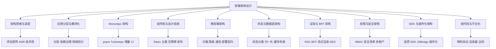

## 目录

- 一、架构思维与选型（ARC-001 ~ ARC-008）
- 二、应用分层与模块化（ARC-009 ~ ARC-018）
- 三、Monorepo 架构（ARC-019 ~ ARC-027）
- 四、组件库与设计系统（ARC-028 ~ ARC-038）
- 五、微前端架构（ARC-039 ~ ARC-050）
- 六、状态与数据层架构（ARC-051 ~ ARC-059）
- 七、渲染与 BFF 架构（ARC-060 ~ ARC-067）
- 八、权限与安全架构（ARC-068 ~ ARC-074）
- 九、SDK 与插件化架构（ARC-075 ~ ARC-087）
- 十、低代码与平台化（ARC-088 ~ ARC-100）
- 十一、大型系统首屏与性能架构（ARC-101 ~ ARC-108）
- 十二、多端与跨端架构（ARC-109 ~ ARC-116）
- 十三、实时协作与编辑器架构（ARC-117 ~ ARC-122）
- 十四、质量与测试架构（ARC-123 ~ ARC-131）
- 十五、可观测性与 DevEx 架构（ARC-132 ~ ARC-138）
- 十六、渐进迁移架构（ARC-139 ~ ARC-146）
- 十七、AI 时代的架构演进（ARC-147 ~ ARC-152）
- 十八、数据与安全专项（ARC-153 ~ ARC-159）
- 十九、组织与协作架构（ARC-160 ~ ARC-166）
- 二十、综合案例与演进（ARC-167 ~ ARC-200）

---

## 一、架构思维与选型（ARC-001 ~ ARC-008）

### ARC-001：做技术选型时，如何设计一套可量化的评估矩阵？
**答**：
- 先定维度（团队熟悉度、生态成熟度、性能、招聘/招人、迁移成本、长期维护），再给权重，权重反映业务优先级而不是个人偏好。
- 每个候选方案按维度打分（1~5），加权求和得出总分，避免"我觉得"式争论。
- 关键点：矩阵本身也要评审——权重错了结论就错；最终结果要附"一票否决项"（如安全合规、License）。

```yaml
# 选型评估矩阵示例：新中后台框架选型 React vs Vue3
dimensions:
  - name: 团队熟悉度        # 现有 80% 成员掌握程度
    weight: 0.25
  - name: 生态成熟度        # 组件库/请求库/SSR 方案完整度
    weight: 0.20
  - name: 招聘与流动成本    # 市场人才供给
    weight: 0.15
  - name: 性能与包体积      # 首屏/运行时开销
    weight: 0.15
  - name: 迁移成本          # 与存量代码共存能力
    weight: 0.15
  - name: 长期维护风险      # 社区活跃度/大厂背书
    weight: 0.10
veto_items:                  # 一票否决项，不计分
  - License 必须允许商用
  - 必须有 LTS 版本承诺
scoring:                     # 1~5 分
  React:    { 团队熟悉度: 5, 生态成熟度: 5, 招聘与流动成本: 5, 性能与包体积: 3, 迁移成本: 4, 长期维护风险: 4 }
  Vue3:     { 团队熟悉度: 3, 生态成熟度: 4, 招聘与流动成本: 4, 性能与包体积: 5, 迁移成本: 4, 长期维护风险: 4 }
# 加权总分：React = 4.55，Vue3 = 4.15，最终选 React 并记录理由进 ADR
```

### ARC-002：自研、开源二次开发、采购 SaaS，三类方案如何决策？
**答**：
- 判断核心是"这件事是不是公司的差异化竞争力"：核心域倾向自研/深度定制，支撑域用开源，非技术核心且变化慢的可采购。
- 还要算总拥有成本 TCO：不只是开发成本，含维护人力、升级成本、人员离职风险。
- 自研的隐性成本最容易被低估（文档、测试、故障值班），要有明确的退出策略。

```typescript
type Option = 'build' | 'openSource' | 'buy';

interface DecisionInput {
  isCoreCompetency: boolean;   // 是否核心差异化能力
  teamHeadcount: number;       // 可投入人力
  timeToMarketWeeks: number;   // 交付窗口
  tco: { build: number; openSource: number; buy: number }; // 三年总成本(人日)
}

function decide(input: DecisionInput): Option {
  // 核心域且人力充足：自研掌握主动权
  if (input.isCoreCompetency && input.teamHeadcount >= 5) return 'build';
  // 非核心域：在开源和采购之间比 TCO 与定制空间
  if (!input.isCoreCompetency) {
    const needHeavyCustom = input.tco.openSource > input.tco.buy * 1.5;
    return needHeavyCustom ? 'buy' : 'openSource';
  }
  // 核心域但人力不足：开源二开 + 沉淀自研补丁层，保留替换能力
  return 'openSource';
}
// 要点：无论选哪个，都在业务与方案之间留一层防腐层（adapter），降低未来替换成本
```

### ARC-003：架构设计文档应该怎么写？什么是 ADR（Architecture Decision Record）？
**答**：
- 架构文档要回答：背景与问题、目标与非目标、总体方案、关键决策及理由、风险与回滚。避免写成"功能说明书"。
- ADR 是轻量级决策记录：一个文件记录一个决策，包含上下文、候选方案、决策结果、后果；不可变，新决策推翻旧决策时标记 Superseded。
- 价值在于"给一年后的自己/新人看"：为什么当时不用微前端、为什么选 pnpm。

```text
docs/adr/0001-采用-pnpm-monorepo.md
-----------------------------------
# ADR-0001 采用 pnpm 管理 Monorepo

状态：Accepted（2026-03）   决策人：前端架构组
背景：仓库 12 个包互相依赖，npm 安装慢且幽灵依赖导致线上事故 2 次。
候选方案：
  1. 继续 npm + 多仓库 —— 跨仓改动联调成本高
  2. yarn workspace —— PnP 生态兼容性有坑
  3. pnpm workspace —— 严格依赖、硬链接省磁盘
决策：选 pnpm workspace + Turborepo。
后果：
  正面：安装提速 60%，幽灵依赖从机制上被禁掉。
  负面：CI 需配 pnpm store 缓存；老成员需熟悉 filter 命令。
  回滚策略：保留 lockfile，可整体切回 npm（预估 1 人日）。
```

### ARC-004：架构评审应该走什么流程？如何避免评审变成走过场？
**答**：
- 流程：提案人提前 48h 发 RFC → 评审会过"目标/非目标/方案对比/风险"四件事 → 结论必须落 ADR → 上线后做架构复盘。
- 避免走过场的关键：评审前有书面材料、评审时只争"关键分歧点"、有明确的否决权与升级路径。
- 评审不追求一次通过，可以给出"有条件通过 + 跟进项"。

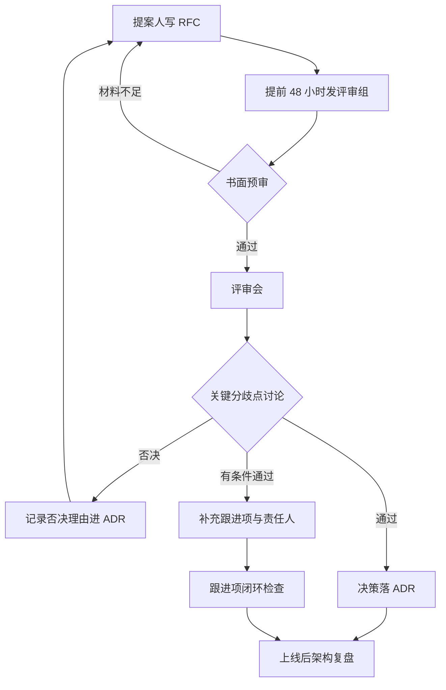

### ARC-005：前端技术债如何识别、量化与偿还？
**答**：
- 识别信号：重复代码率升高、单文件巨型组件、依赖安全告警、新需求排期中"改老代码"占比、oncall 事件归因。
- 量化方法：建技术债台账，按"修复成本 × 影响面 × 复发概率"估利息，优先还"高利息"的债。
- 偿还策略：固定比例（如 20% 排期）持续偿还 + 大版本窗口集中重构；禁止"无业务价值的纯重构"无上限膨胀。

```typescript
interface TechDebtItem {
  id: string;
  type: 'code' | 'dependency' | 'architecture' | 'docs';
  description: string;
  costDays: number;        // 修复成本
  blastRadius: 1 | 2 | 3;  // 影响面：1 单模块 3 全站
  recurrenceRate: number;  // 月均复发/阻塞次数
}

function interestScore(d: TechDebtItem): number {
  // "利息" = 复发频率 × 影响面，除以修复成本得到单位成本收益
  return (d.recurrenceRate * d.blastRadius) / Math.max(d.costDays, 0.5);
}

// 排序偿还：利息最高的先还，costDays 超过 5 的拆成里程碑
const backlog: TechDebtItem[] = [];
const repayPlan = backlog
  .map(d => ({ ...d, score: interestScore(d) }))
  .sort((a, b) => b.score - a.score)
  .slice(0, 5); // 每个迭代只还 top5，其余进长周期池
```

### ARC-006：存量系统该渐进式演进还是推倒重来？如何落地"绞杀者模式"？
**答**：
- 默认选渐进式：重写风险集中在"业务逻辑的暗知识"，老系统跑得越久隐性规则越多。
- 推倒重来只在少数情况成立：技术栈无法满足硬性指标、维护成本已超过重写成本、且业务窗口允许 3~6 个月并行。
- 绞杀者模式：新系统按路由/页面逐步接管流量，网关层做分流，老页面只减不增，最后下线。

```text
# Nginx 网关层绞杀者分流配置（按路由渐进接管）
# 阶段1：新系统只接 /new-orders
location /new-orders/ { proxy_pass http://next-app/; }
location /orders/     { proxy_pass http://legacy-app/; }

# 阶段2：白名单用户切新，灰度开关由配置中心控制
map $cookie_gray_flag $orders_upstream {
  default   legacy-app;
  "beta"    next-app;
}
location /orders/ { proxy_pass http://$orders_upstream/; }

# 阶段3：全量后老路由 301，legacy-app 下线
# 铁律：老系统进入绞杀期后"只减不增"，新需求一律落新系统
```

### ARC-007：康威定律对前端团队组织与架构设计有什么指导意义？
**答**：
- 康威定律：系统结构会镜像组织的沟通结构。前端做"组件库/微前端/分层"时，如果不匹配团队结构，架构必然腐烂。
- 应用逆康威 maneuver：想要什么架构，就先按那个架构切团队/职责（如按业务域分前端小组，对应微前端按域拆分）。
- 平台型团队（组件库/基建）与业务型团队的配比要显性化，一般 1:5~1:8。

```text
# 团队组织 ↔ 架构边界的对应关系（按业务域切分）
组织结构                                 架构产物
─────────────────────────               ─────────────────────────
前端平台组(6人, 横向支撑)        ───►    @corp/design-system + @corp/foundation 微前端基座
交易域前端组(5人)                ───►    app-trade 微应用（购物车/下单/支付）
增长域前端组(4人)                ───►    app-growth 微应用（营销页/活动/AB实验）
内容域前端组(4人)                ───►    app-content 微应用（CMS/详情页）
# 规则：跨组只通过"发布契约"（npm 包 / MF 模块 / API）协作，
# 禁止跨域直接改对方目录 —— 架构边界即团队边界
```

### ARC-008：CAP 定理在前端有哪些具体表现？一致性 vs 可用性如何取舍？
**答**：
- 前端天然处于"分区"常态（弱网、接口失败），必须选 AP：宁可展示稍旧数据，也不能白屏。
- 典型权衡：缓存旧数据 + 后台刷新（stale-while-revalidate）= 选可用性；下单页价格强校验 = 关键路径选一致性。
- 好的前端架构是"分层取舍"：列表页容忍不一致，交易页强一致，用状态分类学把策略显性化。

```typescript
// 列表页：AP 策略 —— 先展示缓存旧数据，后台刷新，失败降级
const { data } = useQuery({
  queryKey: ['goods-list'],
  queryFn: fetchGoods,
  staleTime: 60_000,
  gcTime: 24 * 60 * 60_000,          // 离线也能读到旧数据（可用性）
  placeholderData: keepPreviousData,  // 翻页不闪空（体验一致性让位可用性）
});

// 下单页：CP 策略 —— 提交前强制拉最新价格做服务端校验
async function submitOrder(skuId: string) {
  const latest = await fetchPrice(skuId, { cache: 'no-store' }); // 舍弃可用性换一致性
  if (latest.price !== cartCache.getPrice(skuId)) {
    throw new PriceChangedError(latest.price); // 弹窗让用户二次确认
  }
  return createOrder(skuId, latest.price);
}
```

---

## 二、应用分层与模块化（ARC-009 ~ ARC-018）

### ARC-009：前端经典分层（视图/业务/服务/基础设施）如何设计？依赖方向为什么必须是单向？
**答**：
- 视图层只做渲染与交互，业务层放领域逻辑（use case），服务层封装数据访问（API/缓存），基础设施层放纯工具与第三方封装。
- 依赖方向只能"上层依赖下层"，反向依赖会导致改动扩散、无法独立测试。
- 判断标准：把 React 换成 Vue，业务层和基础设施层应该一行不改。

```typescript
// 依赖方向：View → Application → Domain ← Infrastructure（依赖倒置）
// domain/order.ts —— 领域层，零依赖任何框架
export function canRefund(order: Order, now: Date): boolean {
  return order.status === 'paid' && now.getTime() - order.paidAt.getTime() < 7 * 864e5;
}

// application/refund.ts —— 用例层，只依赖接口
import type { OrderRepo } from './ports';
export async function refundUseCase(repo: OrderRepo, orderId: string) {
  const order = await repo.findById(orderId);
  if (!canRefund(order, new Date())) throw new Error('REFUND_WINDOW_CLOSED');
  await repo.updateStatus(orderId, 'refunding');
}

// infrastructure/orderApi.ts —— 适配层实现接口，可被 mock/替换
export const orderRepo: OrderRepo = {
  findById: (id) => http.get(`/orders/${id}`),
  updateStatus: (id, s) => http.post(`/orders/${id}/status`, { status: s }),
};
```

### ARC-010：六边形架构/整洁架构在前端如何落地？
**答**：
- 核心：领域与用例在中心，通过 Port（接口）声明需要什么能力，Adapter（实现）在外圈对接 React/HTTP/LocalStorage。
- 前端落地形态：`domain/` 纯函数与实体、`application/` use case 与 port 接口、`adapters/` UI 适配与数据适配。
- 最大收益是可测试性：用例层不需要渲染即可单测；代价是样板代码，适合复杂业务域，简单页面不必套。

```typescript
// ports —— 应用层声明能力，不关心实现
export interface CartStorage {
  save(items: CartItem[]): Promise<void>;
  load(): Promise<CartItem[]>;
}
export interface PricePort {
  get(skuId: string): Promise<number>;
}

// use case —— 中心圆，只认识接口
export async function checkout(cart: CartItem[], storage: CartStorage, price: PricePort) {
  const amounts = await Promise.all(cart.map(i => price.get(i.skuId)));
  const total = cart.reduce((s, i, idx) => s + i.qty * amounts[idx], 0);
  await storage.save([]);
  return { total };
}

// adapter —— 外圈实现：React 侧注入 localStorage 实现，测试侧注入内存实现
export const localStorageCart: CartStorage = {
  save: items => navigator.locks ? localStorage.setItem('cart', JSON.stringify(items)) : Promise.resolve(),
  load: async () => JSON.parse(localStorage.getItem('cart') ?? '[]'),
};
export const memoryCart = (init: CartItem[] = []): CartStorage => {
  let data = init;
  return { save: async i => { data = i; }, load: async () => data };
};
```

### ARC-011：如何系统性治理循环依赖？
**答**：
- 先用工具暴露问题：`eslint import/no-cycle` 阻断新增，`dependency-cruiser` 输出全量依赖图并固化分层规则。
- 治理手法：抽公共下沉模块、依赖倒置（改为依赖接口）、事件解耦；禁止靠"挪代码躲规则"。
- 长效机制：CI 卡口 + 每月依赖图 review，把循环数当成架构健康度指标。

```yaml
# .dependency-cruiser.cjs 关键规则（同时配 eslint: import/no-cycle: error）
rules:
  - name: no-circular
    severity: error
    from: {}
    to: { circular: true }          # 任何循环直接报错
  - name: layers-cannot-go-up       # 分层不可逆向依赖
    severity: error
    from: { path: '^src/domain' }
    to: { path: '^src/(application|adapters|views)' }   # domain 不准依赖上层
  - name: views-not-import-domain-internals
    severity: warn
    from: { path: '^src/views' }
    to: { path: '^src/domain/.+/internal' }
  - name: cross-feature-only-via-public-api
    severity: error
    from: { path: '^src/features/([^/]+)/' }
    to: { path: '^src/features/(?!$1)[^/]+/(?!index)' } # 跨 feature 只能走 index 入口
```

### ARC-012：Barrel file（index.js 统一出口）有什么利弊？如何取舍？
**答**：
- 利：模块边界清晰，调用方不感知内部结构，重构内部目录不影响外部。
- 弊：大型库会拖慢构建（所有模块被编译进依赖图）、可能破坏 tree-shaking（有副作用声明时）、容易造成循环依赖。
- 取舍：业务代码 feature 用 barrel；高.payload性能敏感的 npm 包用显式深路径 + exports 映射，慎用 barrel。

```typescript
// src/features/cart/index.ts —— 只暴露公共 API，内部实现不外泄
export { CartProvider } from './provider';
export { useCart } from './hooks/useCart';
export type { CartItem } from './types';
// 禁止：export * —— 会把内部工具/未稳定 API 全部泄漏成"事实公共接口"

// 高性能 npm 包则放弃 barrel，用 exports 精确映射利于 tree-shaking：
// package.json
// "exports": {
//   "./button": { "types": "./es/button.d.ts", "import": "./es/button.js" },
//   "./table":  { "types": "./es/table.d.ts",  "import": "./es/table.js" }
// }
```

### ARC-013：如何划分核心域与支撑域？以电商前端为例。
**答**：
- 核心域是公司赚钱的差异能力（交易、购物车），投入最优秀的资源和最严的工程质量；支撑域（用户中心、消息）用标准方案快速交付；通用域（登录、埋点）直接用平台能力。
- 划分依据不是"技术上复杂"，而是"业务价值和差异化程度"。
- 落到前端：核心域重建模与测试覆盖，支撑域重模板与效率，避免全站一个标准拉齐成本。

```text
电商前端领域划分与投入策略
────────────────────────────────────────────────
核心域（交易链路）          工程策略：领域建模 + 单测覆盖80%+ + 变更需评审
├── 购物车 / 下单 / 支付收银台
├── 库存与价格展示（强一致）
└── 售后逆向流程
支撑域（能力型）            工程策略：标准 CRUD 模板 + 快速交付
├── 商品详情/搜索结果展示
├── 用户中心/地址管理
└── 客服消息
通用域（全站复用）          工程策略：平台化沉淀，业务团队不自研
├── 登录鉴权 / SSO
├── 埋点与监控
└── 设计系统组件库
# 面试要点：划分决定投入，"支撑域用核心域的标准"是典型的过度工程
```

### ARC-014：什么时候才应该把代码抽成公共包？如何避免过早抽象？
**答**：
- 判断信号：Rule of Three——第三次复制相似实现时才抽象；或两处使用但语义完全稳定、接口已收敛。
- 过早抽象的代价：接口猜错后公共包变成"万能配置项大杂烩"，所有业务被一个错误抽象锁死。
- 抽包前检查：有没有明确 owner、有没有版本与变更流程、消费方是否愿意接受发版节奏。

```typescript
// 抽包决策清单（全过才抽）
const checklist = {
  duplicated: 3,            // 已在 3+ 处复制（Rule of Three）
  apiStable: true,          // 接口连续 2 个迭代未变
  hasOwner: true,           // 有明确维护人与 CODEOWNERS 条目
  hasVersioning: true,      // 接入 changesets，敢发 1.0
  consumersAgreed: true,    // 消费方接受"等发版"而非"随手改"
  testable: true,           // 能脱离业务环境独立测试
};
function shouldExtract(c: typeof checklist): boolean {
  return Object.values(c).every(Boolean);
}
// 未满足时先用 monorepo 内部目录共享（src/shared/），等成熟再升格为 package
```

### ARC-015：DDD 在前端如何做轻量级实践？
**答**：
- 不必照搬聚合根/仓储全套，前端取三点：统一语言（术语与代码命名一致）、实体行为内聚（校验规则进实体而非散落组件）、值对象不可变。
- 收益集中在前端最痛的"表单/状态规则散落"：把业务规则从组件里捞出来，组件只剩渲染。
- 轻量边界：只对核心域做 DDD，支撑域仍用贫血模型 + 表单库。

```typescript
// 统一语言：代码命名即业务术语（不是 data1/list2）
// 值对象不可变 + 不变式内聚
class Money {
  private constructor(
    readonly amount: number,   // 分为单位，避免浮点误差
    readonly currency: 'CNY' | 'USD',
  ) {}
  static create(amount: number, currency: 'CNY' | 'USD'): Money {
    if (!Number.isInteger(amount)) throw new Error('金额必须为分（整数）');
    if (amount < 0) throw new Error('金额不可为负');
    return new Money(amount, currency);
  }
  add(other: Money): Money {           // 行为在实体上，而非组件里的 if/else
    if (other.currency !== this.currency) throw new Error('币种不一致');
    return Money.create(this.amount + other.amount, this.currency);
  }
  toYuanString(): string { return (this.amount / 100).toFixed(2); }
}
// 组件只做展示与交互：<Price value={total.toYuanString()} />
```

### ARC-016：feature 目录 vs 类型目录（components/hooks/services），如何选择与演进？
**答**：
- 类型目录（按技术分层）适合小项目：直观、上手快；但一个需求要跳 4 个目录，且"哪个组件属于哪个功能"会逐渐失控。
- feature 目录（按业务内聚）适合中大型：删功能=删目录，边界清晰；需要纪律防止跨 feature 乱引。
- 演进路径：MVP 用类型目录 → 出现 3+ 并行团队/复杂域后迁移到 feature 目录，迁移按域逐步进行。

```text
方案A 类型目录（技术视角）              方案B feature 目录（业务视角）
src/                                    src/
├── components/                         ├── features/
│   ├── OrderCard.vue                   │   ├── order/          # 交易域
│   ├── AddressForm.vue                 │   │   ├── components/
│   └── SkuPicker.vue                   │   │   ├── hooks/
├── hooks/                              │   │   ├── api.ts
│   ├── useOrder.ts                     │   │   └── index.ts    # 公共出口
│   └── useAddress.ts                   │   ├── address/        # 地址域
├── services/                           │   └── logistics/      # 物流域
│   ├── order.ts                        ├── shared/             # 跨域公共（受管控）
│   └── address.ts                      │   ├── components/
└── api/                                │   └── utils/
    └── index.js                        └── app/                # 组装入口（路由/全局Provider）
# 取舍：A 改一个需求跨 3 个目录；B 删除 address 功能=删一个目录，依赖被 index.ts 卡住
```

### ARC-017：层与层之间的通信契约如何定义？前端怎么做轻量依赖注入？
**答**：
- 契约即接口：上层定义"我需要什么"（port），下层实现"我怎么给"（adapter），类型系统保证两边一致。
- 注入方式按规模选：props/context 注入（小）、模块级工厂注入（中）、IoC 容器（大）。
- 收益：测试可替换、实现可换技术栈（axios 换 fetch 不动业务）。

```typescript
// 1. 定义契约 token 与接口
export const HttpPort = Symbol('HttpPort') as InjectionKey<HttpPort>;
export interface HttpPort {
  get<T>(url: string): Promise<T>;
  post<T>(url: string, body: unknown): Promise<T>;
}

// 2. 基础设施层提供实现（可换：axios / fetch / mock）
export const axiosAdapter: HttpPort = {
  get: url => axios.get(url).then(r => r.data),
  post: (url, body) => axios.post(url, body).then(r => r.data),
};

// 3. 应用装配时注入（Composition Root 唯一出口）
app.provide(HttpPort, axiosAdapter);

// 4. 业务层只依赖契约
export function useOrderList() {
  const http = inject(HttpPort)!;     // 拿到的是接口而非具体实现
  return useQuery(() => http.get('/orders'));
}
```

### ARC-018：单体前端的模块化边界，应该有一份什么样的清单？
**答**：
- 边界清单是"架构即代码"的落点：目录归属、依赖白名单、公共出口、命名规范，全部机器可校验。
- 没有清单的单体会在 6~12 个月退化为大泥球，清单是未来拆微前端的预演。
- 清单要随架构评审更新，不写口头约定。

```yaml
# modules-boundaries.yaml —— 单体前端边界契约（CI 校验）
features:
  order:
    owner: trade-team
    publicApi: src/features/order/index.ts    # 对外只许从这里 import
    dependsOn: [shared, order-domain]          # 依赖白名单
    forbidden: [features/payment]              # 显式禁止项
  payment:
    owner: trade-team
    publicApi: src/features/payment/index.ts
    dependsOn: [shared]
    forbidden: [features/order]                # 交易与支付互不依赖，靠事件协作
shared:
  owner: platform-team
  rule: 只能被依赖，不能反向依赖任何 feature
checks:
  circular: error
  crossFeatureViaPublicApi: error
  layerDirection: error        # domain 不依赖上层
  maxFeatureLoc: 8000          # 单 feature 超限触发拆分评审
```

---

## 三、Monorepo 架构（ARC-019 ~ ARC-027）

### ARC-019：Monorepo vs Polyrepo 如何决策？
**答**：
- Monorepo 解决"跨仓改动"成本：原子提交、统一工具链、代码复用零成本；代价是仓库规模、CI 复杂度、权限粒度粗。
- Polyrepo 适合团队边界清晰、发布节奏独立、需要严格权限隔离的场景。
- 决策看三件事：跨仓变更频率、团队规模、共享代码占比；三者都高就选 Monorepo。

```typescript
interface RepoDecision {
  crossRepoChangesPerWeek: number;  // 每周需要跨仓联动的改动数
  teamCount: number;                // 前端团队数
  sharedCodeRatio: number;          // 共享代码占比 0~1
  strictAccessControl: boolean;     // 是否需要仓库级权限隔离（如外包参与）
}

function chooseRepoStrategy(d: RepoDecision): 'monorepo' | 'polyrepo' | 'hybrid' {
  if (d.strictAccessControl) return 'hybrid';          // 核心码 monorepo + 外围 polyrepo
  const score =
    (d.crossRepoChangesPerWeek >= 5 ? 2 : 0) +
    (d.teamCount >= 3 ? 1 : 0) +
    (d.sharedCodeRatio >= 0.3 ? 2 : 0);
  return score >= 3 ? 'monorepo' : 'polyrepo';
}
// 经验值：共享代码 >30% 且每周跨仓联动 ≥5 次，polyrepo 的同步成本会指数上升
```

### ARC-020：pnpm workspace 的目录结构如何设计？
**答**：
- `apps/` 放可部署产物（站点、服务），`packages/` 放被复用的库；二者界限必须清晰，禁止反向引用。
- 包命名用 scope（`@corp/xxx`），内部依赖一律 `workspace:*` 协议，天然防幽灵依赖。
- 配置文件（tsconfig/eslint/prettier）收敛到 `packages/tsconfig` 等内部包，避免根目录复制粘贴。

```text
monorepo/
├── apps/
│   ├── web-shop/          # C 端商城（可部署）
│   ├── admin/             # 中后台（可部署）
│   └── ssr-server/        # BFF/SSR 服务
├── packages/
│   ├── ui/                # @corp/ui 组件库
│   ├── design-tokens/     # @corp/design-tokens Token 源
│   ├── request/           # @corp/request 请求层
│   ├── utils/             # @corp/utils 纯函数
│   └── tsconfig/          # @corp/tsconfig 配置即包
├── tooling/               # eslint-config / scripts（不发布）
├── pnpm-workspace.yaml
├── turbo.json
└── package.json
```

```yaml
# pnpm-workspace.yaml
packages:
  - apps/*
  - packages/*
  - tooling/*
# 根 package.json 关键配置：
# "packageManager": "pnpm@9.x"  锁定包管理器
# 内部引用一律写 "@corp/ui": "workspace:*"
```

### ARC-021：Monorepo 的包版本策略怎么选？changesets 如何工作？
**答**：
- fixed 模式：所有包统一版本，一致性好但会"陪跑发版"，适合强耦合包群（如组件库一族）。
- independent 模式：各包独立 semver，发布精准但心智负担高，适合松散工具包。
- changesets 的流程：开发时 `changeset` 声明变更意图 → PR 携带变更文件 → 合并后 CI 自动汇总发版并写 CHANGELOG，把"发版"从人肉变成 PR 驱动。

```text
# changesets 工作流
1) feat 分支上执行：pnpm changeset
   → 选择 bump 类型（patch/minor/major）+ 写变更摘要
   → 生成 .changeset/xxx-yyy.md  与代码一起提交
2) PR review：变更文件就是"发版意图"，评审可见
3) 合并入 main：CI 版本机器人汇总所有 changeset
   → 消耗 changeset 文件、升版本、写 CHANGELOG、自动 publish
```

```markdown
<!-- .changeset/lucky-lions-run.md —— PR 中携带的变更声明 -->
---
'@corp/ui': minor
'@corp/design-tokens': patch
---

feat(ui): Button 增加 loading 态；同步 token 间距规范
```

### ARC-022：Turborepo 的 task pipeline 与远程缓存如何设计？
**答**：
- `turbo.json` 声明任务依赖关系：`build` 依赖上游包的 `build`（`^build`），`lint`/`test` 可并行，保证拓扑序正确。
- 远程缓存以"任务输入哈希"为键：输入不变直接命中缓存，CI 时间从分钟级降到秒级。
- 必须显式声明 inputs/outputs，否则缓存会"假命中"，这是 Turborepo 事故的第一来源。

```json
{
  "tasks": {
    "build": {
      "dependsOn": ["^build"],          // 先构建依赖的上游包
      "inputs": ["src/**", "package.json", "tsconfig.json"],
      "outputs": ["dist/**"]            // 声明产物目录才能被缓存复用
    },
    "test": {
      "dependsOn": ["build"],           // 测试前先有构建产物
      "outputs": ["coverage/**"]
    },
    "lint": { "outputs": [] },          // 无产物，纯并行
    "dev": { "cache": false, "persistent": true }  // 长驻进程不缓存
  }
}
```

### ARC-023：Nx 的 affected 思想是什么？如何只构建受影响的包？
**答**：
- affected = 基于 git diff 找出本次变更的文件 → 映射到所属包 → 结合依赖图做闭包传播，得到"真正受影响的包集合"。
- 它的价值是把 CI 从"每次全量"变成"按图增量"，包越多收益越大。
- Turborepo 用 `--filter=...[origin/main]` 表达同样思想，核心都是"变更感知 + 依赖图闭包"。

```bash
# Nx：只测试受 origin/main 变化影响的包
nx affected:test --base=origin/main --parallel=3

# 等价的 pnpm + Turborepo 写法：从 main 分叉以来有改动的包及其下游
pnpm --filter "...[origin/main]" test
turbo run build test --filter=...[origin/main]

# 排查受影响集合（dry run，面试常问：如何验证 filter 写对了）
pnpm -r --filter "...[origin/main]" exec pwd
```

### ARC-024：Monorepo 内部包引用，该用源码直引还是构建产物？
**答**：
- 源码直引（Transpile Packages）：调试方便、改动即时生效，但每个 app 都要重复编译上游，构建慢、编译器配置耦合。
- 构建产物引用：包自己 `prepublish`/watch 产出 dist，消费方零编译成本，但开发链路要配 watch。
- 实践折中：开发期用 tsconfig paths + pnpm 内部链接直指源码，CI/发布走产物；Turborepo 的 `^build` 保证产物总是新鲜。

```json
{
  "name": "@corp/ui",
  "main": "./dist/index.cjs",
  "module": "./dist/index.js",
  "types": "./dist/index.d.ts",
  "exports": {
    ".": {
      "types": "./dist/index.d.ts",
      "import": "./dist/index.js",
      "require": "./dist/index.cjs"
    },
    "./package.json": "./package.json"
  },
  "files": ["dist"],
  "scripts": {
    "dev": "tsup src --watch",          // 开发期 watch
    "build": "tsup src --format esm,cjs --dts"
  },
  "publishConfig": { "access": "public" }
}
```

### ARC-025：什么是幽灵依赖？pnpm 如何从机制上治理它？
**答**：
- 幽灵依赖：代码 import 了"没有声明在 package.json 里"的包，只是因为 npm/yarn 扁平化 hoist 到根 node_modules 才碰巧能用。
- 危害：上游某天不再传递依赖它，构建直接崩；版本也不受你控制。
- pnpm 默认符号链接结构让未声明依赖不可见，从机制上修复，而不是靠 lint 提醒。

```ini
# .npmrc —— pnpm 幽灵依赖治理配置
hoist=false                     # 关键：不把依赖偷偷提升到根，未声明的包 import 不到了
shallow-install=false
strict-peer-dependencies=true   # peer 依赖缺失直接报错，避免版本错配上线
auto-install-peers=true
# 配合命令检查：pnpm dlx depcheck  扫出"用了但没声明"的包
```

### ARC-026：Monorepo 的 CI 策略如何设计（增量构建/测试）？
**答**：
- 三层增量：PR 只跑 affected 包 → 远程缓存命中跳过重复任务 → main 全量校验兜底。
- 发布与 CI 分离：CI 校验，main 上的版本机器人负责发版（changesets action）。
- 必须缓存 pnpm store + turbo 远程缓存，否则增量收益被安装时间吃掉。

```yaml
# .github/workflows/ci.yml —— Monorepo 增量 CI
on: { pull_request: {}, push: { branches: [main] } }
jobs:
  ci:
    runs-on: ubuntu-latest
    steps:
      - uses: actions/checkout@v4
        with: { fetch-depth: 0 }        # affected 需要 git 历史
      - uses: pnpm/action-setup@v4
      - uses: actions/setup-node@v4
        with: { node-version: 22, cache: pnpm }
      - run: pnpm install --frozen-lockfile
      - name: Build & Test (affected only)
        run: |
          if [ "${{ github.event_name }}" = "pull_request" ]; then
            pnpm turbo build test lint --affected    # PR：只跑受影响包
          else
            pnpm turbo build test lint               # main：全量兜底
          fi
      - uses: dtinth/setup-github-actions-caching-for-turbo@v1  # turbo 远程缓存
```

### ARC-027：Monorepo 下如何设计代码所有权（CODEOWNERS）？
**答**：
- CODEOWNERS 把"谁能改哪些目录"变成可执行规则：改到对应路径 PR 自动指派 reviewer，owner 未 approve 不能合并。
- 它是模块边界清单的权限配套：`apps/*` 归业务团队、`packages/ui` 归平台组、根配置归架构组。
- 注意粒度：过细会造成评审瓶颈，共享基建建议"组 ownership + 个人 backup"。

```text
# .github/CODEOWNERS —— 越靠后的规则优先级越高
*                          @frontend/arch-team        # 默认兜底：根配置、未知路径

/apps/web-shop/            @frontend/trade-team
/apps/admin/               @frontend/platform-biz
/packages/ui/              @frontend/design-system    # 组件库必须 DS 组评审
/packages/design-tokens/   @frontend/design-system @design-lead
/tooling/eslint-config/    @frontend/arch-team
/.github/CODEOWNERS        @frontend/arch-team        # 权限文件本身只能架构组改
# 规则：改 /packages/ui 的 PR 会同时要求 design-system 组 approve，
# 业务团队无法绕过平台组直接修改共享组件
```

---

## 四、组件库与设计系统（ARC-028 ~ ARC-038）

### ARC-028：组件库的整体架构如何设计（源码/构建/文档/测试/发布一条龙）？文档站如何选型？
**答**：
- 组件库是"产品"：源码 + 构建（双格式产物）+ 文档站（示例即测试）+ 测试（单测+视觉回归）+ 版本发布，五件套缺一不可。
- 文档站选型：React 生态用 Storybook（生态最大、addons 丰富、偏隔离展示）；需要带业务 Demo/MDX 深度定制用 dumi（Ant 系、中文友好）；内部组件库常选 Storybook + 自研首页。
- 目录按"一组件一目录"内聚：组件、样式、单测、文档、demo 放一起，删组件=删目录。

```text
packages/ui/
├── src/
│   └── button/
│       ├── Button.tsx          # 组件实现
│       ├── button.scss         # 样式（Token 驱动）
│       ├── Button.test.tsx     # 单测（RTL）
│       ├── button.stories.tsx  # 文档即示例（CSF3）
│       ├── button.docs.mdx     # API 说明
│       └── index.ts
├── .storybook/                 # 文档站配置（main.ts/preview.tsx）
├── vitest.config.ts            # 单测
├── chromatic.config.json       # 视觉回归
├── package.json                # exports 双格式
└── turbo.json
# 发布链路：main 合并 → changesets 定版本 → CI build(ESM+CJS+DTS)
# → vitest + axe 无障碍检查 → chromatic 视觉基线比对 → npm publish → 文档站同步部署
```

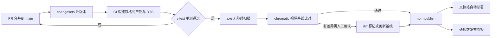

### ARC-029：Design Token 体系如何做三层设计？
**答**：
- 三层：基础 Token（原子值：色板/字号阶梯）→ 语义 Token（意图：`color-bg-primary`、`space-md`）→ 组件 Token（`button-bg-primary`）。
- 关键是组件只允许消费组件 Token 或语义 Token，禁止直连基础 Token——换主题/换品牌只改语义层映射。
- Token 源用 JSON/TS 单一事实源，构建时生成 CSS 变量、SCSS、TS 常量与小程序/Flutter 映射。

```typescript
// tokens/seed.ts —— 第一层：基础 Token（原子值，无语义）
export const base = {
  'blue-6': '#1677ff', 'blue-7': '#0958d9',
  'gray-1': '#ffffff', 'gray-3': '#f5f5f5', 'gray-9': '#434343',
  'size-4': '16px', 'radius-2': '4px', 'font-size-1': '12px',
};

// tokens/semantic.ts —— 第二层：语义 Token（意图层，主题切换只动这里）
export const semantic = {
  light: { 'color-bg-primary': base['gray-1'], 'color-text-primary': base['gray-9'],
           'color-brand': base['blue-6'], 'space-md': base['size-4'] },
  dark:  { 'color-bg-primary': '#141414', 'color-text-primary': '#e8e8e8',
           'color-brand': base['blue-6'], 'space-md': base['size-4'] },
};

// tokens/button.ts —— 第三层：组件 Token（组件只消费这一层）
export const buttonToken = {
  'button-bg': semantic.light['color-brand'],
  'button-radius': base['radius-2'],
  'button-font-size': base['font-size-1'],
};
```

### ARC-030：主题定制有哪几条技术路线？如何选择？
**答**：
- 运行时 CSS 变量：动态、可热切换（暗色模式/多品牌），首选方案。
- 编译期替换：SCSS 变量/构建时注入，产物体积小但一主题一构建，适合主题固定的私有化部署。
- 多主题包（如 `theme-dark` 单独发包）：隔离最彻底，但版本同步成本高，大厂多品牌场景才值得。

```typescript
// 方案A：运行时 CSS 变量（首选）——构建期生成 :root 变量，切换只改 data-theme
// generated/tokens.css（构建产物示意）
// :root[data-theme=light] { --button-bg: #1677ff; --text-primary: #434343; }
// :root[data-theme=dark]  { --button-bg: #1668dc; --text-primary: #e8e8e8; }

// 切换主题 = 切属性，无需重新构建
export function setTheme(t: 'light' | 'dark') {
  document.documentElement.setAttribute('data-theme', t);
}

// 方案B：编译期替换（私有化部署固定主题）
// theme.config.json → build 时注入 scss
// $brand-color: #00b96b;  @import 'tokens.compile.scss';
// 产物中变量已被静态展开，无运行时开销

// 方案C：多主题包
// @corp/ui            → 默认样式（无主题）
// @corp/ui-theme-dark → 只含变量覆盖包，UI 与主题独立发版
```

### ARC-031：组件库如何设计入口以支持按需加载与 Tree-shaking？
**答**：
- 前提是 ESM 产物 + 无副作用：`sideEffects: false`（样式文件除外），打包器才能安全摇树。
- 双入口策略：主入口聚合导出给 TypeScript 补全，同时提供 `exports` 子路径（`@corp/ui/button`）给强按需场景。
- Babel 插件方案（`unplugin-vue-components`/`babel-plugin-import`）是兜底，能靠 exports 解决就少一个构建插件。

```json
{
  "name": "@corp/ui",
  "type": "module",
  "sideEffects": ["**/*.css"],
  "exports": {
    ".": {
      "types": "./dist/index.d.ts",
      "import": "./dist/index.js",
      "require": "./dist/index.cjs"
    },
    "./button": {
      "types": "./dist/button/index.d.ts",
      "import": "./dist/button/index.js",
      "require": "./dist/button/index.cjs"
    },
    "./dist/style.css": "./dist/style.css",
    "./package.json": "./package.json"
  }
}
```

```typescript
// dist/index.js 聚合入口（配合 sideEffects:false 可被 tree-shaking）
export { Button } from './button';
export { Table } from './table';
// 使用方：import { Button } from '@corp/ui' → 只打包 Button 相关模块
// 使用方：import Button from '@corp/ui/button' → 显式子路径，按需最彻底
```

### ARC-032：无障碍组件基线包含哪些内容？如何工程化落地？
**答**：
- 基线：键盘可达（Tab 顺序、焦点圈）、焦点管理（Modal 焦点圈闭/释放、focus trap）、ARIA 语义（role/aria-expanded/aria-live）、颜色对比度。
- 工程化：axe 自动扫描进 CI + Storybook a11y addon 每个故事可查 + 键盘路径手测清单进验收标准。
- 关键共识：无障碍是组件库基线而非增值项，业务组件不应重复处理。

```typescript
// 弹窗焦点圈闭（focus trap）——无障碍组件基线的典型实现
export function useFocusTrap(ref: RefObject<HTMLElement>, open: boolean) {
  useEffect(() => {
    if (!open || !ref.current) return;
    const root = ref.current;
    const prev = document.activeElement as HTMLElement; // 记住触发元素，关闭时归还焦点
    const sel = 'a[href],button:not([disabled]),input,select,textarea,[tabindex]:not([tabindex="-1"])';
    const focusables = () => Array.from(root.querySelectorAll<HTMLElement>(sel));
    focusables()[0]?.focus();                            // 打开即入焦
    function onKey(e: KeyboardEvent) {
      if (e.key === 'Tab') {
        const list = focusables();
        const first = list[0], last = list[list.length - 1];
        if (e.shiftKey && document.activeElement === first) { last.focus(); e.preventDefault(); }
        else if (!e.shiftKey && document.activeElement === last) { first.focus(); e.preventDefault(); }
      }
    }
    root.addEventListener('keydown', onKey);
    return () => { root.removeEventListener('keydown', onKey); prev?.focus(); };
  }, [open, ref]);
}
```

### ARC-033：表单组件应如何架构设计（受控/校验协议/联动）？
**答**：
- 三层解耦：Field 组件只管"渲染 + 值绑定"，Form 管状态容器与上下文，校验是独立协议（schema 注册进字段）。
- 校验协议统一为 `validator(value, values) => Promise<string | null>`，同步异步同构，规则可来自后端下发。
- 联动分两级：值联动（FormInstance watch）与 schema 联动（visible/disabled 声明式表达式），后者是低代码表单的基础。

```typescript
// 校验协议：所有规则实现同一签名
export type Validator = (
  value: unknown,
  allValues: Record<string, unknown>,   // 支持跨字段联动校验（密码确认）
) => Promise<string | null> | string | null;

export const required = (msg = '必填'): Validator => v =>
  v == null || v === '' ? msg : null;

export const confirmPwd: Validator = (v, all) =>
  v === all.password ? null : '两次密码不一致';

// 字段注册：受控 + 校验协议挂载
export interface FieldProps {
  name: string;
  validators?: Validator[];
  children: (ctrl: { value: unknown; onChange: (v: unknown) => void; error?: string }) => ReactNode;
}

function Field({ name, validators = [], children }: FieldProps) {
  const form = useFormContext();
  const value = form.watch(name);
  const [error, setError] = useState<string>();
  const onBlur = async () => {                       // 失焦触发异步校验
    for (const validate of validators) {
      const msg = await validate(value, form.getValues());
      if (msg) return setError(msg);                 // 串行短路，第一条错误即停
    }
    setError(undefined);
  };
  return children({ value, onChange: v => form.setValue(name, v), error: (form.touched(name) && onBlur()) ?? error });
}
```

### ARC-034：大数据量表格组件如何设计（虚拟滚动/编辑态）？
**答**：
- 核心：DOM 行数与数据量解耦。虚拟滚动只渲染可视区 + overscan，行高可变时用"预估高度 + 动态测量修正偏移表"。
- 数据层与视图层分离：数据层支持百万行游标分页 + 行级缓存；编辑态用"脏数据覆盖层"（edits Map）而不改原始数组，便于一键还原与批量提交。
- 性能红线：render 阶段不做排序过滤（前置到数据层），行组件 memo + 稳定 key。

```typescript
interface VirtualTableProps<Row> {
  rows: Row[];
  rowKey: keyof Row;
  estimateRowHeight: number;
  overscan?: number;                       // 上下缓冲行数
}

function useVirtualList<T>(rows: T[], estimate: number, overscan = 5) {
  const containerRef = useRef<HTMLDivElement>(null);
  const [scrollTop, setScrollTop] = useState(0);
  const [heights, setHeights] = useState<number[]>([]);        // 实测行高，稀疏初始化
  const h = (i: number) => heights[i] ?? estimate;
  const offsets = useMemo(() => {                              // 前缀和算偏移
    const arr = [0];
    for (let i = 0; i < rows.length; i++) arr.push(arr[i]! + h(i));
    return arr;
  }, [rows.length, heights, estimate]);
  const start = binarySearch(offsets, scrollTop) - 1;          // 可视区首行
  const end = Math.min(rows.length, binarySearch(offsets, scrollTop + 800) + overscan);
  return {
    containerRef, offsetY: offsets[start],
    visible: rows.slice(start, end).map((row, i) => ({ row, index: start + i })),
    measureRow: (i: number, height: number) =>                 // 渲染后回填实测高度
      setHeights(prev => (prev[i] === height ? prev : Object.assign([...prev], { [i]: height }))),
  };
}
// 编辑态：edits Map<rowKey, Partial<Row>> 覆盖显示，保存时 diff 提交，重置时清空 Map
```

### ARC-035：组件库的视觉回归测试如何搭建？
**答**：
- 原理：每个 Story 渲染成截图 → 与基线 diff → 超阈值标记 review。它捕获"单测测不出的样式破坏"。
- 工具：Chromatic（Storybook 官方、托管基线与 UI review 流）、或 Lost Pixel/自建 Playwright 截图 + pixelmatch。
- 纪律：动效/时间类内容要冻结（animation 禁用、Mock 时间），否则 diff 噪音会让人关掉整个门禁。

```yaml
# .github/workflows/chromatic.yml —— PR 视觉回归门禁
on: { pull_request: { paths: ['packages/ui/**'] } }
jobs:
  visual-regression:
    runs-on: ubuntu-latest
    steps:
      - uses: actions/checkout@v4
        with: { fetch-depth: 0 }              # 需要历史做 build 对比
      - uses: pnpm/action-setup@v4
      - run: pnpm install --frozen-lockfile
      - run: pnpm --filter @corp/ui run build-storybook
      - uses: chromaui/action@v11
        with:
          projectToken: ${{ secrets.CHROMATIC_TOKEN }}
          autoAcceptChanges: main             # main 上自动接受新基线
          exitZeroOnChanges: false            # PR 有 diff 时门禁标红，人工 review
      # 结果以 check 形式挂在 PR 上：diff 截图并排对比，approve 后写入新基线
```

### ARC-036：组件库如何做版本兼容与破坏性变更管理？
**答**：
- 严格 semver：破坏性变更必须 major，minor 弃用先行（`@deprecated` 标记 + 运行时 warning + 迁移文档）。
- 双版本过渡期：大版本发布后旧 major 继续收 3 个月安全补丁，给业务迁移窗口。
- 用工具降低迁移成本：codemod 自动改调用方 + ESLint deprecation 规则 + API 用量埋点决定删除时机。

```typescript
// 弃用先行示例：v3 标记，v4 才删除
/**
 * @deprecated v3.2 起弃用，请改用 <Button variant="ghost" />，将于 v4 移除
 * 迁移指南：docs/migrations/v3-to-v4.md
 */
export const GhostButton = (props: ButtonProps) => {
  if (process.env.NODE_ENV !== 'production') {
    console.warn('[ui] GhostButton 已弃用，请使用 Button variant=ghost'); // 运行时提示
  }
  return <Button variant="ghost" {...props} />;
};

// codemod：jscodeshift 把 <GhostButton /> 改写为 <Button variant="ghost" />
// module.exports = ({ j, source }) => source
//   .find(j.JSXElement, { openingElement: { name: { name: 'GhostButton' } } })
//   .forEach(p => {
//     p.node.openingElement.name.name = 'Button';
//     p.node.openingElement.attributes.push(j.jsxAttribute(j.jsxIdentifier('variant'), j.stringLiteral('ghost')));
//   });
```

### ARC-037：npm 包发布有哪些最佳实践？
**答**：
- 双格式产物（ESM + CJS）+ 完整 `exports` 条件映射 + `types`，兼容 bundler 与 Node 场景。
- `files` 白名单控制包体积，`sideEffects` 标注支撑 tree-shaking，`publishConfig` 处理内部 registry。
- 发布前置门禁：干净工作区、`prepublishOnly` 跑测试与构建、`npm pack --dry-run` 人工核对内容。

```json
{
  "name": "@corp/request",
  "version": "1.4.0",
  "type": "module",
  "main": "./dist/index.cjs",
  "module": "./dist/index.js",
  "types": "./dist/index.d.ts",
  "exports": {
    ".": {
      "types": "./dist/index.d.ts",
      "import": "./dist/index.js",
      "require": "./dist/index.cjs",
      "default": "./dist/index.cjs"
    },
    "./package.json": "./package.json"
  },
  "files": ["dist", "README.md"],           // 白名单：node_modules 不含测试与源码
  "sideEffects": false,
  "publishConfig": { "registry": "https://registry.corp.internal/" },
  "scripts": {
    "prepublishOnly": "pnpm test && pnpm build && pnpm size-limit",
    "pack:check": "npm pack --dry-run"
  },
  "engines": { "node": ">=18" }
}
```

### ARC-038：组件库如何设计贡献流程与 RFC 机制？
**答**：
- 分级：bug fix 走普通 PR；新组件/破坏性 API 必须先 RFC（动机、API 草案、竞品对比、无障碍与测试计划），评审通过才允许实现。
- 好处：把"API 设计"的讨论前置到代码之前，避免合并后反复 breaking。
- 流程配套：RFC 模板化、RFC 讨论限定时限（如两周）、结论落 ADR、实现 PR 关联 RFC 编号。

```text
rfcs/proposals/0042-tabs-lazy-mount.md
────────────────────────────────────
RFC-0042：Tabs 增加 lazyMount 与 keepMounted
状态：Accepting comments → 截止 2026-04-15
动机：大页面 20 个 Tab 全量挂载首屏 TTI 超 3s。
API 草案：
  <Tabs items={...} lazyMount />        // 首次激活才挂载
  <Tabs.Panel keepMounted />            // 卸载后保留 DOM 状态
竞品对比：Radix(支持, 分别两个字段) / AntD(destroyInactiveTabPane 反向控制)
无障碍：懒挂载不得破坏 aria-controls 关联，需补 axe 用例
测试计划：单测挂载时机 + Storybook 视觉基线 + 内存泄漏用例
实现 PR：!317（RFC 通过后才能合入，commit 关联 RFC-0042）
```

---

## 五、微前端架构（ARC-039 ~ ARC-050）

### ARC-039：微前端的适用场景是什么？哪些情况属于反模式？
**答**：
- 适用：多团队并行开发大型应用、技术栈异构需要共存、老系统增量迁移、子应用需要独立发布节奏。
- 反模式：小团队硬拆微前端（复杂度远超收益）、把微前端当"绕过协作问题"的工具、无契约的随意通信。
- 原则：微前端是组织架构问题的解法，不是技术炫技；单体够用时不拆。

```text
适用 ✓ 与反模式 ✗ 对照
────────────────────────────────────────────────────────
✓ 30+ 人 4 个团队 同一门户，发版互相阻塞        → 按域拆 4 个微应用
✓ 老 jQuery 系统 + 新 React 系统 3 年共存过渡   → 渐进接入
✓ 子应用由不同 BU 维护，需要独立 CI/CD           → 容器协议 + 独立部署
✗ 5 人团队 8 个页面，拆 8 个微应用               → 复杂度爆炸，单体即可
✗ 想解决"代码太乱"                              → 代码乱是边界问题，拆了照样乱
✗ 子应用间自由 import 对方内部组件               → 无契约耦合，等于把单体分布式化
✗ 为了"技术先进性"上微前端                       → 收益为负，背沙箱/隔离/运维成本
```

### ARC-040：qiankun 的工作原理是什么？（JS 沙箱、样式隔离、生命周期）
**答**：
- JS 沙箱：Proxy 沙箱（新浏览器）代理 window 的读写进各自 fakeWindow；降级 SnapshotSandbox 激活时拍 window 快照、卸载时恢复（legacy Safari）。
- 样式隔离：experimentalStyleIsolation 用 scoped（选择器改写）或 strictStyleIsolation 用 Shadow DOM（彻底但弹窗等挂 body 的组件失效）。
- 生命周期：loadMicroApp/singleSpa 注册后按 bootstrap → mount → unmount 驱动，unmount 时恢复被劫持的全局副作用。

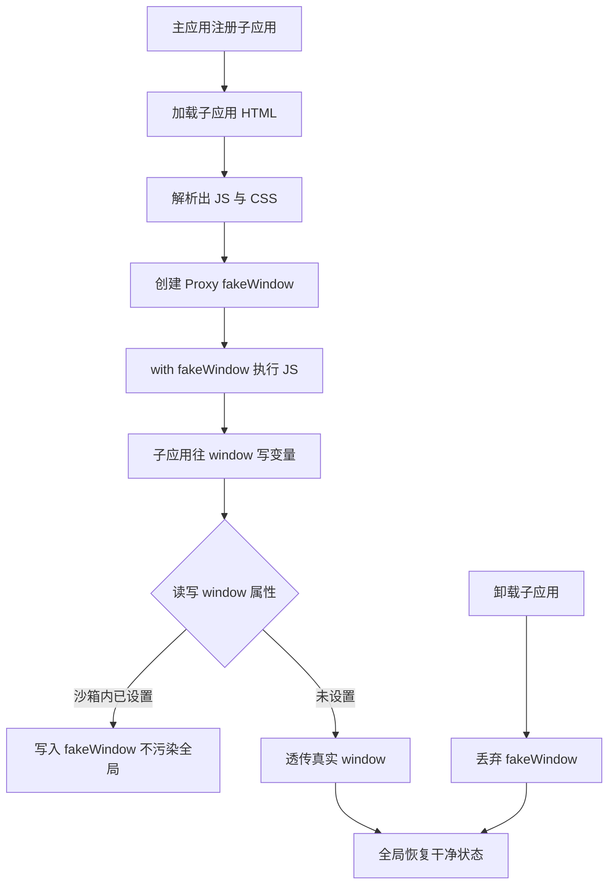

```typescript
// 简化版 Proxy 沙箱核心思想
function createProxySandbox() {
  const fakeWindow: Record<PropertyKey, unknown> = {};
  let active = false;
  const proxy = new Proxy(fakeWindow, {
    get(_, key) {
      return key in fakeWindow ? fakeWindow[key] : (window as any)[key]; // 未覆写则透传
    },
    set(_, key, value) {
      if (!active) return true;             // 未激活期间禁止写全局
      fakeWindow[key] = value;              // 写入沙箱，不污染真实 window
      return true;
    },
  });
  return {
    proxy,
    mount() { active = true; },
    unmount() { active = false; /* Snapshot 降级方案在此处恢复 window 快照 */ },
  };
}
```

### ARC-041：single-spa 与 qiankun 是什么关系？
**答**：
- single-spa 是微前端"内核"：只负责生命周期编排（registerApplication、load、mount/unmount 状态机）与路由激活规则，不解决沙箱、样式隔离、HTML 加载。
- qiankun 基于 single-spa 封装：补齐了 HTML Entry（import-html-entry 解析子应用 HTML）、JS 沙箱、样式隔离、预加载、全局错误兜底，是"开箱即用层"。
- 类比：single-spa 是 React 未封装的 scheduler+reconciler，qiankun 是 umd 之上的完整框架。

```typescript
// single-spa 原生注册：一切自己来
import { registerApplication, start } from 'single-spa';
registerApplication({
  name: 'app-trade',
  app: () => System.import('@corp/app-trade'),      // 加载方式自己解决
  activeWhen: ['/trade'],                            // 路由激活规则
  customProps: { authToken: 'xxx' },
});
start();

// qiankun：在 single-spa 之上补齐 HTML Entry + 沙箱 + 隔离
import { registerMicroApps, start } from 'qiankun';
registerMicroApps([
  {
    name: 'app-trade',
    entry: '//trade.corp.com',       // HTML Entry：qiankun 负责解析 html 并执行其中 JS
    container: '#subapp',
    activeRule: '/trade',
    props: { authToken: 'xxx' },
  },
]);
start({ sandbox: { experimentalStyleIsolation: true }, prefetch: 'all' });
```

### ARC-042：无界 wujie 的原理是什么？相比 qiankun 的取舍是什么？
**答**：
- wujie = iframe + Proxy 混合：JS 跑在 iframe 里（原生硬隔离，天然干净），DOM/渲染跑在主应用容器（iframe 内创建的 shadowRoot 被投影到主应用），样式在 iframe 内天然隔离。
- 取舍优点：隔离最强（不再手写沙箱）、子应用切换保活成本低、多实例简单；缺点：弹窗定位/事件冒泡跨 iframe 需要代理修复、路由同步靠 iframe 跳转代理、调试链路更绕。
- 适用：强隔离诉求、老应用接入成本低优先；对事件冒泡和 location 行为有强依赖的复杂应用需评估。

```typescript
// wujie 接入：JS 与 DOM 的分离运行示意
import { startApp } from 'wujie';

startApp({
  name: 'app-legacy',
  url: '//legacy.corp.com',
  el: '#container',            // DOM 渲染在主应用的容器里（shadowRoot 投影）
  // 内部机制：
  // 1. 隐藏 iframe 中执行子应用 JS —— window/document 原生隔离，无需手写沙箱
  // 2. iframe 内 document 上创建 shadowRoot，子应用把 DOM 挂进来
  // 3. shadowRoot 的根节点被“投影”到主应用容器显示
  // 4. 事件冒泡、location 赋值、弹窗定位等跨 iframe 行为由 wujie 代理修复
  sync: true,                  // 路由同步
  alive: true,                 // 保活模式：隐藏 iframe 保留状态
});
```

### ARC-043：如何用 Module Federation 做微前端？与 qiankun 路线差异？
**答**：
- MF 在构建期声明 exposes/remotes/shared：子应用暴露模块，主应用运行时远程加载，本质是"运行时模块级组合"而非"应用级容器"。
- 与 qiankun 差异：MF 无 HTML Entry 与沙箱，多个应用共享同一个 JS 上下文（冲突自己负责）；但粒度更细（可只共享一个组件/一段逻辑）、依赖共享机制内建。
- 取舍：同技术栈 + 信任边界内的模块化共享选 MF；异构栈/强隔离/老应用选 qiankun 类容器方案。

```javascript
// 子应用 webpack.config.js —— 暴露模块
const { ModuleFederationPlugin } = require('webpack').container;
module.exports = {
  plugins: [
    new ModuleFederationPlugin({
      name: 'appTrade',
      filename: 'remoteEntry.js',
      exposes: {
        './OrderList': './src/pages/OrderList',   // 暴露页面级模块
        './Button': './src/components/Button',    // 也可只暴露一个组件
      },
      shared: { react: { singleton: true, requiredVersion: false }, 'react-dom': { singleton: true } },
    }),
  ],
};
// 主应用：const OrderList = React.lazy(() => import('appTrade/OrderList'));
// 注意：MF 没有沙箱，shared singleton 的版本协商失败会直接运行时报错
```

### ARC-044：微应用的通信方案如何设计？
**答**：
- 分层：必传数据走 props 下发（容器协议的一部分）；跨应用事件用 CustomEvent/事件总线（解耦）；共享业务状态用受控的共享 store 或 URL 参数（可分享/可刷新）。
- 铁律：优先减少通信（架构层面划清域），而不是堆通信机制；通信越隐式，排障越难。
- 每种通道要有明确的"该放什么"契约：props 放运行时配置与鉴权态，事件放通知，URL 放可分享状态。

```typescript
// 1. props：容器下发（初始化契约）
export interface MicroAppProps {
  token: string;
  theme: 'light' | 'dark';
  onLogout: () => void;          // 回调是合法的"反向通道"
}

// 2. 事件总线：跨应用通知（松耦合，不传大数据）
export const bus = new EventTarget();
bus.dispatchEvent(new CustomEvent('cart:changed', { detail: { count: 3 } }));

// 3. 共享状态：主应用初始化一次，子应用只读为主
export const sharedStore = createStore({ user: null as User | null });
bus.addEventListener('login', () => sharedStore.setUser(fetchCurrentUser()));

// 4. URL：可分享可刷新的状态（筛选、tab）
// /trade/orders?tab=paid&page=2 —— 刷新不丢，天然可回溯
```

### ARC-045：微前端的公共依赖如何共享？externals 与共享作用域怎么选？
**答**：
- externals：主应用 CDN 加载一次，子应用声明外部化，简单高效；缺点是全局变量耦合、版本由主应用锁死、Tree-shaking 失效。
- Module Federation shared：按 semver 协商 + 单例 + 惰性加载，版本可异步化，但失败模式复杂（版本冲突运行时才炸）。
- 微前端 + Monorepo 组合：公共依赖（React/请求层/工具）收敛为 monorepo 内部包，统一版本与构建产物，externals 或 shared 都指向它，避免"每个子应用带一份 React"。

```javascript
// 方案A：externals —— 主应用统一提供
// 主应用 index.html：<script src="/vendor/react-18.3.1.min.js"></script>
module.exports = {
  externals: {
    react: 'React', 'react-dom': 'ReactDOM',      // 子应用不再打包 React
  },
};

// 方案B：MF shared —— 版本协商的共享作用域
shared: {
  react: { singleton: true, strictVersion: true, requiredVersion: '^18.3.0' },
  'react-dom': { singleton: true },
  '@corp/request': { singleton: true },   // 内部包也走共享，全站一份
},
// strictVersion: true —— requiredVersion 不满足直接报错（fail fast），优于静默降级

// Monorepo 组合：packages/react-wrapper 统一封装版本升级与适配层
// 所有子应用从内部包 import React API，未来升级只改一处
```

### ARC-046：微前端的路由同步如何设计？
**答**：
- 主应用持有全局路由，子应用只感知自己的前缀（activeRule），pushState/popstate 由主应用统一接管再分发。
- 关键点：子应用基路径（basename）与 activeRule 必须一致；history.pushState 不会触发 popstate，容器需手动通知。
- URL 是跨应用导航的契约：跨应用跳转一律走完整路径，禁止子应用直接操作其他应用的路由实例。

```typescript
// 主应用：统一接管路由并同步给子应用
const APPS = [
  { name: 'app-trade', activeRule: '/trade', basename: '/trade' },
  { name: 'app-cms',   activeRule: '/cms',   basename: '/cms' },
];

function routeToApps(path: string) {
  const app = APPS.find(a => path.startsWith(a.activeRule));
  if (!app) return;
  // activeWhen 命中由 single-spa 处理；这里是 pushState 后的主动同步
  window.dispatchEvent(new PopStateEvent('popstate', { state: history.state }));
}

const rawPush = history.pushState.bind(history);
history.pushState = function (state, title, url) {   // 劫持以触发同步
  rawPush(state, title, url);
  routeToApps(String(url));
};

// 子应用：<BrowserRouter basename={props.basename}>，内部跳转 /trade/orders
// 跨应用跳转：props.navigate('/cms/articles') 由主应用提供，子应用不感知别的应用
```

### ARC-047：主子应用的版本治理如何做？容器协议包含什么？
**答**：
- 容器协议（Container Contract）是版本治理的根：主子应用之间约定的接口（props、生命周期、路由、共享依赖版本区间）显式化、版本化。
- 子应用声明 `requires: { container: '^2.0' }`，主应用加载时校验，不满足给出升级提示或降级。
- 治理手段：协议变更走 RFC + major 版本；兼容矩阵表；子应用接错协议在加载阶段 fail fast。

```typescript
// 容器协议显式化 —— @corp/container-protocol
export interface ContainerProtocolV2 {
  version: 2;                                  // 协议大版本，破坏性变更必须 +1
  mount(el: HTMLElement, props: AppProps): Promise<void>;
  unmount(): Promise<void>;
  capabilities?: string[];                     // 能力协商：['modal','request','auth']
}

// 主应用加载时做协议校验
async function loadApp(entry: string, supported: number[]) {
  const app = await import(entry);
  const protocol = (app as { protocolVersion?: number }).protocolVersion;
  if (!supported.includes(protocol!)) {
    throw new Error(`子应用协议版本 ${protocol} 不被主应用支持，允许 ${supported}`);
  }
  return app;
}
```

### ARC-048：微前端"独立开发、独立部署"如何真正落地？
**答**：
- 落地标志：子应用发版不需要主应用重新构建，甚至主应用不知道子应用发了什么版本。
- 契约三件套：注册中心（子应用 entry URL 动态下发，配置中心而非硬编码）、容器协议（生命周期/props）、共享依赖区间（semver range）。
- CI/CD 独立：每个子应用自己的流水线、自己的版本号、自己的灰度；主应用只保证协议兼容。

```yaml
# 子应用 A 的独立流水线 —— 发布只动自己
name: deploy-app-trade
on: { push: { branches: [main] } }
jobs:
  deploy:
    runs-on: ubuntu-latest
    steps:
      - run: pnpm install --frozen-lockfile && pnpm build      # 协议兼容性在单测中校验
      - run: ./scripts/deploy.sh dist/ app-trade/${{ github.sha }}   # 发到自己的 CDN 路径
      - name: 更新注册中心
        run: |
          curl -X PUT $REGISTRY_API/apps/app-trade \
            -H "Authorization: Bearer $TOKEN" \
            -d '{ "entry": "https://cdn.corp.com/app-trade/1.8.0/index.html",
                  "version": "1.8.0",
                  "requires": { "container": "^2.0" } }'   # 主应用运行时拉取注册表，无需重新构建
```

### ARC-049：微前端的性能开销如何评估？iframe 被重新认识的取舍是什么？
**答**：
- 开销清单：HTML Entry 多一次请求与解析、沙箱代理的性能税、样式隔离的编译开销、公共依赖不共享时的重复体积、多实例内存。
- 评估方法：与单体基线对比 TTI/内存/包体积，量化"架构税"，超过 30% 首屏劣化需优化或重估拆分。
- iframe 的新认知：它隔离最彻底（JS/CSS/DOM/存储全隔离）、实现成本几乎为零；体验差（路由、弹窗、通信、SEO）可以逐步被代理修复。wujie 正是"iframe 隔离 + 代理修复体验"的折中。小而封闭的子场景（如内嵌第三方表单）iframe 可能是最便宜正解。

```typescript
// 微前端性能基线对比脚本（CI 中跑，超阈值报警）
const baseline = { tti: 2500, memoryMB: 180, bundleKB: 900 };   // 单体基线
const metrics = await auditMicroApp('https://portal.corp.com');
const tax = {
  ttiTaxPct: (metrics.tti - baseline.tti) / baseline.tti * 100,       // 交互时间税
  memTaxPct: (metrics.memoryMB - baseline.memoryMB) / baseline.memoryMB * 100,
  bundleTaxKB: metrics.bundleKB - baseline.bundleKB,                 // 重复依赖的体积税
};
if (tax.ttiTaxPct > 30) throw new Error(`微前端架构税超标 ${tax.ttiTaxPct.toFixed(1)}%，需评审`);
console.table(tax);

// iframe 取舍速查
// 选 iframe：强隔离（第三方/广告/遗留系统）、无跨应用交互、子应用自治要求高
// 拒 iframe：需要共享登录态与路由、弹窗跨层、SSR/SEO、频繁双向通信
```

### ARC-050：老系统如何渐进接入微前端？各方案选型如何总结？
**答**：
- 渐进路径：先老系统"只减不增" → 新功能以微应用挂载进老系统壳 → 路由逐段迁移 → 老壳最后退化为容器。
- 接入老系统时避免"老改新"：老系统只加一个微前端 loader 脚本，不改业务代码。
- 选型总结：异构/强隔离/老应用→ qiankun/wujie 类容器；同构细粒度共享 → Module Federation；独立第三方 → iframe；中小规模 → 不拆。

```text
老系统渐进接入四步（约一个季度）
第1步 装容器：老系统引入微前端 loader（一段脚本，不动业务代码）
       window.__MICRO_LOADER__.register({ name:'new-checkout', activeRule:'/checkout' })
第2步 增量只落新：新需求/新页面一律做成新微应用挂进老壳
第3步 存量迁移：按路由段把老页面逐个搬进新栈微应用（每周 1-2 段，带回归测试）
第4步 收官：老壳仅剩容器逻辑，流量 100% 在新微应用，评估是否替换壳

微前端选型对比
┌──────────────┬───────────┬──────────┬───────────┬──────────┐
│ 方案          │ 隔离强度   │ 技术栈   │ 接入成本   │ 适用      │
├──────────────┼───────────┼──────────┼───────────┼──────────┤
│ qiankun      │ 中 Proxy  │ 任意     │ 低-中      │ 异构共存  │
│ wujie        │ 强 iframe │ 任意     │ 低        │ 强隔离诉求│
│ ModuleFederation │ 弱 同上下文 │ 需同构建体系 │ 中  │ 同构细粒度 │
│ iframe       │ 最强      │ 任意     │ 最低      │ 第三方嵌入│
│ 不拆（单体）  │ -         │ -        │ -         │ 默认答案  │
└──────────────┴───────────┴──────────┴───────────┴──────────┘
```

---

## 六、状态与数据层架构（ARC-051 ~ ARC-059）

### ARC-051：前端状态如何分类？每类状态应该放在哪里？
**答**：
- 四分类：服务端状态（缓存的远端数据）、客户端全局状态（跨页面共享）、URL 状态（可分享可刷新）、本地 UI 状态（组件内部）。
- 架构核心思想：先"分流"再"选库"——大量全局状态库的滥用源于把服务端状态塞进了 Redux。
- 分类决策树是日常落地工具：每新增一个状态先问归属，再定存储位置与生命周期。

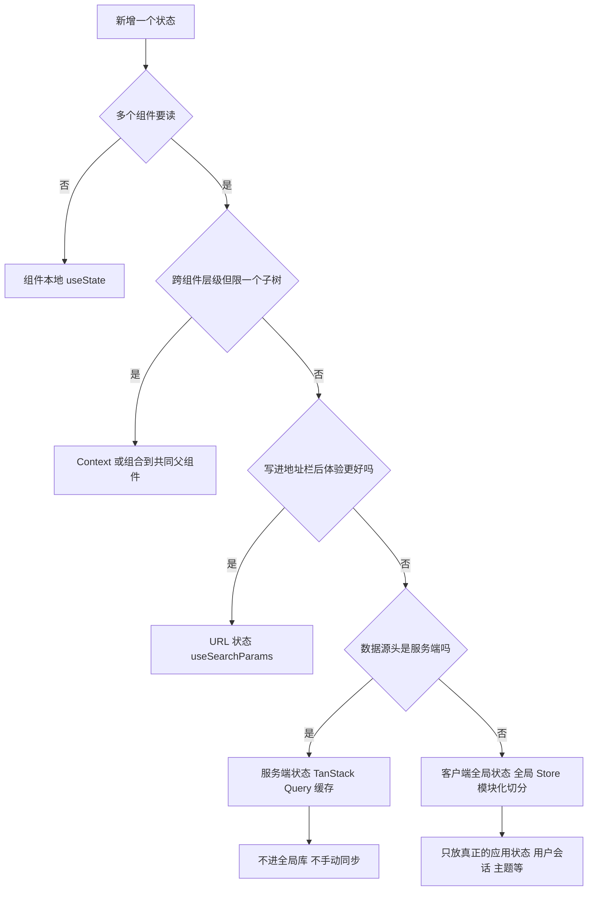

### ARC-052：服务端状态库（TanStack Query / SWR / 自研）如何选型？
**答**：
- TanStack Query：能力最全（缓存/去重/乐观更新/Infinite Query/devtools），适合复杂中后台；SWR 轻、API 简洁，适合以读为主的场景。
- 自研的合理动机只剩两个：特殊缓存协议（如 IM 消息序号）或极小包体积诉求；一般不该自研。
- 架构视角：选型重点是"缓存失效模型"是否匹配业务（tag invalidation、mutate 精确失效）。

```typescript
// TanStack Query：默认推荐，能力覆盖最全
const qc = new QueryClient({
  defaultOptions: { queries: { staleTime: 30_000, retry: 2, refetchOnWindowFocus: true } },
});
const { data } = useQuery({ queryKey: ['order', id], queryFn: () => fetchOrder(id) });

// SWR：轻量读场景
const { data: user } = useSWR('/api/me', fetcher, { revalidateOnFocus: true });

// 自研仅当存在协议级特殊需求，示例：按序号拉取 IM 消息
function useMessages(channelId: string) {
  const [msgs, setMsgs] = useState<Msg[]>([]);
  useEffect(() => {
    let seq = 0;
    return poll(async () => {
      const res = await fetch(`/im/channels/${channelId}/messages?after=${seq}`);
      seq = res.nextSeq;                 // 通用缓存库无法表达 seq 协议，才值得自研
      setMsgs(prev => [...prev, ...res.items]);
    }, 3000);
  }, [channelId]);
}
```

### ARC-053：全局状态（Pinia/Zustand/Redux）在大型应用如何模块化切分？
**答**：
- 按业务域切片（slice）而非技术分层（actions/reducers 分文件），每个域一个 store 文件，自包含 state/actions/selectors。
- store 之间不直接 import 互相的 state，通过事件或显式订阅通信，防止状态网状耦合。
- Redux 适合需要中间件生态/时间旅行/严格规范的团队；Zustand/Pinia 适合轻量直接的场景，二者都强调 slice 化。

```typescript
// Zustand 按域切片
export const useCartStore = create<CartState>()((set, get) => ({
  items: [],
  add: (item) => set(s => ({ items: [...s.items, item] })),
  total: () => get().items.reduce((sum, i) => sum + i.price * i.qty, 0),
}));

export const useSessionStore = create<SessionState>()(set => ({
  user: null,
  login: async (token) => set({ user: await fetchMe(token) }),
}));

// 跨 store 不互相 import state，用事件解耦
cartBus.on('checkout:done', () => useCartStore.setState({ items: [] }));
```

### ARC-054：嵌套资源数据如何做状态归一化（normalizr 思想）？
**答**：
- 后端返回嵌套对象（订单含用户含商品）时，直接存会导致同一实体多份拷贝、更新需全量刷新。
- 归一化：按实体类型（order/user/product）拍平成 `{ byId, allIds }`，关联处只存 id，更新 O(1) 且天然去重。
- 权衡：归一化增加写复杂度与 selector 成本，适合实体被多视图共享的中后台；一次性展示的嵌套数据不必归一化。

```typescript
// 输入（嵌套）→ 归一化存储
const orderSchema = { user: 'user', items: [{ product: 'product' }] };
const normalized = normalize(apiOrder, orderSchema);
// { entities: { order: {o1:{...}}, user: {u1:{...}}, product: {p1:{...}} }, result: 'o1' }

interface NormalizedState<T> { byId: Record<string, T>; allIds: string[]; }

function normalize<T extends { id: string }>(list: T[]): NormalizedState<T> {
  return {
    byId: Object.fromEntries(list.map(e => [e.id, e])),
    allIds: list.map(e => e.id),
  };
}

// 更新一个用户，所有引用它的订单视图自动生效（单一事实源）
function updateUser(state: { users: NormalizedState<User> }, user: User) {
  return { ...state, users: { ...state.users, byId: { ...state.users.byId, [user.id]: user } } };
}
// selector 再做反查组装视图模型，缓存依赖 byId 引用
```

### ARC-055：跨页面/跨标签页通信架构如何设计？
**答**：
- 手段分层：BroadcastChannel（同源标签页，首选）、storage 事件（兼容老浏览器）、SharedWorker（需要共享计算/连接时）、URL/服务器推送（跨设备）。
- 架构要点：消息要有版本与幂等设计（标签页收到的是"通知"不是"指令"，收到后自己读权威数据）。
- 典型场景：登录态同步（一端登出全站踢出）、购物车同步、主题切换同步。

```typescript
// 跨标签页通信封装：通知 + 权威数据重读，而不是广播数据本身
class TabSync {
  private ch = new BroadcastChannel('app-sync');
  private handlers = new Map<string, Set<(payload: unknown) => void>>();
  constructor() {
    this.ch.onmessage = e => this.handlers.get(e.data.type)?.forEach(fn => fn(e.data.payload));
  }
  on<T>(type: string, fn: (p: T) => void) {
    this.handlers.set(type, (this.handlers.get(type) ?? new Set()).add(fn as never));
    return () => this.handlers.get(type)!.delete(fn as never);
  }
  emit(type: string, payload?: unknown) { this.ch.postMessage({ type, payload }); }
}

const sync = new TabSync();
sync.on<{ userId: string }>('auth:logout', ({ userId }) => {
  // 只当通知：收到后以本地存储/服务端为准清理状态，而非信任广播内容
  clearSession(); router.push('/login');
});
sync.emit('auth:logout', { userId: currentUserId });   // 其他标签页同步登出
```

### ARC-056：离线优先数据层如何设计（本地缓存 + 同步队列）？
**答**：
- 架构分四件：本地持久层（IndexedDB）为唯一读写入口、变更先进"待同步队列"（outbox 模式）、后台同步器重试带指数退避、冲突解决策略显式声明。
- 冲突策略：last-write-wins（简单但丢更新）、字段级合并、服务端版本号乐观锁（version check）。
- 关键不变式：队列内操作必须幂等（带客户端生成的操作 id），网络重试不会造成重复下单。

```typescript
// outbox 模式骨架
interface PendingOp { opId: string; type: string; payload: unknown; ts: number; tries: number; }

async function mutate(op: Omit<PendingOp, 'opId' | 'ts' | 'tries'>) {
  const opId = crypto.randomUUID();
  await idb.put('outbox', { ...op, opId, ts: Date.now(), tries: 0 });  // 1. 先落本地队列
  await applyLocal(op);                                                 // 2. 立即更新本地视图（乐观）
  scheduleSync();                                                       // 3. 触发后台同步
}

async function syncOutbox() {
  for (const op of await idb.getAll('outbox')) {
    try {
      await api.post('/sync', { ...op, clientOpId: op.opId });          // 幂等键
      await idb.delete('outbox', op.opId);
    } catch (e) {
      if (isConflict(e)) await resolveConflict(op, e.serverState);      // 版本冲突走策略
      else await retryWithBackoff(op);                                  // 网络失败指数退避
    }
  }
}
// 冲突策略示例：优先级 字段级合并 > 版本号乐观锁 > last-write-wins
```

### ARC-057：请求层如何统一设计（拦截器/重试/取消/缓存/去重）？
**答**：
- 统一入口收敛横切能力：鉴权注入、错误码翻译、重试（幂等方法 + 指数退避）、取消（路由切换 abort）、并发去重与缓存。
- 原则：业务代码只写"发什么请求"，不关心怎么鉴权/重试；策略集中可配可测。
- 重试必须基于幂等性判断（GET/PUT 重试，POST 靠幂等键），否则会制造重复提交事故。

```typescript
class Http {
  private inflight = new Map<string, Promise<unknown>>();   // 并发去重

  async request<T>(config: RequestConfig): Promise<T> {
    const key = `${config.method}:${config.url}:${JSON.stringify(config.params)}`;
    if (this.inflight.has(key)) return this.inflight.get(key)! as Promise<T>;  // 同请求去重
    const p = this.chain(config).finally(() => this.inflight.delete(key));
    this.inflight.set(key, p);
    return p as Promise<T>;
  }

  private async chain(c: RequestConfig) {
    // 拦截器1：鉴权头注入
    const headers = { ...c.headers, Authorization: `Bearer ${authStore.token}` };
    // 重试：仅幂等方法，指数退避
    return withRetry(
      () => this.send({ ...c, headers, signal: this.routeAbortSignal(c.url) }),
      { retries: 2, retryOn: c.method === 'GET' || c.method === 'PUT' },
    );
  }
  private routeAbortSignal(tag: string) {
    const ctl = new AbortController();                  // 路由离开时统一 abort
    router.onLeave(() => ctl.abort());
    return ctl.signal;
  }
}
```

### ARC-058：乐观更新的架构如何设计？失败后如何回滚与补偿？
**答**：
- 流程：先改本地缓存 → 发请求 → 成功则用服务端结果替换，失败则回滚快照并给用户可理解的补偿（toast + 撤销/重试）。
- 关键实现是"快照回滚"而非"反向操作"：保存 mutate 前的缓存状态，失败时整体还原，避免反向操作逻辑爆炸。
- 适用判断：用户高频操作且失败率低（点赞、排序）才乐观；资金类操作一律悲观更新。

```typescript
// TanStack Query 乐观更新：快照回滚模式
const qc = useQueryClient();
const mutation = useMutation({
  mutationFn: (todo: Todo) => api.patch(`/todos/${todo.id}`, todo),
  onMutate: async (todo) => {
    await qc.cancelQueries({ queryKey: ['todos'] });       // 停止在途 refetch 覆盖乐观值
    const previous = qc.getQueryData<Todo[]>(['todos']);   // 1. 快照
    qc.setQueryData<Todo[]>(['todos'], old =>
      old?.map(t => (t.id === todo.id ? { ...t, ...todo, _optimistic: true } : t)));  // 2. 乐观写入
    return { previous };                                   // 快照传给 onError
  },
  onError: (_e, todo, ctx) => {
    qc.setQueryData(['todos'], ctx!.previous);             // 3. 回滚快照
    toast.error('保存失败', { action: { label: '重试', onClick: () => mutation.mutate(todo) } }); // 补偿
  },
  onSettled: () => qc.invalidateQueries({ queryKey: ['todos'] }),  // 4. 服务端真值校正
});
```

### ARC-059：数据过期与失效策略（tag invalidation）如何设计？
**答**：
- 两种失效模型：TTL 过期（简单，适合列表/配置类）与 tag invalidation（写操作精确失效相关查询，适合关联密集的中后台）。
- tag 设计按实体粒度（`['order', id]`、`['orders', 'list', filters]`），写操作的 mutation 声明失效哪些 tag，代替到处手写 refetch。
- 面试要点：失效粒度太粗导致过多请求，太细导致漏失效；一般按"实体 + 列表"两层 tag。

```typescript
// tag 化的失效体系：mutation 声明影响，查询只管消费
const qc = new QueryClient();

// 读：tag 即 queryKey
useQuery({ queryKey: ['order', orderId], queryFn: () => fetchOrder(orderId) });
useQuery({ queryKey: ['orders', 'list', filter], queryFn: () => fetchOrders(filter) });

// 写：集中声明失效面
qc.setMutationDefaults(['createOrder'], {
  mutationFn: (dto: CreateOrderDto) => api.post('/orders', dto),
  onSuccess: () => {
    qc.invalidateQueries({ queryKey: ['orders'] });   // 列表全失效（粗粒度）
    qc.invalidateQueries({ queryKey: ['dashboard'] }); // 跨实体关联也用 tag 声明
  },
});
qc.setMutationDefaults(['updateOrder'], {
  mutationFn: ({ id, patch }: { id: string; patch: Partial<Order> }) => api.patch(`/orders/${id}`, patch),
  onSuccess: (_r, { id }) => {
    qc.invalidateQueries({ queryKey: ['order', id] }); // 只失效该单（细粒度）
  },
});
// TTL 兜底：staleTime 30s + refetchOnWindowFocus，漏失效的 tag 也有机会自愈
```

---

## 七、渲染与 BFF 架构（ARC-060 ~ ARC-067）

### ARC-060：CSR/SSR/SSG/ISR 混合渲染如何做架构决策？
**答**：
- 按页面特性选模式：营销/文档页 SSG（最快、最稳）、内容会后台更新的页面 ISR（静态 + 定时再生）、强个性化/实时页面 SSR、纯工具后台 CSR。
- 混合渲染的关键是"按路由声明模式"，一个应用内不同路由走不同渲染管线。
- 决策依据三问：内容时效性、个性化程度、SEO/首屏要求。

```typescript
// Next.js：按路由声明渲染模式的架构
// app/(marketing)/layout.tsx —— SSG：构建期生成，内容变更随发布
// app/(marketing)/page.tsx
export const dynamic = 'force-static';

// app/blog/[slug]/page.tsx —— ISR：静态 + 每 60s 后台再生
export const revalidate = 60;

// app/dashboard/page.tsx —— CSR：强个性化，不 SEO
'use client';
export default function Dashboard() { /* 全客户端渲染 */ }

// app/feed/page.tsx —— SSR：每请求实时渲染
export const dynamic = 'force-dynamic';
// 决策矩阵：
// SSG：内容低频变 + SEO 必需     ISR：内容分钟级变 + SEO 必需
// SSR：内容实时变/强个性化       CSR：内部工具、SEO 无关、重交互
```

### ARC-061：Next.js App Router 的架构数据流是怎样的（RSC / Server Actions）？
**答**：
- RSC（React Server Component）在服务端执行、不打包进 JS bundle，可直接 await 数据源；客户端组件用 `'use client'` 显式标记，二者通过 props（可序列化）传递。
- Server Actions 让"表单提交/变更"直接调服务端函数，省去手写 API 端点；但仍需鉴权、校验、revalidate。
- 架构收益：数据获取下沉到服务端减少瀑布请求与包体积；代价是心智模型复杂（序列化边界、缓存语义）。

```typescript
// app/orders/page.tsx —— Server Component：服务端直连数据源，零客户端 fetch
export default async function OrdersPage() {
  const orders = await db.order.findMany({ where: { userId: await currentUserId() } }); // 直连 DB
  return <OrderTable orders={orders} />;   // 可序列化 props 传给客户端/服务端组件
}

// app/orders/actions.ts —— Server Actions：变更走服务端函数，带鉴权与缓存失效
'use server';
export async function shipOrder(formData: FormData) {
  const user = await requireRole('OPERATOR');              // 鉴权必须在 action 内做
  const id = z.string().parse(formData.get('orderId'));    // 入参校验
  await db.order.update({ where: { id }, data: { status: 'shipped' } });
  revalidatePath(`/orders/${id}`);                          // 声明式失效缓存
}

// app/orders/ship-button.tsx —— Client Component 调 action
'use client';
export function ShipButton({ orderId }: { orderId: string }) {
  return <form action={shipOrder}><input type="hidden" name="orderId" value={orderId} />
    <button>发货</button></form>;
}
```

### ARC-062：BFF 层的职责边界如何设计？
**答**：
- BFF 只做三件事：聚合（多个下游接口拼一个页面级接口）、裁剪（去掉前端不需要的字段）、协议转换（下游 RPC/老协议 → 前端友好 JSON）。
- BFF 不做业务逻辑：业务规则在领域服务，BFF 写了业务规则就会随端增多而腐烂。
- 每端一个 BFF（web/wap/app）或按域拆分，团队归属与前端一致，接口契约由前端定义。

```typescript
// BFF：商品详情页聚合接口 —— 聚合 + 裁剪 + 协议转换，无业务逻辑
import type { FastifyInstance } from 'fastify';

export default async function (app: FastifyInstance) {
  app.get('/api/bff/product/:id', async (req) => {
    const { id } = req.params as { id: string };
    // 并行聚合三个下游（网关/RPC/旧接口）
    const [base, inventory, promotion] = await Promise.all([
      rpc.product.getBaseInfo(id),
      rpc.inventory.getStock(id),
      restApi.get(`/legacy/promotions?sku=${id}`),        // 协议转换：旧接口 → 新结构
    ]);
    return {
      // 裁剪：前端只需要展示字段，不下发内部成本、审计字段
      title: base.title,
      price: promotion.finalPrice ?? base.msPrice,
      stockState: inventory.quantity > 0 ? 'IN_STOCK' : 'SOLD_OUT',  // 转成前端枚举
      tags: promotion.labels.map(l => ({ text: l.text, color: l.css })), // 协议适配
    };
  });
}
```

### ARC-063：GraphQL 网关与 REST BFF 如何取舍？
**答**：
- GraphQL 适合"页面多、字段需求差异大、客户端类型多"的场景：一次查询精确取字段，天然解决 over/under-fetch。
- REST BFF 适合接口形态稳定、团队 REST 经验深、缓存策略依赖 HTTP 语义（CDN/ETag）的场景。
- 复杂度主要在服务端：dataloader 防 N+1、权限按字段控制、查询深度限制，这些都要有人兜底。

```graphql
# GraphQL 网关：一个查询聚合多域数据，字段级取用
query ProductPage($id: ID!) {
  product(id: $id) {                      # product 域
    title
    price { amount currency }
    stock { state }                       # 只取需要的字段，天然裁剪
  }
  recommendations(productId: $id, limit: 4) {   # 推荐域：同一次请求
    items { id title coverUrl }
  }
}

# 服务端配套（缺了就是事故）：
# 1. DataLoader 按批合并防 N+1
# const batchUsers = new DataLoader(ids => rpc.user.getBatch(ids));
# 2. 查询深度/复杂度限制，防恶意深查询
# depthLimit(8), costAnalysis({ maximumCost: 1000 })
# 3. 字段级权限：未登录 user.phone 直接为 null 并告警
```

### ARC-064：流式渲染与 Suspense 边界如何设计？
**答**：
- 流式渲染：先发 shell（骨架 + 已就绪数据），慢数据源用 Suspense 包住后发，TTI 大幅提前。
- 边界划分原则：一个 Suspense 边界 = 一个独立加载语义的区块，粒度太细闪烁、太粗又回到白屏等待。
- 错误边界与 Suspense 成对出现：每个异步区块配 error fallback，避免一个慢/挂接口拖死整页。

```tsx
// 流式渲染架构：shell 先行 + 分区块后发
export default function ProductPage({ id }: { id: string }) {
  return (
    <Layout>                                          {/* 立即输出：导航/骨架 */}
      <Suspense fallback={<ProductSkeleton />}>       {/* 区块1：核心商品信息 */}
        <ProductHeader id={id} />                     {/* async RSC，慢就后发 */}
      </Suspense>
      <Suspense fallback={<RecommendSkeleton />}>     {/* 区块2：推荐流，独立降级 */}
        <ErrorBoundary fallback={<RecommendError />}>
          <Recommendations id={id} />                 {/* 挂了不影响主内容 */}
        </ErrorBoundary>
      </Suspense>
      <Reviews id={id} loading={<ReviewsSkeleton />} />  {/* 区块3：loading props 模式 */}
    </Layout>
  );
}
// 划分依据：数据源与加载时长差异、业务重要性、是否允许独立降级
```

### ARC-065：Edge SSR 是什么概念？适用与不适用场景？
**答**：
- Edge SSR：渲染逻辑跑在离用户最近的边缘节点（CDN 边缘运行时），省去回源机房的网络延迟，TTFB 显著下降。
- 约束：边缘运行时不是完整 Node（无长连接池/文件系统，CPU/内存受限），依赖需边缘兼容（如 fetch-based 的 client）。
- 适用：全球分发、个性化轻逻辑（鉴权/A-B 分流/地域内容）；不适合重计算、直连内网数据库的渲染。

```typescript
// Next.js Middleware（跑在 Edge 运行时）：个性化在边缘完成，零回源
// middleware.ts
import { NextRequest, NextResponse } from 'next/server';

export const config = { runtime: 'edge', matcher: ['/', '/mall/:path*'] };

export function middleware(req: NextRequest) {
  const country = req.geo?.country ?? 'US';               // 边缘内置地理信息
  const bucket = abTest(req, 'new-checkout', [50, 50]);   // 边缘分流
  const res = NextResponse.rewrite(
    new URL(`/${country.toLowerCase()}/mall${req.nextUrl.pathname}?exp=${bucket}`, req.url),
  );
  res.cookies.set('exp', bucket, { maxAge: 86400 });
  return res;
}
// 页面本体仍是 SSR，但鉴权/分流/地域改写在边缘完成，TTFB 从 ~400ms 降到 ~50ms
```

### ARC-066：SEO 架构如何设计（预渲染/动态渲染策略）？
**答**：
- 分层策略：核心流量页（首页/分类/详情）走 SSR/ISR 保证可抓取与新鲜度；长尾低频页用预渲染（构建期生成或按需 on-demand ISR）。
- 技术配套：语义化 HTML、结构化数据（JSON-LD）、canonical、sitemap 增量生成、抓取预算意识（避免无限翻页被过度抓取）。
- CSR 应用的兜底：动态渲染（UA 判定爬虫走 headless 渲染）是遗留方案，优先选框架级 SSR。

```typescript
// on-demand ISR + 结构化数据：SEO 架构典型组合
// app/product/[id]/page.tsx
export async function generateMetadata({ params }): Promise<Metadata> {
  const p = await getProduct(params.id);
  return {
    title: `${p.title} - 价格${p.price}元`,
    alternates: { canonical: `/product/${p.id}` },      // 防重复收录
  };
}
export async function generateStaticParams() {          // 预渲染 top N 热门商品
  const hot = await getHotProducts(1000);
  return hot.map(p => ({ id: String(p.id) }));          // 冷门商品首次访问时按需生成并缓存
}

function ProductJsonLd({ product }: { product: Product }) {   // 结构化数据
  return <script type="application/ld+json" dangerouslySetInnerHTML={{ __html: JSON.stringify({
    '@context': 'https://schema.org', '@type': 'Product',
    name: product.title, offers: { '@type': 'Offer', price: product.price, priceCurrency: 'CNY' },
  }) }} />;
}
```

### ARC-067：图片服务与媒体处理架构如何设计？
**答**：
- 架构分层：源图存储（OSS）→ 处理管线（裁剪/缩放/格式转换，边缘函数或独立服务）→ CDN 缓存 → 前端 `` 自适应。
- 核心协议是"URL 即参数"：宽高、质量、格式、裁剪方式全在 URL 表达，处理结果按 URL 维度 CDN 缓存。
- 现代基线：AVIF/WebP 自动协商（CDN 按 Accept 头返回）、懒加载、LQIP/blurhash 占位。

```text
# 图片服务 URL 协议设计（处理参数即协议）
https://img.corp.com/p/{imageId}_{hash}.jpg?w=750&h=400&fit=cover&q=80&fmt=auto
#
# 参数说明：
#   w/h/fit   裁剪尺寸与模式（cover/contain/fill）
#   q         质量（默认 75，封面 85，缩略图 60）
#   fmt=auto  按 CDN 读到的 Accept 头协商 AVIF → WebP → JPEG 降级链
#   _hash     内容 hash：源图变更 URL 必变，CDN 缓存天然失效（不可变缓存）
#
# CDN 缓存策略：
#   Cache-Control: public, max-age=31536000, immutable   （URL 带 hash，一年强缓存）
# 回源：首次请求 → 边缘函数处理 → 结果写 CDN → 后续直接命中
#
# 前端配合：
#   
# 关键红线：上传侧限制分辨率与大小，处理侧限制最大输出尺寸，防止成本被打爆
```

---

## 八、权限与安全架构（ARC-068 ~ ARC-074）

### ARC-068：RBAC 模型在前端如何落地（表设计 + 路由生成）？
**答**：
- 模型：用户 → 角色 → 权限（permission = 资源 + 操作），前端只持有"权限码集合"，路由表按权限码过滤生成。
- 铁律：前端权限只是体验优化（隐藏不可用入口），授权判断必须在服务端复核。
- 动态路由：登录后拉权限码，用 meta.code 匹配生成可访问路由，未授权路由 404/403。

```typescript
// 服务端返回的权限码（前端不存角色关系表，只拿结果）
type Permission = string; // 'order:list' | 'order:refund' | 'stock:write'
const permissions: Permission[] = await api.get('/me/permissions'); // ['order:list','order:refund']

// 路由表：声明式挂权限码
const routes: AppRoute[] = [
  { path: '/orders', component: OrderList, meta: { code: 'order:list', title: '订单管理' } },
  { path: '/orders/:id/refund', component: Refund, meta: { code: 'order:refund' } },
  { path: '/stock', component: Stock, meta: { code: 'stock:write' } },
];

// 按权限生成可访问路由
function buildAccessibleRoutes(all: AppRoute[], perms: Permission[]): AppRoute[] {
  return all.filter(r => !r.meta.code || perms.includes(r.meta.code));
}

// 服务端模型参考（前端要懂的结构）：
// users(id) ── user_roles ── roles(id) ── role_permissions ── permissions(resource, action)
// permissions: { resource: 'order', action: 'refund' } → code = 'order:refund'
```

### ARC-069：按钮级权限有哪几种实现方案？如何对比选择？
**答**：
- 三方案：Hook（`usePermission('order:refund')` 条件渲染）、组件包裹（`<Auth code>`）、指令（Vue `v-auth`）。
- 对比：Hook 最灵活可参与逻辑判断；组件封装最统一（可带降级 UI）；指令最省代码但逻辑表达能力弱。
- 选择：React 团队用 Hook + 轻组件；Vue 团队指令 + 组件双轨；共同要求——没有权限时组件不渲染（而非 disabled 误导）。

```typescript
// 方案1：Hook —— 可参与逻辑
function usePermission(code: string) {
  const perms = usePermissions();
  return useMemo(() => perms.includes(code) || perms.includes('*'), [perms, code]);
}
if (!usePermission('order:refund')) return null;   // 逻辑分支里也能用

// 方案2：组件包裹 —— 统一降级 UI
function Auth({ code, fallback = null, children }:
  { code: string; fallback?: ReactNode; children: ReactNode }) {
  const ok = usePermission(code);
  return <>{ok ? children : fallback}</>;
}
<Auth code="order:refund" fallback={<Tooltip title="无退款权限"><Button disabled>退款</Button></Tooltip>}>
  <Button type="primary">退款</Button>
</Auth>

// 方案3：Vue 指令 —— 最少样板
// app.directive('auth', {
//   mounted(el, binding) { if (!store.has(binding.value)) el.parentNode?.removeChild(el); }
// });
// <el-button v-auth="'order:refund'">退款</el-button>
```

### ARC-070：ABAC 与数据权限是什么概念？前端有何体现？
**答**：
- RBAC 回答"什么角色能做什么操作"，ABAC 回答"满足什么属性条件才能操作"（属主、部门、金额阈值、时间窗），即数据级权限。
- 前端体现：列表按数据可见范围过滤的提示、行内按钮的可用性（不是所有行都能编辑）、表单字段按上下文禁用。
- 架构要求：条件计算规则收敛为策略表达式，前端渲染策略下发结果，不硬编码 if。

```typescript
// 服务端下发的策略（属性条件），前端只消费结果与解释
interface Policy {
  resource: 'order';
  action: 'edit';
  condition: {                       // ABAC 条件：属主或同部门 + 金额上限
    anyOf: [
      { field: 'order.ownerId', op: 'eq', valueFrom: 'session.userId' },
      { field: 'order.deptId', op: 'eq', valueFrom: 'session.deptId' },
    ],
    allOf: [{ field: 'order.amount', op: 'lte', value: 100000 }],
  };
}

// 前端把策略结果渲染为行级 UI，而不是自己写 if
function rowActions(order: Order, check: (p: Policy, ctx: Ctx) => boolean, session: Session) {
  const editable = check(policies.orderEdit, { order, session });
  return editable ? [<EditButton key="e" />] : [<ReadonlyTag key="r" text="仅查看（超限或非本部门）" />];
}
// 要点：check 逻辑与后端共享同一份策略求值器（同构），避免两端规则漂移
```

### ARC-071：前端安全架构清单包含哪些分层责任？
**答**：
- XSS：框架默认转义是第一层，富文本用白名单 sanitize；CSP 是兜底防线；HttpOnly Cookie 防 token 被 JS 读取。
- CSRF：SameSite Cookie + 自定义头/Csrf Token 双保险；敏感操作要求二次验证。
- 依赖安全：lockfile + 漏洞扫描 CI 卡口 + `npm audit` 阈值；三方脚本（统计/客服）加 SRI。
- 责任分层：业务（输入处理）、前端平台（CSP/安全基线）、服务端（鉴权/速率限制）各管一段。

```yaml
# 前端安全基线清单（分层责任）
layers:
  business:                     # 业务层责任
    - 富文本入库前 DOMPurify 白名单过滤
    - 不用 dangerouslySetInnerHTML 承接用户数据
    - 敏感信息不落 localStorage
  platform:                     # 前端平台层责任
    - CSP 响应头：default-src 'self'; script-src 'self' 'nonce-xxx'
    - 三方脚本加 integrity SRI 与 crossorigin
    - 子资源仅 HTTPS，禁用 eval
  server:                       # 服务端层责任
    - Set-Cookie: HttpOnly; Secure; SameSite=Lax
    - CSRF token 或 Origin/Referer 校验
    - 关键操作二次验证与速率限制
  supply-chain:                 # 依赖供应链
    - lockfile 提交，CI npm audit --audit-level=high 卡口
    - Renovate 自动升级 + 变更走 PR
# XSS 案例链路： → 输入未转义 → CSP 无 nonce 放行 → HttpOnly 缺失 token 被偷
```

### ARC-072：密钥与凭证的前端架构如何设计（后端代理 / 短期 token 刷新）？
**答**：
- 铁律：任何 secret（第三方 API key、云厂商凭证）绝不进前端，需要时走后端代理。
- access token 短期（15min）+ refresh token 长期且 HttpOnly 存储；并发请求 401 时要做"单飞刷新"（single-flight），避免并发刷新互相顶号。
- 静默刷新失败才跳登录，刷新期间请求排队等待新 token。

```typescript
// 单飞刷新：并发 401 只触发一次 refresh，其余排队
let refreshing: Promise<string> | null = null;

async function refreshToken(): Promise<string> {
  refreshing ??= api.post('/auth/refresh', null, { withCredentials: true })  // refresh token 在 HttpOnly Cookie
    .then(r => r.access_token)
    .finally(() => { setTimeout(() => (refreshing = null), 0); });           // 完成后释放
  return refreshing;
}

api.interceptors.response.use(undefined, async (error) => {
  if (error.response?.status !== 401 || error.config._retried) throw error;
  error.config._retried = true;
  try {
    const token = await refreshToken();                 // 并发请求共享同一个 Promise
    error.config.headers.Authorization = `Bearer ${token}`;
    return api(error.config);                           // 排队中的请求用新 token 重放
  } catch {
    authStore.logout();                                 // refresh 也失效才登出
    throw error;
  }
});
// 后端代理示例：地图密钥场景，前端调 /api/bff/map-token，BFF 持有真正的 key
```

### ARC-073：关键操作的审计日志前端架构如何设计？
**答**：
- 审计对象：权限变更、数据导出、删除、配置修改、敏感查询等"高危动作"，而非普通埋点。
- 架构要点：统一 AuditLog SDK，事件带操作者/目标/前后快照/请求 id；前端记录"意图"，服务端记录"结果"，两边以 request id 关联。
- 不可抵赖性：审计日志异步上报但带本地暂存兜底（IndexedDB 重试），服务端写入不可改存储。

```typescript
// 统一审计 SDK：高危操作必须留下"谁在何时对什么做了什么，改前改后是什么"
interface AuditEvent {
  action: string;                        // 'role.grant' | 'data.export' | 'order.delete'
  actor: { userId: string; deptId: string; ipHint?: string };
  target: { type: string; id: string; label?: string };     // 操作对象
  before?: unknown; after?: unknown;     // 前后快照（脱敏后）
  requestId: string;                     // 与服务端日志/网关日志关联
  reason?: string;                       // 操作理由（强制填写场景）
  ts: number;
}

export const audit = {
  async emit(e: Omit<AuditEvent, 'ts' | 'requestId'>) {
    const event = { ...e, ts: Date.now(), requestId: traceStore.requestId() };
    try { await api.post('/audit', event); }
    catch { await idb.put('audit-fallback', event); }      // 上报失败本地暂存，退避重传
  },
};

// 使用：删除操作强制理由 + 快照
audit.emit({
  action: 'order.delete', actor: { userId: me.id, deptId: me.deptId },
  target: { type: 'order', id: order.id, label: order.no },
  before: order, reason: deleteReasonForm.value,
});
```

### ARC-074：SaaS 多租户的前端架构如何设计（主题/域名/功能开关）？
**答**：
- 租户识别：域名映射（tenant-a.saas.com）为主、登录路径/子路径为辅，识别结果全局注入。
- 三层隔离：主题（CSS 变量 + 品牌 Token 运行时注入）、功能（Feature Flag 服务端下发）、路由与数据（租户 id 全局上下文，服务端强校验）。
- 架构关键：租户配置要有"平台默认 + 租户覆盖"的合并机制，白标部署不重新构建。

```typescript
// 多租户运行时装配：识别 → 合并配置 → 注入应用
interface TenantConfig {
  id: string;
  theme: Partial<typeof semantic>;        // 覆盖语义 Token：品牌色/logo/字体
  features: Record<string, boolean>;       // 功能开关：报表: true, 导出: false
  routes?: { hide?: string[]; add?: RouteConfig[] };
}

// 1. 域名识别
function resolveTenant(host: string): Promise<TenantConfig> {
  const sub = host.split('.')[0];                       // tenant-a.saas.com → tenant-a
  return api.get(`/tenants/${sub}/config`);             // 未识别 → 404 页
}

// 2. 平台默认 + 租户覆盖合并（浅合并约定，避免深合并失控）
const config = { ...defaultPlatformConfig, ...tenantConfig, features: { ...defaultFeatures, ...tenantConfig.features } };

// 3. 注入
applyTheme(config.theme);                                // CSS 变量运行时注入
provide(FeaturesKey, config.features);                   // <Feature flag="reports"> 组件消费
router.setRoutes(filterRoutes(baseRoutes, config));
// 服务端配套：所有 API 以 subdomain 解析 tenantId，前端传参不可信
```

---

## 九、SDK 与插件化架构（ARC-075 ~ ARC-087）

### ARC-075：监控 SDK 的整体架构如何设计（采集/聚合/上报/生命周期）？
**答**：
- 四段式管线：采集层（JS 错误/资源/接口/性能指标）→ 聚合层（采样、去重、合并、节流）→ 上报层（批量、失败重试、sendBeacon）→ 生命周期（init 配置、install 钩子、destroy 清理）。
- 核心原则：SDK 必须"永不伤害宿主"——自身异常静默降级、采集异步化、体积小、避免死循环（错误上报自身报错不再上报）。
- 可扩展性靠插件架构：采集器全是插件，核心只管调度。

```typescript
// 监控 SDK 骨架：插件化管线
interface MonitorPlugin {
  name: string;
  setup(ctx: MonitorContext): void;      // 注册采集钩子
  destroy?(): void;
}
interface MonitorContext {
  config: { dsn: string; sampleRate: number; app: string };
  capture(event: MonitorEvent): void;    // 插件唯一的对外出口
  on(event: 'beforeReport', hook: (e: MonitorEvent) => MonitorEvent | null): void;  // 全局过滤
}

class Monitor {
  private buffer: MonitorEvent[] = [];
  constructor(private ctx: MonitorContext) {}
  install(...plugins: MonitorPlugin[]) { plugins.forEach(p => { try { p.setup(this.ctx); } catch { /* 静默 */ } }); }

  capture = (e: MonitorEvent) => {
    if (Math.random() > this.ctx.config.sampleRate) return;         // 采样
    for (const hook of this.hooks) { e = hook(e); if (!e) return; } // 过滤（含防死循环：report 自身错误丢弃）
    this.buffer.push(e);
    if (this.buffer.length >= 10) this.flush();
  };
  flush = () => {
    const batch = this.buffer.splice(0);
    const body = JSON.stringify(batch);
    navigator.sendBeacon?.(this.ctx.config.dsn, body)               // 页面卸载也不丢
      ?? fetch(this.ctx.config.dsn, { method: 'POST', body, keepalive: true });
  };
}
```

### ARC-076：埋点 SDK 如何设计（声明式 vs 命令式、批量上报、采样）？
**答**：
- 命令式（`track('buy_click', {...})`）灵活但侵入业务；声明式（`data-track` 属性/组件包裹）由 SDK 统一代理捕获，业务零侵入。
- 架构选型通常是"声明式为主、命令式兜底"：80% 常规事件走 DOM 代理，复杂事件显式调用。
- 批量上报（攒批 + 页面卸载 flush）与采样分级（PV 全量、点击 100%、滚动类 10%）控制成本。

```typescript
// 声明式埋点：DOM 代理统一捕获，业务侧零侵入
// <button data-track='{"event":"buy_click","sku":"123"}'>购买</button>
export function installDeclarativeTracking(track: TrackFn) {
  document.addEventListener('click', (e) => {
    const el = (e.target as HTMLElement).closest('[data-track]');
    if (!el) return;
    try { track(JSON.parse(el.getAttribute('data-track')!)); } catch { /* 静默 */ }
  }, { capture: true });                       // capture 保证被 stopPropagation 的按钮也能埋到
}

// 埋点队列：批量 + 卸载兜底
class Tracker {
  private queue: TrackEvent[] = [];
  track(e: TrackEvent) {
    this.queue.push({ ...e, ts: Date.now() });
    if (this.queue.length >= 20) this.flush();
  }
  flush = () => {
    if (!this.queue.length) return;
    navigator.sendBeacon('/collect', JSON.stringify(this.queue));
    this.queue = [];
  };
  constructor() { addEventListener('pagehide', this.flush); }  // visibilitychange/pagehide 而非 unload
}
// 采样策略：PV 全量；点击 100%；曝光 20%；滚动/停留时长 5%
```

### ARC-077：JSBridge 如何设计（协议/回调表/兼容）？
**答**：
- 协议三要素：方法命名空间（`app.getGPS`）、参数与回调约定（JSON 序列化）、版本协商（能力探测）。
- 回调实现：每次调用生成 callbackId 存入回调表，Native 回来时按 id 取出并执行后删除，解决"多次调用交错返回"。
- 通道兼容：iOS 用 `messageHandlers`/scheme 拦截，Android 用 `addJavascriptInterface`，统一封装成同一套 API。

```typescript
// JSBridge 核心实现：协议 + 回调表
interface BridgeMessage { id: string; method: string; params: unknown; }

class JSBridge {
  private seq = 0;
  private callbacks = new Map<string, { resolve: (v: unknown) => void; timer: number }>();

  invoke<T>(method: string, params: unknown, timeout = 10_000): Promise<T> {
    const id = `cb_${++this.seq}`;
    return new Promise<T>((resolve, reject) => {
      this.callbacks.set(id, { resolve: resolve as (v: unknown) => void, timer: 0 });
      const msg: BridgeMessage = { id, method, params };
      if (/(iPhone|iPad)/.test(navigator.userAgent))
        (window as any).webkit.messageHandlers.corpBridge.postMessage(JSON.stringify(msg)); // iOS 通道
      else
        (window as any).corpBridge?.postMessage(JSON.stringify(msg))                        // Android 通道
        ?? location.href = `corpscheme://bridge?d=${encodeURIComponent(JSON.stringify(msg))}`; // 兜底 scheme
      this.callbacks.get(id)!.timer = window.setTimeout(() => {
        this.callbacks.delete(id); reject(new Error(`${method} bridge timeout`));           // 超时防泄漏
      }, timeout);
    });
  }
  // Native 回调入口：window.__corpBridgeCallback__(id, result)
  handleNative(id: string, result: unknown) {
    const cb = this.callbacks.get(id);
    if (!cb) return;
    clearTimeout(cb.timer); this.callbacks.delete(id);
    cb.resolve(typeof result === 'string' ? JSON.parse(result) : result);
  }
}
// 能力协商：const can = await bridge.invoke<boolean>('app.hasCapability', { name: 'pay' });
```

### ARC-078：插件化系统如何设计（注册/钩子/依赖顺序/隔离）？
**答**：
- 核心：宿主定义扩展点（钩子契约），插件实现钩子并注册；生命周期 setup/enable/disable/destroy 完整。
- 依赖顺序：插件声明依赖，宿主拓扑排序后按序调用；循环依赖直接拒绝注册。
- 隔离：插件异常不能拖垮宿主（try-catch + 降级）、钩子返回值可被后续插件覆盖时顺序即优先级、权限敏感宿主要限制插件可访问的 API 面。

```typescript
// 轻量插件系统：注册 + 拓扑排序 + 异常隔离
interface Plugin<C> {
  name: string;
  requires?: string[];
  hooks: Partial<Record<'beforeRun' | 'afterRun' | 'onError', (ctx: C, prev?: unknown) => unknown>>;
}
class PluginHost<C> {
  private plugins = new Map<string, Plugin<C>>();
  register(...ps: Plugin<C>[]) {
    for (const p of ps) {
      p.requires?.forEach(r => { if (!ps.some(x => x.name === r)) throw new Error(`插件 ${p.name} 缺少依赖 ${r}`); });
      this.plugins.set(p.name, p);            // 重复注册同名即替换（升级语义）
    }
    // 拓扑排序：被依赖者先执行
    this.order = topoSort(ps.map(p => ({ id: p.name, deps: p.requires ?? [] })))
      .map(id => this.plugins.get(id)!);
  }
  async run(ctx: C) {
    for (const p of this.order) {
      try { await p.hooks.beforeRun?.(ctx); }
      catch (e) { console.error(`[plugin:${p.name}] 失败已隔离`, e); }   // 单插件异常不扩散
    }
  }
}
```

### ARC-079：如何手写一个轻量 IoC 容器（依赖注入在前端）？
**答**：
- 最小实现三件套：Token（服务标识）、Provider（怎么构造：类/工厂/值）、Container（注册与解析，默认单例）。
- 关键设计：解析时递归注入构造参数（按 Token 元数据），支持 `inject` 装饰器或显式参数数组；惰性实例化。
- 前端适用面：SDK/大型应用的跨层服务注入（logger/http/config），小应用用模块导入即可，别过度设计。

```typescript
// 轻量 IoC 容器核心（~50 行思想）
type Token<T> = symbol & { __type?: T };
const createToken = <T,>(name: string) => Symbol(name) as Token<T>;

interface Provider<T> { useClass?: new (...args: never[]) => T; useFactory?: (c: Container) => T; useValue?: T; }

class Container {
  private registry = new Map<Token<unknown>, Provider<unknown>>();
  private cache = new Map<Token<unknown>, unknown>();          // 单例缓存
  register<T>(t: Token<T>, p: Provider<T>) { this.registry.set(t, p); }
  resolve<T>(t: Token<T>): T {
    if (this.cache.has(t)) return this.cache.get(t) as T;      // 惰性单例
    const p = this.registry.get(t);
    if (!p) throw new Error(`未注册的服务 ${String(t.description)}`);
    const inst = p.useValue ?? p.useFactory?.(this)
      ?? new p.useClass!(...depsOf(p.useClass).map(d => this.resolve(d)));  // 递归注入
    this.cache.set(t, inst);
    return inst as T;
  }
}
// 使用：构造参数 Token 元数据（或 reflect-metadata 装饰器）
const LoggerT = createToken<Logger>('Logger'), HttpT = createToken<Http>('Http');
const depsOf = (c: Function): Token<unknown>[] => (c as any).deps ?? [];
class OrderService { static deps = [LoggerT, HttpT]; constructor(l: Logger, h: Http) {} }
container.register(OrderServiceT, { useClass: OrderService });
```

### ARC-080：事件总线的架构设计与命名空间如何做？
**答**：
- 事件总线在大型应用的问题：事件满天飞、来源不可溯。治理靠命名空间约定（`module:event`）、类型化事件表、通配订阅（调试用）。
- 类型化：`EventMap` 集中声明事件名与载荷类型，on/emit 全部强类型，改名编译期报错。
- 生命周期：组件级订阅必须返回取消函数（useEffect 清理），防内存泄漏；总线提供 `clear(scope)` 支持模块卸载。

```typescript
// 类型化事件总线 + 命名空间
interface EventMap {
  'cart:changed': { count: number };                    // 命名空间:事件名
  'auth:logout': { userId: string };
  'order:created': { orderId: string; amount: number };
}

class TypedBus {
  private map = new Map<keyof EventMap, Set<(p: never) => void>>();
  on<K extends keyof EventMap>(k: K, fn: (p: EventMap[K]) => void) {
    this.map.set(k, (this.map.get(k) ?? new Set()).add(fn as never));
    return () => this.off(k, fn);                       // 订阅即返回取消函数，组件卸载必调
  }
  emit<K extends keyof EventMap>(k: K, payload: EventMap[K]) {
    this.map.get(k)?.forEach(fn => { try { (fn as (p: EventMap[K]) => void)(payload); } catch (e) { console.error(e); } });
  }
  clear(scope: string) {                                 // 模块卸载时按命名空间清理
    for (const k of this.map.keys()) if (k.startsWith(scope + ':')) this.map.delete(k);
  }
}
// 规范：事件名必须 namespace:noun[:verb]，禁止跨域广播大对象（只传 id，接收方自取）
```

### ARC-081：SDK 的版本兼容策略（协议版本协商）如何设计？
**答**：
- 三层兼容：传输协议版本（握手协商）、API 语义版本（semver）、能力探测（feature detect 而非 UA 判断）。
- 握手机制：init 时上报 SDK 版本与服务端约定区间，服务端返回该版本可用的能力集与降级开关；不兼容时服务端可下发"强制升级提示"。
- SDK 内部：旧接口保留 deprecated 包装一个 major 周期；关键协议字段只增不删（向后兼容扩展）。

```typescript
// SDK 握手协商：版本 + 能力集
interface HandshakeRequest  { sdk: 'corp-track'; version: string; capabilities: string[]; }
interface HandshakeResponse {
  ok: boolean;
  minVersion: string;                    // 服务端允许的最低版本
  enabledFeatures: string[];             // 下发可用能力：['beacon','apm','user-profile']
  configDelta?: Record<string, unknown>; // 远程配置覆盖
  forceUpgrade?: { message: string; url: string };
}

async function initSdk(userConfig: SdkConfig) {
  const hs = await post<HandshakeResponse>('/sdk/handshake', {
    sdk: 'corp-track', version: SDK_VERSION,
    capabilities: detectCapabilities(),  // ['sendBeacon','PerformanceObserver','IndexedDB']
  });
  if (hs.forceUpgrade) return promptUpgrade(hs.forceUpgrade);
  if (semverLt(SDK_VERSION, hs.minVersion)) return;        // 过旧版本自动停用，防脏数据
  const features = new Set(hs.enabledFeatures);
  features.has('beacon') ? useBeaconUploader() : useFetchUploader();  // 按协商结果装配
  applyConfig({ ...userConfig, ...hs.configDelta });
}
// 协议演进纪律：事件 schema 只加字段；删字段走 v2 事件名并行一个版本
```

### ARC-082：SDK 的体积与加载策略如何设计（按需初始化/延迟加载）？
**答**：
- 分层加载：核心（采集+上报，<15KB gzip，同步引入）、增强模块（录屏/APM 细节，动态 import 按需拉）、重型依赖（压缩库等，首次使用时加载）。
- 初始化时机：错误监控最早（页面 head 内联 loader）、性能/行为监控 idle 后初始化、非关键 SDK 交互触发后加载。
- 度量：SDK 自身的加载/初始化耗时纳入采集（吃自己的狗粮），包体积进 CI 门禁（size-limit）。

```typescript
// 分层加载编排
export function initMonitor(config: Config) {
  const core = new MonitorCore(config);           // 核心：同步加载，尽早捕获错误
  core.install(errorPlugin, pluginPv);
  // 增强能力：idle 后动态 import，不占首屏预算
  requestIdleCallback(async () => {
    if (config.features?.replay) {
      const { replayPlugin } = await import(/* webpackChunkName: "replay" */ './plugins/replay');
      core.install(replayPlugin({ maskAllInputs: true }));   // 重型能力懒加载
    }
  });
  // 业务触发加载：用户开启某功能才拉对应插件
  window.addEventListener('corp:debug-mode', async () => {
    const { debugPlugin } = await import('./plugins/debug');
    core.install(debugPlugin);
  });
  return core;
}
// CI 门禁：
// "size-limit": [ { "path": "dist/core.js", "limit": "15 kb" },
//                 { "path": "dist/replay.js", "limit": "60 kb" } ]
```

### ARC-083：SDK 的测试策略如何设计（单测/集成/真机）？
**答**：
- 三层：单测覆盖纯逻辑（队列、采样、协议序列化）；集成测试在 jsdom/Playwright 里验证"采集→上报"全链路（mock 网络，断言 payload 结构）；真机测试验证 bridge/性能/兼容。
- 关键工具：mock 网络层（拦截 fetch/XHR 断言上报内容）、时间控制（fake timers 测批量/重试）、契约测试（上报 schema 与服务端共享 schema 双向校验）。
- 兼容性矩阵是验收标准：目标浏览器列表 + WebView 版本跑冒烟。

```typescript
// 集成测试：断言"异常发生 → 批量上报 payload"全链路
import { setupServer } from 'msw/node';

const server = setupServer(
  rest.post('*/collect', async (req, res, ctx) => {
    reported.push(await req.json());
    return res(ctx.json({ ok: true }));
  }),
);

it('捕获错误并批量上报，payload 符合契约', async () => {
  vi.useFakeTimers();
  const sdk = initMonitor({ dsn: '/collect', sampleRate: 1 });
  window.dispatchEvent(new ErrorEvent('error', { message: 'boom' }));
  vi.advanceTimersByTime(5000);                       // 触发批量 flush
  await vi.runAllTimersAsync();
  const [batch] = reported;
  expect(batch[0]).toMatchSchema(MonitorEventSchema); // 与服务端共享同一份 JSON Schema（契约测试）
  expect(batch[0].stack).toContain('boom');
  vi.useRealTimers();
});
// 真机层：browserstack 跑 iOS/Android WebView 冒烟 —— bridge.invoke/超时/重试
```

### ARC-084：错误边界体系如何设计（应用级/路由级/组件级）？
**答**：
- 三级层次：应用级（最外层兜底白屏，重载页面）、路由级（切页独立降级，提供返回入口）、组件级（局部模块独立降级，如一个卡片）。
- 分层原则：越内层越先捕获，外层只兜内层漏掉的；每级 fallback 有不同 UI 与恢复动作（重试渲染/回首页/刷新）。
- 配套：ErrorBoundary 的 componentDidCatch 与全局 error/unhandledrejection 上报统一走监控 SDK，带边界层级标签。

```tsx
// 三级错误边界体系
// 组件级：可复用，局部降级
function CardBoundary({ children }: { children: ReactNode }) {
  return <ErrorBoundary level="component" fallback={<CardFallback />}>{children}</ErrorBoundary>;
}

// 路由级：错误不影响整页框架，可重试渲染
function RouteErrorPage({ error, reset }: { error: Error; reset: () => void }) {
  return (
    <Result status="error" title="页面出错" subTitle={monitor.friendly(error)}>
      <Button onClick={reset}>重试</Button>
      <Button onClick={() => location.assign('/')}>返回首页</Button>
    </Result>
  );
}

// 应用级：最后防线，白屏兜底 + 自动上报
class AppBoundary extends Component<{ children: ReactNode }, { err: Error | null }> {
  state = { err: null as Error | null };
  static getDerivedStateFromError(err: Error) { return { err }; }
  componentDidCatch(err: Error, info: React.ErrorInfo) {
    monitor.capture({ type: 'react-error', level: 'app', error: err, componentStack: info.componentStack });
  }
  render() {
    return this.state.err
      ? <FullPageCrash onReload={() => location.reload()} />
      : this.props.children;
  }
}
// 装配：<AppBoundary><Router errorElement={<RouteErrorPage/>}><CardBoundary>...</CardBoundary></Router></AppBoundary>
```

### ARC-085：国际化 SDK 如何设计（lazy 加载/复数/插值）？
**答**：
- 资源 lazy：按语言 + 按命名空间拆包，首屏只加载当前语言的核心 namespace，切换语言时动态 import。
- 能力：插值、复数规则（ICU MessageFormat，复数规则按语言不同：俄语 3 种/阿语 6 种）、日期数字本地化（Intl API 优先）。
- 架构配套：语言持久化与协商顺序（URL → localStorage → navigator → 默认）、RTL 布局、缺失 key 降级链（zh-CN → zh → en）。

```typescript
// i18n 核心：lazy 加载 + 复数 + 插值
const loaders: Record<string, () => Promise<Record<string, string>>> = {
  'zh-CN': () => import('./locales/zh-CN.json').then(m => m.default),
  'en':    () => import('./locales/en.json').then(m => m.default),
};

class I18n {
  private dict: Record<string, string> = {};
  async load(lang: string) {
    const fallbackChain = [lang, lang.split('-')[0], 'en'].filter(uniq); // 降级链 zh-CN → zh → en
    for (const l of fallbackChain) {
      if (loaders[l]) Object.assign(this.dict, await loaders[l]());
      if (this.dict[0]) break;
    }
    document.documentElement.lang = lang;
    document.documentElement.dir = lang === 'ar' ? 'rtl' : 'ltr';       // RTL
  }
  t(key: string, params?: Record<string, unknown>, plural?: number): string {
    const template = this.dict[key] ?? key;                             // 缺失 key 原样返回并上报
    const chosen = plural != null ? this.dict[`${key}_${pluralRule(plural, this.lang)}`] ?? template : template;
    return chosen.replace(/\{(\w+)\}/g, (_, k) => String(params?.[k] ?? `{${k}}`)); // 插值
  }
}
// 语言资源：order.title、order.count_one / order.count_other（ICU 复数类别）
// i18n.t('order.count', { n: 3 }, 3) → "3 orders"
```

### ARC-086：播放器/地图等重 SDK 的加载编排如何设计？
**答**：
- 问题：重 SDK（>1MB）+ 单例约束 + 竞态（多组件同时触发加载）。解法：Loader 编排器——单飞加载、全局单例、加载队列、超时与失败重试。
- 编排策略：路由预取（进入相关页面前 prefetch）、idle 预加载、交互触发即加载 + 骨架占位。
- 卸载纪律：页面级组件销毁不销毁全局单例（重建成本高），但要在 idle 时回收未使用的实例（LRU）。

```typescript
// 重 SDK 加载编排器：单飞 + 单例 + 超时 + 预取
class HeavySdkLoader<T> {
  private loading: Promise<T> | null = null;
  private instance: T | null = null;
  constructor(
    private load: () => Promise<T>,
    private opts: { timeout: number; init?: (i: T) => void } = { timeout: 15000 },
  ) {}
  get(): Promise<T> {
    if (this.instance) return Promise.resolve(this.instance);       // 单例复用
    this.loading ??= Promise.race([
      this.load().then(i => { this.opts.init?.(i); this.instance = i; this.loading = null; return i; }),
      new Promise<never>((_, rej) => setTimeout(() => { this.loading = null; rej(new Error('SDK 加载超时')); }, this.opts.timeout)),
    ]);
    return this.loading;                                            // 单飞：并发调用共享同一 Promise
  }
  preload() { this.get().catch(() => {}); }                          // 静默预取：失败不影响主流程
}
const mapLoader = new HeavySdkLoader(() => import(/* webpackChunkName: "amap" */ '@amap/amap-jsapi-loader').then(l => l.default({})));
router.beforeEach(to => { if (to.meta.usesMap) mapLoader.preload(); }); // 路由级预取
// 组件内：const AMap = await mapLoader.get(); 并发 10 个组件也只加载一次
```

### ARC-087：开放平台的第三方接入 JS SDK 如何设计（安全域）？
**答**：
- 模型：第三方页面嵌入我们的 JS SDK，SDK 与我们的 iframe/服务通信。安全边界靠 iframe 沙箱 + postMessage 白名单（origin 校验）+ 受控 API 面。
- 三方凭据：第三方拿 client_id，敏感操作走 OAuth 授权码流程，SDK 内不出现长期 secret。
- API 设计：显式授权每个能力（`authorize(scope)`），回调通过消息签名 + 时间戳防重放。

```typescript
// 开放平台 SDK：iframe 沙箱 + postMessage 白名单协议
class OpenSdk {
  private allowedOrigins = ['https://open.corp.com'];
  private pending = new Map<string, (v: unknown) => void>();

  constructor(private clientId: string) {
    window.addEventListener('message', e => {                 // 收消息：先验 origin
      if (!this.allowedOrigins.includes(e.origin)) return;    // 白名单校验，防伪造
      const { reqId, result } = e.data;
      this.pending.get(reqId)?.(result);
      this.pending.delete(reqId);
    });
  }
  private rpc(method: string, payload: unknown): Promise<unknown> {
    return new Promise(resolve => {
      const reqId = crypto.randomUUID();
      this.pending.set(reqId, resolve);
      this.iframe!.contentWindow!.postMessage(                // 发消息：指定目标 origin，不用 *
        { sdk: this.clientId, reqId, method, payload, ts: Date.now(), sig: sign(method, payload) },
        'https://open.corp.com',
      );
    });
  }
  authorize(scope: string) { return this.rpc('oauth.authorize', { scope, redirect: location.origin }); } // OAuth 授权码
  pay(order: OrderDto)    { return this.rpc('pay.create', order); }
  getUser()               { return this.rpc('user.info', null); }
}
// 安全要点：iframe sandbox 属性限权；消息带 ts+sig 防重放；API 按.scope 审计与限流
```

---

## 十、低代码与平台化（ARC-088 ~ ARC-100）

### ARC-088：低代码平台的整体架构如何设计？
**答**：
- 五大模块：编辑器（画布/属性面板/物料面板）、物料体系（组件 + 协议描述）、渲染器（schema → 页面）、出码/预览引擎、发布与托管。
- 核心是一条协议主线：物料按协议注册进编辑器，编辑器产出 schema，渲染器消费 schema，发布把 schema + 物料版本固化成应用。
- 架构铁律：编辑态与运行态共用一套渲染器（所见即所得），编辑器只是在渲染器外面包了一层选中/拖拽交互。

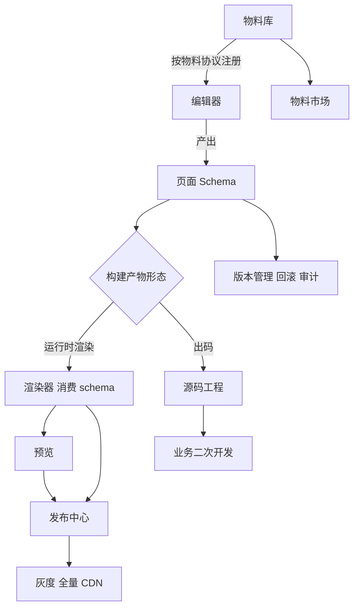

### ARC-089：物料协议如何设计（属性 schema 与 Setter）？
**答**：
- 物料 = 组件实现 + 元数据协议（snippets 拖拽入口、props schema 描述每个属性、setter 类型声明交互控件）。
- 协议设计原则：schema 描述"可配置什么"，Setter 描述"用什么控件配"；类型系统与组件 props 类型同源生成，避免两套定义漂移。
- 关键字段： setter 类型、defaultValue、条件显隐（dependency）、校验规则。

```json
{
  "componentName": "Table",
  "npm": { "package": "@corp/lc-materials", "exportName": "Table", "version": "2.3.0" },
  "snippets": [{ "title": "数据表格", "screenshot": "table.png", "schema": { "props": { "columns": [] } } }],
  "props": [
    { "name": "columns", "title": "列配置", "setter": "ArraySetter",
      "itemSetter": { "setter": "ObjectSetter", "props": [
        { "name": "title", "setter": "StringSetter", "required": true },
        { "name": "dataIndex", "setter": "StringSetter" },
        { "name": "width", "setter": "NumberSetter" } ] } },
    { "name": "dataSource", "title": "数据源", "setter": "DataSourceSetter",
      "dependency": { "visibleWhen": { "name": "mode", "op": "eq", "value": "static" } } },
    { "name": "rowKey", "title": "行键", "setter": "StringSetter", "defaultValue": "id",
      "validator": "required" }
  ]
}
```

### ARC-090：画布编辑器的架构如何设计（拖拽/选中/层级/标尺）？
**答**：
- 编辑器状态机分离：文档模型（组件树）、交互状态（选中/拖拽/悬停）、视图状态（缩放/标尺/参考线）三层解耦。
- 拖拽本质是"文档树操作 + 命令模式"：drop 计算目标容器与位置，所有修改走 command（支持 undo/redo）。
- 选中与拖拽事件不能影响渲染器：通过 DOM 映射（data-node-id）定位节点，蒙层（mask）绘制选中框，不侵入组件本身。

```typescript
// 编辑器核心模型：命令模式支撑 undo/redo
interface DocNode { id: string; componentName: string; props: Record<string, unknown>; children: string[]; parentId: string | null; }
interface Command { do(): void; undo(): void; }

class EditorStore {
  private nodes = new Map<string, DocNode>();
  private history: Command[] = [];
  private future: Command[] = [];
  selection = new Set<string>();                      // 交互态与文档态分离

  move(nodeId: string, targetId: string, index: number): Command {
    const node = this.nodes.get(nodeId)!;
    return {
      do: () => { detach(node); insertAt(targetId, index, node); },   // 先摘除再插入（处理跨容器）
      undo: () => { detach(node); insertAt(node.parentId ?? 'root', originIndex(nodeId), node); },
    };
  }
  exec(cmd: Command) { cmd.do(); this.history.push(cmd); this.future = []; }  // 新操作清空重做栈
  undo() { const c = this.history.pop(); if (c) { c.undo(); this.future.push(c); } }
  redo() { const c = this.future.pop(); if (c) { c.do(); this.history.push(c); } }
}
// 画布事件：canvas.addEventListener('click', e => e.target.closest('[data-node-id]')) 定位选中
```

### ARC-091：渲染器如何设计（schema → 组件树递归渲染与性能）？
**答**：
- 递归渲染 schema 节点：查物料注册表 → 解析 props（含表达式绑定）→ 递归渲染 children。
- 性能要点：大节点树用 memo + 稳定 key；表达式求值结果缓存；虚拟滚动接入容器类物料；避免每次渲染重建组件（物料查表结果缓存）。
- 安全要点：表达式沙箱执行（受限求值器，不用 new Function 直接暴露全局），props 白名单透传。

```tsx
// 运行时渲染器：schema → React 树
const registry = new Map<string, ComponentType<any>>(materials);

function renderNode(node: SchemaNode, scope: Scope): ReactNode {
  const Material = registry.get(node.componentName);
  if (!Material) return dev ? <MissingNode name={node.componentName} /> : null;   // 容错：坏物料不白屏
  const props = evaluateProps(node.props, scope);         // 表达式沙箱求值：state.user.name
  const children = node.children?.map((c, i) =>
    <Fragment key={c.id ?? i}>{renderNode(c, scope)}</Fragment>) ?? node.text;
  return <Material {...props}>{children}</Material>;
}

export function Renderer({ schema, state }: { schema: SchemaNode; state: Record<string, unknown> }) {
  const scope = useMemo(() => createScope(state), [state]);
  return <ErrorBoundary fallback={<RenderCrash />}>{renderNode(schema, scope)}</ErrorBoundary>;
}
// 性能：物料查表结果用 Map 缓存（registry 本身即缓存）；表达式求值按 (expr, scopeVersion) memo
// 编辑态复用：Editor 在 renderNode 外包 DndContext 与 SelectionMask，渲染核心完全一致
```

### ARC-092：出码与运行时渲染如何取舍？
**答**：
- 运行时渲染：改 schema 即生效、支持在线回滚，适合高频变更的运营页/中后台表单；有渲染器运行时成本，深度定制难。
- 出码：产物是真实源码，性能无税、可深度二开，适合"低代码起步 + 高代码接管"的复杂应用；出码后与平台脱钩，回流难。
- 常见架构是双模共存：运行时为主，关键页面支持一键出码"毕业"到代码仓库，出码时带协议注释保留回流能力。

```typescript
// 出码器骨架：schema → 可读源码（而非字符串拼接地狱）
import * as recast from 'recast';

function codegen(node: SchemaNode): string {
  const b = recast.types.builders;
  const ast = toJsxAst(node);                       // schema → JSX AST（可被 prettier 格式化）
  return recast.print(ast).code;
}

function toJsxAst(node: SchemaNode): any {
  const b = recast.types.builders;
  return b.jSXElement(
    b.jSXOpeningElement(b.jSXIdentifier(node.componentName), toJsxAttrs(node.props)),
    b.jSXClosingElement(b.jSXIdentifier(node.componentName)),
    [
      b.jSXCommentTrailing(`lc-protocol: ${node.id} v${node.version}`),  // 协议注释：保留回流能力
      ...(node.children ?? []).map(toJsxAst),
    ],
  );
}
// 取舍速查：
// 运行时渲染：变更频率高、无深度定制、需要在线回滚    → 营销页/简单中后台
// 出码：性能敏感、需要复杂逻辑、预期被研发接管        → 核心业务页"毕业"场景
// 出码质量红线：产物必须过 ESLint + 可读性接近手写，否则没人敢接手
```

### ARC-093：协议版本与物料市场如何设计？
**答**：
- 协议版本化：schema 带 protocolVersion，渲染器按大版本兼容矩阵解析；升级走迁移器（旧 schema 自动升级到新协议）。
- 物料市场：物料独立版本，应用 schema 通过 semver 区间依赖物料；市场提供预览、审计、兼容性检测。
- 关键机制：schema 与物料版本"发布时锁定"，运行时按锁定的版本清单加载，避免物料升级悄悄改坏历史页面。

```json
{
  "protocolVersion": "1.2",
  "app": "activity-20261111",
  "dependencies": {
    "@corp/lc-materials": "^2.3.0",
    "@corp/lc-chart": "^1.0.0"
  },
  "lockedMaterialVersions": {
    "@corp/lc-materials": "2.3.4",
    "@corp/lc-chart": "1.4.1"
  },
  "pages": ["home.schema.json", "detail.schema.json"]
}
```

```text
物料市场机制：
1. 物料发布：物料包构建 → 元数据协议校验 → 兼容性矩阵登记 → 市场上架
2. 应用使用：编辑器从市场拉物料列表 → 拖入画布 → schema 记录 npm 区间依赖
3. 发布锁定：应用发布时把区间解析为精确版本写入 lockedMaterialVersions
4. 升级流程：市场标记新版本 → 平台扫描存量应用的兼容性 → 生成升级报告 → 应用 owner 决定升级
5. 协议迁移：protocolVersion 1.1 → 1.2 由迁移器（migrator）自动转换，不可自动迁移的字段显式报错
```

### ARC-094：JSON Schema 驱动的表单引擎如何架构？
**答**：
- 三层：schema 层（字段/校验/布局声明）、引擎层（解析 schema → 表单树 + 校验状态机）、渲染层（字段组件映射 Setter）。
- 支持动态行为：条件显隐、级联、异步选项源，全部声明式（表达式引用其他字段值）。
- 复杂逻辑逃生口：允许自定义组件接入（widget 注册机制），避免引擎语法膨胀成"模板语言"。

```typescript
// 表单引擎：schema 解析 + 状态机
interface FormSchema {
  fields: FormField[];
}
interface FormField {
  name: string;
  label: string;
  widget: 'input' | 'select' | 'date' | 'custom:RegionPicker';   // custom: 走注册的逃生口
  required?: boolean;
  validator?: { pattern?: string; max?: number; message?: string };
  visibleWhen?: { field: string; op: 'eq' | 'neq' | 'in'; value: unknown };
  optionsFrom?: string;                                          // 异步选项源 key
}

function buildFormState(schema: FormSchema, registry: Map<string, Widget>) {
  const values = reactive<Record<string, unknown>>({});
  const errors = reactive<Record<string, string | null>>({});
  const fields = schema.fields
    .map(f => ({
      ...f,
      widget: registry.get(f.widget) ?? fallbackInput,           // 逃生口：custom widget 注册
      visible: f.visibleWhen ? check(f.visibleWhen, values) : true,   // 响应式重算
    }));
  async function validate(name?: string) {
    const targets = name ? fields.filter(f => f.name === name) : fields;
    for (const f of targets.filter(f => f.visible)) {
      errors[f.name] = await runValidators(f, values[f.name]);   // 校验规则全来自 schema
    }
    return Object.values(errors).every(e => !e);
  }
  return { values, errors, fields, validate };
}
```

### ARC-095：流程引擎的前端可视化（节点连线 DAG）如何设计？
**答**：
- 数据模型：nodes + edges 两个集合，DAG 约束（无环）在编辑时校验（拓扑检测），不是靠用户自觉。
- 编辑器分层：数据层（图模型操作：增删节点/连线，可撤销）、几何层（坐标/碰撞/吸附）、视图层（SVG/Canvas 渲染，节点多时 Canvas）。
- 连线规则引擎化：端口类型匹配、必连/禁连规则声明式配置，非法连线即时反馈。

```typescript
// 流程编辑器数据模型 + DAG 校验
interface FlowNode { id: string; type: 'start' | 'approve' | 'cc' | 'end'; x: number; y: number; props: Record<string, unknown>; }
interface FlowEdge { id: string; source: string; target: string; condition?: string; }

class FlowModel {
  nodes: FlowNode[] = [];
  edges: FlowEdge[] = [];

  addEdge(e: FlowEdge): { ok: boolean; reason?: string } {
    if (e.source === e.target) return { ok: false, reason: '自环禁止' };
    if (this.hasPath(e.target, e.source)) return { ok: false, reason: '会形成环，DAG 不允许' };  // 拓扑检测
    const rule = portRules(this.node(e.source).type, this.node(e.target).type);
    if (!rule.allowed) return { ok: false, reason: rule.reason };          // 声明式连线规则
    this.edges.push(e);
    return { ok: true };
  }
  private hasPath(from: string, to: string, seen = new Set<string>()): boolean {
    if (from === to) return true;
    if (seen.has(from)) return false;
    seen.add(from);
    return this.edges.filter(e => e.source === from)
      .some(e => this.hasPath(e.target, to, seen));
  }
  validate(): string[] {                       // 保存前全图校验
    const errors: string[] = [];
    if (!this.nodes.some(n => n.type === 'start')) errors.push('缺少开始节点');
    for (const n of this.nodes) {
      const inDeg = this.edges.filter(e => e.target === n.id).length;
      const outDeg = this.edges.filter(e => e.source === n.id).length;
      if (n.type !== 'start' && inDeg === 0) errors.push(`节点 ${n.id} 不可达`);
      if (n.type !== 'end' && outDeg === 0) errors.push(`节点 ${n.id} 无下游出口`);
    }
    return errors;
  }
}
```

### ARC-096：权限与低代码如何结合（页面级/操作级/数据级）？
**答**：
- 低代码平台的权限三维：页面可见性（路由/菜单）、组件级（schema 里声明 permission，渲染时过滤）、数据级（请求带租户/角色上下文由服务端过滤）。
- 实现方式：schema 声明 `permission: 'order:refund'`，发布时把全部权限点上报权限中心注册，管理员在权限中心给角色授权。
- 关键点：低代码产出的权限点要进统一权限体系（而不是平台自搞一套），否则审计与授权链路断裂。

```json
{
  "componentName": "Button",
  "props": {
    "text": "退款",
    "permission": { "code": "order:refund", "mode": "hide" },
    "onClick": { "action": "callService", "service": "order.refund" }
  }
}
```

```typescript
// 渲染器侧：权限过滤在 schema 树上统一执行（发布前 + 运行时双保险）
function filterByPermission(node: SchemaNode, perms: Set<string>): SchemaNode | null {
  const p = node.props?.permission;
  if (p && !perms.has(p.code)) {
    if (p.mode === 'hide') return null;                       // 无权限且隐藏：整棵子树剪掉
    if (p.mode === 'disable') node.props.disabled = true;     // 降级为禁用
  }
  return { ...node, children: node.children?.map(c => filterByPermission(c, perms)).filter(Boolean) };
}

// 发布侧：扫描 schema 收集权限点 → 上报权限中心注册（避免漏配）
function collectPermissionCodes(schema: SchemaNode): string[] {
  const codes: string[] = [];
  walk(schema, n => { if (n.props?.permission) codes.push(n.props.permission.code); });
  return [...new Set(codes)];       // 注册进权限中心后，管理员可给角色勾选这些细粒度权限
}
```

### ARC-097：低代码的"逃逸舱"（自定义代码块）如何设计？
**答**：
- 动机：任何低代码平台都覆盖不了 100% 需求，没有逃逸舱用户会用危险的方式绕（改 schema 结构），不如给受控出口。
- 设计：自定义逻辑块/组件按标准接口注册，代码在受限沙箱执行（无 DOM 全局、能力白名单），带版本与审核流程。
- 治理红线：逃逸代码要可被平台索引（可见、可搜、可下线），禁止直接改画布节点的私有结构。

```typescript
// 自定义逻辑块：标准接口 + 受限沙箱
interface CustomLogic {
  name: string;
  version: string;
  inputs: { key: string; type: string }[];
  outputs: { key: string; type: string }[];
  execute(ctx: LogicContext, inputs: Record<string, unknown>): Promise<Record<string, unknown>>;
}

// 平台提供的受限上下文：只暴露白名单能力，不给原始 window
interface LogicContext {
  request: (url: string, init?: RequestInit) => Promise<unknown>;  // 只允许白名单域名
  storage: { get(key: string): Promise<unknown>; set(key: string, v: unknown): Promise<void> };
  state: Record<string, unknown>;                                   // 页面状态只读副本
  log: (msg: string) => void;                                       // 可观测：日志进平台审计
}

const customLogicRegistry = new Map<string, CustomLogic>();
export function registerLogic(l: CustomLogic) {
  auditLogic(l);                                   // 上架走审核：接口声明与实现一致性检查
  customLogicRegistry.set(`${l.name}@${l.version}`, l);
}
// 治理：逻辑块有 owner/版本/调用统计，90 天无调用的进入下线候选清单
```

### ARC-098：平台工程化如何设计（模板中心/脚手架 CLI）？
**答**：
- 平台工程化的意义：把"团队最佳实践"固化成可执行物——模板中心沉淀工程模板，CLI 一键创建，模板升级可同步到存量应用。
- CLI 设计：命令面小而清晰（create/add/deploy/check），核心是模板拉取 + 交互式变量注入 + 升级机制。
- 模板版本治理：存量应用记录模板版本，`check` 命令对比差异并给出可自动合并的升级（codemod 化）。

```bash
# @corp/cli 命令面设计
corp create web-shop --template=react-ssr --team=trade   # 从模板中心创建应用（注入团队/仓库名等变量）
corp add module request                                   # 向存量应用添加标准模块（带依赖安装与接线）
corp deploy --env=beta                                    # 统一部署入口（内部转 OPS 流水线）
corp check --upgrade                                      # 模板升级检查：对比 base 版本差异

# 模板中心结构（monorepo 内 packages/templates）
# templates/react-ssr/          模板本体（{{teamName}} 等变量占位）
# templates/react-ssr/meta.json 声明：变量表、最低 CLI 版本、升级脚本 codemods/
corp check --upgrade 输出示例：
#   当前模板版本 2.1.0 → 最新 2.4.0
#   [auto] 2.2.0 eslint9 配置迁移 —— 可自动合并
#   [manual] 2.3.0 路由生成方式变更 —— 需人工确认（附迁移文档）
```

### ARC-099：低代码的发布流与灰度如何设计？
**答**：
- 发布物：schema（含锁定物料版本）→ 构建产物（bundle + 静态资源）→ 发布单（版本、变更人、diff 摘要）。
- 灰度维度：按流量比例、按用户标签/白名单、按租户；低代码页面的灰度粒度可以细到"单页面版本"。
- 回滚是第一公民：版本链不可变，回滚=把指针切回历史版本（秒级），且回滚本身也要留审计。

```yaml
# 低代码发布单配置（发布中心）
release:
  app: activity-20261111
  version: 3.2.0
  builtFrom: { schemaCommit: "a1b2c3d", materialLock: { "@corp/lc-materials": "2.3.4" } }
  changes:
    - author: zhang.san
      summary: 首页 banner 更换为双列 sku 布局
      schemaDiff: +12 -5
  gray:
    strategy: tag          # ratio | tag | tenant
    tag: { userTag: "beta-user", ratio: 10 }
    fallbackVersion: 3.1.0   # 灰度异常自动回退版本
  audit: { approver: li.si, ticket: "OPS-8821" }
# 发布链路：保存（草稿）→ 预览（临时版本）→ 提交发布单（diff 审批）→ 构建 → 灰度放量 → 全量
# 版本链不可变：versions[3.2.0, 3.1.0, ...]，回滚 = 更新路由指针，秒级生效
```

### ARC-100：从架构师视角，低代码平台的落地风险如何评估？
**答**：
- 三大典型失败模式：能力天花板的幻觉（复杂需求最后全变成平台需求）、双轨成本（平台团队 + 业务绕行成本）、运维长尾（生成页面质量参差，故障归因困难）。
- 评估维度：目标场景匹配度（表单/中后台 → 成熟度高；复杂交互 C 端 → 低）、团队维护承诺、逃生舱与出码完备性。
- 架构师的责任：定义平台边界（什么不做）、设计度量指标（使用率、交付时长、逃逸率）、设置退出策略（数据可导出、schema 可出码）。

```text
低代码风险评估清单（架构师视角）
──────────────────────────────────────────────
1. 场景匹配
   ✓ 高频简单表单/审批流/运营页    → ROI 为正
   ✗ 复杂交互 C 端页面             → 平台追需求的速度永远追不上业务
2. 需求外溢率（逃逸率）度量
   逃逸率 = 走自定义代码/人工开发的页面占比
   逃逸率持续 > 40% → 说明平台定位错了，考虑收缩或转型出码平台
3. 双轨成本
   平台团队人力 ≥ 5 人且持续投入 3 年以上才谈生态；否则先服务单一 BU
4. 长尾运维
   生成页面必须有：监控接入、发布审批、定期巡检（空数据/接口失效）
   责任界定：物料质量归平台，页面配置质量归搭建人（发布单留痕）
5. 退出策略（最容易被忽略）
   schema 必须可出码、数据模型可导出 —— 平台死了业务还能活
   评估结论写进 ADR：试点 6 个月，度量达标后扩量，未达标转内部出码工具
```


---

## 十一、大型系统首屏与性能架构（ARC-101 ~ ARC-108）

### ARC-101：大型 C 端首页的性能架构方案全景如何设计（从网络到渲染分层）？
**答**：
- 分四层设计：网络层（CDN、HTTP/2、预连接、TLS 优化）→ 资源层（分包、代码分割、图片协议）→ 渲染层（SSR/流式、骨架屏、关键 CSS 内联）→ 数据层（BFF 聚合、边缘缓存、降级兜底）。
- 先定性能预算再谈优化：预算写进 CI 卡口（LCP < 2.5s、JS < 300KB gzip），不是事后补救。
- 度量闭环：RUM 真实用户监控按"机型×地域×版本"分维度看 P75，实验室数据只做回归参考。
- 架构上留降级路径：任何一层失效都能退回上一层的可用形态（SSR 挂了退 CSR，接口挂了退缓存快照）。

```yaml
# 首页性能预算与分层架构配置（CI 卡口消费）
performance_budget:
  metrics:
    LCP:  { p75: 2500, hard_limit: 3000 }   # ms，超 hard_limit 阻塞发布
    INP:  { p75: 200,  hard_limit: 300 }
    CLS:  { p75: 0.1,  hard_limit: 0.15 }
  resources:
    js_total_gzip:  300KB     # 含所有首屏 chunk
    css_critical:   14KB      # 关键 CSS 内联上限
    image_lcp:      150KB     # LCP 图片压缩后上限
layers:
  network: { cdn: multi-region, preload: [dns-prefetch, preconnect], protocol: h2 }
  render:  { mode: ssr-streaming, fallback: csr, skeleton: inline-css }
  data:    { bff_aggregate: true, edge_cache_ttl: 60s, degrade: static-snapshot }
enforcement:                  # 卡口动作
  - Lighthouse CI 每次发布前跑，预算超标阻断
  - RUM 周报按维度下钻，连续两周劣化触发专项
```

### ARC-102：商品详情页静态化架构如何设计与失效更新？
**答**：
- 核心思路：详情页 99% 的内容是准静态的（标题/图文/参数），构建或定时生成静态 HTML 推到 CDN，请求不回源，抗住流量洪峰。
- 失效更新两条路：主动失效（商品变更发消息→purge CDN 对应 URL）与版本化 URL（html/detail/{id}/v{hash}.html，更新即换版本，天然无缓存一致性问题）。
- 时效数据（价格/库存/优惠券）不进静态化，页面加载后二次拉取或走独立边缘接口。
- 兜底：CDN miss 回源到静态文件服务器而不是应用服务器；应用只负责生成。

```typescript
// 静态化生成与失效服务（核心逻辑）
interface ProductSnapshot { id: string; version: string; html: string; changedAt: number }

class DetailStaticPublisher {
  async onProductChanged(msg: ProductChangedMsg) {
    // 1. 渲染新版本快照（不含价格库存等时效字段）
    const html = await this.renderTemplate(msg.productId, { exclude: ['price', 'stock'] });
    const version = hash(html);
    // 2. 写入对象存储，版本化路径，永远新增不覆盖
    await this.oss.put(`html/detail/${msg.productId}/v${version}.html`, html);
    // 3. 更新路由表（边缘可缓存的路由小文件），把稳定 URL 指向新版本
    await this.routeCenter.update(msg.productId, { version });
    // 4. 主动 purge 旧路由（路由文件 TTL 极短，purge 只是加速收敛）
    await this.cdn.purge([`/route/detail/${msg.productId}`]);
  }
  // 页面加载后时效数据走独立接口，带本地短缓存
  // GET /api/realtime/detail/{id}  → { price, stock, coupons }  TTL 3s
}
```

### ARC-103：从前端视角看 CDN→边缘→网关→服务端的缓存分层架构如何设计？
**答**：
- 每层职责清晰：CDN 缓存全量静态资源与可缓存的 API 响应；边缘计算（Edge Function）做个性化剥离（把 Cookie 里的个性化部分剥离后才能命中 CDN）；网关做接口级缓存与合并；服务端做应用缓存与本地内存缓存。
- Cache-Key 设计是核心：个性化内容必须从 key 中剥离（登录态用"是否登录"这种粗粒度而不是 userId），否则命中率趋近于 0。
- 失效广播要贯通：内容变更→网关 purge→CDN purge，用统一失效中心管理，禁止各层私自设置互相矛盾的 TTL。
- 指标：分层命中率（每层独立统计），总回源率是最终北极星。

```yaml
# 缓存分层配置示例（前端可维护的部分）
cache_layers:
  cdn:
    static_assets:      { ttl: 31536000, key: "url + content-hash" }   # 带 hash 永久缓存
    api_cache:
      paths: ["/api/home/feed", "/api/product/detail"]
      ttl: 60
      key_rule: "path + query-white-list(version,channel) "   # 剥离个性化 query
      vary_on: ["X-Login-State"]     # 只区分 登录/游客 两种粒度
  edge:
    personalization:                  # 边缘把个性化小块拼接进缓存的大块
      strategy: "esi-like"            # 大块缓存 + 小块边缘动态拼装
  gateway:
    merge: ["/api/home/batch"]        # 聚合接口内部合并下游请求
    dedup_window: 100ms               # 同 key 并发请求合并回源
  server:
    stale_while_revalidate: true      # 过期先返回旧值后台刷新
metrics:
  - 每层独立命中率
  - 总回源率 < 5% 为健康线
```

### ARC-104：图片架构（上传→处理→分发全链路）如何设计？
**答**：
- 上传端：客户端直传对象存储（后端只签发 STS 临时凭证，流量不过业务服务器），上传前校验类型与大小，支持秒传（文件 hash 已存在则跳过）。
- 处理端：原图只存一份，所有尺寸走"URL 参数化实时处理 + 结果缓存"，格式协商（Accept 支持则返回 AVIF/WebP）。
- 分发端：图片域名独立（Cookie 隔离）、CDN 强缓存、懒加载 + srcset 响应式、防盗链（签名 URL / Referer 校验）。
- 治理：图片元信息入库（尺寸/大小/owner），定期扫描僵尸图片与超限大图。

```typescript
// 图片 URL 参数化协议 + 上传流程
// 协议：https://img.corp.com/{bucket}/{fileId}_{width}x{height}_{mode}.{format}
// 示例：/mall/a1b2c3_750x400_cover.avif   cover=裁剪模式  origin=原图
interface ImageUploadFlow {
  // 1. 后端签发临时凭证（前端永远拿不到长期 AK/SK）
  async getStsToken(scene: 'avatar' | 'goods' | 'rich-text'): Promise<StsToken>;
  // 2. 客户端直传 OSS
  async upload(file: File, scene: string): Promise<{ fileId: string; hash: string }> {
    const hash = await sha1(file);                 // 秒传检查
    if (await this.ossExists(scene, hash)) return this.existing(scene, hash);
    validateMagicNumber(file);                     // 魔数校验，不信扩展名
    if (file.size > LIMITS[scene]) throw new Error('图片超限');
    return this.ossPut(file, { scene, hash, renameToHash: true });  // 重命名防路径攻击
  }
}
// 处理参数白名单（防止恶意参数打爆处理服务）
const RESIZE_WHITELIST = [[200,200],[400,400],[750,400],[1080,1920]];
const FORMATS = ['origin', 'webp', 'avif'];        // 由 Accept 头协商
```

### ARC-105：推送与实时架构（轮询/SSE/WebSocket）如何选型？长连接网关怎么设计？
**答**：
- 选型矩阵：轮询（实现最简单、延迟高、无谓开销大，适合低频状态检查）；SSE（单向服务端推、文本协议、自动重连，适合通知/进度）；WebSocket（双向、低延迟，适合 IM/协作/游戏）。原则：能 SSE 不 WS，能轮询不 SSE，按业务实时性要求选而不是炫技。
- 长连接网关独立成服务：连接管理（百万连接）、鉴权、订阅/退订、心跳保活、按房间/用户广播，业务服务只发消息不持有连接。
- 降级链路必须内建：WS 连不上自动降 SSE，再降轮询，对业务透明。

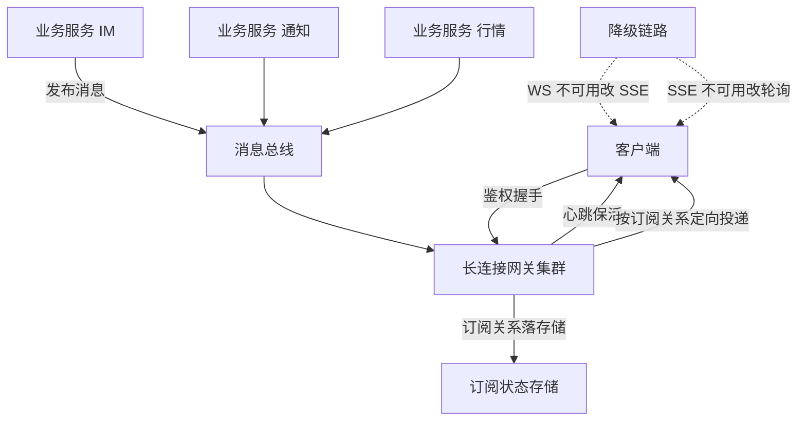

```json
// 网关统一消息协议（业务无关）
{
  "type": "msg",                     // msg | ack | ping | kick | subscribe
  "topic": "im.chat.10086",
  "seq": 10241,                      // 服务端单调序号，客户端据此发现丢包
  "payload": { "from": "u_2", "body": "hello", "ts": 1730000000000 },
  "ack": 10240                       // 客户端确认收到的最大 seq
}
// 客户端策略：seq 断档立即走 HTTP 补拉接口，不依赖长连接补齐
```

### ARC-106：大列表（搜索结果/无限滚动）的服务端架构配合如何设计？
**答**：
- 游标分页替代 offset：offset 深翻页性能塌陷且数据变动时错位；cursor（排序键+唯一 id 编码）走索引 seek，稳定且快。
- 排序必须绝对稳定（排序键 + 唯一 id 兜底），否则游标翻页会重复/丢数据。
- 搜索类列表走 ES（相关性排序）而非 DB；"总数"展示模糊化（"约 1.2 万条"），避免深翻页 count。
- 前端配合：预取下一页（滚动到 70% 触发）、页面回退滚动位置恢复（缓存已加载数据+游标）。

```typescript
// 游标分页协议与实现
interface CursorPageReq { cursor?: string; limit: number }   // cursor=base64(sortKey|id)
interface CursorPageResp<T> { items: T[]; nextCursor: string | null }

// 服务端：cursor 解码后走复合索引 seek
async function listGoods(cursor?: string, limit = 20): Promise<CursorPageResp<Goods>> {
  // WHERE (score, id) < (lastScore, lastId) ORDER BY score DESC, id DESC LIMIT limit
  const { score, id } = cursor ? decode(cursor) : { score: +Infinity, id: '' };
  const items = await db.query(
    `SELECT * FROM goods WHERE (score, id) < (?, ?) ORDER BY score DESC, id DESC LIMIT ?`,
    [score, id, limit + 1]
  );
  const hasMore = items.length > limit;
  const page = items.slice(0, limit);
  return {
    items: page,
    nextCursor: hasMore ? encode({ score: page.at(-1)!.score, id: page.at(-1)!.id }) : null,
  };
}
// 前端：IntersectionObserver 在滚动到已加载内容 70% 处预取 nextCursor
```

### ARC-107：秒杀场景的前端架构（防刷/排队/降级/静态化）如何设计？
**答**：
- 静态化是第一防线：活动页完全静态化 + CDN，倒计时由服务端时间校准（防本地改时间），下单按钮不提前可见。
- 防刷分层：前端行为验证（答题/滑块）只是体验层，真正的防刷靠服务端令牌（答题通过才发令牌）+ 风控指纹，前端做不了真防刷但要为服务端争取时间（随机延迟/答题分流削峰）。
- 排队模式：点击后进入"排队页"（长连接/轮询排队进度），服务端按库存放行，前端只展示队列状态，把瞬时洪峰变成排队消费。
- 降级预案：库存秒空时直接切"已抢完"静态态；整个链路任何环节过载返回友好排队页而不是 502。

```typescript
// 秒杀前端状态机（与服务端令牌联动）
type SeckillState = 'idle' | 'countdown' | 'verifying' | 'queued' | 'submitting' | 'done' | 'soldout';

async function onButtonClick(ctx: SeckillCtx) {
  if (ctx.state !== 'idle') return;
  // 1. 服务端时间校准后的倒计时到期才允许点击
  // 2. 先走行为验证（答题/滑块），通过后服务端签发一次性令牌
  ctx.setState('verifying');
  const { token } = await api.captcha.verify(ctx.activityId);
  // 3. 持令牌进排队，服务端按库存放行；前端轮询/长连接收队列状态
  ctx.setState('queued');
  const result = await api.seckill.queue(ctx.activityId, token, {
    onProgress: p => ctx.updateQueue(p),           // 排队进度展示
  });
  if (result.status === 'soldout') { ctx.setState('soldout'); return; }  // 秒切静态兜底
  // 4. 放行后提交订单（令牌一次性，重放无效）
  ctx.setState('submitting');
  await api.order.create({ activityId: ctx.activityId, token });
  ctx.setState('done');
}
// 关键：按钮态由服务端令牌驱动，前端不维护任何"是否可抢"的真值
```

### ARC-108：重交互页面（在线表格/画板）的性能架构如何设计？
**答**：
- 渲染策略选型：DOM 方案只适合中小规模；万行级表格用虚拟滚动 DOM；画布/表格超大场景下沉 Canvas，用"场景图数据 + canvas 绘制"绕开 DOM 布局瓶颈。
- 计算与渲染分离：公式计算/布局计算放 Web Worker（或 WASM），主线程只做输入响应与绘制指令提交。
- 增量更新：脏区重绘（只重画变化的单元格/区域）、离屏 canvas 缓存静态层、requestAnimationFrame 合并一帧内的多次变更。
- 输入延迟优先级最高：打字/拖拽的响应路径必须最短，其余计算全部让路（时间切片 + 优先级队列）。

```typescript
// 重交互页面的帧调度器（渲染循环核心）
type TaskPriority = 'input' | 'compute' | 'paint';
const PRIORITY_ORDER: Record<TaskPriority, number> = { input: 0, compute: 1, paint: 2 };

class FrameScheduler {
  private queues: Record<TaskPriority, Array<() => void>> = { input: [], compute: [], paint: [] };
  private dirty = new Set<Rect>();                    // 脏区收集
  start() {
    const loop = (deadline?: IdleDeadline) => {
      // 1. input 永远全量处理，保证交互零延迟
      while (this.queues.input.length) this.queues.input.shift()!();
      // 2. compute 时间切片：一帧剩余时间约 8ms 内尽量处理
      while (this.queues.compute.length && (deadline?.timeRemaining() ?? 0) > 8) {
        this.queues.compute.shift()!();
      }
      // 3. paint 合并脏区一次重绘
      if (this.dirty.size) {
        renderer.draw(Array.from(this.dirty));        // 只重画脏区
        this.dirty.clear();
      }
      requestIdleCallback(loop, { timeout: 32 });
    };
    requestIdleCallback(loop, { timeout: 32 });
  }
  markDirty(rect: Rect) { this.dirty.add(rect); }
  post(priority: TaskPriority, task: () => void) { this.queues[priority].push(task); }
}
// 配合：公式计算批量投递 Worker，结果回来后只 markDirty 受影响单元格
```

---

## 十二、多端与跨端架构（ARC-109 ~ ARC-116）

### ARC-109：一套业务多端交付的策略矩阵如何设计？
**答**：
- 先盘点端与需求维度：端（H5/小程序/App/桌面）、交互复杂度、系统能力依赖（蓝牙/推送/相机）、迭代频率、性能要求。
- 策略矩阵按"业务 × 端"给出技术归属，而不是一刀切全跨端：强系统能力或高性能场景归原生，中低复杂度中高频迭代归跨端框架（Taro/uni-app），纯展示/营销归 H5。
- 矩阵要附成本列：跨端框架的定制成本（遇到平台差异时的桥接成本）经常被低估，边界场景要有"原生逃生舱"约定。
- 矩阵每半年复审一次，随框架成熟度调整（如 Taro 对某端支持补齐后回收原生）。

```yaml
# 多端交付策略矩阵（业务线 × 技术归属）
strategy_matrix:
  dimensions: [交互复杂度, 系统能力依赖, 迭代频率, 性能要求]
  rules:
    - if: 系统能力依赖 in [蓝牙, 相机, 推送强依赖] 或 性能要求 = 极高
      then: 原生开发            # App 端 iOS/Android 原生
    - if: 业务 in [电商主链路, 会员, 订单] and 端 in [小程序, H5, App内嵌]
      then: Taro 跨端           # 一套代码多端 + 原生逃生舱
    - if: 业务 = 营销活动页
      then: H5 / 低代码平台     # 快速迭代，无需跨端框架
    - if: 端 = 桌面端 and 业务 = 客服工作台
      then: Electron
  escape_hatch:                 # 逃生舱约定
    - 跨端代码内用条件编译隔离平台差异，单端差异超过 30% 该模块转原生
  review: 每 6 个月复审矩阵与框架版本
owners: { 矩阵维护: 架构组, 执行: 各业务线 tech lead }
```

### ARC-110：Taro 与 uni-app 的编译时原理有何异同（AST 转换 + 运行时适配）？
**答**：
- 共同架构：编译时把一份代码（React/Vue 写法）转成各端能跑的产物（小程序 wxml/wxss/js），运行时把框架的视图层操作映射到对应平台（小程序 setData 或原生渲染）。
- Taro 1/2 重编译时（Babel AST 转换模板，受限多）；Taro 3 转向运行时方案：在小程序里模拟 DOM/BOM，让 React/Vue 正常跑，再由渲染层 diff 后 setData，兼容性好但内存与性能开销更高。uni-app 以 Vue 模板编译时转换为主，语法限定更紧但产物更轻。
- 架构启示：选编译时轻量产物还是运行时强兼容，是跨端框架的根本权衡；业务跨端差异越多，越应该选运行时方案。

```javascript
// 简化的编译时转换示意：JSX/模板 → 小程序模板（Taro 编译时思路）
// 源码：
//   <View onClick={handleClick}>{title}</View>
// 编译时：Babel AST 提取标签、事件、表达式，生成两端产物
//   1. 生成 wxml（事件改为绑定方式，表达式改为数据绑定）
//      <view bindtap="handleClick">{{title}}</view>
//   2. 生成 js：提取模板依赖的数据字段，注入 setData 逻辑
const compiledTemplate = '<view bindtap="handleClick">{{title}}</view>';
// Taro 3 运行时方案示意：宿主环境模拟 DOM
const doc = createMiniProgramDocument();          // 模拟 document/tree
const root = doc.createElement('root');
// React 按 web 方式执行，操作的是模拟节点树
// 渲染层对模拟树做 diff，只把变化部分序列化后 setData 到真实 wxml
root.diffAndFlush((patch) => {
  miniApi.setData(patch);                         // 小程序端
  // 同一套模拟树也可对接 RN（渲染原生组件）或 H5（真 DOM）
});
// 权衡：编译时产物轻、语法受限；运行时兼容全语法、内存开销大
```

### ARC-111：跨端组件库如何设计平台适配层与条件编译？
**答**：
- 三层结构：核心层（纯逻辑，零平台依赖）、适配层（按平台实现同一接口：存储/网络/路由/剪贴板）、组件层（组合核心与适配，模板差异用条件编译）。
- 接口先行：适配层是"平台差异的收口处"，业务代码禁止直接调用平台 API（lint 规则强制），所有差异必须以适配层接口形式登记。
- 条件编译用统一的文件/注释约定（.weixin.ts、#ifdef），构建产物只包含目标平台代码，避免运行时判断膨胀。
- 质量策略：核心层全量单测，适配层每端冒烟用例 + 真机巡检矩阵。

```text
packages/cross-ui/
├── core/                     # 核心层：纯逻辑，禁 import 任何平台 API
│   ├── usePagination.ts      # 分页状态机（各端复用）
│   └── format.ts
├── adapters/                 # 适配层：平台差异收口
│   ├── storage/
│   │   ├── index.ts          # interface Storage { get set remove }
│   │   ├── h5.ts             # localStorage 实现
│   │   ├── weixin.ts         # wx.setStorageSync 实现
│   │   └── alipay.ts
│   └── navigation/ { index.ts, h5.ts, weixin.ts }
├── components/
│   ├── Button/
│   │   ├── index.tsx         # 公共逻辑 + 类型
│   │   ├── button.weixin.wxml / button.weixin.wxss
│   │   └── button.h5.tsx
│   └── List/
└── lint/
    └── no-platform-import.ts # 规则：业务代码禁止直接 import wx/my/window
```

```typescript
// 适配层接口定义（core 依赖它，不依赖具体平台）
export interface StorageAdapter {
  get<T>(key: string): Promise<T | null>;
  set(key: string, value: unknown): Promise<void>;
  remove(key: string): Promise<void>;
}
// 运行时注入 + 条件编译选择实现
import { h5Storage } from '../adapters/storage/h5';
// #ifdef WEIXIN
import { wxStorage } from '../adapters/storage/weixin';
export const storage: StorageAdapter = wxStorage;
// #endif
// #ifndef WEIXIN
export const storage: StorageAdapter = h5Storage;
// #endif
```

### ARC-112：Hybrid 架构如何设计（JSBridge 协议 / 离线包 / 首屏加速）？
**答**：
- JSBridge 协议四要素：请求 id（回调配对）、命名空间（module.action）、参数与结果序列化约定、权限模型（按域名/场景白名单授权能力）。
- 通信通道：iOS 用 WKScriptMessageHandler / prompt 拦截，Android 用 addJavascriptInterface（注解白名单），两端协议统一由桥层封装，业务只见 Promise。
- 离线包：业务 H5 打成 zip 包（含版本 manifest）预下发，客户端拦截请求优先取本地，命中离线包则首屏不发网络请求；差量更新降低流量。
- 首屏加速组合拳：离线包 + 接口预取（native 提前请求首屏接口注入）+ 免登注入（native 带登录态）+ 页面预加载。

```typescript
// JSBridge 协议定义（两端统一）
interface BridgeRequest { id: string; module: string; action: string; data?: unknown }
interface BridgeResponse { id: string; code: number; msg?: string; data?: unknown }

// WebView 侧：统一封装，业务只见 Promise
const pending = new Map<string, (res: BridgeResponse) => void>();
let seq = 0;
function invoke(module: string, action: string, data?: unknown): Promise<unknown> {
  const id = `${Date.now()}_${++seq}`;
  // 权限：桥层校验当前 H5 域名是否在 module 白名单内，不通过直接拒绝
  if (!bridgeACL.isAllowed(location.host, module, action)) {
    return Promise.reject(new Error(`bridge denied: ${module}.${action}`));
  }
  return new Promise((resolve) => {
    pending.set(id, (res) => res.code === 0 ? resolve(res.data) : Promise.reject(res.msg));
    native.postMessage(JSON.stringify({ id, module, action, data }));  // 走原生通道
  });
}
// 原生回调分发：按 id 配对 resolve，超时 5s 自动 reject 防泄漏
// 离线包 manifest 示例：
// { "biz": "mall", "version": "1.2.0", "files": {"index.html": "sha256..." },
//   "preFetch": ["/api/home/feed"], "interceptHosts": ["m.corp.com"] }
// 更新策略：native 启动时拉差量包（版本 diff）→ 校验 sha256 → 原子切换
```

### ARC-113：小程序为什么采用双线程模型？（高频）
**答**：
- 设计动因一：安全与管控。渲染层和逻辑层分离后，JS 运行在 JSCore/V8 中无法直接操作页面 DOM，平台方拥有渲染的最终控制权，才能做审核、接管与限制（不能弹窗劫持、不能任意跳转），这是小程序生态能管住第三方的前提。
- 设计动因二：流畅度。逻辑 JS 的执行阻塞不影响渲染线程（反之亦然），避免 Web 单线程里长任务卡死页面的通病。
- 代价：两线程间通信要走 native 序列化桥（setData），通信成本成为小程序性能的核心瓶颈，由此产生"减少 setData 次数与数据量、避免频繁交互走逻辑层"的整套优化方法论。
- 架构师视角：理解双线程决定了小程序的技术边界——重交互场景（拖拽/游戏）要么用天生的 canvas 层，要么选其他方案。

```text
小程序双线程模型
┌─────────────┐        ┌──────────────────┐        ┌─────────────┐
│  逻辑层      │  setData│   Native 桥      │  渲染   │  渲染层      │
│  JSCore/V8  │ ──────▶ │  序列化/ diff     │ ──────▶ │  WebView    │
│  app.js     │         │  (通信有成本!)    │         │  WXML/WXSS  │
│  无法碰 DOM │ ◀────── │  事件回传          │ ◀────── │  只跑模板    │
└─────────────┘        └──────────────────┘        └─────────────┘
为什么这样设计：
1. JS 触不到 DOM → 平台可审核可管控 → 第三方生态可控
2. 逻辑与渲染线程隔离 → 互不阻塞
通信成本 = 性能瓶颈 → 优化守则：
✗ this.setData({ list: hugeList })          ✗ 高频滚动/拖拽数据回传逻辑层
✓ 只传变化字段 setData({ 'list[3].count': 2 })  ✓ 重交互下沉 canvas
```

### ARC-114：Flutter 与 RN 的渲染差异对前端架构有什么启示？
**答**：
- 渲染路径本质不同：RN 是"JS 写好视图描述 → 桥（旧 Bridge / 新 JSI+Fabric）→ 平台原生组件渲染"；Flutter 是"自绘引擎（Skia/Impeller）直接画像素"，不依赖平台控件，一致性极强但包体大、无系统控件复用。
- 动态性差异：RN 产物是 JS bundle，天然支持热更新下发；Flutter 编译为机器码，动态下发受限（各应用市场合规风险），强动态业务（营销页热更）在 Flutter 上需要额外架构。
- 启示一：跨端选型先问"更新模式"——需要随时热修的业务优先 JS 生态（RN/小程序），追求极致一致性体验且能走发版的选 Flutter。
- 启示二：无论哪条路，业务层都应收敛在"自研组件/协议层"上，把渲染引擎当可替换的实现细节（渲染层抽象）。

```text
渲染架构对比
RN（映射到原生控件）                  Flutter（自绘）
┌──────────┐                        ┌──────────┐
│ JS bundle│ 热更新友好              │ Dart AOT │ 动态下发受限
├──────────┤                        ├──────────┤
│ Bridge / │ 新架构 JSI 直调，       │ Flutter  │ Skia/Impeller
│ JSI+Fabric│ 旧 Bridge 有序列化瓶颈 │ Engine   │ 自绘 UI 一致性强
├──────────┤                        ├──────────┤
│ 原生控件  │ 系统观感, 版本碎片     │ 像素绘制  │ 不依赖系统控件
└──────────┘                        └──────────┘
架构启示（落到代码组织）：
components/          # 自研跨端组件层 —— 业务只依赖这层
renderers/
  ├── rn/            # RN 实现细节
  └── flutter/       # Flutter 实现细节
business/            # 业务逻辑与渲染引擎解耦
```

### ARC-115：Electron 桌面端架构如何设计（主进程/渲染进程/IPC/安全策略）？
**答**：
- 进程模型：主进程管窗口、托盘、自动更新、系统能力与全局状态；渲染进程每窗口一个，跑 UI；重 CPU 任务（大文件解析、加密）再开 utilityProcess/子进程，不阻塞渲染。
- IPC 治理：渲染进程不直接碰 Node（contextIsolation: true、nodeIntegration: false），preload 用 contextBridge 暴露白名单 API；IPC handler 按模块注册并校验入参，禁止 `ipcRenderer.send('eval', code)` 这类通用通道。
- 安全清单：禁 remote 模块、CSP 收紧、webview 开 sandbox、加载内容校验协议（只允许 app:// 与白名单 https）、依赖供应链审计。
- 发布链路：自动更新（全量+差量）、崩溃采集（main + renderer 分开上报）、多窗口状态恢复。

```typescript
// preload.ts：唯一的安全暴露面
import { contextBridge, ipcRenderer } from 'electron';

const ALLOWED_CHANNELS = ['file:open', 'file:save', 'app:update', 'db:query'] as const;
type AllowedChannel = (typeof ALLOWED_CHANNELS)[number];

contextBridge.exposeInMainWorld('desktop', {
  invoke: (channel: AllowedChannel, payload: unknown) => {
    if (!ALLOWED_CHANNELS.includes(channel)) {          // 1. 通道白名单
      return Promise.reject(new Error(`channel not allowed: ${channel}`));
    }
    return ipcRenderer.invoke(channel, payload);        // 2. invoke 模式（有回执）
  },
});
// main.ts：handler 按模块注册 + 入参校验
// ipcMain.handle('db:query', async (_e, q: QueryInput) => {
//   parseWithZod(QuerySchema, q);          // 渲染进程输入不可信，一律校验
//   return db.run(q);                      // 重计算走 utilityProcess，不占渲染进程
// });
// 渲染进程 webPreferences：{ contextIsolation: true, nodeIntegration: false, sandbox: true }
```

### ARC-116：跨端状态同步（多端数据一致性）如何设计？
**答**：
- 先分类数据语义：强一致数据（订单状态、消息）以服务端为准，客户端只做缓存+订阅推送；可合并数据（收藏夹、草稿、已读位置）用"版本比较+冲突合并"；弱一致数据（主题设置）last-write-wins 即可，不要过度设计。
- 同步协议核心是"游标 + 增量"：每端维护 sync cursor，重连/唤醒后增量拉取，避免全量；写操作先落本地队列（离线可用），恢复后按序重放。
- 冲突策略显式声明：按字段合并（不同字段各取所长）优于整对象覆盖；无法自动合并的（同时改同字段）进冲突列表交给业务规则或用户。
- 多端实时性：写操作成功后经长连接广播给同用户其他端，其他端"应用增量"而不是重拉。

```typescript
// 多端同步协议核心（简化）
interface SyncOp { opId: string; entityId: string; field?: string; value: unknown; baseVer: number; ts: number }

class MultiDeviceSync {
  private queue: SyncOp[] = [];                 // 本地写队列（离线可用）
  private cursor = 0;                           // 本端同步游标
  async push(op: SyncOp) {
    this.queue.push(op);
    await this.localStore.applyOptimistic(op);  // 乐观写本地
    await this.flush();                          // 尽快同步服务端
  }
  private async flush() {
    while (this.queue.length) {
      const op = this.queue[0];
      const res = await api.sync.push(op);      // 服务端按 baseVer 检测冲突
      if (res.conflict) {                        // 同字段并发改 → 走业务合并策略
        const merged = this.mergeStrategy[op.entityId](this.queue[0], res.serverOp);
        await api.sync.push(merged);
      }
      this.queue.shift();
    }
  }
  async pullDelta() {                            // 唤醒/重连后增量拉取
    const { ops, nextCursor } = await api.sync.delta({ cursor: this.cursor });
    for (const op of ops) await this.localStore.apply(op);
    this.cursor = nextCursor;
  }
}
```

---

## 十三、实时协作与编辑器架构（ARC-117 ~ ARC-122）

### ARC-117：在线文档协同架构概览：OT 与 CRDT 概念对比？（高频）
**答**：
- 两条技术路线：OT（Operational Transformation）把并发操作在服务端"变换"后重放，需要中心服务器定序，算法难写但成熟（Google Docs 路线）；CRDT（Conflict-free Replicated Data Type）设计天然可交换合并的数据结构，无中心也能收敛（Figma/Yjs 路线），实现简单但内存与元数据开销大。
- 协同系统组成：接入网关（长连接）、协同服务（定序/transform 或 CRDT 合并）、持久化（增量日志 + 定期快照）、广播服务。
- 架构决策要点：文本协作文档多、并发低 → OT 够用且省内存；复杂结构（白板/表格/脑图）对象嵌套深 → CRDT（如 Yjs）开发效率远高于手写 transform。
- 离线协同是 CRDT 的天然优势场景；OT 做离线需要本地完整重放，复杂度高。

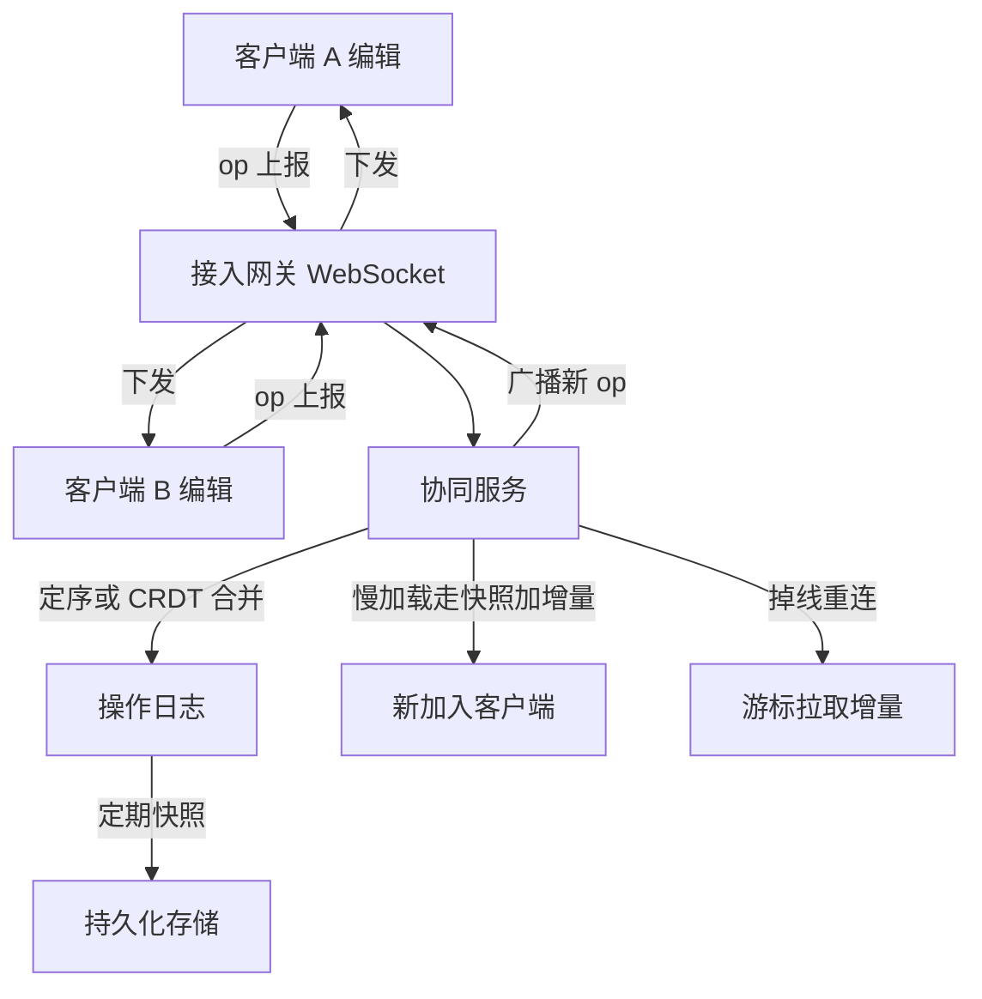

```typescript
// 协同操作协议（OT 风格，CRDT 则为带 id 的原子操作）
interface DocOp {
  type: 'insert' | 'delete';
  pos: number;                 // 操作位置
  text?: string;               // insert 内容
  len?: number;                // delete 长度
  version: number;             // 基于服务端哪个版本产生
  clientId: string;
}
// 服务端定序后广播：
// { ops: DocOp[], serverVersion: 1024 }   —— 客户端收到后先 transform 再应用
// 持久化：append-only oplog（可回放任意历史版本）+ 每 5 分钟快照
// 选型小结：
// 文档纯文本协同 → OT（自研或 shareDB），省内存、成熟
// 富结构（白板/表格/嵌套） → CRDT（Yjs），开发成本低、离线友好
```

### ARC-118：协同冲突解决的简化 OT transform 如何实现？
**答**：
- 核心问题：A、B 基于同一版本并发产生两个操作，应用到同一状态必须收敛。transform 计算出"对方操作对我操作位置的影响"，互相调整偏移与长度。
- 服务端定序模型：服务端收到 op 后与"已提交但未包含它"的操作做 transform，得到服务端版本的操作；客户端收到远端 op 后也要与本地未确认操作做 transform 再应用。
- 实现要点：insert 与 insert 比较 pos 先后（同位置用 clientId 打破对称）；insert 与 delete 组合要处理"删区包含插入点"；简化版可先只处理单字符操作再泛化。
- 工程建议：生产环境不要手写完整 OT（组合/属性/undo 的 transform 极复杂），用成熟库；手写 transform 用于理解原理与面试表达。

```typescript
// 简化 OT transform：两个并发操作的互相变换（纯文本）
interface Op { type: 'insert' | 'delete'; pos: number; text?: string; len?: number }

function transform(a: Op, b: Op): Op {
  // 返回 a'：b 先应用之后，a 应该变成什么样
  if (a.type === 'insert') {
    if (a.pos <= b.pos) return a;                          // a 在 b 之前插入（含同位置，a 先插），位置不变
    if (b.type === 'insert') {
      return { ...a, pos: a.pos + b.text!.length };        // a 在 b 之后：右移 b 的长度
    }
    // b 是 delete：a.pos 在删区左侧不动；在删区内部塌缩到删区起点；在右侧左移删区长度
    const bEnd = b.pos + (b.len ?? 0);
    if (a.pos <= bEnd) return { ...a, pos: b.pos };
    return { ...a, pos: a.pos - (b.len ?? 0) };
  }
  // a 是 delete：把删除区间的两端按 b 造成的坐标变化重新映射
  const mapPos = (p: number) => (p <= b.pos ? p : b.type === 'insert' ? p + b.text!.length : p);
  const aStart = mapPos(a.pos), aEnd = mapPos(a.pos + a.len!);
  if (b.type === 'insert') {
    // b 插在 a 的删除区间中间时，aStart 不动、aEnd 右移，区间自然变长
    // 注：单区间 delete 无法精确表达"delete 与落在其区间内的 insert 并发"（正确结果要拆成两段删除），
    // 此处按"并发插入的文字一并删除"处理；完整实现需把 delete 拆分为两段 op
    return { ...a, pos: aStart, len: aEnd - aStart };
  }
  // b 也是 delete：b 删掉且落在 a 区间内的字符要从 a 的区间里扣除
  const bEnd = b.pos + (b.len ?? 0);
  const cut = (p: number) => p - Math.max(0, Math.min(bEnd, p) - b.pos);
  return { ...a, pos: cut(Math.min(aStart, aEnd)), len: Math.max(0, cut(aEnd) - cut(aStart)) };
}
// 服务端使用：incoming 与所有 pending op 做 transform(incoming, pending) 后提交
// 客户端使用：收到远端 op 后 transform(remote, localPending) 再应用到本地
```

### ARC-119：协同光标与选区同步（presence）如何设计？
**答**：
- 光标/选区走独立的 presence 通道，与文档数据通道分离：presence 高频、易失（断线即消失）、不需要持久化；文档 op 低频、必须可靠。混在一条通道会让文档协议被 presence 洪水拖垮。
- 关键算法：收到远端文档 op 时，本地和远端的**光标位置也要 transform**，否则别人在前面插入文字后你的光标会错位。
- 工程细节：presence 广播节流（如 100ms 批量）、自动清理超时用户、身份元信息（名字/颜色/头像）随 presence 附带、选区折叠成光标的展示策略。
- Yjs 类库直接提供 awareness 协议；自研时把它当独立子系统设计。

```typescript
// presence 协议与光标 transform
interface CursorState { clientId: string; name: string; color: string; anchor: number; head: number; ts: number }

// 1. 本地光标变化 → 节流广播（presence 通道，不落库）
const broadcastCursor = throttle((c: CursorState) => presenceChannel.send(c), 100);
// 服务端维护在线表：超过 10s 无心跳即广播该用户下线

// 2. 收到远端文档 op → 远端与本地光标都要 transform
function applyRemoteOp(op: DocOp, op2: Op) {
  doc.apply(op2);
  for (const peer of peers.values()) {
    const t = transformCursor(peer.anchor, peer.head, op2);   // 远端光标对 op 变换
    peer.anchor = t.anchor; peer.head = t.head;
  }
  const local = transformCursor(myCursor.anchor, myCursor.head, op2);
  myCursor.anchor = local.anchor; myCursor.head = local.head; // 自己的光标也要变
}
function transformCursor(anchor: number, head: number, op: Op) {
  const shift = (p: number) =>
    op.type === 'insert' ? (p >= op.pos ? p + op.text!.length : p)
                         : (p > op.pos + op.len! ? p - op.len! : Math.max(p, op.pos));
  return { anchor: shift(anchor), head: shift(head) };
}
```

### ARC-120：富文本编辑器架构（数据模型/视图层/命令系统）与 slate、prosemirror、quill 对比？
**答**：
- 编辑器架构三层：数据模型（文档的内存表示，决定一切）、视图层（模型→DOM 渲染与选中态同步）、命令/事务系统（所有修改走事务，保证 undo/redo 与协同可叠加）。
- 模型差异：Quill 用扁平 Delta（线性 op 流，简单但表达嵌套结构弱）；Slate 用自由 JSON 树（灵活但 schema 靠约定，容易写出脏数据）；ProseMirror 用严格 schema 约束的树 + Transaction（最严谨，学习曲线最陡）。
- 选型建议：评论/轻格式 → Quill；定制复杂交互、能承担校验责任 → Slate；协同文档、强一致 schema → ProseMirror（+Y.js 协同成熟）。
- 架构底线：业务永远不要直接操作 DOM 做富文本，一切修改走模型与事务，否则协同、undo、导出全盘皆输。

```typescript
// 三家数据模型对比（同一段文字：Hello **world**）
// Quill Delta：扁平 op 流，简单直观
const quillDoc = [
  { insert: 'Hello ' },
  { insert: 'world', attributes: { bold: true } },
];
// Slate：自由 JSON 树
const slateDoc = [
  { type: 'paragraph', children: [
    { text: 'Hello ' },
    { text: 'world', bold: true },
  ]},
];
// ProseMirror：schema 约束的树（node 类型/属性/子节点关系都被 schema 校验）
const pmDoc = pmSchema.node('doc', null, [
  pmSchema.node('paragraph', null, [
    pmSchema.text('Hello '),
    pmSchema.text('world', { marks: [pmSchema.marks.strong.create()] }),
  ]),
]);
// 命令系统：一切修改 = Transaction（PM 示例）
function toggleBold(state: EditorState, dispatch?: (t: Transaction) => void) {
  const tr = state.tr.addMark(state.selection.from, state.selection.to, state.schema.marks.strong);
  dispatch?.(tr);          // tr 进事务栈 → 自动入 undo 历史 → 可映射为协同 op
}
```

### ARC-121：表格引擎架构（虚拟滚动/公式引擎/协同）如何设计？
**答**：
- 数据模型：稀疏矩阵（Map<rowId, Map<colId, Cell>>）而非二维数组，支持千万级空表；行/列有独立 id（支持插入/删除/隐藏不破坏引用）。
- 虚拟滚动：行列双向视口计算，行高可变时用前缀和+分块索引；渲染只画视口±buffer，DOM 方案最多几千单元格，更大规模下沉 Canvas。
- 公式引擎三件事：解析（公式→AST）、依赖图（DAG）、增量重算（改一个格子只重算其下游，含循环引用检测）。计算放 Worker，避免 UI 卡顿。
- 协同：文档级 OT/CRDT 之上，操作粒度细化到单元格（setCellValue/styleOp），公式结果不协同（各端算），只协同公式文本。

```typescript
// 公式引擎核心：依赖图与增量重算
type CellRef = { sheet: string; row: number; col: number };

class FormulaEngine {
  private deps = new Map<CellRef, Set<CellRef>>();     // cell → 依赖的 cells
  private rdeps = new Map<CellRef, Set<CellRef>>();    // cell → 被谁依赖（反向图）
  private cache = new Map<CellRef, number>();          // 计算结果缓存

  async setCell(ref: CellRef, raw: string | number) {
    const ast = typeof raw === 'string' && raw.startsWith('=') ? parseFormula(raw) : null;
    // 1. 重建该格子的依赖边（先摘除旧边）
    this.updateDeps(ref, ast ? collectRefs(ast) : []);
    if (ast && this.hasCycle(ref)) throw new Error('循环引用');   // DFS 检测
    // 2. 收集受影响闭包（反向图 BFS：ref 的所有下游）
    const dirty = this.collectDownstream(ref);
    // 3. 拓扑序增量重算（丢到 Worker，不阻塞 UI）
    const order = this.topoSort(dirty);
    workerPool.submit({ type: 'recalc', order, getRaw: r => this.store.getRaw(r) })
      .then(results => { for (const [r, v] of results) { this.cache.set(r, v); this.markDirty(r); } });
  }
  private collectDownstream(from: CellRef): Set<CellRef> {
    const seen = new Set<CellRef>([from]); const stack = [from];
    while (stack.length) for (const d of this.rdeps.get(stack.pop()!) ?? [])
      if (!seen.has(d)) { seen.add(d); stack.push(d); }
    return seen;
  }
}
```

### ARC-122：画布引擎架构（场景图/渲染循环/拾取）如何设计？
**答**：
- 场景图：所有图形组织成树（画板→分组→图形），每个节点持有几何/样式/变换，渲染时 DFS 遍历应用 transform；修改只标脏，渲染循环统一重绘。
- 渲染循环：rAF 驱动，分层 canvas（静态层缓存 + 动态层重绘）+ 脏区裁剪；高频交互（拖拽/缩放）只重绘视口内的可见对象，屏幕外的用离屏缓存。
- 拾取两种路线：几何拾取（遍历场景图做点在多边形/包围盒判断，精确但计算多）与像素拾取（离屏 canvas 按 id 着色后读像素，O(1) 但多一层渲染）。大型画布用"包围盒粗筛 + 像素细判"两级。
- 性能兜底：超大图形数量用四叉树做空间索引，缩放层级远时降级为 LOD 简化绘制。

```typescript
// 画布引擎核心：场景图节点 + 渲染循环 + 拾取
abstract class SceneNode {
  children: SceneNode[] = [];
  x = 0; y = 0; dirty = true;
  abstract draw(ctx: CanvasRenderingContext2D): void;
  abstract hitTest(px: number, py: number): boolean;
}

class CanvasEngine {
  private root = new Group();
  private hoverId: string | null = null;
  private rafId = 0;

  render = () => {
    // 1. 脏节点级联标记父链，只重绘视口内对象
    const visible = this.root.collectVisible(this.viewport);   // 四叉树空间索引粗筛
    staticLayer.draw(visible.filter(n => !n.dirty));           // 静态层复用
    animLayer.clear();
    for (const n of visible) n.draw(animLayer.ctx);            // 动态层重绘
    this.root.clearDirty();
    this.rafId = requestAnimationFrame(this.render);           // 常驻循环（有脏才画）
  };
  // 拾取：两级策略
  pick(px: number, py: number): SceneNode | null {
    const candidates = this.spatialIndex.queryPoint(px, py);   // 第一级：包围盒/四叉树粗筛
    for (const n of candidates.reverse()) if (n.hitTest(px, py)) return n;  // 第二级：几何细判
    return null;
  }
  // LOD：缩放比小于阈值时用简化轮廓绘制，线段采样率下降
}
```

---

## 十四、质量与测试架构（ARC-123 ~ ARC-131）

### ARC-123：测试金字塔在前端如何落地（单测/集成/E2E 比例与工具链）？
**答**：
- 经典金字塔（多单测、少集成、最少 E2E）在前端要修正为"偏奖杯形"：纯函数单测价值密度高但占比不必虚高，组件/集成测试是前端性价比最高的一层（RTL 社区主流），E2E 只覆盖关键用户路径。
- 工具链映射：单测 Vitest、组件测试 Testing Library、E2E Playwright、视觉回归 Playwright 截图或 Chromatic、mock 网络 msw。
- 分层执行策略：MR 阶段跑受影响的单测+组件测试（分钟级），E2E 只跑冒烟；主干夜间跑全量 E2E——用分层换反馈速度。
- 比例不是教条，看缺陷逃逸分布反推：线上 bug 集中在哪层，就加强哪层。

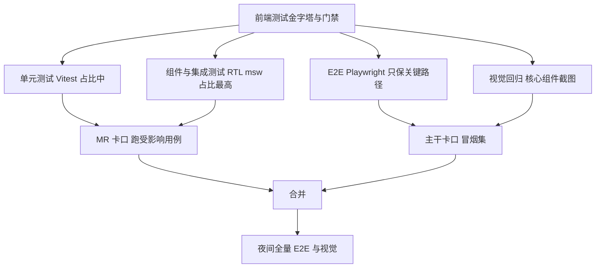

```yaml
# 测试分层执行策略（CI 消费）
test_layers:
  unit:        { tool: vitest,        trigger: affected, budget: "< 2min" }
  component:   { tool: "@testing-library/react + msw", trigger: affected, budget: "< 5min" }
  e2e_smoke:   { tool: playwright,    trigger: always,   budget: "< 8min", cases: 40 }   # 关键路径
  e2e_full:    { tool: playwright,    trigger: nightly,  cases: 500 }
  visual:      { tool: playwright-screenshot, trigger: nightly + 手动基线更新 }
ratio_guide:                 # 指导值，按缺陷逃逸率季度校正
  unit: 40%   # 纯逻辑/工具/hook
  component: 45%   # 交互行为
  e2e: 15%   # 关键路径
feedback_loop: 线上缺陷按"本可被哪层测试捕获"归因，季度调整各层投入
```

### ARC-124：单测架构（Vitest 配置体系 / mock 策略 / 覆盖率门禁）如何设计？
**答**：
- 配置体系分两层：根配置定公共策略（环境、别名、插件、coverage provider），项目级配置只写差异（node 环境 vs jsdom 环境）；monorepo 用 workspace 项目划分避免配置复制。
- mock 策略分层：网络 mock 统一在 msw（handler 即文档、可复用到 storybook/浏览器），时间/随机等非确定性 API 用 vi.useFakeTimers；原则是 mock 边界设施而不是 mock 业务内部实现。
- 覆盖率门禁用"增量门禁"：只要求本次 MR 涉及文件的行覆盖 ≥ 80%，存量不追溯——全量门禁会催生凑数测试。
- 测试文件与源码同目录，命名约定 `*.test.ts`，快照只用于错误信息这类稳定输出。

```typescript
// vitest.workspace.ts + 项目配置
import { defineWorkspace } from 'vitest/config';
export default defineWorkspace([
  { // Node 环境包（工具/服务端逻辑）
    test: { environment: 'node', include: ['packages/*/src/**/*.test.ts'] },
  },
  { // 组件环境包（UI）
    test: {
      environment: 'jsdom',
      setupFiles: ['./test/setup.ts'],        // msw server 启动 + cleanup
      coverage: {
        provider: 'v8',
        thresholds: {
          // 增量门禁：由 CI 脚本计算 diff 文件集，只对这些文件要求阈值
          lines: 80, branches: 70,
        },
      },
    },
  },
]);
// test/setup.ts —— mock 边界设施统一入口
import { server } from './msw/server';
beforeAll(() => server.listen({ onUnhandledRequest: 'error' }));   // 未声明接口直接报错
afterEach(() => { server.resetHandlers(); vi.useRealTimers(); });
afterAll(() => server.close());
```

### ARC-125：组件测试架构（RTL / Vue Test Utils 最佳实践分层）？
**答**：
- 第一原则：测"用户视角的行为"（渲染了什么、点了会发生什么）而不是实现细节（state、内部方法）——RTL 的 query 优先级（getByRole > getByText > getByTestId）就是在强制这一点。
- 分层实践：展示组件测"props → 渲染输出 + 交互回调"；hooks 用 renderHook 测状态机；页面级集成测试组合 msw 数据验证整链路（加载/错误/空态三态必测）。
- 反模式清单：不测快照式 DOM 结构（改样式就崩）、不 mock 子组件（除非边界：路由/Portal）、不在测试里 sleep（用 waitFor/userEvent）。
- 可访问性语义顺带保障：用 getByRole 写查询天然推动 a11y 语义补齐。

```typescript
// 组件测试示例（React Testing Library + msw）
import { render, screen } from '@testing-library/react';
import userEvent from '@testing-library/user-event';
import { http, HttpResponse } from 'msw';

test('提交表单成功后跳转详情页', async () => {
  // Arrange：msw 拦截网络，返回契约数据
  server.use(http.post('/api/orders', () => HttpResponse.json({ id: 'ord_1' })));
  const onCreated = vi.fn();
  render(<OrderForm onCreated={onCreated} />);

  // Act：像用户一样操作（不用 fireEvent 模拟，用 userEvent 走真实事件链）
  await userEvent.type(screen.getByRole('textbox', { name: '收货地址' }), '北京市朝阳区');
  await userEvent.click(screen.getByRole('button', { name: '提交订单' }));

  // Assert：只断言用户可见的结果
  expect(await screen.findByText('下单成功')).toBeVisible();
  expect(onCreated).toHaveBeenCalledWith(expect.objectContaining({ id: 'ord_1' }));
});
// 三态覆盖约定：每个数据组件至少有 加载中 / 错误 / 空数据 三条用例
test('接口报错展示错误态与重试', async () => {
  server.use(http.get('/api/orders', () => HttpResponse.error()));
  render(<OrderList />);
  expect(await screen.findByRole('alert')).toHaveTextContent('加载失败');
  await userEvent.click(screen.getByRole('button', { name: '重试' }));
});
```

### ARC-126：E2E 架构（Playwright 并行 / 失败重试 / tracing）如何设计？
**答**：
- 并行体系：用例内自治（不共享状态）→ 浏览器上下文级隔离 → CI 按文件分片（--shard）横向扩展；登录态用 storageState 复用（登录一次，全组用例共享），把每条用例的 setup 开销降到零。
- 稳定性设计：选择器只认 data-testid（约定进 lint）、等待策略认网络/idle 断言而不是 sleep、每条用例自建数据（API 造数）不依赖前序用例。
- 失败处理：retries 在 CI 开 2（本地 0 便于暴露问题）、失败自动留 trace + 截图 + video，trace viewer 定位失败比看录像快一个量级。
- 用例准入：E2E 用例数量受控（只保关键路径），新增 E2E 需要说明"为什么组件测试覆盖不了"。

```typescript
// playwright.config.ts 核心设计
import { defineConfig, devices } from '@playwright/test';
export default defineConfig({
  fullyParallel: true,
  retries: process.env.CI ? 2 : 0,             // CI 重试吸收偶发，本地不掩盖
  workers: process.env.CI ? 4 : undefined,
  use: {
    trace: 'retain-on-failure',                // 失败保留 trace（可回放每一步）
    screenshot: 'only-on-failure',
    baseURL: 'http://localhost:3000',
  },
  projects: [
    { name: 'setup', testMatch: /auth\.setup\.ts/ },        // 登录一次生成 storageState
    {
      name: 'chromium',
      use: { ...devices['Desktop Chrome'], storageState: 'e2e/.auth/user.json' },
      dependencies: ['setup'],                              // 先跑 setup
    },
  ],
  // CI 分片由流水线控制：
  // npx playwright test --shard=${SHARD_INDEX}/${SHARD_TOTAL}
  reporter: [['html'], ['github']],            // 失败行内标注到 PR
});
```

### ARC-127：视觉回归测试架构如何设计？
**答**：
- 范围控制：只对设计系统组件与核心页面做视觉回归（Storybook 全量截图会量爆炸且噪音大）；营销类像素级变化的页面不做，成本大于收益。
- 基线管理：基线图入库存分支（LFS/S3），更新必须走 MR + 设计师/owner 审核——"基线更新审核"是防视觉回归变成摆设的关键机制。
- 比对策略：多分辨率（375/768/1440）× 主题（亮/暗）矩阵按组件声明；diff 用像素比例阈值（如 > 0.1% 判失败）而不是零容忍。
- 治理：动画元素禁用或冻结（时间 mock、动画禁用模式）、字体/平台渲染差异用 Docker 固定环境。

```yaml
# 视觉回归配置（Playwright screenshot / 自建比对服务均可）
visual_regression:
  scope:
    - source: storybook                # 设计系统组件全量
      stories: "packages/ui/src/**/*.stories.tsx"
    - source: pages                    # 核心页面白名单
      pages: ["/", "/login", "/cart", "/checkout"]
  matrix:
    viewports: [{ width: 375 }, { width: 1440 }]
    themes: [light, dark]
  compare:
    threshold: 0.001                   # 差异像素占比超过 0.1% 判失败
    ignore: [antialiasing, caret]
  baseline:
    storage: s3://corp-visual-baselines
    branch: main                       # 基线只认主干
    update_flow: "更新走 MR，CODEOWNERS 含设计师审核"   # 关键治理点
  stabilize:
    - vi.useFakeTimers 固定时间        # 冻结动态内容
    - prefers-reduced-motion 注入禁用动画
    - Docker 镜像统一字体渲染
```

### ARC-128：契约测试（前后端契约 / Pact 思想）如何落地？
**答**：
- 契约测试思想：消费者（前端）声明"我调用什么接口、期望什么结构"，提供者（后端）在自己的 CI 里验证契约——双方不联调也能发现破坏性变更。
- 落地形态：轻量方案用 OpenAPI schema 作为契约，前端 CI 用 schema 做类型生成 + mock，后端 CI 用 dredd/schemathesis 对 schema 验证实现；重量方案用 Pact（消费者驱动，broker 管理契约与验证结果）。
- 解决的真实问题：接口字段悄悄改名/类型变更在 provider 部署时就被拦截，而不是前端联调时才发现；mock 数据永远与契约一致（handler 即契约）。
- 边界：契约测试保证"结构正确"，不保证业务语义正确——业务正确性仍靠集成测试。

```typescript
// Pact 思想的前端消费者测试（用 @pact-foundation/pact）
import { PactV3, MatchersV3 } from '@pact-foundation/pact-v3';
const { like, integer } = MatchersV3;

const provider = new PactV3({ consumer: 'mall-web', provider: 'order-service' });

describe('订单服务契约', () => {
  it('GET /orders/:id 返回消费者期望的结构', async () => {
    await provider
      .given('订单 ord_1 存在')                                  // provider state
      .uponReceiving('查询订单详情')
      .withRequest({ method: 'GET', path: '/orders/ord_1' })
      .willRespondWith({
        status: 200,
        body: like({
          id: 'ord_1',
          amount: integer(9900),           // 类型匹配器：字段改名/类型变化即契约失败
          status: like('PAID'),
        }),
      })
      .executeTest(async (mockServer) => {
        const order = await fetchOrder(mockServer.url);
        expect(order.status).toBe('PAID');
      });
  });
});
// 流程：前端 CI 生成契约 JSON → 推到 Pact Broker → 后端 CI 拉取契约验证实现
// can-i-deploy：发布前查询 broker 判断该版本是否与所有已上线消费者兼容
```

### ARC-129：变更影响分析（哪些测试该跑）如何实现？
**答**：
- 原理：构建"文件/包 → 测试"的依赖映射，PR diff 变更文件后沿反向依赖图算出受影响集，只跑这部分测试。monorepo 下等价于 Turborepo 的 affected（`--filter=...[origin/main]`）。
- 映射来源：静态 import 依赖图（madge/ts-morph）+ 路由与组件注册表 + 测试框架自带（vitest related）；V8 coverage 反推太慢，主流用静态分析。
- 边界处理：入口文件/公共包（ui、utils）变更视为"影响面放大"，触发更宽的测试集合；配置文件（CI/docker）触发全量。
- 度量：记录"影响集命中率"（线上 bug 是否来自未跑的测试集），漏报就修依赖图而不是加回全量。

```typescript
// 变更影响分析：diff → 受影响测试集（CI 脚本核心）
import { execSync } from 'node:child_process';
import { depGraph } from './dependency-graph';       // 预构建的反向依赖图（CI 缓存）

function affectedTests(baseRef = 'origin/main'): string[] {
  const changed = execSync(`git diff --name-only ${baseRef}...HEAD`)
    .toString().trim().split('\n').filter(Boolean);
  const impacted = new Set<string>();
  for (const file of changed) {
    if (isInfraConfig(file)) return ['**/*.test.ts'];       // 基建变更 → 全量
    const pkg = pkgOf(file);
    if (SHARED_PACKAGES.has(pkg)) {                          // 公共包变更 → 依赖它的全部包
      for (const dependent of depGraph.reverseDeps(pkg)) mark(impacted, dependent);
    }
    mark(impacted, pkg);
  }
  // vitest related：直接复用源码与测试的模块图
  const files = [...impacted].map(f => srcPathOf(f)).join(' ');
  if (!files) return [];
  return execSync(`npx vitest list --related ${files} --reporter=json`)
    .toString().trim().split('\n').at(-1)!.split(',');
}
// 流水线：pnpm turbo test --filter=...[origin/main]  包级 affected
// 应用级：affectedTests() 产出文件级集合，交给 vitest 执行
```

### ARC-130：flaky 测试如何治理？
**答**：
- 识别：CI 每次运行上报结果，重跑通过的用例自动标记 suspect；连续 N 次 flaky 率超阈值进隔离区（quarantine）——隔离区用例仍然运行但不阻塞合并，且有 owner 与处理期限。
- 根因分类统计（治本）：时序/异步等待不当（占大头）→ 用 waitFor/假时钟替代；共享状态（全局单例、DB 残留）→ 用例隔离与 beforeEach 清理；外部依赖（真实网络/时钟）→ msw/假时钟；断言过严（顺序/浮动比较）→ 修断言。
- 制度：flaky 率作为团队质量 SLO（如主干 flaky 率 < 0.5%）；重试只是止血，"靠 retry 绿灯"的用例必须限期修复，否则删除。
- 红线：禁止用例间依赖顺序、禁止依赖真实第三方网络——这两条规则能预防大多数 flaky。

```typescript
// flaky 治理：上报 + 隔离区机制
interface TestResult { suite: string; name: string; status: 'pass' | 'fail' | 'flaky'; durationMs: number }

class FlakyTracker {
  // 1. CI 结果上报：同一次 CI 内先 fail 后 retry-pass → flaky
  async report(r: TestResult, attempt: number) {
    if (r.status === 'pass' && attempt > 1) {
      r.status = 'flaky';
      await db.insert('flaky_events', { ...r, ciRunId: runId, detectedAt: Date.now() });
    }
  }
  // 2. 周期计算 flaky 率，超标入隔离区
  async quarantineSweep() {
    const stats = await db.query(`
      SELECT suite, name, count(*) FILTER (WHERE status = 'flaky') * 100.0 / count(*) AS rate
      FROM flaky_events WHERE detected_at > now() - interval '14 days'
      GROUP BY 1, 2 HAVING rate > 20`);
    for (const s of stats) {
      await this.markQuarantined(s, { owner: await codeOwnerOf(s.suite), deadline: addDays(14) });
      notify(s.owner, `用例 ${s.name} flaky 率 ${s.rate}%，14 天内修复，否则删除`);
    }
  }
}
// 3. 测试执行器消费隔离区：quarantined 用例跑但失败不阻塞
// 配置方式：vitest.config 中 exclude 引入隔离区清单文件（自动生成）
```

### ARC-131：质量门禁体系（MR 卡口）如何设计？
**答**：
- 门禁分级：阻塞级（lint/type 错误、受影响测试失败、覆盖率增量不达标、安全扫描高危）必须过；建议级（复杂度、命名、包体积趋势）只展示不挡路——全阻塞会让开发效率崩塌并催生豁免滥用。
- 性能预算也是门禁：包体积 diff 超 5% 阻塞，bundle 分析报告随 MR 评论输出。
- 豁免机制显式化：豁免必须带理由与期限，豁免记录进月报，超期未还的自动升级到 tech lead——没有审计的豁免最终会变成长期绿灯。
- 反馈速度是采纳率关键：门禁总时长预算 10 分钟内，慢的检查移到合并后异步跑（如全量 E2E）。

```yaml
# MR 质量门禁配置（合并机器人消费）
merge_gates:
  blocking:                          # 阻塞合并
    - lint:            { rule: error=0 }
    - type_check:      { rule: error=0 }
    - affected_tests:  { rule: fail=0, tool: vitest-related }
    - coverage_gate:   { mode: incremental, changed_files_lines: ">= 80%" }
    - bundle_budget:   { js_diff: "<= +5%", lcp_budget: "<= +100ms" }
    - security_scan:   { sev: [critical, high], rule: count=0 }
    - api_contract:    { rule: "OpenAPI diff 无 breaking change（breaking 需后端 owner approve）" }
  advisory:                          # 仅评论提示
    - complexity:      { warn: "> 15" }
    - code_smells:     { warn: "> 10" }
    - doc_update:      { warn: "改了公共 API 但没更新文档" }
  exemption:
    flow: 提交豁免申请 → 说明理由 + 期限 → tech lead approve
    audit: 月报统计豁免数量与超期项，超期自动升级
  latency_budget: "< 10min"          # 门禁总时长，超了就优化或异步化
```

---

## 十五、可观测性与 DevEx 架构（ARC-132 ~ ARC-138）

### ARC-132：前端可观测性体系全景（错误/性能/行为/健康四位一体）如何设计？
**答**：
- 四类信号统一在一个采集 SDK：错误（JS 异常/资源失败/接口失败）、性能（Web Vitals/自定义埋点）、行为（PV/点击/路径）、健康（白屏率/长任务/内存/崩溃率），共享用户会话与设备上下文。
- 关键设计是"关联"：统一 traceId/sessionId 贯穿四类信号，使"性能差的会话伴随哪些报错""报错用户的行为路径"可以互相下钻——单看一类信号都定位不了根因。
- 采样与成本：错误全量、性能按会话采样 10%、行为按事件重要性分级，上报走批量合并 + beacon；采集端降级（SDK 加载失败不影响业务）。
- 消费端分层：实时告警（错误率突变）→ 看板（SLO 趋势）→ 明细查询（单用户回放式排查）。

```typescript
// 可观测性统一信号模型
interface SignalBase {
  sessionId: string;        // 会话级关联（30 分钟窗口）
  userId?: string;          // 登录态匿名 id
  page: string; ts: number;
  env: { app: string; version: string; region: string; ua: string };
  traceId?: string;         // 与后端链路打通的关键
}
type Signal =
  | (SignalBase & { kind: 'error';   type: 'js'|'resource'|'api'|'promise'; message: string; stack?: string; fingerprint: string })
  | (SignalBase & { kind: 'perf';    metric: 'LCP'|'INP'|'CLS'|'custom'; value: number; rating: 'good'|'poor' })
  | (SignalBase & { kind: 'behavior';event: string; props: Record<string, unknown> })
  | (SignalBase & { kind: 'health';  metric: 'blank-screen'|'long-task'|'memory'; value: number });

class ObservabilityClient {
  private buffer: Signal[] = [];
  report(s: Signal) {
    this.buffer.push(s);
    // 批量合并：5s 或 20 条触发；页面隐藏用 sendBeacon 保证不丢
    if (this.buffer.length >= 20) this.flush();
  }
  flush() {
    const batch = this.compress(this.buffer);
    navigator.sendBeacon('/collect', batch) || fetch('/collect', { body: batch, keepalive: true });
    this.buffer = [];
  }
}
// 采样策略：error 全量；perf 按 sessionId hash % 10；behavior 按事件级别
```

### ARC-133：日志规范与结构化上报架构如何设计？
**答**：
- 日志字段规范先行：level/debug/info/warn/error、module（模块归属）、msg（人写文案）、extra（结构化上下文），禁止裸字符串拼接日志——结构化才能查询聚合。
- 分级上报：debug 本地控制台；info 批量采样上报；warn/error 必达上报（beacon + 失败重试本地 IndexedDB 缓存，恢复后补报）。
- 上报管道：客户端批量 → 接入层（鉴权/限流/schema 校验，坏数据丢弃不污染）→ 消息队列 → 清洗（脱敏、去重、归类）→ 存储（错误聚类检索）。
- 与后端链路打通：前端日志带 traceId（请求头透传），错误能直接跳转后端链路详情，这是"前后端一体化排查"的基建。

```typescript
// 结构化 Logger 实现
type LogLevel = 'debug' | 'info' | 'warn' | 'error';
interface LogEntry { level: LogLevel; module: string; msg: string; extra?: Record<string, unknown>; ts: number; traceId?: string }

class Logger {
  private minLevel: LogLevel = 'info';
  log(level: LogLevel, module: string, msg: string, extra?: Record<string, unknown>) {
    const entry: LogEntry = {
      level, module, msg,
      extra: redact(extra),                    // 脱敏：password/token/phone 等字段打码
      ts: Date.now(),
      traceId: getCurrentTraceId(),            // 从当前请求上下文取，与后端链路关联
    };
    if (LEVEL_ORDER[level] < LEVEL_ORDER[this.minLevel]) return;
    if (level === 'error') {                   // error 必达：本地缓存 + 立即上报
      cache.append(entry);                     // IndexedDB 重试队列
      transport.sendImmediate(entry);
    } else {
      transport.batch(entry);                  // info/warn 批量
    }
  }
  scoped(module: string) {                     // 模块级 logger：log = logger.scoped('cart')
    return { info: (m: string, e?: object) => this.log('info', module, m, e),
             error: (m: string, e?: object) => this.log('error', module, m, e) };
  }
}
// 接入层校验：schema 不合规直接丢弃并计数（坏数据告警），保证下游存储质量
```

### ARC-134：用户行为追踪架构（路径分析/漏斗）如何设计？
**答**：
- 事件模型三要素：主体（who：设备 id + 登录 id 归一）、事件（what：命名规范 `module_action`）、属性（context：页面/来源/业务参数），属性集收敛到事件字典统一管理。
- 采集方式按精度分层：关键转化事件手动埋点（准确）、通用行为用声明式/无痕埋点兜底（点击流全量），两者用同一 schema 入库。
- 路径分析与漏斗是数据侧能力，前端的责任是保证事件质量：时序准确（客户端单调时钟）、去重（防重复触发）、归因字段齐全（utm/来源页）。
- 隐私边界：行为数据默认匿名化，同意管理（consent）未授权时不采集或只采聚合级。

```typescript
// 行为追踪事件模型
interface TrackEvent {
  event: string;                       // 命名规范 module_action，如 cart_add_item
  anonymousId: string;                 // 设备维度（cookie/localStorage）
  userId?: string;                     // 登录维度，identify 时归一
  ts: number; seq: number;             // 单调序号，服务端按 seq 去重排序
  props: {
    page: string; referrer: string;    // 路径分析必需
    utm?: { source?: string; campaign?: string };   // 归因
    ...Record<string, unknown>;
  };
}

class Tracker {
  private seq = 0;
  track(event: string, props: Record<string, unknown> = {}) {
    if (!consent.allows(event)) return;                      // 同意管理拦截
    const e: TrackEvent = {
      event, anonymousId: deviceId(), userId: session.userId,
      ts: performance.timeOrigin + performance.now(),        // 客户端单调时钟防系统时间跳变
      seq: ++this.seq,
      props: { page: router.currentPath, referrer: document.referrer, ...props },
    };
    validateAgainstDictionary(e);                            // 事件字典校验，未知事件开发期报错
    transport.batch(e);
  }
}
// 漏斗定义（数据侧消费示例）：view_home → view_detail → cart_add_item → order_submit
// 前端质量责任：每一步事件不可缺失、属性命名不漂移（lint + 字典校验双保险）
```

### ARC-135：DevEx 工具链架构（脚手架/CLI/开发环境一键启动）如何设计？
**答**：
- 目标定义：新成员从 clone 到本地跑起第一个页面的时间（onboarding time）是 DevEx 北极星，目标是 30 分钟内。
- 一键启动：`dev up` 编排全部依赖（本地 mock 服务/依赖容器/env 注入/端口检测），失败给出可操作的修复建议（doctor 子命令体检：node 版本、代理、端口占用、依赖完整性）。
- CLI 分层：内核（参数解析/插件机制/日志）+ 命令插件（create/dev/deploy/check），团队各平台以插件形式接入，避免 CLI 变成大泥球。
- 度量反馈内建：启动时长/失败率匿名上报，DevEx 改进有据可依；CLI 版本与模板版本联动，防止环境漂移。

```yaml
# dev up 编排配置（CLI 消费）
devex:
  north_star: "新成员 clone → 首页可访问 ≤ 30min"
  up:
    steps:
      - name: 环境体检
        run: dev doctor                  # node 版本/镜像源/磁盘/端口检查
      - name: 依赖安装
        run: pnpm install
      - name: 依赖服务
        compose: docker-compose.dev.yml  # mock server / redis / db
        healthcheck: [mock:3001, db:5432]
      - name: 启动应用
        run: turbo dev --parallel
        wait_for: "http://localhost:3000 → 200"
    on_fail:
      suggest: "运行 dev doctor 查看体检报告；常见问题见 docs/troubleshooting"   # 报错必须可操作
  metrics:                               # 匿名上报
    - up_duration_ms
    - up_fail_step
    - onboarding_time（新人首次成功运行）
  cli_structure:
    core: [parse, plugin-host, logger]
    plugins: [create, dev, deploy, check, doctor]   # 平台团队以插件接入
```

### ARC-136：文档架构（文档站/搜索/更新机制）如何设计？
**答**：
- 文档即代码：文档与源码同仓（或独立 docs 仓但 PR 流程一致），走 review 才能发布，杜绝"口头知识"；文档站用 VitePress/Docusaurus 静态化部署。
- 结构分层：入门（Getting Started）/ 指南（How-to）/ 参考（API，由代码注释生成）/ 架构（设计文档与 ADR），四类读者四种入口。
- 搜索与导航是使用率关键：全文搜索（本地索引或 Algolia 类服务）+ 页面内 TOC + 版本切换（组件库多版本文档）。
- 更新机制：代码评审强制"改了公共 API 必须改文档"（CI 检测 API diff）、文档页脚显示最后更新时间与负责人、过期文档定期巡检（链接有效性 + 版本适用性）。

```yaml
# 文档架构配置（文档站 + 更新机制）
docs:
  site: { engine: vitepress, deploy: cdn, versions: [v3, v2] }   # 组件库多版本文档
  structure:
    getting-started: 5 分钟能跑起来的最小示例
    guides:            按任务组织（怎么做 X）
    reference:         API 文档，由 typedoc 从源码生成（禁止手写漂移）
    architecture:      ADR 与设计文档
  search: { engine: pagefind, scope: all }
  freshness:                      # 更新机制（防文档腐烂）
    api_docs: generated           # reference 类自动生成
    ci_check: "公共导出 diff → 未附文档变更则 MR 卡口提示"
    footer: { last_updated: true, owner: CODEOWNERS }
    audit: 季度巡检：死链检查 + 过期标记（> 2 个大版本未验证的文档打 draft 徽标）
  metrics:
    - 文档页 PV / 站内搜索命中失败率（搜索不到=文档缺失信号）
    - 新人文档完成率
```

### ARC-137：开发规范"规范即代码"（自动化检查全量）如何架构？
**答**：
- 核心理念：规范文档的价值 = 被执行的比例。能写成 lint/格式化/CI 规则的全部代码化，文档只保留"为什么"和无法自动化的部分（评审软规则）。
- 落地载体：eslint 自定义规则（团队语义规则，如"禁止直接 import 平台 API""埋点必须走 tracker"）+ stylelint + commitlint + CI 通用检查；规则集以 eslint-config 包统一下发，升级走 semver。
- 存量治理：新规则上线先 warn 一个迭代（问题清单），再转 error——直接 error 会引发生成性提交污染 git 历史。
- 度量：规则触发率下降说明规范内化成功；eslint-disable 数量按月统计，豁免要有注释理由。

```typescript
// 自定义 ESLint 规则示例：禁止业务代码直接使用平台 API（跨端规范）
import type { Rule } from 'eslint';

const rule: Rule.RuleModule = {
  meta: { docs: { description: '跨端代码必须通过 adapters 访问平台能力' },
          schema: [{ type: 'object', properties: { allowedModules: { type: 'array' } } }] },
  create(context) {
    const allowed = new Set(context.options[0]?.allowedModules ?? ['adapters']);
    return {
      ImportDeclaration(node) {
        const source = node.source.value as string;
        // 规则：import wx / my / window.localStorage 等直接平台依赖 → 报错
        if (/^(wx|my|swan|tt)$/.test(source) && !inAllowedPath(context.filename, allowed)) {
          context.report({
            node,
            message: '平台 API 必须经 adapters 层访问（规范 ARCH-平台隔离），见 docs/cross-platform',
            // 附 autofix 建议：指向对应的 adapter 方法
          });
        }
      },
    };
  },
};
// 下发：@corp/eslint-config 统一包，所有仓库依赖它（规范只有一份实现）
// 存量策略：rules: { '@corp/no-platform-import': 'warn' } → 两个迭代后升 error
// 度量：CI 统计 --disable-directive 数量趋势，治理豁免
```

### ARC-138：团队效率度量（DORA + 前端自定义指标）如何设计？
**答**：
- DORA 四指标（部署频率、变更前置时长、变更失败率、故障恢复时长）直接适配前端流水线，反映"交付效率"与"交付质量"的平衡。
- 前端补充自定义指标：CI 构建时长（P95）、本地开发反馈环（HMR 时间）、性能预算达标率、缺陷逃逸率（线上 bug / 总 bug）、基建采纳率（模板/组件库使用占比）。
- 度量原则三条：度量团队不度量个人（防指标游戏）、度量用于发现改进点而非考核、每个指标必须有对应的改进机制承接（看到问题→有人负责→有产出）。
- 展示形态：季度效率报告 + 实时看板，异常趋势自动下钻（哪个环节劣化、影响多少团队）。

```yaml
# 团队效率指标体系
metrics:
  dora:                          # 行业标准四指标
    deployment_frequency:  每日部署次数（按应用统计）
    lead_time_for_changes: MR 合并 → 生产 P50/P90（小时）
    change_failure_rate:   部署引发回滚/热修比例（< 15%）
    mttr:                  故障恢复时长 P90
  frontend_custom:
    - ci_pipeline_p95:     构建+检查流水线 P95（目标 < 10min）
    - hmr_time_p95:        本地热更新时长（目标 < 1s）
    - perf_budget_pass_rate: 发布版本性能预算达标率（目标 100%）
    - defect_escape_rate:  线上缺陷 / (线上+测试阶段) （目标 < 10%）
    - infra_adoption:      新项目使用标准模板比例（目标 95%）
principles:
  - 只度量团队与系统，不度量个人
  - 每个指标绑定改进机制（owner + 季度复盘）
  - 指标数量克制（< 10 个），噪音指标及时下线
reporting: 季度效率报告 + 实时看板（异常趋势自动下钻到环节）
```

---

## 十六、渐进迁移架构（ARC-139 ~ ARC-146）

### ARC-139：jQuery 老系统渐进迁移总方案（绞杀者模式落地步骤）？
**答**：
- 绞杀者（Strangler Fig）核心思想：不重写，而是让新架构像藤蔓一样逐步包裹并最终取代老系统。落地步骤：统一入口（网关按路由分流）→ 引入新应用容器（微前端或独立域名）→ 新功能一律新栈 → 存量页面按流量/价值排序逐个重写 → 老模块冻结 → 清零下线。
- 第一优先级是"共享层打通"：登录态、公共 header、用户信息，新旧行为对用户无感知，用户感觉是同一个系统。
- 顺序策略：先迁移"高价值低风险"页面（如纯展示页）建立信心与链路，核心交易链路最后迁且配套双跑验证。
- 铁律：老系统冻结增量需求（只修 P0 bug），否则迁移永远追不上新增。

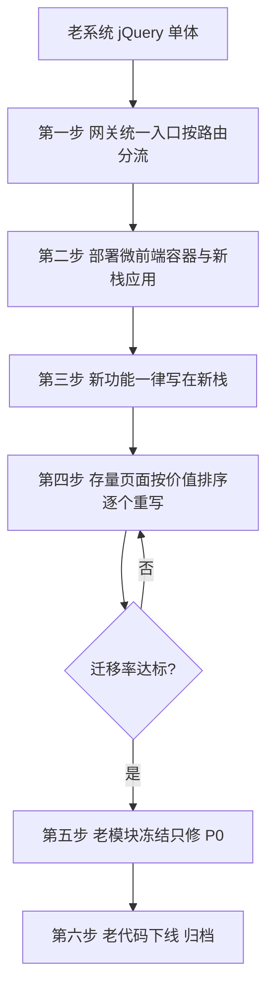

```yaml
# 网关路由分流配置（绞杀者的分流器）
gateway:
  routes:                       # 命中 rewrite_rules 的新路由 → 新应用，其余 → 老系统
    legacy_default:  http://legacy-app.internal
    modern:          http://modern-shell.internal
  rewrite_rules:
    - path: /user/profile        → modern   # 已迁移页面
    - path: /user/settings/*     → modern
    - path: /order/list          → modern
    - fallback                   → legacy   # 未迁移页面原样走老系统
  shared:
    session: 统一 SSO（新老系统互认登录态）
    layout: 公共 header/footer 由 shell 注入，视觉一致
  metrics:
    - modern_route_ratio: 已迁移路由 PV 占比（迁移率看板）
    - freeze: legacy 只允许 P0 修复类变更（流水线按分支拦截）
rollback: 任何新路由异常，网关切回 legacy 秒级恢复（路由即开关）
```

### ARC-140：新旧系统如何共享登录与状态（域名/Cookie/Token 桥）？
**答**：
- 域名策略：优先"同主域不同路径"（app.com/new 与 app.com/legacy），Cookie 天然共享；跨子域用 domain=.app.com 的 Cookie；完全不同域名则上 SSO（OAuth 授权码或 CAS），跳转换取票据。
- Token 桥：老系统持有旧会话、新系统用 JWT 时，由网关或桥接服务完成"旧 session → 换发新 JWT"（反之亦然），登录一次两端可用；token 刷新也要双向同步（避免一端刷新另一端失效）。
- 状态共享分清层次：登录态/主题/用户偏好走 Cookie 或共享存储；业务状态不跨系统共享（各自服务端为准），防止隐式耦合。
- 登出一致性：任一端登出要广播失效（统一登出端点 + token 黑名单），否则出现"单端已退全局仍登录"的安全问题。

```typescript
// Token 桥接服务（网关侧核心逻辑）
interface LegacySession { sid: string; userId: string }
interface ModernJWT { token: string; refresh: string; exp: number }

async function exchange(req: Request): Promise<ModernJWT> {
  // 场景 1：老系统用户访问新页面 —— 旧 sid 换发 JWT
  const sid = req.cookies['legacy_sid'];
  if (sid) {
    const session = await legacyStore.verify(sid);            // 验证老会话有效性
    return jwtService.issue({ userId: session.userId, source: 'legacy', ttl: '2h' });
  }
  // 场景 2：新系统用户访问老页面 —— JWT 换取旧会话（或直接透传给老系统的鉴权插件）
  const jwt = req.headers.authorization?.replace('Bearer ', '');
  if (jwt) {
    const claims = await jwtService.verify(jwt);
    const legacySid = await legacyStore.ensureSession(claims.userId);  // 幂等建会话
    setCookie(res, 'legacy_sid', legacySid, { domain: '.app.com' });
    return { token: jwt, refresh: '', exp: claims.exp };
  }
  throw new Unauthorized();
}
// 登出一致性：POST /logout 同时做三件事
// 1. 吊销 JWT（黑名单）2. 删除 legacy session 3. 广播各端踢下线
```

### ARC-141：Vue2 → Vue3 大型项目迁移架构如何设计（兼容层/gogocode/分模块灰度）？
**答**：
- 总路线：先全局升级依赖底座（Vue 3 + @vue/compat 兼容层跑通构建与启动）→ codemod 批量转换（gogocode/gogocode-plugin-vue 处理 API 改名、过滤器、事件总线等机械变更）→ 兼容层下逐模块清理告警 → 移除 compat 切换正式运行时 → 分应用/路由灰度发布。
- 禁区先行盘点：第三方依赖清单（UI 库、vue-router、vuex）必须先有 Vue3 兼容版，这是前置阻塞项；无法兼容的库（如老的富文本封装）列入替换方案。
- 状态管理迁移是独立工作流：vuex → pinia 可共存（两套 store 并行，新模块用 pinia，老模块按需迁移），不要求一步到位。
- 风险控制：compat 模式下逐步清零 warning（每个 warning 对应一条 codemod 或手改项），全清后才允许移除 compat——这是迁移完成的客观标准。

```javascript
// 迁移配置要点
// 1. 兼容层启动（迁移期）
import { createApp, configureCompat } from 'vue';
configureCompat({
  MODE: 2,                                   // 按 Vue2 语义兼容运行
  COMPONENT_V_MODEL: false,                  // 已完成 codemod 的特性可单独关闭，逐步收敛
});
// 2. vite 集成：vite-plugin-vue2 与 @vitejs/plugin-vue 无法共存 → 迁移期用 webpack5 构建更稳
// 3. codemod 批量转换
//   npx gogocode -s ./src -t gogocode-plugin-vue -o ./src-vue3
//   覆盖：new Vue → createApp、$listeners 移除、过滤器移除、异步组件 API 等
// 4. 兼容告警看板（迁移完成的客观标准）
//   window.addEventListener('vue-devtools-hook', ...)
//   收集 configureCompat warnings → 按特性分组统计 → 清零 → MODE: 3 移除 compat
const migrationChecklist = {
  step1_upgrade_deps:   ['vue@3', '@vue/compat', 'vue-router@4', 'pinia(并行引入)', 'ui 库 v3 版'],
  step2_codemod:        ['gogocode 批量转换', 'git 按模块分 PR 便于 review'],
  step3_clean_warnings: ['compat warnings 清零（每条对应修复项）'],
  step4_remove_compat:  ['configureCompat 移除', '全量回归'],
  step5_gray_release:   ['按应用/路由灰度', '性能与错误率对照监控'],
};
```

### ARC-142：webpack → Vite 迁移架构（按应用分批）如何设计？
**答**：
- 分批单位是"应用"而不是"整个 monorepo"：先选独立工具型小应用试点（验证链路、沉淀 preset），再迁业务应用，最后统一移除 webpack——不同构建器共存期靠包导出与 CI 隔离。
- 配置收敛：抽 `@corp/vite-preset`（alias、环境变量、插件、postcss、构建优化统一内置），应用侧配置只剩几行——迁移的过程也是配置治理的过程。
- 兼容点清单：环境变量前缀（VITE_）、require 语法、CommonJS 依赖预构建（optimizeDeps include）、特殊 loader 的 Vite 等价物（svg sprite/global sass 注入）。
- 双跑验证：迁移分支用两套构建产物跑视觉回归与关键 E2E，产物一致性确认后才切流水线；保留 webpack 分支随时可回退。

```typescript
// @corp/vite-preset：统一配置收敛，应用侧一行接入
import { defineConfig, mergeConfig, type UserConfig } from 'vite';
import react from '@vitejs/plugin-react';
import { visualizer } from 'rollup-plugin-visualizer';

export function corpPreset(appName: string, overrides: UserConfig = {}): UserConfig {
  const base: UserConfig = {
    plugins: [react(), visualizer({ emit: true })],
    resolve: {
      alias: {                                  // 与原 webpack alias 一一映射（迁移清单核对）
        '@': '/src',
        '@corp/ui': resolveMonorepo('packages/ui'),
      },
    },
    server: { proxy: { '/api': { target: 'http://localhost:8080', changeOrigin: true } } },
    build: {
      target: 'es2018',
      rollupOptions: { output: { manualChunks: vendorSplit } },   // 与原 webpack splitChunks 对齐
    },
  };
  return mergeConfig(base, overrides);
}
// 应用侧 vite.config.ts：
// export default defineConfig(corpPreset('mall-web'));
// 迁移双跑验证：
//   webpack 分支 + vite 分支各构建一次 → 视觉回归截图对比 + E2E 冒烟
//   通过 → CI 切换 vite 构建，webpack 配置标记 deprecated 一个版本后删除
```

### ARC-143：微渐进改造路径如何走（不是一上来就微前端）？
**答**：
- 微前端是手段不是目标，改造路径分四阶段：① 同仓拆模块（目录级边界 + 依赖规则 lint）→ ② monorepo 独立包（构建提速、独立发布）→ ③ 运行时按路由集成（qiankun/wujie，团队协作解耦时才引入）→ ④ Module Federation（共享依赖治理成熟后收敛运行时开销）。
- 每阶段的"进入条件"要明确：①→② 的信号是构建时长超 10 分钟/合并冲突高发；②→③ 的信号是多团队同仓迭代互相阻塞发布；条件不满足提前进入下一阶段就是过设计。
- 共享依赖治理贯穿始终：react/vue 等基础库从阶段 ② 开始统一版本（dependabot 群组 + lockstep 升级），否则阶段 ③④ 沙箱与共享层会爆炸。
- 退出机制：如果微前端带来的隔离收益低于运行时成本，允许回退为 monorepo 独立部署（阶段 ② 是安全的稳定态）。

```yaml
# 微前端渐进改造的阶段门（架构评审消费）
migration_stages:
  stage1_modules:
    entry: 单体应用出现多团队协作
    action: 目录级边界 + eslint 依赖规则（上层禁 import 下层实现）
  stage2_monorepo:
    entry: 构建 P95 > 10min 或月均跨团队合并冲突 > 20 次
    action: 拆 packages 独立构建发布，统一基础依赖版本（lockstep）
  stage3_runtime_mfe:
    entry: ≥ 3 团队同应用迭代且发布互相阻塞 ≥ 2 次/月
    action: 引入 wujie/qiankun 按路由集成，主应用只做壳与路由
    contract: [子应用独立可运行, 通信只走 event bus 白名单, 样式作用域隔离]
  stage4_federation:
    entry: 运行时重复依赖体积 > 30% 总体积
    action: Module Federation 共享 react/vue/公共包，版本协商规则固化
  exit_path: 任一阶段收益不达预期可回退到 stage2（稳定态）
```

### ARC-144：Node 中间层（BFF）的引入与退出策略如何设计？
**答**：
- 引入理由必须写进 ADR 且可验证：接口聚合裁剪（减少串行请求）、SSR 需要、协议适配（多端差异化输出）。"后端改不动"不是正当理由，会催生业务逻辑泄漏进 BFF。
- 引入即登记 owner 与 SLA：BFF 是生产服务，需要监控、告警、值班归属；职责红线写清楚——BFF 只做编排/裁剪/格式转换，不写业务规则，业务逻辑上浮到领域服务。
- 退出策略预埋：能力下沉路线图（聚合逻辑迁到网关或领域服务后，BFF 层变纯转发即可移除）；每个 BFF 接口标注"服务对象与替代方案"，无差异化价值的接口直接走网关透传。
- 度量是否值得：BFF 层节省的前端请求数/耗时 vs 增加的运维面（部署/告警/故障点），季度复盘决定扩张或收缩。

```yaml
# BFF 服务登记与退出评估（每服务一份 bff.config.yml）
bff:
  service: mall-bff
  reason:                          # 引入理由（ADR-0042），必须可验证
    - 下单链路前端串行 5 个请求 → 聚合为 1 个（P90 从 2.1s → 800ms）
    - SSR 首屏数据预取
  owner: trade-frontend-team
  sla: { availability: 99.9%, p99: 300ms }
  boundaries:                      # 职责红线
    allowed: [编排, 裁剪, 格式转换, 缓存, 鉴权透传]
    forbidden: [业务规则, 价格计算, 库存扣减]    # 一旦出现即违反架构红线
  exit_plan:                       # 退出策略（预埋）
    - 聚合能力迁移目标：API 网关 batch 接口 / 领域服务聚合接口
    - 迁移后本层变纯转发 → 删除服务，前端切网关直连
  review: 季度评估保留价值（接口差异化率 < 20% 触发收缩讨论）
```

### ARC-145：遗留代码隔离策略（防腐层/边界适配器）如何设计？
**答**：
- 防腐层（Anti-Corruption Layer）：新代码不直接依赖遗留系统的模型与 API，而是经过一层"翻译器"把遗留模型转换成新系统的领域模型——遗留的腐化（全局变量、隐式状态、诡异命名）被限制在层内，不向外扩散。
- 边界适配器实现形式：遗留数据访问收口到 adapter 类（旧 API 的唯一调用点，带 deprecation 注释）、遗留组件包装成新接口组件（内部黑盒）。
- 配套约束：adapter 层必须有用例覆盖（护住翻译正确性）、新代码 import 旧模块被 lint 阻断（只能 import adapter）、旧依赖的调用统计可见（为下线提供依据）。
- 长期目标：防腐层让"替换遗留实现"变成只改层内一件事，而不是全仓搜索替换。

```typescript
// 防腐层：遗留会员系统的翻译器
// ── 遗留世界（不许新代码直接接触）──────────────
// legacyApi.getVipInfo() → { vip_flag: 1, exp_val: 8900, gmt_expire: '2026-12-01', lv: 'P6' }
// ── 防腐层（唯一调用点）──────────────────────
import { legacyApi } from './legacy-sdk';       // 只允许本文件 import（lint 强制）

// 翻译成新系统领域模型
export interface Membership {
  tier: 'none' | 'gold' | 'platinum';           // 语义化，不带遗留痕迹
  points: number;
  expiresAt: Date;
}

export class MembershipAdapter {
  async getMembership(userId: string): Promise<Membership> {
    const raw = await legacyApi.getVipInfo(userId);
    return {
      tier: mapTier(raw.vip_flag, raw.lv),       // 遗留魔法数字在此层消化
      points: raw.exp_val,
      expiresAt: new Date(raw.gmt_expire),       // 遗留字符串时间在此层转换
    };
  }
}
const mapTier = (flag: number, lv: string): Membership['tier'] =>
  flag === 0 ? 'none' : lv.startsWith('P') && Number(lv.slice(1)) >= 8 ? 'platinum' : 'gold';
// 约束三件套：
// 1. eslint 限制 legacy-sdk 只能被 adapters/ 引用
// 2. adapter 有单测护住翻译逻辑
// 3. legacyApi 调用埋点统计（count），调用数为 0 即可下线遗留接口
```

### ARC-146：迁移进度可视化与风险控制如何设计？
**答**：
- 迁移看板三层指标：进度（路由/页面迁移率、代码行占比）、质量（新旧版本错误率/性能对照）、风险（双轨期长度、冻结模块积压需求数、依赖阻塞清单）——只有进度没有质量的看板会掩盖"迁完了一堆坑"。
- 数据自动化采集：路由迁移率从网关配置生成、质量对照从监控按版本号聚合，不靠人工周报（人工数据必然失真）。
- 风险登记表：每项迁移工作附风险条目（影响/概率/缓解/责任人/触发条件），里程碑评审时逐项过；双轨期要设定明确的"结束日期"，没有截止日的双轨期会永久化。
- 回滚预案：每个迁移步骤都可独立回退（路由开关/feature flag），回滚演练进发布流程。

```json
// 迁移看板数据契约（自动采集，供周会与高层汇报）
{
  "migration": "vue2-to-vue3",
  "as_of": "2026-11-01",
  "progress": {
    "routes_total": 180,
    "routes_migrated": 132,
    "modern_route_pv_ratio": 0.87,
    "compat_warnings_remaining": 23
  },
  "quality_compare": {
    "error_rate":      { "legacy": 0.42, "modern": 0.31, "unit": "per-1k-pv" },
    "lcp_p75_ms":      { "legacy": 2600, "modern": 2100 }
  },
  "risks": [
    { "id": "R1", "desc": "第三方富文本库无 Vue3 版", "impact": "high", "owner": "lib-team",
      "mitigation": "替换为 tiptap，已排期", "status": "mitigating" },
    { "id": "R2", "desc": "双轨期积压需求 12 个", "impact": "medium", "owner": "pm",
      "mitigation": "冻结生效中，双轨结束日期 2026-12-31", "status": "open" }
  ],
  "rollback": { "mechanism": "gateway route switch", "last_drill": "2026-10-20" }
}
```

---

## 十七、AI 时代的架构演进（ARC-147 ~ ARC-152）

### ARC-147：AI 辅助研发架构（CR bot / 生成测试 / 文档生成）如何集成到流水线？
**答**：
- 流水线集成原则：AI 是"并行建议者"而不是"串行守门员"——MR 触发时静态分析与 AI review 并行跑，AI 结论以评论形式输出（附置信度与定位），只有明确的高危项才升级为阻塞。
- 三个高价值场景：AI Code Review（风格/逻辑/安全问题提示）、测试草稿生成（为 diff 生成候选用例，人审核后入库）、文档生成（从 API diff 生成变更说明草稿）。
- 效果度量：采纳率（建议被接受比例）、误报率、平均修复提速——没有度量的 AI 集成会变成"流水线噪音"。
- 成本与边界：LLM 调用按 diff 大小分片、缓存重复上下文；安全红线：私有代码外发要走内部网关与脱敏，模型不落盘敏感数据。

```yaml
# AI 辅助研发流水线配置
ai_pipeline:
  triggers:
    on_mr:
      - name: static_analysis        # 确定性检查先行
        run: lint + type-check + security-scan
      - name: ai_review              # 与上面并行，不阻塞静态分析
        model: code-review-large
        input: diff + 相关文件上下文（最多 8 文件，按依赖裁剪）
        output: 评论（severity: info|warn|critical, 每条附行号定位与修复建议）
        blocking: critical           # 只有 critical 升级为阻塞，且需二次确认规则命中
        budget: { max_tokens: 50k, timeout: 120s }
      - name: test_draft             # 为 diff 生成测试草稿，不直接入库
        output: "MR 评论附加候选用例（含 @标记，人 review 后拷贝入测试文件）"
      - name: doc_draft              # API diff → 文档变更草稿
        output: docs PR（draft 状态，作者确认后提交）
  cache:
    strategy: 按文件内容 hash 缓存分析结果，重复 MR 免费重放
  security:
    - 代码经内部 LLM 网关（脱敏：密钥/内网域名/token 替换占位符后再外发）
  metrics: { 采纳率, 误报率, MR 平均修复时长变化 }
```

### ARC-148：LLM 网关架构（统一接入 / 多模型路由 / 限流计费）如何设计？
**答**：
- 网关职责：对上层暴露统一 API（OpenAI 兼容协议是事实标准），下层适配各厂商模型；上层应用只面向"能力"不面向"厂商"，换模型不改业务代码。
- 路由策略多维：按任务类型（代码/摘要/长文本）、按成本与质量档位、按可用性健康度自动切换、按租户配额；路由规则可配置化，支持灰度新模型。
- 平台能力内建：限流（租户级配额）、计费分摊（token 计量落账）、内容安全（输入输出双向审查）、响应缓存与重试、观测（每请求记录模型/耗时/成本）。
- 演进价值：模型价格与能力月月在变，网关让"模型选型"从架构决策变成配置决策。

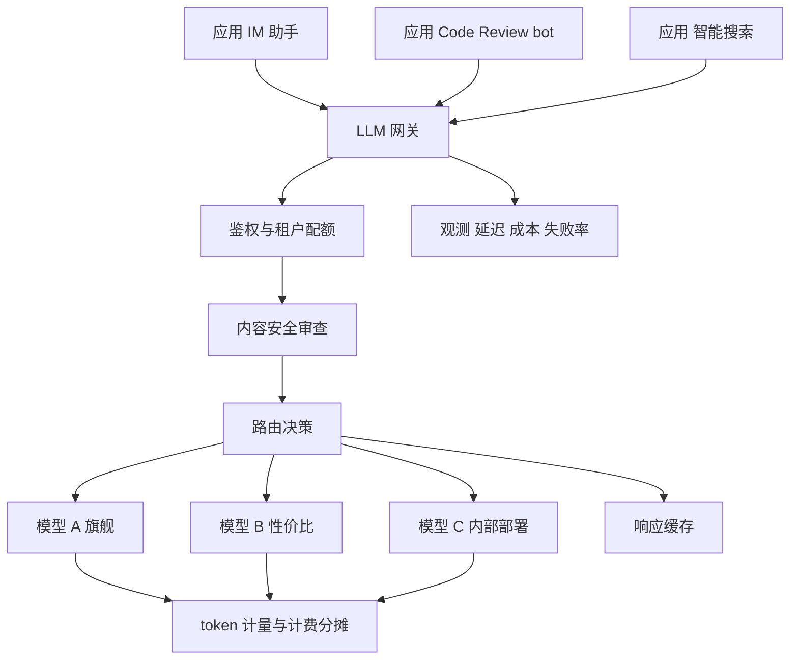

```typescript
// LLM 网关统一 API 与路由配置
interface ChatRequest { model?: string; messages: Message[]; tenantId: string; budget?: TokenBudget }
interface ChatResponse { content: string; usage: { prompt: number; completion: number }; model: string; costUsd: number }

// 路由规则（yaml 配置驱动，改路由不改代码）
// routing:
//   - match: { task: code-review }            → model: qwen-coder  fallback: gpt-4o
//   - match: { task: summary, tokens < 4k }   → model: glm-flash   成本档
//   - match: { tenant: vip }                  → model: 旗舰档，优先内网部署
//   - default                                  → model: glm-flash
//   - health_check_fail → 自动切换 fallback，失败请求进降级队列
async function chat(req: ChatRequest): Promise<ChatResponse> {
  await quota.check(req.tenantId, req.budget);              // 1. 限流与配额
  const safe = await moderation.scan(req.messages);         // 2. 内容安全
  const route = router.pick(req, health.snapshot());        // 3. 多维路由
  const cached = cache.get(hash(safe, route.model));
  if (cached) return cached;                                // 4. 缓存
  const res = await provider(route.model).complete(safe, { timeout: 60s, retries: 2 });
  const result = { ...res, costUsd: pricing(route.model, res.usage) };
  billing.record(req.tenantId, result);                     // 5. 计量落账
  cache.set(hash(safe, route.model), result);
  return result;
}
```

### ARC-149：RAG 平台架构（文档管道 / 向量库 / 评测）如何设计？
**答**：
- 离线管道：文档接入（权限继承是关键：用户搜不到的文档，RAG 也不能喂给模型）→ 解析（PDF/HTML/Office 分别处理）→ 切分（按语义边界，保留标题层级做元数据）→ 向量化入库 → 定期增量更新（文档变更事件驱动）。
- 在线链路：混合检索（向量召回 + 关键词 BM25，取长补短）→ 重排（cross-encoder 精排）→ 组装 prompt → 生成带引用。
- 评测体系是平台成败关键：固定评测集（问题 + 标准答案 + 出处），指标含检索命中率、答案忠实度（防幻觉）、端到端准确率；每次切分策略/模型变更跑回归评测。
- 权限与合规：检索层按用户权限过滤（query-time filter），答案必须带出处链接可追溯。

```typescript
// RAG 核心链路（简化）
interface DocChunk { id: string; docId: string; acl: string[]; text: string; embedding: number[]; path: string[] }

// 离线管道：文档变更事件驱动增量更新
pipeline.on('doc.updated', async (doc) => {
  await vectorStore.deleteByDoc(doc.id);
  const chunks = semanticSplit(doc.content, { maxLen: 512, keepHeadings: true });  // 语义切分
  await vectorStore.upsert(chunks.map(c => ({ ...c, acl: doc.acl, embedding: await embed(c.text) })));
});

// 在线检索：混合检索 + 权限过滤 + 重排
async function answer(question: string, user: User) {
  const [vecHits, kwHits] = await Promise.all([
    vectorStore.search(await embed(question), { filter: { acl_overlap: user.groups }, topK: 20 }),
    keywordSearch(question, { topK: 20, acl: user.groups }),                        // BM25
  ]);
  const merged = rrfFuse(vecHits, kwHits);                   // 混合融合
  const top = await reranker.rerank(question, merged, { topK: 5 });
  return llm.generate({
    context: top.map(c => `[${c.docId}] ${c.text}`),         // 强制带出处
    instruction: '仅根据资料回答，标注引用编号，资料没有则明确说不知道',
  });
}
// 评测集回归：evals/rag.jsonl { question, expected_answer, expected_source }
// 指标：retrieval_hit_rate / faithfulness / e2e_accuracy，模型或切分策略变更必须跑
```

### ARC-150：AI Agent 与前端应用集成架构（流式 UI / 工具调用 / 安全沙箱）如何设计？
**答**：
- 流式协议设计：SSE 承载三类事件（token 增量、工具调用事件、最终结果与元数据），前端按事件类型分流渲染——token 进打字机区域、工具调用渲染成可展开的过程卡片、错误渲染成可重试状态。
- 中断与恢复：流式生成必须支持取消（AbortController 级联到服务端终止推理），长任务支持断点恢复（任务 id + 事件序号续传）。
- 工具调用安全：工具白名单注册（每个工具有 schema 与权限级别），高危工具（发消息/退款/删除）必须用户显式确认；前端渲染"将要执行的操作"卡片，确认后才回调执行。
- 沙箱边界：Agent 的输出永远以"数据"进入前端，渲染层做 XSS 防护（markdown 白名单渲染），绝不允许 LLM 输出直接 eval/innerHTML。

```typescript
// Agent 流式事件协议（SSE）
type AgentEvent =
  | { type: 'token'; delta: string }                                  // 内容增量
  | { type: 'tool_call'; id: string; name: string; args: unknown }    // 工具调用
  | { type: 'tool_result'; id: string; result: unknown; ok: boolean } // 工具结果
  | { type: 'done'; usage: Usage; messageId: string }
  | { type: 'error'; code: string; retryable: boolean };

// 前端消费：流式渲染 + 高危工具确认
async function runAgent(query: string, ui: AgentUI, signal: AbortSignal) {
  const res = await fetch('/agent/run', { method: 'POST', body: JSON.stringify({ query }), signal });
  for await (const ev of parseSSE(res.body!)) {
    switch (ev.type) {
      case 'token':      ui.appendToken(ev.delta); break;
      case 'tool_call':  // 高危工具 → 渲染确认卡片，等用户点击
        if (TOOL_ACL[ev.name] === 'dangerous') {
          const ok = await ui.confirmToolCall(ev);      // 用户显式确认，否则跳过该工具
          if (!ok) { await api.agent.skip(ev.id); break; }
        }
        ui.showToolProgress(ev); break;
      case 'tool_result': ui.completeToolCard(ev); break;
      case 'error':       ev.retryable ? ui.showRetry(ev) : ui.showError(ev); break;
    }
  }
}
// 渲染安全：LLM 输出统一走 sanitizeMarkdown（白名单标签），禁止 raw HTML 注入
```

### ARC-151：Prompt 资产管理架构（版本/评测/复用）如何设计？
**答**：
- Prompt 即代码：prompt 模板入库（带模板变量、描述、适用场景、owner），走 PR review；版本不可变（tag），应用锁定版本引用，升级是显式变更。
- 评测回归：每个 prompt 关联评测集（输入 + 期望要点），prompt 或模型变更时自动跑评测，指标劣化阻断合并——没有评测的 prompt 迭代是玄学调参。
- 复用机制：中央 prompt 注册表按场景检索（任务类型/输入输出 schema/示例），相似场景复用模板而不是各写一份；公共片段（角色设定/输出格式约束）抽成可组合模块。
- 线上实验：prompt 版本支持 A/B（按流量灰度对比采纳率与人工反馈），数据反哺评测集。

```yaml
# Prompt 注册表条目（prompt 即代码）
prompts:
  - id: order-summary
    version: 1.3.0
    owner: trade-ai-group
    task_type: summarization
    template_file: prompts/order-summary@1.3.0.md     # 模板正文入库，支持 {{变量}}
    variables:
      - name: order_json
        type: json
        description: 订单结构化数据
      - name: audience
        type: enum [customer, cs]
    evaluation_set: evals/order-summary.jsonl          # 30 条标注样本
    eval_metrics: [coverage, tone, hallucination_rate]
    gate: "任一指标劣化 > 5% 阻断 prompt 合并"
    rollout:                                           # 线上 A/B
      control: 1.2.0    # 50%
      treatment: 1.3.0  # 50%
      success_criteria: "客服采纳率 + 3%，人工负反馈不升"
    usage: { locked_by: [cs-workbench, im-bot] }       # 应用锁定的版本清单
# 组合复用：公共片段 registry/shared/system-role.md，模板 include 引用，改一处全局生效（走评测）
```

### ARC-152：AI 功能的前端降级与成本控制架构如何设计？
**答**：
- 降级链路设计：AI 能力必须有"非 AI 的可接受替代"——AI 摘要失败退规则摘要（首句+关键词），退无可退则隐藏入口（不显示报错卡片）；每个 AI 功能定义 degradation ladder 并写进设计文档。
- 成本控制四板斧：模型分层（简单任务小模型）、缓存（相同输入 hash 命中直接返回）、用户配额（按用户分层限制次数）、会话截断（上下文裁剪策略），前端负责配额提示与"输入引导"（控制输入长度）。
- 体验预算：AI 接口超时即放弃（如 8s），转降级；流式场景设置首 token 超时（2s）——用户对"转圈"的容忍远低于对"降级结果"的容忍。
- 开关与灰度：AI 功能独立 feature flag，支持按用户比例/租户关闭，成本超预算可一键熔断（熔断是成本失控的最后防线）。

```typescript
// AI 功能降级与成本控制（前端编排层）
type SummaryResult = { source: 'ai'; text: string } | { source: 'rules'; text: string } | { source: 'none' };

async function renderSummary(order: Order, ui: SummaryUI): Promise<SummaryResult> {
  if (!featureFlag.enabled('ai-summary', order.userId)) return { source: 'none' };  // 一键熔断
  if (exceededQuota(order.userId)) {                        // 用户配额：展示引导而非报错
    ui.showQuotaHint(); return { source: 'rules', text: ruleSummary(order) };
  }
  try {
    const res = await withTimeout(
      api.ai.summarize({ input: truncate(order, 4000) }),   // 上下文裁剪控制成本
      { overall: 8000, firstToken: 2000 },                  // 首 token 超时提前放弃
    );
    return { source: 'ai', text: res.text };
  } catch (e) {
    track('ai_degrade', { feature: 'summary', reason: e.code });
    // 降级阶梯：AI 失败 → 规则摘要（用户几乎无感），永远不显示报错卡片
    return { source: 'rules', text: ruleSummary(order) };
  }
}
// 成本监控闭环：每调用上报 { feature, model, tokens, cacheHit, degraded }
// 成本看板按 feature 聚合，预算超 80% 告警，超 100% 自动触发 featureFlag 熔断
```

---

## 十八、数据与安全专项（ARC-153 ~ ARC-159）

### ARC-153：前端数据埋点体系（声明式埋点协议）如何架构？
**答**：
- 声明式埋点核心：埋点配置与业务代码分离——DOM 上挂 `data-track-*` 属性或路由/组件级配置声明事件，SDK 统一扫描与冒泡监听采集；业务代码零侵入。
- 协议要素：事件名（命名空间）、触发方式（click/expose，曝光需交叉观察器+去重）、携带属性（静态值/动态取值表达式）、采样率。
- 质量保障：埋点协议有 schema，构建期校验（未知事件名/非法表达式直接报错）；上线前埋点预览模式（可视化点选验证）；数据侧消费校验反哺（未知事件告警）。
- 分工：声明式覆盖 80% 通用事件，复杂业务事件（含计算逻辑）仍手动调用 tracker——不要追求 100% 声明式。

```tsx
// 声明式埋点协议与实现
// 1. 协议：data-track = "event::props" ，props 支持 :state 表达式取值
// <button data-track="cart_add_click::skuId={sku.id}">加购</button>
// <div data-track-expose="home_banner_view::pos={index}">banner</div>

// 2. SDK 实现（关键部分）
class DeclarativeTracker {
  constructor(private root: Document | HTMLElement, private getState: () => AppState) {}
  bind() {
    this.root.addEventListener('click', (e) => {
      const el = (e.target as HTMLElement).closest('[data-track]');
      if (!el) return;
      const [event, propsExpr] = el.dataset.track!.split('::');
      this.send(event, this.resolve(propsExpr, el));            // 表达式求值
    }, true);
    // 曝光：IntersectionObserver + once 语义（会话内去重）
    const io = new IntersectionObserver((entries) => {
      for (const en of entries) if (en.isIntersecting) {
        const el = en.target as HTMLElement;
        io.unobserve(el);
        const [event, propsExpr] = el.dataset.trackExpose!.split('::');
        this.send(event, this.resolve(propsExpr, el));
      }
    }, { threshold: 0.5 });
    this.root.querySelectorAll('[data-track-expose]').forEach(el => io.observe(el));
  }
  private resolve(expr?: string, el: HTMLElement): Record<string, unknown> {
    if (!expr) return {};
    // 表达式白名单解析：skuId={sku.id} → { skuId: state.sku.id }，禁 eval
    return parseTrackExpr(expr, this.getState(), el.dataset);
  }
}
// 3. 构建期校验：事件名必须在事件字典中，否则构建失败
```

### ARC-154：隐私合规架构（数据分级 / 脱敏上报 / 同意管理）如何设计？
**答**：
- 数据分级清单是地基：所有采集字段登记分级（公开/内部/敏感 PII），敏感字段（手机号/身份证/精确位置）默认禁止出端，需要时必须在清单中申请并说明用途——先有制度再有代码。
- 同意管理（CMP）状态机：未授权时 SDK 只采集"必要聚合级"数据（性能/错误计数），授权后开启行为明细采集；同意状态可撤回，撤回后停止采集并触发已采数据删除请求。
- 脱敏在端上完成：上报前统一过脱敏管道（手机号/邮箱打码、IP 截断、ID 哈希化），服务器拿不到明文敏感字段，缩小泄漏面。
- 区域合规路由：按用户属地走不同策略（GDPR/CN-PIPL），采集配置按 region 分发而不是硬编码。

```typescript
// 同意管理状态机 + 脱敏上报管道
type Consent = { analytics: boolean; marketing: boolean; necessary: true };  // necessary 恒真

class PrivacyGuard {
  constructor(private store: ConsentStore) {}
  canCollect(category: 'analytics' | 'marketing'): boolean {
    return this.store.get()[category];
  }
  // 上报统一入口：先分类判断，再脱敏，最后按区域路由
  submit(signal: Signal) {
    if (signal.kind === 'behavior' && !this.canCollect('analytics')) {
      // 未授权：只保留聚合计数，不发明细
      counter.incr(`behavior_${signal.event}`);
      return;
    }
    const sanitized = redact(signal, {                 // 端上脱敏
      phone: v => v.replace(/(\d{3})\d{4}(\d{4})/, '$1****$2'),
      email:  v => v.replace(/(.{2}).*(@.*)/, '$1***$2'),
      ip:     v => v.split('.').slice(0, 2).join('.') + '.0.0',
      userId: v => sha256(v + salt),                   // 哈希化
    });
    transport.send(sanitized, { region: this.store.getRegion() });  // 区域路由：eu → eu 端点
  }
  onConsentWithdrawn() {
    transport.sendDeletionRequest();                   // 撤回同意 → 触发服务端数据删除流程
  }
}
```

### ARC-155：CSP 深度架构（report-only 渐进收紧）如何设计？
**答**：
- 三阶段推进：① `Content-Security-Policy-Report-Only` 全量观察（收集所有违规上报但不拦截，摸清真实依赖面）→ ② 按违规数据收紧白名单并切强制（保留 report-uri 持续观测）→ ③ 强 nonce/严格 hash 替代 `unsafe-inline`，最终达到无 unsafe-*。
- nonce 方案：模板引擎每请求生成 nonce 注入 script 标签与响应头，框架 SSR 原生支持（React 19/Next 有 nonce 透传）；内联事件（onclick 属性）是收紧的最大阻力，要先存量治理。
- 第三方依赖治理：违规上报的主要来源是三方脚本（营销/客服/统计），逐个评估必要性，必要的走白名单 + SRI 校验。
- 日常运营：report-uri 聚合分析，新增违规告警（可能是 XSS 攻击信号，也可能是新依赖上线漏配），白名单变更走 MR 评审。

```nginx
# CSP 渐进收紧三阶段配置（nginx）
# 阶段 1：全量观察（不拦截，只上报）
add_header Content-Security-Policy-Report-Only "
  default-src 'self';
  script-src 'self' 'nonce-{NONCE}' https://sdk.third.com;
  style-src  'self' 'unsafe-inline';          # 样式先放宽，脚本优先收紧
  img-src    'self' data: https://img.corp.com;
  report-uri /csp-report;" always;

# 阶段 2：强制执行（白名单来自阶段 1 违规数据收敛）
add_header Content-Security-Policy "
  default-src 'self';
  script-src 'self' 'nonce-{NONCE}';
  style-src  'self' 'unsafe-inline';
  img-src    'self' data: https://img.corp.com;
  report-uri /csp-report;" always;

# 阶段 3：nonce + hash 全收紧（无 unsafe-*）
# script-src 'self' 'nonce-{NONCE}' 'sha256-{INLINE_HASH}';

# nonce 生成：proxy 或应用层每请求随机生成，注入 <script nonce="{NONCE}">
# 运营：/csp-report 聚合，同指纹违规 > N 次告警；白名单变更走 MR + 安全评审
```

### ARC-156：前端密钥管理架构（无密钥设计/代理层）如何设计？
**答**：
- 第一原则：前端没有秘密。任何打进前端 bundle 的 key 都视为公开信息，架构设计要围绕"如何不需要长期密钥"展开，而不是"如何藏 key"（混淆只是拖延）。
- 三类处置：自有 API 走登录态/Cookie 鉴权（无需 key）；云资源访问用 STS 临时凭证（后端签发，短时效+最小权限）；必须用 key 的三方服务（地图/支付 SDK）走"域名白名单 + Referer 校验 + 服务端代理"三重限制。
- 代理层模式：三方 API 调用收口到自家后端（前端调自家接口，后端持有密钥转发），密钥永不进浏览器；代价是后端承载流量，要评估必要性。
- 应急预案：密钥泄露（提交到公开仓/被扒）的处置流程——轮换密钥、审计用量、git 历史清理；密钥扫描进 CI（pre-commit + 流水线双卡）。

```typescript
// 前端无密钥设计模式
// 1. 自有 API：Cookie/登录态鉴权，无 key
api.get('/api/user/me');                        // 前端不带任何密钥

// 2. 云资源：STS 临时凭证（后端签发，15 分钟有效期 + 最小权限）
const { credentials } = await api.get('/api/sts/upload?scene=avatar');  // 限定只能写 avatar/ 前缀
const client = new OSS({ ...credentials, bucket: 'mall-asset' });       // 到期自动失效

// 3. 三方 SDK：受限 key + 域名白名单（如地图 SDK）
<script src="https://map.corp.com/sdk?v=3&key=PUBLIC_KEY"></script>
// 安全三重限制：
//   a. key 在三方平台绑定 *.corp.com 域名白名单（Referer 校验）
//   b. 配额与告警：三方平台用量告警，异常量即轮换
//   c. 涉及计费/数据敏感的三方 API 走代理层：
api.post('/api/proxy/map/route', { from, to })  // 前端调自家接口
//    后端持真正 key 转发，密钥只在服务端 KMS 中

// 4. CI 密钥扫描（防泄露源头）
//   pre-commit + CI：gitleaks 扫描提交，命中即阻断；.env 文件默认 gitignore
```

### ARC-157：文件安全架构（上传校验 / 下载鉴权 / 防恶意文件）如何设计？
**答**：
- 上传四道校验：客户端大小/扩展名预检（体验层，可绕过）→ 服务端魔数校验（真实文件类型，不信扩展名）→ 重命名存储（hash 文件名，防路径穿越与覆盖）→ 异步病毒扫描（先隔离区后放行，扫描不过即删并告警）。
- 下载鉴权：文件访问不走直接 URL，签名 URL（短时效 + 绑定用户 + 绑定操作），下载动作留审计；目录遍历与越权（水平越权拉他人文件）是测试重点。
- 防勒索与投毒：图片处理服务隔离部署（解析漏洞常出自图片库）、SVG 上传默认禁 script（或强制 content-type: text/plain 下载）、Excel 等宏文档默认拒绝。
- 前端职责：类型与大小前端预检（省流量）、上传组件不支持任意路径、预览用沙箱 iframe/CSP 隔离渲染。

```typescript
// 上传安全管道（服务端核心）
import { fileTypeFromBuffer } from 'file-type';

async function handleUpload(file: Buffer, declaredType: string, user: User) {
  // 1. 服务端魔数校验：不信扩展名与 Content-Type
  const real = await fileTypeFromBuffer(file);
  const ALLOWED = { 'image/jpeg': '.jpg', 'image/png': '.png', 'application/pdf': '.pdf' };
  if (!real || !ALLOWED[real.mime]) throw new ForbiddenError('类型不允许');
  // 2. 大小限制（分场景）
  if (file.length > LIMITS[real.mime]) throw new PayloadTooLarge();
  // 3. 重命名：内容 hash 文件名，落隔离区
  const hash = sha256(file);
  const key = `quarantine/${hash}${ALLOWED[real.mime]}`;    // 隔离区路径
  await oss.put(key, file);
  // 4. 异步病毒扫描：隔离区 → 扫描 → 正式区
  scanQueue.push({ key, mime: real.mime });                 // 扫描通过才挪正式区并入库可引用
  // 返回"处理中"凭证，扫描完成后前端才能引用该文件
  return { fileId: hash, status: 'scanning' };
}
// 下载：签名 URL，短时效 + 绑定用户
function signedDownload(fileId: string, user: User) {
  const token = hmac({ fileId, uid: user.id, exp: now() + 300 });   // 5 分钟
  return `https://files.corp.com/${fileId}?token=${token}`;
  // 校验：token 验签 + 权限查库（该用户是否有此文件权限）→ 双重防越权
}
```

### ARC-158：防爬虫前端架构（签名 / 混淆 / 行为验证分级）如何设计？
**答**：
- 分级防护按数据价值定价：公开数据不设防（防了也白防，还伤体验）；准公开接口加轻量签名与频率限制；核心商业数据（价格/库存明细）上完整防护（签名 + 环境 校验 + 行为分析）；高危写操作上验证码/风控挑战。
- 请求签名：时间戳 + nonce 防重放，签名算法密钥协商（首次握手下发动态密钥），算法本身定期轮换——前端签名的意义是"提高爬虫成本"而非绝对防御，服务端必须配行为风控兜底。
- 环境校验：检测 headless 特征/异常 API 行为作为信号（不能只靠单一检测），设备指纹用于风险评分。
- 架构认知题：前端防爬的定位是"第一道减速带"，真实防线在服务端（频率/行为/账户关联分析）——把宝押在前端混淆上必然被破。

```typescript
// 请求签名协议（前端实现）
// 首次握手：GET /api/security/handshake → { keyId, secret: 动态密钥(短时效), serverTime }
interface SignedRequest { ts: number; nonce: string; sign: string; keyId: string }

async function signedFetch(url: string, body?: unknown): Promise<Response> {
  const { keyId, secret, serverTime } = await keyStore.current();     // 动态密钥，定时轮换
  const ts = Date.now() + serverTime - clientBootTime;                // 服务端校准时间
  const nonce = crypto.randomUUID();
  // 签名：HMAC(method + path + ts + nonce + bodyHash, secret)
  const bodyHash = body ? await sha256(JSON.stringify(body)) : '';
  const sign = await hmacSha256(
    `${methodOf(url)}|${pathOf(url)}|${ts}|${nonce}|${bodyHash}`, secret,
  );
  return fetch(url, {
    headers: { 'X-Key': keyId, 'X-Ts': String(ts), 'X-Nonce': nonce, 'X-Sign': sign },
    body: body ? JSON.stringify(body) : undefined,
  });
}
// 服务端三重校验：签名正确 → ts 偏差 < 60s → nonce 未出现过（防重放，Redis SETNX）
// 分级策略：
//   L0 公开列表：无签名，仅 CDN 限频
//   L1 价格库存：签名 + 限频
//   L2 核心数据：签名 + 环境指纹评分 + 异常行为挑战
//   L3 高危写操作：验证码/二次验证 + 服务端风控
```

### ARC-159：审计与风控的前端配合点有哪些？
**答**：
- 定位要先讲清：前端防君子不防小人，一切安全真值在服务端；前端的职责是"采集高质量风险信号 + 承载风控交互 + 留存审计痕迹"。
- 审计配合：关键操作（改价/授权/删除/导出）前端发送结构化审计事件（操作前后快照摘要、操作上下文），与后端审计日志对齐，形成可追溯链。
- 风控交互承载：风控挑战的交互层（验证码/二次确认/设备授权）、风险提示 UI（"该操作已被风控拦截"的可解释文案）、静默采集行为特征（鼠标轨迹/输入节奏，需隐私合规）。
- 容错设计：风控接口不可用时前端降级为"可提交但标记复核"而不是全局阻塞（可用性优先，事后审计兜底）。

```typescript
// 审计事件协议 + 风控交互承载
interface AuditEvent {
  action: string;                       // 如 price.update / role.grant
  actor: string;                        // 操作者
  target: { type: string; id: string };
  before: unknown; after: unknown;      // 操作前后快照摘要（敏感字段脱敏）
  context: { page: string; ticketId?: string; reason?: string };
  ts: number;
}

// 1. 关键操作统一走审计封装（漏审计 = 架构缺陷）
export async function auditedAction<T>(
  ev: Omit<AuditEvent, 'ts'>, fn: () => Promise<T>,
): Promise<T> {
  const result = await fn();
  transport.audit({ ...ev, ts: Date.now() });           // 与后端审计日志双写对齐
  return result;
}
// 2. 风控挑战承载：服务端返回 risk_level，前端按级渲染交互
async function submitWithRisk(req: Request): Promise<Response> {
  const res = await api.post(req.url, req.body);
  if (res.code === 'RISK_CHALLENGE') {
    const passed = await riskUI.showChallenge(res.challenge);   // 验证码/二次确认
    return passed ? api.post(req.url, { ...req.body, challengeToken: res.token }) : res;
  }
  if (res.code === 'RISK_BLOCKED') {
    riskUI.showExplain(res.reason);                              // 可解释文案，减少客诉
    throw new RiskBlocked();
  }
  return res;
}
// 3. 风控服务不可用降级：放行 + 标记 pending_review，事后审计复核
```

---

## 十九、组织与协作架构（ARC-160 ~ ARC-166）

### ARC-160：中台前端架构（能力复用与业务隔离的平衡）如何设计？
**答**：
- 复用分层决定平衡点：基础组件与工具全量复用（无业务语义）；领域组件（订单卡片/地址选择器）复用但各业务可扩展；页面与应用不追求复用（业务隔离优先）——复用的单位越小越安全。
- 形态选择：monorepo 共享包（强关联团队）或 npm 私服（松耦合团队）；中台团队的产出是"平台 + 组件 + 规范"，不是替业务写页面。
- 治理三机制：组件有明确 owner 与 SLA（issue 响应时限）、变更走 semver（breaking 提前一个版本通知）、使用率度量（没人用的能力直接下线）。
- 反模式警示：中台变成"所有需求的接盘侠"（业务定制全进中台）会迅速腐化；出口是"可扩展点 + 逃生舱"，业务个性化留在业务侧实现。

```text
中台前端复用分层（平衡复用与隔离）
┌─────────────────────────────────────────────┐
│ 业务应用层   mall-web / member-web / grow-web │  ← 不复用，业务隔离
├─────────────────────────────────────────────┤
│ 领域组件层   OrderCard / AddressPicker        │  ← 复用 + 扩展点（各业务可覆写）
│             trade-components（owner: 中台）   │
├─────────────────────────────────────────────┤
│ 基础能力层   ui / utils / request / tracker   │  ← 全量复用，强约束版本
├─────────────────────────────────────────────┤
│ 平台工程     脚手架 / CI 模板 / 发布平台       │  ← 中台核心产出
└─────────────────────────────────────────────┘
治理约定：
1. 领域组件扩展点设计：props 覆写 + renderX 插槽 + 样式 token
2. 业务个性化不进中台：中台拒绝"仅某业务需要"的需求（走扩展点在业务侧实现）
3. 度量：各包周下载/引用数，90 天零引用进入下线候选
4. 中台人力红线：定制需求占比 > 40% 说明定位漂移，启动复盘
```

### ARC-161：多团队组件冲突治理（版本协商 / semver 约定 / owner 机制）如何设计？
**答**：
- 冲突根源治理：共享包必须有唯一 owner（CODEOWNERS 声明），无 owner 的共享包禁止存在；两个团队都想改同一个包，说明包的边界设计错了，先拆包再谈协作。
- semver 约定实操：breaking change 提前发 next 版本 + 变更公告，给依赖方一个版本窗口（如支持 N-1 两个月）；deprecated API 保留 console.warn 至少一个版本。
- 多版本共存是缓冲带：monorepo 允许短期多版本共存（scoped alias），但纳入"重复依赖看板"，限期收敛——共存是过渡态不是稳态。
- 仲裁机制：版本冲突升级到架构例会裁决（基于使用量/迁移成本数据，不拍脑袋）；重大 breaking（如 react 大版本）由基建团队主导 lockstep 升级（全仓统一窗口）。

```yaml
# 共享包治理配置
shared_package_policy:
  ownership:
    CODEOWNERS:                           # 唯一 owner 强制
      - path: packages/ui/**        owner: platform-ui-team
      - path: packages/trade/**    owner: trade-fe-team
    rule: "无 owner 的包不允许被跨团队引用（CI 校验）"
  semver_contract:
    breaking:  发 next 预发布 + 公告，依赖方迁移窗口 60 天
    deprecated: 保留至少一个 minor 版本并 console.warn 指引新 API
    support_window: 当前版本 + N-1（两个月）
  coexistence:
    allow: monorepo 内短期多版本（alias 引用）
    board: 重复依赖看板（按包聚合多版本数量），超 1 个 minor 差异标红
    deadline: 每条共存记录必须带收敛排期
  lockstep:                                 # 大版本统一升级
    scope: [react, vue, major-ui-libs]
    mode: 基建团队开分支统一升级 + 全仓回归 + 一次性合入
  arbitration:
    - 团队间冲突 → 架构例会，输入：使用量数据 + 双方迁移成本评估
    - 裁决记录进 ADR（编号可追溯）
```

### ARC-162：接口契约协作（OpenAPI 优先 / 契约变更流程）如何设计？
**答**：
- OpenAPI 先行：接口定义（不是实现）是协作起点——后端先提交 schema PR，前端基于 schema 生成类型与 mock 同步开发；契约仓库是前后端的"共同上游"。
- 变更流程分级：新增可选字段（自由）、新增必填/删字段/改类型（breaking）→ 必须发新版本路径（/v2/）或走弃用流程，契约 CI 自动检测 diff 是否 breaking。
- 联调成本归零：契约即 mock（schema 直接生成 mock server），前端不等后端；后端实现完成后用契约做一致性验证。
- 责任闭环：契约与实现不一致视为后端 bug（验证失败阻断后端发布）；前端发现文档外的字段行为，反哺修契约而不是前端"默默适配"。

```yaml
# 接口契约协作流程（契约仓 + CI）
contract_workflow:
  source_of_truth: contracts/openapi/mall.yaml     # 契约仓库，单一代码源
  flow:
    - step: 需求评审后，后端提契约 PR（schema 变更）
      check: [spectral lint, breaking-change-diff vs main]
    - step: breaking 变更 → 需要新版本路径或 deprecation 计划（字段级 sunset 日期）
      approval: 前端 owner + 后端 owner 双审
    - step: 契约合入 → 自动产物
      artifacts:
        - 前端类型：openapi-typescript → packages/api-types（版本锁定）
        - mock server：基于 schema 自动部署（前端并行开发）
    - step: 后端实现 → CI 用契约验证（schemathesis），不一致阻断发布
  rules:
    - "前端禁止适配契约外的字段行为：发现偏差提契约 PR 修正（单一真源）"
    - "字段 sunset：deprecated 字段必须带移除日期，超期 CI 告警"
  benefits:
    - 联调时间趋近于 0（mock 与类型自动化）
    - 破坏性变更在 PR 阶段可见，而非联调阶段
```

### ARC-163：Design Token 双向同步（Figma → 代码）如何设计？
**答**：
- 单向数据流为主：Figma Variables/Styles 是 token 唯一源头，导出流水线 Figma → tokens.json → 多平台产物（CSS vars/iOS/Android/SVG 主题），代码侧不手写颜色与间距——双向自由编辑必然分叉。
- 双向的合理范围：代码侧需要新增 token 时走"提案流程"（提 PR 修改 tokens.json + 同步回 Figma 侧建变量，设计师评审），即"受控的双向"而不是"双向自动同步"。
- 语义层分层：primitive（原始色板）→ semantic（语义别名：color-bg-primary）→ component（组件级引用），Figma 侧只暴露 semantic 层给设计师使用，改语义不影响原语层稳定。
- 落地关键：导出自动化（Figma API 定时/事件触发）、产物带版本与 diff 报告（设计侧改了什么一目了然）、未同步告警（Figma 与 tokens.json 哈希比对）。

```yaml
# Design Token 同步流水线
token_pipeline:
  source: figma-variables            # 唯一源头
  layers:
    primitive:  { example: "blue-500 #1E6FFF" }     # 原语层：设计师不可直接引用
    semantic:   { example: "color-action-primary → {primitive.blue-500}" }  # 设计师使用层
    component:  { example: "button-primary-bg → {semantic.color-action-primary}" }
  export_flow:
    - trigger: [figma webhook 变更事件, 每日定时]
    - pull: figma API 拉取 variables → tokens.json（入仓 PR，自动生成 diff 报告）
    - build: style-dictionary 产物
      outputs:
        - packages/tokens/css/variables.css
        - packages/tokens/ios/Tokens.swift
        - packages/tokens/android/tokens.xml
    - verify: 与 Figma 线上哈希比对，不一致告警（防手动改产物）
  reverse_proposal:                  # 受控反向：代码侧新增 token
    flow: 改 tokens.json PR → 设计师评审 → 合入后机器人同步建 Figma 变量
  governance:
    - 产物文件禁止手改（CI 校验 generated 标记）
    - semantic 层重命名需走 ADR（影响全站主题）
```

### ARC-164：跨团队灰度协同（依赖方发布顺序）如何设计？
**答**：
- 依赖拓扑显式化：基建 SDK / 组件库 / 业务应用三层的依赖关系画成图，发布顺序原则是"先底层后上层，每层灰度验证后再放行下一层"。
- 兼容承诺支撑顺序：底层 SDK 承诺 N-1 兼容窗口，业务应用按窗口自主跟进升级，不做全公司"硬同车"——同车发布是事故放大器。
- 灰度协同机制：底层变更建立"升级通告单"（变更内容/影响面/验证方法/窗口期），依赖方认领排期；关键变更（如埋点 SDK 重写）组织联合演练。
- 异常联动：底层灰度发现问题时，一键通知所有已跟进的依赖方冻结后续跟进并提供回退方案——灰度协同的本质是变更信息的传播协议。

```yaml
# 跨团队发布顺序编排（升级通告单）
release_coordination:
  dependency_topology:               # 发布顺序依据
    tier1_infra:  [tracker-sdk, request-core, ui-core]
    tier2_shared: [trade-components, auth-widget]
    tier3_apps:   [mall-web, member-web, cs-workbench]
  announcement:                      # 升级通告单模板
    change: tracker-sdk 2.0（采集协议重构）
    compat_window: 2026-11-01 ~ 2026-12-15   # N-1 支持期
    impact: [tier2 全部, tier3 全部]
    verify: 灰度看板链接 + 回归清单
    rollback: "revert 指引 + 版本锁定方案"
  order:                             # 放行规则（流水线强制）
    - tier1 灰度 5% → 50% → 100%，每档观察 48h
    - tier1 达 50% 稳定后才放行 tier2 认领跟进
    - tier3 按业务窗口自主跟进，超 compat_window 未跟进的进升级清单强制排期
  incident_linkage:
    - tier1 灰度异常 → 自动通知已跟进依赖方冻结 + 提供回退版本
    - 通告单看板：各依赖方跟进状态（未开始/进行中/已完成/阻塞）
```

### ARC-165：技术评审委员会机制如何设计？
**答**：
- 分级评审避免"全部上会"：重大架构（跨团队/不可逆/高成本）走委员会评审；普通设计文档在团队内轻量评审（2 个 senior 异步评论）；修订类变更免评审——评审带宽是稀缺资源。
- 材料与结论标准化：提交模板强制包含背景/目标/非目标/2-3 个候选方案与取舍/风险与回滚；结论只有三种（通过/有条件通过（附条件清单与验证时点）/否决（附理由）），不允许"回去再想想"的悬置结论。
- 时限与角色：评审材料提前 48h 发出（会上只讨论不读文档）、指定 devil's advocate（专门质疑角色防群体思维）、时限 45 分钟——超时说明材料有问题。
- 价值守护：评审是"提升方案质量"不是"审批权力"，委员会不替团队做决定；评审记录（含否决理由）沉淀为组织知识。

```text
技术评审委员会运行机制
─────────────────────────────────────────────
分级入口
  T1 重大架构：跨团队/投入 > 20 人日/不可逆 → 委员会（5-7 人，含外部专家）
  T2 普通设计：团队内异步评审（2 个 senior，48h）
  T3 修订变更：免评审，git 可追溯
提交模板（缺项直接退回）
  1. 背景与问题        2. 目标 / 非目标（明确不做什么）
  3. 候选方案 ≥ 2（含被否方案与理由）4. 权衡矩阵与验证方式
  5. 风险与回滚        6. 度量指标（怎么算成功）
会议规则
  - 材料提前 48h，会上不读文档只讨论分歧
  - 指定 devil's advocate 专职质疑
  - 45 分钟时限；结论三选一：通过 / 有条件通过（附条件与验证时点）/ 否决（附理由）
  - 有条件通过的条件项自动进跟踪清单，逾期未验证重新上会
知识沉淀
  - 评审记录归档（含否决理由），季度回顾高频否决模式 → 反哺规范与培训
```

### ARC-166：新人培养与架构文档体系如何设计？
**答**：
- 分层文档对应成长路径：Day 1（环境与第一个 PR，照做就能跑）、Week 1（系统地图：模块/数据流/部署拓扑）、Month 1（各域深入设计文档 + ADR 历史）、Month 3（独立负责模块）——文档深度与新人阶段匹配。
- 首个任务专门设计：选"低风险高价值"的真实任务（修一个有代表性的 bug + 补一块缺失文档），目标是建立信心与跑通全流程，而不是产出本身。
- 文档保鲜责任到人：模块地图与设计文档进 CODEOWNERS（改代码必须同步文档）、新人入职体感就是文档体检（新人发现文档错误并修复，作为首个 PR 传统）。
- 传播机制：定期架构分享（每月一次，讲一个模块的设计与取舍）、on-call 轮值倒逼知识面、导师制 1v1 周会。

```text
新人培养与文档体系
├── Day-1/
│   ├── setup.md            一键启动（对应 ARC-135 dev up）
│   └── first-pr.md         预设的第一个 PR 任务（修 bug + 文档纠错）
├── Week-1/
│   └── system-map.md       系统地图：核心模块 / 数据流 / 发布链路（一页图）
├── Month-1/
│   ├── domains/            各领域深入文档（trade / member / infra）
│   ├── adr/                决策历史（为什么是现在这样）
│   └── runbook.md          值班手册（常见故障处理）
└── Month-3/
    └── graduation.md       独立负责清单：能改什么 / 谁 review / 升级路径
机制设计：
1. 文档保鲜：system-map 与 domains/ 进 CODEOWNERS，改代码未同步文档 → MR 卡口提示
2. 新人体检传统：入职首 PR = 修复文档错误（新人视角最准）
3. 每月架构分享：模块 owner 轮讲设计与取舍（讲不清楚 = 文档或设计有问题）
4. 导师制：1v1 周会 + 首月逐步放手（陪跑 → 并行 → 独立）
度量：新人 onboarding time（clone→首 PR 合并）与首月独立度自评
```

---

## 二十、综合案例与演进（ARC-167 ~ ARC-200）

### ARC-167：设计一个电商中台前端（从需求到分层到交付）？
**答**：
- 需求盘点：多业务线（自营/POP/分销）共享电商能力（商品/购物车/下单/营销），差异化在交互与活动形态——架构命题是"能力沉淀一层，表现各干各的"。
- 四层拆解：基础层（ui/request/tracker）→ 领域层（商品/交易/会员领域组件与 hooks，含状态模型）→ 业务应用层（各端应用，组装领域能力）→ 平台层（脚手架/发布/监控）。
- 关键决策：领域组件设计"数据协议 + 渲染扩展点"，业务差异化通过插槽与主题注入而不是复制组件；下单等核心链路收敛为领域 SDK（一处修复全线受益）。
- 交付形态：monorepo 独立包独立发版，应用层 CI/CD 独立；度量指标：领域组件复用率、新业务接入时长（目标 2 周）。

```text
电商中台前端分层设计
packages/
├── platform/                     # 平台层
│   ├── cli / ci-templates / release-center
├── base/                         # 基础层（全量复用）
│   ├── ui / request / tracker / auth
├── domains/                      # 领域层（复用 + 扩展点）
│   ├── product/                  # 商品领域
│   │   ├── model.ts              # SKU/SPU 数据模型与领域逻辑（纯函数可测）
│   │   ├── components/           # ProductCard（渲染扩展点：slots + theme token）
│   │   └── hooks/                # useProductList / useSkuSelector
│   ├── trade/                    # 交易领域
│   │   ├── cart-sdk/             # 购物车 SDK（本地+服务端状态同步）
│   │   ├── checkout-sdk/         # 下单编排（幂等/防重/失败恢复）
│   │   └── components/
│   └── member/
└── apps/                         # 业务应用层（表现差异化）
    ├── mall-web / mall-mini / distributor-web
关键决策记录：
1. 领域组件契约：数据协议稳定 + 渲染可替换（业务不 fork 组件）
2. 核心链路 SDK 化：下单逻辑只在 trade/checkout-sdk 一份，apps 只是调用方
3. 主题：design token 注入实现多业务换肤，不改组件代码
交付度量：领域组件复用率 > 70%；新业务接入 ≤ 2 周；核心 bug 一处修复全线生效
```

### ARC-168：电商中台：购物车与下单核心链路架构如何设计？
**答**：
- 购物车状态模型：归一化存储（items 按_skuId 索引 + 选择态/分组分离），本地（localStorage）与服务端双写——未登录走本地，登录时做合并（同 SKU 数量合并、失效商品标记），合并策略要显式可测试。
- 下单编排是复杂度核心：多来源入口（购物车/立即购买/活动页）统一收敛为 checkout 上下文（商品快照+优惠计算+地址），优惠计算服务端为准（前端只做展示预估）。
- 可靠性三件套：下单幂等（客户端生成 requestId，服务端去重）、防重复提交（按钮态+请求去重）、失败恢复（超时订单可查不可重复建——"订单已存在"当成功处理）。
- 一致性兜底：库存/价格以下单接口返回为准，预估不一致时展示差异确认（不静默改价）。

```typescript
// 购物车与下单核心模型
interface CartState {
  items: Record<SkuId, CartItem>;          // 归一化：id → item
  selectedIds: SkuId[];                    // 选择态分离（不进服务端）
  invalidIds: SkuId[];                     // 失效商品（下架/无库存）标记展示
}

// 本地与服务端合并（登录时执行，策略显式化）
async function mergeLocalCart(local: CartItem[], remote: CartItem[]): Promise<CartState> {
  const merged = new Map<SkuId, CartItem>();
  for (const r of remote) merged.set(r.skuId, { ...r });
  for (const l of local) {
    const r = merged.get(l.skuId);
    if (!r) merged.set(l.skuId, l);                              // 服务端没有 → 本地新增
    else if (r.quantity < l.quantity) merged.set(l.skuId, { ...r, quantity: Math.max(r.quantity, l.quantity) }); // 数量取大（保守策略，防止误加）
    // 同数量视为一致；失效商品由服务端校验后打标，不在前端猜测
  }
  return normalize([...merged.values()]);
}

// 下单编排：幂等 + 防重 + 恢复
async function createOrder(ctx: CheckoutContext): Promise<OrderResult> {
  const requestId = ctx.requestId ?? newRequestId();            // 幂等键：入口生成并持久化
  try {
    return await api.order.create({ ...ctx, requestId });
  } catch (e) {
    if (e.code === 'ORDER_EXISTS') return api.order.get(e.orderId);  // 超时恢复：已存在当成功
    throw e;
  }
}
// 一致性展示：预估价 ≠ 下单价 → 弹差异确认，用户确认才继续（不静默改价）
```

### ARC-169：设计一个 IM 前端架构（长连接 / 消息可靠性 / 多端同步）？
**答**：
- 连接层：独立长连接网关（鉴权/心跳/断线重连退避），业务层只见"消息流"；多端在线时同一账号多设备各自持有连接，服务端扇出。
- 可靠性协议：消息全局 seq（会话内单调），客户端 ACK 机制——超时未 ACK 服务端重发，客户端按 seq 去重排序；断线重连后按本地最大 seq 拉增量（gap 检测补拉）。
- 发送可靠性：本地先写（pending 态）→ 发送 → 确认翻转为 sent；失败进重发队列（指数退避），撤回/编辑等操作依赖服务端确认。
- 存储分层：内存态（当前会话热数据）+ IndexedDB（会话持久化，按会话分表）+ 服务端漫游（换设备可拉历史）。

```typescript
// IM 消息可靠性协议核心
interface Message { msgId: string; seq: number; convId: string; body: unknown; status: 'pending' | 'sent' | 'failed' }

class IMClient {
  private sendQueue: Message[] = [];
  private ackedSeq = new Map<ConvId, number>();       // 每会话已确认最大 seq

  // 发送：本地先写 pending → 发送 → ACK 翻转
  async send(convId: ConvId, body: unknown) {
    const msg: Message = { msgId: uuid(), seq: -1, convId, body, status: 'pending' };
    await this.localDB.put(msg);                       // 1. 本地持久化（离线也不丢）
    this.sendQueue.push(msg);
    this.flush();
  }
  private async flush() {
    while (this.sendQueue.length) {
      const m = this.sendQueue[0];
      try {
        const { seq } = await this.conn.sendWithAck(m, { timeout: 5000, retries: 3 });
        m.seq = seq; m.status = 'sent';
        await this.localDB.put(m);                     // 2. 服务端确认落库
        this.sendQueue.shift();
      } catch { await sleep(backoff(++this.retry)); }  // 指数退避重发
    }
  }
  // 接收：按 seq 去重排序 + gap 补拉
  onServerPush(msg: Message) {
    const last = this.ackedSeq.get(msg.convId) ?? 0;
    if (msg.seq <= last) return;                       // 去重（重发的消息丢弃）
    if (msg.seq > last + 1) this.fetchGap(msg.convId, last + 1, msg.seq - 1);  // gap 补拉
    this.ackedSeq.set(msg.convId, msg.seq);
    this.conn.ack(msg.seq);                            // 显式 ACK
    this.render(msg.convId, msg);
  }
}
```

### ARC-170：IM 性能：万级会话与十万级消息列表渲染如何设计？
**答**：
- 会话列表：虚拟滚动 + 增量排序（新消息只调整受影响会话的位置，用有序索引而不是全量 sort）；未读数聚合，避免每会话独立订阅推送放大（按需订阅可视区会话）。
- 消息列表难点是"逆向虚拟滚动"：锚定底部、向上加载历史时保持视觉位置不跳（锚点消息 offset 补偿）；图片/引用卡片高度不定，用测量缓存 + 预估高度双保险。
- 渲染降级：消息体按类型懒渲染（图片进视口才加载、长文本折叠），表情/提及等富文本用轻量模板而不是通用 markdown 全量解析。
- 数据层：IndexedDB 分页读取（按 seq 范围），内存窗口只保留当前会话 ± 若干页，切会话即时切换不卡顿。

```typescript
// 逆向虚拟滚动：向上加载保持锚点（核心逻辑）
class MessageListVirtualizer {
  private anchor: { msgId: string; offsetTop: number } | null = null;

  async prependHistory(): Promise<void> {
    // 1. 加载前记录锚点：当前视口顶部消息与其位置
    const top = this.getVisibleTopItem();
    this.anchor = { msgId: top.msgId, offsetTop: top.offsetTop };
    const older = await this.store.loadPrev(this.anchor.msgId, 30);   // IndexedDB 分页
    this.items = [...older, ...this.items];
    await this.measure(older);                          // 真实高度测量（缓存命中则跳过）
    // 2. 渲染后补偿：scrollTop += 新增内容总高度，视口停在原消息上不跳动
    const addedHeight = older.reduce((s, m) => s + this.heightCache.get(m.msgId)!, 0);
    this.scrollTop += addedHeight;
    this.anchor = null;
  }
  // 高度不定解法：先按类型预估渲染，measure 后校正
  estimateHeight(m: Message) { return TYPE_HEIGHT[m.type] ?? 64; }
  // 图片懒加载：进视口才换真图，加载完成高度变化走增量补偿
}
// 会话列表：新消息增量上浮（有序索引 map，不 sort 全量）
// 未读数：只订阅可视区会话的实时推送，离屏会话走红点聚合数
```

### ARC-171：设计一个在线白板（渲染架构）如何设计？
**答**：
- 渲染分层：静态层（落定的图形，离屏缓存）+ 动态层（拖拽/选框/光标等高频变化），拖拽时只重绘动态层与被拖对象——高频交互不触碰静态层是性能底线。
- 场景图 + 视口变换：世界坐标系（用户空间）与屏幕坐标系分离，缩放平移只改视口 transform；渲染时只绘制视口内可见对象（空间索引粗筛）。
- 笔迹处理：pointer 事件高频采样（coalesced events 取全量点），实时平滑（指数移动平均）+ 落笔后简化（Ramer-Douglas-Peucker）减点存储；笔迹用 path 元素存储不存点集。
- 大对象策略：超大画布缩放远处降级为包围盒/简化轮廓（LOD），位图对象用多分辨率金字塔。

```typescript
// 白板渲染核心：视口变换 + 分层重绘
interface Viewport { x: number; y: number; scale: number }   // 世界 → 屏幕：screen = (world - x) * scale

class Whiteboard {
  private staticLayer = new OffscreenCanvas();
  private animLayer: CanvasRenderingContext2D;
  private viewport: Viewport = { x: 0, y: 0, scale: 1 };
  private rtree = new RBush<Shape>();                  // 空间索引

  // 拖拽：对象变更只标脏，动画层重绘（静态层不动）
  onDrag(shapes: Shape[], dx: number, dy: number) {
    for (const s of shapes) { s.move(dx / this.viewport.scale, dy / this.viewport.scale); s.dirty = true; }
    this.schedulePaint();
  }
  paint = () => {
    const visible = this.rtree.search(this.viewportRect().inflate(100));   // 只画视口内
    this.animLayer.setTransform(this.viewport.scale, 0, 0, this.viewport.scale,
                                -this.viewport.x * this.viewport.scale, -this.viewport.y * this.viewport.scale);
    for (const s of visible) {
      if (s.dirty) { s.draw(this.animLayer, this.lodLevel()); s.dirty = false; }  // LOD：远处简化
    }
  };
  // 笔迹：采样平滑 + 落笔简化
  onPointerMove(e: PointerEvent) {
    const pts = e.getCoalescedEvents().map(ev => this.toWorld(ev));       // 高频全量点
    this.stroke.push(...smooth(pts, 0.5));                                // EMA 平滑
    this.drawStrokeLive();
  }
  onPointerUp() {
    this.stroke.simplify(1.0);                                            // RDP 简化减点
    this.commitShape(this.stroke.toPath());                              // 存 path，进静态层
  }
}
```

### ARC-172：在线白板：协同与性能（大房间）如何设计？
**答**：
- 协同模型选 CRDT（对象嵌套深、离线场景多、冲突合并语义自然）：图形为 CRDT map（属性级 LWW + 位置向量），笔迹走 append-only op 流——操作粒度到属性，不要整对象覆盖。
- 操作批处理与压缩：笔迹高频 op 在客户端聚合（一划一笔 = 一个 append op 携带整条 path），传输层再按 50ms 批量发送；接收端合并批内 op 一次渲染。
- 大房间扩容：兴趣区域订阅——客户端只订阅视口附近对象的变更（服务端按空间索引过滤广播），房间千人级时广播量与视口成正比而不是与人数×对象数成正比。
- 快照与恢复：定期快照（如每 500 op 或 5 分钟），新成员加载快照+增量；长房间历史归档（快照链裁剪）。

```typescript
// 白板协同：CRDT op 模型 + 批处理 + 兴趣区域
type WBOP =
  | { t: 'shape.add'; id: string; props: Props }                       // 图形新增
  | { t: 'shape.patch'; id: string; key: string; value: unknown; lamport: number }  // 属性级 LWW
  | { t: 'stroke.append'; id: string; path: PathData }                 // 笔迹 append-only
  | { t: 'shape.del'; id: string; tombstone: true };

class WBCollab {
  private lamport = 0;
  private batch: WBOP[] = [];
  // 本地编辑：属性级 op（不整对象覆盖，减少冲突面）
  updateShape(id: string, key: string, value: unknown) {
    this.batch.push({ t: 'shape.patch', id, key, value, lamport: ++this.lamport });
    this.flushSoon();                                   // 50ms 批量发送
  }
  // 远端 op：合并后一次渲染
  onRemote(ops: WBOP[]) {
    for (const op of ops) this.crdt.apply(op);          // lamport 高者胜（同点冲突确定收敛）
    renderer.markDirty(...affectedRects(ops));
    this.lamport = Math.max(this.lamport, ...ops.map(o => 'lamport' in o ? o.lamport : 0)) + 1;
  }
  // 兴趣区域：视口变化时更新订阅
  onViewportChange(rect: Rect) {
    this.conn.subscribe({ roomId, spatial: rect.inflate(200) });  // 服务端按空间索引过滤广播
  }
}
// 快照恢复：新成员 → GET /room/{id}/snapshot → 本地渲染 → 订阅增量（seq 起点为快照版本）
```

### ARC-173：设计一个低代码营销页平台（复盘全链路）如何设计？
**答**：
- 目标与边界（复盘起点）：定位"营销活动页"（图片/商品/表单/倒计时等 20 个物料覆盖 90% 场景），明确不做的（复杂交互逻辑编排）——边界决定了平台复杂度的 80%。
- 架构四件套：schema 协议（页面即 JSON）、渲染器（RSC 化或静态化）、物料体系（组件带配置 schema + 预览）、出码逃生舱（schema → React 代码，平台终结时业务可续命）。
- 发布链路复盘：草稿→预览（临时域名）→审批（页面 diff）→构建静态化→CDN 发布→灰度（页面版本指针）→数据回流（页面级转化率）。
- 复盘教训：物料协议先冻结再扩生态（协议漂移让存量页面全坏）、运营自助率与逃逸率是核心指标、埋点内置（物料自动带曝光/点击，配置人零成本）。

```yaml
# 低代码营销页平台全链路配置（复盘版）
platform:
  positioning:
    in_scope:  营销活动页：图片/商品/轮播/表单/倒计时/优惠券 20 物料
    out_scope: 复杂交互逻辑编排（明确拒绝，防需求外溢）
  architecture:
    schema: { version: 1.4, frozen: true }     # 协议冻结，扩展只加字段不改语义
    renderer: 静态化优先 + 个性化组件客户端 hydration
    materials:
      protocol: 每个物料 = 组件 + 配置 schema + 默认埋点声明
      escape_hatch: 自定义物料走 npm 白名单接入（审核制）
    codegen: schema → React 出码（逃生舱，季度演练一次确保可用）
  release_flow: 草稿 → 预览 → 审批（diff 视图） → 静态化 → CDN → 灰度 → 全量
  metrics:
    - 运营自助率: 92%（目标 > 85%）
    - 逃逸率: 8%（目标 < 15%，超则收缩场景）
    - 页面交付时长: 从 5 人日 → 0.5 人日
  lessons:
    - 协议漂移曾导致 300+ 存量页批量修复 → 此后 schema 变更走 ADR + 自动迁移脚本
    - 物料内置埋点让页面数据零配置 → 数据回流驱动物料迭代优先级
```

### ARC-174：设计一个大型中后台系统（权限/表格/表单/微前端组合）如何设计？
**答**：
- 权限模型三层落地：RBAC 管角色→权限点，前端映射为路由权限（菜单裁剪）、页面内权限（按钮/区块指令 v-permission）、接口权限（后端为准，前端只是体验优化）——前端权限永远是体验层不是安全层。
- 表格与表单是中后台 80% 的工作量：schema 驱动的列表页（列定义/筛选器/操作栏协议）与表单引擎（字段/联动/校验协议，见 ARC-175），逃生舱是自定义渲染插槽。
- 微前端按业务域拆分：主应用（壳：登录/菜单/权限/布局）+ 子应用按领域（订单/商品/结算），子应用独立仓库独立发布；共享依赖走版本协商。
- 统一壳的职责边界：只做横切能力（鉴权/菜单/主题/监控），不承载业务逻辑——壳胖了就会成为发布瓶颈。

```text
大型中后台架构组合
┌──────────────────────────────────────────────────┐
│ 主应用壳 main-shell：登录/SSO、菜单与路由、RBAC 权限点、 │
│ 主题、监控埋点、微前端容器                            │
├──────────────┬───────────────┬───────────────────┤
│ 子应用 order  │ 子应用 product │ 子-app settle      │  ← 独立仓库/发布
└──────────────┴───────────────┴───────────────────┘
权限三层（前端两层 + 后端兜底）
1. 路由级：route meta 权限点 → 菜单裁剪 + 未授权跳转
2. 页面级：v-permission="'order:export'" → 按钮/区块显隐
3. 接口级：后端校验（真值）；前端 401/403 统一拦截与提示
schema 驱动列表页协议（示意）
{
  "columns": [
    { "key": "orderNo", "title": "订单号", "sortable": true },
    { "key": "amount", "title": "金额", "type": "money", "permission": "order:viewAmount" }
  ],
  "filters": [{ "key": "status", "type": "enum", "options": "@dict(order_status)" }],
  "actions": [{ "key": "export", "permission": "order:export", "confirm": true }],
  "dataSource": "/api/orders"
}
```

### ARC-175：中后台：schema 驱动的表单引擎如何设计？
**答**：
- 协议核心四要素：字段（类型/默认值/校验规则）、布局（栅格/分组/分步）、联动（显隐/禁用/取值的依赖表达式）、数据源（字典/远程选项/默认值计算）。
- 联动引擎用声明式表达式（如 `visible: "{{type === 'refund'}}"`）而不是回调钩子——表达式可静态分析（依赖收集）、可校验（引用了不存在的字段直接报错）。
- 执行架构：schema → 解析器产出表单状态机（值/错误/可见性三大状态）→ 渲染器按状态渲染，逻辑与渲染分离（同一引擎可渲染到 antd/element）。
- 逃生舱与版本化：自定义渲染组件白名单注册、协议带 version 与迁移脚本；表单 schema 本身要可测试（联动表达式单测）。

```typescript
// 表单 schema 协议与引擎核心
interface FormSchema {
  version: '1.2';
  fields: FieldDef[];
  layout?: { cols?: number; steps?: string[] };
}
interface FieldDef {
  key: string; type: 'input' | 'select' | 'date' | 'custom';
  label: string; required?: boolean; rules?: Rule[];
  visible?: string; disabled?: string;        // 联动表达式（声明式）
  options?: { source: 'dict' | 'remote'; ref: string; filter?: string };
  component?: string;                          // type=custom 时的白名单组件
}

// 表单状态机（逻辑与渲染分离）
class FormEngine {
  value = reactive<Record<string, unknown>>({});
  private visibility = reactive<Record<string, boolean>>({});
  constructor(private schema: FormSchema) {
    // 预编译联动表达式：静态分析依赖，形成依赖图
    for (const f of schema.fields) {
      if (f.visible) this.linkGraph.add(f.key, extractDeps(f.visible));
    }
  }
  setValue(key: string, v: unknown) {
    this.value[key] = v;
    for (const dep of this.linkGraph.dependentsOf(key)) {       // 只重算受影响字段
      const f = this.fieldOf(dep);
      this.visibility[dep] = f.visible ? evalExpr(f.visible, this.value) : true;  // 沙箱表达式求值
    }
  }
  validate(): Promise<Record<string, string>> { /* 按 rules 批量校验，返回错误 map */ }
}
// 表达式沙箱：new Function 白名单上下文（只暴露 value），禁 Math 外全局
// schema 单测：联动表达式用例（type=refund 时 reason 必填可见）——schema 本身可测是协议设计成功标志
```

### ARC-176：设计一个新闻流 H5（SSR + 流式 + 离线）如何设计？
**答**：
- 渲染架构：SSR 流式输出——骨架与头部立即返回（TTFB 极小），推荐流按计算完成顺序以 Suspense 边界分块注水（先到先显示），个性化计算（召回排序）不阻塞首字节。
- 个性化分层：服务端只渲染"公共首屏（置顶/编辑精选）"，个性化流走客户端二次请求（缓存友好 + CDN 可缓存骨架），或边缘函数注入轻量个性化。
- 离线与弱网：Service Worker 预缓存壳与热门栏目列表，文章详情按 LRU 缓存（离线可读最近浏览）；请求失败读缓存并标记"离线内容"。
- 媒体优化：首屏配图 AVIF/WebP 协商 + LQIP 占位，视频封面懒加载；阅读页正文文字优先渲染（图片 progressive）。

```typescript
// SSR 流式 + 离线缓存核心
// 服务端：流式 SSR（React 18 pipe）
app.get('/', async (req, res) => {
  res.setHeader('Content-Type', 'text/html; charset=utf-8');
  const shell = renderToPipeableStream(
    <Root>
      <Header />                                  // 立即输出
      <Suspense fallback={<ListSkeleton />}>      // 个性化流：慢，fallback 先显示
        <RecommendFeed userId={req.userId} />     // 完成一块流一块
      </Suspense>
      <Suspense fallback={null}>
        <EditorPicks />                           // 公共块：CDN 可缓存
      </Suspense>
    </Root>,
    { onError: (e) => { log.error(e); } },        // 流内报错降级为客户端重试，不中断整页
  );
  shell.pipe(res);
});
// 客户端 Service Worker：文章 LRU 离线缓存
self.addEventListener('fetch', (e) => {
  const url = new URL(e.request.url);
  if (url.pathname.startsWith('/article/')) {
    e.respondWith(
      networkFirst(e.request, {                    // 网络优先，失败回缓存
        cache: lruCache('articles', { max: 100 }),
        fallback: (req) => caches.match(req).then(r => r && markOffline(r)),  // 标记离线内容
      }),
    );
  }
});
```

### ARC-177：视频站：播放器架构如何设计？
**答**：
- 分层架构：内核层（HTML5 Video + MSE 管理媒体流，封装格式 fmp4/hls）、控制层（码率自适应 ABR、清晰度/倍速切换、缓冲策略）、插件层（弹幕/字幕/广告/埋点按插件注册，事件总线驱动）。
- 首帧优化是核心指标：起播策略（缓冲 500ms 即起播 vs 缓冲 3s 流畅起播，按网络自适应）、预加载策略（列表页预取首片段 meta）、首帧上报与劣化告警。
- ABR 策略：基于带宽估计与缓冲水位动态切换（buffer-based + throughput-based 混合），切换避免频繁抖动（滞回带）。
- 兼容与降级：MSE 不可用（旧 iOS）退 HLS 原生播放；DRM/加密按端能力协商；播放失败自动降清晰度重试。

```typescript
// 播放器分层与插件接口
interface PlayerPlugin {
  name: string;
  setup(ctx: PlayerContext): void;               // 挂载 UI/监听事件
  destroy?(): void;
}
interface PlayerContext {
  video: HTMLVideoElement;
  on(evt: 'timeupdate' | 'qualitychange' | 'play' | 'pause', fn: Function): void;
  seek(t: number): void; setQuality(q: Quality): void;
}

class VideoPlayer {
  private plugins: PlayerPlugin[] = [];
  private mse: MseController;                     // fmp4 分片管理
  // ABR：带宽估计 + 缓冲水位混合，滞回防抖
  private selectQuality(): Quality {
    const bw = this.bandwidthEstimator.current();      // 指数滑动平均
    const bufferSec = this.video.buffered.remaining();
    const fit = QUALITIES.filter(q => q.bitrate * 1.15 < bw).at(-1)!;   // 1.15 滞回带
    if (bufferSec > 10) return upgradeIfPossible(fit);  // 缓冲充足升档
    if (bufferSec < 3)  return downgrade(fit);          // 水位告急降档
    return fit;
  }
  // 起播策略：首帧优先
  async start(src: string) {
    await this.mse.loadInitAndFirstSegment(src);        // 只拉 init + 首 2s 分片
    this.video.play();                                  // 缓冲 500ms 即起播，后续边播边缓冲
    track('video_first_frame', { ms: this.firstFrameMs() });   // 首帧上报
  }
  use(p: PlayerPlugin) { this.plugins.push(p); p.setup(this.ctx); }   // 插件：弹幕/字幕/广告/埋点
}
// 降级：MSE 不可用 → video.src = hlsUrl（原生 HLS）→ 仍失败 → 提示+清晰度自动降档重试
```

### ARC-178：视频站：弹幕系统与清晰度切换如何设计？
**答**：
- 弹幕传输分级：热视频大房间用"分段下发"（服务端按视频时间轴分块缓存弹幕，客户端按播放进度拉块），比逐条推送抗量得多；互动弹幕（回复/点赞）走长连接。
- 渲染架构：Canvas 轨道渲染（按行轨道分配 + 碰撞检测丢弃超载弹幕，丢弃策略保体验）、弹幕密度用户可调（关/少/中/多四档），高频文本变化不进 DOM。
- 清晰度无缝切换：基于 MSE 的 buffer 拼接——当前 buffer 播完点切新清晰度分片，避免重新起播；切换记录用户偏好与网络档位。
- 成本控制：弹幕上限（房间级发送频率限制）、敏感词前置过滤（客户端预过滤 + 服务端强过滤）。

```typescript
// 弹幕轨道渲染与碰撞（核心逻辑）
class DanmakuRenderer {
  private lanes: (Danmaku | null)[][];      // 每轨道当前占用
  private speed = 120;                       // px/s，随密度自适应

  add(d: Danmaku): boolean {
    // 碰撞检测：找一条尾部已离开屏幕右缘的轨道
    const lane = this.lanes.findIndex(l => l.every(item => !item || item.tailX() < this.width));
    if (lane === -1) return this.drop(d);    // 全满：按密度档位丢弃（保流畅不保全量）
    d.lane = lane; d.x = this.width;
    this.lanes[lane].push(d);
    this.paintLayer.draw(d);                 // canvas 绘制，不进 DOM
    return true;
  }
  tick(dt: number) {
    for (const lane of this.lanes) for (const d of lane) if (d) {
      d.x -= this.speed * dt;
      if (d.x + d.width < 0) this.recycle(d);      // 出屏回收
      else this.paintLayer.move(d);
    }
  }
  setDensity(level: 0 | 1 | 2 | 3) { this.maxPerLane = DENSITY[level]; this.clearOverflow(); }
}
// 分段下发：GET /danmaku/{vid}?from=0&to=60 → 该分钟弹幕块（CDN 缓存 10s）
// 预取下一段（进度 > 70% 时），播放中零请求延迟
// 清晰度切换：buffered 播放点 → loadNewQuality(fmp4) → append 到同一 SourceBuffer → 无缝续播
```

### ARC-179：跨端电商小程序矩阵（多店铺主题 / 分包）如何设计？
**答**：
- 一码多店架构：核心业务代码一套，店铺差异三通道——构建时变量（appId/域名/接口环境）、主题 token（design token 按店铺注入）、店铺定制分包（专属页面/组件按店铺配置组装）。
- 分包策略：主包最小化（框架+首页+公共资源 < 2MB 限制），业务分包（订单/会员/营销）按需加载，店铺定制内容全部进独立分包——主包体积决定启动性能。
- 构建矩阵：一份代码 × N 店铺 = N 个构建目标（配置驱动：shop.config.ts 声明各店铺 appId/主题/分包启用项），CI 批量产出，禁止 fork 多份代码（漂移是灾难）。
- 发布管理：多店铺版本看板（每店铺线上版本/审核状态/差异配置），单店铺发 hotfix 不影响其他店铺（构建矩阵天然隔离）。

```typescript
// 多店铺构建矩阵配置
// shops/acme.config.ts
export default defineShopConfig({
  shopId: 'acme',
  appId: { weixin: 'wx_acme_001', alipay: 'ali_acme_001' },
  theme: { primary: '#7C3AED', brand: 'acme' },       // design token 注入构建
  api: { gateway: 'https://acme-api.corp.com' },
  subpackages: {
    main:      { pages: ['pages/index', 'pages/category'] },
    trade:     { enable: true },                      // 标准分包：启用
    marketing: { enable: true, custom: 'acme-marketing' },   // 店铺定制分包
    member:    { enable: false },                     // 该店铺未购会员功能 → 不打包
  },
  features: { live: true, giftCard: false },
});
// CI 矩阵构建（伪配置）
// jobs:
//   build-matrix:
//     strategy:
//       matrix: shop: [acme, beta, gamma]
//     steps:
//       - run: pnpm build:mini --shop=${{ matrix.shop }}   # 主题/分包/环境变量按店铺注入
//       - run: miniprogram-ci upload --appid=$(shop.appId.weixin)  # 自动上传各店铺
// 产物约束：主包体积门禁 < 1.8MB（预留余量），定制内容一律进分包
```

### ARC-180：小程序矩阵：发布流水线与多店铺管理如何设计？
**答**：
- 流水线分层：公共构建（核心代码一次构建）→ 店铺矩阵产出（配置注入生成 N 份产物）→ 批量上传（miniprogram-ci 自动传各平台）→ 各店铺独立提审（审核差异化：类目/资质/隐私声明按店铺配置）。
- 版本管理模型：代码版本 + 店铺发布版本两级——同一代码版本在各店铺可处于不同发布阶段（A 店已全量、B 店审核中），看板聚合展示。
- 质量门禁矩阵化：每个店铺产物独立跑包体积检查/关键路径冒烟（真机截图对比），矩阵规模大时抽样策略（高频店铺全量 + 长尾抽样）。
- 应急通道：单店铺线上问题 → 该店铺回退上一版本（其他店铺不受影响）；全量缺陷 → 核心代码修复统一重新走矩阵。

```yaml
# 小程序矩阵发布流水线
pipeline:
  stages:
    - name: build-common          # 核心代码一次构建
      run: pnpm build:core
    - name: matrix-build          # 矩阵产出
      matrix: ${shops}            # shop.config 驱动
      run: pnpm build:mini --shop=$SHOP
      gates:
        - 主包体积 < 1.8MB
        - 分包体积 < 2MB/个
        - 关键路径真机冒烟（截图对比核心 5 页）
    - name: upload                # 自动上传
      run: miniprogram-ci upload --shop=$SHOP --desc="$VERSION_DESC"
    - name: submit-review         # 提审（差异化配置）
      per_shop:
        category: ${shop.category}          # 类目/资质按店铺
        privacy:  ${shop.privacy_decl}      # 隐私声明按店铺数据采集实际
  version_model:
    code_version: 1.8.0                     # 代码版本
    shop_versions:                          # 店铺发布版本（同一代码不同阶段）
      acme:  { code: 1.8.0, state: released }
      beta:  { code: 1.8.0, state: reviewing }
      gamma: { code: 1.7.3, state: released }   # 未跟进，升级清单催办
  incident:
    per_shop_rollback: 灰度版本问题 → 该店铺切上一 code 版本
    global_hotfix: 核心修复 → 矩阵重新构建 → 优先级店铺先发
```

### ARC-181：从 0 搭建前端基础设施（0-3-6-12 个月路线图）如何设计？
**答**：
- 排序原则：先解决"事故与阻塞"（无规范导致的混乱、无 CI 导致的质量失控），再提效（组件库/工具链），最后平台化（度量/DevEx/低代码）——顺序错了投入打水漂。
- 0-3 月（救火与底线）：代码规范与 ESLint 统一、CI/CD 流水线与 MR 卡口、错误监控兜底（Sentry 类接入）、基础脚手架——这一阶段的产出是"团队有统一做事方式"。
- 3-6 月（提效基建）：组件库 1.0（从业务抽 30 个高频组件起步）、monorepo 与构建提速、测试基线（单测+组件测试门禁）、发布平台（一键部署/回滚）。
- 6-12 月（平台化）：可观测性完善（性能/行为/告警体系）、DevEx 工具链（dev up/CLI）、文档与知识库、开始平台化探索（物料/模板市场）；每阶段设验收指标，季度复盘调整。

```yaml
# 前端基建 0-3-6-12 个月路线图
roadmap:
  phase_0_3:                              # 救火与底线
    deliverables:
      - eslint/stylelint 统一配置包 + MR 卡口
      - CI/CD 流水线（构建/部署/回滚一键化）
      - 错误监控接入（JS 错误/接口错误告警到值班）
      - 标准脚手架 v1
    acceptance: 100% 项目接入 CI；线上错误 5 分钟内可感知
  phase_3_6:                              # 提效基建
    deliverables:
      - 组件库 1.0（30 个高频组件 + 文档站）
      - monorepo 迁移 + 构建提速（目标 CI P95 < 10min）
      - 测试基线：单测/组件测试门禁 + msw mock 体系
    acceptance: 新页面开发提效 30%（对照基线度量）；组件复用率 > 50%
  phase_6_12:                             # 平台化
    deliverables:
      - 可观测性：性能监控/行为追踪/统一告警分级
      - DevEx：dev up 一键启动 + CLI 插件体系
      - 知识库：架构文档/ADR/故障复盘库
    acceptance: 新人 onboarding ≤ 1 天出活；性能预算达标率 100%
principles:
  - 每阶段先度量基线再动手，验收看指标不看交付物数量
  - 基建人力固定比例（团队 15-20%），不与业务需求抢排期
  - 季度复盘：下线没人用的基建，投入向高价值集中
```

### ARC-182：技术选型被挑战时的答辩思路（架构沟通题）？
**答**：
- 答辩结构五步：对齐目标（先确认双方对"要解决什么问题"一致，多数争议源于目标不一致）→ 约束盘点（团队/工期/遗留系统/合规）→ 候选对比（用数据：评估矩阵/PoC 结果/同类公司案例）→ 风险与回滚（主动暴露选型风险，比被对方挖出来可信十倍）→ 验证计划（试点范围与复核时点，把"选型"变成"可修订的假设"）。
- 应对高频质疑的姿势：被问"为什么不用 X"时先确认 X 解决的问题是否是真问题（很多质疑是把不同场景的方案硬套）；承认不确定性（"这一点我们会在试点中验证"比硬撑更专业）。
- 沟通分层：对老板讲成本与风险，对同事讲技术与权衡，对业务讲交付与稳定性——同一决策三种叙事。
- 底线：不认同的决策执行时保留书面异议记录（ADR 附 dissent），这是职业化与团队信任的基础。

```text
技术选型答辩框架（示例：B 端表单引擎选型）
─────────────────────────────────────────────
1. 对齐目标
   Q: 我们要解决什么？→ 200+ 中后台表单页的交付效率与维护成本
   （确认挑战方对问题定义一致：不是"哪个框架更好"）
2. 约束盘点
   团队 React 占比 85% / 工期 3 个月 / 需兼容旧 antd3 页面 / 无 SSR 需求
3. 候选对比（数据说话）
   自研引擎  / 开源 formily / 低代码平台
   矩阵打分 + PoC 结论：formily 在联动表达性与迁移成本上胜出
   被否方案的理由一并展示（挑战者最想看这个）
4. 风险与回滚（主动暴露）
   风险1 formily 学习曲线 → 缓解：封装 preset + 内训
   风险2 社区维护波动 → 缓解：适配层隔离，可替换
5. 验证计划（可修订的假设）
   试点：结算子应用 20 个表单页 / 6 周后按 度量（交付时长/bug 率）复核
   不达标 → 触发重新选型（预案已备）
沟通纪律：
   - 数据优先于偏好；承认不确定性； dissent 记录进 ADR
   - 对老板讲成本 / 对同事讲权衡 / 对业务讲交付
```

### ARC-183：重构失败案例复盘（风险识别）如何设计？
**答**：
- 典型失败模式四类：大爆炸重写（新旧并行双轨成本拖垮团队，新系统上线即落后）、边跑边改无冻结（需求不断进来，重构变成永远完不成的背景任务）、无度量证明（重构完成后无法回答"改善了什么"，下次没人支持）、测试缺位下重构（行为改变不自知，上线回归爆炸）。
- 风险识别清单（事前）：业务高峰期窗口、隐性依赖（报表/爬虫/下游接口依赖页面行为）、性能基线（重构常带来性能退化）、团队认知负载（新旧两套心智模型并存期）。
- 复盘产出：失败归因进 ADR/案例库，把教训固化为机制（如"重构必须先有特征测试"变成门禁规则）——复盘不落机制等于没复盘。
- 正确姿势回顾：绞杀者渐进、特性开关灰度、双跑数据校验、每步可回退——与失败案例一一对照讲解最有说服力。

```text
重构失败复盘案例（泛化模板）
案例：订单模块"大爆炸重写"
时间线：3 月立项重写（6 个月）→ 8 月新版上线 → 9 月回归缺陷 47 个 → 10 月回滚旧版 → 重写终止
失败归因（5why）：
  1. 为什么缺陷爆炸？→ 旧系统行为无特征测试锁定，重写即重设计
  2. 为什么双轨期内新增需求进了旧系统？→ 无冻结机制，业务等不及
  3. 为什么新版落后旧版能力？→ 需求盘点只覆盖了 80% 场景（长尾在边缘配置里）
  4. 为什么没发现？→ 无双跑数据比对，靠人工回归
  5. 根因：立项时把重构当"开发项目"而非"风险管控项目"
风险识别清单（事前必答）：
  □ 业务高峰窗口与迁移节奏匹配吗
  □ 隐性依赖盘点（报表/爬虫/第三方抓取/下游对页面行为的依赖）
  □ 性能基线与预算（重构不允许性能退化）
  □ 双轨期的新需求分流规则（进新系统，且冻结旧系统）
  □ 特征测试先行（旧行为先锁住再动手）
机制化产出：
  → 新增门禁规则：重构类 MR 必须附 特征测试 + 双跑比对方案
  → 重构立项模板加入 风险识别清单 与 回滚预案（强制项）
```

### ARC-184：写一份完整的 ADR（架构权衡记录）实例？
**答**：
- ADR 七要素完整版：编号与标题、状态（Proposed/Accepted/Superseded）、背景（问题与约束）、决策驱动因素（正反因素列表）、考虑的选项（≥2，含被否理由）、决策结果、后果（正/负/后续动作）。
- 写作纪律：一个 ADR 只记一个决策；"考虑的选项"必须含至少一个被否方案（只写选定方案 = 事后辩护不是决策记录）；后果要写负面后果（不写负面的 ADR 不可信）。
- 生命周期：新决策推翻旧决策时，旧 ADR 状态改 Superseded 并链接新 ADR——决策链可追溯。
- 实例选取典型决策："列表页从 CSR 迁移到 SSR"——展示权衡如何落到纸面。

```markdown
# ADR-0027 商品列表页从 CSR 迁移到 SSR

- 状态：Accepted（2026-09-12）
- 决策人：商城前端组 + 平台组
- 关联：ADR-0019（性能预算体系）

## 背景
商品列表页 LCP P75 = 3.4s（预算 2.5s），CSR 首屏依赖 3 个串行接口；
SEO 流量占比 30%，爬虫抓取 CSR 内容不完整。SSR 方案 2026-03 曾试点
失败（详见 ADR-0021），本次基于新基建重新评估。

## 决策驱动因素
+ LCP 与 SEO 为本季度北极星指标
+ Node 服务中间层已具备（ADR-0042），SSR 部署成本降低
- SSR 引入服务端运维面（内存/扩缩容）
- 团队 SSR 经验不足（上次试点失败的主因之一）

## 考虑的选项
1. 保持 CSR + 骨架屏优化 —— LCP 最多改善 0.4s，SEO 无解 → 否
2. SSG 静态化 —— 列表排序/筛选组合爆炸，无法静态化 → 否
3. SSR（流式）+ 边缘缓存 —— 满足预算，SEO 解决；复杂度可控 → 选定

## 决策
采用 Next.js 流式 SSR，列表骨架流式返回，筛选项服务端渲染；
热点组合查询走边缘缓存（TTL 60s）。

## 后果
+ 预期 LCP 2.2s；SEO 收录完整
- Node 层需容量规划（QPS 估算 3x 峰值）与内存告警（后续动作 1）
- 团队需 SSR 培训与 runbook（后续动作 2）
- 缓存失效策略新增维护点（后续动作 3）
验证：上线 4 周后按 RUM 复核 LCP，未达标触发 ADR 修订
```

### ARC-185：容量与成本估算实例（DAU → QPS → 资源）如何设计？
**答**：
- 推导链固定五步：DAU → 峰值 QPS（DAU×人均请求数÷活跃时长，乘峰值系数 3-5x）→ CDN 带宽（峰值 QPS×平均响应体×8bit）→ 服务端容器（QPS÷单实例吞吐×冗余 1.5）→ 缓存与存储（命中率目标反推缓存容量）。
- 前端重点算清"带宽与 CDN 成本"：静态资源 + 图片 + API 响应是三块大头，图片通常占 70%+，所以图片格式/尺寸策略直接决定成本曲线。
- 估算要给区间与敏感度：假设参数全部列出（人均 PV、峰值系数、压缩率），结论给 P50/P90 两档——精确的错误不如粗略的正确加敏感性分析。
- 大促场景另算：活动峰值模型独立建模（预热缓存、弹性扩容窗口、降级预案的成本收益）。

```typescript
// 容量估算计算器（输入假设 → 输出资源与成本）
interface Assumptions {
  dau: number;                  // 100 万
  pageViewsPerUser: number;     // 人均 PV 8
  activeHours: number;          // 日活跃时长分布 10h
  peakFactor: number;           // 峰值系数 4
  avgApiResponseKB: number;     // 15KB（gzip 后）
  avgImageKB: number;           // 80KB（每 PV 平均图片传输）
  cacheHitRate: number;         // 0.85
}

function estimate(a: Assumptions) {
  const totalPV = a.dau * a.pageViewsPerUser;                    // 800 万 PV
  const avgQPS = totalPV / (a.activeHours * 3600);               // ≈ 222 QPS 均值
  const peakQPS = avgQPS * a.peakFactor;                         // ≈ 889 QPS 峰值（P50 假设）
  // 大促按峰值系数 10 单算：≈ 2222 QPS（P90 场景）
  const cdnBandwidthMbps = (peakQPS * (a.avgApiResponseKB * (1 - a.cacheHitRate) + a.avgImageKB) * 8) / 1000 / 1000;
  // ≈ (889 × (2.25 + 80) × 8) / 1e6 ≈ 0.58 Gbps，图片占 97% → 图片优化是成本杠杆
  const originQPS = peakQPS * (1 - a.cacheHitRate);              // 回源 ≈ 133 QPS
  const instances = Math.ceil((originQPS * 1.5) / 300);          // 单实例 300 QPS，冗余 1.5 → 1 台起，双可用区 2 台
  return {
    totalPV, avgQPS: round(avgQPS), peakQPS: round(peakQPS),
    cdnBandwidthMbps: round(cdnBandwidthMbps),
    originQPS: round(originQPS), instances,
    costLevers: [                                                // 成本敏感度排序
      '图片：AVIF 渗透率每 +10%，带宽 -6%（最大杠杆）',
      '缓存命中率每 +5%，回源带宽 -33%',
      'JS bundle 每 -100KB，冷启动流量成本线性下降',
    ],
  };
}
// 纪律：所有假设参数入表可调，结论给 P50/P90 双档；大促峰值单独建模
```

### ARC-186：SLA 设计与对外承诺如何设计？
**答**：
- SLA 三要素：指标定义（可用性 = 成功请求/总请求，时延分位 P95/P99——分位数口径必须写死，否则扯皮）、测量方式（哪个探针/监控口径）、违约与补偿（对内是事故定级依据，对外是赔付条款）。
- 内外分层：对外 SLA 保守（承诺的必须稳），对内 SLO 更严格（给错误预算留余量）——对外 99.9% 对内做 99.95%。
- 错误预算机制：月度错误预算（如 43 分钟不可用/月）耗尽即冻结功能发布、只做稳定性修复——SLA 不是墙上的数字，是发布节奏的调节器。
- 前端专项 SLA：首屏时延 P75（比平均分位更贴近体验）、JS 错误率、白屏率；与性能预算体系（ARC-101）联动。

```yaml
# SLA 配置实例
sla:
  external_commitment:            # 对外承诺（保守）
    availability:
      metric: 非 5xx 且响应 < 5s 的请求占比
      target: 99.9%               # 月度不可用预算 ≈ 43.2 min
      measurement: 网关探针 + 三方拨测（双口径取严）
    page_latency:
      metric: 首屏 LCP P75
      target: "< 3s"
  internal_slo:                   # 对内目标（更严，留余量）
    availability: 99.95%          # 错误预算 ≈ 21.6 min
    lcp_p75: "< 2.5s"
    js_error_rate: "< 0.1% per-1k-pv"
    blank_screen_rate: "< 0.05%"
  error_budget_policy:            # 错误预算机制
    - 月度预算耗尽 → 冻结功能发布，仅允许稳定性修复
    - 预算剩余 < 20% → 变更评审升级（tech lead 审批）
  breach_flow:
    - 违约自动告警 → 事故定级 → 复盘报告 48h 内 → 改进项进跟踪清单
  review: SLA 每半年校准（目标应随能力演进收紧，而不是恒定）
```

### ARC-187：架构评审真实问题清单（30 问速查）？
**答**：
- 用途：评审会前自查 + 会上提问清单，按六个维度组织（需求与边界/容量与性能/可用性与容灾/安全与合规/成本/演进与团队），每问都应是"能打断一个方案"的尖问题。
- 使用纪律：不要求 30 问全答，但"非目标是什么、失败模式是什么、怎么回滚"三问必须答——答不出即方案未成熟。
- 清单要随组织教训迭代：每次重大故障后回溯"哪一问本可以拦住"，补进对应维度。

```text
架构评审 30 问速查清单
──────────────────────────────────
【需求与边界】1. 要解决的本质问题是什么  2. 非目标（明确不做什么）
3. 用户量与场景峰值假设  4. 与现有系统的边界怎么划  5. 最简可行版本是什么
【容量与性能】6. 峰值 QPS 推导  7. 性能预算与瓶颈点
8. 慢查询/慢依赖的降级  9. 缓存策略与失效  10. 大对象与大列表的处理
【可用性与容灾】11. 单点在哪 12. 依赖服务挂了会怎样
13. 熔断/限流/降级预案 14. 回滚方案与回滚时间 15. 数据丢失的恢复能力
【安全与合规】16. 鉴权与越权面 17. 敏感数据的存储与传输
18. 输入信任边界（前端输入不可信） 19. 审计日志覆盖  20. 隐私合规（采集/地域）
【成本】21. 资源估算与成本大头 22. 成本敏感杠杆是什么
23. 过度设计的部分（能砍掉什么）
【演进与团队】24. 团队熟悉度与学习成本 25. 二手 owner 可接手吗（文档/关键人依赖）
26. 版本升级与依赖策略 27. 度量指标（怎么算成功）
28. 失败模式清单与演练计划 29. 三个月后如果方向错了怎么退
30. 这次决策的 ADR 在哪（可追溯）
必答三问：非目标 / 失败模式 / 回滚——答不出 = 方案不成熟，退回完善
```

### ARC-188：演进式架构原则与适应度函数（Fitness Function）如何落地？
**答**：
- 演进式架构核心思想：架构不是一次性设计而是持续约束，"适应度函数"把架构特征（耦合度、性能、安全、依赖方向）变成可自动执行的验证指标，进 CI 持续运行——架构守护从"人肉评审"变成"机器卡口"。
- 前端落地实例：依赖方向检查（ eslint import 规则：上层禁引下层实现）、包体积与性能预算（每次构建验证）、圈复杂度阈值、API 兼容性检测（公开导出 diff）、无障碍扫描达标率。
- 设计原则：适应度函数要可自动执行、结果可量化、劣化能报警；从团队最痛的架构特征开始（通常是依赖混乱与包体积），不要一次铺满。
- 与 ADR 联动：每条架构决策落地时回答"这个约束如何变成适应度函数"，决策才能长期生效而不是文档里的愿望。

```typescript
// 前端适应度函数示例（CI 中执行）
// fitness/dependency-direction.test.ts —— 架构特征：分层依赖方向
import { walk } from 'estree-walker';
import { glob } from 'glob';

const RULES = [
  { layer: 'apps/',    forbid: /^packages\/[^/]+\/src\/(internal|impl)\// },   // 应用禁引实现细节
  { layer: 'domains/', forbid: /^apps\// },                                    // 领域层禁依赖应用层
  { layer: 'base/',    forbid: /^(apps|domains)\// },                          // 基础层禁向上依赖
];

test('分层依赖方向符合架构约束', async () => {
  const violations: string[] = [];
  for (const file of await glob('{apps,domains,base}/**/*.{ts,tsx}', { ignore: ['**/*.test.ts'] })) {
    const imports = await extractImports(file);
    for (const imp of imports) {
      for (const rule of RULES) {
        if (file.startsWith(rule.layer) && rule.forbid.test(imp)) {
          violations.push(`${file} → ${imp} 违反分层规则 [${rule.layer}]`);
        }
      }
    }
  }
  // 适应度函数输出：违规数必须为 0（或 ≤ 存量豁免清单数且只减不增）
  expect(violations).toEqual([]);
});

// 其他适应度函数（同目录，CI 全量执行）：
// fitness/bundle-budget.test.ts      首屏 JS ≤ 300KB gzip
// fitness/api-compat.test.ts         公开导出 diff 无 breaking
// fitness/complexity.test.ts         圈复杂度 > 15 的函数数不增长
// 特性：可自动执行 / 可量化 / 劣化即红 —— 架构约束的"活体检验"
```

### ARC-189：大规模前端团队的角色分工（Platform / App / Infra）如何设计？
**答**：
- 三类角色职责边界：App 团队（业务交付与领域代码）、Platform（组件库/物料/模板——产出"可复用件"）、Infra（构建/运行时/监控/发布——产出"管线与平台"）；边界口诀：App 写业务，Platform 供砖，Infra 修路。
- 接口契约治理：Platform/Infra 对 App 的承诺写成 SLA（版本支持窗口、issue 响应时限、升级通告流程），避免"基建团队消失在需求里"。
- 人员比例参考：业务:平台:基建 ≈ 70:20:10，比例随阶段浮动（基建空窗期临时上调）；轮岗机制防止基建团队与业务脱节（业务工程师轮岗进 Platform 一个季度）。
- 协调节奏：三边月度对齐会（路线图/升级计划/痛感反馈），业务痛感是 Platform/Infra 排期的最高优先级输入。

```yaml
# 大规模前端团队角色分工契约（组织配置）
org_model:
  app_teams:                            # 业务团队（70%）
    mission: 业务交付与领域沉淀
    owns: [业务代码, 领域组件提案, 线上业务稳定性]
  platform_team:                        # 平台团队（20%）
    mission: 可复用件——组件库/物料/模板/CLI
    owns: [ui 库, 领域组件库, 脚手架, 文档站]
    sla: { issue_first_response: 24h, version_window: N-1 两个月, 升级通告: 提前 30 天 }
  infra_team:                           # 基建团队（10%）
    mission: 管线与平台——构建/CI/CD/监控/发布/性能
    owns: [monorepo 工具链, 流水线, 可观测性平台, 性能预算体系]
    sla: { 流水线可用性: 99.9%, 故障响应: P0 15min }
  governance:
    ratio_guide: "70 / 20 / 10，基建空窗期临时上调"
    rotation: 业务工程师 → Platform 轮岗一个季度（防脱节）
    sync: 三边月度对齐会：路线图 + 升级计划 + 业务痛感清单（最高优先级输入）
    anti_patterns:
      - 基建接业务定制需求（定位漂移）
      - Platform 团队消失（SLA 失效，App 团队自建影子组件库）
```

### ARC-190：前端基建的度量闭环（投入产出如何衡量）如何设计？
**答**：
- 度量闭环四步：定义产出指标（北极星：如"新页面平均交付时长"）→ 记录投入（基建人力人日）→ 量化收益（节省人日 = (旧做法时长-新做法时长) × 频次）→ 季度 ROI 复盘决定加投/止损。
- 收益估算要保守可信：只算可验证的节省（CI 提速 × 每日构建次数 × 单价），不把"体验变好"这类软收益计入 ROI（软收益单独叙述）——夸大的 ROI 会摧毁基建的信誉。
- 防指标造假：指标定义公开、数据自动采集（不人工填报）、同一指标不允许两种口径。
- 止损机制与加投同样重要：90 天无使用者的基建项目直接下线，释放人力——度量闭环的意义是让资源流向被证明有效的地方。

```typescript
// 基建 ROI 度量模型
interface InfraProject {
  name: string;                       // 如 "CI 提速专项"
  investment: { personDays: number; period: string };       // 投入
  benefit: Array<{
    metric: string;                   // 可自动采集的指标
    before: number; after: number;    // 1.2h → 0.3h（CI 时长 P95）
    frequencyPerWeek: number;         // 每周触发次数 200
    affectedEngineers: number;        // 受益人数 30
  }>;
}

function annualizedSaving(p: InfraProject): number {
  return p.benefit.reduce((sum, b) => {
    const savedPerUse = (b.before - b.after);        // 小时/次
    return sum + savedPerUse * b.frequencyPerWeek * 48 * (b.affectedEngineers / 10); // 换算人日（8h/日，10 人摊薄并行度按实际定义）
  }, 0);
}
// 季度复盘输出：
// {
//   "ci-speedup": { invest: 60人日, annualSaving: 420人日, roi: 7.0, decision: "加投" },
//   "low-code-form": { invest: 180人日, usage: 3次/月, roi: 0.3, decision: "90天观察，无起色即下线" }
// }
// 纪律：
// 1. 只计可自动采集的硬收益（软收益单独叙述，不入 ROI）
// 2. 指标口径公开且唯一，数据自动采集禁止填报
// 3. 90 天无使用 → 下线，人力再分配
```

### ARC-191：架构债务清单模板如何设计？
**答**：
- 债务登记要素：条目（描述与位置）、类型（设计债/依赖债/文档债/测试债）、"利率"（不偿还的持续成本：每次改动多花多少）、偿还方案与预估成本、owner、到期时间。
- "利率"思维是关键：债务不是"坏代码"而是"有利息的欠款"——利率低（改动少的角落）可以不还，利率高（高频变更路径上的烂泥）优先级最高；清单按利率排序而不是按"代码难看程度"排序。
- 防清单变坟墓：债务条目进迭代规划池（与业务需求同台竞争排期）、季度盘点（新增/偿还/利息重估）、偿还后必须关闭条目并记录验证方式。
- 新债准入：允许有意识地借债（快上线），但借债必须在清单登记并约定偿还窗口——隐性债务才是最危险的。

```yaml
# 架构债务登记表（debt-register.yml）
debts:
  - id: DEBT-014
    title: 订单模块混杂 HTTP 请求与业务逻辑（无领域层）
    type: design
    location: apps/mall-web/src/pages/order/
    interest:                          # 利率：不还的持续成本
      desc: 每次订单需求改动平均多耗 3 人日（回归面大，测试缺失）
      frequency: 每月 4 次相关变更      # 月息 ≈ 12 人日 → 利率高，优先偿还
    repay_plan:
      approach: 抽取 order-domain 领域包 + 特征测试锁定旧行为
      cost: 15 人日
      window: Q1 第 2 个迭代
    owner: trade-fe-team / zhang.san
    due: 2026-12-31
    status: planned
  - id: DEBT-021
    title: 埋点 SDK 与业务耦合，无法独立升级
    type: dependency
    interest: { desc: 升级需全业务线联调 5 人日, frequency: 每季 1 次 }
    repay_plan: { approach: 事件总线解耦, cost: 8 人日 }
    owner: infra-team
    status: backlog
borrowing_rules:                       # 新债准入
  - 借债必须登记本清单，注明偿还窗口
  - 未登记的债务在架构评审中按缺陷处理
review: 季度盘点（新增/偿还/利率重估），偿还条目记录验证方式后关闭
```

### ARC-192：架构知识沉淀与内训体系如何设计？
**答**：
- 知识三层：决策层（ADR：为什么这样设计）、机制层（runbook/规范：怎么运作）、案例层（故障复盘/最佳实践：踩过什么坑）——三层读者与更新频率不同，混在一起就没法维护。
- 内训课程化：每季度一个系列课（如"交易链路架构四讲"），由模块 owner 讲授，课件即文档（讲义回流知识库而非一次性 PPT）；新模块上线必配一场架构分享。
- 知识活性度量：文档访问与搜索命中率、案例库被引用次数（故障复盘引用历史案例 = 体系在工作）；半年未验证的文档自动降级标记。
- 传播杠杆：on-call 轮值（处理故障是理解架构最快的方式）、架构师值班答疑（每周固定时段）、跨团队 arch 互访（去别的团队讲自己系统的边界）。

```text
架构知识体系与内训机制
knowledge/
├── decisions/adr/          # 决策层：为什么（ADR-00xx，Superseded 链可追溯）
├── operations/             # 机制层：怎么运作
│   ├── runbooks/           # 值班手册：故障处置步骤
│   └── standards/          # 规范（规范即代码，ARC-137）
└── cases/                  # 案例层：踩过什么坑
    ├── incidents/          # 故障复盘（模板：时间线/根因/改进项）
    └── best-practices/     # 最佳实践（附可运行示例）
内训机制（季度循环）：
  1. 系列课：每季度 3-4 讲，模块 owner 授课（讲义回流 knowledge/，不做一次性 PPT）
  2. 新模块上线必配一场架构分享（上线前完成，作为上线 checklist 项）
  3. on-call 轮值：全员参与，故障处理是最快的架构学习
  4. 架构师值班答疑：每周固定 2h，问题沉淀进 FAQ
活性度量：
  - 文档搜索命中率（搜不到 = 缺失信号）
  - 故障复盘引用历史案例数（体系在工作的证据）
  - 半年未验证文档自动降级 draft 标记
```

### ARC-193：跨国/多地域部署的前端架构如何设计？
**答**：
- 部署拓扑：多 region 部署 + 全球 CDN + 就近接入（GeoDNS/边缘路由），静态资源全球分发成本统一，动态 API 按用户区域路由到最近 region——前端要做的是"区域感知"而非应用多份代码。
- i18n 与本地化分层：文案翻译（i18n 资源按语言分包按需加载）、格式本地化（日期/货币/数字用 Intl API）、业务本地化（支付方式/合规声明按 region 配置）——三层不同步演进，配置驱动。
- 数据合规分区：欧盟数据不出欧盟（GDPR），采集与存储按区域路由（上报端点按用户 region 分发），前端负责区域标识与路由提示。
- 性能一致性问题：全球不同区域网络差异大，性能预算按 region 分开制定（东南亚 P75 允许比北美高 30%），劣化告警按区域独立。

```yaml
# 多地域前端架构配置
global_deployment:
  topology:
    static: 全球统一 CDN（资源 hash 命名，immutable）
    dynamic_api:
      routing: GeoDNS → 最近 region（eu / us / ap-southeast）
      rule: 用户数据驻留 region，跨 region 访问走代理只读
  i18n_layers:
    - copy:     i18n 资源按语言分包（en/ja/de），按需加载不进主包
    - format:   Intl API（日期/货币/数字本地化，零自研）
    - business: region 配置驱动（支付方式/合规文案/法务声明）
      config_source: region-config.json（入仓，PR 审批）
  data_residency:
    eu: 采集端点 eu.collector.corp.com（GDPR：数据不出欧盟）
    cn: 独立合规栈（ICP 备案/实名要求）
    routing: 前端按 IP+账号 region 双信号决定上报端点
  perf_budget_by_region:
    na: { lcp_p75: 2.5s }
    eu: { lcp_p75: 2.5s }
    ap_se: { lcp_p75: 3.2s }      # 网络基线不同，预算分开制定
  alerts: 按 region 独立告警（东南亚白屏率突增 ≠ 全球问题）
```

### ARC-194：开放平台与第三方嵌入架构（SDK / iframe 安全）如何设计？
**答**：
- 两种交付形态：JS SDK（第三方页面引入，跑在对方域）与 iframe 嵌入（我们的页面被嵌，跑在我们域）——安全模型完全不同：SDK 要防"被恶意宿主滥用"，iframe 要防"被恶意宿主窥探"。
- SDK 安全设计：命名空间隔离（不污染全局）、能力白名单（按 appKey 授权）、通信走 postMessage 且校验 origin、防嵌套劫持（禁止被未授权域加载核心 iframe）。
- iframe 侧防护：CSP frame-ancestors 白名单（只允许授权方嵌入）、postMessage 消息协议带签名与 origin 校验、sandbox 属性最小权限、Cookie SameSite 防 CSRF。
- 版本与兼容承诺：SDK 遵循严格 semver + N-2 支持， breaking 提前 90 天公告；SDK 体积与加载性能是第三方接入的第一体验，做懒加载与按需子包。

```typescript
// 开放平台 postMessage 协议与安全校验
interface OpenMessage {
  v: 1;                                   // 协议版本
  appId: string;
  nonce: string;                          // 防重放
  action: string;                         // 白名单动作
  payload: unknown;
  sig: string;                            // appId secret 对 payload 的 HMAC
}

// iframe 侧（我们的页面被嵌入）：严格 origin 校验
window.addEventListener('message', async (e) => {
  const allowed = await acl.verifyOrigin(e.origin, e.data.appId);   // 1. origin + appId 双校验
  if (!allowed) return;
  if (!verifySig(e.data)) return;                                   // 2. 签名防篡改
  if (seenNonces.has(e.data.nonce)) return;                         // 3. 防重放
  seenNonces.add(e.data.nonce);
  const result = await dispatch(e.data.action, e.data.payload);     // 4. 动作白名单分发
  e.source!.postMessage({ ...e.data, result }, { targetOrigin: e.origin });  // 回信也锁 origin
});
// 我们侧防护清单：
// 1. CSP: frame-ancestors https://partner-a.com https://partner-b.com
// 2. Cookie: SameSite=Lax; Secure
// 3. 敏感操作二次确认（宿主环境不可信）
// SDK 交付约定：
//   semver 严格版控 + N-2 支持 + breaking 提前 90 天公告
//   体积预算：核心 SDK < 30KB gzip，子能力动态 import
```

### ARC-195：中小团队前端架构的精简原则（避免过设计）如何设计？
**答**：
- 过设计信号自查：基础设施人数超过业务人数、引入的方案没有解决当前量级的问题（10 人团队上微前端/低代码/自研监控平台）、方案需要专人长期维护才能存活。
- 最小可用架构集（中小团队版）：统一规范（eslint + 格式化）+ CI/CD 与 MR 卡口 + 错误监控 + 组件库（可基于开源二开）+ 一份架构文档——五件套覆盖 90% 收益，其他按痛点逐步加。
- 引入复杂方案的触发条件写死：微前端（多团队发布阻塞）、SSR（SEO/首屏真痛点）、自研监控（开源不满足合规）——没有触发条件就不引入，"以后可能用到"不是理由。
- 架构随团队规模演化：10 人以下单体+规范、10-50 人 monorepo+组件库、50 人以上才谈平台化——每个阶段复用上一阶段产出，不推翻重来。

```yaml
# 中小团队最小可用架构集
minimal_stack:
  must_have:                              # 五件套（90% 收益）
    - 规范: eslint + prettier + commitlint（一套配置包，半天接入）
    - CI/CD: 一条流水线（lint+test+build+deploy+回滚）
    - 监控: 开源/托管错误监控（Sentry 类）+ 基础性能上报
    - 组件库: 开源二开（主题定制 + 2-3 个业务组件），不从零自研
    - 文档: 架构一页纸 + 上手指南（10 分钟能跑起来）
  triggers:                               # 复杂方案引入触发条件（写死，防拍脑袋）
    monorepo:   包数量 > 5 且共享代码多
    micro_fe:   ≥ 3 团队同应用迭代且发布互相阻塞
    ssr:        SEO 或首屏是真痛点（数据支撑）
    self_monitoring: 开源方案不满足合规/规模要求
  anti_patterns:                          # 过设计信号
    - 基建人数 > 业务人数
    - 方案需要专人长期维护才能存活
    - "以后可能用到"成为引入理由
  evolution_path:                         # 随团队规模演化（复用不推翻）
    "< 10 人":  单体 + 规范五件套
    "10-50 人": monorepo + 组件库体系 + 测试门禁
    "> 50 人":  平台化（DevEx / 可观测性 / 物料）
```

### ARC-196：线上大故障的架构复盘方法论如何设计？
**答**：
- 复盘流程五步：时间线还原（分钟级：告警→定位→止血→恢复）、影响面量化（用户数/时长/资损）、根因分析（5why 到机制层，不停在"人疏忽"）、改进项（每项有 owner 与 deadline，分"立即/短期/长期"）、复盘文档归档并传播。
- 定位纪律：止血优先于根因（先恢复再分析）；复盘文化对事不对人——追责文化下所有人都会学会掩盖，而不是解决问题。
- 架构视角的改进项分类：检测类（为什么 20 分钟才发现→补监控）、防御类（为什么一个改动全站挂→补隔离/灰度）、恢复类（为什么回滚要 40 分钟→补自动化回滚）——三类都覆盖才完整。
- 改进项闭环：清单进跟踪系统，逾期自动升级；下次故障复盘先检查上次改进项完成度——闭环断掉的复盘是走过场。

```text
故障复盘模板（大故障 P0/P1 适用）
──────────────────────────────────
1. 时间线（分钟级）
   14:02 用户反馈异常 → 14:09 告警触发 → 14:15 定位到发布 #1024
   → 14:21 止血（回滚）→ 14:27 恢复确认
2. 影响面
   受影响用户 12 万 / 不可用 25min / 下单资损估算 xx
3. 根因（5why 到机制层）
   发布引入循环依赖 → 为什么没拦住？→ CI 无依赖检查
   → 为什么没有？→ 适应度函数体系未覆盖该特征 → 机制缺口
4. 改进项（分类完整）
   [检测] 发布后自动 diff 关键指标（错误率/首屏），异常自动冻结后续发布 —— owner/期限
   [防御] CI 增加循环依赖适应度函数（ARC-188）—— owner/期限
   [恢复] 回滚自动化：一键回滚 < 5min（当前 6min 人工）—— owner/期限
5. 沉淀与传播
   复盘文档归档 cases/incidents/；下次复盘先核对本次改进项完成度
文化纪律：
   - 止血优先于根因；对事不对人；改进项逾期自动升级
   - 复盘的价值 = 改进项闭环率，不是报告写得多厚
```

### ARC-197：架构师的技术雷达与个人成长路径如何设计？
**答**：
- 团队技术雷达四象限（Adopt/Trial/Assess/Hold）每季度评审一次：新技术的引入必须走雷达流程（Assess → Trial 小范围 → Adopt 全量），防止"谁兴奋谁上"；Hold 区明确不投的方向同样重要（停止维护的库要正式下架通告）。
- 个人成长三阶段：深度（某个域做到团队最强，如渲染性能/工程化）→ 广度（跨域打通：懂后端/运维/产品语言）→ 影响力（决策被信任、培养出能独立扛事的工程师）——晋升答辩通常考察第二到第三阶段的证据。
- 决策能力训练：写 ADR 的过程就是最好的训练（强迫权衡显性化）、复盘参与、评审多提"如果失败会怎样"类问题。
- 信息输入体系：一手信息（源码/规范文档/RFC）优先于二手解读，建立个人知识库（读过的源码笔记/决策案例），避免"知道很多名词但讲不出权衡"。

```yaml
# 技术雷达（团队级，季度评审）
tech_radar:
  adopt:                                 # 默认选择
    - vite / playwright / vitest / react-query
  trial:                                 # 小范围验证中
    - rsbuild（构建迁移 PoC，Q4 复核）
    - react-server-components（营销页试点）
  assess:                                # 跟踪评估，不动手
    - 某新状态管理库（等 1.0 与生态）
  hold:                                  # 不再新项目使用
    - vue2（存量只维护，迁移见 ARC-141）
    - 自研 mock 平台（被 msw 替代，Q1 下架通告）
  process:
    - 新技术引入必须经 assess → trial（有 PoC 与退出标准）→ adopt
    - 季度评审：各区升降级 + hold 区正式下架通告
# 个人成长路径（架构师）
growth_stages:
  depth:    某域做到最强（如：性能优化体系化，产出可复用方法论）
  breadth:  跨域协作语言（后端/运维/产品），能把全链路画清楚
  influence: 决策被信任（ADR 署名）+ 培养出独立 owner（团队成长证据）
training:
  - ADR 写作（权衡显性化训练）
  - 评审中练提问："失败模式是什么 / 怎么回滚"
  - 一手信息优先：读源码与 RFC，建个人决策案例库
```

### ARC-198：架构提案如何推动落地（从方案到执行）如何设计？
**答**：
- 推动路径四步：立项叙事（用 ROI 与风险语言讲，不堆技术名词——老板要的是"为什么值得投入"）、快赢先行（拆出 2 周内可见效的里程碑，用早期战果建立信任）、资源谈判（明确要什么人/多少时间/暂停什么）、节奏与汇报（双周同步进展与数据，防止支持者失去耐心）。
- 落地机制设计：迁移或改造必须给出"参与者收益"（新模板让业务开发更快，而不是让平台团队更爽），没人受益的方案推不动。
- 防烂尾三保险：范围冻结（写入 ADR 的最小目标）、数据验收（预定义成功指标与复核时点）、退出条款（不达标的止损方案——有退路的提案更容易被批准）。
- 识别关键决策人：直属上级（资源）、技术负责人（技术背书）、一线骨干（示范效应）——对不同人回答不同问题。

```text
架构提案推动手册（示例：统一发布平台立项）
──────────────────────────────────
1. 立项叙事（对上）
   现状：发布靠人肉脚本，月均 2 次发布事故，平均恢复 40min
   提案：统一发布平台，投入 2 人 × 2 月
   收益：发布事故 -90%（年省 240 人时）+ 发布效率 ×3
   风险：不做的风险（规模化后事故率线性上升）
2. 快赢先行（建立信任）
   里程碑1（2 周）：回滚自动化——单独可交付、单独可度量
   里程碑2（4 周）：一键部署 / 里程碑3（8 周）：发布门禁与看板
3. 参与者收益设计（推得动的关键）
   业务开发：发布从 30min → 3min，回滚一键
   业务 leader：发布事故数据看板（向上汇报有据）
4. 防烂尾三保险（写入 ADR）
   范围冻结：不做构建系统改造（另一专项）
   数据验收：发布时长 P95 < 5min、事故率 -90%，8 周后复核
   退出条款：不达标 → 保留已交付能力，止损结项
5. 汇报节奏
   双周：进展 + 数据 + 风险（坏消息早说，支持者最怕被惊喜）
关键决策人地图：直属上级（资源）/ 技术负责人（背书）/ 一线骨干（示范）
```

### ARC-199：前端架构未来 3 年趋势判断（综合收束题）如何回答？
**答**：
- 判断一：AI 原生研发流程重塑分工——CR/测试/文档大量 AI 化后，前端工程师价值向"架构决策、复杂交互与 AI 协作编排"上移；AI 代码比例上升让"约束表达"（类型/schema/测试）比"代码编写"更稀缺。
- 判断二：服务端优先渲染常态化——RSC/岛屿架构与边缘计算成熟，"前端"的边界进一步向服务端延伸，前端架构师必须懂缓存与数据管线。
- 判断三：跨端收敛到"编译期统一 + 运行时下沉"——一套 schema/语言编译到各端，复杂渲染下沉原生/WebGPU，纯 Web 视图层与原生能力层分工更清晰。
- 判断四：平台工程兴起——DevEx/内部开发者平台成为正式投入方向，前端基建从"工具"升级为"平台产品"（有 SLA/度量/用户反馈闭环）。
- 回答收束技巧：趋势题给判断 + 依据 + 对自己团队的行动建议（"所以我们今年开始做 X"），没有行动建议的趋势判断是空谈。

```text
未来 3 年前端架构趋势判断（含依据与行动）
──────────────────────────────────
判断1 AI 原生研发流程
  依据：CR/测试生成/文档自动化已可度量提效；模型能力持续上升
  推论：约束表达（类型/schema/测试/适应度函数）价值上升，
        代码编写价值下降 → 我们的行动：流水线 AI 集成（ARC-147）+ 规范即代码加码
判断2 服务端优先渲染
  依据：RSC/岛屿架构成熟、边缘计算普及、首屏与 SEO 是 C 端硬指标
  推论：前端架构师必须懂缓存/数据管线 → 行动：BFF 能力建设 + 缓存分层治理（ARC-103）
判断3 跨端收敛
  依据：编译期统一（一套语言多端产物）+ 运行时下沉（原生渲染/WebGPU）
  推论：纯 WebView 混合形态萎缩，端能力桥接层标准化 → 行动：适配层抽象（ARC-111）保持可迁移
判断4 平台工程兴起
  依据：团队规模扩大后 DevEx 成为效率瓶颈；IDP 在行业已验证
  推论：基建从工具升级为平台产品（SLA/度量/反馈闭环）
        → 行动：DevEx 指标化（ARC-135/138），基建 ROI 闭环（ARC-190）
收束句式：判断 + 依据 + 对团队的行动建议 —— 没有行动的判断是空谈
```

### ARC-200：终题：用一段话给出你的前端架构方法论？
**答**：
- 一句话收束：架构是在约束下做权衡、并用机制让权衡持续生效的艺术——方案只值 30 分，能落地、能度量、能演进的方案才及格。
- 五条原则：简单优先（能不用复杂方案就不用）、度量驱动（没有基线就没有改进）、演进式（每步可回退，大爆炸必死）、留逃生舱（任何平台/选型都设计退出路径）、责任到人（每个系统有 owner，每个决策有 ADR，每个债务有利率）。
- 最后的表达建议：面试收束题把"个人方法论"与"具体案例"绑定讲——每条原则配一个你亲手做过的决策，方法论才是可信的。

```text
前端架构方法论（收束模板）
──────────────────────────────────
一句话：架构 = 约束下的权衡 + 让权衡持续生效的机制。
       方案值 30 分；能落地、能度量、能演进，才及格。

五原则（每条配一个亲手案例再讲）：
1. 简单优先    → 案例：拒绝过早微前端，先 monorepo 拆包解决 90% 问题
2. 度量驱动    → 案例：性能预算进 CI，LCP 从 3.4s 降到 2.2s 的闭环
3. 演进式      → 案例：绞杀者迁移老系统，每步可回退（ARC-139）
4. 留逃生舱    → 案例：低代码出码能力，平台终结业务可续命（ARC-173）
5. 责任到人    → 案例：ADR + CODEOWNERS + 债务利率表，决策可追溯（ARC-184/161/191）

面试表达纪律：
   - 先讲约束与权衡，再讲方案（顺序错了像背答案）
   - 主动暴露风险与回滚（可信度 > 完美度）
   - 每个抽象判断绑定一个具体数字或案例
```
