# 前端面试题库：构建工具深入（webpack / Vite / Rollup / esbuild）

> 面向大厂前端面试的构建工具专题题库，共 200 题（BLD-001 ~ BLD-200，全部收录）。定位"构建工具深入"：webpack 原理与 Plugin/Loader 开发、Tree-shaking、代码分割 deep dive、HMR 全链路、构建速度与产物体积优化实操、Module Federation，以及 Vite / Rollup / esbuild / SWC 等新一代工具链，聚焦字节、阿里等大厂高频考察点。与 ENG（基础工具链）、OPT（产物优化业务侧）题库互补，不重复。

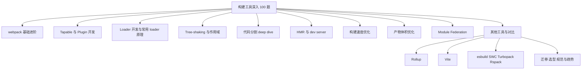

## 目录

- 第一章 webpack 基础进阶：BLD-001 ~ BLD-008
- 第二章 Tapable 与 Plugin 开发：BLD-009 ~ BLD-016
- 第三章 Loader 开发与常用 loader 原理：BLD-017 ~ BLD-024
- 第四章 Tree-shaking 与作用域：BLD-025 ~ BLD-030
- 第五章 代码分割 deep dive：BLD-031 ~ BLD-038
- 第六章 HMR 与 dev server：BLD-039 ~ BLD-045
- 第七章 性能优化之构建速度：BLD-046 ~ BLD-052
- 第八章 性能优化之产物体积：BLD-053 ~ BLD-060
- 第九章 Module Federation：BLD-061 ~ BLD-068
- 第十章 其他工具与对比：BLD-069 ~ BLD-100
- 十一章 webpack 源码级深入：BLD-101 ~ BLD-110
- 十二章 webpack 高级场景：BLD-111 ~ BLD-118
- 十三章 Babel 与 AST 深入：BLD-119 ~ BLD-128
- 十四章 Vite 源码级与实践深水区：BLD-129 ~ BLD-140
- 十五章 Rollup 深入与库构建：BLD-141 ~ BLD-148
- 十六章 esbuild / SWC 与新工具实践：BLD-149 ~ BLD-156
- 十七章 缓存与增量构建体系：BLD-157 ~ BLD-163
- 十八章 构建产物与运行时：BLD-164 ~ BLD-170
- 十九章 工程化与协作：BLD-171 ~ BLD-178
- 二十章 综合实战：BLD-179 ~ BLD-200

---

## 第一章 webpack 基础进阶（BLD-001 ~ BLD-008）

### BLD-001：compiler 和 compilation 的区别是什么？
**答**：
- compiler 对象代表整个 webpack 生命周期，从启动到关闭只有一个，承载全局配置（options、root、outputPath）和全局级 hooks（run、emit、done、watchRun）。
- compilation 代表"一次编译过程"，watch 模式或 rebuild 时每次都会新建，承载本次的 modules、chunks、assets 和模块级 hooks（buildModule、seal、optimizeChunkAssets）。
- 插件若要操作"本次产物"（如改 chunk、加 asset）必须在 compilation 的钩子里做；若只关心"构建整体"（如统计、日志、清目录）用 compiler 钩子。
- 记忆口诀：compiler 是工厂，compilation 是一批订单。

```javascript
// webpack.config.js：同时演示 compiler 级与 compilation 级钩子
const plugin = {
  name: 'CompilerVsCompilationPlugin',
  apply(compiler) {
    // compiler 级：整个构建只触发一次
    compiler.hooks.run.tap('CompilerVsCompilationPlugin', () => {
      console.log('compiler：单次构建开始');
    });

    // compilation 级：watch 下每次 rebuild 都会触发
    compiler.hooks.compilation.tap('CompilerVsCompilationPlugin', (compilation) => {
      console.log('compilation：一次新编译，hash =', compilation.hash);
      compilation.hooks.seal.tap('CompilerVsCompilationPlugin', () => {
        console.log('compilation：模块封装开始，module 数 =', compilation.modules.size);
      });
    });
  },
};

module.exports = { plugins: [plugin] };
```

### BLD-002：webpack 构建流程全阶段是怎样的？各阶段有哪些关键 hooks？
**答**：
- 初始化阶段：读取配置合并默认值，创建 Compiler，调用 environment / afterEnvironment / entryOption / afterPlugins / beforeRun。
- 编译阶段：run → new Compilation → make 触发 addEntry → 从 entry 递归 buildModule：命中 loader 转换 → parser 生成 AST → 收集依赖 → 递归处理依赖形成模块图。
- 封装阶段：seal，进入优化（optimizeChunkModules、ModuleConcatenationPlugin）→ 分 chunk → 生成 assets（codeGeneration）。
- 产出阶段：emit 钩子把 assets 写入 output.path（这里最后修改产物的机会）→ afterEmit → done。
- 面试要求能顺着这条链报出 hooks 名并说明何时用哪个（改产物用 emit，改模块图用 seal 之前的 compilation 钩子）。

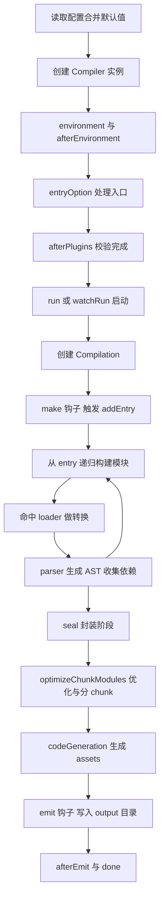

```javascript
// webpack.config.js：在关键阶段埋点的完整插件
class StageHooksPlugin {
  apply(compiler) {
    compiler.hooks.beforeRun.tap('Stage', () => console.log('[1] beforeRun'));
    compiler.hooks.thisCompilation.tap('Stage', (compilation) => {
      compilation.hooks.addEntry.tap('Stage', () => console.log('[2] addEntry'));
      compilation.hooks.finishModules.tap('Stage', (modules) => {
        console.log('[3] finishModules 模块图构建完成 共', modules.size);
      });
      compilation.hooks.seal.tap('Stage', () => console.log('[4] seal'));
      compilation.hooks.processAssets.tap(
        { name: 'Stage', stage: compilation.constructor.PROCESS_ASSETS_STAGE_ADDITIONAL },
        (assets) => console.log('[5] processAssets 产物有', Object.keys(assets)),
      );
    });
    compiler.hooks.emit.tap('Stage', () => console.log('[6] emit'));
    compiler.hooks.done.tap('Stage', (stats) => console.log('[7] done', stats.endTime - stats.startTime, 'ms'));
  }
}

module.exports = { plugins: [new StageHooksPlugin()] };
```

### BLD-003：Module、Chunk、Bundle 三者的关系是什么？举例说清。
**答**：
- Module 是编译的基本单位：每个被 webpack 处理的文件（js/css/图片，经 loader 转换后）都是一个 module，通过依赖关系组成模块图。
- Chunk 是打包过程的中间产物：由一组 module 依据 entry、splitChunks、动态 import 规则组装成，是"分块策略"的结果。
- Bundle（asset）是最终输出文件：每个 chunk 经过代码生成写出 1 个或多个 bundle（chunk 本体 + 可选的 css/图片副产物）。
- 举例：entryA 有 3 个模块（a + shared + 动态 import 的 lazy），entryB 有 2 个模块（b + shared）→ modules 共 4 个，chunks 有 4 个（entryA、entryB、async、common），bundle 输出 4 个 js。
- 面试追问点：一个 chunk 可以对应多个 asset（js + css），async chunk 不会阻塞首屏。

```javascript
// webpack.config.js：对应上述例子的完整可运行配置
const path = require('path');

module.exports = {
  mode: 'production',
  entry: {
    entryA: path.resolve(__dirname, 'src/pages/a.js'),
    entryB: path.resolve(__dirname, 'src/pages/b.js'),
  },
  output: {
    path: path.resolve(__dirname, 'dist'),
    filename: '[name].[contenthash:8].js',
    chunkFilename: 'chunk.[name].[contenthash:8].js',
  },
  optimization: {
    splitChunks: {
      chunks: 'all',
      cacheGroups: {
        common: { name: 'common', test: /[\\/]src[\\/]shared[\\/]/, minChunks: 2, priority: 10 },
      },
    },
  },
};

// 文件结构与结果对照：
// src/pages/a.js      -> import shared util, 动态 import('./lazy.js')   （module a + shared + lazy）
// src/pages/b.js      -> import shared util                             （module b + shared）
// 结果：modules = 4，chunks = entryA/entryB/lazy/common，bundles = 4 个 js 文件
```

### BLD-004：loader 和 plugin 的本质区别是什么？
**答**：
- 本质一：loader 是"文件转换函数"，输入是文件内容（字符串/Buffer），输出是转换后的内容，它无状态、纯转换、链式执行、只作用于匹配的 module。
- 本质二：plugin 是"基于 Tapable 钩子的事件订阅者"，通过 apply(compiler) 挂钩，能在构建全生命周期任意时机介入，可以改模块图、改产物、发请求、写文件。
- 作用面不同：loader 只在 module 构建阶段起作用；plugin 覆盖初始化、编译、封装、产出全流程。
- 一个"文件的搬运工"，一个"流程的监工"；复杂 loader 内部也可用 this.emitFile / 与 plugin 通过共享对象通信。

```javascript
// 一个 loader：本质就是 输入 -> 输出 的转换函数
module.exports = function (source) {
  // this 上有资源路径、query、async 等上下文，但没有 compiler 钩子
  return source.replace(/console\.log\([^)]*\);?/g, ''); // 示例：剔除 console.log
};

// 一个 plugin：本质是 Tapable 钩子对象上的订阅者
class HookBasedPlugin {
  apply(compiler) {
    // compiler 上挂着几十个钩子，可在任意生命周期介入
    compiler.hooks.compilation.tap('HookBasedPlugin', (compilation) => {
      compilation.hooks.processAssets.tap('HookBasedPlugin', (assets) => {
        for (const name of Object.keys(assets)) {
          compilation.updateAsset(name, (source) => source); // 可改产物
        }
      });
    });
  }
}
module.exports = HookBasedPlugin;
```

### BLD-005：webpack 的模块类型有哪些？ESM 和 CJS 混用怎么解析？
**答**：
- 内置模块类型：javascript/auto（默认，自动判断 ESM/CJS）、javascript/esm（强制 ESM，违规报错）、javascript/dynamic（强制 CJS）、json、webassembly/asset、css（实验性）等，可通过 test + type 在 module.rules 里指定。
- javascript/auto 的混用规则：CJS 文件里可以 `require()` 一个 ESM 文件，取到的是其 namespace 对象（.default 属性拿默认导出）；ESM 文件里 `import` 一个 CJS 文件，整个 module.exports 被当作 default，命名导出靠 webpack 的静态分析尽力提取（cjs-module-lexer）。
- 坑点：CJS 的 `module.exports = { a }` 命名导出可以被静态分析；但 `module.exports = require('./x')` 或动态计算导出就不行，会退化为只有 default。
- mjs/cjs 后缀与 package.json 的 type 字段会改变默认判断。

```javascript
// webpack.config.js：显式声明模块类型
module.exports = {
  module: {
    rules: [
      {
        test: /\.legacy\.js$/,
        type: 'javascript/dynamic', // 强制按 CJS 处理 禁止 ESM 语法
      },
      {
        test: /\.strict\.mjs$/,
        type: 'javascript/esm', // 只允许 ESM 语法 出现 require 直接报错
      },
    ],
  },
};
```

```javascript
// src/cjs-lib.js —— CommonJS 侧
module.exports = { hello: () => 'hi', version: '1.0.0' };

// src/esm-app.js —— ESM 侧 混用 CJS
import cjsLib from './cjs-lib.js';      // default = module.exports 整体
import { hello } from './cjs-lib.js';   // 命名导入 依赖 cjs-module-lexer 静态分析成功

console.log(cjsLib.version, hello());

// src/cjs-entry.js —— CJS 侧 require ESM
const esm = require('./esm-app.js');    // 拿到 namespace
esm.default && console.log('default 存在');
```

### BLD-006：resolve 的常用配置全解？alias、extensions、mainFields、enforceExtension 分别怎么用？
**答**：
- alias：路径映射，`@/` 指向 src，`$` 精确匹配结尾；alias 会跳过部分解析逻辑，是最常用的提效配置。
- extensions：无后缀导入时的尝试列表，`['.js', '.ts', '.tsx', '.json']`，列表越长解析越慢，尽量精简并排高频后缀在前。
- mainFields：解析 package.json 的入口字段顺序，默认 `['browser', 'module', 'main']`（target: web 时），库打包场景常改为 `['module', 'main']` 优先 ESM。
- enforceExtension：true 时导入必须写后缀（默认 false）；resolve.modules 收缩查找目录、mainFiles 指定目录默认文件名。
- 面试延伸：alias 配置错会导致 monorepo 里引用到错误包版本；extensions 里出现重复后缀会重复 IO。

```javascript
// webpack.config.js
const path = require('path');

module.exports = {
  resolve: {
    alias: {
      '@': path.resolve(__dirname, 'src'),
      'vue$': 'vue/dist/vue.runtime.esm-bundler.js', // $ 表示精确匹配
    },
    extensions: ['.js', '.ts', '.tsx', '.json'], // 按命中率排序 尽量短
    mainFields: ['browser', 'module', 'main'],   // web 目标默认值 优先浏览器版与 ESM 版
    mainFiles: ['index'],
    modules: [path.resolve(__dirname, 'node_modules'), 'node_modules'], // 收缩查找范围
    enforceExtension: false, // true 时 import './a' 报错 必须写 './a.js'
    enforceModuleExtension: false,
    symlinks: true, // 解析软链接真实路径 pnpm/monorepo 需要关注
  },
};
```

### BLD-007：module.rules 有哪些细节能力？oneOf、enforce pre/post、sideEffects 怎么用？
**答**：
- 规则匹配自上而下；oneOf 内的规则命中一条即停止，避免同一文件被多个 loader 叠加处理，常把通用 loader 放进 oneOf。
- enforce: 'pre' 让 loader 先于所有普通 loader 执行（eslint-loader/源码检查），enforce: 'post' 最后执行（如打包后混淆）。
- sideEffects: false 是规则级开关，配合 compilation.hooks.optimizeChunkAssets 前的 sideEffects 优化阶段，把无副作用的模块标记可移除（等价于 package.json 的模块级粒度，规则级可强制覆盖）。
- 其他细节：issuer 限定"被谁引用"、dependency 排除纯 require 上下文、resolve.with + fullySpecified、use 数组顺序为从后往前。

```javascript
// webpack.config.js
module.exports = {
  module: {
    rules: [
      {
        test: /\.(js|ts|jsx|tsx)$/,
        enforce: 'pre',
        include: /src/,
        use: ['eslint-loader'], // 最先跑 源码还没被 babel 转换
      },
      {
        test: /\.css$/,
        oneOf: [ // 命中一条即停
          { test: /\.module\.css$/, use: ['style-loader', 'css-loader?modules'] },
          { use: ['style-loader', 'css-loader'] }, // 兜底
        ],
      },
      {
        test: /vendor-no-side-effect/,
        sideEffects: false, // 规则级声明该文件无副作用 可被 tree-shaking
        type: 'javascript/auto',
      },
      {
        test: /\.js$/,
        exclude: /node_modules/,
        use: { loader: 'babel-loader', options: { cacheDirectory: true } },
      },
    ],
  },
};
```

### BLD-008：externals 有哪几种写法？string、object、function、promise 分别什么场景？
**答**：
- string：单个库，'jquery' → 全局 jQuery（配合 script 标签引入 CDN）。
- object：一次声明多个，key 是 import 名，value 是全局变量名或 `commonjs mod` 指定输出格式。
- function：动态判断，可根据 request、context、callback 返回是否外部化，适合"部分子路径外部化"（如排除 lodash 单模块）。
- promise：异步拿到 externals 映射，适合运行时读取远程清单（CDN 版本由服务下发）。
- 关键点：externals 的库不进 bundle，运行时必须真实可用（CDN script、宿主环境、node 内置模块）；SSR 场景常配合 nodeExternals 排除 node_modules。

```javascript
// webpack.config.js：四种写法分别演示
module.exports = {
  // 写法一 string
  // externals: 'jquery', // import $ from 'jquery' -> window.jQuery

  // 写法二 object
  externals: {
    react: 'React',
    'react-dom': 'ReactDOM',
    lodash: {
      commonjs: 'lodash',  // CJS 侧从 node_modules 外部解析
      amd: 'lodash',
      root: '_',           // 浏览器全局变量
    },
  },

  // 写法三 function（四选一，此处给出函数版供参考）
  // externals: [
  //   (ctx, callback) => {
  //     if (/^lodash\//.test(ctx.request)) return callback(null, `commonjs ${ctx.request}`);
  //     callback();
  //   },
  // ],

  // 写法四 promise
  // externals: [() => fetch('/api/externals.json').then((r) => r.json())],

  output: { libraryTarget: 'umd' }, // 外部化后输出 umd 便于挂全局
};
```

## 第二章 Tapable 与 Plugin 开发（BLD-009 ~ BLD-016）

### BLD-009：tapable 提供哪些钩子类型？各自适用什么场景？
**答**：
- Sync 系：SyncHook（顺序执行）、SyncBailHook（返回非 undefined 中断后续）、SyncWaterfallHook（上一个返回值传给下一个）、SyncLoopHook（返回 true 循环重试当前订阅）。
- AsyncSeries 系：串行 await，适合有先后依赖的异步步骤（如 beforeRun 校验环境）。
- AsyncParallel 系：并行执行不等待彼此，适合互不依赖的异步任务（如多线程压缩前的分发）。
- AsyncSeriesBailHook / AsyncSeriesLoopHook 与 Sync 同理加异步维度；带 -HookMap 后缀的是按 key 索引的钩子集合。
- 命名规律：Sync/Async（同步异步）+ Series/Parallel（串行并行）+ Bail/Waterfall/Loop（中断/传值/循环）。

```javascript
// tapable 各钩子类型行为对照
const {
  SyncHook, SyncBailHook, SyncWaterfallHook,
  AsyncSeriesHook, AsyncParallelHook,
} = require('tapable');

// SyncHook 顺序执行 无返回值
const sync = new SyncHook(['name']);
sync.tap('a', (n) => console.log('a', n));
sync.tap('b', (n) => console.log('b', n));
sync.call('webpack');

// SyncBailHook 返回非 undefined 则跳过后续订阅
const bail = new SyncBailHook(['name']);
bail.tap('a', () => 'stop');      // 返回了值
bail.tap('b', () => console.log('不会执行'));
bail.call('webpack');

// SyncWaterfallHook 返回值传给下一个订阅者
const wf = new SyncWaterfallHook(['val']);
wf.tap('double', (v) => v * 2);
wf.tap('plus1', (v) => v + 1);
console.log(wf.call(10)); // 21

// AsyncSeriesHook 串行异步 tapPromise/promise
const series = new AsyncSeriesHook(['name']);
series.tapPromise('a', async () => { await sleep(100); });
series.tapPromise('b', async () => { await sleep(100); });
series.promise('webpack'); // 总耗时约 200ms 串行

// AsyncParallelHook 并行异步
const parallel = new AsyncParallelHook(['name']);
parallel.tapPromise('a', async () => { await sleep(100); });
parallel.tapPromise('b', async () => { await sleep(100); });
parallel.promise('webpack'); // 总耗时约 100ms 并行

function sleep(ms) { return new Promise((r) => setTimeout(r, ms)); }
```

### BLD-010：compiler.hooks 中常用的钩子按时机排列有哪些？
**答**：
- 初始化：environment / afterEnvironment → entryOption（遍历 entry 时）→ afterPlugins / afterResolvers → beforeRun / run。
- 编译前：watchRun（watch 模式专属）→ beforeCompile（可改 compilationParams）→ compile → thisCompilation → compilation。
- 编译中：make（核心，addEntry 从这里发起）→ buildModule → finishModules → seal → optimizeModules / optimizeChunks / optimizeTree / optimizeChunkModules → shouldEmit / emit。
- 收尾：afterEmit → done（拿 stats 输出报告）；失败路径：failed。
- watch 相关：watchClose、invalid（文件变化触发重编译前）、additionalAssets。

```javascript
// webpack.config.js：hooks 时机速查插件（注释即时机表）
class HookTimelinePlugin {
  apply(compiler) {
    const n = 'HookTimelinePlugin';
    compiler.hooks.environment.tap(n, () => {});            // 1 编译环境准备
    compiler.hooks.entryOption.tap(n, () => {});            // 2 处理 entry 配置
    compiler.hooks.afterPlugins.tap(n, () => {});           // 3 所有插件注册完
    compiler.hooks.beforeRun.tapAsync(n, (p, cb) => cb());  // 4 run 之前
    compiler.hooks.run.tapAsync(n, (p, cb) => cb());        // 5 开始读取文件前
    compiler.hooks.beforeCompile.tap(n, () => {});          // 6 每次编译前 可改参数
    compiler.hooks.make.tapAsync(n, (compilation, cb) => cb()); // 7 编译模块图
    compiler.hooks.afterCompile.tap(n, (c) => {});          // 8 模块图完成
    compiler.hooks.shouldEmit.tap(n, (c) => true);          // 9 是否产出的开关
    compiler.hooks.emit.tapAsync(n, (c, cb) => cb());       // 10 写 dist 之前 最后改产物机会
    compiler.hooks.done.tap(n, (stats) => {                 // 11 成功完成
      if (stats.hasErrors()) console.error(stats.toString({ colors: true }));
    });
    compiler.hooks.failed.tap(n, (err) => console.error('构建失败', err)); // 12 失败
    compiler.hooks.invalid.tap(n, (file) =>                 // watch 模式 文件变化
      console.log('检测到变化 触发重编译', file));
  }
}
module.exports = HookTimelinePlugin;
```

### BLD-011：写一个在 emit 阶段生成文件头 banner 和产物清单 manifest.json 的插件。
**答**：
- 用 compiler.hooks.emit（tapAsync），此时 compilation.assets 已就绪但尚未写盘，是"最后修改产物"的时机。
- 遍历 assets 生成 { 文件名: { size, hash } } 清单，用 compilation.emitAsset 新增 manifest.json，并给 js 文件头部插入 banner 注释。
- 改资源用 compilation.updateAsset，新增用 emitAsset（webpack 5 推荐，代替直接赋值 assets 对象）。
- 插件要接 options 参数，写清 name 并在每个 tap 传插件名便于调试。

```javascript
// banner-manifest-plugin.js：完整生产可用
class BannerManifestPlugin {
  constructor(options = {}) {
    this.banner = options.banner || '/* build by my-team */';
    this.manifestName = options.manifestName || 'manifest.json';
  }

  apply(compiler) {
    const pluginName = 'BannerManifestPlugin';
    compiler.hooks.emit.tapAsync(pluginName, (compilation, callback) => {
      const manifest = {};

      // 1 给所有 js 产物加 banner
      for (const [name, source] of Object.entries(compilation.assets)) {
        manifest[name] = { size: source.size() };
        if (name.endsWith('.js')) {
          const content = `${this.banner}\n${source.source()}`;
          compilation.updateAsset(name, compilation.compiler.webpack.sources.RawSource(content));
        }
      }

      // 2 追加产物清单
      compilation.emitAsset(
        this.manifestName,
        compilation.compiler.webpack.sources.RawSource(JSON.stringify(manifest, null, 2)),
      );
      callback();
    });
  }
}

module.exports = BannerManifestPlugin;

// webpack.config.js
// const BannerManifestPlugin = require('./banner-manifest-plugin');
// module.exports = { plugins: [new BannerManifestPlugin({ banner: '/* v1.2.0 app */' })] };
```

### BLD-012：写一个统计构建总耗时和各阶段耗时的插件。
**答**：
- 总耗时：compiler.hooks.run/watchRun 记起点，done 里 endTime - startTime（或自记 Date.now）。
- 阶段耗时：用 compilation.hooks（finishModules、seal、processAssets）前后差值累加；watch 模式放 compilation 级避免状态串台。
- done 的 stats 对象已有官方耗时，可 stats.toJson({ timings: true }) 拿每个 loader 耗时。
- 输出用 console.table 或写入 timing.json，CI 里可做耗时基线对比。

```javascript
// timing-plugin.js
class TimingPlugin {
  apply(compiler) {
    const N = 'TimingPlugin';
    const state = { start: 0, stages: {} };

    const mark = (compilation, key) => compilation.hooks[key].tap(N, () => {
      state.stages[key] = Date.now() - state.start;
    });

    compiler.hooks.watchRun.tap(N, () => { state.start = Date.now(); state.stages = {}; });
    compiler.hooks.run.tap(N, () => { state.start = Date.now(); state.stages = {}; });

    compiler.hooks.thisCompilation.tap(N, (compilation) => {
      mark(compilation, 'finishModules'); // 模块图构建完成
      mark(compilation, 'seal');          // 封装开始
      compilation.hooks.afterOptimizeChunkModules.tap(N, () => {
        state.stages.optimize = Date.now() - state.start;
      });
      compilation.hooks.processAssets.tap({ name: N, stage: -100 }, () => {
        state.stages.assets = Date.now() - state.start;
      });
    });

    compiler.hooks.done.tap(N, (stats) => {
      const total = stats.endTime - stats.startTime;
      console.table({ ...state.stages, total });
    });
  }
}

module.exports = TimingPlugin;
```

### BLD-013：loader 和 plugin 之间如何通信？
**答**：
- 方式一：webpack 官方机制 NormalModule 的 loaderContext 上挂自定义属性，plugin 在 normalModuleLoader 钩子里往 loaderContext 注入，loader 里用 this.xxx 读取（tapable 上下文思想）。
- 方式二：模块级 WeakMap 以模块资源路径为 key 存状态，plugin 写、loader 读，注意避免闭包引用阻碍 GC。
- 方式三：plugin 在 compiler 上挂共享命名空间对象（compiler.__myPluginData），loader 通过 this._compiler 拿到（webpack 5）。
- 注意方向是"plugin 通知 loader"，loader 无法直接 tap 钩子；跨 compilation 不要复用可变状态。

```javascript
// webpack.config.js：plugin 向 loader 注入上下文
const inject = (compilation) => (loaderContext, module) => {
  loaderContext.__buildId = compilation.hash;              // 注入自定义字段
  loaderContext.__i18nDict = { 首页: 'Home', 关于: 'About' };
};

class LoaderBridgePlugin {
  apply(compiler) {
    compiler.hooks.compilation.tap('LoaderBridgePlugin', (compilation) => {
      compilation.hooks.normalModuleLoader.tap('LoaderBridgePlugin', inject(compilation));
    });
  }
}

// my-loader.js：loader 侧读取
module.exports = function (source) {
  if (this.__i18nDict) {
    for (const [zh, en] of Object.entries(this.__i18nDict)) {
      source = source.split(zh).join(en);
    }
  }
  return source;
};

// webpack.config.js
// module.exports = { plugins: [new LoaderBridgePlugin()],
//   module: { rules: [{ test: /\.js$/, use: ['./my-loader'] }] } };
```

### BLD-014：插件中的错误如何正确抛出？什么时机 fail 合适？
**答**：
- 同步钩子直接 throw：webpack 会捕获并进入 failed 流程，构建失败退出码非 0。
- 异步钩子（tapAsync）用 callback(new Error(...))，tapPromise 直接 reject；不要在异步里 throw（会变成 unhandled rejection）。
- 警告走 compilation.warnings.push(new Error(...))，错误走 compilation.errors.push：警告不阻断构建，错误阻断；CI 卡口建议用错误。
- fail 时机选择：影响产物正确性的（如缺少必需文件）越早越好，可在 beforeCompile 就校验；只影响告警的在 processAssets 阶段报。

```javascript
// robust-plugin.js
class RobustPlugin {
  constructor({ requiredFile } = {}) { this.requiredFile = requiredFile; }

  apply(compiler) {
    // 1 影响正确性 在编译前就 fail-fast（tapAsync 用 callback 报错）
    compiler.hooks.beforeCompile.tapAsync('RobustPlugin', (params, cb) => {
      if (this.requiredFile && !fs.existsSync(this.requiredFile)) {
        return cb(new Error(`RobustPlugin 缺少必需文件 ${this.requiredFile}`));
      }
      cb();
    });

    compiler.hooks.compilation.tap('RobustPlugin', (compilation) => {
      // 2 可容忍问题 推 warnings 不阻断构建
      compilation.hooks.processAssets.tap('RobustPlugin', (assets) => {
        const big = Object.values(assets).filter((s) => s.size() > 1024 * 500);
        if (big.length) {
          compilation.warnings.push(new Error(`有 ${big.length} 个产物超过 500KB，请检查分包`));
        }
      });
    });
  }
}
const fs = require('fs');
module.exports = RobustPlugin;
```

### BLD-015：webpack watch 模式的增量构建原理是什么？invalid 钩子和文件系统缓存怎么配合？
**答**：
- watch 模式基于文件系统Watcher（默认 Watchpack，聚合抖动 aggregateTimeout）：文件变化 → 触发 invalid 钩子 → 标记失效模块（只失效变化文件所在模块及其反向依赖所在 chunk）→ 重新走 make 只编译受影响模块。
- 增量来源有两层：模块图复用（未变模块不重新 buildModule）+ 持久缓存（experimental cache: filesystem，rebuild 直接读磁盘缓存反序列化模块）。
- invalid 钩子参数是变化的文件路径，可用于 IDE 通知、日志埋点；watchClose 处理清理。
- 优化参数：aggregateTimeout 防抖、ignored 排除 node_modules、poll 轮询兜底（docker/网络盘需要）。

```javascript
// webpack.config.js：watch 相关完整配置
module.exports = {
  cache: {
    type: 'filesystem',                       // 持久化缓存 依赖 snapshot
    buildDependencies: {
      config: [__filename],                   // 配置文件变化即缓存失效
    },
  },
  snapshot: {
    managedPaths: [/^(.+?[\\/]node_modules[\\/])/], // node_modules 走托管快照 不参与时间戳比对
  },
  watchOptions: {
    aggregateTimeout: 300,   // 300ms 抖动合并 多文件连续保存只编译一次
    ignored: /node_modules/, // 不监听三方库
    followSymlinks: false,
  },
};

// 插件侧观察增量过程
compiler.hooks.invalid.tap('WatchDebug', (filePath, changeTime) => {
  console.log('invalid 变化文件', filePath);
});
compiler.hooks.watchRun.tap('WatchDebug', () => console.log('开始增量编译'));
compiler.hooks.done.tap('WatchDebug', (s) => {
  console.log('本次耗时', s.endTime - s.startTime, 'cached 模块数',
    s.toJson().modules.filter((m) => m.cached).length);
});
```

### BLD-016：如何阅读 html-webpack-plugin 的源码？核心流程是什么？
**答**：
- 阅读路径：入口 index.js（apply → 钩子注册）→ childCompilationTemplatePlugin（用 child compilation 把模板编译成 HTML）→ emit 阶段的 alterAssetTagGroups / beforeEmit 拿到编译结果和资源注入点 → includeScripts 按 inject 位置插入 entry chunks。
- 核心技巧：它利用 compiler.hooks.make 里 tapAsync 创建 child compilation（compilation.addInclude），模板本身也被 loader（如 html-loader/ejs）链处理，体现"一切皆模块"。
- 钩子链：html-webpack-plugin-beforeHtmlGeneration → afterTemplateExecution → beforeEmit → afterEmit，第三方插件（如 favicon、pwa）都挂这四个钩子。
- 学到三条：child compilation 机制、基于阶段的钩子设计、选项校验用 schema-utils。

```javascript
// html-webpack-plugin 核心流程伪代码精简（阅读时对照真实源码）
class HtmlWebpackPlugin {
  constructor(options) { this.options = { inject: true, ...options }; }

  apply(compiler) {
    const N = 'HtmlWebpackPlugin';
    compiler.hooks.make.tapAsync(N, (compilation, cb) => {
      // 1 用 child compilation 独立编译模板（不污染主模块图）
      this.compileTemplate(compilation, this.options.template, (err, html) => {
        compilation.hooks.processAssets.tap({ name: N, stage: PROCESS_ASSETS_STAGE_OPTIMIZE },
          () => {
            // 2 收集本次 entry 产出的 js/css
            const scripts = Object.keys(compilation.assets).filter((f) => f.endsWith('.js'));
            // 3 按 inject 位置拼装 head/body 标签
            const tags = scripts.map((s) => `<script defer src="${s}"></script>`);
            // 4 发出最终 html
            compilation.emitAsset(this.options.filename, new RawSource(html.replace('</body>', `${tags.join('')}</body>`)));
          });
        cb();
      });
    });
  }
}

// webpack.config.js
// const HtmlWebpackPlugin = require('html-webpack-plugin');
// module.exports = { plugins: [new HtmlWebpackPlugin({
//   template: 'public/index.html', filename: 'index.html', inject: true,
//   minify: { collapseWhitespace: true, removeComments: true },
// })] };
```

## 第三章 Loader 开发与常用 loader 原理（BLD-017 ~ BLD-024）

### BLD-017：loader 的输入输出与 pitch 阶段是怎样的？画出 pitching 流程。
**答**：
- normal 阶段：配置 `use: ['a', 'b', 'c']`，文件内容先过 c 再过 b 再过 a（从后往前），每个 loader 返回值作为下一个的输入；最后必须返回 JS（或可被处理的字符串/Buffer）。
- pitch 阶段：从前往后先执行 a.pitch / b.pitch / c.pitch；若某个 pitch 有返回值，则跳过后续 loader 和文件读取，直接回退执行"该 pitch 之前的 normal loader"。
- 经典应用：style-loader 的 pitch 里把 css 结果转成注入 script，直接返回，从而不再走文件读取后的 normal 链。
- pitch 还可拿到 remainingRequest / previousRequest / data（pitch 与 normal 共享的 data 对象）。

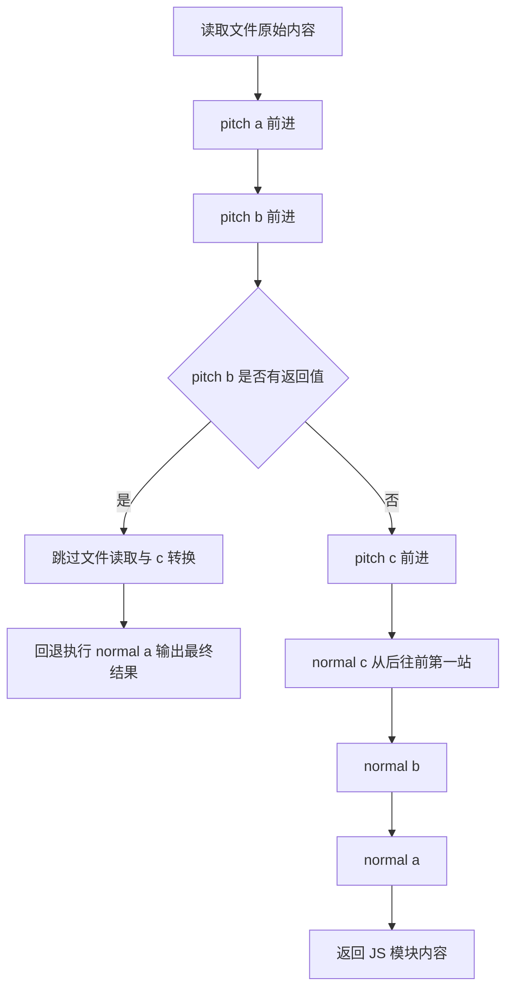

```javascript
// a-loader.js：演示 pitch 返回值中断链路
module.exports = function (content) {
  console.log('normal a 收到', content.length, '字节');
  return content;
};
module.exports.pitch = function (remainingRequest, previousRequest, data) {
  // data 会在 pitch 与 normal 之间共享
  data.fromPitch = true;
  // 返回值则跳过 b/c 与文件读取 直接进入 a 的 normal
  // return `module.exports = 'short-circuit from pitch'`;
};

// 配置 use: ['./a-loader', './b-loader', './c-loader']
// 执行顺序：a.pitch -> b.pitch -> c.pitch -> [读文件] -> c -> b -> a
// 若 b.pitch 返回了值：a.pitch -> b.pitch -> a（normal）
```

### BLD-018：写一个把 markdown 编译成 Vue 组件 / JS 模块的 loader。
**答**：
- 思路：loader 输入是 md 文本，用 markdown-it 解析为 HTML，再包装成 Vue SFC 字符串（template 包 HTML，可加 options 区）或纯 JS（导出 html 字符串）。
- 注意 escaped 内容与 JSON 安全（HTML 里含换行要处理），vue loader 需要拿到合法 SFC。
- this.resourcePath 可用于提取文件名生成组件名；可加 this.cacheable() 声明可缓存。

```javascript
// markdown-loader.js
const markdownIt = require('markdown-it');
const md = markdownIt({ html: true, breaks: true });

module.exports = function (source) {
  this.cacheable(); // 输出只依赖输入 可缓存

  const html = md.render(source);
  const componentName = this.resourcePath
    .split(/[\\/]/).pop()          // 取文件名
    .replace(/\.md$/, '')
    .replace(/(^|-)(\w)/g, (_, __, c) => c.toUpperCase());

  // 输出合法 Vue SFC 交给 vue-loader 继续处理
  const sfc = `
<template>
  <article class="markdown-body">${html}</article>
</template>

<script>
export default { name: '${componentName}' };
</script>

<style>
.markdown-body { line-height: 1.7; }
</style>
`;
  return sfc;
};

// webpack.config.js
// module.exports = { module: { rules: [
//   { test: /\.md$/, use: ['vue-loader', './markdown-loader'] }, // 从后往前 先 md 后 vue
// ] } };
```

### BLD-019：写一个 i18n 中文文案替换 loader（构建期把中文替换成 i18n 调用）。
**答**：
- 方案：匹配源码中的中文字符串字面量，替换为 `t('key')`，key 用"文件名 + 序号 + 内容 hash"生成，词条写入 this.emitAsset 或 JSON 文件供翻译平台消费。
- 只处理字符串字面量（用正则定位引号内中文）避免误伤注释和标签名；模板字符串单独处理。
- 用 getOptions（webpack 5 的 this.getOptions）接收词条映射，支持已有人工翻译则复用。

```javascript
// i18n-loader.js
module.exports = function (source) {
  const options = this.getOptions(); // { dict: { 你好: 'home.greet' } }
  const dict = options.dict || {};
  const fileKey = this.resourcePath.split(/[\\/]/).pop().replace(/\.\w+$/, '');
  let index = 0;
  const collected = this.__i18nCollected || {}; // 也可用 WeakMap 与 plugin 通信

  // 匹配单引号 双引号 字符串中的中文
  const regex = /(['"`])((?:(?!\1).)*[\u4e00-\u9fa5]+(?:(?!\1).)*)\1/g;

  const out = source.replace(regex, (match, quote, text) => {
    if (dict[text]) return `t('${dict[text]}')`;
    const key = `${fileKey}_${index++}_${Buffer.from(text).toString('base64url').slice(0, 8)}`;
    collected[key] = text;
    return `t('${key}')`; // 由 babel 插件注入 t 或约定全局 t
  });

  this.emitFile('i18n/zh.json', JSON.stringify({ [fileKey]: collected }, null, 2));
  return out;
};

// webpack.config.js
// module.exports = { module: { rules: [
//   { test: /\.(js|vue)$/, exclude: /node_modules/, use: [{
//     loader: './i18n-loader',
//     options: { dict: { 你好: 'common.hello' } },
//   }] },
// ] } };
```

### BLD-020：loader 的异步处理与缓存机制怎么用？this.async 和 this.cacheable 详解。
**答**：
- 同步 loader：return 结果或 this.callback(null, content, sourceMap, meta)；有第二输出（如 sourceMap）时必须用 this.callback。
- 异步 loader：const callback = this.async()，处理完调 callback(null, result)，webpack 会等待；不调 async 时 loader 是同步的，阻塞但开销小。
- 缓存：默认 loader 结果可缓存（等价 this.cacheable()）；调用 this.cacheable(false) 表示"输出可能依赖外部状态（时间、随机、远端）"，每次重编译都重跑。
- this.addDependency(file) 声明额外输入依赖（loader 内读了别的文件时必须加，否则该文件变化不会触发重编译）。

```javascript
// async-loader.js：异步读远端 schema + 声明本地依赖
const fs = require('fs');

module.exports = function (source) {
  const callback = this.async(); // 声明为异步 loader
  const options = this.getOptions();

  // 声明额外依赖 依赖文件变化也会触发本模块重编译
  this.addDependency(options.schemaPath);
  this.cacheable(true); // 输出只依赖 source 与 schemaPath 可缓存

  fs.readFile(options.schemaPath, 'utf-8', (err, schema) => {
    if (err) return callback(err); // 异步错误走 callback 第一参数
    try {
      const result = source.replace('__SCHEMA__', JSON.stringify(JSON.parse(schema)));
      callback(null, result); // callback(null, content, sourceMap?, meta?)
    } catch (e) {
      callback(e);
    }
  });
};

// webpack.config.js
// module.exports = { module: { rules: [
//   { test: /form\.js$/, use: [{ loader: './async-loader',
//     options: { schemaPath: './src/form-schema.json' } }] },
// ] } };
```

### BLD-021：babel-loader 的完整原理链路是什么？webpack 如何与 babel 协作？
**答**：
- 链路：webpack 命中规则 → babel-loader 收到源码 → @babel/core 的 transformAsync → parser（@babel/parser）生成 AST → 遍历（@babel/traverse）套用 plugins/presets（preset-env 含语法降级与 polyfill 注入）→ generator（@babel/generator）生成目标代码 + sourceMap。
- babel-loader 只做"胶水"：管理 cacheDirectory（基于文件 mtime、babel 配置、babel 版本的哈希缓存）、并发调用 @babel/core、传递 sourceMap 上下游。
- preset-env 的 targets/browserslist 决定编译程度；useBuiltIns: 'usage' 按需注入 core-js import。
- 关键点：babel 处理语法（syntax）靠 plugin，处理 API（Promise、Array.includes）靠 polyfill；两者都要配 targets。

```javascript
// webpack.config.js：生产级 babel-loader 配置
module.exports = {
  module: {
    rules: [{
      test: /\.(js|mjs|jsx|ts)$/,
      include: [require('path').resolve('src')], // 只编业务代码 严格 include 提速
      use: [{
        loader: 'babel-loader',
        options: {
          cacheDirectory: true,           // 开启 babel 层缓存
          cacheCompression: false,        // 缓存不压缩 换更快读取
          presets: [
            ['@babel/preset-env', {
              targets: { chrome: '87' },  // 或用 browserslistrc
              useBuiltIns: 'usage',       // 按需注入 polyfill
              corejs: { version: 3, proposals: false },
              modules: false,             // 关键 保留 ESM 让 webpack 做 tree-shaking
            }],
            '@babel/preset-typescript',
          ],
          plugins: [
            ['@babel/plugin-transform-runtime', { helpers: true, regenerator: true }],
          ],
          sourceType: 'unambiguous',      // ESM/CJS 混合仓库友好
        },
      }],
    }],
  },
};
```

### BLD-022：style-loader 的注入原理是什么？它和 HMR 有什么关系？
**答**：
- style-loader 几乎全在 pitch 阶段工作：pitch 里用 remainingRequest 组一个虚拟 require，返回一段运行时代码——运行时把 css-loader 导出的 CSS 模块结果，通过 addStyle（创建 style 标签、insert 到指定位置）注入 document。
- 好处：CSS 变成了 JS 模块的一部分，天然获得 webpack 模块系统的 HMR 能力：模块更新时只重新执行该模块，style-loader 会移除旧 style、插入新 style。
- 源码结构：lib/index.js（pitch）+ lib/runtime/injectStylesIntoStyleTag.js（运行时，处理 attrs、transform、insert、单实例引用计数）。
- 与 mini-css-extract-plugin 互斥：一个走运行时注入，一个在构建期抽成 css 文件，生产抽离（避免 FOUC）、开发注入（HMR 更快）。

```javascript
// style-loader pitch 原理简化实现
module.exports = {};
module.exports.pitch = function (remainingRequest) {
  // remainingRequest 是"链上剩余 loader + 资源"的可 require 描述
  return `
    var content = require(${JSON.stringify('-!' + remainingRequest)}); // -! 禁用 pre/normal loader 防止递归
    var style = document.createElement('style');
    style.setAttribute('data-vite-hmr-marker', 'webpack-style');
    style.innerHTML = content.toString();
    document.head.appendChild(style);

    if (module.hot) {
      module.hot.accept(${JSON.stringify('-!' + remainingRequest)}, function () {
        // HMR：新内容到达 移除旧标签 换新标签
        var newContent = require(${JSON.stringify('-!' + remainingRequest)}).toString();
        style.innerHTML = newContent;
      });
    }
  `;
};

// webpack.config.js：开发/生产差异化
// module.exports = (_, argv) => ({
//   module: { rules: [{
//     test: /\.css$/,
//     use: [
//       argv.mode === 'development' ? 'style-loader'          // dev 注入 快 + HMR
//         : require('mini-css-extract-plugin').loader,        // prod 抽离 避免 FOUC
//       'css-loader',
//     ],
//   }] },
// });
```

### BLD-023：css-loader 和 mini-css-extract-plugin 的协作链路是怎样的？
**答**：
- css-loader 负责"css 里的依赖与语义"：解析 @import、url() 为 require/import（变成模块图依赖），处理 CSS Modules 的 :local/:global 类名映射，导出一个默认数组结构（[module id, css 文本, sourceMap, media]）。
- mini-css-extract-plugin.loader 在 normal 阶段（不是 pitch）拦截 css-loader 的输出：不返回 JS，而是调用 plugin 主模块注册的收集器，把 css 文本作为 chunk 的副产物收集。
- plugin 主体在 compilation 钩子（processAssets 之前的 renderChunk / contentHash 阶段）把收集到的 css 按 chunk 合并、分割（importLoaders 对应的链也重排），生成 .css 文件并修改 js 里对样式的引用为纯 import（运行时只加载文件，无样式注入逻辑）。
- 注意 importLoaders 数值：值为 2 表示 css-loader 之前的 2 个 loader（postcss-loader、sass-loader）产物也被 @import 引用链用到，必须一致否则变量/mixin 丢失。

```javascript
// webpack.config.js：生产级 css 抽离完整配置
const MiniCssExtractPlugin = require('mini-css-extract-plugin');

module.exports = {
  module: {
    rules: [{
      test: /\.(css|scss)$/,
      use: [
        MiniCssExtractPlugin.loader,   // 3 收集 css-loader 输出 交给 plugin 抽文件
        { loader: 'css-loader',        // 2 解析 @import url 处理 CSS Modules
          options: {
            importLoaders: 2,          // @import 进来的 css 也先过前两个 loader
            modules: { exportLocalsConvention: 'camelCase' },
            sourceMap: true,
          } },
        'postcss-loader',              // 1 autoprefixer 等
        'sass-loader',                 // 0 sass 编译
      ],
    }],
  },
  plugins: [
    new MiniCssExtractPlugin({
      filename: 'css/[name].[contenthash:8].css',
      chunkFilename: 'css/[id].[contenthash:8].css',
      experimentalUseImportModule: true, // webpack 5 更快的原生模块执行
    }),
  ],
};
```

### BLD-024：asset modules 是什么？四种类型怎么选？旧 url-loader/file-loader 怎么迁移？
**答**：
- webpack 5 内建资源处理，不再需要 file-loader/url-loader/raw-loader；通过 module.rules 的 type 指定四种类型。
- asset/resource：文件输出为独立文件，返回 URL（对应 file-loader）。
- asset/inline：转 base64 Data URI 内联（对应 url-loader 无 limit）；asset/source：导出源码字符串（对应 raw-loader）。
- asset：自动模式，按 parser.dataUrlCondition.maxSize 在 resource 与 inline 间自动选择（对应 url-loader 的 limit），默认 4KB。
- 迁移注意：generator.filename 替代 file-loader 的 name（支持 [contenthash][ext]）；inline 大资源会让 js 体积膨胀且无法并行缓存。

```javascript
// webpack.config.js：asset modules 完整配置与迁移对照
module.exports = {
  module: {
    rules: [
      {
        test: /\.(png|jpe?g|gif|webp|avif)$/i,
        type: 'asset', // 自动模式
        parser: {
          dataUrlCondition: { maxSize: 8 * 1024 }, // 小于 8KB 内联 base64
        },
        generator: {
          filename: 'static/img/[name].[contenthash:8][ext]', // 替代 file-loader name
        },
      },
      {
        test: /\.(woff2?|eot|ttf|otf)$/i,
        type: 'asset/resource', // 字体必须独立文件 否则跨域与缓存不利
        generator: { filename: 'static/font/[name].[contenthash:8][ext]' },
      },
      {
        test: /\.svg$/i,
        type: 'asset/source', // 导出源码字符串 便于内联 svg 做染色
      },
      // 旧写法迁移对照：
      // url-loader + limit 8192            -> type: 'asset' + dataUrlCondition
      // file-loader + name '[name].[hash]' -> type: 'asset/resource' + generator.filename
      // raw-loader                          -> type: 'asset/source'
    ],
  },
};
```

## 第四章 Tree-shaking 与作用域（BLD-025 ~ BLD-030）

### BLD-025：tree-shaking 的原理是什么？为什么必须基于 ESM？
**答**：
- 前提一（静态结构）：ESM 的 import/export 是编译期语法，导入导出在 AST 阶段就确定，可以建立"导出绑定 → 使用处"的静态关系；CJS 的 require 是运行时函数调用，无法静态穷举。
- 前提二（usedExports 分析）：webpack 对每个模块做导出使用标记（普通用法、re-export 链、动态访问），未被使用的导出在 terser 压缩时被判定为死代码删除。
- 连锁效果：usedExports + ConcatenatedModules（作用域提升）后，"只用了库中一个函数"时其余函数因未被引用被整体消除。
- 边界：有副作用的代码不能删（IIFE、polyfill、CSS import），所以需要 sideEffects 标记配合；`export default` 整对象导出会让分析失效（要具名导出）。

```javascript
// webpack.config.js：开启 tree-shaking 的完整配置
module.exports = {
  mode: 'production', // 生产模式自动开启 usedExports + minimize
  optimization: {
    usedExports: true,                  // 标记未使用的导出（dev 可开 以便观察标记）
    minimize: true,                     // terser 执行真正删除
    concatenateModules: true,           // 作用域提升 增强消除效果
    sideEffects: true,                  // 读取 package.json sideEffects 字段
    providedExports: true,
  },
};

// src/utils.js —— 正确导出方式（具名）
export function deepClone(obj) { return JSON.parse(JSON.stringify(obj)); }
export function formatDate(d) { return d.toISOString(); } // 未被使用 将被 shake

// src/index.js
import { deepClone } from './utils'; // 只引入具名导出
console.log(deepClone({ a: 1 }));
// 产物验证：grep formatDate dist/main.js 应无结果
```

### BLD-026：package.json 的 sideEffects 字段全解？CSS 副作用的坑是什么？
**答**：
- sideEffects: false：声明所有文件都无副作用，未被使用的模块可整体删除（哪怕有顶层执行代码）；这是"性能上最激进"的承诺。
- sideEffects: true 或缺省：保守策略，所有模块都可能被保留（默认行为）。
- sideEffects 数组：精确豁免，如 `["*.css", "**/polyfill.js"]`，数组成员支持 glob；未匹配的文件视为无副作用。
- CSS 坑：`import './style.css'` 从 JS 角度"未使用任何导出"，若 sideEffects: false 没豁免 css，样式会被直接 shake 掉——这是组件库样式丢失的最常见原因。
- 数组里匹配的是"路径字符串"，写法要与模块路径匹配（通常 `**/*.css` 才能覆盖子目录）。

```json
// package.json（组件库）: sideEffects 精确声明
{
  "name": "my-ui-lib",
  "sideEffects": [
    "**/*.css",
    "**/*.scss",
    "./src/polyfill.js",
    "./src/register-components.js"
  ]
}
```

```javascript
// webpack.config.js：sideEffects 需要生产模式且依赖包的 exports/module 字段
module.exports = {
  mode: 'production',
  optimization: { sideEffects: true, usedExports: true },
  resolve: {
    mainFields: ['module', 'main'], // 优先 ESM 入口 才能参与 shaking
  },
};

// 误配后果示例：
// { "sideEffects": false } 且组件库入口 import './index.css'
// -> 使用方 import { Button } from 'my-ui-lib' 时样式被 shake
// 修复：数组中加 "**/*.css"
```

### BLD-027：为什么 CommonJS 难以 tree-shaking？有哪些缓解手段？
**答**：
- 原因一：exports 是运行时可变对象，可被 `module.exports.x = ...`、条件赋值、`Object.defineProperty` 等动态改写，无法静态枚举导出集合。
- 原因二：require 是普通函数调用，可以出现在 if、循环里，甚至拼接路径（require('./lib/' + name)），使用关系不确定。
- 原因三：CJS 有隐式副作用（this、__dirname、顶层执行顺序），删除顶层语句不安全。
- 缓解手段：cjs-module-lexer 能静态识别"直白"的 `module.exports = { a, b }` 与 `exports.a = ...`，给 webpack 提供部分命名导出；npm 包提供 module/exports 字段给 ESM 入口；或构建前用 esbuild 把 CJS 转 ESM 再进主流程。

```javascript
// cjs 分析示例
// 情形一 可静态分析 -> 命名导出可被标记未使用
exports.formatDate = () => {};
exports.deepClone = () => {};
module.exports = { formatDate, deepClone };

// 情形二 无法分析 -> 整个模块被保留
const name = Math.random() > 0.5 ? 'a' : 'b';
module.exports = require('./' + name);        // 动态 require
module.exports['dyn' + suffix] = () => {};    // 动态键
if (process.env.NODE_ENV === 'dev') {         // 条件导出
  module.exports.debug = () => {};
}
```

### BLD-028：/*#__PURE__*/ 纯注解的作用和正确用法是什么？
**答**：
- 纯注解告诉压缩器"这次函数调用的返回值若未被使用，则整个调用（含副作用）可以整体删除"，是给 terser/esbuild 的语义提示，不是 webpack 特性。
- 典型场景：类表达式 `var a = /*#__PURE__*/ (function () { ... })()`、JSX 转译产物、`const el = /*#__PURE__*/ createElement()`——调用本身无全局副作用。
- 常见错误：给有副作用的调用标 PURE（如日志上报、注册逻辑），会被错误删除，且只在压缩后暴露，极难排查。
- 生产验证手段：压缩前后 diff 产物、NODE_ENV=production 重复 grep 关键标识符。
- babel 的 @babel/plugin-transform-react-jsx 自动为 JSX 生成 PURE 注解，这就是"未渲染组件不产生运行时开销"的来源之一。

```javascript
// 有副作用的调用 不能加 PURE 会被删
const result = pureHeavyCompute();      // 若结果未使用且标记 PURE 整个调用被移除

// 正确示例：纯构造
const app = /*#__PURE__*/ createApp(App); // 若 app 未使用 createApp 连同副作用整体删除

// 误用示例（危险）：
// /*#__PURE__*/ initTracker();          // 上报埋点被删除 线上数据缺失
// /*#__PURE__*/ registerElement('x-foo'); // 组件注册被删除 标签不生效

// webpack.config.js：确认压缩器保留注解语义
module.exports = {
  optimization: {
    minimizer: ['...'], // webpack 5 默认 terser 会尊重 /*#__PURE__*/ 注解
  },
};
```

### BLD-029：怎么排查"该 shake 的没 shake"或"不该 shake 的被 shake 了"？
**答**：
- 先确认链路前提：模块是 ESM（import/export）、mode: production、usedExports 与 minimize 打开、依赖包提供 module/exports 入口。
- 定位产物来源：webpack --stats-modules-space 2000 或 stats.toJson({ modules: true })，看每个模块的 providedExports / usedExports 标记（true/false/null）。
- 产物级验证：grep 关键导出名在 dist 中是否存在；配合 webpack-bundle-analyzer 看大模块是否整包进入。
- 没被 shake 的常见原因：CJS 源、`import * as` 或 default 对象导出、动态 require、顶层副作用未声明 sideEffects。
- 不该被 shake 的：给文件加 /*#__PURE__*/ 排查是不是注解误标、检查 sideEffects 数组是否误匹配。

```javascript
// webpack.config.js：诊断配置
module.exports = {
  mode: 'production',
  stats: {
    modules: true,
    reasons: true,          // 输出保留原因 便于定位哪个入口引用了它
    usedExports: true,      // 打印每个模块的导出使用情况
    providedExports: true,
  },
};

// CLI 排查命令
// npx webpack --stats-modules-space 2000 --json > stats.json
// node -e "const s=require('./stats.json');
//   for (const m of s.modules) {
//     if (/lodash/.test(m.name)) {
//       console.log(m.name, m.providedExports, m.usedExports);
//     }
//   }"
```

### BLD-030：ModuleConcatenationPlugin 的作用域提升原理是什么？
**答**：
- 原理：把一组 ESM 模块"拍平"进同一个闭包（单一模块作用域），消掉模块边界——import/export 不再是独立模块调用，而是闭包内变量引用，从而省去模块包装函数与 _webpack_require 调用开销。
- 收益：运行时更快（无模块查找与缓存跳转）、代码更小（省包装样板）、tree-shaking 更彻底（跨模块的死代码在同一作用域可直接删）。
- 参与条件：全部为 ESM（harmony modules）、同一 chunk、无动态 import 中断、非 external、无 top-level await 冲突。
- 验证：optimization.concatenateModules: true，stats 里 concatenatedModules 字段显示哪些模块被合并；注意合并后 sourcemap 行号跨文件，调试时用真实行号映射。

```javascript
// webpack.config.js
module.exports = {
  mode: 'production',
  optimization: {
    concatenateModules: true,
    stats: { concatenatedModules: true, modules: true },
  },
};

// 合并效果示意（text 代码块）：
// 源码（两个 ESM 模块）：
//   a.js: export const add = (x, y) => x + y;
//   b.js: import { add } from './a.js'; export const sum = (list) => list.reduce(add, 0);
//
// 合并后（同一闭包 伪代码）：
//   (function () {
//     var add = (x, y) => x + y;          // a.js 内联
//     var sum = (list) => list.reduce(add, 0);
//     // __webpack_require__ 调用消失 模块边界消失
//   })();
```

## 第五章 代码分割 deep dive（BLD-031 ~ BLD-038）

### BLD-031：为什么要做代码分割？分割的三个收益分别对应什么场景？
**答**：
- 首屏更快：把非首屏路由/组件做成 async chunk，首屏只下载关键代码，LCP/TTI 直接受益。
- 缓存更长效：业务代码高频改动、三方库低频改动，拆开后业务迭代只失效小文件，用户命中浏览器缓存的概率大增。
- 并行加载：HTTP2 下多个中小文件可并行下载，把超大 bundle 拆成多个文件可提升吞吐（HTTP1.1 下则要控制文件数避免队头阻塞）。
- 隐性收益：按需 polyfill chunk、共享 chunk 被多入口复用。
- 反面：拆得过碎会造成请求瀑布与压缩率下降（见 BLD-038）。

```javascript
// webpack.config.js：分割的三个来源各一段
module.exports = {
  mode: 'production',
  entry: { main: './src/index.js' },
  optimization: {
    // 收益一 路由级按需加载（业务代码里配合 import()）
    // 收益二 拆 runtime 与 vendor 保障长效缓存
    runtimeChunk: { name: 'runtime' },
    splitChunks: {
      chunks: 'all',
      cacheGroups: {
        vendor: { test: /[\\/]node_modules[\\/]/, name: 'vendors', priority: 10 },
      },
    },
  },
};

// 收益一示例：路由级异步 chunk（不进首屏）
// const routes = [
//   { path: '/dashboard', component: () => import(/* webpackChunkName: "dashboard" */ './views/Dashboard.vue') },
// ];
```

### BLD-032：splitChunks 的核心参数精讲？chunks、minSize、cacheGroups、优先级、maxAsyncRequests 怎么配？
**答**：
- chunks: 'all' | 'async' | 'initial'：决定参与分割的 chunk 类型，默认 async（最安全），'all' 才能抽出 initial 与 async 共用的模块。
- minSize / minRemainingSize / minChunks：模块至少多大、剩余 chunk 至少多大、被引用几次才值得抽；防止"为抽而抽"。
- maxSize：强制把超过阈值的 chunk 再切（性能一般，仅针对超大包）。
- cacheGroups：按 test/priority/name 分组；priority 决定模块归属（命中多个组时取优先级高的），name 是最终文件名（可用函数）。
- maxAsyncRequests / maxInitialRequests：并行请求上限，超过时放弃优先级最低的分割；HTTP2 可适当调大。

```javascript
// webpack.config.js：生产级 splitChunks 全参数注释版
module.exports = {
  optimization: {
    splitChunks: {
      chunks: 'all',
      minSize: 20 * 1024,        // 模块 >= 20KB 才考虑抽
      maxSize: 500 * 1024,       // 单 chunk 上限 超 500KB 强制再切（可选）
      minChunks: 1,              // 至少被 1 个 chunk 引用
      maxAsyncRequests: 30,      // 异步并行请求上限
      maxInitialRequests: 25,    // 首屏并行请求上限
      automaticNameDelimiter: '~',
      cacheGroups: {
        reactVendor: {           // 命中优先级高 先归它
          test: /[\\/]node_modules[\\/](react|react-dom|scheduler)[\\/]/,
          name: 'vendor-react',
          priority: 40,
          reuseExistingChunk: true,
        },
        echarts: {
          test: /[\\/]node_modules[\\/](echarts|zrender)[\\/]/,
          name: 'vendor-echarts',
          priority: 30,
          chunks: 'async',       // 图表库只随异步页加载
        },
        vendors: {               // 兜底 三方库
          test: /[\\/]node_modules[\\/]/,
          name: 'vendors',
          priority: 10,
        },
        commons: {               // 业务公共模块
          minChunks: 2,
          name: 'commons',
          priority: 20,
          reuseExistingChunk: true,
        },
      },
    },
  },
};
```

### BLD-033：runtimeChunk 是什么？为什么说它是持久缓存的关键？
**答**：
- runtime 是 webpack 的模块加载与 chunk 调度代码（__webpack_require__、jsonp 加载、HMR），默认内联在每个 entry chunk 里。
- 问题：runtime 里记录了"chunk id → 文件名（含 contenthash）"映射，任何业务 chunk 变化都会让 entry 的 runtime 变化 → entry contenthash 变化 → 缓存全失效。
- 把 runtime 单独抽成 runtimeChunk 后，业务改动不再触碰 runtime 文件与 vendor 文件，只失效变化的小 chunk，大部分缓存命中。
- 参数：true（每个 entry 一个）、'single'（全页面共用一个）、{ name }；一般配合 SplitChunks 的 deterministic module ids 使用。

```javascript
// webpack.config.js：长效缓存三板斧（runtimeChunk + contenthash + deterministic ids）
module.exports = {
  output: {
    filename: 'js/[name].[contenthash:8].js',
    chunkFilename: 'js/[name].[contenthash:8].chunk.js',
  },
  optimization: {
    runtimeChunk: { name: (entrypoint) => `runtime-${entrypoint.name}` },
    moduleIds: 'deterministic',  // 模块 id 稳定 不受依赖增减扰动
    chunkIds: 'deterministic',
    splitChunks: { chunks: 'all', cacheGroups: { vendors: { test: /[\\/]node_modules/, name: 'vendors' } } },
  },
};

// text 代码块：效果对照
// 未抽 runtime：改一行业务代码 -> main.js hash 变 -> 用户全量重新下载
// 抽出 runtime：改一行业务代码 -> 仅 main.js 变，runtime.js / vendors.js hash 不变 -> 命中强缓存
```

### BLD-034：动态 import 的魔法注释有哪些？webpackChunkName、webpackPrefetch、webpackPreload 分别生成什么？
**答**：
- webpackChunkName: "xxx"：命名异步 chunk，产物名变成 xxx.[contenthash].js，配合 chunkFilename 调试友好。
- webpackPrefetch: true：构建出 `<link rel="prefetch" href="...">`，浏览器空闲时低优先级下载——适合"大概率会被访问的下一屏"。
- webpackPreload: true：生成 `<link rel="preload">`，与父 chunk 并行高优先级加载——适合"当前 chunk 渲染前必需"的资源（如关键 chunk 依赖的 chunk）。
- 其他：webpackMode（eager/demand）、webpackIgnore（跳过打包直接留 URL）、webpackInclude/Exclude（表达式动态 import 过滤）。
- 面试点：prefetch 不阻塞当前页，preload 会与关键路径抢带宽，别滥用 preload。

```javascript
// src/routes.js：魔法注释全家桶
const routes = [
  {
    path: '/report',
    // 命名 chunk + 空闲时预取
    component: () => import(
      /* webpackChunkName: "report" */
      /* webpackPrefetch: true */
      './views/Report.vue'
    ),
  },
  {
    path: '/detail',
    // 与当前 chunk 并行高优加载 必需资源
    component: () => import(
      /* webpackChunkName: "detail" */
      /* webpackPreload: true */
      './views/Detail.vue'
    ),
  },
  {
    path: '/force',
    // eager：跳过 jsonp 拉取 直接打进父 chunk
    component: () => import(
      /* webpackChunkName: "force" */
      /* webpackMode: "eager" */
      './views/Force.vue'
    ),
  },
];

// 产物验证（text 代码块）：
// dist/report.3f9a2c1b.js
// index.html 中出现 <link rel="prefetch" href="report.3f9a2c1b.js" as="script">
```

### BLD-035：多入口（entry 对象）手动控制 chunk 的取舍是什么？
**答**：
- 多 entry 会生成多个独立 chunk，天然按入口隔离依赖，但公共依赖需要 splitChunks 抽取，否则各打一份重复代码。
- 适合：MPA、独立部署的 admin/app 子站；不适合：公共代码占比高的 SPA（维护成本高）。
- entry 可以配 dependOn（入口依赖链，保证加载顺序）与 runtime 指定共享 runtime；也可给不同 entry 不同的 splitChunks 期望。
- 手动 chunks 的底线：优先让"模块归属"自动推导（splitChunks），手动只是补充命名与特例。

```javascript
// webpack.config.js：多入口 + dependOn 完整示例
const path = require('path');

module.exports = {
  mode: 'production',
  entry: {
    // 共享 chunk 先加载 admin 依赖 shared 运行时
    shared: ['lodash', 'dayjs'],
    admin: { import: './src/admin/index.js', dependOn: 'shared' },
    portal: { import: './src/portal/index.js', dependOn: 'shared' },
  },
  output: {
    path: path.resolve('dist'),
    filename: '[name].[contenthash:8].js',
  },
  optimization: {
    runtimeChunk: 'single', // 多入口共享一个 runtime
    splitChunks: {
      cacheGroups: {
        shared: { test: /[\\/]src[\\/]common[\\/]/, name: 'src-common', chunks: 'all' },
      },
    },
  },
};
// html 模板需按顺序注入 shared -> 入口 chunk
```

### BLD-036：CSS 的分割与提取发生在什么时机？怎样避免样式被重复或丢失？
**答**：
- 时机：mini-css-extract-plugin 在 compilation 的 processAssets（OPTIMIZE 阶段前）把 css-loader 收集的样式按 chunk 维度合并写出，同步更新 js 模块引用——即"代码生成后的产物优化阶段"。
- 分割规则：与 js splitChunks 一致，async chunk 对应的 css 单独成文件；splitChunks.cacheGroups 也能把公共 css 抽成 common.css。
- 重复：同一模块被多个 chunk 引用时依赖 reuseExistingChunk；丢失：css 被 tree-shake（sideEffects 未豁免 css）或 importLoaders 配错。
- 首屏关键 CSS 可以配合 CriticalCSS/inline 处理，其余异步 css 由 chunk 加载器自动 append link。

```javascript
// webpack.config.js：css 分割与公共样式抽取
const MiniCssExtractPlugin = require('mini-css-extract-plugin');

module.exports = {
  module: {
    rules: [{
      test: /\.css$/,
      use: [MiniCssExtractPlugin.loader, 'css-loader'],
    }],
  },
  optimization: {
    splitChunks: {
      chunks: 'all',
      cacheGroups: {
        styles: { // 抽公共样式：被 2 个以上 chunk 引用的 css
          name: 'styles-common',
          type: 'css/mini-extract',
          chunks: 'all',
          minChunks: 2,
          enforce: true, // 忽略 minSize 等限制 强制生效
        },
      },
    },
  },
  plugins: [
    new MiniCssExtractPlugin({
      filename: 'css/[name].[contenthash:8].css',
      chunkFilename: 'css/[id].[contenthash:8].css',
    }),
  ],
};
```

### BLD-037：给出一个三方库 vendor 分包矩阵的实际策略。
**答**：
- 分类维度：稳定性（是否常升级）、体积、使用频率、是否含大依赖（如 moment 的 locale）。
- 矩阵：稳定大型库（react/vue/echarts）单独成组享长效缓存；中型工具（lodash/dayjs）合并 vendors；高频小工具不单独拆（请求开销 > 收益）；多版本共存的库按版本分组或 resolve.dedupe 收敛。
- 迁移友好：name 用固定字符串，别用 [hash]，否则分包意义尽失。
- 用 bundle analyzer 的 treemap 验证每个分组的实际占比，定期 review。

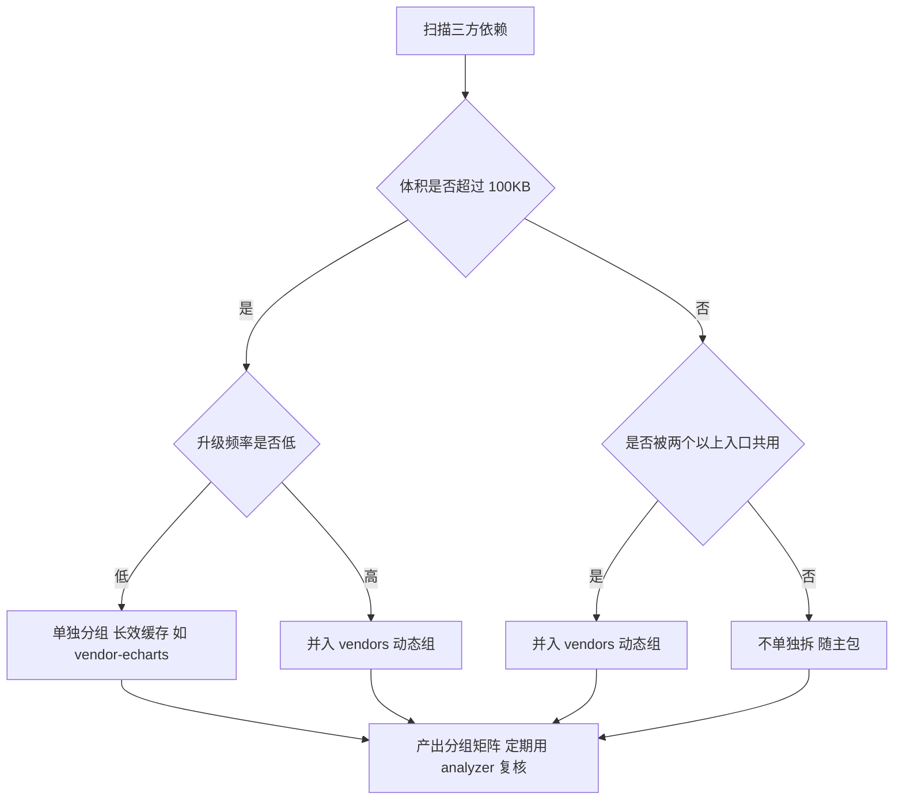

```javascript
// webpack.config.js：分包矩阵落地
module.exports = {
  optimization: {
    splitChunks: {
      chunks: 'all',
      cacheGroups: {
        // 稳定大型库 独立缓存
        'vendor-vue': {
          test: /[\\/]node_modules[\\/](vue|vue-router|pinia)[\\/]/,
          name: 'vendor-vue', priority: 50,
        },
        'vendor-echarts': {
          test: /[\\/]node_modules[\\/](echarts|zrender)[\\/]/,
          name: 'vendor-echarts', priority: 50, chunks: 'async',
        },
        'vendor-editor': {
          test: /[\\/]node_modules[\\/](monaco-editor|@monaco-editor)[\\/]/,
          name: 'vendor-editor', priority: 50, chunks: 'async',
        },
        // 中型工具合并
        vendors: { test: /[\\/]node_modules[\\/]/, name: 'vendors', priority: 10 },
        // 业务公共
        commons: { test: /[\\/]src[\\/]common/, name: 'commons', minChunks: 2, priority: 20 },
      },
    },
  },
};
```

### BLD-038：代码分割过度的表现是什么？如何权衡？
**答**：
- 表现一：请求瀑布——async chunk 内部又依赖其他 async chunk，网络往返叠加，弱网下 TTI 恶化；表现二：压缩率下降（每个文件独立 gzip/brotli、独立语法上下文）；表现三：HTTP1.1 下并发 6 连接排队。
- 诊断：network 面板看 waterfall、maxAsyncRequests 告警、bundle analyzer 看 chunk 碎片（大量 <10KB 文件）。
- 权衡原则：首屏 chunk 少而关键、异步 chunk 按路由粒度（不过细到组件）、公共 chunk 靠 minSize/minChunks 防碎片化。
- 补救手段：webpackPrefetch 预取关键异步 chunk、HTTP2 域收敛、对 <10KB 的动态 import 改 eager 或提高 minChunks。

```javascript
// webpack.config.js：防过度分割的安全阀
module.exports = {
  optimization: {
    splitChunks: {
      chunks: 'all',
      minSize: 30 * 1024,        // 太小的公共代码不值得独立请求
      minRemainingSize: 20 * 1024, // 抽出后原 chunk 至少剩 20KB 否则不抽
      maxAsyncRequests: 20,       // 限制异步并行数 防瀑布
      maxInitialRequests: 15,
    },
  },
  performance: {
    maxAssetSize: 300 * 1024,
    maxEntrypointSize: 500 * 1024,
    hints: 'warning', // 超预算警告 与 size-limit CI 卡口互补
  },
};

// text 代码块：瀑布示例
// report.js -> 动态 import chart.js -> chart.js 又 import echarts
// 弱网 3 次 RTT 叠加 TTI 恶化
// 修复：echarts 分组直接 chunks async 由 chart chunk 静态引用 并行下载
```

## 第六章 HMR 与 dev server（BLD-039 ~ BLD-045）

### BLD-039：HMR 的完整流程是怎样的？画出时序图。
**答**：
- 第一步：文件变化，webpack 的 watcher 触发重编译，webpack-dev-middleware 内存 fs 更新。
- 第二步：服务端通过 websocket 推送消息（先 ok/hash，带本次编译 hash）。
- 第三步：客户端 HMR runtime 收到新 hash 后请求两个文件：manifest（.hot-update.json，记录哪些 chunk 变了）和 update（.hot-update.js，新模块代码）。
- 第四步：runtime 调 module.hot.accept 注册的回调，用新模块替换旧模块；替换成功则热更新，失败回退整页刷新。
- 面试高频追问：hash 的作用是匹配版本（请求的 update 文件名带 hash，避免串版本）；accept 的粒度是模块，谁 accept 谁负责替换。

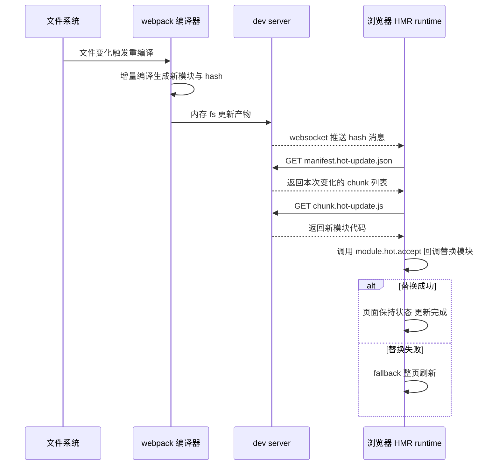

```javascript
// webpack.config.js：开启 HMR 的最小生产级配置
module.exports = {
  mode: 'development',
  devServer: {
    hot: true,               // 注入 HMR runtime 与 websocket 服务
    liveReload: false,       // 关闭整页刷新通道 逼出热更新问题
    static: { directory: 'public' },
  },
  devtool: 'eval-cheap-module-source-map', // HMR 场景最快的可读 sourcemap
};
```

### BLD-040：webpack-dev-server 的原理是什么？express、middleware、websocket 各承担什么？
**答**：
- wds 本质是一个 express 应用：挂 webpack-dev-middleware，把 webpack 的输出接到"内存文件系统"（memfs），磁盘上不产生 dist。
- HTTP：静态资源请求由 middleware 从内存产物直接响应（快、天然与编译一致）；history fallback、代理（http-proxy-middleware）也在这一层。
- WebSocket：独立 ws 服务，编译完成推送 hash/ok/warnings/errors；客户端 sockjs/ws 客户端按协议处理 HMR 与 live reload。
- 其他职责：热更新文件的 HTTP 响应（.hot-update.json/js 由 runtime 发起，middleware 应答）、托管 HMR runtime 注入（HotModuleReplacementPlugin）。

```javascript
// webpack.config.js：devServer 核心参数对照底层职责
module.exports = {
  devServer: {
    hot: true,                              // ws 推送 + HotModuleReplacementPlugin
    static: { directory: 'public', watch: true },
    compress: true,                         // gzip
    historyApiFallback: true,               // SPA 路由 404 回退 index.html
    client: {
      overlay: { errors: true, warnings: false }, // 编译错误浮层
      reconnect: 3,
    },
    proxy: [{
      context: ['/api'],
      target: 'http://localhost:7001',
      changeOrigin: true,
      pathRewrite: { '^/api': '' },
    }],
    setupMiddlewares(middlewares, devServer) { // 自定义 express 中间件
      devServer.app.get('/health', (_req, res) => res.json({ ok: true }));
      return middlewares;
    },
  },
};
```

### BLD-041：module.hot 提供哪些 API？accept/dispose/status 分别怎么用？
**答**：
- module.hot.accept(deps, callback)：声明"这个模块（或依赖模块）更新时调用 callback 自行处理替换"；不注册则该模块更新默认冒泡到父级，最终无人处理就整页刷新。
- module.hot.dispose(callback)：模块被替换前执行清理（移除定时器、事件监听、还原全局状态），避免内存泄漏与重复执行。
- module.hot.status()：idle/apply/check 等状态机；module.hot.decline() 明确拒绝热更（该模块变化即触发刷新）。
- accept 的两个签名：self-accept（当前模块更新）与 accept 依赖（子模块更新但自己保留）；自下而上冒泡直到有 accept。

```javascript
// src/store.js：演示完整 HMR API
let state = { count: 0 };
let timer = null;

export function getState() { return state; }
export function setState(patch) { state = { ...state, ...patch }; }

// 依赖方（src/main.js）：
// import { getState, setState } from './store';
// module.hot.accept('./store', () => { render(); }); // store 更新时重渲染 main 自身不替换

if (module.hot) {
  // 自身被替换前的清理
  module.hot.dispose(() => {
    clearInterval(timer);
    state = { count: 0 }; // 恢复初始状态 防止状态串台
  });

  // 自我接受 状态更新不冒泡（单参数形式是该模块热更出错时的 error handler）
  module.hot.accept(() => {
    console.log('store 热替换完成 status =', module.hot.status());
  });

  // 明确拒绝热更 变化即整页刷新
  // module.hot.decline();
}
```

### BLD-042：HMR 什么情况下会失效并 fallback 到整页刷新？
**答**：
- 无 accept 冒泡链断裂：更新的模块没有被自身或任何祖先 accept，runtime 无法替换 → 整页刷新（liveReload）。
- dispose/accept 回调抛错：更新过程异常，runtime 判定失败 → 刷新（错误会打到 overlay）。
- 非模块资源变化：index.html、动态加载的 worker、CDN 文件等不在 HMR 体系内 → 刷新。
- runtime/manifest 拉取失败：hash 对不上、.hot-update 文件 404（代理/多进程编译抢端口时常见）→ 刷新。
- 主动 decline 或 plugin 声明 noEmitOnErrors 时编译错误也会阻断热更新。

```javascript
// 1 常见失效场景与处理
// src/index.js —— 没有任何 accept：深层模块更新冒泡到入口失败 整页刷新
// 修复：为需要热更新的子树显式 accept
import App from './App';
import { render } from './render';
render(App);

if (module.hot) {
  module.hot.accept('./App', () => {
    // 用最新模块重新渲染 保持页面状态
    import('./App').then(({ default: NextApp }) => render(NextApp));
  });
  module.hot.accept('./render', () => location.reload()); // 工具模块主动声明刷新
}

// 2 devServer 排查配置
module.exports = {
  devServer: {
    hot: 'only',      // HMR 失败不回退整页刷新 便于观察问题（或 hot: true 回退）
    liveReload: true, // fallback 通道开关
    client: { logging: 'verbose' }, // 客户端日志看到 [HMR] 全过程
  },
};
```

### BLD-043：React 和 Vue 的 HMR 边界如何处理？react-refresh 与 vue-loader 的 HMR API 是什么？
**答**：
- react-refresh（Fast Refresh）：babel 插件在编译期给每个组件模块注入热更新注册代码，运行时 refresh runtime 对比组件类型：组件文件更新 → 保留 state 重渲染；非组件导出被修改 → 边界失效，冒泡到入口整页刷新（如路由配置、context 定义变化）。
- vue-loader（SFC）：每个 SFC 编译成 template/script/style 三个子模块，分别 hot accept——改 template 只重渲染、改 style 只换样式、改 script 触发组件实例重载（Vue 2 通过 data 保留，Vue 3 的 defineComponent 保留 setup 内状态有限）。
- 边界共同点：改"副作用型导出"（全局注册、provide、store 定义）无法安全热替换，需要人工 accept 或刷新。
- 面试表达："框架 HMR 的本质是把 module.hot.accept 的样板代码编译期自动生成，并把替换粒度细化到组件。"

```javascript
// react-refresh 编译产物核心逻辑（简化）
import { register, performReactRefresh } from '@pmmmwh/react-refresh-webpack-plugin/runtime';

// babel 已把 App 注册进 refresh 家族表
const prevType = register(App, 'App'); // 记录组件类型签名

if (module.hot) {
  module.hot.accept('./App', () => {
    // 模块更新后 react-refresh 比对组件类型
    const NextApp = require('./App').default;
    if (isReactComponentBoundary(NextApp)) {
      performReactRefresh(); // 保留 hooks state 局部重渲染
    } else {
      module.hot.invalidate(); // 非组件边界变化 冒泡刷新
    }
  });
}

// webpack.config.js：完整 Fast Refresh 配置
module.exports = {
  module: { rules: [{
    test: /\.[jt]sx?$/,
    exclude: /node_modules/,
    use: [{
      loader: 'babel-loader',
      options: { plugins: [require.resolve('react-refresh/babel')] },
    }],
  }] },
  plugins: [new (require('@pmmmwh/react-refresh-webpack-plugin'))()],
  devServer: { hot: true },
};
```

### BLD-044：devServer 的代理与 history fallback 怎么配？有哪些容易踩的坑？
**答**：
- historyApiFallback：SPA 直接访问 /user/123 时服务器 404 → 回退 index.html；rewrites 可按前缀区分多应用；开启后静态目录里同名文件优先于 fallback。
- proxy 基于 http-proxy-middleware：changeOrigin 改 Host 头、secure 处理自签证书、cookieDomainRewrite 处理会话、bypass 让部分请求走静态。
- 坑一：代理目标也是 webpack 服务时 ws 需 ws: true（HMR websocket 转发）；坑二：pathRewrite 顺序在 changeOrigin 之前匹配；坑三：/api 与静态资源路径冲突要先配精确的。
- 生产等价物：nginx 的 try_files fallback + upstream 代理，dev 配置要能平滑映射到生产。

```javascript
// webpack.config.js：代理与 fallback 完整配置
module.exports = {
  devServer: {
    historyApiFallback: {
      disableDotRule: true,
      rewrites: [
        { from: /^\/admin/, to: '/admin.html' },
        { from: /^\/portal/, to: '/portal.html' },
        { from: /./, to: '/index.html' },
      ],
    },
    proxy: {
      '/api': {
        target: 'http://backend.internal:7001',
        changeOrigin: true,
        secure: false,                        // 自签证书
        ws: true,                             // 转发 websocket
        cookieDomainRewrite: 'localhost',
        pathRewrite: { '^/api': '' },
        onProxyRes(proxyRes) {                // 响应钩子 调试头
          proxyRes.headers['x-proxy'] = 'wds';
        },
      },
    },
  },
};
```

### BLD-045：Vite 与 webpack 的 HMR 本质差异是什么？（先埋个伏笔，详见第十章）
**答**：
- 粒度不同：webpack HMR 以 chunk 为单位重编译（受依赖图影响，改动会重算整条链），Vite 以单模块为单位（ESM import 链精确失效，只重新请求变更模块）。
- 是否打包不同：webpack dev 也是打包后的产物（内存 bundle）；Vite dev 是"未打包"的原生 ESM，浏览器按需发请求，Vite 只做单文件 transform。
- 时间复杂度不同：webpack 与项目规模线性相关（模块图越大编译越慢），Vite dev 启动与项目规模基本解耦（路由级懒加载天然分摊）。
- 相同点：都依赖 websocket 推送、manifest/hash 校验版本、accept 粒度决定冒泡与刷新。
- 生产模式 Vite 仍要打包（用 Rollup），所以"dev 快"不等于"build 快"。

```javascript
// vite.config.js：与 webpack 等价的 HMR 配置（差异对比注释）
import { defineConfig } from 'vite';

export default defineConfig({
  server: {
    hmr: {
      overlay: true,
      // protocol/port 可自定 指向独立 ws 服务
      // clientPort: 443, // 代理场景下 ws 走 https 时需指定
    },
  },
  optimizeDeps: { holdUntilCrawlEnd: true },
});

// text 代码块：两种 HMR 请求模型对比
// webpack dev：
//   页面加载 1 个 bundle.js
//   改模块 A -> 重编译包含 A 的 chunk -> 拉取 A.hot-update.js（chunk 级）
// vite dev：
//   页面加载 main.js -> 浏览器沿 ESM import 请求 /src/A.vue 等上百个模块
//   改模块 A -> 仅失效 A 与其 import 链 -> 浏览器重新请求 /src/A.vue?t=1698（模块级 带时间戳破缓存）
```

## 第七章 性能优化之构建速度（BLD-046 ~ BLD-052）

### BLD-046：构建慢如何定位？speed-measure-plugin 和 profiling 怎么用？
**答**：
- 先分桶：loader 耗时（可通过 stats 的 module.timings 看）、压缩耗时（terser 对大 chunk 慢）、插件耗时、resolve/IO 耗时。
- speed-measure-plugin 包裹 plugins 与 loaders 输出各阶段耗时表；webpack 5 官方方式：--profile + stats.json（profileTimings）或 NODE_OPTIONS="--cpu-prof" 火焰图。
- 常见元凶：babel-loader 处理了 node_modules、terser 没并行、sourceMap 全开、每个 rebuild 全量编译（未开缓存）。
- 定位后逐一治理并做基线：把每次优化写入 CI 耗时对比，防止回退。

```javascript
// webpack.config.js：speed-measure-plugin 用法 + webpack5 官方 profiling
const SpeedMeasurePlugin = require('speed-measure-webpack-plugin');
const smp = new SpeedMeasurePlugin();

module.exports = smp.wrap({
  module: {
    rules: [{
      test: /\.js$/,
      include: /src/,          // 不碰 node_modules 是最大提速
      use: 'babel-loader',
    }],
  },
  optimization: {
    minimizer: [new (require('terser-webpack-plugin'))({
      parallel: true,          // 多进程压缩
    })],
  },
});

// bash 代码块：webpack 5 官方定位命令
// npx webpack --profile --json > stats.json
// node -e "const s=require('./stats.json');
//   console.table(s.modules.map(m=>({name:m.name,time:m.time})).sort((a,b)=>b.time-a.time).slice(0,10))"
// NODE_OPTIONS=--cpu-prof npx webpack   # 生成 .cpuprofile 用 Chrome DevTools 看火焰图
```

### BLD-047：webpack 5 的 filesystem 持久缓存原理与失效策略是什么？
**答**：
- 原理：首次构建把"模块的编译结果 + 依赖快照（snapshot）"序列化到 node_modules/.cache/webpack；下次构建对比文件时间戳/内容哈希与快照，未变模块直接反序列化复用。
- snapshot：managedPaths（node_modules 包管理器管理，默认信任）只做一次性快照，业务源码用 timestamp 或 hash 策略。
- 失效：buildDependencies 里的配置文件、loader、插件版本变化会整体失效；建议把 config、lockfile 都加入。
- cache.maxGenerations/maxAge 控制 GC；CI 里把缓存目录作为 artifact/restore key 是最有效的提速手段。

```javascript
// webpack.config.js：生产级缓存配置
const path = require('path');

module.exports = {
  cache: {
    type: 'filesystem',
    name: 'production-cache',        // 多 mode 分开缓存 防串台
    buildDependencies: {
      config: [__filename],          // 配置变化即失效
      // lockfile 变化（依赖升级）即失效
      // webpack 5 默认已跟踪 package.json 与 lockfile 的 buildDependencies
    },
    version: require('./package.json').version, // 手动追加版本维度
    compression: 'gzip',
    profile: true,                   // 缓存内建耗时分析
    maxAge: 1000 * 60 * 60 * 24 * 14,
    maxGenerations: 3,
  },
  snapshot: {
    // 业务文件用内容哈希 mtime 不可靠的 CI 场景改 hash
    module: { timestamp: true },
  },
  output: { path: path.resolve('dist') },
};
```

### BLD-048：thread-loader / 并行处理何时有效、何时是负优化？
**答**：
- 原理：thread-loader 把后续 loader 放进 worker 池执行，利用多核；只对"它之后"的 loader 生效。
- 有效场景：单文件转换计算量大（babel 重 preset、ts 编译）、模块数量多、机器核多。
- 负优化场景：loader 本身很轻（纯字符串处理）、文件数少（启动 worker 进程的固定开销 > 收益）、缓存开启后二次构建命中率已很高。
- webpack 5 生态推荐：压缩并行交给 terser-webpack-plugin 的 parallel、js 转换交给 esbuild-loader/SWC（内置并行）替代 thread-loader + babel。

```javascript
// webpack.config.js：thread-loader 位置与替代方案
const os = require('os');

module.exports = {
  module: {
    rules: [{
      test: /\.js$/,
      include: /src/,
      use: [
        {
          loader: 'thread-loader',
          options: {
            workers: Math.max(1, os.cpus().length - 1),
            poolTimeout: 2000,     // dev 常驻 prod 可设短释放
          },
        },
        'babel-loader',            // 真正干重的 loader 放在 thread-loader 之后
      ],
    }],
  },
};

// 更优替代：esbuild-loader 内置 Go 并行（推荐）
// module.exports = { module: { rules: [{
//   test: /\.js$/, include: /src/,
//   use: [{ loader: 'esbuild-loader', options: { target: 'es2018' } }],
// }] } };
```

### BLD-049：如何通过收缩 resolve 范围和 module.noParse 提速？
**答**：
- resolve：extensions 列表精简并按命中率排序；modules 只保留本项目 node_modules；alias 直接命中；symlinks: false 可减少软链接二次解析（无 pnpm 场景）；exportsFields 限定包入口字段。
- noParse：声明"这些文件不需要解析依赖"（如 dist 版的 echarts/monaco），webpack 只读不 parse，省 AST 与依赖收集。
- noParse 代价：文件内的 require 不再处理，必须是自包含产物（UMD bundle）。
- 副手：ignorePlugin 屏蔽多语言等无用模块（moment/locale）。

```javascript
// webpack.config.js：resolve 收缩 + noParse
const webpack = require('webpack');
const path = require('path');

module.exports = {
  resolve: {
    extensions: ['.js', '.jsx', '.ts', '.tsx', '.json'], // 精简按命中排序
    modules: [path.resolve('node_modules')],             // 不再向上递归查找
    alias: { react: path.resolve('node_modules/react') },
  },
  module: {
    noParse: [
      /echarts\.min\.js$/,       // 自包含 dist 产物 不解析依赖
      /monaco-editor\/min\/vs/,
    ],
    rules: [
      { test: /\.css$/, use: ['style-loader', 'css-loader'] },
      { test: /\.(js|jsx)$/, include: /src/, use: 'babel-loader' },
    ],
  },
  plugins: [
    // 屏蔽 moment 全部语言包 只保留中文
    new webpack.IgnorePlugin({ resourceRegExp: /^\.\/locale$/, contextRegExp: /moment$/ }),
  ],
};
```

### BLD-050：include/exclude 与 test 精确化为什么重要？怎么写才规范？
**答**：
- 原理：loader 命中判断发生在"每个模块构建"时；不写 include 会让 babel-loader/eslint-loader 扫遍 node_modules，这是新手构建慢的第一大原因。
- 规范写法：用 include 白名单（正向表达业务目录）优先于 exclude 黑名单；test 与 type、resourceQuery 组合精确匹配。
- include 用绝对路径数组，避免用宽松正则误吞 node_modules 内的 @scope。
- 提示：Include 越严，HMR 与增量也越快（快照范围同步缩小）。

```javascript
// webpack.config.js：规范示例
const path = require('path');
const SRC = path.resolve('src');
const PKGS = ['@app/ui', '@app/hooks'].map((p) =>
  path.dirname(require.resolve(`${p}/package.json`))); // monorepo 内部包也纳入编译

module.exports = {
  module: {
    rules: [
      {
        test: /\.(js|jsx|ts|tsx)$/,
        include: [SRC, ...PKGS],   // 白名单 业务目录 + 内部包
        use: 'babel-loader',
      },
      {
        test: /\.css$/,
        oneOf: [
          { test: /\.module\.css$/, include: SRC, use: ['style-loader', { loader: 'css-loader', options: { modules: true } }] },
          { use: ['style-loader', 'css-loader'] },
        ],
      },
    ],
  },
};
```

### BLD-051：把大库外部化（externals + CDN）的时机与做法？与 DLL 的关系？
**答**：
- 时机：超大型稳定库（echarts、moment、xlsx）不常升级且体积巨大时，改由 CDN script 提供，构建产物只留引用；内网/离线部署要自托管 CDN 资源。
- 做法：html-webpack-plugin 注入 script 标签 + externals 映射全局变量；SSR/node 场景 externals 走 commonjs。
- 与 DLL：webpack 5 时代 DLL 已不建议（升级麻烦、缓存体系不兼容），externals + 持久缓存 + vendor 分组是主流；DLL 只在"无法 CDN 的老工程"里残留。
- 风险：CDN 可用性与版本漂移要用 lock 语义（固定版本 URL + SRI）。

```javascript
// webpack.config.js：externals + 自动注入 CDN
const HtmlWebpackPlugin = require('html-webpack-plugin');

const CDN = {
  react: { pkg: 'react', version: '18.3.1', global: 'React' },
  'react-dom': { pkg: 'react-dom', version: '18.3.1', global: 'ReactDOM' },
};

module.exports = {
  externals: [
    function ({ request }, callback) {
      if (CDN[request]) {
        return callback(null, `root ${CDN[request].global}`);
      }
      callback();
    },
  ],
  plugins: [
    new HtmlWebpackPlugin({
      template: 'public/index.html',
      cdnJs: Object.values(CDN).map((d) =>
        `https://cdn.example.com/${d.pkg}@${d.version}/umd/${d.pkg}.production.min.js`),
    }),
  ],
};

// public/index.html 模板片段（text 代码块）：
// <% htmlWebpackPlugin.options.cdnJs.forEach(function(url){ %>
//   <script src="<%= url %>" crossorigin="anonymous"></script>
// <% }) %>
```

### BLD-052：从 webpack 4 升级到 5 有哪些实测收益？升级要动哪些点？
**答**：
- 实测收益项：持久缓存（二次构建快 60%~90%）、asset modules 砍掉 file/url-loader 链、node polyfill 移除后包更小、terser 分阶段缓存、Deterministic ids 缓存更稳。
- 破坏性变更：Node 10.13+ 要求、`module`/`mainFields` 行为微调、polyfill 自动注入被移除（需显式 fallback）、loaders 中 fs 路径改、`optimization.hashedModuleIds` 改 `moduleIds: 'deterministic'`、output.filename 不再自动加 hash。
- 迁移路径：先跑 `npx webpack-cli migrate` 自动改配置，再处理 deprecation 警告（指向未来 webpack 6 的 API，如 stage 钩子）。

```javascript
// webpack.config.js：webpack 5 迁移对照片段
module.exports = {
  // webpack4: node: { fs: 'empty', dgram: 'empty' }
  // webpack5: polyfill 不再自动注入 需要显式声明
  resolve: {
    fallback: { path: false, fs: false }, // 或 path-browserify 等 polyfill 包
  },
  optimization: {
    // webpack4: hashedModuleIds: true
    moduleIds: 'deterministic',
  },
  module: {
    rules: [
      // webpack4: url-loader + limit
      // webpack5: asset modules（见 BLD-024）
      { test: /\.(png|jpg)$/i, type: 'asset', parser: { dataUrlCondition: { maxSize: 8 * 1024 } } },
    ],
  },
  plugins: [
    // webpack4: NamedModulesPlugin
    // webpack5: 内建
    // new (require('webpack').NamedModulesPlugin)(),  // 已移除
  ],
};

// bash 代码块：官方迁移命令
// npx webpack-cli migrate webpack.config.js
// npx webpack --watch   # 观察 deprecation 警告逐条清理
```

## 第八章 性能优化之产物体积（BLD-053 ~ BLD-060）

### BLD-053：webpack-bundle-analyzer 的实操与读图方法？
**答**：
- 两种模式：构建后生成静态报告（stats 文件 + analyzer 静态页，适合 CI）与 dev 时实时面板；读图要点是 treemap 的面积 = gzip 前体积。
- 读图四步：找最大的单个模块（常是重复依赖或多语言包）、找应进异步 chunk 却在主包的三方库、找重复打包（同一库两个版本并排出现）、找可外部化的大文件。
- 配合 stats.json 用 `duplicate-package-checker-webpack-plugin` 或 `npm ls` 查重。
- 报告要纳入基线管理：CI 产出对比图，体积异常增长自动告警。

```bash
# 生成 stats 并产出静态报告
npx webpack --json > stats.json
npx webpack-bundle-analyzer stats.json dist -r report.html -m static --mode static

# 用压缩后体积看报告（更接近真实收益）
npx webpack --json > stats.json
npx webpack-bundle-analyzer stats.json dist --report report.html
```

```javascript
// webpack.config.js：CI 集成的分析插件配置
const { BundleAnalyzerPlugin } = require('webpack-bundle-analyzer');

module.exports = (_, argv) => ({
  plugins: [
    new BundleAnalyzerPlugin({
      analyzerMode: process.env.CI ? 'static' : 'server', // CI 出静态文件 本地起服务
      reportFilename: 'bundle-report.html',
      openAnalyzer: !process.env.CI,
      defaultSizes: 'stat',       // 可改 gzip 更贴近线上
      generateStatsFile: true,
      statsFilename: 'stats.json',
    }),
  ],
});
```

### BLD-054：hash、chunkhash、contenthash 的区别？（高频）
**答**：
- hash：整个构建的哈希，任何一个文件变全变——已不适合缓存场景。
- chunkhash：按 chunk 计算，同 chunk 内模块变化影响该 chunk；但 chunk 依赖变化（如入口引了新异步 chunk）也会变。
- contenthash：按"文件内容本身"计算，css 与 js 解耦——js 改动不影响抽出的 css 文件名，是长效缓存正确姿势。
- 组合实践：js 用 contenthash，css（mini-css-extract）用 contenthash，runtime 单独抽；同时配 moduleIds: 'deterministic' 防止 id 扰动。
- 坑：WebpackManifestPlugin 引用文件名要同步读取 stats 映射，别手拼 hash。

```javascript
// webpack.config.js：三类 hash 对比与推荐配置
const MiniCssExtractPlugin = require('mini-css-extract-plugin');

module.exports = {
  output: {
    // 推荐 contenthash：内容定文件名
    filename: 'js/[name].[contenthash:8].js',
    chunkFilename: 'js/[name].[contenthash:8].chunk.js',
  },
  optimization: {
    runtimeChunk: 'single',
    moduleIds: 'deterministic', // 配合 contenthash 缓存才稳
  },
  module: {
    rules: [{
      test: /\.css$/,
      use: [MiniCssExtractPlugin.loader, 'css-loader'],
    }],
  },
  plugins: [
    new MiniCssExtractPlugin({
      // css 用 contenthash：js 逻辑变化不影响 css 缓存
      filename: 'css/[name].[contenthash:8].css',
    }),
  ],
};

// text 代码块：三者的变化粒度示意
// hash:        改任何文件 -> 所有文件名全变（整站缓存失效）
// chunkhash:   改入口依赖的模块 -> 该入口及其子 chunk 变
// contenthash: 改 css -> 只有 css 文件名变；改 js -> 只有 js 文件名变
```

### BLD-055：module ids 为什么要稳定化？deterministic 是什么原理？
**答**：
- 模块 id 是 webpack runtime 里 require 的索引；webpack 4 及以前默认数字递增 id，新增/删除文件会让后续模块全部改号 → 多个 chunk 的引用关系变化 → hash 变化 → 缓存失效面扩大。
- deterministic：以模块的相对路径 + 相关上下文做哈希，生成稳定 4 位短 id，不依赖构建顺序；代价是 id 稍长（约 2~3 字节/模块）。
- chunkIds 同理推荐 deterministic；natural/size 适用于特定调试场景。
- 验证方式：连续两次"加一个文件再删掉"的构建，比较 manifest 中 vendor chunk 的 hash 是否不变。

```javascript
// webpack.config.js：稳定 id 完整配置
module.exports = {
  mode: 'production',
  optimization: {
    moduleIds: 'deterministic', // 模块 id 由路径哈希得出
    chunkIds: 'deterministic',  // chunk id 同样稳定
    runtimeChunk: 'single',
  },
  output: {
    filename: '[name].[contenthash:8].js',
  },
};

// text 代码块：效果对比
// 递增 id（旧默认）：module {0,1,2,...}
//   新增 src/a.js -> a 成为 0 后所有模块 id 后移 -> 引用它的 chunk 全部 hash 变化
// deterministic：module {V2t3: a.js, Kd9s: b.js}
//   新增/删除文件不影响既有模块 id -> 只有真正变化的 chunk hash 变化
```

### BLD-056：重复依赖如何发现与去重？resolve.dedupe、overrides、lockfile 各自角色？
**答**：
- 发现：analyzer 里同名库两块面积、`npm ls lodash` 多条路径、duplicate-package-checker 插件构建期报 warning。
- 手段一（pnpm/yarn）：overrides/resolutions 在 package.json 强制统一版本；手段二（webpack）：resolve.dedupe 指定包名强制只解析一份（对 hooks 类库 react/vue/scheduler 必须唯一）。
- 原因分析：peerDependencies 未声明、lockfile 分叉、monorepo 子包各自安装；根治靠 pnpm 的严格符号链接 + workspace 协议。
- 去重后跑全量回归：部分库真的需要双版本（如 Node 内部包），不要无脑收口。

```json
// package.json：pnpm overrides / yarn resolutions 强制版本统一
{
  "pnpm": {
    "overrides": {
      "lodash": "^4.17.21",
      "react": "$react"
    }
  },
  "resolutions": {
    "react": "18.3.1"
  }
}
```

```javascript
// webpack.config.js：构建期兜底
module.exports = {
  resolve: {
    dedupe: ['react', 'react-dom', 'vue', '@vue/reactivity', 'scheduler'],
    alias: {
      // 极端情况直接把子包别名到主版本
      'react$': require.resolve('react'),
    },
  },
  plugins: [
    // 重复包检测
    new (require('duplicate-package-checker-webpack-plugin'))({ emitError: true }),
  ],
};
```

### BLD-057：动态 polyfill 怎么做？useBuiltIns: usage + core-js 3 与按 UA 下发如何选择？
**答**：
- 静态按需：@babel/preset-env 的 useBuiltIns: 'usage' + corejs: 3，扫描源码用到的 API 注入对应 import（构建期定，产物稳定，主流选择）。
- entry 模式：入口一次性注入 targets 所需全部 polyfill（体积大但可控）；false 表示不注入（库模式常用，交给使用方）。
- 动态按 UA：Polyfill.io / CDN 服务根据 User-Agent 返回差异 polyfill——产物最小，但依赖外部服务稳定性和缓存策略，有供应链风险需自托管。
- 结合 browserslist：targets 越新注入越少；用 `browserslist --coverage` 量化覆盖率取舍。

```javascript
// babel.config.js：usage + corejs3（推荐）
module.exports = {
  presets: [
    ['@babel/preset-env', {
      targets: { chrome: '87', ie: '11' },
      useBuiltIns: 'usage',       // 按 API 使用情况注入
      corejs: { version: 3.36, proposals: false },
      modules: false,             // 保留 ESM 交给 webpack
    }],
  ],
};

// 源码效果（text 代码块）：
// 源码只用了 Promise 与 Array.prototype.includes
// 编译后自动注入：
// import 'core-js/modules/es.promise';
// import 'core-js/modules/es.array.includes';

// 动态 polyfill 自托管示例（index.html 片段，text 代码块）：
// <script defer
//   src="https://polyfill.internal.example.com/v3/polyfill.min.js?features=default,IntersectionObserver">
// </script>
```

### BLD-058：图片与字体优化如何融入 build 流程？
**答**：
- 尺寸治理：构建期用 sharp/squoop 压缩 + 按宽度生成多分辨率（srcset），禁止设计稿原图直进仓库；image-webpack-loader 或 vite 插件在产物阶段处理。
- 格式策略：优先 WebP/AVIF，JPEG 保留兜底；svg 走 asset/source 内联染色的同时可用 svgo 瘦身。
- 字体：woff2 优先 + font-display: swap；subset（中文字体按需抽字形，如 fontmin）收益极大。
- 加载：关键小图 dataUrl 内联（BLD-024 的 maxSize），首屏大图 preload，非关键懒加载（loading="lazy"）。

```javascript
// webpack.config.js：图片压缩 + svg 瘦身 + 字体优化
module.exports = {
  module: {
    rules: [
      {
        test: /\.(png|jpe?g|gif|webp)$/i,
        type: 'asset',
        parser: { dataUrlCondition: { maxSize: 8 * 1024 } },
        generator: { filename: 'img/[name].[contenthash:8][ext]' },
        use: [{
          loader: 'image-webpack-loader', // 压缩在后 normal 阶段 作用于 asset 之前
          options: {
            mozjpeg: { quality: 75, progressive: true },
            webp: { quality: 75 },
            avif: { quality: 60 },
          },
        }],
      },
      {
        test: /\.svg$/i,
        type: 'asset/source',
        use: [{ loader: 'svgo-loader', options: { plugins: [
          { name: 'preset-default', params: { overrides: { removeViewBox: false } } },
        ] } }],
      },
      {
        test: /\.woff2?$/i,
        type: 'asset/resource',
        generator: { filename: 'font/[name].[contenthash:8][ext]' },
      },
    ],
  },
};

// CSS 侧字体优化（text 代码块）：
// @font-face {
//   font-family: AppSans;
//   src: url('./app-sans.woff2') format('woff2');
//   font-display: swap;   // 先用回退字体 文字不可见时间最短
//   unicode-range: U+4E00-9FFF; // 只覆盖需要的字形范围
// }
```

### BLD-059：CSS 体积优化有哪些手段？
**答**：
- 清死代码：PurgeCSS 按"产物 HTML/JS 中出现过的类名"裁剪样式；Tailwind 项目天然受益（JIT 只生成用到的类），但要小心动态拼接类名被误删（白名单 safelist）。
- 压缩：cssnano / lightningcss（比 cssnano 快且支持现代语法降级）；构建期去 @import 合并。
- 架构：CSS Modules + 组件级拆分让样式随 chunk 分割；公共样式抽取防重复（BLD-036）；关键 CSS 内联、其余异步。
- 治理变量：Sass 的 @import 全局引入要换 css @use 按需；旧版 element-ui 全量 import 改按需 babel 插件。

```javascript
// webpack.config.js：PurgeCSS + cssnano 生产链
const MiniCssExtractPlugin = require('mini-css-extract-plugin');

module.exports = {
  module: {
    rules: [{
      test: /\.css$/,
      use: [MiniCssExtractPlugin.loader, 'css-loader', 'postcss-loader'],
    }],
  },
  plugins: [
    new MiniCssExtractPlugin({ filename: 'css/[name].[contenthash:8].css' }),
    new (require('purgecss-webpack-plugin'))({
      paths: require('glob').sync('src/**/*.{js,jsx,ts,tsx,vue}'),
      extractors: [{
        extractor: (content) => content.match(/[A-Za-z0-9_-]+/g) || [],
        extensions: ['js', 'jsx', 'ts', 'tsx', 'vue'],
      }],
      safelist: { standard: [/^(is|has|data-)/, 'transition', 'fade-enter'] }, // 动态类白名单
    }),
  ],
};

// postcss.config.js：压缩层
module.exports = {
  plugins: [
    require('autoprefixer'),
    require('cssnano')({ preset: ['default', { discardComments: { removeAll: true } }] }),
  ],
};
```

### BLD-060：如何给产物体积设预算卡口（budget）并在 CI 中落地？
**答**：
- 三层卡口：webpack performance 提示（构建时）、size-limit（基于真实 gzip/brotli 体积，可对具体文件设阈值）、CI diff（与基线分支 stats.json 比对，输出增量报告）。
- 预算制定：按"入口 js gzip 不超 X KB、单 chunk 不超 Y KB、vendor 增幅不超 Z%"分级，超出阻断或告警。
- size-limit 原理：按 entry 打一个最小化产物再压缩测体积，支持 CI 失败退出码。
- 报告形态：PR 评论贴 markdown 表（文件、体积、diff、是否超限），让业务同学在 review 时感知成本。

```json
// package.json：size-limit 预算
{
  "scripts": {
    "size": "size-limit"
  },
  "size-limit": [
    { "path": "dist/js/main.*.js", "limit": "180 KB", "gzip": true },
    { "path": "dist/js/vendors.*.js", "limit": "250 KB", "gzip": true },
    { "path": "dist/css/*.css", "limit": "50 KB", "gzip": true }
  ]
}
```

```yaml
# .github/workflows/size.yml：CI 卡口与 PR 报告
name: size-limit
on: [pull_request]
jobs:
  size:
    runs-on: ubuntu-latest
    steps:
      - uses: actions/checkout@v4
      - uses: actions/setup-node@v4
        with: { node-version: 20, cache: pnpm }
      - run: pnpm install --frozen-lockfile
      - run: pnpm build
      - name: 体积预算检查
        run: pnpm size
      - name: 与基线 diff 报告
        run: node scripts/chunk-diff-report.js ./base-stats.json ./dist/stats.json
        env:
          GITHUB_TOKEN: ${{ secrets.GITHUB_TOKEN }}
```

## 第九章 Module Federation（BLD-061 ~ BLD-068）

### BLD-061：Module Federation 的核心概念有哪些？host/remote/exposed/shared/remotes 分别是什么？
**答**：
- host：消费方，页面外壳，声明 remotes（要引用哪些远端）与 shared（可与远端共享的依赖）。
- remote：提供方，声明 exposes（对外暴露的模块路径映射）与 filename（打包出的容器入口 containerEntry）。
- exposed：remote 暴露的"模块"（不是整页应用），host 按路径异步拉取。
- shared：双方声明共同依赖（如 react），运行时协商用哪个版本，避免重复下载与实例不一致。
- 运行时本质：MF 把 webpack 模块图拆到多个可独立部署的容器里，通过 container reference 在浏览器端动态连接（remoteEntry.js + 动态 script 加载模块）。

```javascript
// remote 端 webpack.config.js
const { ModuleFederationPlugin } = require('webpack').container;

module.exports = {
  plugins: [
    new ModuleFederationPlugin({
      name: 'shopRemote',
      filename: 'remoteEntry.js',                 // 容器入口
      exposes: {
        './ProductList': './src/components/ProductList.vue',
        './CartButton': './src/components/CartButton.jsx',
      },
      shared: {
        react: { singleton: true, requiredVersion: '^18.0.0' },
        'react-dom': { singleton: true },
        vue: { singleton: true },
      },
    }),
  ],
};
```

### BLD-062：写一个 host 与 remote 互引的完整可运行配置。
**答**：
- 结构：两个应用各自配 MF；host 通过 remotes 指向 remote 的 remoteEntry.js（module 类型导入）。
- 远端模块导入两种方式：import('app2/ProductList') 异步（推荐，自动拉容器）或 new Container().get 同步控制。
- async 边界：shared 依赖要求入口必须是异步 bootstrap（import('./bootstrap') 模式），否则初始化时容器尚未协商好依赖版本。
- remote 也可反引 host，形成互引；注意循环引用时的加载时序。

```javascript
// host/src/bootstrap.jsx：异步入口（shared 协商需要）
import { createRoot } from 'react-dom/client';
import App from './App';
createRoot(document.getElementById('root')).render(<App />);

// host/src/index.jsx：仅做异步引导
import('./bootstrap');

// host/webpack.config.js
const { ModuleFederationPlugin } = require('webpack').container;

module.exports = {
  plugins: [
    new ModuleFederationPlugin({
      name: 'shellHost',
      remotes: {
        shopRemote: 'shopRemote@http://localhost:3001/remoteEntry.js',
        // 运行时动态地址（不写死）：
        // shopRemote: 'promise new Promise(resolve => { ... 动态 fetch 地址 ... })',
      },
      shared: {
        react: { singleton: true, eager: false, requiredVersion: '^18.0.0' },
        'react-dom': { singleton: true },
      },
    }),
    new (require('html-webpack-plugin'))(),
  ],
};

// host/src/App.jsx：消费远端模块
const RemoteProductList = React.lazy(() => import('shopRemote/ProductList'));
export default function App() {
  return (
    <Suspense fallback="加载中">
      <RemoteProductList />
    </Suspense>
  );
}

// remote 端入口同理：index.jsx -> import('./bootstrap')，webpack.config.js 见 BLD-061
```

### BLD-063：shared 依赖的版本协商原理是什么？singleton、requiredVersion、strictVersion 各起什么作用？
**答**：
- 每个应用把 shared 依赖注册进一个全局共享作用域（share scope）：{ 依赖名: { 版本: { get, from } } }。
- host 先注册自己的版本，remote 加载时对比：有满足 requiredVersion 的版本就复用（不再加载自己打包的副本），否则加载自己的副本（fallback chunk）。
- singleton: true：强制全局唯一实例（react/vue/router 必须单例，两个 React 实例会导致 hooks 报错）；版本不满足时用警告/报错代替多实例。
- strictVersion: true：版本不匹配直接抛错（生产严格）；默认只 console.warn。
- eager: true：把 shared 打进入口（牺牲体积换首屏，仅 host 入口常用）。

```javascript
// webpack.config.js：shared 精细配置示例
const { ModuleFederationPlugin } = require('webpack').container;

module.exports = {
  plugins: [
    new ModuleFederationPlugin({
      name: 'appA',
      shared: {
        // 必须 singleton：实例不唯一会导致 hooks 状态错乱
        react: { singleton: true, requiredVersion: '~18.3.1', strictVersion: true, eager: true },
        'react-dom': { singleton: true, strictVersion: true },
        'react-router-dom': { singleton: true, requiredVersion: '^6.0.0' },
        // 大型工具库允许版本共存（多实例无害 只多占体积）
        lodash: { requiredVersion: '^4.17.0' },
        // 纯 UI 组件库 允许 host 提供版本 fallback
        '@app/design': { import: false, shareKey: '@app/design' },
      },
    }),
  ],
};

// text 代码块：协商结果伪码
// shareScope.react = { '18.3.1': { get: () => __webpack_require__('react-18.3.1') } }
// remote 要求 ^18.2.0 -> 18.3.1 满足 -> 复用 host 版本，remote 自带副本作为 fallback 不加载
```

### BLD-064：Module Federation 如何与微前端架构结合？运行时集成指什么？
**答**：
- 微前端的三种集成时机：构建期集成（整站一起打，无独立部署）、运行时 iframe（强隔离弱体验）、运行时 MF/模块注册（独立开发部署 + 原生体验）。
- MF 的运行时集成：主应用只持有"远端地址清单"，页面挂载时动态 new URL 加载对应 remoteEntry，再 import exposed 模块——版本与地址都可下发。
- 主应用职责收敛：路由分发、公共依赖 singleton 提供、全局状态/登录态通过 context 传递（不是 iframe 的 window 隔离）。
- 与 qiankun 差异：qiankun 以 HTML 为入口、沙箱劫持 window；MF 以模块为入口、无沙箱（要自己做隔离，见 BLD-066）。

```javascript
// host/src/dynamicRemotes.js：运行时动态加载远端
export function loadRemote(remoteName, modulePath) {
  // 地址由配置中心下发 可灰度可回滚
  const entryUrl = window.__APP_CONFIG__.remotes[remoteName];
  return import(`${remoteName}@${entryUrl}/${modulePath}`); // 需要 remotes 配 promise 形式配合
}

// webpack.config.js：promise 形式的 remotes（动态地址）
module.exports = {
  plugins: [new (require('webpack').container.ModuleFederationPlugin)({
    name: 'shellHost',
    remotes: {
      shopRemote: `promise new Promise((resolve) => {
        const script = document.createElement('script');
        script.src = window.__APP_CONFIG__.remotes.shopRemote;
        script.onload = () => resolve(window.shopRemote);
        document.head.appendChild(script);
      })`,
    },
  })],
};
```

### BLD-065：联邦应用的部署与独立发布怎么做？
**答**：
- remote 与 host 各自独立 CI/CD：各自 build、各自部署到自己的静态目录，唯一契约是 remoteEntry.js 的 URL 与 exposes 路径。
- remoteEntry.js 必须稳定可寻址（固定文件名 + HTTP 缓存策略：remoteEntry 本体 no-cache，其余 chunk contenthash 长缓存）。
- 发布顺序：先 remote 后 host 均可（MF 的 shared fallback 兜底），但 exposes 路径与 shared 版本契约要同步评审。
- 灰度/回滚：地址下发（配置中心/网关）控制指向哪个版本的 remote 目录；remoteEntry 内部 hash chunk 按需淘汰。

```javascript
// scripts/deploy-remote.js：独立部署脚本示意
const { execSync } = require('child_process');
const path = require('path');

const version = require('../package.json').version;

// 1 构建带 contenthash 的产物
execSync('pnpm build', { cwd: path.resolve(__dirname, '..'), stdio: 'inherit' });

// 2 上传到 版本化目录 + latest 目录双写
execSync([
  `aws s3 sync dist s3://mf-remotes/shop-remote/${version} --delete`,
  `aws s3 sync dist s3://mf-remotes/shop-remote/latest --delete`,
].join(' && '), { stdio: 'inherit' });

// 3 remoteEntry 固定路径 no-cache，chunk 长缓存（text 代码块：nginx 配置）
// location ~* /shop-remote/.+\.js$ {
//   if ($uri ~ remoteEntry\.js$) { add_header Cache-Control "no-cache"; break; }
//   add_header Cache-Control "public, max-age=31536000, immutable";
// }
```

### BLD-066：联邦应用的样式与上下文隔离问题怎么解决？
**答**：
- 样式：无自动隔离。手段一，CSS Modules/组件作用域（Vue scoped、styled-components）天然隔离；手段二，构建期给 remote 的类名加前缀（postcss-prefix-selector）；手段三，Shadow DOM 包裹（成本高，portal/dialog 会逃逸）。
- 全局污染：remote 引入的三方脚本、window 赋值、Polyfill 会直接影响 host；治理靠 lint 规则 + 运行时审查清单。
- 上下文：React Context、Router、i18n、主题必须由 host 提供——通过 shared 单例库或 host 暴露的 context 模块（exposes 一个 ContextProvider）。
- 事件与生命周期：约定 mount/unmount 协议（各 remote 暴露 bootstrap/mount/unmount），卸载时清监听。

```javascript
// remote 的样式前缀方案：postcss-prefix-selector
module.exports = ({ options }) => ({
  plugins: [
    require('postcss-prefix-selector')({
      prefix: '.mf-shop-remote',
      transform(prefix, selector) {
        if (selector.startsWith('html') || selector.startsWith('body')) {
          return `${prefix}${selector.slice(4)}`; // 根选择器改写
        }
        return `${prefix} ${selector}`;
      },
      exclude: [':root', '.mf-shop-remote'], // 避免重复前缀
    }),
    ...options,
  ],
});

// host 挂载时给容器统一 className（text 代码块）：
// <div className="mf-shop-remote"><RemoteProductList /></div>

// 上下文传递：host exposes 上下文模块
// new ModuleFederationPlugin({
//   name: 'shellHost',
//   exposes: { './AppContext': './src/context/AppContext.js' },
// });
// remote 内：import { AppContext } from 'shellHost/AppContext'; // 单例 context 共享登录态与主题
```

### BLD-067：Module Federation 的 SSR 限制是什么？有哪些缓解方案？
**答**：
- 本质问题：MF 依赖浏览器端动态加载（remoteEntry + 动态 import），Node 端 SSR 要求"同步 require 已知模块"，模型冲突。
- webpack 5 的 ModuleFederationPlugin 提供了 server 端支持（target: node、libraryTarget commonjs-module），但 host 与 remote 需在同进程（通过内部请求或本地引用），跨网络容器仍无标准协议。
- 缓解方案一：SSR 时只渲染 host 部分，远端模块 CSR 水合（牺牲 SEO）。
- 方案二：Node 端用 @module-federation/enhanced / module-federation-dts + 联邦服务（如 @module-federation/node）实现服务间拉取。
- 方案三：SSR 渲染时改为"HTML 片段集成"（原生 ESM/iframe 混合），仅客户端用 MF。

```javascript
// webpack.server.config.js：Node 端联邦配置（同进程方案）
const { ModuleFederationPlugin } = require('webpack').container;

module.exports = {
  target: 'node',
  output: { libraryTarget: 'commonjs-module' },
  plugins: [
    new ModuleFederationPlugin({
      name: 'ssrHost',
      library: { type: 'commonjs-module' },
      remotes: {
        // Node 侧：容器从本地构建产物加载（同进程）
        shopRemote: 'shopRemote@./remote/ssrRemoteEntry.js',
      },
      shared: {
        react: { singleton: true, eager: true }, // 服务端必须 eager 避免异步协商
      },
    }),
  ],
};

// server.js（text 代码块）：
// SSR 渲染前先显式初始化容器
// await __webpack_init_sharing__('default');
// const container = window 不可用 -> 需要 module-federation/node 桥接
// const remote = await loadRemoteModule({ remoteName: 'shopRemote', module: './ProductList' });
```

### BLD-068：联邦、iframe、qiankun（微前端框架）如何选型？
**答**：
- iframe：最强隔离（JS/CSS/存储全隔离），但 URL 不同步、弹层跨壳、通信 postMessage 繁琐、性能开销大；适合强异构（跨团队技术栈、不可信脚本、第三方插件）。
- qiankun：基于 single-spa + importHTML，HTML 入口、JS 沙箱（Proxy 劫持 window）与样式隔离方案较完整；适合"多团队整站改造"、子应用技术栈杂、需要沙箱兜底的场景；子应用需做生命周期改造。
- MF：模块级集成粒度最细（可共享组件/工具而非整应用）、体验原生、依赖协商自动；但无沙箱、shared 契约要求高、SSR 弱。
- 决策线：要"共享模块"选 MF；要"应用沙箱"选 qiankun；要"完全隔离/外部系统"选 iframe；三者可组合（MF 共享底层、qiankun 沙箱壳）。

```javascript
// text 代码块：选型决策对照表
// 维度              iframe            qiankun             Module Federation
// 集成粒度          整应用             整应用               模块/组件级
// JS 隔离           完全              Proxy 沙箱           无（需约定）
// CSS 隔离          完全              实验性 scoped/前缀    无（需 CSS Modules/前缀）
// 独立部署          支持              支持                 支持（remoteEntry 契约）
// 依赖去重          不共享            可 external          shared 运行时协商
// 通信              postMessage       props/globalState    模块导入/Context
// SSR               无               有限                 有限（同进程方案）
// 典型场景          第三方嵌入         大型中台整站          云产品组合 + 设计系统复用
```

## 第十章 其他工具与对比（BLD-069 ~ BLD-100）

### BLD-069：Rollup 的定位与优势是什么？为什么说它是"库打包首选"？
**答**：
- 定位：面向 JS 库/组件库打包，输出干净的 ESM/CJS/UMD 产物；webpack 面向应用（code splitting、loader 生态、HMR），Rollup 面向"最终产物质量"。
- 优势：基于 ESM 静态图的极致 tree-shaking（比 webpack 更激进）、作用域提升默认开启、产物几乎无运行时代码（没有 webpack 的 __webpack_require__ 噪音）、配置简单。
- 生态位：Vite 生产构建底座、多数 npm 包（vue、react 相关工具链）的构建器。
- 取舍：应用级 code splitting 与 HMR 弱于 webpack，复杂资源处理靠插件堆叠；所以"库用 Rollup，应用用 webpack/Vite"。

```javascript
// rollup.config.js：库打包典型配置
import resolve from '@rollup/plugin-node-resolve';
import commonjs from '@rollup/plugin-commonjs';
import babel from '@rollup/plugin-babel';

export default {
  input: 'src/index.js',
  output: [
    { file: 'dist/index.mjs', format: 'esm', sourcemap: true },         // 给 bundler 用的现代入口
    { file: 'dist/index.cjs', format: 'cjs', exports: 'auto' },         // Node CJS
    { file: 'dist/index.umd.js', format: 'umd', name: 'MyLib',          // CDN/script 标签
      globals: { react: 'React' }, sourcemap: true },
  ],
  external: ['react', 'react-dom'],       // peer 依赖必须 external 不打进包
  plugins: [
    resolve(),                            // 解析 node_modules
    commonjs(),                           // CJS 转 ESM 参与 shaking
    babel({ babelHelpers: 'bundled', exclude: 'node_modules/**' }),
  ],
};

// package.json 配套字段（text 代码块）：
// "main": "dist/index.cjs", "module": "dist/index.mjs",
// "exports": { ".": { "import": "./dist/index.mjs", "require": "./dist/index.cjs" } },
// "peerDependencies": { "react": ">=17" }
```

### BLD-070：Rollup 的核心配置项有哪些？input、output formats、external、globals 怎么用？
**答**：
- input：入口（可数组/对象多入口）；output.format：esm / cjs / umd / iife / amd / system，UMD/IIFE 必须配 name。
- external：排除在 bundle 外的依赖（peer、node 内置）；支持数组、正则、函数返回 boolean；打库时 peerDependencies 必须全部 external。
- globals：UMD/IIFE 下 external 模块对应的全局变量映射；paths 可让 external 引用变成外部 URL（CDN）。
- treeshake: { moduleSideEffects } 控制副作用假设；output.entryFileNames/assetFileNames 控文件名；多输出复用同一 input。

```javascript
// rollup.config.js：formats + external 详解
import json from '@rollup/plugin-json';

export default [
  // 一份构建 输出多格式
  {
    input: { index: 'src/index.js', utils: 'src/utils.js' },
    external: (id) => /^node:/.test(id) || ['react', 'lodash-es'].includes(id),
    treeshake: { moduleSideEffects: 'no-external' }, // external 模块视为无副作用
    output: [
      { dir: 'dist/esm', format: 'esm', entryFileNames: '[name].mjs', preserveModules: true },
      { dir: 'dist/cjs', format: 'cjs', entryFileNames: '[name].cjs' },
      {
        dir: 'dist/umd', format: 'umd', name: 'MyLib',
        globals: { react: 'React', 'lodash-es': '_', lodash: '_' },
        paths: { react: 'https://cdn.example.com/react/index.js' }, // iife/amd 下转 URL
        exports: 'named',
      },
    ],
    plugins: [json()],
  },
];

// preserveModules: true（text 代码块）：
// 保留源码目录结构逐文件输出 适合 monorepo 内部包 消费方 shaking 更友好
```

### BLD-071：Rollup 插件机制是什么？resolveId、load、transform 三个钩子的顺序与职责？
**答**：
- 流水线：resolveId（把导入语句解析成真实模块路径，返回 falsy 则交给其他插件/默认解析）→ load（按路径读内容，可返回虚拟模块内容）→ transform（转换单个模块内容，babel/ts/postcss 都在这层）。
- 执行顺序：每个钩子按插件顺序依次尝试，前一个有返回值（非 null/undefined）就短路；transform 则全部依序执行链式叠加。
- 生成阶段钩子：buildEnd、generateBundle（最后改产物）、writeBundle；enforce 语义靠插件数组顺序。
- 这套"解析-加载-转换"模型被 Vite 直接继承，学一套用两处。

```javascript
// my-strip-types-comments.js：手写一个最小 Rollup 插件
export default function stripComments() {
  return {
    name: 'strip-comments',
    // 1 解析阶段：把虚拟导入指向真实文件
    resolveId(source, importer) {
      if (source === 'virtual:config') return '\0virtual:config'; // \0 前缀标记虚拟模块
      return null; // 交给默认解析
    },
    // 2 加载阶段：读取或生成模块内容
    load(id) {
      if (id === '\0virtual:config') return 'export default { mode: "lib" }';
      return null; // 交给默认 fs 读取
    },
    // 3 转换阶段：链式处理内容
    transform(code, id) {
      if (!id.endsWith('.ts')) return null;
      return { code: code.replace(/^\s*\/\/.*$/gm, ''), map: null };
    },
    // 4 生成阶段：最后改产物
    generateBundle(options, bundle) {
      for (const [name, chunk] of Object.entries(bundle)) {
        if (chunk.type === 'chunk') chunk.code += '\n/* generated by my plugin */';
      }
    },
  };
}
```

### BLD-072：用 Rollup 打一个 React 组件库的完整实战配置（多格式 + d.ts + 按需入口）。
**答**：
- 产物矩阵：ESM（preserveModules 保留结构，消费方按需 shaking）+ CJS + 类型声明（rollup-plugin-dts 或 tsc --emitDeclarationOnly）。
- peerDependencies external + exclude 排除样式与静态资源；babel 只做语法不做 polyfill（库不注入 polyfill，交给业务方）。
- exports 字段按条件导出，types 排最前；sideEffects 声明样式文件豁免。

```javascript
// rollup.config.mjs：组件库完整配置
import resolve from '@rollup/plugin-node-resolve';
import commonjs from '@rollup/plugin-commonjs';
import { babel } from '@rollup/plugin-babel';
import dts from 'rollup-plugin-dts';

const extensions = ['.js', '.jsx', '.ts', '.tsx'];

const common = {
  external: (id) => /^react($|\/)/.test(id) || /\.css$/.test(id),
  plugins: [
    resolve({ extensions }),
    commonjs(),
    babel({
      extensions,
      babelHelpers: 'bundled',
      exclude: 'node_modules/**',
      presets: [['@babel/preset-env', { targets: { chrome: '87' }, modules: false }], '@babel/preset-react'],
    }),
  ],
};

export default [
  { ...common, input: 'src/index.ts',
    output: { dir: 'dist/esm', format: 'esm', preserveModules: true, preserveModulesRoot: 'src' } },
  { ...common, input: 'src/index.ts',
    output: { dir: 'dist/cjs', format: 'cjs' } },
  { input: 'dist-tmp/index.d.ts', output: { file: 'dist/index.d.ts', format: 'esm' }, plugins: [dts()] },
];
```

### BLD-073：Vite 为什么快？dev 不打包、esbuild 预构建、原生 ESM 按需编译分别指什么？
**答**：
- dev 阶段不打包：浏览器请求到哪个模块，Vite 才 transform 哪个（按需、单文件粒度），启动时间与项目模块总数解耦。
- 原生 ESM：直接复用浏览器 import 图，路由懒加载天然分摊请求，首屏只加载用到的模块。
- esbuild 预构建：node_modules 的 CJS/多入口依赖在启动前用 esbuild 打成单个 ESM 文件（Go 并行，比 babel/webpack 快 10-100 倍），同时合并请求防瀑布。
- 缓存：预构建结果缓存到 node_modules/.vite，二次启动几乎瞬时。
- 原理记忆：webpack dev = "先整图打包再服务"；Vite dev = "按需转译 + 服务原生 ESM"。

```javascript
// vite.config.js：与"为什么快"对应的三个配置锚点
import { defineConfig } from 'vite';
import react from '@vitejs/plugin-react';

export default defineConfig({
  plugins: [react()],
  optimizeDeps: {
    // 预构建范围：默认扫描入口自动发现 可显式补充扫描不到的（动态拼接 import）
    include: ['lodash-es', 'axios'],
    esbuildOptions: { target: 'esnext' }, // 预构建产物的目标
  },
  server: {
    fs: { strict: true },
  },
});

// text 代码块：dev 请求模型对比
// webpack：浏览器请求 bundle.js（服务端已打包全量模块图）-> 慢启动 快运行
// vite：浏览器请求 index.html -> 沿 import 逐个请求 /src/main.js /src/App.vue /node_modules/.vite/deps/react.js
//       每个文件只有单文件 transform 开销 -> 快启动 慢请求（海量小请求由 HTTP2 缓解）
```

### BLD-074：Vite 预构建深入：依赖扫描、commonjs→esm、.vite 缓存与 --force 何时需要？
**答**：
- 依赖扫描：启动时用 esbuild 从入口沿 import 静态扫描（支持 glob），找出"裸模块导入"（bare import，来自 node_modules）作为预构建对象；动态拼接的 import 扫不到，要手动 include。
- CJS 处理：把 CJS 包（如 lodash、react 的 umd）转换成 ESM 并打平多入口（lodash 每个子模块一次请求 -> 一个文件）；同时做 interoperability（default 兼容）。
- 缓存：结果按 lockfile、vite 配置、NODE_ENV、浏览器 UA 等生成 hash 键存 node_modules/.vite/deps；命中则跳过预构建。
- --force 时机：lockfile 变更后感知异常、补丁包（patch-package）更新、手动改了 node_modules 内容、预构建产物疑似坏（esbuild 错误但依赖没变）——这些都需强制重跑。

```bash
# bash 代码块：预构建排查命令
# 查看 hash 键与缓存内容
ls node_modules/.vite/deps
cat node_modules/.vite/deps/_metadata.json | head -40

# 强制重新预构建
npx vite --force
rm -rf node_modules/.vite && npx vite

# 调试某个依赖为何被预构建
DEBUG="vite:deps" npx vite
```

```javascript
// vite.config.js：预构建精细化配置
import { defineConfig } from 'vite';

export default defineConfig({
  optimizeDeps: {
    include: ['esm-dep > cjs-sub-dep'],         // 嵌套 CJS 依赖显式声明
    exclude: ['@my/heavy-lib'],                  // 让浏览器直连源码（link 场景）
    force: true,                                 // 等价 --force
    needsInterop: ['some-cjs-pkg'],              // 手动声明 default 互操作
    holdUntilCrawlEnd: true,                     // 等扫描完成再响应防瀑布
  },
});
```

### BLD-075：Vite 配置精讲：server、resolve、build.rollupOptions、define、envPrefix 各管什么？
**答**：
- server：host/port/proxy（复用 http-proxy 语义）、fs.strict 防 monorepo 越权访问、hmr 配置；server 配置只影响 dev，别忘了 build 侧等价物。
- resolve：alias、dedupe、extensions（Vite 默认比 webpack 少，路径要写全）；preserveSymlinks 控制 pnpm 行为。
- build.rollupOptions：prod 是 Rollup 底座，分包（manualChunks）、external、输出格式都从这里配；build.target 决定 esbuild 转译目标。
- define：编译期全局常量替换（注意跨版本 JSON.stringify 转义）；envPrefix：约定哪些前缀的环境变量暴露到客户端（默认 VITE_，防泄漏服务端密钥的关键闸门）。

```javascript
// vite.config.js：生产级配置总览
import { defineConfig } from 'vite';
import react from '@vitejs/plugin-react';

export default defineConfig(({ mode }) => ({
  plugins: [react()],
  server: {
    port: 5173,
    proxy: { '/api': { target: 'http://localhost:7001', changeOrigin: true, rewrite: (p) => p.replace(/^\/api/, '') } },
    fs: { strict: true },
  },
  resolve: {
    alias: { '@': '/src', // 或用 fileURLToPath(new URL('./src', import.meta.url))
      '@app/ui': '/packages/ui/src' },
    dedupe: ['react', 'react-dom'],
  },
  define: {
    __APP_VERSION__: JSON.stringify(process.env.npm_package_version),
    'process.env.NODE_ENV': JSON.stringify(mode), // 兼容部分三方库读 process.env
  },
  envPrefix: ['VITE_', 'PUBLIC_'], // 暴露给客户端的白名单前缀
  build: {
    target: 'es2020',
    outDir: 'dist',
    sourcemap: true,
    rollupOptions: {
      external: [],               // CDN 外部化时配置
      output: {
        manualChunks: (id) => {
          if (id.includes('node_modules/react')) return 'vendor-react';
          if (id.includes('node_modules')) return 'vendors';
        },
      },
    },
  },
}));
```

### BLD-076：Vite 插件怎么写？与 Rollup 钩子的兼容、enforce pre/post、Vite 独有钩子有哪些？
**答**：
- 兼容性：Vite 插件是 Rollup 插件超集——resolveId/load/transform 等通用钩子直接可用；但部分 Rollup 钩子（outputOptions 等）在 dev 不生效（dev 不是 Rollup 在跑）。
- 位置控制：enforce: 'pre'（在 Vite 内核插件之前，常用于替换行为、注入拦截）、'post'（在内部插件之后，如最终改 HTML）。
- Vite 独有钩子：config（读改最终配置）、configResolved（只读配置）、configureServer（dev 中间件注入）、transformIndexHtml（改 index.html）、handleHotUpdate（自定义 HMR 模块失效逻辑）。
- apply: 'build' | 'serve' 控制插件只在某侧启用。

```javascript
// my-vite-plugin.js：混合钩子完整示例
const fs = require('fs');
const path = require('path');

export default function myPlugin({ inject = true } = {}) {
  return {
    name: 'my-vite-plugin',
    enforce: 'pre',
    apply: 'serve', // 只在 dev 生效
    // Vite 独有：读改配置
    config(config, env) {
      config.define = { ...config.define, __PLUGIN__: '"on"' };
    },
    configResolved(resolved) {
      console.log('root =', resolved.root);
    },
    // Vite 独有：注入 dev 中间件
    configureServer(server) {
      server.middlewares.use('/__status', (_req, res) => {
        res.end(JSON.stringify({ ok: true, modules: Object.keys(server.moduleGraph.urlToModuleMap).length }));
      });
    },
    // Rollup 兼容：转换
    transform(code, id) {
      if (!id.endsWith('.svg')) return null;
      return { code: `export default ${JSON.stringify(fs.readFileSync(id, 'utf-8'))}`, map: null };
    },
    // Vite 独有：改 index.html
    transformIndexHtml(html) {
      return inject ? html.replace('</head>', '<script src="/monitor.js"></script></head>') : html;
    },
    // Vite 独有：自定义 HMR 失效范围
    handleHotUpdate({ file, server, modules }) {
      if (file.endsWith('.env')) {
        server.config.logger.info('env 变化 全页刷新');
        server.ws.send({ type: 'full-reload' });
        return []; // 清空默认更新列表
      }
      return modules;
    },
  };
}
```

### BLD-077：virtual module 实战：写一个完整的虚拟模块插件。
**答**：
- 虚拟模块 = 构建期动态生成的代码，路径用 `\0`（或 `virtual:`）约定前缀，resolveId 识别、load 返回内容、transform 可再加工。
- 典型场景：路由自动注册、i18n 词条聚合、构建信息注入、把配置文件编译成 TS 模块。
- 关键点：resolveId 返回带 `\0` 前缀 id（Vite 中防止被其他插件误处理、fs 无该文件）；load 按 id 分发；内容变更时通过 server.moduleGraph 触发 HMR。

```javascript
// vite-plugin-routes.js：路由自动注册虚拟模块（完整可运行）
import fs from 'node:fs';
import path from 'node:path';

const VIRTUAL_ID = 'virtual:app-routes';
const RESOLVED = '\0' + VIRTUAL_ID;

export default function vitePluginRoutes({ pagesDir = 'src/pages' } = {}) {
  let server;

  const genRoutes = (root) => {
    const files = fs.readdirSync(path.join(root, pagesDir), { recursive: true })
      .filter((f) => f.endsWith('.vue') || f.endsWith('.tsx'));
    return files.map((f) => {
      const routePath = '/' + f.replace(/\.(vue|tsx)$/, '').replace(/\\/g, '/').replace(/\/?index$/, '');
      const comp = '/' + path.posix.join(pagesDir, f.replaceAll('\\', '/'));
      return `{ path: '${routePath}', component: () => import('${comp}') }`;
    }).join(',\n  ');
  };

  return {
    name: 'vite-plugin-routes',
    resolveId(source) {
      return source === VIRTUAL_ID ? RESOLVED : null; // 识别虚拟模块
    },
    load(id) {
      if (id !== RESOLVED) return null;
      const root = process.cwd();
      // 标记虚拟模块依赖 pages 目录 触发 HMR 监听
      this.addWatchFile(path.join(root, pagesDir));
      return `export const routes = [\n  ${genRoutes(root)}\n];`;
    },
    configureServer(s) { server = s; },
    handleHotUpdate({ file, server: s }) {
      if (file.includes(pagesDir)) {
        const mod = s.moduleGraph.getModuleById(RESOLVED);
        if (mod) return [mod]; // 页面文件增删 虚拟模块热更新
      }
      return null;
    },
  };
}

// src/router.ts 消费侧（text 代码块）：
// import { routes } from 'virtual:app-routes';
// export const router = createRouter({ history: createWebHistory(), routes });
```

### BLD-078：Vite 生产构建：Rollup 底座下的 manualChunks 分包实践。
**答**：
- 生产构建 = Rollup：build.rollupOptions.output.manualChunks 自定义分组；推荐"函数式"按 id 归组，比对象式可控。
- 生态动向（2025-2026 新考点）：Vite 团队用 Rust 重写的 Rolldown（基于 oxc）正逐步接管生产构建，`rolldown-vite` 已可作为替换包试用，后续大版本默认切换—— Rolldown 兼容 Rollup 插件 API 与 manualChunks 语义，迁移成本低；面试提到"Vite dev 用 esbuild、build 用 Rollup"时，能补一句 Rolldown 正在统一两者（构建期与压缩都用 Rust 链路）是显著加分项。
- 策略：框架层（react/vue + router/状态）一组享最长缓存；UI 库一组；异步大库（echarts/编辑器）不进 manualChunks，让它们随动态 import 自然成 chunk。
- 坑：manualChunks 把"仅被一个异步页用到的库"也抽成公共 chunk，导致首屏多加载——要按引用路径判断；rollup 下 minSize 等语义与 webpack 不同。
- 构建报告：build: { rollupOptions } + rollup-plugin-visualizer 输出 treemap。

```javascript
// vite.config.js：manualChunks 实践
import { defineConfig } from 'vite';
import { visualizer } from 'rollup-plugin-visualizer';

export default defineConfig({
  build: {
    target: 'es2020',
    chunkSizeWarningLimit: 800,
    rollupOptions: {
      output: {
        manualChunks(id) {
          if (!id.includes('node_modules')) {
            return undefined; // 业务代码不手动分 让路由动态 import 决定
          }
          if (/react|react-dom|scheduler|react-router/.test(id)) return 'vendor-react';
          if (/echarts|zrender/.test(id)) return undefined; // 异步页独享 让 import 自然分割
          if (/[\\/]node_modules[\\/]/.test(id)) return 'vendors';
        },
        entryFileNames: 'js/[name].[hash].js',
        chunkFileNames: 'js/[name].[hash].js',
        assetFileNames: 'assets/[name].[hash].[ext]',
      },
    },
  },
  plugins: [
    visualizer({ filename: 'dist/report.html', gzipSize: true }),
  ],
});
```

### BLD-079：Vite 环境变量与多 mode：.env 加载规则与 import.meta.env 的细节。
**答**：
- 文件加载顺序（后覆盖前）：.env → .env.local → .env.[mode] → .env.[mode].local；mode 由命令 --mode 指定，dev 默认 development、build 默认 production。
- 暴露规则：只有 envPrefix（默认 VITE_）前缀的变量进入客户端 import.meta.env；其余仅 process.env（服务端/插件侧）可用——防密钥泄漏的机制。
- import.meta.env 是构建期静态替换，动态键 `import.meta.env[key]` 在部分场景不生效（需 import.meta.env 拆包或全量 define）。
- 类型支持：src/vite-env.d.ts 里 ImportMetaEnv 接口声明自定义变量；.local 文件默认 gitignore，存个人配置。

```bash
# bash 代码块：.env 文件族
# .env                       所有 mode 都加载
VITE_APP_TITLE=业务中台
DB_PASSWORD=root123          # 无 VITE_ 前缀 仅服务端可用 不会进产物

# .env.development           仅 dev
VITE_API_BASE=/api

# .env.production            仅 build
VITE_API_BASE=https://api.example.com
```

```javascript
// package.json scripts + 使用示例
{
  "scripts": {
    "dev": "vite",
    "dev:test": "vite --mode test",
    "build": "vite build",
    "build:test": "vite build --mode test"
  }
}

// src/config.ts
const mode = import.meta.env.MODE;          // development | test | production
const base = import.meta.env.VITE_API_BASE; // 构建期静态替换
const isProd = import.meta.env.PROD;        // 布尔内置变量
export { mode, base, isProd };

// src/vite-env.d.ts 类型声明
interface ImportMetaEnv {
  readonly VITE_API_BASE: string;
  readonly VITE_APP_TITLE: string;
}
interface ImportMeta { readonly env: ImportMetaEnv; }
```

### BLD-080：Vite HMR 的原理是什么？与 webpack 的消息模型差异在哪？
**答**：
- 模块图精确失效：文件变化 → Vite 找到模块图中该文件的 module 节点，沿 import 链向上找最近的"接受更新边界"（声明 import.meta.hot.accept 的模块），只失效该边界以下模块。
- WebSocket 消息：`{ type: 'update', updates: [{ type: 'js-update' | 'css-update', path, timestamp }] }`，客户端按 timestamp 给模块 URL 加 `?t=` 破缓存重新请求。
- CSS 直接由 `type: 'css-update'` 换 link/style 内容，不走 JS 模块链，比 webpack 快。
- 自定义接受：import.meta.hot.accept(deps, cb)、dispose、prune、invalidate 对应 webpack 的 module.hot 全套语义；full-reload 消息触发整页刷新。

```javascript
// vite.config.js + 组件侧 HMR API
import { defineConfig } from 'vite';

export default defineConfig({
  server: { hmr: { overlay: true } },
});

// src/state.ts：自定义 HMR 处理
import { createGlobalState } from './store';

export const store = createGlobalState();

if (import.meta.hot) {
  // 保存旧状态 新模块复用（等价 webpack dispose）
  import.meta.hot.dispose((data) => { data.snapshot = store.snapshot; });

  // self accept：更新时用 data 恢复
  import.meta.hot.accept((next) => { /* next.store 使用新实现 */ });

  // 依赖失效时清除该模块导出
  import.meta.hot.prune(() => store.destroy());
}

// text 代码块：ws 消息流
// <- { type: 'connected' }
// <- { type: 'update', updates: [{ type: 'js-update', path: '/src/App.tsx', timestamp: 1710000 }] }
// -> GET /src/App.tsx?t=1710000   （单模块重新请求）
// <- { type: 'css-update', path: '/src/style.css', timestamp: 1710001 }
// <- { type: 'full-reload', path: '/index.html' }  （无法热替换时）
```

### BLD-081：esbuild 的原理与 API？它为什么快？
**答**：
- 为什么快：Go 编译型语言 + 真多核并行（每文件一个 goroutine）；从零实现的编译器不做 AST 对象（用连续内存/二进制表示），解析、绑定、转换一次遍历完成；缓存友好的内存布局；依赖图并行分析。
- 巨大收益的来源还有"先到者优势"：等价功能的 JS 工具链（babel/terser/webpack）串行执行多遍 AST。
- 三大 API：transform（单文件转换，最常用）、build（项目构建，输出产物）、serve/buildSync/transformSync（同步或开发服务变体）。
- 定位：转换与打包的速度之王；但生态扩展靠 Go 插件（弱），常被嵌入 Vite、tsup、ts-node 等做"重活"。

```javascript
// esbuild API 三件套
const esbuild = require('esbuild');

// 1 transform：单文件转换（loader: ts/jsx/css 等）
const result = await esbuild.transform(tsCode, {
  loader: 'ts',
  target: 'es2020',
  sourcemap: true,
  minify: true,
});

// 2 build：项目级构建（打包 + 压缩 + sourcemap 一条龙）
await esbuild.build({
  entryPoints: ['src/index.ts'],
  bundle: true,
  outdir: 'dist',
  format: 'esm',
  splitting: true,          // ESM 动态 import 自动分 chunk
  minify: true,
  sourcemap: true,
  metafile: true,           // 输出体积元数据
  external: ['react'],
  jsx: 'automatic',
});

// 3 serve：内置 dev 服务（比外部 watch 少一层 fs 开销）
await esbuild.serve({ servedir: 'dist', port: 8000 }, {
  entryPoints: ['src/index.ts'], bundle: true, outdir: 'dist',
});

// metafile 分析（text 代码块）：
// node -e "const r=require('./meta.json');
//   for (const [file, info] of Object.entries(r.outputs)) console.log(file, info.bytes)"
```

### BLD-082：esbuild 的局限有哪些？什么场景不该用 esbuild？
**答**：
- 无 JS 级插件系统：扩展必须写 Go（esbuild 原生插件），JS API 只能做 onResolve/onLoad 级别的有限拦截——复杂 AST 级变换做不了（对比 babel/rollup 插件生态）。
- 降级能力有限：不支持旧于 es5 的 target（无 IE 支持），语法降级不如 @babel/preset-env 全；polyfill 不自动注入（只有有限 builtin 降级）。
- code splitting 有限：仅 ESM 输出、动态 import 才分 chunk，无 webpack 级 splitChunks 策略；HMR、loader 生态缺失。
- 结论：适合"语法转换、压缩、预构建、库打包（tsup）"，不适合需要重插件/旧浏览器兼容/HMR 的完整应用构建（这正是 Vite dev 用 esbuild、build 用 Rollup 的原因）。

```javascript
// esbuild 有限扩展能力示例：onLoad 拦截（非 AST 级）
const esbuild = require('esbuild');

esbuild.build({
  entryPoints: ['src/index.ts'],
  bundle: true,
  outdir: 'dist',
  plugins: [{
    name: 'env-virtual',
    setup(build) {
      // 只能拦截"解析与加载" 不能进入 AST 内部做细粒度变换
      build.onLoad({ filter: /\.env$/ }, (args) => ({
        contents: `export default ${JSON.stringify(process.env.APP_ENV)}`,
        loader: 'js',
      }));
      // 想做 AST 级变换（如替换类名、i18n）只能正则粗处理 或换 babel/rollup
      build.onLoad({ filter: /special\.js$/ }, (args) => ({
        contents: require('fs').readFileSync(args.path, 'utf-8').replace('__NAME__', '"app"'),
        loader: 'js',
      }));
    },
  }],
});
```

### BLD-083：esbuild-loader 在 webpack 中替代 babel/terser 的收益与配置。
**答**：
- 收益：esbuild-loader 替代 babel-loader 转译 + EsbuildPlugin 替代 terser-minimizer，大型项目整体构建提速常见 2~5 倍，且内置并行。
- 代价：产物稍大（esbuild 压缩率略低于 terser）、失去 babel 插件生态（i18n 转换、私有 AST 改造不能用）。
- 折中：业务代码保留 babel（需要插件），node_modules 依赖已编译无需转译；或 dev 用 esbuild prod 用 babel。
- webpack 配置要同步调 optimization.minimizer（替换默认 TerserPlugin）。

```javascript
// webpack.config.js：esbuild-loader 双替换
const { EsbuildPlugin } = require('esbuild-loader');

module.exports = {
  module: {
    rules: [{
      test: /\.(js|jsx|ts|tsx)$/,
      include: /src/,
      loader: 'esbuild-loader',
      options: {
        loader: 'tsx',        // 文件内容类型
        target: 'es2020',
        jsx: 'automatic',
      },
    }],
  },
  optimization: {
    minimizer: [
      '...', // 保留其他默认 minimizer
      new EsbuildPlugin({
        target: 'es2020',
        css: true,            // 顺带压缩 css
        minifyIdentifiers: true,
        minifySyntax: true,
      }),
    ],
  },
};
```

### BLD-084：SWC 是什么？与 Babel 的对比与 .swcrc 怎么写？
**答**：
- SWC：Rust 编写的可扩展 TS/JS 编译器与压缩器，提供 SWC 核心库（@swc/core）、CLI、swc-loader（webpack）、Next.js 默认编译器。
- 对比 babel：API 对等（parse/transform/minify），速度快 20~70 倍；preset-env 等价物是 env 选项；插件生态弱（Rust WASM 插件门槛高，ECMA 提案类插件不如 babel 丰富）。
- .swcrc：与 babel 配置结构神似——test、jsc.parser/ts/transform、env.targets、minify。
- 选型：新项目优先 SWC（Next/Vite 均内置），需要深度 AST 插件时留 babel 兜底（可混用：SWC 语法降级 + babel 细粒度插件）。

```json
// .swcrc：完整配置示例
{
  "test": ".*\\.tsx?$",
  "jsc": {
    "parser": {
      "syntax": "typescript",
      "tsx": true,
      "decorators": true,
      "dynamicImport": true
    },
    "transform": {
      "react": { "runtime": "automatic", "importSource": "react" },
      "legacyDecorator": true
    },
    "target": "es2020",
    "loose": false,
    "externalHelpers": true
  },
  "module": { "type": "es6" },
  "minify": false,
  "env": {
    "targets": { "chrome": "87" },
    "mode": "usage",
    "coreJs": "3.36"
  }
}
```

```javascript
// webpack.config.js：swc-loader 替代 babel-loader
module.exports = {
  module: {
    rules: [{
      test: /\.(js|jsx|ts|tsx)$/,
      include: /src/,
      use: [{
        loader: 'swc-loader',
        options: { sync: false }, // 复杂配置走 .swcrc 简单配置可内联
      }],
    }],
  },
  cache: { type: 'filesystem' },
};
```

### BLD-085：Turbopack 是什么？定位与现状如何？
**答**：
- Turbopack：Vercel 出品的 Rust 增量打包器，定位 webpack 的继任者（作者 Tobias Koppers 主导），深度绑定 Next.js 生态。
- 核心技术点：函数级增量计算引擎（Turbopack 内部的"任务图"缓存细粒度函数结果）、Rust 并行、按需打包（只编译被请求的部分，融合 dev 不打包与打包的思路）。
- 现状：dev 稳定用于 Next.js（`next dev --turbo`），build 支持逐步推进；不作为通用 CLI 输出独立生态。
- 与 Vite 路线差异：Vite dev 不打包 + Rollup 生产；Turbopack dev/prod 都是"细粒度增量打包"，目标把 webpack 的功能完整迁移。

```javascript
// next.config.js：Turbopack 配置（Next.js 15+）
/** @type {import('next').NextConfig} */
module.exports = {
  turbopack: {
    resolveAlias: {
      '@': './src',
      // 大库别名到浏览器友好版本
      lodash: 'lodash-es',
    },
    rules: {
      '*.svg': { loaders: ['@svgr/webpack'], as: '*.js' },
    },
  },
};

// bash 代码块：
// next dev --turbo     # dev 使用 Turbopack
// next build --turbo   # 生产构建（版本支持随 Next 演进）
```

### BLD-086：Rspack 是什么？为什么它是 webpack 的高性能替代？
**答**：
- Rspack：字节跳动开源的 Rust 构建工具，目标是"兼容 webpack API 的高性能重实现"——配置、loader/plugin 接口（部分）、产物行为对齐 webpack，存量项目低成本迁移。
- 性能来源：Rust 并行、内存布局优化、内置常用功能（minify、css 处理、tree-shaking）减少插件链。
- 生态：rspack.config.js 兼容大部分 webpack 配置；插件体系分 Rust 插件与兼容 webpack 的 JS 插件（有额外开销）；Rsbuild 提供开箱即用的上层封装。
- 选位：大型 webpack 项目想提速（改动最小）、团队想摆脱 vite 迁移成本时的"渐进路线"。

```javascript
// rspack.config.js：与 webpack 配置高度一致的示例
module.exports = {
  mode: 'production',
  entry: './src/index.tsx',
  resolve: { extensions: ['.tsx', '.ts', '.jsx', '.js'] },
  module: {
    rules: [
      { test: /\.tsx?$/, use: { loader: 'builtin:swc-loader', options: { jsc: { parser: { syntax: 'typescript', tsx: true } } } } },
      { test: /\.css$/, type: 'css', use: ['postcss-loader'] }, // 内建 css 支持
      { test: /\.svg$/, type: 'asset/resource' },
    ],
  },
  optimization: { splitChunks: { chunks: 'all' } },
  plugins: [new (require('@rspack/core').HtmlPlugin)()],
  builtins: {
    html: [{ template: './index.html' }], // 内建 html 插件
    minifyOptions: { minifyJS: true },
  },
};
```

### BLD-087：构建工具选型的决策树是什么？（应用 / 库 / 微前端 / 多端）
**答**：
- 应用（SPA/中后台）：默认 Vite（新项目）或 Rspack（大 webpack 项目提速）；需要 Next/Nuxt 全栈框架就跟框架走（Turbopack/Rollup 内置）。
- 库/组件库：Rollup（产物质量最优）或 tsup/unbuild（esbuild 封装，够用且零配置）；纯 TS 工具库 tsup 最省心，复杂产物矩阵 Rollup。
- 微前端：host 用任意工具 + MF；qiankun 场景子应用须能输出 UMD（webpack/rspack 天然支持，Vite 需插件且有限）。
- 多端（小程序/Node/浏览器同构）：看目标端 loader 生态成熟度，小程序构建仍以 webpack 系（uni-app/mpx）为主。

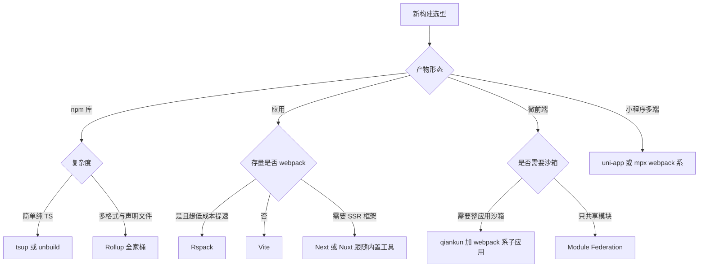

```javascript
// text 代码块：决策速查表
// 场景                 首选                 备选
// React/Vue SPA        Vite                 Rspack 或 webpack5
// Next 全栈            Turbopack 内置        -
// 组件库多格式          Rollup               tsup + dts
// Node CLI/工具库      tsup                 esbuild 直调
// 大型老 webpack 应用   Rspack 渐进迁移       webpack5 缓存调优
// 微前端 host+remote   Module Federation    qiankun
```

### BLD-088：webpack 迁移到 Vite 的标准步骤是什么？
**答**：
- 步骤一：入口改造——HTML 模板换成 Vite 的 index.html（`<script type="module" src="/src/main.js">`），删 webpack 的 html-webpack-plugin 模板语法。
- 步骤二：配置翻译——alias/extensions/proxy/define 对齐；babel/polyfill 配置迁到 build.target；loader（less/sass/postcss）用 Vite 内置能力替代。
- 步骤三：插件替换——DefinePlugin → define、CopyPlugin → public 目录或 viteStaticCopy、环境变量 VUE_APP_*/REACT_APP_* → VITE_*（批量重命名 + 全局替换）。
- 步骤四：预构建调优——include 补动态 import 依赖、处理 CJS 包互操作；最后跑全量功能回归（路由懒加载、worker、动态 import）与 build 产物 diff。

```javascript
// vite.config.js：迁移期兼容配置（常见翻译项集中展示）
import { defineConfig } from 'vite';
import { viteStaticCopy } from 'vite-plugin-static-copy';
import legacy from '@vitejs/plugin-legacy';

export default defineConfig({
  resolve: {
    // 原 webpack resolve.alias 翻译
    alias: { '@': '/src', '@assets': '/src/assets' },
  },
  server: {
    // 原 devServer.proxy 翻译
    proxy: { '/api': { target: 'http://backend:7001', changeOrigin: true } },
  },
  define: {
    // 原 DefinePlugin 翻译 注意 process.env 形态
    'process.env.NODE_ENV': JSON.stringify(process.env.NODE_ENV),
    __VERSION__: JSON.stringify(require('./package.json').version),
  },
  optimizeDeps: {
    // 原 webpack 的 CJS 依赖显式进预构建 防运行时 504
    include: ['lodash', 'qs', 'js-cookie'],
  },
  build: { target: 'chrome87', // 替代 babel targets + core-js
    rollupOptions: { output: { manualChunks: undefined } } },
  plugins: [
    viteStaticCopy({ targets: [{ src: 'public/robots.txt', dest: '.' }] }),
    legacy({ targets: ['chrome >= 87'] }), // 低版本兜底
  ],
});
```

### BLD-089：webpack→Vite 迁移的高频坑清单有哪些？
**答**：
- CJS 动态 require：require('./locales/' + lang) 在 ESM 世界没有等价物——改 import.meta.glob（编译期展开）。
- 全局变量：process.env.XXX、global 在浏览器不存在——define 显式替换或改 import.meta.env。
- 环境变量前缀：REACT_APP_/VUE_APP_ 必须改名 VITE_ 才暴露到客户端。
- HTML 模板差异：ejs 语法、htmlWebpackPlugin 变量、Public Path（Vite 用 base）与 CDN 前缀逻辑要重写。
- 其他：require 上下文的 worker（new Worker(new URL()) 写法）、postcss 配置文件命名（.postcssrc → postcss.config.js 同名但加载时机不同）、CommonJS 依赖 504（optimizeDeps.include）、sass 的 @import 相对路径语义。

```javascript
// 坑清单逐条修复示例
// 坑一：CJS 动态 require -> import.meta.glob
// 旧：const modules = require.context('./locales', false, /\.json$/);
// 新：
const modules = import.meta.glob('./locales/*.json', { eager: true });
export const messages = Object.fromEntries(
  Object.entries(modules).map(([path, mod]) => [
    path.match(/locales\/(.+)\.json$/)[1], mod.default,
  ]),
);

// 坑二：global 变量
// vite.config.js 里 define: { global: 'globalThis' } 或源码替换

// 坑三：worker 写法
// 旧：new Worker(require.resolve('./worker.js'))
// 新：new Worker(new URL('./worker.js', import.meta.url), { type: 'module' })

// 坑四：VITE_ 前缀批量重命名
// bash 代码块：
// grep -rl "REACT_APP_" src | xargs sed -i '' 's/REACT_APP_/VITE_/g'
```

### BLD-090：polyfill 与 targets：browserslist 全解 + Vite legacy 插件原理。
**答**：
- browserslist：统一的"目标浏览器"声明，babel、postcss（autoprefixer）、esbuild、Vite 都读它——一处声明全链路生效；配置于 package.json 或 .browserslistrc，支持 queries（"> 0.5%", "not dead"）与 coverage。
- 组合语义：默认 queries 之间是 or；`and` 精确交集；`not dead` 排除无人用的版本；环境变量 BROWSERSLIST_ENV 或按 env 区分 dev/prod。
- Vite legacy 插件原理：额外用 @babel/preset-env 生成"降级版"bundle + SystemJS 运行时，index.html 注入 nomodule/module 双 script，现代浏览器只加载原生版。
- 验证手段：npx browserslist 输出目标集、browserslist --coverage、产物跑一次 grep core-js。

```bash
# .browserslistrc：完整示例
# 生产目标
defaults and supports es6-module and not dead

# 查询验证命令
npx browserslist
npx browserslist --coverage   # 当前目标覆盖全球用户百分比
npx browserslist "chrome > 80 and last 2 versions"
```

```json
// package.json：区分环境的 browserslist
{
  "browserslist": {
    "production": [">0.2%", "not dead", "not op_mini all"],
    "development": ["last 1 chrome version", "last 1 firefox version"]
  }
}
```

```javascript
// vite.config.js：legacy 插件完整配置
import { defineConfig } from 'vite';
import legacy from '@vitejs/plugin-legacy';

export default defineConfig({
  plugins: [
    legacy({
      targets: ['chrome >= 64', 'safari >= 12'],
      additionalLegacyPolyfills: ['regenerator-runtime/runtime'], // async/await 兜底
      modernPolyfills: ['es.array.at'], // 现代浏览器也按需补少数新 API
      renderLegacyChunks: true,
    }),
  ],
});

// index.html 产物注入效果（text 代码块）：
// <script type="module" src="/assets/index.mjs"></script>          现代浏览器
// <script nomodule src="/assets/index-legacy.js"></script>          旧浏览器 + SystemJS 注册表
```

### BLD-091：sourcemap 的 eval / cheap / module / nosources 各修饰符含义是什么？生产怎么选？（高频）
**答**：
- eval：模块包在 eval 执行，映射指向转换后代码，快但可能"不精确"；不生成 .map 文件（性能最好，调试粒度最粗）。
- cheap：只映射到行不映射到列；module：映射到"原始源码"（TS/JSX 编译前），没有它调试的是 babel 产物；nosources：只有映射无源码内容（省体积，配合外部上传）。
- 组合逻辑：[生成速度] eval-* 最快；[质量] source-map 全量最准；常见 dev 用 eval-cheap-module-source-map（重编译快 + 能看原始代码），生产用 hidden-source-map 或 nosources-source-map 上传到监控平台。
- 生产安全：source-map 直接暴露等于泄露源码——options：hidden（生成不引用）+ Sentry 上传、或干脆不开。

```javascript
// webpack.config.js：devtool 选择矩阵
module.exports = (_, argv) => ({
  devtool: argv.mode === 'development'
    ? 'eval-cheap-module-source-map' // 快速 rebuild + 可见原始源码
    : 'hidden-source-map',           // 生成 .map 但产物不引用 上传 Sentry 后删除
});

// text 代码块：常见组合速查
// eval                    快   转换后代码  无 map 文件
// eval-source-map         较快 原始源码    内嵌 dataURI map
// eval-cheap-source-map   快   转换后代码  仅行级
// eval-cheap-module-source-map   快  原始源码  仅行级   <- 开发推荐
// source-map              慢   全量列级 原始源码 独立 .map  <- 需要精确上报时
// hidden-source-map       慢   同 source-map 但不引用  <- 生产 + 监控平台
// nosources-source-map    中   有映射无源码内容       <- 生产 可公开
```

```javascript
// Sentry 上传 sourcemap 的 CI 片段（bash 代码块风格用 js 演示）
// scripts/upload-sourcemaps.js
const { execSync } = require('child_process');

execSync(`
  npx @sentry/cli sourcemaps inject ./dist &&
  npx @sentry/cli sourcemaps upload --release ${process.env.GIT_SHA} ./dist &&
  find ./dist -name "*.map" -delete &&           # 上传后删除本地 map 防泄露
  find ./dist -name "*.js" -exec sed -i '' '/sourceMappingURL/d' {} +
`, { stdio: 'inherit' });
```

### BLD-092：PostCSS 在构建链路中的角色是什么？autoprefixer、preset-env、Tailwind 的构建链路各是什么？
**答**：
- PostCSS 本身是"CSS 的 babel"：AST 解析 + 插件转换的框架；在 webpack 里以 postcss-loader 存在（置于 css-loader 之前，Vite 内置支持 postcss.config.js）。
- autoprefixer：按 browserslist 加前缀（-webkit-），现在职责部分被 postcss-preset-env 接管（含未来语法降级）。
- postcss-preset-env：把"现代 CSS"（nesting、custom properties 的 fallback、:has 等）按 targets 降级，类似 babel preset-env。
- Tailwind 构建：v3 用 postcss 插件扫描源码生成原子类；v4 改为 CSS-first（@import "tailwindcss"）由 lightningcss 引擎处理——配置重心从 js 到 css。

```javascript
// postcss.config.js：三种链路
module.exports = {
  plugins: [
    // 链路一 纯前缀
    require('autoprefixer')({ overrideBrowserslist: ['> 0.3%', 'not dead'] }),

    // 链路二 现代语法降级（与 autoprefixer 二选一或按序）
    // require('postcss-preset-env')({ stage: 2, features: { 'nesting-rules': true } }),

    // 链路三 Tailwind v3
    // require('tailwindcss')({ content: ['./src/**/*.{vue,tsx}'] }),
    // require('autoprefixer'),
  ],
};

// tailwind v4 的 CSS-first 入口（text 代码块）：
// @import "tailwindcss";            /* 替代 v3 的三层 @tailwind 指令 */
// @source "../src";                 /* 显式扫描范围 */
// @theme { --color-brand: #0ea5e9; }
```

### BLD-093：静态资源内联的阈值如何权衡？过大过小各有什么问题？
**答**：
- 内联收益：省一次请求、避免请求瀑布、对"极小图标/闪烁的关键资源"友好；成本：占用主包体积、无法被浏览器独立缓存、base64 比原文件大 1/3、阻塞 CSS 解析（CSS 里的内联图）。
- 经验阈值：图片 4~8KB（webpack 默认 4KB）、svg 1~2KB；HTTP2 下阈值应更低（并行请求代价小）；关键路径小图标可放宽。
- 决策维度：使用频率（全站用的小 logo 适合内联）、变更频率（频繁变的资源内联会破坏 js/css 缓存）、是否首屏阻塞。
- Vite 对应 assetsInlineLimit，且对"多页共享资源"同样适用上述权衡。

```javascript
// webpack.config.js：差异化内联策略
module.exports = {
  module: {
    rules: [
      {
        test: /\.(png|jpe?g|webp)$/i,
        type: 'asset',
        parser: { dataUrlCondition: { maxSize: 8 * 1024 } }, // 一般图片 8KB 内联
        generator: { filename: 'img/[name].[contenthash:8][ext]' },
      },
      {
        test: /icons[\\/].+\.svg$/,
        type: 'asset/inline', // 全站小图标 全量内联省请求
      },
      {
        test: /assets[\\/]fonts/,
        type: 'asset/resource', // 字体永不内联：体积大 + 独立缓存 + 避免 CSS 膨胀
      },
    ],
  },
};

// vite.config.js（text 代码块）：
// export default { build: { assetsInlineLimit: 8 * 1024 } } // 8KB 以下内联
```

### BLD-094：什么是构建确定性？如何用 lockfile、Node 版本锁定与缓存 key 设计保证？
**答**：
- 定义：同一 commit 在任何机器、任何时间构建出"哈希一致"的产物；这是缓存复用、安全审计、灰度回滚的前提。
- 三支柱：lockfile（依赖解析确定）+ Node/包管理器版本锁定（engines、volta、corepack）+ 构建配置与环境变量收敛（禁用时间戳、随机 id、绝对路径进产物）。
- 常见破坏源：构建脚本写入 Date.now()、__dirname 进产物、依赖 semver 漂移（无 lock）、css 顺序不稳定（并行插件输出顺序不确定）。
- 缓存 key 设计：CI 缓存 key 应含 lockfile hash + 工具版本 + 配置文件 hash；产物级 key 用内容哈希（contenthash）而不是构建号。

```yaml
# .github/workflows/build.yml：确定性构建三件套
name: build
on: [push]
jobs:
  build:
    runs-on: ubuntu-latest
    steps:
      - uses: actions/checkout@v4
      - name: Node 版本锁定
        uses: actions/setup-node@v4
        with: { node-version-file: '.nvmrc', cache: 'pnpm' } # 缓存 key 自动含 lockfile hash
      - run: corepack enable && pnpm install --frozen-lockfile   # lockfile 不一致直接失败
      - name: 环境注入只取受控字段
        run: echo "BUILD_COMMIT=$GITHUB_SHA" >> $GITHUB_ENV      # 禁止 BUILD_TIME 之类
      - run: pnpm build
      - name: 产物哈希清单 用于跨机器比对
        run: find dist -type f -exec shasum -a 256 {} + | sort > dist/manifest.sha256
      - uses: actions/upload-artifact@v4
        with: { name: dist, path: dist }
```

```json
// package.json：engines + volta 锁定工具链
{
  "engines": { "node": ">=20.0.0 <21", "pnpm": ">=9" },
  "volta": { "node": "20.11.0", "pnpm": "9.1.0" },
  "scripts": { "preinstall": "npx only-allow pnpm" }
}
```

### BLD-095：monorepo 中的构建有什么特殊问题？共享依赖预构建与缓存隔离怎么做？
**答**：
- 特殊问题：幽灵依赖（共享提升）、跨包构建顺序（拓扑）、每包一份 node_modules 造成的重复预构建、dev server 对 workspace 包的 watching、缓存目录冲突。
- 依赖处理：pnpm workspace + workspace: 协议声明内部依赖；Vite/webpack 要 alias 内部包到源码（或用 exports 字段），并把内部包纳入 include/预构建。
- 缓存隔离：按 package 维度分 cache（Vite 的 cacheDir 配 .vite/包名、webpack cache.name 按包名），避免互相失效；顶层共享预构建产物用 npm 包级缓存。
- 任务编排：turbo/nx 做拓扑排序 + 远端缓存（按输入 hash 命中），本地 CI 双端复用。

```yaml
# pnpm-workspace.yaml
packages:
  - 'apps/*'
  - 'packages/*'
```

```javascript
// packages/ui/vite.config.js：monorepo 内部包的构建与缓存隔离
import { defineConfig } from 'vite';

export default defineConfig({
  cacheDir: '../../node_modules/.vite/ui', // 按包隔离缓存目录 防多 dev server 串台
  build: {
    lib: { entry: 'src/index.ts', formats: ['es'], fileName: 'index' },
    rollupOptions: { external: ['react', 'react-dom'] }, // peer 外部化
  },
});

// vite.config.js（应用侧，text 代码块）：
// resolve.alias = { '@app/ui': path.resolve(__dirname, '../packages/ui/src') } // 直接指源码 dev 免构建
// optimizeDeps.include = ['@app/ui']                                            // 或按包名预构建
```

```json
// turbo.json：拓扑构建 + 远程缓存
{
  "tasks": {
    "build": { "dependsOn": ["^build"], "outputs": ["dist/**"], "cache": true },
    "dev": { "cache": false, "persistent": true }
  }
}
```

### BLD-096：CI 中的构建优化有哪些手段？
**答**：
- 依赖安装：frozen-lockfile + 包管理器全局缓存（setup-node/pnpm cache）+ 内网镜像；避免每次全量解析。
- 构建缓存：webpack cache/filesystem 目录、Vite node_modules/.vite、turbo 远程缓存按输入 hash 复用；缓存目录必须显式声明（CI 机器是干净容器）。
- 并发：独立包并行构建（turbo --parallel）、多 shard 测试与构建拆分、大 monorepo 用 affected（只构建变更包）。
- 增量与条件：按变更路径决定是否构建（nx affected / git diff --name-only）；node_modules 不在 docker 层反复重装（多阶段构建 + 层缓存）。

```yaml
# .github/workflows/ci.yml：缓存与增量要点
name: ci
on: [pull_request]
jobs:
  build:
    runs-on: ubuntu-latest
    steps:
      - uses: actions/checkout@v4
        with: { fetch-depth: 0 }               # 需要 diff 基线
      - uses: actions/setup-node@v4
        with: { node-version: 20 }
      - name: 恢复构建缓存（webpack/vite 通用）
        uses: actions/cache@v4
        with:
          path: |
            node_modules/.cache
            node_modules/.vite
          key: build-${{ runner.os }}-${{ hashFiles('pnpm-lock.yaml', 'webpack.config.js') }}
          restore-keys: build-${{ runner.os }}-
      - run: npm ci
      - name: 增量判断 只有前端目录变更才构建
        run: |
          if git diff --quiet origin/main --name-only -- frontend/; then
            echo "无前端变更 跳过构建"; exit 0;
          fi
          npm run build
      - name: turbo 远程缓存（monorepo）
        run: npx turbo build --api-url=$TURBO_API --team=$TURBO_TEAM --token=$TURBO_TOKEN
```

### BLD-097：构建产物如何校验？smoke 测试与 chunk 大小 diff 报告怎么做？
**答**：
- 静态校验：产物存在性与引用完整性（manifest 与 html 一致、无 404 资源）、文件名规范、无 sourcemap 泄露、无明文密钥（grep 密钥模式）。
- 大小校验：与基线 stats.json diff，输出每 chunk 增减报表，超阈值失败（见 BLD-060）；重点盯首屏 entry 与 vendors。
- 冒烟测试：产物起本地静态服务后跑真实浏览器检查——首页能渲染、路由可跳转、无 console error；可用 Playwright headless 实现。
- 运行时校验兜底：灰度发布 + 前端监控资源加载失败率告警，构建期测不到的 CDN/跨域问题在这里暴露。

```javascript
// scripts/smoke.js：Playwright 冒烟校验（可运行）
import { chromium } from 'playwright';
import { createServer } from 'node:http';
import { readFileSync, existsSync } from 'node:fs';
import { extname, join } from 'node:path';

const MIME = { '.html': 'text/html', '.js': 'text/javascript', '.css': 'text/css' };
const server = createServer((req, res) => {
  const file = join('dist', req.url === '/' ? 'index.html' : req.url.split('?')[0]);
  if (!existsSync(file)) { res.writeHead(404); return res.end(); }
  res.setHeader('content-type', MIME[extname(file)] || 'application/octet-stream');
  res.end(readFileSync(file));
});
await new Promise((r) => server.listen(4173, r));

const browser = await chromium.launch();
const page = await browser.newPage();
const errors = [];
page.on('console', (m) => m.type() === 'error' && errors.push(m.text()));
page.on('requestfailed', (r) => errors.push(`资源失败 ${r.url()}`));

await page.goto('http://localhost:4173/');
await page.waitForLoadState('networkidle');
if (!(await page.locator('#root > *').count())) errors.push('首页未渲染');
await page.click('text=详情').catch(() => errors.push('路由点击失败'));

console.log(errors.length ? `SMOKE FAIL:\n${errors.join('\n')}` : 'SMOKE PASS');
process.exit(errors.length ? 1 : 0);
```

### BLD-098：如何给团队制定构建规范？脚手架内置 vs 各自配置的取舍？
**答**：
- 规范的内容分层：统一基线（cache、分包原则、sourcemap 策略、体积预算、CI 卡口）+ 允许差异层（业务专属 loader、自定义 chunk 命名）+ 禁止项（私自关闭 hash、提交 .map 产物）。
- 落地方式对比：脚手架内置（创建即合规，升级靠发版，一致性强）vs 各自配置（灵活但漂移快）；主流是"preset 包 + 最小本地配置"（ CRA/umi/rsbuild 模式），重大配置改动走 RFC 评审。
- 治理机制：定期升级窗口（锁定版本主线）、配置审计脚本（检查禁用项）、构建性能与体积看板。
- 演进策略：规范先在 1~2 个试点项目验证 → 抽成 preset → 全量推行，避免一刀切回归事故。

```javascript
// scripts/audit-config.js：配置审计脚本（禁用项检查）
const fs = require('fs');

const rules = [
  { name: '禁止关闭 contenthash', test: (c) => !/contenthash/.test(JSON.stringify(c.output || {})), level: 'error' },
  { name: '必须开启持久缓存', test: (c) => (c.cache || {}).type !== 'filesystem', level: 'error' },
  { name: '禁止开启 eval devtool 生产', test: (c) => /eval/.test(c.devtool || ''), level: 'error' },
  { name: 'babel-loader 必须 include', test: (c) => !(c.module?.rules || [])
      .some((r) => String(r.loader || '').includes('babel') && r.include), level: 'error' },
];

const config = require(process.argv[2] || './webpack.config.js');
let failed = 0;
for (const r of rules) {
  if (r.test(config)) { console.error(`[FAIL] ${r.name}`); failed++; }
}
process.exit(failed ? 1 : 0);
// CI 里：node scripts/audit-config.js webpack.config.js
```

### BLD-099：前端构建的未来趋势是什么？bundleless、Rust 化工具链全景怎么看？
**答**：
- bundleless dev 成主流：dev 不打包（Vite 开创），Turbopack/Rspack 把"打包也增量到函数级"——本质都是把编译开销摊到按需与增量。
- Rust 化全景：SWC（babel 位）、Rspack（webpack 位）、lightningcss（postcss 位）、Rolldown（Rust 版 Rollup，Vite 的未来底座）、Turbopack（next 位）——JS 工具层逐步下沉为"内核 Rust + 胶水 JS 插件"。
- 概念收敛：bundler/framework/monorepo 工具（Vite+Rolldown、Next+Turbopack、Rspack+Rsbuild+NX）彼此渗透，"选构建器"逐渐变成"选框架全家桶"。
- 对工程师的要求变化：从"会写 webpack 配置"转向"会读产物、会定预算、会写插件（JS 层）与理解底层管线"。

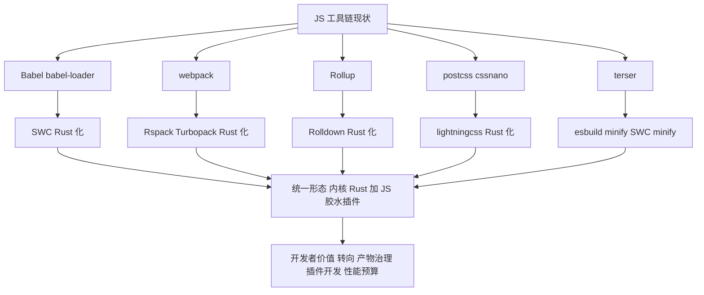

### BLD-100：构建工具专题的知识体系与面试应答策略总结。
**答**：
- 知识四层：原理层（compiler/compilation、Tapable、模块图、HMR runtime、Vite 双引擎）、机制层（loader/pitch、tree-shaking、splitChunks、shared 协商）、优化层（速度与体积的定位-治理-卡口闭环）、工程层（迁移、规范、CI、确定性）。
- 面试应答框架："定义一句话 → 关键流程/参数 → 一个实测数据或踩坑案例 → 边界与选型权衡"；避免只背参数。
- 高频组合题准备：webpack 构建流程 + hooks、HMR 时序 + fallback、contenthash 与缓存、splitChunks 设计、Vite 为什么快、MF 版本协商——这六个覆盖大厂 80% 考察。
- 追问防线：任何方案都能说出"代价是什么"（如 esbuild 快但插件生态弱、MF 灵活但无沙箱）。

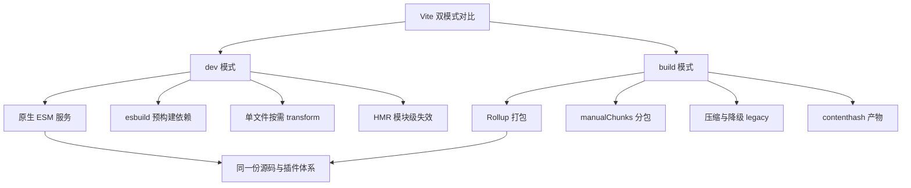

```javascript
// vite.config.js：dev 与 build 双模式差异化配置（本图对应落地）
import { defineConfig } from 'vite';
import react from '@vitejs/plugin-react';

export default defineConfig(({ command, mode }) => ({
  plugins: [react()],
  command === 'serve' ? { // dev 专属
    server: { hmr: true, proxy: { '/api': 'http://localhost:7001' } },
    optimizeDeps: { include: ['react', 'react-dom'] },
  } : {                   // build 专属
    build: {
      target: 'es2020',
      rollupOptions: { output: { manualChunks: { 'vendor-react': ['react', 'react-dom'] } } },
      sourcemap: 'hidden',
    },
  },
}));
```

---


## 十一章 webpack 源码级深入（BLD-101 ~ BLD-110）

### BLD-101：webpack 主流程源码导览——WebpackCLI 到 Compiler 到 Compilation 的类关系是怎样的？
**答**：
- webpack5 中 `lib/index.js` 只导出 `webpack/create` 函数：`webpack(options, callback)` 里 `new Compiler(options.context)` → `new WebpackOptionsApply().process(options, compiler)`，这一步按配置逐个 apply 内置插件（EntryOptionPlugin 注册 EntryPlugin、ExternalsPlugin、JavascriptModulesPlugin 等）。
- WebpackCLI（webpack-cli 包）只负责解析命令行、合并 `-c/--env`、加载配置文件，最终调用 `webpack()`，CLI 完全不参与编译；面试常考"webpack 与 webpack-cli 职责边界"。
- `compiler.run()` 触发 `hooks.run` → `compile()` 里 `newCompilationParams`（含 normalModuleFactory）→ `new Compilation()` → `hooks.make` 上 EntryPlugin 的回调执行 `compilation.addEntry()`，从此进入模块构建。
- 记忆画图：CLI → webpack() → OptionsApply 注册插件占位 → compiler.run → new Compilation → make/addEntry → build → seal → emit → done。

```javascript
// 主流程源码级复现：手写一个 20 行的"迷你 webpack 启动器"，展示关键调用链
const webpack = require('webpack');
const config = require('./webpack.config.js');

const compiler = webpack(config, (err, stats) => {
  // webpack5：stats 是编译结果句柄，err 只代表"流程级"错误（配置错误等）
  if (err) { console.error(err); return; }
  console.log(stats.toString({ colors: true, modules: false }));
});

// 等价拆解（webpack() 内部做的事）：
// 1. new Compiler(options.context)                 —— 创建全局单例
// 2. new NodeEnvironmentPlugin().apply(compiler)   —— 注入 fs/日志基础设施
// 3. for (const plugin of options.plugins) plugin.apply(compiler)
// 4. new WebpackOptionsApply().process(options, compiler)
//    —— EntryOptionPlugin: 按 entry 逐个 new EntryPlugin(context, entry, name).apply(compiler)
// 5. callback ? compiler.run(callback) : 编译器返回给调用方（多编译器 webpack([cfg1, cfg2]) 时各自 run）

// 关键 hooks 观测：验证"OptionsApply 注册插件"与"make 时才建 Compilation"的时序
const order = [];
compiler.hooks.entryOption.tap('Probe', () => (order.push('entryOption'), true));
compiler.hooks.beforeRun.tap('Probe', () => order.push('beforeRun'));
compiler.hooks.compile.tap('Probe', () => order.push('compile: 创建 compilationParams'));
compiler.hooks.make.tap('Probe', (compilation) => order.push('make: 开始 addEntry'));
compiler.hooks.afterSeal.tap('Probe', () => order.push('afterSeal'));
compiler.hooks.done.tap('Probe', () => console.log(order.join('\n')));
```

### BLD-102：从 Compilation.buildModule 到 module.build，loader 到底是在哪一步被执行的？
**答**：
- 调用链：`compilation.addEntry()` → `addModuleChain/handleModuleCreation` → `_addModuleData` → `compilation.buildModule(module)` → `module.build(options, compilation, resolver, fileSystem, callback)`。
- `NormalModule.build` 内部先 `this.doBuild()`：创建 loaderContext（含 this.async/this.callback/this.data），然后把 loader 数组交给 `loader-runner` 的 `runLoaders`——**loader 的真正执行入口是 NormalModule.doBuild 调用的 runLoaders**，pitch 阶段倒序、normal 阶段正序都在这里。
- doBuild 返回后的源码顺序：处理 loader 报错（`markModuleAsErrored`）或继续 → 把 loader 产物包成 `OriginalSource` 赋给 `this._source` → 用 parser（acorn）`parser.parse(source)` 生成 AST 并收集 dependencies → build 完成触发 `compilation.hooks.buildModule/afterBuild`。
- 面试要点：loader 抛错只让单个 module 标记 error 不中断构建；build 是"每个模块一次"，rebuild（HMR）只对失效模块重跑 build。

```javascript
// NormalModule.build 精简伪源码（webpack5，标注 loader 执行位置）
class NormalModule extends Module {
  build(options, compilation, resolver, fs, callback) {
    this._forceBuild = false;              // 缓存体系用
    return this.handleBuildTask(options, compilation, (err) => {
      // ...构建完成收尾
    });
  }
  _doBuild(options, compilation, resolver, fs, callback) {
    const loaderContext = this.createLoaderContext( // ① 造 loader 上下文
      resolver, options, compilation, fs
    );
    const processResult = (err, result) => {
      if (err) return this.markModuleAsErrored(/*...*/);   // loader 报错不中断整体构建
      const javascript = result[0];                        // ② loader 链最终产物字符串
      // ③ 关键分界：loader 在 runLoaders 内已全部执行完，下面才轮到 parser
      this._source = new OriginalSource(javascript, this.identifier());
    };
    // ④ loader 执行入口：iterate loaders + loader-runner 的 runLoaders
    runLoaders(
      {
        resource: this.resource,            // 绝对路径资源
        loaders: this.loaders,              // [{ loader, options }] 已 resolve 成绝对路径
        context: loaderContext,
        readResource: compilation.compiler.readFile? // fs 读取封装（含 memfs 替换点）
      },
      (err, result) => processResult(err, result)
    );
  }
  // doBuild 之后（省略中间细节）：
  markModuleAsErrored /* ... */
  // build 尾部：  const { source } = this.parse?
  // 实际： this._source = new OriginalSource(javascript, this.identifier());
  //       parser.parse(this._source.ast? , { module: this, ... })
  //       —— parser 在解析中往 this.dependencies 里 push Dependency
  //       最后 callback() 回到 compilation.buildModule → 处理 dependencies 递归
}
```

### BLD-103：NormalModuleFactory 的 resolve 流程：enhanced-resolve 如何把 './a' 变成绝对路径？
**答**：
- 每个依赖先经过 `normalModuleFactory.hooks.factorize → resolve → factory.create()`；resolve 阶段核心是 `compiler.resolverFactory.get('normal', resolveOptions)` 产出的 enhanced-resolve Resolver（loader 有独立 resolver，支持 loader 路径相对查找）。
- enhanced-resolve 自身是插件化管线：`Resolver` 内部一条 steps 链，alias/extensions/mainFields/descriptionFiles/exportsField 各是一个解析插件节点，`unsafeCache` 对目录 lstat 结果做缓存避免重复 IO。
- 解析顺序：精确文件 → 补 extensions（.js/.ts/.json）→ 目录（读 package.json 的 exports/main → index.js）；默认 `symlinks: true` 即 resolve 到真实路径，防止 pnpm 下双实例。
- 失败抛 `ModuleNotFoundError`（挂在 compilation.errors）；resolve 失败常见根因是 exports 字段屏蔽了深层路径、alias 大小写不匹配、pnpm 幽灵依赖。

```javascript
// 1) 直接使用 enhanced-resolve：理解 webpack 的 resolve 内核
const enhancedResolve = require('enhanced-resolve');
const resolver = enhancedResolve.create.sync({
  context: __dirname,
  extensions: ['.ts', '.tsx', '.js', '.jsx', '.json'],
  mainFields: ['browser', 'module', 'main'],
  conditionNames: ['import', 'require'],   // 对应 package.json exports 的条件
  symlinks: true,                          // resolve 到真实路径，避免 pnpm 双实例
  unsafeCache: true,
});
console.log(resolver(__dirname, './a'));   // /abs/path/to/a.ts

// 2) 在 webpack 侧观测/干预 resolve：tap NormalModuleFactory 的 resolve 钩子
class ResolveProbePlugin {
  apply(compiler) {
    compiler.hooks.compilation.tap('ResolveProbePlugin', (compilation, { normalModuleFactory }) => {
      normalModuleFactory.hooks.resolve.tap('ResolveProbePlugin', (data) => {
        // data.request 是原始请求，data.context 是发起目录；可在此改写请求
        if (data.request === 'lodash') data.request = 'lodash-es';
      });
      normalModuleFactory.hooks.factorize.tapAsync('ResolveProbePlugin', (data, cb) => {
        const t0 = Date.now();
        const done = (err, result) => {
          if (result) {
            // 记录慢 resolve：CI 中定位"哪个请求解析最慢"
            console.log('[resolve]', data.request, Date.now() - t0 + 'ms');
          }
          cb(err, result);
        };
        // 不接管流程，仅观测：tap before 其他 resolver 插件即可
        done(null, undefined); // 纯演示，真实实现应调用 originalCb 或改用 intercept
      });
    });
  }
}
// resolverFactory 层的拦截（更正规）：
// compiler.resolverFactory.hooks.resolver
//   .tap('Slow', (resolver, options) => resolver.hooks.result.tap('Slow', r => r));
```

### BLD-104：依赖收集全链路：parse 阶段如何把 import/require 变成 Dependency 并长出模块图？
**答**：
- NormalModuleFactory 创建 NormalModule 时，`hooks.parser` 上由 JavascriptParser 工厂绑定解析器；parser 内部用 acorn 生成 AST，再对其 walk。
- 遇到 `ImportDeclaration/ExportNamedDeclaration` 调 `parser.hooks.import/export`，生成 `HarmonyImportSideEffectDependency + HarmonyImportSpecifierDependency`；遇到 `import()` 生成 `ImportDependency`（这就是代码分割的挂点）；`require()` 生成 `CommonJsRequireDependency`。
- build 完成后 `compilation.processModuleDependencies(module)`：遍历 dependencies → `handleModuleCreation` → 对每个新依赖再 factorize/build，深度优先递归，直到闭包齐——ModuleGraph 由此长出（边即 Dependency，节点即 Module）。
- Dependency 的关键方法 `getReference()` 返回"我引用了哪个模块的哪个 export"，tree-shaking 的 usedExports、`import { x } from 'a'` 的命名空间访问都靠它回溯。

```javascript
// 自定义 Parser 插件：在 parse 阶段观测依赖生成（分析器/自定义 DSL 的基础套路）
class DependencyProbePlugin {
  apply(compiler) {
    compiler.hooks.compilation.tap('DependencyProbePlugin', (compilation, { normalModuleFactory }) => {
      // parser 钩子挂在 normalModuleFactory.hooks.parser.for('javascript/auto')
      normalModuleFactory.hooks.parser
        .for('javascript/auto')
        .tap('DependencyProbePlugin', (parser) => {
          // ① 静态 import：import React from 'react'
          parser.hooks.import.tap('Probe', (statement, source) => {
            console.log('[import]', source, 'line', statement.loc.start.line);
          });
          // ② 动态 import：import('./lazy') —— 代码分割的依赖类型
          parser.hooks.importCall.tap('Probe', (expression) => {
            console.log('[import()]', expression.source?.value ?? '<dynamic>');
          });
          // ③ require：CJS 依赖
          parser.hooks.call.for('require').tap('Probe', (expression) => {
            console.log('[require]', expression.arguments[0]?.value);
            return false; // 返回 false 表示不接管，继续默认处理
          });
          // ④ 表达式引用探测：拿 HarmonsDependencies 之外的全局使用（如 process.env）
          parser.hooks.expression.for('process.env.NODE_ENV').tap('Probe', () => {
            console.log('[free var] process.env.NODE_ENV 被直接引用');
          });
        });
    });
  }
}

// 对应产物形态（理解 Dependency → 生成代码的关系）：
// import { useState } from 'react'
//   ↓ HarmonyImportSpecifierDependency
// var _react__WEBPACK_IMPORTED_MODULE_0__ = __webpack_require__(/*! react */ "react");
// const { useState } = _react__WEBPACK_IMPORTED_MODULE_0__;   // 优化后可能直接解构
```

### BLD-105：webpack5 为什么把 ModuleGraph 和 ChunkGraph 拆成两个图？各自存什么？（高频）
**答**：
- webpack4 只有一张"纠缠图"：module 上挂 `chunksIndexes`、chunk 上挂 `modules` 双向数组，任何增删（splitChunks、删模块）都要双向修复，O(n×m) 且易出 bug。
- **ModuleGraph 是编译期语义图**：节点是 Module，边是 `ModuleGraphConnection`（携带 dependency、active、条件），回答"谁依赖谁、issuer 是谁、export 是否被使用（usedByExports）、为什么没被 tree-shake（optimizationBailout）"。
- **ChunkGraph 是产物期组织图**：回答"chunk 包含哪些 module（getChunkModules）、module 进了哪些 chunk、entryModule 是谁、runtimeRequirements 有哪些"；同一个 module 可属于多个 chunk，而依赖关系只存一份。
- 收益：内存与复杂度下降、两阶段职责清晰（make 产出 ModuleGraph，seal 由 buildChunkGraph 从 ModuleGraph 推导出 ChunkGraph）、算法可独立测试——这是 webpack5 架构最常考的一题。

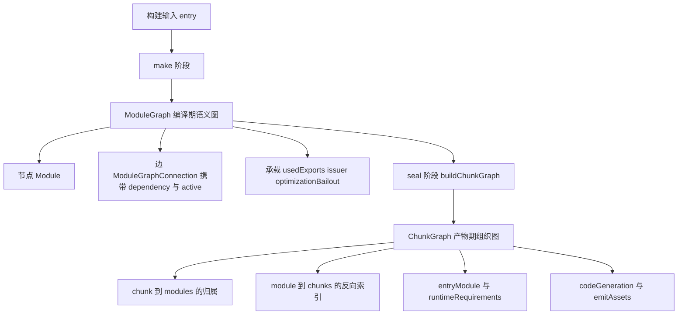

```javascript
// 双图读取：写一个"模块归属报告"插件，理解两个图各自的 API
class GraphReportPlugin {
  apply(compiler) {
    compiler.hooks.thisCompilation.tap('GraphReportPlugin', (compilation) => {
      compilation.hooks.afterSeal.tap('GraphReportPlugin', () => {
        const { moduleGraph, chunkGraph } = compilation;

        // ModuleGraph：回答"谁引用了它 / 它的 export 有没有被用"
        for (const module of compilation.modules) {
          const issuer = moduleGraph.getIssuer(module);               // 引入者
          const incoming = moduleGraph.getIncomingConnections(module); // 入边
          const unusedExports = moduleGraph.getExportsInfo(module)
            ?.getRelevantExports?.([]) ?? [];
          console.log({
            name: module.nameForCondition?.() ?? module.identifier(),
            issuer: issuer?.identifier() ?? 'entry',
            depCount: incoming.length,
          });
        }

        // ChunkGraph：回答"进没进包 / 属于哪个 chunk / runtime 要什么"
        for (const chunk of compilation.chunks) {
          const modules = chunkGraph.getChunkModules(chunk);          // 只读本 chunk 内模块
          const size = modules.reduce((s, m) => s + m.size(), 0);
          console.log({
            chunk: chunk.name ?? chunk.id,
            moduleCount: modules.length,
            sizeKB: (size / 1024).toFixed(1),
            runtimeReqs: [...chunk.runtimeRequirements ?? []].slice(0, 3),
          });
        }
      });
    });
  }
}
module.exports = GraphReportPlugin;
```

### BLD-106：make 和 seal 两阶段分别负责什么？为什么这样拆分？
**答**：
- **make 阶段是异步的、IO 密集**：从 entry 出发 factorize（resolve 路径）→ read+loader（build）→ parse（收集依赖）→ 递归处理依赖，产出完整 ModuleGraph；结束标志是 `compilation.finish()`（所有依赖闭包收齐）。
- **seal 阶段是同步的、CPU 密集**：buildChunkGraph 分 chunk → 一系列 optimize 钩子（optimizeChunks、concatenateModules、mangleExports、moduleIds）→ codeGeneration 逐模块产码 → createHash → emitAssets，产出最终 assets。
- 拆分意义：make 面向"源码与依赖"（可并行、可持久缓存、与产物形态无关）；seal 面向"产物形态"（分包策略、优化、hash 都在这）。loader/parse 报错在 make 查，体积/分包问题在 seal 查。
- 缓存分界：filesystem 缓存命中时 make 可跳过未变模块的 build，但 seal 每次全量重跑——这也是"缓存命中后仍要几百 ms"的原因。

```javascript
// 两阶段计时探针：面试中"你怎么证明瓶颈在 make 还是 seal"就靠这个
class PhaseTimingPlugin {
  apply(compiler) {
    const t = {};
    compiler.hooks.compilation.tap('PhaseTiming', (compilation) => {
      compilation.hooks.addEntry.tap('PhaseTiming', () => { t.make ??= 0; t.makeStart ??= process.hrtime.bigint(); });
      compilation.hooks.finishModules.tap('PhaseTiming', () => {
        t.make = Number(process.hrtime.bigint() - t.makeStart) / 1e6; // make 耗时 ms
      });
      compilation.hooks.seal.tap('PhaseTiming', () => { t.sealStart = process.hrtime.bigint(); });
      compilation.hooks.afterSeal.tap('PhaseTiming', () => {
        t.seal = Number(process.hrtime.bigint() - t.sealStart) / 1e6;
      });
    });
    compiler.hooks.done.tap('PhaseTiming', () => {
      console.log(`[phase] make=${t.make?.toFixed(0)}ms seal=${t.seal?.toFixed(0)}ms`);
      // 经验判读：make 高 → IO/loader/模块数问题（上缓存/换 esbuild-loader）
      //          seal 高 → 模块总量大导致压缩/分包/minimize 慢（查 Terser、splitChunks 规模）
    });
  }
}
module.exports = PhaseTimingPlugin;
```

### BLD-107：seal 阶段内部顺序：buildChunkGraph、codeGeneration、emitAssets 各做什么？
**答**：
- `Compilation.seal()` 顺序：`hooks.seal` → **buildChunkGraph**（依据 entrypoints、ImportDependency 分配 chunk 与 chunkGroup）→ optimize 链（optimizeChunks 供 splitChunks 钩子、optimizeModuleOrder、concatenateModules、moduleIds/chunkIds）→ `beforeModuleHash`。
- **codeGeneration**：对每个 module 调各自的 generator（JS 模块由 JavascriptModulesPlugin 的 Generator 包装为 `__webpack_require__` 形态），结果存 `compilation.codeGenerationResults`，同时汇总 runtimeRequirements 供 Runtime 模块使用。
- **createHash → processAssets**：内容 hash（contenthash 就在这定）后进入 `compilation.hooks.processAssets`（webpack5 资源处理统一入口，minimizer、压缩、manifest 插件全挂在这），最后 `hooks.afterProcessAssets → emitAssets` 经 `compiler.hooks.emit` 写盘。
- 扩展抓手：改产物用 processAssets（选 OptimizeChunkAssets 之后的 stage），改模块产码用 `compilation.hooks... JavascriptModulesPlugin` 的 renderModule/renderChunk。

```javascript
// 在 seal 内部的正确位置动手：processAssets 分 stage 的完整示例
const Compilation = require('webpack/lib/Compilation');

class SealInternalsDemoPlugin {
  apply(compiler) {
    compiler.hooks.compilation.tap('Demo', (compilation) => {
      // ① buildChunkGraph 之后可读：chunk 结构已定
      compilation.hooks.afterChunks?.tap('Demo', (chunks) => {
        console.log('chunks 已分配：', [...chunks].map((c) => c.name ?? c.id));
      });

      // ② processAssets 分 stage：顺序敏感，插错 stage 会互相覆盖
      compilation.hooks.processAssets.tap(
        { name: 'Demo', stage: Compilation.PROCESS_ASSETS_STAGE_ADDITIONS },
        (assets) => {
          // ADDITIONS：在 minimizer 之前追加产物（如生成 manifest.txt）
          const report = Object.entries(assets)
            .map(([n, a]) => `${n}: ${a.size()}B`).join('\n');
          compilation.emitAsset('build-report.txt', compilation.compiler.webpack.sources.RawSource.from(report));
        }
      );

      compilation.hooks.processAssets.tap(
        { name: 'DemoHeaders', stage: Compilation.PROCESS_ASSETS_STAGE_OPTIMIZE_SIZE + 10 },
        (assets) => {
          // OPTIMIZE_SIZE 之后：压缩已完成，适合做产物审计、注入 banner、SRI
          for (const [name, asset] of Object.entries(assets)) {
            if (name.endsWith('.js')) {
              console.log(`[minified] ${name} ${asset.size()}B`);
            }
          }
        }
      );
    });
  }
}
module.exports = SealInternalsDemoPlugin;
```

### BLD-108：Runtime 模块是什么？__webpack_require__ 和 __webpack_require__.e 是怎么生成的？
**答**：
- webpack5 把 runtime 拆成一个个 `RuntimeModule` 子类（AutoPublicPathRuntimeModule、LoadScriptRuntimeModule、GetMainFilenameRuntimeModule 等），按本次编译**实际需要**按需拼装，而不是大段静态模板——runtime 体积随用到的能力伸缩。
- 数据流：codeGeneration 阶段每个 module 上报 `runtimeRequirements`（如 `__webpack_require__.e`、`document`、`__webpack_require__.p`）；JavascriptModulesPlugin.render 时 `getRuntimeModules(runtimeRequirements, chunkRuntime)` 过滤出对应 RuntimeModule，经 RuntimeTemplate 渲染拼进 bootstrap。
- `__webpack_require__` 本体来自 RuntimeTemplate.requireFunction；`.e`（ensureChunk）来自 LoadScriptRuntimeModule：动态插 script 标签 + `webpackChunk.push` jsonp 回调 promise 化；`.p`（publicPath）来自 AutoPublicPathRuntimeModule（document.currentScript 探测）。
- 面试落点：为什么 runtimeChunk 的 contenthash 会飘——runtimeRequirements 是并集，动态 import 数量、publicPath 方式、HMR 开关都会改变 runtime 内容，进而影响引用它的 chunk hash。

```javascript
// 产出产物里的 runtime（LoadScriptRuntimeModule 生成的 __webpack_require__.e 核心逻辑，注释版）
__webpack_require__.e = (chunkId) => Promise.all(
  Object.keys(__webpack_require__.f).reduce((promises, key) => {
    __webpack_require__.f[key](chunkId, promises);   // f.j = jsonp chunk，f.script = script 加载
    return promises;
  }, [])
);
// 其中 f.j 的大致实现：
__webpack_require__.f.j = (chunkId, promises) => {
  if (installedChunks[chunkId] !== 0) {              // 0 = 已加载
    promises.push(installedChunks[chunkId] = new Promise((resolve, reject) => {
      installedChunks[chunkId] = [resolve, reject];
    }));
  }
};
// webpackChunk.push 回调：chunk 文件尾部自执行
(self["webpackChunkapp"] = self["webpackChunkapp"] || []).push([
  [chunkId],               // 命中 installedChunks[chunkId] → resolve promise
  { "./src/lazy.js": (module, exports, __webpack_require__) => { /* 模块体 */ } }
]);

// 用 webpack API 侧写 Runtime 模块（注入自定义 runtime 行为的正规方式）
const { RuntimeModule, RuntimeGlobals } = require('webpack');
class CustomPublicPathRuntime extends RuntimeModule {
  constructor() { super('custom-public-path', 10 /* STAGE_BASIC */); }
  generate() {
    return `${RuntimeGlobals.publicPath} = window.CDN_BASE + '/static/';`;
  }
}
class CustomRuntimePlugin {
  apply(compiler) {
    compiler.hooks.compilation.tap('CustomRuntime', (compilation) => {
      compilation.hooks.runtimeRequirementInTree
        .for(RuntimeGlobals.publicPath)                     // 拦截 __webpack_require__.p 的生成
        .tap('CustomRuntime', (chunk, set) => {
          set.delete(RuntimeGlobals.publicPath);            // 不用默认实现
          compilation.addRuntimeModule(chunk, new CustomPublicPathRuntime());
        });
    });
  }
}
```

### BLD-109：给一份 React 项目产物做 runtime 逐行解读：IIFE、模块缓存、require 函数、模块表。
**答**：
- 产物骨架四段：IIFE 外壳 → `__webpack_module_cache__`（模块缓存，保证模块单例）→ `__webpack_require__(moduleId)`（查缓存→加载模块→返回 exports）→ `__webpack_modules__`（模块表，key 为 moduleId，value 为模块包装函数）。
- ESM 编译形态：`__webpack_require__.r(__webpack_exports__)` 打 `__esModule` 标记；`.d` 定义 getter 实现命名空间导出；`.n` 处理 ESM/CJS default 兼容（getDefault vs getModuleExport）。
- import 语句编译：`import { useState } from 'react'` → `var react__WEBPACK = __webpack_require__("react")`，后续使用点直接从该变量取；tree-shaking 生效时未被使用的 getter 会被删除。
- 动态 import 编译为 `__webpack_require__.e(chunkId).then(__webpack_require__.t.bind(...))`：先拉 chunk（jsonp）再取模块（t 做 interop）；entry 尾部是 `__webpack_require__("./src/index.js")` 启动调用。

```javascript
// dist/main.js 产物剖析（逐段注释，面试可直接口述）
(() => { // webpackBootstrap
  var __webpack_modules__ = ({
    "./src/App.js": ((__unused_webpack_module, __webpack_exports__, __webpack_require__) => {
      "use strict";
      __webpack_require__.r(__webpack_exports__);          // 标记 ESM：__esModule + Symbol.toStringTag
      /* harmony export (binding) */ __webpack_require__.d(__webpack_exports__, {
        default: () => __WEBPACK_DEFAULT_EXPORT__          // getter：导出绑定而非值拷贝
      });
      var _react__WEBPACK_IMPORTED_MODULE_0__ = __webpack_require__(/*! react */ "react");
      const App = () => _react__WEBPACK_IMPORTED_MODULE_0__.useState(0)[0]; // import 的使用点
      __WEBPACK_DEFAULT_EXPORT__ = App;
    }),
  });

  var __webpack_module_cache__ = {};
  function __webpack_require__(moduleId) {
    var cachedModule = __webpack_module_cache__[moduleId];
    if (cachedModule !== undefined) return cachedModule.exports;   // ① 缓存命中 → 单例
    var module = __webpack_module_cache__[moduleId] = { exports: {} }; // ② 先入缓存再执行（防循环引用）
    __webpack_modules__[moduleId](module, module.exports, __webpack_require__);
    return module.exports;                                          // ③ 返回 exports
  }
  // .r/.d/.n/.e 等辅助函数定义（省略）

  __webpack_require__("./src/index.js");   // entry 启动：执行主入口模块
})();
```

### BLD-110：webpack5 filesystem 持久化缓存的原理：缓存层级、快照与版本失效策略。
**答**：
- `cache.type: 'filesystem'` 是**模块级缓存**：每个 module 的 build 结果（含 source、依赖列表、快照）序列化到 `node_modules/.cache/webpack`，默认 memory 优先、file 兜底（`cache.maxGenerations` 控制内存版轮换）。
- 失效判定三层：**版本层**（`cache.version` + webpack 版本 + 关键配置 hash，变了全量失效）；**buildDependencies**（loader 包、配置文件、`--env`，变了全量失效）；**快照层**（每个模块构建时生成 `mtime+size` 的 timestamps 快照，rebuild 时对比决定单模块是否重 build）。
- `managedPaths`（默认含 node_modules）内的文件默认信任不改直接复用缓存——这是 CI 上要装好依赖再构建的原因；`snapshot.managedPaths` 可扩展到私有包目录。
- 经典脏缓存根因：loader 里读 `process.env.X` / 读取未声明的外部文件，而 buildDependencies 没声明，导致"代码没变但产物应该变"的缓存假命中。

```javascript
// 生产级 filesystem cache 配置（webpack.config.js 片段）
module.exports = (env, argv) => ({
  cache: {
    type: 'filesystem',                    // 开启持久化缓存
    name: process.env.APP_ENV ?? 'dev',    // 缓存命名空间：不同环境不共用
    version: 'v1-config-hash',             // 大配置变更时手动 bump，等价"全量失效开关"
    buildDependencies: {
      config: [__filename],                // 配置文件本身变化 → 全量失效（关键！）
      // 声明 loader/插件包，升级后自动失效：
      // webpack5 默认会追踪 package.json，但 monorepo 私有 loader 需要显式加
    },
    managedPaths: [process.env.PNPM_HOME ?? 'node_modules'], // 信任区：不参与快照对比
    maxMemoryGenerations: 1,               // dev 内存缓存轮换，防 OOM
    profile: process.env.CACHE_PROFILE === '1', // 输出缓存命中统计
    store: 'pack',                         // webpack5 默认 pack（合并存储，IO 更少）
  },
  snapshot: {
    // timestamp：只比 mtime+size，快；hash：比内容，准。一般维持默认 timestamp
    module: { timestamp: true },
    resolve: { timestamp: true },
    // 自定义 loader 读了外部 json 时，必须把该文件纳入快照管理：
    // managedPaths 之外的目录默认就是可失效区，无需额外配置
  },
});
// CI 使用姿势：先 actions/cache 缓存 node_modules/.cache/webpack，命中率可达 70%+
// 验证：stats.toString({ cachedModules: true }) 或 --profile 看 "cache hit"
```

## 十二章 webpack 高级场景（BLD-111 ~ BLD-118）

### BLD-111：MPA 多页面应用的 webpack 配置体系：自动扫描入口 + 公共 chunk 策略怎么设计？
**答**：
- 入口自动扫描：约定 `src/pages/*/index.{js,ts}`，用 `fs.readdirSync` + glob 生成 `entry` 与 `HtmlWebpackPlugin` 列表，新增页面零配置——面试要能写出完整生成逻辑。
- 公共 chunk 三层策略：`vendors`（node_modules 单独抽）、`common`（pages 间被 ≥2 引用的模块 `splitChunks.cacheGroups.common`）、runtime 单独抽（`runtimeChunk: 'single'`，多页共享且利于长效缓存）。
- HTML 模板按页面可覆盖：`pages/<name>/index.html` 存在则用之，否则回落全局模板；每页注入自己的 chunk（`chunks: [name]` + runtime + vendors）。
- 坑：多页共享的 splitChunks `minChunks` 需按页数调整；HTML 数量多时构建慢（可用 html-webpack-plugin 的 childCompilationHookName? 缓存或并发插件）。

```javascript
// webpack.mpa.config.js：生产级多页配置生成器
const fs = require('fs');
const path = require('path');
const HtmlWebpackPlugin = require('html-webpack-plugin');
const glob = require('glob');

function collectPages(dir) {
  // 约定：src/pages/<pageName>/index.{tsx,js} + 可选 <pageName>/index.html
  return glob
    .sync(`${dir}/*/index.{tsx,js}`)
    .map((entry) => {
      const name = path.basename(path.dirname(entry));
      const tpl = `${path.dirname(entry)}/index.html`;
      return { name, entry, tpl: fs.existsSync(tpl) ? tpl : `${dir}/_template.html` };
    });
}

module.exports = (env, argv) => {
  const pages = collectPages(path.resolve(__dirname, 'src/pages'));
  const pageNames = pages.map((p) => p.name);
  const isProd = argv.mode === 'production';

  return {
    entry: Object.fromEntries(pages.map((p) => [p.name, { import: p.entry, filename: `js/${p.name}.[contenthash].js` }])),
    output: { path: path.resolve(__dirname, 'dist'), clean: true, publicPath: isProd ? '//cdn.example.com/m/' : '/' },
    optimization: {
      runtimeChunk: 'single',                       // 所有页面共享一个 runtime，可长效缓存
      splitChunks: {
        chunks: 'initial',
        cacheGroups: {
          vendors: { test: /[\\/]node_modules[\\/]/, name: 'vendors', priority: 10, enforce: true },
          // 页面间公共代码：至少 2 个页面用到才抽，避免负优化
          common: { name: 'common', minChunks: 2, minSize: 30 * 1024, priority: 5, reuseExistingChunk: true },
        },
      },
    },
    plugins: pages.map(
      (p) =>
        new HtmlWebpackPlugin({
          filename: `${p.name}.html`,
          template: p.tpl,
          chunks: ['runtime', 'vendors', 'common', p.name], // 顺序即注入顺序
          chunksSortMode: 'manual',
          minify: isProd ? { collapseWhitespace: true } : false,
        })
    ),
  };
};
```

### BLD-112：多主题构建方案：编译期产出多份主题产物 vs 运行时 CSS 变量切换，怎么选与怎么实现？
**答**：
- 编译期方案：把主题 token 写成多份 less variables 文件，循环 entry/theme 调 webpack 多编译器（`webpack([cfgA, cfgB])`），每主题一份 `theme.<name>.css` + JS 产物，产物相互独立、运行时零开销，适合主题少（≤4）且要严格设计走查。
- 运行时方案：less 侧把颜色抽成 `var(--brand-color)`（`modifyVars` 编译默认值），切换时 JS 改 `document.documentElement.style.setProperty('--brand-color', ...)`；构建只有一份产物，适合主题多、需用户自定义。
- 混合方案（生产主流）：基础样式编译期多主题，长尾组件用 CSS 变量；或用 `@ant-design/cssinjs`/`css-vars-ponyfill` 类方案按需生成。
- 决策点：主题数量、切换频率、是否需免闪白（编译期+link 预载最优）、包体积预算（编译期 N 份 = N 倍 CSS）。

```javascript
// 编译期多主题：多编译器配置（build-themes.js）
const webpack = require('webpack');
const path = require('path');
const MiniCssExtractPlugin = require('mini-css-extract-plugin');
const themes = require('./themes.json'); // ["light", "dark", "brand-blue"]

function makeConfig(theme) {
  return {
    name: theme,
    entry: { index: './src/index.js' },
    output: { path: path.resolve(__dirname, `dist/${theme}`), filename: '[name].[contenthash].js' },
    module: {
      rules: [
        {
          test: /\.less$/,
          use: [
            MiniCssExtractPlugin.loader,
            'css-loader',
            {
              loader: 'less-loader',
              options: {
                lessOptions: {
                  modifyVars: require(`./src/themes/${theme}.less.vars.js`), // @brand-color: '#1677ff' 形式
                  javascriptEnabled: true,
                },
              },
            },
          ],
        },
      ],
    },
    plugins: [
      new MiniCssExtractPlugin({ filename: 'css/theme.css' }), // 每主题目录下独立产物
    ],
  };
}

webpack(themes.map(makeConfig), (err, stats) => {
  // stats 为数组：多编译器各自 stats，需逐个判断 hasErrors
  if (err) throw err;
  stats.forEach((s) => console.log(s.toString({ colors: true, chunks: false })));
});
// 运行时方案对照：less 里 token 全部写成 var(--brand-color, #1677ff)
// 切换：document.documentElement.style.setProperty('--brand-color', '#7c3aed')
```

### BLD-113：按环境差异化构建：日志裁剪、埋点开关、define 全解怎么做？
**答**：
- `DefinePlugin` 是**编译期文本替换**（构建期常量），配合 `TerserPlugin` 的死代码消除（DCE）实现日志裁剪：`if (__DEV__) {...}` 在 prod 下整块被删——替换值必须写成 JSON 字面量（`JSON.stringify(...)`），字符串要双引号。
- 埋点开关三档：编译期常量（`__TRACK__` 直接删代码）、运行时配置（`window.__APP_CONFIG__` 服务端注入）、混合（debug 模式编译保留 + 运行时 sampling 采样）——面试要说出"编译期开关改配置要重新构建"这一代价。
- 注意 `DefinePlugin` 替换的是**引用点**而非赋值：`process.env.NODE_ENV`、`import.meta.env` 同理；对 `Object.keys(process.env)` 这类动态访问无效，需要 `EnvironmentPlugin`/`NormalModuleReplacementPlugin` 辅助。
- 产物差异验证：`webpack-bundle-analyzer` 前后对比 + `git grep '__DEV__' dist` 应为 0（确认 DCE 生效）。

```javascript
// webpack.config.js：完整的环境差异化配置
const webpack = require('webpack');
const TerserPlugin = require('terser-webpack-plugin');

module.exports = (env, argv) => {
  const isProd = argv.mode === 'production';
  const appEnv = { LOG_LEVEL: 'error', TRACK_ENABLE: isProd, SENTRY_DSN: isProd ? 'https://k@o.example.com/1' : '' };

  return {
    plugins: [
      new webpack.DefinePlugin({
        __DEV__: !isProd,                                  // 标识符级替换（不用 stringify）
        'process.env.NODE_ENV': JSON.stringify(isProd ? 'production' : 'development'),
        // 每个值都要 JSON.stringify，否则字符串会变成变量引用
        'process.env.APP_ENV': JSON.stringify(appEnv),
        'import.meta.env.VITE_SENTRY_DSN': JSON.stringify(appEnv.SENTRY_DSN),
      }),
      new webpack.EnvironmentPlugin({ REGION: 'cn-north-1' }), // 有默认值的环境变量，等价 define 简写
    ],
    optimization: {
      minimizer: [
        new TerserPlugin({
          terserOptions: {
            compress: {
              drop_debugger: true,
              drop_console: isProd,            // 兜底裁掉 console（__DEV__ 块已删，双保险）
              pure_funcs: isProd ? ['console.log', 'trackDebug'] : [], // 无副作用函数调用直接删
            },
          },
        }),
      ],
    },
  };
};

// 源码写法（会被 DCE）：
// if (__DEV__) { console.log('[debug]', payload); trackDebug(payload); }  → prod 产物中整块消失
// __TRACK__ && tracker.send(event);                                      → prod 下仅剩 tracker.send
```

### BLD-114：微前端 qiankun 场景下，主应用与子应用的 webpack 配置清单是什么？
**答**：
- 子应用必须：`libraryTarget: 'UMD'`（或 ESMD 支持）、`output.library: packageName`、`output.globalObject: 'window'`、**devServer 开 CORS**（`headers: { 'Access-Control-Allow-Origin': '*' }`），因为 qiankun 用 `import-html-entry` 跨域拉取并 eval 脚本。
- **单实例运行**（qiankun 常规）：CSS 隔离靠 `strictStyleIsolation`（Shadow DOM）或 `experimentalStyleIsolation`（scope 前缀），构建侧无侵入；**多实例**需在构建期给样式加应用前缀（postcss prefix plugin 或 CSS Modules）。
- publicPath 必须运行时动态：qiankun 环境 `__webpack_public_path__ = window.__INJECTED_PUBLIC_PATH_BY_QIANKUN__`，否则子应用资源 404（webpack5 推荐入口首行注入）。
- 主应用：无需 UMD；给 qiankun 容器预留 DOM、配置 `rules` 透传子应用资源；生产建议子应用独立域名 + 网关路由，避免主子同域 cookie 冲突。

```javascript
// ===== 子应用 vue.config / webpack.config.js 关键项 =====
module.exports = {
  output: {
    library: 'sub-app-portal',            // 与注册时 name 一致
    libraryTarget: 'umd',
    chunkLoadingGlobal: 'webpackJsonp__sub-app-portal', // 避免 jsonp 全局数组冲突（多子应用必配）
    globalObject: 'window',
    publicPath: 'auto',                   // webpack5：运行时自动推导，或入口注入 qiankun 变量
  },
  devServer: {
    port: 7101,
    headers: { 'Access-Control-Allow-Origin': '*' }, // qiankun 跨域 fetch 子应用资源
  },
};
// src/main.js 入口（qiankun 生命周期挂载）
import './public-path'; // 首行：__webpack_public_path__ = window.__INJECTED_PUBLIC_PATH_BY_QIANKUN__
export async function bootstrap() {}
export async function mount(props) { props.onGlobalStateChange?.((s) => s); /* render app */ }
export async function unmount() { /* destroy instance */ }

// ===== 主应用 webpack.config.js =====
module.exports = {
  devServer: { port: 7000, historyApiFallback: true },
  module: { rules: [{ test: /\.js$/, exclude: /node_modules/, use: 'babel-loader' }] },
  // 无需 library 配置；注册子应用：
  // registerMicroApps([{ name: 'sub-app-portal', entry: '//localhost:7101',
  //   container: '#subapp', activeRule: '/portal' }]);
};
```

### BLD-115：大仓（Monorepo）多应用构建提速实例：缓存共享与范围限定怎么做？
**答**：
- 四板斧：**范围限定**（只构建受影响应用，`turbo build --filter=app-a...[main]` 基线 diff）、**依赖拓扑共享**（公共包先构建、应用复用其产物而非重编译）、**缓存共享**（turborepo 远程缓存 + webpack filesystem cache 按 workspace 隔离）、**工具下沉**（babel/swc preset 收敛为 workspace 包，避免每应用一份配置漂移）。
- webpack 缓存在大仓的关键：`cache.name` 包含 workspace 名，`buildDependencies` 加上根配置与内部依赖的 `package.json`；否则多应用共用缓存目录互相踢出（缓存命中率骤降的常见原因）。
- 依赖预构建：node_modules（pnpm store）与内部包的产物用 `managedPaths` 信任，减少快照对比成本。
- 实测口径：从"全量 12 分钟"到"受影响增量 90 秒"的汇报结构——先讲 diff 计算，再讲缓存命中，最后讲并行度。

```javascript
// 大仓 webpack 共享配置包 packages/build-config/webpack.app.js
const path = require('path');
const pkgName = require(process.env.APP_PKG_JSON ?? '../package.json').name;

module.exports = () => ({
  cache: {
    type: 'filesystem',
    name: `${pkgName}-${process.env.NODE_ENV}`,           // 每个 workspace 独立命名空间
    buildDependencies: {
      config: [__filename, path.resolve(__dirname, '../../tsconfig.base.json')],
    },
    managedPaths: [path.resolve(__dirname, '../../node_modules/.pnpm')], // pnpm 信任区
  },
  resolve: {
    // 内部包直接指向源码或 dist：配合 Turbo 拓扑（deps 先 build 出 dist）
    alias: { '@repo/ui': path.resolve(__dirname, '../ui/src') },
  },
  optimization: { removeAvailableModules: false, removeEmptyChunks: false }, // 大仓实测提速项
});
```

```bash
# turbo.json（json 见下）+ 常用命令：范围限定构建
turbo build --filter=app-a...          # 构建 app-a 及其全部依赖（...前缀）
turbo build --filter=app-a...[origin/main]  # 只构建相对 main 有变更的 app-a 依赖闭包
turbo build --affected                  # 新版 turbo 直接给受影响集合
```

```json
// turbo.json：拓扑管道定义（缓存共享的前提）
{
  "$schema": "https://turbo.build/schema.json",
  "globalDependencies": ["tsconfig.base.json", ".env"],
  "tasks": {
    "build": {
      "dependsOn": ["^build"],
      "outputs": ["dist/**", "!.cache/**"],
      "env": ["APP_ENV"]
    },
    "lint": { "dependsOn": [] }
  }
}
```

### BLD-116：静态站点预渲染：prerender-spa-plugin 的原理、局限与替代方案。
**答**：
- 原理：构建完成后启动无头浏览器（puppeteer）访问指定路由，等渲染稳定（`renderAfterDocumentEvent`，如 `document.dispatchEvent(new Event('render-event'))`）后抓取 DOM，写回对应路径的 `index.html`——即"把 CSR 的首屏 DOM 固化进 HTML"。
- 产物特性：HTML 内含完整首屏标记 + 原有 bundle，首屏直出、SEO 可收录；JS 加载后 hydration? Vue 是重新挂载（替代而非接管），所以快照数据与运行时数据必须一致，否则闪变。
- 局限：路由数多时构建时间线性上涨（每路由一次浏览器渲染）；动态路由/带鉴权页不适用；产物是"死快照"，数据更新需重新构建。
- 替代：SSR（Nuxt/Next，动态数据）、vite-plugin-ssr? 、react-snap、或 SSG 框架（Astro）；面试要能对比"预渲染 = 构建时 SSG of CSR，SSR = 请求时渲染"。

```javascript
// webpack + prerender-spa-plugin 生产配置
const PrerenderSPAPlugin = require('prerender-spa-plugin');
const Renderer = PrerenderSPAPlugin.PuppeteerRenderer;

module.exports = {
  plugins: [
    new PrerenderSPAPlugin({
      staticDir: path.join(__dirname, 'dist'),
      routes: ['/', '/products', '/products/detail/1', '/about'], // 可枚举的静态路由
      renderer: new Renderer({
        headless: true,
        renderAfterDocumentEvent: 'render-event',   // 与应用内约定：mounted 后 dispatch
        renderAfterTime: 8000,                      // 兜底超时，防止事件未触发挂住构建
        maxConcurrentRoutes: 4,                     // 并发渲染路由数（CI 机器内存内调）
      }),
    }),
  ],
};
// main.js 配合：
// new Vue({ render: h => h(App), mounted() { document.dispatchEvent(new Event('render-event')) } }).$mount('#app')
// 取舍：路由 >50 或数据强动态 → 放弃预渲染走 SSR；
//       纯内容站且路由可枚举 → 预渲染/SSG 成本最低（无服务端）。
```

### BLD-117：构建产物分析自动化：CI 里的 size diff bot 完整实现。
**答**：
- 流程：PR 触发 CI → 构建（与基线同配置）→ 解析 `stats.json` 计算每个 chunk/asset 的 gzip 体积 → 与目标基线（main 分支最近一次构建产物）逐项 diff → 生成 Markdown 评论到 PR；超预算则 `exit 1` 卡口。
- 基线存储三选：GitHub artifact（按分支存最近产物）、远程缓存（turborepo 直接复用 main 的构建）、或独立产物仓库（OSS + manifest）；面试实现选 artifact 方案演示即可。
- 统计口径要对齐：**gzip 后体积**（贴近传输）、按 chunk 聚合、排除 contenthash 干扰（按 chunk 名聚合而非文件名）。
- 关键代码点：`stats.toJson({ assets: true, chunks: true })` 解析、`gzipSync` 计量、阈值配置（绝对增量 + 相对百分比双阈值）。

```javascript
// scripts/size-diff.mjs：PR 产物体积对比 bot（配合 GitHub Actions 使用）
import { readFileSync, existsSync } from 'node:fs';
import { gzipSync } from 'node:zlib';

const load = (p) => {
  const stats = JSON.parse(readFileSync(p, 'utf8'));
  const map = {};
  // 按 chunk 名聚合（消掉 contenthash），记 gzip 体积
  for (const asset of stats.assets) {
    if (!/\.(js|css)$/.test(asset.name)) continue;
    const key = asset.chunkNames?.[0] ?? asset.name.replace(/-[0-9a-f]{8,}\./, '.');
    const buf = readFileSync(`${process.env.DIST}/${asset.name}`);
    map[key] = (map[key] ?? 0) + gzipSync(buf).length;
  }
  return map;
};

const base = load('.size-baseline/stats.json');   // main 分支基线（CI 下载 artifact）
const head = load('dist/stats.json');
const LIMIT_ABS = 10 * 1024;                       // 绝对阈值 10KB
const LIMIT_PCT = 0.05;                            // 相对阈值 5%

const rows = [];
let failed = false;
for (const [chunk, size] of Object.entries(head)) {
  const before = base[chunk] ?? 0;
  const delta = size - before;
  const pct = before ? delta / before : 1;
  const bad = delta > LIMIT_ABS && pct > LIMIT_PCT; // 双阈值同时超才算违规，避免小文件误报
  if (bad) failed = true;
  rows.push(`| ${chunk} | ${(before / 1024).toFixed(1)} | ${(size / 1024).toFixed(1)} | ${(delta / 1024).toFixed(1)} | ${bad ? ':x:' : ':white_check_mark:'} |`);
}
const md = ['## Bundle Size Report', '', '| chunk | base(KB) | head(KB) | diff(KB) | status |', '|---|---|---|---|---|', ...rows].join('\n');
console.log(md);
// gh pr comment $PR_NUMBER --body-file <(node scripts/size-diff.mjs)
process.exit(process.env.STRICT === '1' && failed ? 1 : 0); // STRICT=1 时作为卡口
```

```yaml
# .github/workflows/size.yml（配合脚本）
name: size-diff
on: pull_request
jobs:
  size:
    runs-on: ubuntu-latest
    steps:
      - uses: actions/checkout@v4
      - uses: actions/setup-node@v4
        with: { node-version: 22, cache: pnpm }
      - run: pnpm install --frozen-lockfile
      - run: pnpm build -- --json dist/stats.json
      - run: |
          id=$(gh run list -b main -w size-diff -s success -L1 --json databaseId -q '.[0].databaseId')
          gh run download $id -n size-baseline -D .size-baseline || echo '{}' > .size-baseline/none
        env: { GH_TOKEN: ${{ secrets.GITHUB_TOKEN }} }
      - run: node scripts/size-diff.mjs | tee size-report.md
      - run: gh pr comment ${{ github.event.number }} --body-file size-report.md
        env: { GH_TOKEN: ${{ secrets.GITHUB_TOKEN }} }
      - uses: actions/upload-artifact@v4
        with: { name: size-baseline, path: dist/stats.json }  # 为 main 提供下一条基线
```

### BLD-118：loader 和 plugin 的单元测试怎么做？memfs 虚拟文件系统方案。
**答**：
- loader 测试两层：纯函数层（loader 主体抽成 `transform(source, options)` 直接断言输出）与集成层（用 webpack 的 `runLoaders` 或 mini compilation 在真实管线里跑）。
- plugin/完整构建测试：webpack 官方测试栈是 `webpack/test` 的 `compile()` helper + **memfs**（把 OutputFileSystem 换成内存文件系统），构建产物直接从内存读，不落盘、可并发、快。
- 关键 API：`compiler.outputFileSystem = createFsFromVolume(new Volume())`；断言用 `outputFileSystem.readFileSync('/dist/main.js')`；sourcemap 用 `SourceMapSource` 消费。
- 快照策略：jest `toMatchSnapshot` 断言产物关键片段（别全量快照，contenthash 会抖动）；断言 error 列表用 `stats.toJson({ errors: true })`。

```javascript
// test/loader.test.js：memfs 方案测试一个自定义 loader 与一个 plugin
import { webpack } from 'webpack';
import { createFsFromVolume, Volume } from 'memfs';
import myLoader from '../src/loader.cjs';
import BannerAuditPlugin from '../src/banner-audit-plugin.cjs';

const compile = (fixture) =>
  new Promise((resolve, reject) => {
    const compiler = webpack({
      mode: 'none',
      context: '/project',
      entry: '/project/entry.js',
      output: { path: '/dist', filename: 'main.js' },
      module: {
        rules: [{ test: /\.special\.js$/, use: [{ loader: myLoader, options: { flag: true } }] }],
      },
      plugins: [new BannerAuditPlugin()],
    });
    // 关键：内存文件系统替换（memfs）
    compiler.outputFileSystem = createFsFromVolume(new Volume());
    compiler.inputFileSystem = compiler.outputFileSystem;
    compiler.intermediateFileSystem = compiler.outputFileSystem;
    // 预置虚拟项目文件
    compiler.outputFileSystem.mkdirSync('/project', { recursive: true });
    compiler.outputFileSystem.writeFileSync('/project/entry.js', fixture);
    compiler.run((err, stats) => {
      if (err) return reject(err);
      const errors = stats.toJson({ errors: true }).errors;
      const output = compiler.outputFileSystem.readFileSync('/dist/main.js', 'utf8');
      resolve({ errors, output });
    });
  });

test('myLoader 转换内容正确且 plugin 产物含审计标记', async () => {
  const { output } = await compile("import x from './a.special.js'; export default x;");
  expect(output).toMatch('__AUDIT__');       // plugin 注入的标记
  expect(output).toContain('transformed');   // loader 的转换结果
});
```

## 十三章 Babel 与 AST 深入（BLD-119 ~ BLD-128）

### BLD-119：Babel 编译三阶段：parse → transform → generate 各做什么？
**答**：
- **parse**：`@babel/parser` 把源码字符串解析为 AST（词法/语法两步，输出标准 ESTree 兼容? 实际是 Babel 风格 AST，含 `File > Program > Statement` 树与 start/end/loc 定位）。
- **transform**：`@babel/traverse` 深度优先遍历 AST，插件与 preset 合并后按 visitor 命中节点（Enter/Exit），通过 `path.replaceWith/insertBefore/remove` 改树，并用 Scope 做**重命名与引用追踪**（避免变量冲突）。
- **generate**：`@babel/generator` 把 AST 还原为代码字符串 + sourcemap；`@babel/core` 的 `transformSync` 是三者的编排器，babel-loader 调的就是它。
- 性能与面试要点：plugin 数量与 AST 重建次数线性影响速度；"preset = 插件的集合与排序约定"；transform 阶段的 `code.frame` 报错、`path.hub`? 等细节可作为加分项。

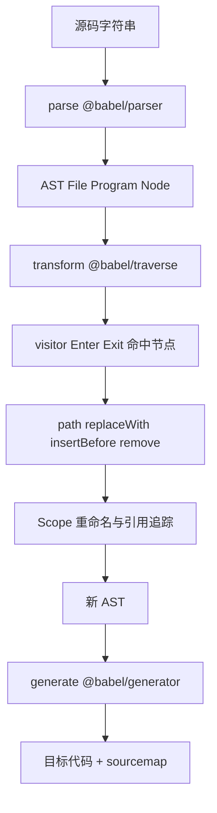

```javascript
// 三阶段拆开跑：理解 babel-core 的编排（等价于 transformSync）
const parser = require('@babel/parser');
const traverse = require('@babel/traverse').default;
const generate = require('@babel/generator').default;
const t = require('@babel/types');

const code = 'const msg = "hello"; console.log(msg.length);';

// ① parse：字符串 → AST
const ast = parser.parse(code, { sourceType: 'module', sourceMaps: true });

// ② transform：AST → 新 AST（示例：把 .length 访问包一层安全函数）
traverse(ast, {
  MemberExpression(path) {
    if (path.node.property.name === 'length' && !path.node.computed) {
      path.replaceWith(
        t.callExpression(t.identifier('safeLen'), [path.node.object])
      );
    }
  },
});

// ③ generate：AST → 代码 + map
const output = generate(ast, { retainLines: false, sourceMaps: true }, code);
console.log(output.code);      // const msg = "hello"; console.log(safeLen(msg));
console.log(output.map);       // sourcemap：转换链要串接（babel-loader 内部处理）
```

### BLD-120：AST 结构精讲：File/Program/Node 与替换、新增、删除节点的标准 API。
**答**：
- 顶层是 `File`（含 `program`、`tokens`、`comments`）；`Program` 是语句容器；所有节点都是 `Node`（`type` + 位置信息 start/end/loc/range）+ 类型特有字段（如 `FunctionDeclaration` 有 `id/params/body`）。
- 遍历单元是 **Path**（不是 Node）：path 封装了 node 及其父子关系与作用域——`path.node` 取节点、`path.parentPath` 向上、`path.scope` 查作用域、`path.replaceWith/replaceWithMultiple/insertBefore/insertAfter/remove` 改树。
- 构造节点一律用 `@babel/types`（`t.identifier/t.callExpression/...`），保证字段合法；判类型用 `t.isXxx(path.node)` 或 `path.isXxx()`。
- 易错点：直接改 `path.node` 而绕过 path API 不会触发 scope 重算；`replaceWith` 后原 path 失效，需用返回的新 path 继续操作；插入语句要选 `Statement` 级别位置。

```javascript
// AST 增删改全套：把 const counter = 0; 改为带初始化日志的 let 并统计使用
const t = require('@babel/types');

const visitor = {
  VariableDeclaration(path) {
    // ① 替换：const → let
    path.node.kind = 'let';

    for (const decl of path.node.declarations) {
      // ② 新增：在声明后插入 console.log 语句
      const log = t.expressionStatement(
        t.callExpression(t.memberExpression(
          t.identifier('console'), t.identifier('log')
        ), [t.stringLiteral(`init ${decl.id.name}`), t.cloneNode(decl.id)])
      );
      path.insertAfter(log);

      // ③ 删除：去掉不含初始化的声明（var a; 形态）
      if (!decl.init) path.remove();
    }
  },
  Identifier(path) {
    // ④ Scope 实战：只处理"变量引用"而非属性名/对象 key
    if (path.parentPath?.isMemberExpression() && path.key === 'property') return;
    if (!path.scope.hasBinding(path.node.name)) return;
    // path.scope.generateUidIdentifier('tmp') 是防冲突命名的标准姿势
  },
};
// 使用：transformSync(code, { plugins: [{ visitor }] })
```

### BLD-121：手写 Babel 插件实战一：把可选链 `a?.b?.c` 降级的简化版实现。
**答**：
- 思路：命中 `OptionalMemberExpression` 时生成等价的条件访问表达式；外层（最左）自下而上构造 `a == null ? void 0 : a.b` 形态，链上每一级都判空。
- 简化版实现策略：递归处理 `object`（若也是 optional 则先生成子表达式），再产出 `t.conditionalExpression(t.binaryExpression('==', obj, t.nullLiteral()), t.unaryExpression('void', t.numericLiteral(0)), t.memberExpression(obj, prop))`。
- 与官方 `@babel/plugin-proposal-optional-chaining` 差距：官方还要处理 `?.()` 可选调用、赋值目标限制、避免对象表达式重复求值（需要引入临时变量 `ref`）——面试说清"简化版未处理副作用"即合格。
- 排查技巧：`npx babel file.js --plugins ./my-plugin.js` 直接看输出，配 `ast: true` 看树。

```javascript
// babel-plugin-mini-optional-chaining.js：可选链降级简化版
module.exports = ({ types: t }) => ({
  name: 'mini-optional-chaining',
  visitor: {
    OptionalMemberExpression(path) {
      // a?.b?.c  →  递归到最左对象，再逐级包条件表达式
      const build = (node) => {
        if (!node.object.type.startsWith('Optional')) {
          return node.object;                       // 普通对象：直接作为主体
        }
        const sub = build(node.object);
        // 子链：sub?.x → (sub == null ? void 0 : sub.x)
        return t.conditionalExpression(
          t.binaryExpression('==', t.cloneNode(sub), t.nullLiteral()),
          t.unaryExpression('void', t.numericLiteral(0)),
          t.memberExpression(t.cloneNode(sub), node.object.property)
        );
      };
      const obj = build(path.node);
      // 最终本级：obj?.prop
      path.replaceWith(
        t.conditionalExpression(
          t.binaryExpression('==', t.cloneNode(obj), t.nullLiteral()),
          t.unaryExpression('void', t.numericLiteral(0)),
          t.memberExpression(t.cloneNode(obj), path.node.property)
        )
      );
    },
  },
});
// 输入： const city = user?.address?.city;
// 输出： var city = user == null ? void 0 : (user.address == null ? void 0 : user.address.city);
// 已知局限（面试必说）：a?.b 是对象字面量表达式时会重复求值，官方版用 _ref 临时变量解决
```

### BLD-122：手写 Babel 插件实战二：i18n 中文提取插件（扫描 + 生成语言包）。
**答**：
- 需求：扫描所有 JSX/字符串字面量里的中文，替换为 `t('key')`，并把"原文→key"写入抽出的 JSON 语言包——国际化改造的自动化工具。
- 实现要点：visitor 命中 `StringLiteral / JSXText / TemplateLiteral`，用 `/[\u4e00-\u9fa5]/` 判断含中文；key 用**原文 md5 前 8 位**或"模块名_序号"保证稳定（同一原文全局同 key）；替换为 `t('key')` 调用并按需注入 import。
- 工程细节：排除注释与 console 日志（可用 comments 判断）；`t` 若未导入需在 Program 层 `path.unshiftContainer('body', importDeclaration)`；语言包按文件增量 merge 写盘（插件里用 `state.filename` 定位）。
- 配套：`state.opts.output` 支持命令行传语言包路径，插件内 `fs.writeFileSync` 落盘（插件是 Node 环境，可直接 IO）。

```javascript
// babel-plugin-extract-i18n.js：中文提取与 t() 替换
const fs = require('fs');
const path = require('path');
const crypto = require('crypto');
const t = require('@babel/types');

const CJK = /[\u4e00-\u9fa5]+/;
const pack = {}; // 全局累计（babel 进程内），构建结束统一落盘

module.exports = function ({ types }) {
  return {
    name: 'extract-i18n',
    visitor: {
      Program: {
        enter(programPath, state) {
          state.set('needT', false); // 标记本文件是否用到 t()
        },
        exit(programPath, state) {
          if (state.get('needT')) {
            // 已有 import { t } 则不重复注入
            const has = programPath.node.body.some(
              (n) => t.isImportDeclaration(n) && n.source.value === '@/locale'
            );
            if (!has) {
              programPath.unshiftContainer('body',
                t.importDeclaration(
                  [t.importSpecifier(t.identifier('t'), t.identifier('t'))],
                  t.stringLiteral('@/locale')
                )
              );
            }
          }
        },
      },
      StringLiteral(path, state) {
        const raw = path.node.value;
        if (!CJK.test(raw)) return;
        if (path.findParent((p) => p.isConsoleStatement?.())) return; // 排除日志
        const key = 'k' + crypto.createHash('md5').update(raw).digest('hex').slice(0, 8);
        pack[key] = raw;                                   // 收录语言包
        path.replaceWith(
          t.callExpression(t.identifier('t'), [t.stringLiteral(key)])
        );
        state.set('needT', true);
      },
      JSXText(path, state) {
        const raw = path.node.value.trim();
        if (!CJK.test(raw)) return;
        const key = 'k' + crypto.createHash('md5').update(raw).digest('hex').slice(0, 8);
        pack[key] = raw;
        path.replaceWith(
          t.jsxExpressionContainer(t.callExpression(t.identifier('t'), [t.stringLiteral(key)]))
        );
        state.set('needT', true);
      },
    },
    post() { // post 在整个 babel 转换结束后调用一次/文件
      // 简化：直接覆盖 zh-CN.json；生产应 merge 且加 lint 防手工编辑丢失
      fs.writeFileSync(
        path.resolve(process.cwd(), 'locales/zh-CN.json'),
        JSON.stringify(pack, null, 2)
      );
    },
  };
};
// 输入： <Button>提交订单</Button>   输出： <Button>{t("k3f2a9c1d")}</Button>
```

### BLD-123：手写 Babel 插件实战三：埋点函数自动插入（无痕上报关键交互）。（高频）
**答**：
- 需求：约定"被 @track 注释标记的函数/事件回调自动注入上报调用"，或"所有 onClick 回调函数体首行注入 track()"——运营埋点不侵入业务代码。
- 实现：命中方法/箭头函数 → 看 leadingComments 匹配 `@track(event, props)` 解析参数 → 函数体 `body.unshiftContainer? ` 实际用 `path.get('body').unshiftContainer('body', expressionStatement(track(...)))`；箭头函数隐式返回需先转块状（`arrowFunctionExpression` 改 body 为 BlockStatement）。
- 关键细节：async/生成器函数保持标记不丢；避免重复注入（body 首条已是 track 调用则跳过）；上报参数里的 `this` 与闭包变量保持原作用域（unshift 到函数体首行天然满足）。
- 验证与灰度：插件加 `state.opts.mode === 'dry'` 只打日志不改码；产物里 `git grep 'track(' dist` 抽查注入点。

```javascript
// babel-plugin-auto-track.js
const t = require('@babel/types');

function parseTrackComment(node) {
  const c = (node.leadingComments ?? []).map((c) => c.value).join('');
  const m = c.match(/@track\(\s*['"]([\w.-]+)['"]\s*(?:,\s*(\{[\s\S]*?\}))?\s*\)/);
  return m && { event: m[1], props: m[2] };
}

const makeTrackCall = (meta) =>
  t.expressionStatement(
    t.callExpression(t.identifier('track'), [
      t.stringLiteral(meta.event),
      // props 是注释里抓出来的对象字面量文本，这里解析成对象表达式节点
      meta.props ? t.objectExpression([]) : t.objectExpression([]),
    ])
  );

const inject = (fnPath, meta) => {
  const body = fnPath.get('body');
  // 隐式返回的箭头函数先转块状：() => expr → () => { return expr; }
  if (fnPath.isArrowFunctionExpression() && !t.isBlockStatement(body.node)) {
    fnPath.set('body', t.blockStatement([t.returnStatement(body.node)]));
  }
  // 防重复注入
  if (body.node.body.some((n) =>
    t.isExpressionStatement(n) && t.isCallExpression(n.expression) &&
    n.expression.callee.name === 'track' && n.expression.arguments[0]?.value === meta.event
  )) return;
  const call = t.expressionStatement(t.callExpression(t.identifier('track'), [
    t.stringLiteral(meta.event),
    // props 文本走 parser 转成 AST 才严谨，这里用空对象占位简化
    meta.props ? t.objectExpression([]) : t.objectExpression([]),
  ]));
  body.unshiftContainer('body', call);   // 函数体首行插入，业务代码零侵入
};

module.exports = () => ({
  name: 'auto-track',
  visitor: {
    'FunctionDeclaration|FunctionExpression|ArrowFunctionExpression'(path) {
      const meta = parseTrackComment(path.node);
      if (meta) inject(path, meta);      // 方式一：@track 注释标记
    },
    JSXAttribute(path) {
      if (path.node.name.name !== 'onClick') return;
      const v = path.get('value');
      // 方式二：内联箭头回调自动包裹：onClick={() => do(x)} → onClick={() => { track(); do(x); }}
      if (v.isJSXExpressionContainer() && v.get('expression').isArrowFunctionExpression()) {
        inject(v.get('expression'), { event: 'click_inline', props: null });
      }
    },
  },
});
// 输入： // @track('order_submit', { page: 'checkout' })
//       async function submit() { await api(); }
// 输出： async function submit() { track("order_submit", ({page:'checkout'})); await api(); }
```

### BLD-124：@babel/plugin-transform-runtime 解决什么问题？helper 内联为什么会撑大产物？（高频）
**答**：
- Babel 编译产物依赖两类公共代码：**helper**（`_classCallCheck/_objectSpread` 等内联小函数）与 **polyfill**（Promise/Array.includes 等运行时 API）。不加 transform-runtime 时，helper 会被内联进**每个文件**，100 个文件就复制 100 份 `_classCallCheck`——产物膨胀。
- transform-runtime 把 helper 改为 `import _classCallCheck from '@babel/runtime/helpers/classCallCheck'`（**从统一包引用**），全项目只留一份；corejs 选项再把 `Promise` 等全局 API 替换为 `@babel/runtime-corejs3/core-js/...` 引用，**不污染全局**（库开发的关键）。
- 三选一：`corejs: 3`（库，无全局污染）／`corejs: { version: 3, proposals: true }`（可实验 API）／`false`（应用，polyfill 交给 useBuiltIns 全局垫）。
- 面试一句话：`useBuiltIns` 管"垫 API 全局"，`transform-runtime` 管"helper 去重 + 无污染引用"，两者职责不同，库项目通常两个都要。

```javascript
// babel.config.js：应用 vs 库两套典型配置
module.exports = (api) => {
  const isLib = api.env() === 'lib';
  return {
    presets: [['@babel/preset-env', { targets: { chrome: '80' } }]],
    plugins: [
      ['@babel/plugin-transform-runtime', {
        // helper：默认即开启引用化，这里显式声明
        helpers: true,
        // regenerator：async/await 的 runtime 引用化，否则每文件内联 regeneratorRuntime
        regenerator: true,
        // corejs3：库选 true（不污染全局）；应用选 false（走 useBuiltIns 全局垫一次）
        corejs: isLib ? { version: 3, proposals: false } : false,
        // 版本锁定：monorepo 内防止多份 @babel/runtime 版本并存（产物里出现重复 helper）
        version: require('@babel/runtime/package.json').version,
        absoluteRuntime: false,
      }],
    ],
  };
};
// 产物对比（同 100 个 class 文件）：
// 不加 transform-runtime：每个文件内联 ~300B 的 _classCallCheck → 共 30KB+
// 加后：每个文件一行 import + node_modules 里一份 helper，业务产物仅 ~1KB
```

### BLD-125：preset-env 与 browserslist 联动机制：目标怎么决定编译与垫片行为？
**答**：
- preset-env 先读**目标浏览器**（`targets` 或 browserslist 配置，含 `package.json`/`.browserslistrc`），再对照 `compat-data`（caniuse 数据）算出"需要编译的语法集合"与"需要垫的 API 集合"——同一份目标，同时控制 babel 语法转换与 useBuiltIns 的 polyfill 注入量。
- 优先级：preset-env 的 `targets` > browserslist 的 `env` 段（如 `production`）> 默认 `> 0.5%, last 2 versions`；webpack/babel/postcss/autoprefixer 全部消费同一份 browserslist，**一处配置全局生效**（联动高频考点）。
- 目标越现代产物越小：`targets: { chrome: '80' }` 时可选链/可选捕获不转译、polyfill 注入趋近 0；不配 targets 会按"全兼容"转译，产物徒增。
- 查询调试：`npx browserslist` 列出命中的浏览器；`npx browserslist --coverage` 看覆盖率；preset-env 配 `debug: true` 打印"启用了哪些插件/垫了哪些 API"。

```json
// package.json：一份 browserslist 驱动 babel/postcss/构建产物目标
{
  "browserslist": {
    "production": [">0.2%", "not dead", "not op_mini all"],
    "development": ["last 1 chrome version", "last 1 firefox version"]
  }
}
```

```javascript
// babel.config.js：验证联动（debug 输出可看到最终 targets 与插件清单）
module.exports = {
  presets: [
    ['@babel/preset-env', {
      // 不写 targets：完全交给 browserslist（推荐，避免两处配置漂移）
      useBuiltIns: 'usage',           // API 垫片按使用点注入
      corejs: { version: 3, proposals: false },
      debug: process.env.BABEL_DEBUG === '1', // 打印：targets / plugins / polyfills 三张表
      // exclude: ['es.promise.includes'], // 某垫片引发兼容 bug 时的排除法
    }],
  ],
};
// 面试演示：browserslist 写 ["chrome >= 90"]
// → debug 输出 "@babel/preset-env: no transform needed"（语法不降级）
// → 产物里没有 core-js；把目标改成 ["ie 11"] 后立即出现一堆 helper 与 core-js import
```

### BLD-126：useBuiltIns 的 entry / usage / false 三种 polyfill 注入模式产物差异。
**答**：
- **entry**：入口手写 `import 'core-js/stable'; import 'regenerator-runtime/runtime';`，构建时替换为按目标浏览器需要的**全量 API 垫片**——与代码是否用到无关，产物最大但"一次垫齐"。
- **usage（主流）**：不需要手写 import，babel 扫描每个文件**实际用到的 API**（如代码里有 `Promise.allSettled` 才注入对应模块），按需注入、产物最小；缺点是依赖第三方包时看不到其内部使用（需要 transform-runtime 配合）。
- **false**：不注入任何 polyfill，只转语法——目标浏览器较新或有独立 polyfill 服务（如 cdn polyfill.io? 已不推荐，通常自管）时使用；产物最小且零重复。
- 重复风险：usage + 第三方库自带 core-js 会双实例（`Symbol.hasInstance` 判断失效等），库禁止带 polyfill——这也是"应用用 usage，库用 transform-runtime"的根本原因。

```javascript
// 同一段源码在三种模式下的产物差异
// 源码：Promise.allSettled([p1, p2]).then(rs => rs.includes(undefined))

// ── useBuiltIns: 'entry'（入口写 import 'core-js/stable'）──
// 构建时被替换为（按 browserslist 目标展开，可能与业务无关的 API 也全垫）：
// require("core-js/modules/es.promise.all-settled.js");
// require("core-js/modules/es.array.includes.js");
// require("core-js/modules/es.array.iterator.js");
// require("core-js/modules/es.object.to-string.js");   // ...数量与目标浏览器成反比

// ── useBuiltIns: 'usage'（入口无任何手写 import）──
// 每个用到的文件顶部按需注入，只垫"这份代码用到的"：
// require("core-js/modules/es.promise.all-settled.js");   // 因为代码里有 allSettled
// require("core-js/modules/es.array.includes.js");        // 因为代码里有 includes

// ── useBuiltIns: false ──
// 无任何注入；targets 较旧时运行时直接报 Promise.allSettled is not a function
// 需要自己在 HTML 里引统一 polyfill 或接受目标限制
```

### BLD-127：babel-plugin-macros 的适用场景是什么？和普通 Babel 插件怎么选？
**答**：
- 普通插件是**全局编译管线**（配置在 babel.config，所有文件都被处理）；macro 是**文件内显式引用**（`import { gql } from '../macros/gql.macro'`），构建时把调用点展开为编译期结果——零配置注入、按文件生效。
- 典型场景：GraphQL 查询预编译（relay/virtoso? ）、`preval` 构建期求值（把模块执行结果内联为常量）、CSS-in-JS 零运行时（`linaria/compiled`）、i18n 编译期提取。
- 选型：**插件级**跨项目/全量转换 → 普通 babel 插件；**调用级**按需编译、想在业务代码里"看得见摸得着" → macro；macro 的优点是局部可控、不污染整条管线，缺点是约定 `xxx.macro` 命名且需要 babel-plugin-macros 驱动。
- 与 Vite 的关系：Vite 用 esbuild/rollup 走自身转换链，babel 宏需要 `vite-plugin-babel-macros` 显式接入——迁移技术栈时这是常见兼容点。

```javascript
// 自定义 macro：构建期内联版本号与 env 检查（version.macro.js）
const { createMacro } = require('babel-plugin-macros');
const t = require('@babel/types');

function versionMacro({ references, state, babel }) {
  const { types: t } = babel;
  references.default?.forEach((refPath) => {
    // BUILD_VERSION 宏调用 → 编译期内联 package.json 的 version
    const version = require(state.file.opts.filename.includes('/packages/')
      ? '../../package.json' : './package.json').version;
    refPath.replaceWith(t.stringLiteral(version));
  });
  references.envCheck?.forEach((refPath) => {
    // envCheck() → 编译期断言，非法直接让构建失败
    if (process.env.REQUIRED_ENV !== 'ok') {
      throw refPath.buildCodeFrameError('REQUIRED_ENV 未配置，禁止构建');
    }
    refPath.replaceWith(t.booleanLiteral(true));
  });
}
module.exports = createMacro(versionMacro);

// 业务代码：
// import BUILD_VERSION from './version.macro';
// const banner = `app@${BUILD_VERSION}`;   → 产物： var banner = "app@2.7.1";（零运行时）
// 对比 DefinePlugin：define 替换"标识符"，macro 可以带参数、有作用域、能报编译错误
```

### BLD-128：TypeScript 与 Babel 的关系：babel 只剥离类型，tsc 双跑策略与 swc 兼容层。
**答**：
- `@babel/preset-typescript` / `esbuild` / swc 都只做**类型剥离**（syntax transform），不做类型检查、不生成 d.ts——所以"TS → Babel → 产物"链路里类型错误不拦截构建。
- 双跑策略（生产主流）：CI 里**并行跑 babel 构建与 `tsc --noEmit`**（或 vue-tsc），tsc 只负责类型门禁；两者消费同一份 tsconfig，需注意 `isolatedModules: true` 强制单文件可转译（const enum、命名空间导出值等限制）。
- 类型检查工具补充：`fork-ts-checker-webpack-plugin`（webpack dev 内并行检查）、`tsc --noEmit --incremental`（tsbuildinfo 增量）；库项目产出 d.ts 用 `tsc --emitDeclarationOnly` 而非 babel。
- swc 生态兼容层：`@swc/core` 可直接吃 `.swcrc` 的 `jsc.parser.syntax: 'typescript'`；对 babel 生态通过 `swc-plugin`（wasm）或让 jest 用 `@swc/jest` 替换 babel-jest——迁移成本主要是自定义 babel 插件没有 swc 等价物。

```javascript
// CI 双跑示例：构建与类型检查并行（package.json scripts + CI 配置）
// package.json
// {
//   "scripts": {
//     "build": "NODE_ENV=production webpack --mode production",
//     "typecheck": "tsc --noEmit --incremental --tsBuildInfoFile .cache/tsbuildinfo",
//     "ci": "concurrently -g \"pnpm build\" \"pnpm typecheck\""
//   }
// }

// tsconfig.json 关键项：保证 babel 可转译
// {
//   "compilerOptions": {
//     "target": "ES2020",
//     "isolatedModules": true,          // babel/swc 单文件转译的前提
//     "importsNotUsedAsValues": "error",// 强制 type-only import，配合剥离
//     "skipLibCheck": true,
//     "incremental": true
//   }
// }

// jest 集成（swc 兼容层示例）：jest.config.js
module.exports = {
  transform: {
    '^.+\\.(t|j)sx?$': ['@swc/jest', {
      jsc: {
        parser: { syntax: 'typescript', tsx: true, decorators: true },
        transform: { react: { runtime: 'automatic' } },
        target: 'es2020',
      },
    }],
  },
};
// 类型门禁不进 jest：测试跑 swc（快），类型错误由独立 typecheck job 拦截
```

## 十四章 Vite 源码级与实践深水区（BLD-129 ~ BLD-140）

### BLD-129：vite dev 服务启动全流程：createServer 到 transform 中间件链发生了什么？
**答**：
- `createServer(inlineConfig)` 顺序：合并配置 → 创建 `server.moduleGraph`（dev 期的模块图，与 rollup build 期的分离）→ 创建 **pluginContainer**（把插件容器化，提供统一的钩子调用）→ `resolveConfig` 已先跑完 → 初始化 `optimizer`（依赖预构建）。
- 启动链：`createPluginContainer` → 注册中间件（`server.middlewares`：cors → proxy → base → **transform** → static → html fallback）→ listen →（异步）`optimizer.discoverProjectDependencies` 跑 esbuild 扫描与预构建。
- 关键源码文件定位：`packages/vite/src/node/server/index.ts`（createServer）、`server/middlewares/transform.ts`（transformRequest）、`pluginContainer.ts`（rollup 钩子容器）、`optimizer/index.ts`（预构建）。
- 面试画图必备：启动不等待预构建完成，首请求若命中"尚未预构建完的依赖"会返回 `"optimized deps changed. reloading"` 触发 full-reload——这就是首屏偶发自动刷新的根因。

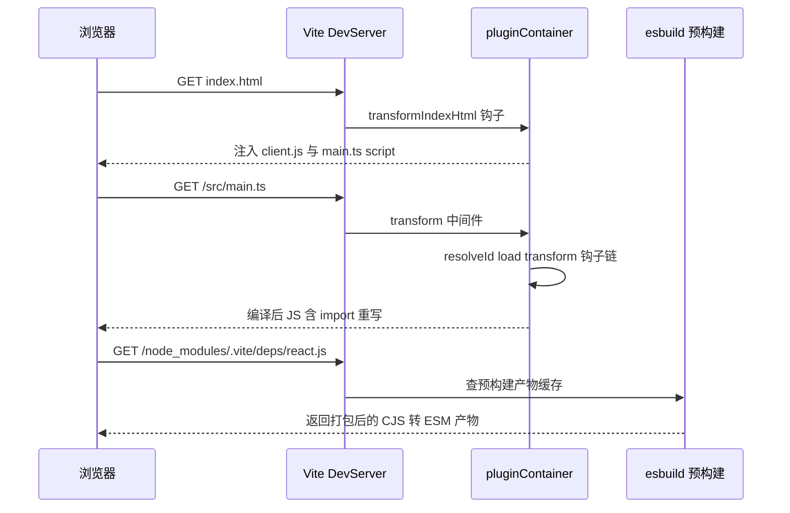

```javascript
// vite.config.ts：把启动流程中的关键节点配齐（对照源码流程）
import { defineConfig } from 'vite';
import vue from '@vitejs/plugin-vue';

export default defineConfig({
  plugins: [vue()],
  server: {
    middlewareMode: false,
    // transform 中间件之前的钩子：配置代理（在 transform 前生效）
    proxy: { '/api': { target: 'http://localhost:7001', changeOrigin: true } },
    watch: { ignored: ['**/node_modules/**', '**/dist/**'] },
  },
  // 预构建：createServer 后异步执行，与首请求赛跑
  optimizeDeps: {
    entries: ['index.html', 'src/**/*.vue'],   // esbuild 扫描入口（收集裸导入）
    include: ['lodash-es'],                    // 动态 import 难以静态分析的补进来
    esbuildOptions: { target: 'es2020', splitting: true }, // 预构建产物能力
  },
  // 启动级 debug：vite --debug transform 看每个请求经过的钩子链
  // 源码阅读入口（node_modules/vite/dist/node/chunks/*.js 打包前源）：
  //   packages/vite/src/node/server/index.ts      createServer
  //   packages/vite/src/node/server/middlewares/transform.ts  transformRequest
  //   packages/vite/src/node/pluginContainer.ts   钩子容器（rollup 钩子适配层）
});
```

### BLD-130：vite 的 import 分析与模块图：es-module-lexer 和导入重写是怎么工作的？
**答**：
- dev 模式浏览器原生 ESM 要求"import 路径必须是可请求 URL"：vite 把 `import { x } from 'vue'` 重写为 `/node_modules/.vite/deps/vue.js?v=hash`，把相对导入重写为**带源码绝对路径的 URL**（`/src/App.vue`），源码保持原样存 moduleGraph。
- 轻量解析用 **es-module-lexer**（只找 import/export 位置，不做完整 AST，微秒级）+ 魔法字符串拼接重写；需要深入时才回退 acorn。这是 dev 冷启动毫秒级响应的关键取舍。
- 模块图：`server.moduleGraph` 按 url 记录 ModuleNode（importers/importedModules/transformResult/ssrTransformResult），HMR 时**从变更文件反向遍历 importers** 找边界（isSelfAccepting）。
- query 语义：`?import` 标记 JS 模块、`?raw` 原文、`?url` 资源地址、`?t=时间戳` 强制缓存失效（HMR 更新后改写 import 带 t）。

```javascript
// 复现 vite 的 import 重写核心（源码在 importAnalysis 插件，约 200 行的精华）
import { init, parse as parseImports } from 'es-module-lexer';

async function rewriteImports(code, importer, resolve) {
  await init;                                    // 初始化 wasm
  let imports;
  [imports] = parseImports(code);                // 只提取 import 语句位置，不做 AST
  let s = 0, e = code.length;
  const str = () => code.slice(s, e);
  for (let i = imports.length - 1; i >= 0; i--) {
    const { s: start, e: end, d: dynamicIndex } = imports[i];
    const rawUrl = code.slice(start, end);
    // ① 裸导入：'vue' → '/node_modules/.vite/deps/vue.js?v=043c...'
    // ② 相对导入：'./App.vue' → '/src/App.vue'
    // ③ 动态导入：import('./x') → import('/src/x.js')（dynamicIndex >= 0）
    const resolved = await resolve(rawUrl, importer);
    const url = dynamicIndex > -1 ? resolved : resolved; // 简化：真实源码区分动态并加 ?import
    s = start; e = end;
    // 用 overwrite 方式改写（真实实现是 MagicString）
    code = code.slice(0, start) + url + code.slice(end);
  }
  return { code: str(), map: null };
}
// 模块图侧：transform 完成后 moduleGraph.getModuleByUrl(url) 更新
//   .importedModules / .importers —— HMR 反向传播的数据基础
// 浏览器收到的形态：
// import { createApp } from '/node_modules/.vite/deps/vue.js?v=043c9a21'
// import App from '/src/App.vue?t=1699000000000'
```

### BLD-131：vite 预构建的源码级原理：扫描入口、esbuild 打包 deps、缓存校验三步。
**答**：
- **扫描**：`optimizer.scanImports` 用 esbuild 的 `build({ write: false, plugins: [esbuildScanPlugin] })` 从 `optimizeDeps.entries`（默认 index.html）出发，把入口 HTML 里引用的模块全部扫一遍，收集**裸导入**（bare import，即 node_modules 依赖）——只扫描不产出。
- **打包**：对收集到的依赖跑第二次 esbuild build（`splitting: true` 产 ESM chunk），把 CJS 依赖转 ESM、把众多小模块合并、把互为依赖的包打平（如 react/react-dom/scheduler 共享 chunk）；产物写 `node_modules/.vite/deps/`，同时生成 `_metadata.json`（依赖 hash 与 chunk 映射）。
- **缓存校验**：对比 `lockfileHash + configHash + lockfile 内容`（`getDepHash`），一致则跳过预构建直接用缓存；不一致删目录重建。运行中新增依赖 → 处理不到 → "optimized deps changed" full-reload 重跑预构建。
- 面试要点：为什么不用 vite 的 transform 管道直接服务 node_modules——CJS 互引用、几百个小请求（lodash-es 数百文件）会让 dev 页面加载失控。

```javascript
// 预构建三步的源码级对照（optimizer/index.ts 精简）
async function optimizeDeps(config, server) {
  // ① scan：esbuild 扫描器（esbuildScanPlugin 拦截 resolve，收集裸导入）
  const { deps, missing } = await scanImports(config);
  // deps 形如 { react: 'node_modules/react/index.js', 'lodash-es': '...' }

  // ② 缓存校验：getDepHash = hash(lockfile + config 相关字段)
  const depHash = getDepHash(config);           // 含 optimizeDeps 配置 + lockfile 内容
  const data = loadCachedDepInfo(depHash);      // 读 node_modules/.vite/deps/_metadata.json
  if (data && data.hash === depHash && data.browserHash) {
    return data;                                 // 命中：跳过打包
  }

  // ③ esbuild 打包依赖（flatIdDedupe 处理同名多版本 → 别名去重）
  await esbuild.build({
    entryPoints: Object.values(flatIdDedupe(deps)),
    bundle: true, splitting: true, format: 'esm',
    outdir: depsCacheDir,                        // node_modules/.vite/deps/
    external: config.optimizeDeps.exclude,       // external 的包运行时按需 vite 化
    plugins: [esbuildCjsInteropPlugin],          // CJS → ESM interop（__esModule 处理）
  });
  // 产物 metadata 记录每个依赖对应 chunk 与 browserHash（import 重写的 ?v= 值）
}
// 常用命令：vite optimize / vite --force 强制重建
```

### BLD-132：optimizeDeps.include / exclude 与 force 的正确用法与常见误区。
**答**：
- `include`：静态扫描发现不了的依赖要手动补——**动态拼接 import**（`import(`./langs/${l}.js`)` 里的第三方依赖）、条形按需组件库（vant/element-plus 虽有 esm 但被动态引用）、被 worker/ssr 间接使用。
- `exclude`：不预构建的依赖——需要源码形态（如想热更的内部包用源码 alias）、与预构建产物冲突的双实例包；但 exclude 的包若 import 了另一个裸依赖，浏览器将直接请求它并 404，必须连其依赖一起 exclude 或恢复 include（**exclude 传染性问题**，高频坑）。
- `force: true` / `--force`：忽略缓存重建 deps，用于"改了 lockfile 但 hash 没变的诡异场景"、调试 interop 问题；`optimizeDeps.esbuildOptions.plugins` 可深度干预预构建。
- 误区：把 include 当"提前加载性能优化"大量堆积（预构建产物变大、首启动变慢）；正确认知是"扫描器的兜底补丁"。

```javascript
// vite.config.ts：optimizeDeps 的生产级用法
export default defineConfig({
  resolve: {
    alias: { '@shared': fileURLToPath(new URL('./packages/shared/src', import.meta.url)) },
  },
  optimizeDeps: {
    include: [
      'lodash-es',                        // 仅被动态模板 import 使用，扫描不到 → include
      'dayjs/locale/zh-cn',
      'element-plus > @element-plus/icons-vue', // 子依赖语法：连带预构建其内部裸依赖
    ],
    exclude: [
      // 链接本地包且想实时热更时（配合 alias 到源码）；注意它依赖的裸包要一并处理
      'my-local-ui-lib',
    ],
    // exclude 传染性示例：my-local-ui-lib import 'clsx'
    //   → 浏览器直接请求 '/node_modules/clsx/...' 404
    //   → 解决：把 clsx 也 exclude（让浏览器能直接解析），或干脆不 exclude 该库
    esbuildOptions: { target: 'es2020' },
  },
  server: {
    // 误区纠正：发现新依赖自动 reload 是正常兜底，生产排查用 --debug optimizeDeps
  },
});
// CLI：vite --force     一次性强制重建
//      vite optimize    独立跑预构建（CI 预热常用）
```

### BLD-133：vite transform 中间件处理一个请求的完整链路（从 index.html 到深层模块）。
**答**：
- 请求进入后按序过中间件：`cors → proxy → base → transform → serveStatic → htmlFallback`；transform 中间件只处理"看起来是模块"的请求（有扩展名或 ?import）。
- transformRequest 内部：`pluginContainer.resolveId(url)` 定位模块 → 查 moduleGraph 的 transformResult 缓存（`?t=` 或文件 mtime 变化则失效）→ `load` 钩子（读文件/virtual module）→ `transform` 钩子链（vue-plugin 编译 SFC → vite 内置的 importAnalysis 重写导入）→ 结果包装成 `TransformResult`（含 MagicString sourcemap 合并）。
- index.html 特殊：`transformIndexHtml` 钩子注入 `/@vite/client`（HMR 客户端）与入口 `<script type="module">`；深链模块（如 `/src/components/Btn.vue?vue&type=style`）由各插件的 transform 产出虚拟子请求。
- 排查手段：`vite --debug transform` 打印每个请求的钩子耗时；`curl 'http://localhost:5173/src/App.vue'` 直接看编译产物。

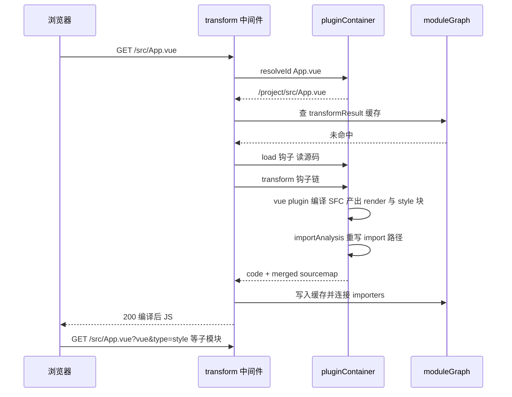

```javascript
// 最小 transform 中间件复刻：理解 vite 每个请求经过的管线
const middlewares = [
  (ctx) => ctx.accept('text/html'),                 // 1. 识别 html
  async (ctx, next) => {                            // 2. transform 中间件
    const url = decodeURIComponent(ctx.url.split('?')[0]);
    if (url.endsWith('.html')) return next();

    // resolveId：插件容器按逆序调插件的 resolveId（vite 内置 resolvePlugin 最后兜底）
    const id = await container.resolveId(url, undefined, { ssr: false });
    // 缓存判定：?t= 或 moduleGraph 里 mtime 变化 → 强制重编译
    const mod = moduleGraph.getModuleById(id);
    if (mod?.transformResult && !isStale(mod)) return send(ctx, mod.transformResult.code);

    // load：读文件或虚拟模块（virtual:xxx）
    const loadResult = await container.load(id, { ssr: false });
    let code = loadResult?.code ?? fs.readFileSync(cleanUrl(id), 'utf-8');

    // transform：钩子链（vue -> ts -> importAnalysis ...），vite 内部合并 sourcemap
    const result = await container.transform(code, id, { ssr: false });
    moduleGraph.updateModule(mod, result);          // 更新模块图 + importers 连接
    ctx.type = 'application/javascript';            // 统一按 ESM JS 返回
    ctx.body = result.code;
  },
  serveStatic(root),                                // 3. 纯静态兜底（图片等）
];
// 面试落点：dev 下"没有打包"，每个请求独立走 resolveId->load->transform；
// vite:import-analysis 是唯一必经的内置 transform（重写 import）。
```

### BLD-134：vite 的 CSS 处理链：postcss、预处理器、CSS Modules 与构建期 CSS 拆分行为。
**答**：
- dev 下 CSS 走 transform 钩子：`.css` 内置处理（含 postcss 配置自动发现 postcss.config.js），`.less/.scss` 先由 vite 内嵌的编译器（通过 `css.preprocessorOptions` 传参）转 CSS 再走同链路；产物以 JS 模块形式返回（style 注入，HMR 原生支持）。
- **CSS Modules**：`.module.css` 自动开启，导出映射对象 `style.a`；`css.modules.localsConvention` 控制命名（camelCase），`generateScopedName` 自定义 hash——面试常问"vite 不需要配 css-loader 是因为内置了 postcss-modules"。
- **build 期 CSS 提取**：rollup 产 JS 后 `vite:build-css-plugin` 把所有 CSS 从模块中抽出合并，按 chunk 拆分（`build.cssCodeSplit: true` 默认），异步 chunk 的 CSS 在动态 import 时由 vite 自动注入对应 `<link>`（与 webpack 的 MiniCssExtract 差异点）。
- 常见坑：库文件不写 `.module` 导致全局污染；`cssCodeSplit: false` 时单文件全量 CSS；preprocessorOptions.additionalData 注入变量文件的重复编译成本。

```javascript
// vite.config.ts：CSS 全链路配置
export default defineConfig({
  css: {
    postcss: {
      plugins: [
        require('autoprefixer')(),
        require('postcss-preset-env')({ features: { 'nesting-rules': true } }),
      ],
    },
    preprocessorOptions: {
      scss: {
        additionalData: `@use "@/styles/var.scss" as *;`, // 注入变量（@use 而非 @import）
        api: 'modern-compiler',                            // 用现代编译器 API，速度更快
      },
      less: { math: 'always', javascriptEnabled: true },
    },
    modules: {
      localsConvention: 'camelCaseOnly',   // style['brand-color'] → style.brandColor
      generateScopedName: 'vp-[name]__[local]--[hash:base64:5]',
    },
    // devtools: true（新版本）可映射源码位置
  },
  build: {
    cssCodeSplit: true,        // 异步 chunk 的 CSS 随 chunk 拆分，import 时自动注入 link
    cssTarget: 'chrome87',     // CSS 单独指定压缩目标（esbuild/minify CSS）
    // cssCodeSplit: false → 单一 style.css，适合"纯静态落地页"或需要手动引入的场景
  },
});
// 产物验证：异步路由组件 → dist/assets/Xxx-[hash].css + JS 中 import 该 css 的注入逻辑
```

### BLD-135：vite 的静态资源处理链：import asset 到 url、base64 内联与 manifest。
**答**：
- 规则：`assetsInclude` 判定资源类型后，dev 下 import 返回 URL 字符串（`/src/logo.png`），build 下按 `build.assetsInlineLimit`（默认 4096B）决定**内联 base64** 或发射文件（`assets/[name]-[hash][extname]`，hash 保证缓存稳定）。
- 显式控制：`?url` 强制返回 URL、`?raw` 返回源码字符串、`?inline`（新版本）强制内联；`public/` 目录资源不经处理直接 copy，引用用**绝对路径**（`/favicon.ico`），不参与 hash——这是"public 里的文件更新后浏览器缓存不刷新"的原因。
- `new URL('./img.png', import.meta.url)` 语法 vite 原生支持（worker 场景必须用它而非 import），build 期同样发射并重写。
- manifest：`build.manifest: true` 生成 `.vite/manifest.json`（源路径→产物路径+hash+css 依赖），供后端 SSR/传统模板注入资源使用。

```javascript
// vite.config.ts：静态资源完整配置
export default defineConfig({
  publicDir: 'public',
  assetsInclude: ['**/*.glsl', '**/*.mp4'],       // 扩展可 import 的资源类型
  build: {
    assetsInlineLimit: (filePath, content) => {
      // 4KB 以下内联；但 svg 一律不内联（想走缓存）或一律内联（减少请求）按需定制
      if (filePath.endsWith('.svg')) return false;
      return content.length < 4096;
    },
    manifest: true,           // dist/.vite/manifest.json
    rollupOptions: { output: { assetFileNames: 'assets/[name]-[hash].[ext]' } },
  },
});
// 源码中的三种写法及其产物：
// import logo from './logo.png'        → 小图: data:image/png;base64,...；大图: /assets/logo-3f2a.png
// import txt from './a.md?raw'         → 模块导出原始字符串（构建期内联）
// import url from './big.mp4?url'      → 强制 URL（即使小于内联阈值）
// const u = new URL('./w.js', import.meta.url)  → worker 入口，build 期发射独立 chunk
// public/favicon.ico                   → 原样 copy 到 dist 根，无 hash，代码里写死 '/favicon.ico'
// manifest.json 片段：
// { "src/logo.png": { "file": "assets/logo-3f2a91b2.png", "src": "src/logo.png",
//   "isEntry": false, "css": [] } }
```

### BLD-136：vite 插件容器如何调用 rollup 钩子？dev 下哪些钩子生效？
**答**：
- vite 把 rollup 钩子容器化为 `pluginContainer`（源码 `pluginContainer.ts`）：按 `enforce: 'pre' | normal | 'post'` 排序插件，钩子统一支持"函数 / 对象带 handler+order"两种写法，调用逆序/顺序与 rollup 一致。
- dev 生效的钩子：**resolveId、load、transform**（每个请求都走）、transformIndexHtml（vite 扩展）、configureServer、handleHotUpdate（vite 扩展）；**不生效**：buildStart 部分生效? 实际 createServer 时也会调一遍 options/buildStart（模拟），但 **generateBundle/outputOptions/renderChunk 等产物期钩子只在 build 跑**——这是"插件 dev 正常 build 出错"的根因。
- 钩子返回值约定：resolveId 返回 null 表示不接管、返回 false 表示 external；transform 返回 `{ code, map }`，map 可为 null（丢失 sourcemap 会 warn）。
- 双插件体系（dev 用容器直调，build 交 rollup）的兼容写法：钩子写成 `{ handler, order: 'pre' }` 对象形式，两个引擎都能识别。

```javascript
// 一个"dev 与 build 双兼容"插件的完整骨架：标注每个钩子在两个模式下的生效时机
function myPlugin() {
  return {
    name: 'my-plugin',
    enforce: 'pre',                        // 排序：pre 插件最先 resolve/load/transform
    // ── vite 扩展钩子 ──
    configResolved(config) { console.log('config 定稿:', config.command); }, // dev/build 都跑
    configureServer(server) {              // 仅 dev：可挂自定义中间件
      server.middlewares.use('/__mock', (req, res) => res.end('{}'));
    },
    transformIndexHtml(html) { return html.replace('</head>', '<script src="/__mock"></script></head>'); }, // 仅 dev（build 用 transformIndexHtml 的 rollup 版亦可）
    handleHotUpdate({ file, server }) {    // 仅 dev：自定义 HMR 触发
      if (file.endsWith('.lang.json')) server.ws.send({ type: 'custom', event: 'lang-update' });
    },
    // ── rollup 生命周期钩子 ──
    buildStart() { this.info?.('build start'); },           // build 全量跑；dev 冷启动模拟跑一次
    resolveId(source) {                      // dev：每请求一次；build：每模块一次
      if (source === 'virtual:config') return '\0virtual:config';
      return null;                           // null = 不接管
    },
    load(id) {
      if (id === '\0virtual:config') return 'export default window.__CFG__';
    },
    transform(code, id) { return { code, map: null }; },     // 两模式都跑（最常用）
    renderChunk() { if (this.environment?.config.command === 'build') {/* 仅 build */} }, // 仅 build！
    generateBundle(_, bundle) { /* 仅 build：改产物唯一正位 */ },
  };
}
// 面试口诀：dev 只认 resolveId/load/transform + vite 扩展四件套；产物期钩子 build 专属。
```

### BLD-137：手写一个自定义 HMR：import.meta.hot 边界与 accept 的完整实现。
**答**：
- HMR 协议三要素：模块声明边界（`import.meta.hot.accept(cb)`）、vite 检测文件变化后**从变更文件沿 importers 反向找 accept 边界**、通过 ws 通知客户端执行回调（fetch 新模块 → 回调内替换）。
- `hot.accept(deps, cb)`（接受依赖更新，自己重渲染）与 `hot.accept(cb)`（接受自身更新）的区别：前者是"父组件作为边界"，后者是"自更新模块"；`hot.dispose` 清理旧副作用，`hot.data` 跨更新存状态（如 keep-alive 的 store）。
- 无边界时逐层冒泡到入口 → full reload；插件可通过 `handleHotUpdate` 自定义更新范围（如 i18n json 只广播 custom event，不刷任何模块）。
- 面试加分：说出 `import.meta.hot` 在 build 期被替换为空对象（死代码消除）——所以随意调用不会进产物。

```javascript
// src/counter.js：自更新模块 + 状态保留（vite HMR API 完整用法）
if (import.meta.hot) {
  import.meta.hot.dispose((data) => {
    document.getElementById('app').innerHTML = '';   // 清理旧副作用
  });
  import.meta.hot.accept((newModule) => {
    // 自身更新：重执行 render（模块级"刷新"而非页面刷新）
    newModule.render(document.getElementById('app'), import.meta.hot.data.count ?? 0);
  });
}
export let count = 0;
export function render(el, initial = 0) {
  count = initial;
  el.innerHTML = `<button>${count}</button>`;
  el.querySelector('button').onclick = () => (count++, el.querySelector('button').textContent = count);
  return count;
}

// src/store.js：hot.data 保留状态（跨 HMR 不丢）
if (import.meta.hot) {
  import.meta.hot.accept((m) => useStore.setState(m.default.getState()));
  import.meta.hot.data.snapshot ??= null;
}

// vite-plugin 侧：自定义 json 热更（插件内）
// handleHotUpdate({ file, server }) {
//   if (!file.endsWith('.lang.json')) return;
//   server.ws.send({ type: 'custom', event: 'lang-update', data: JSON.parse(fs.readFileSync(file)) });
//   return [];  // 返回空数组：不让 vite 继续走默认模块更新（即不触发任何模块失效）
// }
```

### BLD-138：vite 的 SSR 架构：dev 的 createServer 内存模块执行与 build 的 ssr manifest。
**答**：
- dev SSR：`createServer({ server: { middlewareMode: true } })` 暴露 `ssrLoadModule(url)`——**不走网络不走产物**，直接在 Node 里用 ssrTransform 后的模块（把 ESM 转成 `__vite_ssr_import__` 包装，支持 HMR 与缓存失效），请求级实时执行。
- build SSR：`vite build --ssr entry-server.js` 产 Node 可用格式（cjs/esm）；再跑一次 `vite build --ssrManifest` 生成 `ssr-manifest.json`：**源码模块 → 产物 chunk/css 的映射**，服务端渲染时据此知道"这个组件依赖哪些 css/异步 chunk"，实现客户端关键 CSS 与预加载注入。
- 双配置要点：ssr 的 `external`（node_modules 直接 require 不打包）、`resolve.conditions` 加 `ssr`、客户端构建需与 server 共享同一份数据获取逻辑（如 React Query prefetch）。
- 面试对比：SSR manifest 本质是"服务端渲染产物 ↔ 客户端产物"的资源映射协议，与 webpack 的 asset manifest 同构。

```javascript
// vite.config.ts：SSR 双构建配置
export default defineConfig({
  build: {
    ssrManifest: true,        // 产出 dist/.vite/ssr-manifest.json（客户端构建时）
    // SSR 构建（--ssr）时的产物格式：
    ssr: { target: 'node', format: 'esm', external: ['express', 'pino'] },
  },
  resolve: { conditions: process.env.SSR ? ['ssr', 'node'] : [] },
});

// server.js：dev 内存执行 vs build 用产物（同一份 server 代码切换）
import express from 'express';
const app = express();
if (process.env.NODE_ENV === 'development') {
  const { createServer: createViteServer } = await import('vite');
  const vite = await createViteServer({ server: { middlewareMode: true }, appType: 'custom' });
  app.use(vite.middlewares);
  app.get('*', async (req, res) => {
    const { render } = await vite.ssrLoadModule('/src/entry-server.jsx'); // dev：内存模块
    res.send(await render(req.url, vite));
  });
} else {
  app.use(express.static('dist/client'));
  const manifest = (await import('./dist/client/.vite/ssr-manifest.json')).default;
  const template = readFileSync('./dist/client/index.html', 'utf-8');
  const { render } = await import('./dist/server/entry-server.js');      // prod：静态产物
  app.get('*', async (req, res) => {
    const { html, preloadLinks } = await render(req.url, manifest);      // manifest 驱动资源注入
    res.send(template.replace('<!--ssr-outlet-->', html).replace('<!--preload-links-->', preloadLinks));
  });
}
```

### BLD-139：构建期环境变量在 vite 中的注入与安全：import.meta.env 的泄露面有多大？
**答**：
- 注入规则：只有 `VITE_` 前缀的变量会进客户端产物（`import.meta.env.VITE_X`），加载顺序 `process.env < .env < .env.local < .env.[mode] < .env.[mode].local`；`envDir` 可改 .env 目录。
- **泄露面**：所有 VITE_ 变量会被**静态替换进每个引用点**（define 机制），因此"前端产物中的环境变量 = 公开信息"——密钥放 VITE_ 前缀是事故级错误；`import.meta.env` 整体解构、动态 key（`env[name]`）拿不到值（编译期替换只认字面量）。
- 服务端变量：`vite loadEnv(mode, root, '')` 第三参空前缀可取全部，但只许在 SSR/配置文件用；`import.meta.env.SSR` 布尔由构建器注入做分支裁剪。
- 治理：约定命名空间（VITE_PUBLIC_）、CI 里 secret 扫描卡口（gitleaks 检查 dist 中 key 模式）、敏感值走运行时注入（HTML 里服务端写 `window.__CFG__`）。

```bash
# .env.production：前端可见 vs 服务端专属的边界示例
VITE_API_BASE=https://api.example.com      # 会进客户端产物（公开）
VITE_SENTRY_DSN=https://k@o.example.com/1  # DSN 本就公开，可以放
# DB_PASSWORD=xxx                          # 千万不要 VITE_ 前缀；且不要写在 .env 里给前端目录
```

```javascript
// vite.config.ts：loadEnv 的正确用法与运行时注入兜底
import { defineConfig, loadEnv } from 'vite';
export default defineConfig(({ mode }) => {
  const env = loadEnv(mode, process.cwd(), '');       // 空前缀：全部变量（仅配置/SSR 用）
  const publicEnv = Object.fromEntries(
    Object.entries(env).filter(([k]) => k.startsWith('VITE_'))
  );
  return {
    define: {
      // 自定义前缀注入（等价 envPrefix 扩展写法）
      ...Object.fromEntries(
        Object.entries(publicEnv).map(([k, v]) => [`import.meta.env.${k}`, JSON.stringify(v)])
      ),
    },
    // 客户端把"运行时配置"与"编译期配置"分离：
    // 编译期：VITE_API_BASE（构建时定死）
    // 运行时：服务端模板注入 window.__RUNTIME_CONFIG__（发布后可不重建改配置）
  };
});

// src/config.ts：安全使用模式
const env = import.meta.env;
export const API_BASE = window.__RUNTIME_CONFIG__?.apiBase ?? env.VITE_API_BASE;
// 反模式（构建期替换不生效，值为 undefined）：
// const key = 'VITE_API_BASE'; import.meta.env[key]      ← 动态 key 拿不到
// const { VITE_API_BASE } = import.meta.env              ← 解构某些版本可拿到，但依赖实现，别用
```

### BLD-140：vite 常见报错排查手册：预构建循环依赖、外部化失效、双实例 Vue。
**答**：
- **"optimized dependencies changed. reloading"**：运行中新增裸依赖触发预构建重建。排查：`--debug optimizeDeps` 看触发源；根治是把它写进 `optimizeDeps.include` 或让扫描器可达（静态 import）；CI 预热 `vite optimize`。
- **外部化失效（dev 正常 build 报 "Could not resolve" 或包内引用泄露）**：monorepo 里 workspace 包指向源码但 build 忘加 alias；或 rollupOptions.external 写了包名但子路径（`pkg/sub`）没匹配——external 要用函数或正则匹配前缀。
- **双实例 Vue/React**：症状 `Invalid hook call`、`provide/inject 失效`、组件 instanceof 校验失败。根因三连：lockfile 里同名多版本（pnpm why vue）、workspace 包 peerDependencies 没声明导致子包自装、预构建把 vue 打进两个 chunk。修复：peerDeps + pnpm overrides 锁单版本 + 必要时 `dedupe`。
- 快速定位命令：`pnpm why vue`、`find node_modules -name vue -maxdepth 4`、`ls node_modules/.vite/deps | grep vue`。

```bash
# 双实例 Vue 的完整排查流程（面试可背的操作序列）
pnpm why vue                       # 1. 看依赖树里 vue 出现几次、被谁引入
ls node_modules/.vite/deps | grep -i vue   # 2. 预构建产物是否出现 vue_v2/vue_v3 双份
grep -rn '"vue"' pnpm-lock.yaml | head     # 3. lockfile 层面确认版本分裂
# 修复一：workspace 包一律 peerDependencies（pnpm-workspace.yaml 支持 catalog 统一版本）
#   packages/ui/package.json: "peerDependencies": { "vue": ">=3.4" }
# 修复二：根 package.json overrides 强制收敛
#   "pnpm": { "overrides": { "vue": "3.4.21", "react": "18.3.1" } }
# 修复三：vite 配置兜底（让两个包名解析到同一物理路径）
```

```javascript
// vite.config.ts：双实例与外部化的代码级修复
import { fileURLToPath } from 'node:url';
export default defineConfig({
  resolve: {
    alias: {
      // 强制所有入口（含链接的 workspace 包）都指向同一份 vue
      vue: fileURLToPath(require.resolve('vue')),
      // 外部化失效修复：子路径也要覆盖
      // build 侧等价：rollupOptions.external = [/^vue($|\/)/, /^@vue\//]
    },
    dedupe: ['vue', '@vue/reactivity'],   // vite 内置 dedupe：resolve 时收敛到同一实例
  },
  build: {
    rollupOptions: {
      external: [/^vue($|\/)/, /^@vue\//], // 用正则覆盖 vue、vue/macros 等子路径（SSR 场景）
    },
  },
});
```

## 十五章 Rollup 深入与库构建（BLD-141 ~ BLD-148）

### BLD-141：rollup 打包流程：acorn 解析 → 作用域分析 → treeshake → generate 各阶段做什么？
**答**：
- `rollup.rollup(inputOptions)`：**build 阶段**——resolveId/load/transform 钩子逐模块产码 → acorn 解析 AST → **作用域分析**（@rollup/pluginutils? 实际内置 scope 分析：绑定变量声明与引用，建 Module 间依赖图 with resolution）→ **treeshake**（从 entry 的被引用符号出发做活性分析，标记副作用与死代码）→ 产出 bundle 对象（内存中的 chunk 划分与模块树）。
- `bundle.generate/write(outputOptions)`：**generate 阶段**——renderChunk/renderStart/outputOptions/banner-footer 钩子、代码渲染（保留执行顺序的语句级拼接）、sourcemap 链生成、`write` 落盘。
- 与 webpack 本质差异：rollup 的产物是**语句级拼接**（ESM 原生结构保持 hoisting），没有 runtime/模块表；tree-shaking 是**构建进图时的一等公民**（基于 use 标记），而非后置优化。
- 调试手段：`rollup -c --environment DEBUG:trees`? 更通用的是 `bundle.write({ sourcemap })` + `visualizer`；官方 playground（rollupjs.org/repl）看树摇结果。

```javascript
// rollup 双阶段 API 拆解：rollup.rollup（build）与 bundle.write（generate）
import { rollup } from 'rollup';

const bundle = await rollup({
  input: 'src/index.js',
  plugins: [ /* resolve/load/transform 在 build 阶段逐模块调用 */ ],
  treeshake: {
    moduleSideEffects: true,
    tryCatchDeoptimization: false,   // try/catch 内不做副作用豁免（默认 true 会保守保留）
  },
});
// 此刻已完成：模块图构建 + 作用域分析 + 树摇标记
console.log(bundle.modules.map((m) => ({
  id: m.id,
  usedExports: m.getRenderedExports?.(),   // 实际保留的导出
  removedExports: m.getUnusedExports?.(),
})));

await bundle.write({
  format: 'esm',
  file: 'dist/index.js',
  sourcemap: true,
  // generate 阶段输出控制：hoistTransitiveImports 避免异步 chunk 间多余静态依赖
});
await bundle.close();
```

### BLD-142：treeshake 配置精讲：moduleSideEffects、propertyReadSideEffects、annotations 怎么调？
**答**：
- `moduleSideEffects: 'no-external' | false | fn`：控制"import 即执行"的副作用假设；CSS 导入、polyfill 入口必须保留副作用，误关会静默丢代码（`import './setup'` 被删）。
- `propertyReadSideEffects: true`（默认）：读取对象属性可能触发 getter（Proxy/Vue2 defineProperty），保守保留完整对象展开；库若确认无 getter 可关掉，展开运算符摇得更狠。
- `annotations: true`（默认）：识别 `/*#__NO_SIDE_EFFECTS__*/`、`/*#__PURE__*/` 注解与 `@__PURE__` 调用标记——给纯函数调用显式标记是库作者最重要的摇树契约。
- 其他高频项：`tryCatchDeoptimization`（try 内不摇）、`unknownGlobalSideEffects`（读未声明全局变量视为副作用）、`correctVarValueBeforeDeclaration`（TDZ 保守）。

```javascript
// rollup.config.js：treeshake 全量配置 + 源码侧的配合注解
export default {
  input: 'src/index.ts',
  treeshake: {
    moduleSideEffects: (id, external) =>
      // CSS 与 polyfill 保留，其余业务模块默认可摇
      id.endsWith('.css') || id.includes('polyfill'),
    propertyReadSideEffects: false,   // 库无 getter/Proxy 时可关，展开与属性访问更激进
    tryCatchDeoptimization: false,    // try/catch 里的代码也参与摇树
    unknownGlobalSideEffects: false,  // 信任全局读取无副作用（有 navigator 探测库时别关）
    annotations: true,                // 尊重 PURE 注解
  },
  plugins: [typescript({ declaration: true })],
};
```

```javascript
// src/api.ts：库作者写给摇树的契约（注解配合）
const cache = new Map();
export function get(key) {
  return cache.get(key);
}
export function set(key, value) {
  return cache.set(key, value);   // 有副作用，永不摇
}
export const noop = /*#__PURE__*/ () => {};          // 显式声明无副作用

// 使用方：
// import { get } from './api'          → set 被整体摇掉
// const x = /*#__PURE__*/ normalize(input)  → 使用方侧标记：未使用时调用被删
// 注意：export const config = { onload() {...} }  在 propertyReadSideEffects: false 时
//       config.onload 这类读取不再保留——库导出含 getter 副作用的对象时必须保持 true
```

### BLD-143：库的多格式产物构建：esm/cjs/umd + 双 package.json + exports 映射。（高频）
**答**：
- 现代规范用一个 package.json 的 `exports` 条件映射解决多格式：`import` → esm、`require` → cjs、`types` 指向 d.ts；**Node 与打包器按条件顺序取第一个匹配**，types 必须放前面（TS 解析）。
- 双 package.json（旧方案/monorepo 里仍常见）：根 package.json main 指向 cjs，`module` 指向 esm（webpack 系消费），esm 目录里再放一个 package.json 标 `type: 'module'`（让 Node 原生把 .js 当 ESM）。
- UMD 现在只给"直接 script 引入"的场景（CDN/无构建页），浏览器环境建议额外出 `dist/umd/index.min.js`（iife/umd 格式 + name）。
- 坑：`type: 'module'` 与 cjs 共存时扩展名规则（.cjs/.mjs）；exports 会**封闭深层路径**，需要 `./package.json`、`./dist/*` 通配显式放行。

```json
// package.json：单包多格式现代方案（Node 12.7+/主流打包器全支持）
{
  "name": "my-lib",
  "version": "1.0.0",
  "type": "module",
  "main": "./dist/index.cjs",                       // 兜底（老 Node/工具）
  "module": "./dist/index.js",                      // 打包器偏好 esm
  "types": "./dist/index.d.ts",
  "exports": {
    ".": {
      "types": "./dist/index.d.ts",                 // TS 优先取 types 条件
      "import": "./dist/index.js",                  // esm
      "require": "./dist/index.cjs",                // cjs（Node）
      "default": "./dist/index.js"
    },
    "./package.json": "./package.json",             // 显式放行，否则深层路径全被封闭
    "./*": "./dist/*"                               // 允许子路径导入（工具函数子模块）
  },
  "sideEffects": false,                             // 摇树契约：全库无副作用
  "files": ["dist"],
  "engines": { "node": ">=18" }
}
```

```javascript
// rollup.config.mjs：一次产出三格式（type: module 项目用 .mjs 保 cjs 产出合法）
import { defineConfig } from 'rollup';
import esbuild from 'rollup-plugin-esbuild';
import dts from 'rollup-plugin-dts';

export default defineConfig([
  {
    input: 'src/index.ts',
    plugins: [esbuild({ target: 'es2020' })],
    external: (id) => !id.startsWith('.') && !id.startsWith('/'),  // 全外部化
    output: [
      { format: 'esm', file: 'dist/index.js', sourcemap: true },
      { format: 'cjs', file: 'dist/index.cjs', sourcemap: true, exports: 'named' },
      { format: 'umd', file: 'dist/umd/index.min.js', name: 'MyLib',
        plugins: [/* terser/esbuild minify */] },
    ],
  },
  {
    input: 'dist/index.d.ts',       // 第二轮：用已生成的类型做聚合
    plugins: [dts()],
    output: { format: 'esm', file: 'dist/index.d.ts' },
  },
]);
// 双 package.json 旧方案对照（monorepo tsc 直出时）：
// dist/esm/package.json: { "type": "module" }   dist/cjs/package.json: { "type": "commonjs" }
```

### BLD-144：d.ts 的生成链：tsc 直出、rollup-plugin-dts、api-extractor 三种方案对比。
**答**：
- **tsc 直出**：`tsc --emitDeclarationOnly` 按源码结构输出 d.ts 树（最稳定，零额外工具）；缺点是类型文件碎片化，需配 `"typesVersions"` 或导出入口聚合。
- **rollup-plugin-dts**：把 tsc 产出的 d.ts 再"打包"成单文件 `index.d.ts`（合并 module augmentation、处理重导出）；要求上游 tsc 先跑，链路 = tsc → rollup dts pass。
- **api-extractor**（微软）：生成**单个 rolled-up 类型 + 报告文件**，能检测公共 API 泄露（未导出类型被引用）与 semver diff（api-report 变更进 PR review）——大库（monaco/angular 组件库）标配。
- 常见错误：`TS2742`（类型推断泄露）、私有类型未导出、`/// <reference types>` 断链——面试讲清"链路：tsc 产类型树 → 打包聚合 → 校验"。

```javascript
// 方案一：tsc 直出 + rollup-plugin-dts 聚合（最常见组合）
// tsconfig.build.json
// {
//   "compilerOptions": {
//     "declaration": true, "emitDeclarationOnly": true,
//     "outDir": "dist/types", "isolatedModules": true, "skipLibCheck": true
//   },
//   "include": ["src"]
// }
// scripts: { "build:types": "tsc -p tsconfig.build.json && rollup -c rollup.dts.mjs" }

// rollup.dts.mjs
import dts from 'rollup-plugin-dts';
export default {
  input: 'dist/types/index.d.ts',
  output: [{ format: 'esm', file: 'dist/index.d.ts' }],
  plugins: [dts({ respectExternal: true })],
};
```

```json
// 方案二：api-extractor 的配置与产物（面向大型库）
// api-extractor.json
{
  "$schema": "https://developer.microsoft.com/json-schemas/api-extractor/v7/api-extractor.schema.json",
  "mainEntryPointFilePath": "<projectFolder>/dist/types/index.d.ts",
  "bundledPackages": [],
  "apiReport": {
    "enabled": true,
    "reportFolder": "<projectFolder>/etc/",
    "reportTempFolder": "<projectFolder>/etc/temp/"
  },
  "dtsRollup": {
    "enabled": true,
    "untrimmedFilePath": "<projectFolder>/dist/index.d.ts",
    "publicTrimmedFilePath": "<projectFolder>/dist/public.d.ts"  // 修剪内部 API
  },
  "messages": {
    "extractorMessageReporting": {
      "ae-missing-release-tag": { "logLevel": "error" },   // 强制 @public/@internal 标记
      "ae-forgotten-export": { "logLevel": "error" }      // 类型泄露直接构建失败
    }
  }
}
// CI 价值：etc/api-report.md 进 git，PR 中类型签名变更一目了然（配合 semver 审核）
```

### BLD-145：库的 peerDependencies 与外部化策略：怎么决定一个依赖进 bundle 还是留外部？
**答**：
- 决策三问：**宿主会不会有**（react/vue 这类框架依赖 → peerDependencies + external，避免双实例）、**是否需要独立演化**（utils 工具 → 直接打进 bundle，减少宿主安装成本）、**是否含原生/大依赖**（lodash 整包 → 打进或按需子路径）。
- 标准公式：`external: [/^react($|\/)/, /^react-dom($|\/)/]` + peerDependencies 声明同范围；devDependencies 装一份用于自测（pnpm 下 peer 自动装）。
- `peerDependenciesMeta: { react: { optional: true } }` 处理可选 peer；monorepo 内库互引用 `workspace:*` 发版时转真实版本（pnpm publish 自动处理）。
- 面试追问"为什么不能把 react 打进库"：双实例 → hooks 失效、context 断裂、包体积翻倍；React 的 RSC/版本特性（如 18 的 useId）依赖宿主一致。

```json
// package.json：依赖分层的标准写法
{
  "name": "my-ui-lib",
  "peerDependencies": {
    "react": ">=17 <20",           // 宿主提供的运行时
    "react-dom": ">=17 <20",
    "clsx": ">=2"                  // 常用小工具也可 peer 化让宿主统一
  },
  "peerDependenciesMeta": {
    "clsx": { "optional": true }   // 宿主没装时库内降级实现
  },
  "dependencies": {
    // 仅放"必须进 bundle"的：纯计算工具、polyfill 级依赖
    "@my-lib/geometry": "workspace:*",
    "npm-normalize-package-bin": "^3.0.0"
  },
  "devDependencies": {
    "react": "18.3.1",             // 自测用：pnpm 会自动为 peer 安装
    "react-dom": "18.3.1"
  }
}
```

```javascript
// rollup.config.mjs：外部化与 peer 对齐（含子路径与 monorepo 内部包）
import pkg from './package.json' with { type: 'json' };

const externals = [
  ...Object.keys(pkg.peerDependencies ?? {}),          // react react-dom clsx
  ...Object.keys(pkg.dependencies ?? {})
    .filter((d) => d.startsWith('@my-lib/')),          // monorepo 内部包也留外部（宿主构建时解析）
];
export default {
  input: 'src/index.ts',
  external: (id) => {
    if (id.startsWith('node:')) return true;           // node 内置模块
    return externals.some((e) => id === e || id.startsWith(e + '/'));  // 覆盖 'react-dom/client' 等子路径
  },
  plugins: [/* esbuild/typescript */],
  output: [
    { format: 'esm', dir: 'dist/esm', preserveModules: true, preserveModulesRoot: 'src' },
    // preserveModules：按源码结构出多文件（库的按需 tree-shaking 更好）
  ],
};
```

### BLD-146：rollup 插件实战：写一个 svg → Vue 组件的插件。
**答**：
- 目标：`import Icon from './logo.svg?component'` 直接得到 Vue SFC 组件（模板内嵌 svg，可继承 props）；核心是 transform 钩子里返回一个合法的 SFC 字符串，交给 @vitejs/plugin-vue 后续处理（vite 场景），rollup 场景直接产 render 函数。
- 实现要点：resolveId/load 不接管（资源已存在），只在 transform 拦截 `?component` query；用正则抽 svg 根标签与内部内容；生成的虚拟 SFC 加 `?lang.ts` 之类 id 规范（保持 sourcemap 无害）。
- rollup（非 vite）版本：直接产 `createStaticVNode`/`h` 调用代码，external 'vue'；vite 版本产 SFC 字符串最省事。
- 工程化：`?component&fill=currentColor` 扩展参数、缓存解析结果、对非法 svg 报错并给出文件路径。

```javascript
// rollup-plugin-svg-vue.mjs（vite 与 rollup 通用）
const QUERY_RE = /\.svg\?(component)(?:&(fill=([\w#%]+)))?$/;

export default function svgVue() {
  return {
    name: 'svg-to-vue',
    transform(code, id) {
      const m = id.match(QUERY_RE);
      if (!m) return null;                       // 不接管普通 svg
      const wantFill = m[3];                     // ?fill=currentColor 强制替换颜色
      const svg = code;
      const inner = svg
        .replace(/<svg[^>]*>/, '')               // 去根标签
        .replace(/<\/svg>\s*$/, '');
      const attrs = wantFill
        ? ` fill="${decodeURIComponent(wantFill)}"` : '';
      if (m[1] === 'component') {
        // vite 场景：产 SFC 字符串，交给 plugin-vue 的 transform 继续编译
        return {
          code: `<template><svg xmlns="http://www.w3.org/2000/svg" v-bind="$attrs"${attrs} v-html="__SVG_INNER__" /></template>
<script setup>defineOptions({ inheritAttrs: false });const __SVG_INNER__ = ${JSON.stringify(inner)};</script>`,
          map: { mappings: '' },
        };
      }
    },
  };
}
// 使用：
// import Logo from './logo.svg?component'   → <Logo class="w-4" />
// vite.config: plugins: [vue(), svgVue()]   → 注意 svgVue 要在 vue 之前（enforce: 'pre'）
// 进阶方向：svgo 压缩 svg（transform 内先跑 optimize）、产 web components、提取 viewBox 缓存
```

### BLD-147：changesets 全流程：版本计划、CHANGELOG、多包联动发版怎么跑？
**答**：
- 流程四步：开发者 `pnpm changeset`（交互式选包、选 semver 级别、写摘要）→ 生成 `.changeset/*.md` 随 PR 提交 → 合并到 main 后 CI 跑 `changeset version`（消费 md 更新各包 version + CHANGELOG + **内部依赖联动 bump**）→ `changeset publish`（CI 手动触发发布）。
- 多包联动：A 依赖 B 且 B 升 minor，changesets 自动把 A 升 patch 并把 `workspace:*` 改写为真实版本号——monorepo 发版的正确姿势（对比 lerna 固定/独立模式）。
- GitHub Actions 标准玩法：**changesets/action** 两步——version PR（聚合所有待发 changeset 成一个 PR）+ 人工 approve 后 publish；npm token 用 `NPM_TOKEN` secret + provenance（`NPM_CONFIG_PROVENANCE: true`）。
- 预发布：`changeset pre enter beta` 进入 prerelease 模式，包版本走 `1.0.0-beta.x` 递增，`pre exit` 回正式。

```json
// .changeset/config.json：核心策略配置
{
  "$schema": "https://unpkg.com/@changesets/config/schema.json",
  "changelog": ["@changesets/changelog-github", { "repo": "org/repo" }],
  "commit": false,                       // version 产生的变更由 action 统一提交
  "access": "public",
  "baseBranch": "main",
  "updateInternalDependents": "always",  // 内部依赖变化必联动 bump（比默认 always 语义更清晰）
  "ignore": ["@repo/e2e"]                // 不发布的包
}
```

```yaml
# .github/workflows/release.yml：changesets 官方 action 的生产配置
name: release
on:
  push:
    branches: [main]
concurrency: { group: release, cancel-in-progress: false }
jobs:
  release:
    runs-on: ubuntu-latest
    steps:
      - uses: actions/checkout@v4
        with: { fetch-depth: 0 }
      - uses: pnpm/action-setup@v4
      - uses: actions/setup-node@v4
        with: { node-version: 22, cache: pnpm, registry-url: 'https://registry.npmjs.org' }
      - run: pnpm install --frozen-lockfile
      - uses: changesets/action@v1
        with:
          version: pnpm changeset version      # 消费 .changeset/*.md → 版本+CHANGELOG
          publish: pnpm build && pnpm changeset publish
          title: 'chore: version packages'
        env:
          GITHUB_TOKEN: ${{ secrets.GITHUB_TOKEN }}
          NPM_TOKEN: ${{ secrets.NPM_TOKEN }}
          NPM_CONFIG_PROVENANCE: true          # npm provenance：发布与源码构建可追溯
```

### BLD-148：库构建选型：tsup / unbuild / 纯 rollup + tslib 怎么选？
**答**：
- **tsup**（esbuild 内核）：配置最少、速度最快，开箱出 cjs/esm/iife + dts（调 tsc）+ preserveModules；适合中小 TS 库的"零心智"方案，深度定制（复杂钩子）受限。
- **unbuild**（rollup 内核，Nuxt 系）：约定式配置（stub 模式链接本地包做 dev）、自动生成 stubs 与 cjs/esm 双产物、内置 mkdist（按文件转译，适合 UI 库源码直出）；适合 Nuxt/monorepo 生态。
- **纯 rollup**：插件生态最全（dts、svg、postcss、多 pass），一切可定制；代价是配置与维护成本最高，适合有特殊产物需求（SFC、样式、多入口、UMD）的组件库。
- **tslib**：不是构建器而是 runtime helper 库——`import tslib from 'tslib'` 让 tsc/rollup 产出的代码复用 `__awaiter/__extends` 等 helper，`importHelpers: true` 减少每个文件的内联重复；与构建器是配合关系。

```javascript
// 三种方案的等价配置对照（同一个库：esm+cjs+dts）
// ── 方案一：tsup（package.json scripts: "build": "tsup"）──
// tsup.config.ts
import { defineConfig } from 'tsup';
export default defineConfig({
  entry: ['src/index.ts'],
  format: ['esm', 'cjs'],
  dts: true,                  // 自动跑 tsc 出 d.ts
  splitting: true,            // esm 共享 chunk
  clean: true, external: [/^react/],
});

// ── 方案二：unbuild（scripts: "build": "unbuild"）──
// build.config.ts
import { defineBuildConfig } from 'unbuild';
export default defineBuildConfig({
  entries: ['src/index'],
  declaration: true,
  rollup: { emitCJS: true, esbuild: { target: 'es2020' } },
  stub: true,                 // dev 模式：产物 stub 指向源码，改库即时生效
});

// ── 方案三：tsc 直出 + tslib（传统最大化控制）──
// tsconfig.json
// {
//   "compilerOptions": {
//     "importHelpers": true,            // helper 从 tslib 引，产物更小
//     "declaration": true, "target": "ES2020", "module": "NodeNext"
//   }
// }
// 产物： import { __awaiter } from "tslib";   ← 配合 dependencies: { tslib: "^2.6.0" }
```

## 十六章 esbuild / SWC 与新工具实践（BLD-149 ~ BLD-156）

### BLD-149：esbuild 的插件机制与限制：onResolve/onLoad 能做什么、为什么没有 AST？
**答**：
- 插件只有两个核心钩子：**onResolve**（接管路径解析：virtual module、alias、external 标记）与 **onLoad**（接管文件内容：返回 contents + loader 类型 js/ts/css/text）；构建期还有 onStart/onEnd 触发统计。
- **没有 transform 级 AST 钩子**（无类似 babel visitor 的口子），也不开放内部 AST——自定义语法转换只能 onLoad 里自己调 babel/swc/正则，这是 esbuild 插件生态远小于 rollup 的根本原因。
- 其他限制：不做语义级 tree-shaking 增强配置、不支持部分 loader 特性（如 less 要先转 css 再喂）、watch 增量语义与 webpack 不同（onEnd 才能拿到结果）。
- 价值与定位：写插件做"文件级"干预（资源内联、virtual env 模块、protobuf loader）依然高效；语义级需求就别用 esbuild 独立打包。

```javascript
// esbuild 插件：virtual 模块 + onLoad 转换（展示两个钩子的全部能力）
import * as esbuild from 'esbuild';

const envPlugin = {
  name: 'env-virtual',
  setup(build) {
    // ① onResolve：拦截 import 'env' → 虚拟模块
    build.onResolve({ filter: /^env$/ }, (args) => ({
      path: 'env',
      namespace: 'env-ns',            // namespace 隔离后续 onLoad 的 filter
    }));
    // ② onLoad：产虚拟内容（构建期注入，替代 DefinePlugin 的结构化版）
    build.onLoad({ filter: /.*/, namespace: 'env-ns' }, () => ({
      contents: `export const API_BASE = ${JSON.stringify(process.env.API_BASE ?? '')};`,
      loader: 'js',
    }));

    // ③ onLoad + 自定义 loader：yaml 直接进 bundle（无 AST 钩子的典型补偿手段）
    build.onLoad({ filter: /\.yaml$/ }, async (args) => {
      const text = await require('node:fs/promises').readFile(args.path, 'utf8');
      return { contents: `export default ${JSON.stringify(require('js-yaml').load(text))};`, loader: 'js' };
    });
  },
};

await esbuild.build({
  entryPoints: ['src/index.ts'],
  bundle: true, outfile: 'dist/index.js',
  plugins: [envPlugin],
  // ④ onEnd：拿结果统计（watch 模式下的增量回调点）
  plugins2: undefined,
});
// 限制小结：改不了 AST、没有 per-module render 钩子（rollup transform 的替代即 onLoad）；
// go 二进制并发处理，速度是 babel 的 10-100x，生态换性能就是这个交易。
```

### BLD-150：esbuild 接入 webpack/vite 做压缩或转译：esbuild-loader 与 minify 的语义差异坑。
**答**：
- 接入方式：webpack 用 **esbuild-loader**（rule 替 babel-loader/ts-loader 做转译；TerserPlugin 位置换 EsbuildPlugin 做压缩）；vite 原生用 esbuild 做**依赖预构建与 TS/JSX 转译**、`build.minify: 'esbuild'` 做压缩。
- **压缩语义差异**：Terser 支持更多精细选项（pure_funcs、mangle properties、keep_classnames、IE 兼容），esbuild minify 选项少且激进——错误上报栈可读性、class/function name（依赖 Function.name 的库！如 Angular、旧的 mobx 装饰器）可能被破坏。
- **转译语义差异**：esbuild 转译只做语法降级+类型剥离，**不注入 helper/polyfill**（目标是 es2015 时 async 会内联 regenerator? 实际 esbuild 会内联 helper 到每个文件，无 transform-runtime 等价物），目标过旧时产物反而膨胀。
- 排错口诀：换 esbuild 后先查 `console.log` 裁剪行为、`Function.name` 依赖、sourcemap 精度（esbuild 的 map 有时行级偏差）。

```javascript
// webpack：esbuild 全家桶接入 + 语义差异防御配置
const { EsbuildPlugin } = require('esbuild-loader');
const webpack = require('webpack');

module.exports = {
  module: {
    rules: [
      {
        test: /\.[jt]sx?$/,
        include: path.resolve('src'),               // 必须 include，别全量过
        loader: 'esbuild-loader',
        options: {
          target: 'es2020',                          // 语法降级目标（注意：不注入 polyfill！）
          loader: 'tsx',
          // 与 babel 的差异防御：需要 helper 复用/老浏览器目标时退回 babel
        },
      },
    ],
  },
  optimization: {
    minimizer: [
      new EsbuildPlugin({
        target: 'es2020',
        css: true,                                   // 同时压缩 css
        // terser 独有能力的缺失应对：
        //   1) pure_funcs：用 esbuild 的 pure 注解代替（源码加 /*#__PURE__*/）
        //   2) keep_fnames：esbuild 无等价物 → 依赖 Function.name 的代码改显式命名
        drop: ['console', 'debugger'],               // 裁剪能力（等价 drop_console）
      }),
    ],
  },
  plugins: [
    // esbuild 不做 polyfill → API 垫片交给 core-js 手动入口：
    new webpack.ProvidePlugin({}),   // 或 entry 首行 import 'core-js/stable'（按 browserslist 取舍）
  ],
};
// vite 侧：
// build: { minify: 'esbuild' }    默认即是；要 terser 语义时改 'terser'（构建变慢数倍）
```

### BLD-151：SWC transform API 实战：.swcrc 的 jsc 核心配置与 jest 集成。
**答**：
- 核心结构：`jsc.parser`（syntax: typescript/ecmascript + tsx/decorators）、`jsc.transform`（react.runtime、legacyDecorator、optimizer.globals? 即 define 替代）、`jsc.target`（输出目标）、`minify`（布尔/选项）。
- programmatic API：`transformSync(code, options)` 与 `transformFileSync`；Next.js/Rspack/swc-loader 都是这层 API 的封装；`jsc.transform.optimizer.globals` 提供 DefinePlugin 式替换。
- jest 集成：`@swc/jest` 直接替换 babel-jest（transform 配置传 `.swcrc` 等价 options）；monorepo 里注意 `moduleDirectories` 与 `moduleNameMapper` 仍归 jest 管，swc 只管单文件转译。
- 与 babel 生态的兼容边界：官方 preset（env/typescript/react）概念等价，但**自定义 babel 插件不可用**（wasm swc-plugin 是另一套 API）。

```json
// .swcrc：核心配置全貌
{
  "$schema": "https://swc.rs/schema.json",
  "jsc": {
    "parser": {
      "syntax": "typescript",
      "tsx": true,
      "decorators": true,
      "dynamicImport": true
    },
    "transform": {
      "react": { "runtime": "automatic", "importSource": "react" },
      "legacyDecorator": true,
      "decoratorMetadata": true,
      "optimizer": {
        "globals": {
          "vars": { "__APP_VERSION__": "'1.2.3'" }     // 等价 DefinePlugin
        },
        "simplify": true
      }
    },
    "target": "es2020",
    "loose": false,
    "externalHelpers": true       // 等价 transform-runtime：helper 从 @swc/helpers 引用而非内联
  },
  "module": { "type": "es6" },
  "minify": false
}
```

```javascript
// 1) programmatic：直接调 transform API（自定义脚手架/分析器常用）
const { transformSync } = require('@swc/core');
const out = transformSync(source, {
  filename: 'app.tsx',
  jsc: { parser: { syntax: 'typescript', tsx: true }, target: 'es2020' },
});
console.log(out.code, out.map);

// 2) jest 集成：jest.config.js
module.exports = {
  transform: {
    '^.+\\.(t|j)sx?$': ['@swc/jest', {
      jsc: { parser: { syntax: 'typescript', tsx: true }, target: 'node18' },
      module: { type: 'commonjs' },        // jest 需要 cjs（或配 ESM 实验模式）
    }],
  },
  // babel-jest → @swc/jest 提速 5-20x（大仓 jest 初始化时间显著下降）
};
```

### BLD-152：Turbopack 的架构概念：增量计算与函数级缓存到底指什么？
**答**：
- Turbopack 核心：**Turbo 引擎做细粒度增量计算**——把构建任务建模为许多纯函数节点（"任务"），每个任务的输入哈希决定是否重算；文件变化只重算**直接依赖该文件的任务**，而不是"整个模块"甚至"整个 chunk"（对比 webpack 的模块级缓存粒度更细）。
- 函数级缓存：编译一个模块被拆成 parse、分析、代码生成等多个子任务，各自缓存；后续构建直接复用未变子任务结果（内存态，dev 场景为主）。
- 架构选择：Rust 内核 + 图数据库式的模块图 + **不依赖 rollup/webpack 插件生态**（有自己的 plugin 体系，JS 侧适配有限）；dev 专注按需 + 持久化 dev cache，产物仍打包。
- 与 Vite 的路线差异：Vite dev 不打包、esbuild 预构建、prod 用 rollup（dev/prod 双引擎不一致）；Turbopack dev/prod 同引擎，一致性好——这是面试常考的对比点。

```text
# Turbopack 与 webpack/Vite 的增量粒度对比（面试口述图）
webpack：缓存粒度 = 模块（module build 结果）
  文件变 → 重 build 该模块 → seal 全量重跑（分包/压缩整个 bundle）

vite dev：不打包；文件变 → 只失效该模块的 transformResult（HMR 单模块级）
  vite prod：rollup 全量，无增量（除非配缓存外部工具）

turbopack：缓存粒度 = 函数/任务级（parse、分析、codegen 各自是任务节点）
  文件变 → 只重算依赖它的任务节点 → dev 二次启动与热更新近常数时间
  代价：引擎复杂度极高、插件生态独立
```

```javascript
// next.config.js：Turbopack 的使用与关键配置（Next 15+ 默认 dev turbopack）
/** @type {import('next').NextConfig} */
module.exports = {
  // dev: next dev --turbopack
  // build: next build --turbopack（逐步 GA）
  turbopack: {
    resolveAlias: {
      '@ui': './packages/ui/src',           // turbopack 侧 alias（与 webpack 配置分离）
    },
    rules: {
      '*.svg': { loaders: ['@svgr/webpack'], as: '*.js' },  // 兼容层：按文件模式挂 loader
    },
  },
};
// 迁移判断：用标准 Next 生态（swc/SVG/样式）→ 直接开；
// 大量自定义 webpack 插件（自定义 loader 逻辑、特殊 plugin）→ 先做兼容评估（见 BLD-153 方法论）
```

### BLD-153：Rspack 的 webpack 兼容层与迁移收益：哪些能直接用、哪些要适配？
**答**：
- **兼容现状**（截至 2026 常态）：核心配置（entry/output/module.rules/optimization 常用项）、主流 loader（babel-loader? 更常见 swc-loader、css-loader、less/sass-loader）、常用 API（tapable 形态的 compiler/compilation 钩子）可用；官方保证"高频配置兼容"而非全量。
- **需适配项**：复杂自定义 plugin（部分钩子缺失/行为差异）、依赖 Node API 深度操作的 loader（Rspack 内核 Rust，loader 仍在 JS 跑但沙箱差异）、个别插件等价物（CopyPlugin 等内置化）、experiments 选项（css 异步模块等新语义）。
- 收益实测项清单（面试汇报结构）：冷启动、二次构建（缓存）、watch 增量、产物体积 diff（与 webpack 应一致，需 diff 确认）、生态功能回归（MF/CSS chunk/HMR 时序）。
- 迁移路径：Rsbuild（上层框架，约定式）vs Rspack（直接换内核，配置渐进兼容）——存量 webpack 项目选 Rspack + @rspack/cli 改造成本最低。

```javascript
// 迁移评估用的兼容性探测脚本：scripts/rspack-compat-check.js
const cfg = require('../webpack.config.js');
const issues = [];
for (const rule of cfg.module?.rules ?? []) {
  const l = typeof rule.use === 'string' ? rule.use : rule.use?.[0]?.loader ?? rule.loader;
  if (l && !/swc|css|style|less|sass|postcss|asset|babel/.test(l)) {
    issues.push(`loader 待确认: ${l}`);
  }
}
const RSPACK_BUILTIN = ['HtmlWebpackPlugin', 'CopyPlugin', 'DefinePlugin', 'TerserPlugin'];
for (const p of cfg.plugins ?? []) {
  const n = p.constructor.name;
  if (RSPACK_BUILTIN.includes(n)) issues.push(`${n} → 换 rspack 内置/等价物`);
}
console.log(issues.length ? issues.join('\n') : '基础兼容，进入实测阶段');
```

```javascript
// 迁移后的 rspack.config.js（webpack5 配置的最小改动示例）
module.exports = {
  entry: './src/index.tsx',
  output: { filename: '[name].[contenthash].js', clean: true },
  resolve: { extensions: ['.tsx', '.ts', '.js'], alias: { '@': '/src' } },
  module: {
    rules: [
      { test: /\.tsx?$/, use: { loader: 'builtin:swc-loader',  // 内置 swc 替代 babel-loader
        options: { jsc: { parser: { syntax: 'typescript', tsx: true }, target: 'es2020' } } } },
      { test: /\.css$/, type: 'css/module',        // experiments.css：Rspack 内置 CSS 管线（可选新路径）
        },
      { test: /\.png$/, type: 'asset/resource' },
    ],
  },
  optimization: { splitChunks: { chunks: 'all' }, realContentHash: true },
  plugins: [new rspack.HtmlRspackPlugin({ template: './index.html' })],  // 内置 HTML 插件
  experiments: { css: true },
  devServer: { hot: true },
  // 兼容开关：rspack 保持对 webpack-plugin 的执行沙箱，不兼容时回退 webpack5
};
```

### BLD-154：Farm、Mako 等新兴构建工具的定位与现状。
**答**：
- **Farm**（Rust，曾名 Farmer）：对标"全栈一体化"——dev 走无打包按需编译 + Rust 持久缓存，build 也用同一引擎（Vite 的双引擎问题的解法），插件 API 兼容部分 rollup/vite 钩子；CNCF? 国内生态（字节系活跃）。
- **Mako**（蚂蚁，基于 Rust + snowpack 思路演进）：以 antd/umi 生态切入，强调"配置即默认最优"，内置 CSS/压缩/降级链路；与 umi 深度绑定。
- 共同趋势：Rust 内核 + 按需 dev + 同引擎 build + 部分生态兼容层；但都面对 rollup/webpack 插件生态兼容这道天花板——选型看团队框架（umi 选 Mako、独立项目看 Farm/Vite+Rolldown）。
- 面试答法：不背版本号，讲"评估新工具的三维"——引擎一致性（dev/prod 同源）、生态兼容（插件/loader/框架插件）、长期维护主体。

```javascript
// farm.config.ts：感受其配置形态（与 vite 对比）
import { defineConfig } from '@farmfe/core';
export default defineConfig({
  compilation: {
    input: { index: './index.html' },
    output: { path: 'dist', filename: '[name]-[hash].[ext]' },
    persistentCache: {                                 // 内置持久缓存（Rust 层实现）
      namespace: 'v1',
      buildDependencies: ['farm.config.ts', 'pnpm-lock.yaml'],
    },
    presetEnv: { options: { targets: 'chrome >= 87' } },  // 内置降级（无需单独插件）
  },
  plugins: ['@farmfe/plugin-react', '@farmfe/plugin-sass'],
  vitePlugins: [],        // 部分 vite 插件兼容层（能力有限，注意甄别）
  server: { hmr: true, port: 9000 },
});
// 评估清单（可复制进选型文档）：
// 1. dev/prod 是否同引擎  2. 框架插件成熟度（react/vue 的 HMR 边界）
// 3. rollup/vite 插件兼容比例  4. 持久缓存正确性（配置变更探测）
// 5. 出事故时的回退路径是否顺畅
```

### BLD-155：bun 作为打包器：bun build 的能力边界与适用场景。
**答**：
- `bun build`（Zig 实现）：esbuild 级别的速度，内置 loader（ts/tsx/jsx、css、文本、WASM? 部分）、原生支持 **宏? 否**——亮点是与 bun 运行时一体：`bun build --target=bun` 出单文件可执行脚本、`--compile` 直接产自包含二进制。
- 边界：插件 API 较新且有限（Bun.plugin 的 onLoad/onResolve）、无 rollup 级产物控制、生态适配（postcss 之外的自定义转换）弱；浏览器产物可用但成熟度低于 esbuild/rollup。
- 典型场景：CLI/服务端工具打包（`bun build --compile server.ts --outfile srv`）、bun 项目内部 bundle、CI 里脚本预打包提速；企业前端产物主链路仍建议 vite/webpack。
- 面试定位：bun 是"运行时优先"的工具集，打包能力是运行时生态的配套，而非主战场。

```bash
# bun build 关键用法
bun build ./src/index.ts --outdir ./dist --target=browser --minify --sourcemap  # 浏览器 bundle
bun build ./src/cli.ts --compile --outfile mytool                               # 单文件可执行（含运行时）
bun build --target=bun ./server.ts --outfile server.bundle.js                   # bun 运行时单文件（无依赖安装部署）

# bunfig.toml：插件（有限能力）
# [serve.static]
# plugins = "./plugins.ts"
```

```javascript
// plugins.ts：bun 的 onLoad/onResolve（与 esbuild 形似但生态独立）
Bun.plugin({
  name: 'yaml-loader',
  setup(build) {
    build.onLoad({ filter: /\.yaml$/ }, async (args) => {
      const text = await Bun.file(args.path).text();
      const js = `export default ${JSON.stringify(require('js-yaml').load(text))};`;
      return { contents: js, loader: 'js' };
    });
  },
});
// 适合：给 bun 跑的脚本/边缘函数做构建；不适合替代主站 vite/webpack 产物链路
```

### BLD-156：工具链基准测试方法论：怎么做一个公平的 bundler benchmark？
**答**：
- **变量控制**：同一份真实项目快照（含 node_modules、相同 lockfile）、同机独占（禁 turbo boost? 至少记录 CPU 频率）、多次运行取中位数（冷/热缓存分开统计）、报告 p95 而非均值。
- **口径定义**：冷启动（无缓存）、增量（改 N 个文件后 rebuild）、产物质量（体积/gzip/首屏请求数）、dev 体感（首屏 TTFB、HMR 全链路延迟）——只测"构建耗时"是最常见的错误。
- **公平性陷阱**：配置不等价（webpack 未开缓存 vs vite 有预构建缓存）、压缩器不同（terser vs esbuild 比时间无意义）、插件差异（babel 配置不同）——每个差异要在报告中显式声明。
- 产出物：可复现脚本（repo + 命令）+ 数据表 + 结论边界（"在本场景下 X 快 Y%，在 Z 场景结论不成立"）。

```bash
#!/usr/bin/env bash
# bench/run-bench.sh：可复现的多工具基准脚本骨架
set -euo pipefail
REPO_SNAPSHOT=$1   # 项目快照目录（含 lockfile）
RUNS=${RUNS:-5}
OUT=bench-results/$(date +%s).csv
echo "tool,scenario,run,ms" >> "$OUT"

measure() { # $1=tool $2=scenario $3=command
  for i in $(seq 1 "$RUNS"); do
    rm -rf "$REPO_SNAPSHOT/dist" "$REPO_SNAPSHOT/node_modules/.cache"
    local start end
    start=$(python3 - <<'PY' 2>/dev/null || date +%s%N
import time; print(time.time_ns())
PY
)
    (cd "$REPO_SNAPSHOT" && eval "$3" > /dev/null 2>&1)
    end=$(date +%s%N)
    echo "$1,$2,$i,$(( (end - start) / 1000000 ))" >> "$OUT"
  done
}

measure webpack cold "pnpm exec webpack --mode production"
measure webpack warm "pnpm exec webpack --mode production"   # 第二组前不清缓存才是热跑
measure rspack  cold "pnpm exec rspack build --mode production"
# 产物体积口径（非时间）：
for f in "$REPO_SNAPSHOT"/dist/*.js; do
  gzip -c "$f" | wc -c >> bench-results/sizes.txt
done
# 汇总：中位数 + p95，禁用均值单一口径；报告必须附配置 diff 说明
```

## 十七章 缓存与增量构建体系（BLD-157 ~ BLD-163）

### BLD-157：构建缓存全景：包管理器缓存、依赖缓存、构建中间产物、远程缓存四层怎么协同？
**答**：
- **第一层 包管理器缓存**（pnpm store / npm cache / yarn mirror）：装依赖提速，与构建无关但决定 CI 的"install 时间"；pnpm 全局 store + 硬链接是复用最大化方案。
- **第二层 依赖预构建缓存**（vite 的 `.vite/deps`、webpack 的 resolve/unsafeCache）：把 node_modules 的转换结果存下来，失效靠 lockfile/config hash。
- **第三层 构建中间产物缓存**（webpack filesystem cache、Turbopack dev cache、tsc tsbuildinfo、eslintcache）：模块级/任务级缓存，命中率取决于"输入指纹"设计（配置+文件快照）。
- **第四层 远程缓存**（Turborepo Remote Cache / Nx Cloud / 自建 OSS）：把 CI 产物按任务哈希存取，跨机器/跨人共享——四层的协同是：install 复用 → 预构建复用 → 模块复用 → 任务产物直接命中，任何一层指纹设计错误都会击穿到下一层。

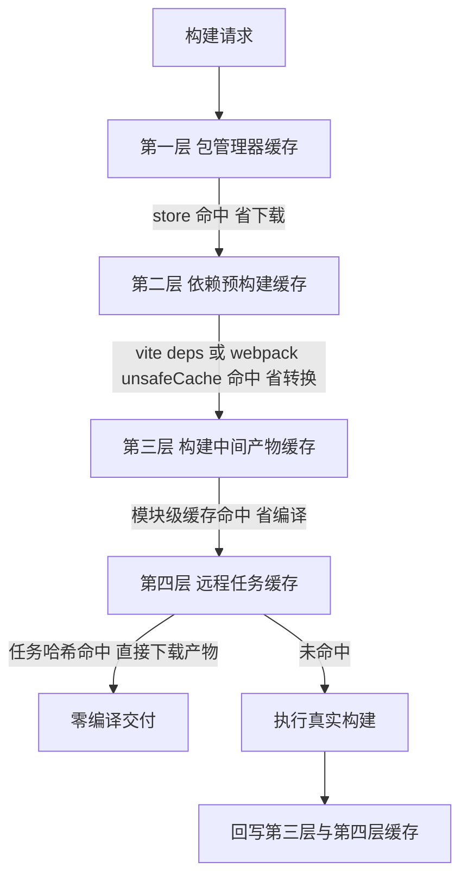

```yaml
# .github/workflows/cache-all-layers.yml：四层缓存的 CI 落法（pnpm + vite 项目）
name: ci
on: pull_request
jobs:
  build:
    runs-on: ubuntu-latest
    steps:
      - uses: actions/checkout@v4
      - uses: pnpm/action-setup@v4
      - uses: actions/setup-node@v4
        with: { node-version: 22, cache: pnpm }         # 第一层：pnpm store 缓存
      # 第二层：vite 预构建缓存（key 含 lockfile hash）
      - uses: actions/cache@v4
        with:
          path: node_modules/.vite
          key: vite-deps-${{ runner.os }}-${{ hashFiles('pnpm-lock.yaml') }}
      # 第三层：tsc 增量与 lint 缓存
      - uses: actions/cache@v4
        with:
          path: |
            .cache/tsbuildinfo
            .eslintcache
          key: intermediate-${{ runner.os }}-${{ github.sha }}-${{ hashFiles('pnpm-lock.yaml') }}
          restore-keys: intermediate-${{ runner.os }}-
      # 第四层：turborepo 远程缓存（签名 + OSS 自建，见 BLD-158）
      - run: pnpm install --frozen-lockfile
      - run: pnpm turbo build --api=http://turbo-cache.internal --token=${{ secrets.TURBO_TOKEN }}
```

### BLD-158：Turborepo 远程缓存的原理与自建：哈希怎么算、签名怎么校验？
**答**：
- **哈希计算**：任务哈希 = hash(包内文件内容 + lockfile + turbo.json 中该任务配置 + 依赖闭包各包哈希 + 环境变量（`env` 声明）+ 全局依赖)；**输入变 → 哈希变 → 必 miss**，这保证了命中即等价（正确性根基）。
- **协议**：`GET /v8/artifacts/<hash>` 拉取、`PUT /v8/artifacts/<hash>` 上传，body 是 tar.gz（outputs 里声明的文件 + turbo-run? 元数据）；服务端只是"哈希寻址的对象存储"，自建门槛很低。
- **签名**：`signature: true` 时上传前用 TURBO_TOKEN（HMAC）对内容签名，拉取端校验，防止缓存被恶意替换（供应链安全项）；`teamId` 做租户隔离。
- 命中率的两大杀手：环境变量未声明（构建读到外部变量 → 同哈希不同产物）与 `globalDependencies` 遗漏（turbo.json 外的共享配置变更不进哈希）。

```json
// turbo.json：远程缓存的正确性配置（哪些输入必须进哈希）
{
  "$schema": "https://turbo.build/schema.json",
  "globalDependencies": [".env.example", "tsconfig.base.json"],
  "globalEnv": ["NODE_ENV", "CI"],
  "tasks": {
    "build": {
      "dependsOn": ["^build"],
      "outputs": ["dist/**"],
      "inputs": ["$TURBO_DEFAULT$", "!**/*.test.ts"],
      "env": ["APP_VERSION", "SENTRY_DSN"],   // 读到的环境变量必须声明，否则哈希不含它
      "passThroughEnv": ["AWS_REGION"]         // 影响构建但不进哈希（慎用，正确性风险）
    },
    "test": { "outputs": ["coverage/**"] }
  },
  "remoteCache": { "signature": true }         // 上传/下载校验签名，防缓存投毒篡改
}
```

```bash
# 自建远程缓存的最小服务（Node 版协议实现，哈希寻址对象存储 + 签名校验）
# server.js —— 部署在内网，TURBO_API 指向它即可
const express = require('express');
const crypto = require('crypto');
const app = express();
const TOKEN = process.env.TURBO_TOKEN;         // 与团队共享的签名密钥
const store = new Map();                       // 生产替换为 OSS/S3

const check = (req, res, next) => {
  const team = req.get('x-turbo-team');
  const sig = req.get('x-signature') ?? '';
  const expect = crypto.createHmac('sha256', TOKEN).update(req.path).digest('hex');
  if (team !== 'main' || (process.env.REQUIRE_SIG === '1' && sig !== expect)) {
    return res.status(401).end();              // 租户隔离 + 可选签名校验
  }
  next();
};
app.route('/v8/artifacts/:hash')
  .get(check, (req, res) => {
    const hit = store.get(req.params.hash);
    if (!hit) return res.status(404).end();    // 404 = miss，turborepo 自动真实构建
    res.set('content-type', 'application/octet-stream').send(hit);
  })
  .put(check, express.raw({ type: '*/*', limit: '2gb' }), (req, res) => {
    store.set(req.params.hash, req.body);      // 200 = accepted
    res.end();
  });
app.listen(3000);
# 使用：turbo build --api=http://cache.internal --token=$TURBO_TOKEN --team=main
```

### BLD-159：GitHub Actions 缓存设计：actions/cache 的 key 策略与命中率排查。
**答**：
- key 设计公式：`前缀-平台-内容哈希`；**restore-keys** 提供前缀回落（lockfile 变了也能部分命中）；缓存是**分支只读共享**（PR 能读 main 的缓存，写入只有默认分支可见）——这是"PR 命中率莫名低"的第一原因。
- 典型 key：`node-deps-${{ runner.os }}-${{ hashFiles('**/pnpm-lock.yaml') }}`；lockfile 未变则命中，变了靠 restore-keys 拿旧的装增量。
- 排查三步：看 Actions 日志里 `Cache restored from key` / `Cache not found`；对比 key 里的哈希段（`hashFiles` 是否覆盖了真正的输入）；确认 job 是否在非默认分支写缓存（写了也白写）。
- 限制：单仓 10GB（超过 LRU 淘汰）、同 key 不可更新（immutable）、`actions/setup-node cache: pnpm` 是 pnpm store 的专用封装。

```yaml
# 命中率优化后的完整缓存策略（多应用 monorepo）
jobs:
  build-app-a:
    steps:
      - uses: actions/checkout@v4
      # 依赖缓存：lockfile 哈希 + 平台 + 工具版本
      - uses: actions/cache@v4
        id: node-modules
        with:
          path: |
            node_modules
            apps/*/node_modules
            packages/*/node_modules
          key: mods-${{ runner.os }}-pnpm9-${{ hashFiles('**/pnpm-lock.yaml') }}
          restore-keys: |
            mods-${{ runner.os }}-pnpm9-
            mods-${{ runner.os }}-
      - if: steps.node-modules.outputs.cache-hit != 'true'
        run: pnpm install --frozen-lockfile
      # 构建缓存：按应用隔离 + 包含分支号段，供后续 PR 复用
      - uses: actions/cache@v4
        with:
          path: apps/app-a/node_modules/.cache
          key: build-appa-${{ runner.os }}-${{ github.sha }}
          restore-keys: |
            build-appa-${{ runner.os }}-      # 前缀回落：拿最近一次的增量缓存
# 排查清单：
# 1. hashFiles 是否命中实际文件（**/pnpm-lock.yaml 覆盖所有 workspace）
# 2. PR 是否在读 main 写入的缓存（PR 写的缓存其他 run 读不到）
# 3. 10GB 上限是否触发了 LRU 清理（Settings→Actions→Caches 看列表）
```

### BLD-160：webpack filesystem 缓存调优：buildDependencies 与 snapshot 管理细节。
**答**：
- 调优三件套：`cache.name` 隔离场景（dev/test/build 各一份）；`buildDependencies.config` 必须含配置文件与关键 json（漏了就是脏缓存重灾区）；`managedPaths` 把 node_modules（pnpm 加 .pnpm 路径）纳入信任区，快照对比跳过海量文件。
- snapshot 策略：默认 timestamp（mtime+size）够用；如果 loader/依赖有"内容变但 mtime 不变"（如 git checkout 精确还原、CI 容器层缓存），切 `snapshot: { module: { hash: true } }`（构建变慢但正确）。
- 缓存文件治理：`cache.maxAge`（默认 30 天）、`maxGenerations`；CI 里把 `node_modules/.cache/webpack` 缓存上传下载（key 含 `cache.name` + lockfile + 配置哈希）。
- 验证手段：`webpack --profile --progress` 后 stats 里看 `cachedModules` 占比；`cache.profile: true` 输出缓存构建详情。

```javascript
// webpack.config.js：缓存调优的生产配置（含 CI 场景分支）
const path = require('path');
module.exports = (env, argv) => {
  const isCI = !!process.env.CI;
  return {
    cache: {
      type: 'filesystem',
      name: `${argv.mode}-${process.env.APP_ENV ?? 'local'}`,   // 场景隔离
      version: process.env.BUILD_CACHE_VERSION ?? '1',          // 紧急情况全量失效的开关
      buildDependencies: {
        config: [
          __filename,
          path.resolve('tsconfig.json'),
          path.resolve('postcss.config.js'),
          path.resolve('src/theme.vars.js'),   // loader 读取的任何外部文件都要进来
        ],
      },
      managedPaths: [path.resolve('node_modules')],   // pnpm: 再加 node_modules/.pnpm
      maxGenerations: isCI ? 1 : 5,    // CI 每次全新，内存版 1 轮即可；本地多轮
      maxAge: 1000 * 60 * 60 * 24 * 14,
      profile: process.env.WEBPACK_CACHE_PROFILE === '1',
    },
    snapshot: {
      // CI 的 docker layer 可能造成 mtime 失真：CI 用 hash 快照保证正确性
      module: isCI ? { hash: true } : { timestamp: true },
      resolve: isCI ? { hash: true } : { timestamp: true },
      buildDependencies: { hash: true },
    },
  };
};
```

### BLD-161：vite 预构建缓存失效排查实战：谁动了 node_modules/.vite？
**答**：
- 预构建缓存 key 是 **lockfile 内容 + optimizeDeps 相关配置的哈希**（`getDepHash`）：lockfile 任何字节变化、`optimizeDeps.include/exclude/esbuildOptions`、`resolve.alias`、`define`、`plugins` 数量? 部分配置都会使哈希变化 → 目录重建。
- 排查流程：`--debug optimizeDeps` 看 "hash changed" 日志 → 二分回退配置（git stash 配置变更）→ 常见元凶：动态插件根据 env 返回不同配置、CI 里 `npm install` 修改了 lockfile、时区/locale 影响扫描顺序。
- 症状清单：启动慢（每次都重建）、首屏出现两次 full-reload（新依赖被运行时发现）、`deps` 目录时间戳总是当前时间。
- 缓解：CI 用 `vite optimize` 预热 + 缓存 `node_modules/.vite`；本地 `server.warmup.clientFiles` 预热源码转换。

```bash
# vite 预构建缓存失效的排查序列
npx vite --debug optimizeDeps 2>&1 | grep -E 'hash|scan|optimized' | head -20
# 日志解读：
#   [vite] optimized dependencies changed. reloading   ← 运行时发现新依赖（include 缺失）
#   hash changed: xxxx -> yyyy                          ← 缓存判定失效，即将重建

# 1. 确认 lockfile 是否被改：
git diff --stat pnpm-lock.yaml
# 2. 确认配置指纹是否漂移（常见：插件按 env 生成不同 options）
vite --mode production optimize 2>&1 | grep 'hash:'   # 打印两次 mode 的 hash 对比
# 3. CI 预热 + 缓存目录：
npx vite optimize    # 单独跑预构建，产物进 node_modules/.vite/deps
```

```yaml
# CI 中缓存 vite 预构建产物（key 与失效逻辑对齐）
- uses: actions/cache@v4
  with:
    path: node_modules/.vite
    key: vite-deps-${{ runner.os }}-${{ hashFiles('pnpm-lock.yaml') }}-${{ hashFiles('vite.config.*') }}
# 配合：pnpm exec vite optimize 在 build 前跑，把"扫描+打包依赖"提前到缓存恢复之后
```

### BLD-162：CI 缓存安全：缓存投毒风险与隔离设计。
**答**：
- 攻击面：缓存 key 可被低权限 PR 构造（与目标 run 相同 key），**写入的恶意内容被高权限 workflow 读取**（如被替换的构建产物、node_modules 里的 postinstall 脚本）——GitHub 官方文档明确 cache 是不可信输入。
- 防线一（隔离）：按 `github.ref` 隔离写入面（PR 缓存仅供该 PR），高权限 job（部署/发布）**只读受保护分支产出的缓存**或不读缓存。
- 防线二（校验）：拉取的 node_modules 构建前跑 `pnpm install --frozen-lockfile`（会校验 store 完整性）、产物校验 hash 签名（turborepo signature）、lockfile diff 卡口。
- 通用原则：缓存 = 性能优化层，绝不能影响正确性——"缓存命中等价于真实执行"必须由内容哈希保证（turborepo/webpack 的设计都遵循）。

```yaml
# 危险示例与加固对照（同一文件内演示）
jobs:
  pr-build:                       # 低权限：PR 预览构建
    steps:
      - uses: actions/cache@v4
        with:
          # 加固点 1：key 带上 ref 隔离，PR 的缓存不会污染其他上下文
          key: deps-${{ github.ref_name }}-${{ hashFiles('pnpm-lock.yaml') }}
          path: node_modules
      - run: pnpm install --frozen-lockfile   # 加固点 2：无网安装校验一致性
  release:                        # 高权限：发布（只有 main + tag 触发）
    if: github.ref == 'refs/heads/main'
    steps:
      - uses: actions/checkout@v4
      # 加固点 3：发布链路不使用任何缓存（或只读 main 前缀缓存）
      - run: pnpm install --frozen-lockfile --ignore-scripts
      - run: pnpm build && pnpm changeset publish
        env: { NPM_TOKEN: '${{ secrets.NPM_TOKEN }}' }
# 结论：缓存永远不进"信任链"，只允许加速"可重建"的输入
```

### BLD-163：增量正确性：什么情况下必须放弃缓存做全量构建？
**答**：
- 触发全量的信号：**构建配置/插件版本变化**（webpack 配置、vite.config、buildDependencies）、**依赖树变化**（lockfile diff）、**构建环境变化**（node 版本、基镜像、架构、编译 wasm 的机器架构）、**缓存版本号 bump**（cache.version、turbo globalDependencies 中的共享配置）。
- "内容指纹"必须覆盖所有影响产物的输入，漏一个就产生脏缓存（产物错误但构建成功——最危险的事故形态：上线后行为不一致且难复现）。
- 实操：CI 里用 `turbo build --force` 强制全量（发布 job）；日常 PR 用增量；发布前加"全量构建 + 与增量产物 hash 对比"的抽查（发现指纹漏项）。
- 检测手段：定期跑双构建 diff（`diff -r dist-incremental dist-full` 或对每个文件算 sha256），任何不一致 = 指纹模型有缺口。

```bash
#!/usr/bin/env bash
# scripts/verify-increment.sh：增量产物与全量产物的一致性抽查
set -euo pipefail
# 1. 增量构建（带缓存）
turbo build --output-logs=errors-only
cp -r apps/web/dist /tmp/dist-incremental
# 2. 全量构建（--force 跳过所有缓存）
turbo build --force --output-logs=errors-only
mv apps/web/dist /tmp/dist-full
# 3. 指纹一致性校验（忽略 contenthash 文件名的映射差异：按内容哈希集合对比）
(cd /tmp/dist-incremental && find . -type f -exec sha256sum {} \; | awk '{print $1}' | sort) > /tmp/h1
(cd /tmp/dist-full        && find . -type f -exec sha256sum {} \; | awk '{print $1}' | sort) > /tmp/h2
if ! diff /tmp/h1 /tmp/h2 > /dev/null; then
  echo "[FAIL] 增量产物与全量不一致：缓存输入指纹有缺口" >&2
  diff /tmp/h1 /tmp/h2 | head
  exit 1
fi
echo "[OK] 增量构建可证明等价于全量"
# 定期在 CI 的 nightly job 跑：指纹缺口的最后一道检测网
```

## 十八章 构建产物与运行时（BLD-164 ~ BLD-170）

### BLD-164：产物的浏览器兼容矩阵管理：browserslist 到各构建工具的联动全解。
**答**：
- 单一事实源：项目根的 `browserslist` 配置被 **babel（preset-env）、postcss/autoprefixer、vite（build.target）、terser/esbuild（语法降级目标）、core-js（polyfill 注入量）** 共同消费——改一处矩阵，全链路产物目标同步变化。
- 联动缺口与补法：vite 的 `build.target` 与 browserslist 不是自动同步的（vite 有自己的 esbuild target），需要插件（如 `browserslist-to-esbuild`）桥接；webpack 需要 `@babel/preset-env` 读 browserslist、terser 的 `ecma` 手动对齐。
- 矩阵治理：季度 review 覆盖率（`browserslist --coverage`）、dead browser 淘汰（`not dead`）、灰度新目标（先 `defaults` 后收紧）；降级产物（legacy build 双份 + `nomodule`）是矩阵的执行手段之一。
- 验证：`npx browserslist` 列出实际命中、`esbuild --target` 与 babel debug 输出对比、产物跑 `eslint-plugin-compat`? （源码层 API 检查）。

```json
// package.json：兼容矩阵（单一事实源）
{
  "browserslist": [
    "defaults",                    // >0.5%, last 2 versions, Firefox ESR, not dead
    "not op_mini all",
    "maintained node versions"
  ]
}
```

```javascript
// vite.config.ts：把 browserslist 桥接进 esbuild target（消除联动缺口）
import browserslistToEsbuild from 'browserslist-to-esbuild';
export default defineConfig({
  build: {
    // 未桥接的坑：vite 默认 target 'modules'（es2020 基线）与 browserslist 的 ie11 目标脱节
    target: browserslistToEsbuild(),     // 读 package.json 的 browserslist → esbuild 目标数组
    cssTarget: browserslistToEsbuild(),  // CSS 压缩目标同样对齐
  },
});
// webpack 侧对齐检查（webpack.config.js）：
// babel: preset-env 不写 targets（自动读 browserslist）
// terser: terserOptions.ecma = 2018（按矩阵下限手写或脚本生成）
// autoprefixer/postcss-preset-env：自动读 browserslist（零配置联动）
// 产物验证链：
//   npx browserslist --coverage        覆盖率报告
//   npx esbuild --target=es2015 --bundle app.js   模拟矩阵下限编译
//   grep -r "async function" dist/     目标含 es2017+ 时产物应保留 async（未转译即目标正确）
```

### BLD-165：动态 import 的运行时实现：webpack jsonp loadScript 的源码级解读。
**答**：
- `import('./lazy')` 编译为 `__webpack_require__.e("lazy_chunk").then(() => __webpack_require__.t("./lazy.js", 0))`：`.e` 负责加载 chunk 文件（script/jsonp），`.t` 负责 interop 取模块。
- 加载内核：`__webpack_require__.l`（loadScript）创建 `<script src=publicPath+chunkId.contenthash.js>`，通过 `onScriptComplete` 监听 load/error；chunk 真正的"加载完成"信号是文件尾部的 `webpackChunk.push([chunkIds, modules])` 把 `installedChunks[chunkId]` 的 promise resolve 掉。
- 错误处理：script onerror → reject promise → **删除失败 script 标签**（允许重试）、chunk 加载失败标记 `installedChunks[chunkId] = undefined` 可再次尝试；上线发版后旧 hash 404 的"动态路由白屏"就是这里 reject 未被 catch。
- 面试要点：contenthash 文件名 + `document.head.appendChild` 时序 + promise 状态机三层讲清；对比 vite 的 import() 运行时（原生 ESM，无需 preload 机制，dev 下没有 chunk 加载这一步）。

```javascript
// dist/runtime（LoadScriptRuntimeModule + chunk loading，逐行注释版）
var installedChunks = { main: 0 };   // 0=已加载；数组=[resolve,reject]；undefined=失败可重试

// ① script 加载器：promise 化的动态 script 注入
__webpack_require__.l = (url, done, key, chunkId) => {
  if (inProgress[url]) { inProgress[url].push(done); return; }
  var script, needAttach;
  var onScriptComplete = (prev, event) => {
    if (script.readyState && script.readyState !== 'complete' && script.readyState !== 'loaded') return;
    clearTimeout(timeout);                                  // ② 120s 超时兜底（__webpack_chunk_load_timeout__）
    var scriptDone = event && (event.type === 'load' ? 'complete' : 'error');
    // error 时清理：允许 promise retry 重新注入 script
    if (scriptDone === 'error') { /* remove script node */ }
    done && done(scriptDone, event);
  };
  // ③ 创建 script：contenthash 文件名 + crossorigin + charset
  script = document.createElement('script');
  script.src = url;                                          // __webpack_require__.p + "js/" + chunkId + "." + hash + ".js"
  inProgress[url] = [done];
  needAttach && document.head.appendChild(script);
};

// ④ ensureChunk：查状态机 → 未加载则拼 url 并挂 f.j 回调
__webpack_require__.e = (chunkId) => Promise.all(
  Object.keys(__webpack_require__.f).reduce((promises, key) => {
    __webpack_require__.f[key](chunkId, promises);
    return promises;
  }, [])
);
__webpack_require__.f.j = (chunkId, promises) => {
  var installed = installedChunks[chunkId];
  if (installed !== 0) {
    if (installed) promises.push(installed[2]);              // 加载中：复用同一 promise
    else promises.push(installedChunks[chunkId] = new Promise((resolve, reject) => {
      var url = __webpack_require__.p + "js/" + ({}[chunkId] || chunkId) + "." + { "lazy": "8f3c" }[chunkId] + ".chunk.js";
      __webpack_require__.l(url, (status, event) => {
        if (status !== 'complete') {                         // ⑤ 失败：清状态可重试
          delete installedChunks[chunkId];
          script.onerror = script.onload = null; clearTimeout(timeout);
          reject(new Error('Loading chunk ' + chunkId + ' failed.\n(' + status + ')'));
        } else resolve();                                    // 成功由 chunk 尾部 webpackChunk.push 兜底 resolve
      });
      var timeout = setTimeout(() => __webpack_require__.l(url, null, null, chunkId, 'timeout'), 120000);
    }));
  }
};

// 业务侧最佳实践：动态 import 必须有失败降级（发版后旧 hash 404 的标准解法）
// const mod = await import('./lazy').catch(() => location.reload());  // chunk 404 → 整页刷新拿新 manifest
```

### BLD-166：publicPath 运行时注入：__webpack_public_path__ 与动态 CDN 场景。
**答**：
- 静态 publicPath 写死在 runtime 的 `__webpack_require__.p`；**运行时注入**解决"同一份产物发到多环境/多 CDN"：入口**最顶部**（任何 import 生效前）执行 `__webpack_public_path__ = window.__CDN__`——必须在 webpack 处理的第一个模块里，因为 `.p` 在模块加载前就可能被动态 import 读取。
- webpack5 的 `output.publicPath: 'auto'`：从 `document.currentScript.src` 自动推导（AutoPublicPathRuntimeModule），多 CDN 域名场景天然适配；SSR 下无 document，需要手动注入。
- 动态 CDN 进阶：按 chunk 维度分流（`chunkLoadingGlobal` + 自定义 loadScript、或插件改写 `__webpack_require__.p` 为函数化? 常规做法是 publicPath 用相对路径 + 前端网关重写）。
- 坑：`__webpack_public_path__` 赋值写在 `import` 之后的模块里会失效（模块加载顺序）；ESM 严格模式下它是 webpack 定义的 free var，TS 需要 `declare` 声明。

```javascript
// webpack.config.js
module.exports = {
  output: {
    publicPath: 'auto',       // 运行时自动推导（推荐）；或 '/' 静态默认
    crossOriginLoading: 'anonymous', // CDN 场景必配（错误上报需要跨域脚本栈）
  },
};
```

```typescript
// src/public-path.ts：必须是构建处理的第一个模块（entry 数组第一项）
// webpack.config.js entry: ['./src/public-path', './src/index']
declare const __webpack_public_path__: string;
// 方案一：部署平台注入的 window 变量（同产物多环境）
__webpack_public_path__ = (window as any).__CDN_BASE__ ?? '//cdn.example.com/static/';
// 方案二：currentScript 推导（auto 模式的手动版，兼容场景用）
// const cur = (document.currentScript as HTMLScriptElement)?.src;
// __webpack_public_path__ = cur?.slice(0, cur.lastIndexOf('/') + 1) ?? '/';

// webpack.config.js 的 entry 保证顺序：
// entry: { main: ['./src/public-path.ts', './src/main.tsx'] }
// 产物运行时对应：__webpack_require__.p = window.__CDN_BASE__
// 之后所有 chunk/worker/动态 import 都从注入的 CDN 基址拉取——一份产物多环境发布的核心机制
```

### BLD-167：SSR 产物与客户端产物差异：manifest 与资源映射协议。
**答**：
- 三份产物：**client bundle**（浏览器，含 hydration 逻辑）、**server bundle**（Node，渲染 React/Vue 树，external node_modules）、**manifest**（映射协议：源模块→产物 chunk/css）。
- server bundle 里 `import App from './App'` 需要知道 App 在客户端对应哪个 chunk、依赖哪些 CSS——`ssr-manifest.json`/`webpack manifest`（StatsPlugin）提供 `module.id → chunk files[]` 映射，SSR 渲染时遍历已执行模块收集 `preload <link>` 与关键 CSS 注入 HTML。
- webpack 侧等价物：`webpack-manifest-plugin` + `stats.json`（chunksByModule? 通过 stats 的 modules 字段聚合），React 生态的 loadable-components/babel-plugin-react-loadable 都是这套协议的封装。
- 一致性风险：server 与 client 产物必须**同一次构建产出**（同一 hash 集合），分次构建会造成 hydration 不匹配——CI 上 SSR 项目发布 = client+server+manifest 原子发布。

```javascript
// webpack.ssr.config.js：manifest 协议的生产实现（webpack5）
const { WebpackManifestPlugin } = require('webpack-manifest-plugin');
const { StatsWriterPlugin } = require('webpack-stats-plugin');

module.exports = [
  { // ── client 构建 ──
    name: 'client',
    entry: './src/entry-client.tsx',
    output: { path: 'dist/client', filename: '[name].[contenthash].js', publicPath: '/static/' },
    plugins: [
      new WebpackManifestPlugin({ fileName: 'manifest.json' }),   // 入口级映射
      // stats.json：模块→chunk 映射（SSR 收集 preload/css 用）
      new StatsWriterPlugin({
        filename: '../stats.json',
        stats: { all: false, modules: true, chunks: true, assets: true },
        transform: (data) => JSON.stringify({
          assetsByChunkName: data.assetsByChunkName,
          // 模块级映射：moduleId -> 所属 chunk 产物
          modules: data.modules.map((m) => ({ id: m.id, chunks: m.chunks, name: m.name })),
        }),
      }),
    ],
  },
  { // ── server 构建 ──
    name: 'server',
    entry: './src/entry-server.tsx',
    target: 'node',
    output: { path: 'dist/server', filename: 'server.js', libraryTarget: 'commonjs2' },
    externals: [/^(?!\.|\/)[^/]+$/],    // node_modules 全外部化
    // resolve.alias: { 'loadable-manifest': './dist/client/loadable-stats.json' }
  },
];
// entry-server 内：loadableChunks() 收集渲染中命中的模块 → 查 manifest →
// 产出 { html, preloadTags, cssTags } 注入模板 —— SSR 资源映射协议的闭环
```

### BLD-168：CSS-in-JS 的构建期优化：extract、zero-runtime 与运行时方案的对比。
**答**：
- 三代方案：**运行时**（styled-components/emotion，构建期几乎不优化，产物含 runtime ~10KB + 首帧样式注入）；**构建期 extract**（babel 插件把样式抽成 .css 文件 + 类名，保留 DX 去 runtime 成本）；**zero-runtime**（linaria/pandaCSS/vanilla-extract，编译期完成，产物即 CSS，无运行时）。
- extract 关键机制：babel plugin 在 transform 阶段把 `css`/`styled` 调用**静态求值**为类名与样式字符串，写入虚拟 css 模块；动态值（props 驱动）只能降级 CSS 变量传递——"动态样式走 CSS 变量"是所有编译方案的设计核心。
- 选型维度：设计 token 体系（panda/vanilla-extract 强）、组件库形态（需 SSR/CDN 直出 CSS）、DevTools 体验、与现有 tailwind 的共存。
- 迁移 ROI：从运行时方案迁 zero-runtime 的收益点 = 首屏 JS -10~15KB、无样式闪烁（FOUC? 提取后预载）、SSR 无需样式收集。

```javascript
// babel.config.js：@linaria 的构建期提取（zero-runtime 代表）
module.exports = {
  presets: [
    ['@babel/preset-react'],
    ['@babel/preset-typescript'],
    // linaria 的 extractor 必须排在 esbuild/转译之后、且要看到完整语法
    ['@linaria/babel-preset', {
      sourceMap: process.env.NODE_ENV !== 'production',
      displayName: process.env.NODE_ENV !== 'production',   // dev 下类名带组件名，便于调试
      evaluate: true,      // 静态求值 styled 内的模板表达式（零运行时的关键开关）
    }],
  ],
};
// 源码：
// const Title = styled.h1`color: var(--brand); font-size: ${props => props.size}px;`
// 产物：
// index.css:   .Title__t1z9k { color: var(--brand); font-size: var(--title-size); }
// index.js:    const Title = "Title__t1z9k";   ← 组件运行时只是一个类名字符串
//              动态值： <h1 style={{ '--title-size': size + 'px' }} class="Title__t1z9k">
// 对比 styled-components：产物含 runtime + 逐帧 injectStyle 调用；linaria 产物 = 纯 CSS
```

### BLD-169：构建期常量注入的滥用风险：DefinePlugin 注入 JSON 的那些坑。
**答**：
- 坑一 **JSON 引号与转义**：`new DefinePlugin({ __CFG__: cfg })` 若 cfg 是对象需 `JSON.stringify`；注入字符串忘加引号会变成变量引用（运行时 ReferenceError）；注入含 `</script>` 的文案会**破坏 HTML 内联产物**（需要 `JSON.stringify(x).replace(/</g, '\\u003c')`）。
- 坑二 **引用点替换语义**：define 只替换**代码文本**，`obj.a === process.env.X`、`typeof process.env.X`、动态 key 都不符合预期；`typeof __CFG__` 在某些替换路径下仍是 object 假阳性。
- 坑三 **体积与安全**：大对象注入等于把数据打包进每个引用文件（应生成虚拟模块让产物只打包一次）；把非公开配置注入前端产物即泄露（与 BLD-139 同源）。
- 正确姿势：结构化配置走 virtual module（onLoad/env-ns）而非 define；define 只留少量原始标量（NODE_ENV、版本号、feature flag 布尔）。

```javascript
// 反模式 → 正确姿势对照
const webpack = require('webpack');
const appConfig = require('./config/app.json'); // 10KB 的业务配置

module.exports = {
  plugins: [
    // ── 反模式一：直接注入对象（未 stringify → 变量引用，运行时崩） ──
    // new webpack.DefinePlugin({ __CFG__: appConfig }),
    // ── 反模式二：stringify 了但含 </script>（HTML 内联产物被截断） ──
    // new webpack.DefinePlugin({ __CFG__: JSON.stringify(appConfig) }),

    // ── 正确姿势一：标量进 define，且转义 < ──
    new webpack.DefinePlugin({
      'process.env.BUILD_VERSION': JSON.stringify(process.env.BUILD_VERSION ?? 'dev'),
      __FEATURE_NEW_CHECKOUT__: JSON.stringify(true),
      // 转义防 HTML 截断（若确需注入字符串）：
      // __MSG__: JSON.stringify(msg).replace(/\u2028|\u2029/g, m => '\\u' + m.charCodeAt(0).toString(16)),
    }),

    // ── 正确姿势二：结构化配置走虚拟模块（产物只含一次，且可 tree-shake） ──
    // esbuild/rollup 用 onLoad；webpack 用 virtual module 等价实现：
    new webpack.NormalModuleReplacementPlugin(/^app-config$/, (res) => {
      res.request = path.resolve('config/app.build.js');   // 构建期选择真实配置文件
    }),
  ],
};
// 虚拟模块产物收益：import cfg from 'app-config' 只在用到的 chunk 打包一份；
// define 注入大 JSON 则会在**每个引用文件**重复出现（bundle 体积按引用次数翻倍）。
```

### BLD-170：产物完整性：SRI 的生成、fallback 与 CI 集成。
**答**：
- **SRI（Subresource Integrity）**：`<script src crossorigin="anonymous" integrity="sha384-<base64(sha256)>">`，浏览器校验资源哈希，防 CDN 篡改与劫持注入——第三方 CDN/公共库场景的标配安全项。
- 生成时机：构建后由插件计算每个 hash 产物的完整性值并写入 HTML（`webpack-subresource-integrity` 插件 / vite 用 `vite-plugin-sri`），**必须在 contenthash 定稿之后**（processAssets 末段）。
- 限制：`crossorigin="anonymous"` 要求 CDN 正确返回 CORS 头（`Access-Control-Allow-Origin`），否则资源被浏览器拒绝加载——上线前必须验证；**动态 import 的 chunk 也能覆盖**（webpack 插件给 loadScript 加 integrity 属性）。
- CI 集成：发布后爬取 HTML 校验 integrity 与实际产物哈希一致（防发布流程错位），作为上线卡口之一。

```javascript
// webpack：SRI 全链路配置
const HtmlWebpackPlugin = require('html-webpack-plugin');
const { SubresourceIntegrityPlugin } = require('webpack-subresource-integrity');

module.exports = {
  output: {
    crossOriginLoading: 'anonymous',     // SRI 前置条件：脚本必须带 crossorigin
    hashFunction: 'sha256',              // webpack5 支持 sha256/sha384/sha512
  },
  plugins: [
    new SubresourceIntegrityPlugin({
      hashFuncNames: ['sha384'],
      enabled: process.env.NODE_ENV === 'production',
      // 动态 chunk 同样注入 integrity（loadScript 时读取）
    }),
    new HtmlWebpackPlugin({ template: './index.html' }),
    // 产物 HTML 示例：
    // <script src="//cdn.example.com/main.3f2a91.js"
    //         crossorigin="anonymous"
    //         integrity="sha384-x8R2v8kQbJ0mJz5S7gV1uP9rWqLmN4TzYb2cA1eD5fGhIjKlMnOpQrStUvWxYz01="></script>
  ],
};
```

```bash
# CI 上线卡口：校验 HTML 里的 SRI 与产物实际哈希一致（scripts/check-sri.sh）
#!/usr/bin/env bash
set -euo pipefail
CDN_BASE="https://cdn.example.com"
fail=0
for tag in $(grep -oP 'src="[^"]+" integrity="sha384-[^"]+"' dist/index.html | sed 's/src="//;s/" integrity="/ /;s/"$//'); do
  url=$(echo "$tag" | cut -d' ' -f1); expect=$(echo "$tag" | cut -d' ' -f2)
  actual="sha384-$(curl -fsSL "$CDN_BASE/$url" | openssl dgst -sha384 -binary | openssl base64 -A)"
  if [ "$actual" != "$expect" ]; then
    echo "[FAIL] SRI 不匹配: $url"; fail=1
  fi
done
# 同时校验 CORS 头（SRI 生效前提）：
curl -sI "$CDN_BASE/js/main.js" | grep -qi 'access-control-allow-origin' || { echo "[FAIL] CDN 缺 CORS 头"; fail=1; }
exit $fail
```

## 十九章 工程化与协作（BLD-171 ~ BLD-178）

### BLD-171：构建配置的分层组织：presets、工厂函数、配置即 npm 包怎么设计？
**答**：
- 三层结构：**内核层**（组织内 npm 包，如 `@org/webpack-preset`，封装 90% 默认值与插件链）→ **应用层**（各项目配置文件只声明差异：入口、代理、feature flag）→ **覆盖层**（本地 env/命令行参数，不改包配置就能临时覆盖）。
- 工厂函数优于"配置对象平铺"：`(options) => webpackConfig` 支持组合（spread 合并多 preset）、条件分支（env/mode）、类型提示（TS 定义 PresetOptions）；merge 策略要显式（webpack-merge 或自定义 rules 合并函数，避免数组覆盖丢 loader）。
- 版本化与治理：内核包 semver + 各项目锁版本（lockfile）； breaking 变更走 codemod（CLI 工具批量升级各仓配置文件）。
- 面试要点：说出"配置漂移"问题（各仓手改配置导致行为不一致）与"包化后灵活性损失"的权衡——preset 必须提供 escape hatch（`config.webpackConfigOverride` 钩子）。

```javascript
// packages/build-preset/index.js：组织级构建内核（工厂函数 + 组合）
const { mergeWithRules, merge } = require('webpack-merge');

// 基础 preset：所有应用共享
const base = ({ name }) => ({
  output: { filename: 'js/[name].[contenthash:8].js', publicPath: 'auto' },
  module: { rules: [
    { test: /\.(png|jpe?g|svg)$/, type: 'asset', parser: { dataUrlCondition: { maxSize: 4096 } } },
  ]},
  optimization: { runtimeChunk: 'single', splitChunks: { chunks: 'all' } },
});

// 能力 preset：按需叠加（组合而非继承）
const withTS = () => ({ module: { rules: [{ test: /\.tsx?$/, use: 'builtin:swc-loader' }] } });
const withLess = (vars) => ({ module: { rules: [{ test: /\.less$/, use: ['style-loader', 'css-loader', {
  loader: 'less-loader', options: { lessOptions: { modifyVars: vars } } }] }] } });

// 应用层最终 API：一行组装
function createAppConfig({ name, features = {}, overrides, env = {} }) {
  let config = base({ name });
  if (features.typescript !== false) config = merge(config, withTS());
  if (features.theme) config = merge(config, withLess(features.theme));
  // escape hatch：应用侧最后一次覆盖机会（审计日志保证可控）
  config = mergeWithRules({ module: { rules: { test: 'match', use: 'replace' } } })(config, overrides ?? {});
  return config;
}
// 应用项目里只剩：
// module.exports = createAppConfig({ name: 'checkout', features: { theme: { 'brand-color': '#f60' } },
//   overrides: { devServer: { port: 8001 } } });
```

### BLD-172：脚手架中的构建模板设计：eject 与继承式两派的取舍。
**答**：
- **eject 派**（CRA 风格）：模板复制进项目，完全自主、无黑盒；代价是无法接收上游升级（放弃治理），适合"脚手架只是起点"的团队。
- **继承派**（vue-cli service / Rspack Rsbuild / 内部 preset 包）：配置藏在依赖里，CLI 驱动；升级 = 升依赖版本；灵活性靠 plugin/配置合并钩子——主流选择。
- 混合实践：默认继承 + `--eject` 逃生门（导出当前 resolved 配置），配合"配置快照测试"（升级 preset 后跑产物 diff）。
- 脚手架模板要点：模板即代码（handlebars/占位符注入项目名、registry、上报 ID）、生成后必须可跑（含 dev/test/build 三命令）、留 TODO 标记可裁剪区。

```javascript
// 继承式脚手架的 service 层设计（@org/cli-service 简化版）
// package.json bin: { "org-service": "./bin/service.js" }
// bin/service.js：命令分发（dev/build/test 都收敛到 service，项目不直接写 webpack）
const createConfig = require('../lib/create-config');
const webpack = require('webpack');
const WebpackDevServer = require('webpack-dev-server');

async function serve() {
  const config = await createConfig({
    projectRoot: process.cwd(),
    // 读项目级可选配置：org.config.js（继承派的项目入口）
    userConfig: requireIfExists('./org.config.js'),
  });
  const server = new WebpackDevServer({ ...config.devServer, hot: true }, webpack(config));
  await server.start();
}
// eject 逃生门：把 resolved 配置落到项目里，从此脱离 preset
async function eject() {
  const config = await createConfig({ projectRoot: process.cwd(), userConfig: loadUser() });
  await fs.writeFile('webpack.config.ejected.js', `module.exports = ${util.inspect(config, { depth: 20 })}`);
  console.log('已导出配置；后续升级 preset 不再影响本项目（自负维护）');
}
// 选型结论：默认继承 + 服务化 CLI + 可 eject——治理与自由的折中
```

### BLD-173：构建参数 CLI 化：怎么设计"构建时覆盖配置"的参数体系？
**答**：
- 分层优先级：CLI 参数 > 环境变量 > 项目配置文件 > preset 默认值；每一层的覆盖都必须**可观测**（构建日志打印"某参数被谁覆盖"），否则排查"产物为什么和预期不一样"会浪费大量时间。
- 参数设计原则：暴露**意图参数**（--analyze、--sourcemap、--target=edge）而非暴露 webpack 原生字段；`--config-overrides ./extra.js` 作为完整逃生门。
- 实现要点：`yargs`/`cac` 定义参数 → 归一化为内部 BuildOptions → 传给 preset 工厂；`--env` 透传给 webpack（env 对象）。
- 反模式：CLI 参数里塞复杂对象（JSON 字符串拼配置）——CLI 只做开关与数值，复杂结构走配置文件。

```javascript
// bin/build.js：生产级构建 CLI（yargs 版）
const yargs = require('yargs/yargs');
const { hideBin } = require('yargs/helpers');

const argv = yargs(hideBin(process.argv))
  .option('mode', { choices: ['development', 'production'], default: 'production' })
  .option('analyze', { type: 'boolean', desc: '构建后打开产物分析' })
  .option('sourcemap', { choices: ['none', 'inline', 'external', 'hidden'], default: 'external' })
  .option('config-overrides', { type: 'string', desc: '追加 webpack 配置的 js 文件' })
  .option('profile', { type: 'boolean', desc: '输出构建性能 profile' })
  .strict().parse();

// 优先级链：CLI > env > config > preset（每层覆盖打日志）
const layers = { cli: argv, env: pickEnv(['BUILD_TARGET', 'APP_ENV']), file: require('./build.config.js') };
const options = { mode: 'production', sourcemap: 'external', ...layers.file, ...layers.env, ...layers.cli };
console.log('[build] effective options:', JSON.stringify(options));   // 可观测：最终生效值

const config = createAppConfig(options);
if (argv['config-overrides']) {
  config = require('webpack-merge')(config, require(path.resolve(argv['config-overrides'])));
}
webpack(config, (err, stats) => {
  if (argv.analyze) execSync(`npx webpack-bundle-analyzer dist/stats.json`);
  process.exit(err || stats.hasErrors() ? 1 : 0);
});
// 使用：org-service build --analyze --sourcemap=hidden --config-overrides ./perf.js
```

### BLD-174：Monorepo 构建拓扑：turbo 的拓扑管道（dependsOn）怎么设计？（高频）
**答**：
- 拓扑三指令：`dependsOn: ["^build"]`（**我的所有依赖先构建**，^ 表示上游）、`"build"`（同包内串行任务，如先 lint 后 build）、`"app#build"`（指定包任务，打破通用规则）。
- 管道与缓存绑定：dependsOn 决定的执行序同时决定**缓存键的传递**（上游哈希进下游哈希）——所以拓扑错误不仅慢，还会导致缓存内容错误。
- 常见模式：`lint/test` 不依赖构建（可并行抢跑）、`build` 依赖上游 build、`deploy` 依赖 build+test；`check` 聚合任务用 `dependsOn: ["^build", "lint", "test"]`。
- 陷阱：循环依赖直接报错（turbo 会拒绝）；隐式文件级依赖（共享 tsconfig/.env）用 `globalDependencies` 声明进哈希。

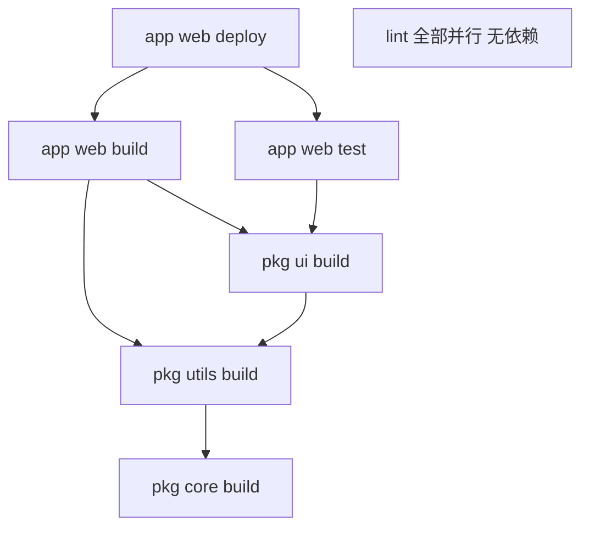

```json
// turbo.json：拓扑管道的生产定义（含并行策略）
{
  "$schema": "https://turbo.build/schema.json",
  "globalDependencies": ["tsconfig.base.json", ".eslintrc.cjs", ".env.example"],
  "tasks": {
    "build": {
      "dependsOn": ["^build"],            // 上游依赖先 build（拓扑序）
      "outputs": ["dist/**", ".next/**"],
      "env": ["NODE_ENV", "APP_VERSION"]
    },
    "lint": { "dependsOn": [], "outputs": [] },          // 零依赖：与其他任务并行抢跑
    "test": {
      "dependsOn": ["^build"],            // 测试消费上游 dist
      "outputs": ["coverage/**"]
    },
    "web#deploy": {                        // 指定包级规则：web 的 deploy 前置两个任务
      "dependsOn": ["web#build", "web#test"],
      "cache": false                        // 部署不缓存（副作用任务）
    },
    "check": { "dependsOn": ["lint", "test"] }   // 聚合入口
  }
}
# 执行：turbo run check → lint 全包并行，test/build 按拓扑，deploy 串行收尾
# 验证拓扑：turbo run build --dry=json | jq '.tasks[] | {taskId, dependencies}'
```

### BLD-175：构建任务并行与资源分配：CI 机器规格与并行度怎么定？
**答**：
- 并行度 = min(CPU 核数, 任务类型瓶颈)：webpack/seal 是 CPU 密集（压缩、Terser 线程数 `parallel: os.cpus().length - 1`）、loader/resolve 是 IO 密集（可高并发）；过并行反而因上下文切换与内存 GC 变慢。
- CI 规格经验值：webpack 大型项目 4C8G 起步（Terser 内存峰值可达 2-4GB）；Rspack/esbuild 类原生工具 2C 即可高吞吐（多进程模型不同）；并发 job 数 × 单 job 峰值内存 < 机器内存 × 0.8（OOM 是 CI 失败头号原因）。
- 任务编排：monorepo 用 turbo 的 `--concurrency` 控制（默认 CPU 数）；`NODE_OPTIONS=--max-old-space-size=6144` 显式抬堆上限；按"耗时 × 内存"分桶调度（长任务给大规格 runner，短任务并发多个）。
- 观测先行：先跑 `--profile` 拿每任务耗时与内存基线，再定规格——直接拍脑袋加机器是最贵的方案。

```javascript
// scripts/parallel-tuning.js：并行度压测脚本（确定 CI 规格用）
const os = require('os');
const { execSync } = require('child_process');

async function bench(concurrency, maxOldSpace) {
  const env = {
    ...process.env,
    NODE_OPTIONS: `--max-old-space-size=${maxOldSpace}`,
    TURBO_CONCURRENCY: String(concurrency),
  };
  execSync('rm -rf node_modules/.cache apps/*/node_modules/.cache', { cwd: process.cwd() });
  const t0 = Date.now();
  execSync(`pnpm turbo build --concurrency=${concurrency}`, {
    env, stdio: ['ignore', 'ignore', 'inherit'],
  });
  const ms = Date.now() - t0;
  console.log(`concurrency=${concurrency} heap=${maxOldSpace}MB → ${ms}ms`);
  return ms;
}
// 实测矩阵：从 os.cpus().length 到 2x 扫一遍，找拐点
(async () => {
  const cpus = os.cpus().length;
  for (const c of [2, cpus, cpus * 2]) {
    await bench(c, 4096);
  }
})();
// 结论模板：16C runner 上 turbo --concurrency=8 最快（更高并发 Terser 内存争用反降速）
// 单 job 内存峰值 3.2GB → 选 4C8G 规格 × 3 并发 job，机器利用率 74%
```

### BLD-176：构建报警与看板：时长趋势、大小趋势的持续监控怎么做？
**答**：
- 数据源：每次 CI 构建落一条指标（时长、各阶段耗时、产物 gzip 体积、模块数、缓存命中率）到时序库（Prometheus/Loki? 通常自建 ClickHouse 或直接用 stats 导出 JSON 存 OSS）。
- 报警规则（防噪三原则）：**环比抖动容忍**（±20% 内不报）、**趋势报警**（连续 5 次单调上涨才报，抓慢性劣化）、**绝对红线**（超预算阈值立即报，如首屏 JS > 300KB）。
- 看板呈现：构建时长折线（分阶段堆叠：install/build/test）、体积 Top10 模块变化表、缓存命中率曲线；每次发布附产物 diff 链接（size-diff bot 的历史归档）。
- 落地最小集：CI 输出 JSON → 归档脚本入库 → Grafana 两条 rule + 一张 dashboard，一天内可搭完。

```javascript
// scripts/collect-metrics.js：CI 构建指标采集（落库前的标准化 JSON）
const fs = require('fs');
const { gzipSync } = require('zlib');

const stats = JSON.parse(fs.readFileSync('dist/stats.json', 'utf8'));
const phase = JSON.parse(fs.readFileSync('.phase-timing.json', 'utf8')); // BLD-106 的探针输出

const payload = {
  repo: process.env.GITHUB_REPOSITORY,
  sha: process.env.GITHUB_SHA,
  branch: process.env.GITHUB_REF_NAME,
  ts: Date.now(),
  durationMs: phase.total,
  phases: phase,                                     // install/make/seal/emit 分段
  cacheHitRatio: stats.modules.filter((m) => m.cached).length / stats.modules.length,
  bundle: {
    totalGzip: stats.assets
      .filter((a) => a.name.endsWith('.js'))
      .reduce((s, a) => s + gzipSync(fs.readFileSync(`dist/${a.name}`)).length, 0),
    chunkCount: stats.chunks?.length,
    moduleCount: stats.modules.length,
  },
};
fs.writeFileSync('metrics.json', JSON.stringify(payload));
// curl -XPOST http://metrics.internal/api/build -d @metrics.json
// Grafana 规则示例：
//   trend:  avg_over_time(durationMs[1d]) 连续上升 5 点 → 告警
//   budget: bundle.totalGzip > 300*1024 → 告警（卡口级）
```

### BLD-177：构建依赖大版本升级（webpack 4→5、vite 大版本）的灰度方法。
**答**：
- 评估先行：读 migration guide 列 breaking 清单 → 按项目盘点命中项（自动化 grep 配置/插件名）→ 形成"工作量评估表"；产物兼容目标是**逐字节可 diff**（hash 策略变化除外）。
- 灰度节奏：单仓双配置并行（`webpack.config.v5.js` 跑影子构建对比产物）→ 低风险应用（纯 CSR 小项目）先行 → 核心应用最后；每步可回滚（构建工具版本是独立 PR，随时 revert）。
- 验收清单：产物 diff（体积/结构/浏览器运行）、HMR 行为、dev 启动时长、CI 时长、关键路径手动回归、灰度环境真实流量观测（错误率对比基线）。
- 常见雷区：contenthash 算法变化导致全量缓存失效（预期内）、loader 选项语义变化（静默降级要 diff sourcemap 发现）、polyfill 注入量变化（browserslist 数据更新）。

```yaml
# 升级灰度流水线：影子构建对比（webpack4 与 webpack5 同源码各产一份并 diff）
name: upgrade-canary
on: pull_request
jobs:
  shadow-build:
    runs-on: ubuntu-latest
    steps:
      - uses: actions/checkout@v4
      - run: pnpm install --frozen-lockfile
      - run: pnpm build:v4   # 现网配置
      - run: mv dist dist-v4 && pnpm build:v5   # 新配置
      - name: 产物对比
        run: |
          node scripts/compare-dist.js dist-v4 dist-v5 --report upgrade-report.md
      - uses: actions/upload-artifact@v4
        with: { name: upgrade-report, path: upgrade-report.md }
```

```javascript
// scripts/compare-dist.js：升级验收核心脚本（产物级 diff）
const { readdirSync, readFileSync, statSync } = require('fs');
const { join } = require('path');
const { gzipSync } = require('zlib');

function walk(dir, out = {}) {
  for (const f of readdirSync(dir)) {
    const p = join(dir, f);
    statSync(p).isDirectory() ? walk(p, out) : (out[f.replace(/-[0-9a-f]{8}\./, '.')] = gzipSync(readFileSync(p)).length);
  }
  return out;
}
const [a, b, , report] = process.argv;
const A = walk(a), B = walk(b);
const lines = ['| asset | v4 gzip | v5 gzip | diff |', '|---|---|---|---|'];
let failed = false;
for (const name of new Set([...Object.keys(A), ...Object.keys(B)])) {
  const d = (B[name] ?? 0) - (A[name] ?? 0);
  const pct = A[name] ? (d / A[name] * 100).toFixed(1) : 'new';
  // 验收红线：单文件 +10% 或总量 +5% 需人工确认
  if (d > 0 && pct !== 'new' && Number(pct) > 10) failed = true;
  lines.push(`| ${name} | ${((A[name] ?? 0) / 1024).toFixed(1)}KB | ${((B[name] ?? 0) / 1024).toFixed(1)}KB | ${pct}% |`);
}
require('fs').writeFileSync(report, lines.join('\n'));
process.exit(process.env.STRICT === '1' && failed ? 1 : 0);
// 灰度推进表：canary 项目（1%）→ 内部工具站 → 低峰业务 → 核心交易链路，每步观察 1 周
```

### BLD-178：构建知识沉淀：常见坑 wiki 与自动化 FAQ 体系。
**答**：
- 沉淀三层：**错误码手册**（构建报错 → 原因 → 修复，结构化 YAML，可被工具消费）、**决策记录 ADR**（为什么选 Rspack/为什么关 CSS CodeSplit，防"考古"与反复横跳）、**FAQ**（高频问题一键可复制的修复命令）。
- 自动化闭环：CI 失败时拿 stderr 匹配错误码手册，直接在 PR 评论修复建议（命中即省一次排查）；命中率低的条目定期清理。
- 组织机制：构建群"值班轮询"收集问题 → 周会评审进 wiki → 季度清理过期内容；wiki 的评价标准不是条数而是"新同学求助率下降"。
- 落点：错误码手册结构化后还能驱动 CI 的自动重试/自动降级（如 OOM 自动加大内存重跑）。

```yaml
# docs/build-errors/errors.yaml：结构化错误码手册（可被机器人消费）
- id: E-BUNDLE-001
  match: "Module not found: Error: Can't resolve"
  cause: 路径大小写、缺扩展名、exports 字段屏蔽、幽灵依赖
  fixes:
    - "pnpm why <pkg> 确认依赖是否真实存在"
    - "检查 tsconfig paths 与 webpack alias 是否同步"
    - "package.json exports 是否漏放行该子路径"
  autohint: true          # CI 失败时自动评论本条
- id: E-MEM-002
  match: "JavaScript heap out of memory"
  cause: Terser/大仓构建内存峰值超限
  fixes:
    - "NODE_OPTIONS=--max-old-space-size=6144 pnpm build"
    - "TerserPlugin parallel: 2 降低并发内存"
  autoRetry:              # CI 自动降级重试
    command: "NODE_OPTIONS=--max-old-space-size=8192 pnpm build"
    maxAttempts: 1
```

```javascript
// scripts/ci-error-assistant.js：构建失败 → 命中手册 → 自动评论
const errors = require('../docs/build-errors/errors.yaml').default ?? require('../docs/build-errors/errors.yaml');
const stderr = process.env.CI_STDERR ?? '';
const hits = errors.filter((e) => stderr.includes(e.match));
if (hits.length) {
  const body = hits.map((h) =>
    `### ${h.id}\n**原因**：${h.cause}\n**修复**：\n${h.fixes.map((f) => `- \`${f}\``).join('\n')}`
  ).join('\n\n');
  execSync(`gh pr comment $PR_NUMBER --body "${body.replace(/"/g, '\\"')}"`);
}
// 值班数据回流：每月统计 hits 命中率，手册按需增删
```

## 二十章 综合实战（BLD-179 ~ BLD-200）

### BLD-179：把 5 分钟构建优化到 40 秒——第一步：怎么定位时间都花在哪了？
**答**：
- 案例背景：中后台 SPA，4200 模块，babel-loader 全量 + 无缓存 + 串行 CI，全量构建 5 分钟；优化目标 40 秒（CI 与本地都要达标）。
- 定位手段：**speed-measure-webpack-plugin**（每个 loader/插件耗时）、自定义 make/seal 分段计时（BLD-106）、`--profile` 的 CPU 火焰图（`node --cpu-prof node_modules/webpack/bin/webpack.js`）。
- 实测结论（该案例）：Terser 压缩 118s、babel-loader 96s、source-map 生成 45s、resolve/模块 IO 40s、插件杂项 61s——**大头是压缩与转译，两者都指向"没缓存 + JS 实现慢"**。
- 方法论：任何优化先立基线与分段指标，禁止"听说 esbuild 快就换"的无数据改造；优化项按 耗时×可行性 排优先级。

```javascript
// scripts/profile-build.js：一次性拿到定位所需的全部数据
const SpeedMeasurePlugin = require('speed-measure-webpack-plugin');
const webpackConfig = require('../webpack.config.js');

const smp = new SpeedMeasurePlugin({
  granularLoaderData: true,        // 细到每个 rule 的每个 loader
  disable: process.env.NO_SMP === '1',
});
// 1. loader/插件耗时：smp.wrap 后每个 loader 打印 ms
require('fs').writeFileSync('smp.config.js', `module.exports = ${JSON.stringify(smp.wrap(webpackConfig))}`);
// npx webpack --config smp.config.js

// 2. CPU 火焰图（压缩与 parse 的热点）：
// node --cpu-prof --cpu-prof-dir=.prof node_modules/webpack/bin/webpack.js --mode production
// 用 speedscope 打开 .cpuprofile 分析热点函数

// 3. 分段计时插件输出（make vs seal）
// class PhaseTimingPlugin { /* 见 BLD-106，输出 .phase-timing.json */ }
// 本案例输出：
// { install: 42, make: 168, seal: 96, terser: 118, sourcemap: 45, resolveIO: 40, misc: 61, total: 300 }
```

### BLD-180：5 分钟 → 40 秒：优化措施清单与最终数据。
**答**：
- 措施按 ROI 排序落地：① filesystem 缓存 + CI 缓存上传下载（5:00 → 1:50）；② babel-loader → esbuild-loader（转译降 70%）；③ Terser → esbuild minify（压缩 118s → 22s，接受 Function.name 语义差异前提）；④ include/exclude 收窄 + resolve 优化（unsafeCache/extensions 收敛）；⑤ parallel 与分段并行（sourcemap 用 hidden 延迟生成、dev 不生成）。
- 最终数据：全量冷构建 40s，**二次构建 9s**（缓存命中 87%）；产物体积 +0.3%（esbuild minify 与 terser 差异），错误栈可读性通过 sourcemap 上传补偿。
- 交付物：优化报告（前后分段对比表）、配置 PR（含回滚开关 BUILD_FAST=0 回退旧链路）、监控看板（防劣化反弹）。
- 面试讲法：按"定位→排序→逐项数据→风险与回滚"四段式讲，每一项都要有数字。

```javascript
// 优化后的 webpack.config.js（带回退开关的最终形态）
module.exports = (env, argv) => {
  const FAST = process.env.BUILD_FAST !== '0';      // 回滚开关：0 = 旧链路
  return {
    cache: { type: 'filesystem', name: 'prod', buildDependencies: { config: [__filename] } },
    module: {
      rules: [
        ...(FAST ? [{
          test: /\.[jt]sx?$/, include: path.resolve('src'),
          loader: 'esbuild-loader', options: { target: 'es2020', loader: 'tsx' },
        }] : [{ test: /\.[jt]sx?$/, use: 'babel-loader' }]),
      ],
    },
    optimization: {
      minimizer: [
        FAST
          ? new (require('esbuild-loader').EsbuildPlugin)({ target: 'es2020' })   // 118s → 22s
          : new (require('terser-webpack-plugin'))(),
      ],
    },
    devtool: 'hidden-source-map',                    // 生产延迟生成并上传监控平台
    resolve: {
      extensions: ['.tsx', '.ts', '.js'],            // 从 7 个收敛到 3 个
      unsafeCache: true,
      symlinks: false,                               // monorepo 内部无 symlink 场景可关
    },
    // 措施成效（本案例实测）：
    // 缓存: 300s→110s   esbuild 转译: make 168→52s   esbuild 压缩: 118→22s
    // resolve 收敛: 40→18s   总计冷: 40s  热: 9s（命中率 87%）
  };
};
```

### BLD-181：把 3MB 首屏 bundle 降到 800KB 的完整案例。
**答**：
- 定位（webpack-bundle-analyzer + source-map-explorer）：moment locales 600KB、lodash 全量 540KB、antd 全量 780KB、业务重复依赖（两个版本 react-dnd）400KB、polyfill 全量 300KB、CSS 未拆分 200KB。
- 措施：moment → dayjs（-580KB）；lodash → lodash-es 按需 + tree-shaking（-420KB）；antd 按需引入（unplugin? babel-plugin-import）（-640KB）；依赖收敛（pnpm overrides 锁单版本 react-dnd）（-260KB）；useBuiltIns: usage（-280KB）；路由级代码分割 + manualChunks 拆 vendor（首屏 -350KB）；CSS code split。
- 数据：3.0MB → 795KB（gzip 2.1MB → 380KB）；TTI 从 6.8s → 2.4s（4G 模拟）。
- 治理收尾：size budget 卡口（BLD-117）防回弹——"降下来"容易，"守得住"才是工程能力。

```javascript
// 优化后的关键配置汇总
module.exports = {
  resolve: { alias: { 'dayjs$': 'dayjs' } },
  optimization: {
    splitChunks: {
      chunks: 'all',
      maxInitialRequests: 6,                       // 首屏并行请求数控制
      cacheGroups: {
        react: { test: /[\\/]node_modules[\\/](react|react-dom|scheduler)[\\/]/, name: 'react', priority: 20 },
        antd: { test: /[\\/]node_modules[\\/](antd|@ant-design)[\\/]/, name: 'antd', priority: 15 },
        vendors: { test: /[\\/]node_modules[\\/]/, name: 'vendors', priority: 10, minSize: 40000 },
      },
    },
  },
  module: {
    rules: [
      { test: /\.js$/, include: /node_modules[\\/](antd|rc-/), enforce: 'pre',
        use: 'babel-plugin-import-loader' },       // antd 按需（或用 esbuild 侧 unplugin）
    ],
  },
};
// 源码侧治理：
// - import dayjs from 'dayjs'（替换 moment，插件全删）
// - import debounce from 'lodash-es/debounce'   ← ESM 命名空间可摇
// - pnpm.overrides: { 'react-dnd': '16.0.1' }   ← 消灭双版本
// babel.config.js: presets: [['@babel/preset-env', { useBuiltIns: 'usage', corejs: 3 }]]
// 结果：3.0MB→795KB（gzip 380KB），budget 卡口：首屏 gzip > 420KB 时 CI 失败
```

### BLD-182：SPA 首屏 TTI 优化中，构建侧能做的所有手段清单。
**答**：
- **体积类**：代码分割（路由级/组件级动态 import）、tree-shaking（sideEffects/ESM 源码依赖）、按需引入组件库、依赖收敛与 dedupe、polyfill 按需（usage）、压缩升级（terser→esbuild/wasm? 或更优配置）。
- **加载编排类**：首屏关键 chunk 优先（manualChunks 拆分 + preload）、非关键资源 defer/modulepreload、prefetch 路由 chunk（webpackPrefetch/vite build.modulePreload）、`output.asyncChunks`? 与 webpackChunkName 语义化命名。
- **运行时配合类**：SSR/预渲染首屏直出、骨架屏（构建期注入 HTML）、HTTP 层（HTTP/2、Brotli、CDN 边缘缓存）、sourcemap 上传后生产剥离。
- **度量闭环**：Lighthouse CI / WebPageTest 基线、`performance.mark` 埋点、budget 卡口——构建侧手段必须配度量，否则"优化"无证据。

```javascript
// 构建侧 TTI 手段的配置全家桶（webpack5）
module.exports = {
  performance: { maxEntrypointSize: 400000, maxAssetSize: 250000, hints: 'error' },  // 预算卡口
  optimization: {
    splitChunks: { chunks: 'all', maxInitialRequests: 6 },
    runtimeChunk: 'single',
  },
  plugins: [
    new HtmlWebpackPlugin({
      template: './index.html',
      // 骨架屏构建期注入（替代运行时 JS 渲染，避免骨架屏本身拖慢 FCP）
      templateParameters: { SKELETON: fs.readFileSync('./src/skeleton.html') },
    }),
    new MiniCssExtractPlugin({ filename: 'css/[name].[contenthash].css' }),
  ],
  module: {
    rules: [{
      test: /\.[jt]sx?$/,
      // 关键 chunk 标注：首屏模块 prefetch 次屏（正则 route 匹配）
      // 源码侧等价：import(/* webpackPrefetch: true, webpackChunkName: "dash" */ './Dashboard')
    }],
  },
  output: { filename: 'js/[name].[contenthash:8].js', chunkFilename: 'js/[name].[contenthash:8].async.js' },
  // HTTP 层：CI 构建后补 Brotli
  // plugins.push(new CompressionPlugin({ algorithm: 'brotliCompress', test: /\.(js|css|html)$/ }));
};
// 度量闭环：lighthouserc 断言（<2.5s TTI @ 4G）进 CI，与 size budget 双卡口
```

### BLD-183：H5 与小程序双端共用业务包的构建架构怎么设计？
**答**：
- 分层：**纯逻辑层**（store/api/业务规则，零平台 API）→ **适配层**（封装 wx.request vs fetch、路由、存储，接口注入）→ **平台壳**（各自入口与页面挂载）。构建上：逻辑层出**多目标产物**（H5 用 esm、小程序用 npm 构建或直接源码引用）。
- 构建实现：逻辑层用 rollup/vite lib 模式双产物；小程序侧开启 `packNpm`? 或直接 monorepo workspace 引用源码（微信小程序 + gulp/官方 CLI 处理 npm）；共享 tsconfig + 单测全共享。
- 平台差异治理：条件编译用 `process.env.PLATFORM` 的 define 替换 + 死代码消除（等价 Taro 的做法），或按目录切分（`api/h5.ts` / `api/wx.ts` + alias）。
- 面试加分：统一多端 DSL（Taro/uni-app）vs 自研分层的取舍——自研适合"小程序为主 + 少量 H5"，DSL 适合全端铺开。

```javascript
// packages/biz-core/build.mjs：共享业务包双端产物（rollup lib 模式）
import { defineConfig } from 'rollup';
import esbuild from 'rollup-plugin-esbuild';
export default defineConfig([
  { // H5：ESM + 可摇树
    input: 'src/index.ts',
    external: (id) => !id.startsWith('.') && !id.startsWith('/'),
    plugins: [esbuild({ target: 'es2019' })],
    output: [{ format: 'esm', dir: 'dist/esm', preserveModules: true, preserveModulesRoot: 'src' }],
  },
  { // 小程序：CJS 单文件（小程序 npm 构建兼容性最好的形态）
    input: 'src/index.ts',
    external: (id) => !id.startsWith('.') && !id.startsWith('/'),
    plugins: [esbuild({ target: 'es2018' })],
    output: { format: 'cjs', dir: 'dist/cjs', exports: 'named' },
  },
]);
// package.json exports：
// { ".": { "browser": "./dist/esm/index.js", "require": "./dist/cjs/index.js" } }
```

```javascript
// 适配层：平台差异用 alias + define 双手段
// vite.config.ts（H5 壳）
export default defineConfig({
  define: { 'process.env.PLATFORM': JSON.stringify('h5') },
  resolve: { alias: { '@platform-api': './src/platform/h5/index.ts' } },
});
// 小程序侧（微信，gulp 或官方 CLI 构建）
// app.json 的 miniprogramRoot 指向 packages/app-wx；
// project.config.json: "packNpmManually": true, "packNpmRelationList": [{ "packageJsonPath": "./package.json",
//   "miniprogramNpmDistDir": "./miniprogram/" }]
// src/platform/wx/index.ts：
// export const request = wx.request;    // 同名接口对齐 @platform-api 的类型签名
// 逻辑层 import { createOrder } from '@org/biz-core' —— 两端零差异复用
```

### BLD-184：微前端所有子应用的构建统一治理：版本、依赖、规范怎么收口？
**答**：
- **依赖治理**：框架/公共库版本由主平台统一声明（catalog / versions.json），子应用 CI 校验依赖版本与平台矩阵一致（不匹配 fail）；公共依赖走 MF shared 或 import map 单例，子应用不打包。
- **构建规范**：统一 preset 包（BLD-171）+ 子应用配置只剩差异；产物规范统一（UMD/ESMD? 输出、chunk 命名、publicPath 注入协议、sourcemap 上传）。
- **版本与发布**：子应用独立发版（语义化 tag + 产物上传 CDN），主应用运行时拉**版本清单**（manifest service）决定加载哪个版本——构建侧提供 manifest 稳定 URL 与一致性校验。
- 卡口体系：子应用 PR 必过"平台合规检查"（依赖矩阵、产物结构、shared 声明、体积预算），检查器做成 npm 包统一分发。

```javascript
// 平台合规检查器：@platform/mf-compliance（子应用 CI 必跑）
const rules = [
  { name: 'framework 版本受控', test: (pkg) => pkg.dependencies.vue === PLATFORM_VERSIONS.vue },
  { name: '不得打包公共依赖', test: (cfg) =>
      (cfg.externals ?? []).includes('vue') && !JSON.stringify(cfg.output).includes('vue') },
  { name: 'MF shared 声明单例', test: (cfg) => cfg.moduleFederation?.shared?.vue?.singleton === true },
  { name: 'publicPath 协议', test: (cfg) => ['auto', 'window.__MF_CDN__'].includes(cfg.output.publicPath) },
  { name: 'sourcemap 上传配置', test: (cfg) => cfg.plugins.some((p) => p.constructor.name === 'SentryWebpackPlugin') },
];
// 子应用 CI：node node_modules/@platform/mf-compliance ./webpack.config.js
// 主应用侧 import map 单例：
// {
//   "imports": {
//     "vue": "https://cdn.example.com/vue@3.4.21/vue.runtime.esm-browser.prod.js",   ← 全平台唯一实例
//     "vue/": "https://cdn.example.com/vue@3.4.21/"
//   }
// }
```

### BLD-185：100+ 应用的 Monorepo 构建体系怎么设计？
**答**：
- 组织形态：pnpm workspace（catalog 统一依赖版本）+ turbo 拓扑 + 分层包（base 组件库/业务组件/应用）；应用数 >50 后第一原则是**范围限定**（`--filter=...[origin/main]` 受影响构建），全量构建只留给 nightly。
- 缓存体系：turborepo 远程缓存（自建，BLD-158）+ 按 workspace 隔离的构建缓存 + pnpm store 共享；命中率目标 >85%（PR 视角）。
- 治理机制：包命名空间与 owner 映射（CODEOWNERS）、catalog 强制（eslint 规则禁裸版本号）、构建任务模板统一（每个包的 build 都是 `tsc && vite build` 同构形态，turbo 管道零特例）。
- 可观测：构建看板（BLD-176）按应用维度聚合；每小时全量校验 job 防"局部绿全量红"。

```yaml
# pnpm-workspace.yaml + catalog：依赖版本单源（100+ 应用的第一治理工具）
packages:
  - apps/*
  - packages/*
catalog:
  vue: 3.4.21
  react: 18.3.1
  typescript: 5.5.4
  '@vitejs/plugin-react': 4.3.1
# 应用 package.json 中： "vue": "catalog:"   ← 版本只在此文件改一次
```

```json
// turbo.json：百应用规模的管道（范围限定 + 缓存 + 环境探测）
{
  "$schema": "https://turbo.build/schema.json",
  "globalDependencies": ["pnpm-workspace.yaml", "tsconfig.base.json"],
  "globalEnv": ["NODE_ENV"],
  "tasks": {
    "build": {
      "dependsOn": ["^build"],
      "outputs": ["dist/**"],
      "inputs": ["$TURBO_DEFAULT$", "!**/*.md"]
    },
    "build:canary": { "dependsOn": ["^build"], "outputs": ["dist/**"], "cache": false }
  }
}
```

```bash
# 日常与 CI 的构建命令矩阵（范围限定是灵魂）
turbo run build --filter=web-shop...[origin/main]   # PR：只构建受影响闭包
turbo run build --concurrency=8                      # nightly：全量 + 看板采集
turbo run lint --parallel                            # lint 无拓扑，全并行
# 数据（案例）：全量 41min → PR 增量均值 2.8min，缓存命中率 89%，CI 机器 6 台 → 2 台
```

### BLD-186：构建工具从 webpack5 迁到 Rspack 的完整评估报告（含决策矩阵）。
**答**：
- **评估维度**（决策矩阵）：构建性能（冷/热/增量）、配置兼容度（本仓插件/loader 盘点）、生态功能（MF/CSS/HMR/sourcemap/宏任务）、团队迁移成本（学习+配置改造+CI 改造）、风险与回滚、长期维护（社区活跃度/版本节奏）。
- 本仓实测数据（示例结论）：冷构建 96s→21s、watch 增量 6.2s→0.9s、HMR 3.1s→0.4s；插件兼容 38 个中 31 直接可用、5 个有等价物、2 个需自研迁移（自定义 TS 转译 plugin）。
- 决策矩阵打分（1-5）：性能 5/5、兼容 4/5、生态 3.5/5、迁移成本 3/5、风险 4/5、加权总分 4.1 —— **建议迁移**，分三阶段（工具站→内部应用→核心交易）。
- 报告结构模板：背景与痛点 → 实测方法论（同机同源码同口径）→ 矩阵打分 → 风险清单与缓解 → 排期与回滚方案。

```text
# 迁移决策矩阵（评估报告核心页，可直接复用）
| 维度(权重)      | webpack5 | Rspack | 说明                      |
|-----------------|----------|--------|---------------------------|
| 冷构建(25%)     | 96s      | 21s    | 同机同源码 3 次中位数     |
| 增量构建(20%)   | 6.2s     | 0.9s   | 修改 1 个业务文件 rebuild |
| 配置兼容(20%)   | -        | 4.1/5  | 38 插件盘点：31/5/2       |
| 生态功能(15%)   | 5/5      | 3.5/5  | MF 可用；css module 新语义|
| 迁移成本(10%)   | -        | 3/5    | 2 人周，CI 双轨期 2 周    |
| 长期维护(10%)   | 4/5      | 4/5    | webpack 稳定；rspack 高频 |
| 加权总分        | 3.6      | 4.1    | 迁移                      |
| 风险清单        |          |        | ①自定义 plugin 迁移 ②产物 diff 校验 ③HMR 时序回归 |
| 回滚方案        |          |        | BUILD_ENGINE=webpack env 开关，CI 双配置并存 |
```

```javascript
// 双引擎并行的构建入口（灰度期使用）：build.js
const engine = process.env.BUILD_ENGINE ?? 'rspack';
const config =
  engine === 'rspack' ? require('./rspack.config.js')
                      : require('./webpack.config.js');
require(engine === 'rspack' ? '@rspack/core' : 'webpack')(config, (err, stats) => {
  console.log(stats.toString({ colors: true, modules: false, assets: true }));
  process.exit(stats?.hasErrors?.() ? 1 : 0);
});
// CI 双轨 job：两个引擎各跑一次 + 产物 diff（BLD-177 脚本）→ 灰度通过后下线 webpack
```

### BLD-187：联邦多团队共享依赖的版本治理方案。
**答**：
- 问题本质：MF 多应用各自打包公共库 → 浏览器多实例（体积×N + 状态割裂）；治理目标是"**同一实例 + 版本兼容区间 + 单一来源**"。
- 手段：`shared` 声明 `singleton + requiredVersion`（semver 区间）+ `strictVersion`（不匹配即报错）；主应用/平台用 import map 或 MF host 预加载唯一版本；`getFallback? ` fallback 共享不可用时降级到自带版本。
- 治理流程：平台维护"共享矩阵"（可共享库白名单 + 当前版本）→ 子应用 CI 校验声明 → 变更走平台 PR（版本评审）→ 运行时协商结果上报监控（观察到 singleton 冲突告警）。
- 升级灰度：import map 服务端下发新旧版本映射（按流量），子应用 requiredVersion 设区间（`^3.4.0`）平滑吸收 minor 更新。

```javascript
// 主应用（host）：共享依赖的唯一入口与协商
const { ModuleFederationPlugin } = require('webpack').container;
module.exports = {
  plugins: [
    new ModuleFederationPlugin({
      name: 'host',
      remotes: {
        shop: 'shop@https://cdn.example.com/shop/remoteEntry.js',
      },
      shared: {
        react: {
          singleton: true,                 // 强制单实例（hooks 安全的前提）
          requiredVersion: '^18.3.0',      // 接受 18.x 全系 minor
          strictVersion: true,             // 子应用版本不符 → 构建期/运行期报错而非静默
          import: false,                   // host 自己提供，不打包 fallback（体积归零）
        },
        'react-dom': { singleton: true, requiredVersion: '^18.3.0', import: false },
        '@org/design-tokens': {
          singleton: true, requiredVersion: '^2.0.0',
          // fallback：平台未加载时子应用自带版本兜底（牺牲体积换可用性）
        },
      },
    }),
  ],
};
// 子应用侧对称声明 requiredVersion；CI 校验脚本：
// node scripts/check-shared.js  → parse 子应用 shared 声明，与平台 versions.json 比对
// 运行时监控：window.__FEDERATION__.__INSTANCES__ 版本采集 → 冲突告警
```

### BLD-188：构建产物多 CDN 发布与一致性校验。
**答**：
- 发布模型：产物上传多个 CDN 源（国内/海外/多供应商）→ 每份产物带 sha256 清单（manifest.json 含每文件 hash）→ 发布系统按清单分发 → **校验任务**从各 CDN 边缘拉取对比 hash。
- 一致性风险点：上传部分成功（半发布状态）、CDN 缓存未刷新（旧 hash 命中）、路径重写错误（不同 CDN 前缀）、压缩层差异（gzip/br 由 CDN 动态压缩不影响 hash，但要确认禁改内容）。
- 关键设计：**文件名即内容寻址**（contenthash），同名文件内容必然一致 → 校验简化为"每个 CDN 都能取到清单中全部文件且 hash 一致"；index.html 不走 contenthash，要单独处理其失效（版本号 query 或短 TTL）。
- 灰度与回滚：清单版本化（release-v123.json），DNS/网关切换清单版本即可原子回滚。

```javascript
// scripts/publish-multi-cdn.mjs：多 CDN 发布 + 一致性校验
import { createHash } from 'node:crypto';
import { readdirSync, readFileSync } from 'node:fs';

const sha256 = (buf) => createHash('sha256').update(buf).digest('hex');
// 1. 生成内容清单（contenthash 文件名 + 双重校验）
const files = readdirSync('dist', { recursive: true }).filter((f) => f.endsWith('.js') || f.endsWith('.css'));
const manifest = Object.fromEntries(files.map((f) => [f, sha256(readFileSync(`dist/${f}`))]));
manifest['manifest.json'] = sha256(JSON.stringify(manifest));

// 2. 多源上传（幂等：内容寻址，重复上传无害）
for (const cdn of ['aliyun', 'cloudflare', 'qingliu']) {
  for (const f of [...files, 'index.html']) await upload(cdn, f, readFileSync(`dist/${f}`));
}
await upload('aliyun', `releases/v${process.env.RELEASE}.json`, JSON.stringify(manifest));

// 3. 一致性校验：各 CDN 边缘节点拉取对比（含多地域探测点）
for (const cdn of ['https://cdn1.example.com', 'https://cdn2.example.net']) {
  for (const [f, hash] of Object.entries(manifest)) {
    const probe = await fetch(`${cdn}/${f}`).then((r) => r.arrayBuffer());
    if (sha256(Buffer.from(probe)) !== hash) {
      // 半发布/缓存未刷新的捕获点
      throw new Error(`[FAIL] ${cdn}/${f} 内容不一致，禁止切流`);
    }
  }
}
console.log('[OK] 全部 CDN 边缘一致，可切换清单版本');
// 回滚：网关把 index.html 的资源前缀从 releases/v124 指回 v123（清单级原子切换）
```

### BLD-189：按团队维度的构建资源计费/配额设计。
**答**：
- 目标：平台团队治理 100+ 业务的 CI 资源——谁在消耗、限额防雪崩、成本分摊（按用量向业务方分账，倒逼构建效率）。
- 计量模型：构建次数 × 时长 × 规格系数（分钟折算"构建分钟数"），标签维度 = 团队/应用/触发源（PR/发布/定时）；Runner 上 `runner.labels` 或 CI 的 job 标签落到指标系统。
- 配额与限流：软限（月度配额 80% 告警）、硬限（超 100% 拒绝新 PR 构建，发布构建豁免）；夜间低峰给配额加成，峰值排队（priority queue：发布 > 主干 > PR）。
- 实施要点：配额变更走审批；计费数据开放自助查询（看板）；落地先"只计量不限制"两个月建立基线，避免一开始就阻塞业务。

```javascript
// scripts/build-meter.js：构建分钟计量（CI job 尾部调用）
const start = Number(process.env.BUILD_START_TS);           // job 开始时 echo $EPOCHREALTIME 注入
const ms = Date.now() - start;
const spec = { 'ubuntu-4c': 1, 'ubuntu-8c': 2, 'ubuntu-16c': 4 }[process.env.RUNNER_SPEC] ?? 1;
const minutes = (ms / 60000) * spec;                        // 折算标准构建分钟
await fetch('http://metrics.internal/api/ci/meter', {
  method: 'POST',
  headers: { 'content-type': 'application/json' },
  body: JSON.stringify({
    team: process.env.TEAM_LABEL,                           // CODEOWNERS 映射的团队
    app: process.env.APP_NAME,
    trigger: process.env.GITHUB_EVENT_NAME,                 // push/pull_request/schedule
    minutes: Number(minutes.toFixed(2)),
    month: new Date().toISOString().slice(0, 7),
  }),
});
// 配额服务端逻辑（伪码）：
// if (usage.month > quota * 1.0 && trigger === 'pull_request') throw 429 '配额已满，发布构建不受限'
// if (usage.month > quota * 0.8) notifySlack(team, '构建配额 80%，请检查缓存与范围限定')
```

### BLD-190：构建安全加固清单：从依赖到产物到 CI 的供应链全链路。
**答**：
- **依赖链**：lockfile 提交且 `--frozen-lockfile`（CI 禁止解析新版本）、`pnpm overrides` 锁关键包、npm provenance/attestation 验证发布源、依赖审计卡口（`pnpm audit --prod` + osv-scanner）。
- **安装与执行**：`ignore-scripts`? 生产 CI 可选开启 + allowlist（仅少数包需要 postinstall）；`.npmrc` 指向私有 registry（防 typo-squatting 公网包）；git 依赖禁用（不可复现）。
- **产物链**：产物哈希清单（BLD-188）+ SRI（BLD-170）+ sourcemap 不发布到公网 CDN；sourcemap 上传私有监控需 token。
- **CI 链**：最小权限 token（per-workflow GITHUB_TOKEN 权限收敛）、缓存当不可信输入（BLD-162）、第三方 action pin 到 commit SHA、发布凭据用 OIDC 短时凭证。

```yaml
# .github/workflows/build-secure.yml：安全加固要点全部落在配置里
permissions:
  contents: read            # 最小权限：默认只读
jobs:
  build:
    runs-on: ubuntu-latest
    steps:
      - uses: actions/checkout@v4
      # 第三方 action 固定 commit SHA（tag 可被改写）
      - uses: pnpm/action-setup@fe02b34f222f5e89aef5aa5edebf9f6aa4637c9f # v4.0.0
      - uses: actions/setup-node@60edb5dd545a775178f525f7ae2fdc67be6003b4
        with: { node-version-file: '.nvmrc', cache: pnpm }
      - run: pnpm config set ignore-scripts true
      - run: pnpm install --frozen-lockfile --prod=false
      # 供应链审计卡口
      - run: pnpm audit --prod --audit-level=high
      - run: osv-scanner --lockfile=pnpm-lock.yaml || exit 1
      - run: pnpm build
      - run: node scripts/check-dist-hash.js     # 产物清单生成与自校验
```

```ini
# .npmrc：registry 收口与执行策略
registry=https://registry.npmmirror.com       # 或私有 registry（企业内更常见）
# 关键：生产 CI 用内部镜像源，阻断公网直接安装（typo-squatting）
# audit=false 由 CI 显式跑 audit 替代（可控记录）
engine-strict=true
```

### BLD-191：给新项目选择构建方案的标准流程：可执行 checklist。
**答**：
- **五步流程**：① 明确应用形态（SPA/MPA/SSR/库/小程序）② 列硬性约束（团队技术栈、CI 环境、浏览器矩阵、MF 需求）③ 候选收敛到 2 个（框架绑定优先：Next→Turbopack、Nuxt→Vite/Rolldown）④ 20 分钟级 PoC 对比（冷启动/增量/HMR/产物体积）⑤ 决策记录 ADR 存档。
- checklist 关键项：是否需要自定义 webpack 插件遗产、依赖生态（组件库按需方案成熟度）、SSR 支持优先级、monorepo 策略（是否 turbo/nx）、团队现有技能池。
- 默认答案表（2026 视角）：新 SPA → Vite（Rolldown 内核）；React 重 SSR → Next.js 全家桶；存量 webpack 大仓 → Rspack 渐进迁移；npm 库 → tsup/unbuild；微前端基座 → Rspack/webpack（MF 成熟度）。
- 反模式：按 GitHub star 选型、无 PoC 直接拍板、忽略"团队不会写 rollup 插件"这类隐性成本。

```text
# 新项目构建选型 checklist（PRD 评审通过后逐项勾选）
[ ] 1. 应用形态：SPA / MPA / SSR / 库 / 微前端子应用 / 小程序
[ ] 2. 框架约束：React or Vue？是否有官方全家桶（Next/Nuxt/Rsbuild）？
[ ] 3. 硬性需求：SSR？Module Federation？多主题？离线 PWA？
[ ] 4. 浏览器矩阵：browserslist 下限（决定目标与 polyfill 策略）
[ ] 5. 团队技能：会用 rollup/vite 插件吗？有 webpack 遗产吗？
[ ] 6. CI 资源：Runner 规格、可否自建远程缓存
[ ] 7. PoC（半天）：同一 demo 项目测 冷启动/HMR/冷构建/gzip 体积 四指标
[ ] 8. 风险预演：若所选工具停滞，回退路径是什么？
[ ] 9. ADR 记录：结论 + 数据 + 放弃的候选及原因（存 docs/adr/）
```

```javascript
// 决策树伪码（工具化选型的雏形）
function chooseBuildTool({ form, framework, needs, legacy }) {
  if (form === 'lib') return needs.dts ? 'tsup' : 'unbuild';          // 库：零心智
  if (framework === 'next') return 'turbopack';                        // 框架绑定
  if (form === 'mp') return 'taro-build';                              // 小程序 DSL
  if (needs.mf && legacy.webpackPlugins > 10) return 'rspack';         // MF + 遗产
  if (form === 'spa' && !needs.ssr) return 'vite';                     // 默认答案
  if (needs.ssr && framework === 'vue') return 'nuxt';
  return legacy.webpack ? 'rspack-gradual' : 'vite';
}
// 输出不是终点：必须跑第 7 步 PoC 校验默认答案，ADR 归档（第 9 步）
```

### BLD-192：开源库工程化全配置实例：TS + 双格式 + dts + test + CI 一条龙。
**答**：
- 目录与产物：src（TS 源码）→ dist（esm+cjs+d.ts 双格式，exports 映射，BLD-143）；测试 vitest（esbuild 快）+ 覆盖率卡口；lint（eslint + prettier）与类型检查独立 script。
- 发布链：changesets（BLD-147）+ GitHub Actions provenance + 发布前 `pnpm prepack`（自动构建，保证发出去的是 dist）；`files` 字段白名单 + `engines` 声明。
- 质量门禁：PR 必过 build+typecheck+test+size-report（库也要预算，helper 泄露检测：dist 里 `require("tslib")` 次数异常即报警）。
- 文档与体验：TypeDoc? README + playground（pnpm link 或 vite alias 源码直连）、`npm explain? ` — 面试能讲清"从 clone 到 npm publish"的完整路径即合格。

```json
// 开源库 package.json 全貌（ts + 双格式 + exports + 发布链）
{
  "name": "@org/tiny-store",
  "version": "0.0.0",
  "type": "module",
  "main": "./dist/index.cjs",
  "module": "./dist/index.js",
  "types": "./dist/index.d.ts",
  "exports": {
    ".": { "types": "./dist/index.d.ts", "import": "./dist/index.js", "require": "./dist/index.cjs" }
  },
  "sideEffects": false,
  "files": ["dist"],
  "scripts": {
    "build": "tsup src/index.ts --format esm,cjs --dts --clean --sourcemap",
    "test": "vitest run --coverage",
    "typecheck": "tsc --noEmit",
    "prepack": "pnpm build"                       // npm publish 前自动构建（防发旧码）
  },
  "devDependencies": {
    "tsup": "^8.0.0", "vitest": "^2.0.0", "typescript": "catalog:",
    "@changesets/cli": "^2.27.0"
  },
  "engines": { "node": ">=18" }
}
```

```yaml
# .github/workflows/lib-ci.yml：PR 门禁 + 发布一条龙
name: ci
on: [push, pull_request]
jobs:
  quality:
    runs-on: ubuntu-latest
    permissions: { contents: read }
    steps:
      - uses: actions/checkout@v4
      - uses: pnpm/action-setup@v4
      - uses: actions/setup-node@v4
        with: { node-version: 22, cache: pnpm, registry-url: 'https://registry.npmjs.org' }
      - run: pnpm install --frozen-lockfile
      - run: pnpm typecheck && pnpm lint && pnpm test
      - run: pnpm build
      - run: node scripts/check-helpers.mjs    # helper 泄露/体积预算
  release:
    if: github.ref == 'refs/heads/main'
    needs: quality
    runs-on: ubuntu-latest
    permissions: { contents: write, id-token: write }   # provenance 需要 id-token
    steps:
      - uses: actions/checkout@v4
      - uses: pnpm/action-setup@v4
      - uses: actions/setup-node@v4
        with: { node-version: 22, cache: pnpm, registry-url: 'https://registry.npmjs.org' }
      - run: pnpm install --frozen-lockfile
      - uses: changesets/action@v1
        with: { publish: pnpm publish --provenance --access public }
        env:
          GITHUB_TOKEN: ${{ secrets.GITHUB_TOKEN }}
          NPM_TOKEN: ${{ secrets.NPM_TOKEN }}
```

### BLD-193：低代码平台出码后的构建方案。
**答**：
- 问题特征：出码产物量大（万级组件/页面）、重复模式化、实时预览要求秒级——不能让每个物料都跑完整 webpack/vite 构建。
- 核心策略：**物料预构建**（组件库/模板在平台侧一次构建成 AMD/ESM 产物缓存，出码只做组装引用）+ **页面按需编译**（出码产物是纯声明 schema? 或 TS 模板，dev 预览走 vite 内存编译，发布走增量 webpack/turbopack 只编差异页面）。
- 缓存维度：以"物料版本 + 页面 schema hash"为 key 的产物缓存，命中率天然 >95%（大部分页面从未改动）。
- 工程配套：出码产物的 lint 卡口（防止生成的代码不合规范）、依赖由平台统一注入（生成代码里不写 import 版本）、产物即内容寻址（hash 文件名直上 CDN）。

```javascript
// 低代码平台的分层构建管线（build-orchestrator.mjs）
// 1. 物料层：组件库变更才重建（物料 hash 进缓存 key）
const materialHash = hash(JSON.stringify(materialManifest));      // 物料清单指纹
if (!remoteCache.has(`materials:${materialHash}`)) {
  await buildMaterials({ outDir: 'build/materials', format: 'esm' });
  await remoteCache.put(`materials:${materialHash}`, 'build/materials');
}
// 2. 页面层：按 schema hash 增量出码 + 编译
for (const page of pages) {
  const key = `page:${page.schemaHash}`;
  if (remoteCache.has(key)) continue;                              // 95%+ 直接命中
  const code = codegen(page.schema);                               // 出码：schema → TS 模板
  await fs.write(`.gen/pages/${page.id}/index.tsx`, code);
  // 3. 编译层：esbuild 并行产出页面 bundle（内容寻址文件名）
  await esbuild.build({
    entryPoints: [`.gen/pages/${page.id}/index.tsx`],
    bundle: true, splitting: true, format: 'esm',
    outdir: 'build/pages', entryNames: '[name]-[hash]',
    external: ['vue', '@lc/runtime', ...materialExternals],        // 依赖运行时共享，页面产物极小
  });
  await remoteCache.put(key, 'build/pages');
}
// 4. 发布层：生成页面清单（pageId → bundle 路径），路由运行时动态加载
// 特点：单页面产物 <30KB（物料/框架全外部化），构建时间 = 差异页面数 × 0.3s
```

### BLD-194：构建侧如何支持 A/B 多版本同时在线？
**答**：
- 需求形态：两个实验版本（旧版 checkout / 新版 checkout v2）**同时可访问**且可随时切流——构建侧要保证两版本产物共存、资源不互相覆盖、切换零发布。
- 核心手段：**版本化发布目录**（`/static/v1/... /static/v2/...` 而非互相覆盖的 hash 目录）+ 入口路由层（BFF/网关）按用户分桶返回对应 `index.html`；静态资源因 contenthash 天然共存。
- 构建侧配置：多入口或多编译器（BLD-112 的多编译器模式复用）各产一份 manifest；实验开关编译期注入（feature flag 版本归属）。
- 陷阱：localStorage/接口 schema 跨版本兼容（构建侧无法解决，需协议设计）；实验版本也要全套产物质量校验（不能"实验就不测"）。

```javascript
// webpack.multi-experiment.config.js：多编译器产出两套可共存产物
const experiments = [{ id: 'v1', flag: false }, { id: 'v2', flag: true }];
module.exports = experiments.map(({ id }) => ({
  name: id,
  entry: { main: `./src/experiments/${id}/main.tsx` },
  output: {
    path: path.resolve(__dirname, `dist/static/${id}`),     // 版本目录：共存不覆盖
    filename: '[name].[contenthash].js',
    publicPath: `/static/${id}/`,                            // 各版本独立前缀
  },
  plugins: [
    new webpack.DefinePlugin({ __EXP_VARIANT__: JSON.stringify(id) }), // 实验归属编译期定
    new HtmlWebpackPlugin({ filename: `../html/${id}/index.html` }),   // html 也分版本目录
    new (require('webpack-manifest-plugin').WebpackManifestPlugin)({
      fileName: `manifest.${id}.json`,
    }),
  ],
}));
// 服务端（BFF）：
// const variant = abService.assign(userId, 'checkout');        // 分桶
// const html = await renderTemplate(`html/${variant}/index.html`, { variant });
// res.send(html);                                              // 同库多版本，切流=改分桶，零发布
```

### BLD-195：灰度发布与构建产物的联动设计。
**答**：
- 联动本质：**发布单位从"一次部署"变成"一份带元数据的产物版本"**——构建时产出 manifest（版本号、hash 集合、环境配置、健康检查路径），发布平台按灰度策略把流量映射到版本。
- 构建侧要求：产物**不可变**（同 hash 永远同内容，回滚=指向旧版本，不是重新构建）、HTML/入口与静态资源分离（入口由服务端控制版本，资源 immutable）、每个版本可独立健康检查。
- 灰度维度实现：按用户/设备/地域切流由网关完成；构建只需保证"任意版本随时可用"——保留最近 N 个版本的完整产物（含 index.html 与 manifest）。
- 紧急回滚 SLA：目标 <1min——回滚 = 网关把默认版本指针改回上一版本，构建侧提前把"一键回滚"做成发布平台按钮而非人工跑脚本。

```text
# 灰度发布与产物的协议设计（发布平台视角）
/releases/
  v2024.1119.3/            ← 版本目录（构建产出，不可变）
    manifest.json          { version, sha256Files, buildSha, healthCheck: '/api/health',
                             compatibleSchema: '>=3', createdAt }
    index.html             ← 版本专属入口（引用同版本 hash 资源）
    assets/*.hash.js
/releases/current          → 指向 v2024.1119.3 的指针文件（网关每 5s 轮询）
/releases/gray             → { "rules": [{ "match": { "city": ["hangzhou"] }, "version": "v2024.1119.4" }] }
```

```javascript
// 构建产物校验器：发布平台接入构建系统的最小协议（build-manifest.js）
export function emitReleaseManifest({ stats, version, buildSha }) {
  const assets = stats.toJson({ assets: true }).assets.map((a) => a.name);
  const manifest = {
    version,
    buildSha,
    createdAt: Date.now(),
    files: assets,
    hashes: Object.fromEntries(assets.map((a) => [a, sha256(readFileSync(`dist/${a}`))])),
    healthCheck: '/health',
    // 灰度必备元数据：接口 schema 版本（防旧前端调新后端）
    compatibleSchema: require('../schema-version.json').api,
  };
  fs.writeFileSync(`dist/manifest.json`, JSON.stringify(manifest, null, 2));
  // 平台侧：上传 dist → 写 releases/v{version} → 更新 gray 规则即可灰度
  // 回滚：current 指针改回旧 version（产物仍在，秒级生效）
}
```

### BLD-196：Monorepo 版本发布自动化：changesets + turbo + CI 完整实例。
**答**：
- 编排：PR 阶段 `changeset` 文件收集意图 → 合并后 `changesets/action` 生成 version PR（联动内部依赖 bump，BLD-147）→ version PR 合并后 publish 阶段**先 turbo 按拓扑构建受影响包**再逐包 `changeset publish`。
- 关键组合点：发布前必须保证产物新鲜——`turbo build --filter=$CHANGED_PACKAGES` 只构建有版本变更的包（用 `changeset status --json` 或 git diff 判定），避免全仓构建。
- npm 侧：`publishConfig` 指向公开 registry、provenance 开启、tag 策略（beta 通道用 `changeset pre`）。
- 失败恢复：publish 中途失败（网络）→ `changeset publish` 幂等（已发布的包自动跳过），重跑即可；CI 用 concurrency 锁防并发发布。

```yaml
# .github/workflows/monorepo-release.yml：changesets + turbo 完整编排
name: release
on: { push: { branches: [main] } }
concurrency: { group: release-${{ github.ref }}, cancel-in-progress: false }
jobs:
  version-or-publish:
    runs-on: ubuntu-latest
    permissions: { contents: write, pull-requests: write, id-token: write }
    steps:
      - uses: actions/checkout@v4
        with: { fetch-depth: 0 }
      - uses: pnpm/action-setup@v4
      - uses: actions/setup-node@v4
        with: { node-version: 22, cache: pnpm, registry-url: 'https://registry.npmjs.org' }
      - run: pnpm install --frozen-lockfile
      - id: changesets
        uses: changesets/action@v1
        with:
          version: pnpm changeset version
          publish: pnpm release:publish            # 见 package.json
          title: 'chore: version packages'
        env:
          GITHUB_TOKEN: ${{ secrets.GITHUB_TOKEN }}
          NPM_TOKEN: ${{ secrets.NPM_TOKEN }}
          NPM_CONFIG_PROVENANCE: 'true'
```

```json
// package.json（根）：publish 编排——先拓扑构建变更包，再发布
{
  "scripts": {
    "release:publish": "pnpm build:changed && pnpm changeset publish",
    "build:changed": "turbo run build --filter=$(node scripts/changed-pkgs.js)"
  }
}
```

```javascript
// scripts/changed-pkgs.js：从 changeset 状态提取需构建的包（--filter 参数）
const { execSync } = require('child_process');
const status = JSON.parse(execSync('pnpm changeset status --output=-', { encoding: 'utf8' }));
const names = [...new Set(status.releases.map((r) => r.name))];
// 转成 turbo filter：包本身 + 其依赖闭包（依赖也要最新构建）
const filter = names.map((n) => `--filter=${n}...`).join(' ');
console.log(filter || '--filter=[]');   // 无变更时空集（changeset publish 自会跳过）
// 幂等性：changeset publish 对已发布版本自动跳过 → CI 重跑安全
```

### BLD-197：构建容器化：docker 内构建的缓存挂载技巧。
**答**：
- 层缓存设计：**依赖层与源码层分离**——先 COPY package.json/pnpm-lock.yaml → install → 再 COPY 源码，lockfile 不变时 install 层直接命中；配合 BuildKit `--mount=type=cache` 把 pnpm store / node_modules / 构建缓存挂到宿主卷，**镜像层不膨胀且跨构建复用**。
- 构建缓存放哪：`node_modules/.cache`（webpack/vite/tsc）与 pnpm store 都用 cache mount；多阶段构建中 builder 阶段挂 cache，runtime 阶段只 COPY dist。
- 坑：cache mount 的内容不进镜像（正确），但 CI 弹性节点上宿主卷会消失——CI 侧要接"卷持久化"（云盘/remote cache 回补）；UID 不匹配导致 cache 目录权限问题（以固定 uid 运行）。
- 一致性：容器内构建要用固定 node 版本（镜像 tag 锁 digest）+ BUILD 参数不漂移，与 BLD-163 的可复现构建联动。

```dockerfile
# Dockerfile：BuildKit cache mount 的生产模板（多阶段）
# syntax=docker/dockerfile:1.7
FROM node:22.11.0-bookworm-slim AS builder
RUN corepack enable
WORKDIR /app
# ① 依赖层：先只复制清单文件，最大化层缓存命中
COPY package.json pnpm-lock.yaml pnpm-workspace.yaml ./
# ② pnpm store 挂 cache：跨构建复用下载缓存，不进镜像层
RUN --mount=type=cache,id=pnpm-store,target=/root/.local/share/pnpm/store \
    pnpm install --frozen-lockfile
# ③ 源码层（最高频变动放最后）
COPY . .
# ④ 构建缓存挂载：webpack/vite 的中间产物跨次构建复用（CI 卷持久化配合）
RUN --mount=type=cache,id=webpack-cache,target=/app/node_modules/.cache \
    pnpm build

# ── runtime：最小产物镜像（不含 node_modules/.cache）──
FROM nginx:1.27-alpine
COPY --from=builder /app/dist /usr/share/nginx/html
# 校验产物清单（发布前一致性）
COPY --from=builder /app/dist/manifest.json /usr/share/nginx/html/
# 构建命令：
#   DOCKER_BUILDKIT=1 docker build --build-arg BUILDKIT_INLINE_CACHE=1 -t app:v1 .
# CI 弹性节点：cache 卷接持久盘，或构建前用 remote cache 预热
#   docker run --rm -v build-cache:/root/.local/share/pnpm/store ...
```

### BLD-198：超大型老项目（无类型、无测试）的构建改造推进策略。
**答**：
- 原则：**改造不与业务迭代抢时间**——每步独立 PR、可回滚、有度量；从"可观测 → 缓存 → 工具替换 → 规范收口"四阶段推进，类型/测试放最后（风险最高）。
- 阶段一 基线与观测：speed-measure + bundle-analyzer 输出基线报告，CI 起构建时长/体积趋势看板（没有度量就没有后面的话语权）。
- 阶段二 低风险提速：缓存、include/exclude、压缩器替换、alias 收敛——纯配置，产物 diff 验证零行为变化。
- 阶段三 渐进类型化：`checkJs: false` + 逐目录 `// @ts-check`? 实操更常见是 allowJs + 严格度阶梯（tsconfig strict 按目录开启），构建侧先打通 babel/swc 剥离链路。
- 组织策略：找"高频改动的模块"优先改造（收益可见）、拉业务侧共建（构建债与功能排期配比固定 10%）、每次改动配 ADR 归档。

```javascript
// 阶段化推进的落地配置切片（渐进改造的真实形态）
// tsconfig.json：老项目类型化的阶梯开关
{
  "compilerOptions": {
    "allowJs": true,                    // 阶段三：js/ts 共存
    "checkJs": false,                   // 先不检查 js
    "strict": false,
    "noImplicitAny": false,
    "incremental": true
  },
  // 按目录阶梯收紧（新代码严格、老代码宽松）：
  // "exclude": ["src/legacy/**"]
}
// webpack.config.js：老项目的"安全提速"配置
module.exports = {
  cache: { type: 'filesystem' },
  module: { rules: [
    { test: /\.[jt]sx?$/, include: [path.resolve('src/new'), path.resolve('src/shared')],
      use: 'esbuild-loader' },               // 只对已治理目录启用新链路
    { test: /\.js$/, include: path.resolve('src/legacy'), use: 'babel-loader' }, // 老代码不动
  ]},
  resolve: { extensions: ['.tsx', '.ts', '.jsx', '.js', '.json'] },
  // 推进节奏：每阶段 2-4 周，产物 diff 全绿才进下一阶段；季度末公布看板数据
};
```

### BLD-199：可复现构建：怎么保证"同一份提交永远构建出字节一致的产物"？
**答**：
- 威胁清单：时间戳/随机 ID 进产物（构建时间、uuid、Date.now 常量注入）、Map/Set 遍历顺序（编译器输出顺序不确定）、路径泄露（绝对路径进 sourcemap）、依赖非锁定（^version 漂移）、环境差异（TZ、locale、node 版本）。
- 手段：lockfile 严格化 + node 版本锁（.nvmrc/引擎）、构建工具确定性配置（webpack `optimization.moduleIds: 'deterministic'`、`chunkIds: 'deterministic'`、`realContentHash`、Terser 的 `keep_fnames`? 关键是确定性排序）、环境归零（`TZ=UTC`、固定 locale、container 构建）。
- 验证闭环：CI 双机构建同 sha 产物逐文件 sha256 对比（BLD-163 脚本变体），纳入 nightly；发布产物带 attestation（SLSA/in-toto）声明构建来源。
- 价值：产物可 diff 化审计（安全团队可验证"线上跑的就是仓库里的代码"）、缓存正确性的终极保障、灰度/回滚的基础（BLD-195）。

```javascript
// webpack.config.js：确定性产物全配置（可复现构建的构建侧清单）
module.exports = {
  output: {
    filename: '[name].[contenthash:8].js',
    pathinfo: false,                       // 防绝对路径泄露
  },
  optimization: {
    moduleIds: 'deterministic',            // moduleId 由内容哈希决定（而非自增序号）
    chunkIds: 'deterministic',
    realContentHash: true,                 // 注释里的 hash 也真实（防占位 hash 影响一致性）
    concatenateModules: true,              // 减少 free var 顺序扰动
  },
  plugins: [
    new webpack.DefinePlugin({
      // 禁用时间类注入（若必须，用 CI 提供的 SOURCE_DATE_EPOCH 环境变量约定）
      __BUILD_TIMESTAMP__: JSON.stringify(process.env.SOURCE_DATE_EPOCH ?? '0'),
    }),
  ],
  stats: 'errors-warnings',
};
```

```bash
#!/usr/bin/env bash
# scripts/verify-reproducible.sh：nightly 双机复现校验
set -euo pipefail
export TZ=UTC LC_ALL=C LANG=C SOURCE_DATE_EPOCH=1700000000
# 机器 A / 机器 B（或两次干净容器）各构建一次
pnpm install --frozen-lockfile && pnpm build && mv dist dist-a
rm -rf node_modules/.cache && pnpm build && mv dist dist-b   # 同机两次干净构建先验
(cd dist-a && find . -type f -exec sha256sum {} \; | sort -k2) > /tmp/a
(cd dist-b && find . -type f -exec sha256sum {} \; | sort -k2) > /tmp/b
diff /tmp/a /tmp/b || { echo '[FAIL] 构建不可复现，排查随机性与时间注入'; exit 1; }
echo '[OK] 产物可复现'
# 常见失败定位：grep -r "17000" dist（时间戳泄露）、moduleIds 非确定性、locale 排序
```

### BLD-200：构建工具知识体系收束：一张图总结 webpack / vite / rollup / esbuild 的能力坐标。
**答**：
- 四维坐标：**dev 模式**（打包型 vs 按需原生 ESM 型）、**build 内核**（自研 runtime vs rollup vs go/rust 内核）、**增量粒度**（模块级/任务级/无）、**生态位**（应用打包器 / 库打包器 / 转译压缩内核）。
- 关系图景：esbuild/swc 是"内核件"（被 vite/webpack/rspack 当零件用）；rollup/vite 是"产物形态最优"（库与 prod）；webpack/rspack/turbopack 是"应用全功能"（生态与 MF）；Rolldown 是"rollup 语义 + rust 速度"的合流点。
- 面试终局答法：不背工具名，讲"**按需编译 + 增量缓存 + 原生内核**"三大趋势如何解释所有工具的演进（Vite 的快、Turbopack 的函数级缓存、Rspack 的兼容层都是这三点的不同实现比例）。
- 决策收束：库 → rollup 系；应用 dev 体验优先 → vite 系；应用生态/存量优先 → webpack/rspack 系；一切以"度量 + 团队能力 + 回滚路径"三要素落地。

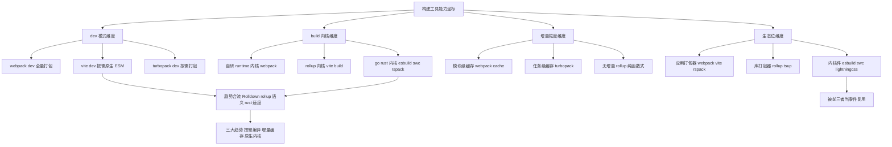

```javascript
// 选型速查表（面试可直接背的"一行答案"）
const DECISION = {
  'npm 库': 'tsup / unbuild（rollup 语义）+ 双 exports',
  '新 SPA（React/Vue）': 'Vite（dev 按需 ESM + build rollup/Rolldown）',
  '重 SSR 应用': 'Next/Nuxt 全家桶（Turbopack / Vite），不自己组链路',
  '存量 webpack 大仓': 'Rspack 渐进迁移（兼容层 + 度量 + 双轨回滚）',
  '微前端基座': 'webpack/Rspack（MF 成熟度）+ 依赖治理（BLD-187）',
  '自定义转译/压缩': 'esbuild/swc 做内核件，别脱离宿主打包器单干',
};
// 一句话总结：所有现代工具都在回答同一个问题——
// "怎么让编译只发生在被需要的地方（按需），且只算一次（增量），算得够快（原生内核）"。
```

> 本文件完整收录 BLD-001 ~ BLD-200 共 200 题：第 1-10 章为 webpack 原理与优化主线，第 11-20 章为源码级深入、多工具实践与综合实战。
