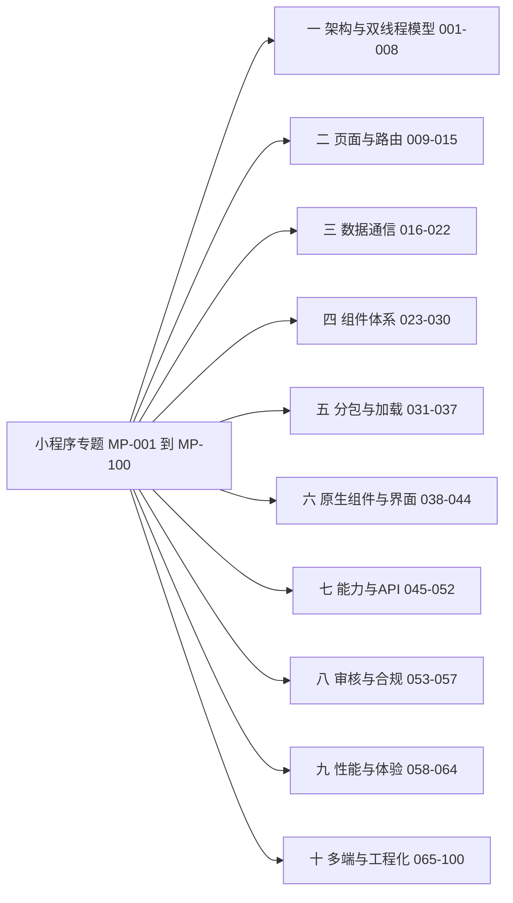
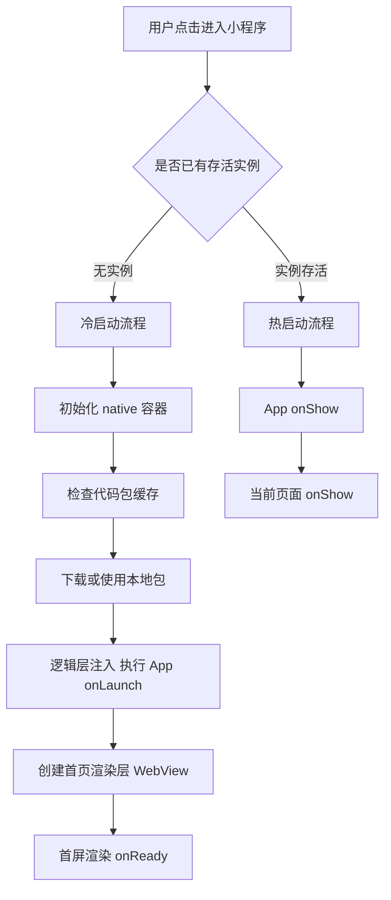
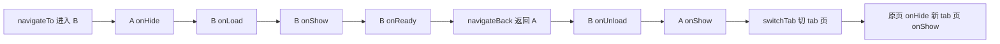
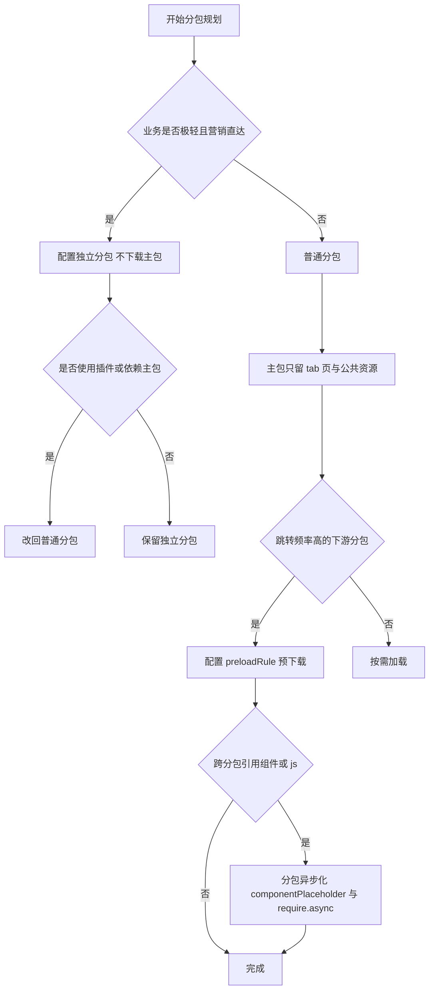
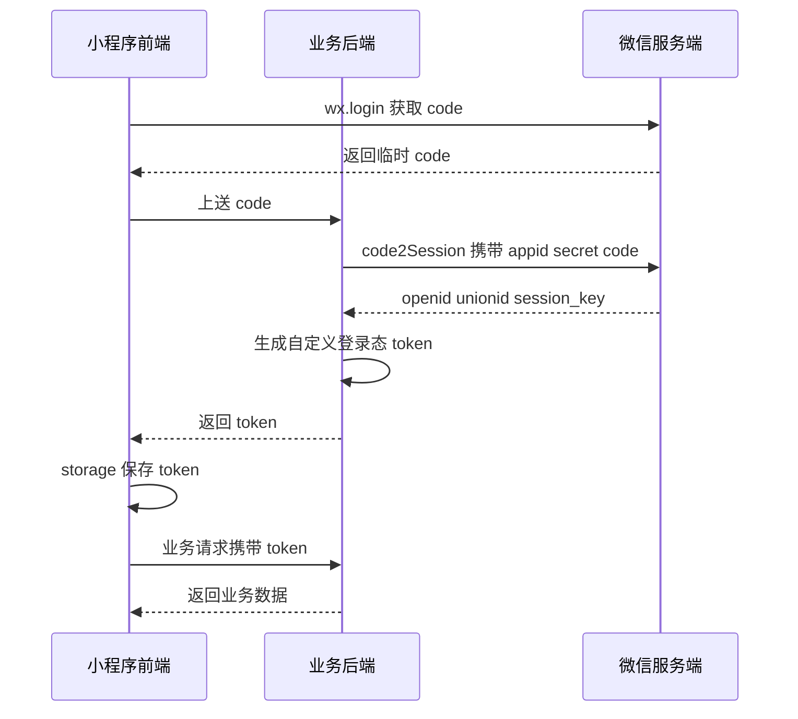
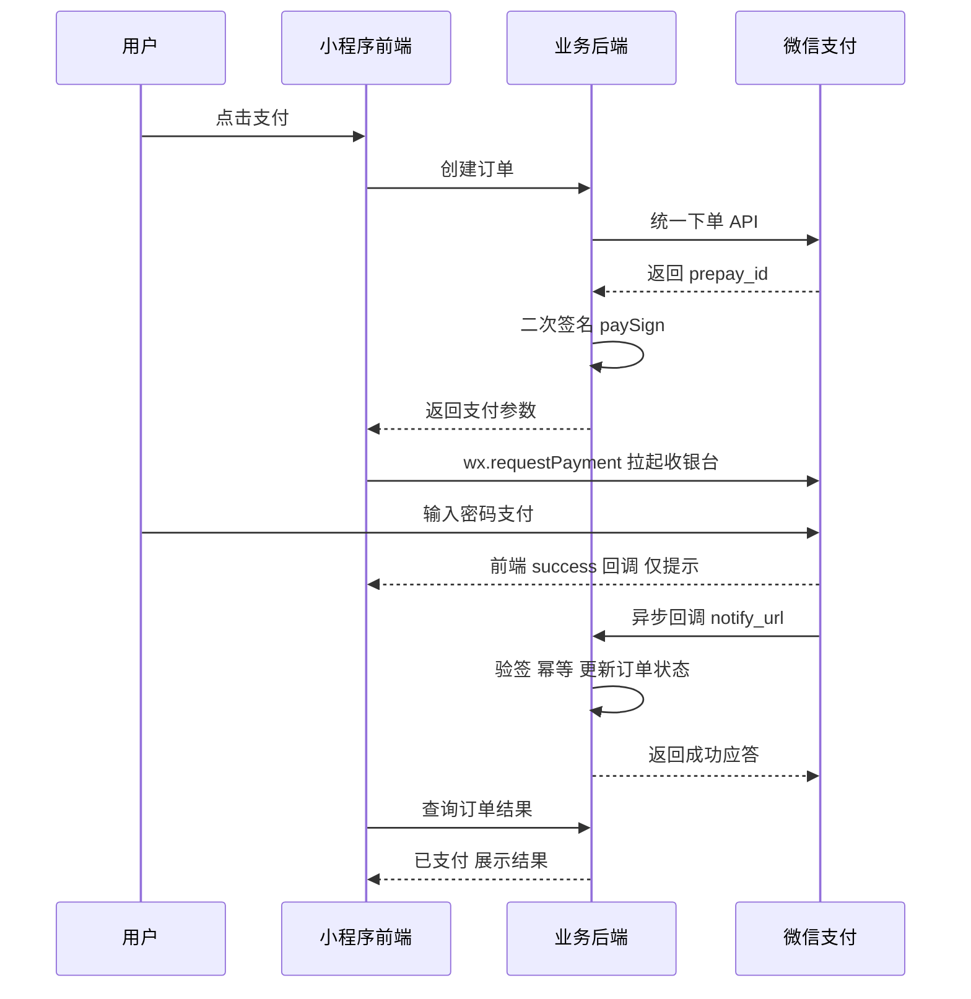
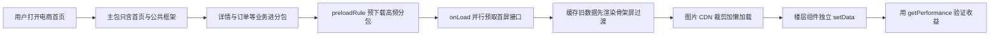
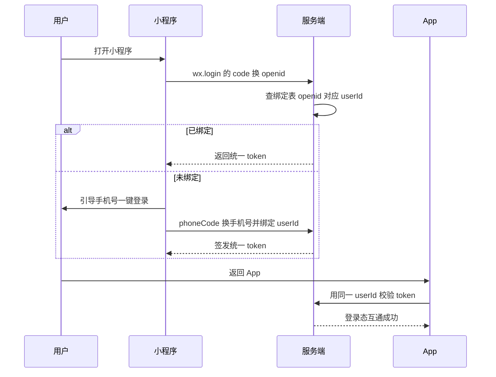
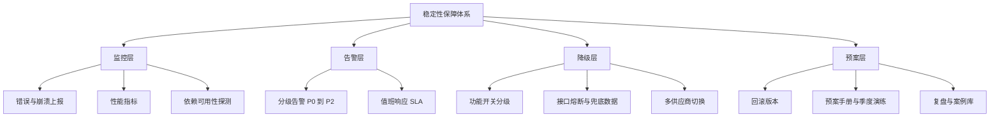
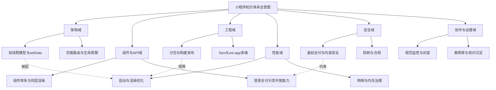

# 前端面试题库：小程序开发

## 简介

本专题聚焦**小程序开发**，以微信小程序为主干，兼顾支付宝/抖音（字节）小程序的多端差异。题目面向国内大厂高频考察点：双线程模型、setData 通信机制、页面栈与路由、组件体系、分包加载、原生组件同层渲染、登录与支付完整链路、审核合规、性能优化以及 Taro/uni-app 多端工程化。

- 编号规则：`MP-001 ~ MP-200`（001-100 基础篇，101-200 场景实战与综合设计篇）。
- 每题均带一个与题目严格对应的代码/配置块，可直接用于复习自测。
- 技术名词保留英文原文，答案以"要点式"呈现，便于面试口头复述。



## 目录

- 一、架构与双线程模型（MP-001 ~ MP-008）
- 二、页面与路由（MP-009 ~ MP-015）
- 三、数据通信（MP-016 ~ MP-022）
- 四、组件体系（MP-023 ~ MP-030）
- 五、分包与加载（MP-031 ~ MP-037）
- 六、原生组件与界面（MP-038 ~ MP-044）
- 七、能力与 API（MP-045 ~ MP-052）
- 八、审核与合规（MP-053 ~ MP-057）
- 九、性能与体验（MP-058 ~ MP-064）
- 十、多端与工程化（MP-065 ~ MP-100）
- 十一、业务场景实战（MP-101 ~ MP-110）
- 十二、跨小程序平台适配（MP-111 ~ MP-116）
- 十三、与 App/后端协作（MP-117 ~ MP-122）
- 十四、安全专题（MP-123 ~ MP-128）
- 十五、性能深水区（MP-129 ~ MP-135）
- 十六、测试与质量（MP-136 ~ MP-141）
- 十七、工程化深化（MP-142 ~ MP-147）
- 十八、云开发深入（MP-148 ~ MP-152）
- 十九、综合设计大题（MP-153 ~ MP-178）
- 二十、体系收束（MP-179 ~ MP-200）

---

## 一、架构与双线程模型（001-008）

### MP-001：微信小程序为什么采用双线程架构？渲染层和逻辑层分离的原因？
**答**：
- 小程序把渲染层（多个页面的 WebView）与逻辑层（单个 JsCore/V8 线程）拆成两个线程，中间由 native 层中转通信。
- **安全管控**：逻辑层无法直接操作 DOM/BOM，页面内容完全由 WXML/WXSS 编译结果驱动，微信可以静态审查代码、控制跳转白名单，防止钓鱼与恶意篡改。
- **性能**：JS 执行与页面渲染互不阻塞，长任务不会卡死渲染（对比浏览器单线程 JS + DOM）。
- **跨端一致性**：渲染层抹平 WebView 差异，逻辑层抹平 JsCore/V8 差异，各机型表现统一。

```javascript
// 双线程下逻辑层没有 DOM/BOM，只能通过 setData 驱动渲染层
console.log(typeof window)   // "undefined" —— 没有 window
console.log(typeof document) // "undefined" —— 没有 document
console.log(typeof wx)       // "object"    —— 只有 native 暴露的 wx API
Page({
  onTap() {
    // 不能 document.querySelector，只能改数据，由渲染层重新渲染
    this.setData({ title: '由数据驱动视图' })
  }
})
```

### MP-002：setData 的通信机制是怎样的？为什么说 native 层是中转站？
**答**：
- 逻辑层 `setData(data)` → 数据被**序列化**为字符串 → 传给 native 层 → native 转发给对应页面的渲染层 WebView → 渲染层反序列化，与 WXML 编译出的虚拟树做 diff，再应用到真实 DOM。
- 一次 setData 至少经历 **逻辑层→native→渲染层两次跨线程通信 + 两次序列化**，因此数据量与调用频率都直接决定耗时。
- 渲染层到逻辑层的事件（tap、input）同样经 native 中转，方向相反。
- 所以优化方向永远是：**少调、小数据、路径更新**（详见 MP-016）。

```javascript
// setData 的数据会被完整序列化后跨线程传输
this.setData({
  'list[2].status': 'done',        // 推荐：路径更新，只传变化字段
  user: this.data.user,            // 不推荐：大对象全量传输，双倍序列化开销
  _cache: bigComputedObject        // 更不推荐：不参与渲染的数据纯属浪费
})
```

### MP-003：为什么要设计双线程？请从安全与管控视角分析。
**答**：
- Web 生态中 JS 可以任意操作 DOM：改样式伪装成官方页面、动态插入钓鱼内容、随意跳转，平台无法管控。
- 双线程下渲染层只能"回放"WXML/WXSS 编译产物，逻辑层触达不了真实 DOM，微信获得了三重管控能力：**代码静态审核**（包可扫描）、**界面内容可控**（没有任意 DOM 注入）、**跳转行为可控**（跳转必须走 wx API，受白名单约束）。
- 同时双线程规避了 JS 长任务阻塞渲染的问题，是"安全优先 + 性能顺带受益"的设计。

```json
{
  "pages": ["pages/index/index"],
  "navigateToMiniProgramAppIdList": [
    "wx1234567890abcdef",
    "wxabcdef1234567890"
  ]
}
```

### MP-004：WXML 编译与模板渲染流程是怎样的？
**答**：
- 上传/构建时，WXML 被编译成一段 **JS 函数（generateFunc）**，它接收 data 返回一棵虚拟节点树描述；WXSS 编译为 JS 注入的样式；二者打进代码包。
- 页面首次渲染：渲染层 WebView 拿到初始 data → 执行 generateFunc 生成虚拟树 → 挂载真实 DOM。
- 后续 setData：只传变化数据 → 渲染层在既有虚拟树上 diff → 增量更新 DOM，避免整页重渲。
- `wx:if` 与 `hidden` 的差异也发生在这层：前者控制节点树是否生成，后者只改样式显隐。

```xml
<!-- pages/list/list.wxml -->
<view wx:for="{{items}}" wx:key="id" wx:if="{{items.length > 0}}">
  {{item.name}}
</view>
<view hidden="{{!visible}}">仅隐藏，节点树仍存在</view>
```

### MP-005：渲染层 WebView 与 Skyline 渲染引擎有什么区别？
**答**：
- WebView 渲染：每个页面一个 WebView（iOS WKWebView / Android chromium），逻辑层与渲染层天然隔离，setData 只能异步。
- Skyline：微信自研渲染引擎，渲染层不再用 WebView，改为轻量原生渲染管线；支持逻辑层与渲染层**同线程同步通信**，省去序列化跨线程开销，setData 更快。
- Skyline 启动更快、包内不依赖完整 WebView 环境、支持工作线程，但 **CSS 是子集**（不支持部分选择器、伪类、float 等），需按官方支持列表编写样式。
- 开启需要 `rendererOptions.skyline` + `componentFramework: "glass-easel"`，并配合 lazyCodeLoading。

```json
{
  "rendererOptions": {
    "skyline": {
      "defaultDisplayBlock": true,
      "defaultContentBox": true,
      "disableABTest": true
    }
  },
  "componentFramework": "glass-easel",
  "lazyCodeLoading": "requiredComponents"
}
```

### MP-006：小程序逻辑层的运行环境（JsCore/V8）有哪些限制？
**答**：
- iOS 用 JavaScriptCore，Android 用 V8，开发者工具用 NW.js（chromium）——三端能力有差异，ES 新特性覆盖不同，需按基础库版本兼容。
- 没有 window/document/navigator，没有 Cookie，因此鉴权只能靠 header + storage 自行管理。
- 全局可用的只有 `wx/getApp/App/Page/Component/getCurrentPages/getCurrentInstance` 等框架注入对象。
- 网络请求必须走已配置的**合法域名**白名单（HTTPS），本地调试需勾选"不校验合法域名"。

```javascript
// 运行环境探测：多端兼容时判断平台与基础库
const { platform, SDKVersion, benchmarkLevel } = wx.getDeviceInfo()
const env = {
  platform,            // ios / android / devtools / mac / windows
  SDKVersion,          // 基础库版本，决定可用的 wx API
  benchmarkLevel,      // 机型性能等级，-1 表示未知，可用于低端机降级
  isDevtools: platform === 'devtools'
}
```

### MP-007：小程序与浏览器 SPA 的本质差异有哪些？
**答**：
- **线程模型**：SPA 单线程 JS 直接操作 DOM；小程序双线程，数据驱动，DOM 不可见。
- **路由**：SPA 靠 History API + 前端路由表；小程序由 native 管理页面栈（上限 10），跳转即入栈/退栈，页面是独立 WebView。
- **资源与管控**：SPA 无包体限制、无审核；小程序有 2M 主包/30M 总包限制、域名白名单、审核发布流程。
- **登录态**：SPA 有 Cookie；小程序无 Cookie，用 storage + header 自行携带 token。
- **生命周期**：SPA 是应用级；小程序是 App/Page/Component 三层生命周期。

```javascript
// 同为"跳详情页"的差异对比
// SPA:  router.push('/detail?id=1')，历史记录由浏览器管理
wx.navigateTo({ url: '/pages/detail/detail?id=1' })  // native 页面栈 +1
const stack = getCurrentPages()                       // 页面栈实例数组
console.log(stack.length, stack[stack.length - 1].route) // 深度 与 当前页面路径
```

### MP-008：小程序启动流程全解？冷启动与热启动的差异？
**答**：
- **冷启动**：用户首次打开或小程序被销毁后打开 → native 初始化 → 检查/下载代码包（命中缓存则本地加载）→ 逻辑层注入并执行 App.onLaunch → 创建首页渲染层 WebView → 首屏渲染完成。
- **热启动**：小程序切后台后未被销毁，再次打开时**不再重新初始化**，直接触发 App.onShow 与页面 onShow，速度极快。
- **销毁时机**：后台停留超过约 5 分钟（各端不同）、连续收到系统内存告警、或用户主动杀进程。
- 启动优化围绕冷启动做：控制主包体积、lazyCodeLoading、启动阶段少做同步工作（详见 MP-037）。

```javascript
App({
  onLaunch() { /* 仅冷启动一次：登录、拉取全局配置 */ },
  onShow()   { /* 冷启动与热启动都会触发：刷新登录态、深链处理 */ },
  onHide()   { /* 切后台：埋点上报、暂停轮询 */ }
})
```



---

## 二、页面与路由（009-015）

### MP-009：页面栈 10 层限制是什么？超限怎么处理？
**答**：
- `getCurrentPages()` 返回当前页面栈实例数组，**上限 10 层**，`wx.navigateTo` 超 10 层会 fail。
- 处理方案一：封装统一路由函数，栈深接近上限时自动改用 `redirectTo`（替换当前页，栈深不变）。
- 方案二：连续多级流程（如表单向导）用 `redirectTo` 串联，只有"主干路径"用 navigateTo。
- 方案三：`navigateBack({ delta })` 先退再进，或对"完成类"页面直接 `reLaunch` 清栈。

```javascript
// 统一路由封装：超栈自动降级为 redirectTo
function navigate(url) {
  const stack = getCurrentPages()
  if (stack.length >= 10) {
    wx.redirectTo({ url })            // 替换当前页，栈深不变
  } else {
    wx.navigateTo({ url })            // 正常入栈，可返回
  }
}
```

### MP-010：wx.navigateTo / redirectTo / reLaunch / switchTab / navigateBack 的差异与选型？
**答**：
- `navigateTo`：保留当前页入栈，可返回；适合列表→详情的常规前进。
- `redirectTo`：关闭当前页再打开新页，不入栈；适合"提交成功"后替换表单页，防返回重复提交。
- `switchTab`：只能跳 tabBar 页面，且会**关闭所有非 tab 页面**。
- `reLaunch`：关闭全部页面打开任意页（含 tab 页）；适合登录态切换、清栈重开。
- `navigateBack`：退栈，配合 EventChannel 可向上一页回传数据。

```javascript
wx.navigateTo({ url: '/pages/detail/detail?id=1' })  // 入栈，可返回
wx.redirectTo({ url: '/pages/success/success' })     // 替换当前页
wx.switchTab({ url: '/pages/index/index' })          // 仅 tab 页，清空非 tab 页
wx.reLaunch({ url: '/pages/index/index' })           // 清空整个页面栈
wx.navigateBack({ delta: 2 })                        // 后退两层
```

### MP-011：页面间通信 EventChannel 怎么用？
**答**：
- `wx.navigateTo` 的 `events` 参数声明监听器，`success` 回调里拿到**发往目标页**的 EventChannel；目标页用 `this.getOpenerEventChannel()` 拿到反向通道。
- 双向 `emit/on`，适合选择器页面回传结果、列表页实时刷新等场景；页面关闭后通道失效。
- 相比 url 传参：可传对象不必序列化；相比全局变量：生命周期与页面绑定，无泄漏风险。

```javascript
// A 页面：跳转并监听 selected 事件
wx.navigateTo({
  url: '/pages/select/select',
  events: {
    selected: (data) => this.setData({ picked: data })   // 接收 B 回传
  }
})

// B 页面：向打开它的页面发数据
Page({
  onPick() {
    const channel = this.getOpenerEventChannel()
    channel.emit('selected', { id: 1, name: '北京' })    // 回传 A 页面
  }
})
```

### MP-012：小程序没有原生路由守卫，登录校验如何封装？
**答**：
- 思路一：**重写 Page**（包装器），代理 onLoad/onShow，在跳转前校验登录态，未登录则重定向登录页并记录目标地址，登录后回跳。
- 思路二：封装 `navigate` 路由函数，跳转前统一拦截。
- 思路三：请求层拦截（401 时触发登录），与页面层守卫配合使用。
- 注意重写 Page 要保留原配置对象与 this 指向，且放在所有页面代码之前执行。

```javascript
// app.js 顶部：重写 Page 实现伪路由守卫
const originPage = Page
Page = function (options) {
  const originOnLoad = options.onLoad
  options.onLoad = function (query) {
    const app = getApp()
    if (options.requireAuth && !app.globalData.token) {
      const current = getCurrentPages().slice(-1)[0]
      const redirect = current ? current.route : 'pages/index/index'
      wx.reLaunch({
        url: `/pages/login/login?redirect=${encodeURIComponent(redirect)}`
      })
      return                                  // 拦截，不执行原 onLoad
    }
    originOnLoad && originOnLoad.call(this, query)
  }
  return originPage(options)
}
```

### MP-013：页面生命周期完整时序？与 TabBar 切换如何配合？
**答**：
- 首次进入：`App.onLaunch` → `App.onShow` → 页面 `onLoad`（仅一次，拿参数）→ `onShow` → `onReady`（仅一次，首渲完成，可操作节点）。
- 页面切换 A→B：A `onHide` → B `onLoad/onShow/onReady`；B 返回 A：B `onUnload` → A `onShow`。
- **TabBar 切换不触发 onLoad/onUnload**，只触发 onHide/onShow——所以 tab 页数据刷新逻辑放 onShow。
- onShow 是最常用的"回来刷新"钩子，但要防与 onLoad 重复请求（用标志位区分首次）。

```javascript
Page({
  onLoad(query)  { console.log('仅一次', query) ; this.firstShow = true },
  onShow() {
    if (this.firstShow) { this.firstShow = false; return } // onLoad 已拉取
    this.refresh()                                          // tab 切回/返回刷新
  },
  onReady()  { console.log('首渲完成，可 createSelectorQuery') },
  onHide()   { console.log('切走/切 tab/被覆盖') },
  onUnload() { console.log('销毁：清定时器、解绑全局事件') }
})
```



### MP-014：分包页面的路由与跳转有哪些限制？
**答**：
- 主包与普通分包之间跳转正常：`navigateTo('/subpkg/pages/x/x')` 按需下载分包后打开。
- **独立分包**可独立于主包运行（扫码直进不下载主包），但不能引用主包和其他分包的 js/组件/wxss/插件。
- tabBar 页面**必须在主包**，分包内页面不能配置为 tab。
- 分包间跳转经主包中转或直接 reLaunch；跳转时目标分包未下载会先下载（可用预下载优化，见 MP-033）。

```javascript
// 主包跳普通分包
wx.navigateTo({ url: '/packageA/pages/cat/cat' })

// 独立分包内跳主包页面：主包可能尚未加载，需容错
wx.navigateTo({
  url: '/pages/index/index',
  fail: () => wx.reLaunch({ url: '/pages/index/index' })
})
```

### MP-015：如何做组件化页面设计？
**答**：
- 页面只保留**数据编排 + 路由 + 生命周期**，UI 拆成有语义的自定义组件（如 order-filter、order-list、empty-view）。
- 数据通过 properties 下发，事件通过 triggerEvent 上抛，页面做"中间人"；兄弟组件不直接通信。
- 公共业务逻辑抽 behaviors；重复 UI 抽基础组件库；页面骨架保持薄，方便换肤与复用。
- 配合骨架屏组件与占位组件，首屏体验与可测性都更好。

```xml
<!-- pages/order/order.wxml：页面只做编排 -->
<order-filter
  filters="{{filters}}"
  bind:change="onFilterChange" />
<order-list
  list="{{list}}"
  bind:itemtap="onItemTap"
  bind:loadmore="onLoadMore" />
<empty-view wx:if="{{loaded && list.length === 0}}" />
```

---

## 三、数据通信（016-022）

### MP-016：setData 性能优化的完整手段有哪些？（高频压轴）
**答**：
- **降频率**：事件（scroll/input/move）高频触发时节流；同一 tick 内多次 setData 用 `wx.nextTick` 批处理合并成一次。
- **降数据量**：只传变化的字段，用路径更新 `'list[2].status'`；不参与渲染的数据放 this 上而非 data。
- **避坑**：不要向后台页面 setData；不要一次性传长列表全量、大 JSON；避免 data 里放大对象/大数组常量。
- 验证手段：开发者工具 Audits/Performance 面板看 setData 调用次数与耗时。

```javascript
// 差：高频全量更新
onPageScroll(e) {
  this.setData({ scrollTop: e.scrollTop, backTopShow: e.scrollTop > 300 })
}
// 好：节流 + 路径更新 + 合并（注意 apply 透传 this，否则 this.setData 取不到页面实例）
const throttle = (fn, ms) => {
  let last = 0
  return function (...args) {
    const now = Date.now()
    if (now - last >= ms) { last = now; fn.apply(this, args) }
  }
}
Page({
  onPageScroll: throttle(function (e) {
    this.setData({ 'page.scrollTop': e.scrollTop })
  }, 200)
})
```

### MP-017：页面与自定义组件之间有哪些通信方式？
**答**：
- 父→子：properties 传值（配合 observer/observers 监听）。
- 子→父：`triggerEvent('eventName', detail)`，父层 `bind:eventName` 接收。
- 父调子方法/取数据：`this.selectComponent('#id')` 拿组件实例直接调用（反向强耦合，慎用）。
- 跨层级/兄弟：relations（父子强关联组件）、全局事件总线或 store。
- 内容分发：slot（具名 slot）。

```javascript
// 子组件 counter
Component({
  properties: { value: { type: Number, value: 0 } },
  methods: {
    add() {
      this.triggerEvent('change', { value: this.data.value + 1 }) // 上抛
    }
  }
})

// 父页面
Page({
  onReady() {
    const child = this.selectComponent('#counter') // 取子组件实例
    child.add()
  },
  onCounterChange(e) { this.setData({ count: e.detail.value }) }
})
```

### MP-018：globalData / mobx-miniprogram / 自研 store 三种全局状态方案怎么选？
**答**：
- `app.globalData`：零依赖、最简单，但**无响应式**，页面需在 onShow 手动拉取，适合状态极少的小项目。
- `mobx-miniprogram` + `mobx-miniprogram-bindings`：官方推荐，响应式、computed、action，bindings 自动建立组件与 store 的双向绑定并自动销毁。
- 自研 store：observer 模式 + 在 Page/Component 包装器里统一订阅与 unsubscribe，可控可埋点，但维护成本高。
- 中大型项目建议 mobx 或自研响应式 store，globalData 只放 appId、token 等基础字段。

```javascript
// store/index.js（mobx-miniprogram）
import { observable, action } from 'mobx-miniprogram'
export const store = observable({
  cartCount: 0,
  setUser: action(function (n) { this.cartCount = n })
})

// 组件内自动绑定与响应
import { storeBindingsBehavior } from 'mobx-miniprogram-bindings'
import { store } from '../../store/index'
Component({
  behaviors: [storeBindingsBehavior],
  storeBindings: {
    store,
    fields: ['cartCount'],       // data 变化自动刷新视图
    actions: ['setUser']
  }
})
```

### MP-019：跨页面传数据的方式清单？
**答**：
- **url query**：小数据、单向，onLoad 里拿参数（注意 encodeURIComponent 与长度限制）。
- **EventChannel**：双向、对象直传，页面级生命周期。
- **globalData / store**：共享状态，多处读写，需注意响应式。
- **storage**：跨启动持久化，适合"提交后回列表刷新"这类弱关联场景。
- **getCurrentPages() 拿上一页实例**：直接改上个页面 data/调方法，最直接但强耦合，页面栈变化时（redirectTo）要判空。

```javascript
// 方式一：url query
wx.navigateTo({ url: `/pages/detail/detail?id=${id}` })

// 方式二：直接操作上一页实例（注意判空与栈结构）
const pages = getCurrentPages()
const prev = pages[pages.length - 2]
prev && prev.setData({ refreshed: true })
```

### MP-020：Worker 的使用方式与限制？
**答**：
- `wx.createWorker(path)` 创建 worker，与主线程通过 `postMessage/onMessage` 通信，计算在独立线程执行不阻塞页面。
- 限制：**同时最多 1 个**；worker 代码必须放在项目 `workers/` 目录（app.json 声明）；worker 内不能访问 wx 大部分 API 与页面实例。
- 适用：大数据排序、图片/加解密、复杂字符串处理；简单逻辑别用，通信成本反而高。

```javascript
// app.json 需声明 "workers": "workers"
// —— 主线程 ——
const worker = wx.createWorker('workers/heavy/index.js')
worker.postMessage({ type: 'hash', payload: bigString })
worker.onMessage((res) => { console.log('worker 返回', res); worker.terminate() })

// —— workers/heavy/index.js ——
worker.onMessage(function ({ type, payload }) {
  if (type === 'hash') worker.postMessage({ result: heavyHash(payload) })
})
```

### MP-021：storage 同步与异步 API 的差异？
**答**：
- 同步版 `wx.setStorageSync/getStorageSync`：立即返回、代码直观，但**阻塞逻辑层线程**，大对象/高频读写会卡顿。
- 异步版 `wx.setStorage/getStorage`：不阻塞，回调风格；不传 success/fail/complete 时返回 **Promise**。
- 容量：单 key 上限 1MB，总量上限 10MB；超限抛错需 try/catch 或 fail 兜底。
- 实践：启动关键路径用同步小数据；批量/大文件读写用异步并合并。

```javascript
// 同步：关键小数据，记得容错
try {
  wx.setStorageSync('token', token)
} catch (e) {
  console.error('storage 超限或不可用', e)
}

// 异步：Promise 风格，不阻塞
wx.setStorage({ key: 'user', data: user })
  .then(() => console.log('ok'))
  .catch(console.error)
```

### MP-022：小程序 storage 与 Web localStorage 的隔离差异？
**答**：
- 隔离维度：Web 按**域名（同源策略）**隔离；小程序按 **appid** 隔离，与域名无关，不同小程序互不可见。
- 容量：localStorage 约 5MB；小程序 storage 总量 10MB、单 key 1MB。
- 生命周期：localStorage 可被用户清除/受隐私模式影响；小程序 storage 由 native 持久化管理，删除小程序才清空（系统清理行为除外）。
- 小程序没有 Cookie，也不受浏览器分区存储（localStorage 的 7 天限制等策略）影响。

```javascript
// 本设备上不同 appid 的小程序之间互相隔离
wx.setStorageSync('secret', 'only-visible-to-this-appid')
const info = wx.getStorageInfoSync()
console.log(info.keys, info.currentSize, info.limitSize) // limitSize 单位 KB，10240 = 10MB
```

---

## 四、组件体系（023-030）

### MP-023：自定义组件"三件套"怎么写？
**答**：
- `Component()` 构造器 + `properties`（对外属性：type/value/observer，命名小写中划线）+ `data`（内部数据）+ `methods`（方法与生命周期外的逻辑）。
- json 里必须声明 `"component": true`；使用方在 usingComponents 注册。
- 对外事件用 `triggerEvent`；properties 是单向数据流，组件内不要直接改 properties（用 data 做中间态或 triggerEvent 通知父级改）。

```javascript
// components/counter/index.js —— 三件套：properties / data / methods
Component({
  properties: {
    value: { type: Number, value: 0, observer(nv) { console.log('外部值变化', nv) } }
  },
  data: { label: 'counter' },
  methods: {
    add() {
      this.triggerEvent('add', { value: this.data.value + 1 })
    }
  }
})

// components/counter/index.json —— 声明为组件：{ "component": true }
// components/counter/index.wxml：
// <view class="counter"><text>{{label}}: {{value}}</text>
//   <button bindtap="add" size="mini">+1</button></view>
```

### MP-024：Component 构造器的高级选项 observers / lifetimes 怎么用？
**答**：
- `observers`：监听 data 与 properties 的任意字段，支持 `'a, b'` 多字段与 `'obj.**'` 通配符，适合派生数据（替代手动 watch）。
- `lifetimes`：组件生命周期 `created → attached → ready → moved → detached`，写在 lifetimes 字段里优先级高于构造器顶层同名定义。
- 页面生命周期放 `pageLifetimes`（show/hide/resize），监听所在页面状态。

```javascript
Component({
  properties: { a: Number, b: Number },
  observers: {
    'a, b'(a, b) { this.setData({ sum: (a || 0) + (b || 0) }) },
    'obj.**'(obj) { console.log('obj 任意字段变化', obj) }
  },
  lifetimes: {
    attached() { console.log('进入节点树') },
    ready()   { console.log('布局完成，可查节点') },
    detached(){ console.log('移除：清定时器') }
  },
  pageLifetimes: {
    show() { console.log('所在页面显示') }
  }
})
```

### MP-025：behaviors 是什么？与 Vue 的 mixin 有何异同？
**答**：
- behaviors 是组件级逻辑复用单元，可包含 data/properties/methods/lifetimes/observers，等价于 Vue2 mixin 的定位。
- 合并规则：同名 properties/data **组件自身优先**；生命周期按声明顺序**依次执行**（mixin 也是先 mixin 后组件）。
- 差异：behaviors 是框架运行时按规则合并、支持组件间 relations 复用；mixin 是编译期对象合并；behaviors 还可被抽象节点/继承链复用。
- 共同的坑：隐式依赖来源不清晰，滥用后维护困难，需控制粒度。

```javascript
// behaviors/loading.js
module.exports = Behavior({
  data: { loading: false },
  methods: {
    showLoading() { this.setData({ loading: true }) },
    hideLoading() { this.setData({ loading: false }) }
  }
})

// 组件中使用
const loadingBehavior = require('../behaviors/loading.js')
Component({
  behaviors: [loadingBehavior],
  methods: {
    async fetch() {
      this.showLoading()
      try { await api.list() } finally { this.hideLoading() }
    }
  }
})
```

### MP-026：include 与 import 的作用域差异？
**答**：
- `import`：只引入目标文件中**定义的 template**，且**不传递**——目标文件里 import 进来的 template 不会被带过来（作用域不传递是常考点）。
- `include`：把目标文件**除 template/wxs 外的全部内容**原样拷贝到当前位置，用于整块结构复用，不能传数据。
- `template`：用 `is` 引用、`data` 传参，模板内只能访问传入的数据，无独立逻辑。

```xml
<!-- import：只拿到 item.wxml 中定义的 template（不含其再 import 的） -->
<import src="../item/item.wxml" />
<template is="item" data="{{ item: list[0] }}" />

<!-- include：整体拷贝 header.wxml，不含其中 template -->
<include src="../header/header.wxml" />
```

### MP-027：多具名 slot 与抽象节点 generics 分别解决什么问题？
**答**：
- 具名 slot：组件 json 开 `"componentGenerics"`? 不对——开启 `"styleIsolation"`? 准确说需在组件 json 中声明 `"component": true` 且页面开启多 slot：**组件 json 配 `"multipleSlots": true`（options 里也有）**，模板 `<slot name="header"/>`，使用方 `<view slot="header">`。
- 抽象节点 generics：组件内写 `<generic-node/>` 占位，由**使用方指定具体实现组件**，解决"通用容器组件不知道要用哪个子组件"的依赖倒置问题。
- 配置：组件侧 `componentGenerics: { "list-item": true }`，使用侧在 usingComponents 里注册同名节点。

```javascript
// —— components/list/index.json：声明抽象节点 ——
{ "componentGenerics": { "list-item": true } }

// —— components/list/index.wxml：占位 ——
// <view><generic-node wx:for="{{list}}" item="{{item}}" /></view>

// —— pages/index/index.json：使用方指定实现 ——
{
  "usingComponents": {
    "list": "/components/list/index",
    "list-item": "/components/item/index"
  }
}
```

### MP-028：组件样式隔离 styleIsolation 各取值有什么区别？
**答**：
- `isolated`（默认）：组件内外样式完全隔离，页面样式不影响组件，组件样式也不外泄。
- `apply-shared`：页面（含 app.wxss）样式可影响组件，组件样式不外泄；旧写法 `addGlobalClass: true` 等价。
- `shared`：双向共享——页面样式影响组件，组件样式也影响页面及所有开启 shared 的组件，慎用（易互相污染）。
- 页面级也可配置 `options.styleIsolation`；全局样式想进 isolated 组件只能走 CSS 变量或 externalClasses。

```javascript
// 组件级
Component({
  options: { styleIsolation: 'apply-shared' } // 接收页面样式，不外泄
})

// 页面级
Page({
  options: { styleIsolation: 'shared' }
})
```

### MP-029：isolated 组件的样式如何穿透定制？
**答**：
- 方案一 `externalClasses`：组件声明外部样式类名，使用方传入自己的类，权重高于组件内部样式。
- 方案二 CSS 变量：组件内写 `color: var(--comp-color, #333)`，使用方在父级注入变量。
- 方案三 styleIsolation 设为 apply-shared/shared（放宽隔离，影响面大）。
- slot 内容的样式由**使用方**的 wxss 控制，本身就是一条穿透通道。

```xml
<!-- 组件：components/badge/index -->
<!-- index.js: Component({ externalClasses: ['badge-class'] }) -->
<view class="badge badge-class">NEW</view>

<!-- 使用方页面 -->
<badge badge-class="my-red-badge" />
<!-- page.wxss: .my-red-badge { color: red; font-weight: bold } -->
```

### MP-030：组件 Relations（父子关联组件）怎么实现？
**答**：
- 在关联双方 `relations` 中声明对方路径与关系类型：`parent/child`（一对一严格层级）或 `ancestor/descendant`（跨层级）。
- 生命周期钩子 `linked/unlinked/linkChanged` 感知对方挂载/卸载；`this.getRelationNodes('./tab-panel')` 获取关联实例集合。
- 典型场景：tabs 与 tab-panel、accordion 与 item、表单与表单项联动。
- 也可由子组件主动 `this.getRelationNodes` 反查父级；单边声明 descendant/ancestor 即可不强制双方都写。

```javascript
// components/tabs/index.js
Component({
  relations: {
    './tab-panel/index': {
      type: 'child',
      linked(panel) { this._panels.push(panel) },        // 子组件挂载
      unlinked(panel) {
        this._panels = this._panels.filter(p => p !== panel)
      }
    }
  },
  lifetimes: {
    attached() { this._panels = [] }
  }
})

// components/tab-panel/index.js
Component({
  relations: { '../tabs/index': { type: 'parent' } }     // 反向声明
})
```

---

## 五、分包与加载（031-037）

### MP-031：分包如何配置？体积限制的现值是多少？
**答**：
- app.json 中 `subPackages`（兼容 `subpackages`）配置 `root + pages`，可加 `name` 供预下载引用。
- 限制：**主包 ≤ 2M，单个分包 ≤ 2M，所有分包总和 ≤ 30M**（2023 年由 20M 上调；服务商代开发场景上限 20M，以官方文档现值为准）。
- tabBar 页面必须在主包；主包放公共资源与 tab 页，业务模块全部拆分包。
- 超限报错发生在预览/上传阶段，需做包体积监控（见 MP-099）。

```json
{
  "pages": ["pages/index/index", "pages/mine/mine"],
  "subPackages": [
    { "root": "packageA", "pages": ["pages/cat/cat", "pages/dog/dog"] },
    { "root": "packageB", "name": "shop", "pages": ["pages/list/list"] }
  ]
}
```

### MP-032：独立分包是什么？适用哪些场景？
**答**：
- `"independent": true` 的分包可**独立于主包运行**：从该分包页面进入小程序时，不下载主包。
- 运行独立分包时主包未加载：主包的 App.onLaunch/onShow 逻辑、公共组件、插件都不可用（独立分包内**不能使用插件**）。
- 典型场景：扫码/分享直达的**营销活动页**、临时大促落地页、对启动速度极敏感的轻入口。
- 公共逻辑需复制或抽成 npm 包在各包内独立构建，代价是体积冗余。

```json
{
  "subPackages": [
    {
      "root": "moduleActivity",
      "independent": true,
      "pages": ["pages/activity/activity"]
    }
  ]
}
```

### MP-033：分包预下载 preloadRule 怎么配置？
**答**：
- 进入指定页面时，微信在后台**静默预下载**目标分包，跳转时零等待。
- 配置 `preloadRule`：key 为页面路径，`packages` 填分包 root 或 name，`network` 取 `all/wifi`。
- 限制：**同一个页面享有的预下载大小限额 2M**；预下载不影响主包加载优先级。
- 决策：把"当前页最可能跳转的下一站"配成预下载，如首页预下载核心业务分包。

```json
{
  "preloadRule": {
    "pages/index/index": { "network": "all",  "packages": ["packageA"] },
    "pages/mine/mine":   { "network": "wifi", "packages": ["shop"] }
  }
}
```



### MP-034：分包异步化解决什么问题？怎么用？
**答**：
- 传统限制：分包之间、主包对分包都不能静态引用。分包异步化放开了它：**跨分包引用自定义组件**与 **require.async 跨分包引用 js**。
- 组件：`usingComponents` 直接写对方分包路径，同时配 `componentPlaceholder` 指定加载完成前的占位组件（如 view）。
- js：`require.async('对方分包路径')` 返回 Promise，回调里使用。
- 注意占位期间布局抖动与事件不可达，建议骨架占位。

```javascript
// 分包 A 的组件使用分包 B 的组件与工具
Component({
  usingComponents: {
    'big-chart': '../../packageB/components/chart/chart' // 跨分包组件
  },
  componentPlaceholder: {
    'big-chart': 'view'                                   // 加载完成前用 view 占位
  },
  methods: {
    async track() {
      const { analytics } = await require.async('../../packageB/utils/analytics.js')
      analytics.report('chart_shown')                     // 跨分包 js
    }
  }
})
```

### MP-035：按需注入 lazyCodeLoading 是什么原理？
**答**：
- 默认启动时会把**所有**自定义组件代码注入逻辑层，页面多了注入耗时与内存显著上升。
- `"lazyCodeLoading": "requiredComponents"` 后，仅注入**当前页面声明需要**的自定义组件代码，未使用的不注入。
- 收益：减少启动注入时间与内存占用；是官方启动性能优化的标配项。
- 注意：动态 `this.selectComponent` / `createSelectorQuery` 获取未注册组件的场景要验证；配合 glass-easel/Skyline 使用。

```json
{
  "lazyCodeLoading": "requiredComponents"
}
```

### MP-036：初始渲染缓存 initialRenderingCache 是什么？
**答**：
- 页面配置 `"initialRenderingCache": "static"` 后，微信把**初始 data 渲染出的视图**缓存下来，下次冷启动直接展示缓存视图，逻辑层就绪后再用真实数据更新。
- 收益：冷启动白屏明显缩短，用户先看到"静态首屏"。
- 注意：缓存视图**不可交互**（点击事件不生效）、不含 setData 后的内容，适合纯展示骨架；动态数据区域要设计 loading 态。
- 可在页面 json 单页开启，也可 app.json 全局开启。

```json
{
  "initialRenderingCache": "static"
}
```

### MP-037：小程序启动性能优化清单？
**答**：
- **包体积**：主包瘦身（图片上 CDN、清理死代码、分包子包化、压缩混淆）。
- **代码注入**：lazyCodeLoading 按需注入；减少 App.onLaunch 同步阻塞（非关键逻辑延迟执行）。
- **首屏数据**：storage 缓存先行渲染 + 请求后更新；初始 data 精简；初始渲染缓存/骨架屏。
- **下载**：分包预下载 preloadRule；避免主包夹带大文件。
- **验证**：用「体验评分 + wx.getPerformance」量化启动各阶段耗时。

```javascript
// App 启动阶段：关键路径与延迟路径分离
App({
  onLaunch() {
    wx.login({ success: (r) => this.session(r.code) })  // 关键：登录态
    wx.getStorageSync('homeCache')                       // 关键：缓存先行
    wx.nextTick(() => this.initAnalytics())              // 非关键：延迟埋点初始化
    setTimeout(() => this.loadConfig(), 0)               // 非关键：异步拉配置
  }
})
```

---

## 六、原生组件与界面（038-044）

### MP-038：原生组件同层渲染的原理是什么？（高频压轴）
**答**：
- 历史问题：input/video/map/camera/canvas 等由 **native（客户端）直接渲染**，不属于 WebView DOM，层级恒在最上，普通元素无法覆盖，事件也有差异。
- 同层渲染：让原生组件渲染进 WebView 的同一合成层——iOS 上把原生视图挂到 WKChildScrollView，Android 由内核（chromium 自绘/flattern 层）与 native 协作，使其支持 z-index、transform、被遮挡。
- 现状：input/textarea、video、map、canvas（2d/webgl）、camera、live-player 等主流组件已同层化；仍未完全同层的组件需 cover-view 兜底。
- 验证方式：真机上看普通元素能否覆盖组件、能否被 overflow 裁剪。

```xml
<!-- 同层渲染后：普通元素可直接覆盖/裁剪原生组件 -->
<view class="map-wrap" style="position: relative; height: 300px;">
  <map id="myMap" style="width: 100%; height: 100%;"></map>
  <view class="float-card" style="position: absolute; bottom: 10rpx;">
    覆盖在地图上的普通卡片
  </view>
</view>
```

### MP-039：同层渲染有哪些已知的坑？如何设计降级方案？
**答**：
- 坑：部分低版本机型/内核同层失效则回退为非同层（组件置顶）；滚动容器内原生组件错位、跟随滚动撕裂；父级 transform/动画会导致原生组件闪烁；键盘弹起遮挡 input。
- 降级方案：关键交互区仍准备 cover-view/cover-image 兜底；避免把原生组件放进复杂 transform 容器；用 `wx.createSelectorQuery` 拿位置手动布局浮层。
- 检测：`wx.getSystemInfo` 相关字段/真机实测标注不支持机型，做功能降级开关。

```xml
<!-- 降级兜底：非同层场景下用 cover-view 保证按钮可见可点 -->
<video src="{{src}}" controls="{{false}}">
  <cover-view class="ctrl-bar">
    <cover-view class="ctrl-btn" bindtap="onToggle">播放/暂停</cover-view>
  </cover-view>
</video>
```

### MP-040：canvas 2d 新接口与旧接口的差异？
**答**：
- 旧接口 `wx.createCanvasContext(canvasId)`：指令队列模式（ctx 操作被收集后 flush 到 native），API 与 Web Canvas 不一致，性能差、无法直接 getImageData、同层支持弱，官方已停止维护。
- 新接口：`<canvas type="2d">` → `SelectorQuery.select().fields({ node: true })` 拿 **Canvas 节点** → `node.getContext('2d')`，与 Web Canvas API 一致，支持离屏 `wx.createOffscreenCanvas`、逐帧绘制与导出临时文件。
- 高清适配：手动按 dpr 设置 `canvas.width = cssWidth * dpr` 再 `ctx.scale(dpr, dpr)`。

```javascript
Page({
  onReady() {
    wx.createSelectorQuery()
      .select('#myCanvas')
      .fields({ node: true, size: true })
      .exec((res) => {
        const { node: canvas, width, height } = res[0]
        const dpr = wx.getWindowInfo().pixelRatio
        canvas.width = width * dpr          // 物理像素
        canvas.height = height * dpr
        const ctx = canvas.getContext('2d') // 与 Web Canvas API 一致
        ctx.scale(dpr, dpr)
        ctx.fillStyle = '#07c160'
        ctx.fillRect(0, 0, 100, 100)
      })
  }
})
```

### MP-041：地图组件的使用与性能要点？
**答**：
- map 为原生组件（已同层），大量 marker 是首要性能杀手：控制数量、合并重叠点、精简 iconPath（小尺寸 png）。
- 批量操作用 `MapContext.addMarkers({ clear: true })` 替代反复 setData markers；`includePoints` 自适应视野。
- `regionchange` 高频触发，视野内数据加载必须节流；callout/label 复杂 DOM 会拖慢渲染，能用图标不用气泡。
- 低端机（benchmarkLevel 低）可降级为静态图或减少 marker。

```javascript
Page({
  onReady() {
    this.mapCtx = wx.createMapContext('myMap')
    this.mapCtx.addMarkers({
      markers: this.data.markers.slice(0, 50),  // 控制 marker 数量
      clear: true
    })
    this.mapCtx.includePoints({ padding: [60, 60, 60, 60], points: this.data.points })
  },
  onRegionChange: throttle(function (e) {
    if (e.type === 'end') this.loadMarkersInViewport() // 节流后按视野加载
  }, 300)
})
```

### MP-042：cover-view 的历史与现状？
**答**：
- 历史：同层渲染普及前，原生组件之上只能覆盖 cover-view/cover-image（由 native 渲染的"原生层兄弟"），样式支持极有限（不支持大部分 wxss）。
- 现状：input/video/map/canvas 等已同层，普通 view 可直接覆盖，官方建议新代码直接用普通组件，cover-view 仅用于兼容老基础库/未同层组件。
- 仍可能遇到：部分端（如小程序 PC 端、低版本抖音宿主）组件未同层时需要 cover-view 兜底。

```xml
<!-- 旧写法：非同层年代必须 cover-view 覆盖 video -->
<video src="{{src}}">
  <cover-view class="btn-legacy">旧写法按钮</cover-view>
</video>

<!-- 新写法：同层渲染后普通 view 直接覆盖 -->
<view class="video-box">
  <video src="{{src}}"></video>
  <view class="btn-modern">新写法按钮</view>
</view>
```

### MP-043：自定义导航栏如何做胶囊按钮适配？
**答**：
- 页面 json 配 `"navigationStyle": "custom"`，系统导航消失，需自绘。
- 适配基准：`wx.getMenuButtonBoundingClientRect()` 拿右上角胶囊位置，`wx.getWindowInfo().statusBarHeight` 拿状态栏高度。
- 经典公式：导航内容区高度 = `(胶囊top - 状态栏高度) * 2 + 胶囊height`；导航总高度 = statusBarHeight + 内容区高度。
- 布局需避开胶囊水平区域；iOS 全面屏注意 safe-area，页面底部用 `env(safe-area-inset-bottom)`。

```javascript
// utils/navbar.js —— 计算自定义导航高度
export function calcNavBar() {
  const menu = wx.getMenuButtonBoundingClientRect() // 胶囊
  const win = wx.getWindowInfo()
  const navBarHeight = (menu.top - win.statusBarHeight) * 2 + menu.height
  return {
    statusBarHeight: win.statusBarHeight,
    navBarHeight,                       // 导航内容区高度
    totalHeight: win.statusBarHeight + navBarHeight,
    menuRight: win.windowWidth - menu.right // 左侧可用宽度起点
  }
}
```

### MP-044：rpx 的换算原理是什么？与 rem/vw 怎么对比？
**答**：
- rpx 规定**任何屏幕 750rpx = 屏幕宽度**，即 `1rpx = 屏宽 / 750`：iPhone6（375px）下 1rpx = 0.5px，由框架在渲染时换算。
- 与 rem 对比：rem 需 JS 动态设置根字号，rpx 是框架内建、零 JS；与 vw 对比：`1rpx = 100vw / 750 ≈ 0.1333vw`，本质同源。
- 细节坑：极小屏/大屏上 rpx 等比放大可能失真，关键尺寸可配合 px；**1px 细线用 px**（0.5px/1rpx 在部分机型取整后消失）。
- 设计稿约定：750 宽的设计稿标注数值直接写 rpx。

```css
/* 750 设计稿：卡片宽 686、内边距 32、字号 28 */
.card {
  width: 686rpx;                    /* 375 屏 = 343px */
  padding: 32rpx;
  border-bottom: 1px solid #eee;    /* 细线用 px，避免 rpx 取整消失 */
  font-size: 28rpx;                 /* 375 屏 = 14px */
  margin-bottom: env(safe-area-inset-bottom);
}
```

---

## 七、能力与 API（045-052）

### MP-045：小程序登录鉴权的完整流程？（高频压轴）
**答**：
- 前端 `wx.login` 拿**临时凭证 code**（5 分钟有效、一次性）→ 传给自家后端。
- 后端携 appid + secret + code 调微信 `code2Session` 接口，换回 `openid / unionid / session_key`。
- 后端自签发**自定义登录态**（token/session）返回前端，前端 storage 保存，后续请求放 header。
- `session_key` 是数据解密密钥，**绝不能下发前端**；token 过期用 `wx.checkSession` 判断 session_key 是否仍有效来决定静默重登。

```javascript
// 前端登录封装
function login() {
  wx.login({
    success: ({ code }) => {
      wx.request({
        url: 'https://api.example.com/auth/login',
        method: 'POST',
        data: { code },
        success: (res) => {
          wx.setStorageSync('token', res.data.token)   // 自定义登录态
        }
      })
    }
  })
}
wx.checkSession({
  success: () => console.log('session 未过期，沿用登录态'),
  fail: login                                           // 过期则重新 wx.login
})
```



### MP-046：getUserProfile 之后，用户信息（头像昵称）获取的现状？
**答**：
- 旧 `wx.getUserInfo` 早已停止返回真实信息；`getUserProfile` 曾需用户点击触发并弹窗，但 2022 年 10 月后接口**回收**，返回的全是"微信用户"与灰色头像。
- 现行推荐："头像昵称填写能力"——头像用 `<button open-type="chooseAvatar">` 让用户选择/拍照，昵称用 `<input type="nickname">` 唤起键盘上方的昵称快捷填入。
- 面试要点：能说清"从静默获取到用户主动填写"的产品逻辑变化。

```xml
<!-- 头像：open-type=chooseAvatar -->
<button open-type="chooseAvatar" bind:chooseavatar="onChooseAvatar">
  <image src="{{avatarUrl}}" mode="aspectFill" />
</button>

<!-- 昵称：type=nickname 唤起快捷填入 -->
<input type="nickname" placeholder="请输入昵称" bind:blur="onNickname" />
```

### MP-047：手机号获取的正确姿势？
**答**：
- 仅**企业认证**小程序可用：`<button open-type="getPhoneNumber">`，用户点击弹授权窗。
- 回调 `e.detail.code`（动态令牌）→ 后端调微信 `phonenumber.getPhoneNumber` 接口（access_token + code）换取真实手机号。
- 旧方案 `encryptedData + iv + session_key` 本地解密已被替代，新代码一律走 code 换号（服务端解耦、安全）。
- 用户取消时 `e.detail.errMsg` 含 deny，需兜底引导。

```javascript
Page({
  getPhoneNumber(e) {
    if (e.detail.code) {
      wx.request({
        url: 'https://api.example.com/auth/phone',
        method: 'POST',
        data: { code: e.detail.code }   // 后端用 code 调微信接口换手机号
      })
    } else {
      console.log('用户拒绝授权', e.detail.errMsg)
    }
  }
})
```

### MP-048：小程序支付的完整流程？（高频压轴）
**答**：
- ① 用户下单，前端调自家后端创建订单；② 后端调微信**统一下单 API**（含 openid、金额、notify_url）拿到 `prepay_id`；③ 后端按规则二次签名生成 `timeStamp/nonceStr/package/paySign` 返回前端；④ 前端 `wx.requestPayment` 拉起收银台；⑤ 用户支付后微信**异步回调 notify_url**，后端验签 + 幂等更新订单；⑥ 前端轮询/被回调通知后展示结果。
- 核心原则：**前端 success 不代表支付成功**，一切以后端回调与查单为准；金额计算必须在服务端。
- 回调处理要点：验签、按 out_trade_no 幂等、快速返回成功应答。

```javascript
// 前端：用后端返回的签名参数拉起收银台
wx.requestPayment({
  timeStamp: '1699999999',
  nonceStr: 'abc123def456',
  package: 'prepay_id=wx2012345678abcdef',
  signType: 'RSA',
  paySign: '后端返回的签名',
  success: () => this.pollOrderStatus(),   // 仅作提示，结果以后端为准
  fail: (e) => console.log('取消或失败', e.errMsg)
})
```



### MP-049：订阅消息与（已下线的）模板消息？
**答**：
- 模板消息已下线，现行是**订阅消息**：一次性订阅（授权一次发一条）与长期订阅（限公共服务类目）。
- 流程：前端 `wx.requestSubscribeMessage({ tmplIds })` 弹窗授权 → 用户 accept → 后端用 access_token 调 `subscribeMessage.send` 下发（模板 id、跳转页、数据字段须匹配模板）。
- 用户可勾选"总是保持以上选择"静默授权；reject 后短期内无法再弹，需引导到设置页开启。

```javascript
wx.requestSubscribeMessage({
  tmplIds: ['TEMPLATE_ID_ORDER_SHIP'],
  success: (res) => {
    console.log(res['TEMPLATE_ID_ORDER_SHIP']) // accept / reject / ban
    // 将授权结果上报后端，供后续 send 使用
  },
  fail: (e) => console.log('弹窗失败', e.errMsg)
})
```

### MP-050：分享 onShareAppMessage / onShareTimeline 的实现与差异？
**答**：
- 好友会话：页面定义 `onShareAppMessage` 返回 `{ title, path, imageUrl }`；path 决定落地页与参数，最长约 5 个标题字/10 字符截断规则注意。
- 朋友圈：`onShareTimeline` 返回 `{ title, query, imageUrl }`——**没有 path**，进入的是单页模式，能力受限（部分组件/API 不可用），靠 query 传参。
- 触发方式：右上角菜单转发、`<button open-type="share">`；朋友圈入口需 `wx.showShareMenu({ menus: ['shareAppMessage', 'shareTimeline'] })` 显式开启。

```javascript
Page({
  onShareAppMessage() {
    return {
      title: '好友邀请标题',
      path: `/pages/detail/detail?id=${this.data.id}&from=share`,
      imageUrl: 'https://cdn.example.com/share-cover.png'
    }
  },
  onShareTimeline() {
    return { title: '朋友圈标题', query: `id=${this.data.id}`, imageUrl: 'https://cdn.example.com/sq.png' }
  }
})
```

### MP-051：位置授权与后台定位怎么处理？
**答**：
- `wx.getLocation` 前必须：app.json 声明 `permission["scope.userLocation"].desc` + `requiredPrivateInfos` 声明接口（隐私合规），否则直接报错。
- 前台持续定位：`wx.startLocationUpdate` + `onLocationChange`；**后台定位**：`startLocationUpdateBackground`，需在后台申报使用场景并审核。
- 拒绝授权后引导 `wx.openSetting`；频繁定位注意功耗，配合节流与精度参数（isHighAccuracy）。

```json
{
  "permission": {
    "scope.userLocation": { "desc": "用于展示附近门店与配送范围" }
  },
  "requiredPrivateInfos": [
    "getLocation",
    "onLocationChange",
    "startLocationUpdateBackground"
  ]
}
```

### MP-052：剪贴板、扫一扫等常用 API 有哪些注意点？
**答**：
- `wx.setClipboardData`：写入成功系统自带 toast，可用 `wx.hideToast` 覆盖自定义提示；`getClipboardData` 属于**隐私接口**，需声明隐私指引并可能触发弹窗。
- `wx.scanCode`：返回 result、scanType（QR_CODE/A-ZBAR 等）、charSet；`onlyFromCamera` 控制是否允许从相册识别。
- 这类开放 API 普遍要求：真实用户交互触发、类目与隐私声明匹配、真机验证（工具端行为可能不同）。

```javascript
// 复制券码并自定义提示
wx.setClipboardData({
  data: 'COUPON-2026-XXXX',
  success: () => {
    wx.hideToast()
    wx.showToast({ title: '券码已复制', icon: 'success' })
  }
})

// 扫码
wx.scanCode({
  onlyFromCamera: false,
  success: (res) => console.log(res.result, res.scanType, res.charSet)
})
```

---

## 八、审核与合规（053-057）

### MP-053：小程序类目与资质要求有哪些坑？
**答**：
- 小程序必须选择**服务类目**才能提审，类目决定可用能力：支付、手机号获取、直播、地理位置等都有类目门槛。
- 个人主体类目受限：不能开通支付、不能进入多数行业（医疗、金融、社交等），企业认证才能解锁完整开放能力。
- 特定行业需上传资质：如电商平台需 ICP 备案/增值电信许可、食品需食品经营许可证。
- 坑：功能与所选类目不符是高频驳回原因，改类目可能要求补资质并重新审核。

```json
{
  "提审前自查": {
    "主体类型": "企业",
    "服务类目": "电商平台",
    "已传资质": ["ICP 备案", "增值电信业务经营许可证"],
    "解锁能力": ["wx.requestPayment", "getPhoneNumber", "订阅消息"]
  }
}
```

### MP-054：审核被拒的常见原因与规避手段？
**答**：
- 高频原因：诱导分享/关注、功能与类目不符、页面空白或不可用、**未提供测试账号**、iOS 虚拟支付（会员/虚拟商品内购限制）、调用未声明的隐私接口、内容违规。
- 规避：提审备注写清测试账号与入口路径；隐私接口在代码与《用户隐私保护指引》双声明；iOS 虚拟商品隐藏支付入口或改 H5 引导（注意苹果政策边界）。
- 流程技巧：一次只上一个大功能、体验版自测全链路、被拒后按官方驳回文档逐条整改再提交。

```json
{
  "提审清单": {
    "测试账号": "demo / demo123（写入提审备注）",
    "隐私接口": "getLocation 等需声明用途并与代码一致",
    "iOS虚拟支付": "虚拟商品入口在 iOS 端隐藏，仅保留实体商品支付",
    "页面可用性": "全部分包页面真机走查，无空白无死链"
  }
}
```

### MP-055：隐私协议与隐私接口授权弹窗如何落地？（高频）
**答**：
- 使用隐私接口（getLocation、chooseImage、getClipboardData、chooseAvatar 等）前，必须在后台配置《用户隐私保护指引》，且**用户同意**后才能调用，否则接口直接 fail。
- 默认平台弹官方隐私弹窗；自定义弹窗用 `wx.onNeedPrivacyAuthorization` 拦截，用户操作后调用 `resolve({ event: 'agree' | 'disagree' })`。
- 需要在 app.json 配置 `"__usePrivacyCheck__": true` 主动开启隐私检测（过渡期配置），并设计拒绝后的降级 UI。

```javascript
// 自定义隐私弹窗：平台触发 onNeedPrivacyAuthorization 时展示
wx.onNeedPrivacyAuthorization((resolve) => {
  wx.showModal({
    title: '隐私保护提示',
    content: '使用该功能需同意《用户隐私保护指引》',
    confirmText: '同意',
    cancelText: '拒绝',
    success: (r) => resolve({ event: r.confirm ? 'agree' : 'disagree' })
  })
})

// app.json 中开启检测：{ "__usePrivacyCheck__": true }
```

### MP-056：用户隐私保护指引如何配置？
**答**：
- 后台「设置 → 服务内容声明 → 用户隐私保护指引」中，声明处理的用户信息类型、使用场景、用途，需与代码中**实际调用的隐私接口一一对应**。
- 多余声明与少声明都有问题：少声明接口报错，多声明审核可能质疑。
- 指引更新后需在版本发布时同步生效；第三方代开发场景由服务商统一配置。

```json
{
  "用户隐私保护指引": [
    { "信息类型": "位置信息", "使用场景": "附近门店推荐", "对应接口": "getLocation" },
    { "信息类型": "相册（仅写入）", "使用场景": "保存活动海报", "对应接口": "saveImageToPhotosAlbum" },
    { "信息类型": "剪贴板", "使用场景": "识别口令", "对应接口": "getClipboardData" }
  ]
}
```

### MP-057：版本管理（开发/体验/审核/发布）全流程？
**答**：
- **开发版**：开发者工具/真机调试，仅项目成员可见。
- **体验版**：上传代码生成开发版本 → 后台选定一个设为体验版，给体验成员发二维码；每次上传覆盖，注意版本记录。
- **审核版**：提交审核（可填版本描述、测试账号），通过后**发布**为线上版本，支持全量或**分阶段（灰度）发布**。
- **回滚**：线上版本管理中可回退到上一个线上版本，用于线上事故应急。

```json
{
  "版本流转": ["开发版", "体验版", "审核版", "线上版"],
  "上传方式": ["开发者工具上传", "miniprogram-ci 上传（CI）"],
  "体验版": "后台指定某开发版本生成体验二维码",
  "发布": "审核通过后全量发布或分阶段灰度发布",
  "回滚": "线上版本管理中回退到上一线上版本"
}
```

---

## 九、性能与体验（058-064）

### MP-058：setData 深度优化实战怎么做？（高频）
**答**：
- 先度量：开发者工具 Performance/Audits 看 setData **次数、单次数据量、耗时占比**，找到 Top 问题页。
- 批处理：封装 `batchSetData`，同一 tick 多次 patch 合并为一次（wx.nextTick 落笔）。
- 路径化：长列表局部更新用 `'list[3].checked'`；数组整体替换改 splice 思维；纯逻辑数据挂 this 而非 data。
- 隐藏页不 setData：后台页面把 patch 存起来，onShow 时合并刷入。

```javascript
// 实战：批量合并 setData
let pending = {}
let scheduled = false
function batchSetData(page, patch) {
  Object.assign(pending, patch)
  if (scheduled) return
  scheduled = true
  wx.nextTick(() => {
    page.setData(pending)   // 一个 tick 只有一次真实 setData
    pending = {}
    scheduled = false
  })
}
// 页面里：滚动、输入、轮询统一走 batchSetData(this, {...})
```

### MP-059：图片优化在小程序里有哪些手段？
**答**：
- `lazy-load`：image 懒加载，在 page 与 scroll-view 内生效，长列表必开。
- **WebP**：体积比 jpg 小 25%+；小程序基础库已支持，低版本或异常用 `binderror` 降级为 jpg。
- CDN 裁剪：URL 参数按展示尺寸裁剪（如 imageView2/2/w/750），杜绝原图直出；列表缩略图与详情大图分开。
- 其他：mode 用 aspectFill 裁剪代替整图缩小、雪碧图/字体图标替代小图标、首屏外图片延迟加载。

```xml
<!-- 长列表图片：懒加载 + CDN 裁剪 + webp + 失败降级 -->
<image
  class="item-cover"
  src="https://cdn.example.com/p.webp?imageView2/2/w/750/format/webp"
  lazy-load="{{true}}"
  mode="aspectFill"
  binderror="onImgError" />
```

### MP-060：长列表性能方案：recycle-view 与自研虚拟列表？
**答**：
- 问题：几百上千节点的列表 setData 慢、内存高、滚动掉帧。
- 方案一：官方组件库 **recycle-view**（回收复用 + 固定/可估高度），接入成本低。
- 方案二：自研虚拟列表——只渲染可视区 ± buffer 的切片，上方用占位高度撑起滚动，scrollTop 映射 startIndex；不定高需缓存实测高度。
- 配合：分页加载 + 图片懒加载 + 局部路径更新，避免整列表 setData。

```javascript
// 自研虚拟列表核心：切片 + 位移占位
Page({
  data: { slice: [], offset: 0 },
  itemH: 120, buffer: 5, viewportH: 600,
  onScroll(e) {
    const { scrollTop } = e.detail
    const start = Math.max(0, Math.floor(scrollTop / this.itemH) - this.buffer)
    const count = Math.ceil(this.viewportH / this.itemH) + this.buffer * 2
    this.setData({
      slice: this.allData.slice(start, start + count),
      offset: start * this.itemH    // 占位：translateY(offset) 撑起上方空白
    })
  }
})
```

### MP-061：小程序骨架屏有哪些实现方案？
**答**：
- 方案一：手写骨架组件——wx:if 切换 loading，灰块 + `animation` 呼吸渐变，结构贴近真实布局防跳变。
- 方案二：开发者工具/第三方工具**自动生成**骨架屏页面（按真实页面截图式生成 wxml/wxss）。
- 方案三：`initialRenderingCache` 初始渲染缓存配合骨架数据，冷启动即展示骨架。
- 注意骨架展示时长控制：数据回来立即切换，避免"假 loading"拖慢感知。

```xml
<!-- 骨架屏 wxml：loading 时展示灰块呼吸动画 -->
<view wx:if="{{loading}}" class="skeleton">
  <view class="sk sk-avatar" />
  <view class="sk sk-line w70" />
  <view class="sk sk-line w40" />
</view>
<view wx:else class="content">
  <!-- 真实内容 -->
</view>

<!-- 骨架 wxss：
     .sk { background: #eee; border-radius: 8rpx;
           animation: breath 1.2s ease-in-out infinite; }
     @keyframes breath { 0%,100% { opacity: 1 } 50% { opacity: .5 } } -->
```

### MP-062：首次渲染优化：初始数据为什么要精简？
**答**：
- 初始 data 会参与首屏渲染与跨线程传输，**初始数据越大首屏越慢**，还会增大代码包外的运行时内存。
- 做法：data 只放首屏必需字段；大配置/字典放外部常量或云配置；长列表首屏只给第一页。
- 缓存先行：onLoad 先读 storage 缓存渲染，再请求新数据覆盖，"感知秒开"。
- 与初始渲染缓存/骨架屏组合使用效果最佳。

```javascript
Page({
  data: { banner: null, list: [] },        // 只放首屏必需字段
  onLoad() {
    const cached = wx.getStorageSync('homeCache')
    if (cached) this.setData(cached)       // 缓存先行渲染
    this.fetchHome().then((d) => {
      this.setData(d)                      // 新数据覆盖
      wx.setStorageSync('homeCache', d)    // 回写缓存
    })
  }
})
```

### MP-063：防抖节流在小程序里有哪些特有注意点？
**答**：
- 实现与 Web 相同，但小程序页面/组件有生命周期：**onUnload/detached 必须清理定时器**，否则回调触发时 setData 报错或内存泄漏。
- 高频事件源更多：onPageScroll、bindtouchmove、scroll-view 的 scroll、input 的 bindinput 都要节流。
- 与 setData 优化联动：节流后再配合 batchSetData 合并；事件对象不要长期持有（避免内存驻留）。

```javascript
Page({
  onLoad() { this._timer = null },
  onUnload() { clearTimeout(this._timer) },      // 页面销毁必须清理
  onInput(e) {
    clearTimeout(this._timer)
    this._timer = setTimeout(() => {              // 防抖 300ms 再请求
      this.search(e.detail.value)
    }, 300)
  }
})
```

### MP-064：体验评分工具检查什么？常见扣分项？
**答**：
- 开发者工具「体验评分」从**性能、体验、最佳实践**三个维度打分并给出修复建议，可导出报告。
- 常见扣分：setData 频繁/数据量大、存在**废弃 API**（wx.getSystemInfoSync 应拆为 getDeviceInfo/getWindowInfo/getAppBaseInfo）、图片过大、wxml 节点数过多、网络请求未走 HTTPS、可点击区域过小、启动阶段同步 IO。
- 把体验评分纳入 CI 门槛（提审前跑一遍），低于阈值修复后再提审。

```javascript
// 常见扣分项：废弃 API 改为拆分后的新 API
const dev = wx.getDeviceInfo()     // 机型相关
const win = wx.getWindowInfo()     // 窗口相关
const base = wx.getAppBaseInfo()   // 基础应用信息
console.log(dev.platform, win.pixelRatio, base.SDKVersion)
// 旧写法 wx.getSystemInfoSync() 会被体验评分标记为废弃
```

---

## 十、多端与工程化（065-100）

### MP-065：Taro 编译时方案的原理是什么？
**答**：
- Taro 1/2 是纯**编译时**方案：用 Babel 把 React/JSX 源码解析成 AST，再按目标端模板生成小程序原生代码（JS→js、JSX→wxml、样式→wxss）。
- 优点：产物是纯原生代码，运行时开销小。
- 缺点：受**语法静态分析限制**——JSX 必须可静态转换（不能随意用变量标签、复杂表达式），写法约束多，React 特性支持不全。

```bash
# Taro 编译时方案：源码经 AST 转换输出各端原生代码
npx @tarojs/cli init myApp        # 初始化项目
npm run build:weapp               # React 源码 → 微信小程序原生代码
# src/pages/index/index.jsx  →  dist/pages/index/index.js + index.wxml + index.wxss
```

### MP-066：Taro 3.0 为什么重构为运行时方案？
**答**：
- Taro 3 改为**运行时**方案：在小程序逻辑层实现一套轻量 DOM/BOM（taro-runtime），React/Vue 操作的是这套**假 DOM**，再由 taro-dom 的 diff 把变化通过 setData 同步到渲染层的模板结构。
- 渲染层是固定的模板（base template：view/text/image 全量枚举），通过模板递归 + 绑定数据渲染任意树。
- 优点：完整支持 React/Vue 动态特性、JSX 写法无限制；缺点：多一层虚拟 DOM 与 setData 同步，性能依赖优化（diff 粒度、setData 频率）。

```javascript
// Taro 3 运行时：React 操作 taro-runtime 的假 DOM，diff 后 setData
import { View, Text } from '@tarojs/components'
import { useShareAppMessage } from '@tarojs/taro'

export default function Index() {
  useShareAppMessage(() => ({ title: 'Taro 3 运行时' }))
  return (
    <View className='index'>
      <Text>hello taro</Text>
    </View>
  )
}
```

### MP-067：uni-app 的实现原理是什么？
**答**：
- 组成：**编译器**（vue 单文件组件编译到各端：H5 直接运行、小程序生成 wxml/wxss/js、App 端生成 nvue/weex 或 webview 渲染）+ **运行时**（各端适配层，统一 vue API 与 uni.xxx API）。
- 以 Vue 语法为中心，通过条件编译抹平差异；小程序端产物接近原生代码（编译时为主），复杂特性靠运行时适配。
- App 端双渲染引擎：webview 渲染（常规 vue 页）与 nvue 原生渲染（weex）。

```vue
<!-- uni-app 页面：Vue 语法编译到各端 -->
<template>
  <view class="content">
    <text>{{ title }}</text>
    <button @click="onTap">点击</button>
  </view>
</template>

<script>
export default {
  data: () => ({ title: 'uni-app' }),
  methods: {
    onTap() { uni.showToast({ title: 'clicked' }) }   // 统一 API 层
  }
}
</script>
```

### MP-068：Taro 与 uni-app 如何做选型决策？
**答**：
- **技术栈**：团队以 React 为主选 Taro（Taro 对 React 支持最好）；以 Vue 为主选 uni-app（也可选 Taro 的 Vue3 支持）。
- **端覆盖**：要发 App（原生渲染）优先 uni-app（nvue/weex）；只发各家小程序 + H5 两者均可。
- **生态**：uni-app 插件市场/DCloud 工具链更全；Taro 背靠京东，React 生态与多端测试（jest）支持好。
- **复杂度**：强动态性 UI（拖拽、Canvas 密集）注意运行时开销，两框架都要按原生优化思路写。

```javascript
// 选型评估表（伪代码化）
const decision = {
  teamStack: 'react',        // react → taro；vue → uni-app
  targets: ['weapp', 'alipay', 'tt', 'h5'],   // 无 App 需求
  needNativeApp: false,      // true → uni-app nvue 优先
  ecosystem: 'taro-react-ecosystem-ok'
}
const framework = decision.needNativeApp ? 'uni-app' : 'taro'
```

### MP-069：多端差异如何抹平？条件编译怎么用？
**答**：
- 三层抹平：**API 层**（Taro.xxx / uni.xxx 统一封装）、**组件层**（统一组件映射到各端标签）、**样式层**（rpx/px 转换）。
- 无法抹平的差异用**条件编译**：Taro 用 `process.env.TARO_ENV` 与文件后缀（.weapp.ts）双机制；uni-app 用 `#ifdef MP-WEIXIN` 注释块。
- 原则：通用逻辑默认全端，平台差异收敛到独立适配文件，避免散落各处。

```javascript
// Taro 条件编译：JS 内判断 + 文件后缀两套机制
if (process.env.TARO_ENV === 'weapp') {
  wx.requestPayment({ /* 微信支付 */ })
} else if (process.env.TARO_ENV === 'alipay') {
  my.tradePay({ /* 支付宝支付 */ })
}

// uni-app 条件编译写法
// #ifdef MP-WEIXIN
console.log('仅微信小程序执行')
// #endif
```

### MP-070：多端框架下如何处理原生组件与同层差异？
**答**：
- 框架的统一组件（Map/Video/Canvas/WebView）在不同宿主的同层进度不同：微信已大面积同层，支付宝/抖音各有差异。
- 处理：浮层统一用框架组件写，但要真机逐端验证；必要时用条件编译给不同端不同实现。
- 原生组件事件（如 video context）走框架封装（Taro.createVideoContext），不存在的能力写适配层兜底。

```javascript
// video 控制跨端适配示例
function getVideoContext(id, scope) {
  if (process.env.TARO_ENV === 'weapp') {
    return Taro.createVideoContext(id, scope)      // 微信
  }
  if (process.env.TARO_ENV === 'alipay') {
    return my.createVideoContext({ id })           // 支付宝签名不同
  }
  return null
}
```

### MP-071：小程序 npm 支持与"构建 npm"的原理？
**答**：
- 小程序**不能直接 require node_modules**：构建 npm 把 npm 包的构建产物复制/整理到 `miniprogram_npm/` 目录，代码里 require 时按 `miniprogram_npm` 优先查找。
- 机制：识别 package.json 的 `miniprogram` 字段（或 packNpmManually 指定）作为包入口，只复制构建产物不复制源码。
- 项目结构：根目录 package.json（devDependencies + 构建）与 miniprogramRoot 分离，开发者工具「工具-构建 npm」或 `miniprogram-ci.packNpm`。

```json
{
  "miniprogramRoot": "miniprogram/",
  "setting": {
    "packNpmManually": true,
    "packNpmRelationList": [
      {
        "packageJsonPath": "./package.json",
        "miniprogramNpmDistDir": "./miniprogram/"
      }
    ]
  }
}
```

### MP-072：构建 npm 有哪些常见坑？
**答**：
- 坑一：npm 包没提供构建产物（es 源码），小程序构建失败——选支持小程序的包（如 vant-weapp 本身带 dist）。
- 坑二：`packNpmManually` 配置了但 `miniprogramNpmDistDir` 指错，导致找不到 `@vant/weapp`。
- 坑三：CI 构建忘记 `packNpm` 步骤，预览包缺 miniprogram_npm；package.json 变更后必须重新构建。
- 坑四：包内引用 process.env/node 内置模块，小程序运行时不支持，需 polyfill 或换包。

```bash
# CI 中构建 npm：先 npm install 再 packNpm
npm install
npx miniprogram-ci pack-npm \
  --project-path ./miniprogram \
  --appid wx1234567890 \
  --robot 1
# 产物：miniprogram/miniprogram_npm/@vant/weapp/...
```

### MP-073：小程序工程如何接入 TypeScript？
**答**：
- 开发者工具/Taro/uni-app 均支持 TS：源码 .ts/.tsx 编译到 js；关键是**类型声明**——`miniprogram-api-typings`（wx API）、Taro/uni-app 自带类型。
- 注意：小程序运行时与浏览器差异大，tsconfig target/lib 要贴合（ES2020 内），DOM lib 关闭，用 typings 提供 wx/Page/Component 全局类型。
- Taro 项目 TS 支持最完整（React + TS 是官方推荐组合）。

```json
{
  "compilerOptions": {
    "target": "ES2020",
    "module": "CommonJS",
    "strict": true,
    "lib": ["ES2020"],
    "types": ["miniprogram-api-typings"]
  },
  "include": ["miniprogram/**/*.ts", "typings/**/*.d.ts"]
}
```

### MP-074：云开发的云函数是什么原理？怎么用？
**答**：
- 云函数运行在**微信提供的 Node.js 托管环境**，天然免鉴权获取 openid（context），前端 `wx.cloud.callFunction` 调用。
- 优势：无需自建服务器/域名白名单，密钥（如支付 secret）留在服务端安全可控。
- 注意冷启动延迟、包大小限制、执行超时限制（默认 20s），高频同步接口不建议放云函数。

```javascript
// 云函数 cloudfunctions/login/index.js
const cloud = require('wx-server-sdk')
cloud.init({ env: cloud.DYNAMIC_CURRENT_ENV })
exports.main = async () => {
  const { OPENID, UNIONID } = cloud.getWXContext()
  return { openid: OPENID, unionid: UNIONID }   // 免鉴权获取身份
}

// 小程序端调用
wx.cloud.init({ env: 'prod-env' })
wx.cloud.callFunction({ name: 'login' }).then((res) => {
  console.log(res.result.openid)
})
```

### MP-075：云数据库的权限模型与聚合查询？
**答**：
- 云数据库（文档型 Mongo-like）权限四种：仅创建者可读写、所有人可读仅创建者可写、仅管理端可读写（默认）、所有人可读仅管理端可写。
- 小程序端直接操作受权限限制；**管理端（云函数里）绕过权限**，敏感写操作应放云函数。
- 复杂查询用聚合 pipeline（match/group/lookup），分页用 skip/limit 或游标。

```javascript
// 云函数中管理端聚合查询：统计各分类销量
const db = cloud.database()
const result = await db.collection('orders').aggregate()
  .match({ status: 'paid' })
  .group({ _id: '$categoryId', total: db.command.aggregate.sum('$amount') })
  .sort({ total: -1 })
  .limit(10)
  .end()
return result.list
```

### MP-076：云存储与云调用（免鉴权）的能力？
**答**：
- 云存储：`wx.cloud.uploadFile` 前端直传，fileID 可直接作为 image src，自带 CDN；权限按"所有用户可读/仅创建者可读写"配置。
- 云调用：在云函数中直接调用**开放接口**（模板消息、生成小程序码、内容安全检测），免 access_token 管理。
- 这套组合让"小团队无后端"成为现实，但要评估数据合规与迁移成本。

```javascript
// 前端直传云存储
wx.cloud.uploadFile({
  cloudPath: `avatars/${Date.now()}.png`,
  filePath: tempFilePath,
  success: (res) => console.log(res.fileID)   // 可直接给 image src
})

// 云函数云调用：生成小程序码，免 access_token
const result = await cloud.openapi.wxacode.getUnlimited({
  page: 'pages/detail/detail',
  scene: `id=${id}`
})
return result.buffer   // 图片二进制
```

### MP-077：miniprogram-ci 如何自动化上传与预览？（高频）
**答**：
- miniprogram-ci 是官方 Node 库/CLI：用**上传密钥**（后台下载，配 IP 白名单）代替开发者工具扫码，实现 CI 自动化。
- 核心能力：`upload`（提版本）、`preview`（生成真机预览二维码，可推送）、`pack-npm`、`analytic` 体验分析。
- 典型流水线：lint → build → packNpm → upload（robot 编号区分机器）→ preview 二维码发群里。

```javascript
// ci/upload.js
const ci = require('miniprogram-ci')
const project = new ci.Project({
  appid: 'wx1234567890',
  type: 'miniProgram',
  projectPath: './dist',
  privateKeyPath: './private.wx.key'   // 后台下载的上传密钥
})
await ci.upload({ project, version: '1.2.0', desc: 'CI 上传', robot: 3 })
await ci.preview({ project, robot: 3, qrcodeFormat: 'image', qrcodeOutputDest: './preview.jpg' })
```

### MP-078：miniprogram-automator 自动化测试怎么用？
**答**：
- automator 用脚本**控制微信开发者工具**打开项目，获取页面/元素、触发事件、断言数据，配合 jest 做 E2E。
- 能力：`miniProgram.reLaunch/navigateTo` 路由、`page.$(selector)` 查元素、`element.tap/input` 触发、`page.data()` 断言。
- 限制：需本机开发者工具（无头能力有限）、不能覆盖真机全部行为，适合冒烟与核心链路回归。

```javascript
// e2e/index.test.js（jest + automator）
const automator = require('miniprogram-automator')
test('搜索流程', async () => {
  const miniProgram = await automator.launch({ projectPath: './dist' })
  const page = await miniProgram.reLaunch('/pages/search/search')
  const input = await page.$('.search-input')
  await input.input('键盘')
  await page.waitFor(500)
  const data = await page.data()
  expect(data.list.length).toBeGreaterThan(0)
  await miniProgram.close()
})
```

### MP-079：wx.getPerformance 如何做性能监控？（高频）
**答**：
- `wx.getPerformance()` 获取 PerformanceObserver，可观测 `appLaunch/firstRender/firstPaint/route` 等性能条目。
- 实践：上报首屏（appLaunch → firstRender）、页面路由耗时，按机型（benchmarkLevel）/版本聚合看趋势。
- 配合「启动性能分析」工具与自定义埋点定位慢页面、慢机型。

```javascript
const observer = wx.getPerformance().createObserver((entryList) => {
  entryList.getEntries().forEach((e) => {
    report('perf', { name: e.name, duration: e.duration, path: e.path })
  })
})
observer.observe({ entryTypes: ['navigation', 'render', 'script'] })
```

### MP-080：全局错误捕获与上报体系怎么做？
**答**：
- 捕获三件套：`App.onError`（JS 运行错误）、`App.onUnhandledRejection`（Promise 未处理拒绝）、请求层 fail 兜底。
- 上报内容：errMsg 堆栈、当前页面路径、系统信息（机型/系统/基础库）、版本号、用户轨迹（脱敏）。
- 聚合告警：按错误指纹聚合，超阈值告警；结合版本发布看新增错误。

```javascript
App({
  onError(err) {
    report('js_error', {
      msg: err,
      page: getCurrentPages().slice(-1)[0]?.route,
      model: wx.getDeviceInfo().model,
      version: wx.getAccountInfoSync().miniProgram.version
    })
  },
  onUnhandledRejection(res) {
    report('promise_rejection', { reason: String(res.reason) })
  }
})
```

### MP-081：小程序埋点方案如何设计？
**答**：
- 三类：**代码埋点**（精准可控）、**自动埋点**（框架层统一 hook onLoad/onShow/onHide/点击上报 PV/UV/停留时长）、**可视化埋点**（圈选，小程序支持有限）。
- 工程化：封装 track(type, event, props)，在 Page 包装器里自动注入页面级埋点，业务只埋关键行为。
- 注意：埋点请求用独立域名、fail 静默、批量合并上报（退出前用 storage 兜底重传）。

```javascript
// Page 包装器：自动注入 PV 与停留时长埋点
const originPage = Page
Page = function (options) {
  const onLoad = options.onLoad, onUnload = options.onUnload
  options.onLoad = function (q) {
    this.__enter = Date.now()
    track('pv', { path: this.route, query: q })
    onLoad && onLoad.call(this, q)
  }
  options.onUnload = function () {
    track('stay', { path: this.route, duration: Date.now() - this.__enter })
    onUnload && onUnload.call(this)
  }
  return originPage(options)
}
```

### MP-082：灰度发布与体验版分发如何运营？
**答**：
- 分阶段发布：审核通过后选**分阶段发布**（按比例放量），观察错误率/崩溃率再全量；出问题直接回滚。
- 体验版分发：每次 CI 上传后自动生成体验二维码推送群/邮件；体验成员名单在后台维护。
- 多版本并行：线上版（稳定）+ 体验版（灰度）+ 开发版（trunk），用 robot 编号/版本号规则区分 CI 来源。

```javascript
// CI 中按环境区分版本描述与 robot
const robots = { dev: 1, staging: 2, prod: 3 }
await ci.upload({
  project,
  version: `1.2.0-${env}.${commitShort}`,
  desc: `${env} build by ${process.env.CI_JOB_ID}`,
  robot: robots[env]
})
```

### MP-083：真机调试与 vConsole 的调试技巧？（高频）
**答**：
- 层级：开发者工具模拟器 → **真机调试 2.0**（工具面板直连真机，断点/网络/性能面板齐全）→ 体验版 + vConsole（只有日志）。
- vConsole：小程序内嵌调试面板，查 console/Storage/网络；线上问题让用户打开调试上报界面状态。
- 技巧：模拟器与真机差异大（同层渲染、键盘、dpr），关键链路必须真机验收；用 `wx.getRealtimeLogManager` 实时日志在后台查线上日志。

```javascript
// 线上问题排查：实时日志（后台可查，区别于 console 仅本地）
const logger = wx.getRealtimeLogManager()
Page({
  onPullFail(e) {
    logger.error('pull failed', this.route, JSON.stringify(e))
    logger.info({ step: 'after_cache', size: this.data.list.length })
  }
})
```

### MP-084：常见崩溃与兼容问题如何排查？
**答**：
- 分类：内存类（大图/长列表/递归 setData → 系统杀进程）、JS 异常类（onError 聚合）、兼容类（基础库版本 API 缺失、iOS/Android 差异）、原生组件类（同层失效错位）。
- 排查路径：后台「运维中心-错误日志/性能监控」定位版本+机型分布 → 真机复现（同机型同基础库）→ 二分降级开关。
- 预防：低端机降级策略、新 API 前判空、大资源懒加载、灰度观察崩溃率。

```javascript
// 兼容性防御：新 API 前判空 + 低端机降级
const dev = wx.getDeviceInfo()
const lowEnd = dev.benchmarkLevel > 0 && dev.benchmarkLevel <= 20
if (wx.canIUse('createWorker') && !lowEnd) {
  this.worker = wx.createWorker('workers/heavy/index.js')
} else {
  this.result = heavyComputeSync(data)   // 降级：主线程同步计算
}
```

### MP-085：请求层如何封装（拦截器、token、重试）？
**答**：
- 封装 request(options)：自动拼 baseUrl/环境、统一注入 token header、统一错误码处理（401 重登、业务码分发）、超时与重试（幂等 GET 才重试）。
- 支持 abort（防竞态：路由切换取消旧请求）、loading 分级控制。
- Promise 化 + 泛型（TS 项目），与登录态刷新（refresh token 或静默 wx.login）联动。

```javascript
// utils/request.js
function request(options) {
  const task = wx.request({
    url: BASE_URL + options.url,
    method: options.method || 'GET',
    data: options.data,
    header: { Authorization: wx.getStorageSync('token') },
    timeout: 10000,
    success: (res) => {
      if (res.statusCode === 401) return reloginAndRetry(options)
      if (res.data.code !== 0) return handleError(res.data)
      options.resolve(res.data.data)
    },
    fail: (e) => {
      if (options.method === 'GET' && options.retry < 2) {
        return request({ ...options, retry: (options.retry || 0) + 1 }) // 幂等重试
      }
      options.reject(e)
    }
  })
  return task   // 返回 task 支持 abort 防竞态
}
```

### MP-086：多环境与多 appid（开发/测试/生产）如何管理？
**答**：
- 环境：dev/staging/prod 三套 baseUrl + 云环境 envId，编译时注入（Taro defineConstants / uni-app .env 文件）。
- 多 appid：测试号与生产号分开，project.config.json 的 appid 按环境脚本替换，CI 上传到对应 appid。
- 原则：环境判断只发生在构建期与请求层，业务代码无感知。

```javascript
// config/env.js —— 构建期注入，业务代码只 import
const ENV = process.env.APP_ENV || 'dev'
const envMap = {
  dev:     { baseUrl: 'https://dev-api.example.com',  appId: 'wxDev123' },
  staging: { baseUrl: 'https://stg-api.example.com',  appId: 'wxStg456' },
  prod:    { baseUrl: 'https://api.example.com',      appId: 'wxProd789' }
}
module.exports = envMap[ENV]
```

### MP-087：web-view 嵌 H5 的限制与通信方式？
**答**：
- web-view 自动铺满整页，内部 H5 必须是**业务域名**（后台配置校验文件）且 HTTPS；个人主体不可用。
- 通信：H5 → 小程序用 `wx.miniProgram.postMessage`（**消息在特定时机**——后退/销毁/分享才由 bindmessage 收到）与 navigateBack/navigateTo；小程序 → H5 靠 url 参数。
- 登录态同步：小程序 storage 无法直达 H5，需经 URL ticket 或 cookie 域打通。

```javascript
// H5 侧（jweixin）
wx.miniProgram.postMessage({ data: { action: 'buy', id: 1 } })
wx.miniProgram.navigateTo({ url: '/pages/pay/pay?id=1' })

// 小程序侧：特定时机才能收到 postMessage
// <web-view src="{{url}}" bindmessage="onMessage" />
Page({
  onMessage(e) {
    console.log(e.detail.data)   // 后退/组件销毁/分享时触发
  }
})
```

### MP-088：小程序与 H5/APP 如何互跳？
**答**：
- H5 → 小程序：微信内用 **URL Scheme/URL Link** 或 wx-open-launch-weapp 开放标签；外部浏览器用 URL Link（短信/邮件场景）。
- 小程序 → H5：web-view；小程序 → APP：`wx.openEmbeddedMiniProgram`? 不对——拉起 APP 用 **launchApp**（button open-type="launchApp" 或 App 唤起协议），需 APP 关联同一主体。
- APP → 小程序：开放 SDK（微信 OpenSDK）拉起指定小程序页面并带参。

```xml
<!-- 小程序内跳回 APP：open-type=launchApp，需 APP 与小程序同主体关联 -->
<button open-type="launchApp" app-parameter="from=miniprogram" binderror="onLaunchErr">
  打开 APP
</button>

<!-- H5 内跳小程序：微信开放标签（需开放平台配置） -->
<!-- <wx-open-launch-weapp appid="wx123..." path="pages/index/index?id=1"> -->
```

### MP-089：unionid 机制与多端账号打通？
**答**：
- 同一用户在同一**微信开放平台账号**下的不同应用（公众号/小程序/APP）openid 不同，但 **unionid 相同**。
- 获取途径：绑定开放平台后，code2Session 直接返回 unionid（满足条件时）；或通过公众号 unionid 机制/开放数据解密。
- 打通模式：以 unionid 为中心建统一用户表，各端 openid 作为端内标识映射到同一账号。

```javascript
// 云函数中获取 openid 与 unionid
const { OPENID, UNIONID, APPID } = cloud.getWXContext()
// UNIONID 存在条件：小程序已绑定到微信开放平台账号
await db.collection('users').add({
  data: { unionid: UNIONID, weappOpenid: OPENID, source: 'weapp' }
})
```

### MP-090：小程序之间如何互跳与传参？
**答**：
- `wx.navigateToMiniProgram`：需目标 appid 在源小程序 `navigateToMiniProgramAppIdList` 白名单（数量上限 10），用户二次确认弹窗。
- 传参用 `extraData`，目标小程序在 `App.onLaunch/onShow` 的 `referrerInfo.extraData` 读取。
- 返回源小程序：`wx.navigateBackMiniProgram`（从跳转进入的目标小程序中可回退）。

```javascript
// 源小程序：跳转并带参
wx.navigateToMiniProgram({
  appId: 'wxabcdef1234567890',
  path: 'pages/detail/detail?id=1',
  extraData: { from: 'shop', userId: 'u_100' },
  success: () => console.log('跳转成功')
})

// 目标小程序 App 中读取来源参数
App({
  onShow(options) {
    console.log(options.referrerInfo.appId, options.referrerInfo.extraData)
  }
})
```

### MP-091：服务端返回的敏感数据（encryptedData）如何安全解密？
**答**：
- 旧方案：微信返回 `encryptedData + iv`，用 `session_key` 做 **AES-128-CBC** 解密得用户开放数据（手机号/运动步数等）——session_key 不能出后端。
- 新方案已尽量改为 **code 换数据**（如手机号）或**云调用**（云函数中 cloud.decrypt 直接解，免 session_key 管理）。
- 安全要点：解密只发生在服务端；校验 watermark（appid/openid）防伪造；数据不落日志。

```javascript
// 云函数中：cloudID 直接换开放数据（如运动步数），免 session_key 管理
exports.main = async (event) => {
  const { cloudID } = event.myWeRunData        // 开放数据 cloudID
  const res = await cloud.getOpenData({ list: [cloudID] })
  const steps = res.list[0].data.weRunData.stepList
  return { steps }                             // 服务端处理，数据不落日志
}
```

### MP-092：组件库如何选型（Vant Weapp / TDesign 等）？
**答**：
- 考量维度：**多端支持**（Vant Weapp 原生微信、Vant + Taro/uni 适配层、TDesign 多端官方支持）、维护活跃度、按需引入与包体积、主题定制能力（CSS 变量/暗黑模式）。
- 原生小程序：Vant Weapp 或 TDesign Weapp；Taro 项目用 taro-ui / nutui-react；uni-app 用 uview / uni-ui。
- 注意构建 npm 步骤与样式隔离配置（组件库普遍要求 addGlobalClass/shared）。

```json
{
  "usingComponents": {
    "van-button": "@vant/weapp/button/index",
    "van-field": "@vant/weapp/field/index"
  },
  "样式隔离": "组件库要求页面开启 apply-shared 才能被主题样式影响"
}
```

### MP-093：暗黑模式与主题定制（darkmode / theme.json）怎么做？
**答**：
- app.json 配 `"darkmode": true` + `"themeLocation": "theme.json"`，用 `@` 变量在导航栏/tabBar 配置中引用主题值。
- theme.json 定义 light/dark 两套变量；wxss 中用 `@media (prefers-color-scheme: dark)` 适配页面样式。
- 监听 `wx.onThemeChange` 处理动态主题；组件库主题走 CSS 变量覆盖。

```json
{
  "app.json": {
    "darkmode": true,
    "themeLocation": "theme.json",
    "navigationBarBackgroundColor": "@navBg",
    "navigationBarTextStyle": "@navTxt"
  },
  "theme.json": {
    "light": { "navBg": "#ffffff", "navTxt": "black" },
    "dark":  { "navBg": "#1f1f1f", "navTxt": "white" }
  }
}
```

### MP-094：小程序 i18n 国际化方案？
**答**：
- 无官方 i18n 框架，主流做法：**构建期多语言**——Taro/uni-app 集成 vue-i18n / react-intl；原生小程序自研：字典 JSON + wx.setLocale 记录语言 + Page 包装器订阅语言切换重渲染。
- WXML 文案不能直接调函数：把翻译结果放进 data，或用 WXS 提供 t() 函数。
- 注意字体、时间格式（Intl 支持有限）、平台差异（支付宝有自己的多语言能力）。

```javascript
// 自研轻量 i18n：字典 + 混入 data
const dict = {
  zh: { title: '首页', btn: '提交' },
  en: { title: 'Home', btn: 'Submit' }
}
function withI18n(options) {
  const onLoad = options.onLoad
  options.onLoad = function (q) {
    const lang = wx.getAppBaseInfo().language.startsWith('zh') ? 'zh' : 'en'
    this.setData({ i18n: dict[lang] })
    onLoad && onLoad.call(this, q)
  }
  return options
}
Page(withI18n({ /* ... */ }))
```

### MP-095：WebSocket 长连接与心跳重连怎么设计？
**答**：
- `wx.connectSocket` 返回 SocketTask（推荐全部走 task 实例）；wx.onSocketOpen 等全局 API 与多连接冲突，避免混用。
- 心跳：定时发 ping，超时未收 pong 判定断线；重连用**指数退避**，切前台 onShow 立即重连、切后台暂停心跳省电。
- 消息可靠性：业务层 seq + ack，重连后补拉增量数据。

```javascript
class WsClient {
  connect() {
    this.task = wx.connectSocket({ url: 'wss://ws.example.com' })
    this.task.onOpen(() => { this.startHeartbeat(); this.resync() })
    this.task.onMessage((e) => this.handle(e.data))
    this.task.onClose(() => this.reconnect())   // 指数退避
  }
  startHeartbeat() {
    this.hbTimer = setInterval(() => this.task.send({ data: 'ping' }), 15000)
  }
  reconnect() {
    clearTimeout(this.hbTimer)
    const delay = Math.min(30000, (this.retry = (this.retry || 0) + 1) * 2000)
    setTimeout(() => this.connect(), delay)
  }
}
```

### MP-096：后台音频播放 BackgroundAudioManager 怎么用？
**答**：
- `wx.getBackgroundAudioManager()`：全局单例，**必须设置 title** 才能后台播放（iOS 要求）；系统通知栏/锁屏由平台接管。
- 事件：onPlay/onPause/onEnded/onNext（锁屏控制）；seek 用 currentTime 赋值。
- 与 InnerAudioContext 区分：inner 用于短音效（不能后台），background 用于播客/音乐场景；注意 obeyMuteSwitch 与音频焦点差异。

```javascript
const bgm = wx.getBackgroundAudioManager()
bgm.title = '第 12 期播客'        // 必填，否则不播放
bgm.epname = '前端夜谈'
bgm.src = 'https://cdn.example.com/ep12.mp3'
bgm.onEnded(() => this.playNext())   // 播完自动连播
bgm.onNext(() => this.playNext())    // 锁屏下一首
```

### MP-097：小程序插件如何开发与使用？
**答**：
- 插件是可复用的**独立代码包**：单独的小程序项目声明 `"plugins"` 开发，提供页面/组件/js 接口，由开发者上传、使用方在后台**申请添加**。
- 使用：app.json `plugins` 声明（version），页面 json `usingComponents` 引插件组件，跳插件页面用 `plugin://` 协议。
- 限制：独立分包不能用插件；插件与宿主数据不互通（各自 storage/userInfo），需接口显式传递。

```json
{
  "plugins": {
    "myPlugin": {
      "version": "1.0.0",
      "provider": "wxid-provider-xxxx"
    }
  }
}
```

### MP-098：代码包体积如何分析与瘦身？
**答**：
- 分析：开发者工具「代码依赖分析」看各文件占比；CI 中解包统计（脚本扫描 dist 按目录/类型求和）。
- 瘦身手段：图片全上 CDN（包内只留极小 logo）、死代码清理（ts-prune/未引用组件）、压缩与 tree-shaking、公共依赖只留一份、非首屏业务全部分包。
- 兜底：主包逼近 2M 时检查 tabBar 图标（务必小）、wxml 内联样式冗余、重复 npm 构建产物。

```bash
# CI 体积监控：统计各分包 gzip 前后大小并告警
for dir in dist/pages dist/packageA dist/packageB; do
  size=$(du -sk "$dir" | cut -f1)
  echo "$dir ${size}KB"
  if [ "$size" -gt 1900 ]; then
    echo "WARN: $dir 超过 1900KB 阈值，接近 2M 上限"
  fi
done
```

### MP-099：上线后的监控体系如何搭建？
**答**：
- 四层指标：**性能**（启动/首渲/路由耗时，wx.getPerformance）、**稳定性**（onError/onUnhandledRejection 崩溃率）、**接口质量**（成功率/P95/慢查询）、**业务**（转化漏斗）。
- 工具组合：微信「运维中心」（自带错误与性能）+ 自建上报/第三方 APM（如 fundebug/sentry 适配）。
- 流程：版本发布后盯 24h 曲线，错误率超阈值（如 0.1%）即回滚或热修。

```javascript
// 统一上报 SDK 骨架：性能 + 错误 + 接口质量
const monitor = {
  perf: () => wx.getPerformance().createObserver(reportPerf)
    .observe({ entryTypes: ['navigation', 'render'] }),
  api: (url, cost, ok) => report('api', { url, cost, ok }),
  error: (err) => report('error', { msg: String(err).slice(0, 500) })
}
App({
  onError: monitor.error,
  onLaunch: monitor.perf
})
```

### MP-100：一套完整的"小程序面试复盘"知识图谱怎么串？
**答**：
- 主线：**双线程模型是根因**——setData 通信 → 数据优化 → 性能；native 管控 → 包体/审核/合规。
- 副线一：页面栈路由 → 生命周期 → 通信方式 → 状态管理。
- 副线二：组件体系 → 样式隔离 → 分包加载 → 原生组件同层。
- 工程线：Taro/uni-app 运行时原理 → npm/CI/自动化测试 → 监控与灰度。面试时能按"原理→限制→优化→验证"四段式回答即为高分结构。

```javascript
// 面试复盘自测清单（伪代码）
const reviewMap = {
  架构: ['双线程原因', 'setData 通信', '冷热启动'],
  路由: ['页面栈 10 层', 'EventChannel', '伪守卫'],
  通信: ['setData 优化', 'mobxy 与 globalData', 'worker'],
  组件: ['observers 与 behaviors', 'styleIsolation', 'relations'],
  分包: ['2M 与 30M', '独立分包', '异步化与预下载'],
  合规: ['登录鉴权', '支付链路', '隐私弹窗'],
  工程: ['Taro 运行时', 'miniprogram-ci', 'automator']
}
```

## 十一、业务场景实战（101-110）

### MP-101：电商小程序首页卡顿且打开慢，请给出一套完整的性能优化方案（压轴高频）？
**答**：
- **包体层**：首页只留主包，详情/订单/我的拆分包，对高频访问的"商品详情"分包配置 `preloadRule` 预下载，开启 `lazyCodeLoading`。
- **首屏层**：页面 onLoad 里**接口并行预取**（wx.request 不等渲染），首页骨架屏兜底；上次数据写 storage，下次秒开旧数据再静默刷新。
- **渲染层**：图片全走 CDN 裁剪 + `lazy-load`，楼层组件化、每楼层独立 setData 区间；轮播图控制图片尺寸。
- **量化验证**：用 wx.getPerformance 看 firstRender，运维中心看启动耗时分布，优化前先埋基线。



```json
{
  "lazyCodeLoading": "requiredComponents",
  "preloadRule": {
    "pages/index/index": {
      "network": "all",
      "packages": ["pkgDetail"]
    },
    "pages/mine/mine": {
      "network": "wifi",
      "packages": ["pkgOrder"]
    }
  },
  "subPackages": [
    { "root": "pkgDetail", "pages": ["pages/goods/goods"] },
    { "root": "pkgOrder", "pages": ["pages/list/list", "pages/confirm/confirm"] }
  ]
}
```

### MP-102：设计一个直播带货页，如何选型组件并实现弹幕与礼物动效？
**答**：
- 视频流用 `live-player`（RTMP/FLV 直播流，需类目资质），操作区按钮用 `cover-view` 叠加（低版本同层不稳时兜底）。
- **弹幕**：setInterval 拉增量消息，仅保留最近 N 条，列表 `scroll-view` 自动滚底；高频弹幕用 CSS 动画轨道而非频繁 setData 全列表。
- **礼物动效**：礼物队列（先进先出），同款礼物合并计数，动效结束再取下一条，避免动画堆积卡顿。
- 互动（点赞/商品讲解卡）走低频 setData，高并发数据全部本地聚合后再上屏。

```javascript
// 礼物动效队列：合并 + 串行播放
class GiftQueue {
  constructor() { this.queue = []; this.playing = false; this.countMap = {} }
  push(gift) {
    // 同款礼物未播放时合并数量，减少动画次数
    if (this.playing) { this.queue.push(gift); return }
    this.playGift(gift)
  }
  playGift(gift) {
    this.playing = true
    this.setData({ giftAnim: gift, giftCount: (this.countMap[gift.id] || 0) + 1 })
    // 2s 动画结束回调里再取下一条
    setTimeout(() => {
      this.countMap[gift.id] = (this.countMap[gift.id] || 0) + 1
      const next = this.queue.shift()
      this.playing = false
      if (next) this.playGift(next)
    }, 2000)
  }
}
```

### MP-103：社区信息流页面如何做列表缓存、分页与上拉加载？
**答**：
- 分页参数用 `cursor`（最后一条的 id/时间戳）而非 page+size，避免刷新期间有新内容导致重复。
- 上拉触底 `onReachBottom` 加载下一页，**加载中锁**（loading 标志位）防止重复请求；下拉 `onPullDownRefresh` 重置游标。
- **缓存**：列表第一屏数据（含游标）写 storage，冷启动先渲缓存再刷新；返回页面时用页面栈复用，不重新请求。
- 图片高度固定占位，防止图片加载后列表跳动导致触底误判。

```javascript
Page({
  data: { list: [], cursor: '', loading: false, finished: false },
  onLoad() {
    const cache = wx.getStorageSync('feed_cache')
    if (cache) this.setData({ list: cache.list, cursor: cache.cursor }) // 先渲缓存
    this.fetch(true)
  },
  async fetch(refresh) {
    if (this.data.loading || (this.data.finished && !refresh)) return
    this.setData({ loading: true })
    const { data, nextCursor, hasMore } = await api.getFeed({ cursor: refresh ? '' : this.data.cursor })
    const list = refresh ? data : this.data.list.concat(data)
    this.setData({ list, cursor: nextCursor, loading: false, finished: !hasMore })
    if (refresh) wx.setStorageSync('feed_cache', { list: list.slice(0, 20), cursor: nextCursor })
  },
  onPullDownRefresh() { this.fetch(true).then(() => wx.stopPullDownRefresh()) },
  onReachBottom() { this.fetch(false) }
})
```

### MP-104：打卡签到功能怎么设计？日历渲染与后端校验分别注意什么？
**答**：
- 日历用自定义组件生成当月矩阵（42 格），已签日期打标；签到状态以后端返回为准，前端日历只做展示不做"今天能否签"的判定兜底。
- **后端校验**：签到接口幂等（user+date 唯一索引），服务端校验时区与日期（不能信客户端传的"今天"），防重放。
- 签到成功后前端只更新当日格子 + 补签/连签提示，**不发奖判定也在服务端**（连续奖励、随机红包）。
- 补签卡等增值玩法要校验库存，接口返回补签后的最新日历，避免前端 diff 出错。

```javascript
// 日历矩阵生成 + 签到
Page({
  data: { days: [], signedSet: {} },
  buildCalendar(year, month, signedDays) {
    const first = new Date(year, month - 1, 1).getDay()
    const total = new Date(year, month, 0).getDate()
    const days = Array.from({ length: 42 }, (_, i) => {
      const d = i - first + 1
      const valid = d >= 1 && d <= total
      const date = valid ? `${year}-${String(month).padStart(2, '0')}-${String(d).padStart(2, '0')}` : ''
      return valid ? { date, day: d, signed: signedDays.includes(date) } : {}
    })
    this.setData({ days, signedSet: signedDays })
  },
  async onSign() {
    // 后端用服务端时间判定今天是否可签，重复签返回幂等结果
    const res = await api.sign({ timezone: 'Asia/Shanghai' })
    if (res.code === 0) this.buildCalendar(res.year, res.month, res.signedDays) // 以服务端返回重渲
  }
})
```

### MP-105：优惠券中心如何做领取的并发控制？核销状态机怎么设计？
**答**：
- **前端**：领取按钮防重复点击（pending 锁 + 按钮禁用），领完立即本地置状态；批量"一键领取"用 `Promise.all` 控并发数（分批）。
- **后端**：领券接口幂等（券批次+用户唯一），库存扣减用数据库原子操作或 Redis `DECR`，超发要兜底回滚。
- **核销状态机**：`未领取 → 待使用 → 已锁定（下单占券）→ 已核销 / 已过期 / 已退款回退`，状态流转只能由服务端驱动，前端按状态渲染操作按钮。
- 券与订单解绑走"退款回退"分支，防止用户退款后券丢失客诉。

```javascript
// 状态机定义：前端仅按状态渲染，不允许直接写状态
const COUPON_STATE = {
  UNUSED:  { next: ['LOCKED', 'EXPIRED'], action: '去使用' },
  LOCKED:  { next: ['USED', 'REFUND_BACK'], action: '已锁定' },
  USED:    { next: [], action: '已核销' },
  EXPIRED: { next: [], action: '已过期' },
  REFUND_BACK: { next: ['UNUSED'], action: '已回退' }
}
function canTransit(from, to) {
  return (COUPON_STATE[from] || {}).next.includes(to)
}
Page({
  async onClaim(e) {
    if (this.claiming) return          // 并发锁
    this.claiming = true
    this.setData({ [`list[${e.currentTarget.dataset.i}].claiming`]: true })
    try { await api.claimCoupon(e.currentTarget.dataset.id) } finally { this.claiming = false }
  }
})
```

### MP-106：拼团活动的倒计时与状态轮询怎么实现不掉性能？
**答**：
- 倒计时用**一个定时器驱动多个活动**（统一 tick，diff 到期时间），显示层只保留 时/分/秒 三个字段 setData，避免整条活动数据刷新。
- 到点（成团/超时）状态变更靠**短轮询 + 指数退避**（1s → 2s → 5s，封顶 30s）或 WebSocket；页面 onHide 清定时器、onShow 恢复并对时校准。
- 服务端时间下发 `serverTime`，客户端计算偏移量，防止本机时间不准导致倒计时错乱。
- 团状态（拼团中/已成团/失败退款）由服务端权威，前端只渲染并提示。

```javascript
Page({
  timers: [],
  onLoad() {
    this.offset = 0
    api.getActivity().then(({ list, serverTime }) => {
      this.offset = serverTime - Date.now()          // 服务端时间偏移
      this.setData({ list })
      this.startTick()
    })
  },
  startTick() {
    this.timer = setInterval(() => {
      const now = Date.now() + this.offset
      const list = this.data.list.map(g => {
        const diff = Math.max(0, g.endTime - now)
        return { ...g, h: Math.floor(diff / 3600000), m: Math.floor(diff / 60000) % 60, s: Math.floor(diff / 1000) % 60, ended: diff === 0 }
      })
      this.setData({ list })
      if (list.some(g => g.ended)) this.pollStatus() // 有团到期则轮询状态
    }, 1000)
  },
  onShow() { if (!this.timer && this.data.list.length) this.startTick() },
  onHide() { clearInterval(this.timer); this.timer = null },  // 后台清定时器省资源
  pollStatus() { /* 1s 起步指数退避，封顶 30s，直到返回终态 */ }
})
```

### MP-107：会员中心如何组织权益展示与埋点上报？
**答**：
- 权益卡片配置化下发（JSON schema：图标/标题/跳转/可用状态），运营可改权益不需发版；本地缓存 + 版本号协商刷新。
- 权益状态来自多服务（积分/等级/卡券），前端做 BFF 聚合或后端聚合接口，避免页面串行等 5 个请求。
- **埋点**：封装 `track(event, props)`，自动带上页面 path、会员等级、场景值；曝光埋点用 IntersectionObserver，点击埋点统一收口在组件里。
- 敏感字段（手机号）脱敏展示，埋点不携带明文个人信息，合规红线。

```javascript
// 权益曝光埋点：IntersectionObserver 只报一次
Page({
  trackExpose(id) {
    this._io = this._io || wx.createIntersectionObserver(this, { thresholds: [0.5] })
    this._io.relativeToViewport().observe(`#benefit-${id}`, (res) => {
      if (res.intersectionRatio > 0.5 && !this.exposed[id]) {
        this.exposed[id] = true
        track('benefit_expose', { id, level: this.data.user.level })
      }
    })
  },
  onTapBenefit(e) {
    track('benefit_click', { id: e.currentTarget.dataset.id })
    wx.navigateTo({ url: e.currentTarget.dataset.url })
  }
})
```

### MP-108：企业内部审批小程序如何设计动态表单与流程节点？
**答**：
- 表单由后端下发 **JSON Schema**（字段类型/必填/校验规则/联动），前端渲染器按类型映射控件（input/select/date/upload/人员选择器）。
- 流程节点展示为时间轴组件（发起/审批中/已通过/驳回），当前节点高亮；审批操作（通过/驳回/转交）按节点权限渲染。
- 草稿本地暂存（storage 按表单 key 隔离），提交前整体校验；驳回重提要保留历史版本快照。
- 消息通知：审批到达推订阅消息（企业微信/服务通知），点击进入对应单据页。

```javascript
// schema 驱动的动态表单渲染器（节选）
const WIDGETS = { input: InputWidget, select: SelectWidget, date: DateWidget, upload: UploadWidget }
Component({
  properties: { schema: Object, value: Object },
  methods: {
    validate() {
      return this.data.schema.fields.every(f => {
        const v = this.data.value[f.key]
        if (f.required && (v === undefined || v === '')) {
          wx.showToast({ title: `请填写${f.label}`, icon: 'none' }); return false
        }
        if (f.pattern && !new RegExp(f.pattern).test(v || '')) {
          wx.showToast({ title: `${f.label}格式不正确`, icon: 'none' }); return false
        }
        return true
      })
    },
    submit() { if (this.validate()) this.triggerEvent('submit', this.data.value) }
  },
  // WXML 中 <block wx:for="{{schema.fields}}"><component is=... /></block> 动态渲染
})
```

### MP-109：门店核销小程序怎么结合扫一扫与定位？
**答**：
- 核销码用 `wx.scanCode` 扫码获取，同时 `wx.getLocation`（需 scope.userLocation 授权与隐私声明）上报店员坐标，服务端校验"扫码人距离门店 ≤ N 米"防远程盗刷。
- 扫码失败兜底：支持手动输入核销码；相机权限被拒时引导 `wx.openSetting`。
- 定位失败/超时不阻塞核销主流程，降级为"记录异常核销、事后稽核"。
- 核销结果展示订单快照（人/单/金额），二次确认后调用核销接口，接口幂等防重复核销。

```javascript
Page({
  async onScan() {
    try {
      const { result } = await wx.scanCode({ onlyFromCamera: true, scanType: ['qrCode'] })
      this.verify(result)
    } catch {
      wx.showModal({ title: '相机权限未开启', success: r => r.confirm && wx.openSetting() })
    }
  },
  async verify(code) {
    let location = null
    try {
      location = await wx.getLocation({ type: 'gcj02', isHighAccuracy: true }) // 不阻塞主流程
    } catch { /* 定位失败降级，仅记录 */ }
    const res = await api.verifyCoupon({ code, location, shopId: this.shopId })
    if (res.code === 0) this.setData({ order: res.order, done: true })
    else wx.showToast({ title: res.msg || '核销失败', icon: 'none' })
  }
})
```

### MP-110：问卷调研小程序如何实现多题型渲染与逻辑跳转？
**答**：
- 题型组件化：单选/多选/填空/量表/矩阵/图片选择，每题一个组件，问卷页只维护"题目序列 + 答案 Map"。
- **逻辑跳转**：题目 schema 带 `jump` 规则（当本题选了某选项 → 跳到第 N 题/终止），提交下一题前先求规则；已跳过题目的答案**作废清空**。
- 分页策略：每页一组题，进度条按"实际会答的题数"计算；必填校验在页内完成。
- 长问卷防丢：每页答案即时写 storage，意外退出可续答；提交失败队列重试。

```javascript
// 逻辑跳转求值器
Page({
  data: { answers: {}, current: 0 },
  resolveNext(curIdx) {
    const q = this.questions[curIdx]
    const val = this.data.answers[q.id]
    for (const rule of q.jump || []) {
      const hit = Array.isArray(rule.when)
        ? Array.isArray(val) && rule.when.some(o => val.includes(o))
        : val === rule.when
      if (hit) return rule.to === 'END' ? this.questions.length : rule.to
    }
    return curIdx + 1
  },
  next() {
    const to = this.resolveNext(this.data.current)
    // 跳过的题目答案作废，保证提交数据干净
    const answers = { ...this.data.answers }
    for (let i = this.data.current + 1; i < to; i++) delete answers[this.questions[i].id]
    this.setData({ current: to, answers })
  }
})
```

## 十二、跨小程序平台适配（111-116）

### MP-111：微信/支付宝/抖音小程序的 API 差异怎么用一个映射层抹平？
**答**：
- 三端命名规律：微信 `wx.*`，支付宝 `my.*`，抖音 `tt.*`；支付/登录/分享等核心 API 参数结构也有差异（如支付字段 `timeStamp` vs `time_stamp`）。
- 统一做法：封装 **platform adapter**，业务只调 `uniPayment()`/`uniLogin()`，适配层内部按 `process.env`（Taro）或条件编译（uni-app）分发到各端实现。
- 差异映射要维护成表：API 名、参数差异、返回差异、是否需要权限/资质，作为适配层单测的依据。
- 抹平不了的能力（如某些端没有的组件）必须显式抛错或降级，不能静默失败。

```javascript
// 平台适配层：支付与登录的差异收敛
const platform = typeof wx !== 'undefined' ? 'wechat' : typeof my !== 'undefined' ? 'alipay' : 'douyin'

function uniLogin() {
  if (platform === 'wechat') return wx.login()
  if (platform === 'alipay') return my.getAuthCode({ scopes: 'auth_base' }) // 返回 authCode
  return tt.login()
}
function uniPay(order) {
  if (platform === 'wechat') return wx.requestPayment({
    timeStamp: order.timeStamp, nonceStr: order.nonceStr,
    package: order.package, signType: order.signType, paySign: order.paySign
  })
  if (platform === 'alipay') return my.tradePay({ tradeNO: order.tradeNO }) // 支付宝用 tradeNO
  return tt.pay({ orderInfo: order.orderInfo })                            // 抖音用 orderInfo
}
```

### MP-112：uni-app/Taro 项目中如何处理平台差异？条件编译实战？
**答**：
- uni-app 用注释条件编译：`#ifdef MP-WEIXIN / #ifdef MP-ALIPAY / #ifndef`，js/模板/样式/json 均支持；Taro 用 `process.env.TARO_ENV` 分支 + 文件后缀（`.weixin.jsx` 覆盖）。
- 原则：**90% 逻辑共用**，差异集中在 adapter 层与页面级小分支；超过一屏的平台分支应抽成独立平台文件。
- 组件差异：条件编译选组件（如抖音的 `video` 播放器行为不同），样式差异用 `/* #ifdef */` 处理安全区/rpx 边界。
- 每个目标平台都要有独立构建产物与冒烟脚本，防止"只测微信"。

```javascript
// uni-app 条件编译示例
// #ifdef MP-WEIXIN
wx.requestSubscribeMessage({ tmplIds: ['tmpl-1'] })
// #endif
// #ifdef MP-ALIPAY
my.requestSubscribeMessage({ pageId: 'alipay-sub-page-id' }) // 支付宝订阅消息走 pageId
// #endif
// #ifdef MP-TOUTIAO
tt.requestSubscribeMessage({ tmplIds: ['tt-tmpl-1'] })
// #endif

// Taro 写法
if (process.env.TARO_ENV === 'weapp') { /* 微信专属逻辑 */ }
```

### MP-113：目标平台缺少某能力时，polyfill 策略怎么定？
**答**：
- 先做**能力检测**而非平台判断（`typeof wx.getFileSystemManager === 'function'`），低版本宿主也可受益。
- 三级策略：**模拟实现**（纯前端可模拟，如 storage 降级到内存 Map）、**替代方案**（没有订阅消息就发模板消息/短信）、**明确降级**（无法模拟的能力隐藏入口并埋点记录）。
- polyfill 统一放在启动早期注册，与标准 API 同签名，业务代码无感；每个 polyfill 标注适用版本范围并定期清理。
- 不可 polyfill 的关键链路（支付）要在 UI 层提前拦截，提示"当前版本不支持"。

```javascript
// 能力检测式 polyfill：旧版无 wx.getSystemSetting 时模拟
if (typeof wx.getSystemSetting !== 'function') {
  wx.getSystemSetting = () => ({
    bluetoothEnabled: false, deviceOrientation: 'portrait',
    locationEnabled: undefined, wifiEnabled: undefined
  })
}
// storage 内存降级（极少数受限环境）
const mem = {}
if (typeof wx === 'undefined' || !wx.setStorageSync) {
  globalThis.wx = {
    setStorageSync: (k, v) => { mem[k] = v },
    getStorageSync: (k) => mem[k],
    removeStorageSync: (k) => { delete mem[k] }
  }
}
```

### MP-114：多平台发布的审核差异有哪些？如何组织发布矩阵？
**答**：
- 微信：类目资质最严（支付需商户号+类目），隐私接口需逐个声明，审核 1-7 天；支付宝：企业主体+部分类目牌照，审核侧重金融/实名；抖音：内容导向审核严，电商类目需绑定抖店。
- 每个 AppID 的账号信息、类目、资质证书要在配置中心登记，形成**平台-类目-资质矩阵**，新功能上线前先过矩阵自检。
- 各平台版本发布独立（微信 CDN 上传 + 提审，支付宝/抖音各有 openapi），CI 里做平台任务编排而非串行等全部。
- 审核被拒的整改记录沉淀到矩阵备注，避免二犯。

```yaml
# 发布矩阵配置（CI 消费）
platforms:
  wechat:
    appid: wx1234567890
    categories: ["餐饮服务-外卖", "电商平台"]
    requirements: [隐私协议声明, 类目资质, 支付商户号]
    auditDays: "1-7"
  alipay:
    appid: 2021000000000000
    categories: ["餐饮", "生活服务"]
    requirements: [企业主体, ICP备案]
    auditDays: "2-5"
  douyin:
    appid: tt1234567890
    categories: ["电商-店铺"]
    requirements: [抖店绑定, 内容安全自检]
    auditDays: "1-3"
release:
  order: [wechat, douyin, alipay]
  failPolicy: "continue-other"   # 单平台被拒不阻塞其他平台
```

### MP-115：各平台性能监控如何接入？怎么对比统一？
**答**：
- 微信：`wx.getPerformance()` + 运维中心（启动/首渲/下载耗时），支持自定义上报；支付宝有 `my.getPerformance` 类似能力；抖音监控项较少需自建。
- 统一方案：封装 `perf.mark(name)` / `perf.measure(start, end)` 抽象层，各端分别从平台 API 读取指标，转换为统一 schema（启动耗时、首屏渲染、setData 频率）上报到同一 APM。
- 平台自带的官方看板用于"对外基线"，自建 APM 用于跨端横向对比与告警。
- 指标口径必须对齐文档定义（如首屏时间以首次 setData 渲染完成为准），否则对比无意义。

```javascript
// 统一性能上报抽象层
const Perf = {
  observer: null,
  init() {
    const api = typeof wx !== 'undefined' && wx.getPerformance ? wx.getPerformance() : null
    if (!api) return selfReportOnly()
    this.observer = api.createObserver((list) => {
      list.getEntries().forEach(e => report('perf', {
        name: e.name,              // 如 firstRender / evaluateScript
        duration: e.duration,
        platform: getPlatform(),
        page: getCurrentPagePath()
      }))
    })
    this.observer.observe({ entryTypes: ['navigation', 'render', 'script'] })
  }
}
```

### MP-116：一套代码发布多平台，质量保障体系怎么搭？
**答**：
- **构建层**：三平台产物分别构建 + 体积预算校验（每端独立阈值），平台分支代码要有单测覆盖。
- **测试层**：核心链路（登录/支付/下单）写 miniprogram-automator 用例跑微信端 + 各端开发者工具 CLI 自动化；UI 截图对比基线。
- **发布层**：平台发布矩阵 + 提审 checklist（类目/资质/隐私声明逐项确认），灰度先微信后其他端。
- **监控层**：错误率/性能按平台维度打标，单平台劣化单独告警，回滚预案按平台独立执行。

```yaml
# 多平台 CI 质量门禁
quality-gates:
  - name: build-matrix
    platforms: [wechat, alipay, douyin]
    size-budget-kb: { wechat: 1900, alipay: 1800, douyin: 1800 }
  - name: unit-test
    command: npm run test:unit
  - name: e2e-smoke
    runs-on: wechat-only          # 自动化以微信为主，其余端人工冒烟
    cases: [login, pay, create-order]
  - name: audit-checklist
    items: [隐私接口声明, 类目匹配, 分享文案合规]
  - name: release-order
    canary: wechat-canary-5percent
    then: [alipay, douyin]
```

## 十三、与 App/后端协作（117-122）

### MP-117：小程序如何嵌入 App？SDK 集成与互跳方案？
**答**：
- 两条路线：**App 内嵌小程序容器**（微信开放 SDK/自家容器如 FinClip/uni 小程序 SDK）或 App 跳起微信小程序（微信开放标签/`openapi` 拉起）。
- App 内嵌：App 集成小程序 SDK，宿主注入自定义 API（如调用原生推送/相机），小程序侧用"JSBridge 约定"调用；需定义 API 白名单与版本协商。
- 互跳：App 用微信 OpenSDK 拉起小程序（带 path/参数），小程序 `wx.navigateToMiniProgram` 回跳 App（或返回宿主容器）；参数透传要签名校验。
- 场景值区分来源（场景值 1069 从 App 拉起），登录态与 App 侧打通见 MP-119。

```javascript
// 宿主容器注入的自定义 API 与互跳示例
// App 侧 SDK 注入 wx.ext = { callNative }
async function onJumpToApp(appId, extData) {
  const inHost = typeof wx.ext !== 'undefined'   // 运行在 App 容器中
  if (inHost) {
    // 容器内：直接调宿主 bridge 回 App 指定页
    wx.ext.callNative('openAppPage', { route: 'detail', payload: extData })
  } else {
    // 独立运行：跳转 App 关联的微信小程序，或引导拉起 App
    wx.navigateToMiniProgram({
      appId,
      path: `pages/detail/detail?from=miniprogram&d=${encodeURIComponent(JSON.stringify(extData))}`,
      envVersion: 'release',
      fail: () => wx.showToast({ title: '跳转失败', icon: 'none' })
    })
  }
}
```

### MP-118：web-view 加载 H5 时如何通信？postMessage 有哪些限制？
**答**：
- 小程序 → H5：只能通过 **URL 参数**传值（load 时拼参）；H5 → 小程序：先 `wx.miniProgram.postMessage`，但消息**只在特定时机**（小程序后退、组件销毁、分享）由 `bindmessage` 收到，**不能实时**。
- 实时通信限制的绕法：H5 每次交互**改 URL 跳转**（`wx.miniProgram.redirectTo/navigateTo` 自身页面带参）让小程序 onLaunch/onLoad 取参；或中间走服务端轮询。
- 微信内 H5 可用 JSSDK，需配置域名白名单（业务域名 + 校验文件）；支付等敏感操作 H5 内做不了，须跳回小程序原生页。
- 个人主体不支持 web-view；域名须 ICP 备案且 HTTPS。

```javascript
// H5 页面（引入 jweixin）
wx.miniProgram.postMessage({ data: { type: 'order', id: '1001' } }) // 暂存，特定时机才送达
wx.miniProgram.navigateUrl ? null : null
wx.miniProgram.redirectTo({ url: '/pages/h5bridge/bridge?action=pay&orderId=1001' }) // 实时传参的正规姿势

// 小程序侧
// <web-view src="{{url}}" bindmessage="onMsg" bindload="onLoad"></web-view>
Page({
  onLoad(q) { /* 取 H5 拼在 URL 上的初始参数 */ },
  onMsg(e) { /* 后退/销毁/分享时才触发，批量收到 e.detail.data 数组 */
    e.detail.data.forEach(m => m.type === 'order' && this.handle(m))
  }
})
```

### MP-119：小程序与 App 的登录态如何打通？
**答**：
- 同一账号体系下，App 与小程序各自完成本平台鉴权（App：手机号/三方登录；小程序：wx.login），**服务端将两者关联到同一个 userId**，签发统一的自有 token。
- 关联方式：小程序端引导绑定（手机号一键登录 `getPhoneNumber`），或 App 拉起小程序时**经签名参数传递临时授权码**，服务端校验后绑定。
- token 过期共用同一刷新机制；openid/unionid 只是身份映射，**绝不能作为唯一鉴权依据**。
- 安全要点：跨端传递的参数要带时间戳+签名防重放；绑定关系落库（userId ↔ openid ↔ device）。



### MP-120：小程序业务的后端接口要有哪些特有设计（openid/unionid 维度）？
**答**：
- 接口鉴权以**自有 token → userId** 为准，openid/unionid 只在用户体系表做映射；unionid 用于打通多端（公众号/小程序/App）。
- 幂等设计全面化：下单/支付回调/领券都要幂等键（小程序网络不稳、用户重复点击是常态）。
- 接口要区分**场景值与来源渠道**（渠道号/分享链路参数），便于拉新归因。
- 响应体按小程序特性裁剪：首屏合并接口（BFF 聚合）、分页游标化、大字段（列表详情）拆分按需拉取。
- 服务端要校验 formId/订阅消息配额、频率限制（小程序端无浏览器防护层）。

```javascript
// BFF 聚合接口设计：首页一次拉全
router.post('/api/mp/home/aggregate', auth, async (req, res) => {
  const userId = req.auth.userId        // 由统一 token 解出，而非 openid
  const [user, banner, feed, couponCount] = await Promise.all([
    userService.summary(userId),
    cmsService.banners(req.query.scene),   // scene 为场景值/渠道参数，用于归因
    feedService.firstPage(userId, { cursor: req.query.cursor }),
    couponService.usableCount(userId)
  ])
  res.json({
    code: 0,
    data: { user: { nick: mask(user.nick), level: user.level }, banner, feed, couponCount },
    nextCursor: feed.cursor   // 游标分页
  })
})
```

### MP-121：接口网关如何为小程序开辟专属通道？
**答**：
- 网关按端（mp-wechat / mp-alipay / app / h5）分通道：各自鉴权方式（小程序 code 换 session、App token）、限流阈值、响应裁剪。
- 小程序通道特点：**限流更严**（防刷）、强制校验签名与时间戳、UA/Referer 校验辅助识别、敏感接口叠加频控。
- 通道内做**接口聚合与字段裁剪**（同一业务接口，小程序返回精简字段省流量）。
- 灰度与降级按通道独立：小程序通道可独立降级（返回缓存/兜底数据），不影响 App。

```yaml
# API 网关小程序通道配置
channel: mp-wechat
auth:
  type: custom-token          # 服务端 code2session 后签发的 token
  refresh: sliding
rate-limit:
  default: 60/minute
  sensitive:                  # 登录/领券/支付类叠加
    - path: /api/mp/coupon/claim
      limit: 3/minute
      key: userId+ip
security:
  sign-required: true         # 参数签名 + 时间戳防重放
  max-age-seconds: 300
  reject-when-risk: true
response-policy:
  trim-fields: true           # 裁剪大字段
  aggregate: /api/mp/home/aggregate
degrade:
  fallback-cache-ttl: 300s
  breaker: error-rate>5%-open-30s
```

### MP-122：灰度发布的数据如何按小程序维度组织？
**答**：
- 小程序灰度维度：**版本号**（体验版/开发版/正式版灰度）、**用户微信号灰度**（平台能力）、**自有灰度**（uid 尾号/白名单）、**场景/渠道**（分享进入 vs 扫码进入）。
- 灰度配置服务下发：命中实验的用户拿到 feature 开关与参数；未命中走默认值，配置接口要快（前置到登录接口一并返回）。
- 数据侧每个上报都带实验分组字段（expId + bucket），漏斗按分组切片对比转化率。
- 实验结论后全量或回滚，配置缓存带 TTL，防止灰度期间配置服务故障卡死业务。

```javascript
// 小程序侧灰度接入：登录时拉取实验分组并缓存
App({
  async onLaunch() {
    try {
      const { experiments, ttl } = await api.getExperiments({
        uid: wx.getStorageSync('uid'), ver: '3.2.0', scene: wx.getLaunchOptionsSync().scene
      })
      this.experiments = experiments        // 如 { new_cart: { bucket: 'B', params: { color: 'red' } } }
      wx.setStorageSync('exp_cache', { experiments, t: Date.now(), ttl })
    } catch {
      this.experiments = (wx.getStorageSync('exp_cache') || {}).experiments || {} // 失败兜底旧缓存
    }
  }
})
function getExp(key, def) {
  const e = getApp().experiments[key]
  return e ? { bucket: e.bucket, ...e.params } : { bucket: 'default', ...def }
}
```

## 十四、安全专题（123-128）

### MP-123：code 换 session 的服务端实现有哪些安全要点（code 只能用一次）？
**答**：
- `wx.login` 的 code **5 分钟有效且只能用一次**，服务端调用 `code2session` 必须幂等处理客户端重试（同 code 二次调用报 40029，直接返回缓存结果或要求重新 login）。
- session_key 属于**敏感凭证**：只能存在服务端，绝不能下发给前端（下发即泄露，官方明令禁止）。
- code2session 返回的 openid 做服务端身份，配合自签 token（JWT/自研）下发前端；token 要有过期与刷新。
- 接口必须校验 token 与 openid 的绑定关系，防止横向越权（用 A 的 token 操作 B 的数据）。

```javascript
// 服务端 code2session + 会话签发
const crypto = require('crypto')
app.post('/api/mp/login', async (req, res) => {
  const { code } = req.body
  if (this.inflight.has(code)) return res.json(this.inflight.get(code)) // code 重试幂等
  const url = `https://api.weixin.qq.com/sns/jscode2session?appid=${APPID}&secret=${SECRET}&js_code=${code}&grant_type=authorization_code`
  const { openid, session_key, unionid, errcode } = await fetchJSON(url)
  if (errcode) return res.status(401).json({ code: errcode })   // 40029 code 无效等
  // session_key 只存服务端，加密落库；前端只拿自签 token
  const token = jwt.sign({ uid: openid, t: Date.now() }, JWT_SECRET, { expiresIn: '7d' })
  await kv.set(`sk:${openid}`, encrypt(session_key), 86400 * 3)
  res.json({ token, expiresIn: 604800 })   // 不返回 session_key / openid 明文给非必要方
})
```

### MP-124：小程序前后端数据签名与防篡改怎么做？
**答**：
- 客户端对"参数按 key 排序拼接 + 时间戳 + nonce"计算 HMAC-SHA256，密钥来自登录后下发的会话密钥（不用硬编码在前端包里的固定 secret——可被反编译，只作混淆层）。
- 服务端校验：时间戳窗口（±5 分钟）+ nonce 去重（Redis SETNX 过期 5 分钟）防重放，签名不符直接拒绝。
- 敏感接口（支付/领券）叠加服务端风控；签名是**提高攻击成本**，不是绝对安全，核心校验永远在服务端。
- 高安全场景用 RSA 非对称签名（前端私钥不便时改由服务端代理签）或请求体整体加密。

```javascript
// 前端签名
function sign(params, sessionKey) {
  const ts = Date.now()
  const nonce = Math.random().toString(36).slice(2, 10)
  const sorted = Object.keys(params).sort().map(k => `${k}=${params[k]}`).join('&')
  const raw = `${sorted}&ts=${ts}&nonce=${nonce}`
  // 小程序无原生 HMAC API：用纯 JS 实现的 hmac（返回 base64），或改由服务端签发签名
  const sign = hmac(raw, sessionKey)
  return { ...params, ts, nonce, sign }
}
// 服务端校验
function verify(params, sessionKey) {
  if (Math.abs(Date.now() - params.ts) > 5 * 60 * 1000) return false   // 时间窗口
  if (!redis.set(`nonce:${params.nonce}`, 1, 'NX', 'EX', 300)) return false // 防重放
  const { sign, ts, nonce, ...rest } = params
  return sign === hmac(encodeSorted(rest) + `&ts=${ts}&nonce=${nonce}`, sessionKey)
}
```

### MP-125：支付安全为什么强调"金额校验在服务端"（压轴）？
**答**：
- 前端传任何金额都不可信：抓包改价是真实攻击面。**下单金额必须由服务端按商品价格/库存/优惠规则重新计算**，前端传的只能是商品 id 与数量、优惠 id。
- 支付回调验签：用微信支付平台证书/APIv3 密钥验签，确认回调真来自微信；金额还要与本地订单二次比对。
- 回调幂等（订单号唯一）防重复发货；"先发货后到账"或"收到回调即发"都要以**订单状态机**为准。
- 退款同样服务端发起，前端只能触发申请；对账系统日切兜底（本地订单 vs 微信账单）。

```javascript
// 服务端统一下单：金额完全由服务端计算
app.post('/api/order/create', auth, async (req, res) => {
  const { items, couponId } = req.body   // 只有 id 与数量，绝无金额
  const skus = await db.sku.findIn(items.map(i => i.skuId))
  let total = 0
  for (const it of items) {
    const sku = skus.find(s => s.id === it.skuId)
    if (!sku || sku.stock < it.count) return res.json({ code: 4001, msg: '库存不足' })
    total += sku.price * it.count        // 以服务端价格计算
  }
  total = await applyCoupon(total, couponId, req.auth.userId) // 优惠校验也在服务端
  const order = await db.order.create({ userId: req.auth.uid, total, status: 'CREATED' })
  const payParams = await wxpay.transactions_jsapi({
    out_trade_no: order.no, total: total, // 单位分，来自服务端
    payer: { openid: req.auth.openid }, notify_url: NOTIFY_URL
  })
  res.json(payParams)
})
// 回调：验签 + 幂等 + 状态机
app.post('/api/pay/notify', async (req, res) => {
  const event = wxpay.verifySign(req)                 // APIv3 验签
  const ok = await db.order.updateIfStatus(event.out_trade_no, 'CREATED', 'PAID', { payAmount: event.amount.total })
  res.json({ code: ok ? 'SUCCESS' : 'FAIL' })          // updateIfStatus 保证幂等
})
```

### MP-126：如何解密用户敏感数据（encryptedData/iv）？新版方案呢？
**答**：
- 旧版：`getPhoneNumber`/`getUserProfile` 等返回 `encryptedData + iv`，服务端用 **session_key + AES-128-CBC** 解密得到明文（手机号/openid 等）；session_key 过期会导致解密失败（-41008），需 `checkSession` 后重 login。
- 新版（推荐）：直接用 `code` 调服务端 `getuserphonenumber` 接口拿 access_token 换手机号，或 `cloudID` 云开发直解，**绕开 session_key 管理**。
- 解密结果要校验 `watermark.appid` 与自家 appid 一致，防止跨小程序数据混用。
- 手机号属于敏感个人信息：明文不落日志、按需展示脱敏，遵守《个人信息保护法》最小化原则。

```javascript
// 服务端解密 encryptedData（旧版）
const crypto = require('crypto')
function decryptData(encryptedData, iv, sessionKey, appid) {
  const key = Buffer.from(sessionKey, 'base64')
  const decipher = crypto.createDecipheriv('aes-128-cbc', key, Buffer.from(iv, 'base64'))
  decipher.setAutoPadding(true)
  let decoded = decipher.update(Buffer.from(encryptedData, 'base64'), 'binary', 'utf8')
  decoded += decipher.final('utf8')
  const data = JSON.parse(decoded)
  if (data.watermark.appid !== appid) throw new Error('watermark appid mismatch') // 校验来源
  return data // { phoneNumber, purePhoneNumber, countryCode, ... }
}
// 新版：code 换手机号，无 session_key 依赖
const phone = await fetchJSON(`https://api.weixin.qq.com/wxa/business/getuserphonenumber?access_token=${token}`, {
  method: 'POST', body: JSON.stringify({ code: req.body.phoneCode })
})
```

### MP-127：UGC 内容安全如何做（msgSecCheck/imgSecCheck）？
**答**：
- 用户产生内容（昵称/评论/图文/分享文案）**先审后发**：文本走 `msgSecCheck`（服务端 API，2.0 版支持输出命中标签与风险概率），图片走 `imgSecCheck`（1M 内）或异步 `mediaCheckAsync` 回调。
- 命中风险：阻断发布并给友好提示；边缘样本（概率中等）进人工审核队列，先发后审需标记可见范围。
- 服务端对接需要 access_token 管理（中控 token 服务，避免各处刷新互相顶掉）。
- 保留内容与审核结果日志（监管要求可追溯）；昵称头像变更同样要过检。

```javascript
// 服务端内容安全中间件
const tokenCenter = require('./token-center') // 中控 access_token
async function secCheckText(content, openid) {
  const token = await tokenCenter.get()
  const r = await fetchJSON(`https://api.weixin.qq.com/wxa/msg_sec_check?access_token=${token}`, {
    method: 'POST', body: JSON.stringify({ version: 2, scene: 2, openid, content })
  })
  if (r.errcode !== 0) throw new Error('sec-check-fail')
  const d = r.result.suggest      // pass / risky / review
  if (d === 'risky') throw new BizError('内容包含违规信息，请修改后重试')
  return d === 'review' ? 'MANUAL' : 'PASS'   // review 进人工队列
}
app.post('/api/comment', auth, async (req, res) => {
  const verdict = await secCheckText(req.body.content, req.auth.openid)
  await db.comment.create({ ...req.body, verdict })   // 先审后发或标记待审
  res.json({ code: 0, verdict })
})
```

### MP-128：活动页如何防刷与风控？
**答**：
- **前端层**：按钮防连点、行为校验（滑动/点选验证码组件）、异常环境检测（模拟器/多开线索尽量收集）——只是提高门槛。
- **接口层**：频控（用户/IP/设备三维限流）、签名防重放（MP-124）、关键动作幂等。
- **业务层**：资格校验在服务端（新用户/实名/一人一次），库存原子扣减，奖品发放异步削峰 + 事后审计。
- **数据层**：设备指纹（clientId + 设备参数哈希）、行为序列分析，黑名单实时拦截；羊毛党团伙识别靠聚类。

```javascript
// 服务端活动风控切面
async function claimPrize(ctx) {
  const { userId, ip, deviceId, fingerprint } = ctx
  const checks = [
    freqLimit(`u:${userId}`, 5, 60),          // 用户级 60s 内 5 次
    freqLimit(`ip:${ip}`, 30, 60),            // IP 级
    freqLimit(`d:${deviceId}`, 10, 60),       // 设备级
    riskBlacklist(fingerprint),               // 设备指纹黑名单
    qualify(userId)                            // 业务资格：新客/实名等
  ]
  for (const c of checks) { if (!(await c.pass())) throw new BizError('领取过于频繁或资格不足') }
  const ok = await stock.decr('prize_pool', 1) // 原子扣库存
  if (!ok) throw new BizError('奖品已抢完')
  await queue.send('grant-prize', { userId })  // 异步发放 + 审计日志
}
```

## 十五、性能深水区（129-135）

### MP-129：小程序启动性能专项怎么做（代码包/首屏预取/缓存策略，压轴）？
**答**：
- 启动链路：冷启动 = 拉取代码包 → 注入运行环境 → 执行 app.js → 首页渲染。优化对应四件事：**包小**、**并发**、**预取**、**缓存**。
- 包体：主包 <1.5M 目标，`lazyCodeLoading: requiredComponents`，分包 + `preloadRule`。
- 首屏预取：启动时（甚至包还没下完）就发起首屏请求——利用"首页渲染前的空窗"；官方支持「数据预取」配置，自建可用 storage 缓存上次响应做 stale-while-revalidate。
- 缓存策略：用户级首屏数据带版本缓存，二次启动直接渲染缓存 → 静默刷新 → diff 更新，体感"秒开"。
- 量化：wx.getPerformance 的 `evaluateScript`/`firstRender` 指标 + 运维中心启动耗时 P90 看趋势。

```json
{
  "lazyCodeLoading": "requiredComponents",
  "preloadRule": { "pages/index/index": { "network": "all", "packages": ["pkgDetail"] } },
  "permission": {},
  "__comment": "配合数据预取：后台配置首页预取接口，或代码内启动即请求"
}
```

### MP-130：setData 的性能问题如何量化定位与调优？
**答**：
- 量化指标：单次 setData 数据量（>256KB 直接失败）、调用频率、相邻两次间隔、渲染层 CPU 占用；开发者工具 Audits 面板与 `wx.getPerformance` 的 render 项。
- 定位：工具「性能面板」录制，看 setData 的 payload 大小与触发堆栈；给 setData 封装打点（时间+路径+size）。
- 调优三板斧：**路径更新**（`a[0].b` 代替整个 a）、**合并批量**（微任务内合并多次 setData）、**移出渲染外**（纯逻辑数据放 this 上不进 data）。
- 高频数据（滚动进度/倒计时秒）用节流或 CSS 动画替代，长列表用分片渲染。

```javascript
// setData 封装：自动批量合并 + 打点
function batchSetData(page) {
  const pending = {}
  let scheduled = false
  return (patch) => {
    Object.assign(pending, patch)
    if (scheduled) return
    scheduled = true
    Promise.resolve().then(() => {
      scheduled = false
      const size = JSON.stringify(pending).length
      if (size > 100 * 1024) report('setdata-huge', { page: page.route, size })
      page.setData(pending)
      for (const k in pending) delete pending[k]
    })
  }
}
Page({
  onLoad() { this.setD = batchSetData(this) },
  onScroll() { this.setD({ 'list[3].active': true }) }  // 路径更新，只传 diff
})
```

### MP-131：万级数据的长列表在小程序里怎么渲染？
**答**：
- 思路：**只渲染可视区**。外层 scroll-view 固定高度，监听滚动计算 startIndex，渲染 `[start-buffer, end+buffer]` 区间，上方用占位撑高（总高度 = count × itemHeight）。
- 定高列表最简单（每项固定 px）；不定高用预估高度 + 渲染后修正（缓存每项真实高度，累进偏移）。
- 可视区数据量小，setData 负载恒定，滚动流畅；注意 `scroll-view` 开启 `enhanced` 提升滚动性能，快速滚动时用节流或请求动画帧。
- 或直接用官方 `recycle-view`（官方扩展库），原理同虚拟列表。

```javascript
Page({
  data: { visible: [], offsetTop: 0, totalHeight: 0 },
  ITEM_H: 120, BUFFER: 10,
  onLoad() { this.setData({ totalHeight: this.dataList.length * this.ITEM_H }) },
  onScroll(e) {
    const scrollTop = e.detail.scrollTop
    const start = Math.max(0, Math.floor(scrollTop / this.ITEM_H) - this.BUFFER)
    const end = start + 30 + this.BUFFER * 2                 // 一屏约 30 项
    this.setData({                                           // 只 setData 可视窗口
      visible: this.dataList.slice(start, end),
      offsetTop: start * this.ITEM_H                         // 上方占位
    })
  }
  // <scroll-view scroll-y style="height:100vh" bindscroll="onScroll" enhanced>
  //   <view style="height:{{offsetTop}}px"></view>
  //   <view wx:for="{{visible}}" ...>...</view>
  //   <view style="height:{{totalHeight - offsetTop - visible.length * 120}}px"></view>
  // </scroll-view>
})
```

### MP-132：图片与多媒体的内存管理有哪些要点？
**答**：
- 小程序每个页面 WebView 内存有限，**大图列表是白屏/闪退首因**（iOS 尤甚）。
- CDN 裁剪：按展示尺寸请求（`?w=200&h=200`），列表用缩略图、详情用中图、原图点击才加载。
- 及时释放：页面 `onUnload` 清理定时器/音频（`InnerAudioContext.destroy()`）；离开页面的图片列表避免常驻内存（虚拟列表天然解决）。
- 录音/视频用完 destroy，`wx.previewImage` 大图预览注意批量上限；音频用 `obeyMuteSwitch` 等配置按场景。
- 监控：真机 Debug 的 Memory 面板看堆曲线，页面切换前后对比内存是否回落。

```javascript
Page({
  onLoad() {
    this.audio = wx.createInnerAudioContext()
    this.audio.src = 'https://cdn.example.com/short.mp3'
  },
  onHide() { this.audio.stop() },
  onUnload() {
    this.audio.destroy()                       // 必须 destroy，否则常驻内存
    this.observer && this.observer.disconnect()
    clearInterval(this.timer)
  },
  thumbUrl(url) { return `${url}?imageView2/1/w/200/h/200` }   // CDN 缩略图
})
```

### MP-133：分包粒度的设计方法论（按业务/按访问频率）？
**答**：
- 原则一：**主包只放"启动必需"**（tabBar 页 + 公共框架/组件/请求库），其余全分包。
- 原则二：分包边界 = **业务域**（订单/商品/营销），一个业务域一个包，跨域公共组件上浮到主包或公共分包。
- 原则三：**访问频率决定预下载**：高频包（详情）`network: all` 预下载，低频包（设置/协议页）不预；独立分包用于营销落地页（扫码直达、不依赖主包）。
- 体积红线：单包/主包 <2M，总包 <30M；每次发版跑体积看板，按页面归因增量。
- 反模式：按页面类型分（所有 detail 一个包）导致跨包依赖爆炸；公共代码下沉过狠导致主包膨胀。

```json
{
  "pages": ["pages/index/index", "pages/mine/mine"],
  "subPackages": [
    { "root": "pkgTrade",  "pages": ["pages/order/list", "pages/order/confirm"], "__freq": "high" },
    { "root": "pkgGoods",  "pages": ["pages/goods/detail", "pages/goods/search"], "__freq": "high" },
    { "root": "pkgMarket", "pages": ["pages/activity/index"], "independent": true, "__note": "营销落地页独立分包" },
    { "root": "pkgLow",    "pages": ["pages/settings/index", "pages/agreement/index"], "__freq": "low" }
  ],
  "preloadRule": {
    "pages/index/index": { "network": "all",  "packages": ["pkgGoods"] },
    "pages/mine/mine":   { "network": "wifi", "packages": ["pkgTrade"] }
  }
}
```

### MP-134：iOS 与 Android 的小程序差异坑有哪些（清单）？
**答**：
- **字体/单位**：iOS 不支持部分粗体字重、rpx 在不同 DPR 的取整差异导致 1px 边框消失（用 transform: scale 或 border 伪元素方案）。
- **输入**：iOS 软键盘弹起顶起页面（position: fixed 元素错位），`adjust-position` 处理；iOS 输入中文联想时 value 与显示不一致（用 bindinput 节流 + composition 事件思路）。
- **时间**：`new Date('2024-01-01')` iOS 必须要 `2024/01/01` 格式（'-' 解析失败返回 Invalid Date）。
- **音频自动播放/音量**、**滚动回弹**、**同层渲染表现**、**localStorage 上限**等均有差异，需真机矩阵验证。
- 规避原则：日期统一用时间戳或手动替换格式；关键交互两端都写回归用例。

```javascript
// 跨端兼容工具集
const compat = {
  parseDate(str) {                      // iOS new Date('2024-01-01') 是 Invalid Date
    if (typeof str === 'string') str = str.replace(/-/g, '/')
    return new Date(str)
  },
  safeAreaPadding() {                   // iPhone 底部安全区
    const { screenHeight, safeArea } = wx.getSystemInfoSync()
    return safeArea ? { paddingBottom: screenHeight - safeArea.bottom + 'px' } : { paddingBottom: 0 }
  },
  isIOS() { return /iOS/i.test(wx.getSystemInfoSync().system) },
  keyboardAvoid() {                     // 输入聚焦时页面顶起处理
    if (this.isIOS()) this.setData({ kbOffset: -260 })
  }
}
```

### MP-135：性能数据看板与劣化告警如何建设？
**答**：
- 指标采集：启动耗时（冷/热）、首屏渲染、各页面 onLoad→onReady、接口耗时、setData 统计，统一上报 schema 打页面/版本/平台标签。
- 存储：日志上报到 APM（自建 ClickHouse 或 SaaS），按 P50/P90/P99 聚合，看板按版本对比（新版 vs 上版基线）。
- **劣化告警**：发布后窗口期（24h）同版本环比阈值（如 P90 首渲劣化 >10% 告警），归因到页面/接口。
- 闭环：告警 → 体积/接口/版本 diff 定位 → 修复 → 回归验证写回基线库。

```yaml
# 性能看板与告警规则配置
metrics:
  - name: cold_start_ms
    source: wx.getPerformance navigation
    alert: { metric: p90, vs: previous-version, degrade: 10%, notify: fe-group }
  - name: first_render_ms
    alert: { metric: p90, abs: 1500ms, notify: fe-group }
  - name: page_ready_ms
    by: [pagePath, version]
    alert: { metric: p99, abs: 3000ms, notify: page-owner }
  - name: api_duration_ms
    alert: { metric: p95, abs: 800ms, notify: backend-group }
dashboard:
  compare: version-vs-baseline
  baseline-store: perf-baseline-db
window:
  watch-after-release: 24h
```

## 十六、测试与质量（136-141）

### MP-136：miniprogram-automator 自动化测试如何实战？
**答**：
- 两个角色：脚本侧 `automator.launch`（拉起开发者工具）或 `automator.connect`（连接已打开的工具），页面侧获得 `miniProgram.pageStack/element`。
- 能力：导航、元素查询（选择器 `selector`）、`tap/input/trigger` 事件、取 `data`/`wxml`、调用 `wx.mockWxMethod` mock API。
- 实践：核心链路（登录→加购→下单）写成用例跑 CI（`miniprogram-ci` 起工具 headless），断言页面数据与关键 UI 文本。
- 限制：只能跑开发者工具环境（真机自动化另行方案），原生组件部分操作受限。

```javascript
// test/e2e/login-order.test.js
const automator = require('miniprogram-automator')
describe('下单链路', () => {
  let miniProgram
  beforeAll(async () => {
    miniProgram = await automator.launch({
      cliPath: '/Applications/wechatwebdevtools.app/Contents/MacOS/cli',
      projectPath: '/path/to/project'
    })
    await miniProgram.mockWxMethod('requestPayment', { errMsg: 'requestPayment:ok' }) // mock 支付
  }, 60000)
  it('加购并下单成功', async () => {
    const page = await miniProgram.reLaunch('/pages/goods/detail?id=1001')
    await page.$('.buy-btn').then(btn => btn.tap())
    await page.waitFor(500)
    const data = await page.data()
    expect(data.cartCount).toBe(1)
  })
  afterAll(() => miniProgram.close())
})
```

### MP-137：小程序组件测试策略是什么？
**答**：
- 分层：**纯逻辑**（utils/状态机）用 jest 直接测；**自定义组件**用 jest + miniprogram-simulate 渲染模拟，断言 props/事件/插槽；**页面级**用 automator E2E 抽样。
- miniprogram-simulate：加载组件 js/json/wxml/wxss 的编译产物，可模拟 tap/触发 observers，验证 triggerEvent 带出的数据。
- 重点测：behaviors 组合、relations 父子联动、纯函数（格式化/校验）；样式不做断言（成本高收益低）。
- 组件库组件要求单测覆盖率阈值（如 70%），业务组件至少覆盖交互事件路径。

```javascript
// test/components/rate.test.js —— miniprogram-simulate
const simulate = require('miniprogram-simulate')
const path = require('path')
test('点击第 3 颗星触发 ratechange 事件', () => {
  const id = simulate.load(path.join(__dirname, '../../components/rate/rate'))
  const comp = simulate.render(id, { value: 2 })
  comp.attach(document.createElement('parent-wrapper'))
  const eventSpy = jest.fn()
  comp.addEventListener('ratechange', eventSpy)
  const stars = comp.querySelectorAll('.star')
  stars[2].dispatchEvent('tap')          // 模拟点击第 3 颗
  simulate.sleep(10).then(() => {
    expect(eventSpy).toHaveBeenCalled()
    expect(comp.data.value).toBe(3)
  })
})
```

### MP-138：真机矩阵兼容测试怎么组织？
**答**：
- 基线矩阵：按**系统版本 × 机型档次（低端机必测）× 平台（微信/支付宝/抖音）**选 6-10 台代表机：iPhone 新款 + iPhone SE、安卓旗舰 + 千元机（内存 4G 以下）、鸿蒙。
- 重点测差异项：同层渲染（video/map/textarea）、键盘交互、日期解析、内存（低端机大图列表）、分包下载弱网。
- 工具：微信「小程序开发版真机调试」+ 多端真机云测试平台（WeTest 等）；体验版分发给内测群走 human 走查。
- 结论沉淀为"兼容基线清单"，新版本 CI 冒烟 + 大版本全矩阵回归。

```yaml
# 真机矩阵定义
matrix:
  - device: "iPhone 15 Pro"
    os: "iOS 18"
    tag: [high-end, notch]
  - device: "iPhone SE 2"
    os: "iOS 16"
    tag: [low-screen-ratio]
  - device: "Xiaomi 14"
    os: "Android 14"
    tag: [high-end]
  - device: "Redmi 9A"
    os: "Android 11"
    mem: "4G"
    tag: [low-end, must-test]     # 低端机必测：内存与大列表
  - device: "HarmonyOS 4 机型"
    tag: [harmony]
focus:
  - 同层渲染组件表现
  - 键盘与安全区
  - 低端机内存曲线
  - 弱网分包下载
```

### MP-139：核心链路的回归测试用例如何设计？
**答**：
- 按用户旅程划分核心链路：启动→首页→详情→加购→下单→支付→订单；登录态、分享回流作为横切用例。
- 用例分层：**P0 冒烟**（每次发版必跑，自动化）、P1 主流程（大版本回归）、P2 边界（优惠叠加/断网/弱网/中断支付）。
- 每条用例定义：前置（账号/缓存状态）、步骤、断言（页面数据 + UI 关键节点 + 服务端落库结果）。
- 异常用例单独成集：支付中断续付、回调延迟、分包下载失败重试、token 过期重新登录。

```yaml
# P0 回归用例集（自动化可执行）
cases:
  - id: smoke-login
    steps:
      - launch: /pages/index/index
      - action: tap .login-btn
    assert:
      - data: "user.isLogin == true"
      - api: "GET /api/mp/me 200"
  - id: smoke-order-pay
    steps:
      - launch: "/pages/goods/detail?id=1001"
      - action: tap .buy-btn
      - mock: "wx.requestPayment => ok"
    assert:
      - data: "order.status == 'PAID'"
      - ui: ".pay-success 可见"
  - id: smoke-share-reflow
    steps:
      - launch: "/pages/index/index?scene=share_1001"
    assert:
      - data: "track.from == 'share'"
```

### MP-140：体验评分与人工走查如何结合？
**答**：
- 开发者工具「体验评分」自动扫：setData 大小/频率、图片尺寸、wxml 节点数、网络请求并行度等，CI 里用 miniprogram-ci 的 analyze 能力或人工跑分归档。
- 人工走查 checklist：启动流畅度、空态/加载态/错误态三态齐全、导航返回逻辑、键盘遮挡、暗色模式、分享卡片文案与图。
- 每次大版本出「体验评分报告」：分数趋势 + Top 问题 + 责任人；分数低于阈值（如 80）阻塞发布。
- 微信官方「体验评分」在 MP 后台也有线上版本数据，双份对照。

```bash
# CI 中跑体验评分并归档（开发者工具 CLI）
cli auto --project /path/to/project --auto-port 9420
node scripts/run-audit.js --port 9420 > audit-report.json
score=$(node -e "console.log(JSON.parse(require('fs').readFileSync('audit-report.json')).score)")
echo "体验评分: $score"
if [ "$score" -lt 80 ]; then
  echo "BLOCK: 体验评分低于 80，禁止发布"
  exit 1
fi
```

### MP-141：线上问题的小程序排查 SOP 是什么（vConsole/realtime log）？
**答**：
- 第一步**定性**：运维中心看错误趋势/影响版本/平台分布；是全量劣化（发版引入）还是个例（机型/账号相关）。
- **realtime log**（实时日志）：用户投诉带 openid/时间点，后台按用户检索其打点日志（wx.getRealtimeLogManager），比 console 上报全且实时。
- 端内复现：让用户打开调试（vConsole）截图，或给用户发**体验版**（带同环境）复现；公众号后台可拉用户Debug 信息。
- 数据补充：自建 APM 查该用户请求流水；必要时拉用户到客服群远程指导。
- 处置：热修（revert 发版）或配置开关降级；事后复盘写案例库。

```javascript
// 实时日志打点封装
const rt = wx.getRealtimeLogManager ? wx.getRealtimeLogManager() : null
const rtlog = {
  info(tag, data) { rt && rt.info(tag, JSON.stringify(data).slice(0, 2000)) },
  error(tag, err) { rt && rt.error(tag, String(err && err.stack || err).slice(0, 2000)) },
  warn(tag, data) { rt && rt.warn(tag, JSON.stringify(data)) }
}
Page({
  async onSubmit() {
    rtlog.info('order-submit', { skuId: this.skuId, price: this.price })
    try { await api.createOrder() } catch (e) {
      rtlog.error('order-submit-fail', e)   // 用户投诉时后台按 openid 检索
      throw e
    }
  }
})
```

## 十七、工程化深化（142-147）

### MP-142：monorepo 大仓中如何组织多个小程序的共享逻辑？
**答**：
- 目录：`apps/`（各小程序工程）、`packages/`（共享请求库/组件库/工具/utils/常量），pnpm workspace + Turborepo 缓存。
- 小程序 npm 的特殊性：依赖构建走 `miniprogram-ci.packNpm` 或 Taro/uni-app 的编译期处理，共享包产出**编译后产物**（避免业务端重复配置构建链）。
- 共享范围分层：跨端纯逻辑（ts utils）直接共享；带 wx API 的包通过 adapter 注入平台对象；样式 token 共享变量。
- 版本策略：内部包用 workspace 协议（改完即生效），发布节奏跟各 app 的发版窗口对齐。

```yaml
# pnpm-workspace.yaml
packages:
  - apps/*
  - packages/*
# packages/request/package.json
# { "name": "@corp/mp-request", "main": "dist/index.js", "build": "tsc -p . --outDir dist" }
# apps/shop-mini/package.json
# { "dependencies": { "@corp/mp-request": "workspace:*", "@corp/mp-ui": "workspace:*" } }
pipeline:
  build-packages: [ "@corp/mp-utils", "@corp/mp-request", "@corp/mp-ui" ]
  pack-npm: { app: apps/shop-mini, output: miniprogram_npm }
  cache: { remote: turbo-cache-oss }
```

### MP-143：小程序组件库如何分层建设（基础组件/业务组件）？
**答**：
- 两层：**基础组件**（button/cell/popup/dialog 等，无业务语义，设计 Token 驱动样式）、**业务组件**（ sku 选择器/优惠券卡/审批时间轴，含业务接口约定）。
- 基础组件库独立仓库发 npm，业务组件放 monorepo 共享包；都走"文档站 + 交互示例 + 单测"标准交付。
- 组件接口设计原则：数据受控/非受控双模式、事件命名规范（动词+名词）、开放 slot 与外部样式类（externalClasses/virtualHost）。
- 收口策略：lint 禁止业务代码直接写原生 button 样式，PR 检查 usingComponents 只允许引用库内组件。

```json
{
  "component": true,
  "usingComponents": {},
  "__doc": "packages/mp-ui/src/rate —— 基础组件示例：受控/非受控双模式",
  "styleIsolation": "apply-shared",
  "options": { "virtualHost": true, "externalClasses": ["star-class"] },
  "properties": {
    "value": { "type": "Number", "value": 0 },
    "defaultValue": { "type": "Number", "value": 0 },
    "disabled": { "type": "Boolean", "value": false }
  },
  "events": { "ratechange": "value 变化时触发, detail.value" }
}
```

### MP-144：小程序的样式规范与设计 Token 怎么落地？
**答**：
- Token 三层：**原始 Token**（色板/字号/间距原始值）→ **语义 Token**（`--color-bg-primary`、`--font-body`）→ **组件 Token**（组件内引用语义 Token）。
- 小程序侧用 CSS variables（页面根 view 挂载），暗色模式通过 `darkmode: true` + theme.json 或变量切换实现。
- Token 源文件由设计工具导出（JSON）→ 脚本生成 `tokens.wxss`，保证设计与代码同源。
- lint 检查禁止硬编码颜色/字号（stylelint 自定义规则），PR 门禁。

```css
/* styles/tokens.wxss —— 由设计导出 JSON 生成，勿手改 */
page {
  --color-brand-500: #07c160;
  --color-text-primary: rgba(0, 0, 0, 0.9);
  --color-bg-primary: #ffffff;
  --font-body: 28rpx;
  --radius-md: 12rpx;
  --space-4: 32rpx;
}
/* 暗色模式：theme.json 或根类切换 */
.theme-dark {
  --color-text-primary: rgba(255, 255, 255, 0.85);
  --color-bg-primary: #191919;
}
.btn {
  color: var(--color-text-primary);
  background: var(--color-brand-500);
  font-size: var(--font-body);
  border-radius: var(--radius-md);
  padding: var(--space-4);
}
```

### MP-145：封装一个小程序请求库完整版（拦截器/重试/取消，压轴）？
**答**：
- 能力：请求/响应拦截器、**token 过期自动刷新**（401 后单飞刷新重放队列）、**重试**（幂等 GET，指数退避）、**取消**（页面卸载 abort，RequestTask）、超时与错误码归一化。
- 批量合并（节流内聚多个相同 GET）、缓存（stale-while-revalidate 可选开启）。
- 所有请求埋监控点（成功率/耗时）；错误统一抛 BizError 供 UI 层提示。
- 退出页面时 `task.abort()` 防止 setData 到已卸载页面报错。

```javascript
// packages/mp-request/index.js
class MPRequest {
  constructor(config) { this.base = config.baseURL; this.interceptors = []; this.refreshing = null; this.queue = [] }
  use(fn) { this.interceptors.push(fn); return this }
  async request(options) {
    let opt = { timeout: 10000, retry: 0, ...options, url: this.base + options.url }
    for (const fn of this.interceptors) opt = await fn(opt)            // 请求拦截
    const task = wx.request({ ...opt, success: null, fail: null })
    options.onTask && options.onTask(task)                             // 暴露 task 以便 abort
    return new Promise((resolve, reject) => {
      task.then ? null : null
      wx.request({
        ...opt,
        success: async (res) => {
          if (res.statusCode === 401) return this.relogin(opt).then(resolve)
          if (res.statusCode >= 500 && opt.retry > 0 && (opt.method || 'GET').toUpperCase() === 'GET')
            return resolve(this.request({ ...options, retry: opt.retry - 1 }))  // GET 幂等重试
          res.statusCode === 200 ? resolve(res.data) : reject(new BizError(res.data))
        },
        fail: (e) => reject(new BizError({ code: 'NETWORK', msg: e.errMsg }))
      })
    })
  }
  relogin(opt) { /* 单飞：只发一次刷新，其他请求入 queue 等待后重放 */ }
}
// 页面卸载取消
Page({
  onLoad() { this.req.get('/api/feed', { onTask: t => this.feedTask = t }) },
  onUnload() { this.feedTask && this.feedTask.abort() }
})
```

### MP-146：构建产物分析（体积/依赖）怎么做进 CI？
**答**：
- 编译产物解包分析：按目录/类型（js/wxml/wxss/图片）统计大小与 gzip 后大小，输出 JSON 报告 + PR 评论。
- 依赖分析：`miniprogram-ci` 的 analyzeCodeQuality 或自写脚本扫 `usingComponents` 与 require 链，找出**未被引用的组件/死代码**、重复引入。
- 增量归因：与上版报告 diff，体积增量落到"哪个页面/组件/依赖"，PR 作者定位一目了然。
- 门禁：主包/单分包超阈值阻塞合并；npm 依赖新增需审批（体积与安全双审）。

```bash
#!/bin/bash
# scripts/analyze-dist.sh —— 产物体积分析 + 与基线 diff
OUT=dist-report.json
node scripts/scan-dist.js dist > "$OUT"    # 输出 { main: 1240, pkgTrade: 800, gzipMain: 620 ... }
node scripts/diff-dist.js "$OUT" baseline/dist-report.json > dist-diff.md
cat dist-diff.md   # PR 评论：每个分包增量归因到组件
node -e "
const r = require('./$OUT');
if (r.main > 1900) { console.error('BLOCK 主包超 1900KB'); process.exit(1) }
if (r.deltaMain > 50) { console.error('WARN 主包增量超 50KB，需说明'); }
"
```

### MP-147：小程序版本发布流水线如何设计（多环境/二维码分发）？
**答**：
- 环境链：dev（开发版，实时预览二维码）→ test（体验版，CI 自动上传 + 群机器人推码）→ 灰度（正式版按比例）→ 全量。
- CI 步骤：lint/test → 构建（各平台产物）→ 体积门禁 → 体验评分 → `miniprogram-ci` upload（体验版）→ 提审（openapi）→ 灰度发布。
- 二维码分发：体验版二维码自动推飞书/企微群（附 commit 与变更人）；正式版灰度比例由运维中心控制。
- 关键配置（预下载规则/tabBar）构建时按环境注入，禁止手工改动。


```yaml
# .gitlab-ci.yml 节选
stages: [test, build, upload, release]
test:    { script: [npm run lint, npm run test:unit, npm run analyze-dist] }
upload:
  script:
    - npx miniprogram-ci upload --pp ./dist --pkp ./private.key --appid $WX_APPID --uv $CI_COMMIT_TAG -r 1
    - node scripts/notify-qrcode.js   # 推体验版二维码到群
  only: { refs: [release] }
release:
  script: [npx miniprogram-ci preview --qr-format image, node scripts/gray-release.js --ratio 5]
  when: manual
```

## 十八、云开发深入（148-152）

### MP-148：云函数如何设计？冷启动怎么优化？
**答**：
- 设计原则：**单一职责**（一个函数一个动作，便于独立伸缩/排障）、公共逻辑抽层（utils/中间件复用）、错误结构化返回。
- 冷启动来源：函数实例拉起 + 运行时初始化（依赖加载、数据库连接）。优化：**减小依赖体积**（按需 require）、**实例预热**（定时触发器保活高频函数）、**连接复用**（初始化放在模块顶层、连接全局缓存）。
- 大函数拆小反而增加冷启动概率，热点函数聚合比过度拆分更稳；监控函数耗时分布，P95 异常的函数单独优化。
- 敏感配置用云函数环境变量/配置中心，不要写在代码里。

```javascript
// cloudfunctions/order-create/index.js
const cloud = require('wx-server-sdk')
cloud.init({ env: cloud.DYNAMIC_CURRENT_ENV })
const db = cloud.database()          // 顶层初始化，实例复用，避免每次冷建连
exports.main = async (event, context) => {
  const { OPENID } = cloud.getWXContext()
  const { action, payload } = event
  switch (action) {
    case 'create': {
      const r = await db.collection('order').add({ data: { _openid: OPENID, ...payload, status: 'CREATED' } })
      return { code: 0, id: r._id }
    }
    default: return { code: 4000, msg: 'unknown action' }
  }
}
// 保活：另一个定时触发云函数每分钟调用热点函数，压制冷启动
// config.json: { "triggers": [{ "name": "keep-warm", "type": "timer", "config": "0 */1 * * * * *" }] }
```

### MP-149：云数据库的安全规则怎么写？
**答**：
- 默认拒绝一切（`"read": false, "write": false`），按集合逐条放行；规则里可用 `doc._openid == auth.openid` 做**行级权限**（用户只能读写自己的数据）。
- 字段级限制：write 用 `get('database.user.#{auth.openid}.role')` 等表达式约束，敏感字段（如余额）不允许客户端直接写，走云函数。
- 管理端操作（全量读/改他人数据）必须走云函数（云函数是管理员权限），客户端只收窄到自己的范围。
- 上线前用规则测试器（控制台模拟 openid）验证；规则变更走版本管理与 review。

```json
{
  "rules": {
    "order": {
      "read": "doc._openid == auth.openid",
      "write": "doc._openid == auth.openid && doc.status in ['CREATED', 'CANCELED']"
    },
    "post": {
      "read": true,
      "write": "doc._openid == auth.openid && get(`database.user.${auth.openid}.banned`) != true"
    },
    "balance": {
      "read": "doc._openid == auth.openid",
      "write": false
    }
  }
}
```

### MP-150：云数据库聚合查询怎么做分页与统计？
**答**：
- 分页：聚合管道 `skip/limit` 适合中小偏移；深分页用**范围查询**（`_id > lastId` + `limit`）避免 skip 性能塌陷。
- 统计用 `aggregate.group`（count/sum/avg）在库端完成，不要拉全量到云函数内存里算。
- 复合查询要建**复合索引**（控制台或索引 API），否则全表扫；`explain` 看执行计划确认命中索引。
- 聚合结果分页沿用同一 sort + 游标条件，保证翻页一致性。

```javascript
// 云函数内聚合：按用户统计 + 游标分页
const db = cloud.database()
const _ = db.command
const $ = db.command.aggregate
exports.main = async (event) => {
  // 统计：每个用户的订单总额（库端聚合）
  const stat = await db.collection('order').aggregate()
    .group({ _id: '$_openid', total: $.sum('$amount'), cnt: $.sum(1) })
    .sort({ total: -1 }).limit(10).end()
  // 游标分页：代替 skip 深翻页（lastId 由上一页返回的 cursor 传入）
  const lastId = event.cursor
  const page = await db.collection('order')
    .where({ _id: _.gt(lastId), status: 'PAID' })
    .orderBy('_id', 'asc').limit(20).get()
  const list = page.list
  return { stat: stat.list, page: list, cursor: list.length ? list[list.length - 1]._id : null }
}
```

### MP-151：云存储如何与 CDN 配合？
**答**：
- 云存储天然有 CDN 加速域名；大文件（视频/音频）上传用 `wx.cloud.uploadFile` 走直传，避免经业务服务器中转。
- 访问策略：`fileID` 临时链接（`getTempFileURL`）适合私有文件；公开静态资源直接用云存储的 CDN 域名 + 缓存头。
- 图片处理：云存储支持图片处理参数（缩放/裁剪/格式转换），配合 `lazy-load` 与按尺寸取图降内存。
- 生命周期：垃圾文件定期清理（临时上传/未引用附件），云存储容量也是成本项。

```javascript
// 上传直传 + 按尺寸取图 + 临时链接
Page({
  async upload(filePath) {
    const { fileID } = await wx.cloud.uploadFile({
      cloudPath: `ugc/${Date.now()}-${Math.random().toString(36).slice(2)}.jpg`,
      filePath
    })
    return fileID
  },
  thumb(fileID) { return `${fileID}?imageView2/1/w/300/h/300` }  // 云存储图片处理参数
})
// 私有文件：云函数签发临时链接
exports.getPrivate = async ({ fileID }) => {
  const r = await cloud.getTempFileURL({ fileList: [fileID] })
  return r.fileList[0].tempFileURL   // 带 expireTime 的临时 CDN 地址
}
```

### MP-152：云开发与自建后端怎么选型？
**答**：
- **选云开发**：小程序体量小/团队无后端、MVP 快速验证、用户量可控（按量付费小规模更省）、无强运维诉求。
- **选自建**：复杂业务域（订单/库存/营销引擎）、多端复用（App/H5 也要同套 API）、需要微服务治理/大数据处理、成本规模效应明显。
- **混合**（常态）：静态内容与简单 CRUD 用云开发（免运维、天然免鉴权打通），核心交易链路自建（可控性与合规）。
- 决策清单：团队能力、流量模型（波峰波谷）、合规要求（数据出境/存储位置）、3 年成本曲线。

```yaml
# 选型决策矩阵
decision:
  use-cloud:
    when:
      - mvp-fast-verify
      - no-backend-team
      - simple-crud-and-static
      - user-base-small
    pros: [免运维, 免登录体系打通, 按量付费起步便宜]
    cons: [锁定生态, 复杂业务表达弱, 规模化成本上升]
  use-self-host:
    when:
      - multi-platform-reuse
      - complex-domain
      - compliance-required
      - high-qps
    pros: [可控性, 可演进微服务, 多端复用]
    cons: [运维成本, 登录态需自建对接]
  hybrid:
    pattern: 静态与轻逻辑走云开发 核心交易走自建 BFF 统一网关
```

## 十九、综合设计大题（153-178）

### MP-153：设计一个电商小程序的前端架构（完整分层，压轴）？
**答**：
- 五层：**应用层**（页面/tabBar）、**业务模块层**（商品/交易/营销/会员，各模块内聚页面+组件+api+model）、**服务层**（请求库/登录态/埋点/支付/存储封装）、**基础层**（基础组件库/设计 Token/工具函数/常量）、**构建与运维层**（CI/CD、监控、灰度）。
- 目录按"业务域分包"组织：主包只留首页+框架，交易/商品/营销各自分包。
- 状态管理：跨页面共享态（购物车/用户）用全局 store（mobx-miniprogram），页面私有态留在 data。
- 横切关注点：路由守卫（登录态校验）、埋点自动注入、性能预算、错误监控统一接入。

```text
shop-mini/
├── app.js / app.json / app.wxss          # 全局：登录态初始化、错误监控、埋点注入
├── custom-tab-bar/                        # 自定义 tabBar（红点/动态化）
├── pages/index/  pages/mine/              # 主包：tabBar 页
├── common/                                # 服务层+基础层（主包内共享）
│   ├── request/    # 拦截器/重试/取消
│   ├── auth/       # code2session 对接、路由守卫
│   ├── track/      # 埋点 SDK
│   ├── pay/        # 支付封装
│   └── design-token.wxss
├── pkgGoods/pages/detail/                 # 商品分包（页面+组件+model+api）
├── pkgTrade/pages/{confirm,order,list}/   # 交易分包
├── pkgMarket/pages/activity/              # 营销分包（独立分包可直达）
└── store/                                 # mobx 全局 store：user/cart/tenant
```

### MP-154：设计一个营销活动引擎（页面配置化/组件协议）？
**答**：
- 核心：**DSL 描述页面**——后端下发页面 schema（楼层列表：轮播/商品组/秒杀/优惠券/直播卡），渲染器按 `componentType` 动态挂载组件并注入 props。
- 组件协议：每个营销组件实现统一接口（`schemaToProps`、曝光埋点、点击跳转协议 `scheme://`），新增组件只注册进映射表。
- 性能：schema 缓存（版本号协商）、首屏楼层懒渲染（IntersectionObserver）、图片协议带裁剪参数。
- 安全：schema 来自 CMS 要过滤跳转白名单；活动页多为独立分包，支持"扫码直达"。

```javascript
// 渲染器 + 组件注册表
const REGISTRY = {
  banner: 'm-banner', seckill: 'm-seckill', goodsGrid: 'm-goods-grid',
  couponRow: 'm-coupon-row', liveCard: 'm-live-card'
}
Page({
  data: { floors: [] },
  onLoad() {
    const cache = wx.getStorageSync('act_schema_v3')
    if (cache) this.render(cache)
    api.getActivitySchema(this.activityId).then(schema => {
      wx.setStorageSync('act_schema_v3', schema)
      this.render(schema)
    })
  },
  render(schema) {
    const floors = schema.floors
      .filter(f => checkWhitelist(f.jumpUrl))            // 跳转白名单过滤
      .map(f => ({ ...f, tag: REGISTRY[f.componentType], props: f.props }))
    this.setData({ floors })
  }
})
// <block wx:for="{{floors}}" wx:key="id">
//   <component is="{{item.tag}}" props="{{item.props}}" bindtap="onFloorTap" />
// </block>
```

### MP-155：设计一个会员积分体系（前端部分）？
**答**：
- 数据模型：积分余额 + 流水（获取/消耗/过期），余额以后端为准，前端只展示与本地乐观更新（消耗后 pending 态，失败回滚）。
- 页面结构：积分首页（余额/即将过期/入口）、任务中心（签到/浏览/下单任务）、兑换商城（分页+兑换确认）。
- 动效与反馈：积分变动飘字（+10）、任务完成动效；埋点覆盖曝光/点击/兑换漏斗。
- 边界：兑换并发（库存原子）、积分到账延迟（异步发放要轮询或订阅消息通知）、多端一致（App/小程序积分同源）。

```javascript
// 积分展示与乐观更新
Page({
  async onExchange(skuId) {
    const { balance } = this.data.user
    const { cost } = this.skus[skuId]
    if (balance < cost) return this.guideToEarn()
    this.setData({ 'user.balance': balance - cost, exchanging: true }) // 乐观更新
    try {
      await api.exchange(skuId)                       // 服务端原子扣减
      track('points_exchange', { skuId, cost })
      wx.showToast({ title: '兑换成功' })
      this.refreshPendingOrders()                     // 到账异步，进入"待发货"列表
    } catch (e) {
      this.setData({ 'user.balance': balance })       // 失败回滚
      wx.showToast({ title: e.msg || '兑换失败', icon: 'none' })
    } finally { this.setData({ exchanging: false }) }
  }
})
```

### MP-156：设计一个多门店小程序（就近门店/切换/数据隔离）？
**答**：
- 门店上下文：全局 `tenantStore`（当前门店 id），影响**所有业务请求头**（`X-Shop-Id`）与页面数据；进入小程序时定位（`getLocation`）+ 距离排序推荐最近门店，未授权则默认历史门店或城市首店。
- 切换门店：首页顶部门店栏可切（门店列表按距离），切换后全局刷新当前页数据 + 清理跨门店缓存（购物车是否跨店要按业务定义）。
- 数据隔离：storage key 带门店后缀（`cart_${shopId}`），防止串店；埋点带 shopId 维度。
- 边界：跨店下单拦截（购物车混店提示拆单）、门店库存/配送范围差异展示。

```javascript
// store/tenant.js —— 门店上下文
const tenantStore = {
  shopId: null,
  async init() {
    const last = wx.getStorageSync('last_shop')
    let shop = null
    try {
      const loc = await wx.getLocation({ type: 'gcj02' })
      shop = await api.nearestShop(loc)               // 服务端算最近门店（含距离/营业中）
    } catch { shop = last || await api.defaultShop() } // 未授权降级
    this.setShop(shop)
  },
  setShop(shop) {
    this.shopId = shop.id
    wx.setStorageSync('last_shop', shop)
    getApp().globalData.shopId = shop.id
  },
  async switchShop(shop) {
    if (await hasCrossShopCart(this.shopId, shop.id))
      return this.confirmSplitCart()                  // 混店购物车处理
    this.setShop(shop)
    event.emit('shop-changed')                        // 各页面监听刷新
  }
}
// request 拦截器统一携带 X-Shop-Id
```

### MP-157：设计一个内容社区小程序（信息流/发布/审核）？
**答**：
- 三大模块：**信息流**（游标分页 + 缓存 + 互动即时反馈）、**发布**（图片压缩上传、草稿保存、先审后发）、**个人主页**（作品列表/获赞）。
- 发布链路：图片并行压缩（wx.compressImage）→ 云存储/CDN 直传 → 提交文本过 msgSecCheck → 状态机（审核中/已发布/驳回）。
- 信息流交互：双击点赞手势、评论数乐观更新、发布后插入本地流头部（待审态置灰展示给自己）。
- 审核闭环：机器审核 → 风险进人工 → 驳回通知（订阅消息），内容带审核版本号可追溯。

```javascript
// 发布页：压缩直传 + 审核状态机
Page({
  async publish() {
    const photos = await Promise.all(
      this.data.localPhotos.map(p => wx.compressImage({ src: p.src, quality: 70 }))
    )
    const fileIDs = await Promise.all(
      photos.map(p => wx.cloud.uploadFile({ cloudPath: `post/${Date.now()}-${p.hash}.jpg`, filePath: p.tempFilePath }))
    )
    const { postId, verdict } = await api.createPost({ text: this.data.text, fileIDs })
    // verdict: PASS 直接入流 / MANUAL 审核中 / RISKY 驳回
    this.draft.clear()
    verdict === 'PASS'
      ? wx.redirectTo({ url: `/pages/post/detail?id=${postId}` })
      : wx.showToast({ title: '已提交，审核通过后展示', icon: 'none' })
  }
})
```

### MP-158：设计一个企业审批流（流程引擎前端）？
**答**：
- 数据结构：流程定义（节点数组：节点类型=审批/抄送/条件分支，审批人规则=主管/指定人/角色）、单据实例（当前节点/历史轨迹）。
- 前端渲染：**时间轴组件**展示轨迹（已通过✓/进行中/未来节点置灰），条件分支节点显示"实际走向"。
- 审批操作台：通过/驳回/转交/加签，操作需二次确认与意见填写（驳回必填原因）；撤回仅发起人且在下一节点处理前。
- 消息触达：节点到达推企业微信/订阅消息，深链直达审批详情；表单动态渲染复用 MP-108 渲染器。

```javascript
// 审批轨迹组件：根据实例渲染时间轴
Component({
  properties: { instance: Object },
  methods: {
    async act(e) {
      const { type } = e.currentTarget.dataset   // approve / reject / transfer
      const { value } = await this.pickComment(type)  // 驳回必填意见
      const ok = await api.auditAct({
        instanceId: this.data.instance.id, type, comment: value
      })
      if (ok) this.refreshTimeline()             // 服务端推进节点后重拉轨迹
    }
  },
  data: {
    timeline: []  // [{ node, approver, status: done|current|future, comment, time }]
  }
  // <view wx:for="{{timeline}}">
  //   <view class="dot {{item.status}}"></view>
  //   <text>{{item.node}} {{item.approver}}</text>
  //   <text wx:if="{{item.comment}}">{{item.comment}}</text>
  // </view>
})
```

### MP-159：设计一个预约系统（时段库存/取消策略）？
**答**：
- 领域模型：服务项目 → 门店/资源 → 日期 → **时段库存**（每时段容量），用户预约占一个名额；库存扣减服务端原子（乐观锁/Redis）。
- 前端交互：日历选日期 → 时段网格（剩余数实时显示，已满置灰）→ 确认页（服务/人/时段）→ 提交；提交高并发（整点放票）用排队提示 + 禁重复。
- 取消策略：服务端配置（开始前 N 小时可免费取消），前端按规则渲染"取消"按钮与提示文案；取消后库存回滚。
- 提醒触达：预约成功与开始前提醒走订阅消息（一次性授权+到期再授权）。

```javascript
// 时段库存展示与预约
Page({
  async pickDate(date) {
    const slots = await api.getSlots({ date, serviceId: this.serviceId })
    this.setData({
      date,
      slots: slots.map(s => ({ ...s, full: s.capacity - s.booked <= 0, left: s.capacity - s.booked }))
    })
  },
  async book(slot) {
    if (this.booking) return
    this.booking = true
    try {
      await api.book({ slotId: slot.id, serviceId: this.serviceId })  // 服务端原子占库存
      const r = await wx.requestSubscribeMessage({ tmplIds: [REMIND_TMPL] }) // 开始前提醒
      wx.showToast({ title: '预约成功' })
    } finally { this.booking = false }
  },
  canCancel(apt) { return Date.now() < apt.startTime - apt.cancelDeadlineMs }  // 取消窗口
})
```

### MP-160：设计一个直播电商页（完整技术方案）？
**答**：
- 组成：live-player 直播流（拉流地址从服务端拿、断流重连）、讲解商品卡（低频 setData）、互动层（弹幕/点赞/评论，本地聚合批量上屏）、购买链路（半屏 sku 面板 → 下单）。
- 性能：弹幕/点赞**不进 setData**（CSS 动画 + 内存队列），商品列表虚拟化；小窗（live-pusher 反向场景/浮窗）按需。
- 稳定性：直播间状态轮询（直播中/已结束回放）、弱网降清晰度（live-player mode/live-mode）、异常断流重试。
- 合规：直播间类目资质、实时内容安全（评论过检）、回放存储。

```javascript
// 直播页弹幕与点赞的轻量上屏策略
Page({
  onDanmu(msg) {
    this.danmuBuf.push(msg)
    if (this.danmuBuf.length >= 20 || this.danmuFlushScheduled) return
    this.danmuFlushScheduled = true
    setTimeout(() => {                                  // 100ms 批量上屏
      const visible = this.danmuBuf.splice(-30)         // 只保留最近 30 条
      this.setData({ danmus: visible })
      this.danmuFlushScheduled = false
    }, 100)
  },
  onLike() {
    this.likeCount++                                    // 内存累加
    if (!this.likeFlush) {
      this.likeFlush = setInterval(() => {
        this.setData({ likeText: `${(this.likeCount / 10000).toFixed(1)}万人点赞` })
      }, 3000)                                          // 3s 才刷一次
    }
  }
})
```

### MP-161：设计一个跨境支付页（多币种/合规）？
**答**：
- 多币种：商品以**结算币种**标价（如 USD），展示币种按用户偏好换算（汇率接口定时刷新，标注"汇率仅供参考"），支付币种以支付渠道支持为准。
- 计价规则在服务端（含税费/关税估算/运费分摊），前端只展示，**禁止前端算总价**。
- 合规：实名/身份证收集（清关需要）单独收集页与加密传输；币种与免税额度提示；支付失败按渠道错误码分类提示（卡类/风控/汇率失效重取）。
- 支付方式适配：微信支付（人民币结算）为壳，跨境渠道（连连/PingPong 等）服务端路由。

```javascript
// 多币种展示层（计价在服务端）
Page({
  async onLoad() {
    const [order, rate] = await Promise.all([
      api.getSettlePrice(this.skuId),           // 服务端返回 { settleCurrency:'USD', amount: 29.9, taxEstimate: 2.1 }
      api.getFxRate({ from: 'USD', to: 'CNY' }) // 仅展示用
    ])
    this.setData({
      settle: order,
      display: `≈ ¥${(order.amount * rate.mid).toFixed(2)}`,
      fxTip: `汇率 ${rate.mid} 更新于 ${rate.at}，仅供参考`
    })
  },
  async pay() {
    const params = await api.createCrossPayOrder(this.skuId) // 服务端算价并路由支付渠道
    if (params.channel === 'wechat') return wx.requestPayment(params.payParams)
    // 其他渠道按协议处理，汇率过期(419)时提示重新获取
  }
})
```

### MP-162：设计一个物流跟踪页（地图+时间轴+订阅消息）？
**答**：
- 布局：上半 `map` 组件（marker 当前位置 + polyline 运输轨迹），下半时间轴节点（揽收/运输/派送/签收，当前节点高亮 + 最新动态置顶）。
- 数据：轮询频率自适应（派送中 30s / 其他 5min），页面隐藏停止轮询；轨迹点过多抽稀（Douglas-Peucker 或等距抽样）再画线。
- 触达：包裹状态变更订阅消息（揽收/派送/签收三条模板），点击直达该单详情。
- 边界：无定位权限时降级为纯时间轴；地图 polyline 坐标系统一 gcj02。

```javascript
Page({
  data: { markers: [], polyline: [], trace: [] },
  onLoad(q) { this.orderId = q.id; this.refresh(true) },
  onShow() { this.startPoll(this.data.isDelivering ? 30000 : 300000) },
  onHide() { clearInterval(this.pollTimer) },
  async refresh(init) {
    const d = await api.trace(this.orderId)
    const points = thinOut(d.trackPoints, 100)         // 轨迹抽稀
    this.setData({
      markers: [{ id: 1, latitude: d.lat, longitude: d.lng, iconPath: '/img/car.png', callout: { content: d.lastTrace } }],
      polyline: [{ points, color: '#07c160', width: 4, arrowLine: true }],
      trace: d.nodes, isDelivering: d.status === 'DELIVERING'
    })
    if (init) wx.requestSubscribeMessage({ tmplIds: PICK_TMPLS })  // 订阅状态变更通知
  }
})
```

### MP-163：设计一个小程序内客服系统（会话/快捷回复/转人工）？
**答**：
- 两类实现：接微信官方客服（`button open-type="contact"` + 客服后台）或自建 IM（WebSocket + 消息可靠投递）。
- 自建要点：消息协议（ack/seq 去重/乱序重排）、断线重连（指数退避+消息补拉）、未读数与多端同步。
- 快捷回复：服务端配置的问题树（常见问题联想输入），用户点击即发；机器人优先应答，置信度低转人工。
- 转人工：技能组/排队位置提示、超时安抚话术；会话记录本地缓存 + 服务端留存。

```javascript
// 轻量 IM 客户端核心
Page({
  connect() {
    this.ws = wx.connectSocket({ url: `wss://im.example.com/ws?token=${token}` })
    this.ws.onMessage(({ data }) => this.handle(JSON.parse(data)))
    this.ws.onClose(() => setTimeout(() => this.connect(), this.backoff()))  // 指数退避重连
    this.ws.onOpen(() => this.pullMissed(this.lastSeq))                       // 补拉断线期间消息
  },
  handle(msg) {
    if (msg.seq <= this.lastSeq) return                    // seq 去重
    this.lastSeq = msg.seq
    this.setData({ messages: this.dedupSort(this.data.messages.concat(msg)) })
  },
  send(text) {
    const id = genId()                                     // 客户端消息 id
    this.pending.set(id, text)                             // 待 ack
    this.ws.send({ type: 'msg', id, text })
  },
  transfer() { this.ws.send({ type: 'transfer', skill: 'after-sale' }) } // 转人工排队
})
```

### MP-164：设计一个数据看板小程序（图表选型）？
**答**：
- 图表方案：**echarts-for-weapp（ec-canvas）** 功能全但体积大（按需定制构建只留所用图表类型）；轻场景用自绘 canvas/官方图表插件；简单指标卡用纯 CSS。
- 选型原则：折线（趋势）、柱（对比）、饼（占比≤5 项）、表格（明细），避免 3D/复杂图（性能与可读性）；移动端图表要支持手势缩放与 tooltip。
- 性能：数据量大先抽稀/聚合（库端 group），一个页面图表 ≤4 个，懒加载（tab 切到才初始化）。
- 刷新：下拉刷新 + 时间范围切换，指标口径说明放 tooltip/说明图标。

```javascript
// ec-canvas 按需构建 + 懒加载
Page({
  data: { ec: { lazyLoad: true } },
  onReady() { this.chart = this.selectComponent('#trend-chart') },
  async onTabShow() {                                     // tab 切到才初始化，省启动开销
    if (this.inited) return this.chart.refresh()
    this.inited = true
    const { series, xLabels } = await api.dashboardTrend(this.range)
    this.chart.init((canvas, w, h, dpr) => {
      const chart = echarts.init(canvas, null, { width: w, height: h, devicePixelRatio: dpr })
      chart.setOption({
        grid: { left: 40, right: 10, top: 20, bottom: 40 },
        xAxis: { type: 'category', data: xLabels },
        yAxis: { type: 'value' },
        dataZoom: [{ type: 'inside' }],                   // 手势缩放
        series: [{ type: 'line', data: series, smooth: true, showSymbol: false }]
      })
      return chart
    })
  }
})
```

### MP-165：设计一个签到打卡体系（连续奖励算法展示）？
**答**：
- 展示层：七日签到处（今天高亮/已签打勾/未来灰），连签进度条与"再签 2 天得大奖"引导；奖励规则由后端下发（day → 奖励映射），前端不写死。
- 算法展示：连续天数 + 断签重置规则要清晰展示（tooltip/规则页）；补签卡消耗展示。
- 后端权威：签到/补签/奖励发放全部服务端判定，前端只渲染返回的日历与奖励明细（防改包刷奖励）。
- 触达与转化：断签前提醒（订阅消息）、签完分享得双倍。

```javascript
// 七日签到处渲染（规则服务端下发）
Page({
  async onLoad() {
    const { days, rewards, continuous, todaySigned } = await api.signPanel()
    // days: 1..7, rewards: [{day:3, type:'coupon', value:10}, {day:7, type:'gift'}]
    this.setData({
      cells: days.map(d => ({
        day: d,
        reward: rewards.find(r => r.day === d),
        signed: d <= continuous - (todaySigned ? 0 : 1),   // 已签日
        isToday: d === (continuous % 7 || 7) && !todaySigned
      })),
      continuous, todaySigned
    })
  },
  async onSign() {
    const r = await api.sign()
    this.setData({ continuous: r.continuous, todaySigned: true })
    r.reward && this.playRewardAnim(r.reward)              // 服务端发的奖励做动效
  }
})
```

### MP-166：设计一个抽奖活动（概率/动画/防刷）？
**答**：
- 概率与发奖**完全在服务端**：前端请求"抽奖"接口直接返回中奖结果（几等奖/奖品），前端动画只是"演"——转盘停在中奖位，不存在前端随机。
- 动画：转盘 CSS `transform: rotate` + 贝塞尔缓动，终点角度 = 中奖扇区 + 4 圈基数；九宫格用步进动画；动效期间锁接口。
- 防刷：抽奖资格（次数）服务端账本、频控、设备指纹黑名单（见 MP-128）、中奖发放异步+审计。
- 未中奖兜底：谢谢参与也要有反馈动效与"再来一次/去做任务得次数"转化引导。

```javascript
// 转盘：服务端出结果，前端演出
Page({
  async draw() {
    if (this.spinning) return
    this.spinning = true
    const r = await api.draw()                 // { prizeIndex: 5, prizeName: '谢谢参与' | '5元券' }
    const sector = 360 / 8                     // 8 扇区
    const target = 360 * 4 + (360 - r.prizeIndex * sector - sector / 2)  // 转 4 圈落到扇区中心
    this.setData({ rot: `rotate(${target + this.baseTurn}deg)`, transition: 'transform 4s cubic-bezier(0.2,0.8,0.2,1)' })
    this.baseTurn = target
    setTimeout(() => {
      this.spinning = false
      r.prizeIndex === 5 ? this.showMiss() : this.showWin(r)   // 中奖弹窗 + 异步发放提示
    }, 4100)
  }
})
```

### MP-167：设计夜间模式与字体缩放（无障碍）？
**答**：
- 夜间模式：`app.json` `"darkmode": true` + `theme.json` 定义亮/暗两套变量（导航栏/tabBar 跟随系统）；页面样式用 CSS 变量消费。
- 手动模式（不跟系统）：根节点挂 `.theme-dark` 类切换变量；用户偏好写 storage 并同步到服务端（多端一致）。
- 字体缩放：全局字号变量 `--font-scale`，设置页提供 3 档（标准/大/特大），样式全部用 `calc(var(--font-body) * var(--font-scale))`。
- 无障碍补充：aria-role/aria-label（小程序支持部分 aria-*）、对比度达标（WCAG AA）、点击区 ≥44px。

```json
{
  "darkmode": true,
  "themeLocation": "theme.json",
  "__theme.json": {
    "light": { "navBgColor": "#ffffff", "navTxtStyle": "black", "bgColor": "#f6f6f6" },
    "dark":  { "navBgColor": "#191919", "navTxtStyle": "white", "bgColor": "#111111" }
  }
}
```

```css
/* 页面消费变量（配合 theme.json 全局切换） */
page { --font-scale: 1; }
.font-large { --font-scale: 1.15; }
.font-xlarge { --font-scale: 1.3; }
.title { font-size: calc(34rpx * var(--font-scale)); }
.body { font-size: calc(28rpx * var(--font-scale)); }
/* 大点击区 + aria */
.op-btn { min-height: 88rpx; min-width: 88rpx; }
```

### MP-168：设计一个离线兜底方案（弱网缓存/错误页）？
**答**：
- 数据兜底：核心页面数据 **stale-while-revalidate**——请求成功写缓存（带时间戳与版本），失败/超时读旧缓存渲染 + 顶部"数据可能不是最新"提示条。
- 静态兜底：关键失败态资源（错误页插画/兜底文案）内置包内，不依赖网络。
- 弱网策略：超时分级（详情 5s/列表 8s）、自动重试一次、断网监听（wx.onNetworkStatusChange）恢复后自动重放失败队列。
- 错误页统一组件：错误码分类文案（网络/服务/权限）+ 重试按钮 + 联系客服入口；所有页面复用。

```javascript
// SWR 封装
async function swr(key, fetcher, { maxAge = 3600e3 } = {}) {
  const cache = wx.getStorageSync(`swr:${key}`)
  try {
    const data = await fetcher()
    wx.setStorageSync(`swr:${key}`, { data, t: Date.now() })
    return { data, stale: false }
  } catch (e) {
    if (cache && Date.now() - cache.t < maxAge) return { data: cache.data, stale: true }
    throw e
  }
}
Page({
  async load() {
    try {
      const { data, stale } = await swr('home', () => api.homeAggregate())
      this.setData({ ...data, showStaleBar: stale })
    } catch {
      this.setData({ errorPage: { code: 'NETWORK', msg: '网络开小差了', retry: () => this.load() } })
    }
  }
})
```

### MP-169：设计一个小程序性能预算体系？
**答**：
- 预算分四类：**包体预算**（主包/各分包 KB 上限）、**运行时预算**（首渲 ms、setData 单次 KB 与每秒次数）、**网络预算**（首屏接口个数与 P95 耗时）、**内存预算**（页面峰值 MB，真机抽查）。
- 预算值来源：当前基线 × 改进目标（如首渲 P90 ≤1500ms），按页面/分包分摊到 owner。
- 执行点：CI 门禁（包体/接口数）+ 发布后监控对比（运行时）+ 真机走查（内存）。
- 违例流程：超预算阻塞合并或需 owner 审批豁免（带豁免单与恢复计划），预算随版本基线滚动更新。

```yaml
# performance-budget.yaml
budgets:
  package-size:
    main: 1500KB          # 阈值 < 官方 2M，留余量
    pkgTrade: 1200KB
    pkgGoods: 1200KB
    total-gzip: 5000KB
  runtime:
    first-render-p90: 1500ms
    setdata: { max-single-kb: 100, max-per-sec: 6 }
  network:
    first-screen-requests: 5
    api-p95: 800ms
  memory:
    page-peak: 300MB      # 低端机抽查
enforcement:
  ci-block: [package-size, first-screen-requests]
  monitor-alert: [first-render-p90, api-p95]
  waiver: "需 owner 审批并附恢复计划"
```

### MP-170：设计一个多端统一埋点协议？
**答**：
- 协议四要素：**事件名规范**（模块_对象_动作，如 `goods_detail_click`）、**公共属性包**（uid/设备/平台/版本/场景值/实验分组）、**事件属性 schema**（JSON Schema 校验，PR 门禁）、**上报通道**（批量队列 + 失败重试 + 采样）。
- 收口 SDK：`track/event/expose/click` 三类 API + 自动采集（页面 PV、停留时长、分享），业务只传语义参数。
- 跨端一致：同一事件在 H5/App/多小程序端事件名与属性名完全一致，平台差异由 SDK 内部补齐（platform 字段）。
- 治理：事件字典登记制，未注册事件上报被拒；定期清理 90 天无数据事件。

```json
{
  "protocol": "corp-track-v1",
  "common": {
    "uid": "string", "device_id": "string", "platform": "mp-weixin|mp-alipay|mp-toutiao|app|h5",
    "app_version": "string", "scene": "number", "exp_bucket": "string", "ts": "number"
  },
  "event": {
    "name": "^[a-z]+(_[a-z]+){1,4}$",
    "properties": "object<schema-ref>",
    "type": "pv|expose|click|custom"
  },
  "example": {
    "name": "goods_detail_click",
    "properties": { "sku_id": "1001", "from": "feed", "price": 29900 }
  },
  "delivery": { "batch-size": 20, "flush-interval-ms": 5000, "retry": 3, "sample": 1.0 }
}
```

### MP-171：设计一个灰度实验平台对接方案？
**答**：
- 链路：实验平台（配置实验：人群/分流/参数）→ 客户端 SDK（登录时拉分组、本地缓存、命中率打点）→ 业务读开关渲染 → 埋点带分组回传 → 平台出报告。
- 分流键：uid 哈希分桶（1000 桶），同一实验内稳定；分层实验用正交哈希避免相互污染。
- 小程序特有：启动就要拿分组（不能等登录后）→ 未登录用设备号分桶，登录后 uid 接管；分组缓存持久化，配置服务挂了用旧分组。
- 安全与体验：实验参数白名单校验、对照组必须可得（feature 默认值）、紧急 kill-switch 一键全量回旧版。

```javascript
// 实验 SDK 核心
const exp = {
  cache: wx.getStorageSync('exp') || {},
  async init(uid) {
    const bucketKey = uid || getDeviceId()
    try {
      const cfg = await api.expConfig({ key: bucketKey, v: getApp().version })
      this.cache = cfg.groups             // { exp_2024_cart: { bucket: 'B', params: {...} } }
      wx.setStorageSync('exp', this.cache)
    } catch { /* 网络失败沿用旧分组 */ }
  },
  get(name, def) {
    const g = this.cache[name]
    return g ? { bucket: g.bucket, ...g.params } : { bucket: 'control', ...def }  // 对照组兜底
  },
  killSwitch(name) { return this.get(name, {}).bucket === 'control' }
}
```

### MP-172：设计一个稳定性保障体系（监控/告警/降级/预案，压轴）？
**答**：
- **监控**：错误（onError/接口失败率/资源加载失败）、性能（启动/首渲）、资源（CDN 可用性），统一上报打版本/平台标签。
- **告警**：分级（P0 全站不可用/P1 核心链路劣化/P2 长尾问题），阈值 + 同比环比双触发，值班响应 SLA（P0 15 分钟）。
- **降级**：功能开关分级（全功能/只读/维护页），依赖接口熔断返回兜底数据，CDN/支付渠道多供应商切换。
- **预案**：预案手册（回滚版本/切配置/降级开关 各自的操作步骤与负责人），季度演练；复盘制度闭环。



### MP-173：设计一个团队协作规范（多人在同一小程序开发）？
**答**：
- **分支与版本**：主干开发 + release 分支发布；小程序版本号与发布单绑定，一次提审一个 release，禁止多人共享"体验版谁都能传"。
- **AppID 权限**：开发者/体验者/运营者分角色管理，离职即时移除；代码库权限与平台权限同生命周期。
- **协作配置**：app.json 等全局配置变更走 CR（影响分包/预下载/权限声明）；页面目录模板统一（component/page 生成器脚手架）。
- **知识共享**：变更日志自动生成（commit 规范驱动）、组件库文档站、每周发布周报同步各端灰度结论。

```yaml
# 团队协作规范（仓库内 COLLABORATION.yaml）
branching:
  main: 保护分支, 需 1 个 CR + CI 绿
  release/*: 从 main 切出, 一次提审一个 release
app-permissions:
  roles: { developer: [前端组], tester: [QA], ops: [tech-lead] }
  offboarding: 离职当日移除平台权限
cr-rules:
  blocking-files: [app.json, project.config.json, package.json]
  auto-check: 分包预下载变更需 tech-lead approve
commit:
  style: conventional-commits
  changelog: 自动生成到发布单
onboarding:
  scaffold: npm run gen page|component   # 统一目录模板
```

### MP-174：设计一个从原生到 Taro 的渐进式迁移方案？
**答**：
- 可行性前提：Taro 3 运行时可加载**原生自定义组件**（taro 编译配置可直接引入原生页面/组件），支持"页面级"渐进。
- 路线：第一步**基建先行**——Taro 脚手架承载新需求页（新页面全部 Taro 写）；第二步按业务域把稳定页面逐个迁移（低风险页面先行）；第三步主包骨架（app.js/tabBar）最后切换。
- 风险控制：迁移前后同页面 **AB 对比**（埋点分版本），核心链路自动化回归；双栈期体积监控（运行时 + React 会增加包体）。
- 收益评估：迁移动机要成立（多端需求/生态/招聘），纯单端小程序强行迁移要算 ROI。

```javascript
// Taro 3 中复用原生页面/组件的渐进迁移
// config/index.js
module.exports = {
  compiler: 'webpack5',
  copy: { patterns: [{ from: 'src/native/', to: 'dist/native/' }] }  // 原生资源直通
}
// 新页面用 Taro：src/pages/new-feature/index.jsx
// 原生页面引用：app.config.js 的 pages 混合登记
export default {
  pages: [
    'pages/index/index',          // 原生保留
    'pages/new-feature/index'     // Taro 新页
  ],
  subPackages: [{ root: 'pkgTrade', pages: ['pages/confirm/confirm'] }] // 逐步迁移
}
```

### MP-175：设计一个插件化业务架构？
**答**：
- 两种"插件"：**微信官方插件**（跨小程序复用，独立开发上传）与**仓内插件架构**（业务模块按插件协议接入：注册路由/注册组件/注册菜单）。
- 仓内插件协议：每个插件导出 `{ pages, components, store, init(ctx) }`，宿主在启动时收集注册；插件间不直接 import，经事件总线/服务注册表通信。
- 收益：业务解耦、按需启用（不同客户裁剪不同插件组合）、团队并行开发冲突少。
- 代价：协议设计成本、构建期插件裁剪逻辑、调试链路变长；适合业务域多且组合销售的场景。

```javascript
// 插件协议与宿主注册
// plugins/points/index.js —— 积分插件
export default {
  name: 'points',
  pages: [{ path: 'pages/points/index', pkg: 'pkgPoints' }],
  components: { 'p-points-card': 'index' },
  routes: { tabExtra: [{ title: '积分', icon: 'points', path: 'pages/points/index' }] },
  init(ctx) {                                     // 宿主注入 ctx：request/store/track
    ctx.registerService('points.query', () => ctx.request.get('/api/points'))
    ctx.event.on('order:paid', () => ctx.service.get('points.query')())  // 订阅主业务事件
  }
}
// app.js —— 宿主收集插件
import plugins from './plugins/index'  // [points, lottery, invite]
plugins.forEach(p => p.init(appContext))
```

### MP-176：设计一个小程序 CI/CD 全流程？
**答**：
- 触发：PR 触发校验流水线（lint/单测/体积/依赖分析），合并 release 触发发布流水线（构建/上传/提审/灰度）。
- 密钥管理：miniprogram-ci 上传私钥存 CI Secret，AppID/环境变量按环境注入，绝不入库。
- 自动化点：自动生成版本描述（changelog）、自动截图冒烟（automator 核心链路）、自动推体验码到群、审核通过后**人工确认灰度**（防自动全量事故）。
- 可观测：每次发布生成发布单（版本/变更/负责人/检查项），失败重试与回滚按钮（回滚 = 上传上一个 tag 产物）。

```yaml
# .github/workflows/mp-release.yml
name: mp-release
on:
  push: { branches: [release] }
jobs:
  quality:
    steps: [checkout, setup-node, npm-ci, lint, unit-test, analyze-dist]
  upload:
    needs: quality
    steps:
      - run: npm run build:prod
      - run: npx miniprogram-ci upload --pp dist --pkp $MP_KEY --appid $MP_APPID --uv ${GITHUB_SHA::7} --desc "$(git log -1 --pretty=%s)"
      - run: node scripts/automator-smoke.js        # 核心链路冒烟
      - run: node scripts/notify-group.js           # 推体验码
  audit-release:
    needs: upload
    environment: production                          # 需人工 approve 才灰度
    steps:
      - run: npx miniprogram-ci submit-audit || node scripts/gray.js --ratio 5
```

### MP-177：设计一个用户增长技术方案（分享裂变）？
**答**：
- 分享基建：分享卡片动态化（标题/图/路径参数由服务端下发可运营）；`onShareAppMessage` 每页定制；路径参数带**邀请链**（inviterId + 活动 id + 时间戳签名防伪）。
- 裂变玩法：助力砍价/组队瓜分/邀请得券，共同点是"行为归因 + 奖励发放"，归因服务端落库（谁邀请谁、是否新客），防作弊（同设备/同支付账号判定无效邀请）。
- 触达：新客进入引导授权订阅消息，裂变进度变化推送回流。
- 度量：K 因子（人均邀请成功数）、分享→打开→注册漏斗，按活动/场景切片看板。

```javascript
Page({
  onShareAppMessage() {
    const share = this.data.shareConfig                 // 服务端下发，可 A/B 文案
    const sig = signInvite({ uid: this.uid, act: this.actId, t: Date.now() })
    return {
      title: share.title,
      imageUrl: share.cover,
      path: `/pages/activity/landing?act=${this.actId}&inviter=${this.uid}&s=${sig}`
    }
  },
  async onLoad(q) {                                     // 被邀请人落地页
    if (await verifyInvite(q)) {                        // 服务端验签 + 归因
      await api.attrInvite({ inviter: q.inviter, act: q.act })
      this.setData({ inviteBonus: await api.inviteBonusPreview(q.act) })
    }
  }
})
```

### MP-178：设计一个内容安全方案（高频）？
**答**：
- 全内容生命周期：**发布前**（机器审核 msgSecCheck/imgSecCheck/video 异步检测）、**发布中**（风险内容标记不可见/限流）、**发布后**（抽查+举报+关键词回扫）。
- 分级处置：pass 直接展示 / review 人工队列（先发后审限可见范围）/ risky 拒绝并记录 / 高危直接封禁功能。
- 用户侧：举报入口（分类举报+证据截图）、拉黑屏蔽（本地 + 服务端同步）。
- 合规留存：审核结果与内容快照留存日志（可追溯），敏感操作审计；年度合规自查对照监管要求。

```javascript
// 内容安全调度器：按内容类型分派检测
const secCheckers = { text: msgSecCheck, image: imgSecCheck, video: mediaCheckAsync }
async function contentGate(content, openid) {
  const results = await Promise.all(
    content.parts.map(p => secCheckers[p.type]({ ...p, openid }))
  )
  const worst = results.reduce((acc, r) => rank[r.verdict] > rank[acc] ? r.verdict : acc, 'PASS')
  return {
    verdict: worst,
    action: worst === 'PASS' ? 'PUBLISH'
          : worst === 'REVIEW' ? 'PUBLISH_LIMITED'   // 限可见范围
          : 'REJECT'
  }
}
```

## 二十、体系收束（179-200）

### MP-179：小程序、H5、APP 的技术选型决策怎么收束？
**答**：
- **小程序**：微信/支付宝生态内获客与转化（支付/分享/扫码入口），无需安装、迭代快，但受平台管控（包体/审核/API 限制）。
- **H5**：完全开放分发（任意链接可传播）、无审核，但能力弱（支付/推送/性能）且留存差；适合活动页/内容页外链投放。
- **App**：能力上限最高（推送/后台/硬件），留存与品牌最强，但获客成本高、双端维护重。
- 决策模型：按"获客场景 × 能力需求 × 留存诉求"三维打分；常见组合=小程序主阵地 + H5 做分享落地 + App 承接高价值用户。

```yaml
# 技术选型决策矩阵
decision-matrix:
  dimensions: [获客场景, 平台能力, 留存诉求, 迭代速度, 维护成本]
  scores:
    miniprogram: { acquire: 5, capability: 3, retention: 4, speed: 5, cost: 4 }
    h5:          { acquire: 4, capability: 2, retention: 2, speed: 5, cost: 4 }
    app:         { acquire: 2, capability: 5, retention: 5, speed: 3, cost: 2 }
  rules:
    - "生态内交易与裂变 → 小程序优先"
    - "站外投放落地页 → H5，可跳小程序"
    - "高频重度使用与硬件能力 → App"
    - "组合形态：小程序主业务 H5 引流 App 承接核心用户"
```

### MP-180：小程序技术演进史与 Skyline/容器化的未来怎么看？
**答**：
- 演进主线：2017 微信上线（双线程 + WebView 渲染）→ 分包/插件/云开发补工程能力 → 同层渲染解决原生组件覆盖问题 → **Skyline 渲染引擎**（去 WebView：渲染在 native，逻辑与渲染同线程通信更近，支持 worklet 动画）→ 跨端框架生态繁荣。
- Skyline 关键变化：不再每个页面一个 WebView，`setData` 跨线程损耗降低；CSS 子集受限（部分选择器/布局能力差异），需按适配清单开发。
- 容器化趋势：小程序运行时作为标准容器被集成进 App（FinClip/uni 小程序 SDK），"小程序"从微信专属能力变成**通用 hybrid 形态**。
- 面试表达：演进的本质是"管控与性能的再平衡"，回答时按时间线 + 每阶段解决的问题展开。

```json
{
  "__app.json__ Skyline 适配声明",
  "rendererOptions": { "skyline": { "defaultDisplayBlock": true, "disableABTest": false } },
  "lazyCodeLoading": "requiredComponents",
  "__page.json__ 页面级开启",
  "renderer": "skyline",
  "componentFramework": "glass-easel",
  "navigationStyle": "custom",
  "__note__ Skyline 不支持 navigationBar 默认导航，需自定义导航栏"
}
```

### MP-181：跨端框架源码阅读路线怎么规划？
**答**：
- 第一层（运行时核心）：Taro 的 `@tarojs/runtime`——DOM 模拟层（如何用 JS 对象模拟 DOM 树、如何 diff 后生成 setData payload）。
- 第二层（组件转换）：uni-app 的编译器——Vue SFC/模板如何编译成各端模板与渲染函数；Taro 的 babel 插件链。
- 第三层（通信优化）：diff 生成最小 setData 的实现（路径化 patch）、批量更新调度（nextTick 合并）。
- 第四层（平台层）：`@tarojs/plugin-platform-weapp` 等平台插件——API 映射与组件模板生成。
- 读法建议：先跑通 demo 后断点调试，从一次 setData 的完整链路追代码，比通读更高效。

```javascript
// 阅读目标示例：Taro 运行时把 VNode diff 收敛为 setData 路径 patch（简化示意）
function flushUpdate(instance) {
  const patch = diff(instance.vnode, nextVNode)   // 1. 标准虚拟 DOM diff
  const data = {}
  patch.forEach(op => {
    // 2. 把 DOM 操作翻译成数据路径更新，如 list.0.title
    data[`${op.pathPrefix}.${op.key}`] = op.value
  })
  // 3. 合并到渲染层，一次 setData 完成所有变更
  wx.nextTick(() => instance.page.setData(data))
}
```

### MP-182：如何制定团队级小程序开发规范？
**答**：
- 范围五块：**目录与命名**（页面/组件/model/api 目录模板）、**代码风格**（ESLint + stylelint，禁用内联超长样式）、**API 使用约定**（请求走统一 request 库、埋点走 track、禁止裸 wx.setStorage）、**性能红线**（setData 单次 100KB/首屏请求 5 个内）、**安全清单**（敏感数据不落日志、金额服务端算）。
- 落地机制：规则要**工具化**（lint 规则 + CI 门禁 + 脚手架模板），文档只解释"为什么"和例外流程。
- 演进：每季度回顾规范与真实事故的映射，删无用规则、加新案例；规范带版本号与 owner。
- 反模式：只有文档没有工具（无人遵守）、规则过细（降低效率）。

```yaml
# team-miniprogram-standard.yaml（节选，配合 lint 工具执行）
naming:
  page-dir: kebab-case
  component-prefix: "t-"          # 基础组件
  biz-prefix: "b-"                # 业务组件
forbidden:
  - "wx.setStorage* 裸调用，必须用 utils/storage"
  - "页面内直接 wx.request，必须走 @corp/mp-request"
  - "金额计算出现在前端"
performance-redlines:
  - setdata-single-kb: 100
  - first-screen-request: 5
  - main-package-kb: 1500
ci-gates: [eslint, stylelint, size-budget, dep-approval]
exception-process: 规范 issue 提豁免单 tech-lead 审批
```

### MP-183：小程序面试题的答题框架（套路）是什么？
**答**：
- 万能四段式：**原理 → 限制 → 优化 → 验证**。例如答 setData：通信原理（跨线程序列化）→ 限制（100KB/频率）→ 优化（路径更新/合并）→ 验证（性能面板量化）。
- 场景设计题：先**澄清需求与约束**（用户量/QPS/是否多端）→ 给架构分层图 → 讲关键难点选型（并发/缓存/安全）→ 主动讲风险与兜底。
- 对比题（云开发 vs 自建等）：先给**决策维度**再给结论，避免无框架罗列。
- 收尾必带"工程化动作"：怎么度量、怎么防回归、怎么沉淀——这是区分背题与实战的关键。

```javascript
// 答题框架自检器（面试准备用）
const answerFrame = {
  principle: q => `先讲 ${q} 的底层机制`,
  constraint: q => `再讲它的限制与代价`,
  optimize: q => `给出 2-3 个针对性优化手段`,
  verify: q => `说明用什么指标验证效果`
}
function checkMyAnswer(topic, myPoints) {
  return Object.keys(answerFrame).map(k => ({
    part: k, covered: myPoints.includes(k)     // 四段是否齐全
  }))
}
// 例：setData 题 → covered = [principle, constraint, optimize, verify]
```

### MP-184：小程序高频面试题 Top20 速答清单？
**答**：
- 一句话结论 + 关键词记忆：以下速答覆盖最高频 20 题，面试先给结论再展开。
- 覆盖：双线程/setData/生命周期/路由栈/分包/同层渲染/登录/支付/授权/组件通信/性能/跨端/云开发/审核/安全等。
- 用法：考前 30 分钟过一遍，每题口头复述不超过 30 秒。

```json
{
  "top20": {
    "双线程为什么": "安全管控+渲染隔离, native 中转",
    "setData 原理": "跨线程序列化传输, 100KB 与频率限制",
    "setData 优化": "路径更新/批量合并/移出 data/节流",
    "页面栈": "10 层上限, navigateBack delta, redirectTo 替换",
    "生命周期顺序": "app onLoad 后 page onLoad onShow onReady, 组件 attached 先于页面 onLoad 后的 onReady",
    "分包加载": "主包 2M 上限, 独立分包不依赖主包, preloadRule 预下载",
    "同层渲染": "原生组件脱离 WebView 层级, video/map/input 支持",
    "登录链路": "wx.login code 服务端 code2session 换 openid 签自有 token",
    "支付链路": "服务端统一下单拿支付参数, 前端 requestPayment, 回调验签幂等",
    "授权": "scope 运行时授权, openSetting 补授权, 拒绝后引导",
    "组件通信": "properties/triggerEvent/selectComponent/relations/behaviors",
    "性能优化": "分包+懒加载+预取+缓存+setData 优化+图片 CDN",
    "Taro 原理": "编译时生成模板, 运行时模拟 DOM diff 转 setData",
    "uni-app vs Taro": "语法层 Vue vs React 系, 运行时同思路",
    "云开发": "免运维 BaaS, 云函数冷启动需优化, 安全规则行级权限",
    "审核合规": "类目资质/隐私声明/UGC 审核/诱导分享红线",
    "web-view 通信": "URL 传值实时, postMessage 仅特定时机送达",
    "session_key": "服务端持有, 前端禁止下发, checkSession 校验",
    "双线程通信瓶颈": "序列化开销, 大数据分片与节流",
    "秒开方案": "缓存旧数据+骨架屏+预下载+首屏接口预取"
  }
}
```

### MP-185：小程序性能优化总表（手段/收益/成本）？
**答**：
- 一张表横向对比：按启动/渲染/网络/内存四个阶段列手段、量化收益、实施成本与风险。
- 用法：做方案时按"收益/成本比"排序先做高性价比项；面试答性能题时能报出量化数字即加分。

```yaml
# 性能优化总表
startup:
  - { item: 分包+lazyCodeLoading, gain: 主包减 30-60%, cost: 低, risk: 预下载策略需调 }
  - { item: preloadRule 预下载, gain: 二级页打开提速 200-500ms, cost: 低, risk: 流量消耗 }
  - { item: 首屏接口预取, gain: 首屏 -300ms 起, cost: 中, risk: 接口需幂等 }
  - { item: 缓存旧数据秒开, gain: 二次启动体感秒开, cost: 低, risk: 数据新鲜度提示 }
render:
  - { item: setData 路径化+合并, gain: 渲染耗时 -50% 常见, cost: 中, risk: 需重构数据流 }
  - { item: 虚拟列表, gain: 万级列表 FPS 稳定, cost: 中, risk: 定高/不定高实现差异 }
  - { item: 图片 CDN 裁剪+懒加载, gain: 内存与流量大降, cost: 低, risk: 需 CDN 配置 }
network:
  - { item: 接口聚合 BFF, gain: 首屏请求 5→1, cost: 中, risk: 后端配合 }
  - { item: 请求重试与缓存, gain: 弱网可用性提升, cost: 低, risk: 幂等要求 }
memory:
  - { item: 音频/定时器 onUnload 释放, gain: 防 iOS 闪退, cost: 低, risk: 无 }
  - { item: 大图列表虚拟化+缩略图, gain: 低端机可用, cost: 中, risk: 无 }
```

### MP-186：小程序安全总表？
**答**：
- 按"攻击面 → 措施 → 落点（前端/服务端/流程）"组织；核心原则：**一切校验在服务端，前端只是体验层**。
- 用法：做安全评审 checklist；面试答安全题先讲原则再逐条展开。

```yaml
# 安全总表
attack-surfaces:
  - surface: 伪造登录态
    measures: [code2session 服务端换取, 自签 token 过期刷新, openid 不外泄]
    owner: server
  - surface: 抓包改价/改参数
    measures: [服务端算价, 参数签名+时间戳+nonce 防重放]
    owner: server
  - surface: 支付回调伪造
    measures: [APIv3 验签, 金额二次比对, 订单状态机幂等]
    owner: server
  - surface: session_key 泄露
    measures: [不下发前端, 加密存储, checkSession 续期]
    owner: server
  - surface: UGC 违规
    measures: [msgSecCheck/imgSecCheck 先审后发, 举报与回扫]
    owner: server+process
  - surface: 活动刷奖
    measures: [三维频控, 设备指纹, 资格服务端判定, 异步发放审计]
    owner: server
  - surface: 敏感信息泄露
    measures: [手机号脱敏, 日志最小化, 加密传输存储]
    owner: all
  - surface: 前端包被逆向
    measures: [代码混淆压缩, 密钥不下包, 核心逻辑服务端化]
    owner: client
```

### MP-187：API 速查总表（登录/支付/分享/存储）？
**答**：
- 高频 API 的"入口 → 关键参数 → 坑"三列速查；考前记忆锚点。

```json
{
  "login": {
    "wx.login": { "returns": "code(5min一次性)", "pitfall": "服务端 code2session, session_key 不下发" },
    "wx.checkSession": { "returns": "session_key 是否有效", "pitfall": "失效需重新 login" },
    "getPhoneNumber": { "params": "button open-type=getPhoneNumber", "pitfall": "新方案 code 换手机号免 session_key" }
  },
  "pay": {
    "wx.requestPayment": { "params": "timeStamp/nonceStr/package/signType/paySign", "pitfall": "参数全部来自服务端统一下单" },
    "回调": { "pitfall": "验签+幂等+金额比对" }
  },
  "share": {
    "onShareAppMessage": { "returns": "title/imageUrl/path", "pitfall": "path 带归因参数需验签" },
    "onShareTimeline": { "note": "单页模式打开, 不走 onLoad query 全量" },
    "showShareMenu": { "note": "开启转发/朋友圈按钮" }
  },
  "storage": {
    "wx.setStorageSync": { "limit": "单 key 1MB, 总 10MB", "pitfall": "不走 LRU, 自管清理" },
    "wx.getStorageInfo": { "returns": "currentSize/keys" }
  }
}
```

### MP-188：生命周期总表（页面/组件/应用全时序）？
**答**：
- 应用：onLaunch → onShow → onHide；页面：onLoad → onShow → onReady →（onHide/onShow 交替）→ onUnload；组件：created → attached → ready →（moved）→ detached → error。
- 时序关键点：**组件 created/attached 早于页面 onLoad/onReady**；页面 onShow 先于子组件 ready 之后的业务注意点；tabBar 页切换只触发 onHide/onShow 不重走 onLoad。
- 用法：排查"初始化顺序"类 bug 与面试必考时序题。

```javascript
// 顺序验证代码：真机 log 顺序即答案
// App: onLaunch
App({ onLaunch() { console.log('app onLaunch') } })
// Page:
Page({
  onLoad() { console.log('page onLoad') },
  onShow() { console.log('page onShow') },
  onReady() { console.log('page onReady') },   // 首次渲染完成
  onHide() { console.log('page onHide') },     // navigateTo 跳走触发
  onUnload() { console.log('page onUnload') }
})
// Component:
Component({
  created() { console.log('comp created') },   // 早于页面 onLoad
  attached() { console.log('comp attached') },
  ready() { console.log('comp ready') },       // 早于/等于页面 onReady
  detached() { console.log('comp detached') }
})
// 完整顺序: app onLaunch → page onLoad → comp created → comp attached → page onShow → comp ready → page onReady
```

### MP-189：分包策略总表？
**答**：
- 汇总分包类型、限制与适用场景，决策"新页面放哪个包"时有据可依。

```json
{
  "types": {
    "普通分包": { "limit": "单包2M 总30M", "dependency": "依赖主包公共资源", "use": "常规业务域" },
    "独立分包": { "limit": "不依赖主包, 可独立运行", "forbidden": "不能用主包公共组件/app.globalData 部分能力", "use": "营销落地页/扫码直达" },
    "分包异步化": { "note": "分包内组件可被主包引用(异步占位)", "use": "主包需引用分包组件的过渡方案" },
    "插件分包": { "note": "独立分包不能用插件", "use": "第三方能力复用" }
  },
  "preload-rule": {
    "network-all": "WiFi 与蜂窝都预下载, 用于高频核心包",
    "network-wifi": "仅 WiFi 预下载, 用于次高频包",
    "limit": "预下载总大小限制参考官方额度, 逐页配置"
  },
  "decision": "启动必需→主包, 高频业务→分包+all 预下载, 低频→分包不预, 扫码直达→独立分包"
}
```

### MP-190：多端差异总表（微信/支付宝/抖音）？
**答**：
- 按"能力 → 微信 → 支付宝 → 抖音"四列对照，适配器实现与排错时速查。

```yaml
# 多端差异总表
login:
  wechat: "wx.login → code2session"
  alipay: "my.getAuthCode → alipay.system.oauth.token"
  douyin: "tt.login → code2session(字节服务)"
pay:
  wechat: "wx.requestPayment timeStamp/package/paySign"
  alipay: "my.tradePay tradeNO(服务端下单返回)"
  douyin: "tt.pay orderInfo(抖音担保支付)"
share:
  wechat: "onShareAppMessage + onShareTimeline"
  alipay: "onShareAppMessage(无朋友圈)"
  douyin: "onShareAppMessage + 视频挂载锚点(特有能力)"
subscribe-message:
  wechat: "requestSubscribeMessage tmplIds"
  alipay: "my.requestSubscribeMessage pageId"
  douyin: "tt.requestSubscribeMessage tmplIds"
storage-limit:
  wechat: "10MB"
  alipay: "10MB"
  douyin: "10MB"
ugc-check:
  wechat: "msgSecCheck/imgSecCheck"
  alipay: "内容安全 API(阿里云)"
  douyin: "文本/图片检测(字节内容安全)"
```

### MP-191：云开发 vs 自建后端对比总表？
**答**：
- 七维对比：成本/运维/鉴权/扩展性/多端复用/性能上限/合规，结论导向"小快灵用云开发，复杂规模化自建，混合是常态"。

```yaml
compare:
  成本: { cloud: "按量付费 小规模便宜", self: "服务器+人力 固定成本高" }
  运维: { cloud: "免运维", self: "全链路自运维" }
  鉴权: { cloud: "天然打通 openid 免登录体系", self: "需自建 code2session 与 token" }
  扩展性: { cloud: "函数粒度 表达复杂域弱", self: "微服务 全栈可控" }
  多端复用: { cloud: "偏微信生态", self: "API 多端共享" }
  性能: { cloud: "冷启动与并发上限需评估", self: "可水平扩展 QPS 上限高" }
  合规: { cloud: "数据在微信云", self: "自控存储位置 审计独立" }
conclusion: "MVP/轻业务→云开发; 核心交易/多端/高并发→自建; 混合架构是主流"
```

### MP-192：小程序调试工具箱总览？
**答**：
- 工具分四类：**本地调试**（开发者工具：断点/Audits/性能面板/存储查看/依赖分析）、**真机调试**（真机调试 2.0/vConsole）、**线上诊断**（运维中心/realtime log/体验评分）、**自动化**（automator/miniprogram-ci CLI）。
- 排障映射：白屏→依赖分析+audits；卡顿→性能面板；线上错误→运维中心+实时日志；UI 怪异→真机调试 WXML 面板。

```bash
# CLI 工具箱速用
cli open --project ./proj            # 打开项目
cli auto --project ./proj --auto-port 9420   # 开启自动化端口
cli preview --project ./proj         # 预览二维码
cli upload --project ./proj -v 1.2.3 # 上传体验版
cli islogin                          # 检查登录态(CI 前置)
# 运维中心: mp 后台 → 统计/性能/错误/实时日志
# vConsole: 线上版本右下角胶囊 → 打开调试 → 重进
```

### MP-193：小程序常见错误码排查手册？
**答**：
- 按域归类高频错误码：登录/支付/接口/内容安全/云开发；每条给"含义 → 常见原因 → 处置"。
- 用法：线上告警按错误码检索手册定位，缩短 MTTR。

```json
{
  "login": {
    "40029": "code 无效——code 被用两次或过期, 要求客户端重新 wx.login",
    "40163": "code 已被使用——重试逻辑没做幂等",
    "45011": "频率限制——code2session 限流, 加缓存与退避"
  },
  "pay": {
    "requestPayment fail cancel": "用户取消——静默处理不打错误",
    "ORDERPAID": "订单已支付——回调幂等未做好",
    "INVALID_REQUEST": "参数错误——核对金额单位为分/openid 归属appid"
  },
  "api": {
    "40001": "access_token 无效——中控 token 未共享或多实例互相刷新",
    "41008": "解密失败——session_key 过期, checkSession 后重 login",
    "-1": "系统繁忙——重试加退避"
  },
  "sec-check": {
    "87014": "内容违规——msgSecCheck 命中, 前端提示修改",
    "61010": "超出频控——缓存检测结果"
  },
  "cloud": {
    "-502005": "数据库集合不存在——初始化集合",
    "RESOURCE_NOT_FOUND": "文件不存在——校验 fileID"
  }
}
```

### MP-194：性能问题案例库（典型 case）？
**答**：
- 案例结构：现象 → 排查路径 → 根因 → 修复 → 验证数据；新人按案例学习排障思路。
- 典型案例覆盖：启动慢、滚动卡顿、内存闪退、接口瀑布、setData 洪水。

```javascript
// 案例库索引（每条附复现与分析代码）
const perfCases = {
  'case-01 启动 3 秒': {
    rootCause: '主包 1.9M + 首屏串行 4 个接口',
    fix: '分包至 0.9M + 接口聚合 1 个 + 缓存秒开',
    verify: '冷启动 P90 3200ms → 1400ms'
  },
  'case-02 长列表滑动掉帧': {
    rootCause: 'onScroll 每帧整列表 setData',
    fix: '虚拟列表可视区渲染 + 节流',
    verify: '低端机 FPS 22 → 55'
  },
  'case-03 iOS 浏览 20 页闪退': {
    rootCause: '大图原图加载 + 音频未 destroy',
    fix: 'CDN 缩略图 + onUnload 释放',
    verify: '页面内存峰值 480MB → 190MB'
  },
  'case-04 首屏白屏 800ms': {
    rootCause: '图片未懒加载 + setData 一次 300KB',
    fix: 'lazy-load + 路径化 diff 更新',
    verify: 'firstRender P90 1250ms → 640ms'
  }
}
```

### MP-195：兼容性坑案例库？
**答**：
- 按平台/系统归类：iOS 日期解析、安卓键盘、鸿蒙表现、低端机同层渲染、不同微信版本 API 缺失。
- 每条：坑描述 → 复现条件 → 规避写法；纳入 code review checklist。

```javascript
const compatCases = {
  'date-ios': { desc: "new Date('2024-01-01') iOS Invalid Date", fix: "replace(/-/g, '/') 或时间戳" },
  'keyboard-android': { desc: '安卓软键盘遮挡输入框', fix: 'adjust-position + cursor-spacing' },
  'px-border': { desc: 'iOS 高 DPR 下 1rpx 边框消失', fix: 'transform scale(0.5) 伪元素或 1px 固定' },
  'same-layer-lowend': { desc: '低端安卓 textarea 原生组件层级穿透', fix: '强制非同层降级或弹窗内避开原生组件' },
  'api-version': { desc: '低版本微信无 wx.getSystemSetting', fix: '能力检测 + polyfill（见 MP-113）' },
  'scroll-bounce': { desc: 'iOS 页面滚动穿透', fix: '弹窗开时 catchtouchmove + 页面 page-meta overflow-hidden' }
}
```

### MP-196：审核被拒案例库？
**答**：
- 记录"被拒原因 → 整改动作 → 通过结果"，提审前对照自查；高危红线（诱导/类目不符/隐私）重点标注。
- 用法：新版本提审 checklist 生成依据，降低驳回率与审核时长。

```json
{
  "cases": [
    { "reason": "存在诱导分享——分享后解锁功能", "fix": "移除分享解锁逻辑, 分享仅得非功能奖励并走白名单", "result": "通过" },
    { "reason": "类目不符——餐饮类目里卖虚拟商品", "fix": "补充电商平台类目与资质, 页面与类目对齐", "result": "通过" },
    { "reason": "未声明隐私接口—— getLocation 未在隐私协议声明", "fix": "mp 后台隐私接口申请 + 隐私弹窗协议配置", "result": "通过" },
    { "reason": "UGC 无审核机制", "fix": "接入 msgSecCheck/imgSecCheck 先审后发并在说明中注明", "result": "通过" },
    { "reason": "虚拟支付 iOS 被拒——iOS 端售卖会员", "fix": "iOS 端隐藏虚拟支付入口或走合规通道", "result": "通过" }
  ],
  "checklist-source": "提审前自动生成自查单"
}
```

### MP-197：版本更新机制与兼容基线总表？
**答**：
- 小程序有**冷启动缓存**：用户可能长期停留在旧版本；要用 `wx.getUpdateManager` 强提示更新（重大故障热修时），并在 API 使用上设置**最低基础库版本**（`requiredBackgroundModes`/后台配置最低版本 + 版本检测降级）。
- 发版节奏：体验版 → 提审 → 全量（可分阶段），每次发版记录"基础库新增依赖"清单。
- 兼容基线：团队约定支持的基础库下限（如 2.30+），低于下限的用户走降级页面。

```javascript
// 版本更新提示 + 最低版本降级
App({
  onLaunch() {
    if (!wx.canIUse('getUpdateManager')) return
    const um = wx.getUpdateManager()
    um.onUpdateReady(() => {
      wx.showModal({
        title: '更新提示', content: '新版本已就绪，是否重启应用？',
        success: r => r.confirm && um.applyUpdate()   // 强制级修复可改为强制重启
      })
    })
    um.onUpdateFailed(() => report('update-fail'))
    // 基础库版本检查
    const { SDKVersion } = wx.getSystemInfoSync()
    if (compareVersion(SDKVersion, '2.30.0') < 0) {
      wx.redirectTo({ url: '/pages/upgrade/upgrade' }) // 引导更新微信或展示降级页
    }
  }
})
function compareVersion(v1, v2) {
  const a1 = v1.split('.').map(Number), a2 = v2.split('.').map(Number)
  for (let i = 0; i < 3; i++) if (a1[i] !== a2[i]) return a1[i] > a2[i] ? 1 : -1
  return 0
}
```

### MP-198：团队知识沉淀机制怎么建？
**答**：
- 沉淀三渠道：**案例库**（故障/兼容/审核，结构化模板：现象→根因→修复→验证）、**规范文档**（随工具走）、**组件与工具资产**（组件库/请求库/脚手架，文档站）。
- 触发机制：故障复盘必须产出案例条目；CR 中高频批注提炼成 lint 规则；季度清点"文档失效项"。
- 检索优先：知识库必须可搜（按关键词/错误码/组件名），没有检索的沉淀等于没有。
- 传承：新人 onboarding 路径（环境搭建 → 走读核心链路 → 完成 3 个 good first issue）。

```yaml
# knowledge-base 结构约定
structure:
  cases/: { template: [现象, 排查, 根因, 修复, 验证], naming: "case-<年月>-<slug>" }
  standards/: { sync-with: [lint 配置, CI 门禁] }
  assets/: { registry: 组件库与工具索引, doc-site: 自动生成 }
process:
  postmortem: "故障复盘 48h 内产出案例条目"
  cr-insight: "CR 高频批注 → 季度提炼 lint 规则"
  quarterly: "清点失效文档与过期基线"
search:
  keywords-index: [错误码, 组件名, API 名]
```

### MP-199：隐私合规与开放数据总表？
**答**：
- 隐私三件套：**隐私协议配置**（mp 后台《小程序用户隐私保护指引》）+ **隐私弹窗**（`wx.requirePrivacyAuthorize` / __usePrivacyCheck__）+ **接口逐项声明**（getLocation/getUserProfile/相册等）。
- 开放数据：open-data（仅限展示类头像昵称，能力已收紧）、`getUserProfile` 弹窗（基础库 2.27+ 收紧，头像昵称填写能力替代）、群/运动等开放数据经加密数据解密。
- 合规红线：最小必要收集、儿童信息、注销与数据删除通道、第三方 SDK（统计）也要在指引中披露。

```json
{
  "__usePrivacyCheck__": true,
  "__app.json__ 说明: 开启隐私相关接口检测",
  "requiredPrivateInfos": ["getLocation", "chooseAddress"],
  "__config__ 隐私弹窗时机: 首次调用隐私接口前",
  "__code__": "wx.requirePrivacyAuthorize({ success: () => this.continueWithLocation() })",
  "user-profile-note": "getUserProfile 已收紧, 头像昵称用 open-type=chooseAvatar + input type=nickname"
}
```

### MP-200：小程序知识体系收束（六域全景图）？
**答**：
- 六域：**架构**（双线程/通信/渲染）、**组件与 API**（组件体系/生命周期/开放能力）、**工程**（构建/分包/CI/多端）、**性能**（启动/渲染/网络/内存）、**安全**（鉴权/支付/内容/风控）、**协作与治理**（规范/监控/灰度/知识沉淀）。
- 收束主线：架构是因，性能与安全是果，工程与治理是把果守住的手段。
- 面试收官答法：任意一道小程序题都能映射回六域之一，并能指出它与相邻域的联动。


