# 前端面试题库：Node.js 与 BFF

> 定位：前端工程师视角的服务端能力。覆盖 Node 运行时、Stream/Buffer、HTTP 服务、Express/Koa、鉴权会话、数据层、BFF 架构、SSR 服务端、工程化部署与综合系统设计。这是大厂高级前端（P6+/T3-2+）的必考域：会写页面是基本功，能独立负责一条服务端链路（BFF/SSR/网关）才是分水岭。
>
> 本文件收录 **NODE-001 ~ NODE-200**：NODE-001 ~ 100 为基础与实战主干，NODE-101 ~ 200 为源码级与体系化进阶。

## 知识总览

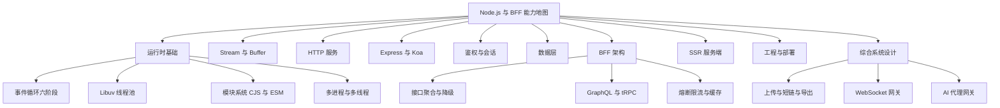

## 目录

- [一、Node 基础与运行时（NODE-001 ~ 008）](#一node-基础与运行时)
- [二、Stream 与 Buffer（NODE-009 ~ 014）](#二stream-与-buffer)
- [三、HTTP 服务（NODE-015 ~ 021）](#三http-服务)
- [四、Express 与 Koa（NODE-022 ~ 032）](#四express-与-koa)
- [五、鉴权与会话（NODE-033 ~ 038）](#五鉴权与会话)
- [六、数据层（NODE-039 ~ 045）](#六数据层)
- [七、BFF 架构（NODE-046 ~ 052）](#七bff-架构)
- [八、SSR 服务端（NODE-053 ~ 058）](#八ssr-服务端)
- [九、工程与部署（NODE-059 ~ 067）](#九工程与部署)
- [十、综合实战（NODE-068 ~ 100）](#十综合实战)
- [十一、事件循环与异步源码级（NODE-101 ~ 107）](#十一事件循环与异步源码级)
- [十二、框架源码级（NODE-108 ~ 114）](#十二框架源码级)
- [十三、网络与协议深入（NODE-115 ~ 120）](#十三网络与协议深入)
- [十四、数据库与存储深入（NODE-121 ~ 126）](#十四数据库与存储深入)
- [十五、安全深入（NODE-127 ~ 132）](#十五安全深入)
- [十六、可观测性深入（NODE-133 ~ 139）](#十六可观测性深入)
- [十七、高并发与稳定性（NODE-140 ~ 146）](#十七高并发与稳定性)
- [十八、微服务与协作（NODE-147 ~ 152）](#十八微服务与协作)
- [十九、TypeScript Node 工程（NODE-153 ~ 158）](#十九typescript-node-工程)
- [二十、综合与体系（NODE-159 ~ 200）](#二十综合与体系)

---

## 一、Node 基础与运行时

### NODE-001：Node 的事件循环有哪六个阶段？与浏览器的事件循环有什么区别？
**答**：
- 六阶段依次为：**timers**（执行 `setTimeout`/`setInterval` 到期回调）→ **pending callbacks**（执行上一轮延迟的 I/O 回调）→ **idle, prepare**（内部使用）→ **poll**（获取新 I/O 事件，执行 I/O 回调，必要时阻塞等待）→ **check**（执行 `setImmediate` 回调）→ **close callbacks**（执行 `close` 事件回调，如 `socket.on('close')`）。
- 每个阶段是一个 FIFO 回调队列；阶段间切换时，会**先清空 microtask 队列**（`process.nextTick` 优先级最高，其次 Promise）。
- 与浏览器的差异：浏览器没有多阶段模型（宏任务+微任务，且由渲染进程主导），Node 有阶段划分和 `process.nextTick` 这个独立队列；浏览器中 `setImmediate` 不存在，Node 中 `setTimeout(fn, 0)` 与 `setImmediate` 在主模块中顺序不确定，但在 I/O 回调中 `setImmediate` **总是先于** `setTimeout` 执行（因为 poll 阶段后进入 check 阶段）。
- 高频压轴：要求能画出六阶段图并解释 poll 阶段的阻塞与 `timers` 的系统调用差异（定时器精度受 OS 影响，不保证精确）。

```javascript
// 事件循环六阶段与经典顺序验证
const fs = require('fs');

setTimeout(() => console.log('1. timers 阶段'), 0);
setImmediate(() => console.log('2. check 阶段'));
fs.readFile(__filename, () => {
  // 在 I/O 回调（poll 阶段内）中，setImmediate 一定先于 setTimeout
  setImmediate(() => console.log('4. I/O 内 setImmediate 先执行'));
  setTimeout(() => console.log('5. I/O 内 setTimeout 后执行'), 0);
});
Promise.resolve().then(() => console.log('3. 微任务 在当前宏任务后立即清空'));
// 主模块中 1 和 2 的顺序理论上不确定（受进入事件循环的耗时影响），
// 但实际单次同步代码 <1ms 时 timers 通常先注册先执行。

console.log('0. 同步代码最先执行');
```

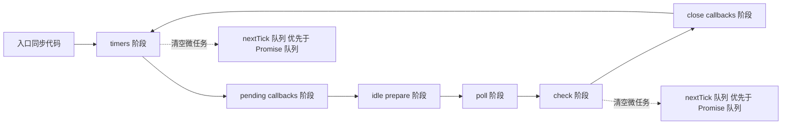

### NODE-002：写出下面代码的输出顺序，并解释 process.nextTick 与 Promise 的优先级？
**答**：
- `process.nextTick` 有**独立队列**，优先级高于 Promise 微任务：每个宏任务结束后，先清空 nextTick 队列，再清空 Promise 队列（若 nextTick 回调中又产生 nextTick，会持续清空，存在饿死 I/O 的风险，Node 对 nextTick 队列有最大深度保护但需警惕）。
- `setImmediate` 属于 check 阶段的宏任务，晚于所有微任务。
- 输出顺序（高频输出题）：`start` → `nextTick1` → `nextTick2` → `promise1` → `promise2` → `immediate` → `timeout`。

```javascript
console.log('start');

process.nextTick(() => {
  console.log('nextTick1');
  process.nextTick(() => console.log('nextTick2')); // 追加到 nextTick 队列尾，仍先于 Promise
});

Promise.resolve()
  .then(() => {
    console.log('promise1');
    Promise.resolve().then(() => console.log('promise2'));
  });

setImmediate(() => console.log('immediate')); // check 阶段
setTimeout(() => console.log('timeout'), 0);  // timers 阶段，check 先于 timers

// 输出：start nextTick1 nextTick2 promise1 promise2 immediate timeout
```

### NODE-003：Libuv 的线程池是怎么回事？哪些 API 会走线程池？
**答**：
- Node 主线程是单线程跑 JS，但 Libuv 默认维护一个 **4 线程**的线程池（可通过 `UV_THREADPOOL_SIZE` 调到最多 1024）。
- 走线程池的 API（高频，必须记全）：**fs 模块的全部文件 I/O**（`fs.readFile`/`writeFile`/`readdir` 等）、`dns.lookup`（注意不是 `dns.resolve`，后者走 c-ares 异步）、部分 **crypto**（`pbkdf2`、`scrypt`、`randomBytes`、`randomFill`）、**zlib**（`gzip`/`gzipSync` 等压缩解压）。
- 不走线程池的：网络 I/O（TCP/UDP/HTTP）由 OS 的 epoll/kqueue/IOCP 异步通知，`dns.resolve` 走 c-ares。
- 实战意义：文件 I/O、`pbkdf2`、zlib 是 CPU 密集/阻塞大户，并发高时会排队占满线程池，拖慢所有走线程池的调用——所以密码哈希、压缩要控制成本或调大线程池。

```javascript
// 线程池验证与调优：pbkdf2 是 CPU 密集型，走 Libuv 线程池
const crypto = require('crypto');

const t1 = Date.now();
// 4 个并发 pbkdf2，默认线程池 4，约并行执行，总耗时 ≈ 单次耗时
for (let i = 0; i < 5; i++) {
  crypto.pbkdf2('secret', 'salt', 100000, 64, 'sha512', () => {
    console.log(`done ${i}, cost ${Date.now() - t1}ms`);
    // 前 4 个耗时接近，第 5 个要等有线程空闲，耗时约翻倍 → 证明线程池大小为 4
  });
}

// 启动时调大线程池：UV_THREADPOOL_SIZE=16 node app.js
// 场景：大量文件 I/O + 图片压缩（zlib/sharp）的服务建议调到 8~16
```

### NODE-004：CommonJS 模块缓存与循环依赖在 Node 中的行为？
**答**：
- CJS 模块首次加载后写入 `require.cache`（`Module._cache`），再次 `require` 返回**同一实例**——这就是单例模式的天然实现。
- 循环依赖：Node 的 `Module` 在加载前就把模块放入缓存（**部分导出 partial exports**）。A require B、B 又 require A 时，B 拿到的是 A **尚未执行完的部分导出**（只含已赋值的属性），不会死循环，但可能拿到 `undefined`。
- 最佳实践：循环依赖尽量重构消除；确需共享，把公共逻辑抽到第三个模块，或在函数调用时**延迟取值**（函数内再 require / 导出 getter）。

```javascript
// a.js
console.log('a 开始');
exports.name = 'a-name';            // 已完成的导出
const b = require('./b');           // 进入 b.js，b 又 require a → 拿到部分导出
console.log('a 中拿到 b:', b);       // { fromB: 'b-value' }
exports.fromB = b.fromB;
console.log('a 结束');

// b.js
console.log('b 开始');
const a = require('./a');           // a 已在缓存中（执行到一半），拿到部分导出
console.log('b 中拿到 a.name:', a.name); // 'a-name'（赋值在 require b 之前，可取到）
console.log('b 中拿到 a.fromB:', a.fromB); // undefined（还没执行到）
exports.fromB = 'b-value';
console.log('b 结束');

// node a.js 输出：a 开始 → b 开始 → b 中拿到 a.name a-name → b 中拿到 a.fromB undefined
//                → b 结束 → a 中拿到 b fromB b-value → a 结束
```

### NODE-005：ESM 在 Node 中如何加载？package.json 有哪些相关字段？
**答**：
- 判定 ESM：`.mjs` 扩展名，或 `.js` 且最近祖先 `package.json` 中 `"type": "module"`；`.cjs` 永远是 CJS。ESM 中没有 `require`/`__dirname`，用 `import.meta.url` 转换。
- 关键字段：`type`（module/commonjs）、`exports`（**入口白名单与条件导出**，优先级高于 `main`，且能封装内部路径）、`imports`（包内自引用 `#` 前缀）、`main`/`module`/`browser`（老方案）、`engines`、条件导出中的 `import`/`require`/`node`/`default`/`types`。
- ESM 加载是**异步的、静态分析的**：import 提升与编译期确定依赖图；顶层 await 可用；动态 `import()` 返回 Promise。CJS 可以 `require` ESM（Node 22+ 支持 require 同步 ESM，需无顶层 await），ESM 中推荐 `createRequire` 读取 CJS 资源。

```json
{
  "name": "my-pkg",
  "version": "1.0.0",
  "type": "module",
  "exports": {
    ".": {
      "types": "./dist/index.d.ts",
      "import": "./dist/index.mjs",
      "require": "./dist/index.cjs",
      "default": "./dist/index.mjs"
    },
    "./utils": "./dist/utils.mjs",
    "./package.json": "./package.json"
  },
  "imports": {
    "#internal/*": "./src/internal/*.js"
  },
  "engines": { "node": ">=20" }
}
```

```javascript
// ESM 中获取 __dirname 的等价写法（esm-app.mjs）
import { fileURLToPath } from 'node:url';
import { dirname, join } from 'node:path';
import { createRequire } from 'node:module';

const __filename = fileURLToPath(import.meta.url);
const __dirname = dirname(__filename);
console.log(join(__dirname, 'config.json'));

const require = createRequire(import.meta.url); // 在 ESM 中复用 CJS 的 require
const legacy = require('./legacy-config.cjs');
```

### NODE-006：Buffer 是什么？如何进行字节级处理（编码转换/二进制协议解析）？
**答**：
- `Buffer` 是 V8 堆外的**固定长度字节序列**（`Uint8Array` 子类），用于处理 TCP 流、文件、二进制协议。`Buffer.allocUnsafe` 不清零（快但可能泄露旧数据），生产用 `Buffer.alloc`。
- 编码支持：utf8 / utf16le / latin1 / base64 / hex / ascii。Node 18+ 默认编码统一为 utf8，`Buffer` 全局可用但推荐显式 `require('node:buffer')`。
- 高频点：**字符串与字节不是一一对应**（中文 UTF-8 占 3 字节），分块读取文件时块边界可能截断多字节字符，需用 `string_decoder` 或设置 `state.remaining` 拼接。

```javascript
const buf = Buffer.from('前端 Node', 'utf8');
console.log(buf.length);                    // 11：2 个中文 ×3 + 空格 1 + Node 4
console.log(buf.toString('hex'));           // 字节十六进制
console.log(buf.toString('base64'));        // 5YiY5L2TIE5vZGU=

// 二进制协议解析：前 4 字节长度 + 2 字节类型 + 剩余 payload
function decodePacket(buffer) {
  const length = buffer.readUInt32BE(0);
  const type = buffer.readUInt16BE(4);
  const payload = buffer.subarray(6, 6 + length).toString('utf8');
  return { length, type, payload };
}
const body = Buffer.from(JSON.stringify({ msg: 'ping' }));
const head = Buffer.alloc(6);
head.writeUInt32BE(body.length, 0);
head.writeUInt16BE(0x01, 4);
console.log(decodePacket(Buffer.concat([head, body])));

// 多字节字符跨块问题：string_decoder 保证不产生乱码
const { StringDecoder } = require('node:string_decoder');
const decoder = new StringDecoder('utf8');
const chunk1 = Buffer.from([0xe5, 0x89, 0x8d]); // '前' 的前 2 字节被截断的场景模拟
console.log(JSON.stringify(decoder.write(chunk1))); // 空字符串，缓冲到下一块
```

### NODE-007：child_process、cluster、worker_threads 三者如何对比与选型？
**答**：
- **child_process**：创建独立 OS 进程（`spawn`/`exec`/`execFile`/`fork`），内存隔离最彻底，开销最大，进程间只能 IPC 或序列化通信；`exec` 会起 shell，有命令注入风险，传参务必用 `execFile`/`spawn`。
- **cluster**：基于 `child_process.fork` 的封装，多个进程 `fork` 同一个入口，主进程做负载均衡（默认 round-robin，Linux 下可 reuseport），用于**多核 HTTP 服务**；进程间不共享内存。
- **worker_threads**：**同一个进程内**的多线程，真正共享内存可用 `SharedArrayBuffer`，适合 CPU 密集任务（图片处理、加密计算），开销远小于进程；但一个 worker 崩溃不会拖垮主线程，而主线程异常仍影响 worker 的通信。
- 选型口诀：跑额外命令用 child_process；多核 Web 服务用 cluster/PM2；进程内 CPU 密集用 worker_threads。

```javascript
// worker_threads：CPU 密集任务不阻塞主线程
const { Worker, isMainThread, parentPort, workerData } = require('node:worker_threads');

if (isMainThread) {
  console.time('fib in worker');
  const worker = new Worker(__filename, { workerData: { n: 40 } });
  worker.on('message', (r) => { console.timeEnd('fib in worker'); console.log('result', r); });
  worker.on('error', (e) => console.error('worker error', e));
} else {
  // 子线程中执行递归 fib（故意 CPU 密集）
  const fib = (n) => (n <= 1 ? n : fib(n - 1) + fib(n - 2));
  parentPort.postMessage(fib(workerData.n));
}

// cluster：多核 HTTP 服务（对比参考）
// const cluster = require('node:cluster'); const http = require('node:http');
// if (cluster.isPrimary) {
//   for (let i = 0; i < require('node:os').cpus().length; i++) cluster.fork();
//   cluster.on('exit', (w) => cluster.fork()); // 进程守护自动拉起
// } else {
//   http.createServer((req, res) => res.end(`pid ${process.pid}`)).listen(3000);
// }
```

### NODE-008：Node 的全局对象有哪些？globalThis 解决了什么问题？
**答**：
- Node 特有全局：`process`、`Buffer`、`global`、`setImmediate`/`clearImmediate`、`__dirname`/`__filename`（CJS）；浏览器特有：`window`、`document`、`navigator`。
- `globalThis` 是 ES2020 标准，**跨环境统一**的全局对象：Node 中等于 `global`，浏览器中等于 `window`/`self`，Worker 与 Node 工具链通用——isomorphic 代码不再需要 `typeof window !== 'undefined'` 这类嗅探。
- 注意：ESM 中 `__dirname` 不存在、顶层 `this` 是 `undefined`（CJS 中是 `exports`）；`process.env` 是对象但值全为字符串，空串会被判定 falsy，配置解析要小心。

```javascript
// 跨环境单例：利用 globalThis 防止重复初始化（BFF SDK 常见模式）
function getTracer() {
  if (!globalThis.__app_tracer__) {
    globalThis.__app_tracer__ = {
      createdAt: Date.now(),
      spanId: Math.random().toString(36).slice(2),
    };
    console.log('tracer 初始化一次');
  }
  return globalThis.__app_tracer__;
}
console.log(getTracer() === getTracer()); // true

// 环境判断的正确姿势
const isNode = typeof process !== 'undefined' && process.versions?.node;
const isBrowser = typeof window !== 'undefined' && typeof document !== 'undefined';
console.log({ isNode: Boolean(isNode), isBrowser });

// process.env 坑：所有值都是字符串
process.env.PORT = '0';            // 期望"未配置走默认 3000"
const port = Number(process.env.PORT) || 3000; // 必须显式转数字，否则 '0' 是 truthy
console.log(port);                 // 3000
```

---

## 二、Stream 与 Buffer

### NODE-009：Stream 有哪四种类型？分别对应什么应用场景？
**答**：
- **Readable**（可读流）：`fs.createReadStream`、`http.IncomingMessage`、`process.stdin`——按需产生数据，两种模式：flowing（自动推送）与 paused（手动 `read()`）。
- **Writable**（可写流）：`fs.createWriteStream`、`http.ServerResponse`、`process.stdout`。
- **Duplex**（双工）：读写独立、两个缓冲区，如 TCP `net.Socket`、WebSocket。
- **Transform**（转换流）：Duplex 特例，写进去的数据被转换后可读出来，如 `zlib.createGzip()`、`crypto.createCipheriv()`。
- 核心收益：**恒定内存处理任意大的数据**——不会把 2GB 文件读进内存，而是流过管道分块处理。

```javascript
const { Readable, Writable, Duplex, Transform } = require('node:stream');
const zlib = require('node:zlib');

// Readable：生成 0~99 的流
const numbers = Readable.from((function* () { for (let i = 0; i < 100; i++) yield String(i); })());

// Transform：每行加上前缀
const addPrefix = new Transform({
  transform(chunk, _enc, cb) { cb(null, `[n] ${chunk}`); },
});

// Writable：收集到内存（演示用，生产应落盘）
const collector = new Writable({
  write(chunk, _enc, cb) { process.stdout.write(chunk); cb(); },
});

// Duplex：net.Socket 的典型代表，读写两侧独立缓冲
console.log('socket 是 Duplex:', require('node:net').Socket.prototype instanceof Duplex);

numbers.pipe(addPrefix).pipe(zlib.createGzip()); // Transform 天然可串联
numbers.pipe(collector);
```

### NODE-010：什么是背压（backpressure）？pipe、pipeline、stream.compose 有何区别？
**答**：
- 背压：写端消费速度跟不上读端生产速度时，`write()` 返回 `false`，表示内部缓冲超过 `highWaterMark`（默认 64KB），数据积压在内存里。手工处理要 `drain` 事件配合暂停读取，**pipe 自动处理背压**。
- **pipe**：自动背压但**不会转发错误、出错不会销毁流**，流可能悬挂且 fd 泄漏——生产环境禁用。
- **pipeline**（推荐）：自动背压 + 任一流错误会 destroy 整条链 + Promise 化（await），错误集中处理。
- **stream.compose**（Node 17+）：pipeline 的链式封装，返回可继续 pipe 的 Transform，支持 `signal` 中断与预置销毁，适合动态组装管道。

```javascript
const fs = require('node:fs');
const zlib = require('node:zlib');
const { pipeline, compose } = require('node:stream/promises');
const { compose: composeStream } = require('node:stream');

// 错误示范：read.pipe(write) 出错时 write 未销毁，fd 泄漏
// 正确：pipeline + 集中错误处理
async function gzipFile(src, dest) {
  await pipeline(
    fs.createReadStream(src),
    zlib.createGzip(),
    fs.createWriteStream(dest),
  );
  console.log('压缩完成');
}
gzipFile('access.log', 'access.log.gz').catch((err) => {
  console.error('pipeline 任一环节失败都会到这里并销毁全链:', err.message);
});

// stream.compose：把多个流组合成一个 Transform，可继续参与其他管道
const compressor = composeStream(zlib.createGzip(), zlib.createGzip()); // 双重压缩（示意）
fs.createReadStream('access.log')
  .pipe(compressor)
  .pipe(fs.createWriteStream('access.log.gz2'))
  .on('finish', () => console.log('compose 组合完成'));

// 手工背压（理解原理用）：write 返回 false 时暂停，drain 后恢复
// rs.on('data', (chunk) => { if (!ws.write(chunk)) rs.pause(); });
// ws.on('drain', () => rs.resume());
```

### NODE-011：如何逐行处理一个 10GB 的日志文件而不爆内存？
**答**：
- 禁止 `fs.readFile`（10GB 全量进内存必 OOM）。方案按推荐度：
  1. `readline` 模块 + `createReadStream`（最简单，逐行 emit）。
  2. `stream.consumers` / 第三方 `byline` / `split2` 处理分隔。
  3. 手工按 chunk 切分 + `remainder` 缓存行尾残片（面试要求能手写）。
- 多字节字符截断用 `StringDecoder`；行逻辑有状态聚合（如 PV 统计）时注意每行的归并写法；超大数据集输出也用流写，避免结果集堆积。

```javascript
const fs = require('node:fs');
const readline = require('node:readline');
const { StringDecoder } = require('node:string_decoder');

// 方案一：readline（生产首选）
async function countErrorLines(path) {
  const rl = readline.createInterface({
    input: fs.createReadStream(path, { highWaterMark: 1024 * 1024 }), // 1MB 一块
    crlfDelay: Infinity,
  });
  let errorCount = 0, total = 0;
  for await (const line of rl) {   // for-await 逐行，内存恒定
    total++;
    if (line.includes('ERROR')) errorCount++;
  }
  return { total, errorCount };
}

// 方案二：手写分块 + 行边界 + 多字节安全（面试加分项）
function readLinesByChunk(path, onLine) {
  return new Promise((resolve, reject) => {
    const rs = fs.createReadStream(path, { encoding: 'binary' });
    const decoder = new StringDecoder('utf8');
    let remainder = '';
    rs.on('data', (chunk) => {
      const text = remainder + decoder.write(chunk);
      const lines = text.split('\n');
      remainder = lines.pop();          // 最后一段可能不是完整行，缓存到下一块
      lines.forEach(onLine);
    });
    rs.on('end', () => { if (remainder) onLine(remainder); resolve(); });
    rs.on('error', reject);
  });
}
```

### NODE-012：如何实现一个 Transform 流？举例：请求日志加解密管道？
**答**：
- 继承 `Transform` 并实现 `_transform(chunk, encoding, callback)`，处理完调用 `cb(err, data)`；可选 `_flush(cb)` 在流结束时输出尾部数据（如最后的 padding、统计信息）。
- 典型管道：`readStream → gunzip → decipher → 处理 → cipher → gzip → writeStream`。
- 注意点：`_transform` 内不要做超长同步 CPU 计算（阻塞事件循环），大计算分片或丢给 worker；`objectMode: true` 可以在流里传 JS 对象而不是 Buffer。

```javascript
const { Transform } = require('node:stream');
const crypto = require('node:crypto');

// Transform 1：日志脱敏（替换手机号）
class SensitiveFilter extends Transform {
  _transform(chunk, _enc, cb) {
    const text = chunk.toString()
      .replace(/1[3-9]\d{9}/g, (m) => m.slice(0, 3) + '****' + m.slice(7));
    cb(null, Buffer.from(text));
  }
}

// Transform 2：AES 加密
class AesEncryptor extends Transform {
  constructor(key, opts = {}) {
    super(opts);
    this.cipher = crypto.createCipheriv('aes-256-cbc', key, key.subarray(0, 16));
  }
  _transform(chunk, _enc, cb) {
    cb(null, this.cipher.update(chunk));
  }
  _flush(cb) { cb(null, this.cipher.final()); } // 输出尾部 padding
}

// 组合：明文日志 → 脱敏 → 加密 → 落盘
function secureLogPipeline(readStream, writeStream, key) {
  return new Promise((resolve, reject) => {
    const { pipeline } = require('node:stream');
    pipeline(readStream, new SensitiveFilter(), new AesEncryptor(key), writeStream,
      (err) => (err ? reject(err) : resolve()));
  });
}
module.exports = { SensitiveFilter, AesEncryptor };
```

### NODE-013：什么是对象流（objectMode）？如何实现流式 JSON 解析（NDJSON）？
**答**：
- 默认流传输 Buffer/字符串；设置 `objectMode: true`（或 `stream.pipeline` 自动推断）后可以在流中传递**任意 JS 对象**，省去序列化，常见于数据库查询流、消息处理管道。
- NDJSON（每行一个 JSON）是日志与 LLM SSE 的通用格式：按行 split → `JSON.parse` → 对象流，天然支持增量处理超大文件。
- 流式 JSON（单个大 JSON 对象，非 NDJSON）需要增量 parser（如 `stream-json`），或约定为行分隔协议——面试中先说明协议选择比硬写 parser 更重要。

```javascript
const fs = require('node:fs');
const { Transform, pipeline } = require('node:stream');

// NDJSON 解析为对象流
class JsonParseTransform extends Transform {
  constructor(opts = {}) { super({ ...opts, objectMode: true, readableObjectMode: true }); }
  _transform(chunk, _enc, cb) {
    for (const line of chunk.toString().split('\n')) {
      if (!line.trim()) continue;
      try { this.push(JSON.parse(line)); }
      catch (e) { /* 坏行跳过并告警，不中断整个流 */ this.emit('warn', e.message); }
    }
    cb();
  }
}

// 消费对象流：逐条处理订单日志
pipeline(
  fs.createReadStream('orders.ndjson'),
  new JsonParseTransform(),
  async function* (source) {           // async generator 也是合法的 Transform
    let amount = 0;
    for await (const order of source) amount += order.price * order.count;
    console.log('订单总额:', amount);
  },
  (err) => err && console.error('解析失败:', err),
);
// orders.ndjson 内容：{"price":10,"count":2}\n{"price":3.5,"count":4}\n
```

### NODE-014：流的错误处理与销毁生命周期是怎样的？
**答**：
- 流是 **EventEmitter**，`error` 事件不处理会直接抛到进程级（uncaught crash）。规则：**每条 pipeline 用集中式回调/promise 错误处理**，不要给每个流单独挂 listener。
- 销毁：`stream.destroy(err)` 触发 `close`，释放底层资源；销毁后不可再用。`pipeline`/`compose` 的核心价值就是**一处出错全链 destroy**。
- 关键事件顺序：Readable `end`（数据读完）→ Writable `finish`（数据写完刷盘）→ 两者都会在 destroy 后触发 `close`。`autoDestroy: true`（默认）保证 `end`/`finish` 后自动 close。
- 未消费的 Readable 要显式 destroy，否则 fd 一直占着（服务长跑必然 fd 泄漏告警）。

```javascript
const fs = require('node:fs');
const { pipeline } = require('node:stream/promises');

async function copyWithCleanup(src, dest) {
  const rs = fs.createReadStream(src);
  const ws = fs.createWriteStream(dest);
  try {
    await pipeline(rs, ws);            // 任一环节错误 → 全链自动 destroy + close
  } catch (err) {
    console.error('复制失败，资源已释放:', err.code);
    // 手工兜底：pipeline 已 destroy，此处保险
    rs.destroyed || rs.destroy();
    ws.destroyed || ws.destroy();
    fs.unlink(dest, () => {});         // 清理写一半的脏文件
    throw err;
  }
}

// 事件顺序验证
const demo = fs.createWriteStream('/tmp/demo.txt');
demo.on('finish', () => console.log('1. finish 数据写完'));
demo.on('close', () => console.log('2. close 资源释放'));
demo.end('hello');                      // end 触发 finish → autoDestroy → close

// 服务器退出前统一清理：关闭所有未完成流
process.on('SIGTERM', () => {
  for (const stream of [demo]) stream.destroyed || stream.destroy();
});
```

---

## 三、HTTP 服务

### NODE-015：如何用原生 http 模块实现一个带路由与请求体解析的服务？
**答**：
- 原生 http 服务是 `EventEmitter`：`req` 是 **Readable**（IncomingMessage），`res` 是 **Writable**（ServerResponse）。没有路由、没有 body 解析、没有中间件——一切自己组装，这正是理解 Express/Koa 的基础。
- 请求体解析：监听 `data`/`end` 拼接 Buffer（注意限制大小防 OOM），或交给流式解析。
- 面试要求：手写一个支持 `GET /health`、`POST /echo`（JSON body）的最小服务，含 404、错误兜底。

```javascript
const http = require('node:http');

const routes = [];
function route(method, path, handler) { routes.push({ method, path, handler }); }

// 请求体解析：限制 1MB，超限直接 413
function readBody(req, limit = 1024 * 1024) {
  return new Promise((resolve, reject) => {
    const chunks = [];
    let size = 0;
    req.on('data', (chunk) => {
      size += chunk.length;
      if (size > limit) { reject(Object.assign(new Error('payload too large'), { code: 413 })); req.destroy(); return; }
      chunks.push(chunk);
    });
    req.on('end', () => resolve(Buffer.concat(chunks)));
    req.on('error', reject);
  });
}

route('GET', '/health', (req, res) => json(res, 200, { status: 'ok' }));
route('POST', '/echo', async (req, res) => {
  const body = JSON.parse((await readBody(req)).toString() || '{}');
  json(res, 200, { youSaid: body });
});

function json(res, status, data) {
  res.writeHead(status, { 'content-type': 'application/json; charset=utf-8' });
  res.end(JSON.stringify(data));
}

const server = http.createServer(async (req, res) => {
  try {
    const matched = routes.find((r) => r.method === req.method && r.path === req.url.split('?')[0]);
    if (!matched) return json(res, 404, { error: 'Not Found', path: req.url });
    await matched.handler(req, res);
  } catch (err) {
    json(res, err.code === 413 ? 413 : 500, { error: err.message });
  }
});
server.listen(3000, () => console.log('http://localhost:3000'));
// curl -X POST localhost:3000/echo -d '{"msg":"hi"}' -H 'content-type: application/json'
```

### NODE-016：HTTP keep-alive 的原理是什么？Node 服务端与客户端分别如何管理连接？
**答**：
- keep-alive 复用一条 TCP 连接发送多个 HTTP 请求，省去每次 TCP 三次握手 + TLS 握手（HTTPS 场景一次握手可达 1-2 RTT）。HTTP/1.1 默认开启。
- 服务端：`server.keepAliveTimeout`（默认 5s，**小于常见 LB 的空闲超时会引发 502**，Nginx 后要调大，如 65s）与 `headersTimeout`（防慢速攻击）。Node 19+ 默认开启 keep-alive。
- 客户端：`http.Agent` 维护连接池，`maxSockets` 控制并发（默认 Infinity 会对同一 host 打满 fd），BFF 调用下游必须配 Agent，否则高并发下 TIME_WAIT 爆炸。

```javascript
const http = require('node:http');

// 服务端：连接参数调优
const server = http.createServer((req, res) => {
  res.writeHead(200, { connection: 'keep-alive' });
  res.end('ok');
});
server.keepAliveTimeout = 65000;   // 必须大于 LB/Nginx 的空闲超时，避免 502
server.headersTimeout = 66000;     // 必须 > keepAliveTimeout
server.maxHeadersCount = 100;      // 限制头数量
server.listen(3000);

// 客户端（BFF 调用下游）：连接池 Agent
const agent = new http.Agent({
  keepAlive: true,
  keepAliveMsecs: 30000,   // 空闲连接保活 30s
  maxSockets: 100,         // 对同一 host 最多 100 并发连接
  maxFreeSockets: 10,      // 空闲保留 10 条
  timeout: 5000,
});

function callDownstream(path) {
  return new Promise((resolve, reject) => {
    const req = http.request(
      { host: 'localhost', port: 3000, path, agent, timeout: 3000 },
      (res) => {
        let data = '';
        res.on('data', (c) => (data += c));
        res.on('end', () => resolve(JSON.parse(data)));
      },
    );
    req.on('timeout', () => req.destroy(new Error('downstream timeout')));
    req.on('error', reject);
    req.end();
  });
}
callDownstream('/health').then(console.log);
```

### NODE-017：如何防护大请求体与慢速攻击（Slowloris）？
**答**：
- 大请求体：**永远不要无限制 `data` 拼接**。策略：校验 `content-length` 上限 + 流式累加计数超限即 `req.destroy()` 并回 413；文件上传用流式直写磁盘/对象存储。
- 慢速攻击（Slowloris）：攻击者慢慢发 header 或 body，占住连接不释放，耗尽 `maxConnections`。对策：`server.headersTimeout`/`requestTimeout`（Node 18+ 默认 300s，建议收紧到 30s）、`server.maxRequestsPerSocket`、前置 Nginx `client_body_timeout`。
- 服务级兜底：`server.maxConnections` 限总量、连接空闲计时器踢出慢连接。

```javascript
const http = require('node:http');

const server = http.createServer((req, res) => {
  const declared = Number(req.headers['content-length'] || 0);
  if (declared > 5 * 1024 * 1024) {          // 声明超 5MB 直接拒绝
    res.writeHead(413).end();
    return req.destroy();
  }
  let size = 0;
  req.on('data', (chunk) => {
    size += chunk.length;
    if (size > 5 * 1024 * 1024) {            // 实际超限（chunked 无 content-length 时靠这里）
      res.writeHead(413).end();
      req.destroy();                          // 立即断开，不再读剩余数据
    }
  });
  req.on('end', () => res.writeHead(200).end('ok'));
});

server.requestTimeout = 30000;      // 整个请求 30s 内必须完成（防慢速 body）
server.headersTimeout = 25000;      // header 必须 25s 内发完（防 Slowloris 慢发头）
server.maxHeadersCount = 200;
server.maxConnections = 2000;       // 最大并发连接兜底
server.listen(3000);

// 每个连接加空闲超时：60s 无数据就踢掉
server.on('connection', (socket) => {
  socket.setTimeout(60000, () => socket.destroy());
});
```

### NODE-018：服务端如何完整实现 CORS？
**答**：
- CORS 由浏览器执行，**服务端只需返回正确的响应头**。简单请求：`Access-Control-Allow-Origin`。预检请求（非简单方法/自定义头/content-type 非 form 等）先发 `OPTIONS`：需返回 `Allow-Origin` + `Allow-Methods` + `Allow-Headers` + `Max-Age`（缓存预检，减少 OPTIONS 风暴）。
- 带 cookie 需 `Allow-Credentials: true`，且 `Allow-Origin` **不能是 `*`**，必须是具体来源（从 `req.headers.origin` 回显并做白名单校验）。
- 高频坑：Nginx 与 Node **重复加 CORS 头**导致重复 header 报错；`Allow-Origin` 无条件回显 origin 等于裸奔（可被任意站点带凭证调用）。

```javascript
const http = require('node:http');

const ALLOWED_ORIGINS = new Set(['https://app.example.com', 'http://localhost:5173']);

function cors(req, res) {
  const origin = req.headers.origin || '';
  if (ALLOWED_ORIGINS.has(origin)) {
    res.setHeader('access-control-allow-origin', origin); // 白名单回显，不是 *
    res.setHeader('access-control-allow-credentials', 'true'); // 允许带 cookie
    res.setHeader('vary', 'origin'); // 告诉 CDN 缓存按 origin 区分，防止缓存串源
  }
  if (req.method === 'OPTIONS') {
    res.setHeader('access-control-allow-methods', 'GET, POST, PUT, DELETE, OPTIONS');
    res.setHeader('access-control-allow-headers', 'content-type, authorization, x-request-id');
    res.setHeader('access-control-max-age', '86400');           // 预检缓存 24h
    res.setHeader('access-control-expose-headers', 'x-total-count'); // 让前端能读自定义头
    res.writeHead(204).end();                                    // 预检直接结束
    return true;
  }
  return false;
}

http.createServer((req, res) => {
  if (cors(req, res)) return;
  if (!req.headers.origin || ALLOWED_ORIGINS.has(req.headers.origin)) {
    res.writeHead(200, { 'content-type': 'application/json' });
    res.end(JSON.stringify({ ok: true }));
  } else {
    res.writeHead(403).end();
  }
}).listen(3000);
```

### NODE-019：不依赖框架，如何用 Cookie 实现会话（session）？
**答**：
- 流程：登录成功 → 服务端生成 `sessionId`，把用户状态存入 store（Map/Redis）→ `Set-Cookie` 下发 `sid`（`HttpOnly` 防 XSS 读、`Secure` 仅 HTTPS、`SameSite=Lax` 防 CSRF）→ 后续请求读 cookie 查 store。
- 生产要求：sessionId 用 `crypto.randomBytes` 生成（防猜解）；store 用 Redis + TTL（内存 Map 重启丢失且无法多实例共享）；滑动过期（每次访问刷新 TTL）。

```javascript
const http = require('node:http');
const crypto = require('node:crypto');

const store = new Map(); // 生产替换为 Redis：redis.setex(`sess:${sid}`, 1800, JSON.stringify(user))

function parseCookies(req) {
  return Object.fromEntries(
    (req.headers.cookie || '').split(';').filter(Boolean)
      .map((p) => p.trim().split('=').map(decodeURIComponent))
      .map(([k, ...v]) => [k, v.join('=')]),
  );
}

http.createServer((req, res) => {
  const cookies = parseCookies(req);

  if (req.url === '/login') {
    const sid = crypto.randomBytes(24).toString('hex');   // 不可预测
    store.set(sid, { uid: 42, role: 'admin', createdAt: Date.now() });
    res.setHeader('set-cookie',
      `sid=${sid}; HttpOnly; Secure; SameSite=Lax; Path=/; Max-Age=1800`);
    return res.writeHead(200).end('登录成功');
  }

  const sid = cookies.sid;
  const session = sid && store.get(sid);
  if (!session) return res.writeHead(401).end('未登录');

  // 滑动过期：续期
  store.delete(sid);
  store.set(sid, session);
  res.setHeader('set-cookie', `sid=${sid}; HttpOnly; Secure; SameSite=Lax; Path=/; Max-Age=1800`);

  if (req.url === '/me') {
    res.writeHead(200, { 'content-type': 'application/json' });
    return res.end(JSON.stringify(session));
  }
  res.writeHead(200).end(`hello uid ${session.uid}`);
}).listen(3000);
```

### NODE-020：Node 如何起一个 HTTPS 服务？证书怎么来？
**答**：
- HTTPS = TLS 层 + http，Node 用 `https.createServer({ key, cert }, handler)`；TLS 握手由 Node 内置 OpenSSL 完成。
- 证书来源：生产从 CA 签发（Let's Encrypt 的 ACME 可用 `greenlock`/certbot 自动续期）；本地开发用 `mkcert` 生成本地可信证书（比自签证书体验好，浏览器不报警）。
- 注意：`server.listen` 之后 `req.socket.getPeerCertificate()` 可取客户端证书（mTLS 双向认证）；TLS 版本至少 1.2，禁用旧 cipher。

```bash
# 本地开发：mkcert 生成受本机信任的证书
brew install mkcert
mkcert -install
mkcert localhost 127.0.0.1 ::1   # 生成 ./localhost+2.pem 与 ./localhost+2-key.pem
```

```javascript
const https = require('node:https');
const fs = require('node:fs');
const path = require('node:path');

const options = {
  key: fs.readFileSync(path.join(__dirname, 'localhost+2-key.pem')),
  cert: fs.readFileSync(path.join(__dirname, 'localhost+2.pem')),
  minVersion: 'TLSv1.2',               // 强制 TLS 1.2+
  // 双向认证 mTLS：要求客户端也带证书
  // requestCert: true,
  // rejectUnauthorized: true,
  // ca: fs.readFileSync('client-ca.pem'),
};

https.createServer(options, (req, res) => {
  const cert = req.socket.getPeerCertificate?.();
  res.writeHead(200, { 'content-type': 'application/json' });
  res.end(JSON.stringify({ secure: true, client: cert?.subject?.CN ?? 'anonymous' }));
}).listen(3443, () => console.log('https://localhost:3443'));
```

### NODE-021：如何用 http2 模块提供 HTTP/2 服务？带来了什么收益？
**答**：
- HTTP/2 核心收益：**二进制分帧、多路复用**（一个 TCP 并发多个 stream，解决 HTTP/1.1 队头阻塞与 6 连接限制）、**头部压缩 HPACK**、**服务器推送**（已废弃趋势）。
- 浏览器只支持 **H2 over TLS**（h2），明文 h2c 一般用于内部 gRPC。Node 用 `http2.createSecureServer`（`allowHTTP1: true` 可同时兼容 HTTP/1.1 老客户端）。
- 注意点：多路复用让**单条 TCP 更容易被打满**（丢包时全队头阻塞），所以配合 TLS1.3/QUIC（HTTP/3）是演进方向；服务端实现关注 `stream` 事件而非 `request` 事件。

```javascript
const http2 = require('node:http2');
const fs = require('node:fs');

const server = http2.createSecureServer({
  key: fs.readFileSync('localhost+2-key.pem'),
  cert: fs.readFileSync('localhost+2.pem'),
  allowHTTP1: true, // 兼容不支持 h2 的老客户端降级为 HTTP/1.1
  settings: { maxConcurrentStreams: 100 }, // 每连接最大并发流
});

server.on('stream', (stream, headers) => {
  const path = headers[':path'];           // HTTP/2 伪头部 :method :path :authority
  if (path === '/api/data') {
    stream.respond({
      'content-type': 'application/json; charset=utf-8',
      ':status': 200,
    });
    // 分多次 write 即多个 data 帧，浏览器可提前渲染——多路复用的直观体验
    stream.write(JSON.stringify({ part: 1 }));
    setTimeout(() => stream.end(JSON.stringify({ part: 2 })), 100);
  } else {
    stream.respond({ ':status': 404 });
    stream.end();
  }
});

server.on('sessionError', (err) => console.error('h2 session error:', err.code));
server.listen(8443);
// curl -k --http2 https://localhost:8443/api/data
```

---

## 四、Express 与 Koa

### NODE-022：Express 的中间件模型是怎样的？与 Koa 有何本质区别？
**答**：
- Express 中间件是**线性模型**：`(req, res, next)`，通过 `next()` 把控制权交给下一个中间件；如果不调用 `next()` 且不结束响应，请求**悬挂**。
- 与 Koa 的本质区别：Express 中间件拿到的是同一个 `res` 对象直接操作（assign & end），**执行完不会"回来"**——`next()` 之后的代码虽会执行，但拿不到下游的"返回值"，响应状态由下游直接写死；Koa 用 `await next()` 真正形成洋葱（后半个洋葱圈在响应前执行）。
- Express 4 错误中间件必须 `(err, req, res, next)` 四参数签名，且要 `next(err)` 显式传递；异步路由的 Promise reject 在 Express 4 中**不会被捕获**（Express 5 已支持自动捕获），必须 `try/catch` 或 `next(err)`。

```javascript
const express = require('express');
const app = express();

// 线性模型：next() 只进不回
app.use((req, res, next) => {
  console.log('A 进入');
  next();                          // 交给下游
  console.log('A 退出');           // 会执行，但此时响应可能已被下游结束
});

app.use((req, res, next) => {
  console.log('B 进入');
  if (req.path === '/sync-error') throw new Error('sync');       // 同步错误 → 错误中间件
  if (req.path === '/async-error') return Promise.reject(new Error('async')); // Express 4 中不会被捕获！
  res.json({ ok: true });
});

// 错误中间件：必须 4 个参数
app.use((err, req, res, next) => {
  console.error('error middleware:', err.message);
  res.status(500).json({ code: 500, message: err.message });
});

app.listen(3000);
// Express 5 中 async 自动捕获；Express 4 的正确写法：
// app.get('/x', async (req, res, next) => { try { await work(); res.json({}) } catch (e) { next(e) } })
```

### NODE-023：手写 Koa 的 compose（洋葱模型核心）？
**答**：
- 洋葱模型 = 把所有中间件组成一个递归调用链：`dispatch(0)` 执行第 0 个，其内部 `await next()` 即 `dispatch(1)`……最后一层执行完后**逐层回溯**，前半段在请求前、后半段在响应前。
- 手写 compose 是高频压轴题（Koa 核心库 `koa-compose` 仅几十行）。三个硬性校验：中间件必须是函数、必须是顺序数组、`next` 不能被多次调用（同名 next 二次调用会困惑执行流）。
- 最后兜底一个 `noop` 中间件，保证最内层 `await next()` 不报错。

```javascript
// koa-compose 核心实现（手写版）
function compose(middleware) {
  if (!Array.isArray(middleware)) throw new TypeError('middleware 必须是数组');
  for (const fn of middleware) {
    if (typeof fn !== 'function') throw new TypeError('中间件必须是函数');
  }
  return function (context, next) {
    let index = -1;
    return dispatch(0);
    function dispatch(i) {
      if (i <= index) return Promise.reject(new Error('next() 被多次调用'));
      index = i;
      const fn = i === middleware.length ? next : middleware[i];
      if (!fn) return Promise.resolve();          // 兜底 noop
      try {
        return Promise.resolve(fn(context, dispatch.bind(null, i + 1)));
      } catch (err) {
        return Promise.reject(err);
      }
    }
  };
}

// 验证洋葱顺序
const app = {};
compose([
  async (ctx, next) => { console.log('1-进入'); await next(); console.log('1-退出'); },
  async (ctx, next) => { console.log('2-进入'); await next(); console.log('2-退出'); },
  async (ctx) => { console.log('3-核心处理'); ctx.body = 'done'; },
])({}).then(() => console.log('响应结束'));
// 输出：1-进入 → 2-进入 → 3-核心处理 → 2-退出 → 1-退出 → 响应结束
```

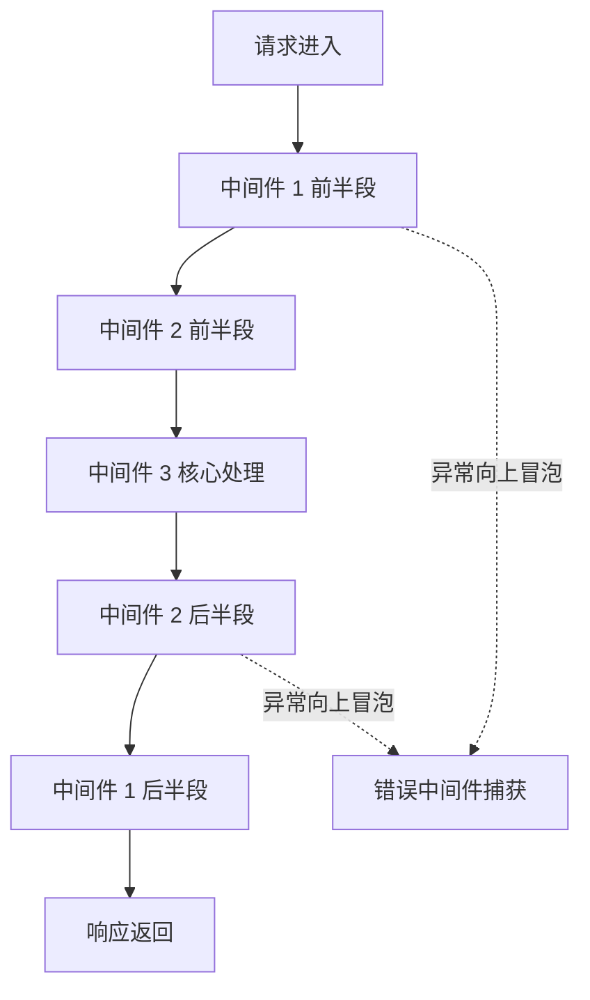

### NODE-024：Koa2 的 async 中间件中，try/catch 应该放在哪里？错误如何冒泡？
**答**：
- Koa 的错误冒泡沿 `await next()` 链**向上抛**：`app.on('error')` 只是日志钩子，真正兜底是 `app.use` 的最外层 try/catch 或 ctx.app.emit。
- 最佳实践：**最外层放一个统一的错误处理中间件**（记录日志、转换错误码、脱敏内部错误），内层业务代码只管 `throw`，不重复 try/catch；context 上挂 `ctx.throw(status, msg)` 抛出带状态码的业务异常。
- 高频坑：Koa 只捕获 **Promise 链上的异常**，`setTimeout` 里的 throw 与 EventEmitter 的 `error` 事件不会进入洋葱，必须额外处理（domain 已废弃，用 process 级兜底 + 显式 emit）。

```javascript
const Koa = require('koa');
const app = new Koa();

// 统一错误处理：最外层第一个中间件
app.use(async (ctx, next) => {
  const start = Date.now();
  try {
    await next();
  } catch (err) {
    const status = err.status || err.statusCode || 500;
    ctx.status = status;
    ctx.body = {
      code: err.code || (status >= 500 ? 'INTERNAL' : 'BAD_REQUEST'),
      message: status >= 500 ? 'Internal Server Error' : err.message, // 500 脱敏
    };
    ctx.app.emit('error', err, ctx);   // 交给全局 error 事件记日志
    console.error(`[${ctx.method} ${ctx.url}] ${status} ${Date.now() - start}ms`, err);
  }
});

// 业务中间件：只管 throw / ctx.throw
app.use(async (ctx) => {
  const { id } = ctx.query;
  if (!id) ctx.throw(400, '缺少参数 id');        // 抛出 400 业务异常
  const user = await Promise.reject(new Error('db down')); // 500 自动冒泡到最外层
  ctx.body = user;
});

// 日志钩子（注意：它只收 emit，不改变响应）
app.on('error', (err, ctx) => {
  console.error(JSON.stringify({ level: 'error', msg: err.message, url: ctx?.url }));
});

// 不进洋葱的异常：setTimeout 内的 throw
process.on('uncaughtException', (err) => console.error('未捕获异常，告警后决定是否退出:', err));

app.listen(3000);
```

### NODE-025：手写一个简版 Koa（核心约 60 行）？
**答**：
- 核心三件套：① `context` 对象（把 req/res 能力代理到 `ctx.request`/`ctx.response`，核心是 `ctx.body` 的 getter/setter 延迟写响应）；② 中间件数组 + compose；③ `handleRequest`：合并 ctx → compose 执行 → 统一 `respond` 输出 `ctx.body`。
- 理解点：`ctx.body = xxx` **不是立即发送**，而是在整个洋葱跑完后由 respond 统一判断类型（string/JSON/stream/Buffer）写出——这是 Koa 与 Express 直接操作 res 的根本不同。
- 面试要求 60 行内写清主干，体现"委托 + compose + 延迟响应"三概念。

```javascript
const http = require('node:http');
const compose = require('./compose'); // NODE-023 的 compose

class Application {
  constructor() { this.middleware = []; }
  use(fn) { this.middleware.push(fn); return this; }

  listen(...args) {
    const server = http.createServer(this.handleRequest.bind(this));
    return server.listen(...args);
  }

  // 构造 ctx：最小委托
  createContext(req, res) {
    const ctx = {
      req, res,
      method: req.method,
      url: req.url,
      app: this,
      state: {},
      _body: undefined,
    };
    Object.defineProperty(ctx, 'body', {
      get() { return ctx._body; },
      set(v) { ctx._body = v; },           // 延迟赋值，不立即响应
    });
    ctx.set = (k, v) => res.setHeader(k, v);
    ctx.throw = (status, msg) => { const e = new Error(msg); e.status = status; throw e; };
    return ctx;
  }

  // 统一响应输出
  respond(ctx) {
    const { res, body } = ctx;
    if (body === undefined) { res.statusCode = 404; return res.end('Not Found'); }
    if (typeof body === 'string' || Buffer.isBuffer(body)) return res.end(body);
    if (body && typeof body.pipe === 'function') return body.pipe(res); // 流直接接 res
    res.setHeader('content-type', 'application/json; charset=utf-8');
    res.end(JSON.stringify(body));
  }

  handleRequest(req, res) {
    const ctx = this.createContext(req, res);
    compose(this.middleware)(ctx)
      .then(() => this.respond(ctx))       // 洋葱跑完才响应
      .catch((err) => {
        ctx.status = err.status || 500;
        res.end(err.message || 'Internal Error');
        this.emit?.('error', err, ctx);
      });
  }
}

// 使用（与真 Koa 用法一致）
const app = new Application();
app.use(async (ctx, next) => { try { await next(); } catch (e) { ctx.status = e.status || 500; ctx.body = { code: e.status, msg: e.message }; } });
app.use(async (ctx, next) => { ctx.set('x-powered-by', 'mini-koa'); await next(); });
app.use(async (ctx) => { if (ctx.url === '/hi') ctx.body = { hello: 'koa' }; else ctx.throw(404, 'not found'); });
app.listen(3000);
```

### NODE-026：Koa 路由的实现原理是什么？如何解析路径参数 ctx.params？
**答**：
- 路由本质是**中间件前置过滤**：`router.get('/user/:id', fn)` 内部把 pattern 编译成正则 + 命名分组（`/user/:id` → `^/user/([^/]+?)$`），请求来时逐条匹配，命中则把正则捕获组写入 `ctx.params` 再执行 fn。
- 需要处理的细节：方法过滤、`/` 结尾归一化、query 与 params 区分（query 在 `ctx.query`，路径参数在 `ctx.params`）、404 由路由中间件放行后由 Koa 默认响应。
- 高频追问：为什么 Koa 路由没有嵌套作用域问题（`router.prefix('/api')` 统一加前缀）；RESTful 动态路径 vs 通配符 `(.*)` 的正则区别。

```javascript
// 简版路由：pattern 编译 + ctx.params 注入
class Router {
  constructor() { this.routes = []; }

  register(method, path, handler) {
    // '/user/:id/posts/:postId' → { keys: ['id','postId'], regexp }
    const keys = [];
    const pattern = path.replace(/:([A-Za-z0-9_]+)/g, (_, key) => {
      keys.push(key);
      return '([^/]+)';                   // 捕获一个路径段
    });
    this.routes.push({ method, keys, regexp: new RegExp(`^${pattern}$`), handler });
    return this;
  }
  get(path, h) { return this.register('GET', path, h); }
  post(path, h) { return this.register('POST', path, h); }

  // 作为 Koa 中间件使用
  routes() {
    return async (ctx, next) => {
      const match = this.routes.find(
        (r) => r.method === ctx.method && r.regexp.test(ctx.url.split('?')[0]),
      );
      if (!match) return next();          // 放行 → 404 兜底
      const [, ...values] = ctx.url.split('?')[0].match(match.regexp);
      ctx.params = Object.fromEntries(match.keys.map((k, i) => [k, decodeURIComponent(values[i])]));
      await match.handler(ctx, next);     // handler 内可 await next() 回到洋葱
    };
  }
}

// 用法
const router = new Router();
router.get('/user/:id', async (ctx) => { ctx.body = { userId: ctx.params.id }; });
router.get(/^\/files\/(.+)$/, async (ctx) => { ctx.body = { wildcard: ctx.params[0] }; });
// app.use(router.routes()) → GET /user/42 → { userId: "42" }
```

### NODE-027：koa-bodyparser 的实现原理？为什么要流式解析 body？
**答**：
- 原理：`ctx.req`（原生 IncomingMessage）是 Readable 流；bodyparser 在中间件里收集 `data`/`end`（或用 `raw-body` 库），按 `content-type` 分派解析（`application/json` → JSON.parse、`x-www-form-urlencoded` → querystring），结果挂到 `ctx.request.body`。
- 流式而非一次性 `readFile` 的原因：内存可控（超限即 413）、尽早开始、天然兼容 chunked 上传。生产还要求：只解析声明的方法（POST/PUT 等）、忽略 multipart（交给 formstream/busboy）、`onerror` 挂在 req 上防止 parse 失败崩溃进程。
- 高频追问：JSON.parse 大 body 会阻塞事件循环（同步 CPU）——超大 payload 应流式到磁盘或限制大小。

```javascript
// 简版 bodyparser 实现
function bodyParser(opts = {}) {
  const { enableTypes = ['json', 'form'], limit = '1mb' } = opts;
  const maxBytes = typeof limit === 'string'
    ? parseInt(limit) * (limit.endsWith('mb') ? 1024 * 1024 : 1024) : limit;

  return function bodyParserMiddleware(ctx, next) {
    const method = ctx.method.toUpperCase();
    if (!['POST', 'PUT', 'PATCH', 'DELETE'].includes(method)) return next();
    const type = (ctx.headers['content-type'] || '').split(';')[0].trim();

    if (type === 'multipart/form-data') return next();  // 交给专门的处理库

    return new Promise((resolve, reject) => {
      const chunks = [];
      let size = 0;
      ctx.req.on('data', (chunk) => {
        size += chunk.length;
        if (size > maxBytes) {
          ctx.req.removeAllListeners('data');   // 停止接收
          const err = new Error('body too large'); err.status = 413;
          ctx.req.destroy(err);
          return reject(err);
        }
        chunks.push(chunk);
      });
      ctx.req.on('end', () => {
        const raw = Buffer.concat(chunks).toString('utf8');
        try {
          ctx.request.body = type === 'application/json' && raw
            ? JSON.parse(raw)
            : Object.fromEntries(new URLSearchParams(raw));
          resolve(next());
        } catch (e) {
          e.status = 400; e.message = 'invalid json body';
          reject(e);
        }
      });
      ctx.req.on('error', reject);
    });
  };
}

// app.use(bodyParser()) → ctx.request.body 直接可用
```

### NODE-028：如何实现一个生产级静态文件服务？
**答**：
- 核心要素：① **路径穿越防护**——`path.normalize` + `startsWith(root)` 校验，杜绝 `../../etc/passwd`；② **协商缓存**——`ETag`（mtime+size 哈希）与 `Last-Modified`，命中 `If-None-Match` 回 304；③ **强缓存**——带 hash 的资源下发 `Cache-Control: public, max-age=31536000, immutable`；④ **Range 断点续传**（206 Partial Content）；⑤ MIME 映射；⑥ 正确用 `sendFile` 流式发送。
- 高频追问：为什么 hash 资源用 immutable（浏览器不再发 revalidate 请求）；`Content-Length` 与 gzip 的关系（压缩后需重新计算，交给流）。

```javascript
const http = require('node:http');
const fs = require('node:fs');
const path = require('node:path');
const crypto = require('node:crypto');

const ROOT = path.join(__dirname, 'public');
const MIME = { '.html': 'text/html', '.js': 'text/javascript', '.css': 'text/css', '.png': 'image/png', '.json': 'application/json' };

http.createServer((req, res) => {
  let pathname = decodeURIComponent(new URL(req.url, 'http://x').pathname);
  if (pathname === '/') pathname = '/index.html';

  // 1. 路径穿越防护
  const filePath = path.normalize(path.join(ROOT, pathname));
  if (!filePath.startsWith(ROOT)) { res.writeHead(403).end(); return; }

  fs.stat(filePath, (err, stat) => {
    if (err || !stat.isFile()) { res.writeHead(404).end('Not Found'); return; }

    // 2. 协商缓存：ETag = mtime + size
    const etag = `"${crypto.createHash('md5').update(`${stat.mtimeMs}-${stat.size}`).digest('hex')}"`;
    res.setHeader('etag', etag);
    res.setHeader('last-modified', stat.mtime.toUTCString());
    if (req.headers['if-none-match'] === etag) { res.writeHead(304).end(); return; }

    const ext = path.extname(filePath);
    res.setHeader('content-type', MIME[ext] || 'application/octet-stream');
    // 3. hash 文件强缓存（文件名包含 [hash] 时）
    if (/\.[0-9a-f]{8,}\./.test(pathname) || pathname.startsWith('/assets/')) {
      res.setHeader('cache-control', 'public, max-age=31536000, immutable');
    } else {
      res.setHeader('cache-control', 'no-cache'); // html 每次协商
    }

    // 4. Range 断点续传
    const range = req.headers.range;
    if (range) {
      const [, startStr, endStr] = range.match(/bytes=(\d*)-(\d*)/) || [];
      let start = startStr ? parseInt(startStr) : stat.size - parseInt(endStr);
      let end = endStr ? parseInt(endStr) : stat.size - 1;
      if (start >= stat.size) { res.writeHead(416).end(); return; }
      res.writeHead(206, { 'content-range': `bytes ${start}-${end}/${stat.size}`, 'content-length': end - start + 1 });
      return fs.createReadStream(filePath, { start, end }).pipe(res);
    }

    res.setHeader('content-length', stat.size);
    fs.createReadStream(filePath).pipe(res);   // 流式发送，内存恒定
  });
}).listen(3000);
```

### NODE-029：模板渲染（SSR 输出）与前端框架 SSR 有何不同？如何实现？
**答**：
- 传统模板渲染：服务端把数据填进模板（EJS/Handlebars/Pug）输出**完整 HTML 字符串**，浏览器一次拿到可渲染的文档；逻辑在服务端，前端只做少量交互（jQuery 时代）。
- React/Vue SSR：服务端执行**组件代码**生成 HTML（`renderToString`/`renderToPipeableStream`），还要下发 hydration 数据让客户端"复活"为可交互应用——多了 hydrate 步骤与双份执行。
- 生产要点：模板缓存（编译一次多次渲染）、HTML 转义防 XSS（`<%= %>` 转义 vs `<%- %>` 原样输出）、大页面用流式模板减少 TTFB。

```javascript
// 极简模板引擎（替换 {{var}} 与 {{#each}}）
function render(template, data) {
  return template
    .replace(/\{\{#each (\w+)\}\}([\s\S]*?)\{\{\/each\}\}/g, (_, key, body) =>
      (data[key] || []).map((item) => body.replace(/\{\{(\w+)\}\}/g, (__, k) => escapeHtml(String(item[k])))).join(''))
    .replace(/\{\{(\w+)\}\}/g, (_, key) => escapeHtml(String(data[key] ?? '')));
}
function escapeHtml(s) {
  return s.replace(/&/g, '&amp;').replace(/</g, '&lt;').replace(/>/g, '&gt;').replace(/"/g, '&quot;');
}

const tpl = fs.readFileSync('list.html', 'utf8'); // <h1>{{title}}</h1>{{#each users}}<li>{{name}}</li>{{/each}}
const http = require('node:http');
http.createServer((req, res) => {
  const data = { title: '用户列表 <script>alert(1)</script>', users: [{ name: 'Alice' }, { name: 'Bob' }] };
  res.writeHead(200, { 'content-type': 'text/html; charset=utf-8' });
  res.end(render(tpl, data)); // title 中的 script 被转义，防存储型 XSS
}).listen(3000);
```

### NODE-030：Express、Koa、NestJS 如何选型？
**答**：
- **Express**：生态最大、中间件最多、心智简单；回调风格老、无原生 async 错误捕获（v5 改善）、大项目结构靠自觉。适合：中小 API、快速原型、老项目维护。
- **Koa**：洋葱模型 + async/await 原生支持，代码优雅、内核极小（按需装配）；但生态小于 Express、无内置路由/校验。适合：BFF、SSR 服务、对控制流要求高的服务。
- **NestJS**：基于装饰器 + DI 的企业级框架（底层可切 Express/Fastify），模块化、依赖注入、管道/守卫/拦截器、天然契合 TS 与微服务。适合：多人协作的中大型服务端、微服务、全栈同构 TS。
- 一句话：小服务 Express/Koa 起步快，规模上来或重 TS 选 NestJS；BFF 场景 Koa/Nest 均为主流。

```typescript
// NestJS 风格示意：Controller + 依赖注入（对比 Express 的函数拼装）
import { Controller, Get, Query, Injectable, Module, BadRequestException } from '@nestjs/common';

@Injectable()
class UserService {
  private users = [{ id: 1, name: 'Alice' }];
  findById(id: number) {
    const user = this.users.find((u) => u.id === id);
    if (!user) throw new BadRequestException('用户不存在'); // 统一异常过滤器转 HTTP 响应
    return user;
  }
}

@Controller('users')
class UserController {
  constructor(private readonly userService: UserService) {} // DI 自动注入

  @Get()
  getUser(@Query('id') id: string) {
    return this.userService.findById(Number(id));
  }
}

@Module({ controllers: [UserController], providers: [UserService] })
export class UserModule {}
// 对比：Express 中 service 靠 require 手动传递；Nest 通过模块图自动组装并支持单例/请求作用域
```

### NODE-031：中间件执行顺序题：写出下列 Koa 代码的输出并解释？
**答**：
- 规则：`await next()` 前是"进入"（按注册顺序），之后是"退出"（逆序）；**response 中间件应放在最后注册但最先看到 body**……实际规则是"注册顺序 = 前半段执行顺序"。
- 输出：`A1 B1 C1 C2 B2 A2`，body 为 `'C'`。高频变体：去掉中间 C 的 `await next()` → C 后面的 C2 仍执行（同一函数内），但 B2/A2 **不会执行吗？**——会执行！C 未调用 next 只是跳过了"C 内部之后"没有更内层；B2/A2 属于外层回溯，正常执行。但若 C 的 next 是 `next()` 未 await，则 C2 会在 B 之前抢先执行（顺序错乱）。

```javascript
const Koa = require('koa');
const app = new Koa();

app.use(async (ctx, next) => {
  console.log('A1'); await next(); console.log('A2');
});
app.use(async (ctx, next) => {
  console.log('B1'); await next(); console.log('B2');
});
app.use(async (ctx, next) => {
  console.log('C1'); ctx.body = 'C'; await next(); console.log('C2'); ctx.body = 'C2'; // 后写覆盖
});

app.listen(3000);
// 输出：A1 B1 C1 C2 B2 A2，最终 body 是 'C2'

// 变体 1：C 不调用 next() → 输出 A1 B1 C1 C2 B2 A2 仍相同（只是没有更内层），
//         但若 C 之后还有 D 中间件，D 永远不会执行。
// 变体 2：C 中 next() 不加 await → C1 后立即回溯 B2 A2，C2 最后执行（顺序倒挂）。
// 变体 3：B 抛异常 throw new Error() → C 系列不执行，错误沿 A 的 try/catch 冒泡。
```

### NODE-032：如何设计统一错误码的错误处理中间件？
**答**：
- 三层设计：① **业务异常类** `BizError`（携带 code/message/status/logLevel）；② **错误中间件**（区分已知业务错误与未知异常，500 脱敏不外泄堆栈）；③ **全局兜底**（`app.on('error')` 记结构化日志 + 告警）。
- 错误码规范建议：数字段（如 `10001` 用户未登录）或 `DOMAIN_REASON` 字符串（`AUTH_EXPIRED`），HTTP status 与业务 code 解耦——HTTP 只表达传输层语义，code 表达业务语义。
- 必备细节：错误日志带 traceId 便于全链路追踪；未捕获的 async 异常必须收敛到这条链路；不要把 `err.stack` 返回给客户端。

```javascript
const Koa = require('koa');
const app = new Koa();

// 业务异常基类
class BizError extends Error {
  constructor(code, message, status = 400) {
    super(message);
    this.code = code; this.status = status;
  }
}
const Errors = {
  UNAUTHORIZED: () => new BizError('AUTH_REQUIRED', '请先登录', 401),
  FORBIDDEN: () => new BizError('AUTH_FORBIDDEN', '无权限', 403),
  NOT_FOUND: (what) => new BizError('RES_NOT_FOUND', `${what}不存在`, 404),
  RATE_LIMIT: () => new BizError('REQ_RATE_LIMIT', '请求过于频繁', 429),
};

// 错误中间件：最外层
app.use(async (ctx, next) => {
  const traceId = ctx.get('x-trace-id') || crypto.randomUUID();
  ctx.set('x-trace-id', traceId);
  const start = Date.now();
  try {
    await next();
  } catch (err) {
    const isBiz = err instanceof BizError;
    const status = err.status || 500;
    ctx.status = status;
    ctx.body = {
      code: isBiz ? err.code : 'INTERNAL_ERROR',
      message: isBiz ? err.message : '系统繁忙，请稍后重试', // 未知错误脱敏
      traceId,
    };
    ctx.app.emit('error', err, ctx);
    console.error(JSON.stringify({          // 结构化错误日志
      level: isBiz ? 'warn' : 'error',
      traceId, method: ctx.method, url: ctx.url,
      status, cost: Date.now() - start,
      msg: err.message,
      stack: isBiz ? undefined : err.stack, // 业务错误不记堆栈
    }));
  }
});

// 业务代码
app.use(async (ctx) => {
  if (!ctx.get('authorization')) throw Errors.UNAUTHORIZED();
  if (ctx.path === '/goods') ctx.body = { code: 'OK', data: [{ id: 1 }] };
  else throw Errors.NOT_FOUND('接口');
});

app.on('error', (err) => { /* 接入 Sentry/自建告警 */ });
app.listen(3000);
```

---

## 五、鉴权与会话

### NODE-033：服务端 session 为什么不能用内存 store？Redis 方案怎么设计？
**答**：
- 内存 Map 的缺陷：① **多实例不共享**——负载均衡把请求分到另一台机器就"丢登录"；② 重启即全部掉线；③ 无法主动过期，靠定时扫描，泄漏风险。
- Redis 方案：`sess:{sid}` → JSON（user + 角色 + 登录时间），`EXPIRE` 控制 TTL；滑动过期 = 每次访问 `EXPIRE` 续期；多实例共享只需同连一个 Redis（或 Redis Sentinel/Cluster）。
- 附加能力：服务端可**强制下线**（`DEL` 某用户全部 session，用 `user:{uid}:sessions` Set 索引）、单点登录互踢、异地登录检测。黏性会话（ip_hash）只是缓解，不是正解。

```javascript
const Koa = require('koa');
const Redis = require('ioredis');
const crypto = require('node:crypto');
const app = new Koa();
const redis = new Redis(); // 生产: new Redis({ host, port, keyPrefix: 'bff:' })

const SESSION_TTL = 30 * 60; // 30 分钟滑动过期

async function createSession(uid, role) {
  const sid = crypto.randomBytes(24).toString('hex');
  const sess = JSON.stringify({ uid, role, loginAt: Date.now() });
  await redis.setex(`sess:${sid}`, SESSION_TTL, sess);
  await redis.sadd(`user:${uid}:sessions`, sid);   // 索引：一个用户可能多个端登录
  return sid;
}

async function getSession(ctx) {
  const sid = ctx.cookies.get('sid', { signed: false });
  if (!sid) return null;
  const raw = await redis.get(`sess:${sid}`);
  if (!raw) return null;
  await redis.expire(`sess:${sid}`, SESSION_TTL);  // 滑动过期
  return JSON.parse(raw);
}

// 强制下线（封禁/改密码后）
async function kickout(uid) {
  const sids = await redis.smembers(`user:${uid}:sessions`);
  if (sids.length) {
    await redis.del(...sids.map((s) => `sess:${s}`), `user:${uid}:sessions`);
  }
}

app.use(async (ctx, next) => {
  if (ctx.path === '/login') {
    const sid = await createSession(42, 'admin');
    ctx.cookies.set('sid', sid, { httpOnly: true, sameSite: 'lax', maxAge: SESSION_TTL * 1000 });
    ctx.body = { ok: true };
    return;
  }
  const sess = await getSession(ctx);
  if (!sess) { ctx.status = 401; ctx.body = { code: 'AUTH_REQUIRED' }; return; }
  ctx.state.user = sess;
  await next();
});
app.listen(3000);
```

### NODE-034：JWT 的结构与签发/校验的完整实现？
**答**：
- JWT = `header.payload.signature`（Base64URL）：header 声明算法；payload 放 claims（`sub` 用户 id、`iat` 签发时间、`exp` 过期、`aud`/`iss` 受众与签发方）；signature = `HMAC(header.payload, secret)` 保证**防篡改**（不加密！payload 可被任何人解码，禁止放敏感信息）。
- 服务端校验：验签 → 验 `exp`/`iss`/`aud` → 验黑名单（见 NODE-035）。无状态是最大优点（无需查 Redis 即可确认身份），代价是**无法主动作废**。
- 高频追问：为什么不能把密码/手机号放 payload（Base64 可逆）；HS256 vs RS256（对称 vs 非对称，微服务间用 RS256 让网关验签而签发权集中在认证中心）。

```javascript
const crypto = require('node:crypto');

const SECRET = process.env.JWT_SECRET;
const base64url = (buf) => buf.toString('base64url');

function sign(payload, secret = SECRET, expiresInSec = 3600) {
  const header = base64url(Buffer.from(JSON.stringify({ alg: 'HS256', typ: 'JWT' })));
  const now = Math.floor(Date.now() / 1000);
  const claims = { ...payload, iat: now, exp: now + expiresInSec, iss: 'auth-center' };
  const body = base64url(Buffer.from(JSON.stringify(claims)));
  const signature = crypto.createHmac('sha256', secret).update(`${header}.${body}`).digest('base64url');
  return `${header}.${body}.${signature}`;
}

function verify(token, secret = SECRET) {
  const [header, body, signature] = token.split('.');
  // 1. 验签（时间安全比较防时序攻击）
  const expected = crypto.createHmac('sha256', secret).update(`${header}.${body}`).digest();
  const actual = Buffer.from(signature, 'base64url');
  if (actual.length !== expected.length || !crypto.timingSafeEqual(actual, expected)) {
    throw Object.assign(new Error('签名不合法'), { status: 401 });
  }
  const claims = JSON.parse(Buffer.from(body, 'base64url').toString());
  // 2. 验过期与签发方
  if (claims.exp * 1000 < Date.now()) throw Object.assign(new Error('token 已过期'), { status: 401 });
  if (claims.iss !== 'auth-center') throw Object.assign(new Error('签发方不合法'), { status: 401 });
  return claims;
}

// 生产可直接用 jsonwebtoken：
// jwt.sign({ uid: 42 }, SECRET, { expiresIn: '1h', issuer: 'auth-center' });
// jwt.verify(token, SECRET, { issuer: 'auth-center' });

const token = sign({ uid: 42, role: 'admin' }, SECRET, 60);
console.log(token);
console.log(verify(token));
console.log(token.split('.')[1]); // payload 可直接解码 → 别放敏感信息！
```

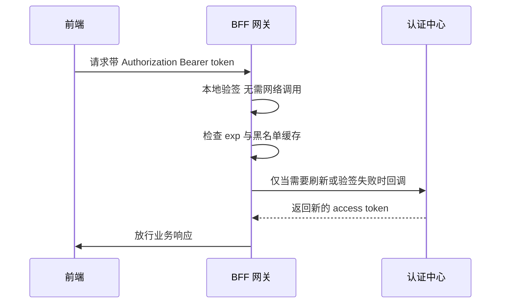

### NODE-035：JWT 如何实现 token 刷新与黑名单（主动作废）？
**答**：
- 双 token 方案：**access token 短命（15min）+ refresh token 长命（7d）**。access 过期后用 refresh 换新；refresh 存 Redis（可作废、可检测重放）。
- 黑名单：把"已登出/已作废"的 access token 的 `jti`（唯一 id）写入 Redis，TTL = 该 token 剩余寿命（过期后自动出列，无需清理）。校验时多查一次黑名单（可用本地缓存/布隆过滤降低 Redis 压力）。
- 关键细节：refresh token **一次性使用**（rotation），旧 refresh 被再次使用说明疑似被盗 → 作废整个用户会话族（token family）。

```javascript
const jwt = require('jsonwebtoken');
const Redis = require('ioredis');
const redis = new Redis();

const ACCESS_SECRET = process.env.JWT_SECRET;
const REFRESH_SECRET = process.env.REFRESH_SECRET;

// 登录：签发双 token
async function issueTokens(uid, role) {
  const jti = crypto.randomUUID();
  const access = jwt.sign({ uid, role, jti }, ACCESS_SECRET, { expiresIn: '15m' });
  const refresh = jwt.sign({ uid, typ: 'refresh' }, REFRESH_SECRET, { expiresIn: '7d' });
  await redis.set(`refresh:${uid}`, refresh, 'EX', 7 * 24 * 3600); // 服务端持有，可主动作废
  return { access, refresh };
}

// 中间件：验 access + 黑名单
async function auth(ctx, next) {
  const token = (ctx.get('authorization') || '').replace('Bearer ', '');
  try {
    const claims = jwt.verify(token, ACCESS_SECRET);
    if (await redis.get(`bl:${claims.jti}`)) ctx.throw(401, 'token 已作废');
    ctx.state.user = claims;
  } catch (e) {
    if (e.name === 'TokenExpiredError') { ctx.status = 401; ctx.body = { code: 'TOKEN_EXPIRED' }; return; }
    ctx.throw(401, 'token 无效');
  }
  await next();
}

// 刷新：rotation + 重放检测
app.post('/auth/refresh', async (ctx) => {
  const { refresh } = ctx.request.body;
  const claims = jwt.verify(refresh, REFRESH_SECRET); // 非法直接 401
  const stored = await redis.get(`refresh:${claims.uid}`);
  if (stored !== refresh) {                            // 旧 token 被重放 → 疑似盗用
    await redis.del(`refresh:${claims.uid}`);          // 作废整个会话族
    ctx.throw(401, '检测到重放，请重新登录');
  }
  ctx.body = await issueTokens(claims.uid, claims.role); // 换发新双 token
});

// 登出：access 进黑名单（TTL = 剩余寿命）+ refresh 删除
app.post('/auth/logout', auth, async (ctx) => {
  const { exp, jti, uid } = ctx.state.user;
  await redis.set(`bl:${jti}`, '1', 'EX', exp - Math.floor(Date.now() / 1000));
  await redis.del(`refresh:${uid}`);
  ctx.body = { ok: true };
});
```

### NODE-036：OAuth2 中各服务端角色的职责是什么？简化版授权码流程如何实现？
**答**：
- 四角色：**资源所有者**（用户）、**客户端**（第三方应用）、**授权服务器**（发 token，如公司 SSO）、**资源服务器**（校验 token 提供数据，如 GitHub API）。
- 授权码流程：客户端跳授权页（带 `client_id`/`redirect_uri`/`state`/`scope`）→ 用户登录并同意 → 授权服务器 302 回调带 **code**（一次性、10 分钟内）→ 客户端后端用 code + `client_secret` 换 token（code 在后端交换，防暴露）。
- 服务端要点：`redirect_uri` 必须严格白名单（防授权码劫持）、`state` 防 CSRF、PKCE（SAP/移动端无 secret 场景用 `code_verifier`/`code_challenge`）。

```javascript
// 简化版授权服务器（理解原理用，生产用 keycloak/logto/passport）
const Koa = require('koa');
const crypto = require('node:crypto');
const app = new Koa();

const clients = { 'app-frontend': { secret: 's3cret', redirectUris: ['https://app.example.com/cb'] } };
const authCodes = new Map(); // code → { clientId, uid, expires, redirectUri }

// 1. 授权端点
app.get('/oauth/authorize', async (ctx) => {
  const { client_id, redirect_uri, state, response_type } = ctx.query;
  const client = clients[client_id];
  if (!client || !client.redirectUris.includes(redirect_uri)) ctx.throw(400, 'redirect_uri 非法'); // 白名单强校验
  if (response_type !== 'code') ctx.throw(400, '仅支持授权码模式');
  // 真实场景：此处渲染登录页，用户登录同意后签发 code
  const code = crypto.randomBytes(16).toString('hex');
  authCodes.set(code, { clientId: client_id, uid: 42, expires: Date.now() + 10 * 60 * 1000, redirectUri: redirect_uri });
  ctx.redirect(`${redirect_uri}?code=${code}&state=${state}`);
});

// 2. 换 token 端点（后端对后端）
app.post('/oauth/token', async (ctx) => {
  const { code, client_id, client_secret, redirect_uri } = ctx.request.body;
  const record = authCodes.get(code);
  if (!record || record.expires < Date.now()) ctx.throw(400, 'code 无效或已过期');
  if (record.clientId !== client_id || clients[client_id].secret !== client_secret) ctx.throw(401, '客户端凭证错误');
  if (record.redirectUri !== redirect_uri) ctx.throw(400, 'redirect_uri 不一致'); // 防换包截获 code
  authCodes.delete(code); // code 一次性
  ctx.body = { access_token: 'jwt-xxx', token_type: 'Bearer', expires_in: 3600, refresh_token: 'yyy' };
});
app.listen(9000);
```

### NODE-037：CORS 与 credentials 如何配合？带 cookie 跨域常踩哪些坑？
**答**：
- 带 cookie 的跨域请求，前端必须 `fetch(url, { credentials: 'include' })`（或 axios `withCredentials: true`）；服务端必须 `Access-Control-Allow-Credentials: true` 且 `Allow-Origin` 为**精确 origin**（`*` 时浏览器直接拒收响应）。
- 高频坑：① `Allow-Origin: *` + credentials 组合非法；② `SameSite=None` 的 cookie 必须同时 `Secure`，否则 Chrome 拒发；③ localhost 多端口同源但跨子域部署时 cookie domain 要写 `.example.com` 顶层域；④ CORS 头被 Nginx 和 Node 重复设置导致浏览器报"duplicate header"。
- 排查口诀：先看预检 OPTIONS 是否 204，再看响应头是否齐全，最后看 cookie 是否 SameSite/Secure 阻断。

```javascript
// 服务端：完整 credentials CORS
const ALLOWED = new Set(['https://app.example.com', 'http://localhost:5173']);
app.use(async (ctx, next) => {
  const origin = ctx.get('origin');
  if (ALLOWED.has(origin)) {
    ctx.set('access-control-allow-origin', origin);
    ctx.set('access-control-allow-credentials', 'true');
    ctx.set('vary', 'origin');
  }
  if (ctx.method === 'OPTIONS') {
    ctx.set('access-control-allow-methods', 'GET,POST,PUT,DELETE');
    ctx.set('access-control-allow-headers', 'content-type,authorization');
    ctx.set('access-control-max-age', '86400');
    ctx.status = 204;
    return;
  }
  await next();
});

// 服务端下发跨域 cookie：SameSite=None 必须 Secure
ctx.cookies.set('sid', sid, {
  httpOnly: true,
  sameSite: 'none',   // 跨站携带
  secure: true,       // 强制 HTTPS
  domain: '.example.com', // 跨子域共享
});
```

```javascript
// 前端：credentials 配置
// fetch
fetch('https://bff.example.com/api/me', {
  method: 'GET',
  credentials: 'include',          // 关键：携带跨域 cookie
  headers: { 'content-type': 'application/json' },
});
// axios
axios.create({ baseURL: 'https://bff.example.com', withCredentials: true });
```

### NODE-038：如何封装一个 RBAC（基于角色的访问控制）鉴权中间件？
**答**：
- 模型：**user → roles → permissions**（permission 形如 `order:read`/`order:write`）。中间件声明式标注所需权限：`router.get('/orders', requirePermission('order:read'), handler)`。
- 实现要点：JWT claims 中只放 roles（体积小），permission 由服务端从角色映射表解析（支持热更新无需重签 token）；层级继承（admin ⊃ editor ⊃ viewer）用 Set 归并；无权限统一 403 并打审计日志。
- 对比 ACL（资源级）与 ABAC（属性级）：RBAC 覆盖 80% 后台场景，资源级校验（"你只能改自己的订单"）另在 service 层做 ownership 判断。

```javascript
// 权限映射：角色 → 权限集合（可放配置中心/DB 热更新）
const ROLE_PERMISSIONS = {
  admin: ['order:read', 'order:write', 'user:manage'],
  editor: ['order:read', 'order:write'],
  viewer: ['order:read'],
};
// 层级归并
const flatten = (roles) => [...new Set(roles.flatMap((r) => ROLE_PERMISSIONS[r] || []))];

const requirePermission = (need) => async (ctx, next) => {
  const claims = ctx.state.user; // 前置 auth 中间件已验签
  if (!claims) ctx.throw(401, '未登录');
  const owned = flatten(claims.roles || []);
  if (!owned.includes(need)) {
    // 审计日志：谁在何时越权访问了什么
    console.warn(JSON.stringify({ level: 'warn', event: 'rbac_denied',
      uid: claims.uid, roles: claims.roles, need, path: ctx.path }));
    ctx.throw(403, `需要权限 ${need}`);
  }
  await next();
};

// 路由挂载
router.get('/orders', requirePermission('order:read'), listOrders);
router.post('/orders', requirePermission('order:write'), createOrder);
router.delete('/users/:id', requirePermission('user:manage'), deleteUser);

// service 层的资源级 ownership 校验（RBAC 之外的第二道门）
async function updateOrder(uid, orderId, patch) {
  const order = await db.orders.find(orderId);
  if (order.ownerId !== uid && !flatten(user.roles).includes('order:write:all')) {
    throw new BizError('ORDER_FORBIDDEN', '只能修改自己的订单', 403);
  }
  return db.orders.update(orderId, patch);
}
```

---

## 六、数据层

### NODE-039：如何用 mysql2/promise 封装一个生产级连接池？
**答**：
- 连接池解决 TCP 建连 + 认证的重复开销与并发上限：`createPool` 按需复用连接。关键参数：`connectionLimit`（单实例上限，按 `maxPoolSize` 全局预算分配）、`queueLimit`（排队上限防内存膨胀）、`connectTimeout`、`enableKeepAlive`。
- 生产要点：查询参数**必须用占位符 `?`**（防 SQL 注入）；捕获 `PROTOCOL_CONNECTION_LOST`/`ETIMEDOUT` 自动重试；慢查询埋点（执行耗时打日志/上报）；读多写少可用主从 + `connection.config` 区分。
- 高频追问：连接数公式 `connectionLimit ≈ DB max_connections / 服务实例数`，不能拍脑袋写 100。

```javascript
const mysql = require('mysql2/promise');

const pool = mysql.createPool({
  host: process.env.DB_HOST,
  user: process.env.DB_USER,
  password: process.env.DB_PASSWORD,   // 凭证走环境变量
  database: 'shop',
  connectionLimit: 20,                 // ≈ DB max_connections / 实例数
  queueLimit: 100,                     // 排队超过直接报错，不无限堆积
  connectTimeout: 5000,
  enableKeepAlive: true,
  waitForConnections: true,
  namedPlaceholders: true,             // 支持 :name 占位符
});

// 统一封装：慢查询日志 + 错误归一
async function query(sql, params) {
  const start = Date.now();
  try {
    const [rows] = await pool.execute(sql, params); // execute 走预处理，防注入
    const cost = Date.now() - start;
    if (cost > 200) console.warn(JSON.stringify({ level: 'warn', event: 'slow_query', sql, cost, params }));
    return rows;
  } catch (err) {
    if (['PROTOCOL_CONNECTION_LOST', 'ECONNRESET'].includes(err.code)) {
      console.error('DB 连接中断，池会自动重连:', err.code);
    }
    throw err;
  }
}

// 使用：占位符 + 命名参数
const users = await query('SELECT id, name FROM users WHERE status = :status LIMIT 10', { status: 'active' });
```

### NODE-040：如何在 Node 中正确处理数据库事务？以转账为例？
**答**：
- mysql2 事务模板：`getConnection` → `beginTransaction` → 两条 UPDATE → `commit`，任一步失败 `rollback`。**必须用同一个 connection**（连接池下 pool.query 不保证同连接）。
- 高频细节：① 隔离级别（默认 REPEATABLE READ，余额扣减可用 `UPDATE ... SET balance = balance - x WHERE id = ? AND balance >= x` 的**条件更新 + affectedRows 判断**，天然防超卖）；② rollback 放 finally 保证连接释放（否则池被耗尽）；③ 跨服务事务用消息表/Saga，不用 2PC。
- Node 侧的坑：事务里不要 await 外部 HTTP 调用（长事务持锁拖垮 DB）。

```javascript
const mysql = require('mysql2/promise');

async function transfer(fromId, toId, amount) {
  const conn = await pool.getConnection(); // 事务必须独占一个连接
  try {
    await conn.beginTransaction();

    // 条件更新防超扣：余额不足时 affectedRows = 0
    const [deduct] = await conn.execute(
      'UPDATE accounts SET balance = balance - ? WHERE id = ? AND balance >= ?',
      [amount, fromId, amount],
    );
    if (deduct.affectedRows === 0) {
      throw Object.assign(new Error('余额不足'), { status: 400, code: 'INSUFFICIENT_BALANCE' });
    }
    await conn.execute('UPDATE accounts SET balance = balance + ? WHERE id = ?', [amount, toId]);

    // 流水表（对账依据）
    await conn.execute(
      'INSERT INTO transfer_log (from_id, to_id, amount, created_at) VALUES (?, ?, ?, NOW())',
      [fromId, toId, amount],
    );

    await conn.commit();
    return { ok: true };
  } catch (err) {
    await conn.rollback();      // 任一步失败整体回滚
    throw err;
  } finally {
    conn.release();             // 关键：无论成败归还连接
  }
}
```

### NODE-041：Redis 在 BFF 中的三大经典场景：缓存、分布式锁、排行榜如何实现？
**答**：
- **缓存**：`GET` 未命中回源 DB 再 `SETEX`，注意 key 设计（`biz:实体:id`）、TTL、序列化与空值缓存（防穿透）。
- **分布式锁**：`SET key token NX EX 10`（原子加锁 + 过期防死锁），解锁用 **Lua 脚本判断持有者再删**（防误删他人锁）；续期用看门狗。高可用场景用 Redlock 或改用 ZooKeeper。
- **排行榜**：`ZADD`/`ZREVRANGE`/`ZINCRBY`，有序集合天然按分数排序，O(logN) 更新。
- 这三个场景是大厂高频压轴：要求能写出正确代码并说出错误写法的坑（如 `SETNX` + `EXPIRE` 两步非原子）。

```javascript
const Redis = require('ioredis');
const redis = new Redis();

// 1. 缓存：带空值缓存与 TTL
async function getUserProfile(uid) {
  const key = `user:profile:${uid}`;
  const cached = await redis.get(key);
  if (cached) return cached === '__NULL__' ? null : JSON.parse(cached); // 空值缓存防穿透
  const profile = await db.query('SELECT * FROM profiles WHERE uid = ?', [uid]);
  await redis.setex(key, profile ? 300 : 60, profile ? JSON.stringify(profile) : '__NULL__');
  return profile;
}

// 2. 分布式锁：原子加锁 + Lua 安全解锁
async function withLock(key, ttlSec, fn) {
  const token = crypto.randomUUID();          // 唯一持有标识
  const ok = await redis.set(`lock:${key}`, token, 'EX', ttlSec, 'NX');
  if (!ok) throw new BizError('LOCK_CONFLICT', '操作进行中，请稍后重试', 409);
  try {
    return await fn();
  } finally {
    // Lua：只有持有者才能删锁，防止超时后误删别人的锁
    await redis.eval(
      `if redis.call("get", KEYS[1]) == ARGV[1] then
         return redis.call("del", KEYS[1])
       else return 0 end`, 1, `lock:${key}`, token);
  }
}
// 使用：防止定时任务多实例重复执行
await withLock('sync-orders', 60, () => syncOrders());

// 3. 排行榜：ZSET
async function addScore(uid, points) {
  await redis.zincrby('rank:weekly', points, uid);          // 加分
  const top10 = await redis.zrevrange('rank:weekly', 0, 9, 'WITHSCORES'); // 前 10 名
  const myRank = await redis.zrevrank('rank:weekly', uid);   // 我的名次（0 起）
  const total = await redis.zcard('rank:weekly');
  return { top10: chunk(top10), myRank: myRank === null ? null : myRank + 1, total };
}
```

### NODE-042：缓存穿透、击穿、雪崩的服务端对策？
**答**：
- **穿透**（查不存在的 key，每次都打 DB）：空值缓存（短 TTL）、布隆过滤器前置（先判断"可能存在"）、参数校验（非法 id 直接拒绝）。
- **击穿**（热点 key 过期瞬间大量回源）：互斥回源（分布式锁，只放一个请求去查 DB，其余等待读缓存）、singleflight（进程内合并同 key 并发请求）、逻辑过期（物理永不过期 + 后台异步刷新）。
- **雪崩**（大量 key 同时过期/Redis 宕机）：过期时间加随机抖动（`base + random`）、多级缓存（本地 LRU + Redis）、Redis 高可用（哨兵/集群）、熔断降级兜底（DB 限流，宁可返回旧数据/默认数据）。

```javascript
const pLimit = require('p-limit');

// singleflight：进程内合并对同一 key 的并发回源
const inflight = new Map();
async function singleflight(key, loader) {
  if (inflight.has(key)) return inflight.get(key);   // 后到的请求共享第一个的 Promise
  const p = loader().finally(() => inflight.delete(key));
  inflight.set(key, p);
  return p;
}

async function getHotData(id) {
  const key = `hot:${id}`;
  // 1. 布隆过滤器前置（防穿透）：不存在直接返回 null，不碰 DB
  if (!(await redis.bf?.exists('bloom:ids', id))) return null;

  const cached = await redis.get(key);
  if (cached) return JSON.parse(cached);

  // 2. 互斥回源（防击穿）：进程内 singleflight + Redis 锁
  return singleflight(key, async () => {
    const data = await db.query('SELECT * FROM items WHERE id = ?', [id]);
    // 3. TTL 加随机抖动（防雪崩）+ 空值短缓存（防穿透）
    const ttl = 600 + Math.floor(Math.random() * 120); // 600~720s
    await redis.setex(key, ttl, JSON.stringify(data));
    return data;
  });
}

// 4. 兜底：DB 层限流 + 降级（Redis 全挂时返回静态默认数据）
async function getWithFallback(id) {
  try { return await getHotData(id); }
  catch (e) {
    console.error('cache/db 失败，降级:', e.message);
    return DEFAULT_ITEM_MAP[id] ?? null; // 返回兜底数据而非 500
  }
}
```

### NODE-043：MongoDB 的基础与选型考量？
**答**：
- 文档模型（BSON）：无固定 schema、嵌套数组/对象天然匹配 JSON；适合**内容型、字段多变、读多写少**场景（CMS、商品详情、用户行为日志）。强事务场景（账务、库存扣减）仍选 MySQL（4.0+ 有多文档事务但代价高）。
- BFF 视角：API 返回 JSON，Mongo 的文档可以"少一层 ORM 映射"；聚合管道 `$lookup`/`$group` 能替代很多 SQL join/group。
- 核心概念：collection ↔ table、document ↔ row、`_id` 自动 ObjectId、索引（`explain()` 查看是否走索引）、副本集与分片。

```javascript
const { MongoClient } = require('mongodb');

const client = new MongoClient(process.env.MONGO_URL, { maxPoolSize: 20 });
await client.connect();
const col = client.db('shop').collection('goods');

// 写入：灵活 schema
await col.insertOne({
  title: '机械键盘',
  specs: { switch: '红轴', keys: 87 },     // 嵌套对象
  tags: ['外设', 'hot'],
  stock: 100,
});

// 聚合管道：分组统计 + 关联（$lookup 类似 join）
const hotByTag = await col.aggregate([
  { $match: { tags: 'hot' } },
  { $group: { _id: '$tags', avgStock: { $avg: '$stock' }, count: { $sum: 1 } } },
  { $sort: { count: -1 } },
  { $limit: 10 },
]).toArray();

// 原子操作：库存扣减（findAndModify 保证条件扣减）
const result = await col.findOneAndUpdate(
  { _id: goodsId, stock: { $gte: 1 } },    // 条件更新防超卖
  { $inc: { stock: -1 } },
  { returnDocument: 'after' },
);
if (!result) throw new BizError('OUT_OF_STOCK', '库存不足', 409);

// 索引与解释
await col.createIndex({ tags: 1, stock: -1 });
console.log((await col.find({ tags: 'hot' }).explain()).queryPlanner.winningPlan);
```

### NODE-044：Prisma、TypeORM、Sequelize 如何对比选型？
**答**：
- **Prisma**：schema 单一真源 + 生成强类型 Client，TS 体验最佳、迁移工具成熟；代价是不够灵活（复杂 SQL 要 `$queryRaw`）、运行时多一层查询引擎。新项目 + TS 首选。
- **TypeORM**：装饰器实体 + Active Record/Data Mapper 双模式，功能全（关系、事务、迁移、订阅者）；但类型推断弱、文档质量参差、历史坑较多。适合深度定制与 NestJS 生态。
- **Sequelize**：老牌、生态稳定、文档丰富；TS 支持靠手写 interface，体验一般。存量项目维护居多。
- 面试口径：**类型安全与 DX 选 Prisma，NestJS 重度定制选 TypeORM，存量维护 Sequelize**；共享 SQL 场景或强控制需求可以直接上 Knex/原生驱动。

```typescript
// Prisma：schema 驱动 + 强类型查询
// prisma/schema.prisma
// model User {
//   id    Int     @id @default(autoincrement())
//   email String  @unique
//   posts Post[]
// }
// model Post {
//   id       Int    @id @default(autoincrement())
//   title    String
//   author   User   @relation(fields: [authorId], references: [id])
//   authorId Int
// }

import { PrismaClient } from '@prisma/client';
const prisma = new PrismaClient();

// 关联查询 + 类型自动推导，author 拼写错误在编译期就报红
const usersWithPosts = await prisma.user.findMany({
  where: { email: { endsWith: '@example.com' } },
  include: { posts: { where: { title: { contains: 'Node' } }, take: 5 } },
});

// 事务：交互式事务（同一上下文内多步原子操作）
await prisma.$transaction(async (tx) => {
  await tx.account.update({ where: { id: fromId }, data: { balance: { decrement: amount } } });
  await tx.account.update({ where: { id: toId }, data: { balance: { increment: amount } } });
  await tx.transferLog.create({ data: { fromId, toId, amount } });
});
```

```javascript
// TypeORM：装饰器实体（对比参考）
// @Entity() class User { @PrimaryGeneratedColumn() id; @Column() email; @OneToMany(() => Post, p => p.author) posts; }
// await repo.find({ relations: ['posts'], where: { email: Like('%@example.com') } });
// Sequelize：模型 + 语法糖
// await User.findAll({ include: Post, where: { email: { [Op.endsWith]: '@example.com' } } });
```

### NODE-045：范式、索引这些数据库设计基础，对写 BFF 的前端有什么意义？
**答**：
- BFF 不是只搬运数据：**慢 SQL 会拖垮 BFF 的超时预算**。前端工程师要能读懂执行计划、知道为什么列表页要分页要索引。
- 范式（1NF 原子性/2NF 消除部分依赖/3NF 消除传递依赖）：OLTP 遵循 3NF 减少冗余；但 BFF 常接触的**读密集报表/详情页反而要反范式**（冗余字段、宽表），用空间换 join。
- 索引要点：最左前缀（联合索引 `(uid, status, created_at)` 查 `uid+status` 才生效）、覆盖索引免回表、`LIKE '%x'` 不走索引、`ORDER BY` 与索引顺序一致避免 filesort、区分度低的列（如性别）建索引意义小。

```sql
-- BFF 接口"我的订单列表"背后的 SQL 与索引设计
-- SELECT id, status, amount, created_at FROM orders
-- WHERE uid = 42 AND status = 'paid'
-- ORDER BY created_at DESC LIMIT 20 OFFSET 0;

-- 联合索引：等值列在前，排序列在后
ALTER TABLE orders ADD INDEX idx_uid_status_created (uid, status, created_at);
-- EXPLAIN 确认：type=ref, key=idx_uid_status_created, Extra 无 filesort

-- 深分页优化：OFFSET 100000 会扫描并丢弃 10 万行，改用游标分页
-- SELECT id, status, amount FROM orders
-- WHERE uid = 42 AND id < 987654      -- 上一页最后一条的 id（游标）
-- ORDER BY id DESC LIMIT 20;
```

```javascript
// BFF 侧配合：游标分页 + 强制 LIMIT 上限
app.get('/api/orders', async (ctx) => {
  const { cursor, size = 20 } = ctx.query;
  const pageSize = Math.min(parseInt(size), 50);   // 钳制上限，防一次拉全表
  const rows = await query(
    `SELECT id, status, amount, created_at FROM orders
     WHERE uid = ? ${cursor ? 'AND id < ?' : ''} ORDER BY id DESC LIMIT ?`,
    cursor ? [ctx.state.user.uid, Number(cursor), pageSize] : [ctx.state.user.uid, pageSize],
  );
  ctx.body = { data: rows, nextCursor: rows.length === pageSize ? rows[rows.length - 1].id : null };
});
```

---

## 七、BFF 架构

### NODE-046：BFF 是什么？它解决了什么问题？
**答**：
- BFF（Backend For Frontend）：**面向特定前端**的服务器中间层——为 Web/APP/小程序各自提供一个"懂这个端"的服务端，而不是让所有端共享一套通用 API。
- 解决的问题：① **多端适配**——同一个能力，PC 要全量字段、移动端要精简、小程序要聚合，后端不该为每个端改接口；② **聚合裁剪**——一个页面需要 3 个下游数据，BFF 一次聚合返回，减少前端串行请求与往返延迟；③ **协议转换**——下游是 gRPC/RPC/老 XML 接口，BFF 统一转成 HTTP/JSON；④ **防腐层**——下游接口变更、脏数据、拆分合并都被 BFF 消化，前端零感知。
- 本质权衡：多了一层部署与运维成本、多一跳延迟，换来前端的简单与后端的稳定。Node 是 BFF 的事实标准（JS 全栈、流处理强、I/O 密集友好）。

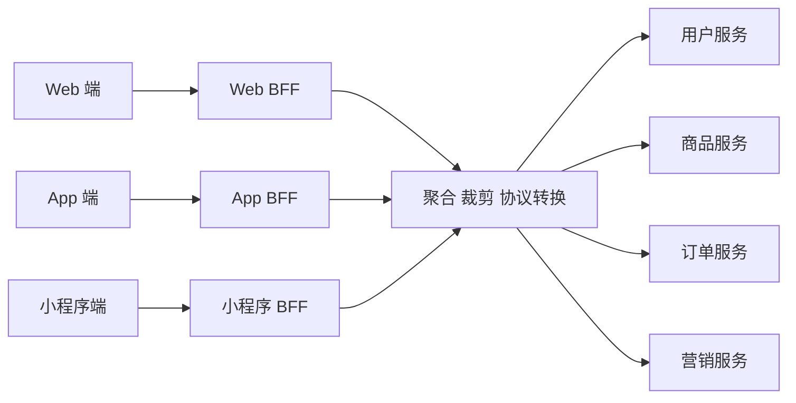

```javascript
// 没有 BFF：前端自己串行聚合 3 个接口，白屏时间长且逻辑散落各端
// const user  = await fetch('/api/user');        // 200ms
// const goods = await fetch('/api/goods');       // 300ms  → 前端串行 500ms+，
// const promo  = await fetch('/api/promo');      // 250ms     每个端都要重复这段胶水代码

// 有 BFF：一个页面级接口，服务端并行聚合，前端一次拿到可渲染数据
// GET /bff/page/home → { user: {...}, goods: [...], promo: {...} }  总耗时 ≈ max(200, 300, 250)
// 字段裁剪：移动端只回传 8 个字段而非下游的 40+ 个，省流量省解析
```

### NODE-047：BFF 层的核心职责有哪些？举例说明"聚合、裁剪、协议转换"？
**答**：
- **聚合**：把多个下游接口的数据拼成一个页面级响应（并行请求 + 超时降级）。
- **裁剪与适配**：只返回端上需要的字段（省流量）、字段改名与结构重排（匹配前端组件 props）、单位/时区/枚举值转换。
- **协议转换**：下游 gRPC/内部 RPC/老接口 → 统一 REST/JSON；错误码归一。
- 附加职责：鉴权会话、限流熔断、埋点注入、A/B 分流、安全过滤（越权字段剔除，如不透传下游返回的手机号给无权限端）。

```javascript
// 商品详情页 BFF：聚合 + 裁剪 + 协议转换
async function fetchJSON(url, timeoutMs = 800) {
  const ctrl = new AbortController();
  const timer = setTimeout(() => ctrl.abort(), timeoutMs);   // 每个下游独立超时
  try {
    const res = await fetch(url, { signal: ctrl.signal });
    if (!res.ok) throw new Error(`upstream ${res.status}`);
    return await res.json();
  } finally { clearTimeout(timer); }
}

router.get('/page/product/:id', async (ctx) => {
  const { id } = ctx.params;
  const uid = ctx.state.user?.uid;

  // 聚合：商品、价格、库存 并行请求
  const [product, price, stock] = await Promise.allSettled([
    fetchJSON(`${PRODUCT_RPC}/v1/goods/${id}`),       // 下游是内部 RPC，经网关代理
    fetchJSON(`${PRICE_API}/price?gid=${id}`),
    fetchJSON(`${STOCK_API}/stock?gid=${id}`),
  ]);

  // 降级：核心数据失败才报错，附属数据失败给默认值
  if (product.status !== 'fulfilled') ctx.throw(502, '商品服务不可用');

  ctx.body = {
    // 裁剪：只给移动端需要的字段，重排为组件友好结构
    goods: {
      id: product.value.id,
      title: product.value.itemName,          // 字段改名：itemName → title
      cover: product.value.images[0]?.url,    // 取首图，不透传整个图片数组
      price: price.status === 'fulfilled'
        ? { current: price.value.amount, formatted: `¥${(price.value.amount / 100).toFixed(2)}` } // 分转元
        : { current: null, formatted: '价格暂不可见' },   // 协议降级
      inStock: stock.status === 'fulfilled' ? stock.value.count > 0 : true,
    },
    // 安全：下游返回的 seller 手机号绝不透传
  };
});
```

### NODE-048：如何设计接口聚合模式（并发聚合 + 超时降级）？
**答**：
- 核心要求：① 下游**并行**请求（Promise.all / allSettled）；② 每个依赖**独立超时**（AbortController），不让一个慢接口拖死整页；③ 分级降级——核心依赖失败快速报错，非核心依赖失败给默认值；④ 依赖图优化——先取主数据，再用其结果请求子依赖（避免 N+1）。
- 进阶：`Promise.all` 一损俱损 → 用 `allSettled` + 分级；同类依赖合并批量接口（`?ids=1,2,3`）替代循环单查；聚合结果做请求级缓存（同页面重复请求复用）。

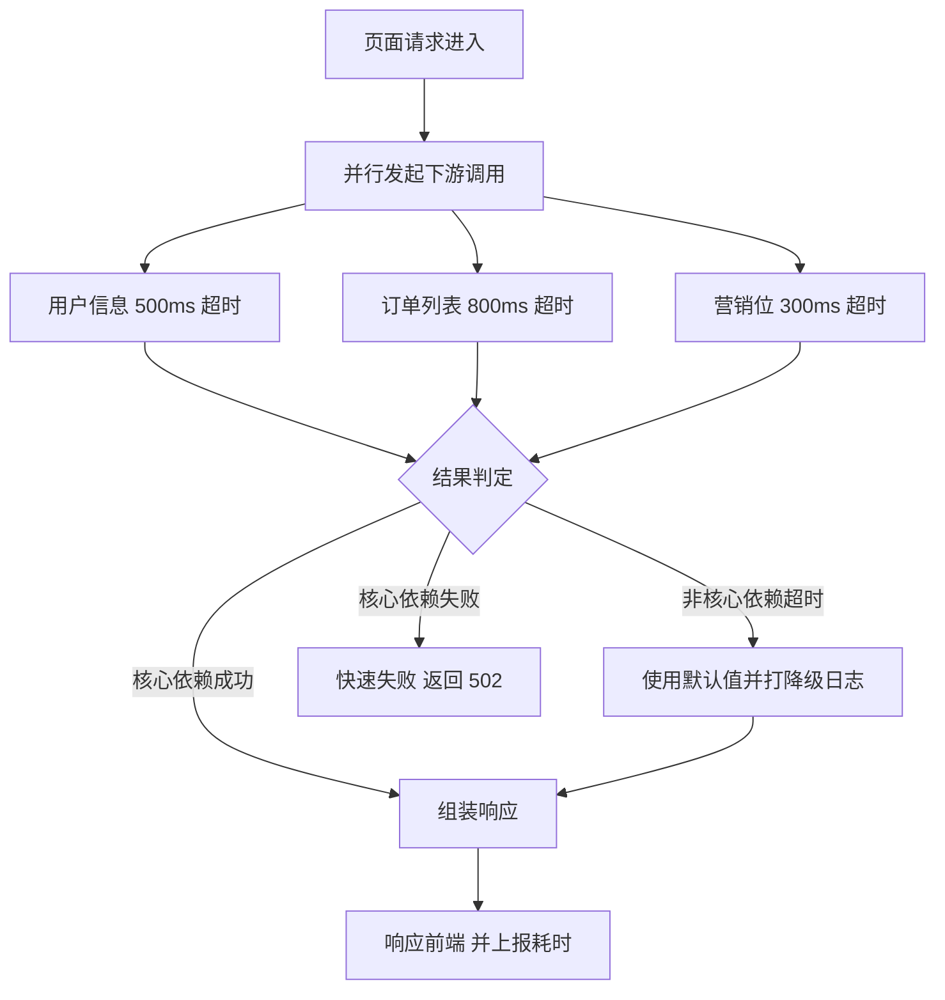

```javascript
// 通用聚合器：超时 + 分级降级
async function gather(tasks) {
  // tasks: [{ name, required, timeout, loader, fallback }]
  const results = await Promise.all(tasks.map(async (t) => {
    const start = Date.now();
    try {
      const ctrl = new AbortController();
      const timer = setTimeout(() => ctrl.abort(), t.timeout);
      const data = await Promise.race([
        t.loader(ctrl.signal),
        new Promise((_, rej) => timer && setTimeout(() => rej(new Error('timeout')), t.timeout)),
      ]);
      clearTimeout(timer);
      return { name: t.name, ok: true, data, cost: Date.now() - start };
    } catch (err) {
      // 核心依赖失败：直接抛，快速失败；非核心：降级并记录
      if (t.required) throw Object.assign(err, { failedDeps: t.name });
      console.warn(JSON.stringify({ level: 'warn', event: 'bff_degrade', dep: t.name, msg: err.message }));
      return { name: t.name, ok: false, data: t.fallback, cost: Date.now() - start };
    }
  }));
  return Object.fromEntries(results.map((r) => [r.name, r.data]));
}

// 首页 BFF：核心 + 非核心依赖
router.get('/page/home', async (ctx) => {
  const uid = ctx.state.user?.uid ?? 0;
  const page = await gather([
    { name: 'user',    required: true,  timeout: 500,
      loader: (s) => fetchJSON(`${USER_API}/me?uid=${uid}`, 0, s).then((r) => r.json()) },
    { name: 'banners', required: true,  timeout: 800,
      loader: (s) => fetchJSON(`${CMS_API}/banners`, 0, s).then((r) => r.json()) },
    { name: 'reco',    required: false, timeout: 300, fallback: [],
      loader: (s) => fetchJSON(`${RECO_API}/feed?uid=${uid}`, 0, s).then((r) => r.json()) },
    { name: 'notice',  required: false, timeout: 200, fallback: { text: '' },
      loader: (s) => fetchJSON(`${CMS_API}/notice`, 0, s).then((r) => r.json()) },
  ]);
  ctx.set('server-timing', `total;dur=${Date.now() - ctx.state.start}`);
  ctx.body = page;
});
```

### NODE-049：GraphQL 作为 BFF 怎么用？DataLoader 如何解决 N+1？
**答**：
- GraphQL BFF：前端一个查询拿到整棵所需数据（按需取字段天然解决裁剪）；schema 即文档，resolver 决定数据来源；`@apollo/server` 或 `graphql-yoga` 起服务。
- **N+1 问题**：查询 10 个作者的名字+文章，默认 resolver 会对每个作者单独查一次文章（1 + 10 次）。**DataLoader** 用"批处理 + 请求级缓存"解决：同一事件循环 tick 内的请求合并为一次批量查询（`WHERE id IN (...)`），且同一 id 重复请求命中缓存。
- 高频追问：GraphQL 的其他坑——查询深度/复杂度限制（防恶意深嵌套打挂服务）、缓存较难（POST 请求难走 HTTP 缓存）、错误不区分状态码。

```javascript
const { ApolloServer } = require('@apollo/server');
const { startStandaloneServer } = require('@apollo/server/standalone');
const DataLoader = require('dataloader');

const typeDefs = `#graphql
  type Author { id: ID!, name: String!, posts: [Post!]! }
  type Post { id: ID!, title: String!, author: Author! }
  type Query { authors: [Author!]! }
`;

// 批量查询函数：一次 IN 查询代替 N 次
const batchAuthors = async (ids) => {
  const rows = await db.query('SELECT * FROM authors WHERE id IN (?)', [ids]);
  // 关键：必须按传入顺序返回，缺失的槽位返回 null
  return ids.map((id) => rows.find((r) => r.id === id) || null);
};

const resolvers = {
  Query: { authors: () => db.query('SELECT * FROM authors') },
  Author: {
    // 每个作者的 posts 本应各查一次 → N+1
    posts: (author, _args, ctx) => ctx.postLoader.load(author.id),
  },
};

// Apollo 中间件：每个请求创建独立的 DataLoader（缓存不可跨请求）
const server = new ApolloServer({
  typeDefs,
  resolvers,
});
const { url } = await startStandaloneServer(server, {
  context: async () => ({
    postLoader: new DataLoader(async (authorIds) => {
      const rows = await db.query(
        'SELECT * FROM posts WHERE author_id IN (?)', [authorIds]);
      return authorIds.map((aid) => rows.filter((r) => r.author_id === aid));
    }),
  }),
});
// 查询 { authors { name posts { title } } } → SQL 只有 2 条：authors 全查 + posts IN 批查
```

### NODE-050：tRPC 的概念是什么？它如何实现端到端类型安全？
**答**：
- tRPC：**TypeScript 原生 RPC 框架**——不需要 schema、不需要 codegen，直接把服务端函数的类型"导入"到客户端：`client.greeting.query()` 的参数与返回值类型完全由服务端推断，任何改动前端编译期立刻报错。
- 与 GraphQL/tRPC+REST 的区别：REST 用 OpenAPI 描述后手工生成类型（可能漂移），GraphQL 需要 SDL + codegen，tRPC 的类型即实现本身（TS 类型在编译期共享，运行时仍是轻量 HTTP/JSON）。
- 适用边界：**前后端都是 TS 的同仓库（monorepo）场景**；客户端非 TS（小程序原生、App）则不适用，退回 OpenAPI/GraphQL。路由用 procedure（`publicProcedure`/`protectedProcedure`）+ input 校验（zod）。

```typescript
// server.ts —— BFF 端定义 procedure
import { initTRPC } from '@trpc/server';
import { z } from 'zod';
import { createHTTPServer } from '@trpc/server/adapters/standalone';

const t = initTRPC.create();
const publicProcedure = t.procedure;
const router = t.router;

const appRouter = router({
  getUser: publicProcedure
    .input(z.object({ id: z.string().uuid() }))   // 输入校验 + 类型推导
    .query(async ({ input }) => {                  // 返回值类型自动推断
      return db.users.find(input.id);              // { id: string, name: string, age: number }
    }),
  createUser: publicProcedure
    .input(z.object({ name: z.string().min(1) }))
    .mutation(async ({ input }) => db.users.create(input)),
});
export type AppRouter = typeof appRouter;          // 导出类型（不含实现，不泄露服务端代码）

createHTTPServer({ router: appRouter, createContext: () => ({}) }).listen(3000);
```

```typescript
// client.ts —— 前端：零 codegen 的端到端类型
import { createTRPCProxyClient, httpBatchLink } from '@trpc/client';
import type { AppRouter } from '../server';        // 仅导入类型，编译后消失

const trpc = createTRPCProxyClient<AppRouter>({
  links: [httpBatchLink({ url: 'http://localhost:3000' })],
});

const user = await trpc.getUser.query({ id: 'not-a-uuid' });
// TS 报错：字符串不符合 uuid 格式 → 编译期拦截，而不是线上 500

const user2 = await trpc.getUser.query({ id: '3f8a...-uuid' });
user2.name.toUpperCase();  // name 被推断为 string；改为 user2.emai 会直接编译报错

// 多个请求自动合并为一个 HTTP 批量调用（httpBatchLink），减少往返
const [a, b] = await Promise.all([
  trpc.getUser.query({ id: 'a1' }),
  trpc.getUser.query({ id: 'a2' }),
]);
```

### NODE-051：BFF 的多层缓存策略如何设计？
**答**：
- 从近到远四级：① **进程内缓存**（lru-cache，微秒级，存热点配置/会话，TTL 短防不一致）；② **Redis 集中缓存**（跨实例共享，毫秒级，存聚合结果与下游数据）；③ **HTTP 缓存**（`Cache-Control`/`ETag` 让 CDN 与浏览器缓存 GET 响应，BFF 接口要谨慎——带 cookie 的个性化响应必须 `private`）；④ **下游缓存**（复用下游自身缓存，BFF 加 `If-None-Match` 透传）。
- 关键原则：**缓存键必须包含所有影响结果的变量**（uid、版本、语言、AB 分桶），否则串数据；用户态数据慎缓存；写后失效用主动 `DEL` + 短 TTL 双保险。
- 命中率观测：每层打 `hit/miss` 指标，用 `Server-Timing` 头暴露给前端调试。

```javascript
const LRU = require('lru-cache');

// 一级：进程内 LRU
const localCache = new LRU({ max: 500, ttl: 1000 * 30 });          // 30s
// 二级：Redis
const redisTTL = 300;

async function cached(ctx, key, loader, opts = {}) {
  const fullKey = `${opts.namespace ?? 'bff'}:${key}`;              // 命名空间隔离

  // L1 进程内
  const local = localCache.get(fullKey);
  if (local !== undefined) { ctx.state.cache = 'L1'; return local; }

  // L2 Redis
  const remote = await redis.get(fullKey);
  if (remote) {
    const data = JSON.parse(remote);
    localCache.set(fullKey, data);                                   // 回填 L1
    ctx.state.cache = 'L2';
    return data;
  }

  // 回源
  const data = await loader();
  const ttl = (opts.ttl ?? redisTTL) + Math.floor(Math.random() * 60); // 抖动防雪崩
  await redis.setex(fullKey, ttl, JSON.stringify(data));
  localCache.set(fullKey, data);
  ctx.state.cache = 'MISS';
  return data;
}

// 使用：商品详情聚合结果缓存（key 含版本号与语言）
router.get('/product/:id', async (ctx) => {
  const lang = ctx.get('accept-language') || 'zh';
  const product = await cached(ctx, `product:${ctx.params.id}:${lang}:${PRODUCT_VER}`, () =>
    fetchProduct(ctx.params.id));
  ctx.set('server-timing', `cache;desc="${ctx.state.cache}"`);
  ctx.body = product;
});

// 写操作主动失效
router.post('/product/:id', async (ctx) => {
  await updateProduct(ctx.params.id, ctx.request.body);
  const keys = [`bff:product:${ctx.params.id}:*:${PRODUCT_VER}`];
  // Redis 不支持通配删除，SCAN + DEL 或维护 key 集合
  for await (const key of redis.scanStream({ match: `bff:product:${ctx.params.id}:*` })) {
    await redis.del(...key);
  }
  ctx.body = { ok: true };
});
```

### NODE-052：BFF 的容错设计：熔断、降级、隔离舱如何实现？
**答**：
- **熔断**（circuit breaker）：下游错误率/慢调用超阈值后直接"跳闸"快速失败，不再打超时请求，半开状态探测恢复——保护自己，也保护下游喘息。用 `opossum` 库。
- **降级**：熔断/超时后返回兜底数据（缓存旧值、默认值、空结构），核心链路可用性优先于完整性。
- **隔离舱**（bulkhead）：把不同下游的并发额度隔开（每依赖独立并发上限/超时），一个下游被打挂不拖垮其他依赖。用 `p-limit` 每依赖一个 limit。
- 组合拳：限流（入口）→ 隔离（下游并发）→ 超时（每次调用）→ 熔断（连续失败）→ 降级（兜底响应）→ 告警（观测闭环）。

```javascript
const CircuitBreaker = require('opossum');
const pLimit = require('p-limit');

// 每个下游独立配置：隔离舱（并发上限）+ 熔断器
function makeDependency(name, { concurrency, timeout, errorThreshold, resetTimeout, loader, fallback }) {
  const limit = pLimit(concurrency);                       // 隔离舱：该下游最多 N 个并发
  const breaker = new CircuitBreaker(loader, {
    timeout,                                              // 单次调用超时
    errorThresholdPercentage: errorThreshold,             // 错误率 50% 跳闸
    resetTimeout,                                         // 半开恢复探测间隔
    volumeThreshold: 10,                                  // 至少 10 次调用才统计错误率
  });
  breaker.fallback(() => fallback());                     // 熔断/超时后的降级值
  breaker.on('open', () => console.warn(JSON.stringify({ event: 'breaker_open', dep: name })));
  return async () => limit(() => breaker.fire());         // 限并发 + 熔断 双层包裹
}

const deps = {
  reco:   makeDependency('reco', { concurrency: 20, timeout: 300, errorThreshold: 50,
            resetTimeout: 10000, loader: () => fetchReco(), fallback: () => [] }),
  stock:  makeDependency('stock', { concurrency: 10, timeout: 500, errorThreshold: 60,
            resetTimeout: 5000, loader: () => fetchStock(), fallback: () => ({ count: 0, unknown: true }) }),
};

// 使用：任何下游故障都不阻塞整页
router.get('/page/detail/:id', async (ctx) => {
  const [reco, stock] = await Promise.all([deps.reco(), deps.stock()]);
  ctx.body = { reco, stock };   // reco 失败给 []，stock 失败给 unknown 标记
});
```

---

## 八、SSR 服务端

### NODE-053：Next.js 自定义服务器的 SSR 渲染流程是怎样的？renderToPipeableStream 在其中扮演什么角色？
**答**：
- React 18 服务端渲染核心 API：`renderToPipeableStream(reactNode, options)`——**流式输出** HTML 到 Node 可写流（`res`），不等整棵树完成才开始发送，TTFB 显著降低。
- 关键选项：`onShellReady`（骨架可发送，开始 pipe）、`onAllReady`（全部完成，适合爬虫/SEO 全量场景）、`onError`（错误记录并可回退客户端渲染）。
- 自定义服务器的职责：接管路由（app.render / renderToPipeableStream）、注入状态数据、设置缓存头、错误兜底为 CSR（`bootstrapScripts` 让客户端 hydrate）。

```javascript
const { renderToPipeableStream } = require('react-dom/server');
const express = require('express');
const app = express();

app.get('/', async (req, res) => {
  const [user, posts] = await Promise.all([
    getUser(req.cookies.sid),
    getPosts(),                              // 复用 BFF 的聚合与缓存
  ]);

  const stream = renderToPipeableStream(
    <App user={user} posts={posts} />,        // React 18 RSC 或 CSR 组件树
    {
      bootstrapScripts: ['/static/main.js'],  // 客户端 hydration 入口
      onShellReady() {                        // 骨架就绪：立即可流式发送
        res.statusCode = 200;
        res.setHeader('content-type', 'text/html; charset=utf-8');
        res.setHeader('cache-control', user ? 'private, max-age=0' : 'public, s-maxage=60');
        stream.pipe(res);                     // 持续把 HTML 片段推给浏览器
      },
      onAllReady() { /* 爬虫场景：等全部就绪再一次性发送 */ },
      onError(err) {
        console.error(JSON.stringify({ event: 'ssr_error', msg: err.message }));
        // 记录后可决定：部分降级（Suspense 边界）或整体回退 CSR
      },
    },
  );
});
app.listen(3000);
```

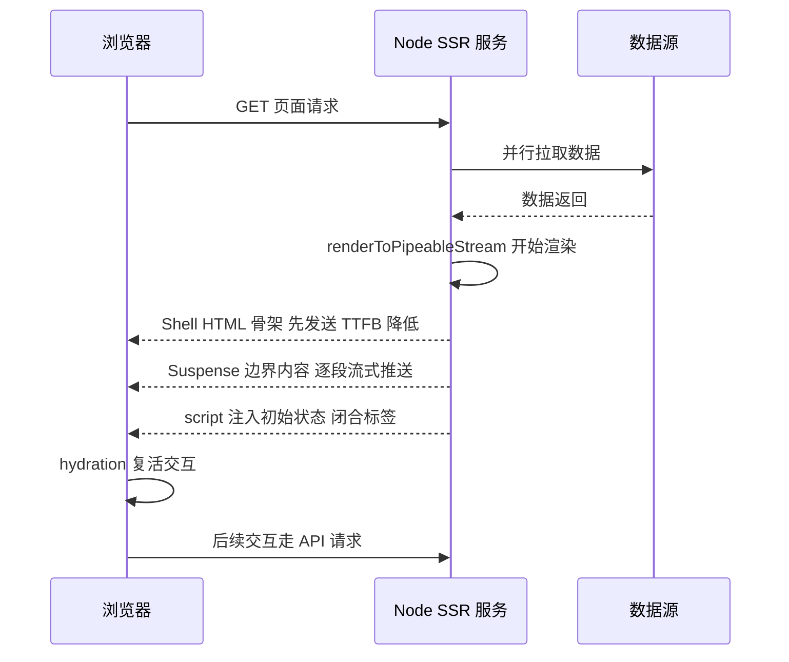

### NODE-054：SSR 服务的性能如何保障（渲染缓存、限流、进程模型）？
**答**：
- **渲染缓存**：按 URL+用户态分桶缓存渲染结果（匿名页可 CDN/Redis 缓存整页 HTML，`s-maxage` + `stale-while-revalidate`）；组件级用 React `cache()`/Memo 去重数据请求。
- **限流**：SSR 渲染是 CPU 密集 + 下游数据依赖，入口必须限流（每 IP/每路由 QPS 上限），过载直接降级为 CSR（返回壳 + 骨架屏），比排队雪崩好。
- **进程模型**：cluster 多进程榨干多核；渲染超时（如 3s）后中断返回壳；监控 `event loop lag`，超阈值告警。
- 经验值：单核 React SSR 渲染吞吐约几十到几百 RPS，取决于组件树大小——缓存命中率是关键。

```javascript
const { renderToPipeableStream } = require('react-dom/server');
const Redis = require('ioredis');
const redis = new Redis();

// 1. 整页渲染缓存（匿名用户）
async function renderPage(url) {
  const key = `ssr:page:${url}`;
  const cached = await redis.get(key);
  if (cached) return { html: cached, hit: true };
  const html = await new Promise((resolve, reject) => {
    const stream = renderToPipeableStream(<App url={url} />, {
      onAllReady() {                          // 缓存场景等全部就绪
        let buf = '';
        stream.pipe(new require('stream').Writable({
          write(c, _e, cb) { buf += c; cb(); },
          final(cb) { resolve(buf); cb(); },
        }));
      },
      onError: reject,
    });
  });
  await redis.setex(key, 60, html);           // 60s 缓存，配 stale-while-revalidate 更佳
  return { html, hit: false };
}

// 2. 令牌桶限流 + 过载降级 CSR
const buckets = new Map();
function rateLimit(ip, capacity = 20, refillPerSec = 5) {
  const now = Date.now() / 1000;
  const b = buckets.get(ip) ?? { tokens: capacity, last: now };
  b.tokens = Math.min(capacity, b.tokens + (now - b.last) * refillPerSec);
  b.last = now;
  if (b.tokens < 1) { buckets.set(ip, b); return false; }
  b.tokens -= 1; buckets.set(ip, b);
  return true;
}

app.get('*', async (req, res) => {
  if (!rateLimit(req.ip)) {
    // 过载：降级为 CSR 壳，不让渲染队列堆积
    return res.status(503).sendFile('shell.html', { root: 'public' });
  }
  const isAnonymous = !req.cookies.sid;
  if (isAnonymous) {
    const { html } = await renderPage(req.url);  // 命中缓存直接返回
    return res.type('html').send(html);
  }
  // 登录用户：个性化渲染 + 3s 超时中断
  renderWithTimeout(req, res, 3000);
});
```

### NODE-055：getServerSideProps 的执行环境与优化？
**答**：
- 执行环境：**每次请求时在服务端（Node）执行**，永远不进入客户端 bundle（函数体不会被打包进浏览器 JS，但 `import` 的模块会进服务端依赖）；拿不到 `window`，可访问 `req`/`res`（cookie、header）。
- 与 `getStaticProps` 的选择：内容不变用 Static（构建时生成 + ISR 增量再生），个性化/实时数据才用 ServerSide——**默认该用 Static，SSR 是成本**。
- 优化：并行 `Promise.all` 拉数据、控制总超时、复用 BFF 聚合缓存、避免在 GSSP 里做重计算、敏感头不透传给下游。

```javascript
// pages/product/[id].js
export async function getServerSideProps({ params, req, res }) {
  const uid = parseSid(req.headers.cookie);          // 服务端：可读 cookie/headers
  const start = Date.now();

  // 1. 并行拉取 + 单项超时（复用 BFF gather 模式）
  const [product, reviews] = await Promise.allSettled([
    fetchJSON(`${BFF}/product/${params.id}`, 800),
    fetchJSON(`${BFF}/reviews?gid=${params.id}&limit=5`, 500),
  ]);
  if (product.status === 'rejected') return { notFound: true };  // 404 而非 500

  // 2. 匿名可缓存时，直接告诉 CDN/浏览器缓存整页
  if (!uid) {
    res.setHeader('cache-control', 'public, s-maxage=60, stale-while-revalidate=300');
  }

  return {
    props: {                                          // JSON 序列化后注入页面
      product: product.value,
      reviews: reviews.status === 'fulfilled' ? reviews.value : [],
      ssrCost: Date.now() - start,
    },
  };
}
```

```javascript
// 优化对比：能 Static 的不要 ServerSide
// pages/docs/[slug].js —— 文档内容构建期可确定 → SSG + ISR
export async function getStaticProps({ params }) {
  const doc = await getDoc(params.slug);
  return {
    props: { doc },
    revalidate: 300,             // ISR：300s 后台再生，兼得静态性能与新鲜度
  };
}
// 准则：Static(免费) > ISR(便宜) > ServerSide(每次渲染) > CSR(白屏后渲染)
```

### NODE-056：模板渲染与 React SSR 的流式输出有何区别？
**答**：
- 模板引擎流式：按模板片段顺序拼接字符串（`res.write` 一段段写），逻辑简单但**无法根据后段数据修改前段**（已写出去的 HTML 收不回来），适合顺序文档。
- React 18 流式：基于 **Suspense 边界**拆分——骨架（shell）先发，`<Suspense fallback>` 包裹的慢数据块后到再**用内联 script 补齐 DOM 并完成 hydrate**，支持"后发先至"（先到的数据块不必等后到）。
- 共同约束：流式开始后不能改 status/headers；错误只能通过边界降级；SEO 爬虫若不执行 JS 需要等待 `onAllReady` 全量输出。

```javascript
import { renderToPipeableStream } from 'react-dom/server';
import { Suspense } from 'react';

function Page() {
  return (
    <html>
      <body>
        <Header />                                       {/* 立即可渲染 */}
        <Suspense fallback={<Skeleton rows={5} />}>      {/* 慢数据块：先发骨架 */}
          <Reviews />                                    {/* 内部 await 慢接口 */}
        </Suspense>
        <Suspense fallback={<AdPlaceholder />}>
          <Ads />                                        {/* 另一个独立流块：后发先至 */}
        </Suspense>
      </body>
    </html>
  );
}

app.get('/', (req, res) => {
  const stream = renderToPipeableStream(<Page />, {
    onShellReady() {
      res.setHeader('content-type', 'text/html; charset=utf-8');
      stream.pipe(res);   // shell 立即发送；Reviews/Ads 完成后 React 自动补发对应片段
    },
    onError(err) { console.error('流式中出错，该 Suspense 块降级:', err.message); },
  });
});

// 模板引擎对比（EJS）：只能按顺序 write，前段无法等待后段数据
// res.write(render(headerTpl));
// const reviews = await getReviews();      // 必须等：阻塞了后面所有片段
// res.write(render(reviewTpl, { reviews }));
// res.end(render(footerTpl));
```

### NODE-057：hydration 数据注入时如何防止 XSS？
**答**：
- SSR 把初始状态注入 HTML 通常用 `<script>window.__INITIAL_STATE__ = {...}</script>`。若状态含用户输入（如昵称 `</script><script>alert(1)</script>`），直接 JSON.stringify 会导致**闭合标签逃逸**，形成存储型 XSS。
- 标准防御：序列化后**转义 `<` → `\u003c`**（JSON 兼容转义，JSON.parse 无感知）；或 Base64 编码后客户端 decode。同时输出属性时不可用 `dangerouslySetInnerHTML` 承接未消毒数据。
- 附带：`Content-Security-Policy` 头做纵深防御；`__INITIAL_STATE__` 中剔除 token 等敏感信息（HTML 源码所有人可见）。

```javascript
const { renderToPipeableStream } = require('react-dom/server');

// 安全注入：转义 < 与 >，防 </script> 逃逸
function serializeState(state) {
  return JSON.stringify(state)
    .replace(/</g, '\\u003c')     // 关键：< 转成 unicode 转义，JSON.parse 原样还原
    .replace(/>/g, '\\u003e')
    .replace(/&/g, '\\u0026')     // 防 HTML 实体解析歧义
    .replace(/\u2028/g, '\\u2028') // 防 JS 语法层面的行分隔符报错
    .replace(/\u2029/g, '\\u2029');
}

function renderWithState(res, appElement, state) {
  const stream = renderToPipeableStream(
    <>
      <script
        dangerouslySetInnerHTML={{          // 唯一允许 raw 的位置，且内容已转义
          __html: `window.__INITIAL_STATE__ = JSON.parse(${JSON.stringify(serializeState(state))})`,
        }}
      />
      {appElement}
    </>,
    { onShellReady: () => stream.pipe(res) },
  );
}

// 攻击场景验证：用户昵称 = </script><script>steal()</script>
const state = { user: { name: '</script><script>steal()</script>' } };
console.log(serializeState(state));
// 输出含 \u003c/script\u003e → 不再闭合 script 标签 → JSON.parse 还原为纯字符串
```

### NODE-058：Nuxt 的服务端渲染流程概览？
**答**：
- Nuxt（Vue 生态）SSR 流程：请求 → Nitro 服务端引擎路由匹配 → 执行 `setup`/`useAsyncData`/`useFetch`（服务端执行一次，payload 序列化）→ Vue `renderToString` 输出 HTML + payload 注入 → 客户端 hydrate 并**复用服务端已取的数据**（不重复请求）。
- 与 Next 差异：Next 18 后主推 RSC（服务端组件，数据在组件内直接 await）；Nuxt 是组合式 API + `useAsyncData` 显式声明数据依赖（key 化，跨端幂等）。Nitro 统一了 dev/SSR/SSG/边缘部署（可部署到 Vercel/CF Workers）。
- 服务端要点：`payload` 传输（防重复请求）、`routeRules` 按路由配置 SSR/ISR/CSR、错误页 `error.vue` 与 SSR 错误码。

```javascript
// nuxt.config.ts：按路由的渲染策略
export default defineNuxtConfig({
  routeRules: {
    '/':            { swr: 300 },               // 首页：stale-while-revalidate
    '/docs/**':     { isr: 600 },               // 文档：增量再生
    '/account/**':  { ssr: false },             // 个人中心：纯 CSR（个性化强）
    '/api/**':      { cors: true },             // Nitro 直接托管 API
  },
  nitro: { compressPublicAssets: true },
});
```

```vue
<!-- pages/products/[id].vue -->
<script setup>
const route = useRoute();
// useAsyncData：服务端执行一次，payload 序列化传给客户端，hydration 时不再请求
const { data: product, error } = await useAsyncData(
  `product-${route.params.id}`,                       // key：去重与缓存依据
  () => $fetch(`/api/product/${route.params.id}`),
  { server: true, lazy: false, timeout: 3000 },
);
if (error.value) throw createError({ statusCode: 404, statusMessage: '商品不存在' });
useHead({ title: () => product.value.title });        // SEO meta
</script>
```

---

## 九、工程与部署

### NODE-059：PM2 的配置与集群模式如何使用？
**答**：
- 两种模式：`fork`（单进程）与 `cluster`（`exec_mode: 'cluster'`，按 CPU 核数起多个实例共享端口，负载均衡）；`max_memory_restart` 内存超限自动重启；`env_*` 区分环境。
- 核心运维命令：`pm2 start ecosystem.config.js`、`pm2 reload`（**0 秒重启**，逐个 worker 滚动重启，与 `restart` 的硬重启区分）、`pm2 logs/monit/startup`（开机自启）。
- 高频追问：cluster 模式下 0 downtime 重启的原理（master 先起新 worker 再杀旧的，配合 server.close 优雅退出）；`kill_timeout` 给 SIGTERM 处理留时间；PM2 与 Docker/K8s 的关系——容器内一般不用 PM2，交给编排系统管理。

```javascript
// ecosystem.config.js
module.exports = {
  apps: [{
    name: 'bff-server',
    script: './dist/main.js',
    instances: 'max',            // 按 CPU 核数起满；或写死数字
    exec_mode: 'cluster',        // 集群模式：多进程共享 3000 端口
    max_memory_restart: '600M',  // 内存超限自动重启（OOM 防护）
    kill_timeout: 10000,         // SIGTERM 后等 10s 再 SIGKILL，留出优雅退出时间
    wait_ready: false,
    listen_timeout: 8000,
    env_production: {
      NODE_ENV: 'production',
      LOG_LEVEL: 'info',
    },
    out_file: '/var/log/bff/out.log',
    error_file: '/var/log/bff/err.log',
    merge_logs: true,
  }],
};
```

```bash
# 常用运维命令
pm2 start ecosystem.config.js --env production
pm2 reload bff-server          # 0 downtime 滚动重启（发版标准动作）
pm2 reload bff-server --update-env   # 环境变量变更后 reload
pm2 monit                      # 实时 CPU/内存监控面板
pm2 logs bff-server --lines 200
pm2 startup && pm2 save        # 开机自启：生成 systemd 单元并保存进程列表
```

### NODE-060：如何实现优雅退出（SIGTERM 与连接排空）？
**答**：
- 流程：收到 SIGTERM → ① 停止接受新连接（`server.close()`）与摘除 LB 流量 → ② 等待存量请求处理完（设置强制超时）→ ③ 关闭资源（DB 池、Redis、消费队列）→ ④ `process.exit(0)`。
- 关键细节：K8s/PM2 发 SIGTERM 后最多等 `terminationGracePeriodSeconds`（如 30s）就 SIGKILL，所以处理逻辑必须在时限内完成；keep-alive 空闲连接要主动 `destroy`，否则 `server.close()` 会一直等；`uncaughtException` 退出前也要尽量走同一条排空路径。
- 高频坑：只 `process.exit()` 不排空 → 杀掉正在处理的请求，线上大量 502；PM2 `kill_timeout` 与 K8s `grace period` 要大于最长请求耗时。

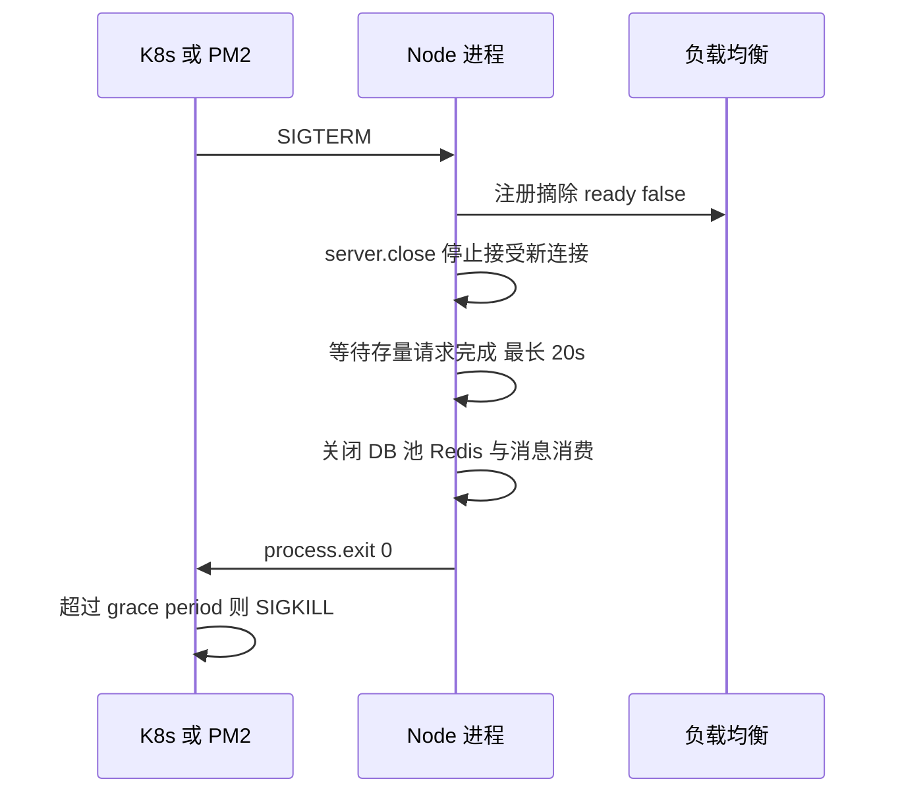

```javascript
const http = require('node:http');

const server = http.createServer(handler);
server.keepAliveTimeout = 65000;

const state = { shuttingDown: false };

async function shutdown(signal) {
  if (state.shuttingDown) return;
  state.shuttingDown = true;
  console.log(`[${signal}] 开始优雅退出`);

  // 1. 健康检查返回失败 → LB/K8s 摘除流量
  app.set('ready', false);

  // 2. 停止接受新连接；正在处理的请求继续完成
  server.close(async () => console.log('全部连接已排空'));

  // 3. 主动断开 keep-alive 空闲连接（否则 close 会一直等待）
  server.getConnections((err, count) => {
    console.log(`剩余连接 ${count}`);
    server.emit('close');
  });

  // 4. 强制超时兜底：20s 内没排完也退出
  const forceTimer = setTimeout(() => {
    console.error('排空超时，强制退出');
    process.exit(1);
  }, 20000);
  forceTimer.unref();               // 不阻止进程自然退出

  // 5. 释放资源
  await Promise.allSettled([
    pool.end(),                     // MySQL 连接池
    redis.quit(),                   // Redis
    taskQueue.close(),              // 消息/任务队列
  ]);
  process.exit(0);
}

process.on('SIGTERM', () => shutdown('SIGTERM'));
process.on('SIGINT', () => shutdown('SIGINT'));

// 健康检查配合：就绪探针在排空期返回 503
app.get('/healthz/ready', (req, res) => {
  res.status(state.shuttingDown ? 503 : 200).json({ ready: !state.shuttingDown });
});
```

### NODE-061：健康检查端点如何设计（liveness 与 readiness 的区别）？
**答**：
- K8s 双探针：**liveness**（`/healthz`）——进程活着吗？失败则重启容器，**必须是零依赖的自检**（不能因为 Redis 挂了就重启 Node，越探越死）；**readiness**（`/healthz/ready`）——能接流量吗？失败只摘流量不重启，可包含关键依赖检查与发布状态。
- 补充 `startup` 探针（慢启动应用）与 `/healthz/startup`。响应体应包含版本号、uptime、依赖状态明细（排障利器）。
- 反模式：liveness 里查 DB（DB 抖动 → 全部容器被重启 → 集群雪崩）；健康检查端点本身要轻量、无鉴权、有响应超时。

```javascript
const startedAt = Date.now();
const VERSION = process.env.GIT_COMMIT_SHA || 'dev';
const deps = {
  redis: () => redis.ping().then(() => true).catch(() => false),
  mysql: () => pool.query('SELECT 1').then(() => true).catch(() => false),
};

// liveness：只查自己，绝不停外部依赖
app.get('/healthz', (req, res) => {
  res.status(200).json({ status: 'alive', version: VERSION, uptime: Date.now() - startedAt });
});

// readiness：检查关键依赖（带 1s 超时，防止挂起）
app.get('/healthz/ready', async (req, res) => {
  if (state.shuttingDown) return res.status(503).json({ ready: false, reason: 'draining' });
  const results = {};
  await Promise.race([
    Promise.all(Object.entries(deps).map(async ([name, check]) => {
      results[name] = await check();
    })),
    new Promise((r) => setTimeout(r, 1000)),
  ]);
  const ok = Object.values(results).every(Boolean);
  res.status(ok ? 200 : 503).json({ ready: ok, version: VERSION, deps: results });
});
```

```yaml
# k8s deployment 探针配置片段
livenessProbe:
  httpGet: { path: /healthz, port: 3000 }
  initialDelaySeconds: 10
  periodSeconds: 10
  failureThreshold: 3
readinessProbe:
  httpGet: { path: /healthz/ready, port: 3000 }
  initialDelaySeconds: 5
  periodSeconds: 5
  failureThreshold: 2
  successThreshold: 1
startupProbe:
  httpGet: { path: /healthz, port: 3000 }
  failureThreshold: 30      # 30 × 10s = 最长 5 分钟启动窗口
  periodSeconds: 10
```

### NODE-062：Node 服务的日志体系如何设计（结构化日志、请求日志、错误日志）？
**答**：
- 三条铁律：① **结构化 JSON**（一行一对象，便于 ELK/Loki 解析，禁止拼字符串）；② **traceId 贯穿**（入口生成 → 中间件透传 → 所有日志与下游 header 带上，全链路可查）；③ **分级采样**（info 采样或按需开关，error 全量 + 告警）。
- 请求日志：method/url/status/耗时/uid/traceId/ip/UA，在中间件统一记录（`on-finished` 时机）。
- 错误日志：uncaught/unhandled 兜底 + 业务错误统一走 error 中间件；写入用 pino（异步、低开销），**不要用 console.log**（同步写 stdout 阻塞事件循环）。
- 敏感信息脱敏：password/token/手机号在序列化前清洗。

```javascript
const pino = require('pino');
const crypto = require('node:crypto');

// 1. logger 实例：异步写 + 脱敏 + 分级
const logger = pino({
  level: process.env.LOG_LEVEL || 'info',
  redact: { paths: ['req.headers.authorization', '*.password', '*.token', '*.phone'], censor: '[REDACTED]' },
  formatters: { level: (label) => ({ level: label }) },
});

// 2. 请求日志中间件（Koa）：traceId 贯穿
app.use(async (ctx, next) => {
  const traceId = ctx.get('x-trace-id') || crypto.randomUUID();
  ctx.set('x-trace-id', traceId);
  ctx.state.log = logger.child({ traceId, uid: ctx.state.user?.uid }); // 子 logger 自动带上下文
  const start = Date.now();
  ctx.state.log.info({ event: 'request_in', method: ctx.method, url: ctx.url });

  await next();

  const onfinish = () => {
    const level = ctx.status >= 500 ? 'error' : ctx.status >= 400 ? 'warn' : 'info';
    ctx.state.log[level]({
      event: 'request_out', method: ctx.method, url: ctx.url,
      status: ctx.status, cost: Date.now() - start, ip: ctx.ip,
    });
  };
  ctx.res.on('finish', onfinish);
  ctx.res.on('error', onfinish);
});

// 3. 错误兜底：进程级 + 全局 error 事件
process.on('uncaughtException', (err) => {
  logger.fatal({ event: 'uncaught', msg: err.message, stack: err.stack });
  shutdown('uncaughtException');        // 记完日志走优雅退出
});
process.on('unhandledRejection', (reason) => {
  logger.error({ event: 'unhandledRejection', msg: String(reason) });
});
app.on('error', (err, ctx) => {
  ctx?.state?.log?.error({ event: 'app_error', msg: err.message, stack: err.stack });
});
```

```bash
# 生产收集：stdout → 容器 stdout → DaemonSet/Filebeat → ES/Loki
# Docker 中绝不写文件，只写 stdout（12-factor 原则）
docker run --log-driver=json-file --log-opt max-size=100m bff-server
# 本地开发美化输出
node main.js | npx pino-pretty
```

### NODE-063：环境配置与密钥如何管理？
**答**：
- 层级：**默认值 < 环境变量 < 运行时覆盖**。配置对象按环境（dev/test/prod）分层合并，启动时**校验完整性**（zod/joi），配置错误 fail-fast 而不是运行中 NPE。
- 密钥红线：`.env` 不进 git（`.gitignore`）；生产密钥走 K8s Secret/Vault/云 KMS，不落代码仓；日志与错误上报 redact 敏感字段。
- 高频坑：`process.env` 全是字符串；config 模块被多处 require 时缓存不一致（应单例导出冻结对象）；动态配置（限流阈值等）走配置中心热更新，避免重启。

```javascript
// config/index.js：分层合并 + zod 校验 + 单例冻结
const { z } = require('zod');

const schema = z.object({
  NODE_ENV: z.enum(['development', 'test', 'production']).default('development'),
  PORT: z.coerce.number().default(3000),                 // '3000' → 3000
  DB_HOST: z.string(),
  DB_PASSWORD: z.string().min(1),
  REDIS_URL: z.string().url(),
  JWT_SECRET: z.string().min(32),                        // 密钥强度约束
  RATE_LIMIT_QPS: z.coerce.number().default(100),
  LOG_LEVEL: z.enum(['debug', 'info', 'warn', 'error']).default('info'),
});

const parsed = schema.safeParse(process.env);
if (!parsed.success) {
  // fail-fast：启动期报出全部缺失配置，而不是运行时逐个炸
  console.error('配置校验失败:', JSON.stringify(parsed.error.flatten().fieldErrors));
  process.exit(1);
}

const config = Object.freeze({ ...parsed.data, isProd: parsed.data.NODE_ENV === 'production' });
module.exports = config;
```

```yaml
# .gitignore（红线）
# .env
# .env.local
# .env.*.key

# k8s：密钥走 Secret，不进镜像不进环境文件
apiVersion: v1
kind: Secret
metadata:
  name: bff-secrets
type: Opaque
stringData:
  DB_PASSWORD: "prod-password-from-vault"
  JWT_SECRET: "at-least-32-chars-random-secret-value"
---
# deployment 引用
containers:
  - name: bff
    envFrom:
      - secretRef: { name: bff-secrets }
      - configMapRef: { name: bff-config }
```

### NODE-064：如何 Docker 化一个 Node 服务？
**答**：
- **多阶段构建**：builder 阶段装依赖+编译，runtime 阶段只拷 `node_modules`（`--omit=dev`）与产物，镜像从 1GB+ 缩到 150MB 级；基础镜像用 `node:22-alpine`（小但有 musl 兼容性注意）。
- 信号处理：容器 PID 1 不转发信号——要么 `docker run --init`，要么 `CMD ["node", "main.js"]` 直接以 node 为 PID 1（node 原生响应 SIGTERM）；**不要用 `npm start`**（npm 中间层吞信号）。
- 细节：`.dockerignore` 排除 node_modules/.git；非 root 用户运行；`NODE_ENV=production`；健康检查 HEALTHCHECK 或交给 K8s。

```dockerfile
# ---------- builder 阶段：装依赖 + 编译 TS ----------
FROM node:22-alpine AS builder
WORKDIR /app
COPY package*.json ./
RUN npm ci --registry=https://registry.npmmirror.com   # ci 严格按 lock 安装
COPY . .
RUN npm run build && npm prune --omit=dev               # 只留生产依赖

# ---------- runtime 阶段：最小运行环境 ----------
FROM node:22-alpine
ENV NODE_ENV=production
WORKDIR /app
RUN addgroup -S app && adduser -S app -G app             # 非 root 运行
COPY --from=builder --chown=app:app /app/dist ./dist
COPY --from=builder --chown=app:app /app/node_modules ./node_modules
COPY --from=builder --chown=app:app /app/package.json ./
USER app
EXPOSE 3000
# 直接以 node 为 PID 1：SIGTERM 直达进程，优雅退出生效
CMD ["node", "dist/main.js"]
```

```bash
# 构建与运行
docker build -t bff-server:1.0.0 .
docker run --init -d --name bff \
  -p 3000:3000 \
  --memory=512m --cpus=1 \
  --health-cmd="wget -qO- http://localhost:3000/healthz || exit 1" \
  --health-interval=15s \
  bff-server:1.0.0

# .dockerignore 内容：node_modules、.git、.env、dist、*.log、coverage
```

### NODE-065：生产环境如何监控 Node 进程（指标与慢查询定位）？
**答**：
- 核心指标：**事件循环延迟**（`perf_hooks.monitorEventLoopDelay`，>100ms 说明主线程被阻塞）、CPU 使用率、堆内存（`process.memoryUsage()` 的 heapUsed/rss，接近 `--max-old-space-size` 预警）、GC 暂停（`perf_hooks` PerformanceObserver gc）、句柄数（`process._getActiveHandles`）。
- 采集方案：`prom-client` 暴露 `/metrics`（Prometheus 格式）+ Grafana 看板 + 告警规则；APM（阿里 ARMS、Datadog、SkyWalking）看接口级 trace。
- 慢查询定位：接口内部打点（`server-timing` 响应头 + 日志耗时字段）→ 区分"下游慢"还是"自身计算慢"→ 事件循环延迟高则查同步大计算/大 JSON 序列化。

```javascript
const { monitorEventLoopDelay, performance, PerformanceObserver } = require('node:perf_hooks');
const client = require('prom-client');
const register = new client.Registry();
client.collectDefaultMetrics({ register });

// 1. 事件循环延迟采样
const loopDelay = monitorEventLoopDelay({ resolution: 10 });
loopDelay.enable();
setInterval(() => {
  const p99 = loopDelay.percentile(99) / 1e6; // ns → ms
  if (p99 > 100) {
    console.warn(JSON.stringify({ event: 'loop_blocked', p99_ms: p99,
      heap: process.memoryUsage().heapUsed / 1e6 }));
  }
  loopDelay.reset();
}, 10000).unref();

// 2. GC 观察
new PerformanceObserver((list) => {
  for (const entry of list.getEntries()) {
    if (entry.duration > 50) {
      console.warn(JSON.stringify({ event: 'long_gc', kind: entry.kind, ms: entry.duration }));
    }
  }
}).observe({ entryTypes: ['gc'] });

// 3. Prometheus 指标
const httpDuration = new client.Histogram({
  name: 'http_request_duration_seconds',
  help: '请求耗时分布',
  labelNames: ['method', 'route', 'status'],
  buckets: [0.01, 0.05, 0.1, 0.3, 0.5, 1, 3],
});
register.registerMetric(httpDuration);

app.use(async (ctx, next) => {
  const end = httpDuration.startTimer();
  try { await next(); }
  finally { end({ method: ctx.method, route: ctx._matchedRoute || 'unknown', status: ctx.status }); }
});
app.get('/metrics', async (ctx) => { ctx.body = await register.metrics(); });
```

### NODE-066：如何压测与估算 QPS 容量（autocannon/wrk）？
**答**：
- 工具：`autocannon`（Node 写的，易集成脚本）、`wrk`（C 写的高性能压测，Lua 脚本定制请求）。压测必须**在等价环境**（同配置机器/容器限额）进行，压测端与服务端分开部署。
- 看什么指标：QPS（吞吐）、P99 延迟（比平均值重要）、错误率（non-2xx）、压测时的事件循环延迟与内存曲线。**容量 = 目标峰值 QPS × 安全系数 / 单实例实测 QPS**，再除以单实例极限留 30~50% 余量。
- 方法论：先单接口压出基线 → 找瓶颈（CPU/下游/锁）→ 优化 → 复压 → 用小流量灰度验证真实流量模型。

```bash
# autocannon：100 并发持续 30s，输出 QPS 与延迟分布
npx autocannon -c 100 -d 30 -p 10 http://localhost:3000/api/products/42 \
  --headers "authorization: Bearer $TOKEN" \
  --json > result.json
# 输出关注：requests/avg（QPS）、latency p99、non2xx
```

```bash
# wrk：4 线程 200 连接 30s，Lua 脚本带 body
wrk -t4 -c200 -d30s -s post.lua --latency http://localhost:3000/api/orders
```

```lua
-- post.lua
wrk.method = "POST"
wrk.headers["content-type"] = "application/json"
wrk.body   = '{"sku":"A001","count":1}'
wrk.headers["authorization"] = "Bearer test-token"

response = function(status, headers, body)
  if status ~= 200 then
    io.write("bad status: " .. status .. "\n")  -- 错误采样
  end
end
```

```javascript
// 容量估算：由压测结果推导实例数
const measured = { qpsPerInstance: 1800, p99Ms: 45, errorRate: 0 };
const target = {
  peakQps: 30000,          // 大促预估峰值（由历史流量 × 增长系数推得）
  safetyFactor: 0.6,       // 只用 60% 极限容量，留突发余量
};
const needInstances = Math.ceil(
  target.peakQps / (measured.qpsPerInstance * target.safetyFactor),
); // ≈ 28 个实例，再按可用区打散部署
console.log(`建议实例数: ${needInstances}`);

// 压测脚本化：CI 中做基线对比，防止性能回退
// node bench.js --baseline bench-last.json --threshold 0.9
```

### NODE-067：npm 依赖治理与安全审计怎么做？
**答**：
- 供应链安全是 Node 服务的重灾区（恶意包、typosquatting、依赖投毒）。措施：`npm audit`/`osv-scanner` CI 卡口、`package-lock.json` 必须提交（可复现安装）、`npm ci` 而非 `npm install` 部署、锁定 registry（内网制品库/镜像源）、`postinstall` 脚本白名单审查。
- 依赖治理：定期 `npm outdated` 升级（小步快跑），`depcheck` 清理僵尸依赖，控制依赖树深度（能用内置模块不引包）；等价 API（如 `axios` vs `node fetch`）优先内置。
- 事故应急：XZ/ua-parser 类投毒事件 → 锁定具体版本（`overrides`/`resolutions`）+ 私有 mirror 白名单。

```bash
# CI 安全卡口脚本
npm ci                          # 严格按 lockfile，防漂移
npm audit --omit=dev --audit-level=high || exit 1   # high 以上漏洞直接挂掉流水线
npx depcheck --ignores=@types/*                      # 僵尸依赖检查
node -e "const l=require('./package-lock.json'); \
  const bad=['event-stream@3.3.6','ua-parser-js@0.7.29']; \
  for (const p of Object.keys(l.packages)) \
    if (bad.some(b => p.includes(b.split('@')[0]))) { console.error('命中投毒黑名单:', p); process.exit(1); }"
```

```json
{
  "overrides": {
    "semver": "^7.5.4",
    "minimist": "^1.2.8"
  },
  "engines": { "node": ">=20 <23" },
  "scripts": {
    "preinstall": "npx only-allow npm",
    "audit": "npm audit --omit=dev --audit-level=high"
  }
}
```

---

## 十、综合实战

### NODE-068：设计一个完整的 BFF 层（鉴权、聚合、缓存、降级、限流全链路）？
**答**：
- 这是本专题的**压轴设计题**，考察把前面所有能力组装成体系：请求进入 → 限流 → 鉴权 → 聚合（超时/降级/隔离舱）→ 缓存 → 响应，全程 traceId 贯穿 + 结构化日志 + 指标埋点。
- 中间件顺序即架构：`requestId → 限流 → 日志 → 鉴权 → 路由（聚合）→ 错误兜底`。限流放最外（保护全服务），鉴权在聚合前（避免无登录态打下游）。
- 回答框架：先画分层图 → 每层一句话职责 → 关键设计决策（缓存键、降级矩阵、容量估算）→ 观测与预案。

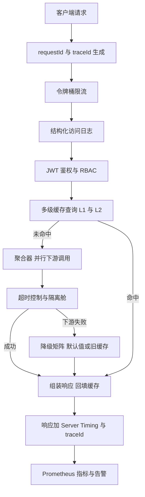

```javascript
const Koa = require('koa');
const compose = require('koa-compose');
const app = new Koa();

// ===== 中间件编排：顺序即架构 =====
app.use(compose([
  trace(),            // 1. traceId
  rateLimit(),        // 2. 入口限流
  accessLog(),        // 3. 访问日志
  auth(),             // 4. JWT 鉴权
  cacheAndAggregate,  // 5. 核心业务
  errorHandler,       // 6. 错误兜底
]));

function trace() {
  return async (ctx, next) => {
    ctx.state.traceId = ctx.get('x-trace-id') || crypto.randomUUID();
    ctx.set('x-trace-id', ctx.state.traceId);
    ctx.state.start = Date.now();
    await next();
  };
}

function rateLimit() {
  const buckets = new Map(); // 生产替换 Redis 令牌桶，见 NODE-069
  return async (ctx, next) => {
    const b = buckets.get(ctx.ip) ?? { tokens: 50, last: Date.now() };
    const refill = ((Date.now() - b.last) / 1000) * 10; // 每秒 10 个
    b.tokens = Math.min(50, b.tokens + refill);
    b.last = Date.now();
    buckets.set(ctx.ip, b);
    if (b.tokens < 1) { ctx.status = 429; ctx.body = { code: 'RATE_LIMIT' }; return; }
    b.tokens -= 1;
    await next();
  };
}

function auth() {
  return async (ctx, next) => {
    if (PUBLIC_PATHS.has(ctx.path)) return next();   // 白名单：/healthz /login
    ctx.state.user = await verifyToken(ctx);          // NODE-034/035 的实现
    await next();
  };
}

// ===== 核心业务：聚合 + 多级缓存 + 降级矩阵 =====
async function cacheAndAggregate(ctx) {
  const match = ctx.path.match(/^\/page\/home$/);
  if (!match) { ctx.status = 404; return; }

  const cacheKey = `home:${ctx.state.user?.uid ?? 0}:${APP_VER}`;
  const cached = await getFromCache(cacheKey);        // L1 LRU + L2 Redis
  if (cached) { ctx.state.cache = 'HIT'; ctx.body = cached; return; }

  // 降级矩阵：每个依赖声明 required 与 fallback
  const page = await gather([
    { name: 'feed',    required: true,  timeout: 800, loader: () => call('feed-api', `/feed?uid=${ctx.state.user.uid}`), fallback: [] },
    { name: 'profile', required: false, timeout: 300, fallback: { nickname: '游客' }, loader: () => call('user-api', `/me`) },
    { name: 'ads',     required: false, timeout: 200, fallback: [], loader: () => call('ads-api', `/banners`) },
  ]);
  await setCache(cacheKey, page, 60);
  ctx.state.cache = 'MISS';
  ctx.body = page;
}

async function errorHandler(ctx, next) {
  try { await next(); }
  catch (err) {
    ctx.status = err.status || 500;
    ctx.body = { code: err.code || 'INTERNAL', traceId: ctx.state.traceId,
                 message: err.status ? err.message : '服务繁忙' };
    ctx.app.emit('error', err, ctx);
  } finally {
    ctx.set('server-timing', `total;dur=${Date.now() - ctx.state.start};cache=${ctx.state.cache ?? '-'}`);
    log.info({ event: 'access', traceId: ctx.state.traceId, status: ctx.status,
               cost: Date.now() - ctx.state.start, url: ctx.url });
  }
}

app.listen(3000);
// 附加设计要点：容量 = 峰值QPS / 单实例压测值 × 安全系数；预案 = 降级开关 + 缓存预热 + 弹性扩容
```

### NODE-069：设计一个网关限流中间件（令牌桶的分布式实现）？
**答**：
- 令牌桶：恒定速率往桶里放令牌（桶容量即突发上限），请求取令牌，无令牌则 429。相比固定窗口计数，**平滑**且允许突发；相比滑动窗口实现更简单。
- 分布式实现用 **Redis + Lua 原子计算**：`tokens = min(capacity, tokens + (now - last) * rate)`，取到则扣减，否则拒绝——两步计算必须在 Lua 里原子完成（读-改-写分开会有竞态）。
- 维度：按 IP（防爬虫）、按 uid（防单用户滥用）、按接口（保护脆弱下游）、全局（容量保护）。返回头带 `retry-after` 与剩余额度（`x-ratelimit-remaining`）。

```javascript
const Redis = require('ioredis');
const redis = new Redis();

// Lua：原子令牌桶
const TOKEN_BUCKET_LUA = `
  local key      = KEYS[1]
  local rate     = tonumber(ARGV[1])        -- 每秒生成令牌数
  local capacity = tonumber(ARGV[2])        -- 桶容量（突发上限）
  local now      = tonumber(ARGV[3])        -- 当前毫秒时间戳
  local cost     = tonumber(ARGV[4])        -- 本次消耗令牌数

  local data = redis.call('HMGET', key, 'tokens', 'ts')
  local tokens = tonumber(data[1]) or capacity
  local ts     = tonumber(data[2]) or now

  -- 按时间差补充令牌
  tokens = math.min(capacity, tokens + (now - ts) / 1000 * rate)
  local allowed = 0
  if tokens >= cost then
    tokens = tokens - cost
    allowed = 1
  end
  redis.call('HMSET', key, 'tokens', tokens, 'ts', now)
  redis.call('PEXPIRE', key, math.ceil(capacity / rate * 2000))  -- 冷却后自动清理
  return { allowed, tostring(math.floor(tokens)) }
`;

async function tryAcquire(dimension, key, cost = 1) {
  const rule = { ip: { rate: 20, capacity: 100 }, uid: { rate: 5, capacity: 30 } }[dimension];
  const [allowed, remaining] = await redis.eval(
    TOKEN_BUCKET_LUA, 1, `rl:${dimension}:${key}`,
    rule.rate, rule.capacity, Date.now(), cost,
  );
  return { allowed: allowed === 1, remaining: Number(remaining), retryAfter: Math.ceil(cost / rule.rate) };
}

// Koa 网关中间件：uid 优先（登录用户更精准），fallback 到 IP
function rateLimiter() {
  return async (ctx, next) => {
    const { allowed, remaining, retryAfter } = await tryAcquire(
      ctx.state.user ? 'uid' : 'ip', ctx.state.user?.uid ?? ctx.ip);
    ctx.set('x-ratelimit-remaining', String(remaining));
    if (!allowed) {
      ctx.set('retry-after', String(retryAfter));
      ctx.status = 429;
      ctx.body = { code: 'RATE_LIMITED', message: '请求过于频繁，请稍后重试' };
      return;
    }
    await next();
  };
}
```

### NODE-070：设计一个文件上传服务（分片上传、断点续传、秒传的服务端配合）？
**答**：
- 协议设计：① 客户端计算文件 **hash（sha256，Web Worker 分块算）**→ `POST /upload/init` 查秒传：服务端已有该 hash 直接返回 URL（秒传完成）；② 未命中则返回 uploadId，客户端切片（如 5MB/片）**并发 PUT /upload/chunk**（每片带 index 与 hash）；③ 全部完成后 `POST /upload/complete`，服务端按序合并分片并校验整体 hash。
- 断点续传：`init` 时返回**已有分片列表**（`uploaded: [0,1,2]`），客户端跳过已传分片。
- 服务端要点：分片临时目录隔离 uploadId、合并用流式 append（`fs.appendFile`/createWriteStream append 防内存）、整体 hash 校验失败清理脏分片、限制并发与总大小、病毒扫描钩子。

```javascript
const crypto = require('node:crypto');
const fs = require('node:fs/promises');
const path = require('node:path');

const CHUNK_DIR = '/data/uploads/chunks';
const FINAL_DIR = '/data/uploads/files';

// 1. 初始化：查秒传，返回已有分片
router.post('/upload/init', async (ctx) => {
  const { fileHash, fileName, fileSize, chunkSize } = ctx.request.body;
  const finalPath = path.join(FINAL_DIR, fileHash);
  try {
    await fs.access(finalPath);
    return (ctx.body = { skipUpload: true, url: `/files/${fileHash}` });   // 秒传
  } catch { /* 不存在，继续走分片 */ }

  const uploadId = crypto.randomUUID();
  await fs.mkdir(path.join(CHUNK_DIR, uploadId), { recursive: true });
  await fs.writeFile(path.join(CHUNK_DIR, `${uploadId}.meta.json`),
    JSON.stringify({ fileHash, fileName, fileSize, chunkSize, createdAt: Date.now() }));

  const uploaded = (await fs.readdir(path.join(CHUNK_DIR, uploadId)))
    .filter((f) => f.startsWith('chunk-')).map((f) => Number(f.split('-')[1]));
  ctx.body = { uploadId, uploaded };   // 断点续传：客户端跳过 uploaded 索引
});

// 2. 分片上传：流式落盘 + 校验分片 hash
router.post('/upload/chunk/:uploadId/:index', async (ctx) => {
  const { uploadId, index } = ctx.params;
  const filePath = path.join(CHUNK_DIR, uploadId, `chunk-${index}`);
  await new Promise((resolve, reject) => {
    const ws = require('fs').createWriteStream(filePath);
    ctx.req.pipe(ws).on('finish', resolve).on('error', reject);  // 流式：不占内存
  });
  ctx.body = { ok: true };
});

// 3. 完成：按序合并 + 整体 hash 校验
router.post('/upload/complete', async (ctx) => {
  const { uploadId, fileHash, totalChunks } = ctx.request.body;
  const dir = path.join(CHUNK_DIR, uploadId);
  const hash = crypto.createHash('sha256');
  const finalPath = path.join(FINAL_DIR, fileHash);
  const out = require('fs').createWriteStream(finalPath);

  for (let i = 0; i < totalChunks; i++) {
    const chunkPath = path.join(dir, `chunk-${i}`);
    const buf = await fs.readFile(chunkPath);
    hash.update(buf);
    if (!out.write(buf)) await new Promise((r) => out.once('drain', r)); // 手工背压
  }
  out.end();
  await new Promise((r) => out.on('close', r));

  if (hash.digest('hex') !== fileHash) {              // 完整性校验
    await fs.rm(dir, { recursive: true });
    await fs.unlink(finalPath).catch(() => {});
    ctx.throw(422, '文件校验失败，请重传');
  }
  await fs.rm(dir, { recursive: true });              // 清理分片
  ctx.body = { url: `/files/${fileHash}` };
});
```

### NODE-071：设计一个短链接服务（发号器、302、缓存）？
**答**：
- 核心流程：`POST /shorten` → 长链接查重（hash 去重）→ 发号器生成唯一 id → Base62 编码为短码 → 存映射。访问：`GET /:code` → 查缓存/DB → **302 重定向**（302 保留历史/可统计，301 会被浏览器永久缓存无法改指向——统计型业务用 302）。
- 发号器方案：① MySQL 自增 id + Base62（简单可靠，6 位可表达 568 亿）；② Redis INCR（性能高，需持久化）；③ 雪花 ID（趋势递增，但较长）。预发号段（号段模式）可减少 DB 压力。
- 读多写少：短码 → 长链映射走 Redis + CDN 边缘缓存；写路径防刷（同 uid 频控）；长链接白名单防短链被用作钓鱼跳板。

```javascript
const crypto = require('node:crypto');
const BASE62 = '0123456789abcdefghijklmnopqrstuvwxyzABCDEFGHIJKLMNOPQRSTUVWXYZ';

function encode62(num) {
  let s = '';
  while (num > 0) { s = BASE62[num % 62] + s; num = Math.floor(num / 62); }
  return s || '0';
}

// 1. 创建短链：hash 去重 + 发号器
router.post('/shorten', async (ctx) => {
  const { url } = ctx.request.body;
  if (!/^https?:\/\//.test(url) || BLOCK_HOSTS.has(new URL(url).host)) ctx.throw(400, '非法链接');

  const urlHash = crypto.createHash('sha256').update(url).digest('hex');
  const existing = await db.query('SELECT code FROM short_urls WHERE url_hash = ?', [urlHash]);
  if (existing.length) return (ctx.body = { code: existing[0].code });

  // 号段模式发号：一次取 1000 个 id 在内存分配，减少 DB 往返
  const id = await nextId();
  const code = encode62(id);
  await db.query('INSERT INTO short_urls (code, url, url_hash, uid, created_at) VALUES (?, ?, ?, ?, NOW())',
    [code, url, urlHash, ctx.state.user.uid]);
  await redis.setex(`short:${code}`, 86400, url);     // 写路径预热缓存
  ctx.body = { code, shortUrl: `https://s.example.com/${code}` };
});

// 2. 访问：302 + 缓存 + 异步统计
router.get('/:code', async (ctx) => {
  const { code } = ctx.params;
  let url = await redis.get(`short:${code}`);
  if (!url) {
    const rows = await db.query('SELECT url FROM short_urls WHERE code = ?', [code]);
    if (!rows.length) ctx.throw(404, '短链不存在');
    url = rows[0].url;
    await redis.setex(`short:${code}`, 86400, url);
  }
  // 统计不阻塞主链路：丢进队列异步聚合（PV/UV/来源）
  statsQueue.add({ code, uid: ctx.state.user?.uid, referer: ctx.get('referer'), ts: Date.now() });
  ctx.status = 302;
  ctx.set('location', url);
});
```

```sql
CREATE TABLE short_urls (
  id BIGINT PRIMARY KEY AUTO_INCREMENT,
  code VARCHAR(10) NOT NULL,
  url TEXT NOT NULL,
  url_hash CHAR(64) NOT NULL,
  uid BIGINT NOT NULL,
  created_at DATETIME NOT NULL,
  UNIQUE KEY uk_code (code),
  UNIQUE KEY uk_url_hash (url_hash),
  KEY idx_uid (uid)
) ENGINE=InnoDB;
```

### NODE-072：设计一个导出服务（异步任务、进度查询、文件下载）？
**答**：
- 大数据量导出绝不能同步返回（超时+内存）：**异步任务化**——`POST /exports` 创建任务返回 taskId → 后台 worker 流式生成文件（写临时目录/对象存储）→ 前端轮询 `GET /exports/:id` 拿状态与进度 → 完成后给带签名的临时下载 URL（时效防盗链）。
- 服务端要点：任务持久化（DB/Redis，重启可恢复）、并发上限（防导出风暴打挂 DB，用队列 + p-limit）、**流式生成**（逐行查 + 写 CSV，cursor 分页避免 OFFSET 深翻页）、进度上报（已处理行数/总行数）、失败重试与清理策略。
- 进阶：WebSocket/SSE 推送进度替代轮询；超大导出拆分多个分片文件打包。

```javascript
const { Queue, Worker } = require('bullmq');
const { createObjectCsvStringifier } = require('csv-writer');

// 1. 创建任务
const exportQueue = new Queue('export', { connection: redisOpts });
router.post('/exports', async (ctx) => {
  const { type, filters } = ctx.request.body;
  const task = { id: crypto.randomUUID(), uid: ctx.state.user.uid, type, filters,
                 status: 'pending', progress: 0, total: 0, fileUrl: null };
  await redis.setex(`export:${task.id}`, 86400, JSON.stringify(task));
  await exportQueue.add('export', task, { attempts: 3, backoff: { type: 'exponential', delay: 5000 } });
  ctx.body = { taskId: task.id, pollAfterMs: 1000 };
});

// 2. Worker：流式生成 + 进度上报
new Worker('export', async (job) => {
  const task = job.data;
  const total = await db.query('SELECT COUNT(*) c FROM orders WHERE uid = ?', [task.uid]).then((r) => r[0].c);
  await saveTask(task.id, { status: 'running', total });

  const filePath = `/tmp/export-${task.id}.csv`;
  const out = require('fs').createWriteStream(filePath);
  const csv = createObjectCsvStringifier({ header: [{ id: 'id', title: '订单号' }, { id: 'amount', title: '金额' }] });
  out.write(csv.getHeaderString());

  let processed = 0, lastId = 0;
  while (true) {
    // 游标分页：避免 OFFSET 深翻页
    const rows = await db.query(
      'SELECT id, amount FROM orders WHERE uid = ? AND id > ? ORDER BY id LIMIT 1000', [task.uid, lastId]);
    if (!rows.length) break;
    out.write(csv.stringifyRecords(rows));
    lastId = rows[rows.length - 1].id;
    processed += rows.length;
    await saveTask(task.id, { progress: Math.round((processed / total) * 100) }); // 进度可查
  }
  out.end();
  await new Promise((r) => out.on('close', r));
  const fileUrl = await ossUpload(filePath, `exports/${task.id}.csv`, { expiresIn: 3600 }); // 签名临时 URL
  await saveTask(task.id, { status: 'done', fileUrl });
  await fs.unlink(filePath);   // 清理临时文件
}, { connection: redisOpts, concurrency: 3 });   // 隔离舱：最多 3 个导出并发

// 3. 进度查询
router.get('/exports/:id', async (ctx) => {
  const raw = await redis.get(`export:${ctx.params.id}`);
  if (!raw) ctx.throw(404);
  const task = JSON.parse(raw);
  if (task.uid !== ctx.state.user.uid) ctx.throw(403);   // 只能查自己的任务
  ctx.body = { status: task.status, progress: task.progress, fileUrl: task.fileUrl };
});
```

### NODE-073：设计一个 WebSocket 网关（连接管理、房间、广播）？
**答**：
- 职责：连接鉴权（握手时验 JWT，拒绝时 401）、连接注册表（uid → socket）、**房间模型**（加入/退出/按房间广播）、心跳保活（ping/pong 清理僵尸连接）、横向扩展（多实例间用 **Redis Pub/Sub** 转发广播，本实例只发给自己持有的连接）。
- 关键设计：连接亲和——LB 需支持 sticky session（ws 长连接不能随意换实例）；广播合并与节流（高频消息合并批量发）；消息协议统一 `{type, payload, ts}`；下线事件驱动业务（房间人数同步）。
- 生产实现基于 `ws` 库（比 socket.io 轻，自己控制协议）。

```javascript
const { WebSocketServer } = require('ws');
const Redis = require('ioredis');
const sub = new Redis(), pub = new Redis();
const wss = new WebSocketServer({ server: httpServer, maxPayload: 64 * 1024 });
const rooms = new Map();      // roomId → Set<ws>
const sockets = new Map();    // ws → { uid, rooms, alive }

// 1. 连接鉴权：握手阶段校验 JWT
wss.on('connection', async (ws, req) => {
  const token = new URL(req.url, 'http://x').searchParams.get('token');
  let claims;
  try { claims = jwt.verify(token, JWT_SECRET); }
  catch { ws.close(4001, 'unauthorized'); return; }

  sockets.set(ws, { uid: claims.uid, rooms: new Set(), alive: true });
  ws.on('pong', () => { sockets.get(ws).alive = true; });

  ws.on('message', (raw) => {
    const msg = JSON.parse(raw);
    if (msg.type === 'join') joinRoom(ws, msg.room);
    else if (msg.type === 'leave') leaveRoom(ws, msg.room);
    else if (msg.type === 'chat') broadcast(msg.room, { type: 'chat', from: claims.uid, payload: msg.payload });
  });

  ws.on('close', () => {
    const s = sockets.get(ws);
    s.rooms.forEach((r) => leaveRoom(ws, r));
    sockets.delete(ws);
  });
});

// 2. 房间管理
function joinRoom(ws, roomId) {
  if (!rooms.has(roomId)) rooms.set(roomId, new Set());
  rooms.get(roomId).add(ws);
  sockets.get(ws).rooms.add(roomId);
  broadcast(roomId, { type: 'member_joined', payload: { count: rooms.get(roomId).size } });
}
function leaveRoom(ws, roomId) {
  rooms.get(roomId)?.delete(ws);
  sockets.get(ws)?.rooms.delete(roomId);
}

// 3. 广播：本地直发 + Redis Pub/Sub 跨实例
function broadcast(roomId, message) {
  const data = JSON.stringify({ ...message, ts: Date.now() });
  for (const ws of rooms.get(roomId) ?? []) {
    if (ws.readyState === 1) ws.send(data);            // OPEN 才发
  }
  pub.publish(`room:${roomId}`, data);                 // 通知其他实例
}
sub.subscribe('room:*'); // psubscribe 用于模式订阅
sub.on('pmessageBuffer', (_pattern, channel, data) => {
  const roomId = channel.toString().split(':')[1];
  for (const ws of rooms.get(roomId) ?? []) ws.send(data.toString());
});

// 4. 心跳：30s 一轮，两轮未 pong 判定僵尸连接
setInterval(() => {
  for (const [ws, s] of sockets) {
    if (!s.alive) { ws.terminate(); sockets.delete(ws); continue; }
    s.alive = false;
    ws.ping();
  }
}, 30000).unref();
```

### NODE-074：设计一个定时任务系统（分布式 cron 与防重复执行）？
**答**：
- 多实例部署时 `setInterval`/`node-cron` 会在每个实例都触发——必须**分布式互斥**。三层方案：① **Redis 分布式锁**（`SET NX EX`，NODE-041 的 withLock，简单可靠）；② BullMQ 的 **Repeatable Jobs**（任务入 Redis 队列，worker 抢占消费，天然不重复 + 失败重试 + 延迟队列）；③ 独立调度中心（xxl-job/Quartz 集群）。
- 设计要点：任务幂等（抢不到锁直接跳过，业务侧也用状态机防重）、错过触发（misfire）补跑策略、超时强制释放锁（看门狗续期）、任务执行日志与告警。
- 面试口径：先答"为什么不能裸跑 node-cron"，再给锁方案与队列方案的取舍（轻量用锁，重任务用队列）。

```javascript
const { Queue, Worker } = require('bullmq');
const cronParser = require('cron-parser');

// 方案一：BullMQ Repeatable Job（推荐）
const schedulerQueue = new Queue('scheduler', { connection: redisOpts });

async function registerCron(name, cron, payload) {
  // upsert：按 jobId 幂等注册，重启/多实例不重复
  await schedulerQueue.upsertJobRepeatable(name, { pattern: cron, tz: 'Asia/Shanghai' });
  await schedulerQueue.add(name, payload, { repeat: { pattern: cron }, jobId: name });
}
await registerCron('daily-report', '0 2 * * *', { type: 'report' });
await registerCron('clean-expired', '*/10 * * * *', { type: 'clean' });

new Worker('scheduler', async (job) => {
  // BullMQ 保证同一 repeatable job 同一时刻只有一个 worker 在跑
  console.log(`执行 ${job.name}`, job.data);
  if (job.name === 'daily-report') await sendDailyReport();
  if (job.name === 'clean-expired') await cleanExpiredTokens();
}, { connection: redisOpts, concurrency: 5, lockDuration: 60000 });

// 方案二：Redis 锁互斥（轻量场景，node-cron + 锁）
const cron = require('node-cron');
cron.schedule('0 2 * * *', async () => {
  const lockKey = 'cron:daily-report:' + new Date().toISOString().slice(0, 10); // 每天一个锁
  const token = crypto.randomUUID();
  const ok = await redis.set(lockKey, token, 'EX', 3600, 'NX');   // 拿锁才执行，1h 自动释放
  if (!ok) return console.log('其他实例已在执行，跳过');
  try {
    await sendDailyReport();
  } catch (err) {
    await redis.del(lockKey);   // 失败释放锁，允许重试
    throw err;
  }
});
```

### NODE-075：简化版 SSO 认证中心如何实现？
**答**：
- 单点登录核心：认证中心维护**全局会话**，各子系统通过授权码/票据（ticket）换取本地会话。流程：子系统发现未登录 → 302 到 SSO 登录页（带 return url）→ 用户在 SSO 登录（建立全局会话 cookie，`.sso.com` 顶层域）→ SSO 302 回子系统并带一次性 **ticket** → 子系统后端拿 ticket 换用户信息 → 建立子系统本地 session。
- 单点登出：SSO 登出时销毁全局会话，并回调各子系统登出地址（注册的 logout 回调）销毁本地会话；或子系统每次请求校验中心会话有效性（集中校验模式）。
- 生产实现即 OAuth2/OIDC（NODE-036）：简化版考察能否说清 ticket 的一次性、时效与 redirect 校验。

```javascript
// SSO 认证中心（sso.example.com）
const globalSessions = new Map();   // sid → uid（生产 Redis）
const tickets = new Map();          // ticket → { uid, clientUrl, expires }

app.get('/login', async (ctx) => {
  const { redirect_uri } = ctx.query;              // 子系统回调地址
  // 已有全局会话：直接发 ticket 免登录
  const sid = ctx.cookies.get('sso_sid');
  if (sid && globalSessions.has(sid)) {
    const ticket = crypto.randomBytes(16).toString('hex');
    tickets.set(ticket, { uid: globalSessions.get(sid), redirect_uri, expires: Date.now() + 60_000 });
    return ctx.redirect(`${redirect_uri}?ticket=${ticket}`);
  }
  ctx.body = loginPageHtml;                        // 渲染登录表单，redirect_uri 藏在隐藏域
});

app.post('/login', async (ctx) => {
  const { username, password, redirect_uri } = ctx.request.body;
  const uid = await checkPassword(username, password);
  if (!uid) { ctx.status = 401; ctx.body = '账号或密码错误'; return; }
  const sid = crypto.randomBytes(24).toString('hex');
  globalSessions.set(sid, uid);
  // 全局会话 cookie：.sso.com 顶层域，各子系统跳 SSO 时自动带上
  ctx.cookies.set('sso_sid', sid, { domain: '.sso.com', httpOnly: true, sameSite: 'lax' });
  const ticket = crypto.randomBytes(16).toString('hex');
  tickets.set(ticket, { uid, redirect_uri, expires: Date.now() + 60_000 });
  ctx.redirect(`${redirect_uri}?ticket=${ticket}`);
});

// 子系统后端拿 ticket 换用户信息（服务端对服务端）
app.post('/sso/verify', async (ctx) => {
  const { ticket } = ctx.request.body;
  const record = tickets.get(ticket);
  if (!record || record.expires < Date.now()) ctx.throw(401, 'ticket 无效'); // 一次性 + 60s 时效
  tickets.delete(ticket);
  ctx.body = { uid: record.uid, name: await getUserName(record.uid) };
});

// 单点登出：销毁全局会话 + 通知各子系统
app.post('/logout', async (ctx) => {
  const sid = ctx.cookies.get('sso_sid');
  const uid = globalSessions.get(sid);
  globalSessions.delete(sid);
  ctx.cookies.set('sso_sid', '', { domain: '.sso.com', maxAge: 0 });
  const clients = await db.query('SELECT logout_url FROM sso_clients WHERE uid = ?', [uid]);
  await Promise.allSettled(clients.map((c) => fetch(c.logout_url, { method: 'POST' })));
  ctx.body = { ok: true };
});
```

### NODE-076：接口幂等的服务端方案（Idempotency-Key）如何设计？
**答**：
- 问题：网络重试、用户双击导致同一请求多次到达，支付/下单类接口重复执行会造成资金损失。
- 方案：客户端生成唯一 **Idempotency-Key**（uuid）随请求携带 → 服务端以 key 为锁：首次请求执行业务并把**响应快照**存 Redis（`SET NX`，TTL 24h）；重复请求直接返回快照（status + body 原样回放）；正在执行中的相同 key 返回 409 或挂起等待。
- 细节：key 作用域按"接口 + 用户"隔离（不同接口同 key 不冲突）；响应快照含状态码；处理中标记 `:processing` 防并发穿透；超时/失败的 key 要允许清理重试。

```javascript
const IDEMPOTENT_TTL = 24 * 3600;

function idempotent() {
  return async (ctx, next) => {
    const key = ctx.get('idempotency-key');
    if (!key) return next();                       // 幂等头可选：GET/DELETE 天然幂等可不带

    const scope = `${ctx.method}:${ctx.path}:${ctx.state.user.uid}:${key}`;
    const snapshotKey = `idem:${scope}:result`;
    const processingKey = `idem:${scope}:processing`;

    // 1. 已有结果快照：直接回放
    const cached = await redis.get(snapshotKey);
    if (cached) {
      const { status, body } = JSON.parse(cached);
      ctx.status = status;
      ctx.set('idempotent-replayed', 'true');
      ctx.body = body;
      return;
    }
    // 2. 正在处理：拒绝并发重复（客户端稍后重试会拿到快照）
    const locked = await redis.set(processingKey, '1', 'EX', 60, 'NX');
    if (!locked) { ctx.status = 409; ctx.body = { code: 'PROCESSING', message: '请求处理中，请稍后重试' }; return; }

    try {
      await next();
      // 3. 成功响应存快照（失败不存，允许客户端修正后重试）
      if (ctx.status < 400) {
        await redis.setex(snapshotKey, IDEMPOTENT_TTL,
          JSON.stringify({ status: ctx.status, body: ctx.body }));
      }
    } finally {
      await redis.del(processingKey);
    }
  };
}

// 挂载：仅对写操作
router.post('/orders', idempotent(), createOrder);

// 客户端配合
// fetch('/api/orders', { method: 'POST',
//   headers: { 'idempotency-key': crypto.randomUUID() },   // 同一次用户意图复用同一 key
//   body: JSON.stringify({ sku: 'A001', count: 1 }) });
```

### NODE-077：从服务端视角如何做反爬（限流、封禁、验证码下发）？
**答**：
- 分层防御：① **规则层**——IP/uid/设备指纹限流（令牌桶）、UA 与 Referer 校验、频率特征（无鼠标轨迹/请求间隔过于均匀）；② **成本层**——验证码（滑块/点选）下发与校验、JS 质询（动态 token、接口签名）；③ **数据层**——蜜罐字段、混淆数据（价格分单位、字段名动态化）。
- 处置梯度：限流（429）→ 人机验证（返回 `need_captcha`，前端弹验证码）→ 临时封禁（IP/uid 进黑名单 Redis）→ 永久封禁 + 风控审计。
- 服务端要点：处置必须**可自动解除**（TTL）与可申诉；误杀率监控；验证码校验结果一次性使用防重放。

```javascript
// 分层反爬中间件
const RISK_LEVELS = { ALLOW: 0, CAPTCHA: 1, BLOCK: 2 };

async function antiCrawler(ctx, next) {
  const uid = ctx.state.user?.uid;
  const fp = ctx.get('x-device-fp');                  // 前端 SDK 采集的设备指纹

  // 1. 黑名单检查（Redis Set/布隆）
  if (await redis.sismember('block:ip', ctx.ip) || (uid && await redis.sismember('block:uid', uid))) {
    ctx.status = 403;
    return (ctx.body = { code: 'BLOCKED' });
  }

  // 2. 行为特征：滑动窗口计数（1 分钟内请求数 + 失败率）
  const windowKey = `req:${uid ?? ctx.ip}`;
  const count = await redis.incr(windowKey);
  await redis.expire(windowKey, 60);
  const uniform = ctx.get('x-req-interval');           // 前端上报的请求间隔熵（演示）

  let risk = RISK_LEVELS.ALLOW;
  if (count > 300) risk = RISK_LEVELS.BLOCK;           // 高频
  else if (count > 60 || uniform === 'fixed') risk = RISK_LEVELS.CAPTCHA;  // 疑似脚本

  // 3. 验证码校验：携带 captcha token 的请求先验证
  if (ctx.get('x-captcha-token')) {
    const ok = await verifyCaptcha(ctx.get('x-captcha-token'));  // 滑块服务端校验，一次性
    if (ok) risk = RISK_LEVELS.ALLOW;                  // 通过人机验证放行并降权
    else { ctx.status = 403; return (ctx.body = { code: 'CAPTCHA_FAILED' }); }
  }

  // 4. 处置
  if (risk === RISK_LEVELS.BLOCK) {
    await redis.sadd('block:ip', ctx.ip);
    await redis.expire('block:ip', 0); // 说明：生产用 zadd/block:ip:{ip} 带 TTL，此处示意
    await redis.setex(`block:ip:${ctx.ip}`, 3600, '1');   // 1 小时临时封禁
    log.warn({ event: 'crawler_blocked', ip: ctx.ip, uid });
    ctx.status = 403;
    return (ctx.body = { code: 'BLOCKED' });
  }
  if (risk === RISK_LEVELS.CAPTCHA) {
    ctx.status = 401;
    return (ctx.body = { code: 'NEED_CAPTCHA', captchaUrl: '/captcha/challenge' }); // 前端弹验证码
  }
  await next();
}
```

### NODE-078：设计一个 AI 代理网关（统一 LLM 接入、流式转发、计费）？
**答**：
- 需求：前端只对接网关一个地址，网关屏蔽 OpenAI/Anthropic/国产模型的协议差异（统一 messages 格式与 SSE 事件）、做 **API Key 管理、限流、token 计费、流式转发**。
- 流式转发核心：上游 LLM 返回 **SSE 流**，网关用流透传（`res.write(chunk)` 逐块转发），同时旁路解析 `usage` 事件做计费——**不能把整个响应 buffer 完再回**（用户要打字机效果）。
- 关键点：鉴权（网关签发的 key 而非各厂商 key）、按 key 限流与配额（Redis 计数）、超时与重试（流中断后重试需从断点续传或报错）、敏感词过滤（流式检测）、成本观测（每请求 tokens/耗时/模型）。

```javascript
const MODEL_CONFIG = {
  'gpt-4o':      { upstream: 'https://api.openai.com/v1/chat/completions',    pricePer1k: 0.03 },
  'glm-4':       { upstream: 'https://open.bigmodel.cn/api/paas/v4/chat/completions', pricePer1k: 0.01 },
};

// 流式 AI 代理：SSE 透传 + 计费
router.post('/ai/chat', async (ctx) => {
  const apiKey = ctx.get('x-api-key');
  const quota = await getQuota(apiKey);                        // Redis：余额与限流
  if (quota.remainingTokens <= 0) ctx.throw(429, '配额不足');

  const { model, messages, stream = true } = ctx.request.body;
  const conf = MODEL_CONFIG[model];
  if (!conf) ctx.throw(400, '不支持的模型');

  // 上游请求：SSE 流
  const upstream = await fetch(conf.upstream, {
    method: 'POST',
    headers: { authorization: `Bearer ${process.env[`${model}_KEY`]}`, 'content-type': 'application/json' },
    body: JSON.stringify({ model, messages, stream }),
  });
  if (!upstream.ok) ctx.throw(502, `upstream ${upstream.status}`);

  ctx.set({ 'content-type': 'text/event-stream', 'cache-control': 'no-cache', connection: 'keep-alive' });
  ctx.status = 200;

  const reader = upstream.body.getReader();
  const decoder = new TextDecoder();
  let usage = { prompt_tokens: 0, completion_tokens: 0 };
  const start = Date.now();

  try {
    while (true) {
      const { done, value } = await reader.read();
      if (done) break;
      const text = decoder.decode(value, { stream: true });
      ctx.res.write(text);                                     // 原样转发 SSE chunk
      // 旁路解析 usage（流式最后一个 chunk 携带）
      for (const line of text.split('\n')) {
        if (line.startsWith('data: ') && line.includes('usage')) {
          try { usage = JSON.parse(line.slice(6)).usage ?? usage; } catch {}
        }
      }
    }
  } finally {
    ctx.res.end();
    // 计费：按实际 token 扣减 + 记账（异步不阻塞响应）
    const cost = ((usage.prompt_tokens + usage.completion_tokens) / 1000) * conf.pricePer1k;
    await Promise.allSettled([
      redis.decrby(`quota:${apiKey}`, usage.prompt_tokens + usage.completion_tokens),
      db.query('INSERT INTO ai_usage (api_key, model, tokens, cost, duration) VALUES (?, ?, ?, ?, ?)',
        [apiKey, model, usage.prompt_tokens + usage.completion_tokens, cost, Date.now() - start]),
    ]);
  }
});
```

### NODE-079：消息推送服务如何选型与实现（SSE vs WebSocket）？
**答**：
- 选型：**单向服务器推送选 SSE**（通知、进度、行情——HTTP 语义、自动重连、文本协议、走标准代理）；**双向实时选 WebSocket**（聊天、协同编辑）；App/小程序离线场景再补长连接厂商通道/轮询兜底。
- SSE 实现要点：`content-type: text/event-stream`、`retry:` 指定重连间隔、**事件 id 支持断点续传**（客户端 `Last-Event-ID` 头补发漏掉的消息）、连接注册表 + Redis Pub/Sub 跨实例、心跳注释行（`: ping\n\n`）防代理超时断连。
- 通用架构：消息产生方 → MQ → 推送服务（按 uid 查在线连接）→ SSE/WS 下发；不在线则落库，上线后拉取。

```javascript
// SSE 推送服务：连接管理 + Last-Event-ID 续传 + 跨实例广播
const clients = new Map();   // uid → Set<res>

router.get('/events', async (ctx) => {
  const uid = ctx.state.user.uid;
  const lastEventId = Number(ctx.get('last-event-id') || 0);

  ctx.set({ 'content-type': 'text/event-stream', 'cache-control': 'no-cache',
            connection: 'keep-alive', 'x-accel-buffering': 'no' }); // 关闭 Nginx 缓冲
  ctx.status = 200;
  ctx.flushHeaders();

  // 1. 补发离线期间的消息（按 id 增量）
  const missed = await db.query('SELECT id, type, payload FROM notifications WHERE uid = ? AND id > ?', [uid, lastEventId]);
  for (const n of missed) {
    ctx.res.write(`id: ${n.id}\nevent: ${n.type}\ndata: ${JSON.stringify(n.payload)}\n\n`);
  }

  // 2. 注册连接
  if (!clients.has(uid)) clients.set(uid, new Set());
  clients.get(uid).add(ctx.res);

  // 3. 心跳：15s 一条注释行，防止代理 idle 超时断开
  const heartbeat = setInterval(() => ctx.res.write(': ping\n\n'), 15000);

  // 4. 断开清理
  ctx.req.on('close', () => {
    clearInterval(heartbeat);
    clients.get(uid)?.delete(ctx.res);
  });
});

// 业务侧推送：跨实例经 Redis Pub/Sub
async function notify(uid, type, payload) {
  const id = await db.query('INSERT INTO notifications (uid, type, payload) VALUES (?, ?, ?) RETURNING id',
    [uid, type, JSON.stringify(payload)]).then((r) => r[0].id);
  const online = clients.get(uid);
  if (online?.size) {
    for (const res of online) {
      res.write(`id: ${id}\nevent: ${type}\ndata: ${JSON.stringify(payload)}\n\n`);
    }
  } else {
    await pub.publish(`notify:${uid}`, JSON.stringify({ id, type, payload })); // 用户连在其他实例
    await pushOfflineChannel(uid, { id, type, payload });  // 离线：厂商通道/短信兜底
  }
}
```

### NODE-080：图片处理服务如何实现（sharp 缩放、格式转换、水印）？
**答**：
- sharp 基于 libvips（C），性能远超 ImageMagick，**部分操作走线程池**（zlib/编码），CPU 密集场景要限并发（p-limit）防止打满。
- URL 即参数设计：`/img/{fileId}?w=200&h=200&fit=cover&fmt=webp&q=80`——网关鉴权 + 参数白名单 + sharp 处理 + **强缓存头**（内容寻址，处理结果不变）+ CDN 缓存派生图。
- 安全：限制输入大小（zip 炸弹/解压炸弹）、禁止超大分辨率（像素上限）、只允许白名单格式；处理结果落 OSS 后 301/302 重定向，避免服务反复计算。

```javascript
const sharp = require('sharp');
const pLimit = require('p-limit');
const limit = pLimit(8);   // 隔离舱：最多 8 个并发图片处理（防 CPU 打满）

// 参数白名单
const PARAMS_SCHEMA = {
  w: { type: 'int', max: 4096 }, h: { type: 'int', max: 4096 },
  fit: { enum: ['cover', 'contain', 'inside'] },
  fmt: { enum: ['webp', 'avif', 'jpeg', 'png'] },
  q: { type: 'int', min: 10, max: 100 },
};

router.get('/img/:fileId', async (ctx) => {
  const params = sanitize(ctx.query, PARAMS_SCHEMA);        // 非法参数直接 400
  const cacheKey = `img:${ctx.params.fileId}:${JSON.stringify(params)}`;

  // 1. 派生图缓存：同参数直接命中 OSS/Redis
  const cached = await redis.get(cacheKey);
  if (cached) { ctx.redirect(302, cached); return; }

  const source = await ossDownload(`${ctx.params.fileId}.png`);
  const pipeline = sharp(source, { limitInputPixels: 10000 * 10000 })  // 防解压炸弹
    .resize(params.w ?? null, params.h ?? null, { fit: params.fit ?? 'cover', withoutEnlargement: true });

  const format = params.fmt ?? 'webp';
  const buf = await limit(() =>
    pipeline.toFormat(format, { quality: params.q ?? 80 }).toBuffer()); // 受限并发

  const url = await ossUploadBuffer(buf, cacheKey, { contentType: `image/${format}` });
  await redis.setex(cacheKey, 86400 * 7, url);
  ctx.type = `image/${format}`;
  ctx.body = buf;
});

// 水印：合成一层
async function addWatermark(inputBuf) {
  const wm = Buffer.from(`<svg width="200" height="40">
    <text x="10" y="28" font-size="24" fill="rgba(255,255,255,0.6)">@ example.com</text></svg>`);
  return sharp(inputBuf)
    .composite([{ input: wm, gravity: 'southeast' }])
    .toBuffer();
}
```

### NODE-081：日志采集端如何设计（批量写入、削峰、不丢不重）？
**答**：
- 场景：前端埋点/网关日志高并发写入，直接同步写 DB 会打爆。采集端职责：**接收（轻校验）→ 内存队列缓冲（削峰）→ 批量落盘**（每 N 条或每 T 秒 flush）→ 失败重试 → 背压保护（队列满丢弃低优先级并计数告警）。
- 不丢不重：接收层先入 Redis Stream/Kafka（持久化）再消费写库，进程崩溃有 MQ 兜底；消费幂等（消息唯一 id 去重表）。
- 性能要点：批量 INSERT（一次 500 条）、`Promise.allSettled` 分批、限流保护下游、监控队列水位。

```javascript
// 内存缓冲 + 批量写入的采集端
class LogCollector {
  constructor({ flushSize = 500, flushInterval = 2000, maxQueue = 100000 }) {
    this.buffer = [];
    this.flushSize = flushSize;
    this.maxQueue = maxQueue;
    this.dropped = 0;
    setInterval(() => this.flush(), flushInterval).unref();
  }

  // 接收：轻校验 + 快速入队，绝不同步写库
  add(events) {
    for (const e of events) {
      if (!e.event || typeof e.ts !== 'number') continue;      // 轻校验，脏数据直接丢
      if (this.buffer.length >= this.maxQueue) {
        this.dropped++;                                         // 背压：队列满丢弃并计数
        continue;
      }
      this.buffer.push({ ...e, _id: crypto.randomUUID(), serverTs: Date.now() });
    }
    if (this.buffer.length >= this.flushSize) this.flush();     // 满批立即刷
  }

  // 批量落盘：失败重试 + 幂等写入
  async flush() {
    if (!this.buffer.length) return;
    const batch = this.buffer.splice(0, this.flushSize);
    try {
      await db.query('INSERT INTO events (_id, event, ts, payload) VALUES ? ON DUPLICATE KEY UPDATE _id = _id',
        [batch.map((b) => [b._id, b.event, new Date(b.ts), JSON.stringify(b)])]);
      // ON DUPLICATE KEY = 消费幂等：重复消息不产生重复行
    } catch (err) {
      this.buffer.unshift(...batch.slice(0, this.maxQueue - this.buffer.length)); // 放回队首重试
      console.error('日志批量写入失败:', err.message);
    }
  }
}

router.post('/collect', async (ctx) => {
  collector.add(ctx.request.body.events);   // 批量接口：前端聚合后上报
  ctx.status = 204;                          // 立即返回，不等落盘
});

// 监控：每分钟上报队列水位与丢弃数
setInterval(() => {
  metrics.gauge('collector_queue_size', collector.buffer.length);
  metrics.gauge('collector_dropped', collector.dropped);
}, 60000).unref();
```

### NODE-082：Node 内存调优怎么做（heap 限制与 heapdump 排查泄漏）？
**答**：
- 两个 heap 概念区分：`--max-old-space-size`（老生代上限，64 位默认约 2-4GB，容器里必须显式设置并**小于容器内存限制**，否则 OOMKilled）；`Buffer`/`ArrayBuffer` 在堆外（`external`/`arrayBuffers`），流处理失控常表现为 rss 涨而 heapUsed 不涨。
- 泄漏排查路径：监控发现 rss/heapUsed 持续上涨不回落 → `heapdump`/`--heapsnapshot-signal=SIGUSR2` 抓堆快照 → Chrome DevTools Memory 面板做两次快照对比（Comparison 视图看增量对象与 Retained Size）→ 定位持有链（常见：全局 Map 缓存无上限、事件监听器未移除、闭包持有大对象、定时器未清理）。
- 快速手段：`process.memoryUsage()` 定时打日志；`v8.getHeapStatistics()`；生产常驻 `--max-old-space-size=容器内存的75%` + `max_memory_restart`。

```javascript
// 1. 启动参数（Docker/K8s 场景）
// node --max-old-space-size=384 main.js   # 容器 limit 512m，heap 只占 75%
// node --heapsnapshot-signal=SIGUSR2 main.js  # kill -USR2 <pid> 触发快照，无需额外依赖

// 2. 内存水位监控 + 自动抓快照
const v8 = require('node:v8');
setInterval(() => {
  const mem = process.memoryUsage();
  const heapLimit = v8.getHeapStatistics().heap_size_limit;
  const ratio = mem.heapUsed / heapLimit;
  metrics.gauge('node_heap_used_bytes', mem.heapUsed);
  metrics.gauge('node_rss_bytes', mem.rss);
  metrics.gauge('node_external_bytes', mem.external);   // 堆外：Buffer 泄漏看这里
  if (ratio > 0.85) {
    log.error({ event: 'heap_critical', ratio, heapUsed: mem.heapUsed });
    v8.writeHeapSnapshot(`/tmp/heap-${Date.now()}.heapsnapshot`); // 自动留证
  }
}, 30000).unref();

// 3. 经典泄漏案例：无上限缓存
const cache = new Map();
app.use(async (ctx) => {
  cache.set(ctx.url, bigObject);   // BUG：只进不出，QPS 高时必然 OOM
  // 修复：LRU + 容量上限
  // const lru = new LRU({ max: 1000, ttl: 60000 }); lru.set(ctx.url, bigObject);
});

// 4. 事件监听器泄漏：MaxListenersExceededWarning 就是前兆
// emitter.on('data', handler) 在每次请求都注册却从不 off → 修复：命名函数 + once//removeListener
```

```bash
# 排查流程命令行
kill -USR2 $(pgrep -f bff-server)             # 触发堆快照
ls -lh /tmp/heap-*.heapsnapshot
# Chrome DevTools → Memory → Load 快照 → Selection: Comparison
# 关注 Shallow Size 与 Retained Size 排序、Constructor 中的 Map/Array/闭包
clinic heapprofiler -- node main.js           # 或 clinic 自动定位增长源
```

### NODE-083：CPU 打满如何排查（clinic、火焰图）？
**答**：
- 症状识别：QPS 下降但内存正常、`event loop lag` > 100ms、接口耗时长但下游都快 → 主线程被同步计算阻塞。
- 排查工具：① `clinic doctor`（体检：CPU/事件循环/GC 综合诊断）→ `clinic flame`（火焰图：找到最宽的栈）；② `node --cpu-prof` 生成 cpuprofile（DevTools Performance 面板打开）；③ 线上无侵入：`kill -USR1` 后 Chrome inspect 或 `node --inspect` 连接。
- 常见元凶：大 JSON.stringify/parse、正则回溯灾难、同步 crypto、模板大循环、`JSON.parse` 大 body。
- 治理：拆分计算（分片 + setImmediate 让路）、移入 worker_threads、换高效算法/库（如 fast-json-stringify）、缓存计算结果。

```bash
# 1. clinic 体检 + 火焰图（压测同时运行）
npm i -g clinic autocannon
clinic doctor -- node dist/main.js &
autocannon -c 50 -d 20 http://localhost:3000/api/heavy
clinic flame -- node dist/main.js        # 输出火焰图 HTML：宽度 = CPU 占用

# 2. 生产低开销采样
node --cpu-prof --cpu-prof-dir=/tmp --cpu-prof-interval=1000 dist/main.js
```

```javascript
// 典型阻塞代码与修复对照
// ❌ 阻塞：10 万条记录一次 stringify，事件循环卡 800ms
app.get('/report/bad', async (ctx) => {
  const rows = await db.query('SELECT * FROM orders LIMIT 100000');
  ctx.body = JSON.stringify(rows);           // 同步计算，全服务停摆
});

// ✅ 修复一：分片让路（每片之间 yield 事件循环）
function chunkStringify(rows, size = 5000) {
  return new Promise((resolve) => {
    const parts = [];
    let i = 0;
    (function next() {
      const end = Math.min(i + size, rows.length);
      parts.push(rows.slice(i, end).map((r) => JSON.stringify(r)).join(','));
      i = end;
      if (i < rows.length) setImmediate(next);   // 让路：别的请求插得进来
      else resolve(`[${parts.join(',')}]`);
    })();
  });
}

// ✅ 修复二：CPU 密集移入 worker 线程（NODE-007）
const { Worker } = require('node:worker_threads');
function heavyComputeInWorker(input) {
  return new Promise((resolve, reject) => {
    const w = new Worker('./heavy-worker.js', { workerData: input });
    w.on('message', resolve).on('error', reject);
  });
}
```

### NODE-084：Node 错误处理的最佳实践（uncaughtException 之后怎么办）？
**答**：
- 分层原则：**操作错误**（Expected：网络超时、DB 拒连、4xx——用 try/catch 或 Promise catch 处理，可恢复）；**程序错误**（Bug：undefined 属性、逻辑漏洞——不该 catch 掩盖，记录后**崩溃重启**让进程管理器拉起）。
- `uncaughtException`/`unhandledRejection`：进程状态已不可信，正确动作是**记录 fatal 日志 → 优雅退出（排空连接）→ 由 PM2/K8s 重启**。吞掉继续跑会进入不可预期状态。
- 防线清单：所有 async 入口有 catch；EventEmitter 注册 `error` 监听；流全部走 pipeline；定时器/回调里的 throw 用 domain 替代方案（隔离 worker 或进程边界）；上线前 `process.on('beforeExit')` 清理检查。

```javascript
// 统一错误处理骨架
const logger = require('./logger');

// 1. 兜底：记录后优雅崩溃，交给 PM2/K8s 重启
let exiting = false;
process.on('uncaughtException', async (err) => {
  if (exiting) return;
  exiting = true;
  logger.fatal({ event: 'uncaughtException', msg: err.message, stack: err.stack });
  await gracefulShutdown({ exitCode: 1, timeout: 10000 });   // NODE-060 的排空逻辑
});
process.on('unhandledRejection', (reason, promise) => {
  // 未处理的 Promise 拒绝：Node 15+ 默认已崩，这里确保日志完整
  logger.fatal({ event: 'unhandledRejection', msg: String(reason), stack: reason?.stack });
  throw reason;   // 统一走 uncaughtException 路径
});

// 2. 操作错误：类型化 + 可重试
class OperationalError extends Error {
  constructor(code, message, { status = 500, retryable = false } = {}) {
    super(message);
    this.code = code; this.status = status; this.retryable = retryable;
  }
}

async function callDownstream(url) {
  try {
    return await fetchWithTimeout(url, 3000);
  } catch (err) {
    if (['ECONNRESET', 'ETIMEDOUT'].includes(err.cause?.code)) {
      throw new OperationalError('UPSTREAM_TIMEOUT', '下游超时', { status: 504, retryable: true });
    }
    throw err;   // 未知错误原样上抛，不吞
  }
}

// 3. 可重试错误：指数退避自动恢复
async function withRetry(fn, times = 3) {
  for (let i = 0; i < times; i++) {
    try { return await fn(); }
    catch (err) {
      if (!err.retryable || i === times - 1) throw err;
      await new Promise((r) => setTimeout(r, 2 ** i * 500 + Math.random() * 300)); // 抖动防惊群
    }
  }
}
```

### NODE-085：复盘两个典型线上事故：内存泄漏与事件循环阻塞？
**答**：
- **案例一：内存泄漏**。现象：服务 RSS 每天 08:00 后线性上涨，三天 OOM 重启。定位：heap snapshot 对比发现数万 `Request` 对象被一个 Map 持有——根因是网关把"进行中请求"存入 Map 做去重，异常路径未清理。修复：finally 清理 + LRU 上限 + 水位告警。教训：**任何"登记后删除"结构必须有兜底清理与容量上限**。
- **案例二：事件循环阻塞**。现象：晚高峰 P99 从 80ms 飙到 2s，下游无异常、CPU 800%（8 核打满）。定位：`monitorEventLoopDelay` 高 + clinic flame 显示热点在 `JSON.parse`——某接口把 8MB 的聚合结果 parse/stringify。修复：下游改流式透传（不落地 JS 对象）、大结果直接 pipe、限制 body 上限。教训：**同步序列化是隐形 CPU 杀手，接口体量要有上限**。
- 通用复盘框架：时间线 → 现象 → 定位手段（监控指标 → 剖析工具 → 根因）→ 修复 → 预防（告警阈值、代码规范、压测门禁）。

```javascript
// 案例一修复：带兜底清理的请求去重表
class RequestTracker {
  constructor({ maxEntries = 10000, ttlMs = 60000 }) {
    this.entries = new Map();       // key → { resolve, timer }
    this.maxEntries = maxEntries;
    this.ttlMs = ttlMs;
  }
  register(key) {
    if (this.entries.size >= this.maxEntries) {
      // 容量上限兜底：淘汰最旧，防异常路径泄漏拖垮内存
      const oldest = this.entries.keys().next().value;
      this.evict(oldest, 'capacity');
    }
    return new Promise((resolve, reject) => {
      const timer = setTimeout(() => this.evict(key, 'ttl'), this.ttlMs); // TTL 兜底：异常路径也清理
      this.entries.set(key, { resolve, timer });
    });
  }
  complete(key, value) {
    const entry = this.entries.get(key);
    if (entry) { clearTimeout(entry.timer); entry.resolve(value); this.entries.delete(key); }
  }
  evict(key, reason) {
    const entry = this.entries.get(key);
    if (entry) { clearTimeout(entry.timer); entry.reject(new Error(`request evicted: ${reason}`)); }
    this.entries.delete(key);
  }
}

// 案例二修复 + 防护：响应体量上限 + 流式透传
app.get('/api/aggregation', async (ctx) => {
  const upstream = await callDownstream(ctx.query.url);
  const size = Number(upstream.headers.get('content-length') || 0);
  if (size > 2 * 1024 * 1024) {
    // 超过 2MB：不 parse 不 stringify，直接流式转发（零 CPU 序列化）
    ctx.set('content-type', upstream.headers.get('content-type'));
    for await (const chunk of upstream.body) ctx.res.write(chunk);
    return ctx.res.end();
  }
  ctx.body = await upstream.json();   // 小响应才走对象操作
});
```

### NODE-086：设计一个分布式 ID 生成器（雪花算法的 Node 实现）？
**答**：
- 需求：全局唯一、趋势递增（利于 B+ 树索引）、高性能本地生成。雪花算法 64 位结构：`1 符号位 + 41 时间戳(ms，约 69 年) + 10 机器 id + 12 序列号(单机每 ms 4096 个)`。
- Node 要点：JS 位运算只有 32 位，64 位 id 用 **BigInt** 计算；**时钟回拨**处理（回拨小则等待，大则报错切换 workerId）；workerId 分配用 Redis INCR 或 ZooKeeper 顺序节点。
- 对比：号段模式（DB 一次取一段，依赖 DB）、UUID（无序索引差）、Redis INCR（强依赖 Redis）。

```javascript
class Snowflake {
  constructor(workerId, dataCenterId = 0) {
    if (workerId < 0 || workerId > 31) throw new Error('workerId 超出范围 0-31');
    const EPOCH = 1288834974657n;              // 起始纪元：自定义，决定可用年限
    this.EPOCH = EPOCH;
    this.workerIdBits = 5n;
    this.dataCenterBits = 5n;
    this.sequenceBits = 12n;
    this.workerId = BigInt(workerId);
    this.dataCenterId = BigInt(dataCenterId);
    this.sequence = 0n;
    this.lastTs = -1n;
    // 各字段的位移
    this.workerIdShift = this.sequenceBits;                    // 12
    this.dataCenterShift = this.sequenceBits + this.workerIdBits; // 17
    this.timestampShift = this.sequenceBits + this.workerIdBits + this.dataCenterBits; // 22
    this.sequenceMask = (1n << this.sequenceBits) - 1n;        // 4095
  }

  nextId() {
    let now = BigInt(Date.now());
    if (now < this.lastTs) {
      // 时钟回拨：小回拨（<5ms）自旋等待，大回拨直接拒绝
      const drift = this.lastTs - now;
      if (drift > 5n) throw new Error(`时钟回拨 ${drift}ms，拒绝发号`);
      while (now <= this.lastTs) now = BigInt(Date.now());
    }
    if (now === this.lastTs) {
      this.sequence = (this.sequence + 1n) & this.sequenceMask;
      if (this.sequence === 0n) {                              // 本 ms 序列用尽，自旋到下一 ms
        while (BigInt(Date.now()) <= this.lastTs) {}
        now = BigInt(Date.now());
      }
    } else {
      this.sequence = 0n;
    }
    this.lastTs = now;
    return ((now - this.EPOCH) << this.timestampShift)
      | (this.dataCenterId << this.dataCenterShift)
      | (this.workerId << this.workerIdShift)
      | this.sequence;
  }
}

// workerId 分配：Redis INCR 取模
async function createIdGenerator() {
  const workerId = (await redis.incr('snowflake:worker:seq')) % 32;
  return new Snowflake(workerId);
}
const gen = await createIdGenerator();
console.log(gen.nextId());   // 4829037215478901001n，趋势递增
```

### NODE-087：如何设计 API 签名与防重放机制？
**答**：
- 适用：开放 API / 服务端对服务端（无浏览器 cookie 场景）。要素：`appKey`（标识）+ `appSecret`（密钥，不传输）+ 签名。
- 签名算法：按字典序排序所有参数 → 拼接 `k=v&` 串 + body 摘要 → `HMAC-SHA256(rawStr, appSecret)` → 放入 `X-Sign` 头。服务端用同样规则重算比对（时序安全比较）。
- 防重放三件套：**timestamp**（±5 分钟窗口，超窗拒绝）、**nonce**（随机串，Redis `SET NX EX 300` 去重，5 分钟内同 nonce 拒绝）、body 摘要参与签名（防篡改）。

```javascript
const crypto = require('node:crypto');

// 客户端签名
function signRequest(appKey, appSecret, params, body) {
  const timestamp = Date.now().toString();
  const nonce = crypto.randomBytes(8).toString('hex');
  const all = { ...params, appKey, timestamp, nonce };
  const canonical = Object.keys(all).sort()                 // 字典序
    .map((k) => `${k}=${all[k]}`).join('&');
  const bodyHash = crypto.createHash('sha256').update(body ?? '').digest('hex');
  const sign = crypto.createHmac('sha256', appSecret)
    .update(`${canonical}&body=${bodyHash}`).digest('hex');
  return { headers: { 'x-app-key': appKey, 'x-timestamp': timestamp, 'x-nonce': nonce, 'x-sign': sign } };
}

// 服务端校验中间件
const APP_SECRETS = { 'client-a': process.env.CLIENT_A_SECRET };

async function verifySign(ctx, next) {
  const appKey = ctx.get('x-app-key');
  const timestamp = ctx.get('x-timestamp');
  const nonce = ctx.get('x-nonce');
  const sign = ctx.get('x-sign');
  const secret = APP_SECRETS[appKey];
  if (!secret || !sign) ctx.throw(401, '非法客户端');

  // 1. 时间窗口：±5 分钟
  if (Math.abs(Date.now() - Number(timestamp)) > 5 * 60 * 1000) ctx.throw(401, '请求已过期');

  // 2. nonce 防重放：5 分钟内唯一
  const ok = await redis.set(`nonce:${appKey}:${nonce}`, '1', 'EX', 300, 'NX');
  if (!ok) ctx.throw(401, '重复请求');   // 重放攻击直接拒绝

  // 3. 重算签名比对
  const rawBody = ctx.state.rawBody ?? '';
  const bodyHash = crypto.createHash('sha256').update(rawBody).digest('hex');
  const all = { ...ctx.query, appKey, timestamp, nonce };
  const canonical = Object.keys(all).sort().map((k) => `${k}=${all[k]}`).join('&');
  const expected = crypto.createHmac('sha256', secret).update(`${canonical}&body=${bodyHash}`).digest('hex');
  const a = Buffer.from(expected), b = Buffer.from(sign);
  if (a.length !== b.length || !crypto.timingSafeEqual(a, b)) ctx.throw(401, '签名校验失败');
  await next();
}
```

### NODE-088：Node 服务如何接入消息队列（BullMQ 的队列、延迟与重试设计）？
**答**：
- MQ 解决三件事：**削峰**（突发流量入队慢慢消费）、**解耦**（生产者不关心消费者）、**异步化**（耗时操作后台做）。BFF 常见：发短信/邮件、导出、缓存刷新、审计埋点。
- BullMQ 核心：Queue（生产）、Worker（消费，`concurrency` 控并发）、`attempts + backoff`（指数退避重试）、`delay`（延迟任务）、`removeOnComplete`（防堆积）、失败进 `failed` 集合人工处理或死信。
- 注意：处理器必须**幂等**（at-least-once 语义下消息会重复投递）；消费失败先重试后告警；监控队列积压水位（`getJobCounts`）。

```javascript
const { Queue, Worker, QueueEvents } = require('bullmq');
const IOREDIS_OPTS = { connection: { host: 'redis', maxRetriesPerRequest: null } };

// 生产：注册通知任务（延迟 + 重试策略）
const notifyQueue = new Queue('notify', IOREDIS_OPTS);
await notifyQueue.add('sms', { phone: '138****', template: 'order-shipped' }, {
  delay: 60_000,                                   // 1 分钟后发送（留撤销窗口）
  attempts: 5,
  backoff: { type: 'exponential', delay: 2000 },   // 2s 4s 8s 16s 32s
  removeOnComplete: { count: 1000 },               // 只保留最近 1000 条完成记录
  removeOnFail: false,                             // 失败保留，人工排查
  jobId: `sms-${orderId}`,                         // 业务幂等键：重复添加自动去重
});

// 消费：幂等处理器
new Worker('notify', async (job) => {
  const { phone, template } = job.data;
  const sent = await redis.get(`sms:sent:${job.id}`);
  if (sent) return;                                 // 幂等：已发送跳过（at-least-once 防重）
  await smsClient.send(phone, template);
  await redis.set(`sms:sent:${job.id}`, '1', 'EX', 86400);
}, { ...IOREDIS_OPTS, concurrency: 10 });

// 队列事件与监控
const qe = new QueueEvents('notify', IOREDIS_OPTS);
qe.on('failed', ({ jobId, failedReason }) => {
  log.error({ event: 'job_failed', jobId, failedReason });
  if (failedReason) alertToOps(`任务 ${jobId} 最终失败: ${failedReason}`); // 5 次重试后告警
});
setInterval(async () => {
  const counts = await notifyQueue.getJobCounts('waiting', 'active', 'failed');
  if (counts.waiting > 5000) log.warn({ event: 'queue_backlog', ...counts }); // 积压告警
}, 30000).unref();
```

### NODE-089：如何实现一个配置中心客户端（热更新生效）？
**答**：
- 需求：限流阈值、降级开关、灰度比例等配置**不重启生效**。客户端职责：启动拉取全量 → 监听变更（轮询 etag/长轮询/Watch）→ 内存热替换 → 变更事件广播（模块间解耦）。
- 设计要点：配置版本号 + `etag` 轮询（304 免传输）；本地缓存兜底（配置中心挂了用上次快照）；**校验后再应用**（坏配置不进内存）；敏感配置解密；变更审计日志。
- 实现方式：EventEmitter 单例 + `config.get(key)` 动态读取（业务**每次使用时取值**，而不是启动时快照到常量——这是热更新失效的最常见原因）。

```javascript
const { EventEmitter } = require('node:events');

class ConfigClient extends EventEmitter {
  constructor({ server, app, env, pollInterval = 15000 }) {
    super();
    this.url = `${server}/configs/${app}/${env}`;
    this.snapshot = {};
    this.etag = '';
    this.pollInterval = pollInterval;
    this.start();
  }

  async start() {
    await this.fetch(true);            // 启动全量拉取，失败用本地快照兜底
    const loop = async () => {
      while (true) {
        await new Promise((r) => setTimeout(r, this.pollInterval));
        await this.fetch(false);       // 带 etag 轮询：无变更 304 零开销
      }
    };
    loop().catch(() => {});
  }

  async fetch(init) {
    try {
      const res = await fetch(this.url, { headers: { 'if-none-match': this.etag } });
      if (res.status === 304) return;
      if (!res.ok) throw new Error(`config server ${res.status}`);
      const next = await res.json();
      validateConfig(next);            // zod 校验：坏配置拒入内存
      const changed = diff(this.snapshot, next);
      this.snapshot = next;
      this.etag = res.headers.get('etag') ?? '';
      fs.writeFileSync('/tmp/config-snapshot.json', JSON.stringify(next)); // 本地快照
      for (const key of changed) {
        this.emit('change', { key, value: next[key] });   // 广播变更
        log.info({ event: 'config_changed', key, value: next[key] });
      }
    } catch (err) {
      if (init) this.snapshot = loadLocalSnapshot();    // 启动失败读快照，不阻塞启动
      log.error({ event: 'config_fetch_error', msg: err.message });
    }
  }

  get(key, defaultValue) { return this.snapshot[key] ?? defaultValue; }
}

// 使用：业务"每次用时取"，热更新才真正生效
const config = new ConfigClient({ server: CONFIG_CENTER, app: 'bff', env: NODE_ENV });

config.on('change', ({ key, value }) => {
  if (key === 'degrade.reco') breaker.settings.errorThresholdPercentage = value; // 动态调整熔断阈值
});

app.get('/feed', async (ctx) => {
  if (config.get('degrade.feed', false)) {     // 读取时求值：开关可热切换
    return (ctx.body = { items: CACHED_FEED, degraded: true });
  }
  ctx.body = await fetchFeed();
});
```

### NODE-090：接口如何做版本管理（v1/v2 共存与平滑下线）？
**答**：
- 版本策略三选一：**URL 路径**（`/v2/orders`，最直白、CDN 友好，主流）、Header（`Accept: application/vnd.app.v2+json`，URL 干净但调试难）、域名（`api2.example.com`，成本高）。
- 共存实现：路由前缀隔离 + 共享 service 层（Controller 不同、逻辑复用）；版本差异大才拆模块。
- 平滑下线：旧版本标记 deprecated（响应头 `Deprecation` + `Sunset` + 埋点统计调用量）→ 通知调用方迁移 → 调用归零后下线；**先摘流量后删代码**。

```javascript
// 路由级版本管理：Controller 分版本，Service 复用
const v1 = new Router({ prefix: '/v1' });
const v2 = new Router({ prefix: '/v2' });

// service 层完全复用
async function listOrders({ uid, page, includeTotal }) {
  const rows = await orderService.listByUser(uid, page);
  const body = { data: rows.map(orderService.toBrief) };
  if (includeTotal) body.total = await orderService.countByUser(uid);
  return body;
}

v1.get('/orders', async (ctx) => {          // 旧版：offset 分页
  ctx.body = await listOrders({ uid: ctx.state.user.uid,
    page: { offset: Number(ctx.query.offset ?? 0), limit: 20 }, includeTotal: true });
});

v2.get('/orders', async (ctx) => {          // 新版：游标分页 + 新字段
  ctx.body = await listOrders({ uid: ctx.state.user.uid,
    page: { cursor: ctx.query.cursor, limit: Math.min(Number(ctx.query.size ?? 20), 50) },
    includeTotal: false });                  // v2 不再返回 total（性能优化）
});

app.use(v1.routes()).use(v2.routes());

// deprecation 中间件：统计 v1 调用量，通知调用方
app.use(async (ctx, next) => {
  await next();
  if (ctx.path.startsWith('/v1/')) {
    metrics.increment('api_deprecated_calls', { version: 'v1', path: ctx.path });
    ctx.set('deprecation', 'true');
    ctx.set('sunset', 'Wed, 31 Dec 2026 23:59:59 GMT');    // 计划下线时间
    ctx.set('link', '</v2/orders>; rel="successor-version"');
  }
});
```

### NODE-091：如何实现灰度发布与流量染色？
**答**：
- 灰度策略：按 **uid/设备指纹取模**（稳定分流）、按白名单（内部员工先行）、按比例（1% → 5% → 50% → 100%）、按地域/机房。
- 实现：BFF 网关在入口决策——读取灰度配置（配置中心热更新，NODE-089）→ 计算命中版本 → **流量染色**：把 `x-gray-tag: v2` 写入请求头传递给下游，同时写响应头让前端感知；下游多版本实例按 tag 路由（K8s label selector / service mesh）。
- 关键细节：同一用户的**所有请求必须稳定命中同一版本**（会话粘性），避免体验分裂；灰度实例要有独立监控看板（错误率对比 v1/v2）；自动回滚：灰度错误率超阈值自动切回全量 v1。

```javascript
// 灰度决策中间件（BFF 入口）
const grayConfig = { enabled: true, ratio: 5, whitelist: [1, 42, 10086], tag: 'v2' };

function pickVersion(uid) {
  if (!grayConfig.enabled) return 'v1';
  if (grayConfig.whitelist.includes(uid)) return grayConfig.tag;      // 白名单
  // 稳定哈希取模：同一 uid 永远同一桶，不会一会儿 v1 一会儿 v2
  const bucket = murmurhash(String(uid)) % 100;
  return bucket < grayConfig.ratio ? grayConfig.tag : 'v1';
}

app.use(async (ctx, next) => {
  const uid = ctx.state.user?.uid ?? 0;
  const version = pickVersion(uid);
  ctx.state.grayTag = version;
  ctx.set('x-gray-tag', version);                     // 响应头：前端/测试感知当前版本
  await next();
});

// 调用下游时透传染色头，下游按 tag 路由到对应版本实例
async function callDownstream(path) {
  return fetch(`${DOWNSTREAM_URL}${path}`, {
    headers: { 'x-gray-tag': ctx.state.grayTag },     // 染色透传
  });
}

// 自动回滚：灰度版本错误率超阈值自动切回
setInterval(async () => {
  const v2Stats = metrics.get('error_rate', { tag: 'v2' });
  const v1Stats = metrics.get('error_rate', { tag: 'v1' });
  if (v2Stats > v1Stats * 2 && v2Stats > 0.01) {      // 错误率翻倍且超 1%
    grayConfig.enabled = false;
    log.error({ event: 'gray_auto_rollback', v2_error_rate: v2Stats });
    alertToOps('灰度自动回滚已触发');
  }
}, 30000).unref();
```

### NODE-092：服务间通信如何选型（REST/gRPC/消息队列）？
**答**：
- **REST/JSON**：通用、可调试、生态广，适合对外 API 与 BFF→前端；性能一般（文本序列化）。
- **gRPC**：HTTP/2 + Protobuf 二进制序列化（体积小 5-10 倍、编解码快），强类型 IDL 契约、原生支持流式与双向流；适合**内部服务间高频调用**。Node 用 `@grpc/grpc-js`；缺点：浏览器不能直连（需 grpc-web/Connect）、调试门槛高。
- **消息队列**：异步解耦、削峰，不要求即时响应的场景。
- 决策树：浏览器→服务用 REST/BFF；服务→服务同步调用、低延迟高性能用 gRPC；不需要同步结果用 MQ。

```protobuf
// proto/user.proto：IDL 契约（强类型，前后端代码生成）
syntax = "proto3";
package user.v1;

service UserService {
  rpc GetUser (GetUserRequest) returns (GetUserResponse);
  rpc StreamOrders (StreamOrdersRequest) returns (stream OrderEvent);  // 服务端流式
}

message GetUserRequest { int64 uid = 1; }
message GetUserResponse {
  int64 uid = 1;
  string name = 2;
  repeated string roles = 3;
}
message OrderEvent {
  int64 order_id = 1;
  string status = 2;
  int64 updated_at = 3;
}
```

```javascript
// gRPC 服务端
const grpc = require('@grpc/grpc-js');
const protoLoader = require('@grpc/proto-loader');
const def = protoLoader.loadSync('user.proto');
const proto = grpc.loadPackageDefinition(def);

const server = new grpc.Server();
server.addService(proto.user.v1.UserService.service, {
  GetUser: async (call, callback) => {
    const user = await userService.find(call.request.uid);
    if (!user) return callback({ code: grpc.status.NOT_FOUND, message: '用户不存在' });
    callback(null, { uid: user.id, name: user.name, roles: user.roles });
  },
  StreamOrders: (call) => {                       // 服务端流式：持续推送订单状态
    const stream = orderService.watchByUser(call.request.uid);
    stream.on('data', (order) => call.write({ order_id: order.id, status: order.status, updated_at: order.ts }));
    stream.on('end', () => call.end());
    call.on('cancelled', () => stream.close());   // 客户端断开清理
  },
});
server.bindAsync('0.0.0.0:50051', grpc.ServerCredentials.createInsecure(), () => server.start());

// 客户端（BFF 调用下游）
const client = new proto.user.v1.UserService('user-service:50051',
  grpc.credentials.createInsecure());
const user = await new Promise((resolve, reject) =>
  client.GetUser({ uid: 42 }, (err, res) => (err ? reject(err) : resolve(res))));
```

### NODE-093：Node 服务的测试策略（单测、集成、契约测试）？
**答**：
- 金字塔：**单元测试**（service 函数，mock 依赖，快而多）→ **集成测试**（supertest 起 app 打真实路由，DB 用内存/容器，验证中间件链与序列化）→ **契约测试**（Pact/OpenAPI 校验 BFF 与下游接口约定，防下游悄悄改字段）→ 少量 E2E。
- Node 特有注意：异步竞态用 fake timers；时间相关逻辑注入 clock；环境变量隔离（每个测试文件独立 process.env）；测试必须不依赖执行顺序。
- 门禁：覆盖率阈值（增量代码 80%）、PR 跑全量、发布前跑集成+契约。

```javascript
// 单元测试：mock 依赖，验证业务逻辑
const { describe, it, expect, jest } = require('@jest/globals');
const { transfer } = require('../services/transfer');

describe('transfer 转账服务', () => {
  it('余额不足时抛出业务异常且不写库', async () => {
    const dbMock = { execute: jest.fn().mockResolvedValue([{ affectedRows: 0 }]) };
    await expect(transfer(dbMock, 1, 2, 9999))
      .rejects.toMatchObject({ code: 'INSUFFICIENT_BALANCE' });
    expect(dbMock.execute).toHaveBeenCalledTimes(1);   // 未走到第二条 UPDATE
  });
});

// 集成测试：supertest 打真实 app（中间件链全走）
const request = require('supertest');
const app = require('../app');   // app 导出不 listen，由 supertest 控制

describe('POST /api/orders', () => {
  it('未登录返回 401', async () => {
    const res = await request(app).post('/api/orders').send({ sku: 'A1' });
    expect(res.status).toBe(401);
    expect(res.body.code).toBe('AUTH_REQUIRED');
  });

  it('正常下单返回 200 与幂等键回放', async () => {
    const idemKey = crypto.randomUUID();
    const res1 = await request(app).post('/api/orders')
      .set('authorization', `Bearer ${testToken}`)
      .set('idempotency-key', idemKey)
      .send({ sku: 'A1', count: 1 });
    expect(res1.status).toBe(200);

    const res2 = await request(app).post('/api/orders')   // 同 key 重放
      .set('authorization', `Bearer ${testToken}`)
      .set('idempotency-key', idemKey)
      .send({ sku: 'A1', count: 1 });
    expect(res2.body).toEqual(res1.body);                 // 快照一致
    expect(res2.headers['idempotent-replayed']).toBe('true');
  });
});
```

### NODE-094：如何设计一个 Feature Flag（功能开关）服务？
**答**：
- 能力：开关存储与分组、**求值规则**（百分比放量、用户属性定向、白名单）、SDK 客户端（本地缓存 + 轮询/长连接同步，本地求值零网络延迟）、审计与一键回滚。
- 服务端求值核心：`isEnabled(key, context)` = 开关状态 → 白名单 → 用户属性规则 → 百分比哈希（稳定分桶，NODE-091 同理）→ 默认值。
- BFF 实践：求值结果进日志与埋点（谁看到了什么版本），方便 A/B 分析；宕机兜底用 SDK 最后快照 + 默认关。

```javascript
// Flag 求值引擎（服务端实现）
const flags = {
  'new-checkout': {
    enabled: true,
    rules: [
      { type: 'whitelist', uids: [1, 42] },
      { type: 'attribute', attr: 'country', op: 'in', values: ['CN', 'SG'] },
      { type: 'percentage', ratio: 20 },                  // 20% 放量
    ],
    defaultOn: false,                                     // 兜底
  },
};

function hash(key, uid) {                                  // 稳定哈希：同一 uid 结果恒定
  let h = 0;
  const s = `${key}:${uid}`;
  for (let i = 0; i < s.length; i++) { h = (h * 31 + s.charCodeAt(i)) | 0; }
  return Math.abs(h) % 100;
}

function isEnabled(key, ctx) {
  const flag = flags[key];
  if (!flag || !flag.enabled) return flag?.defaultOn ?? false;
  for (const rule of flag.rules) {
    if (rule.type === 'whitelist' && rule.uids.includes(ctx.uid)) return true;
    if (rule.type === 'attribute' && rule.values.includes(ctx.attrs?.[rule.attr])) return true;
    if (rule.type === 'percentage' && hash(key, ctx.uid) < rule.ratio) return true;
  }
  return flag.defaultOn;
}

// BFF 中使用 + 曝光埋点（A/B 分析依据）
app.get('/checkout', async (ctx) => {
  const ctxFlag = { uid: ctx.state.user.uid, attrs: { country: ctx.get('x-country') } };
  const useNew = isEnabled('new-checkout', ctxFlag);
  metrics.increment('flag_exposure', { flag: 'new-checkout', variant: useNew ? 'on' : 'off' });
  ctx.body = useNew ? await renderNewCheckout(ctx) : await renderLegacyCheckout(ctx);
});
```

### NODE-095：如何设计一个通知中心（多渠道聚合）？
**答**：
- 职责：统一消息模型（type/模板/接收人/渠道偏好）→ 渠道路由（站内信/短信/邮件/Push，按等级与用户设置选择）→ 渠道适配器（各厂商 SDK 差异封装）→ 发送策略（去重、频控、静默时段）→ 状态回执与重试。
- 模式：模板 + 变量渲染（渠道差异文案）、**扇出**（一条业务事件扇出到多渠道，异步并行）、失败降级（Push 失败转短信）。
- 服务端要点：发送异步化（MQ，NODE-088）、频控（同用户同模板 10 分钟一条，Redis 窗口计数）、回执幂等。

```javascript
// 渠道适配器：统一接口
const channels = {
  email: { async send(to, tpl, vars) { return emailProvider.send(to, render(tpl.email, vars)); } },
  sms:   { async send(to, tpl, vars) { return smsProvider.send(to, render(tpl.sms, vars)); } },
  push:  { async send(to, tpl, vars) { return pushProvider.send(to.deviceTokens, render(tpl.push, vars)); } },
  inbox: { async send(to, tpl, vars) { return db.inbox.create({ uid: to.uid, ...vars }); } },
};

// 渠道路由：按消息等级与用户偏好
function pickChannels(msgLevel, userSetting) {
  const matrix = { critical: ['push', 'sms', 'inbox'], normal: ['push', 'inbox'], marketing: ['inbox'] };
  return matrix[msgLevel].filter((c) => !userSetting.muted?.includes(c));
}

// 扇出 + 频控 + 失败降级
const notifyQueue = new Queue('notify-center', IOREDIS_OPTS);
async function dispatch(event) {
  const user = await userService.find(event.uid);
  for (const channel of pickChannels(event.level, user.notifySetting)) {
    await notifyQueue.add('send', { channel, event }, { attempts: 3,
      backoff: { type: 'exponential', delay: 5000 }, jobId: `${event.id}:${channel}` }); // 幂等键
  }
}

new Worker('notify-center', async ({ data }) => {
  const { channel, event } = data;
  // 频控：同用户同模板 10 分钟 1 条（营销类）
  if (event.level === 'marketing') {
    const ok = await redis.set(`nf:${event.uid}:${event.template}`, '1', 'EX', 600, 'NX');
    if (!ok) return;   // 频控命中：静默丢弃
  }
  try {
    await channels[channel].send(user, templates[event.template], event.vars);
  } catch (err) {
    // 降级：Push 失败转短信（critical 消息）
    if (channel === 'push' && event.level === 'critical') {
      await channels.sms.send(user, templates[event.template], event.vars);
      return;
    }
    throw err;   // 进入 BullMQ 重试
  }
}, { ...IOREDIS_OPTS, concurrency: 20 });

// 回执：厂商 webhook 回调，幂等更新状态
router.post('/callback/:channel', async (ctx) => {
  const { messageId, status } = parseCallback(ctx.params.channel, ctx.request.body);
  await db.query('UPDATE notifications SET status = ? WHERE message_id = ? AND status != ?',
    [status, messageId, 'delivered']);   // 状态机只前进，防回执乱序回退
  ctx.body = 'ok';
});
```

### NODE-096：敏感词过滤与内容审核服务如何实现？
**答**：
- 两级方案：① **本地敏感词库**：DFA（确定有限自动机）/双数组 Trie 树，微秒级，挡住明确违禁词（支持变体字：`微`→`W微` 归一化后匹配）；② **机器审核**：调用内容安全 API（图片/文本），异步回调结果，用于语义级风险（辱骂、广告、涉政变体）。
- 服务端设计：`POST /moderation/text` 同步快速过滤（DFA）+ 异步机器审核（先发后审或先审后发按业务定）；词库热更新；命中记录审计（封禁依据）。
- 性能：DFA 构建一次常驻内存（10 万词条约几十 MB）；归一化（繁简、全半角、插入符号）在匹配前统一处理。

```javascript
// DFA 敏感词过滤（生产可用 aho-corasick 库，此处手写 Trie 版）
class WordFilter {
  constructor() {
    this.root = {};
  }
  addWord(word) {
    let node = this.root;
    for (const ch of word) node = (node[ch] ||= {});
    node.__end = true;
  }
  // 归一化：全角半角、变体符号剥离
  normalize(text) {
    return text.toLowerCase()
      .replace(/[ａ-ｚＡ-Ｚ０-９]/g, (c) => String.fromCharCode(c.charCodeAt(0) - 0xfee0))
      .replace(/[\s\*·•_.\-]/g, '');            // 去插入符：'微-信' → '微信'
  }
  filter(text) {
    const s = this.normalize(text);
    const hits = [];
    for (let i = 0; i < s.length; i++) {
      let node = this.root;
      for (let j = i; j < s.length; j++) {
        node = node[s[j]];
        if (!node) break;
        if (node.__end) hits.push(s.slice(i, j + 1));   // 命中：最长匹配继续尝试
      }
    }
    return [...new Set(hits)];
  }
}

const filter = new WordFilter();
SENSITIVE_WORDS.forEach((w) => filter.addWord(w));       // 词库启动加载，配置中心热更新

// 审核接口：DFA 同步 + 机器审核异步
router.post('/moderation/text', async (ctx) => {
  const { content } = ctx.request.body;
  const localHits = filter.filter(content);
  if (localHits.length) {                                 // 一级：明确违禁，直接拒绝
    await db.query('INSERT INTO moderation_log (uid, content, hits, action) VALUES (?, ?, ?, ?)',
      [ctx.state.user.uid, content, JSON.stringify(localHits), 'reject']);
    ctx.throw(422, '内容包含违禁词');
  }
  // 二级：机器审核（先发后审场景异步）
  const task = await contentSafety.submit(content);       // 厂商 API
  await db.query('UPDATE comments SET audit_status = ? WHERE id = ?', ['pending', ctx.request.body.commentId]);
  ctx.body = { status: 'accepted_pending_audit', taskId: task.id }; // 先展示，机器判定违规后下架+通知
});

// 机器审核回调
router.post('/moderation/callback', async (ctx) => {
  const { taskId, verdict } = ctx.request.body;
  const record = await db.query('SELECT * FROM moderation_tasks WHERE id = ?', [taskId]);
  if (verdict === 'risky') {
    await db.query('UPDATE comments SET audit_status = ? WHERE id = ?', ['blocked', record.comment_id]);
    await notifyUser(record.uid, 'content_blocked', { reason: '涉嫌违规' });
  }
  ctx.body = 'ok';
});
```

### NODE-097：静态资源服务与 CDN 回源如何配合？
**答**：
- 静态资源链路：浏览器 → CDN 边缘 →（未命中）回源 Node/对象存储。Node 侧职责：**正确的缓存头**（`Cache-Control: max-age` 决定 CDN 与浏览器缓存时长、`ETag` 协商）、**回源鉴权**（URL 签名防盗链）、`Vary` 正确设置。
- 缓存头策略：带 contenthash 的资源 `max-age=31536000, immutable`；`index.html` 必须 `no-cache`（每次协商，保证发版即生效）；接口按需 `private`。
- 回源细节：CDN 回源会带 `If-None-Match`，命中 304 省带宽；`stale-while-revalidate` 让发版瞬间用户仍拿旧资源不阻塞；大文件支持 Range（NODE-028）。

```javascript
// Node 作为 CDN 回源站
const IMMUTABLE = 'public, max-age=31536000, immutable';
const NO_CACHE = 'no-cache';

router.get('/static/*', async (ctx) => {
  const filePath = ctx.path.replace('/static/', '');
  // 1. 指纹资源判断：含 hash 才允许长缓存，index.html 强协商
  const isFingerprinted = /\.[0-9a-f]{8,}\.[a-z]+$/.test(filePath);
  ctx.set('cache-control', isFingerprinted ? IMMUTABLE : NO_CACHE);

  const stat = await fs.stat(path.join(PUBLIC_DIR, filePath)).catch(() => null);
  if (!stat) { ctx.status = 404; return; }

  // 2. 协商缓存：CDN 回源带 If-None-Match
  const etag = `"${stat.size}-${stat.mtimeMs}"`;
  ctx.set('etag', etag);
  if (ctx.get('if-none-match') === etag) { ctx.status = 304; return; }   // 304：CDN 直接用缓存

  // 3. 防盗链：回源请求带 CDN 签名（URL 签名在 CDN 配置，回源时验证）
  const sign = ctx.get('x-cdn-sign');
  if (PROTECTED_PATHS.some((p) => filePath.startsWith(p)) && !verifyCdnSign(sign, ctx.path)) {
    ctx.status = 403; return;
  }

  ctx.type = mime(path.extname(filePath));
  ctx.body = fs.createReadStream(path.join(PUBLIC_DIR, filePath));       // 流式回源
});

// 发版配合：构建产物文件名带 hash + HTML 引用新 hash
// app.3f8a2b.js（immutable 一年） ← index.html（no-cache 每次协商）
// 发版后：CDN 缓存 index.html 过期回源拿新 HTML → 新 HTML 引用新 hash 资源 → 未命中回源拉取
```

### NODE-098：如何实现服务注册与健康上报？
**答**：
- 场景：自建多实例 BFF（无 K8s 服务发现）时，下游/网关需要知道"有哪些活着的实例"。实例启动时注册（IP:port/权重/metadata），**定时心跳续期**，宕机后 TTL 过期自动摘除。
- Redis 实现：`SET instance:{service}:{id} JSON EX 10` + 每 5s 续期；发现方 `KEYS/SCAN instance:{service}:*` 或维护哈希集合；优雅退出主动注销。
- K8s 场景则交给 Service/EndpointSlice + readiness 探针（NODE-061），自研注册用于混部/虚机环境。

```javascript
// 服务注册客户端
class ServiceRegistry {
  constructor({ serviceName, port, heartbeatMs = 5000 }) {
    this.serviceName = serviceName;
    this.instanceId = `${os.hostname()}:${port}`;
    this.meta = { port, version: process.env.APP_VERSION, zone: process.env.ZONE };
    this.heartbeatMs = heartbeatMs;
    this.timer = null;
  }

  async register() {
    await this.renew();
    this.timer = setInterval(() => this.renew().catch((e) =>
      log.error({ event: 'heartbeat_failed', msg: e.message })), this.heartbeatMs);
    this.timer.unref();
  }

  async renew() {
    // TTL 10s = 2 个心跳周期：连续 2 次心跳失败即被摘除
    await redis.setex(`instance:${this.serviceName}:${this.instanceId}`, 10, JSON.stringify({
      ...this.meta, lastSeen: Date.now(), healthy: await this.selfCheck(),
    }));
  }

  async selfCheck() {
    try { await fetch(`http://127.0.0.1:${this.meta.port}/healthz`, { signal: AbortSignal.timeout(500) }); return true; }
    catch { return false; }
  }

  async deregister() {          // 优雅退出时主动注销（不等 TTL）
    clearInterval(this.timer);
    await redis.del(`instance:${this.serviceName}:${this.instanceId}`);
  }
}

// 服务发现：客户端负载均衡
async function discover(serviceName) {
  const keys = await redis.scanStream({ match: `instance:${serviceName}:*` });
  const instances = [];
  for await (const batch of keys) {
    const values = await redis.mget(...batch);
    instances.push(...values.filter(Boolean).map((v) => JSON.parse(v)).filter((i) => i.healthy));
  }
  return instances;   // 调用方按 zone 亲和 / 轮询 / 随机选择
}
```

### NODE-099：大促/高峰期的容量保障预案怎么做？
**答**：
- 三阶段：**事前**（容量评估：历史峰值 × 增长系数 → 压测验证 → 扩容到位；预案分级：可降级接口清单、限流阈值预置）、**事中**（监控大盘：QPS/错误率/P99/下游水位；一键降级/扩容开关；值班响应 SLA）、**事后**（复盘：超预期点、预案有效性、改进项）。
- BFF 特有关注：**下游保护**——BFF 是流量入口，必须先于下游饱和时主动降级（非核心依赖熔断，NODE-052）；**缓存预热**——大促开始前把热点数据预载入多级缓存；**读服务优先**——大促流量 95% 是读，缓存命中率是生命线。
- 预案必须**演练**：季度性全链路压测 + 故障注入（拔 Redis、下游超时），验证降级真的能降。

```yaml
# 预案配置示例：降级矩阵与限流分级（配置中心热更新，NODE-089）
emergency:
  level_1:                # 流量超预期 50%
    actions:
      - disable: [recommend-feed, hot-search]      # 非核心接口直接关
      - cache_ttl: { home_page: 300 }              # 缓存 TTL 拉长
  level_2:                # 流量超预期 100%
    actions:
      - rate_limit: { uid_qps: 2, global_qps: 50000 }
      - degrade: [comment-submit, profile-edit]    # 写接口降级只读
      - static_fallback: true                      # 部分页面回退 CDN 缓存旧版
  level_3:                # 核心依赖不可用
    actions:
      - serve_stale: 3600                          # 允许返回 1h 内旧缓存
      - read_only_mode: true
      - alert: ops-oncall
```

```javascript
// 一键预案执行器：读取配置中心预案并生效
class EmergencyExecutor {
  constructor(configClient) { this.config = configClient; }

  apply(level) {
    const plan = this.config.get(`emergency.level_${level}`);
    if (!plan) return;
    log.warn({ event: 'emergency_applied', level, actions: plan.actions });

    for (const action of plan.actions) {
      if (action.disable) action.disable.forEach((k) => killSwitch.disable(k));
      if (action.rate_limit) rateLimiter.override(action.rate_limit);       // 临时收紧限流
      if (action.degrade) action.degrade.forEach((k) => degradeRegistry.enable(k));
      if (action.serve_stale) cachePolicy.allowStale(action.serve_stale);   // 允许旧缓存
    }
  }
}

// 缓存预热：大促前 30 分钟执行
async function warmUp() {
  const hotItems = await db.query(
    'SELECT id FROM items ORDER BY sales_7d DESC LIMIT 10000');   // 热销 top1w
  const limit = pLimit(50);
  await Promise.all(hotItems.map((it) => limit(async () => {
    const data = await fetchProduct(it.id);
    await redis.setex(`product:${it.id}:zh:${APP_VER}`, 3600, JSON.stringify(data));
  })));
  log.info({ event: 'cache_warmed', count: hotItems.length });
}
```

### NODE-100：综合案例：一次 TTFB 从 1.8s 到 200ms 的全链路优化？
**答**：
- 现象：首页 SSR 接口 TTFB P75 1.8s。定位（Server-Timing 分解）：数据聚合 1.2s（3 个下游**串行**请求 + 1 个未命中缓存）→ 渲染 0.3s（组件树过大）→ 网络与排队 0.3s（实例 CPU 高、事件循环 lag 高）。
- 优化四板斧：① **串行改并行** + 批量接口合并（N+1 → 1 次 IN 查询）；② **多级缓存**：整页缓存匿名流量（s-maxage=60）+ Redis 缓存聚合结果（命中率 85%）；③ **流式渲染**：骨架先发，慢块 Suspense 包裹；④ **容量**：事件循环 lag 定位到大 JSON 序列化（NODE-085 案例二同因），流式透传 + 扩容。
- 收益复核：聚合 1.2s → 180ms（并行+缓存命中），渲染 0.3s → 80ms（流式首字节），TTFB P75 200ms，P99 450ms。
- 方法论沉淀：**先测量后优化**（Server-Timing/火焰图定位），优化后必须复压测验证并固化基线（CI 性能门禁）。

```javascript
// 优化前：串行 + 无缓存（1.2s 聚合）
// const user = await fetchJSON(USER_API);        // 300ms
// const feed = await fetchJSON(FEED_API);        // 500ms
// const ads = await fetchJSON(ADS_API);          // 400ms  → 串行合计 1.2s

// 优化后：并行 + 整页缓存 + 流式
app.get('/home', async (req, res) => {
  const isAnonymous = !req.cookies.sid;

  // 1. 匿名流量：CDN/边缘缓存整页（优化点三：绝大多数请求不再回源）
  if (isAnonymous) {
    res.setHeader('cache-control', 'public, s-maxage=60, stale-while-revalidate=300');
  } else {
    res.setHeader('cache-control', 'private, max-age=0');
  }

  // 2. 并行聚合 + 批量合并（优化点一：1.2s → 180ms）
  const [user, feed, ads] = await Promise.all([
    user ? fetchJSON(`${USER_API}/me`) : Promise.resolve(null),        // 并行
    cachedLoader(`feed:${user?.uid ?? 0}`, () => fetchJSON(`${FEED_API}/batch?ids=hot,new`), 120),  // 批量接口 + Redis 缓存
    cachedLoader('ads:home', () => fetchJSON(`${ADS_API}/banners`), 300),
  ]);

  // 3. 流式渲染：骨架先发（优化点二：TTFB 前移）
  const stream = renderToPipeableStream(<Home user={user} feed={feed} ads={ads} />, {
    onShellReady() {
      res.setHeader('server-timing',
        `agg;dur=${aggCost}, render;dur=${renderStart() - aggStart}`);
      stream.pipe(res);
    },
  });
});

// 4. 缓存加载器（进程内 + Redis 两级，NODE-051 精简版）
async function cachedLoader(key, loader, ttlSec) {
  const local = localLRU.get(key);
  if (local) return local;
  const remote = await redis.get(key).then((v) => v && JSON.parse(v));
  if (remote) { localLRU.set(key, remote); return remote; }
  const data = await loader();
  localLRU.set(key, data);
  await redis.setex(key, ttlSec, JSON.stringify(data));
  return data;
}

// 优化前后基线（CI 性能门禁阈值）
const BASELINE = { ttfb_p75: 200, ttfb_p99: 450, agg_cost: 180, cache_hit_rate: 0.85 };
// 每次发布跑基准压测：autocannon -c 100 -d 30 /home → 超过基线 20% 阻断合并
```

---

## 补充说明

- 本文件为 **NODE-001 ~ NODE-100**，与既有 01~18 专题（WEB/H5/CSS/JS/TS/V3/R19/ENG/PER/BAS/SCN/OPT/FRP/AGT/ALG/OPS/ARC/BLT 前缀）互不重复，专注服务端能力域。
- **NODE-101 ~ NODE-200** 为进阶篇：事件循环与框架源码级、网络协议深入、数据库与安全深入、可观测性、高并发稳定性、微服务协作、TypeScript 工程与综合体系设计，共十章。


---

## 十一、事件循环与异步源码级

### NODE-101：事件循环的六个阶段如何逐阶段运转？写代码验证阶段顺序与微任务插入时机？
**答**：
- 六阶段循环：**timers**（到期 setTimeout/setInterval）→ **pending callbacks**（延迟到下一轮的 I/O 回调）→ **idle/prepare**（内部使用）→ **poll**（取新 I/O 事件，无任务时阻塞等待）→ **check**（setImmediate）→ **close callbacks**（socket close 等）。
- 微任务清空时机：每个宏任务（单个 I/O 回调、单个 timer）执行完立即清空微任务，且 **nextTick 队列优先于 Promise 队列**。
- poll 是"心脏"：队列为空且有 setImmediate 待执行则不阻塞，转入 check；否则按最近 timer 阻塞。
- I/O 回调内注册的 `setImmediate` 恒先于 `setTimeout(0)`（无需等 1ms 阈值），这是唯一顺序确定的三连考点。

```javascript
const fs = require('fs');
console.log('1. 同步代码');

fs.readFile(__filename, () => {
  // 该 I/O 回调在 poll 阶段执行
  Promise.resolve().then(() => console.log('3. Promise 微任务'));
  process.nextTick(() => console.log('2. nextTick 微任务'));
  console.log('poll 阶段 I/O 回调 —— 结束后立刻清空两个微任务队列');
  // I/O 回调内：setImmediate 恒先于 setTimeout
  setImmediate(() => console.log('4. check 阶段'));
  setTimeout(() => console.log('5. 下一轮 timers 阶段'), 0);
});
// 输出固定：1 → poll 回调 → 2 → 3 → 4 → 5
```

### NODE-102：三道 nextTick 与 Promise 的输出题（队列优先级/饿死循环/await 位置）？
**答**：
- 题一考优先级：nextTick 队列永远先于 Promise 微任务队列清空。
- 题二考 nextTick 风险：递归 nextTick 会饿死事件循环，I/O 永远得不到执行——它是"插队卡"不是"普通异步"。
- 题三考 await 的真实位置：`await` 之后的代码是 Promise 微任务，排在已经入队的 nextTick 之后。
- 记忆口诀：**同步 → nextTick → Promise → 下一宏任务**。

```javascript
// ── 第一题：队列优先级 ──
Promise.resolve().then(() => console.log('p1'));
process.nextTick(() => console.log('t1'));
// 输出 t1 → p1：nextTick 队列先清空

// ── 第二题：nextTick 递归饿死事件循环 ──
function starve() { process.nextTick(starve); } // 不断往 nextTick 队列加任务
// starve(); // 打开后 timers/check/poll 永远不执行，服务假死且 CPU 不高，最难排查

// ── 第三题：async/await 的插队位置 ──
async function main() {
  console.log('a');
  await Promise.resolve();  // await 续体挂到 Promise 微任务队列
  console.log('c');
}
process.nextTick(() => console.log('b'));
main();
console.log('同步结束');
// 输出：a → 同步结束 → b → c（await 续体排在 nextTick 之后）
```

### NODE-103：setTimeout(fn,0) 与 setImmediate 的顺序为何不确定？
**答**：
- `setTimeout(fn, 0)` 的 0 会被钳制为 **1ms**；主模块同步代码跑完进入循环的时刻不确定，与 1ms 是否已流逝构成竞速。
- 若进入 timers 阶段时已过 1ms → setTimeout 先；未过 → timers 跳过、check 先执行 setImmediate。规范不保证顺序，**同一台机器不同负载下结果都可能不同**。
- 唯一确定场景：**在 I/O 回调内部**注册，setImmediate 恒先（poll 之后就是 check，setTimeout 要等下一轮 timers）。
- 面试一句话：顺序不确定是"1ms 阈值 + 进入循环时机"竞速的结果；I/O 回调内顺序确定是"阶段相邻"的结果。

```javascript
// 场景一：主模块注册 → 竞速，顺序不确定
setTimeout(() => console.log('timeout'), 0);
setImmediate(() => console.log('immediate'));
// 可能 immediate → timeout，也可能 timeout → immediate

// 场景二：I/O 回调内注册 → 恒定，setImmediate 先
const fs = require('fs');
fs.readFile(__filename, () => {
  setTimeout(() => console.log('timeout'), 0);
  setImmediate(() => console.log('immediate'));
});
// 恒输出：immediate → timeout
// 工程启示：需要"本轮循环末尾执行"的语义用 setImmediate，别依赖 setTimeout 0
```

### NODE-104：线程池被大文件 I/O 阻塞的经典案例？
**答**：
- libuv 线程池默认 **4 个线程**，且 fs、`dns.lookup`、`crypto.randomBytes/pbkdf2`、zlib 共用——一处堵塞全线遭殃。
- 案例：接口 A 并发读 8 个 500MB 日志，4 个线程全被占住；接口 B 只想算个 pbkdf2 摘要也要排队，P99 飙升但 CPU 不高。
- 特征：**CPU 利用率低 + 事件循环 lag 不高 + I/O 类接口集体变慢** = 线程池饥饿。
- 对策：`UV_THREADPOOL_SIZE=16` 扩容；超大文件改分块流式；密码摘要等重计算挪 worker_threads；域名解析改 `dns.resolve`（不走线程池）。

```javascript
const fs = require('fs');
const crypto = require('crypto');

// 复现排队：8 个大文件读 + 1 个小 pbkdf2 同时发起
const t0 = Date.now();
for (let i = 0; i < 8; i++) fs.readFile('/data/big.log', () => {});
crypto.pbkdf2('pwd', 'salt', 1e5, 32, 'sha256', () =>
  console.log('pbkdf2 观测耗时 ms =', Date.now() - t0));
// 输出远大于其真实计算耗时，差值就是线程池排队时间

// 定量观测：事件循环不受影响（lag 低），但所有线程池 API 变慢
const { monitorEventLoopDelay } = require('perf_hooks');
const h = monitorEventLoopDelay({ resolution: 20 }); h.enable();
setInterval(() => {
  console.log('eventloop p99 ms =', (h.percentile(99) / 1e6).toFixed(1));
  h.reset();
}, 2000).unref();
// 启动：UV_THREADPOOL_SIZE=16 node server.js 可显著缓解
```

### NODE-105：如何监控并定位事件循环阻塞？
**答**：
- 量化：`perf_hooks.monitorEventLoopDelay` 直方图输出 P99 lag，超阈值（如 100ms）告警。
- 探针：每 100ms 的哨兵 `setImmediate` 实测漂移，漂移大时**自动抓取火焰图快照**，事后有据可查。
- 定位分流：lag 高 + CPU 高 → CPU 密集（正则回溯/大 JSON 序列化），看火焰图；lag 高 + CPU 低 → 同步调用（readFileSync/execSync）或线程池饥饿。
- 上报指标进 Prometheus（NODE-135），与 QPS/CPU 关联看，避免误判。

```javascript
const { monitorEventLoopDelay, performance } = require('perf_hooks');

// 方法一：直方图量化 lag
const lag = monitorEventLoopDelay({ resolution: 10 });
lag.enable();
setInterval(() => {
  const p99 = lag.percentile(99) / 1e6; // 纳秒转毫秒
  metrics.gauge('node_eventloop_lag_p99_ms', p99);
  if (p99 > 100) logger.error({ p99 }, 'event loop lag 超阈值');
  lag.reset();
}, 5000).unref();

// 方法二：哨兵探针，漂移大时自动采样火焰图
setInterval(() => {
  const start = performance.now();
  setImmediate(() => {
    const drift = performance.now() - start;
    if (drift > 50) captureProfilerSnapshot(); // 内部调 inspector/0x 采 5s 剖析
  });
}, 100).unref();
```

### NODE-106：async_hooks 的 AsyncLocalStorage 如何追踪请求上下文？
**答**：
- 问题：一条请求链路上任意深度的异步函数都想要 traceId/uid，逐层传参太丑，全局变量会串请求。
- `AsyncLocalStorage.run(store, cb)` 建立**异步作用域**：作用域内派生的所有异步操作（promise/定时器/流回调）都能 `getStore()` 取到同一 store。
- 原理：async_hooks 在每个异步资源创建时捕获当前 execution context，形成异步作用域树，ALS 沿树读取。
- 坑：连接池借用连接的回调可能脱离作用域、`setTimeout` 长寿命回调要小心；跨池边界建议显式传参兜底。

```javascript
const { AsyncLocalStorage } = require('async_hooks');
const { randomUUID } = require('crypto');
const als = new AsyncLocalStorage();

// Koa 中间件：进入时建立上下文存储
app.use((ctx, next) =>
  als.run({ traceId: ctx.get('x-trace-id') || randomUUID(), uid: ctx.state.uid }, next));

// 深层工具函数：不传任何上下文参数也能打全链路日志
async function orderDbQuery(sql, params) {
  const { traceId, uid } = als.getStore() ?? {};
  logger.info({ traceId, uid, sql }, 'db query');
  return db.query(sql, params);
}

// HTTP 客户端自动透传 traceId（NODE-136）
function upstreamHeaders(extra = {}) {
  return { 'x-trace-id': als.getStore()?.traceId, ...extra };
}
```

### NODE-107：Node 与浏览器事件循环的完整差异对照？
**答**：
- 微任务时机：浏览器"每个宏任务后清空微任务"；Node ≥11 对齐浏览器，**Node 10 及以前是每阶段清一次**（老题老答案要区分版本）。
- 专属能力：Node 有 `process.nextTick` 队列与 check 阶段（setImmediate）；浏览器两者都没有（polyfill 只是模拟）。
- 宏任务来源：浏览器由渲染任务/消息/I/O 决定，且有 **requestAnimationFrame**（微任务后、绘制前）与后台 tab 计时器节流（≥1s）；Node 由 libuv 六阶段驱动，timers 阶段有 1ms 阈值，长期运行不受节流影响。
- 迭代器差异：Node 的 `process.nextTick` 优先级高于 Promise，浏览器没有对应概念。

```javascript
// 同一段代码在两端的行为对照
console.log('1');
setTimeout(() => console.log('4'), 0);
Promise.resolve().then(() => console.log('3'));
console.log('2');
// 浏览器与 Node ≥11 一致：1 2 3 4（同步 → 微任务 → 宏任务）

if (typeof window !== 'undefined') {
  // 浏览器独有：渲染管线回调（微任务之后、下一帧绘制之前）
  requestAnimationFrame(() => console.log('rAF 在微任务后、绘制前'));
} else {
  // Node 独有：nextTick 队列优先于 Promise；setImmediate 走 check 阶段
  process.nextTick(() => console.log('nextTick 优先于 Promise'));
  setImmediate(() => console.log('setImmediate 走 check 阶段'));
}
// 面试表述：模型同源（宏任务+微任务），差异在 nextTick/阶段模型/渲染节流三点
```

---

## 十二、框架源码级

### NODE-108：手写 Express 核心——路由、中间件链与错误处理？
**答**：
- 核心 = **Layer 数组**：每层存 method/路径正则/处理函数；`app.use` 不限方法，`app.get/post` 限定方法。
- `next()` 驱动链式派发：不匹配继续找，匹配就调用并挂起等待下一次 `next`。
- 错误态规则：`next(err)` 或同步抛错后，**只派发给 4 参错误中间件**（`err, req, res, next`），普通中间件被跳过——这就是 Express 错误冒泡的全部秘密。
- 路径匹配：`:id` 编译为正则命名分组挂到 `req.params`；栈耗尽未响应则兜底 404/500。
- 与 Koa 的本质区别：Express 基于回调 `next`，错误必须显式传递；Koa 基于 Promise 天然冒泡。

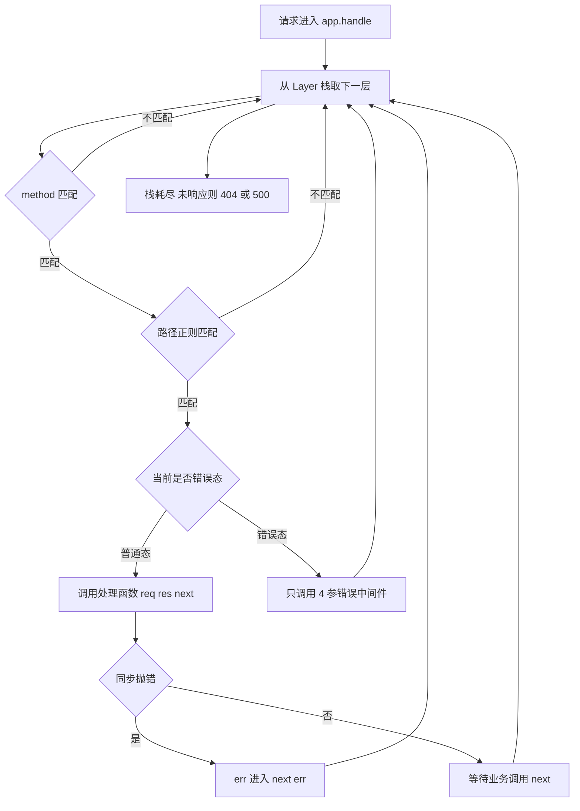

```javascript
const http = require('http');

function createApp() {
  const stack = [];
  function add(method, path, fn) {
    const keys = [];
    const pattern = path.replace(/\/:([^/]+)/g, (_, k) => (keys.push(k), '/([^/]+)'));
    stack.push({ method, keys, fn, isErr: fn.length === 4, regexp: new RegExp(`^${pattern}/?$`) });
  }
  const app = (req, res) => {
    const pathname = req.url.split('?')[0];
    let i = 0;
    const next = (err) => {
      while (i < stack.length) {
        const layer = stack[i++];
        if (layer.method !== 'ALL' && layer.method !== req.method) continue;
        const m = pathname.match(layer.regexp);
        if (!m) continue;
        req.params = Object.fromEntries(layer.keys.map((k, j) => [k, m[j + 1]]));
        if (err && layer.fn.length !== 4) continue;   // 错误态只找 4 参错误中间件
        if (!err && layer.fn.length === 4) continue;  // 正常态跳过错误中间件
        try {
          err ? layer.fn(err, req, res, next) : layer.fn(req, res, next);
          return; // 挂起，等待业务回调 next 驱动后续
        } catch (e) { err = e; } // 同步异常转错误态继续冒泡
      }
      if (err) { res.statusCode = 500; res.end('Internal Error'); }
      else { res.statusCode = 404; res.end('Not Found'); }
    };
    next();
  };
  app.use = (fn) => add('ALL', '/', fn);
  app.get = (p, fn) => add('GET', p, fn);
  app.post = (p, fn) => add('POST', p, fn);
  app.listen = (...args) => http.createServer(app).listen(...args);
  return app;
}

// 使用：同步抛错自动被 4 参中间件接住
const app = createApp();
app.use((req, res, next) => { console.log('logger'); next(); });
app.get('/user/:id', (req, res) => {
  if (!/^\d+$/.test(req.params.id)) throw new Error('bad id'); // 同步异常 → 错误态
  res.end(`user ${req.params.id}`);
});
app.use((err, req, res, next) => { res.statusCode = 400; res.end(`err ${err.message}`); });
app.listen(3000);
```

### NODE-109：手写 Koa 核心——Application 主干、compose 与错误收口？
**答**：
- Application = **Emitter + middleware 数组 + callback()**：`listen` 把 `compose(middleware)` 包装成 http 回调，每个请求新建 ctx。
- 执行链：`compose` 洋葱核心（NODE-023）→ resolve 后 `respond` 收口推导响应（对象自动 JSON、204/304 空 body）。
- 错误收口：中间件链的 Promise `catch` 后 `app.emit('error')`；Application 必须默认注册 onerror——否则 Emitter 无监听器会抛异常直接崩进程。
- 本题与 NODE-025 的差异：补齐生产细节（错误兜底、respond 状态码语义、compose 防重复 next）。

```javascript
const http = require('http');
const Emitter = require('events');

const compose = (mw) => (ctx, next) => {
  let i = -1;
  return dispatch(0);
  function dispatch(j) {
    if (j <= i) return Promise.reject(new Error('next() called multiple times'));
    i = j;
    const fn = j === mw.length ? next : mw[j];
    if (!fn) return Promise.resolve();
    return Promise.resolve(fn(ctx, () => dispatch(j + 1)));
  }
};

class Application extends Emitter {
  constructor() { super(); this.middleware = []; }
  use(fn) { this.middleware.push(fn); return this; }
  listen(...args) { return http.createServer(this.callback()).listen(...args); }
  callback() {
    const fn = compose(this.middleware);
    if (!this.listenerCount('error')) this.on('error', this.onerror); // 无监听器时兜底，防崩进程
    return (req, res) => {
      const ctx = { app: this, req, res, request: {}, response: { status: 200, body: undefined } };
      // ctx 短路代理（原理见 NODE-110）
      for (const k of ['status', 'body'])
        Object.defineProperty(ctx, k, {
          get: () => ctx.response[k], set: (v) => (ctx.response[k] = v),
        });
      Object.defineProperty(ctx, 'url', { get: () => req.url });
      fn(ctx).then(() => respond(ctx)).catch((err) => {
        this.emit('error', err, ctx);
        if (!res.headersSent) res.statusCode = 500;
        res.end('Internal Server Error');
      });
    };
  }
  onerror(err) { console.error('[koa]', err.stack || err); }
}

function respond(ctx) {
  const { res, status, body } = ctx;
  if (['204', '304', '404'].includes(String(status)) || body == null) return res.end();
  if (typeof body === 'string' || Buffer.isBuffer(body)) return res.end(body);
  res.setHeader('content-type', 'application/json; charset=utf-8');
  res.end(JSON.stringify(body)); // 对象默认 JSON 序列化
}
```

### NODE-110：Koa 的 ctx 属性代理是如何实现的（defineGetter 原理）？
**答**：
- `ctx.status` → `response.status`、`ctx.url` → `request.url`：本质是在 context 原型上 **defineProperty 委托**（Koa 源码用已废弃的 `__defineGetter__/__defineSetter__`，等价于 delegates 库）。
- 委托分三类：request 的只读委托（url/header/method）、response 的 getter+setter 双向委托（body/status/type）、以及 `ctx.request`/`ctx.response` 自身引用。
- 价值：业务代码 `ctx.body = data` 一行等价 `ctx.response.body = data`，读写心智统一。
- 面试追问点：为什么 body 必须 setter（写穿透到 response）、url 为什么只读（请求行不可变）。

```javascript
function delegate(proto, target, name) { // 双向委托：body/status 这类可写的
  Object.defineProperty(proto, name, {
    get() { return this[target][name]; },
    set(v) { this[target][name] = v; },
    configurable: true,
  });
}
function access(proto, target, name) {   // 只读委托：url/header 这类请求期不变的
  Object.defineProperty(proto, name, {
    get() { return this[target][name]; },
    configurable: true,
  });
}

const proto = {}; // 即 Koa context.js 导出的原型对象
access(proto, 'request', 'url');
access(proto, 'request', 'header');
delegate(proto, 'response', 'status');
delegate(proto, 'response', 'body');

// 验证：ctx.body 写入实际落到 ctx.response.body
const ctx = { __proto__: proto,
  request: { url: '/a?b=1', header: {} },
  response: { status: 200, body: undefined } };
ctx.body = { ok: 1 };
console.log(ctx.response.body, ctx.url); // { ok: 1 } '/a?b=1'
```

### NODE-111：手写 koa-router 核心——路径参数如何编译成正则？
**答**：
- 注册时把 `/user/:id/posts/:pid` 编译为 **正则 + 参数名表**，请求时 match 提取 `ctx.params`。
- 关键点：`/:id` → `([^/]+)`（不跨段，斜杠停止）；尾部 `*` 通配；提取值需 `decodeURIComponent`。
- 组成部分：`routes()` 返回中间件（match → 挂 params → compose 路由级中间件数组），`allowedMethods()` 兜底 405/501。
- path-to-regexp 6+ 同思想，增量支持量词（`:id?` `:id+` `:id*`）与自定义正则（`:id(\\d+)`）。

```javascript
class Router {
  constructor() { this.stack = []; }
  register(method, path, middleware) {
    const keys = [];
    const source = path
      .replace(/\/:([A-Za-z0-9_]+)/g, (_, k) => (keys.push(k), '/([^/]+)')) // 命名参数
      .replace(/\*$/, '(.*)');                                              // 尾部通配
    this.stack.push({ method, keys, regexp: new RegExp(`^${source}$`), middleware });
  }
  get(path, mw) { this.register('GET', path, mw); }
  post(path, mw) { this.register('POST', path, mw); }

  match(method, pathname) {
    for (const layer of this.stack) {
      if (layer.method !== method) continue;
      const m = pathname.match(layer.regexp);
      if (m) return { layer, params: Object.fromEntries(
        layer.keys.map((k, i) => [k, decodeURIComponent(m[i + 1])])) };
    }
    return null;
  }
  routes() {
    const router = this;
    return async (ctx, next) => {
      const hit = router.match(ctx.method, ctx.path);
      if (!hit) return next(); // 不归我管，交给后续中间件（如静态服务）
      ctx.params = hit.params;
      return compose(hit.layer.middleware)(ctx, next); // 路由级中间件 + 尾部 next 串成洋葱
    };
  }
}

// 使用：/user/123 → ctx.params = { id: '123' }
const router = new Router();
router.get('/user/:id', async (ctx, next) => { ctx.body = { id: ctx.params.id }; });
app.use(router.routes());
```

### NODE-112：中间件顺序错误的三个经典 bug 案例？
**答**：
- 案例 1：**bodyparser 注册在路由之后** → 路由里 `ctx.request.body` 永远 undefined，症状诡异极难联想到顺序。
- 案例 2：**错误处理中间件注册位置不对** → Koa 全局 catch 覆盖不到它之后的链路；Express 中在它之前抛出的错没人接，直接 500 裸奔。
- 案例 3：**健康检查放在鉴权与限流之后** → 探活流量被限流误杀引发监控误报、K8s 误重启；日志中间件放最后 → 404 请求无日志。
- 铁律顺序：traceId/错误处理最前 → parser/cors → 鉴权 → 业务路由 → 兜底 404 → 兜底错误日志。

```javascript
// ── 案例 1：错误顺序 ──
app.use(router.routes()); // 错：路由先执行，此时 body 还没解析
app.use(bodyParser());
// 修复：parser 一定在消费它的中间件之前
app.use(bodyParser());
app.use(router.routes());

// ── 案例 2：Express 注册位次 ──
app.use(requestLogger);    // 1. 日志与 traceId
app.use(auth);             // 2. 鉴权，可能抛 401
app.use(router);           // 3. 业务，可能抛错
app.use(notFoundHandler);  // 4. 404 兜底
app.use(errorHandler);     // 5. 4 参错误中间件最后注册但覆盖前面全部

// ── 案例 3：健康检查短路 ──
app.use(async (ctx, next) => {
  if (ctx.path === '/healthz') { ctx.body = 'ok'; return; } // 先于限流短路
  await next();
});
app.use(rateLimit({ qps: 1000 })); // 探活不计入限流
```

### NODE-113：手写 koa-bodyparser——为什么必须流式解析？multipart 怎么处理？
**答**：
- body 是**可读流**，不存在同步属性，必须监听 `data/end` 事件攒齐才能拿到完整内容。
- 流式解析的意义：**限长即断**（超过 limit 立即 destroy，不下载完才发现超限），高并发下避免大 body 撑爆内存。
- multipart（文件上传）绝不能攒进内存：按 busboy 事件流逐 field/file 处理，文件部分直接 pipe 到磁盘或对象存储。
- 细节：`content-length` 预检快速拒绝、JSON 解析失败转 400、`ctx.is()` 只处理声明的类型。

```javascript
function bodyParser({ limit = 1024 * 1024 } = {}) {
  return async (ctx, next) => {
    if (!ctx.is('application/json')) return next(); // 只处理 JSON
    const declared = Number(ctx.req.headers['content-length'] || 0);
    if (declared > limit) ctx.throw(413, 'payload too large');
    ctx.request.body = await readJson(ctx.req, limit);
    await next();
  };
}

function readJson(stream, limit) {
  return new Promise((resolve, reject) => {
    let size = 0; const chunks = [];
    stream.on('data', (chunk) => {
      size += chunk.length;
      if (size > limit) {
        stream.destroy(); // 限长即断，不浪费带宽
        return reject(Object.assign(new Error('too large'), { status: 413 }));
      }
      chunks.push(chunk);
    });
    stream.on('end', () => {
      if (!chunks.length) return resolve({});
      try { resolve(JSON.parse(Buffer.concat(chunks).toString('utf8'))); }
      catch { reject(Object.assign(new Error('invalid json'), { status: 400 })); }
    });
    stream.on('error', reject);
  });
}

// multipart 思路（生产直接用 busboy）：
// const form = busboy({ headers: ctx.headers, limits: { fileSize: 50 * 1024 * 1024 } });
// form.on('file', (name, fileStream, info) => fileStream.pipe(ossUploader)) // 不落内存直传
// form.on('field', (name, value) => (fields[name] = value));
// ctx.req.pipe(form); // busboy 解析边界，逐块吐事件
```

### NODE-114：Koa 的 onerror 机制如何设计完整错误边界？
**答**：
- 三层边界：**ctx.onerror**（框架内，把异常转 HTTP 响应）→ **app.on('error')**（应用级统一记录）→ **process 兜底**（uncaughtException 记录后退出交给守护拉起）。
- Koa 约定：`err.status` 决定响应码（无则 500）；`err.expose` 决定 message 是否暴露给客户端——内部错误只回笼统文案，防栈与 SQL 泄漏。
- `app.emit('error')` 无监听器时 Emitter 会抛异常崩进程，所以 Application 必须默认 onerror（NODE-109）。
- 响应体里带 traceId，用户报障可直接按 id 查日志（NODE-133）。

```javascript
// 应用级错误中间件（洋葱最外层，业务抛错沿 Promise 冒泡到这）
app.use(async (ctx, next) => {
  try {
    await next();
  } catch (err) {
    ctx.status = err.status ?? 500;
    ctx.body = {
      code: err.code ?? 'INTERNAL_ERROR',
      // expose 标记的业务错误才回传 message，内部错误统一文案防泄漏
      message: err.expose ? err.message : 'Internal Server Error',
      traceId: als.getStore()?.traceId,
    };
    ctx.app.emit('error', err, ctx); // 交给 app.onerror 统一记录
  }
});

app.on('error', (err, ctx) => {
  const level = (err.status ?? 500) >= 500 ? 'error' : 'warn';
  logger[level]({ stack: err.stack, status: err.status, url: ctx?.url,
    traceId: ctx?.state?.traceId }, 'request error');
});

// 进程级兜底：记录后退出优于带病运行，PM2/K8s 负责拉起（NODE-142/184）
process.on('uncaughtException', (err) => {
  logger.fatal({ stack: err.stack }, 'uncaught exception, exiting');
  process.exit(1);
});
process.on('unhandledRejection', (err) => logger.error({ stack: err?.stack }, 'unhandled rejection'));
```

---

## 十三、网络与协议深入

### NODE-115：TCP 在 Node 中如何管理 socket（backlog、保活、优雅关闭）？
**答**：
- `net.createServer({ backlog })` 的 backlog 是内核**全连接队列**长度：accept 消费不过来时新连接排队甚至被拒（EMFILE），高并发短连接服务要关注。
- 必做四件套：`setKeepAlive` 死链探测、`setNoDelay` 关 Nagle（低延迟）、空闲超时 destroy、监听 `error`（ECONNRESET 不监听直接崩进程）。
- 服务端 socket 生命周期：三次握手完成入全连接队列 → accept 事件转交业务 → end（FIN，半关闭）→ close（彻底释放）。
- 优雅关闭：`server.close()` 停止 accept + 逐个 `socket.end()` 排空，超时未退 `destroy`（对齐 NODE-060）。

```javascript
const net = require('net');
const sockets = new Set();

const server = net.createServer({ backlog: 1024 }, (socket) => {
  sockets.add(socket);
  socket.setKeepAlive(true, 30_000);  // 死链探测：30s 无数据发探活包
  socket.setNoDelay(true);            // 关 Nagle，小包立即发
  socket.setTimeout(120_000, () => socket.destroy()); // 空闲超时强杀
  socket.on('data', (buf) => socket.write(buf));      // echo 示例
  socket.on('close', () => sockets.delete(socket));
  socket.on('error', () => sockets.delete(socket));   // 必须监听，否则崩进程
});
server.listen(3000);
server.on('connection', () => metrics.inc('tcp_conn'));
console.log('当前连接数', sockets.size);

// 优雅关闭：停止 accept → 通知排空 → 超时强杀
async function drain() {
  server.close();
  const deadline = Date.now() + 10_000;
  for (const s of sockets) s.end();
  while (sockets.size && Date.now() < deadline) await new Promise((r) => setTimeout(r, 200));
  for (const s of sockets) s.destroy();
}
```

### NODE-116：HTTP keep-alive 的 Agent 如何调优（maxSockets 是高频压轴）？
**答**：
- Node 客户端**默认 Agent 不保活**：每次请求新建 TCP，高 QPS 下大量 TIME_WAIT、每次多一个 RTT 握手。
- 三个核心参数：`maxSockets`（每 host 并发上限——过小自我排队 TTFB 升高，过大压垮下游）、`maxFreeSockets`（空闲保留数）、`keepAliveMsecs`（保活时长）。
- `scheduling: 'lifo'` 优先复用最近活跃的连接，被服务端空闲掐断的概率最低。
- 排查口诀：大量 TIME_WAIT → 没开 keepAlive；下游不慢但 TTFB 高 → maxSockets 太小在排队；下游 CPU 打满 → maxSockets 太大。

```javascript
const http = require('http');
const agent = new http.Agent({
  keepAlive: true,
  keepAliveMsecs: 60_000,
  maxSockets: 50,        // 每 host:port 并发上限 —— 核心参数
  maxFreeSockets: 10,
  scheduling: 'lifo',
});

function callUpstream(path) {
  return new Promise((resolve, reject) => {
    const req = http.get({ host: 'user-service', path, agent, timeout: 2000 }, (res) => {
      res.resume();                       // 不读 body 也要消费完，连接才能复用
      res.on('end', resolve); res.on('error', reject);
    });
    req.on('error', reject);
    req.on('timeout', () => req.destroy(new Error('upstream timeout')));
  });
}

// 监控 sockets/freeSockets：free 长期为 0 且 sockets 打满 → 扩 maxSockets
setInterval(() => {
  metrics.gauge('agent_busy', Object.values(agent.sockets).flat().length);
  metrics.gauge('agent_free', Object.values(agent.freeSockets).flat().length);
}, 5000).unref();
// 注意：axios/got/node-fetch 底层都走 http.Agent，调参是同一个位置
```

### NODE-117：HTTP 管线化与队头阻塞是怎么回事？
**答**：
- HTTP/1.1 一条连接同一时刻只能有一个请求在途（响应必须按序返回）→ **应用层队头阻塞**；管线化允许连发但响应仍按序，慢响应堵住全部，实际被浏览器禁用。
- 对策一：连接池并发（`maxSockets`，NODE-116）——空间换时间，连接数有上限。
- 对策二：**HTTP/2 多路复用**——一条 TCP 连接上多个 stream 交错传输，真并行；但 TCP 层丢包会阻塞所有 stream（传输层队头阻塞），HTTP/3/QUIC 才根治。
- 服务端启示：给 BFF 的下游接口尽量上 HTTP/2；响应慢的大接口考虑流式或拆分。

```javascript
const http2 = require('http2');
// HTTP/2 客户端：单连接多路复用
const session = http2.connect('https://upstream.internal');
function h2get(path) {
  return new Promise((resolve, reject) => {
    const stream = session.request({ ':path': path }); // 无需等前一个响应
    let data = '';
    stream.setEncoding('utf8');
    stream.on('data', (c) => (data += c));
    stream.on('end', () => resolve(data));
    stream.on('error', reject);
  });
}
// 三个请求在同一连接上真并行（HTTP/1.1 需要 3 条连接或串行）
const [a, b, c] = await Promise.all([h2get('/a'), h2get('/b'), h2get('/c')]);

// 对照：HTTP/1.1 + 连接池
const agent = new http.Agent({ keepAlive: true, maxSockets: 10 });
// Promise.all 三个 http.get({ agent }) → 最多同时占 3 条连接，每连接仍串行
```

### NODE-118：如何实现一个代理请求（http-proxy 的核心思想）？
**答**：
- 反向代理本质：原样转发请求行/头/body，把上游响应回写客户端；body 全程 **pipe 流式**，不落内存，天然支持大文件与 SSE。
- 关键改写：`host` 头（changeOrigin）、`x-forwarded-for`（真实 IP 链，追加而非覆盖）、`x-request-id`（链路透传）。
- 错误处理三态：上游连接失败 → 502；客户端中途断开 → destroy 上游连接防泄漏；响应头已发再出错 → 只能断开连接。
- nginx/http-proxy 的增量能力：负载均衡、缓存、重写规则、WebSocket upgrade 透传——思想一致。

```javascript
const http = require('http');
const crypto = require('crypto');

const server = http.createServer((req, res) => {
  const upstream = http.request({
    host: '127.0.0.1', port: 9000,
    method: req.method, path: req.url,
    headers: {
      ...req.headers,
      host: 'upstream.internal', // changeOrigin：改写 Host 头
      'x-forwarded-for': [req.headers['x-forwarded-for'], req.socket.remoteAddress]
        .filter(Boolean).join(', '), // 真实 IP 链：追加
      'x-forwarded-proto': 'https',
      'x-request-id': req.headers['x-request-id'] ?? crypto.randomUUID(),
    },
  }, (pRes) => {
    res.writeHead(pRes.statusCode ?? 502, pRes.headers);
    pRes.pipe(res); // 响应流式回写
  });
  req.pipe(upstream); // 请求体流式转发
  upstream.on('error', () => {
    if (!res.headersSent) { res.statusCode = 502; res.end('Bad Gateway'); }
    else res.destroy();
  });
  req.on('aborted', () => upstream.destroy()); // 客户端断开掐上游，防连接泄漏
});
server.listen(8000);
```

### NODE-119：WebSocket 服务端握手如何实现（Sec-WebSocket-Accept 计算）？
**答**：
- 握手借道 HTTP：客户端发 `Upgrade: websocket` + 随机 `Sec-WebSocket-Key`；服务端回 **101** + `Sec-WebSocket-Accept = base64(sha1(key + 固定 GUID))`，GUID 为协议魔数 `258EAFA5-E914-47DA-95CA-C5AB0DC85B11`。
- 校验意义：证明服务端理解 WS 协议而非普通 HTTP 代理误处理；key 是 base64 的 16 字节随机数，防缓存与重放。
- 握手后切到 WS 帧协议：BYTE0（FIN+opcode）、BYTE1（MASK+长度），客户端帧必须 mask，服务端帧不 mask；ping/pong 心跳 opcode 0x9/0xA。
- 生产用 `ws` 库；手写只为理解协议与面试。

```javascript
const http = require('http');
const crypto = require('crypto');
const MAGIC = '258EAFA5-E914-47DA-95CA-C5AB0DC85B11';

const server = http.createServer();
server.on('upgrade', (req, socket) => {
  if (req.headers.upgrade?.toLowerCase() !== 'websocket') return socket.destroy();
  const accept = crypto.createHash('sha1')
    .update(req.headers['sec-websocket-key'] + MAGIC).digest('base64');
  socket.write(
    'HTTP/1.1 101 Switching Protocols\r\n' +
    'Upgrade: websocket\r\n' +
    'Connection: Upgrade\r\n' +
    `Sec-WebSocket-Accept: ${accept}\r\n\r\n`);

  // 最小帧处理：opcode 0x9 ping 回 0xA pong；0x8 close
  socket.on('data', (buf) => {
    const opcode = buf[0] & 0x0f;
    if (opcode === 0x9) socket.write(Buffer.from([0x8a, 0x00])); // 掩码位简化处理
  });
});
server.listen(3000);
// 子协议协商 Sec-WebSocket-Protocol、压缩扩展 permessage-deflate 同在握手期完成
```

### NODE-120：SSE 服务端如何实现（与 WebSocket 如何取舍）？
**答**：
- 三个响应头定生死：`content-type: text/event-stream`、`cache-control: no-cache`、`connection: keep-alive`；nginx 场景加 `x-accel-buffering: no` 关缓冲，否则事件被攒住不实时。
- 报文格式：`id:`/`event:`/`data:` 字段 + **空行分隔**；浏览器 EventSource 断线自动重连并回传 `Last-Event-ID`，服务端据此续传。
- 心跳用注释行 `: ping` 防代理掐空闲连接；`req.on('close')` 必须清理订阅与定时器，防连接泄漏。
- 取舍：单向推送/纯 HTTP/易过网关 → SSE；双向实时 → WebSocket（NODE-073/079）。

```javascript
app.get('/api/events', (req, res) => {
  res.writeHead(200, {
    'content-type': 'text/event-stream; charset=utf-8',
    'cache-control': 'no-cache, no-transform',
    connection: 'keep-alive',
    'x-accel-buffering': 'no', // 关 nginx 缓冲
  });
  res.flushHeaders();

  const lastId = Number(req.headers['last-event-id'] ?? 0); // 断线续传游标
  sendEventsSince(res, lastId);

  const onOrder = (e) => {
    res.write(`id: ${e.id}\nevent: order\ndata: ${JSON.stringify(e)}\n\n`);
  };
  bus.on('order-update', onOrder);
  const hb = setInterval(() => res.write(': hb\n\n'), 15_000); // 注释行心跳

  req.on('close', () => {          // 客户端断开必清理
    bus.off('order-update', onOrder);
    clearInterval(hb);
  });
});
```

---

## 十四、数据库与存储深入

### NODE-121：连接池参数如何调优？池满问题怎么排查？
**答**：
- 核心参数：`connectionLimit`（单实例连接数，按 DB 端 `max_connections` 分摊，起步≈核数×2）、`queueLimit`（排队上限，满了快速失败而非无限堆积）、`maxIdle/idleTimeout`（回收空闲连接）。
- 池满症状：报 "Queue limit reached" 或获取连接超时；`enqueue` 持续增长是前兆指标。
- 排查分流：DB 侧 CPU/IO 不高而队列长 → 池太小；DB 侧打满 → 慢查询占住连接（NODE-122），先治 SQL 再谈扩容。
- 红线：一次请求串行复用 1 个连接；并行查询数 × 并发请求 ≤ 池容量，否则互相排队放大延迟。

```javascript
const mysql = require('mysql2/promise');
const pool = mysql.createPool({
  host: process.env.DB_HOST,
  user: process.env.DB_USER,
  password: process.env.DB_PASS,
  database: 'shop',
  connectionLimit: 20,
  maxIdle: 10, idleTimeout: 60_000,
  queueLimit: 200,             // 排队上限，满了抛错快速失败
  waitForConnections: true,
  connectTimeout: 3000,
  enableKeepAlive: true,
});

// 两个关键监控点：排队（需求超供给的先兆）与在用数
pool.on('enqueue', () => metrics.inc('db_pool_enqueue'));
setInterval(() => {
  const inUse = pool.pool._allConnections.length - pool.pool._freeConnections.length;
  metrics.gauge('db_pool_in_use', inUse);
}, 5000).unref();

// 反例（放大排队）：一个请求并行抢 10 个连接 × 100 并发 = 需求 1000 > 池 20
// const [a, b] = await Promise.all([bigQuery1(), bigQuery2()]); // 大查询请串行或降并发
```

### NODE-122：慢查询如何定位与索引优化（EXPLAIN 实战）？
**答**：
- 定位链路：慢查询日志（`long_query_time` 阈值）→ `EXPLAIN` 看执行计划 → 加索引 → 复查 EXPLAIN 验证。
- EXPLAIN 三看：`type`（ALL 全表扫必须消灭）、`rows`（预估扫描行数）、`Extra`（filesort/temporary 是坏信号）。
- 联合索引原则：**等值列在前、范围与排序列在后**，最左前缀生效；索引失效三坑：函数包裹列、隐式类型转换、前导 `%` 模糊。
- 应用层配合：` Seconds_Behind_Master` 监控复制延迟；SQL 上线前用真实数据量 explain，不做拍脑袋索引。

```sql
-- 1. 打开慢查询日志
SET GLOBAL slow_query_log = ON;
SET GLOBAL long_query_time = 0.2;

-- 2. 问题 SQL：全表扫描 + filesort
EXPLAIN SELECT id, amount FROM orders
WHERE user_id = 42 AND status = 1
ORDER BY created_at DESC LIMIT 20;
-- type=ALL  Extra=Using filesort → 必须建联合索引

-- 3. 联合索引：等值列在前，排序列在后
ALTER TABLE orders ADD INDEX idx_user_status_created (user_id, status, created_at);

-- 4. 复查：type=ref，rows 从百万级降到 20，P99 800ms → 5ms
EXPLAIN SELECT id, amount FROM orders
WHERE user_id = 42 AND status = 1
ORDER BY created_at DESC LIMIT 20;

-- 索引失效示例：
-- WHERE DATE(created_at) = '2026-11-01'   函数包裹 → 改范围查询
-- WHERE user_id = '42'                    隐式转换 → 保持类型一致
-- WHERE title LIKE '%关键词%'             前导模糊 → 全文索引/ES
```

### NODE-123：Redis 分布式锁的完整实现（SETNX + 续期 + Lua 释放）？
**答**：
- 加锁：`SET key token NX PX ttl` 一条命令原子完成"不存在才写 + 过期时间"，token 用 UUID 标识持有者。
- 释放：**Lua 保证"比对 token + 删除"原子**——直接 GET 再 DEL 两步之间锁可能已易主，会误删别人的锁。
- 看门狗：业务未执行完锁先过期 = 互斥失效；每 `ttl/3` 用 Lua 校验 token 后 PEXPIRE 续期。
- 局限要说清：主从切换可能丢锁，强一致场景用 Redlock 多节点或 ZK/etcd；锁只保护互斥，不替代幂等。

```javascript
const crypto = require('crypto');
const UNLOCK_LUA = `
if redis.call("get", KEYS[1]) == ARGV[1] then
  return redis.call("del", KEYS[1])
else
  return 0
end`;
const RENEW_LUA = `
if redis.call("get", KEYS[1]) == ARGV[1] then
  return redis.call("pexpire", KEYS[1], ARGV[2])
else
  return 0
end`;

async function withLock(key, ttlMs, fn) {
  const token = crypto.randomUUID();       // 唯一 token，防误删他人锁
  // ioredis：SET key value PX ttl NX 原子加锁
  const ok = await redis.set(key, token, 'PX', ttlMs, 'NX');
  if (!ok) throw Object.assign(new Error('lock conflict'), { status: 429 });

  const timer = setInterval(async () => {   // 看门狗：ttl/3 续期一次
    await redis.eval(RENEW_LUA, 1, key, token, ttlMs);
  }, ttlMs / 3);

  try { return await fn(); }
  finally {
    clearInterval(timer);
    await redis.eval(UNLOCK_LUA, 1, key, token); // 原子"比对+删除"
  }
}

// 使用：防止定时任务多实例并发执行
await withLock('lock:sync-orders', 30_000, () => syncOrders());
```

### NODE-124：Redis 集群（Cluster）与哨兵（Sentinel）如何概览与选型？
**答**：
- 哨兵解决**高可用**：主从复制 + 故障自动转移，容量仍是单机；客户端先问哨兵要主节点地址再读写。
- Cluster 解决**容量/写吞吐**：16384 slot 分片到多主，键路由按 CRC16；多键操作要求同 slot，用 hash tag `user:{1001}:xxx` 控制。
- 客户端要点：哨兵模式配 `sentinels` 列表与 `name`；Cluster 模式管好 `maxRedirections`（MOVED/ASK 重定向）与离线队列行为。
- 选型：数据量与写 QPS 单机扛得住 → 哨兵（简单稳）；超过单机内存或写瓶颈 → Cluster（运维与多键成本上升）。

```javascript
const Redis = require('ioredis');

// 哨兵：高可用，自动发现主节点
const sentinel = new Redis({
  sentinels: [
    { host: 'redis-s1', port: 26379 },
    { host: 'redis-s2', port: 26379 },
  ],
  name: 'mymaster',     // 哨兵配置里的 master 名
  maxRetriesPerRequest: 2,
});

// Cluster：分片容量扩展
const cluster = new Redis.Cluster(
  [{ host: 'redis-c1', port: 7000 }, { host: 'redis-c2', port: 7000 }],
  {
    maxRedirections: 3,        // MOVED/ASK 重定向上限
    enableOfflineQueue: false, // 集群故障快速失败而非无限排队
  });

// Cluster 多键操作：hash tag 强制同 slot
await cluster.mset('user:{1001}:profile', 'a', 'user:{1001}:orders', 'b');
// 读从库：role: 'slave' + preferredSlaves 做读写分离（容忍复制延迟）
```

### NODE-125：MySQL 主从复制与读写分离如何落地？
**答**：
- 架构：写走主库，读走从库（读多写少业务吞吐翻倍）；复制是**异步**的，存在延迟窗口。
- 核心规则：**写后读必须走主**——下单后立刻查订单，走从库可能读不到，用户感知"丢单"。
- 实现层次：SQL 路由（写判定 + forceMaster 开关）、会话级策略（写后 N 秒内读主）、关键业务强制读主。
- 监控：`Seconds_Behind_Master` 超阈值把从库摘出读池；连接池读库单独配（NODE-121）。

```javascript
const master = mysql.createPool({ host: 'db-master', connectionLimit: 20, /* ... */ });
const slave = mysql.createPool({ host: 'db-slave', connectionLimit: 40, /* ... */ });

const WRITE_RE = /^\s*(insert|update|delete|replace|create|alter|begin)\b/i;
async function routeQuery(sql, params, { forceMaster = false } = {}) {
  if (forceMaster || WRITE_RE.test(sql)) return master.query(sql, params);
  return slave.query(sql, params);
}

// 写后读走主：事务提交后的第一次读强制主库
await routeQuery('INSERT INTO orders (id, uid) VALUES (?, ?)', [orderId, uid]);
const order = await routeQuery('SELECT * FROM orders WHERE id = ?',
  [orderId], { forceMaster: true });

// 会话级策略：写后 500ms 内的读都走主
function markJustWrote(ctx) { ctx.state.wroteAt = Date.now(); }
const shouldForceMaster = (ctx) => ctx.state.wroteAt && Date.now() - ctx.state.wroteAt < 500;
```

### NODE-126：对象存储直传如何实现（签名 URL 与分片合并）？
**答**：
- 直传价值：文件流不经过业务服务器，省带宽省内存；服务端只负责**发凭证 + 管元数据**。
- 小文件：预签名 PUT URL（限时 + 限操作），前端直传后回调（OSS callback）通知服务端入库。
- 大文件：init 拿 uploadId → 每个分片签独立 PUT URL → 前端并发传分片 → complete 合并；服务端校验分片数/总大小/etag。
- 安全三件事：路径含 uid 防越权覆盖、签名短时效、MIME 与大小白名单校验（配合 NODE-070 分片续传）。

```javascript
// 1. 分片初始化
const { uploadId } = await oss.initMultipartUpload(`video/${fileId}.mp4`);

// 2. 每个分片签发预签名 PUT URL，前端直传
function partUrl(fileKey, uploadId, partNumber) {
  return oss.signatureUrl(fileKey, {
    method: 'PUT',
    expires: 1800,                        // 签名 30 分钟有效
    subResource: { uploadId, partNumber },
  });
}

// 3. 合并前服务端校验
app.post('/api/upload/complete', auth, async (ctx) => {
  const { fileId, uploadId, parts } = ctx.request.body; // parts: [{ number, etag, size }]
  const total = parts.reduce((s, p) => s + p.size, 0);
  if (total > MAX_VIDEO || parts.length > 10000) ctx.throw(400, 'size/parts exceeded');
  // 可选：抽样 HEAD 分片校验 etag，防伪造
  await oss.completeMultipartUpload(`video/${fileId}.mp4`, uploadId, parts);
  await db.file.update({ where: { id: fileId }, data: { status: 'READY', total } });
  ctx.body = { url: `${CDN_HOST}/video/${fileId}.mp4` };
});
```

---

## 十五、安全深入

### NODE-127：SQL 注入如何防御（参数化与白名单）？
**答**：
- 注入本质：用户输入被拼进 SQL 语法层；防御本质：**数据与语法分离**——参数化让值永远只当数据。
- 占位符 `?`/`$1` 是正解；ORM 默认参数化，但 `raw query` 仍是高危点（Prisma 用 tagged template 自动参数化）。
- 动态部分（排序字段/表名）不能用占位符 → **白名单映射**，不在名单内的直接拒绝或回退默认值。
- 纵深：最小权限账号（业务库禁 DDL/DROP）、错误信息不回显 SQL、审计日志记录可疑输入。

```javascript
// 反例：字符串拼接 = 注入入口
// db.query(`SELECT * FROM users WHERE name = '${req.body.name}'`);
// 输入 ' OR '1'='1 → 拖库；输入 '; DROP TABLE users; -- → 破坏

// 正例一：占位符参数化
const rows = await db.query(
  'SELECT id, name FROM users WHERE name = ? AND status = ?',
  [req.body.name, 1],
);

// 正例二：动态排序字段白名单映射
const SORTABLE = { created: 'created_at', price: 'price', sales: 'sales' };
const col = SORTABLE[req.query.sort] ?? 'created_at'; // 白名单外回退默认
const dir = req.query.order === 'asc' ? 'ASC' : 'DESC';
const sql = `SELECT id, price FROM goods ORDER BY ${col} ${dir} LIMIT ?`;
await db.query(sql, [Number(req.query.limit ?? 20)]);  // 数值参数化

// 正例三：Prisma raw query 用 tagged template（自动参数化，非字符串拼接）
await prisma.$queryRaw`SELECT id FROM users WHERE name = ${name}`;
```

### NODE-128：SSRF 如何防御（出网白名单与 DNS 校验）？
**答**：
- 高发场景：webhook 回调、URL 预览、在线文件拉取——凡"服务端替用户发请求"的地方都可能被指到内网。
- 三层防御：协议白名单（禁 file/gopher/dict）、域名白名单、**解析后校验 IP**——只查域名不够，DNS rebinding 可以让域名解析到 127.0.0.1。
- 必封内网段：10/8、172.16/12、192.168/16、127/8、169.254/16（云元数据 169.254.169.254 偷凭证的头号目标）。
- 附加：禁跟随重定向（302 跳内网绕过校验）、限制响应大小与超时、出网走统一代理便于审计。

```javascript
const dns = require('dns').promises;
const net = require('net');
const ALLOW_HOSTS = new Set(['api.github.com', 'notify.internal.com']);

function isPrivate(ip) {
  if (net.isIPv4(ip)) {
    const [a, b] = ip.split('.').map(Number);
    return a === 10 || (a === 172 && b >= 16 && b <= 31) || (a === 192 && b === 168)
      || a === 127 || (a === 169 && b === 254) || a === 0;
  }
  return ip === '::1' || ip.startsWith('fc') || ip.startsWith('fd') || ip.startsWith('fe80');
}

async function safeFetch(raw) {
  const u = new URL(raw);
  if (u.protocol !== 'https:' && u.protocol !== 'http:') throw new Error('bad protocol');
  if (!ALLOW_HOSTS.has(u.hostname)) throw new Error('host not allowed'); // 出网白名单
  const { address } = await dns.lookup(u.hostname);
  if (isPrivate(address)) throw new Error('intranet blocked'); // 解析后校验，防 rebinding
  const res = await fetch(u, {
    redirect: 'error',                    // 禁重定向，防 302 跳内网
    signal: AbortSignal.timeout(5000),
  });
  return res; // 响应体建议流式限长读取，防超大响应打爆内存
}
```

### NODE-129：原型污染的服务端案例与防御？
**答**：
- 案例链路：请求体 `{"__proto__": {"isAdmin": true}}` → 被递归 merge 进对象 → `Object.prototype.isAdmin = true` → 全局所有对象 `obj.isAdmin === true` → 鉴权绕过甚至 RCE。
- 关键认知：`JSON.parse('{"__proto__":{}}')` 会产生名为 `__proto__` 的**自有属性**；递归 merge 时 `target[key]` 取到的是继承原型而非自有属性，写穿就发生在这一步。
- 防御：merge 前拦截黑名单键（`__proto__`/`constructor`/`prototype`）、只合并 plain object、用 `Map` 或 `Object.create(null)` 存动态配置。
- 纵深：升级 lodash 等已修 CVE 的版本、服务启动 `Object.freeze(Object.prototype)`、qs/query 解析库开安全选项。

```javascript
const isPlain = (v) => v !== null && typeof v === 'object'
  && !Array.isArray(v) && Object.getPrototypeOf(v) === Object.prototype;

function safeMerge(target, src) {
  for (const key of Object.keys(src)) {
    if (key === '__proto__' || key === 'constructor' || key === 'prototype') continue; // 黑名单拦截
    if (isPlain(src[key]) && isPlain(target[key])) safeMerge(target[key], src[key]);
    else target[key] = src[key];
  }
  return target;
}

// 漏洞复现（仅演示，勿用于生产）：
// merge({}, JSON.parse('{"__proto__": {"isAdmin": true}}'));
// ({ }).isAdmin === true  → 全局污染

// 兜底加固：
Object.freeze(Object.prototype);
Object.freeze(Array.prototype);
// 动态键配置容器用无原型对象，污染原型也无济于事：
const config = Object.create(null);
```

### NODE-130：JWT 的算法混淆攻击（alg none / RS256→HS256）？
**答**：
- 攻击一：把 header 的 `alg` 改为 `none` 并去掉签名——若 verify 不指定算法白名单，旧版本库"信 header 不信配置"直接放行。
- 攻击二：服务端用 RS256 公钥当 HMAC 密钥验证 HS256 token——公钥人人可得，攻击者可自签任意 token。
- 防御核心：**`algorithms` 白名单硬编码**，与签发侧算法严格一致；密钥分离管理（私钥只在签发方）。
- 附加校验：`issuer/audience` 断言、`clockTolerance` 容忍时钟偏移、kid 参数视为不可信输入（防注入）。

```javascript
const jwt = require('jsonwebtoken');

// 正确姿势：白名单 + 声明断言
function verifyAccess(token) {
  return jwt.verify(token, PUBLIC_KEY, {
    algorithms: ['RS256'],          // 关键：显式白名单，none/HS256 一律拒绝
    issuer: 'auth.example.com',
    audience: 'bff',
    clockTolerance: 5,              // 5s 时钟偏移容忍
  });
}

// 反例一（禁止）：jwt.verify(token, PUBLIC_KEY) —— 未限制 algorithms
// 反例二（禁止）：按 header.alg 动态选密钥/算法
// const alg = jwt.decode(token).header.alg; // 解码结果不可信，绝不能作为验证依据

// 网关层统一校验 + 传递身份；业务层只信网关注入的 ctx.state.uid
```

### NODE-131：依赖供应链安全如何审计（npm audit 与 lock 完整性）？
**答**：
- 三条攻击面：恶意版本（typosquatting）、已有包被投毒（事件溯源 script）、传递依赖里的漏洞——`package-lock.json` 是唯一事实源。
- CI 必做：`npm ci --ignore-scripts`（锁精确安装 + 跳过 install 脚本）、`npm audit` 高危阻断、审计 pre/postinstall 脚本。
- 治理机制：Renovate/Dependabot 自动提 PR、新依赖引入走 review（周下载量/维护活跃度/是否首包）、私有 registry 托管关键依赖。
- 应急预案：某依赖爆雷时能快速定位"谁引用了它"（`npm ls pkg --all`）并 pin 到安全版本。

```bash
# 1. CI 审计：高危漏洞阻断合并
npm audit --audit-level=high

# 2. 锁定安装 + 跳过安装脚本（防 postinstall 投毒）
npm ci --ignore-scripts
grep -E '"(pre|post)?install"' package-lock.json | head  # 人工复审带脚本依赖

# 3. 溯源：谁引入了有问题的包
npm ls lodash --all
npm audit --json | jq '.vulnerabilities | to_entries[] | {name: .key, via: .value.via}'

# 4. 收紧发布面：禁止本仓库发未审计包；.npmrc 指向私有 registry
# registry=https://registry.npmmirror.com
# @company:registry=https://npm.internal.company.com
```

### NODE-132：接口限流四种算法的完整实现对比（计数器/滑动窗口/漏桶/令牌桶）？
**答**：
- 固定窗口：`INCR+EXPIRE` 最简，但窗口边界存在 **2 倍突刺**（两个窗口交界瞬间可放过 2 倍配额）。
- 滑动窗口：ZSET 记录时间戳，`ZREMRANGEBYSCORE` 清过期 + `ZCARD` 计数——精确无突刺，内存与请求量成正比。
- 漏桶：恒定速率"漏水"，强行整流削平突发——适合保护脆弱下游；令牌桶：恒速补币 + 允许积攒突发——网关首选。
- 实现要点：全部用 **Redis + Lua** 保证"读-判-写"原子；集群多实例共享计数才叫分布式限流（NODE-069 是令牌桶专题）。

```javascript
// ── 1. 固定窗口：最简，有边界突刺 ──
const FIXED_LUA = `local c = redis.call("incr", KEYS[1])
if c == 1 then redis.call("expire", KEYS[1], ARGV[1]) end
return c`;
const windowSec = Math.floor(Date.now() / 60000);
const fixed = await redis.eval(FIXED_LUA, 1, `rl:f:${key}:${windowSec}`, 60);

// ── 2. 滑动窗口（ZSET）：精确，内存随请求量增长 ──
const SLIDE_LUA = `redis.call("zremrangebyscore", KEYS[1], 0, ARGV[1])
local n = redis.call("zcard", KEYS[1])
if n < tonumber(ARGV[2]) then
  redis.call("zadd", KEYS[1], ARGV[1], ARGV[3])
  redis.call("pexpire", KEYS[1], tonumber(ARGV[4]))
  return 1
end
return 0`;
// ARGV：当前毫秒、上限、唯一成员、窗口毫秒
const slid = await redis.eval(SLIDE_LUA, 1, `rl:s:${key}`, Date.now(), 100, crypto.randomUUID(), 60000);

// ── 3. 漏桶：恒定速率放行，保护脆弱下游 ──
const LEAKY_LUA = `local d = redis.call("hmget", KEYS[1], "water", "ts")
local water = tonumber(d[1]) or 0
local leaked = math.max(0, water - (tonumber(ARGV[1]) - (tonumber(d[2]) or ARGV[1])) * tonumber(ARGV[2]))
local ok = 0
if leaked < tonumber(ARGV[3]) then water = math.min(leaked + 1, tonumber(ARGV[3])); ok = 1 end
redis.call("hmset", KEYS[1], "water", water, "ts", ARGV[1])
return ok`;
// ARGV：当前毫秒、每秒流出速率、桶容量
const leaky = await redis.eval(LEAKY_LUA, 1, `rl:l:${key}`, Date.now(), 50, 100);

// ── 4. 令牌桶：控平均速率又允许突发，网关首选 ──
const TOKEN_LUA = `local ts = tonumber(ARGV[1])
local d = redis.call("hmget", KEYS[1], "tokens", "ts")
local cap = tonumber(ARGV[3])
local tokens = math.min((tonumber(d[1]) or cap) + (ts - (tonumber(d[2]) or ts)) * tonumber(ARGV[2]), cap)
local ok = 0
if tokens >= 1 then tokens = tokens - 1; ok = 1 end
redis.call("hmset", KEYS[1], "tokens", tokens, "ts", ts)
return ok`;
// ARGV：当前毫秒、每秒补币速率、桶容量
const token = await redis.eval(TOKEN_LUA, 1, `rl:t:${key}`, Date.now(), 100, 200);
// 选型：统计防刷 → 固定窗口；精确配额 → 滑动窗口；保护下游 → 漏桶；网关通用 → 令牌桶
```

---

## 十六、可观测性深入

### NODE-133：结构化日志规范如何设计（traceId 贯穿全链路）？
**答**：
- 三条铁律：**一行一事件 JSON**（禁止拼字符串）、固定维度字段全环境必打（traceId/uid/route/status/cost）、日志即数据（可进 ELK 检索聚合）。
- traceId 来源：优先取上游头 `x-trace-id`，无则生成；写入 ALS（NODE-106）后**任何深度异步**的日志都自动带上；响应头回写方便用户报障。
- pino 实践：`base` 放服务级固定字段，`child` 派生请求级 logger，避免每次序列化重复字段。
- 级别纪律：error 必须可行动（带 runbook/traceId），info 控制量（访问日志采样可选），debug 生产默认关。

```javascript
const { randomUUID } = require('crypto');
const pino = require('pino');

const logger = pino({
  level: process.env.LOG_LEVEL || 'info',
  base: { service: 'bff', env: process.env.NODE_ENV },       // 服务级固定字段
  timestamp: pino.stdTimeFunctions.isoTime,
  formatters: { level: (l) => ({ level: l }) },
});

// 请求级：ALS 注入 traceId，全链路日志自动贯穿
app.use((ctx, next) => {
  const traceId = ctx.get('x-trace-id') || randomUUID();
  ctx.set('x-trace-id', traceId);                            // 回写响应头
  const start = Date.now();
  return als.run({ traceId, uid: ctx.state.uid }, async () => {
    const log = logger.child({ traceId, uid: ctx.state.uid }); // 请求级 logger
    try {
      await next();
      log.info({ route: ctx.path, status: ctx.status, cost: Date.now() - start }, 'access');
    } catch (err) {
      log.error({ route: ctx.path, stack: err.stack, cost: Date.now() - start }, 'error');
      throw err;
    }
  });
});
// 输出示例：{"level":30,"time":"...","service":"bff","traceId":"...","route":"/api/home","cost":86}
```

### NODE-134：OpenTelemetry 在 Node 中如何接入？
**答**：
- 接入姿势：`NodeSDK` 在**入口文件第一行 require**（确保 instrumentation 钩住后续模块加载），auto-instrumentations 自动生成 http/mysql/redis 的 span。
- 核心概念：Trace 全链路 → Span 单次操作（含属性/状态/耗时）→ Exporter 推到 Collector → 后端（Jaeger/Tempo/SkyWalking）。
- 手动 span：业务关键路径（聚合、风控）用 `startActiveSpan` 命名，属性带业务维度（uid/skuId）。
- 采样策略：开发 100%；生产 head sampling 10% + 错误请求 tail 全采样；注意与日志 traceId 打通（NODE-136）。

```javascript
// tracing.js —— 必须 require 在入口第一行
const { NodeSDK } = require('@opentelemetry/sdk-node');
const { getNodeAutoInstrumentations } = require('@opentelemetry/auto-instrumentations-node');
const { OTLPTraceExporter } = require('@opentelemetry/exporter-trace-otlp-http');
const { Resource } = require('@opentelemetry/resources');
const { SemanticResourceAttributes } = require('@opentelemetry/semantic-conventions');

const sdk = new NodeSDK({
  resource: new Resource({
    [SemanticResourceAttributes.SERVICE_NAME]: 'bff',
    [SemanticResourceAttributes.DEPLOYMENT_ENVIRONMENT]: process.env.NODE_ENV,
  }),
  traceExporter: new OTLPTraceExporter({ url: 'http://otel-collector:4318/v1/traces' }),
  instrumentations: [getNodeAutoInstrumentations({
    '@opentelemetry/instrumentation-fs': { enabled: false }, // 噪音大的关掉
  })],
});
sdk.start();

// 业务手动 span
const { trace } = require('@opentelemetry/api');
await trace.getTracer('bff').startActiveSpan('aggregate-home', async (span) => {
  span.setAttribute('user.id', uid);
  const data = await aggregateHome(uid); // 内部 http/db span 自动挂到当前 span 下
  span.end();
  return data;
});
// 启动：node -r ./tracing.js dist/server.js
```

### NODE-135：metrics 指标如何设计（RED 方法）？
**答**：
- RED 三件套：**Rate**（每秒请求数）、**Errors**（错误率）、**Duration**（耗时分布）——服务健康的最小完备集。
- prom-client：Counter（只增）、Histogram（桶分布，算 P99）、Gauge（瞬时值）；`collectDefaultMetrics` 白送进程级指标（heap/GC/事件循环 lag）。
- 标签纪律：route 必须用**路由模板**（`/user/:id`）而非真实路径，否则标签基数爆炸打爆 TSDB。
- 告警三件套：QPS 跌 50% → 流量异常；5xx 率 > 1% → 错误告警；P99 超 SLO 持续 5 分钟 → 慢告警（NODE-139 分级）。

```javascript
const client = require('prom-client');
const register = new client.Registry();
client.collectDefaultMetrics({ register }); // 进程级：heap、eventloop lag、GC

// RED - R 与 E：Counter
const httpTotal = new client.Counter({
  name: 'http_requests_total', help: 'total requests',
  labelNames: ['method', 'route', 'status'],
  registers: [register],
});
// RED - D：Histogram 分桶
const httpDuration = new client.Histogram({
  name: 'http_request_duration_seconds', help: 'latency',
  labelNames: ['method', 'route'],
  buckets: [0.01, 0.05, 0.1, 0.3, 0.5, 1, 3],
  registers: [register],
});

app.use(async (ctx, next) => {
  const route = ctx.routerPath || 'unmatched'; // 模板而非真实路径！
  const end = httpDuration.startTimer({ method: ctx.method, route });
  try { await next(); }
  finally {
    httpTotal.inc({ method: ctx.method, route, status: ctx.status });
    end();
  }
});
// /metrics 端点供 Prometheus 抓取
```

### NODE-136：分布式追踪上下文如何传播（W3C traceparent）？
**答**：
- 标准 header：`traceparent = 00-<32 位 traceId>-<16 位 spanId>-<2 位 flags>`，flags 最低位为 1 表示采样。
- 入站 extract：解析合法则复用 traceId（全链路串联），非法/缺失则生成新 traceId；出站 inject：透传 traceId + 生成新 spanId。
- 跨协议都要透传：HTTP 头、gRPC metadata、MQ 消息头——断一环，这条链路在平台上就断了。
- 与日志打通：把 traceId 同步进 ALS（NODE-106/133），日志与追踪可以互跳。

```javascript
const { randomUUID } = require('crypto');
const HEX32 = /^[0-9a-f]{32}$/, HEX16 = /^[0-9a-f]{16}$/;

// 入站：解析或生成
function extractContext(headers) {
  const raw = headers['traceparent'];
  if (raw) {
    const [version, traceId, spanId, flags] = raw.split('-');
    if (version === '00' && HEX32.test(traceId) && HEX16.test(spanId)) {
      return { traceId, parentSpanId: spanId, sampled: (parseInt(flags, 16) & 1) === 1 };
    }
  }
  return { traceId: randomUUID().replaceAll('-', ''), parentSpanId: null, sampled: true };
}
const newSpanId = () => randomUUID().replaceAll('-', '').slice(0, 16);

// 出站：透传
function injectContext(headers, ctx) {
  headers['traceparent'] = `00-${ctx.traceId}-${newSpanId()}-01`;
}
// 兼容老系统：同时透传 x-trace-id；Zipkin 系的 B3 格式同理做字段映射
```

### NODE-137：CPU 性能剖析怎么做（--cpu-prof 与 0x 火焰图）？
**答**：
- 工具矩阵：`node --cpu-prof`（内置零依赖，产出 .cpuprofile 给 Chrome DevTools）、`0x`（一行命令交互式火焰图）、`clinic doctor`（先诊断症状再开方）。
- 火焰图阅读法：宽度 = CPU 占比，找**平顶宽块**就是热点；典型热点：大 JSON.parse、正则回溯、同步 crypto、深度递归。
- 生产在线采样：避免常驻 profiler 开销，用 SIGUSR2 之类信号按需采 5~10 秒。
- 与 NODE-083 复盘案例呼应：先有 lag 告警（NODE-105），再有火焰图定位，最后回归压测验证。

```bash
# 1. 内置 profiler：运行一段真实流量后自动生成 .cpuprofile
node --cpu-prof --cpu-prof-dir=./prof --cpu-prof-interval=1000 server.js
# Chrome DevTools → Performance → Load 打开查看火焰图

# 2. 0x：一行命令出交互式火焰图（按 Self time 排序找热点）
npx 0x -- node server.js

# 3. clinic doctor：先看症状（事件循环延迟 / GC / IO 哪种病）
clinic doctor -- node server.js
clinic flame -- node server.js

# 4. 生产在线采样：给运行中进程发信号按需采 5s（避免常驻开销）
kill -USR2 <pid>
# 阅读法：宽度 = CPU 占比；平顶宽块 = 热点；自顶向下找自己代码的帧
```

### NODE-138：内存快照对比分析的工作流？
**答**：
- 场景区分：内存"涨而不掉"才是泄漏（GC 后不回落）；RSS 高但 heapUsed 低可能是 Buffer/外部内存。
- **三快照法**：① 稳定流量下拍基线 → ② 复现操作 N 次（如调用可疑接口 1000 次）→ ③ 再拍 1~2 次；DevTools Comparison 视图按 Δ Size 排序。
- 分析路径：增长最大的 constructor → Retainers 引用链 → 找到"谁持有不放"：全局缓存没淘汰、监听器没 off、闭包持大对象、定时器引用上下文。
- 采集姿势：`v8.writeHeapSnapshot()` 信号触发（注意快照本身会 STW 数秒，先摘流量）；与 NODE-082 的 heapdump 排查互补。

```javascript
const v8 = require('v8');
const { setInterval: every } = require('timers');

// 信号触发三快照采集（生产先摘流量再拍，快照会 STW）
every(0, () => {}); // 占位避免误触
process.on('SIGUSR2', () => {
  const file = v8.writeHeapSnapshot(`/tmp/heap-${Date.now()}.heapsnapshot`);
  console.log('snapshot written:', file);
});

// 快照前的辅助观测：GC 后不回落才是真泄漏
setInterval(() => {
  const m = process.memoryUsage();
  metrics.gauge('heap_used_mb', m.heapUsed / 1024 / 1024);
  metrics.gauge('rss_mb', m.rss / 1024 / 1024);
  metrics.gauge('external_mb', m.external / 1024 / 1024); // Buffer 走这里
}, 10_000).unref();
// DevTools → Memory → Load 三份快照 → Comparison → 看 Delta 与 Retainers
```

### NODE-139：告警分级与值班体系如何设计？
**答**：
- 分级本质是**响应时效**承诺：P0 电话强提醒 15 分钟内响应（服务全挂）、P1 IM 30 分钟（错误率/性能劣化）、P2 工作时段（前兆指标）、P3 转工单排期。
- 规则设计三防抖：`for` 持续时长（防毛刺）、连续 N 次满足才触发、恢复必须通知（闭环）。
- 值班配套：升级链（15 分钟未认领升级 TL）、静默窗口（发布期间 P2/P3 静默）、每条告警必须带 runbook 链接。
- 反模式自查：告警太多没人看（治理到"每条告警都可行动"）、只有错误没前兆（池排队/复制延迟这类 leading indicator 要配）。

```yaml
# alerts.yaml —— 分级 + 路由 + 静默
alerts:
  - name: service-down
    expr: up == 0                       # 实例全挂
    for: 30s
    severity: P0                        # 电话，15 分钟响应
    runbook: https://wiki/runbook/p0-down
  - name: error-rate-high
    expr: rate(http_requests_total{status=~"5.."}[5m]) / rate(http_requests_total[5m]) > 0.05
    for: 2m
    severity: P1
  - name: eventloop-lag-p99
    expr: nodejs_eventloop_lag_p99_seconds > 0.5
    for: 5m
    severity: P1
  - name: db-pool-enqueue               # 前兆指标：池开始排队
    expr: rate(db_pool_enqueue_total[10m]) > 10
    for: 10m
    severity: P2
  - name: disk-80-percent
    expr: disk_used_percent > 80
    severity: P3                         # 转工单

routing:
  P0: [oncall-phone, im-critical]        # 升级链：15 分钟未认领 → TL
  P1: [oncall-im]
  P2: [team-channel]
  P3: [ticket]
quiet_hours:
  P2: "22:00-09:00"                      # 夜间静默，P0 永不打烊
  P3: "19:00-10:00"
```

---

## 十七、高并发与稳定性

### NODE-140：单机 QPS 上限如何估算（CPU/IO/事件循环三瓶颈）？
**答**：
- 上限 = **min(计算瓶颈, IO 瓶颈, 事件循环瓶颈)**，逐层压测找短板，公式只做粗估。
- 计算型：压出单实例 QPS 后线性扩展到 `min(cluster 数, 物理核数)`；IO 型：受连接池与下游吞吐限制，`QPS ≈ 下游可用吞吐 / 每请求下游调用数`。
- 事件循环是 Node 特有信号：lag P99 < 100ms 时 CPU 通常 < 80%，超过即接近极限（NODE-105）。
- 方法论：**压测优先于公式**——先压无依赖 ping 测框架上限，再压全链路找差值在哪一层；上线后用真实流量校准并写进容量预案（NODE-099）。

```javascript
// 粗估模型（缓存命中为主的 BFF）
function estimateQps({ singleCoreQps = 1200, cores = 4, targetCpu = 0.7,
  downstreamQps = 8000, callsPerReq = 3 } = {}) {
  const cpuBound = singleCoreQps * cores * targetCpu; // 1200*4*0.7 = 3360
  const ioBound = downstreamQps / callsPerReq;        // 8000/3 ≈ 2666
  return Math.min(cpuBound, ioBound);                 // → 2666，IO 是短板
}
console.log('预估单机 QPS =', estimateQps());

// 实测校准（压测法，比公式可信）：
// autocannon -c 200 -d 60 --latency http://localhost:3000/api/home
// 分层压：ping（框架上限）→ 单依赖 → 全链路，差值即瓶颈层
const BASELINE = { qps: 2666, p99: 300 }; // 上线后用真实流量修正并固化
// 容量预案：目标流量 / 单机实测 = 所需实例数 × 1.5 冗余
```

### NODE-141：cluster 多进程如何负载均衡？sticky session 怎么实现？
**答**：
- cluster 默认**轮询分发**（Linux 上主进程 accept 后轮流转交 worker，或 OS 竞争），对无状态 HTTP 完美；但**进程内存中的 session/WS 连接要求同一用户固定落同一 worker**。
- sticky 本质：主进程按 IP/cookie 哈希选 worker，把 socket 句柄转交（`pauseOnConnect` 下主进程不读数据，只转发）。
- 更省心的替代：session 放 Redis（NODE-033）消除状态依赖，或网关层做 ip_hash/cookie sticky。
- worker 崩溃由 cluster 重新 fork；配合优雅退出（NODE-060）实现滚动重启不丢单。

```javascript
const cluster = require('cluster');
const http = require('http');
const net = require('net');
const crypto = require('crypto');
const NUM = 4;

if (cluster.isPrimary) {
  const workers = [];
  for (let i = 0; i < NUM; i++) workers.push(cluster.fork());
  cluster.on('exit', (w) => {                       // 崩溃自愈：重新拉起
    const idx = workers.indexOf(w);
    workers[idx] = cluster.fork();
  });
  // 主进程只做"哈希选路"，不处理业务
  net.createServer({ pauseOnConnect: true }, (socket) => {
    socket.pause();                                  // 不读数据，仅转发句柄
    const ip = socket.remoteAddress || '';
    const idx = crypto.createHash('md5').update(ip).digest()[0] % NUM;
    workers[idx].send('sticky', socket);             // IP 哈希固定 worker
  }).listen(3000);
} else {
  const server = http.createServer((req, res) => res.end(`worker ${process.pid}`));
  process.on('message', (msg, socket) => {
    if (msg !== 'sticky') return;
    server.emit('connection', socket);               // 连接交给本 worker 处理
    socket.resume();
  });
}
// WS 场景同理：同一用户的心跳与消息必须落在持有其连接的 worker
```

### NODE-142：进程崩溃如何自愈（PM2 守护与退出策略）？
**答**：
- 哲学：**崩溃优于带病运行**——uncaughtException 后进程状态不可信，记录日志立即退出，交给守护进程拉起。
- PM2 自愈四参：`min_uptime`（多快退出算启动失败）、`max_restarts`（防疯狂重启）、`exp_backoff_restart_delay`（指数退避，给依赖恢复留时间）、`kill_timeout`（优雅退出窗口）。
- 退出码语义化：正常退出 0、业务致命 1，守护进程按码决定是否重启与告警。
- 内存兜底：`max_memory_restart` 防 OOM 前先自愈；泄漏根因仍要靠 heap snapshot 治理（NODE-138）。

```yaml
# ecosystem.yaml —— 自愈三板斧：崩溃即拉起、退避重启、优雅超时
apps:
  - name: bff
    script: dist/server.js
    instances: 2
    exec_mode: cluster
    max_memory_restart: 1G           # 内存超限自动重启（泄漏兜底）
    min_uptime: 10s                  # 启动 10s 内退出视为启动失败
    max_restarts: 10                 # 连续失败 10 次停止拉起并告警
    exp_backoff_restart_delay: 100   # 退避：100/200/400ms 递增
    kill_timeout: 8000               # 给优雅退出 8s，超时强杀
    env:
      NODE_ENV: production
```

```javascript
// 退出策略与守护配合
process.on('uncaughtException', (err) => {
  logger.fatal({ stack: err.stack }, 'fatal, exiting for restart');
  process.exit(1); // 非零退出码 → PM2 按退避策略拉起
});
process.on('SIGTERM', () => gracefulShutdown()); // 优雅退出排空连接（NODE-060）
```

### NODE-143：限流、熔断、降级在服务端如何组合？
**答**：
- 分工：**限流挡量**（保护自己不被压垮）、**熔断止损**（下游病了快速失败防雪崩）、**降级兜底**（返回旧缓存/默认值保体验）、**舱壁隔离**（每下游独立连接池，互不拖累）。
- 熔断三态机：closed（正常计数）→ 失败率超阈值 open（直接快速失败）→ 冷却期后 half-open（放探针请求试探恢复）。
- 组合位置：网关限流（NODE-069/132）→ BFF 内熔断器包住每个下游调用 → 失败走 fallback → 每下游独立 agent/池。
- 度量：熔断器状态变化打点告警；fallback 命中率是"降级质量"的核心指标。

```javascript
class CircuitBreaker {
  constructor({ threshold = 5, cooldownMs = 10_000 } = {}) {
    Object.assign(this, { threshold, cooldownMs });
    this.state = 'closed'; this.failures = 0; this.openedAt = 0;
  }
  async exec(fn, fallback) {
    if (this.state === 'open') {
      if (Date.now() - this.openedAt < this.cooldownMs) return fallback?.(); // 快速失败走降级
      this.state = 'half-open';                      // 冷却结束，放探针试探
    }
    try {
      const r = await fn();
      this.state = 'closed'; this.failures = 0;
      return r;
    } catch (e) {
      this.failures++;
      if (this.state === 'half-open' || this.failures >= this.threshold) {
        this.state = 'open'; this.openedAt = Date.now();
        metrics.inc('breaker_open');                 // 状态变化打点告警
      }
      return fallback ? fallback() : Promise.reject(e);
    }
  }
}

const userBreaker = new CircuitBreaker();
const user = await userBreaker.exec(
  () => rpc.getUser(uid),
  () => cachedUser(uid),    // 降级：返回 Redis 旧值
);
// 舱壁：user 与 order 下游各用独立 http.Agent 与连接池，互不抢占（NODE-116/121）
```

### NODE-144：削峰填谷如何用消息队列实现？
**答**：
- 思想：入口只做"受理"（校验 + 预扣 + 入队），重活由 worker 以 DB 扛得住的**恒定速率**消化——峰值写入变平稳消费。
- 三要素：Redis 预扣挡超卖（Lua 原子）、MQ 削峰挡 DB（BullMQ limiter 限速）、**202 异步受理**返回排队凭证。
- 可靠性：job 设 attempts + 指数退避；幂等靠业务唯一键（orderId）在消费端去重（NODE-076/146）。
- 可观测：队列长度与消费速率是核心指标，积压超阈值告警并联动扩容 worker。

```javascript
const { Queue, Worker } = require('bullmq');
const orderQueue = new Queue('orders', { connection: redis });

// 入口：3ms 内返回，QPS 10000 也扛得住
const SECKILL_LUA = `local s = tonumber(redis.call("get", KEYS[1]) or "0")
if s <= 0 then return -1 end
redis.call("decr", KEYS[1])
return s - 1`;

app.post('/seckill/:id', async (ctx) => {
  const left = await redis.eval(SECKILL_LUA, 1, `stock:${ctx.params.id}`); // 预扣
  if (left < 0) { ctx.status = 409; ctx.body = { msg: 'sold out' }; return; }
  const orderId = genOrderId();
  await orderQueue.add('create', { uid: ctx.state.uid, skuId: ctx.params.id, orderId },
    { attempts: 3, backoff: { type: 'exponential', delay: 1000 } });
  ctx.status = 202;                                   // 受理而非承诺成功
  ctx.body = { orderId, status: 'QUEUED' };
});

// 消费端：恒速 500/s，错峰写 DB
new Worker('orders', async (job) => {
  await createOrderTx(job.data);                      // 事务 + orderId 唯一键幂等
}, { connection: redis, concurrency: 50, limiter: { max: 500, duration: 1000 } });

setInterval(() => {                                   // 积压监控
  orderQueue.getJobCounts().then((c) => metrics.gauge('mq_waiting', c.waiting));
}, 5000).unref();
```

### NODE-145：缓存一致性怎么保（先更新 DB 再删缓存？延迟双删）？
**答**：
- 主流方案是 **Cache-Aside**：读→miss 回填；写→**先更新 DB 再删缓存**（不是更新缓存——并发写会互相覆盖旧值）。
- 为什么还要双删：并发下读请求可能在 DB 更新**前**读了旧值，又在更新**后**把旧值回填缓存——脏数据活到 TTL；第二次延迟删除专门清这种回填。
- 延迟量 ≈ 主从同步延迟 + 一次读耗时（几百 ms 量级）；生产用延迟队列/定时任务实现，不用 `setTimeout`（进程重启即丢）。
- 终极方案：Canal 订阅 binlog 异步删缓存——业务零侵入、顺序有保证；任何方案都要给缓存带 TTL 做最后防线。

```javascript
async function updateProduct(id, patch) {
  const key = `product:${id}`;
  await redis.del(key);                                     // 删①：立即删，缩短脏窗口
  await db.product.update({ where: { id }, data: patch });  // 写库
  await delayQueue.push({ key, delayMs: 500 });             // 删②：延迟删，清并发旧读回填
}
```

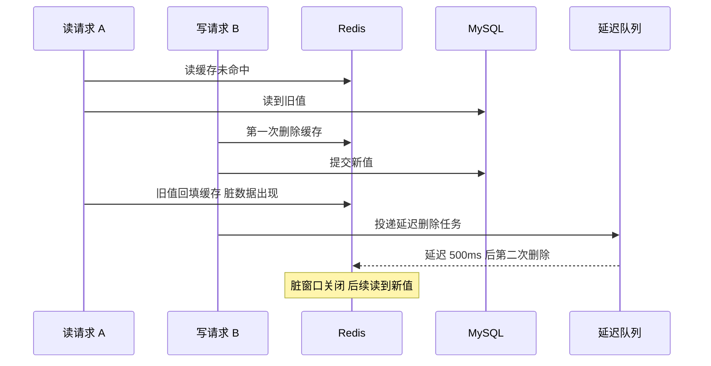

### NODE-146：幂等与事务消息如何用"本地消息表"实现？
**答**：
- 问题："DB 写成功但 MQ 发送失败"会造成数据不一致；本地消息表把"发消息"变成**与业务同库同事务的写一行**，把分布式问题降级为本地事务。
- 流程：业务写 + outbox 写在同一个事务 → Relay 定时扫 `status=0` 投递 → 成功置 1，失败指数退避重试，超限进死信人工处理。
- 多实例并发扫描要加分布式锁（NODE-123）；投递是**至少一次**语义，消费端必须按 biz_id 幂等去重（NODE-076）。
- 表设计核心索引：`(status, next_retry_at)` 复合索引让扫描高效；payload 存完整消息体，重试不依赖上游状态。

```javascript
// outbox(id, biz_id, payload, status[0待投递/1成功/2死信], retry, next_retry_at)
async function createOrderTx(order) {
  const conn = await mysql.getConnection();
  try {
    await conn.beginTransaction();
    await conn.query('INSERT INTO orders (id, uid, amount) VALUES (?, ?, ?)',
      [order.id, order.uid, order.amount]);                          // 业务写
    await conn.query(
      'INSERT INTO outbox (biz_id, payload, status) VALUES (?, ?, 0)',
      [order.id, JSON.stringify({ event: 'order.created', order })]); // 同事务写消息
    await conn.commit();
  } catch (e) { await conn.rollback(); throw e; }
  finally { conn.release(); }
}

// Relay：定时扫描投递（多实例需先抢分布式锁）
setInterval(async () => {
  const got = await redis.set('lock:outbox-relay', '1', 'PX', 50_000, 'NX');
  if (!got) return;
  const rows = await db.query(
    'SELECT * FROM outbox WHERE status = 0 AND next_retry_at <= NOW() LIMIT 100');
  for (const row of rows) {
    try {
      await mq.publish('order.events', row.payload);
      await db.query('UPDATE outbox SET status = 1 WHERE id = ?', [row.id]);
    } catch {
      await db.query(`UPDATE outbox SET retry = retry + 1,
        next_retry_at = DATE_ADD(NOW(), INTERVAL 30 SECOND),
        status = IF(retry >= 5, 2, 0) WHERE id = ?`, [row.id]);
    }
  }
}, 1000);
```

---

## 十八、微服务与协作

### NODE-147：BFF 与微服务是什么关系（聚合层的定位）？
**答**：
- 分层：客户端 → 网关（通用治理）→ **BFF（业务编排/聚合裁剪）** → 微服务（领域逻辑）；BFF 是微服务数据的"裁缝"，向前端暴露面向场景的接口。
- 三条纪律：① 每端独立 BFF（Web/App/小程序），避免一个 BFF 长成上帝层；② BFF 不写业务规则、不碰核心数据一致性，只编排；③ 微服务禁止绕过 BFF 直接暴露给前端。
- 典型能力：并行聚合 + 慢依赖降级（NODE-048）、字段裁剪（移动端只要 10 个字段不传 100 个）、协议转换（REST→GraphQL）。
- 劣化信号：BFF 里出现 `if 订单金额 > 100` 这类业务规则 = 架构在腐化，及时把规则下沉微服务（NODE-186）。

```javascript
// BFF 编排示例：微服务各管各的表，BFF 聚合裁剪
app.get('/api/mobile/order-detail/:id', async (ctx) => {
  const order = await breaker('order').exec(() => rpc.getOrder(ctx.params.id));
  if (!order) ctx.throw(404);
  const [buyer, track] = await Promise.all([
    cached(`user:${order.userId}`, () => rpc.getUserLite(order.userId), 60), // 裁剪：只要昵称头像
    withTimeout(rpc.getLogistics(ctx.params.id), 300, null),                 // 慢依赖降级为 null
  ]);
  ctx.body = {                       // 移动端字段裁剪：10 个字段而非 100 个
    status: order.status,
    buyer: buyer?.nickname,
    track: track?.latest,
  };
});
```

### NODE-148：服务间通信如何选型并保证韧性（超时/重试/透传）？
**答**：
- 选型速记：内部高频强契约 → gRPC（protobuf 二进制快 + 接口即文档）；对外/快迭代 → REST；异步解耦/削峰/事件通知 → MQ（NODE-092 有完整对比）。
- 韧性三件套比选型更重要：**deadline 必设**（防无限等待）、重试只对幂等且明确可重试的错误（UNAVAILABLE，不重试 INVALID_ARGUMENT）、退避 + 抖动防重试风暴。
- 全链路透传：traceparent（NODE-136）、灰度染色头、租户信息——通信层封装统一注入，业务无感。
- MQ 侧契约：序列化 schema 注册中心统一管理，消费幂等 + DLQ 兜底。

```javascript
const grpc = require('@grpc/grpc-js');

const client = new orderPkg.OrderService('order:50051',
  grpc.credentials.createInsecure(), {
    'grpc.enable_retries': 1,
    'grpc.service_config': JSON.stringify({
      methodConfig: [{
        name: [{ service: 'order.OrderService' }],
        timeout: '0.3s',                     // deadline 必设
        retryPolicy: {
          maxAttempts: 3,
          initialBackoff: '0.1s', maxBackoff: '1s', backoffMultiplier: 2,
          retryableStatusCodes: ['UNAVAILABLE'], // 只重试明确可重试错误
        },
      }],
    }),
  });

const meta = new grpc.Metadata();
meta.set('traceparent', currentTraceparent());  // 链路透传（NODE-136）
const reply = await new Promise((res, rej) =>
  client.getOrder({ orderId }, meta, { deadline: Date.now() + 300 },
    (e, r) => (e ? rej(e) : res(r))));
```

### NODE-149：服务发现与健康检查如何实现？
**答**：
- 三件事：**注册**（实例上线带 TTL 登记）、**心跳续约**（过期自动摘除，解决实例死亡不注销）、**发现**（客户端拉取 + 本地缓存，注册中心挂了也能用旧表）。
- 生产选型：Consul/Nacos/etcd/K8s Service；自研仅用于理解原理。
- 健康检查两级：liveness（进程活着）与 readiness（依赖就绪可接流量，NODE-061）——**注册时机绑定 readiness**，依赖没就绪不接流量。
- 优雅上下线：上线 readiness 通过后再注册；缩容先反注册再停进程，避免 502 窗口。

```javascript
// 简易注册中心核心（生产用 Consul/Nacos）
const registry = new Map(); // key: name:addr → { addr, weight, expires }

function register(name, instance, ttlMs = 15_000) {
  registry.set(`${name}:${instance.addr}`, { ...instance, name, expires: Date.now() + ttlMs });
}
function renew(name, addr, ttlMs = 15_000) {          // 心跳续约
  const k = `${name}:${addr}`;
  const it = registry.get(k);
  if (it) it.expires = Date.now() + ttlMs;
  else register(name, { addr }, ttlMs);
}
setInterval(() => {                                    // 过期摘除：实例死了不注销也自动下线
  for (const [k, v] of registry) if (v.expires <= Date.now()) registry.delete(k);
}, 5000);

// 客户端：拉取 + 过滤 + 本地缓存（注册中心挂了用旧表）
function discover(name) {
  return [...registry.values()]
    .filter((i) => i.name === name && i.expires > Date.now())
    .map(({ addr, weight }) => ({ addr, weight }));
}
// 实例侧：readiness 通过才 register；SIGTERM 先反注册再排空
```

### NODE-150：配置中心的推拉结合、版本与回滚怎么设计（nacos/apollo 思想）？
**答**：
- 推拉结合：**长轮询** = 拉的成本 + 推的实时性——客户端带已知版本挂 30s，版本一变立即返回，否则 304 后立刻发起下一轮。
- 版本化：每次发布生成**不可变快照**追加历史，当前版本是指针；回滚 = 指针指回旧版本，数据不动，秒级完成。
- 客户端三原则：本地 last-good 快照兜底（配置中心挂了用旧值）、收到变更先过 schema 校验再热更（NODE-089/155）、灰度发布配置本身（先推 10% 实例观察）。
- 治理：发布带审计（谁/何时/备注）、敏感项加密存储、环境隔离（dev/staging/prod 物理隔离）。

```javascript
// 服务端核心：版本化 + 长轮询 + 回滚
const history = new Map(); // key → [{ version, data, operator, ts, comment }]
const current = new Map(); // key → version

// 读：拉当前版本快照
app.get('/configs/:key', (ctx) => {
  const list = history.get(ctx.params.key) ?? [];
  ctx.body = list.find((v) => v.version === current.get(ctx.params.key)) ?? null;
});

// 长轮询：版本一变立即返回，实时性≈推
app.get('/configs/:key/watch', async (ctx) => {
  const known = Number(ctx.query.version ?? 0);
  const deadline = Date.now() + 30_000;
  while (Date.now() < deadline) {
    if ((current.get(ctx.params.key) ?? 0) !== known) {
      ctx.body = { version: current.get(ctx.params.key) };
      return;
    }
    await new Promise((r) => setTimeout(r, 500));
  }
  ctx.status = 304; // 超时未变，客户端立即发起下一轮
});

// 发布：不可变新版本 + 指针前移
app.post('/configs/:key/publish', auth('config:write'), async (ctx) => {
  const list = history.get(ctx.params.key) ?? [];
  const version = (list.at(-1)?.version ?? 0) + 1;
  list.push({ version, data: ctx.request.body, operator: ctx.state.uid,
    ts: Date.now(), comment: ctx.request.body.comment });
  history.set(ctx.params.key, list);
  current.set(ctx.params.key, version);
  auditLog.info({ key: ctx.params.key, version, by: ctx.state.uid });
  ctx.body = { version };
});

// 回滚：指针指回旧版本，秒级生效
app.post('/configs/:key/rollback', auth('config:write'), async (ctx) => {
  const list = (history.get(ctx.params.key) ?? []).slice();
  const target = ctx.body?.version ? list.find((v) => v.version === ctx.body.version) : list.at(-2);
  current.set(ctx.params.key, target.version);
  auditLog.info({ rollback: true, key: ctx.params.key, to: target.version });
  ctx.body = { version: target.version };
});
```

### NODE-151：链路压测与影子表如何实现？
**答**：
- 核心机制：压测流量全程带标记（`x-load-test: 1`），数据面按标记**改写落点**——SQL 走影子表、缓存 key 加前缀、MQ topic 加后缀，与生产数据物理隔离。
- 标记必须全链路透传：HTTP 头 → RPC metadata → MQ 消息头，断一环就会污染生产数据（事故级）。
- 影子表与生产同构 + 独立清理任务；外部调用（短信/支付/推送）在压测流量下**硬阻断**。
- 与 NODE-091 流量染色同一套机制：染色头既服务灰度也服务压测，网关注入、ALS 透传。

```javascript
// 染色中间件：识别并透传压测标记
app.use(async (ctx, next) => {
  ctx.state.shadow = ctx.get('x-load-test') === '1';
  if (ctx.state.shadow) {
    ctx.state.tableSuffix = '_shadow';
    ctx.state.cachePrefix = 'lt:';
    ctx.state.topicSuffix = '.shadow';
  }
  await next();
});

// ORM 层统一重写 SQL（示意）
function rewriteSql(sql, shadow) {
  return shadow
    ? sql.replace(/\bFROM\s+orders\b/i, 'FROM orders_shadow')
         .replace(/\bINSERT\s+INTO\s+orders\b/i, 'INSERT INTO orders_shadow')
    : sql;
}

// 红线：外部调用硬阻断
function guardExternal(ctx) {
  if (ctx.state.shadow) throw new Error('external call blocked under load test');
}
// 监控：压测流量单独打点（label shadow=1），与生产指标分开看板
```

### NODE-152：API 网关与 BFF 的分工边界在哪？
**答**：
- 网关 = **南北向 + 技术域**：路由转发、JWT 校验、IP 黑白名单、全局限流、TLS 终结、WAF、灰度分流、链路头注入——所有流量都要做且与业务无关的能力。
- BFF = **东西向 + 业务域**：按端聚合裁剪、协议转换（GraphQL/protobuf）、业务缓存、场景级降级、业务埋点。
- 判断口诀：所有流量都要做且与业务无关 → 网关；只有某些端/场景要 → BFF；与领域数据强相关 → 微服务本身。
- 典型反模式：鉴权在网关和 BFF 各做一遍（口径不一）、BFF 直连数据库穿透微服务边界、网关里写业务规则。

```yaml
# 网关路由配置：只认 BFF，不直连微服务；通用能力下沉网关
server:
  routes:
    - id: bff-web
      uri: http://bff-web.internal:3000
      predicates:
        - Path=/api/**
      filters:
        - JwtAuth                     # 鉴权：网关统一做，BFF 不重复
        - RateLimit=1000,1s           # 全局限流
        - AddRequestHeader=X-Trace-Id,generated   # 链路头注入
    - id: open-api                    # 开放平台独立泳道
      uri: http://open-bff.internal:3000
      predicates:
        - Path=/open/v1/**
      filters:
        - ApiKeyAuth
        - RateLimitKeyedByApiKey=100,1m
# BFF 只做业务编排：聚合、裁剪、业务缓存、场景降级（NODE-147/048）
```

---

## 十九、TypeScript Node 工程

### NODE-153：TS Node 服务的构建链如何选型（tsx/ts-node/tsc）？
**答**：
- 开发态用 **tsx**（esbuild 内核，零配置直跑 TS + watch，替代慢的 ts-node）；生产态用 **tsc 产出 dist**——稳定、可回滚、镜像里不装 devDependencies。
- 分层 tsconfig：`tsconfig.json`（编辑器/检查，noEmit）+ `tsconfig.build.json`（产物，排除测试）。
- CI 门禁：`tsc --noEmit` 类型检查独立于运行；测试用 vitest（esbuild 同源，速度匹配 tsx）。
- 折中方案：tsup/esbuild 打单文件（快 + 免路径别名处理），但失去生成 d.ts 的严格性——库用 tsc，应用可打包。

```json
{
  "type": "module",
  "engines": { "node": ">=20" },
  "scripts": {
    "dev": "tsx watch src/server.ts",
    "typecheck": "tsc --noEmit",
    "build": "tsc -p tsconfig.build.json",
    "start": "node dist/server.js",
    "test": "vitest run"
  },
  "devDependencies": {
    "tsx": "^4.0.0",
    "typescript": "^5.5.0",
    "vitest": "^2.0.0"
  }
}
```

```json
// tsconfig.build.json —— 只收 src，产出干净 dist
{
  "extends": "./tsconfig.json",
  "compilerOptions": { "outDir": "dist", "declaration": false },
  "include": ["src"],
  "exclude": ["src/**/*.test.ts"]
}
```

### NODE-154：路径别名与 monorepo 共享代码怎么落地？
**答**：
- 开发态：`tsconfig paths` 让 `@shared/utils` 可解析（编辑器 + tsc 都认）；**运行态是另一回事**——Node 不认识 paths。
- 三种运行态方案：① `tsc-alias`/`module-alias` 构建期改写；② tsup/esbuild 打包时解析；③ **monorepo 正统**：shared 做成 workspace 包，`package.json exports` 声明入口，Node 原生解析。
- pnpm workspace 下 shared 改动即时生效（软链），无需反复构建；CI 里各包独立类型检查。
- 坑：`"module": "NodeNext"` 时相对导入必须带扩展名，exports 字段要与文件结构对齐。

```json
// tsconfig.base.json（monorepo 根）
{
  "compilerOptions": {
    "strict": true,
    "module": "NodeNext",
    "moduleResolution": "NodeNext",
    "baseUrl": ".",
    "paths": {
      "@shared/*": ["packages/shared/src/*"],
      "@db/*": ["packages/db/src/*"]
    }
  }
}
```

```json
// packages/shared/package.json —— workspace 包，运行态靠 exports 解析
{
  "name": "@acme/shared",
  "type": "module",
  "exports": {
    ".": "./src/index.ts",
    "./utils": "./src/utils.ts"
  }
}
// 应用侧 dependencies 写 "workspace:*"（pnpm）→ 软链即改即生效
```

### NODE-155：如何用 zod 做类型安全的配置加载？
**答**：
- 痛点：`process.env.X` 全是 string | undefined，散落读取 = 运行时才炸；zod 让**启动即校验 + 全程类型推导**。
- 模式：一份 schema 描述全部环境变量 → `parse` 失败 fail fast（绝不带病启动）→ 导出强类型 env 对象，唯一入口。
- 常用技巧：`z.coerce.number()` 处理字符串数字、`default` 给可选项、`refine` 做跨字段约束（如 prod 必填某密钥）。
- 配置中心联动：远端配置热更时同样先过 schema（NODE-150），非法配置拒绝生效。

```typescript
import { z } from 'zod';

const Env = z.object({
  NODE_ENV: z.enum(['development', 'test', 'production']).default('development'),
  PORT: z.coerce.number().int().min(1024).default(3000), // 字符串环境变量 → 数字
  DATABASE_URL: z.string().url(),
  REDIS_URL: z.string().url(),
  JWT_PUBLIC_KEY: z.string().min(100),
  LOG_LEVEL: z.enum(['fatal', 'error', 'warn', 'info', 'debug']).default('info'),
}).refine((e) => e.NODE_ENV !== 'production' || e.JWT_PUBLIC_KEY.length > 100, {
  message: '生产环境必须配置 JWT_PUBLIC_KEY',
});

// 启动即校验：缺配置直接崩，CI 阶段也能提前发现
export const env = Env.parse(process.env);
env.PORT; // 类型：number，全程推导
// 铁律：新增配置必须先改 schema；禁止业务代码直接读 process.env.X
```

### NODE-156：如何用 Prisma 构建类型安全的 DB 层？
**答**：
- 核心：`schema.prisma` 是唯一事实源 → `prisma generate` 产出精确 TS 类型 → **表结构变更即编译期报错**，字段拼错/类型不符在 CI 就拦截。
- 查询类型随 select 收窄：只 select 部分字段时返回类型自动只有这些字段；`Awaited<ReturnType<...>>` 可反向提取类型给下游。
- 事务类型安全：`$transaction(async (tx) => ...)` 里 tx 拥有同样的类型约束。
- 配套纪律：迁移走 `prisma migrate`（SQL 入库 review）；复杂查询用 `$queryRaw` tagged template（参数化防注入，NODE-127）。

```typescript
// schema.prisma → npx prisma generate
// model Order { id String @id  userId String  status OrderStatus  amount Int }

const listOrders = (userId: string) =>
  prisma.order.findMany({
    where: { userId, status: 'PAID' },        // 枚举值拼错 → 编译失败
    select: { id: true, amount: true, createdAt: true },
    orderBy: { createdAt: 'desc' },
    take: 20,
  });

type OrderRow = Awaited<ReturnType<typeof listOrders>>[number]; // 类型反向提取

const result = await prisma.$transaction(async (tx) => {
  const o = await tx.order.update({           // 事务内同样类型安全
    where: { id }, data: { status: 'PAID' },
  });
  return o;
});
```

### NODE-157：OpenAPI→类型→校验"一条链"如何打通？
**答**：
- 单一事实源：**OpenAPI 文档先行**，类型与运行时校验都从它生成——前后端契约、SDK、mock 全部同源。
- 链路：`openapi.yaml` → `openapi-typescript` 生成 TS 类型（编译期）→ `express-openapi-validator`/zod schema 运行时校验请求响应 → 前端 SDK 同源生成。
- 价值闭环：改契约 → 前端类型即时报错（编译期拦截）+ 服务端校验拦截（运行时兜底），契约漂移无处藏身。
- CI 门禁：breaking change 检测（oasdiff），破坏性变更必须升 major 并评审。

```yaml
# openapi.yaml —— 契约先行
openapi: 3.1.0
info: { title: order-api, version: 1.2.0 }
paths:
  /orders/{id}:
    get:
      parameters:
        - name: id
          in: path
          required: true
          schema: { type: string, pattern: "^[0-9]+$" }
      responses:
        "200":
          content:
            application/json:
              schema:
                type: object
                required: [id, status]
                properties:
                  id: { type: string }
                  status: { type: string, enum: [PENDING, PAID, SHIPPED] }
```

```bash
# 类型与校验同源生成
npx openapi-typescript openapi.yaml -o src/types/api.ts
# 服务端：express-openapi-validator 按同一文档校验请求/响应
# 前端 SDK：openapi-typescript-codegen 生成带类型的 client
# CI 门禁：oasdiff breaking openapi.yaml origin/main/openapi.yaml
```

### NODE-158：CommonJS 迁移 ESM 的实践要点？
**答**：
- 第一步：`package.json` 加 `"type": "module"`；CJS 互操作用 `createRequire` 兼容旧依赖。
- 语法迁移四件套：import/export 替代 require、相对导入**必须带扩展名**（`./routes.js`）、`__dirname/__filename` 用 `import.meta.url` 重建、动态 `require()` 改 `await import()`。
- 收益：真静态分析（打包/树摇）、顶层 await（初始化连接）、与浏览器生态语法统一。
- 库发布注意：`exports` 字段声明双格式或纯 ESM，消费方 Node 版本有下限要求（纯 ESM 需要 ≥12.20）。

```javascript
// ESM 迁移核心对照
import { fileURLToPath } from 'node:url';
import path from 'node:path';
import express from 'express';
import { createRequire } from 'node:module';

const require = createRequire(import.meta.url); // 兼容只支持 CJS 的旧依赖
const legacyDep = require('some-cjs-only-pkg');

const __filename = fileURLToPath(import.meta.url); // CJS 全局变量替代
const __dirname = path.dirname(__filename);

// 相对导入必须带扩展名：import './routes' 报错 → import './routes.js'
const app = express();
export default app;

// 顶层 await：初始化连接不再需要 async main 包裹
await prisma.$connect();
app.listen(env.PORT);
```

---

## 二十、综合与体系

### NODE-159：设计一个 CMS 内容服务（CRUD/审核/版本）？
**答**：
- 数据模型：article 主表（当前态）+ article_version 版本表（每次发布快照）+ review_record 审核记录表。
- 状态机：draft → in_review → published → archived，非法流转直接 400；已发布内容改稿走"新版本 + 重新审核"，线上内容不中断。
- 并发编辑用**乐观锁**（version 字段 CAS）；发布成功发事件触发 CDN 预热与搜索索引更新。
- 敏感内容先过审核服务（NODE-096），审核通过才允许 publish。

```javascript
const TRANSITIONS = {
  draft: ['in_review'],
  in_review: ['published', 'draft'],   // 审核驳回退回草稿
  published: ['archived'],
  archived: ['draft'],
};

app.post('/cms/articles/:id/publish', auth('editor'), async (ctx) => {
  const article = await db.$transaction(async (t) => {
    const a = await t.article.findUnique({ where: { id: ctx.params.id } });
    if (!TRANSITIONS[a.status]?.includes('published')) ctx.throw(400, '状态机不允许发布');
    if (a.version !== ctx.request.body.baseVersion) ctx.throw(409, '内容已被他人修改'); // 乐观锁
    await t.articleVersion.create({     // 发布即快照，可回溯可回滚
      data: { articleId: a.id, version: a.version + 1, snapshot: a.content },
    });
    return t.article.update({
      where: { id: a.id },
      data: { status: 'published', version: { increment: 1 }, publishedAt: new Date() },
    });
  });
  await mq.publish('cms.article.published', article); // 触发 CDN 预热/搜索索引
  ctx.body = article;
});
```

### NODE-160：设计一个订单服务简化版（状态机/事务/幂等）？
**答**：
- 状态机驱动一切：`CREATED → PAID → SHIPPED → DONE`，分支 `CANCELED/REFUNDED`；流转函数是唯一入口，非法流转拒绝。
- 并发正确性：流转用 `updateMany where status = 当前态` 做 **CAS 乐观锁**，防两个回调同时改状态。
- 幂等三处：支付回调按状态机天然幂等（已 PAID 再回调 count=0 直接 ACK）、下单按 orderId 唯一键、消息消费按 outbox（NODE-146）。
- 超时关单：下单投递**延迟消息**（15min），消费时校验仍是 CREATED 才取消并回补库存。

```javascript
const TRANSITIONS = {
  CREATED: ['PAID', 'CANCELED'],
  PAID: ['SHIPPED', 'REFUNDED'],
  SHIPPED: ['DONE'],
};

async function transition(orderId, to) {
  return db.$transaction(async (tx) => {
    const o = await tx.order.findUnique({ where: { id: orderId } });
    if (!TRANSITIONS[o.status]?.includes(to)) {
      throw badRequest(`非法流转 ${o.status} → ${to}`);
    }
    const updated = await tx.order.updateMany({   // CAS：只允许从当前状态流转
      where: { id: orderId, status: o.status },
      data: { status: to },
    });
    if (updated.count === 0) throw conflict('并发流转冲突'); // 幂等兜底
    return o;
  });
}

// 超时关单：延迟消息，消费时二次校验状态
await closeQueue.add('close', { orderId },
  { delay: 15 * 60 * 1000, jobId: `close:${orderId}` }); // jobId 防重复入队
// 消费端：status 仍为 CREATED 才 CANCELED + 回补库存
```

### NODE-161：设计一个秒杀服务端（限流/预扣/队列）？
**答**：
- 三级漏斗：**网关限流挡量**（令牌桶，NODE-132）→ **Redis 预扣挡超卖**（Lua 原子扣减）→ **MQ 削峰挡 DB**（恒速消费，NODE-144）。
- 入口毫秒级返回：校验 → 一人一单去重 → 预扣 → 入队 → 202 + 排队凭证；前端轮询或 WS 查结果。
- 数据库最终一致：消费端事务里 `UPDATE stock SET n = n - 1 WHERE sku = ? AND n > 0` 扣真实库存，失败回补 Redis。
- 收尾细节：超时未支付释放库存（延迟消息）、热点 sku 库存分桶（把一个 key 拆 10 个降低竞争）。

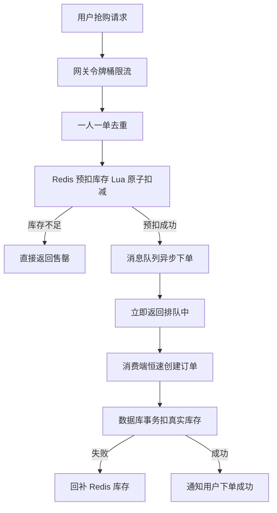

```javascript
const SECKILL_LUA = `local s = tonumber(redis.call("get", KEYS[1]) or "0")
if s <= 0 then return -1 end
redis.call("decr", KEYS[1])
return s - 1`;

app.post('/seckill/:skuId', limiter({ qps: 5000 }), async (ctx) => {
  const uid = ctx.state.uid;
  if (!(await redis.set(`seckill:dup:${ctx.params.skuId}:${uid}`, 1, 'PX', 86400000, 'NX'))) {
    ctx.throw(409, '重复参与');                       // 一人一单
  }
  const left = await redis.eval(SECKILL_LUA, 1, `stock:${ctx.params.skuId}`);
  if (left < 0) { ctx.status = 409; ctx.body = { msg: 'sold out' }; return; }
  const orderId = genOrderId();
  await orderQueue.add('seckill', { skuId: ctx.params.skuId, uid, orderId },
    { attempts: 5, backoff: { type: 'fixed', delay: 500 } });
  ctx.status = 202;
  ctx.body = { orderId, status: 'PROCESSING' };       // 异步结果页
});
```

### NODE-162：设计一个 IM 消息服务（离线消息/已读/漫游）？
**答**：
- 可靠性三件套：**seq 序列号**（会话内单调递增，客户端按 seq 判缺）、**ACK 确认**（发送方 ACK 存 lastAckSeq）、**离线兜底**（投递超时未 ACK 落 offline 表，上线按 seq 补拉）。
- 消息去重：客户端生成 clientMsgId，服务端去重表拦截重发；服务端分配 seq 后才可投递。
- 漫游：消息按会话存 7 天 + 用户级同步 seq，换设备拉全量历史；已读回执只更新 lastReadSeq，不重发消息体。
- 架构：接入网关（WS 长连接，sticky，NODE-141）→ 投递队列 → 对端网关；跨机房按用户路由。

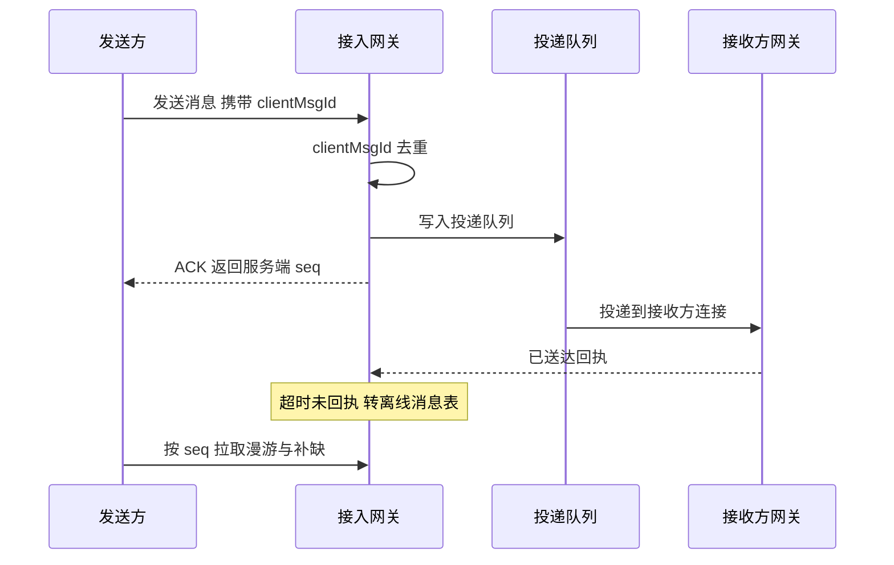

```javascript
io.on('connection', (socket) => {
  const uid = socket.handshake.auth.uid;
  online.set(uid, socket.id);

  socket.on('msg', async ({ clientMsgId, to, body }) => {
    if (await redis.set(`msg:dedup:${clientMsgId}`, 1, 'PX', 86400000, 'NX') === null) return; // 去重
    const convKey = [uid, to].sort().join(':');
    const seq = await redis.incr(`seq:${convKey}`);   // 会话内单调 seq
    const msg = { seq, from: uid, to, body, ts: Date.now() };
    await mq.publish('im.deliver', msg);              // 先落队列，进程崩溃不丢
    socket.emit('msg:ack', { clientMsgId, seq });     // 给发送方确认
  });

  socket.on('msg:ack', ({ seq }) =>                   // 已送达游标
    db.user.update({ where: { id: uid }, data: { lastAckSeq: seq } }));
  socket.on('msg:read', ({ convKey, seq }) =>         // 已读游标
    redis.hset(`read:${uid}`, convKey, seq));
});
// 上线补拉：max(lastAckSeq, lastReadSeq) 之后的 offline 表记录逐条补投
```

### NODE-163：设计一个 feed 流服务（推拉模式）？
**答**：
- 推模式（写扩散）：发博时写进每个粉丝收件箱（Redis ZSET），读时 O(1)——普通用户适用；大 V 百万粉丝写扩散爆炸。
- 拉模式（读扩散）：读时实时归并关注者最新内容——大 V 适用；粉丝读延迟高。
- **推拉结合**：普通用户发博推，大 V 发博只标记；读时 = 收件箱 + 实时拉大 V 最新 → 归并去重排序。
- 工程细节：收件箱只留最近 3000 条（ZSET REMRANGEBYRANK 裁剪），冷数据回源 DB 分页；去重按 post.id 集合。

```javascript
async function onPost(post) {
  const followers = await db.follow.count({ where: { followeeId: post.authorId } });
  if (followers > 10_000) return;                 // 大 V 不推，读时拉
  const fans = await db.follow.findMany({
    where: { followeeId: post.authorId }, select: { followerId: true },
  });
  await redis.pipeline(                           // 批量写粉丝收件箱
    fans.map((f) => ['zadd', `feed:${f.followerId}`, post.score, post.id])
  ).exec();
}

async function getFeed(userId, cursor = 0) {
  const bigVIds = await followedBigVIds(userId);
  const [inbox, bigV] = await Promise.all([
    redis.zrevrange(`feed:${userId}`, cursor, cursor + 20, 'WITHSCORES'),
    fetchBigVLatest(bigVIds, 20),                 // 实时拉大 V
  ]);
  const merged = [...inbox, ...bigV]
    .sort((a, b) => b.score - a.score);           // 归并排序
  const seen = new Set();
  return merged.filter((p) => !seen.has(p.id) && seen.add(p.id)).slice(0, 20); // 去重
}
```

### NODE-164：设计一个支付回调处理（重试/幂等/对账）？
**答**：
- 处理四步：**验签**（防伪造，raw body 校验）→ **幂等**（状态机 CAS：PENDING→PAID 只会成功一次，重复回调直接 ACK）→ **同事务发后续事件**（outbox，NODE-146）→ **按协议应答**（success 停止重试，5xx 触发渠道退避重试）。
- 重试是渠道行为：设计要主动配合——处理失败返回 5xx 让渠道重试，但下游事件必须幂等。
- 对账兜底：每日 T+1 拉渠道账单 vs 本地流水 diff，差异生成工单；掉单场景（回调丢了）靠**主动查单**补偿。
- 红线：回调处理必须快（渠道有超时），重活（发货/通知）一律异步化。

```javascript
app.post('/pay/callback', express.raw({ type: '*/*' }), async (ctx) => {
  const evt = JSON.parse(ctx.request.body);
  if (!verifySignature(ctx.request.body, ctx.get('x-signature'), PAY_SECRET)) {
    return ctx.throw(401);                                   // 1. 验签
  }
  const handled = await db.$transaction(async (tx) => {
    const updated = await tx.payment.updateMany({            // 2. 幂等：CAS 状态机
      where: { orderId: evt.orderId, status: 'PENDING' },
      data: { status: 'PAID', paidAt: new Date(), channelTradeNo: evt.tradeNo },
    });
    if (updated.count === 0) return false;                   // 重复回调
    await tx.outbox.create({                                 // 3. 同事务发事件
      data: { bizId: evt.orderId, payload: JSON.stringify(evt) },
    });
    return true;
  });
  ctx.status = 200; ctx.body = 'success';                    // 4. ACK 停止渠道重试
});
// 主动查单兜底掉单：每 5min 扫 PENDING 超过 10min 的单，调渠道查单接口对齐状态
// 对账：T+1 账单 diff → 差异表 → 财务工单
```

### NODE-165：设计一个 webhook 系统（签名/重试/死信）？
**答**：
- 投递协议：POST JSON + **HMAC 签名头**（接收端用同一 secret 重算对比，防伪造与篡改）；带事件 id 供接收端幂等去重。
- 重试策略：指数退避（1/2/4/8/16s），**4xx 语义失败不重试**（签名错/参数错重试也没用），5xx 与 429 与网络错误重试。
- 死信：N 次失败入死信表 + 通知订阅方管理员，支持控制台手动重投。
- 接收端守则：验签在解析处理前、按事件 id 幂等、处理慢先 202 入本地队列（我们的重试会打挂同步处理方）。

```javascript
async function deliver(sub, event) {
  const payload = JSON.stringify({ id: event.id, type: event.type, data: event.data, ts: Date.now() });
  const sig = crypto.createHmac('sha256', sub.secret).update(payload).digest('hex');

  for (let attempt = 0; attempt < 5; attempt++) {
    try {
      const res = await fetch(sub.url, {
        method: 'POST',
        headers: {
          'content-type': 'application/json',
          'x-webhook-signature': `sha256=${sig}`,   // 接收端验签依据
          'x-webhook-id': event.id,                  // 接收端幂等键
        },
        body: payload,
        signal: AbortSignal.timeout(5000),
      });
      if (res.ok) return recordSuccess(event, sub);
      if (res.status < 500 && res.status !== 429) return recordDead(event, sub, 'no-retry');
    } catch { /* 网络错误继续重试 */ }
    await sleep(2 ** attempt * 1000);                // 1s/2s/4s/8s/16s
  }
  await deadLetter(event, sub);                      // 死信表 + 通知订阅方
}
```

### NODE-166：设计一个任务调度平台（分布式 cron 与分片）？
**答**：
- 核心问题：多实例下同一 tick 重复执行 → **tick 锁**（Redis SET NX，TTL 覆盖执行窗口）+ 任务 jobId 唯一（BullMQ 天然去重）。
- 分片并行：任务按 `shard = id % total` 拆分，每实例领自己的区间，横向扩容提速。
- 编排：依赖任务用 DAG（上游成功才解锁下游）；错过 tick（实例重启）要补跑策略（跳过/立即补/按最新一次）。
- 可观测：每分片任务上报进度耗时，连续 N 次 tick 错过告警；任务幂等是底线（重试必然发生）。

```javascript
const cron = require('node-cron');
const INSTANCE = process.env.INSTANCE_ID;

cron.schedule('*/5 * * * *', async () => {
  const tick = new Date().toISOString().slice(0, 16);       // 分钟级 tick 标识
  const got = await redis.set(`cron:sync:${tick}`, INSTANCE, 'PX', 240_000, 'NX');
  if (!got) return;                                          // 多实例只有一台执行
  const total = await db.user.count();
  const SHARDS = 8;
  await Promise.all(Array.from({ length: SHARDS }, (_, s) =>
    taskQueue.add('sync', { shard: s, total },
      { jobId: `sync:${tick}:${s}`,                          // jobId 唯一 → 天然防重复入队
        attempts: 3, backoff: { type: 'fixed', delay: 2000 } })));
});

new Worker('sync', async (job) => {
  const { shard, total } = job.data;
  await db.user.findMany({ where: { id: { mod: { total, remainder: shard } } } })
    .then(syncBatch);                                        // 每实例领自己的分片
}, { concurrency: 4 });
```

### NODE-167：设计一个 API 开放平台（鉴权/限流/文档/SDK）？
**答**：
- 四件套：**AppKey/AppSecret 鉴权**（HMAC 签名 + 时间戳防重放，NODE-087）→ **按应用限流**（令牌桶，配额随套餐）→ **自助文档**（OpenAPI 生成 + 在线调试台）→ **多语言 SDK**（同源生成）。
- 泳道隔离：开放流量独立 BFF 与网关路由（NODE-152 open-api 泳道），限流配额独立，故障不波及内部。
- 版本策略：v1 冻结只修 bug，新能力走 v2；废弃提前 6 个月发公告与响应头提示。
- 治理：应用注册/审核/吊销流程、调用量与错误率看板、异常调用自动限流并通知。

```javascript
app.use('/open/v1', async (ctx, next) => {
  const app = await db.app.findUnique({ where: { appKey: ctx.get('x-api-key') } });
  if (!app || app.status !== 'ACTIVE') ctx.throw(401);

  // 签名 = HMAC-SHA256(secret, method + path + timestamp + bodyMd5)
  const ts = Number(ctx.get('x-timestamp'));
  if (Math.abs(Date.now() - ts) > 300_000) ctx.throw(401, 'timestamp drifted'); // 防重放
  if (!verifySig(app.secret, ctx)) ctx.throw(401, 'bad signature');

  const ok = await tokenBucket(`open:${app.appKey}`, app.rateLimit); // 按应用限流
  if (!ok) {
    ctx.status = 429;
    ctx.body = { code: 'RATE_LIMITED', retryAfter: 1 };
    return;
  }
  ctx.state.app = app;
  await next();
});
// 文档：OpenAPI 驱动（NODE-157）+ 沙箱 AppKey 在线调试
// SDK：openapi-typescript + codegen 发 npm，类型与文档同源
```

### NODE-168：设计一个爬虫服务（调度/反爬/存储）？
**答**：
- 三层：**调度**（优先级队列 + 去重集合）→ **抓取**（并发控制 + UA 池 + 限速）→ **存储**（结构化抽取 + url 唯一键幂等入库）。
- 合规底线：遵守 robots.txt、对单站限速（limiter 5 QPS）、UA 可识别、隐私数据只存摘要。
- 反爬对策分级：限频（遵守 Retry-After）、验证码（接入打码或人工）、登录态（cookie 池轮换）、封 IP（代理池 + 退避）。
- 稳定性：任务可恢复（队列持久化）、失败重试 + 死信、抓取内容 hash 去重防重复存储。

```javascript
const { Queue, Worker } = require('bullmq');
const crawlQueue = new Queue('crawl', { connection: redis });
const seen = new Set(); // url 去重（量大换 Redis SADD / BloomFilter）

async function schedule(url, depth) {
  if (seen.has(url)) return;
  seen.add(url);
  await crawlQueue.add('fetch', { url, depth }, { priority: depth }); // 浅层优先
}

new Worker('crawl', async (job) => {
  const { url, depth } = job.data;
  if (await robotsDisallowed(url)) return;                 // robots 合规
  const res = await fetch(url, {
    headers: { 'user-agent': UA_POOL.random(), accept: 'text/html' },
    signal: AbortSignal.timeout(8000),
  });
  if (res.status === 429) {                                 // 尊重限频
    await sleep((+res.headers.get('retry-after') || 5) * 1000);
    throw job.retry();
  }
  const html = await res.text();
  await bulkUpsert(extract(html));                          // url 唯一键幂等入库
  if (depth < 3) for (const link of extractLinks(html)) await schedule(link, depth + 1);
}, { concurrency: 10, limiter: { max: 5, duration: 1000 } }); // 单站限速 5 QPS
```

### NODE-169：设计一个实时协作后端概览（WebSocket + CRDT）？
**答**：
- 分工：**合并交给客户端 CRDT 库**（如 Yjs，更新可交换/可合并，乱序到达也正确），服务端只做中继、排序、持久化——服务端不做 OT 变换，复杂度大幅下降。
- 数据流：op 到达 → 合并进房间状态 → 广播给同房间其他人 → 防抖持久化（合并 2s 内更新）。
- 房间与连接：WS 网关（NODE-073）+ sticky（NODE-141）；presence（光标/选区）高频小消息走独立频道，不进 CRDT 不持久化。
- 离线与快照：客户端本地 pending 队列 + 上线 sync（状态向量 diff）；定期快照加速新加入者初始化。

```javascript
const Y = require('yjs');
const rooms = new Map(); // docId → { ydoc, persistTimer }

io.on('connection', (socket) => {
  socket.on('doc:join', async ({ docId }) => {
    socket.join(docId);
    const room = rooms.get(docId) ?? await loadRoom(docId); // DB/快照恢复
    rooms.set(docId, room);
    socket.emit('doc:sync', Y.encodeStateAsUpdate(room.ydoc)); // 全量初始化
  });

  socket.on('doc:op', ({ docId, update }) => {
    const room = rooms.get(docId);
    Y.applyUpdate(room.ydoc, update);            // CRDT 合并：天然支持乱序并发
    socket.to(docId).emit('doc:op', { update }); // 广播给其他人
    debouncedPersist(docId, 2000);               // 防抖持久化合并更新
  });

  socket.on('doc:presence', ({ docId, cursor }) =>
    socket.to(docId).emit('doc:presence', { uid: socket.uid, cursor })); // 不持久化
});
```

### NODE-170：设计一个 AI 应用后端（流式/会话/工具调用网关）？
**答**：
- 网关三职责：**统一协议**（多模型适配层）、**流式透传**（SSE，NODE-120）、**会话与计费管理**（记忆、token 计量、限流预算）。
- 流式链路：客户端 SSE ← BFF ← 上游 LLM SSE；逐块转发同时统计 usage，结束后落计费流水。
- 会话记忆：超窗滑动截断 + 早期对话摘要压缩；工具调用（function calling）：模型返回 tool_calls → 服务端执行 → 结果回填再请求，循环直到终止。
- 治理：按用户限流与日预算、敏感词前置过滤（NODE-096）、prompt 注入检测、超时与重试。

```javascript
app.post('/api/chat', rateLimitPerUser({ rpm: 10 }), async (ctx) => {
  const { messages, tools } = ctx.request.body;
  ctx.set('content-type', 'text/event-stream; charset=utf-8');   // SSE 流式

  const upstream = await fetch(`${LLM_BASE}/chat/completions`, {
    method: 'POST',
    headers: { authorization: `Bearer ${env.LLM_KEY}` },
    body: JSON.stringify({
      model: 'glm-4',
      messages: withMemory(ctx.state.uid, messages),  // 会话记忆注入
      tools,
      stream: true,
    }),
  });

  let usage = { prompt: 0, completion: 0 };
  const reader = upstream.body.getReader();
  const decoder = new TextDecoder();
  while (true) {                                      // 逐块透传 + 计量
    const { done, value } = await reader.read();
    if (done) break;
    const text = decoder.decode(value);
    usage = accumulateUsage(usage, text);
    ctx.res.write(text);
  }
  ctx.res.end();
  await billing.record(ctx.state.uid, usage, 'glm-4'); // token 计费落流水
});
// 工具调用循环：model 返回 tool_calls → 服务端执行 → 结果回填 messages → 再次请求
```

### NODE-171：设计一个图片服务（上传/处理/防盗链）？
**答**：
- 链路：签名直传（NODE-126，文件不过业务服务器）→ 上传回调触发处理流水线（队列异步）→ 多尺寸 + webp 生成 → CDN 分发。
- 处理用 sharp（NODE-080 有专题）：缩略图按预定义尺寸生成；长尾尺寸用"CDN 缓存按需变换"（x-oss-process 风格）。
- 防盗链三层：**URL 签名**（HMAC + 过期时间 + 处理参数进签名防篡改）、Referer 白名单、限额防刷。
- 安全：MIME/魔数校验、大小限制、路径含 uid 防越权覆盖、EXIF 隐私剥离。

```javascript
app.post('/api/images/sign', auth, async (ctx) => {
  const { name, size, mime } = ctx.request.body;
  if (!ALLOW_MIME.has(mime) || size > 10 * 1024 * 1024) ctx.throw(400); // 白名单
  const key = `img/${ctx.state.uid}/${randomUUID()}${path.extname(name)}`; // 防越权覆盖
  ctx.body = {
    uploadUrl: oss.signatureUrl(key, { method: 'PUT', expires: 600 }),
    cdnUrl: `${IMG_CDN}/${key}`,
  };
});

// 防盗链：签名 URL（处理参数进签名）
function signedImgUrl(key, { w, h, ttlSec = 3600 } = {}) {
  const expires = Math.floor(Date.now() / 1000) + ttlSec;
  const sig = crypto.createHmac('sha1', CDN_SECRET)
    .update(`${key}-${w ?? 0}-${h ?? 0}-${expires}`).digest('base64url');
  return `${IMG_CDN}/${key}?w=${w ?? ''}&h=${h ?? ''}&e=${expires}&s=${sig}`;
}

// 处理流水线：上传回调 → 队列 → sharp 多尺寸
processQueue.add('resize', { key }, { attempts: 3 });
// worker：sharp(src).resize(w).webp({ quality: 80 }) → 逐尺寸上传 → 元数据入库
```

### NODE-172：设计一个搜索服务概览（ES 分词/高亮）？
**答**：
- 索引设计：中文分词 `ik_max_word`（索引细切提高召回）+ `ik_smart`（查询粗切防过度拆分）；过滤字段用 keyword 不分词。
- 查询要点：`multi_match` 多字段 + 标题权重 `title^3`；过滤条件放 **filter 子句**（不算分且可缓存）；深分页用 `search_after` 而非 from+size。
- 高亮：highlight 返回 `<em>` 包裹片段，前端渲染必须防 XSS（按富文本处理，NODE-057）。
- 写入链路：binlog/MQ → 异步更新索引（最终一致）；重建索引用别名切换（零停机）。

```javascript
const mapping = {
  properties: {
    title: { type: 'text', analyzer: 'ik_max_word', search_analyzer: 'ik_smart' },
    content: { type: 'text', analyzer: 'ik_max_word' },
    status: { type: 'keyword' },       // 过滤字段不分词
    publishedAt: { type: 'date' },
  },
};

async function search(q, { page = 1 } = {}) {
  const { hits } = await es.search({
    index: 'articles',
    body: {
      query: { bool: {
        must: [{ multi_match: { query: q, fields: ['title^3', 'content'],
          type: 'best_fields', fuzziness: 'AUTO' } }],
        filter: [{ term: { status: 'published' } }],  // filter 不算分且可缓存
      }},
      highlight: {
        fields: { title: {}, content: { fragment_size: 80 } },
        pre_tags: ['<em>'], post_tags: ['</em>'],
      },
      sort: [{ _score: 'desc' }, { publishedAt: 'desc' }],
      search_after: page > 1 ? cursorOf(page) : undefined, // 深分页用 search_after
      size: 20,
    },
  });
  return hits.hits.map((h) => ({ id: h._id, score: h._score, ...h._source, hl: h.highlight }));
}
```

### NODE-173：设计一个推荐位服务（召回/曝光去重）？
**答**：
- 工程链路：候选池（离线任务更新进 Redis Set）→ 在线召回 → 粗排（规则/模型分数）→ **曝光去重** → 批量取详情 → 展示埋点回流。
- 曝光去重：按用户按天记 Set（`exposed:{uid}:{day}`）；亿级规模换 BloomFilter（120MB 内存扛 1 亿 id，1% 误判换 10 倍内存节省）。
- 召回与排序分离：服务端只管工程层（去重、补位、降级），排序模型离线训练在线打分。
- 闭环：曝光/点击埋点回流 → 离线任务更新候选池与权重 → 次日生效。

```javascript
async function recommend(uid, { scene, size = 10 } = {}) {
  const [pool, exposed] = await Promise.all([
    redis.smembers(`rec:pool:${scene}`),             // 离线更新的候选池
    redis.smembers(`exposed:${uid}:${dayKey()}`),    // 当日已曝光
  ]);
  const items = pool
    .filter((id) => !exposed.includes(id))           // 曝光去重
    .sort(() => Math.random() - 0.5)                 // 粗排：随机占位，接模型时替换
    .slice(0, size);
  await redis.sadd(`exposed:${uid}:${dayKey()}`, ...items); // 预记曝光
  await redis.expire(`exposed:${uid}:${dayKey()}`, 86_400);
  return hydrate(items);                             // 批量取详情（NODE-048 聚合）
}
// 补位：去重后不足 size → 用热度榜兜底补齐；降级：召回失败直接返回热度榜
```

### NODE-174：设计一个通知中心（多通道/模板/频控）？
**答**：
- 与 NODE-095 互补，本题聚焦**频控与通道优先级**：通知按优先级走通道链（push → sms → email），成功一个即止；营销类通知独立低优先级队列与更严频控。
- 频控：每通道每用户窗口计数（Redis INCR+PEXPIRE，精确版换滑动窗口 NODE-132），超限跳下一通道并记录 skip 原因。
- 模板：模板 + 参数 + i18n 渲染分离；模板变更走 review；发送结果全量落 notifyLog 供查询与对账。
- 免打扰：用户级 mute 配置（时段/通道）在频控之前检查。

```javascript
const CHANNELS = { sms: sendSms, email: sendEmail, push: sendPush, inapp: saveInbox };
const FREQ_LIMITS = { sms: [5, 3_600_000], push: [20, 3_600_000], email: [10, 3_600_000] };

async function notify({ uid, template, params, channels = ['push', 'sms'] }) {
  const user = await db.user.findUnique({ where: { id: uid } });
  for (const ch of channels) {                       // 按优先级依次尝试
    const [max, window] = FREQ_LIMITS[ch];
    const n = await redis.incr(`freq:${ch}:${uid}`); // 频控计数
    if (n === 1) await redis.pexpire(`freq:${ch}:${uid}`, window);
    if (n > max) { recordSkip(uid, ch, 'rate-limited'); continue; }
    if (user.mute?.includes(ch)) { recordSkip(uid, ch, 'muted'); continue; }
    const body = renderTemplate(template, params, user.locale);
    const r = await CHANNELS[ch]({ to: user[ch === 'sms' ? 'phone' : ch], body });
    await db.notifyLog.create({ data: { uid, ch, template, status: r.ok ? 'SENT' : 'FAILED', ref: r.id } });
    if (r.ok) return { delivered: ch };              // 成功一个通道即止
  }
  return { delivered: null };
}
```

### NODE-175：设计一个 RBAC 权限服务（表结构/缓存/接口）？
**答**：
- 经典五表：user、role、permission + user_role、role_permission；权限点命名 `资源:动作`（order:read）。
- 鉴权流程：登录时 JOIN 五表拉全量权限码 → 缓存 Redis（TTL 5min）→ 中间件声明式校验 `hasPerm('order:read')`。
- 缓存失效：角色权限变更发 `perm.changed` 事件，各服务删除对应缓存，秒级生效。
- 双重越权防御：功能权限（能否调接口）+ 资源权限（这条数据是不是你的，SQL where 加 owner 条件）——只做前者是常见漏洞。

```sql
CREATE TABLE role (id BIGINT PRIMARY KEY, code VARCHAR(32) UNIQUE, name VARCHAR(64));
CREATE TABLE permission (id BIGINT PRIMARY KEY, code VARCHAR(64) UNIQUE,
  resource VARCHAR(64), action VARCHAR(16));
CREATE TABLE user_role (user_id BIGINT, role_id BIGINT, PRIMARY KEY (user_id, role_id));
CREATE TABLE role_permission (role_id BIGINT, permission_id BIGINT, PRIMARY KEY (role_id, permission_id));
-- 全量权限查询：user_role JOIN role_permission JOIN permission WHERE user_id = ?
```

```javascript
const hasPerm = (code) => async (ctx, next) => {
  const cacheKey = `perms:${ctx.state.uid}`;
  let codes = JSON.parse((await redis.get(cacheKey)) ?? 'null');
  if (!codes) {
    codes = await loadPermsFromRbac(ctx.state.uid);  // 五表 JOIN
    await redis.setex(cacheKey, 300, JSON.stringify(codes));
  }
  if (!codes.includes(code)) ctx.throw(403, `missing ${code}`);
  await next();
};
router.get('/admin/orders', hasPerm('order:read'), listOrders);   // 声明式挂权限点
// 权限变更：mq.publish('perm.changed', { uid }) → 各服务 DEL perms:uid
```

### NODE-176：设计一个灰度发布服务端（规则引擎/染色）？
**答**：
- 规则引擎：规则有序（优先级即数组顺序），每条规则定义匹配条件（白名单 uid、按比例取模、城市/租户维度）与染色结果；规则存配置中心热更（NODE-150）。
- 染色传播：结果写入响应头 + 透传下游（`x-tint`），网关按 tint 路由到对应实例组（NODE-091/152）。
- 数据兼容：灰度实例的 schema 变更必须前向兼容或双写（NODE-197），保证随时可回退。
- 观测闭环：指标按 tint 维度出（NODE-135 标签扩展），灰度/稳定对比错误率与 P99，达标自动扩大比例。

```javascript
// 规则有序，先匹配先生效
const RULES = [
  { match: { uidIn: [1001, 1002, 1007] }, tint: 'gray-v2' }, // 白名单
  { match: { percent: 10 }, tint: 'gray-v2' },               // 按 uid 取模 10%
  { match: { cityIn: ['sh', 'hz'] }, tint: 'gray-v2' },      // 城市维度
];

function tint(ctx) {
  const uid = ctx.state.uid ?? 0;
  for (const rule of RULES) {
    const m = rule.match;
    if (m.uidIn && !m.uidIn.includes(uid)) continue;
    if (m.percent != null && uid % 100 >= m.percent) continue;
    if (m.cityIn && !m.cityIn.includes(ctx.query.city)) continue;
    return rule.tint;                            // 命中即染色
  }
  return 'stable';
}

app.use(async (ctx, next) => {                   // 染色中间件
  const t = tint(ctx);
  ctx.state.tint = t;
  ctx.set('x-tint', t);                          // 响应可见 + 下游透传
  await next();
});
```

### NODE-177：设计一个配置中心简化版（推拉/版本/回滚）？
**答**：
- 与 NODE-150（协议与服务端核心）互补，本题补**客户端收敛与防呆**：本地 last-good 快照兜底、变更过 schema 校验才热更、配置本身支持灰度推送。
- 版本化：每次发布不可变快照 + 指针；回滚秒级（指回旧版本），全程审计留痕。
- 客户端姿态：启动拉全量 → 长轮询监听变更 → 内存热更 + 发本地事件（业务模块订阅）；配置中心不可用时用本地快照继续跑。
- 安全：敏感配置加密存储、客户端凭据鉴权、按环境物理隔离。

```javascript
// 客户端收敛实现
class ConfigClient {
  #listeners = new Map();
  async start() {
    this.snapshot = await fetch(`${CENTER}/configs/all`).then((r) => r.json())
      .catch(() => loadLocalSnapshot());           // 中心挂了用 last-good
    this.watchLoop();                               // 长轮询监听（NODE-150）
  }
  get(key) { return this.snapshot[key]; }
  onChange(key, fn) { this.#listeners.set(key, fn); }
  async #watchLoop() {
    while (true) {
      const r = await fetch(`${CENTER}/watch?version=${this.version}`)
        .then((r) => (r.ok ? r.json() : null)).catch(() => null);
      if (r) {
        const fresh = await fetch(`${CENTER}/configs/all`).then((r) => r.json());
        EnvShape.parse(fresh);                      // schema 校验（NODE-155）防呆
        const prev = this.snapshot;
        this.snapshot = fresh; saveLocalSnapshot(fresh);
        this.#listeners.forEach((fn, k) => fresh[k] !== prev[k] && fn(fresh[k]));
      }
    }
  }
}
```

### NODE-178：设计一个监控告警服务端（时序存储/规则/通知）？
**答**：
- 组成：采集端（push 行协议）→ TSDB（Prometheus/VictoriaMetrics，含降采样）→ **规则引擎**（周期求值 + 防抖状态机）→ 通知路由（NODE-139 分级）。
- 规则状态机：inactive → pending（首次满足）→ firing（持续满足）→ resolved（恢复必须通知，闭环）。
- 告警治理：同服务同规则去重聚合（1 条通知）、静默窗口（发布期间）、恢复通知与触发通知同一链路。
- 采集协议：行协议 `metric{labels} value timestamp`，支持批量压缩上报（NODE-081 思想）。

```javascript
app.post('/api/v1/metrics', async (ctx) => {
  for (const s of ctx.request.body.samples) {       // 批量写入
    await tsdb.insert({ metric: s.name, labels: s.labels, value: s.value, ts: s.ts });
  }
  ctx.status = 204;
});

// 规则引擎：每 30s 求值，pending → firing → resolved 状态机
setInterval(async () => {
  for (const rule of rules) {
    const series = await tsdb.query(rule.expr);     // 如 sum(rate(http_5xx[5m]))
    const active = series.some((s) => s.value > 0);
    const state = await updateAlertState(rule, active); // 防抖：for 持续时长内保持 pending
    if (state === 'firing') {
      await notifier.route(rule.severity, renderAlert(rule, series)); // 去重聚合后通知
    } else if (state === 'resolved') {
      await notifier.route(rule.severity, renderResolved(rule));      // 恢复必须通知
    }
  }
}, 30_000);
// TSDB 分层：10s 原始保留 7 天 → 1min 预聚合 30 天 → 10min 长期归档
```

### NODE-179：设计一个日志平台概览（采集/检索/告警）？
**答**：
- 架构：业务日志（pino JSON，NODE-133）→ **采集端**（tail 文件 + offset 断点 + 批量压缩，NODE-081）→ 消息队列（削峰解耦）→ 索引集群（ES/Loki）→ 检索/告警。
- 采集端可靠性：offset 落盘，上游确认后才推进——不丢不重；应用与采集解耦（写本地文件比直发远端稳）。
- 检索层：按 service+日期 分索引；traceId 做等值查询加速；Kibana/Loki 前端给排查用。
- 成本与治理：热 7 天 SSD → 温 30 天 HDD → 冷归档；字段裁剪在采集端完成；错误日志 rate 直接接告警（复用 NODE-178 规则引擎）。

```javascript
// 采集端核心：tail + checkpoint + 批量
const shipper = createShipper({
  paths: ['/var/log/bff/access.log'],
  batchSize: 500,
  flushMs: 2000,
  compress: 'zstd',
  checkpoint: '/data/offset.json',     // 断点续传：重启从 offset 继续
});
shipper.on('batch', async (batch) => {
  await mq.publish('logs.raw', batch); // 经 MQ 削峰，索引集群故障不阻塞业务
  shipper.commit(batch.lastOffset);    // 上游确认后才推进 offset → 不丢不重
});
// 检索：GET /logs?q=traceId:xxx AND level:error&from=7d
// 告警：error 日志 rate > 阈值 → NODE-178 规则引擎 → NODE-139 分级通知
```

### NODE-180：设计一个短链服务（发号/跳转/统计）？
**答**：
- 与 NODE-071 互补，本题聚焦**跳转链路性能与统计**：发号用号段模式（一次取 1000 个号，DB 压力降千倍）；跳转走本地 LRU → Redis 两级，302 保持可统计。
- 301 vs 302：301 浏览器永久缓存不再回源（统计丢失），需要统计选 302。
- 统计异步化：跳转路径只做 302 + 投递统计事件，绝不同步写库；PV/UV（HyperLogLog 去重）/来源/时段离线聚合。
- 防刷：同 IP+code 窗口去重；黑名单域名在创建时校验（防短链跳钓鱼）。

```javascript
async function shorten(longUrl) {
  assertSafeDomain(longUrl);                        // 黑名单域名校验
  const id = await idSegment.next();                // 号段模式批量取号
  const code = base62(id);                          // 62 进制紧凑编码
  await redis.set(`u:${code}`, longUrl);
  localLRU.set(code, longUrl);                      // 本地 LRU 二级
  return { code, url: `https://s.example.com/${code}` };
}

app.get('/:code', async (ctx) => {
  const url = localLRU.get(ctx.params.code) ?? await redis.get(`u:${ctx.params.code}`);
  if (!url) ctx.throw(404);
  ctx.status = 302;                                 // 302 保留统计能力
  ctx.set('location', url);
  statsQueue.add('hit', {                           // 统计异步化，不挡跳转
    code: ctx.params.code, referer: ctx.get('referer'),
    ua: ctx.get('user-agent'), ip: ctx.ip,
  }, { removeOnComplete: 1000 });
});
// 统计聚合：PV 计数器 + UV 用 PFADD/PFCOUNT（HyperLogLog，12KB 扛亿级去重）
```

### NODE-181：设计一个文件预览服务（office→pdf 转换概览）？
**答**：
- 链路：请求预览 → 命中缓存直接返回 → 未命中投转换队列（异步 + 轮询）→ LibreOffice headless 转换 → PDF 上传 OSS → 缓存元数据。
- 缓存键用**文件内容 hash**（md5）：同内容只转一次；预览与源文件解耦，源更新自动失效。
- 资源控制：转换是 CPU 大户，worker 并发限 4；任务超时 2 分钟；并发大时队列削峰（NODE-144）。
- 安全：魔数校验（防伪造扩展名）、转换容器无网络隔离、超大文件拒绝、预览 PDF 加水印。

```javascript
const convertQueue = new Queue('convert', { connection: redis });

app.get('/api/preview/:fileId', async (ctx) => {
  const file = await db.file.findUnique({ where: { id: ctx.params.fileId } });
  const cacheKey = `preview:${file.id}:${file.md5}`;       // 内容 hash 缓存
  const cached = await redis.get(cacheKey);
  if (cached) return (ctx.body = JSON.parse(cached));      // 秒出
  const job = await convertQueue.add('office2pdf',
    { fileId: file.id, src: file.ossKey, md5: file.md5 },
    { timeout: 120_000, attempts: 2 });
  ctx.body = { status: 'CONVERTING', jobId: job.id, pollAfter: 2000 }; // 异步轮询
});

new Worker('convert', async (job) => {
  const local = await oss.get(job.data.src);               // 沙箱内执行转换
  const out = `/tmp/${job.data.fileId}.pdf`;
  await execFileAsync('libreoffice',
    ['--headless', '--convert-to', 'pdf', '--outdir', '/tmp', local]);
  await oss.put(`preview/${job.data.fileId}.pdf`, out);
  const meta = { pdfUrl: `${CDN}/preview/${job.data.fileId}.pdf`, pages: await pdfPages(out) };
  await redis.setex(`preview:${job.data.fileId}:${job.data.md5}`, 86_400, JSON.stringify(meta));
}, { concurrency: 4 });                                    // CPU 大户限并发
```

### NODE-182：设计一个视频转码服务概览（队列/转码/回调）？
**答**：
- 流水线：上传完成（NODE-126 直传回调）→ 转码队列 → **多清晰度并行转码**（ffmpeg HLS 切片）→ 分片上传 OSS → 回调业务方更新状态。
- 任务设计：ffmpeg `-progress` 解析实时进度写 Redis（前端进度条）；按输出时长/分辨率估算资源，队列按权重调度（VIP 优先）。
- 可靠性：转码幂等（同输入同输出可重试）、分片级断点续转、抢占式节点 + 失败重试控制成本。
- 输出协议：HLS（m3u8 + ts 分片）天然自适应码率；封面图从首帧/关键帧抽取。

```javascript
new Worker('transcode', async (job) => {
  const { fileId, src, presets } = job.data;   // presets: [{ name, height, bitrate }]
  const meta = await ffprobeMeta(src);          // 1. 探针：时长/分辨率/音轨
  const results = await Promise.all(presets.map((p) =>   // 2. 多清晰度并行
    transcodeOne(src, p)));
    // ffmpeg -i src -vf scale=-2:720 -f hls -hls_time 6 -hls_list_size 0 out.m3u8
  await uploadHlsToOss(results);                 // 3. m3u8 + ts 分片上传
  await db.file.update({ where: { id: fileId },
    data: { status: 'READY', durationMs: meta.durationMs } });
  await mq.publish('video.transcoded', { fileId });      // 4. 回调业务方
}, { concurrency: 2, timeout: 3_600_000 });

// 进度上报：ffmpeg -progress pipe:1 → 解析 out_time_ms → redis.setex(`tprog:${jobId}`, 3600, pct)
```

### NODE-183：设计一个多云存储同步服务？
**答**：
- 场景：主云（OSS）为权威，同步到备份云（COS/S3）做容灾或迁移；两种触发：**事件驱动实时同步**（上传回调）+ 定时全量对账兜底。
- 增量判定：HEAD 两端对比 etag/size，一致跳过；不一致按策略（主为准）覆盖。
- 传输优化：大文件走**服务端拷贝**（云间直拷不过本机）；小文件流式中转并限速，避免打满出口带宽。
- 可靠性：失败重试 3 次进死信，下轮对账兜底；sync_lag（主备时间差）与失败率是核心指标。

```javascript
async function syncObject(objKey) {
  const [primary, backup] = await Promise.all([
    oss.head(objKey),
    cos.head(objKey).catch(() => null),
  ]);
  if (backup && backup.etag === primary.etag && backup.size === primary.size) return 'skip';
  if (primary.size > 1024 * 1024 * 1024) {
    await cos.copyFrom(oss.publicUrl(objKey));   // 大文件云间直拷，不过本机
  } else {
    await limiter.schedule(() =>                 // 限速，保护出口带宽
      cos.putStream(objKey, (await oss.getStream(objKey)).stream));
  }
  await db.syncLog.create({ data: { objKey, etag: primary.etag, ts: Date.now() } });
  return 'synced';
}
// 对账任务：每日 list 主云分页比对备份云 → 漏掉的重新入队；失败 3 次进死信表
```

### NODE-184：Node 服务在 K8s 中的最佳实践？
**答**：
- 探针分工：readiness（依赖就绪才接流量）+ liveness（条件要宽，误判引发重启风暴）；`terminationGracePeriodSeconds` 对齐优雅退出（NODE-060）。
- **preStop sleep 5s** 是关键细节：等 endpoint 摘除传播完成再停进程，滚动更新零 502。
- 资源：CPU limit 会限流（CFS throttling），Node 服务建议只设 request 或放宽 limit；内存 limit 对齐 heap 上限 + 余量（NODE-082）。
- 滚动策略：`maxUnavailable: 0` 保吞吐；环境变量注入 `UV_THREADPOOL_SIZE` 等运行时参数。

```yaml
apiVersion: apps/v1
kind: Deployment
metadata:
  name: bff
spec:
  replicas: 4
  strategy:
    rollingUpdate: { maxSurge: 1, maxUnavailable: 0 }   # 滚动不缩容
  template:
    spec:
      terminationGracePeriodSeconds: 30
      containers:
        - name: bff
          image: registry/bff:1.8.0
          resources:
            requests: { cpu: "500m", memory: 512Mi }
            limits: { memory: 1Gi }            # 不设 CPU limit，避免 CFS 限流
          env: [{ name: UV_THREADPOOL_SIZE, value: "8" }]
          readinessProbe: { httpGet: { path: /readyz, port: 3000 }, periodSeconds: 5 }
          livenessProbe:
            httpGet: { path: /healthz, port: 3000 }
            periodSeconds: 10
            failureThreshold: 3                 # liveness 条件要宽，防重启风暴
          lifecycle:
            preStop:
              exec: { command: ["sh", "-c", "sleep 5"] }  # 等 endpoint 摘除生效
```

### NODE-185：Serverless 中的 Node 如何实践（冷启动/成本/场景）？
**答**：
- 冷启动三招：依赖精简（tree-shake + 按需 require）、**初始化放 handler 外**（容器实例复用）、连接池配额按"实例并发 × 池"计算（务必小）。
- 成本模型：费用 = 请求数 + GB·s；**内存调大反而可能更省**（CPU 同比例提升执行更快），要实测找最优配比。
- 适用：低频异步任务、webhook 接收、定时任务、图片处理；不适用：长连接 WS、固定高 QPS（成本劣化）、大内存状态任务。
- 冷启动消除：预留实例（成本换延迟）+ min instances；关键路径服务不建议纯 Serverless。

```javascript
let cachedDb;                                    // 实例级复用，跨请求存活
async function getDb() {
  cachedDb ??= await createPool({                // 初始化放 handler 外
    ...cfg,
    connectionLimit: 2,                          // 实例并发 × 池 = DB 连接，务必小
  });
  return cachedDb;
}

export const handler = async (event) => {
  const db = await getDb();
  const rows = await db.query('SELECT id, title FROM articles WHERE status = ? LIMIT 20', [1]);
  return { statusCode: 200, body: JSON.stringify(rows) };
};
// 成本实测法：改内存配比跑 1000 次请求，比较 费用/请求 与 P99 延迟，找拐点
```

### NODE-186：BFF 的团队分工与边界治理怎么做？
**答**：
- 契约先行：前后端先评审 OpenAPI（NODE-157），BFF 按契约 mock，并行开发；契约变更走 breaking 检测。
- 所有权：BFF 按端由对应前端团队维护；**通用能力下沉平台层**（鉴权/限流/日志/追踪做成内部 npm 包），各 BFF 一行接入，避免重造轮子。
- 边界判断：BFF 出现业务规则（if 金额判断）= 架构劣化信号，规则必须下沉微服务；BFF 频繁因业务逻辑改版说明在越界。
- 度量：每个 BFF 接口有 SLA（P99/错误率），与下游微服务同一大盘；BFF 数量与重复度定期治理。

```javascript
// 平台层沉淀：@company/bff-kit 一行接入公司标准
const kit = require('@company/bff-kit');

app.use(kit.tracing());                          // OTel 自动埋点（NODE-134）
app.use(kit.requestContext());                   // ALS + traceId（NODE-106/133）
app.use(kit.auth({ jwksUrl: env.JWKS_URL }));    // 统一鉴权（NODE-034）
app.use(kit.ratelimit({ strategy: 'token-bucket' })); // NODE-132
app.use(kit.aggregators());                      // 聚合/超时/降级工具（NODE-048）
// 治理检查（CI 可自动化）：
// ① BFF 目录里 grep 业务金额判断 → 警告越界
// ② kit 版本漂移检测 → 各 BFF 必须锁同主版本
// ③ 接口 SLA 看板 → P99 劣化自动 @owner
```

### NODE-187：Node 服务上线 checklist 有哪些？
**答**：
- checklist 的价值：把事故复盘沉淀成发布前强制项；做成 CI/发布流水线的自动检查 + 人工勾选双轨。
- 五个域：**代码与契约**（测试/迁移可回滚/接口文档）、**运行时**（配置校验/密钥管理/优雅退出）、**稳定性**（压测/熔断演练/灰度方案）、**可观测**（指标告警/runbook/回滚预案）、**容量**（连接池与限流参数对齐预案）。
- 每项都要"可验证"：写"已测试"无效，要贴证据（压测报告链接、演练记录）。
- 与 NODE-099 容量预案、NODE-139 告警分级配套使用。

```yaml
# release-checklist.yaml —— 发布流水线强制检查项
release:
  - typecheck 与 lint 与测试通过
  - DB 迁移已 review 且有 down 迁移
  - 新接口有 OpenAPI 契约（NODE-157）
runtime:
  - 环境变量经 zod 校验（NODE-155），密钥来自 secret 管理
  - traceId 全链路贯通（NODE-133），错误告警带 runbook 链接
  - 优雅退出与 preStop 已验证（NODE-060/184）
  - 连接池与 agent 参数对齐容量预案（NODE-116/121）
stability:
  - 压测达到目标 QPS 的 1.5 倍（NODE-140）
  - 限流/熔断/降级开关演练过（NODE-143）
  - 灰度方案确认：按 uid 比例发布，观察 30 分钟（NODE-176）
observability:
  - RED 指标与告警已配置（NODE-135/139）
  - 回滚预案三件套：镜像 tag / 迁移回滚 / 配置回滚（NODE-177）
```

### NODE-188：Node 知识体系如何收束（五域全景图）？
**答**：
- 五域框架：**运行时**（事件循环/线程池/进程模型）、**框架**（Express/Koa 源码与中间件）、**数据**（连接池/SQL/Redis/缓存一致性）、**架构**（BFF/网关/微服务/通信）、**运维**（可观测/稳定性/容量/云原生）。
- 复习策略：每域抓"高频压轴"——运行时考事件循环输出题、框架考手写核心、数据考锁与一致性、架构考系统设计、运维考事故复盘。
- 与既有专题的关系：本文件覆盖服务端视角，前端基础（JS/浏览器/工程化）在 WEB/JS/ENG 等专题，两线交汇点正是 BFF 与 SSR。
- 面试表达框架：先说分层定位，再下钻某一域的源码级细节，最后用一次真实事故收尾（NODE-085/100）。

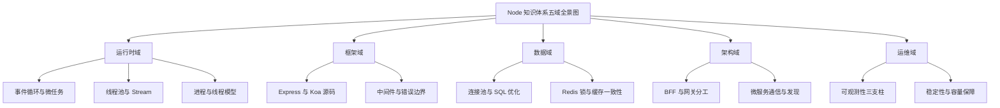

### NODE-189：设计一个评论服务（树形结构/审核/热评缓存）？
**答**：
- 树形存储用 **materialized path**：`path = 父path + '/' + id`，查整个子树 = `WHERE path LIKE 'root/123/%'`，比递归 CTE 简单且索引友好。
- 发表链路：入库 status=PENDING → 敏感词/机审（NODE-096）→ 通过置 VISIBLE 并失效热评缓存；举报走异步人工复核。
- 读路径：热评列表 Redis 缓存 60s（/articleId 维度）；计数（点赞）用 Redis INCR + 定时落库（NODE-190）。
- 防刷：同 uid 对同文章窗口限频 + 内容去重（hash 相似度）。

```javascript
// comment(id, article_id, parent_id, path, content, status, like_count)
app.get('/api/comments', async (ctx) => {
  const key = `comments:hot:${ctx.query.articleId}`;
  const hot = await redis.get(key);
  if (hot) return JSON.parse(hot);                    // 热评缓存 60s
  const rows = await db.comment.findMany({
    where: { articleId: ctx.query.articleId, status: 'VISIBLE', deletedAt: null },
    orderBy: { likeCount: 'desc' },
    take: 50,
  });
  await redis.setex(key, 60, JSON.stringify(rows));
  return rows;
});

// 子树查询：materialized path
const subtree = await db.comment.findMany({
  where: { path: { startsWith: `${rootComment.path}/` } }, // 一次查询取整个楼中楼
});
// 发表：status 先 PENDING，机审通过后置 VISIBLE + DEL 热评缓存
```

### NODE-190：设计一个点赞服务（计数/去重/热点）？
**答**：
- 写路径全 Redis：`SADD` 判重（返回 0 = 已点过，天然幂等）+ `HINCRBY` 计数；DB 落库异步化，秒级最终一致。
- 落库防回退：定时任务把 Redis 计数合并进 DB 时用 `WHERE count < redis值` 方向保护。
- 超大去重（百万级点赞）：Set 内存爆炸 → BloomFilter 判重 + 纯计数器，接受极小误判换取内存。
- 取消点赞：`SREM` + 计数 -1；计数展示允许±1 误差时可直接读 Redis。

```javascript
async function like(uid, targetType, targetId) {
  const dedupKey = `liked:${targetType}:${targetId}`;
  const first = await redis.sadd(dedupKey, uid);      // 返回 1 = 新增
  if (first) await redis.pexpire(dedupKey, 7 * 86_400_000);
  if (first) await redis.hincrby('likes:count', `${targetType}:${targetId}`, 1);
  return { first, count: Number(await redis.hget('likes:count', `${targetType}:${targetId}`)) };
}

async function unlike(uid, targetType, targetId) {
  if (await redis.srem(`liked:${targetType}:${targetId}`, uid)) {
    await redis.hincrby('likes:count', `${targetType}:${targetId}`, -1);
  }
}

// 定时落库（方向保护防回退）
setInterval(async () => {
  const all = await redis.hgetall('likes:count');
  for (const [k, v] of Object.entries(all)) {
    await db.query(
      'UPDATE like_counter SET count = ? WHERE target = ? AND count < ?',
      [Number(v), k, Number(v)]);
  }
}, 60_000).unref();
```

### NODE-191：设计一个搜索联想服务（前缀匹配/热度排序）？
**答**：
- 量级决定方案：词典万级 → Redis ZSET（score=热度）内存过滤；百万级 → ES completion suggester（FST 结构）或常驻内存 Trie。
- 数据来源：搜索日志离线挖掘（query 去重 + 频次 + 转化率），热词榜 5 分钟增量更新；敏感词前置过滤（NODE-096）。
- 体验细节：纠错候选兜底（编辑距离 1，"iphoe"→"iphone"）、个性化按 uid 历史加权、曝光埋点反哺热度。
- 接口要求 P99 < 20ms：本地缓存词典快照，Redis 只做兜底。

```javascript
async function suggest(prefix, { uid } = {}) {
  const key = `suggest:${prefix[0]}`;                 // 按首字分桶
  const candidates = await redis.zrevrange(key, 0, -1); // 万级词典全量可承受
  let hits = candidates.filter((t) => t.startsWith(prefix));
  if (!hits.length) hits = fuzzyByEditDistance(prefix, candidates, 1); // 纠错兜底
  const personal = uid ? await redis.smembers(`suggest:hist:${uid}`) : [];
  hits.sort((a, b) => Number(personal.includes(b)) - Number(personal.includes(a)));
  const result = hits.slice(0, 10);
  recordSuggestHit(prefix, result[0]);                // 曝光埋点 → 反哺热度
  return result;
}
// 热度更新（离线任务）：ZINCRBY suggest:a 1 <term>；ZREMRANGEBYSCORE 清零低热词
```

### NODE-192：设计一个排行榜服务（ZSET/并列名次/分页）？
**答**：
- 实时榜 Redis ZSET：`ZINCRBY` 更新积分、`ZREVRANGE WITHSCORES` 取榜、`ZREVRANK` 取个人名次（O(logN)）。
- 并列名次：ZSET 同分按成员字典序，业务要求"同分同名次"需应用层归并（分数变化才推进名次）。
- 亿级成员：单 key ZSET 撑不住 → **分桶榜单**（今日/本周/总分各一个 key + 时间片轮转）+ 只维护 TopN。
- 榜单重置：新周期建新榜 + 原子改名切换 + 旧榜归档；读走缓存 1s。

```javascript
async function topN(board, page = 1, size = 20) {
  const start = (page - 1) * size;
  const rows = await redis.zrevrange(`board:${board}`, start, start + size - 1, 'WITHSCORES');
  let rank = start, prev = null;
  return rows.reduce((acc, [member, score], i) => {
    if (score !== prev) rank = start + i + 1;         // 同分并列同名次
    prev = score;
    return [...acc, { rank, member, score: Number(score) }];
  }, []);
}

async function addScore(board, member, delta) {
  await redis.zincrby(`board:${board}`, delta, member);
  return redis.zrevrank(`board:${board}`, member);    // 我的实时名次
}

// 周期轮转：0 点执行
// RENAME board:daily board:daily:20261107 然后 ZADD 建新榜；旧榜 EXPIRE 7d 归档
```

### NODE-193：设计一个签到与积分服务（bitmap/连续签到）？
**答**：
- bitmap 签到：1 用户 1 月 31 bit ≈ 4 字节，亿级用户内存可扛；`SETBIT day-1 1` 签到，`BITCOUNT` 月度统计。
- 连续签到：从当天往回 `GETBIT` 数到第一个 0；奖励规则（连 7 天翻倍）在服务端判定，不在客户端。
- 补签：指定位 `SETBIT` + 补签卡扣减，扣卡与置位要同事务（或本地消息表 NODE-146）。
- 积分：append-only 流水表 + 余额缓存，对账以流水为准。

```javascript
const key = (uid, ym) => `sign:${uid}:${ym}`;

async function checkin(uid) {
  const ym = dayjs().format('YYYYMM');
  const day = dayjs().date();                         // 1~31
  const isNew = (await redis.setbit(key(uid, ym), day - 1, 1)) === 0;
  if (!isNew) return { ok: false, msg: 'already' };
  let streak = 0;
  for (let i = day - 1; i >= 1; i--) {                // 从昨天往回数
    if (await redis.getbit(key(uid, ym), i - 1)) streak++;
    else break;
  }
  const points = streak + 1 >= 7 ? 10 : 1;            // 连签 7 天奖励
  await addPoints(uid, points, `checkin:${ym}:${day}`);
  return { ok: true, streak: streak + 1, points };
}
// 补签：SETBIT 指定位 + 补签卡原子扣减
// 月视图：GET 整月 bitmap 返回前端按位渲染
```

### NODE-194：设计一个抽奖服务（概率/库存/防超发）？
**答**：
- 抽奖三关：**资格校验**（一人一次/消耗积分）→ **概率抽取**（权重随机，种子服务端持有防篡改）→ **库存防超发**（Lua 原子扣，扣不到降级谢谢参与）。
- 概率与库存解耦：先按权重抽中"iPhone"，库存没了降级"优惠券"——大奖概率真实、库存真实。
- 防作弊：概率逻辑不出服务端、请求频率限制、一人一次（Set 记录）、大奖异步发奖 + 人工复核。
- 审计：每次抽奖落流水（uid/种子/结果/时间），可回放验证公平性。

```javascript
const PRIZES = [
  { id: 'iphone', weight: 1 },
  { id: 'coupon50', weight: 30 },
  { id: 'thanks', weight: 969 },
];
function drawOnce() {                                  // 权重随机：随机数落区间
  const total = PRIZES.reduce((s, p) => s + p.weight, 0);
  let r = Math.random() * total;
  for (const p of PRIZES) { if ((r -= p.weight) < 0) return p.id; }
  return 'thanks';
}

app.post('/lucky/draw', limiter({ per: '1s' }), async (ctx) => {
  const uid = ctx.state.uid;
  if (!(await redis.set(`lucky:once:${ROUND}:${uid}`, 1, 'PX', 86_400_000, 'NX'))) {
    ctx.throw(409, '已参与');                          // 一人一次
  }
  const picked = drawOnce();
  const left = await redis.eval(DECR_LUA, 1, `lucky:stock:${picked}`); // 原子扣库存
  const finalId = left < 0 ? 'thanks' : picked;        // 售罄降级
  await db.luckyRecord.create({ data: { uid, prizeId: finalId, roundId: ROUND, ts: Date.now() } });
  if (finalId === 'iphone') await auditQueue.add('review', { uid }); // 大奖人工复核
  ctx.body = { prizeId: finalId };
});
```

### NODE-195：设计一个投票服务（防刷/统计/防提前开票）？
**答**：
- 幂等：`HSETNX poll:voted:{pollId} uid optionId` 一人一票原子判重；重复投票直接拒绝。
- 防刷四层：登录态 → 设备指纹 → IP 频控（NODE-132）→ 敏感活动行为验证码/实名；后台做速率突增告警与同 IP 段聚类。
- 统计：`HINCRBY` 计数 + 异步落库；UV 用 HyperLogLog；**防提前开票**：结果接口带开关，截止前只返回脱敏聚合或拒绝。
- 数据可审计：每票流水入库（uid/option/ip/ts），争议时可回放校正计数。

```javascript
async function vote(uid, pollId, optionId) {
  const isNew = await redis.hsetnx(`poll:voted:${pollId}`, uid, optionId); // 幂等判重
  if (!isNew) return { ok: false, msg: 'voted' };
  if (await riskBlocked(uid, pollId)) {               // 风控复核不过 → 撤销计数
    await redis.hdel(`poll:voted:${pollId}`, uid);
    return { ok: false, msg: 'risk' };
  }
  await redis.hincrby(`poll:count:${pollId}`, optionId, 1);
  await voteQueue.add('persist', { pollId, uid, optionId }); // 异步落库流水
  return { ok: true };
}

app.get('/api/poll/:id/result', async (ctx) => {
  const poll = await db.poll.findUnique({ where: { id: ctx.params.id } });
  if (poll.hideUntilResult && Date.now() < poll.endAt) {
    return (ctx.body = { hidden: true, endAt: poll.endAt });  // 防提前开票
  }
  ctx.body = await redis.hgetall(`poll:count:${poll.id}`);
});
```

### NODE-196：设计一个跨服务数据聚合报表（T+1 数仓概览）？
**答**：
- 定位：报表服务只做**读预聚合结果**的 API，绝不直连业务库跑复杂 SQL——数仓链路负责加工。
- 链路：业务库 binlog → Kafka → Flink/离线任务 → `dw_order_agg` 预聚合宽表（按天/渠道/品类）→ 报表 API 秒出。
- 口径治理：指标口径唯一来源（metric.yaml 定义 GMV/活跃等），大盘与报表共用计算逻辑，禁止各写各的 SQL。
- 性能：T+1 数据可长缓存（`cache-control: max-age=300`）；维度筛选走预聚合表分组，明细下钻走明细表分页。

```javascript
const SAFE_DIMS = { channel: 'channel', category: 'category', city: 'city' }; // 白名单防注入

app.get('/api/report/daily', auth('report:read'), async (ctx) => {
  const date = ctx.query.date ?? yesterday();
  const dim = SAFE_DIMS[ctx.query.dim] ?? 'channel';  // 维度白名单
  const rows = await reportDb.query(
    `SELECT ${dim}, SUM(gmv) AS gmv, COUNT(DISTINCT uid) AS buyers
     FROM dw_order_agg WHERE dt = ? GROUP BY ${dim}`, [date]);
  ctx.set('cache-control', 'public, max-age=300');    // T+1 数据可缓存
  ctx.body = rows;
});
// metric.yaml：gmv = SUM(paid_amount)（唯一口径定义，大盘报表共用）
```

### NODE-197：全链路灰度的数据兼容策略（双写/读切换）？
**答**：
- 演进三阶段：**双写过渡**（旧表权威 + 新表影子写，异步比对差异）→ **读灰度切换**（按规则读新表，失败回退旧表）→ **收尾**（读全量后停旧表写，观察一个周期归档）。
- schema 纪律：字段只增不删、新字段可空、枚举扩展前向兼容——保证灰度/稳定两组实例能同时读写同一份数据。
- 回退能力是底线：任何阶段出问题都能秒级切回（染色规则改回 stable 即可，NODE-176）。
- 数据校验：双写期 diff 任务全量比对，差异入库修复后再切读，不允许"带着未知差异切流量"。

```javascript
// 阶段一：双写（旧表权威，新表影子）
async function createOrderV2(order) {
  await db.$transaction([
    db.order.create({ data: toV1(order) }),      // 旧表：权威数据源
    db.orderV2.create({ data: toV2(order) }),    // 新表：影子写
  ]);
  diffJob.record(order.id, toV1(order), toV2(order)); // 异步比对，差异入库供修复
}

// 阶段二：读灰度切换（按 tint 规则，失败回退）
async function getOrder(id, { tint }) {
  if (tint === 'gray-v2') {
    const v2 = await db.orderV2.findUnique({ where: { id } }).catch(() => null);
    if (v2) return fromV2(v2);                   // 读新表
  }
  return db.order.findUnique({ where: { id } }); // 回退旧表
}
// 阶段三：diff 归零 + 观察一个周期 → 停旧表写 → 归档；全程可秒级回退
```

### NODE-198：设计一个 CLI 工具链（脚手架/版本发布）？
**答**：
- 组成：命令解析（commander）→ 交互确认（inquirer）→ 模板渲染（ejs）→ 依赖安装（execa）；bin 字段映射命令名。
- 模板策略：模板独立仓库（或包内目录），变量注入 db/deploy 选项；生成后可 git diff 出团队规范的"标准形状"。
- 发布治理：changesets 管版本与 changelog；插件化——团队命令以 `@scope/cli-plugin-*` 约定发现，互不侵入核心。
- 工程化：CLI 自身走 ESM（NODE-158）、CI 发布自动 npm publish、`--verbose` 调试日志。

```javascript
#!/usr/bin/env node
import { program } from 'commander';
import inquirer from 'inquirer';
import { execa } from 'execa';
import { renderTemplates } from './render.js';
import { createRequire } from 'node:module';

const pkg = createRequire(import.meta.url)('../package.json');
program.version(pkg.version);

program.command('create <name>')
  .description('生成 BFF 服务脚手架')
  .action(async (name) => {
    const answers = await inquirer.prompt([
      { type: 'list', name: 'db', message: '数据库', choices: ['mysql', 'mongo'] },
      { type: 'list', name: 'deploy', message: '部署方式', choices: ['k8s', 'pm2'] },
    ]);
    await renderTemplates(name, answers);           // ejs 渲染模板目录
    await execa('npm', ['install'], { cwd: name, stdio: 'inherit' });
    console.log(`完成：cd ${name} && npm run dev`);
  });
program.parse();
// package.json: "bin": { "acme": "./bin/acme.js" } → npm link 后全局可用
```

### NODE-199：Node 性能预算与 CI 门禁怎么做？
**答**：
- 预算维度：接口 P99/吞吐（NODE-140 基线）、事件循环 lag、启动时间（冷启动 < 3s）、内存水位、依赖体积。
- 门禁机制：CI 里程序化压测（autocannon）对比基线，P99 恶化 20% 或吞吐跌 20% 阻断合并（NODE-100 方法论固化）。
- 防"温水煮青蛙"：基线入库形成趋势曲线，每次小劣化都被拦住，而不是等事故。
- 门禁要快：压测 30s 内完成，跑在预发同规格环境，环境差异会造成误报。

```javascript
// bench-gate.js —— CI 性能门禁
const autocannon = require('autocannon');
const BASELINE = { p99: 250, qps: 2000 };            // NODE-100 沉淀的基线

async function gate() {
  const r = await autocannon({
    url: 'http://localhost:3000/api/home',
    connections: 100, duration: 30,
  });
  const fail = [];
  if (r.latency.p99 > BASELINE.p99 * 1.2)
    fail.push(`P99 恶化 ${r.latency.p99}ms 超基线 20%`);
  if (r.requests.average < BASELINE.qps * 0.8)
    fail.push(`吞吐下降 ${r.requests.average} 低于基线 80%`);
  if (fail.length) { console.error('性能门禁未过:', fail); process.exit(1); }
  console.log(`通过: P99=${r.latency.p99}ms QPS=${r.requests.average}`);
  // 趋势入库：{ commit, p99, qps, ts } → Grafana 看劣化曲线
}
gate();
// CI 配置：启动服务 → 等就绪 → node bench-gate.js → 通过才允许合并
```

### NODE-200：大型 Node 项目的模块边界与依赖治理怎么做？
**答**：
- 分层架构：routes（接口）→ services（领域）→ repos（数据）→ infra（外部客户端）；规则：上层可依赖下层，**禁止反向与跨层跳跃**。
- 自动化守护：eslint-plugin-boundaries 声明依赖方向，违反直接 lint 报错；madge 检测循环依赖，CI 阻断。
- 公共代码强制走 `@shared` 包（NODE-154 monorepo workspace），杜绝"顺手 import 别的模块内部文件"。
- 度量腐化：单文件行数/扇出/圈复杂度超阈值在 review 提示；治理看"腐化速度"而不只是现状。

```javascript
// .eslintrc.cjs —— eslint-plugin-boundaries 依赖方向约束
module.exports = {
  rules: {
    'boundaries/element-types': ['error', {
      default: 'disallow',
      rules: [
        { from: ['routes'], allow: ['service'] },
        { from: ['service'], allow: ['repo', 'service'] },
        { from: ['repo'], allow: ['infra'] },
        { from: ['infra'], allow: [] },              // 最底层不依赖业务层
      ],
    }],
  },
  settings: {
    'boundaries/elements': [
      { type: 'routes', pattern: 'src/routes/**' },
      { type: 'service', pattern: 'src/services/**' },
      { type: 'repo', pattern: 'src/repos/**' },
      { type: 'infra', pattern: 'src/infra/**' },
    ],
  },
};
// CI 循环依赖检测：npx madge --circular --extensions ts src → 有环则退出码 1
// 公共代码：import { x } from '@acme/shared'（workspace 包，NODE-154）
```
