# 前端面试题库：前端设计模式

> **专题定位**：经典 GoF 设计模式在前端/框架源码/业务代码中的识别与应用。大厂高频考点：讲得出模式名、说得出框架对应物、写得出简化实现。
>
> **覆盖范围**：本文收录 DP-001 ~ DP-200。一至十一章为：设计原则总论、创建型（单例/工厂/建造者/原型）、结构型（适配器/装饰器/代理/外观/组合/享元/桥接）、行为型（观察者/策略/状态/命令/模板方法/中介者/职责链/迭代器/访问者/备忘录）、函数式模式变体、框架源码模式识别综合；十二至二十一章为：业务重构实战、模式组合实战、React/Vue 业务深化、数据层、UI 架构、基础设施、前端特有模式变体、反模式与陷阱、综合与体系。
>
> **备考建议**：每题先看"答"的要点框架，再对照代码块手写一遍。模式题考察"识别 + 实现 + 权衡"，源码题考察"指认 + 讲清动机"。

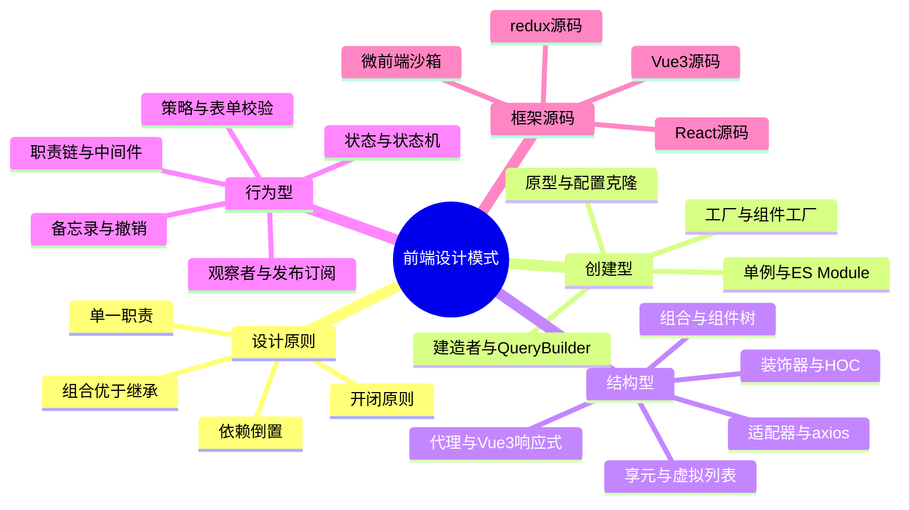

## 目录

- [一、设计原则与总论](#一设计原则与总论)：DP-001 ~ DP-007
- [二、单例模式](#二单例模式)：DP-008 ~ DP-013
- [三、工厂模式](#三工厂模式)：DP-014 ~ DP-019
- [四、建造者与原型](#四建造者与原型)：DP-020 ~ DP-024
- [五、结构型：适配器/装饰器/代理](#五结构型适配器装饰器代理)：DP-025 ~ DP-034
- [六、结构型：外观/组合/享元/桥接](#六结构型外观组合享元桥接)：DP-035 ~ DP-042
- [七、行为型：观察者与发布订阅](#七行为型观察者与发布订阅)：DP-043 ~ DP-050
- [八、行为型：策略/状态/命令](#八行为型策略状态命令)：DP-051 ~ DP-058
- [九、行为型：模板方法/中介者/职责链/迭代器/访问者](#九行为型模板方法中介者职责链迭代器访问者)：DP-059 ~ DP-068
- [十、函数式与前端的模式变体](#十函数式与前端的模式变体)：DP-069 ~ DP-085
- [十一、框架源码中的模式识别综合](#十一框架源码中的模式识别综合)：DP-086 ~ DP-100
- [十二、重构实战：从坏代码到模式](#十二重构实战从坏代码到模式)：DP-101 ~ DP-108
- [十三、模式组合实战](#十三模式组合实战)：DP-109 ~ DP-116
- [十四、React 业务模式深化](#十四react-业务模式深化)：DP-117 ~ DP-124
- [十五、Vue 业务模式深化](#十五vue-业务模式深化)：DP-125 ~ DP-131
- [十六、数据层模式](#十六数据层模式)：DP-132 ~ DP-138
- [十七、UI 架构模式](#十七ui-架构模式)：DP-139 ~ DP-145
- [十八、基础设施模式](#十八基础设施模式)：DP-146 ~ DP-152
- [十九、前端特有模式变体](#十九前端特有模式变体)：DP-153 ~ DP-159
- [二十、反模式与陷阱](#二十反模式与陷阱)：DP-160 ~ DP-166
- [二十一、综合与体系](#二十一综合与体系)：DP-167 ~ DP-200

---

## 一、设计原则与总论

### DP-001：为什么前端需要设计模式？"框架源码即模式库"怎么理解？
**答**：
- 前端业务变化的本质是 UI 和交互的高频变更，设计模式的目标正是"封装变化点"，让改动能被局部化。
- 主流框架源码就是模式库：Vue3 响应式是代理模式 + 观察者，React 调度器是优先级队列，redux 是观察者 + 中间件职责链，axios 是适配器 + 拦截器链。
- 读源码时"用模式做索引"能极大降低理解成本，这是面试官考察设计模式的真实动机。
- 答题框架四步：场景 → 模式 → 实现 → 权衡（见下图），任何模式题都按这个骨架展开。

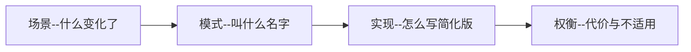

```javascript
// 框架源码即模式库：一个表格看懂"模式 → 框架对应物"
const patternMap = {
  单例:   'Vuex/Pinia store、全局事件总线、ES Module 导出对象',
  工厂:   'React.createElement、Vue h 函数、动态表单 schema 渲染',
  代理:   'Vue3 reactivity 的 Proxy、图片懒加载、微前端沙箱',
  观察者: 'Vue 的 dep-subscriber、redux subscribe、DOM 事件',
  职责链: 'Koa/Express 中间件、axios interceptors、tapable',
  装饰器: 'React HOC、ES 装饰器语法、AOP 埋点织入',
  策略:   '表单校验规则集、路由匹配、diff 算法分派',
  组合:   'React/Vue 组件树、文件目录渲染',
};
// 面试时能随口对上 3 个以上，就跨过了"背概念"这一档
console.log(patternMap['代理']); // Vue3 reactivity 的 Proxy、图片懒加载、微前端沙箱
```

### DP-002：单一职责原则 SRP 在前端怎么落地？
**答**：
- SRP：一个模块/类/组件只应有一个引起它变化的原因。
- 前端典型违反：一个 `utils.js` 既做格式化又做本地存储又做埋点；一个组件既拉数据又渲染还弹 toast。
- 落地手法：按"变化方向"拆分——格式化归 `formatters`，存储归 `storage`，组件拆成容器组件 + 展示组件。
- 判断标准：能不能用一句话不带"和/与"地描述这个模块的职责。

```javascript
// 反例：一个函数承担三个变化原因（格式规则变、存储介质变、埋点协议变都会改它）
function saveUserInfo(user) {
  const text = `${user.name}(${user.vip ? '会员' : '普通'})`; // 职责1 展示格式
  localStorage.setItem('user', text);                          // 职责2 持久化
  tracker.send('save_user', user);                             // 职责3 埋点
}

// 正例：按变化方向拆成三个模块，各自独立演化
const formatters = {
  user: (u) => `${u.name}(${u.vip ? '会员' : '普通'})`,
};
const storage = {
  saveUser: (text) => localStorage.setItem('user', text),
};
const tracker = { send: (event, payload) => console.log(event, payload) };

function saveUserInfo(user) {
  storage.saveUser(formatters.user(user)); // 组装层只做编排，不含具体职责
  tracker.send('save_user', user);
}
saveUserInfo({ name: 'Tom', vip: true }); // Tom(会员)
```

### DP-003：开闭原则 OCP 是什么？前端如何"对扩展开放、对修改关闭"？
**答**：
- OCP：新增能力时应新增代码，而不是修改已有代码——核心是"找到变化点并把它参数化/多态化"。
- 前端实例：报表导出新增一种格式，不应去改 `export` 函数的 if-else，而是注册一个新 exporter。
- OCP 是几乎所有模式的目的：策略模式封装算法族、工厂封装创建逻辑、插件机制封装扩展点。
- 面试提示：OCP 不等于无限抽象，只有"确实会变化"的方向才值得开放扩展点。

```javascript
// 反例：每加一种格式都要改 exportFile 的 switch，风险随格式数线性增长
function exportFile(data, type) {
  if (type === 'json') return JSON.stringify(data);
  else if (type === 'csv') return data.map(Object.values).join('\n');
  // else if (type === 'excel') ... 无限膨胀
}

// 正例：注册表 + 统一接口，新增格式 = 新增一行注册，老代码零修改（OCP）
const exporters = {
  json: (data) => JSON.stringify(data),
  csv: (data) => data.map((row) => Object.values(row).join(',')).join('\n'),
};
function registerExporter(type, fn) {
  exporters[type] = fn; // 扩展点：对扩展开放
}
function exportFile(data, type) {
  const fn = exporters[type];
  if (!fn) throw new Error(`不支持的格式 ${type}`);
  return fn(data); // 不再感知具体格式，对修改关闭
}
registerExporter('tsv', (data) => data.map((r) => Object.values(r).join('\t')).join('\n'));
console.log(exportFile([{ a: 1, b: 2 }], 'tsv')); // a\tb\n1\t2
```

### DP-004：里氏替换 LSP 和接口隔离 ISP 在前端各有什么实例？
**答**：
- LSP：所有用到父类/基接口的地方，换成子类实现必须行为正确——子类不能违背父类约定的语义（如不能抛异常、不能返回异常类型）。
- 前端实例：React 中接收 `onChange(value: string)` 的组件，传入的子组件回调签名与语义必须兼容；Vue 的 `v-model` 组件必须遵守 `modelValue` + `update:modelValue` 协议。
- ISP：不要强迫客户端依赖它用不到的方法——组件 props 应按需拆分，而不是塞一个 20 个字段的大对象。
- 前端实例：把"列表配置"从"编辑配置"中拆开，避免只读列表组件被迫接收一堆编辑态字段。

```typescript
// LSP：基类接口的替换必须语义兼容
interface DataFetcher {
  fetch(url: string): Promise<JSON>;
}
class HttpFetcher implements DataFetcher {
  async fetch(url: string) {
    const res = await fetch(url);
    if (!res.ok) throw new Error(`HTTP ${res.status}`); // 约定：失败抛错
    return res.json();
  }
}
class CacheFetcher implements DataFetcher {
  private cache = new Map<string, JSON>();
  async fetch(url: string) {
    if (this.cache.has(url)) return this.cache.get(url)!; // 行为兼容：成功返回JSON，失败同样抛错
    const data = await new HttpFetcher().fetch(url);       // 替换后上层代码无需任何感知
    this.cache.set(url, data);
    return data;
  }
}
// 上层只依赖抽象，CacheFetcher 可以无感替换 HttpFetcher（同时体现 DIP）

// ISP：把大而全的 props 按使用方隔离
interface ListProps { items: Item[]; onRowClick: (id: string) => void; }            // 列表只需要这些
interface EditProps { item: Item; onSave: (item: Item) => void; onDelete: (id: string) => void; }
// 只读列表组件绝不接收 onSave/onDelete，避免依赖用不到的契约
```

### DP-005：依赖倒置原则 DIP 是什么？前端有哪些真实应用？（高频）
**答**：
- DIP：高层模块不依赖低层实现，双方都依赖抽象（接口）；"倒置"的是依赖方向——实现细节反过来依赖上层定义的接口。
- 前端实例：数据层依赖 `RequestClient` 抽象，可注入 axios 实现、fetch 实现、mock 实现；React 用 props/Context 注入依赖，Angular/NestJS 直接内置 IoC 容器。
- 收益：可替换（切后端/切环境）、可测试（单测注入 mock）、可隔离（SDK 不绑定具体网络库）。
- 与工厂/注入的关系：工厂是"DIP 的落地手段之一"，负责把具体实现的创建收拢到一处。

```typescript
// 高层只定义抽象，不 import 任何具体网络库（依赖方向被倒置）
interface IStorage {
  get(key: string): string | null;
  set(key: string, value: string): void;
}
// 依赖抽象的 高层业务
class AuthService {
  constructor(private storage: IStorage) {} // 构造器注入
  saveToken(token: string) { this.storage.set('token', token); }
  getToken() { return this.storage.get('token'); }
}
// 低层实现1：浏览器 localStorage
class LocalStorageAdapter implements IStorage {
  get(key: string) { return localStorage.getItem(key); }
  set(key: string, value: string) { localStorage.setItem(key, value); }
}
// 低层实现2：内存实现，专供单元测试
class MemoryStorage implements IStorage {
  private map = new Map<string, string>();
  get(key: string) { return this.map.get(key) ?? null; }
  set(key: string, v: string) { this.map.set(key, v); }
}
// 生产环境注入真实实现
const auth = new AuthService(new LocalStorageAdapter());
auth.saveToken('jwt-xxx');
// 测试环境注入内存实现，无需 jsdom
const authForTest = new AuthService(new MemoryStorage());
authForTest.saveToken('jwt-test'); // 断言无副作用
```

### DP-006：设计模式如何分类？三大类分别对应前端哪些场景？
**答**：
- 创建型（5 种）：管"对象怎么创建"——单例、工厂、抽象工厂、建造者、原型。前端对应：store、组件工厂、QueryBuilder、配置克隆。
- 结构型（7 种）：管"对象怎么组装"——适配器、装饰器、代理、外观、组合、享元、桥接。前端对应：axios、HOC、Vue3 Proxy、组件树、虚拟列表。
- 行为型（11 种）：管"对象怎么协作/通信"——观察者、策略、状态、命令、模板方法、中介者、职责链、迭代器、访问者、备忘录、解释器。前端对应：事件系统、表单校验、中间件、撤销重做。
- 记忆法：创建型"造"、结构型"装"、行为型"通"。

```javascript
// 三大类 × 前端场景 速查（面试可背）
const gofInFrontend = {
  创建型: {
    单例:   'Pinia store / 全局弹窗管理',
    工厂:   'React.createElement / 动态表单 schema',
    建造者: 'QueryBuilder / 复杂请求配置',
    原型:   'Object.create / 组件默认配置克隆',
  },
  结构型: {
    适配器: 'axios adapter 浏览器与Node双端',
    装饰器: 'HOC / ES 装饰器埋点',
    代理:   'Vue3 Proxy / 图片懒加载',
    外观:   '统一 SDK 封装底层多 API',
    组合:   '组件树 / 文件树渲染',
    享元:   '虚拟列表 DOM 复用 / 对象池',
    桥接:   'PC 与 H5 事件绑定桥接',
  },
  行为型: {
    观察者:   'Vue dep-subscriber / redux subscribe',
    策略:     '表单校验规则集 / 促销计算',
    状态:     '订单状态机 / xstate',
    命令:     '撤销重做 / 操作日志',
    模板方法: '生命周期骨架 / 组件基类流程',
    职责链:   'Koa 中间件 / axios 拦截器',
    中介者:   '组件通信中心 / 聊天室服务端',
    备忘录:   '编辑器撤销快照',
    迭代器:   'for-of / Generator',
    访问者:   'babel traverse 处理 AST',
  },
};
console.log(Object.keys(gofInFrontend)); // ['创建型', '结构型', '行为型']
```

### DP-007：如何识别"过度设计"？组合优于继承在前端怎么体现？
**答**：
- 过度设计信号：为一个只有两种状态的开关写状态机；为只有一个实现的接口建抽象层；为"未来可能"的需求提前分层——规则是"为现在的变化建模，不为想象的变化建模"。
- 反模式案例：三分支的 if-else 强行拆成策略 + 工厂 + 注册中心，复杂度反而上升；模式是重构的结果，不是起点。
- 组合优于继承：React 官方弃用 mixin 并推荐组合（children/slot、HOC、自定义 Hook）；继承把父类实现细节暴露给子类，形成脆弱基类。
- 前端落地：用 props 传入"片段"（children、render props、插槽）代替继承定制行为；逻辑复用用 Hook 组合而不是类继承。

```jsx
// 反例：过度设计 —— 三种文案的展示被拆成 4 个类 + 工厂
class TextRenderer { render(t) { return t; } }
class UppercaseRenderer extends TextRenderer { render(t) { return t.toUpperCase(); } }
class TruncateRenderer extends TextRenderer { render(t) { return t.slice(0, 5); } }
class RendererFactory { create(type) { return type === 'upper' ? new UppercaseRenderer() : new TruncateRenderer(); } }

// 正例：React 中用组合（props 注入行为），一个函数组件即可，天然 OCP
function Text({ children, transform }) {
  return <span>{transform ? transform(children) : children}</span>;
}
// 使用处自由组合，无需类层次
<Text transform={(s) => s.toUpperCase()}>hello</Text>          // HELLO
<Text transform={(s) => s.slice(0, 5)}>hello world</Text>      // hello
<Text>plain</Text>                                             // plain

// 组合优于继承的另一形态：逻辑复用用自定义 Hook 组合，而不是继承基类
function useUserInfo(id) {
  const [user, setUser] = React.useState(null);
  React.useEffect(() => { fetch(`/api/user/${id}`).then((r) => r.json()).then(setUser); }, [id]);
  return user;
}
```

## 二、单例模式

### DP-008：手写一个单例模式，闭包/静态属性/模块三种实现有何区别？
**答**：
- 单例：保证一个类/对象全局只有一个实例，并提供统一访问点；核心是"惰性创建 + 缓存实例"。
- 闭包版：借助 IIFE 词法作用域缓存 `instance`，最经典。
- 静态属性版：把缓存挂在类本身上；ES2022 后可用 `static` 字段 + 私有字段 `#instance`。
- 模块版：现代首选——ES Module 顶层对象天然单例，无需手写缓存逻辑。

```javascript
// 1. 闭包版：惰性单例，最常考
const CreateModal = (function () {
  let instance = null; // 词法作用域缓存
  function Modal(content) {
    this.content = content;
    this.dom = document.createElement('div');
    this.dom.textContent = content;
  }
  Modal.prototype.show = function () { document.body.appendChild(this.dom); };
  return function (content) {
    if (!instance) instance = new Modal(content); // 只创建一次
    return instance;
  };
})();
const a = CreateModal('登录');
const b = CreateModal('注册');
console.log(a === b); // true

// 2. 静态属性版（ES2022 私有字段）
class Counter {
  static #instance = null;
  static getInstance() {
    if (!Counter.#instance) Counter.#instance = new Counter();
    return Counter.#instance;
  }
  #count = 0;
  increment() { return ++this.#count; }
}
console.log(Counter.getInstance() === Counter.getInstance()); // true
// 3. 模块版见下一题，是现代工程的标准答案
```

### DP-009：为什么说 ES Module 是"天然单例"？
**答**：
- 模块在首次被 import 时执行一次，其导出（对象/类/函数）被所有导入方共享同一份引用——这正好满足单例语义。
- 推论：`export const store = createStore()` 不需要任何 getInstance 代码，模块系统就是单例容器。
- 注意边界：单例的是"模块实例"，不是"类实例"——如果导出的是 class，每次 new 仍会产生多实例。
- 面试延伸：单例 + 惰性创建在模块化下可用"动态 import"实现按需加载。

```javascript
// store.js —— 模块顶层只执行一次
let state = 0;
const listeners = new Set();
export const store = {
  setState(next) {
    state = next;
    listeners.forEach((fn) => fn(state)); // 变更后通知所有订阅者（观察者）
  },
  subscribe(fn) { listeners.add(fn); return () => listeners.delete(fn); },
  getState: () => state,
};

// a.js 与 b.js 各自导入，拿到的是同一份实例
// a.js: import { store } from './store.js';
// b.js: import { store } from './store.js';
// main.js 验证：
// import { store as s1 } from './store.js';
// import { store as s2 } from './store.js';
// console.log(s1 === s2); // true —— 模块缓存保证了单例

// 若导出的是 class，则不再是单例，要克制 new
export class Service {}
// new Service() !== new Service() —— 常见踩坑
// 需要惰性加载的单例：动态 import
export async function getHeavyStore() {
  const { HeavyStore } = await import('./heavy-store.js'); // 首次调用才加载模块
  return HeavyStore.getInstance();
}
```

### DP-010：为什么说全局状态管理和事件总线本质上是单例模式？
**答**：
- Vuex/Pinia/redux 的 store 必须全局唯一，否则会出现多份状态不一致——单例保证"唯一数据源"。
- 事件总线（EventEmitter/EventBus）同样要求全局唯一，否则订阅和触发分散在不同实例上互不可见。
- 通用范式：单例容器 + 观察者通信，这是 redux/Vuex/事件总线的共同骨架。
- 面试可以反推：如果 new 两个 store 会发生什么——组件订阅错实例、状态漂移，这正是单例存在的理由。

```javascript
// 单例容器 + 观察者：redux/事件总线的最小骨架
class EventBus {
  static #instance = null;
  static getInstance() {
    if (!EventBus.#instance) EventBus.#instance = new EventBus();
    return EventBus.#instance;
  }
  #handlers = new Map(); // event -> Set<fn>
  on(event, fn) {
    if (!this.#handlers.has(event)) this.#handlers.set(event, new Set());
    this.#handlers.get(event).add(fn);
    return () => this.#handlers.get(event).delete(fn); // 返回取消订阅
  }
  emit(event, payload) {
    (this.#handlers.get(event) || []).forEach((fn) => fn(payload));
  }
}
const bus1 = EventBus.getInstance();
const bus2 = EventBus.getInstance();
console.log(bus1 === bus2); // true —— 全局唯一
bus1.on('login', (user) => console.log('nav 更新', user));
bus2.emit('login', { id: 1, name: 'Tom' }); // 同一实例，订阅方收得到
// nav 更新 { id: 1, name: 'Tom' }

// Pinia 使用侧：defineStore 返回的 store 在组件间就是同一实例
// const s1 = useCounterStore(); const s2 = useCounterStore(); s1 === s2 // true
```

### DP-011：用单例模式实现一个登录弹窗（惰性单例实战）？
**答**：
- 需求：无论点击多少次"登录"，页面永远只有一个弹窗实例；关闭只是隐藏，不销毁。
- 两层拆分：`Modal` 只管 DOM 与显隐（职责单一），`getSingle` 是通用惰性单例高阶封装（可复用于任何类）。
- 亮点：单例逻辑（缓存实例）与业务逻辑（弹窗渲染）分离，这就是"惰性单例"的标准形态。
- 变体：也可以在首次关闭后销毁 DOM、下次重新创建，用"是否在 DOM 中"判断代替缓存。

```javascript
// 业务类：只负责渲染与显隐
class LoginModal {
  constructor() {
    this.el = document.createElement('div');
    this.el.className = 'login-modal';
    this.el.innerHTML = '<form><input name="u"/><input name="p" type="password"/><button>登录</button></form>';
    this.el.style.display = 'none';
    document.body.appendChild(this.el);
    this.el.querySelector('form').addEventListener('submit', (e) => e.preventDefault());
  }
  show() { this.el.style.display = 'block'; }
  hide() { this.el.style.display = 'none'; }
}

// 通用惰性单例封装：与业务解耦，任何类都能包
function getSingle(Ctor) {
  let instance = null;
  return function (...args) {
    if (!instance) instance = new Ctor(...args);
    return instance;
  };
}
const getLoginModal = getSingle(LoginModal);

document.querySelector('#loginBtn').addEventListener('click', () => {
  getLoginModal().show(); // 点 N 次也只有一个弹窗实例
});
document.querySelector('#closeBtn').addEventListener('click', () => {
  getLoginModal().hide(); // 隐藏而非销毁，状态（已输入内容）得以保留
});
// console.assert(getLoginModal() === getLoginModal()) —— 恒等
```

### DP-012：单例有什么缺点？如何用依赖注入缓解它的测试难题？（高频）
**答**：
- 缺点：全局可变状态 → 隐式依赖（调用方看不到它从哪来）、初始化时序问题、单测间状态泄漏、难以并行测试。
- 单测痛点：单例的内部状态在多个测试用例间共享，需要暴露 `reset` 或每个用例 mock 模块。
- 解法：把"单例"降级为"默认注入的实现"——内部用单例兜底，对外提供注入入口（React Context、构造器参数、Provider）。
- 原则：库代码不要 `import` 单例，让使用方把单例"传进来"，依赖关系显式化。

```javascript
// 反例：业务代码直接 import 单例，测试时无法替换
// api.js: export default new HttpClient();  auth.js: import http from './api.js';
// 正例：单例只作为默认值，依赖从入口注入
class HttpClient {
  get(url) { return fetch(url).then((r) => r.json()); }
}
// 模块内保留默认单例（生产便利性）
export const defaultHttp = new HttpClient();

// 业务类不写死依赖：单测注入 mock，生产注入 defaultHttp
class UserService {
  constructor(http = defaultHttp) { this.http = http; }
  loadUser(id) { return this.http.get(`/api/users/${id}`); }
}

// 生产：用默认单例
const svc = new UserService();

// 测试：注入 stub，无网络、无全局状态污染
const mockHttp = { get: async (url) => ({ id: 1, name: 'Mock' }) };
const svcTest = new UserService(mockHttp);
svcTest.loadUser(1).then((u) => console.log(u.name)); // Mock

// React 形态：Context 注入 + 默认单例兜底
// const HttpCtx = React.createContext(defaultHttp);
// 组件内 const http = React.useContext(HttpCtx); —— 测试时包一层 Provider 即可
```

### DP-013：单例和多例（Multiton）、享元模式的边界在哪里？
**答**：
- 单例：全局 1 个实例；多例：按 key 缓存有限个实例（如按租户/按主题各一个 store）——`getInstance(key)`。
- 享元：面向"大量细粒度对象"，共享内部状态、外部状态外部传入——共享的是"对象内部的数据"，不是"唯一的实例"。
- 边界判断：控制"实例数量"（1 个或 N 个 keyed 实例）是单例/多例；控制"内存占用"（复用细粒度对象）是享元。
- 前端例子：全局一个 store 是单例；每个 tab 一个 store 是多例；一万个列表项共享同一个行组件配置对象是享元。

```javascript
// 多例：按 key 各持有一个实例，有界缓存
class ThemeStore {
  static #pool = new Map();
  static getInstance(key) {
    if (!ThemeStore.#pool.has(key)) ThemeStore.#pool.set(key, new ThemeStore(key));
    return ThemeStore.#pool.get(key);
  }
  constructor(key) { this.key = key; this.count = 0; }
}
console.log(ThemeStore.getInstance('dark') === ThemeStore.getInstance('dark')); // true
console.log(ThemeStore.getInstance('dark') === ThemeStore.getInstance('light')); // false —— 多例

// 享元：共享内部状态，外部状态作为参数传入
class TreeType { // 享元对象：内部状态（共享的部分）
  constructor(name, color, texture) { this.name = name; this.color = color; this.texture = texture; }
  draw(canvas, x, y) { console.log(`在 ${x},${y} 画 ${this.name}（共享纹理 ${this.texture}）`); }
}
class TreeFactory { // 享元工厂：保证同类享元只有一个
  static #types = new Map();
  static getType(name, color, texture) {
    const k = `${name}|${color}|${texture}`;
    if (!TreeFactory.#types.has(k)) TreeFactory.#types.set(k, new TreeType(name, color, texture));
    return TreeFactory.#types.get(k);
  }
}
// 一万棵树只创建极少数 TreeType，坐标（外部状态）画时才传
const trees = Array.from({ length: 10000 }, (_, i) => ({
  type: TreeFactory.getType('松树', '绿', 'pine.png'),
  x: i % 100, y: Math.floor(i / 100),
}));
console.log(trees[0].type === trees[9999].type); // true —— 内存从 1 万个对象降到 1 个
```

---

## 三、工厂模式

### DP-014：手写简单工厂：按 type 渲染不同组件？
**答**：
- 简单工厂：定义一个工厂函数，根据参数决定创建哪种产品，调用方不感知具体类。
- 前端最常见形态：`renderChart(type)`、`renderFormItem(type)`、消息列表按 `msgType` 渲染不同气泡。
- 本质是一张"类型 → 构造器"的映射表，天然符合 OCP：新增类型只加映射项。
- 注意：类型太多时不要写成巨型 switch，用对象映射或组件注册表。

```javascript
// 图表组件工厂：调用方只说"要什么"，不说"怎么造"
class LineChart { render(data) { return `折线图: ${data.join(',')}`; } }
class BarChart { render(data) { return `柱状图: ${data.join(',')}`; } }
class PieChart { render(data) { return `饼图: ${data.join(',')}`; } }

const chartFactory = {
  line: () => new LineChart(),
  bar: () => new BarChart(),
  pie: () => new PieChart(),
};
function createChart(type) {
  const ctor = chartFactory[type];
  if (!ctor) throw new Error(`未知图表类型 ${type}`);
  return ctor();
}
// 使用
console.log(createChart('line').render([1, 2, 3])); // 折线图: 1,2,3
console.log(createChart('bar').render([4, 5]));     // 柱状图: 4,5

// React 场景：按 type 渲染组件的工厂（消息气泡）
function Message({ msg }) {
  const map = {
    text: (m) => <div className="bubble">{m.content}</div>,
    image: (m) => ,
    system: (m) => <div className="sys">{m.content}</div>,
  };
  const render = map[msg.type] || map.text; // 兜底策略 + 工厂分派
  return render(msg);
}
// <Message msg={{ type: 'image', url: 'a.png' }} /> —— 调用方完全不感知分支
```

### DP-015：工厂方法模式和简单工厂的区别是什么？
**答**：
- 简单工厂：一个工厂函数 + 参数分派，新增产品要改工厂内部（违背 OCP 的小破口）。
- 工厂方法：定义创建接口，每种产品配一个工厂子类/工厂函数，新增产品 = 新增一个工厂，不改老代码。
- 前端形态：插件化架构中每个插件自带 `create()`；按钮库中每个主题提供自己的组件工厂。
- 选择建议：类型少且稳定用简单工厂；类型会持续增长、需要第三方扩展时用工厂方法。

```javascript
// 工厂方法：产品自带工厂，扩展不改老代码（对比 DP-014）
class Dialog { /* 通用对话框逻辑 */ open() { console.log('打开对话框'); } }
class MobileDialog extends Dialog { open() { console.log('打开移动端对话框(全屏)'); } }

// 每种产品配套一个工厂，实现统一接口
class DialogFactory { create() { throw new Error('抽象方法'); } }
class PcDialogFactory extends DialogFactory { create() { return new Dialog(); } }
class MobileDialogFactory extends DialogFactory { create() { return new MobileDialog(); } }

// 高层框架代码只依赖"工厂接口"，不依赖具体对话框
function launchApp(factory) {
  const dialog = factory.create(); // 工厂方法调用
  dialog.open();
  return dialog;
}
// 新增平板端：只新增类，launchApp 一行不改（OCP）
class PadDialogFactory extends DialogFactory {
  create() { return { open: () => console.log('打开 Pad 对话框') }; }
}
launchApp(new PcDialogFactory());      // 打开对话框
launchApp(new MobileDialogFactory());  // 打开移动端对话框(全屏)
launchApp(new PadDialogFactory());     // 打开 Pad 对话框
```

### DP-016：什么是抽象工厂？"多端组件套件"如何用它设计？
**答**：
- 抽象工厂：创建"一系列相关产品"的工厂——不是造一个对象，而是造一族（按钮+输入框+弹窗）。
- 场景：同一业务要在 PC / H5 / 小程序渲染不同实现，但调用层代码完全一致。
- 与工厂方法区别：工厂方法造一种产品，抽象工厂造产品族；族内组件保证风格/协议一致。
- 前端落地：UI 库的平台适配层（如 Taro 的 `@tarojs/components` 各端实现）、`element-plus` 主题包。

```jsx
// 抽象工厂：每端提供"一族"组件，业务层零感知
class PcKit {
  Button = (props) => <button className="pc-btn" {...props} />;
  Input = (props) => <input className="pc-input" {...props} />;
}
class H5Kit {
  Button = (props) => <div className="h5-btn" role="button" {...props} />;
  Input = (props) => <input className="h5-input" inputMode="text" {...props} />;
}
// 业务表单：只依赖"套件"的形状，不依赖具体端
function LoginForm({ kit }) {
  return (
    <form>
      <kit.Input placeholder="用户名" />
      <kit.Input placeholder="密码" type="password" />
      <kit.Button>登录</kit.Button>
    </form>
  );
}
// 平台入口处选择产品族
const isMobile = /Mobile/.test(navigator.userAgent);
const Kit = isMobile ? H5Kit : PcKit;
// <LoginForm kit={Kit} /> —— 同一份业务代码在两端渲染不同实现
```

### DP-017：React 的 createElement / Vue 的 h 函数为什么是工厂模式？（高频）
**答**：
- 它们把"描述 UI 的意图"（type/props/children）工厂化为统一的 VNode 对象，调用方不关心 VNode 内部结构。
- 同一个 `h` 可以创建元素、组件、Fragment、Text——多态工厂，产物由参数决定。
- VNode 是纯数据（不可变描述），后续 renderer/diff 才消费它——"创建"与"渲染"解耦，这正是工厂的价值。
- 面试加分：能对照写出简化版 `createElement` 并说明 key/ref/children 的处理。

```javascript
// React 简化版 createElement：把 JSX 工厂化为统一 VNode
function createElement(type, config, ...children) {
  const props = {};
  let key = null;
  if (config) {
    for (const k in config) {
      if (k === 'key') key = config.key;
      else if (k !== 'ref' && k !== '__source' && k !== '__self') props[k] = config[k];
    }
  }
  if (children.length === 1) props.children = children[0];
  else if (children.length > 1) props.children = children;
  return { $$typeof: Symbol('react.element'), type, key, props }; // 统一产物：VNode
}
// JSX <div id="a">hello</div> 编译后就是工厂调用
const vnode = createElement('div', { id: 'a' }, 'hello');
console.log(vnode.props.children); // hello

// Vue3 的 h 同理：一份工厂，多类产物
// import { h } from 'vue';
// h('div', { id: 'a' }, 'hello')        -> 元素 vnode
// h(MyComp, { msg: 1 })                 -> 组件 vnode
// h('div', [h('span'), 'text'])         -> 嵌套 vnode，children 形态由参数决定
const h = (type, props = null, children = null) => ({ type, props, children });
console.log(h('span', { class: 'x' }, 'hi')); // { type: 'span', props: { class: 'x' }, children: 'hi' }
```

### DP-018：如何实现一个"根据 JSON schema 动态创建表单控件"的控件工厂？（高频）
**答**：
- 低代码/配置化表单的核心：schema 描述"要什么控件、什么校验"，工厂负责把 schema 变成组件实例。
- 三件套：控件注册表（type → 组件）、props 适配器（schema 字段 → 组件 props）、校验规则装配（复用策略模式）。
- 扩展新控件 = 注册新表项，业务渲染代码零修改（OCP）。
- 加分点：说明 v-model/受控值的统一接入方式——所有控件都遵循 `value + onChange` 协议。

```vue
<script setup>
import { computed } from 'vue';

// 控件注册表：type -> 组件，工厂核心
const registry = {
  input: InputControl,
  select: SelectControl,
  checkbox: CheckboxControl,
};
function registerControl(type, comp) { registry[type] = comp; } // 扩展点

// 简化的内置控件（统一 value/update 协议，即 v-model）
const InputControl = {
  props: ['modelValue', 'schema'],
  emits: ['update:modelValue'],
  template: `<input :value="modelValue" :placeholder="schema.placeholder"
             @input="$emit('update:modelValue', $event.target.value)" />`,
};
const SelectControl = {
  props: ['modelValue', 'schema'],
  emits: ['update:modelValue'],
  template: `<select :value="modelValue" @change="$emit('update:modelValue', $event.target.value)">
    <option v-for="o in schema.options" :key="o" :value="o">{{ o }}</option></select>`,
};
const CheckboxControl = {
  props: ['modelValue', 'schema'],
  emits: ['update:modelValue'],
  template: `<input type="checkbox" :checked="modelValue"
             @change="$emit('update:modelValue', $event.target.checked)" />`,
};

const props = defineProps({ schema: Array });
const model = defineModel(); // 整个表单的数据对象
// 工厂分派：schema 驱动渲染
const controls = computed(() =>
  props.schema.map((field) => ({ field, comp: registry[field.type] || registry.input }))
);
</script>

<template>
  <form>
    <label v-for="{ field, comp } in controls" :key="field.name">
      {{ field.label }}
      <component :is="comp" v-model="model[field.name]" :schema="field" />
    </label>
  </form>
</template>

<!-- 使用：schema 即配置，新增控件只需 registerControl('rate', RateControl)
<SchemaForm v-model="form" :schema="[
  { type: 'input', name: 'name', label: '姓名', placeholder: '请输入' },
  { type: 'select', name: 'city', label: '城市', options: ['北京', '上海'] },
]" /> -->
```

### DP-019：工厂模式与依赖注入是什么关系？
**答**：
- 工厂解决"创建谁"：把 new 的细节收拢；依赖注入解决"从哪拿"：依赖由外部传入而非内部创建。
- 二者常组合：容器（注入框架）持有工厂，解析依赖时调用工厂创建对象并装配。
- DI 容器本质：一张 `token → 工厂/实例` 的注册表 + 解析器（可处理构造器参数的递归依赖）。
- 前端实例：Angular/NestJS 的 Provider 就是"token + 工厂（useFactory/useClass）"；React Context 是轻量注入。

```typescript
// 最小 DI 容器：注册表 + 工厂 + 递归解析
type Factory<T> = (c: Container) => T;
class Container {
  #regs = new Map<string, Factory<unknown>>();
  #cache = new Map<string, unknown>(); // 默认单例缓存
  register<T>(token: string, factory: Factory<T>) { this.#regs.set(token, factory); }
  resolve<T>(token: string): T {
    if (this.#cache.has(token)) return this.#cache.get(token) as T;
    const factory = this.#regs.get(token);
    if (!factory) throw new Error(`未注册的依赖 ${token}`);
    const inst = factory(this); // 工厂在解析时被调用，可继续 resolve 递归依赖
    this.#cache.set(token, inst);
    return inst as T;
  }
}
// 业务抽象与实现
interface ILogger { log(msg: string): void; }
class ConsoleLogger implements ILogger { log(msg: string) { console.log('[log]', msg); } }
class OrderService {
  constructor(private logger: ILogger) {}
  create(id: string) { this.logger.log(`创建订单 ${id}`); }
}
// 装配：工厂登记进容器
const c = new Container();
c.register<ILogger>('logger', () => new ConsoleLogger());
c.register<OrderService>('orderService', (c) => new OrderService(c.resolve<ILogger>('logger')));
// 使用：调用方只跟容器要，不 new 任何实现
c.resolve<OrderService>('orderService').create('A001'); // [log] 创建订单 A001
// 换实现：重新注册 logger 即可（测试注入 mock 同理）
```

## 四、建造者与原型

### DP-020：建造者模式适合什么场景？写一个请求配置 Builder？
**答**：
- 建造者：把"复杂对象的分步构建"与"最终装配"分离，避免巨型构造函数/巨型配置对象。
- 前端场景：复杂请求配置（超时/重试/鉴权/埋点）、Canvas 绘图配置、复杂查询条件。
- 与 options 模式区别：options 适合"一次性传一堆可选字段"；builder 适合"步骤有依赖、需要校验/默认派生"的构建过程。
- 收益：构建过程可读、可复用（build 半成品再继续配置）、可在 build 时统一校验。

```javascript
// 请求配置 Builder：分步构建，build 时统一装配与校验
class RequestBuilder {
  #config = { method: 'GET', headers: {}, timeout: 10000, retry: 0 };

  url(u) { this.#config.url = u; return this; }       // 每步返回 this 实现链式
  method(m) { this.#config.method = m.toUpperCase(); return this; }
  header(k, v) { this.#config.headers[k] = v; return this; }
  token(t) { this.header('Authorization', `Bearer ${t}`); return this; } // 派生方法复用步骤
  timeout(ms) { this.#config.timeout = ms; return this; }
  retry(n) { this.#config.retry = n; return this; }

  build() { // 装配 + 校验集中在一处
    const c = this.#config;
    if (!c.url) throw new Error('url 必填');
    if (c.retry > 0 && c.method !== 'GET') throw new Error('非 GET 请求不允许重试');
    return { ...c }; // 返回冻结副本，防止构建后篡改
  }
}
// 使用：意图一目了然
const config = new RequestBuilder()
  .url('/api/orders')
  .method('post')
  .token('jwt-abc')
  .timeout(5000)
  .build();
console.log(config.method, config.headers.Authorization); // POST Bearer jwt-abc
```

### DP-021：什么是原型模式？`Object.create` 在其中扮演什么角色？
**答**：
- 原型模式：以一个已有对象为模板克隆出新对象，新对象通过原型链共享模板的方法。
- `Object.create(proto)` 直接指定新对象的原型——比"构造函数 + prototype"更直接地表达"从模板派生"。
- 适用：对象创建昂贵（需要大量配置/初始化），或希望多个对象共享同一套行为定义。
- 注意：`Object.create` 是浅克隆——引用类型的属性会被所有派生对象共享，见下一题的坑。

```javascript
// 原型对象：定义共享行为
const chartPrototype = {
  type: 'base',
  colors: ['red', 'blue'],           // 引用属性：浅克隆风险点
  render() { console.log(`渲染 ${this.type}，主题色 ${this.colors[0]}`); },
  clone(overrides) {                 // 原型模式的标准克隆手法
    return Object.assign(Object.create(Object.getPrototypeOf(this)), this, overrides);
  },
};
// 从原型派生两个具体图表
const line = chartPrototype.clone({ type: 'line' });
const bar = chartPrototype.clone({ type: 'bar' });
line.render();  // 渲染 line，主题色 red
bar.render();   // 渲染 bar，主题色 red

// Object.create 直接以某对象为原型
const base = { greet() { return `hi ${this.name}`; } };
const ins = Object.create(base); // ins.__proto__ === base，方法共享不复制
ins.name = 'Tom';
console.log(ins.greet()); // hi Tom

// 验证"方法共享"：改原型方法，所有派生对象同步生效
chartPrototype.render = function () { console.log(`新渲染逻辑 ${this.type}`); };
line.render(); // 新渲染逻辑 line —— 原型模式的内存优势
```

### DP-022：原型克隆和深拷贝怎么选？配置克隆的典型坑是什么？
**答**：
- `Object.create`/`Object.assign`/展开运算符都是浅拷贝：嵌套引用对象仍共享；深拷贝（`structuredClone`/递归/库）完全复制嵌套结构。
- 典型坑：组件默认配置对象里有 `style: { color: 'red' }`，浅合并后改一个实例的 style，所有实例都变。
- 选择：层级浅、只替换整块引用时用浅拷贝（性能好）；要独立修改嵌套属性时必须深拷贝。
- 工程实践：`lodash.merge`（递归合并而非简单覆盖）或 `structuredClone` 后再合并。

```javascript
// 默认配置对象（含嵌套引用）
const defaultConfig = {
  theme: 'light',
  style: { color: '#333', fontSize: 14 }, // 嵌套引用
  cache: { enabled: true },
};

// 坑：展开运算符浅拷贝，style 仍共享
const c1 = { ...defaultConfig };
c1.style.color = 'red';
console.log(defaultConfig.style.color); // red —— 默认配置被污染！

// 修正1：structuredClone 深拷贝
const c2 = structuredClone(defaultConfig);
c2.style.color = 'blue';
console.log(defaultConfig.style.color); // red —— 原始配置安全

// 修正2：递归 merge（用户配置与默认配置逐层合并，undefined 不覆盖）
function deepMerge(target, ...sources) {
  const out = structuredClone(target);
  for (const src of sources) {
    for (const k of Object.keys(src)) {
      const v = src[k];
      if (v && typeof v === 'object' && !Array.isArray(v)) {
        out[k] = deepMerge(out[k] ?? {}, v);   // 嵌套对象继续合并
      } else if (v !== undefined) {
        out[k] = v;                             // 基本类型直接覆盖
      }
    }
  }
  return out;
}
const c3 = deepMerge(defaultConfig, { style: { color: 'green' } });
console.log(c3.style.fontSize, c3.style.color); // 14 green —— 合并而非丢失

// 修正3：Object.create 共享"不变部分"，可变部分显式重建
function createInstance(overrides = {}) {
  return Object.assign(Object.create({ theme: defaultConfig.theme }), {
    style: { ...defaultConfig.style }, // 可变部分逐层拷贝
    ...overrides,
  });
}
```

### DP-023：组件的"默认配置合并"（options 模式）怎么设计？
**答**：
- options 模式：对外只暴露一个大配置对象（而非一长串参数），内部与默认值合并——组件库 API 的标配。
- 关键实现：一层浅合并不够（嵌套对象被整体覆盖），需要 deepMerge 或分组合并。
- 加分点：默认值函数化（依赖其他配置）、`undefined` 不覆盖默认值、合并结果冻结防污染。
- 与建造者的关系：options 是"声明式一次给出"，builder 是"过程式分步构建"，复杂场景可 options 起步、builder 演进。

```javascript
// 组件库风格的 options 合并
const MODAL_DEFAULTS = {
  title: '提示',
  visible: false,
  maskClosable: true,
  style: { width: 420, top: 100 },
  onOk: null,
};

class Modal {
  constructor(options = {}) {
    // 分组深合并：浅合并会丢掉 style.fontSize 这类嵌套字段
    const o = {
      ...MODAL_DEFAULTS,
      ...options,
      style: { ...MODAL_DEFAULTS.style, ...(options.style || {}) }, // 嵌套层单独合并
    };
    // 默认值派生：可依赖其他配置
    if (o.width) o.style.width = o.width;
    Object.freeze(o); // 冻结，防止运行时篡改共享默认值
    this.opts = o;
  }
}
const m1 = new Modal({ title: '登录', style: { top: 200 } });
const m2 = new Modal();
console.log(m1.opts.style.top, m1.opts.style.width); // 200 420 —— 合并正确
console.log(m2.opts.title, m2.opts.style.top);       // 提示 100 —— 默认值未被污染
console.log(Object.isFrozen(m1.opts));               // true

// 默认值函数化：值依赖其他配置时用工厂
function createChartOptions(user = {}) {
  const isDark = user.theme === 'dark';
  return {
    theme: user.theme ?? 'light',
    colors: user.colors ?? (isDark ? ['#4ec9b0'] : ['#5470c6']), // 派生默认值
    legend: { show: user.legend?.show ?? true },
  };
}
console.log(createChartOptions({ theme: 'dark' }).colors); // ['#4ec9b0']
```

### DP-024：实现一个支持链式调用的 SQL QueryBuilder？
**答**：
- 链式调用 + 建造者：每个方法返回新实例或自身，最后 `build()` 产出结果。
- 加分实现：不可变 builder——每个方法返回克隆后的新 builder，可以安全地"分叉"复用基础查询。
- 关键点：维护子句的组装顺序（select→from→where→orderBy→limit）、条件数组化支持多次 where（AND 拼接）。
- 面试常追问"每次返回新对象和返回 this 的取舍"：返回 this 性能好但可变；返回新实例不可变、可缓存复用。

```javascript
class QueryBuilder {
  constructor(parts = {}) { this.parts = parts; }
  #next(patch) { return new QueryBuilder({ ...this.parts, ...patch }); } // 不可变分叉

  table(t) { return this.#next({ table: t }); }
  select(...cols) { return this.#next({ cols }); }
  where(cond) { // 多次 where 视为 AND
    return this.#next({ conds: [...(this.parts.conds || []), cond] });
  }
  orderBy(col, dir = 'asc') { return this.#next({ orderBy: { col, dir } }); }
  limit(n) { return this.#next({ limit: n }); }

  build() { // 装配：固定子句顺序
    const p = this.parts;
    const sql = [
      `SELECT ${(p.cols || ['*']).join(', ')}`,
      `FROM ${p.table}`,
      p.conds?.length ? `WHERE ${p.conds.join(' AND ')}` : '',
      p.orderBy ? `ORDER BY ${p.orderBy.col} ${p.orderBy.dir.toUpperCase()}` : '',
      p.limit ? `LIMIT ${p.limit}` : '',
    ].filter(Boolean).join(' ');
    return sql + ';';
  }
}
// 基础查询可复用（不可变带来的能力）
const baseUserQuery = new QueryBuilder().table('users').select('id', 'name');
console.log(baseUserQuery.where('age > 18').orderBy('id').limit(10).build());
// SELECT id, name FROM users WHERE age > 18 ORDER BY id ASC LIMIT 10;
console.log(baseUserQuery.where('vip = 1').build()); // 基础查询未被污染
// SELECT id, name FROM users WHERE vip = 1;
```

---

## 五、结构型：适配器/装饰器/代理

### DP-025：七种结构型模式在前端各对应什么？快速索引一下。
**答**：
- 结构型关注"组合与包装"：不改变原对象职责的前提下，让对象之间更好地协作。
- 前端高频对应：适配器=axios 双端 adapter；装饰器=HOC/ES 装饰器；代理=Vue3 reactivity/懒加载；外观=统一 SDK；组合=组件树；享元=虚拟列表；桥接=多端事件绑定。
- 快速判别口诀：接不上用适配器、要增强用装饰器、要控制访问用代理、要简化入口用外观。

```javascript
// 结构型速查：一句话 + 一个最小代码影子
const structural = {
  适配器: {
    一句话: '转换接口让不兼容双方协作',
    影子: () => ({ oldAPI: 'getUserInfo', 适配后: 'user.getInfo' }),
  },
  装饰器: {
    一句话: '同接口透明增强原对象',
    影子: (fn) => (...args) => { console.log('增强:日志'); return fn(...args); },
  },
  代理: {
    一句话: '控制对原对象的访问时机与权限',
    影子: new Proxy({}, { get(t, k) { console.log('访问拦截', k); return t[k]; } }),
  },
  外观: {
    一句话: '为复杂子系统提供统一简化入口',
    影子: { pay() { /* 内部编排 支付+风控+通知 多个子系统 */ } },
  },
  组合: {
    一句话: '树形结构让单个与容器统一处理',
    影子: { children: [], render() { this.children.forEach((c) => c.render()); } },
  },
  享元: {
    一句话: '共享细粒度对象省内存',
    影子: { pool: new Map(), get(k) { return this.pool.get(k) ?? k; } },
  },
  桥接: {
    一句话: '把抽象与实现两个维度拆开独立变化',
    影子: { bind(el, evAdapter) { evAdapter.on(el, 'click', () => {}); } },
  },
};
console.log(structural.适配器.一句话); // 转换接口让不兼容双方协作
```

### DP-026：适配器模式：新旧接口/数据格式如何兼容？
**答**：
- 适配器：把一个类的接口转换成客户端期望的另一个接口，让不兼容的类协同工作。
- 前端两类场景：旧库→新协议（老代码 `getUserInfo` 适配成新 SDK `user.getInfo`）；后端数据→前端视图结构（snake_case、时间戳→日期字符串、树/列表互转）。
- 好处：视图层永远面向"干净模型"，脏数据转换全部隔离在 adapter 层。
- 与外观区别：适配器是"接口形状不同需要转换"，外观是"接口太碎需要收拢"。

```javascript
// 场景1：旧 API 适配新协议
const legacyAPI = {
  getUserInfo: (id) => Promise.resolve({ uid: id, uname: 'Tom', vip_flag: 1 }),
};
// 新协议期望：{ user: { id, name, vip } }
const userAdapter = {
  async getInfo(id) {
    const raw = await legacyAPI.getUserInfo(id); // 调旧接口
    return { user: { id: raw.uid, name: raw.uname, vip: !!raw.vip_flag } }; // 转形状
  },
};
userAdapter.getInfo(1).then((d) => console.log(d)); // { user: { id: 1, name: 'Tom', vip: true } }

// 场景2：后端列表数据 -> 前端树结构（级联选择器常考）
const flat = [
  { id: 1, parent_id: 0, name: '中国' },
  { id: 2, parent_id: 1, name: '浙江' },
  { id: 3, parent_id: 2, name: '杭州' },
];
function listToTree(list, pid = 0) {
  return list
    .filter((n) => n.parent_id === pid)
    .map((n) => ({ key: n.id, label: n.name, children: listToTree(list, n.id) }));
}
console.log(JSON.stringify(listToTree(flat)));
// [{"key":1,"label":"中国","children":[{"key":2,"label":"浙江","children":[{"key":3,"label":"杭州","children":[]}]}]}]

// 场景3：字段/格式归一化
const responseAdapter = (resp) => ({
  code: resp.status,
  list: resp.result.map((it) => ({ ...it, createdAt: new Date(it.create_time * 1000).toISOString() })),
});
```

### DP-027：axios 的 adapter 为什么是适配器模式？（高频）
**答**：
- 同一份 axios API，浏览器端走 XMLHttpRequest，Node 端走 http 模块——两个环境"能力相同、接口不同"，adapter 负责抹平。
- 源码结构：`config.adapter || getDefaultAdapter()`，按 `process.env.TRACK`/`typeof XMLHttpRequest` 判定环境选择适配器。
- 收益：上层拦截器/取消/进度逻辑只写一次；可自定义 adapter 注入 mock（测试）或 RPC（内网直连）。
- 面试可补充：自定义 adapter 只需实现 `dispatchRequest` 期望的 `(config) => Promise<response>` 协议。

```javascript
// axios 简化的适配器选择逻辑（对照源码 lib/adapters/adapters.js）
const knownAdapters = {
  xhr: typeof XMLHttpRequest !== 'undefined', // 浏览器
  http: typeof process !== 'undefined' && typeof process.versions === 'object'
        && process.versions.node,             // Node
};
function getDefaultAdapter() {
  let adapter;
  if (knownAdapters.xhr) adapter = 'xhr';
  else if (knownAdapters.http) adapter = 'http';
  return adapter;
}

// 适配器统一协议：config -> Promise<{ data, status, headers }>
function xhrAdapter(config) {
  return new Promise((resolve, reject) => {
    const xhr = new XMLHttpRequest();
    xhr.open(config.method, config.url);
    Object.entries(config.headers || {}).forEach(([k, v]) => xhr.setRequestHeader(k, v));
    xhr.onload = () => resolve({ data: JSON.parse(xhr.responseText), status: xhr.status, headers: {} });
    xhr.onerror = () => reject(new Error('Network Error'));
    xhr.send(config.data);
  });
}
function httpAdapter(config) { // Node 端实现签名一致，内部用 http.request（此处示意）
  return Promise.resolve({ data: { mock: 'node', url: config.url }, status: 200, headers: {} });
}

// 派发层：调用方完全不感知环境差异（适配器模式的核心价值）
function axios(config) {
  const name = config.adapter || getDefaultAdapter();
  // adapter 支持两种形态：字符串名（选内置适配器）或直接注入函数（测试 mock）——
  // 漏掉函数分支会让注入的 mock 走进内置表查找拿到 undefined，调用即 TypeError
  const adapter = typeof name === 'function' ? name : { xhr: xhrAdapter, http: httpAdapter }[name];
  return adapter(config);
}
axios({ method: 'GET', url: '/api/user' }).then((r) => console.log(r.status));
// 自定义 adapter：单测注入 mock，不真正发请求
axios({ method: 'GET', url: '/x', adapter: async (c) => ({ data: { ok: 1 }, status: 200, headers: {} }) })
  .then((r) => console.log(r.data)); // { ok: 1 }
```

### DP-028：为什么说高阶组件 HOC 就是装饰器模式？（高频压轴）
**答**：
- 装饰器：不改变原组件接口、透明地叠加职责；HOC 接收组件返回新组件，props 协议保持兼容，正是装饰器语义。
- 对比继承：装饰器通过"包一层"扩展，避免类继承的强耦合；HOC 可以叠加多个（`compose(withAuth, withLog)(Base)`）。
- 源码对应：`React.memo`、`connect(mapStateToProps)(Component)`、`withRouter` 都是 HOC 装饰器。
- 注意代价：props 透传必须 `...this.props` 透传，否则会"吞 props"；多层包装带来调试层级加深。

```jsx
// 基础组件：职责单一
function UserProfile({ userId }) {
  const [user, setUser] = React.useState(null);
  React.useEffect(() => { fetch(`/api/users/${userId}`).then((r) => r.json()).then(setUser); }, [userId]);
  return <div>{user ? user.name : '加载中'}</div>;
}

// 装饰器1：日志增强 —— 同接口包装，透传所有 props（装饰器核心要求）
function withLog(Wrapped) {
  return function WithLog(props) {
    React.useEffect(() => { console.log('mount', Wrapped.name, props); }, []);
    return <Wrapped {...props} />; // 透传：不吞 props
  };
}

// 装饰器2：权限增强 —— 未登录渲染占位
function withAuth(Wrapped) {
  return function WithAuth(props) {
    const isLogin = Boolean(localStorage.getItem('token'));
    return isLogin ? <Wrapped {...props} /> : <div>请先登录</div>;
  };
}

// 组合装饰：像洋葱一样层层包装
const enhance = (Wrapped) => withAuth(withLog(Wrapped));
const EnhancedProfile = enhance(UserProfile);
// 渲染顺序：withAuth(外) -> withLog(中) -> UserProfile(内)

// redux 源码中的同款（对照）：compose 将多个 HOC 从右向左合成
const compose = (...fns) => (fns.length === 0 ? (x) => x : fns.reduce((a, b) => (...args) => a(b(...args))));
const Final = compose(withAuth, withLog)(UserProfile);
console.log(typeof Final); // function —— 仍是组件，接口不变
```

HOC 装饰器包装结构：

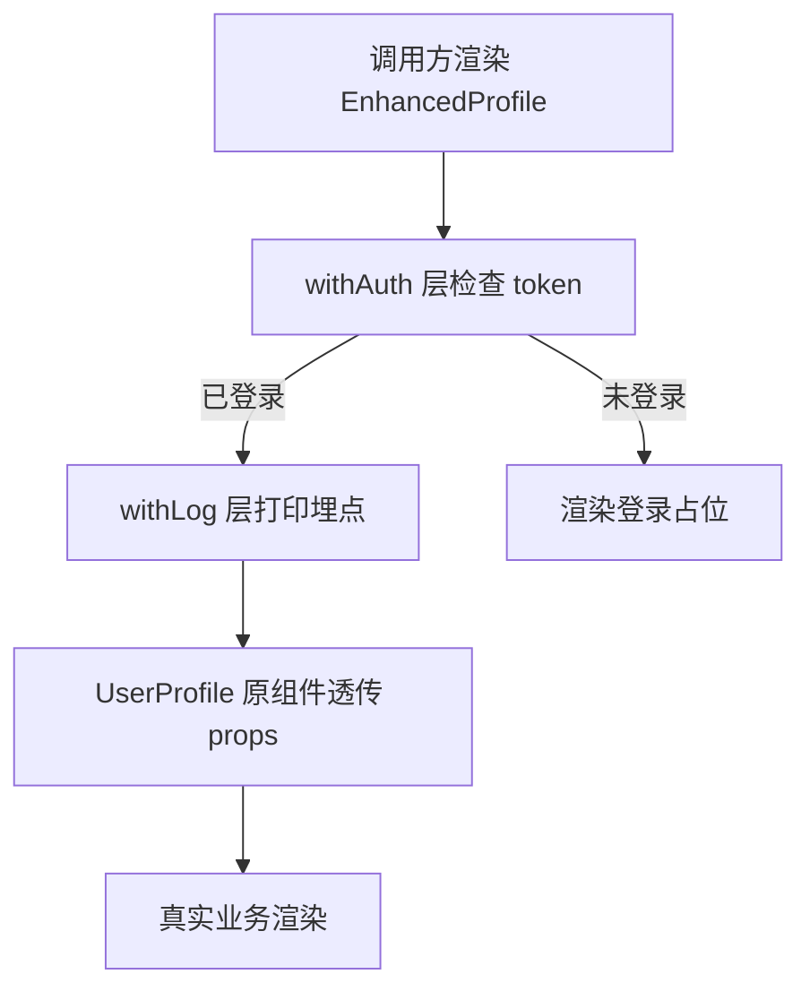

### DP-029：ES 装饰器语法有哪些应用场景？（日志/鉴权/埋点）
**答**：
- 装饰器是"声明式 AOP"：用 `@decorator` 给类/方法/属性/accessor 注入横切逻辑，业务方法保持干净。
- 类装饰器：修改/替换类构造器（加静态属性、注册路由）；方法装饰器：包裹原方法（日志、重试、鉴权、防抖）。
- 标准化进展：TC39 Stage 3 装饰器 + TypeScript 5 实验性支持；NestJS/Angular 重度使用。
- 面试手写点：方法装饰器拿到的是 `descriptor.value`，用高阶函数包装再放回去。

```typescript
// 方法装饰器：重试增强（对比手动包裹，声明式更整洁）
function Retry(times: number) {
  return function (target: object, key: string, descriptor: PropertyDescriptor) {
    const original = descriptor.value;
    descriptor.value = async function (...args: unknown[]) {
      for (let i = 0; i <= times; i++) {
        try { return await original.apply(this, args); }
        catch (e) {
          if (i === times) throw e;
          console.warn(`重试 ${i + 1}/${times}`);
        }
      }
    };
    return descriptor;
  };
}
// 类装饰器：注册路由（NestJS 风格的最小示意）
const routes: Array<{ path: string; ctor: Function }> = [];
function Controller(path: string) {
  return function <T extends new (...args: any[]) => any>(ctor: T) {
    routes.push({ path, ctor });
    return ctor;
  };
}

@Controller('/users')
class UserService {
  @Retry(2)
  async fetchUser(id: number) {
    if (Math.random() < 0.6) throw new Error('network');
    return { id, name: 'Tom' };
  }
}
console.log(routes); // [{ path: '/users', ctor: UserService }]
new UserService().fetchUser(1).then((u) => console.log(u)).catch(() => console.log('最终失败'));

// 鉴权装饰器：方法执行前校验
function RequireRole(role: string) {
  return function (target: object, key: string, descriptor: PropertyDescriptor) {
    const original = descriptor.value;
    descriptor.value = function (...args: any[]) {
      const user = (this as any).currentUser;
      if (!user || !user.roles.includes(role)) throw new Error(`需要 ${role} 权限`);
      return original.apply(this, args);
    };
  };
}
class AdminService {
  currentUser = { roles: ['admin'] };
  @RequireRole('admin')
  deleteUser(id: number) { console.log('已删除', id); }
}
new AdminService().deleteUser(9); // 已删除 9
```

### DP-030：什么是 AOP 思想？手写 before/after 织入埋点（高频压轴）
**答**：
- AOP（面向切面）：把日志、埋点、鉴权、性能统计等"横切关注点"从业务代码中剥离，动态织入函数执行的前后。
- 前端经典实现：`Function.prototype.before/after`——不修改原函数源码，在调用链上包裹。
- 与装饰器关系：装饰器是 AOP 的声明式语法糖，before/after 是 AOP 的函数式原语。
- 价值：埋点需求变化（换 SDK、改参数）不影响业务函数；业务函数也可单独测试。

```javascript
// AOP 原语：before/after 织入，不侵入原函数
Function.prototype.before = function (beforeFn) {
  const self = this;
  return function (...args) {
    const patched = beforeFn.apply(this, args); // 前置切面可改参数
    return self.apply(this, patched === undefined ? args : patched);
  };
};
Function.prototype.after = function (afterFn) {
  const self = this;
  return function (...args) {
    const result = self.apply(this, args);
    afterFn.call(this, result);                 // 后置切面可消费结果
    return result;
  };
};

// 业务函数：干净，不含任何埋点代码
function submitOrder(order) {
  console.log('提交订单', order.id);
  return { ok: true, orderId: order.id };
}

// 织入埋点（前置）与上报（后置）
const trackedSubmit = submitOrder
  .before((order) => {
    tracker('click_submit', { orderId: order.id, ts: Date.now() });
    // 可选：校验失败返回 null 时可中止，这里演示改参
    return [{ ...order, from: 'pc' }];
  })
  .after((result) => {
    tracker('submit_done', { ok: result.ok });
  });
function tracker(event, data) { console.log('[埋点]', event, data); }

trackedSubmit({ id: 'A1' });
// [埋点] click_submit {orderId: 'A1', ts: ...}
// 提交订单 A1
// [埋点] submit_done {ok: true}

// 无侵入的另一直接写法：包装函数（等价于上面的组合）
const withTrack = (fn, event) => (...args) => { tracker(event, {}); return fn(...args); };
const t2 = withTrack(submitOrder, 'click_submit_alt');
t2({ id: 'A2' });
```

### DP-031：代理模式：手写图片懒加载代理？（高频）
**答**：
- 代理模式：为对象提供一个替身，控制对它的访问——真身（`` 创建/赋值 src）延迟到恰当时机。
- 懒加载经典两态：加载中显示占位图，加载完成后替换为真实图片；`MyImage` 与代理 `ProxyImage` 接口一致。
- 现代简化：`IntersectionObserver` 观察可视区，但面试要求能讲出"代理模式"的传统手写版。
- 关键点：代理与本体接口必须一致（`setSrc`），调用方无感。

```javascript
// 本体：真实图片节点，职责单一
class MyImage {
  constructor() {
    this.el = document.createElement('img');
    this.el.src = 'loading.gif'; // 占位
  }
  setSrc(src) { this.el.src = src; }
}
// 代理：控制访问时机 —— 网络图片加载完成才让本体切换
class ProxyImage {
  constructor() {
    this.realImage = new MyImage(); // 持有本体
  }
  setSrc(src) { // 与本体接口一致
    this.realImage.setSrc('loading.gif'); // 先占位
    const img = new Image();              // 预加载
    img.onload = () => this.realImage.setSrc(src); // 加载完才访问"真身"
    img.src = src;
  }
}
// 使用：调用方拿到的永远是代理，无感
const img = new ProxyImage();
img.setSrc('https://cdn.example.com/huge.png');

// 现代版：IntersectionObserver 懒加载（仍是代理思想，只是触发时机交给观察器）
function lazyLoad(selector) {
  const io = new IntersectionObserver((entries) => {
    entries.forEach((en) => {
      if (en.isIntersecting) {
        en.target.src = en.target.dataset.src; // 进入视口才赋值真实地址
        io.unobserve(en.target);               // 加载一次后停止观察
      }
    });
  });
  document.querySelectorAll(selector).forEach((el) => io.observe(el));
}
// lazyLoad('img[data-src]')
```

### DP-032：用 Proxy 实现缓存代理和虚拟代理？
**答**：
- Proxy 元编程能力让代理模式实现更通用：`get/set/apply` 等陷阱天然是"控制访问"的切面。
- 缓存代理：拦截重复计算/重复请求，命中缓存直接返回——`get` 陷阱记录结果。
- 虚拟代理：把"昂贵操作"推迟到真正需要时（如懒初始化重资源对象、函数的惰性执行）。
- 与 DP-031 区别：传统代理需手写包装类，Proxy 可以代理任意对象而无需改其类。

```javascript
// 缓存代理1：纯函数结果缓存
function memoize(fn) {
  const cache = new Map();
  return new Proxy(fn, {
    apply(target, thisArg, args) { // 拦截函数调用
      const key = JSON.stringify(args);
      if (!cache.has(key)) {
        console.log('真实计算', key);
        cache.set(key, target.apply(thisArg, args));
      }
      return cache.get(key);
    },
  });
}
const slowSquare = memoize((n) => { for (let i = 0; i < 1e6; i++); return n * n; });
console.log(slowSquare(9), slowSquare(9)); // 真实计算 [9] 81 81 —— 第二次命中缓存

// 缓存代理2：请求结果缓存（带过期时间）
function cachedFetch(ttl = 5000) {
  const cache = new Map();
  return new Proxy(fetch, {
    apply(target, thisArg, [url, init]) {
      const hit = cache.get(url);
      if (hit && Date.now() - hit.t < ttl) { console.log('缓存命中', url); return hit.v; }
      const p = target(url, init);
      cache.set(url, { v: p, t: Date.now() });
      return p;
    },
  });
}
// const f = cachedFetch(); f('/api/a'); f('/api/a'); —— 第二次直接命中

// 虚拟代理：重对象懒初始化
class HeavyChart {
  constructor() { console.log('初始化重型图表引擎'); } // 昂贵
  draw(data) { console.log('draw', data); }
}
function lazyProxy(Factory) {
  let inst = null;
  return new Proxy({}, {
    get(_, prop) {
      if (!inst) inst = new Factory(); // 第一次真正访问时才创建
      return Reflect.get(inst, prop);
    },
  });
}
const chart = lazyProxy(HeavyChart);   // 此刻不初始化
// ...页面其他逻辑...
chart.draw([1, 2]);                    // 输出：初始化重型图表引擎 -> draw [1, 2]
```

### DP-033：Vue3 响应式为什么是代理模式？（高频）
**答**：
- `reactive()` 用 Proxy 包装对象：`get` 陷阱做依赖收集（track），`set` 陷阱做派发更新（trigger）——拦截访问，正是代理模式。
- 相比 Vue2 的 `Object.defineProperty`：Proxy 能拦截新增/删除属性、数组索引、`in`/`delete`，且惰性代理嵌套对象（访问时才深层代理，性能更好）。
- 模式组合：代理模式（拦截）+ 观察者模式（dep-subscriber 通知）+ 工厂（`reactive/ref/computed` 各自创建响应式产物）。
- 加分：能对照写出 mini-reactive 的 track/trigger 骨架。

```javascript
// mini 响应式：代理模式（拦截）+ 观察者模式（收集与通知）
let activeEffect = null;
const targetMap = new WeakMap(); // target -> Map<key, Set<fn>>

function track(target, key) {
  if (!activeEffect) return;
  let depsMap = targetMap.get(target);
  if (!depsMap) targetMap.set(target, (depsMap = new Map()));
  let deps = depsMap.get(key);
  if (!deps) depsMap.set(key, (deps = new Set()));
  deps.add(activeEffect); // 依赖收集
}
function trigger(target, key) {
  (targetMap.get(target)?.get(key) || []).forEach((fn) => fn()); // 派发更新
}
function reactive(obj) {
  return new Proxy(obj, {
    get(target, key, receiver) {
      track(target, key);                       // 陷阱1：读时收集
      const val = Reflect.get(target, key, receiver);
      return typeof val === 'object' && val !== null ? reactive(val) : val; // 惰性深层代理
    },
    set(target, key, value, receiver) {
      const old = target[key];
      const ok = Reflect.set(target, key, value, receiver);
      if (old !== value) trigger(target, key);  // 陷阱2：写时派发
      return ok;
    },
    deleteProperty(target, key) {               // defineProperty 做不到的：删属性也响应
      const ok = Reflect.deleteProperty(target, key);
      trigger(target, key);
      return ok;
    },
  });
}
// 使用：effect 自动追踪依赖
function effect(fn) {
  activeEffect = fn;
  fn();
  activeEffect = null;
}
const state = reactive({ count: 0, list: [1] });
effect(() => console.log('render, count =', state.count));
state.count = 1; // render, count = 1 —— 自动重跑
state.count = 2; // render, count = 2
```

Vue3 响应式的模式组合：

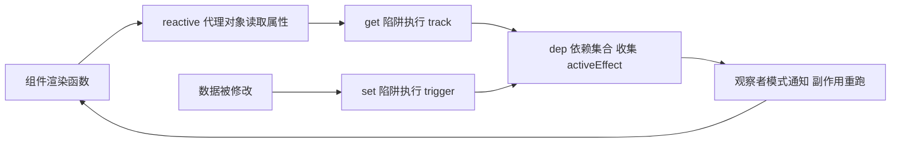

### DP-034：适配器、装饰器、代理三者如何辨析？（高频）
**答**：
- 共同点：都是"包一层"，引入中间对象。
- 意图不同：适配器**改变接口**（A 接口→B 接口，为了兼容）；装饰器**保持接口**叠加职责（为了增强）；代理**保持接口**控制访问（为了管控时机/权限/成本）。
- 判断法：问"包装后接口形状变了吗"——变了是适配器；没变再看目的——加功能是装饰器，管访问是代理。
- 前端例子对号入座：`getUserInfo→user.getInfo` 是适配器；HOC 加埋点是装饰器；懒加载图和 Vue3 reactive 是代理。

```javascript
// 同一个目标对象的三种包装对比
const target = { getData: (id) => `data-${id}` };

// 1. 适配器：接口形状变了 —— getData 变成 fetchUser
class Adapter {
  fetchUser(id) { return target.getData(id); } // 转换调用方式
}

// 2. 装饰器：接口没变，职责变多 —— getData 前后多了日志
function decorate(obj) {
  const raw = obj.getData.bind(obj);
  obj.getData = (id) => {                 // 接口签名一致
    console.log('log: before');
    const r = raw(id);
    console.log('log: after');
    return r;
  };
  return obj;
}

// 3. 代理：接口没变，访问被管控 —— 加缓存（控制成本）
function proxy(obj) {
  const cache = new Map();
  return new Proxy(obj, {
    get(t, key) {
      if (key === 'getData') {
        return (id) => {
          if (!cache.has(id)) cache.set(id, t.getData(id)); // 控制访问：不重复计算
          return cache.get(id);
        };
      }
      return Reflect.get(t, key);
    },
  });
}

console.log(new Adapter().fetchUser(1));   // data-1（接口已变形）
const d = decorate({ getData: target.getData });
d.getData(2);                              // log: before data-2 log: after（增强）
const p = proxy(target);
p.getData(3); p.getData(3);                // data-3 data-3（第二次走缓存，管控访问）
// 记忆：形状变了=适配器，能力多了=装饰器，时机/成本被管=代理
```

## 六、结构型：外观/组合/享元/桥接

### DP-035：外观模式：如何封装一个统一支付 SDK？
**答**：
- 外观：为复杂子系统提供一致的高层入口，调用方不需要知道内部有多少模块、如何编排。
- 前端场景：支付 SDK（内部有渠道选择、风控、埋点、降级）、上报 SDK、地图 SDK。
- 与适配器区别：适配器解决"接口不兼容"，外观解决"子系统太复杂"，外观通常还会做流程编排。
- 收益：底层子系统可整体替换（如支付宝 SDK 换版本），业务侧只认识 `pay()`。

```javascript
// 复杂子系统：业务方不该直接碰这些
const riskApi = { check: (order) => order.amount < 100000 };     // 风控
const channelApi = {                                             // 渠道路由
  wechat: (o) => Promise.resolve(`wx_${o.orderId}`),
  alipay: (o) => Promise.resolve(`ali_${o.orderId}`),
};
const reportApi = { send: (e, d) => console.log('[report]', e, d) }; // 埋点

// 外观：统一入口 + 流程编排
class PaySDK {
  pay({ channel = 'wechat', ...order }) {
    reportApi.send('pay_start', { channel, orderId: order.orderId });
    if (!riskApi.check(order)) {                    // 编排1：风控
      reportApi.send('pay_blocked', { orderId: order.orderId });
      return Promise.reject(new Error('风控拦截'));
    }
    const fn = channelApi[channel] || channelApi.wechat; // 编排2：渠道分发（兜底策略）
    return fn(order).then((tradeNo) => {            // 编排3：调用渠道
      reportApi.send('pay_success', { tradeNo });   // 编排4：上报
      return tradeNo;
    }).catch((err) => {
      reportApi.send('pay_fail', { msg: String(err) });
      throw err;
    });
  }
}
// 业务方只需要认识一个入口
const paySDK = new PaySDK();
paySDK.pay({ orderId: 'A1', amount: 99 }).then(console.log); // [report] pay_start ... wx_A1
// 子系统升级（如渠道 API 换签名方式）不影响任何业务调用方
```

### DP-036：组合模式：如何用同一套代码渲染"文件树/组织架构树"？（高频压轴）
**答**：
- 组合模式：将对象组成树形结构，使"叶子节点"和"容器节点"使用统一接口——调用方递归处理整棵树。
- 前端最直观对应就是组件树：`<Folder>` 里可以放 `<Folder>` 也可以放 `<File>`，渲染时无差别调用。
- 核心实现：容器节点持有 children 数组，`render/count/size` 等操作递归委托给 children。
- 权衡：组合模式让"单节点操作"与"整树操作"统一，但也可能放宽了类型约束（叶子不该有 children 却有接口）。

```javascript
// 统一接口：叶子与容器实现同名操作
// 注意：JS 没有 abstract 关键字（TS 专属语法），用"基类方法直接抛错"模拟抽象约束
class Node {
  constructor(name) { this.name = name; }
  render(indent = 0) { throw new Error('abstract'); }
}
// 叶子：文件
class File extends Node {
  render(indent = 0) { console.log(' '.repeat(indent) + `📄 ${this.name}`); }
  size() { return this._size || 1; }
}
// 容器：文件夹 —— 持有 children，操作递归委托
class Folder extends Node {
  constructor(name) { super(name); this.children = []; }
  add(node) { this.children.push(node); return this; } // 返回 this 支持链式构建树
  render(indent = 0) {
    console.log(' '.repeat(indent) + `📁 ${this.name}`);
    this.children.forEach((c) => c.render(indent + 2)); // 递归统一调用
  }
  size() { return this.children.reduce((s, c) => s + c.size(), 0); }
}
// 构建树：容器和叶子无差别 add
const root = new Folder('src')
  .add(new File('index.js'))
  .add(new Folder('components').add(new File('Button.vue')).add(new File('Modal.vue')));
root.render();
// 📁 src
//   📄 index.js
//   📁 components
//     📄 Button.vue
//     📄 Modal.vue
console.log('总大小', root.size()); // 3 —— 容器自动聚合叶子
```

### DP-037：React/Vue 组件树和组合模式是什么关系？
**答**：
- React/Vue 的 UI 本质是组件树：组件里嵌套组件，与组合模式"部分-整体层次结构"完全同构。
- React 里每个组件的返回值是元素树，renderer 递归处理（叶子=宿主组件如 div，容器=函数/类组件）——"统一接口"就是组件这个抽象本身。
- Vue 的 slot、React 的 children 都是"把子结构当参数传入容器"，是组合模式的 API 化。
- 面试延伸：diff 算法对树做统一遍历（同层比较），正是因为结构统一才可行。

```jsx
// React：容器组件与叶子组件同构，递归渲染树形数据（组合模式思想）
const Tree = ({ node }) => (
  <div className="node">
    <span>{node.type === 'folder' ? '📁' : '📄'} {node.name}</span>
    {node.children && (
      <div className="children" style={{ paddingLeft: 16 }}>
        {node.children.map((child) => (
          <Tree key={child.name} node={child} />  // 递归：容器统一委托子节点
        ))}
      </div>
    )}
  </div>
);
const data = {
  type: 'folder', name: 'src',
  children: [
    { type: 'file', name: 'index.js' },
    { type: 'folder', name: 'components', children: [{ type: 'file', name: 'Button.vue' }] },
  ],
};
// <Tree node={data} /> —— 渲染逻辑不区分树的深度与形态

// Vue 等价形态：递归组件
// const TreeItem = {
//   props: ['node'],
//   template: `<div><span>{{ node.name }}</span>
//     <TreeItem v-for="c in node.children || []" :key="c.name" :node="c" /></div>`,
// };
```

### DP-038：享元模式如何支撑虚拟列表的 DOM 复用？（高频）
**答**：
- 10 万条列表如果每条一个 DOM 节点，内存和渲染都会崩——虚拟列表只渲染可视区约 20 条，滚动时**复用**这批节点更新内容。
- 享元思想：DOM 节点是共享的内部资源（少量），列表项数据是外部状态（每次传入）——"对象少、状态外置"。
- 关键实现：监听滚动 → 由 scrollTop 计算起始索引 → 更新可视区节点的 transform/内容。
- 同源应用：Canvas 弹幕、粒子系统、React 的 key 复用 reconciliation。

```javascript
// 虚拟列表最小实现：固定 20 个 DOM 节点，滚动时换数据不换节点
function createVirtualList({ container, itemHeight, total, render }) {
  const VIEW_COUNT = 20;
  container.style.overflow = 'auto';
  container.style.height = `${VIEW_COUNT * itemHeight}px`;
  const spacer = document.createElement('div');        // 撑起总高度
  spacer.style.height = `${total * itemHeight}px`;
  container.appendChild(spacer);

  const pool = Array.from({ length: VIEW_COUNT }, () => { // 享元池：节点只建一次
    const el = document.createElement('div');
    el.style.position = 'absolute';
    el.style.height = `${itemHeight}px`;
    container.appendChild(el);
    return el;
  });

  function onScroll() {
    const start = Math.floor(container.scrollTop / itemHeight); // 起始索引
    pool.forEach((el, i) => {
      const index = start + i;
      if (index < total) {
        el.style.display = 'block';
        el.style.transform = `translateY(${index * itemHeight}px)`;
        render(el, index); // 外部状态（第 index 条数据）注入共享节点
      } else {
        el.style.display = 'none';
      }
    });
  }
  container.addEventListener('scroll', onScroll, { passive: true });
  onScroll();
}
createVirtualList({
  container: document.querySelector('#list'),
  itemHeight: 40,
  total: 100000,
  render: (el, i) => { el.textContent = `第 ${i} 行`; },
});
// DOM 恒定 21 个（含 spacer），10 万条数据内存几乎不增长 —— 享元的收益
```

### DP-039：对象池和享元是什么关系？（弹幕/粒子场景）
**答**：
- 对象池 = 享元 + 归还机制：用完的对象不销毁，回池复用，避免频繁创建/销毁（GC 压力）。
- 场景：弹幕（一条弹幕离开屏幕后 DOM 节点回池）、粒子动画、数据库/网络连接池。
- 与经典享元区别：享元强调"内部状态共享、外部状态注入"；对象池强调"生命周期借还"，二者常同时出现。
- 实现：`acquire()`（池空才创建，池满可等待）+ `release()`（重置状态后入池）。

```javascript
// 弹幕对象池：节点借还，避免每条弹幕 createElement/remove
class DanmakuPool {
  constructor(size = 50) {
    this.pool = [];                // 空闲节点
    for (let i = 0; i < size; i++) this.pool.push(this.#create());
  }
  #create() {
    const el = document.createElement('div');
    el.className = 'danmaku';
    el.style.position = 'absolute';
    el.style.display = 'none';
    document.querySelector('#stage').appendChild(el);
    return el;
  }
  acquire() {
    return this.pool.pop() ?? this.#create(); // 池空才新建（有界扩展）
  }
  release(el) {
    el.style.display = 'none';
    el.textContent = '';
    this.pool.push(el);            // 重置内部状态后归还
  }
}
class DanmakuSystem {
  constructor(pool) { this.pool = pool; this.active = new Set(); }
  spawn(text) {
    const el = this.pool.acquire();       // 借
    el.style.display = 'block';
    el.textContent = text;
    el.style.transform = 'translateX(100vw)';
    const item = { el };
    this.active.add(item);
    setTimeout(() => {                    // 弹幕滚出屏幕
      this.active.delete(item);
      this.pool.release(el);              // 还
    }, 5000);
  }
}
const pool = new DanmakuPool(30);
const sys = new DanmakuSystem(pool);
sys.spawn('666'); sys.spawn('前方高能'); // 无论发多少条，DOM 总量有上界
```

### DP-040：桥接模式如何解决"多端事件绑定"的组合爆炸？
**答**：
- 问题：PC/H5/小程序 × click/touch/自定义手势，两维度直接组合会写出 `if(pc && click) ... else if(h5 && touch)...` 的爆炸分支。
- 桥接：把"抽象维度（业务行为）"与"实现维度（平台能力）"分离，各自独立演化，运行时桥接起来。
- 前端实例：Zepto/jQuery 的事件模块抹平浏览器差异；Taro 把 React 调用桥接到不同小程序运行时。
- 判别：桥接是"两个变化维度解耦"，适配器是"事后补救一个不兼容接口"。

```javascript
// 实现维度：平台事件能力（可独立新增小程序端）
const platforms = {
  pc: {
    bind(el, type, handler) { el.addEventListener(type, handler); },
  },
  h5: {
    bind(el, type, handler) { // 移动端把 click 映射为 touchend，消除 300ms 延迟
      const map = { click: 'touchend' };
      el.addEventListener(map[type] || type, handler, { passive: false });
    },
  },
};

// 抽象维度：业务行为只声明"意图"，不关心平台
class GestureBridge {
  constructor(platform) { this.platform = platform; } // 桥：聚合两个维度
  onTap(el, handler) { this.platform.bind(el, 'click', handler); }   // 抽象操作委托给实现
  onSwipe(el, handler) { // 组合两个底层事件实现高层手势
    let sx = 0;
    this.platform.bind(el, 'touchstart', (e) => { sx = e.touches[0].clientX; });
    this.platform.bind(el, 'touchend', (e) => {
      const dx = e.changedTouches[0].clientX - sx;
      if (Math.abs(dx) > 50) handler(dx > 0 ? 'right' : 'left');
    });
  }
}
// 使用：业务代码选择实现即可，两端逻辑同一份
const bridge = new GestureBridge(platforms.h5);
bridge.onTap(document.querySelector('#btn'), () => console.log('tapped'));
// 新增小程序端：platforms.miniprogram = {...}，GestureBridge 一行不改
```

### DP-041：MVC/MVVM 和设计模式是什么关系？（高频）
**答**：
- MVC/MVVM 是**架构模式**（宏观分层），GoF 模式是**实现手段**（微观组合）——一个架构模式由多个 GoF 模式拼装而成。
- MVC：视图观察模型变化（观察者）、控制器/视图按事件分派策略（策略）、视图层级（组合）。
- MVVM：View 与 Model 双向绑定（观察者 + 代理/发布订阅）、ViewModel 对 View 暴露统一接口（外观）。
- 面试答法：先说分层职责，再落到模式实现，避免"背概念对不上代码"。

```javascript
// mini-MVVM：观察者(数据绑定) + 代理(拦截) + 外观(ViewModel 统一入口)
const bus = {                       // 观察者中枢
  map: new Map(),
  on(k, fn) { (this.map.get(k) ?? this.map.set(k, new Set()).get(k)).add(fn); },
  emit(k, v) { (this.map.get(k) || []).forEach((fn) => fn(v)); },
};

// Model：纯数据，被代理拦截
function createModel(data) {
  return new Proxy(data, {
    set(t, k, v) { t[k] = v; bus.emit(k, v); return true; }, // 写时通知视图（观察者）
  });
}

// ViewModel：对外统一入口（外观），编排 Model 与 View
class ViewModel {
  constructor(model, bindings) {
    this.model = model;
    bindings.forEach(([key, el]) => {
      bus.on(key, (v) => { el.textContent = v; });          // 数据->视图
      el.addEventListener('input', (e) => { model[key] = e.target.value; }); // 视图->数据
      el.value = model[key];
    });
  }
  set(key, value) { this.model[key] = value; } // 简化入口：业务只跟 ViewModel 打交道
}

// View：DOM
const nameInput = document.createElement('input');
const nameLabel = document.createElement('span');

// 组装 MVVM
const model = createModel({ name: 'Tom' });
const vm = new ViewModel(model, [['name', nameInput]]);
vm.set('name', 'Jerry');
console.log(nameLabel.textContent); // Jerry —— 数据变了视图自动更新
```

### DP-042：Canvas 图形库（场景图）里能找到哪些模式？
**答**：
- 场景图（SceneGraph）：Canvas 上层封装的对象树——组合模式（Group/Shape 统一 render）+ 模板方法（基类定义绘制骨架，子类实现 draw）+ 享元（样式对象/画笔共享）。
- 典型库：Konva、Fabric.js、ECharts 的 ZRender 都是"场景图 + 渲染循环"。
- 其他模式：命令模式（undo/redo 栈）、备忘录（快照）、职责链（事件冒泡命中检测）。
- 面试价值：能在一个具体库里指认多模式，说明真正理解了"模式是组合使用的"。

```javascript
// 场景图最小骨架：组合 + 模板方法 + 命令
class Shape { // 模板方法：基类固定绘制流程
  constructor(props) { Object.assign(this, { x: 0, y: 0, ...props }); this.children = []; }
  render(ctx) {                       // 骨架：save -> 变换 -> draw -> restore
    ctx.save();
    ctx.translate(this.x, this.y);
    this.draw(ctx);                   // 变化点下放给子类（钩子）
    this.children.forEach((c) => c.render(ctx));
    ctx.restore();
  }
  add(shape) { this.children.push(shape); return this; }
  draw() {}
}
class Circle extends Shape {
  draw(ctx) {
    ctx.beginPath();
    ctx.arc(0, 0, this.r, 0, Math.PI * 2);
    ctx.fillStyle = this.fill;
    ctx.fill();
  }
}
class Group extends Shape {} // 纯容器：骨架中的 children 遍历已覆盖

// 命令模式：绘制历史 undo/redo
class History {
  constructor() { this.undoStack = []; this.redoStack = []; }
  execute(cmd) { cmd.do(); this.undoStack.push(cmd); this.redoStack = []; }
  undo() { const c = this.undoStack.pop(); c?.undo(); c && this.redoStack.push(c); }
}
const canvas = document.createElement('canvas');
const ctx = canvas.getContext('2d');
const stage = new Group();
const circle = new Circle({ r: 30, fill: 'red', x: 100, y: 100 });
const addCmd = {
  do() { stage.add(circle); },        // 命令封装"动作 + 逆动作"
  undo() { stage.children = stage.children.filter((c) => c !== circle); },
};
const history = new History();
history.execute(addCmd);
stage.render(ctx);
history.undo();
console.log(stage.children.length); // 0 —— 可撤销
```

---

## 七、行为型：观察者与发布订阅

### DP-043：观察者模式和发布订阅模式的本质区别？（高频压轴）
**答**：
- 观察者：目标（Subject）直接维护观察者列表并通知，双方**知道彼此**，耦合是"松但存在"。
- 发布订阅：多了一个**事件中心（Broker）**，发布者和订阅者互不相识，解耦更彻底。
- 判别法：看有没有中间调度者——`subject.notify()` 直通是观察者；`emit/on` 经事件中心是发布订阅。
- 典型对应：Vue 的 dep→watcher 是观察者；Node EventEmitter、mitt、DOM 自定义事件是发布订阅。

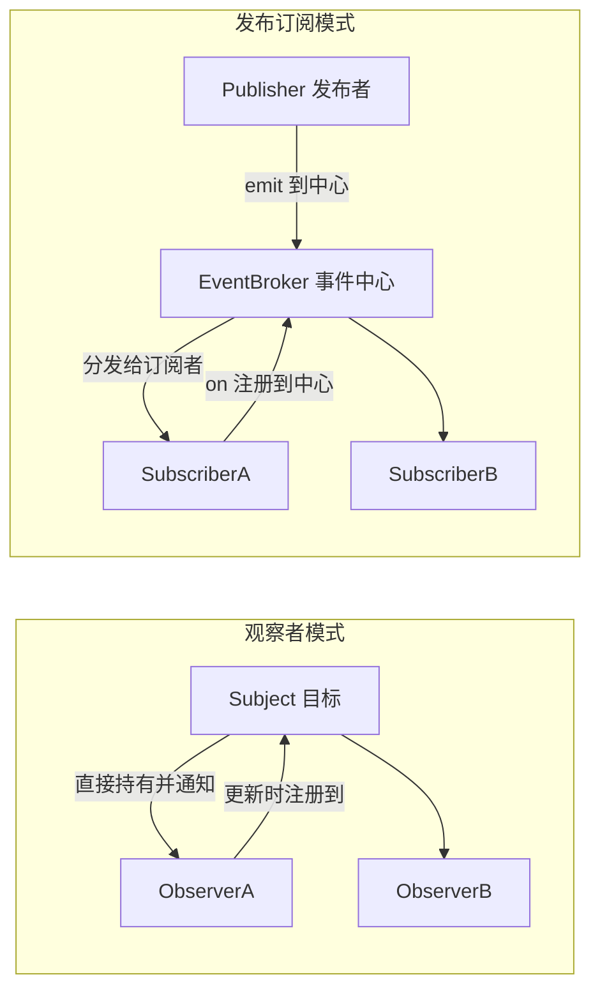

```javascript
// 观察者：Subject 直接管理 Observer（双方相识）
class Subject {
  constructor() { this.observers = []; }
  addObserver(o) { this.observers.push(o); }        // 观察者注册进目标
  removeObserver(o) { this.observers = this.observers.filter((x) => x !== o); }
  notify(data) { this.observers.forEach((o) => o.update(data)); } // 目标直接通知
}
class Observer {
  constructor(name) { this.name = name; }
  update(data) { console.log(`${this.name} 收到`, data); }
}
const s = new Subject();
s.addObserver(new Observer('图表'));
s.notify({ price: 99 }); // 图表 收到 {price: 99}

// 发布订阅：事件中心居中，双方互不相识
class Broker {
  #map = new Map();
  on(event, fn) {
    if (!this.#map.has(event)) this.#map.set(event, new Set());
    this.#map.get(event).add(fn);
    return () => this.#map.get(event)?.delete(fn);
  }
  emit(event, payload) { (this.#map.get(event) || []).forEach((fn) => fn(payload)); }
}
const bus = new Broker();
const off = bus.on('price:change', (d) => console.log('订阅者1', d));
bus.on('price:change', (d) => console.log('订阅者2', d));
bus.emit('price:change', { price: 100 }); // 订阅者1 {price:100} 订阅者2 {price:100}
off(); // 订阅者1 退订后不再收到
bus.emit('price:change', { price: 101 }); // 只有 订阅者2 收到
// 本质区别：Subject.notify vs Broker.emit —— 有没有中间人
```

### DP-044：手写观察者模式：被观察者直接通知观察者？（高频）
**答**：
- 三要素：Subject 持有 observers、提供 `add/remove/notify`、Observer 实现 `update`。
- 进阶点：推模型（notify 携带数据）vs 拉模型（observer 收到通知后自己去 `subject.getState()` 取）。
- 前端实例：redux store.subscribe/listener 就是观察者——store 是 Subject，组件的渲染回调是 Observer。
- 注意 remove 防内存泄漏；notify 时遍历副本，防回调中增删观察者导致遍历异常。

```javascript
// 拉模型观察者：观察者主动拉取状态（redux 风格）
class Store { // Subject
  #state;
  #listeners = new Set();
  constructor(initial) { this.#state = initial; }
  getState() { return this.#state; }
  subscribe(listener) {           // 观察者注册
    this.#listeners.add(listener);
    return () => this.#listeners.delete(listener); // 返回退订函数
  }
  dispatch(action) {
    this.#state = this.#reducer(this.#state, action);
    [...this.#listeners].forEach((fn) => fn()); // 遍历副本：防回调内退订
  }
  #reducer(state, action) {
    switch (action.type) {
      case 'inc': return { ...state, count: state.count + 1 };
      default: return state;
    }
  }
}
const store = new Store({ count: 0 });
// Observer：组件渲染回调（拉模型：收到通知后自己 getState）
const render = () => console.log('View 渲染 count =', store.getState().count);
const unsub = store.subscribe(render);
store.dispatch({ type: 'inc' }); // View 渲染 count = 1
unsub();                          // 组件卸载时退订，防泄漏
store.dispatch({ type: 'inc' });  // 无输出 —— 已退订
```

### DP-045：手写发布订阅：事件中心如何解耦模块？（高频）
**答**：
- 核心 API：`on/once/off/emit`；数据结构 `Map<event, Set<handler>>`。
- once = 包一层只执行一次的闭包；off 要能精确移除（保存原函数引用）。
- 工程增强：通配符订阅 `on('*')`、事件名命名空间、最大监听数告警（Node EventEmitter 的 setMaxListeners）。
- 面试手写重点：退订闭包的正确性 + emit 时遍历副本。

```javascript
class EventEmitter {
  #events = new Map();
  on(event, fn) {
    if (!this.#events.has(event)) this.#events.set(event, new Set());
    this.#events.get(event).add(fn);
    return this; // 链式
  }
  once(event, fn) {
    const wrap = (...args) => {
      this.off(event, wrap);   // 先退订再执行，防止回调内重入
      fn(...args);
    };
    wrap.origin = fn;          // 保存原引用，支持 off(event, 原函数)
    return this.on(event, wrap);
  }
  off(event, fn) {
    const set = this.#events.get(event);
    if (!set) return this;
    set.delete(fn);
    // 兼容 once 包装函数的移除
    set.forEach((h) => { if (h.origin === fn) set.delete(h); });
    if (set.size === 0) this.#events.delete(event);
    return this;
  }
  emit(event, ...args) {
    [...(this.#events.get(event) || [])].forEach((fn) => fn(...args)); // 副本遍历
    return this;
  }
}
const em = new EventEmitter();
const handler = (data) => console.log('got', data);
em.on('msg', handler).once('msg', (d) => console.log('once got', d));
em.emit('msg', 1); // got 1 / once got 1
em.emit('msg', 2); // got 2 —— once 已自动退订
em.off('msg', handler);
em.emit('msg', 3); // 无输出
```

### DP-046：Vue 响应式里的观察者：dep 和 subscriber 是什么关系？（高频）
**答**：
- Vue2/3 响应式核心是观察者模式：每个响应式属性有一个 dep（被观察者/Subject），用到它的渲染函数/ watcher 是订阅者（Observer）。
- 流程：渲染时读取属性 → `dep.depend()` 收集当前 watcher → 属性变化 → `dep.notify()` 通知 watcher 重新渲染。
- Vue3 的 `effect` + `track/trigger` 是同一模式的现代写法（WeakMap 存储 target→key→dep）。
- 加分：computed 也是 watcher（dirty 标记惰性求值），watch 是显式订阅某个 dep。

```javascript
// Vue 风格 dep-subscriber（观察者模式直通车）
class Dep {
  #subs = new Set();
  static current = null;                 // 正在执行的订阅者
  depend() { if (Dep.current) this.#subs.add(Dep.current); } // 收集
  notify() { [...this.#subs].forEach((w) => w.update()); }   // 通知
}
class Watcher { // 订阅者
  constructor(getter, cb) {
    this.getter = getter;
    this.cb = cb;
    this.value = this.get();             // 首次求值即完成依赖收集
  }
  get() {
    Dep.current = this;                  // 打开收集开关
    const v = this.getter();
    Dep.current = null;                  // 关闭
    return v;
  }
  update() {                             // 被 dep.notify 调起
    const old = this.value;
    this.value = this.get();             // 重新求值、重新收集（依赖可能变了）
    this.cb(this.value, old);
  }
}
// 数据层：每个 key 挂一个 dep
function defineReactive(obj, key) {
  const dep = new Dep();
  let val = obj[key];
  Object.defineProperty(obj, key, {
    get() { dep.depend(); return val; },      // 读：收集当前 Watcher
    set(nv) { val = nv; dep.notify(); },      // 写：通知所有 Watcher
  });
}
const state = { count: 0 };
defineReactive(state, 'count');
// 渲染 Watcher：依赖 state.count
new Watcher(() => state.count, (nv, ov) => console.log(`视图更新 ${ov} -> ${nv}`));
state.count = 5; // 视图更新 0 -> 5 —— 全自动
```

### DP-047：DOM 事件监听为什么是发布订阅（观察者）？
**答**：
- `addEventListener` = 向事件中心（DOM 节点/EventTarget）注册回调；事件触发 = 中心按注册顺序/捕获冒泡规则分发。
- 特点：多播（同一事件多个监听）、可移除（removeEventListener 需要同引用）、有优先级规则（捕获→目标→冒泡）。
- 事件委托：把子元素的监听统一挂到父节点——一次注册管理大量子节点（性能 + 动态子元素）。
- 加分：CustomEvent 让任意业务对象获得 EventTarget 能力——标准化的发布订阅。

```javascript
// 1. addEventListener 就是订阅，事件对象就是通知载荷
const btn = document.querySelector('#btn');
const onClick = (e) => console.log('clicked', e.target.dataset.id);
btn.addEventListener('click', onClick);
btn.removeEventListener('click', onClick); // 退订必须同引用

// 2. 事件委托：父节点统一订阅（发布订阅的多播 + 转发）
document.querySelector('#list').addEventListener('click', (e) => {
  const li = e.target.closest('li[data-id]'); // 冒泡到父节点再分派
  if (li) console.log('删除', li.dataset.id);
});

// 3. CustomEvent：任意对象获得发布订阅能力（标准化事件中心）
const cart = new EventTarget();
cart.addEventListener('item:add', (e) => console.log('购物车角标 +1', e.detail));
cart.dispatchEvent(new CustomEvent('item:add', { detail: { sku: 'A1' } }));
// 购物车角标 +1 {sku: 'A1'}

// 4. 对照手写版理解：EventTarget 的内部就是 Map<type, Set<listener>>
// dispatchEvent 时按 capture/bubble 阶段依次调用 —— 浏览器原生实现的发布订阅
```

### DP-048：生命周期钩子本质是什么？为什么说是观察者的应用？
**答**：
- 钩子 = 框架在固定时机"发布"事件，开发者注册回调"订阅"——`mounted` 就是框架通知"挂载完成"这个事件。
- 与通用发布订阅的区别：钩子是**预定义的有限事件集**，由框架在内部控制触发点，开发者只能订阅不能 emit。
- 插件/中间件形态的钩子（如 Vue 插件、webpack taps）更接近完整发布订阅：tapable 的 `hook.tap` 注册、`hook.call` 触发。
- 理解这一点，就能理解"框架扩展点设计"：要么钩子（编译期固定），要么事件总线（运行时开放）。

```javascript
// Vue3 组合式 API 里的钩子订阅
// import { onMounted, onUnmounted } from 'vue';
// onMounted(() => console.log('订阅了 mounted 事件'));
// 框架内部伪代码：实例挂载完成后依次调用 mounted 队列
function mountComponent(vnode, container) {
  const instance = createComponent(vnode);
  // ...初始化...
  instance.lifecycle.mounted.forEach((fn) => fn()); // 框架"发布"，用户函数被调用
  container.appendChild(instance.el);
}

// 自制迷你钩子系统：预定义事件 + 注册表
function createLifecycle() {
  const hooks = { beforeCreate: [], created: [], mounted: [] };
  return {
    on(name, fn) { hooks[name]?.push(fn); },        // 用户订阅钩子
    trigger(name, ctx) { (hooks[name] || []).forEach((fn) => fn(ctx)); }, // 框架触发
  };
}
const life = createLifecycle();
life.on('mounted', () => console.log('A: 发请求'));
life.on('mounted', () => console.log('B: 埋点上报'));
life.trigger('mounted', { id: 1 });
// A: 发请求 / B: 埋点 —— 同一时机多播，顺序确定

// tapable 对照：webpack 编译器钩子（完整发布订阅 + 同步/异步/串行/并行变体）
// const { SyncHook } = require('tapable');
// const hook = new SyncHook(['name']);
// hook.tap('plugin1', (name) => console.log('plugin1', name));
// hook.call('webpack');  —— tap=订阅 call=发布，和上面 trigger 同构
```

### DP-049：发布订阅的内存泄漏风险有哪些？如何治理？（高频）
**答**：
- 风险1：组件订阅了全局总线但销毁时未退订——闭包持有组件实例，无法回收，还会触发"幽灵回调"（操作已卸载组件报错）。
- 风险2：重复订阅（组件重渲染重复 on）导致回调执行多次。
- 治理：React 在 useEffect cleanup 中退订；Vue 在 onUnmounted 退订；总线统一管理生命周期（绑定实例销毁自动清理）。
- 进阶：`on` 返回退订函数、once 自动清理、提供 `offAll(scope)`、开发态统计监听数告警。

```jsx
// React 治理范式：订阅与退订必须在同一个 effect 中成对出现
function PriceTicker({ symbol }) {
  const [price, setPrice] = React.useState(null);
  React.useEffect(() => {
    const handler = (e) => setPrice(e.detail);       // 订阅
    bus.addEventListener(`price:${symbol}`, handler);
    return () => bus.removeEventListener(`price:${symbol}`, handler); // cleanup：防泄漏
  }, [symbol]); // symbol 变化也会先清理旧订阅，防重复订阅
  return <div>{symbol}: {price}</div>;
}
const bus = new EventTarget();

// Vue3 治理范式
// import { onMounted, onUnmounted } from 'vue';
// onMounted(() => { bus.on('refresh', handler); });
// onUnmounted(() => { bus.off('refresh', handler); }); // 成对出现

// 总线侧加固：作用域批量清理 + 监听数告警
class SafeBus {
  #events = new Map();
  #scopes = new Map(); // scope -> Set<退订函数>
  on(event, fn, scope = 'default') {
    if (!this.#events.has(event)) this.#events.set(event, new Set());
    const set = this.#events.get(event);
    set.add(fn);
    const off = () => set.delete(fn);
    if (!this.#scopes.has(scope)) this.#scopes.set(scope, new Set());
    this.#scopes.get(scope).add(off);
    if (set.size > 100) console.warn(`事件 ${event} 监听数已达 ${set.size}，检查是否泄漏`);
    return off;
  }
  clearScope(scope) {           // 组件卸载时一键清理该组件所有订阅
    (this.#scopes.get(scope) || []).forEach((off) => off());
    this.#scopes.delete(scope);
  }
}
const safeBus = new SafeBus();
const off1 = safeBus.on('tick', () => {}, 'Ticker@1');
safeBus.clearScope('Ticker@1'); // 路由切换/组件卸载统一调用
```

### DP-050：全局事件总线为什么被现代框架"弃用"？（高频）
**答**：
- Vue2 的 `$emit/$on` 事件总线在 Vue3 被移除、React 也不内置——根本原因：**隐式数据流**破坏了"状态可预测"。
- 总线问题：谁发的、谁订阅的、事件顺序如何，全靠全局搜索；数据不在单向流里，调试/测试困难；大规模后事件名冲突、时序 bug 频发。
- 替代品：状态库（Pinia/redux/zustand）管共享状态，观察者下沉到框架响应式系统；跨组件事件用显式 props/emits/Context。
- 辩证看：总线没有死——mitt 等库仍用于**非状态类通知**（埋点、WebSocket 推送、微前端通信），关键是只传"事件"不传"状态"。

```javascript
// 反模式：用总线传"状态"，数据流失控
// ComponentA: bus.emit('user-changed', user)
// ComponentB: bus.on('user-changed', u => this.user = u)
// 问题：B 的初始值从哪来？A 和 B 谁先挂载？总线里还有几个组件也在改 user？—— 不可追踪

// 现代替代1：状态库显式单向流（Pinia 风格）
// stores/user.js —— 模块天然单例 + 观察者通知
import { defineStore } from 'pinia';
export const useUserStore = defineStore('user', {
  state: () => ({ user: null }),
  actions: { setUser(u) { this.user = u; } }, // 改状态的唯一入口，可追踪
});
// 组件A：useUserStore().setUser(u)  组件B：computed(() => store.user) —— 响应式自动同步

// 现代替代2：mitt 只用于"事件通知"（不是状态）
// import mitt from 'mitt';
// export const emitter = mitt();
// ws.onmessage = (e) => emitter.emit('ws:message', e.data); // 外部信号 -> 广播
// 合理，因为这不是共享状态，只是通知

// 现代替代3：显式 props/emits（Vue）—— 数据流可静态追踪
// <Child :user="user" @update="setUser" /> —— 谁用、谁改一目了然
```

## 八、行为型：策略/状态/命令

### DP-051：策略模式：表单校验规则如何设计？（高频压轴）
**答**：
- 策略：定义一族可互换的算法，调用方在运行时选择——把"用哪个算法"和"算法怎么实现"分离。
- 表单校验是教科书场景：required/手机号/密码强度都是策略；校验器只负责"取规则、执行、汇总错误"。
- 实现三件套：规则字典（策略集）、校验上下文（执行器）、规则组合（一条字段可挂多条规则）。
- 收益：新增规则零侵入（OCP）、规则可单测、可被 schema 配置化复用（衔接动态表单工厂）。

```javascript
// 策略集：每条规则是 纯函数，签名统一 -> 错误消息或 null
const rules = {
  required: (msg = '必填项') => (v) => (v !== '' && v != null ? null : msg),
  phone: (msg = '手机号格式错误') => (v) => /^1[3-9]\d{9}$/.test(v) ? null : msg,
  minLen: (n, msg) => (v) => (String(v ?? '').length >= n ? null : msg || `至少 ${n} 个字符`),
};
// 校验上下文：执行器不感知具体规则
function validate(data, schema) {
  const errors = {};
  for (const [field, checks] of Object.entries(schema)) {
    for (const check of checks) {                 // 一字段多规则：顺序短路
      const err = check(data[field]);
      if (err) { (errors[field] ??= []).push(err); break; }
    }
  }
  return { valid: Object.keys(errors).length === 0, errors };
}
// 使用：规则组合即配置
const { valid, errors } = validate(
  { phone: '13800138000', name: '' },
  {
    phone: [rules.required(), rules.phone()],
    name: [rules.required('姓名不能为空'), rules.minLen(2)],
  }
);
console.log(valid, errors); // false { name: ['姓名不能为空'] }

// 促销计算同构：满减/折扣/无优惠 都是策略
const promotions = {
  none: (price) => price,
  discount: (price, level) => price * level,             // 折扣
  fullReduction: (price) => (price >= 300 ? price - 50 : price), // 满减
};
const calc = (price, type, ...args) => promotions[type](price, ...args);
console.log(calc(400, 'fullReduction')); // 350
```

### DP-052：状态模式：订单状态机如何实现？（高频压轴）
**答**：
- 状态：对象行为随内部状态改变，每种状态封装成一个类/对象，状态切换由状态自己决定（或由上下文决定）。
- 对比 if-else：状态多、转移复杂时，if-else 的"当前态 + 事件"二维分支会爆炸；状态机把每个状态的处理内聚。
- 核心要素：状态集、事件集、转移表（state × event → next + action）、非法转移的拒绝。
- 前端实例：订单流转、播放器状态、上传队列、按钮加载态、xstate。

订单状态机示意：

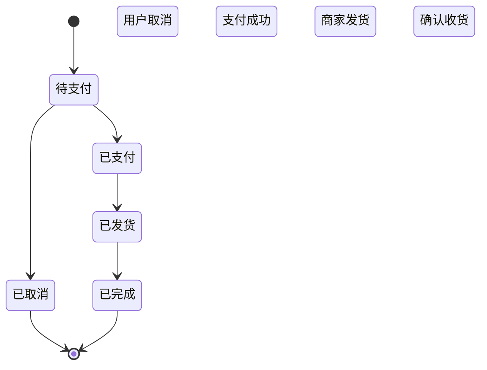

```javascript
// 状态机：转移表驱动（策略模式的特化：策略=状态）
const transitions = {
  pending:   { pay: 'paid', cancel: 'cancelled' },
  paid:      { ship: 'shipped' },
  shipped:   { confirm: 'completed' },
  cancelled: {},
  completed: {},
};
class Order {
  #state = 'pending';
  #log = [];
  get state() { return this.#state; }
  send(event, payload) {                    // 统一事件入口
    const next = transitions[this.#state]?.[event];
    if (!next) throw new Error(`非法转移 ${this.#state} --${event}--> ?`);
    this.#log.push({ from: this.#state, event, to: next, payload, at: Date.now() });
    this.#state = next;
    this.#onEnter(next, payload);           // 进入新状态的副作用
    return this;
  }
  #onEnter(state, payload) {
    const effects = {
      paid: () => console.log('扣库存、发通知', payload),
      shipped: () => console.log('推送物流单号'),
    };
    effects[state]?.();
  }
  history() { return this.#log; }
}
const order = new Order();
order.send('pay', { channel: 'wx' });   // 扣库存、发通知 {channel: 'wx'}
order.send('ship');
console.log(order.state);               // shipped
try { order.send('pay'); } catch (e) { console.log(e.message); } // 非法转移 shipped --pay--> ?
```

### DP-053：策略模式和状态模式怎么区分？（高频）
**答**：
- 结构几乎一样（都是上下文 + 一组可替换对象），差别在**意图与控制权**。
- 策略：调用方**主动选择**算法，策略之间互不感知、无状态转移——"怎么做"可换。
- 状态：状态机**自动流转**，当前状态决定下一个状态，状态知道彼此的转移关系——"是什么"会变。
- 记忆：表单校验选规则是策略；订单从 pending 到 paid 是状态。一个由人挑，一个自己走。

```javascript
// 同样是"上下文 + 一组对象"，控制权完全不同
// 1. 策略：人（调用方）决定用哪个
const sortStrategies = {
  price: (a, b) => a.price - b.price,
  time: (a, b) => a.createdAt - b.createdAt,
};
function sortGoods(list, by) { return [...list].sort(sortStrategies[by]); } // 外部传入
const goods = [{ price: 3, createdAt: 2 }, { price: 1, createdAt: 1 }];
console.log(sortGoods(goods, 'price')[0].price); // 1 —— 选择权在调用方

// 2. 状态：对象自己流转，外部只发事件
class Player {
  #state = new StoppedState();
  setState(s) { this.#state = s; }
  play() { this.#state.play(this); }   // 委托给当前状态
  pause() { this.#state.pause(this); } // 外部只发事件，不知道内部怎么转
}
class StoppedState {
  play(p) { console.log('开始播放'); p.setState(new PlayingState()); }
  pause() { console.log('已停止，无法暂停'); }
}
class PlayingState {
  play() { console.log('已在播放中'); }
  pause(p) { console.log('暂停'); p.setState(new StoppedState()); }
}
const player = new Player();
player.play();  // 开始播放 —— 状态自动从 Stopped 切到 Playing
player.play();  // 已在播放中 —— 同一事件在不同状态下行为不同（状态模式的标志）
player.pause(); // 暂停
```

### DP-054：命令模式如何实现撤销重做？（高频）
**答**：
- 命令：把"一次操作"封装成对象（execute + undo），调用方只管入队执行，不关心具体操作。
- 撤销重做架构：undo 栈 + redo 栈；执行命令时清空 redo 栈，undo 时压回 redo 栈。
- 前端实例：富文本编辑器、图形编辑器（Figma/excalidraw 类）、表格操作、绘图 app。
- 关键设计：命令自包含逆操作（存 diff 或快照），而不是在管理器里写大量 switch。

```javascript
// 命令对象：execute + undo 自包含
class HistoryManager {
  #undoStack = [];
  #redoStack = [];
  execute(command) {
    command.execute();
    this.#undoStack.push(command);
    this.#redoStack = [];           // 新操作使 redo 失效
  }
  undo() {
    const cmd = this.#undoStack.pop();
    if (!cmd) return;
    cmd.undo();
    this.#redoStack.push(cmd);
  }
  redo() {
    const cmd = this.#redoStack.pop();
    if (!cmd) return;
    cmd.execute();
    this.#undoStack.push(cmd);
  }
}
// 图形编辑器的具体命令
class Editor {
  constructor() { this.shapes = []; }
  add(shape) { this.shapes.push(shape); }
  remove(id) { this.shapes = this.shapes.filter((s) => s.id !== id); }
}
class AddShapeCommand {
  constructor(editor, shape) { this.editor = editor; this.shape = shape; }
  execute() { this.editor.add(this.shape); console.log('添加', this.shape.id); }
  undo() { this.editor.remove(this.shape.id); console.log('撤销添加', this.shape.id); }
}
// 使用
const editor = new Editor();
const history = new HistoryManager();
history.execute(new AddShapeCommand(editor, { id: 'rect1' })); // 添加 rect1
history.execute(new AddShapeCommand(editor, { id: 'rect2' })); // 添加 rect2
history.undo(); // 撤销添加 rect2
history.undo(); // 撤销添加 rect1
history.redo(); // 添加 rect1
console.log(editor.shapes.map((s) => s.id)); // ['rect1']
```

### DP-055：宏命令是什么？批量操作怎么设计？
**答**：
- 宏命令 = 命令的组合模式：一个命令内部持有多个子命令，execute 时依次执行，undo 时逆序撤销。
- 场景：批量拖拽多个节点、一键应用主题（改色+改字体+改布局）、录制回放用户操作。
- 要点：宏命令对外的接口与单命令完全一致（组合模式的统一接口），管理器无感知。
- 原子性：任一子命令失败时需要约定策略（回滚已执行/继续执行），这是加分讨论点。

```javascript
// 宏命令：组合模式的命令版 —— 与单命令同接口
class MacroCommand {
  constructor(...commands) { this.commands = commands; }
  execute() {
    const done = [];
    for (const cmd of this.commands) {
      try {
        cmd.execute();
        done.push(cmd);
      } catch (e) {
        // 原子性策略：失败则回滚已执行的子命令
        done.reverse().forEach((c) => c.undo());
        throw e;
      }
    }
  }
  undo() {
    [...this.commands].reverse().forEach((c) => c.undo()); // 逆序撤销
  }
}
// 具体命令：主题变更拆解
const setColor = (doc, color) => ({
  execute: () => { doc._c = doc.color; doc.color = color; },
  undo: () => { doc.color = doc._c; },
});
const setFont = (doc, font) => ({
  execute: () => { doc._f = doc.font; doc.font = font; },
  undo: () => { doc.font = doc._f; },
});
const doc = { color: 'black', font: 'Song' };
// 一键换主题 = 宏命令
const darkTheme = new MacroCommand(setColor(doc, 'white'), setFont(doc, 'Hei'));
darkTheme.execute();
console.log(doc.color, doc.font); // white Hei —— 批量生效
darkTheme.undo();
console.log(doc.color, doc.font); // black Song —— 一键还原
// 对 HistoryManager 来说，MacroCommand 和单命令没有区别（统一接口）
```

### DP-056：xstate 这类状态机库的核心思想是什么？（高频）
**答**：
- xstate 把状态模式工程化：状态（state）+ 事件（event）+ 转移（transition）+ 上下文（context 扩展数据）+ 副作用（action/service）。
- 核心价值：**非法状态不可达**（转移表外的事件直接拒绝）、状态可序列化、可可视化（状态图）、可测试（纯函数 transition）。
- 关键概念：层级状态、并行状态、guarded transitions（条件转移）、final state。
- 对比手写：业务复杂到手写转移表难维护时上库；简单二态按钮没必要。

```javascript
// 用 xstate 的思想手写一个 mini createMachine
function createMachine(config) {
  return {
    initial: config.initial,
    transition(state, event) {         // 纯函数：状态+事件 -> 下一状态
      const node = config.states[state];
      const t = node?.on?.[event.type];
      if (!t) return state;            // 非法事件：维持原状（不崩溃）
      const target = typeof t === 'string' ? t : t.target;
      const cond = typeof t === 'object' ? t.cond : undefined;
      if (cond && !cond(state.context, event)) return state; // 守卫不通过
      // 执行 actions（副作用）+ 合并 context
      const actions = typeof t === 'object' ? t.actions : undefined;
      let context = state.context;
      if (actions) context = actions.reduce((c, a) => config.actions[a](c, event), context);
      return { value: target, context };
    },
  };
}
const toggleMachine = createMachine({
  initial: 'idle',
  states: {
    idle: { on: { FETCH: { target: 'loading', actions: [] } } },
    loading: {
      on: {
        RESOLVE: { target: 'success', actions: ['assignData'] },
        REJECT: 'error',
      },
    },
    success: { final: true },
    error: { on: { RETRY: 'loading' } },
  },
  actions: {
    assignData: (context, event) => ({ ...context, data: event.data }),
  },
});
let state = { value: 'idle', context: { data: null } };
state = toggleMachine.transition(state, { type: 'FETCH' });
console.log(state.value);                       // loading
state = toggleMachine.transition(state, { type: 'RESOLVE', data: [1, 2] });
console.log(state.value, state.context.data);   // success [1, 2]
state = toggleMachine.transition(state, { type: 'FETCH' }); // success 是 final，事件被忽略
console.log(state.value);                       // success
```

### DP-057：如何用策略模式消除 if-else？给出实战重构。
**答**：
- 可消除的 if-else 特征：分支彼此独立、每支都在做"一类算法/一类处理"、分支集合会持续增长。
- 重构三步：提炼每支为策略函数 → 建立 `key -> 策略` 映射 → 调用处改为查表 + 兜底（默认策略）。
- 不要矫枉过正：两三个分支、语义就是"分类讨论"时，if-else 反而更清晰；映射表的 key 必须是稳定枚举值。
- 进阶：Map 注册表支持运行时注册（插件化），符合 OCP。

```javascript
// 重构前：权限判断的 if-else 泥潭
function calcPrice(origin, user) {
  if (user.level === 'vip1') return origin * 0.95;
  else if (user.level === 'vip2') return origin * 0.9;
  else if (user.level === 'svip') return origin * 0.8;
  else if (user.level === 'employee') return origin * 0.5;
  else return origin;
}
// 每加一个等级都要改函数体，且折扣逻辑散落在分支里

// 重构后：策略表 + 兜底
const priceStrategies = {
  vip1: (p) => p * 0.95,
  vip2: (p) => p * 0.9,
  svip: (p) => p * 0.8,
  employee: (p) => p * 0.5,
  default: (p) => p, // 兜底策略：未知等级走原价
};
const calcPriceV2 = (origin, user) => (priceStrategies[user.level] || priceStrategies.default)(origin);
console.log(calcPriceV2(100, { level: 'svip' }));     // 80
console.log(calcPriceV2(100, { level: 'unknown' }));  // 100 —— 新等级不再炸掉

// 运行时可注册：插件化扩展（OCP）
const strategyRegistry = new Map(Object.entries(priceStrategies));
function registerStrategy(level, fn) { strategyRegistry.set(level, fn); }
registerStrategy('annual', (p) => p * 0.7); // 新增等级零修改
const calcPriceV3 = (origin, user) => strategyRegistry.get(user.level)?.(origin) ?? origin;
console.log(calcPriceV3(100, { level: 'annual' })); // 70
```

### DP-058：命令模式如何支持"事务"与补偿回滚？（高频）
**答**：
- 事务 = 一组命令要么全成功、要么全回滚：把每步封装为命令，失败时按逆序执行已成功命令的 undo（补偿）。
- 与 DP-055 宏命令的关系：宏命令是"确定成功的批量执行"；事务版强调**失败时的补偿策略**。
- 前端场景：多接口提交（下单 + 占库存 + 发券）、本地多 store 联动更新、跨组件批量操作。
- 注意：补偿不等于完美回滚（有外部副作用的接口可能无法撤销），设计上尽量让操作幂等。

```javascript
// 事务管理器：命令列表 + 失败逆序补偿
class Transaction {
  #steps = [];
  #done = [];
  constructor(steps) { this.#steps = steps; }
  async commit() {
    try {
      for (const step of this.#steps) {
        await step.execute();     // 逐步执行
        this.#done.push(step);
      }
      return { ok: true };
    } catch (err) {
      // 补偿：逆序回滚已完成的步骤
      for (const step of [...this.#done].reverse()) {
        try { await step.undo(); } catch (e) { console.error('补偿失败', e); }
      }
      return { ok: false, error: err };
    }
  }
}
// 三个远程操作封装为命令（尽量幂等）
const api = {
  createOrder: async () => { console.log('创建订单'); },
  lockStock: async () => { console.log('锁定库存'); if (Math.random() < 0.5) throw new Error('库存不足'); },
  sendCoupon: async () => { console.log('发放优惠券'); },
  // 补偿接口
  cancelOrder: () => console.log('取消订单'),
  unlockStock: () => console.log('解锁库存'),
};
const tx = new Transaction([
  { execute: api.createOrder, undo: api.cancelOrder },
  { execute: api.lockStock, undo: api.unlockStock },
  { execute: api.sendCoupon, undo: async () => {} }, // 发券无需补偿
]);
tx.commit().then((r) => console.log('事务结果', r.ok));
// 输出可能是：创建订单 -> 锁定库存 -> (抛错) -> 解锁库存 -> 取消订单 -> 事务结果 false
```

---

## 九、行为型：模板方法/中介者/职责链/迭代器/访问者

### DP-059：十一种行为型模式在前端如何快速索引？
**答**：
- 行为型围绕"职责分配与通信"：谁发出通知（观察者/中介者）、谁决定算法（策略/状态/命令/模板方法）、如何遍历与加工（迭代器/访问者/职责链）、如何存取历史（备忘录）。
- 前端对应密集区：观察者（响应式/事件）、策略（校验/分派）、职责链（中间件/拦截器）、迭代器（Generator）、访问者（AST/编译）。
- 判别口诀：通知找观察者、换算法找策略、流程变找状态、撤销找命令、骨架固定找模板方法、层层加工找职责链。

```javascript
// 行为型速查：每个模式一行最小影子
const behavioral = {
  观察者:   'subject.notify() 直达订阅者',
  发布订阅: 'emit/on 经事件中心解耦',
  策略:     'rules[type] ?? default 查表换算法',
  状态:     '当前态决定下一态与行为',
  命令:     'execute/undo 对象化，支持撤销重做',
  模板方法: '父类骨架固定，钩子留给子类',
  中介者:   '多对多通信收敛到一个中心对象',
  职责链:   'next() 层层传递，中途可拦截',
  迭代器:   'next() 返回 value/done，统一遍历协议',
  访问者:   '数据结构稳定，操作可随意增删',
  备忘录:   '快照存档与恢复，不破坏封装',
};
Object.entries(behavioral).forEach(([k, v]) => console.log(k, '->', v));
// 面试抽问任意一个，都能给出对应前端场景：如 访问者 -> babel traverse / 编译器
```

### DP-060：模板方法模式：组件生命周期为什么是模板方法？
**答**：
- 模板方法：父类固定算法骨架（步骤顺序），把某些步骤延迟到子类实现——骨架不变，细节可变。
- Vue 组件的生命周期就是框架写好的骨架：`beforeCreate→created→mounted→...`，用户钩子是骨架上的"钩子步骤"。
- 自定义基类场景：图表基类固定"初始化容器→处理数据→渲染→绑定事件→销毁"，子类只实现 `renderData`。
- 与策略区别：模板方法是**骨架复用**（步骤顺序固定），策略是**整体算法可换**。

```javascript
// 图表基类：模板方法固定骨架，子类只填钩子
class BaseChart {
  constructor(container, data) {
    this.container = container;
    this.data = data;
    this.chart = null;
  }
  // 模板方法：骨架不可重写
  init() {
    this.initContainer();   // 步骤1 固定
    this.processData();     // 步骤2 钩子（可覆盖）
    this.render();          // 步骤3 钩子（子类必须实现）
    this.bindEvents();      // 步骤4 钩子（可选）
    console.log(`${this.name} 初始化完成`);
  }
  initContainer() {
    this.chart = document.createElement('canvas');
    this.container.appendChild(this.chart);
  }
  processData() { this.processed = this.data; } // 默认实现：子类可覆盖
  render() { throw new Error('子类必须实现 render'); }
  bindEvents() {}
  destroy() { this.chart.remove(); }
  get name() { return this.constructor.name; }
}
class LineChart extends BaseChart {
  processData() { this.processed = this.data.map((d) => ({ ...d, smooth: true })); } // 覆盖钩子
  render() { console.log('绘制折线', JSON.stringify(this.processed)); }
}
class PieChart extends BaseChart {
  render() { console.log('绘制饼图', this.data.length, '个扇区'); }
}
new LineChart(document.body, [{ x: 1, y: 2 }]).init();
// 绘制折线 [{"x":1,"y":2,"smooth":true}]
// LineChart 初始化完成 —— 骨架顺序由基类保证
```

### DP-061：中介者模式：组件通信的"中心化"如何实现？
**答**：
- 中介者：所有对象不直接通信，都通过中介转发——把 M×N 的网状依赖收敛成 M+N 的星型。
- 与发布订阅区别：中介者知道各同事角色并**编排业务逻辑**（双向转发、协调）；事件中心只广播，无业务语义。
- 前端实例：聊天室服务端转发、复杂表单联动（一个 FormMediator 协调所有字段的显隐/校验）、同层组件通信。
- 代价：中介者可能变成上帝对象，规模大时要再拆分。

```javascript
// 反例：三个组件两两直连，依赖网状爆炸
// colorPicker.onChange -> text.setTextColor -> preview.refresh -> colorPicker.sync ...

// 正例：表单中介者，统一协调联动
class FormMediator {
  #components = new Map();
  register(name, comp) { comp.mediator = this; this.#components.set(name, comp); }
  notify(sender, event, payload) {   // 所有通信都汇聚于此，联动逻辑集中可读
    if (sender === 'country' && event === 'change') {
      this.#components.get('province').setEnabled(payload === '中国'); // 中介编排
      if (payload !== '中国') this.#components.get('province').setValue('');
    }
    if (sender === 'province' && event === 'change') {
      this.#components.get('submitBtn').setEnabled(Boolean(payload));
    }
  }
}
class Select {
  constructor(name, options) { this.name = name; this.options = options; this.enabled = true; }
  setValue(v) { this.value = v; this.mediator?.notify(this.name, 'change', v); }
  setEnabled(b) { this.enabled = b; }
}
class Button {
  constructor(name) { this.name = name; }
  setEnabled(b) { this.enabled = b; }
}
// 装配
const mediator = new FormMediator();
const country = new Select('country', ['中国', '海外']);
const province = new Select('province', []);
const submit = new Button('submitBtn');
[country, province, submit].forEach((c) => mediator.register(c.name, c));
country.setValue('海外');
console.log(province.enabled, submit.enabled); // false false —— 中介自动联动
```

### DP-062：Koa 中间件为什么是职责链（洋葱模型）？（高频压轴）
**答**：
- 职责链：多个处理者串成链，请求沿链传递，每个节点处理后决定是否交给下一个（`next()`）。
- Koa 的 `compose` 把 `[fn1, fn2, fn3]` 合成一层嵌套 Promise：进入顺序 fn1→fn2→fn3，返回顺序 fn3→fn2→fn1（洋葱）。
- 与 Express 线性中间件的区别：Koa 支持 await next() 之后的"回程逻辑"（计时器、响应后埋点）。
- 手写 `compose` 是大厂高频手写题，核心是递归 + Promise。

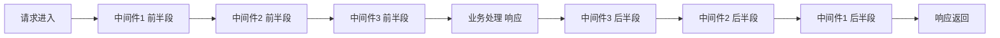

```javascript
// 手写 koa-compose：职责链 + 洋葱模型
function compose(middlewares) {
  return function (ctx) {
    function dispatch(i) {
      if (i >= middlewares.length) return Promise.resolve(); // 链尾
      const mw = middlewares[i];
      return Promise.resolve(mw(ctx, () => dispatch(i + 1))); // next = 递归下一环
    }
    return dispatch(0);
  };
}
// 使用：计时中间件（回程逻辑的典型价值）
const app = {};
const middlewares = [
  async (ctx, next) => {                      // 中间件1
    const start = Date.now();
    await next();                              // 进入下一环，回程后继续执行
    ctx.cost = Date.now() - start;             // 后半段：此时业务已处理完
    console.log(`${ctx.url} 耗时 ${ctx.cost}ms`);
  },
  async (ctx, next) => {                      // 中间件2：鉴权拦截
    if (!ctx.headers?.token) throw new Error('401');
    await next();
  },
  async (ctx) => {                            // 中间件3：业务终点
    ctx.body = `hello ${ctx.url}`;
  },
];
compose(middlewares)({ url: '/api/a', headers: { token: 'x' } })
  .then(() => console.log('done'));
// hello /api/a 由中间件3写入，中间件1 再打耗时 —— 一进一回两段逻辑
// 失败传播：任一环抛错，Promise 链直接 reject，可在最外层统一兜底
compose(middlewares)({ url: '/api/b', headers: {} }).catch((e) => console.log('统一错误处理', e.message));
```

### DP-063：axios 拦截器为什么是职责链？和 Koa 的链有何不同？
**答**：
- axios 的 request/response interceptors 都是队列：请求拦截器**后注册先执行**（unshift），响应拦截器先注册先执行。
- 与 Koa 区别：axios 链没有洋葱的"回程"——它把请求拦截器和响应拦截器拼接成**单向链**，`dispatchRequest`（真实请求）在中间。
- 源码形态：`chain = [...requestInterceptors, dispatchRequest, ...responseInterceptors]`，用 `promise = promise.then(chain.shift(), chain.shift())` 逐环连接。
- 每个拦截器都可以改写 config 或直接 reject——节点可短路（如 401 拦截器直接跳登录）。

```javascript
// axios 简化的拦截器链（对照源码 Axios.prototype.request）
class Axios {
  constructor() {
    this.interceptors = {
      request: new InterceptorManager(), // 队列
      response: new InterceptorManager(),
    };
  }
  request(config) {
    // 1. 组链：请求拦截器倒序（后注册先执行） + 真实请求 + 响应拦截器正序
    const chain = [];
    this.interceptors.request.handlers.forEach((h) => chain.unshift(h)); // 注意 unshift
    chain.push(dispatchRequest, undefined);           // 中点：真实请求
    this.interceptors.response.handlers.forEach((h) => chain.push(h, h.rejected));
    // 2. 逐环 .then 连接 —— 单向职责链
    let promise = Promise.resolve(config);
    while (chain.length) {
      promise = promise.then(chain.shift(), chain.shift());
    }
    return promise;
  }
}
class InterceptorManager {
  constructor() { this.handlers = []; }
  use(fulfilled, rejected) { this.handlers.push({ fulfilled, rejected }); }
}
async function dispatchRequest(config) {
  console.log('发起请求', config.url);
  return { config, status: 200, data: { ok: true } }; // 适配器见 DP-027
}
// 使用
const ax = new Axios();
ax.interceptors.request.use((c) => { c.headers = { token: 'x', ...c.headers }; return c; });
ax.interceptors.request.use((c) => { console.log('时间戳拦截器（后注册，先执行）'); return c; });
ax.interceptors.response.use(
  (res) => { console.log('统一剥壳', res.status); return res.data; },  // 成功链
  (err) => { if (err?.status === 401) console.log('跳登录'); throw err; } // 失败链
);
ax.request({ url: '/api/a' }).then((d) => console.log(d));
// 时间戳拦截器（后注册，先执行） -> 发起请求 /api/a -> 统一剥壳 200 -> {ok: true}
```

### DP-064：迭代器模式：for-of 背后发生了什么？如何自定义迭代器？（高频）
**答**：
- 迭代器协议：对象实现 `Symbol.iterator` 返回一个含 `next()` 的对象，`next()` 返回 `{ value, done }`。
- for-of/展开运算符/解构 都基于该协议——统一遍历接口，不关心内部结构（链表/树/懒序列都能被 for-of）。
- Generator 是迭代器的语法糖：`function*` 自动生成 `next()` 状态机，还能 `yield*` 委托。
- 前端应用：树结构遍历、分页惰性加载、无限流数据。

```javascript
// 1. 自定义迭代器：让普通对象支持 for-of
class Range {
  constructor(start, end) { this.start = start; this.end = end; }
  [Symbol.iterator]() {
    let cur = this.start;
    const end = this.end;
    return {
      next: () => (cur <= end ? { value: cur++, done: false } : { value: undefined, done: true }),
    };
  }
}
console.log([...new Range(1, 3)]); // [1, 2, 3] —— 展开运算符消费迭代器
for (const n of new Range(1, 3)) process.stdout.write(n + ' '); // 1 2 3
console.log();

// 2. Generator 等价实现：语法糖
function* rangeGen(start, end) {
  for (let i = start; i <= end; i++) yield i;
}
console.log([...rangeGen(1, 3)]); // [1, 2, 3]

// 3. 实战：树的深度优先遍历器 —— 复杂结构统一进 for-of
function* walkTree(node) {
  yield node.name;
  for (const child of node.children ?? []) yield* walkTree(child); // 委托递归
}
const tree = { name: 'src', children: [{ name: 'a.js' }, { name: 'components', children: [{ name: 'Btn.vue' }] }] };
console.log([...walkTree(tree)]); // ['src', 'a.js', 'components', 'Btn.vue']

// 4. 惰性序列：无限流按需取值（迭代器省内存的本质）
function* fibonacci() {
  let [a, b] = [0, 1];
  while (true) yield a, [a, b] = [b, a + b]; // 无限生成，不预计算
}
const fib = fibonacci();
console.log(fib.next().value, fib.next().value, fib.next().value); // 0 1 1
```

### DP-065：访问者模式：babel 的 traverse 为什么用它？（高频压轴）
**答**：
- 访问者：数据结构稳定（AST 节点类型固定），但操作多变（转换/收集/统计）——把操作封装成 visitor，结构主动"接受"访问。
- babel 工作流：parse（源码→AST）→ traverse（visitor 消费/改写节点）→ generate（AST→源码）；`types` API 负责节点构造。
- 访问者结构：`Identifier(path) {...}` 按**节点类型**分发，path 提供 replaceWith/remove 等改写能力，enter/exit 两阶段。
- 前端同源场景：ESLint 规则、Prettier、Vue 模板编译、PostCSS 插件——"结构稳定、操作多变"即访问者。

```javascript
// mini-AST 访问者：结构固定，操作以 visitor 注入
const ast = {
  type: 'CallExpression',
  callee: { type: 'MemberExpression', object: { type: 'Identifier', name: 'console' },
            property: { type: 'Identifier', name: 'log' } },
  arguments: [{ type: 'StringLiteral', value: 'hello' }],
};

function traverse(node, visitor, parent = null) {
  const fn = visitor[node.type];                    // 按节点类型分发（访问者核心）
  const path = { node, parent };                    // path 封装改写上下文
  fn?.enter?.(path);
  // 递归遍历子节点（结构遍历逻辑固定，只有 visitor 在变）
  for (const key of Object.keys(node)) {
    const child = node[key];
    if (Array.isArray(child)) child.forEach((c) => c?.type && traverse(c, visitor, node));
    else if (child && typeof child === 'object' && child.type) traverse(child, visitor, node);
  }
  fn?.exit?.(path);
}

// 访问者1：统计 Identifier
const counter = { count: 0, enter({ node }) { if (node.type === 'Identifier') this.count++; } };
traverse(ast, { Identifier: counter });
console.log(counter.count); // 3 —— console/log 两个 + 外层 callee 命中

// 访问者2：babel 风格改写 —— 把 console.log 替换为 logger.info
traverse(ast, {
  MemberExpression: {
    enter(path) {
      if (path.node.object.name === 'console' && path.node.property.name === 'log') {
        path.node.object.name = 'logger';    // 直接改写节点（对照 types.memberExpression）
        path.node.property.name = 'info';
      }
    },
  },
});
console.log(JSON.stringify(ast.callee)); // {"object":{"type":"Identifier","name":"logger"},"property":{"type":"Identifier","name":"info"}}
// 对照 babel 真实用法：
// traverse(ast, { CallExpression(path) { path.node.callee = types.memberExpression(...) } })
```

### DP-066：解释器模式概览：模板编译的 tokenizer→parser→transform→generate？
**答**：
- 解释器：为一种"语言"定义文法表示和解释器——前端的"语言"包括模板语法、CSS 选择器、路径匹配（path-to-regexp）。
- 模板编译四步：tokenizer 词法分析（字符串→token 流）→ parser 语法分析（token→AST）→ transform 优化（访问者改写 AST）→ generate 生成目标代码。
- 这是 Vue 模板编译、babel、posthtml 的共同管线；面试重点是能画出管线并写出 tokenizer 最小实现。
- 与访问者的关系：transform 阶段就是访问者模式的应用。

```javascript
// mini 模板编译管线：把 {{ name }} 编译成插值代码
// 1. tokenizer：字符串 -> token 流
function tokenize(input) {
  const tokens = [];
  const re = /\{\{\s*(.*?)\s*\}\}|([^{}]+)/g;
  let m;
  while ((m = re.exec(input))) {
    if (m[1] !== undefined) tokens.push({ type: 'interpolation', value: m[1] }); // 词法规则即文法
    else tokens.push({ type: 'text', value: m[2] });
  }
  return tokens;
}
console.log(tokenize('你好 {{ name }}，年龄 {{ age }}'));
// [{type:'text',value:'你好 '},{type:'interpolation',value:'name'},...]

// 2. parser：token -> AST
function parse(tokens) {
  return { type: 'Root', children: tokens.map((t) => ({ type: t.type, value: t.value })) };
}
// 3. transform：访问者改写 AST（这里做静态提升示例）
function transform(ast) {
  ast.children.forEach((c) => { if (c.type === 'text') c.hoisted = true; });
  return ast;
}
// 4. generate：AST -> 渲染函数代码
function generate(ast) {
  const parts = ast.children.map((c) =>
    c.type === 'text' ? JSON.stringify(c.value) : `_ctx.${c.value}` // 输出目标代码
  );
  return `(ctx) => [${parts.join(', ')}]`;
}
const render = eval(generate(transform(parse(tokenize('你好 {{ name }}')))));
console.log(render({ name: 'Tom' })); // ['你好 ', Tom]
// Vue 模板编译 = 同管线 + 节点/指令/优化（patchFlags/block tree）复杂度
```

### DP-067：备忘录模式：撤销快照如何实现？
**答**：
- 备忘录：在不破坏封装的前提下捕获对象状态快照，用于恢复；三角色：Originator（状态主人）、Memento（快照）、Caretaker（快照栈管理）。
- 与命令模式撤销对比：命令存"操作+逆操作"（省内存，适合步骤明确）；备忘录存"全量/增量快照"（简单直接，适合状态整体替换）。
- 前端实例：富文本撤销、图形编辑器历史（excalidraw 的 elements 数组快照）、表单草稿。
- 优化：快照大时用结构共享（immutable）或增量 diff，限制栈深。

```javascript
// 富文本编辑器的快照撤销
class EditorOriginator { // Originator：状态主人
  #content = '';
  get content() { return this.#content; }
  type(text) { this.#content += text; }
  typeAt(pos, text) { this.#content = this.#content.slice(0, pos) + text + this.#content.slice(pos); }
  createSnapshot() { return structuredClone(this.#content); } // Memento：纯数据快照
  restore(snapshot) { this.#content = snapshot; }
}
class History { // Caretaker：只存快照，不解析内容（不破坏封装）
  #stack = [];
  #cursor = -1;
  save(snapshot) {
    this.#stack = this.#stack.slice(0, this.#cursor + 1); // 丢弃被撤销的分支
    this.#stack.push(snapshot);
    this.#cursor++;
    if (this.#stack.length > 50) { this.#stack.shift(); this.#cursor--; } // 限制栈深
  }
  undo(current) {
    if (this.#cursor > 0) return this.#stack[--this.#cursor];
    return current;
  }
  redo(current) {
    if (this.#cursor < this.#stack.length - 1) return this.#stack[++this.#cursor];
    return current;
  }
}
const ed = new EditorOriginator();
const history = new History();
history.save(ed.createSnapshot());
ed.type('hello');
history.save(ed.createSnapshot());
ed.typeAt(5, ' world');
console.log(ed.content);            // hello world
ed.restore(history.undo(ed.content));
console.log(ed.content);            // hello
ed.restore(history.redo(ed.content));
console.log(ed.content);            // hello world
```

### DP-068：中介者 vs 观察者 vs 外观 vs 职责链，一次辨析清楚。
**答**：
- 中介者：多对象**双向**通过中心协作，中心有业务编排逻辑——"协调者"。
- 观察者/发布订阅：**单向广播**通知，中心（若有）不做业务编排——"传声筒"。
- 外观：对子系统做**静态封装入口**，调用方向单一——"门面"；不涉及对象间通知。
- 职责链：请求沿**链**单向流动，节点依次加工可短路——"流水线"。

```javascript
// 四个模式处理同一需求的不同形态：用户提交表单后的多模块联动
// 1. 中介者：中心知道每个模块，双向编排
class FormMediator2 {
  submit(form) {
    const valid = this.validate.check(form);
    this.loading.set(valid);                 // 主动控制各模块
    if (valid) this.api.send(form).then((r) => this.toast.show('成功'));
  }
}
// 2. 发布订阅：单向广播，模块各取所需，互不认识
// bus.emit('form:submitted', form);
// loading/toast/api 各自 bus.on('form:submitted', ...) —— 中心没有业务逻辑
// 3. 外观：静态门面，调用方只看一个方法
class FormFacade {
  async submit(form) {
    const ok = await api.send(form);          // 内部编排细节对外隐藏
    if (ok) toast.show('成功');
    return ok;
  }
}
// 4. 职责链：处理步骤依次流转，节点可短路
const chain = compose([
  async (ctx, next) => { ctx.form = normalize(ctx.form); await next(); }, // 清洗
  async (ctx, next) => { if (!ctx.form.name) throw new Error('校验失败'); await next(); }, // 拦截
  async (ctx) => { ctx.result = await api.send(ctx.form); },              // 终点
]);
// chain({ form }) —— 请求像流水线一样被加工

// 快速判别：
// 有中心且编排逻辑 -> 中介者；只广播 -> 发布订阅；固定入口 -> 外观；顺序流动可短路 -> 职责链
console.log('判别完成');
```

## 十、函数式与前端的模式变体

### DP-069：高阶函数与高阶组件的模式本质是什么？
**答**：
- 高阶函数：接收函数返回函数（map/compose/中间件）；高阶组件：接收组件返回组件——组件即"函数化的对象"，HOC 是高阶函数在组件层的应用。
- 模式归属：HOC 是装饰器（透明增强）、也有工厂色彩（生产新组件）；高阶函数支撑策略（回调注入）、职责链（compose）。
- 纯函数约束：HOC 不应修改传入组件（无副作用包装），返回的新组件保持 props 协议兼容。
- 辨析：自定义 Hook 是"逻辑复用"，HOC 是"组件包装增强"，render props 是"渲染权移交"——三者并列为 React 复用三件套。

```jsx
// 高阶函数：一切的基础
const trace = (label) => (fn) => (...args) => {          // 接收fn返回fn
  console.log(`[${label}] 入参`, args);
  const r = fn(...args);
  console.log(`[${label}] 出参`, r);
  return r;
};
const add = (a, b) => a + b;
console.log(trace('math')(add)(1, 2)); // [math] 入参 [1,2] 3 [math] 出参 3

// 高阶组件 = 高阶函数，包装对象是组件
function withLoading(Wrapped) {           // 装饰器模式：透明增强
  return function WithLoading({ loading, ...rest }) {
    if (loading) return <div className="spinner" />;
    return <Wrapped {...rest} />;         // 协议兼容：透传剩余 props
  };
}
function withData(fetcher) {              // 带参 HOC：工厂 + 装饰器
  return (Wrapped) => function WithData(props) {
    const [data, setData] = React.useState(null);
    React.useEffect(() => { fetcher(props).then(setData); }, []);
    return <Wrapped data={data} {...props} />;
  };
}
// 组合：先取数再装饰 loading 态
const UserList = withData(({ page }) => fetch(`/api/users?page=${page}`).then((r) => r.json()))(
  ({ data }) => <ul>{data?.map((u) => <li key={u.id}>{u.name}</li>)}</ul>
);
const EnhancedUserList = withLoading(UserList);
// <EnhancedUserList loading={true} page={1} /> —— 层层包装，各自职责单一
```

HOC 包装流程：

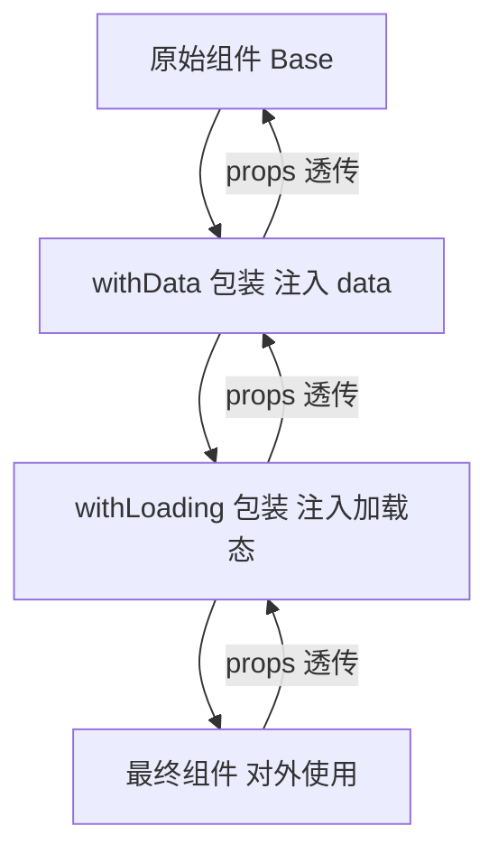

### DP-070：Hooks 是什么模式？为什么说它是"适配+观察+备忘录"的混合？（高频压轴）
**答**：
- Hooks 不是单一 GoF 模式，而是组合体：useState/useRef 提供可隔离的状态存取（备忘录：快照与恢复）；useEffect/useMemo 依赖变化时重执行（观察者：依赖数组即订阅）。
- 适配色彩：Hooks 把类组件的生命周期 API 适配成函数式 API（useEffect 统一了 componentDidMount/Update/Unmount）。
- 实现本质：React 内部用链表按调用顺序存每个 Hook 的状态——调用顺序稳定是契约（不能放 if 里）。
- 面试答法：先给"混合模式"定性，再展开对应关系，最后补 fiber Hook 链表实现。

```javascript
// mini hooks：链表存储（顺序敏感） + 观察者（依赖触发） + 备忘录（状态保存与重置）
function createRenderer() {
  let hookIndex = 0;
  let hooks = [];            // fiber 中的 Hook 链表（此处用数组模拟）
  let rerender = null;

  function render(Component) {
    hookIndex = 0;           // 每次渲染从第 0 个 Hook 开始按序取
    rerender = () => render(Component);
    return Component();
  }
  function useState(initial) {
    const i = hookIndex++;
    if (hooks[i] === undefined) hooks[i] = { value: initial }; // 首次挂载建槽位
    return [
      hooks[i].value,
      (next) => {
        hooks[i].value = next;
        rerender();          // 状态变化 -> 触发重渲染（观察者通知）
      },
    ];
  }
  function useEffect(fn, deps) {
    const i = hookIndex++;
    const old = hooks[i];
    const changed = !old || !deps || deps.some((d, k) => d !== old.deps?.[k]);
    if (changed) {
      old?.cleanup?.();      // 上一次副作用的清理（备忘录式恢复现场）
      const cleanup = fn();
      hooks[i] = { deps, cleanup };
    }
  }
  return { render, useState, useEffect };
}
const { render, useState, useEffect } = createRenderer();
function App() {
  const [count, setCount] = useState(0);
  useEffect(() => { console.log('count 变化', count); }, [count]); // 依赖数组=订阅
  return `count: ${count.value ?? count}`;
}
console.log(render(App));  // count 变化 0 -> count: 0
// setCount(1) 触发 rerender：
// hooks 链表按 index 对齐：第0槽 useState、第1槽 useEffect —— 顺序即身份
```

### DP-071：容器/展示组件模式怎么划分？
**答**：
- 展示组件：只管"长什么样"，数据来自 props，纯函数、可复用、易测试、不依赖 store/fetch。
- 容器组件：只管"数据从哪来"，连接 store/路由/请求，把数据和行为以 props 传给展示组件。
- 价值：变化方向分离——UI 改版不动数据层，数据源切换不动 UI；展示组件可 storybook 独立开发。
- 演进：hooks 出现后容器常被自定义 Hook 替代（`useUser()` 返回数据给同一组件），但"职责分离"思想不变。

```jsx
// 展示组件：纯 props 驱动，无副作用，随时可替换数据源
function UserListPresentational({ users, onDelete }) {
  return (
    <ul>
      {users.map((u) => (
        <li key={u.id}>
          {u.name}
          <button onClick={() => onDelete(u.id)}>删除</button>
        </li>
      ))}
    </ul>
  );
}

// 容器组件：只负责取数与行为编排
function UserListContainer() {
  const [users, setUsers] = React.useState([]);
  React.useEffect(() => {
    fetch('/api/users').then((r) => r.json()).then(setUsers);
  }, []);
  const onDelete = (id) =>
    fetch(`/api/users/${id}`, { method: 'DELETE' }).then(() =>
      setUsers((prev) => prev.filter((u) => u.id !== id))
    );
  return <UserListPresentational users={users} onDelete={onDelete} />;
}
// <UserListContainer /> —— UI 与数据各自演化

// hooks 时代的演进：容器退化为可复用的自定义 Hook（见 DP-073）
function useUsers() {
  const [users, setUsers] = React.useState([]);
  React.useEffect(() => { fetch('/api/users').then((r) => r.json()).then(setUsers); }, []);
  return { users, onDelete: (id) => fetch(`/api/users/${id}`, { method: 'DELETE' }) };
}
// 组件内：const { users, onDelete } = useUsers(); —— 职责分离保留，包装层消失
```

### DP-072：Provider 模式：Context 为什么是"依赖注入 + 中介"？
**答**：
- Provider 在组件树顶层"注入"依赖（主题、store、locale），深层组件直接消费——避免逐层透传 props（prop drilling）。
- 依赖注入视角：组件不自己创建依赖，由祖先注入（对照构造器注入）；可测试（测试时换 Provider 的 value）。
- 中介/观察者视角：value 变化由 React 调度系统通知所有 consumer——Provider 是变更的广播源。
- 注意：value 引用不稳定会导致全体 consumer 重渲染——需 useMemo 或拆分 Context。

```jsx
// 依赖注入 + 中介：Context 的双面
const ThemeContext = React.createContext(null); // 注入容器

function ThemeProvider({ children }) {
  const [theme, setTheme] = React.useState('light');
  // value 必须稳定引用，否则消费方全量重渲染
  const value = React.useMemo(() => ({ theme, toggle: () => setTheme((t) => (t === 'light' ? 'dark' : 'light')) }), [theme]);
  return <ThemeContext.Provider value={value}>{children}</ThemeContext.Provider>;
}
// 深层组件：不关心依赖从哪来（DI），只声明"我要什么"
function ThemedButton() {
  const { theme, toggle } = React.useContext(ThemeContext);
  return <button className={`btn-${theme}`} onClick={toggle}>{theme} 主题</button>;
}
// 测试时替换依赖：换一个 Provider value 即可（DI 的可测性）
function App() {
  return (
    <ThemeProvider>
      <header><ThemedButton /></header>
      <main><ThemedButton /></main>  {/* 无需逐层传 props */}
    </ThemeProvider>
  );
}
// 对照 NestJS 风格的 DI：@Injectable() + 构造器注入，本质同样是"容器创建依赖、消费方声明需求"
// React Context 是运行时注入；NestJS 容器是启动时解析注入
```

### DP-073：自定义 Hook 为什么是"逻辑复用模式"？
**答**：
- 自定义 Hook = 把"状态 + 副作用 + 派生逻辑"封装成可复用单元，调用方拿到数据与操作函数——复用的是逻辑而非组件结构。
- 与 HOC 对比：无包装层级（调试干净）、无 props 名冲突、按需取用（HOC 是整包注入）。
- 与 Mixin 对比：Hook 返回值显式列出（来源清晰），Mixin 是隐式合并属性（来源不可见，见 DP-081）。
- 设计要点：返回 `[值, 操作]` 或对象、内部可用其他 Hook、副作用成对清理。

```jsx
// 通用逻辑复用：useFetch —— 请求状态机（idle/loading/success/error 即状态模式）
function useFetch(url) {
  const [state, setState] = React.useState({ status: 'idle', data: null, error: null });
  const run = React.useCallback(async (abort = new AbortController()) => {
    setState({ status: 'loading', data: null, error: null });
    try {
      const res = await fetch(url, { signal: abort.signal });
      if (!res.ok) throw new Error(`HTTP ${res.status}`);
      const data = await res.json();
      setState({ status: 'success', data, error: null });
    } catch (e) {
      if (e.name !== 'AbortError') setState({ status: 'error', data: null, error: e });
    }
  }, [url]);
  React.useEffect(() => {                          // url 变化自动重取（观察者）
    const ac = new AbortController();
    run(ac);
    return () => ac.abort();                       // 副作用成对清理
  }, [url]);
  return { ...state, refetch: () => run() };       // 显式返回契约
}
// 复用点1：组件A
function OrderList() {
  const { status, data, error } = useFetch('/api/orders');
  if (status === 'loading') return <Spin />;
  if (status === 'error') return <Error msg={error.message} />;
  return <ul>{data.map((o) => <li key={o.id}>{o.no}</li>)}</ul>;
}
// 复用点2：组件B 用同一个 Hook 取完全不同的资源 —— 逻辑复用而非组件复用
// const { data } = useFetch('/api/users');
// 对比 HOC：没有 withFetch(OrderList) 的包装层，React DevTools 更干净
```

### DP-074：render props 模式是什么？
**答**：
- render props：组件把"渲染逻辑"作为 props（常叫 `render`/`children` 函数）接收，把内部状态/能力作为参数交给它调用。
- 本质：**渲染权移交** + 逻辑注入——数据提供方不关心 UI，UI 方不关心数据来源（控制反转的组件版）。
- 经典库：react-router 的 `<Route render>`、react-motion、Formik 的 `<Formik render>`。
- 与 HOC 对比：HOC 生成新组件（静态组合），render props 在 JSX 中动态组合、嵌套多层时产生"回调地狱"（hooks 出现后多为替代）。

```jsx
// 数据提供者：只管取数，渲染交给外部
class MouseTracker extends React.Component {
  state = { x: 0, y: 0 };
  handleMove = (e) => this.setState({ x: e.clientX, y: e.clientY });
  render() {
    return (
      <div onMouseMove={this.handleMove} style={{ height: 200 }}>
        {/* 渲染权移交：内部状态作为参数传给 render prop */}
        {this.props.render(this.state)}
      </div>
    );
  }
}
// 消费方1：用同一数据源渲染完全不同的 UI
<MouseTracker render={({ x, y }) => <h1>鼠标位置 {x},{y}</h1>} />
// 消费方2：复用监听逻辑，渲染猫图
// <MouseTracker render={({ x, y }) => <Cat x={x} y={y} />} />

// children 即函数：现代写法（children as function）
const Toggle = ({ children }) => {
  const [on, setOn] = React.useState(false);
  return children({ on, toggle: () => setOn((v) => !v) });
};
// <Toggle>{({ on, toggle }) => <button onClick={toggle}>{on ? '开' : '关'}</button>}</Toggle>

// 与 hooks 的对照：useMouse() 逻辑等价，嵌套更浅 —— hooks 胜出的原因
// function useMouse() { const [pos, setPos] = useState(...); useEffect(...); return pos; }
```

### DP-075：immutable 数据与享元模式什么关系？结构共享如何实现？
**答**：
- 不可变数据：任何修改都返回新对象、原对象永不变——React/PureComponent、 redux 时间旅行的基础。
- 享元视角：新版本对象**共享**未变化的子结构（内部状态），而不是整树深拷贝——这叫持久化数据结构/结构共享。
- 实现路径：Trie/HAMT（Immutable.js）、路径复制+冻结（Immer 的 draft + Proxy）。
- 判等优化：引用相等即可判定"未变化"（`===` 比较），这是 memo/shouldComponentUpdate 高效的原因。

```javascript
// 手写路径复制：改一个节点，只复制该路径，兄弟分支共享（享元/结构共享）
function updateIn(obj, path, value) {
  if (path.length === 0) return value;
  const [key, ...rest] = path;
  const clone = Array.isArray(obj) ? [...obj] : { ...obj }; // 浅复制当前层
  clone[key] = updateIn(clone[key], rest, value);           // 只沿修改路径递归
  return clone;
}
const state = Object.freeze({
  user: { name: 'Tom', settings: { theme: 'light', lang: 'zh' } },
  orders: [1, 2, 3],
});
const next = updateIn(state, ['user', 'settings', 'theme'], 'dark');
console.log(next.user.settings.theme);      // dark —— 表面上"已修改"
console.log(state.user.settings.theme);     // light —— 原对象不可变
console.log(next.orders === state.orders);  // true —— 未变化分支被共享（享元）
console.log(next.user === state.user);      // false —— 变化路径被复制

// Immer 的做法：Proxy draft + 写时复制（Copy-on-Write）
// import { produce } from 'immer';
// const next2 = produce(state, (draft) => { draft.user.settings.theme = 'dark'; });
// next2.orders === state.orders // true —— 同样结构共享

// 判等优化的收益：组件只需引用比较
function shouldUpdate(prev, next) {
  return prev !== next; // 结构共享下，引用相等即可跳过整棵子树的渲染
}
console.log(shouldUpdate(state.orders, next.orders)); // false —— 不重渲染
```

### DP-076：函数组合与管道模式：compose/pipe 如何实现？
**答**：
- 组合：`compose(f, g)(x) = f(g(x))`（从右向左）；管道：`pipe(f, g)(x) = g(f(x))`（从左向左，更符合阅读顺序）。
- 前端应用：数据加工流水线（清洗→校验→格式化）、中间件/拦截器合成、redux 的 `compose(middleware)(createStore)`、HOC 组合。
- 与职责链关系：职责链是"请求在对象链中流动"，compose 是"数据在函数链中流动"——函数式版的职责链。
- 加分：类型安全的 pointfree 风格、Promise 版 composeP。

```javascript
// compose：从右向左；pipe：从左向右
const compose = (...fns) => (x) => fns.reduceRight((acc, fn) => fn(acc), x);
const pipe = (...fns) => (x) => fns.reduce((acc, fn) => fn(acc), x);

// 数据加工流水线
const trim = (s) => s.trim();
const toLower = (s) => s.toLowerCase();
const slugify = (s) => s.replace(/\s+/g, '-');
const normalizeSlug = pipe(trim, toLower, slugify); // 声明流水线：顺序即执行顺序
console.log(normalizeSlug('  Hello World  ')); // hello-world

// 异步管道：每步可能是 Promise
const pipeP = (...fns) => (x) => fns.reduce((p, fn) => p.then(fn), Promise.resolve(x));
const fetchUser = (id) => Promise.resolve({ id, name: 'tom', age: 17 });
const assertAdult = (u) => { if (u.age < 18) throw new Error('未成年'); return u; };
const toView = (u) => ({ name: u.name.toUpperCase() });
pipeP(fetchUser, assertAdult, toView)(1).then(console.log).catch((e) => console.log('拦截', e.message));

// redux 源码对照：compose 用于增强 store
// export default function compose(...fns) {
//   if (fns.length === 0) return (arg) => arg;
//   if (fns.length === 1) return fns[0];
//   return fns.reduce((a, b) => (...args) => a(b(...args)));
// }
const enhance = compose((next) => ( reducer) => next(reducer), (next) => next); // 增强器叠加示意
console.log(typeof compose()); // function —— 空组合是恒等函数
```

### DP-077：中间件模式的通用化：redux-thunk 和 redux-saga 的模式差异？（高频）
**答**：
- 中间件通用形态：`store => next => action => result`——三层柯里化，拦截 action，可改写/短路/异步化（职责链）。
- redux-thunk：action 允许是函数，注入 `dispatch/getState`——用"命令对象扩展"实现异步，逻辑散在 action 里，简单直接。
- redux-saga：用 Generator 把副作用抽到独立 saga（解释器/协程思想），`take/effect` 描述副作用、由引擎执行——逻辑集中、可测试（yield 纯描述可断言）。
- 选型：简单异步用 thunk；复杂流程编排（竞态、取消、并发、轮询）用 saga/observable 类方案。

```javascript
// 1. redux 中间件的三层柯里化骨架
function createStore(reducer, enhancer) {
  let state = reducer(undefined, {});
  const listeners = new Set();
  const getState = () => state;
  const baseDispatch = (action) => { state = reducer(state, action); listeners.forEach((l) => l()); };
  const store = { getState, dispatch: baseDispatch, subscribe: (l) => { listeners.add(l); return () => listeners.delete(l); } };
  return enhancer ? enhancer(createStore)(reducer) : store; // 交给中间件增强
}
const applyMiddleware = (...mws) => (createStore) => (reducer) => {
  const store = createStore(reducer);
  let dispatch = store.dispatch;
  const api = { getState: store.getState, dispatch: (a) => dispatch(a) };
  const chain = mws.map((mw) => mw(api));                       // 第一层：注入 store API
  dispatch = chain.reduce((next, mw) => mw(next), store.dispatch); // 第二层：串成职责链
  return { ...store, dispatch: (a) => dispatch(a) };            // 第三层在调用时生效
};
// 2. thunk：拦截函数型 action（命令扩展）
const thunk = ({ getState, dispatch }) => (next) => (action) =>
  typeof action === 'function' ? action(dispatch, getState) : next(action); // 短路：函数自己接管
// 3. saga 思想：副作用描述与执行分离（解释器模式）
function* userSaga() {
  // yield take('FETCH_USER')        // 等待事件
  // const user = yield call(api.fetchUser, id)   // 描述副作用，不直接执行
  // yield put({ type: 'USER_OK', user })          // 描述 dispatch
}
// saga 引擎（示意）：迭代器驱动，逐步"解释执行" effect
function sagaEngine(gen) {
  const it = gen();
  (function step(input) {
    const { value, done } = it.next(input);
    if (done) return;
    // value 是 effect 描述符，由引擎统一执行 —— 可测试性的来源
    Promise.resolve(value).then((r) => step(r));
  })();
}
sagaEngine(function* () { const r = yield Promise.resolve('saga 结果'); console.log(r); });
```

### DP-078：Selector/记忆化模式：reselect 为什么能做性能优化？
**答**：
- 记忆化：缓存纯函数的输入→输出映射，同输入直接返回缓存——以空间换时间。
- reselect 思路：selector 是"从全局 state 派生视图数据"的纯函数，输入是 `(state, props)`，输出引用相等则组件跳过渲染。
- 关键：**依赖未变时返回同一引用**（结构共享），这就是 React.memo 生效的前提。
- 前端同源：Vue 的 computed（依赖变化才重算）、useMemo、lodash.memoize。

```javascript
// 手写 memoize（单层 key + 自定义解析器）
function memoize(fn, resolver = (...a) => JSON.stringify(a)) {
  const cache = new Map();
  const memo = (...args) => {
    const key = resolver(args);
    if (cache.has(key)) return cache.get(key);
    const result = fn(...args);
    cache.set(key, result);
    return result;
  };
  memo.cache = cache; // 暴露缓存：支持手动清理（对照 lodash.memoize）
  return memo;
}
const expensiveFilter = memoize((list, keyword) =>
  list.filter((it) => it.name.includes(keyword))
);
const data = Array.from({ length: 10000 }, (_, i) => ({ id: i, name: `item-${i}` }));
expensiveFilter(data, 'item-9');   // 真实计算一次
expensiveFilter(data, 'item-9');   // 命中缓存

// reselect 风格：多级 selector + 依赖未变返回同引用
function createSelector(...fns) {
  const last = { deps: null, result: null };
  return (...args) => {
    const deps = fns.slice(0, -1).map((fn) => fn(...args)); // 计算依赖
    const compute = fns[fns.length - 1];
    if (last.deps && deps.every((d, i) => d === last.deps[i])) {
      return last.result;                                    // 依赖引用全等 -> 直接复用
    }
    last.deps = deps;
    last.result = compute(...deps);
    return last.result;
  };
}
const getState = (state) => state.items;
const getKeyword = (_, keyword) => keyword;
const getVisibleItems = createSelector(
  getState, getKeyword,
  (items, kw) => items.filter((it) => it.name.includes(kw)) // 只在依赖变化时重算
);
const state1 = { items: data };
console.log(getVisibleItems(state1, 'item-1') === getVisibleItems(state1, 'item-1')); // true 同引用
// 组件 memo(getVisibleItems(state, kw)) —— 引用相等，跳过重渲染
```

### DP-079：控制反转 IoC 在前端如何实现？（装饰器 + 反射）（高频）
**答**：
- IoC 是原则（依赖的创建权交给容器），DI 是实现手段；Angular/NestJS 用"装饰器 + Reflect Metadata"实现自动注入。
- 关键机制：`emitDecoratorMetadata` 让 TS 把参数类型写入元数据；容器读取 `Reflect.getMetadata('design:paramtypes', Target)` 获得依赖列表，递归实例化。
- 实现四步：`@Injectable()` 标记可注入 → 容器注册 token → 解析时反射拿构造参数 → 递归创建并缓存（单例）。
- 前端轻量版：React Context（运行时注入）、Vue 的 provide/inject——本质都是"消费方声明需求，容器供给"。

```typescript
import 'reflect-metadata';

// 1. @Injectable：标记类可被容器管理（本质只是打标记）
function Injectable() {
  return function <T extends new (...args: any[]) => any>(ctor: T) { return ctor; };
}
// 2. 容器：反射解析构造参数，递归注入，默认单例
class Container {
  #instances = new Map<Function, any>();
  resolve<T>(Target: new (...args: any[]) => T): T {
    if (this.#instances.has(Target)) return this.#instances.get(Target); // 单例缓存
    const paramTypes: any[] = Reflect.getMetadata('design:paramtypes', Target) || [];
    const deps = paramTypes.map((dep) => this.resolve(dep)); // 递归解析依赖
    const instance = new Target(...deps);
    this.#instances.set(Target, instance);
    return instance;
  }
}
// 3. 业务：只声明依赖类型，不创建任何实例
@Injectable()
class LoggerService {
  log(msg: string) { console.log('[logger]', msg); }
}
@Injectable()
class HttpService {
  constructor(private logger: LoggerService) {} // 反射读取到此依赖
  get(url: string) { this.logger.log(`GET ${url}`); return Promise.resolve({ ok: true }); }
}
@Injectable()
class UserService {
  constructor(private http: HttpService) {}     // 依赖链：UserService -> HttpService -> LoggerService
  async loadUser(id: number) {
    this.loggerBind();
    return this.http.get(`/users/${id}`);
  }
  loggerBind() {}
}
// 4. 容器装配：调用方完全不知道依赖链细节（控制已反转）
const container = new Container();
const userService = container.resolve(UserService);
userService.loadUser(1).then((r) => console.log(r));
// [logger] GET /users/1  { ok: true }
console.log(container.resolve(LoggerService) === container.resolve(LoggerService)); // true
// 对照：NestJS 的 @Module({ providers: [UserService, HttpService] }) 就是这个容器的生产级实现
```

### DP-080：模块模式与揭示模块模式是什么？
**答**：
- 模块模式：IIFE/闭包建立私有作用域，返回公开 API——ES Module 出现前管理私有状态的标准手法（jQuery 时代的核心模式）。
- 揭示模块模式（Revealing Module）：私有函数集中定义，导出区只做"映射揭示"——API 一览即知，避免 return 里写匿名函数。
- 现代等价物：ES Module 的"文件即模块"，未 export 的即为私有；类私有字段 `#x` 是另一形态。
- 面试价值：理解闭包实现私有 + 模块系统演进史（IIFE → CJS/AMD → ESM）。

```javascript
// 1. 模块模式：闭包私有 + 公开 API
const counterModule = (() => {
  let count = 0;                        // 私有：外部无法访问
  const privateLog = () => console.log('count =', count);
  return {
    increment() { count++; privateLog(); },
    getCount: () => count,              // 只读访问器，不暴露变量本身
  };
})();
counterModule.increment();
console.log(counterModule.count);       // undefined —— 真私有
console.log(counterModule.getCount());  // 1

// 2. 揭示模块模式：私有区集中定义，导出区只"揭示"
const cartModule = (() => {
  // —— 私有区：所有实现集中在此，命名即文档 ——
  const items = [];
  function add(sku, qty) { items.push({ sku, qty }); return this; }
  function remove(sku) { const i = items.findIndex((it) => it.sku === sku); if (i > -1) items.splice(i, 1); }
  function total(priceMap) { return items.reduce((s, it) => s + (priceMap[it.sku] || 0) * it.qty, 0); }
  function size() { return items.length; }
  // —— 揭示区：API 一目了然，可故意"改名揭示" ——
  return {
    addItem: add,                       // 揭示为 addItem
    removeItem: remove,
    calcTotal: total,
    size,
  };
})();
cartModule.addItem('A1', 2);
console.log(cartModule.size(), cartModule.calcTotal({ A1: 99 })); // 1 198

// 3. ES Module 等价物：未导出的就是私有
// cart.js:
//   const items = [];            // 模块级私有
//   export function add(sku, qty) { items.push({sku, qty}); }
//   export const size = () => items.length;
// import { add, size } from './cart.js' —— 拿不到 items 本身
```

### DP-081：Mixin 有什么陷阱？为什么演进到 Hook/组合式？
**答**：
- Mixin：把一组属性/方法混入目标类/组件（`Object.assign`、Vue.mixin、React.createClass 的 mixins）。
- 陷阱：命名冲突静默覆盖、来源不可见（模板里 `this.foo` 不知来自哪个 mixin）、隐式依赖（mixin 之间互相调用方法）、多实例状态纠缠。
- 演进：React 2016 官方宣布"mixins considered harmful"→ HOC/render props → Hooks；Vue2 mixin → Vue3 组合式函数（composables）。
- 本质变化：从"隐式混入属性"变成"显式函数调用 + 显式返回值"，来源与依赖一目了然。

```javascript
// Mixin 的三大陷阱演示
const loggerMixin = {
  log(...args) { console.log('[log]', ...args); },   // 方法A
  name: 'logger',
};
const trackerMixin = {
  log(...args) { console.log('[track]', ...args); }, // 同名方法B：冲突！
  name: 'tracker',
};
class Widget {}
Object.assign(Widget.prototype, loggerMixin, trackerMixin); // 后者覆盖前者，静默丢失
const w = new Widget();
w.log('x');           // [track] x —— loggerMixin.log 无声消失（陷阱1：命名冲突）
console.log(w.name);  // tracker —— 来源不可见（陷阱2）：读代码时不知道 name 来自哪
// 陷阱3：隐式依赖 —— mixin 内调用 this.render()，要求宿主必须实现 render，契约藏在运行时

// Vue2 mixin 同样的问题
// const pageMixin = { data: () => ({ loading: false }), methods: { load() {} } };
// 两个 mixin 都有 loading -> 合并策略碰运气；load 被谁调用 -> 全局搜索

// 演进：Vue3 组合式函数 —— 显式来源、显式依赖、显式返回
// usePageData.js
// export function usePageData(fetcher) {
//   const loading = ref(false);
//   const data = ref(null);
//   const load = async () => { loading.value = true; data.value = await fetcher(); loading.value = false; };
//   return { loading, data, load };   // 返回值即契约
// }
// 组件内：
// const { loading, data, load } = usePageData(() => fetch('/api/list').then(r => r.json()));
// loading 来自哪、重名怎么解决（解构重命名）、依赖是什么 —— 全部显式（陷阱全消）
```

### DP-082：MVVM 的双向绑定如何实现？模式上是什么组合？（高频）
**答**：
- 双向绑定 = 数据→视图（观察者/发布订阅）+ 视图→数据（事件监听回写）两条通路合环。
- Vue2：`Object.defineProperty` + Dep + Watcher + 指令编译（compile 时把 v-model 编译成绑定 + input 监听）。
- Vue3：Proxy 代理 + effect（观察者）+ `v-model` 语法糖（`:value` + `@input`）。
- 模式组合：代理（拦截数据）+ 观察者（通知更新）+ 外观（ViewModel 统一入口）+ 模板方法（编译流水线）。

```javascript
// mini 双向绑定：defineProperty 版（Vue2 原理）+ v-model 编译
function observe(obj) {
  const deps = new Map(); // key -> Set<更新函数>
  Object.keys(obj).forEach((key) => {
    let val = obj[key];
    if (!deps.has(key)) deps.set(key, new Set());
    Object.defineProperty(obj, key, {
      get() { return val; },
      set(nv) {
        val = nv;
        deps.get(key).forEach((fn) => fn(nv)); // 数据 -> 视图（观察者通知）
      },
    });
  });
  return { deps };
}
// 编译器：扫描带 v-model 的节点，建立双向通路
function compile(el, model, deps) {
  el.querySelectorAll('[v-model]').forEach((node) => {
    const key = node.getAttribute('v-model');
    // 通路1：数据 -> 视图
    const updater = (v) => { node.value = v; };
    deps.get(key).add(updater);
    node.value = model[key]; // 初始同步
    // 通路2：视图 -> 数据
    node.addEventListener('input', (e) => { model[key] = e.target.value; });
  });
}
// 装配 MVVM
const app = document.createElement('div');
app.innerHTML = '<input v-model="name"/><span v-model="name"></span>';
const vm = { name: 'Tom' };
const { deps } = observe(vm);          // Model 层：代理拦截
compile(app, vm, deps);                // 编译 View 与 Model 的绑定
const input = app.querySelector('input');
input.value = 'Jerry';
input.dispatchEvent(new Event('input')); // 用户输入 -> 数据更新 -> 视图全同步
console.log(vm.name);                  // Jerry
console.log(app.querySelector('span').value); // Jerry —— 两处绑定同时更新
// Vue3 差异：defineProperty -> Proxy（可拦截新增/删除/数组），编译产出 -> render 函数 + effect
```

### DP-083：路由懒加载为什么是虚拟代理？（高频）
**答**：
- 虚拟代理：真实对象的创建/加载推迟到第一次访问时——路由懒加载正是"组件模块"的虚拟代理。
- `() => import('./HeavyPage.vue')` 返回的不是组件，而是一个"替身函数"：路由匹配时才触发 import，加载完再渲染真身。
- 配套增强：加载态占位（代理先行响应）、失败重试、预加载（空闲时 prefetch）——都是代理层的职责，与页面组件无关。
- 收益：首屏只加载当前路由代码，分包由构建工具按动态 import 切割。

```jsx
// React Router 懒加载：替身函数 + 加载态（虚拟代理三层职责）
// const HeavyPage = React.lazy(() => import('./pages/HeavyPage')); // 代理：推迟加载真身
function ProxyRoute({ loader, fallback }) {
  const LazyComp = React.lazy(loader);       // 首次渲染时才触发 import
  return (
    <React.Suspense fallback={fallback}>     // 代理先行响应：占位
      <LazyComp />
    </React.Suspense>
  );
}
// <ProxyRoute loader={() => import('./pages/Dashboard')} fallback={<Spin />} />

// Vue Router 等价写法：组件配置就是"替身函数"
// const routes = [
//   { path: '/dashboard', component: () => import('./views/Dashboard.vue') }, // 虚拟代理
//   // 加载失败自动重试（代理层的健壮性职责）
// ];
function lazyWithRetry(loader, retries = 3) {
  return () =>
    new Promise((resolve, reject) => {
      const attempt = (left) =>
        loader().then(resolve).catch((e) => {
          console.warn(`chunk 加载失败，剩余重试 ${left - 1}`);
          left > 1 ? attempt(left - 1) : reject(e); // 网络抖动时 chunk 加载失败的治理
        });
      attempt(retries);
    });
}
// 预加载：代理可以"提前"拉取真身（空闲时 prefetch）
function preload(loader) { loader(); }          // 触发 import 但不渲染
// window.addEventListener('load', () => preload(() => import('./pages/Dashboard')));
// 鼠标移入菜单即预加载：
// <a onMouseEnter={() => preload(loader)} href="/dashboard">控制台</a>
```

### DP-084：Zustand/Jotai 这类现代状态库是什么模式组合？
**答**：
- Zustand = **模块单例**（create 出全局唯一 store）+ **观察者**（selector 订阅 + 粒度通知）+ **外观**（`store.setState` 一个入口）。
- Jotai = **原子化**（atom 是最小状态单元，原子间组合成依赖图）+ 观察者（派生 atom 自动重算）。
- 对比 redux：去掉了"集中 reducer + dispatch 命令"，改为"直接 setState + selector 订阅"——命令模式弱化，观察者保留。
- 面试落点：能说出"selector 级订阅避免全树重渲染"（对应 reselect 记忆化思想，见 DP-078）。

```javascript
// Zustand 风格的 mini 实现：单例 store + selector 订阅
function createStore(initial) {
  let state = initial;                        // 闭包私有：唯一状态
  const listeners = new Set();                // selector 级订阅
  const store = {
    getState: () => state,
    setState(patch) {
      const prev = state;
      state = typeof patch === 'function' ? patch(state) : { ...state, ...patch };
      listeners.forEach(({ selector, fn }) => {
        if (selector(prev) !== selector(state)) fn(state); // 只通知结果变化的订阅者（细粒度）
      });
    },
    subscribe(selector, fn) { listeners.add({ selector, fn }); return () => listeners.delete(fn); },
  };
  return store;
}
// 使用：模块级单例（ESM 保证全局唯一）
const useBearStore = createStore({ bears: 0, users: [] });
useBearStore.subscribe((s) => s.bears, (s) => console.log('BearView 重渲染', s.bears));
useBearStore.subscribe((s) => s.users.length, (s) => console.log('UserView 重渲染', s.users.length));
useBearStore.setState((s) => ({ bears: s.bears + 1 })); // 只触发 BearView
// BearView 重渲染 1 —— users 相关订阅未被通知（性能关键）

// Jotai 风格：原子 + 派生（依赖图自动重算）
function atom(initialValue) { return { init: initialValue, deps: [] }; }
function derivedAtom(read, ...deps) { return { read, deps }; } // 派生原子声明依赖
const countAtom = atom(0);
const doubleAtom = derivedAtom(
  (get) => get(countAtom) * 2, // get 即依赖收集（代理/观察者）
  countAtom
);
const store2 = new Map(); // 简化的原子值存储
store2.set(countAtom, 5);
const get = (a) => (a.read ? a.read(get) : store2.get(a));
console.log(get(doubleAtom)); // 10 —— 依赖图驱动派生
```

### DP-085：React ErrorBoundary 体现了哪些模式？
**答**：
- ErrorBoundary 用类组件 `getDerivedStateFromError`（渲染降级 UI）+ `componentDidCatch`（上报副作用）捕获子树渲染错误。
- 模式视角：**组合模式**（包裹子树，树形粒度可控）、**模板方法**（框架固定"捕获→降级→上报"骨架，用户填钩子）、**策略**（不同边界可注入不同降级 UI）。
- 工程规范：路由级/页面级/组件级分层部署边界；边界本身崩溃时由上层兜底；事件回调/异步错误不在捕获范围（需全局兜底）。
- 现代补充：`react-error-boundary` 库的 `useQueryErrorResetBoundary`、Suspense 与 ErrorBoundary 配合。

```jsx
// ErrorBoundary：模板方法（框架骨架）+ 策略（可配置降级 UI）
class ErrorBoundary extends React.Component {
  state = { error: null };
  static getDerivedStateFromError(error) {   // 框架固定调用：渲染期捕获 -> 触发降级
    return { error };
  }
  componentDidCatch(error, info) {           // 框架固定调用：副作用阶段（上报/日志）
    reportToSentry(error, info.componentStack);
  }
  render() {                                 // 策略：降级 UI 可注入，默认兜底
    if (this.state.error) {
      const Fallback = this.props.fallback;  // 不同场景注入不同降级策略
      return Fallback
        ? <Fallback error={this.state.error} reset={() => this.setState({ error: null })} />
        : <div>页面出错了</div>;
    }
    return this.props.children;              // 组合模式：包裹任意子树
  }
}
function reportToSentry(err, stack) { console.log('[监控]', err.message); }
// 分层部署：路由级兜底 + 组件级细粒度
function Page() {
  return (
    <ErrorBoundary fallback={({ error }) => <div>模块降级 {error.message}</div>}>
      <RiskyChart />          {/* 图表挂了只降级图表 */}
    </ErrorBoundary>
  );
}
function RiskyChart() { throw new Error('data undefined'); } // 模拟渲染错误
// <Page /> -> [监控] data undefined -> 模块降级 data undefined
// 边界外仍有整页 <ErrorBoundary> 兜底 —— 树形分层（组合模式）
```

## 十一、框架源码中的模式识别综合

### DP-086：Vue3 源码里能识别出哪些设计模式？（高频压轴）
**答**：
- **代理模式**：`reactive()` 用 Proxy 拦截 get/set/delete；`ref` 的 get/set 拦截 `.value` 访问。
- **观察者**：effect/track/trigger——依赖收集与派发更新；watch/computed 都是订阅者。
- **策略 + 工厂**：`processElement/processText/processCommentary` 按 vnode 类型分派 patch 策略；`createRenderer` 接收节点操作对象生成平台渲染器（自定义渲染到 canvas/小程序）。
- **组合 + 迭代器**：vnode 树递归 patch；**备忘录**：keep-alive 缓存组件实例；**享元**：静态 vnode 提升与 patchFlag 复用。

```javascript
// Vue3 源码模式速览（简化对照 runtime-core/reactivity）
// 1. 工厂 + 策略：createRenderer 注入平台操作，生成渲染器
function createRenderer(nodeOps) {
  return {
    patch(n1, n2, container) {
      if (n1 && !isSameType(n1, n2)) unmount(n1);       // 策略1：不同类型 -> 替换
      if (typeof n2.type === 'string') processElement(n2, container, nodeOps);   // 策略2：元素
      else if (typeof n2.type === 'object') processComponent(n2, container);     // 策略3：组件
      else if (n2.type === Text) processText(n2, container, nodeOps);            // 策略4：文本
    },
  };
}
const nodeOps = { // DOM 平台的节点操作（可整体替换为 canvas/小程序实现）
  createElement: (tag) => document.createElement(tag),
  insert: (child, parent, anchor) => parent.insertBefore(child, anchor),
  remove: (el) => el.parentNode?.removeChild(el),
  setElementText: (el, text) => { el.textContent = text; },
};
const renderer = createRenderer(nodeOps);
console.log(typeof renderer.patch); // function

// 2. 代理 + 观察者：reactive/ref 双通道（见 DP-032/DP-046 细节）
function ref(value) {
  return {
    get value() { trackRef(this); return value; },       // 代理模式：拦截 .value 读
    set value(nv) { value = nv; triggerRef(this); },     // 观察者：通知 effect
  };
}
// 3. 备忘录：keep-alive 缓存组件 vnode（快照复用，LRU 淘汰）
function createKeepAlive(max = 10) {
  const cache = new Map(); // key -> 缓存的 vnode/组件实例（快照）
  return {
    cacheVNode(key, vnode) {
      if (cache.size >= max) cache.delete(cache.keys().next().value); // LRU
      cache.set(key, vnode);
    },
    getCached(key) { return cache.get(key); },
  };
}
const ka = createKeepAlive(2);
ka.cacheVNode('a', { type: 'A' });
console.log(ka.getCached('a')); // { type: 'A' } —— 切换回来无需重建
```

### DP-087：React 源码里能识别出哪些设计模式？（高频）
**答**：
- **优先级队列（策略 + 命令）**：Scheduler 用小顶堆按 `expirationTime/优先级` 排序任务，高优先级任务插队——调度策略集中封装。
- **职责链**：beginWork/completeWork 的 return 链 + 合成事件从 target 向 root 冒泡收集监听。
- **备忘录**：fiber.alternate 双缓冲树（上一次渲染的快照），commit 前可随时丢弃重算。
- **享元**：lane 二进制位复用优先级常量；**模板方法**：类组件生命周期骨架、ErrorBoundary 的固定流程；**迭代器**：effectList 链表遍历 commit。

```javascript
// React Scheduler 简化：小顶堆优先级队列（策略 + 命令）
class TaskQueue {
  #heap = [];
  #getId = 0;
  schedule(task, priority) {       // task 是命令对象：描述"做什么"不含"何时做"
    this.#push({ id: this.#getId++, sortIndex: priority, task });
  }
  #push(node) {                    // 标准二叉堆插入
    this.#heap.push(node);
    let i = this.#heap.length - 1;
    while (i > 0) {
      const parent = (i - 1) >> 1;
      if (this.#compare(this.#heap[parent], this.#heap[i]) <= 0) break;
      [this.#heap[parent], this.#heap[i]] = [this.#heap[i], this.#heap[parent]];
      i = parent;
    }
  }
  #compare(a, b) { return a.sortIndex - b.sortIndex || a.id - b.id; } // 优先级相同时先来先执行
  #pop() {
    const top = this.#heap[0];
    const last = this.#heap.pop();
    if (this.#heap.length) {
      this.#heap[0] = last;
      let i = 0;
      while (true) {
        const l = 2 * i + 1, r = l + 1;
        let min = i;
        if (l < this.#heap.length && this.#compare(this.#heap[l], this.#heap[min]) < 0) min = l;
        if (r < this.#heap.length && this.#compare(this.#heap[r], this.#heap[min]) < 0) min = r;
        if (min === i) break;
        [this.#heap[min], this.#heap[i]] = [this.#heap[i], this.#heap[min]];
        i = min;
      }
    }
    return top;
  }
  workLoop(deadline) {           // 时间切片：每帧空闲时间内的循环
    while (this.#heap.length && deadline.timeRemaining() > 1) {
      const { task } = this.#pop();     // 每次取最高优先级任务
      task();                            // 高优先插队的实现基础
    }
    if (this.#heap.length) requestIdleCallback((dl) => this.workLoop(dl));
  }
}
const scheduler = new TaskQueue();
scheduler.schedule(() => console.log('低优：数据上报'), 10);
scheduler.schedule(() => console.log('高优：用户输入'), 1);   // 数值小 = 优先级高
scheduler.workLoop({ timeRemaining: () => 50 });
// 高优：用户输入 -> 低优：数据上报

// 备忘录：双缓冲 fiber 树
// current.alternate === workInProgress —— 两棵树互为快照，commit 前可整体丢弃
```

### DP-088：redux 源码里能识别出哪些设计模式？（高频）
**答**：
- **观察者**：`store.subscribe(listener)` + `dispatch` 后遍历通知——最小观察者实现。
- **职责链/装饰器**：`applyMiddleware(...mws)` 把中间件串成 `store => next => action` 链，依次包裹 dispatch（洋葱）。
- **命令模式**：action 是命令对象（type + payload），reducer 是解释器（纯函数解释命令生成新状态）。
- **工厂**：`createStore` 是工厂，按 enhancer 参数组装出增强版 store；`combineReducers` 是组合模式（子 reducer 树）。

```javascript
// redux 源码骨架还原（ createStore + applyMiddleware + combineReducers）
function combineReducers(reducers) {           // 组合模式：reducer 树
  return function combined(state = {}, action) {
    let hasChanged = false;
    const nextState = {};
    for (const key of Object.keys(reducers)) {
      nextState[key] = reducers[key](state[key], action); // 命令沿树分发给各子 reducer
      hasChanged ||= nextState[key] !== state[key];
    }
    return hasChanged ? nextState : state;     // 引用不变则整体返回旧 state（享元/结构共享）
  };
}
function createStore(reducer, enhancer) {
  if (enhancer) return enhancer(createStore)(reducer); // 工厂：把组装权交给增强器
  let state = reducer(undefined, { type: '@@redux/INIT' });
  const listeners = new Set();
  return {
    getState: () => state,
    dispatch: (action) => {
      if (!action.type) throw new Error('action 需要 type'); // 命令对象约束
      state = reducer(state, action);
      listeners.forEach((l) => l());           // 观察者通知
      return action;
    },
    subscribe: (l) => { listeners.add(l); return () => listeners.delete(l); },
  };
}
const applyMiddleware = (...middlewares) => (createStore) => (reducer) => {
  const store = createStore(reducer);
  let dispatch = store.dispatch;
  const chain = middlewares.map((mw) => mw({ getState: store.getState, dispatch: (a) => dispatch(a) }));
  dispatch = chain.reduceRight((next, mw) => mw(next), store.dispatch); // 从右向左包裹（洋葱）
  return { ...store, dispatch };
};
// 装配
const logger = ({ getState }) => (next) => (action) => {
  console.log('prev', getState());
  const r = next(action);
  console.log('next', getState());
  return r;
};
const reducer = combineReducers({
  count: (s = 0, a) => (a.type === 'inc' ? s + 1 : s),
});
const store = createStore(reducer, applyMiddleware(logger));
store.dispatch({ type: 'inc' });
// prev {count: 0} -> next {count: 1} —— 命令进入，观察者更新
```

### DP-089：vue-router / react-router 源码里有哪些模式？（高频）
**答**：
- **观察者/发布订阅**：URL 变化（popstate/hashchange）→ 通知当前路由组件重渲染——Router 实例是被观察者。
- **策略 + 状态**：hash/history/abstract 三种模式是三套"URL 同步策略"；路由匹配结果（matched 记录）本质是应用的状态。
- **工厂**：`createRouter(createWebHistory())` 工厂注入 history 实现，`createRouterMatcher` 生成匹配器。
- **职责链**：`beforeEach/resolve` 导航守卫链，逐环校验可重定向/中断（next() 即 next()）。

```javascript
// vue-router 简化骨架：策略（模式）+ 观察者（响应）+ 职责链（守卫）
class HistoryBase {                       // 抽象：URL 同步的公共骨架
  constructor(router) { this.router = router; }
  listen() { throw new Error('abstract'); }
  transitionTo(location, onComplete) {    // 模板方法：统一导航流程
    const target = this.router.resolve(location);   // 1. 匹配
    this.router.beforeGuards.run(target, () => {    // 2. 守卫职责链
      this.updateRoute(target);                     // 3. 更新路由状态
      onComplete?.(target);
    });
  }
  updateRoute(target) { this.current = target; } // 观察者会因 current 变化触发重渲染
}
class HashHistory extends HistoryBase {   // 策略1：hash 模式
  listen() {
    window.addEventListener('hashchange', () => this.transitionTo(location.hash.slice(1)));
  }
  push(loc) { location.hash = loc; }
}
class HTML5History extends HistoryBase {  // 策略2：history 模式
  listen() {
    window.addEventListener('popstate', (e) => this.transitionTo(e.state?.path || '/'));
  }
  push(loc) { history.pushState({ path: loc }, '', loc); this.transitionTo(loc); }
}
class Router {                            // 工厂产物
  #guards = [];
  constructor(options) {
    this.routes = options.routes;
    this.mode = options.mode || 'hash';   // 运行时选择策略
    this.matcher = createMatcher(options.routes);
  }
  beforeEach(fn) { this.#guards.push(fn); } // 注册守卫（职责链节点）
  get beforeGuards() {
    const guards = this.#guards;
    return {
      run(to, done) {                      // 串行职责链：任一环返回 false 即中断
        (function next(i) {
          if (i >= guards.length) return done();
          guards[i](to, () => next(i + 1));
        })(0);
      },
    };
  }
  resolve(location) {
    const record = this.matcher.match(location);
    return { path: location, matched: record || [] };
  }
}
function createMatcher(routes) {
  const map = new Map(routes.map((r) => [r.path, r]));
  return { match: (loc) => map.get(loc) || [] };
}
// 使用
const router = new Router({ routes: [{ path: '/', component: 'Home' }, { path: '/about', component: 'About' }] });
router.beforeEach((to, next) => { console.log('守卫1 放行', to.path); next(); });
const hist = new (router.mode === 'hash' ? HashHistory : HTML5History)(router);
router.mode = 'hash';
hist.transitionTo('/about');
// 守卫1 放行 /about —— 匹配 -> 守卫链 -> 状态更新 -> 订阅组件重渲染
```

### DP-090：axios 源码里能识别出哪些模式？
**答**：
- **适配器**：xhr/http/自定义 adapter 抹平双端差异（DP-027）。
- **职责链**：request/response 拦截器队列 + dispatchRequest 中点（DP-063）；`mergeConfig` 用策略表按字段类型合并。
- **工厂**：`axios.create(instanceConfig)` 生成带独立默认配置的实例；`Axios.prototype.request` 是请求工厂入口。
- **模板方法**：`dispatchRequest` 固定流程：转换请求体 → 调适配器 → 转换响应体；`CancelToken`/`AbortController` 用**状态机**管理取消状态。

```javascript
// axios 源码模式速览（对照 lib/）
// 1. 工厂：axios.create 生成独立实例（默认配置互不污染）
function createInstance(defaultConfig) {
  const context = new Axios(defaultConfig);
  const instance = bind(Axios.prototype.request, context);
  instance.create = (conf) => createInstance(mergeConfig(defaultConfig, conf)); // 可继续派生
  return instance;
}
function mergeConfig(a, b = {}) {
  const mergeMap = {              // 策略表：不同字段类型不同合并策略
    url: 'value',                 // b 有值则覆盖
    method: 'default',            // 有默认值兜底
    headers: 'object',            // 浅合并对象
    params: 'object',
    timeout: 'default',
  };
  const out = {};
  for (const [key, strategy] of Object.entries(mergeMap)) {
    if (strategy === 'object') out[key] = { ...a[key], ...b[key] };
    else if (strategy === 'default') out[key] = b[key] ?? a[key] ?? undefined;
    else out[key] = b[key] ?? a[key];
  }
  return out;
}
// 2. 模板方法：dispatchRequest 固定骨架
async function dispatchRequest(config) {
  config.data = transformData(config.transformRequest, config);  // 步骤1：出站转换（钩子）
  const adapter = pickAdapter(config);                            // 步骤2：适配器分派（策略）
  const response = await adapter(config);
  response.data = transformData(config.transformResponse, response); // 步骤3：入站转换（钩子）
  return response;
}
const transformData = (fns, ctx) => (fns || []).reduce((d, fn) => fn(d, ctx.headers || {}), ctx.data ?? ctx);
// 3. 状态机：取消令牌
class CancelToken {
  #reason = null;
  get reason() { return this.#reason; }   // pending -> canceled 两个状态
  cancel(message) {
    if (this.#reason) return;             // 幂等：重复取消无效（状态机约束）
    this.#reason = { message };
    this.#listeners?.forEach((fn) => fn(this.#reason));
  }
  throwIfRequested() { if (this.#reason) throw this.#reason; } // 请求前检查
}
const token = new CancelToken();
token.cancel('用户手动取消');
try { token.throwIfRequested(); } catch (e) { console.log('请求已取消', e.message); }
```

### DP-091：虚拟 DOM 是哪些模式的组合？（高频）
**答**：
- **工厂**：`h/createElement` 产出统一 VNode（DP-017）。
- **代理（数据层）**：Vue3 reactive 拦截数据变化驱动重新执行渲染函数（React 则是 setState 触发）。
- **策略**：diff 按"同类型/不同类型/列表"分派处理；列表 diff 的 key 算法（最长递增子序列）是核心策略。
- **备忘录/享元**：patchFlag/blockTree 记录动态节点（跳过静态内容，Vue3 优化）；**组合**：组件树递归 patch。

```javascript
// mini VNode diff：工厂 + 策略 + 备忘录组合
const h = (type, props, ...children) => ({          // 工厂
  type, props: props || {},
  children: children.flat().map((c) => (typeof c === 'object' ? c : { type: 'TEXT', props: { nodeValue: c } })),
});
function patch(container, vnode) {
  const el = (vnode.el = vnode.type === 'TEXT'
    ? document.createTextNode('')                   // 策略：文本节点
    : document.createElement(vnode.type));          // 策略：元素节点
  for (const [k, v] of Object.entries(vnode.props)) {
    if (k.startsWith('on')) el.addEventListener(k.slice(2).toLowerCase(), v);
    else el.setAttribute(k, v);
  }
  vnode.children.forEach((c) => { patch(el, c); });
  container.appendChild(el);
  return el;
}
// diff：同类型复用（备忘录：复用 el 引用与旧 props 快照）
function diff(n1, n2) {
  if (n1.type !== n2.type) {                         // 策略1：类型不同 -> 重建
    n1.el.replaceWith(patch(document.createElement('div'), n2).firstChild || n2.el);
    return;
  }
  n2.el = n1.el;                                     // 策略2：同类型 -> DOM 复用
  for (const [k, v] of Object.entries(n2.props)) {   // props 增量更新
    if (n1.props[k] !== v) n2.el.setAttribute(k, v);
  }
  const max = Math.max(n1.children.length, n2.children.length);
  for (let i = 0; i < max; i++) {
    const c1 = n1.children[i], c2 = n2.children[i];
    if (c1 && c2) diff(c1, c2);                      // 递归（组合）
    else if (c2) patch(n2.el, c2);                   // 新增
    else if (c1) c1.el?.remove?.() ?? n2.el.removeChild(c1.el); // 删除
  }
}
// 列表 diff 策略要点：key 标记身份，Vue3 用最长递增子序列最小化 DOM 移动
console.log(JSON.stringify(h('div', { id: 'a' }, 'hello', h('span', null, 'x'))));
// {"type":"div","props":{"id":"a"},"children":[{"type":"TEXT",...},{"type":"span",...}]}
```

### DP-092：组件库源码（element-plus/antd）里有哪些模式？
**答**：
- **外观**：`ElMessage/ElNotification` 把"创建实例→挂载→动画→销毁"封装成一行调用。
- **模板方法**：Form 组件基类骨架（注册字段→校验→提交→反馈），字段组件只填钩子。
- **策略 + 工厂**：`type="primary/success/danger"` 的样式策略；`ElButton` 内部按 type 查表取 class。
- **单例 + 中介**：ConfigProvider 全局配置注入；**组合**：`<Form><FormItem><Input/></FormItem></Form>` 上下文协同。

```jsx
// 组件库模式速览（对照 element-plus / antd 源码结构）
// 1. 外观：ElMessage 的完整生命周期被收拢
function Message(options) {
  const { content, duration = 3000, type = 'info' } = typeof options === 'string' ? { content: options } : options;
  const host = document.createElement('div');
  host.className = `el-message el-message--${type}`; // 策略：类型查表
  host.textContent = content;
  document.body.appendChild(host);
  const timer = setTimeout(() => {                    // 模板骨架：定时 -> 动画 -> 卸载
    host.style.opacity = '0';
    setTimeout(() => host.remove(), 300);
  }, duration);
  return { close: () => { clearTimeout(timer); host.remove(); } }; // 返回控制句柄
}
Message.success = (c) => Message({ content: c, type: 'success' }); // 便捷方法（外观语义化）
Message.success('已保存'); // 一行完成创建-挂载-自毁

// 2. 模板方法 + 中介：Form 校验骨架，FormItem 经 Context 协同
const FormContext = React.createContext(null);
function Form({ children, onFinish }) {                     // 骨架持有者
  const fieldsRef = React.useRef([]);                       // 中介：收集所有字段
  const api = React.useMemo(() => ({
    register: (field) => { fieldsRef.current.push(field); return () => {
      fieldsRef.current = fieldsRef.current.filter((f) => f !== field); }; },
    validateAll: async () => {                              // 固定校验流程（模板方法）
      const results = await Promise.all(fieldsRef.current.map((f) => f.validate()));
      return results.every(Boolean);
    },
  }), []);
  return (
    <FormContext.Provider value={api}>
      <form onSubmit={async (e) => { e.preventDefault(); if (await api.validateAll()) onFinish?.(); }}>
        {children}
      </form>
    </FormContext.Provider>
  );
}
function FormItem({ name, rules, children }) {              // 字段钩子
  const form = React.useContext(FormContext);
  const valueRef = React.useRef('');
  React.useEffect(() => form.register({
    name,
    validate: async () => {                                 // 钩子：具体校验策略由 rules 决定
      for (const rule of rules) if (!(await rule(valueRef.current))) return false;
      return true;
    },
  }), [name, rules]);
  return <div>{React.cloneElement(children, {
    onChange: (e) => { valueRef.current = e.target.value; },
  })}</div>;
}
// <Form onFinish={save}><FormItem name="phone" rules={[mustPhone]}><Input/></FormItem></Form>
```

### DP-093：xstate、zone.js、redux-saga 里各有什么模式？
**答**：
- **xstate**：状态模式 + 策略（转移表）+ 备忘录（context 快照可序列化）+ 解释器（状态图即文法）。
- **zone.js**：代理/装饰器——monkey-patch 所有异步 API（setTimeout/Promise/addEventListener），把"异步上下文"透明织入（Angular 变更检测的触发源）。
- **redux-saga**：解释器模式——saga 用 Generator 产出 effect 描述符（纯数据），引擎负责"解释执行"，因此可单测。
- 共同点：都在"不改业务代码"的前提下附加控制逻辑（AOP 思想）。

```javascript
// 1. zone.js 思想：代理所有异步 API，织入上下文追踪
const originalSetTimeout = globalThis.setTimeout;
globalThis.setTimeout = function patched(fn, delay, ...args) {   // 代理：控制访问
  const zone = Zone.current;                                      // 捕获当前 Zone 上下文
  return originalSetTimeout(function zoned(...a) {
    zone.run(() => fn(...a));                                     // 回调仍在原 Zone 内执行
  }, delay, ...args);
};
class Zone {
  static #current = new Zone('root');
  static get current() { return this.#current; }
  #tasks = 0;
  constructor(name, onStable) { this.name = name; this.onStable = onStable; }
  run(fn) {                                                        // 模板方法：进入 -> 执行 -> 检查
    const prev = Zone.#current;
    Zone.#current = this;
    this.#tasks++;
    try { return fn(); } finally {
      Zone.#current = prev;
      if (--this.#tasks === 0) this.onStable?.(); // 所有异步任务完成 -> 触发变更检测
    }
  }
}
// Angular 的 NgZone：zone.run 内所有异步结束 => onMicrotaskEmpty => CD
const ngZone = new Zone('ngZone', () => console.log('异步全部完成，触发变更检测'));
ngZone.run(() => {
  setTimeout(() => console.log('异步回调'));
  setTimeout(() => console.log('另一个异步回调'));
});
// 异步回调 / 另一个异步回调 / 异步全部完成，触发变更检测

// 2. redux-saga 的解释器模式：effect 是纯描述，引擎解释执行
const CALL = 'CALL', PUT = 'PUT';
const call = (fn, ...args) => ({ [CALL]: true, fn, args });   // 描述符：不执行
const put = (action) => ({ [PUT]: true, action });
function* fetchUserSaga(id) {
  const user = yield call((x) => Promise.resolve({ id: x, name: 'Tom' }), id); // 描述"将调用"
  yield put({ type: 'USER_OK', user });                        // 描述"将派发"
}
// 引擎：迭代器逐条解释 effect（可替换任意实现 -> 单测时传入假 fn）
function runSaga(genFn, ...args) {
  const it = genFn(...args);
  (function next(input) {
    const { value, done } = it.next(input);
    if (done) return;
    if (value[CALL]) value.fn(...value.args).then(next);      // 解释 CALL
    else if (value[PUT]) { console.log('dispatch', value.action.type); next(); } // 解释 PUT
  })();
}
runSaga(fetchUserSaga, 1); // dispatch USER_OK —— 描述与执行分离，测试只需断言描述符
```

### DP-094：HTTP 请求库的拦截器模式链路综合题：设计"重试+限流+缓存+取消"？
**答**：
- 综合运用：职责链（拦截器编排各切面）、策略（重试策略/退避算法）、享元（缓存池）、状态机（请求生命周期 idle→running→done/canceled）。
- 链路设计：请求拦截器做"缓存命中短路 + 限流令牌"，dispatchRequest 外围做"取消信号注入"，响应拦截器做"重试判定 + 错误归一化"。
- 关键权衡：缓存与重试可能冲突（重试要绕过缓存）；取消要用 AbortController 透传到最底层。

```javascript
// 请求引擎：拦截器职责链 + 各切面独立可插拔
function createHttpClient(config = {}) {
  const cachePool = new Map();                       // 享元：缓存池（key -> {t, promise}）
  const inflight = new Map();                        // 并发去重：同一 key 共享同一 Promise
  const tokens = [];                                 // 简单限流：时间窗令牌

  async function send(config, attempt = 0) {         // 状态机：attempt 表示重试轮次
    const key = `${config.method}:${config.url}:${JSON.stringify(config.params || {})}`;
    // 切面1：缓存（只缓存 GET，且首次成功后 5s 内有效）
    if (config.method === 'GET' && config.cache !== false) {
      const hit = cachePool.get(key);
      if (hit && Date.now() - hit.t < 5000) return hit.p;
    }
    // 切面2：并发去重（in-flight 共享）
    if (inflight.has(key)) return inflight.get(key);
    // 切面3：限流（滑动窗口 100ms 内最多 5 个）
    const now = Date.now();
    tokens.filter((t) => now - t < 100);
    tokens.length = tokens.filter((t) => now - t < 100).length; // 清理过期
    if (tokens.length >= 5) throw new Error('请求过于频繁');
    tokens.push(now);

    const p = (async () => {
      try {
        const res = await fetch(config.url, {
          method: config.method,
          signal: config.signal,                     // 取消：透传至底层
          body: config.data ? JSON.stringify(config.data) : undefined,
        });
        if (res.status >= 500 && attempt < (config.retries ?? 2)) {
          // 策略：指数退避重试（只重试幂等请求）
          const backoff = 2 ** attempt * 300;
          await new Promise((r) => setTimeout(r, backoff));
          return send({ ...config, cache: false }, attempt + 1); // 重试绕过缓存
        }
        if (!res.ok) throw Object.assign(new Error(`HTTP ${res.status}`), { status: res.status });
        const data = await res.json();
        return { data, status: res.status };
      } finally {
        inflight.delete(key);                        // 结束后释放并发位
      }
    })();
    inflight.set(key, p);
    if (config.method === 'GET' && config.cache !== false) {
      p.then((r) => cachePool.set(key, { t: Date.now(), p: r })).catch(() => {}); // 成功才入缓存
    }
    return p;
  }
  return { send };
}
const client = createHttpClient();
const ac = new AbortController();
setTimeout(() => ac.abort(), 500);                   // 500ms 后取消
client.send({ method: 'GET', url: '/api/list', signal: ac.signal, cache: true })
  .then((r) => console.log(r.data))
  .catch((e) => console.log('终态', e.message));
// 链路总结：缓存短路(享元) -> 并发去重 -> 限流(策略) -> 状态机重试(指数退避) -> 取消透传
```

### DP-095：微前端的 JS 沙箱为什么是代理模式？（高频）
**答**：
- 问题：多个子应用共享一个 `window`，全局变量/定时器/事件互相污染——沙箱要让每个子应用"以为自己独占 window"。
- legacy 方案（qiankun snapshotSandbox）：激活时拍 window 快照，卸载时还原——**备忘录**模式。
- 现代方案（ProxySandbox）：`new Proxy(fakeWindow)` 代理 get/set，写操作落在 fakeWindow，读不到再回落真 window——**代理 + 原型回落**。
- 另有 CSS 隔离（Shadow DOM = 封装）、样式前缀（策略），运行时容器 = 外观（loadMicroApp 一个入口）。

```javascript
// ProxySandbox：代理模式实现 window 隔离
class ProxySandbox {
  #fakeWindow = {};          // 子应用的私有窗口
  #isActive = false;
  #injectedKeys = new Set(); // 记录子应用写入的 key（卸载时清理）
  proxy;
  constructor(name) {
    const self = this;
    this.proxy = new Proxy(this.#fakeWindow, {
      get(target, key) {
        if (key in target) return target[key];               // 1. 先查子应用自己的
        const val = window[key];                             // 2. 回落真实 window（读共享）
        return typeof val === 'function' && !val.prototype ? val.bind(window) : val; // 保住 this
      },
      set(target, key, value) {
        self.#isActive = true;                               // 3. 写操作全部落在 fakeWindow
        if (!(key in window)) self.#injectedKeys.add(key);   // 记录新增的全局（污染治理）
        target[key] = value;
        return true;
      },
      has(target, key) { return key in target || key in window; },
      deleteProperty(target, key) { delete target[key]; return true; },
    });
    this.name = name;
  }
  activate() { this.#isActive = true; }
  deactivate() {                    // 卸载：清掉子应用注入的全局（快照法的替代）
    this.#injectedKeys.forEach((k) => { delete this.#fakeWindow[k]; });
    this.#injectedKeys.clear();
    this.#isActive = false;
  }
}
// 对照 snapshotSandbox（备忘录法，不支持多实例）
class SnapshotSandbox {
  #snapshot = {};
  activate() {
    this.#snapshot = {};                       // 1. 拍当前 window 快照（恢复上次子应用的全局）
    for (const k in window) this.#snapshot[k] = window[k];
    Object.keys(this.#modifyMap || {}).forEach((k) => { window[k] = this.#modifyMap[k]; });
  }
  deactivate() {
    this.#modifyMap = {};                      // 2. 卸载时记录改动并还原
    for (const k in window) {
      if (window[k] !== this.#snapshot[k]) {
        this.#modifyMap[k] = window[k];        // 记录子应用改了什么
        window[k] = this.#snapshot[k];         // 还原宿主
      }
    }
  }
}
const sb1 = new ProxySandbox('sub-app-1');
const subAppCode = function (windowProxy) {
  windowProxy.__POWERED_BY__ = 'sub-app-1';    // 写入被代理隔离，不污染真 window
  console.log('子应用读到', windowProxy.__POWERED_BY__);
};
subAppCode(sb1.proxy);
console.log(globalThis.__POWERED_BY__);        // undefined —— 宿主未被污染
sb1.deactivate();
```

### DP-096：webpack/tapable 插件系统是什么模式组合？（高频）
**答**：
- tapable 提供各类 Hook（SyncHook/AsyncSeriesHook/AsyncParallelHook）——**发布订阅**的工程化（tap 注册、call/promise 触发）。
- webpack 编译流程（beforeRun→run→compile→make→emit→done）是一条**模板方法**骨架，每个阶段暴露钩子——插件通过 `compiler.hooks.xxx.tap` 在固定切面注入逻辑。
- **职责链**色彩：同一钩子上多个插件按注册顺序串行执行（AsyncSeriesHook 可拦截/异步传递）。
- **中介者**：Compiler/Compilation 是中心对象，所有插件围绕它协调（读取/改写构建产物）。

```javascript
// mini-tapable：发布订阅 + 异步串行职责链
class AsyncSeriesHook {
  #taps = [];
  tap(name, fn) { this.#taps.push({ name, fn }); }   // 订阅：插件注册
  async promise(...args) {                            // 发布：异步串行链
    for (const { name, fn } of this.#taps) {
      console.log(`[tap:${name}] before`);
      const r = await fn(...args);
      if (r === false) break;                         // 节点可短路（返回 false 中断链）
    }
  }
}
class ParallelHook {                                  // 并行变体：Promise.all
  #taps = [];
  tap(name, fn) { this.#taps.push({ name, fn }); }
  promise(...args) { return Promise.all(this.#taps.map(({ fn }) => fn(...args))); }
}
// mini-webpack：编译骨架（模板方法）+ 钩子切面
class Compiler {
  hooks = {
    beforeRun: new AsyncSeriesHook(),
    compile: new AsyncSeriesHook(),
    make: new AsyncSeriesHook(),
    emit: new AsyncSeriesHook(),
    done: new ParallelHook(),
  };
  async run() {                                       // 固定编译流程（骨架不可变）
    await this.hooks.beforeRun.promise(this);
    console.log('读取配置');
    await this.hooks.compile.promise(this);
    console.log('构建模块依赖图');
    await this.hooks.make.promise(this);
    console.log('产出 bundle');
    await this.hooks.emit.promise(this);
    await this.hooks.done.promise(this);
  }
}
// 插件 = 在切面 tap 注册逻辑的普通类（webpack 插件的全部秘密）
class HtmlPlugin {
  apply(compiler) {                                   // apply 即注入协议
    compiler.hooks.emit.tap('HtmlPlugin', (ctx) => {
      ctx.assets = { ...(ctx.assets || {}), 'index.html': '<html>...</html>' };
    });
  }
}
class SizePlugin {
  apply(compiler) {
    compiler.hooks.emit.tap('SizePlugin', (ctx) => {
      if (ctx.assets) for (const [f, c] of Object.entries(ctx.assets)) console.log(f, c.length, 'bytes');
    });
  }
}
// 装配
const compiler = new Compiler();
new HtmlPlugin().apply(compiler);
new SizePlugin().apply(compiler);
compiler.hooks.done.tap('report', () => console.log('构建完成'));
compiler.run();
// [tap:HtmlPlugin] before / [tap:SizePlugin] before / index.html 17 bytes / 构建完成
```

### DP-097：监控系统 SDK 用了哪些模式？（高频）
**答**：
- **外观**：`SDK.init/report/user()` 一个入口，内部封装采集器、上报队列、存储。
- **职责链 + 策略**：上报数据经过"过滤→脱敏→采样→压缩"流水线；采样策略（全量/百分比/错误必采）可配置。
- **享元/对象池**：事件对象复用、批量合并上报（队列 + 定时 flush）减少请求数。
- **观察者**：劫持 `window.onerror/unhandledrejection/fetch/XHR` 把全局异常"广播"进 SDK；**备忘录**：用户行为栈快照随错误一起上报。

```javascript
// 监控 SDK 骨架：外观 + 职责链 + 策略 + 享元
class MonitorSDK {
  #queue = [];                          // 上报队列（批量 = 享元思想：合并小请求）
  #pipeline = [];                       // 职责链：数据加工流水线
  #config = { sampleRate: 1, flushInterval: 5000, maxBatch: 10 };
  init(config = {}) {                   // 外观入口1
    Object.assign(this.#config, config);
    this.#installGlobalHandlers();      // 观察者：劫持全局错误源
    setInterval(() => this.#flush(), this.#config.flushInterval);
    return this;
  }
  use(fn) { this.#pipeline.push(fn); return this; }  // 注册流水线节点（插件式扩展）
  report(event) {                       // 外观入口2
    const ctx = { event, ts: Date.now(), dropped: false };
    for (const fn of this.#pipeline) {  // 职责链：过滤->脱敏->采样
      fn(ctx);
      if (ctx.dropped) return;
    }
    this.#queue.push(ctx);
    if (this.#queue.length >= this.#config.maxBatch) this.#flush(); // 攒批
  }
  #installGlobalHandlers() {
    window.addEventListener('error', (e) => this.report({
      type: 'js_error', msg: e.message, stack: e.error?.stack, // 备忘录：行为栈随错误上报
      breadcrumbs: this.#breadcrumbs.slice(-10),
    }), true);
    window.addEventListener('unhandledrejection', (e) => this.report({ type: 'promise_error', msg: String(e.reason) }));
    const rawFetch = window.fetch;
    window.fetch = async (...args) => {              // 代理：劫持网络请求
      const start = performance.now();
      try {
        const res = await rawFetch(...args);
        this.report({ type: 'api', url: String(args[0]), status: res.status, cost: performance.now() - start });
        return res;
      } catch (err) {
        this.report({ type: 'api_error', url: String(args[0]), msg: String(err) });
        throw err;
      }
    };
  }
  #breadcrumbs = [];
  trackBreadcrumb(action) { this.#breadcrumbs.push({ action, at: Date.now() }); }
  #flush() {                            // 批量上报（减少请求数）
    if (!this.#queue.length) return;
    const batch = this.#queue.splice(0);
    navigator.sendBeacon?.('/collect', JSON.stringify(batch)) ?? fetch('/collect', { body: JSON.stringify(batch), method: 'POST' });
  }
}
// 使用：链式装配流水线
const sdk = new MonitorSDK()
  .use((ctx) => {                                    // 节点1：脱敏
    if (ctx.event.url) ctx.event.url = ctx.event.url.replace(/token=[^&]+/, 'token=***');
  })
  .use((ctx) => {                                    // 节点2：采样策略（错误必采，普通日志按比例）
    if (ctx.event.type !== 'js_error' && Math.random() > 0.1) ctx.dropped = true;
  })
  .init({ sampleRate: 0.1 });
sdk.trackBreadcrumb('click 提交按钮');
window.dispatchEvent(new ErrorEvent('error', { message: 'boom' }));
// [采集] js_error 入队 —— 行为栈 + 异常一起上报
```

### DP-098：低代码引擎用了哪些模式？并列举三个模式误用的反模式。
**答**：
- 低代码三件套：**工厂**（schema/物料 → 组件实例的动态渲染，同 DP-018）、**组合**（画布是组件树/节点树）、**命令**（增删改节点全部命令化，支撑 undo/redo）。
- 辅助模式：**观察者**（schema 变更 → 画布/属性面板/代码面板多视图同步）、**备忘录**（历史栈）、**外观**（引擎 API 收拢 editor/designer/renderer）。
- 反模式1：策略模式套在只有 2 个分支的判断上——映射表比 if-else 更难读。
- 反模式2：单例滥用——把"页面级"状态放全局单例，多页面/多租户场景下状态互相污染（应多例/作用域化）。
- 反模式3：为"未来可能的扩展"提前建抽象层（接口只有一个实现且看不到第二个）——违反 YAGNI。

```javascript
// 低代码引擎最小骨架：工厂 + 组合 + 命令 + 观察者
const materials = {                       // 物料库：type -> 组件（工厂原料）
  button: { defaultProps: { text: '按钮' }, render: (p) => `<button>${p.text}</button>` },
  input: { defaultProps: { placeholder: '请输入' }, render: (p) => `<input placeholder="${p.placeholder}"/>` },
};
class Node {                              // 组合模式：画布节点树
  constructor(type, props = {}) {
    this.type = type;
    this.props = { ...materials[type].defaultProps, ...props };
    this.children = [];
    this.id = `n${Math.random().toString(36).slice(2, 7)}`;
  }
  render() {
    const m = materials[this.type];       // 工厂：按类型取物料渲染
    return m.render(this.props) + this.children.map((c) => c.render()).join('');
  }
}
class Editor {                            // 命令模式：一切修改都是命令
  #history = [];
  #root = null;
  #observers = new Set();                 // 观察者：schema 变更广播（画布/属性面板同步）
  setRoot(node) { this.#root = node; this.#emit(); }
  subscribe(fn) { this.#observers.add(fn); return () => this.#observers.delete(fn); }
  #emit() { [...this.#observers].forEach((fn) => fn(this.#root)); }
  execute(command) {
    command.execute(this);
    this.#history.push(command);          // 命令入栈 -> 天然支持 undo
    this.#emit();
  }
  undo() { const c = this.#history.pop(); c?.undo?.(this); this.#emit(); }
}
// 具体命令
class AddChildCommand {
  constructor(parentId, node) { this.parentId = parentId; this.node = node; }
  execute(editor) { this.#find(editor.#root, this.parentId)?.children.push(this.node); }
  undo(editor) {
    const p = this.#find(editor.#root, this.parentId);
    p.children = p.children.filter((c) => c !== this.node);
  }
  #find(node, id) {
    if (node.id === id) return node;
    return node.children.map((c) => this.#find(c, id)).find(Boolean);
  }
}
// 装配：页面 = 一棵节点树 + 命令历史 + 多视图订阅
const editor = new Editor();
const page = new Node('button', { text: '页面' });
editor.setRoot(page);
editor.subscribe((root) => console.log('画布更新:', root.render()));
editor.execute(new AddChildCommand(page.id, new Node('input')));
editor.execute(new AddChildCommand(page.id, new Node('button', { text: '提交' })));
editor.undo();
// 画布更新: <button>页面</button><input placeholder="请输入"/><button>提交</button>
// 画布更新: <button>页面</button><input placeholder="请输入"/> —— 撤销了最后一次添加
```

### DP-099：重构实战：if-else 巨型分支 → 策略；类继承 → 函数式组合，怎么落地？
**答**：
- 坏味道→模式映射表：巨型条件→策略/状态；重复 switch→多态/查表；长参数列表→options/建造者；深层继承→组合；临时字段泛滥→命令/备忘录。
- 重构纪律：先补测试锁定现状 → 小步提取函数 → 再引模式；"闻到坏味道"是信号，模式是工具不是目的。
- OO→函数式重构方向：类层次（模板方法）→ 高阶函数注入；setter 状态修改 → 纯函数 + 不可变数据；命令对象 → 闭包/函数值。

```javascript
// 实战1：巨型条件 -> 策略表（先测试，后重构）
// 重构前：审批流 if-else 泥潭（每加审批类型都要改此函数）
function calcApproverLegacy(ticket) {
  if (ticket.type === 'expense' && ticket.amount > 10000) return 'CFO';
  else if (ticket.type === 'expense') return 'manager';
  else if (ticket.type === 'leave' && ticket.days > 3) return 'director';
  else if (ticket.type === 'leave') return 'leader';
  return 'HR';
}
// 重构后：规则表（数据化），每条规则 = 条件 + 审批人（可配置、可测试）
const approvalRules = [
  { when: (t) => t.type === 'expense' && t.amount > 10000, approver: 'CFO' },
  { when: (t) => t.type === 'expense', approver: 'manager' },
  { when: (t) => t.type === 'leave' && t.days > 3, approver: 'director' },
  { when: (t) => t.type === 'leave', approver: 'leader' },
];
const calcApprover = (ticket) => approvalRules.find((r) => r.when(ticket))?.approver ?? 'HR';
// 回归验证：与旧实现结果一致（重构安全性来源）
[
  [{ type: 'expense', amount: 20000 }, 'CFO'],
  [{ type: 'expense', amount: 100 }, 'manager'],
  [{ type: 'leave', days: 5 }, 'director'],
  [{ type: 'leave', days: 1 }, 'leader'],
  [{ type: 'other' }, 'HR'],
].forEach(([t, expect]) => console.log(calcApprover(t) === expect, calcApprover(t)));

// 实战2：模板方法类层次 -> 函数式组合（OO -> FP）
// 重构前：类层次固定骨架（见 DP-060 BaseChart）
// 重构后：骨架 = 函数，步骤 = 可注入参数
const createChartV2 = ({ container, process = (d) => d, draw, after }) => (data) => {
  const el = document.createElement('canvas');       // 骨架步骤1：固定
  container.appendChild(el);
  const processed = process(data);                   // 骨架步骤2：注入
  draw(el, processed);                               // 骨架步骤3：注入
  after?.(el);                                       // 骨架步骤4：可选注入
  return () => el.remove();                          // 返回清理函数（ RAII ）
};
const lineChart = createChartV2({
  container: document.body,
  process: (d) => d.map((p) => ({ ...p, smooth: true })),       // 策略注入
  draw: (el, data) => console.log('画折线', data.length, '点'),
});
const destroy = lineChart([{ x: 1 }]);               // 画折线 1 点 —— 无类层次，自由组合
destroy();
// 对比：继承版新增图表要写子类；函数版新增图表 = 换一组参数（组合优于继承的落地）
```

### DP-100：综合设计题：从 0 用设计模式设计一个 SDK？并收束整个模式知识体系。（高频压轴）
**答**：
- 设计题答题框架：先列需求与变化点 → 为每个变化点选模式 → 画出分层 → 说明权衡与不做的过度设计。
- 变化点→模式：多环境（适配器）、初始化配置（options/建造者）、埋点/日志切面（AOP/装饰器）、批量上报（享元/对象池）、错误捕获（观察者/代理）、插件扩展（职责链/发布订阅）、单例容器（模块单例 + 可注入兜底）。
- 权衡：不引入 IoC 容器（体量不值）、不预设抽象层（YAGNI）；核心思想是"为现在会变的方向建模"。
- 收束：三大类 × 前端场景全景图见下方 mindmap，建议对照目录逐章回刷。

```javascript
// SDK 设计蓝图：把 100 题的模式串成一条线
class TrackerSDK {
  #config; #queue = []; #plugins = []; #started = false;
  // 模式1 options 合并（DP-023）+ 模式2 模块单例兜底 + 依赖注入兜底（DP-012）
  constructor(options = {}, deps = {}) {
    this.#config = {
      appId: options.appId,
      endpoint: options.endpoint ?? '/collect',
      sampleRate: options.sampleRate ?? 1,          // 策略：采样率（DP-051）
      flushInterval: options.flushInterval ?? 5000,
      adapter: deps.transport ?? defaultTransport,  // 适配器注入（DP-026）：可换 beacon/xhr/mock
    };
  }
  use(plugin) { this.#plugins.push(plugin); return this; }   // 职责链/插件（DP-096）
  // 模式3 AOP 织入：track 前后挂切面（DP-030）
  track(event, props = {}) {
    if (this.#beforeSample(event) === false) return;         // 切面：采样策略短路
    const payload = this.#plugins.reduce(                    // 职责链：逐插件加工
      (p, fn) => fn(p) ?? p, { event, props, ts: Date.now(), appId: this.#config.appId }
    );
    this.#queue.push(payload);                               // 享元：攒批合并（DP-038）
    if (this.#queue.length >= 10) this.flush();
  }
  trackPageView = (() => {                                   // 模式4 装饰器语义化 API
    const base = function (sdk, path) { sdk.track('pv', { path }); };
    return base;
  })();
  #beforeSample(event) { return Math.random() < this.#config.sampleRate || event === 'error'; }
  flush() {
    if (!this.#queue.length) return;
    const batch = this.#queue.splice(0);                     // 备忘录语义：清空即快照提交
    this.#config.adapter(this.#config.endpoint, batch).catch(() => this.#queue.unshift(...batch)); // 失败回补
  }
  autoCatch() {                                              // 观察者：全局异常订阅（DP-047）
    window.addEventListener('error', (e) => this.track('error', { msg: e.message }));
    window.addEventListener('unhandledrejection', (e) => this.track('error', { msg: String(e.reason) }));
    return this;
  }
}
async function defaultTransport(url, data) {                 // 适配器实现：beacon 优先
  if (navigator.sendBeacon) navigator.sendBeacon(url, JSON.stringify(data));
  else await fetch(url, { method: 'POST', body: JSON.stringify(data) });
}
// 模式5 单例出口（DP-009）：模块级唯一实例
export const tracker = new TrackerSDK({ appId: 'demo' }, {})
  .use((p) => ({ ...p, env: 'prod' }))                       // 插件：附加公共字段
  .autoCatch();
// tracker.track('click', { btn: 'pay' }) —— 一个 SDK，五类模式各就各位
console.log('SDK 设计完成：适配器/策略/职责链/享元/观察者/单例/AOP');
```

三大类 × 前端场景全景收束：

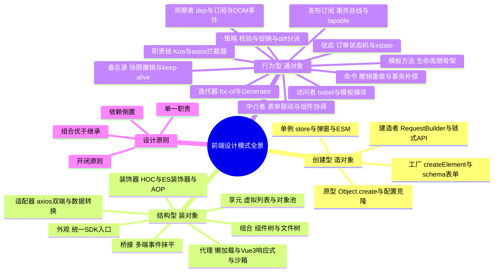

---

> **DP-001 ~ DP-100 完**。DP-101 ~ DP-200（业务重构实战与模式组合）见下文第十二 ~ 二十一章。


---

## 十二、重构实战：从坏代码到模式

### DP-101：重构实战：满屏 if-else 的促销计算器如何一步步升级为策略模式？（高频压轴）
**答**：
- 重构路线：先写测试锁定现有行为 → 提取"规则 = 名称 + 计算函数"的统一形状 → if-else 每个分支搬进策略表 → 核心只留"查表 + 归约"。
- 收益：新增活动只注册新策略（OCP），计价核心不再被修改；每个策略可独立单测；计价与副作用（发赠品、打标）分离。
- 边界：只有两三个稳定分支时不必上策略，避免过度设计（DP-007）；分支会持续膨胀才是信号。

```javascript
// 重构前：每上一个新活动都来改这个函数，测试全量回归
function calcPrice(price, type, payload) {
  if (type === 'full') {                    // 满 300 减 40
    return price >= 300 ? price - 40 : price;
  } else if (type === 'percent') {          // 打 8 折
    return price * payload.rate;
  } else if (type === 'coupon') {           // 优惠券抵扣
    return Math.max(0, price - payload.amount);
  } else if (type === 'gift') {             // 赠品：副作用混进了计价
    addGift(payload.skuId);
    return price;
  }
  return price;
}
```

```javascript
// 重构后：策略表 + 稳定内核；gift 改为管道上的副作用装饰器
const strategies = {
  full:    (p, { full, cut }) => (p >= full ? p - cut : p),
  percent: (p, { rate }) => p * rate,
  coupon:  (p, { amount }) => Math.max(0, p - amount),
};
const sideEffects = {                       // 不改价的规则单独收口
  gift: (ctx, { skuId }) => ctx.gifts.push(skuId),
};
function calcPrice(ctx, rules) {            // ctx = { price, gifts }
  return rules.reduce((p, r) => {
    const calc = strategies[r.type];
    if (calc) return calc(p, r.payload);    // 纯计价
    if (sideEffects[r.type]) sideEffects[r.type](ctx, r.payload);  // 纯副作用
    throw new Error('未知促销规则 ' + r.type);   // fail fast
  }, ctx.price);
}
const ctx = { price: 400, gifts: [] };
const final = calcPrice(ctx, [
  { type: 'percent', payload: { rate: 0.8 } },
  { type: 'gift',    payload: { skuId: 'A1' } },
]);
console.log(final, ctx.gifts);              // 320 [ 'A1' ]
```

重构前后对比图：

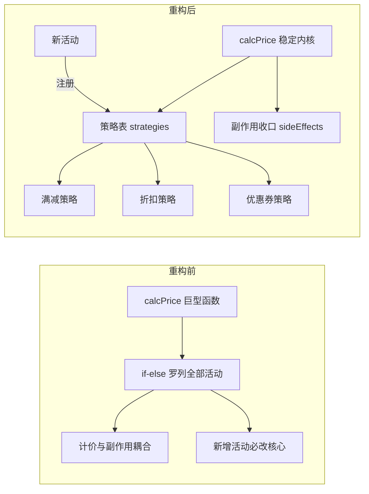

### DP-102：重构实战：订单流程的巨型 switch 如何升级为映射表与状态机？（高频）
**答**：
- switch 的坏味道：状态转移规则散落在各处，"哪些状态能发什么事件"无法一眼看出，非法转移（已取消还能发货）没有防线。
- 升级两步走：第一版映射表（事件 → 处理函数）消灭 switch；第二版补上"当前状态"维度成为状态机表（状态 × 事件 → 下一步 + 动作）。
- 状态机表的价值：转移合法性由表保证，action 集中放副作用，可视化/测试都容易；再进一步可换 xstate（DP-056）。

```javascript
// 重构前：每个按钮 handler 里各自 switch，规则重复且互相漂移
function onPayClick(order) {
  switch (order.status) {
    case 'pending': pay(order); order.status = 'paid'; break;
    case 'shipped': /* 有人在这里复制粘贴出了重复逻辑 */ break;
  }
}
function onCancelClick(order) {
  switch (order.status) {
    case 'pending': close(order); order.status = 'closed'; break;
    case 'paid':    refund(order); order.status = 'refunding'; break;  // 新加的，忘记同步到别处
  }
}
```

```javascript
// 重构后：状态机表 = 状态 × 事件 → next + action
const orderMachine = {
  pending: {
    pay:    { next: 'paid',      action: (o) => pay(o) },
    cancel: { next: 'closed',    action: (o) => close(o) },
  },
  paid: {
    ship:   { next: 'shipped',   action: (o) => createDelivery(o) },
    refund: { next: 'refunding', action: (o) => startRefund(o) },
  },
  shipped: { confirm: { next: 'done', action: (o) => addPoints(o) } },
};
function dispatch(order, event) {
  const node = orderMachine[order.status]?.[event];
  if (!node) throw new Error(`非法转移 ${order.status} + ${event}`);  // 防线：表之外的转移直接报错
  node.action(order);
  order.status = node.next;
  return order.status;
}
const order = { status: 'pending' };
dispatch(order, 'pay');     // paid
dispatch(order, 'ship');    // shipped
dispatch(order, 'cancel');  // Error 非法转移 shipped + cancel —— 已发货不能取消
```

### DP-103：重构实战：回调地狱的上传流程如何升级为观察者/职责链？（高频）
**答**：
- 回调地狱的根因：把"流程步骤"写成了嵌套（控制流），把"步骤完成"和"关心结果的人"耦合在了一起。
- 两条改造路线：流程固定、只关心成功失败 → Promise/async-await 即可；流程要被外部感知（进度、失败重试、埋点）→ 观察者发事件。
- 步骤有先后校验且会增删（压缩 → 水印 → 校验 → 上传）→ 职责链：每个环节只做一件事，可插拔。

```javascript
// 重构前：嵌套回调，进度无法通知外部，任何一步失败都难定位
uploadVideo(file, (compressed) => {
  addWatermark(compressed, (marked) => {
    validate(marked, (ok) => {
      if (!ok) { console.log('校验失败'); return; }
      doUpload(marked, (url) => console.log('完成', url), () => console.log('上传失败'));
    }, () => console.log('水印失败'));
  }, () => console.log('压缩失败'));
});
```

```javascript
// 重构后：职责链组织步骤，观察者向外部广播生命周期
import { EventEmitter } from 'node:events';
const bus = new EventEmitter();                          // 观察者：进度/失败对外可见
const steps = [compressVideo, addWatermark, validate];   // 职责链：可插拔的步骤数组
async function uploadFlow(file) {
  let input = file;
  bus.emit('start', file.name);
  for (const step of steps) {
    input = await step(input);                           // 顺序由链决定，不在业务里嵌套
    bus.emit('step-done', step.name);
  }
  const url = await doUpload(input);
  bus.emit('done', url);
  return url;
}
bus.on('step-done', (name) => renderProgress(name));     // UI 只订阅，不侵入流程
bus.on('done', (url) => toast('上传完成 ' + url));
uploadFlow(file);
```

### DP-104：重构实战：上帝对象 userManager 如何用组合 + 外观拆分？（高频）
**答**：
- 上帝对象识别信号：一个类/文件承担鉴权、资料、消息、日志等 3 个以上互不相关的职责，属性 30+，任何需求都要改它（DP-002）。
- 拆分手法：按职责切成独立模块（组合），旧 API 用外观保留——老调用方零改动，新代码走新模块，风险可控。
- 迁移策略：外观内部先委托给新模块（绞杀者模式思路），逐个方法迁移 + 单测护航，最后删除上帝对象。

```javascript
// 重构前：userManager 上帝对象 —— 登录、资料、消息、日志全在一个对象里
const userManager = {
  users: [], logs: [], messages: [],
  login(name, pwd) { /* 校验 + 写日志 + 发通知，60 行 */ },
  getProfile(id) { /* 查资料 + 写日志，40 行 */ },
  sendMessage(id, text) { /* 发消息 + 写日志，40 行 */ },
  log(msg) { this.logs.push(msg); },   // 每个方法都要手动写日志，重复且易漏
};
```

```javascript
// 重构后：按职责拆成组合关系的小模块，外观只做转发
class AuthService   { constructor(db, logger) { Object.assign(this, { db, logger }); } login(u, p) { this.logger.info('login ' + u); return this.db.verify(u, p); } }
class ProfileService{ constructor(db, logger) { Object.assign(this, { db, logger }); } get(id) { this.logger.info('profile ' + id); return this.db.findUser(id); } }
class MessageService{ constructor(db, logger) { Object.assign(this, { db, logger }); } send(id, text) { this.logger.info('msg to ' + id); return this.db.insertMsg(id, text); } }
// 外观：老代码继续调 userManager.xxx，内部已委托新模块（绞杀者迁移）
class UserManagerFacade {
  constructor(db, logger) {
    this.auth = new AuthService(db, logger);        // 组合：has-a 而非 is-a
    this.profile = new ProfileService(db, logger);
    this.message = new MessageService(db, logger);
  }
  login(u, p) { return this.auth.login(u, p); }
  getProfile(id) { return this.profile.get(id); }
  sendMessage(id, t) { return this.message.send(id, t); }
}
const userApi = new UserManagerFacade(db, logger);   // 对外出口保持稳定
userApi.login('tom', '***');
```

### DP-105：重构实战：散落的全局变量如何改造为依赖注入？（高频）
**答**：
- 全局变量的三宗罪：隐式依赖（调用方看不出用了什么）、测试无法隔离（必须污染全局）、生命周期失控（谁都能改）。
- 改造手法：把全局量变成"构造参数 / 工厂入参"，从最底层模块开始注入；入口处组装（组合根），测试时注入 mock。
- 渐进方案：全局量包一层 getter 做过渡（所有访问可见），再逐步收敛注入；ESM 的导入即天然注入边界（DP-012）。

```javascript
// 重构前：三个模块都偷读 window 全局配置，谁改了它没人知道
// a.js
export function report(event) {
  fetch(window.GLOBAL_CONFIG.api + '/report', { body: JSON.stringify({ ...event, app: window.GLOBAL_CONFIG.appId }) });
}
// b.js
export function getUser() {
  return fetch(window.GLOBAL_CONFIG.api + '/user');   // 重复取配置，测试必须先造 window.GLOBAL_CONFIG
}
```

```javascript
// 重构后：依赖通过构造参数注入，组合根统一装配
class ApiClient {
  constructor(config) { this.config = config; }       // 依赖显式化
  report(event) { return this.request('/report', event); }
  getUser()    { return this.request('/user'); }
  request(path, body) {
    return fetch(this.config.api + path, body ? { method: 'POST', body: JSON.stringify(body) } : undefined);
  }
}
// 组合根：应用入口唯一一次读取配置（CDN 注入 / 运行时下发都收口在这里）
const config = { api: window.GLOBAL_CONFIG.api, appId: window.GLOBAL_CONFIG.appId };
const api = new ApiClient(config);
export { api };                                       // 模块级单例，但类本身可 new 出测试实例
// 测试：new ApiClient({ api: 'mock://' }) —— 无需碰任何全局变量
```

### DP-106：重构实战：三个列表页的重复代码如何抽象为模板方法？（高频）
**答**：
- 三次法则（DP-166）：重复出现第三次才抽象；抽取的对象是"骨架"（加载 → 处理 → 渲染 → 销毁），变化点用钩子留给子类/参数。
- 模板方法式重构：把"不变流程"封进基类/高阶函数，把"每页不同"变成 fetch/handle/render 三步覆写；函数式场景直接用高阶函数注入步骤（DP-099 实战2）。
- 验收标准：新增一个列表页只写三个差异函数，不复制任何加载/异常/销毁代码。

```javascript
// 重构前：订单页/商品页/用户页各自复制加载、异常、清理逻辑（这里只列两页示意）
async function loadOrders() {
  loading = true;
  try { const data = await fetch('/orders'); orders = transformOrders(await data.json()); render(orders); }
  catch (e) { toastError(e); } finally { loading = false; }
}
async function loadGoods() {
  loading = true;                                     // 与 loadOrders 除了 URL 和 transform 全部重复
  try { const data = await fetch('/goods'); goods = transformGoods(await data.json()); render(goods); }
  catch (e) { toastError(e); } finally { loading = false; }
}
```

```javascript
// 重构后：骨架固化，差异点变成三个可覆写步骤（模板方法）
class ListPage {
  url; transform = (d) => d;
  async load() {                                      // 模板方法：流程固定
    this.loading = true;
    try {
      const res = await fetch(this.url);
      this.items = this.transform(await res.json());  // 钩子1 数据加工
      this.render(this.items);                        // 钩子2 渲染
    } catch (e) { toastError(e); } finally { this.loading = false; }
  }
  render(items) { throw new Error('子类必须实现 render'); }
}
class OrderPage extends ListPage {
  url = '/orders';
  transform = (list) => list.map((o) => ({ ...o, amountText: '¥' + o.amount }));
  render(items) { renderTable('#orderTable', items); }
}
class GoodsPage extends ListPage {
  url = '/goods';
  render(items) { renderGrid('#goodsGrid', items); }
}
new OrderPage().load(); new GoodsPage().load();       // 新页面 = 只写差异
```

### DP-107：重构实战：散落的硬编码配置如何升级为建造者 + 工厂？（高频）
**答**：
- 坏味道：地图 SDK 的 key、缩放、主题等配置复制散落在十几个初始化点，改一个默认值要全局搜替换。
- 建造者负责"怎么配"：链式方法收敛配置，必填校验、默认值、环境差异集中一处；工厂负责"造什么"：按平台/环境产出对应实例。
- 组合关系：工厂内部用建造者填充默认配置，调用方只面对一行 `createMap(el, { zoom: 12 })`。

```javascript
// 重构前：每个页面各自 new，key 散落、默认值漂移
const map1 = new AMap('page-container', { key: 'ak123', zoom: 11, theme: 'light', logo: true });
const map2 = new AMap('modal-container', { key: 'ak123', zoom: 11, theme: 'dark' });  // 漏配 logo
const map3 = new BMap('h5-container', { ak: 'ak123' });                               // 平台差异各自处理
```

```javascript
// 重构后：建造者收敛配置 + 工厂按平台产出
class MapBuilder {
  #cfg = { zoom: 11, theme: 'light', logo: true, key: 'ak123' };   // 默认值唯一出处
  zoom(v)   { this.#cfg.zoom = v; return this; }
  theme(v)  { this.#cfg.theme = v; return this; }
  build()   { return { ...this.#cfg }; }
}
class MapFactory {
  static create(el, tune = (b) => b) {                // tune：允许页面做增量定制
    const cfg = tune(new MapBuilder()).build();
    return window.BMap ? new BMapWrapper(el, cfg)     // 平台差异收口在工厂内部
                       : new AMapWrapper(el, cfg);
  }
}
const map1 = MapFactory.create('page-container');                       // 默认配置
const map2 = MapFactory.create('modal-container', (b) => b.theme('dark'));
```

### DP-108：重构实战：重构的"安全网"怎么搭？测试先行与小步提交如何配合？（高频）
**答**：
- 安全网三层：特征测试（先断言当前行为，哪怕是坏行为）→ 小步重构（每次只做一个手法：提取函数/内联/搬移）→ 随时提交（每步绿了就 commit，坏一步能秒回滚）。
- 顺序铁律：先加测试再动代码；改结构不改行为（一轮只干一件事）；提交粒度 = "一次可独立回滚的重构步骤"。
- 配套：依赖注入（DP-105）让模块可测，时间/随机等不确定因素注入 mock，防止测试本身不稳定。

```javascript
// 1. 特征测试：重构前先锁定旧实现的行为（不知道对错，但必须保持）
import { describe, it, expect } from 'vitest';
describe('特征测试：锁住 calcDiscount 现状', () => {
  it('满 300 减 40', () => expect(calcDiscount(350, 'full')).toBe(310));
  it('8 折', () => expect(calcDiscount(350, 'percent')).toBeCloseTo(280));
  it('未知类型原价返回', () => expect(calcDiscount(350, 'unknown')).toBe(350));  // 连边界怪癖也记下来
});

// 2. 小步提交：每个 commit 是一次纯重构，行为零变化
// git commit -m "refactor: extract promotion strategies from calcDiscount"（步骤1：提策略表）
// git commit -m "refactor: move gift side-effect out of pricing"（步骤2：副作用收口）
// git commit -m "test: cover unknown promotion type"（步骤3：补边界测试）

// 3. 不确定因素注入：重构后的代码不 new Date()，而是收参数
export function isFlashSale(now = new Date()) {          // 默认真实时间，测试可传假时间
  const h = now.getHours();
  return h >= 20 && h < 22;
}
// expect(isFlashSale(new Date('2026-01-01T21:00:00'))).toBe(true) —— 稳定、可重复
```

---

## 十三、模式组合实战

### DP-109：如何用"策略 + 工厂 + 单例"组合设计一个支付渠道网关？（高频压轴）
**答**：
- 分工：策略定义统一支付接口（pay/refund/query），工厂按渠道码创建/复用渠道实现，单例网关作为全局唯一入口并持有渠道注册表。
- 注册时机支持两种：启动时静态注册内置渠道，运行时 `register` 动态接入新渠道（OCP，核心不改）。
- 关键细节：工厂按渠道码缓存实例（多例语义）；网关做参数校验与统一埋点，渠道实现只关心自己协议。

```javascript
// 策略接口：所有渠道实现同一形状
class AlipayStrategy {
  async pay(order) { return alipaySdk.createOrder({ outTradeNo: order.id, amount: order.amount }); }
  async refund(order) { return alipaySdk.refund({ outTradeNo: order.id }); }
}
class WechatStrategy {
  async pay(order) { return wechatSdk.unifiedOrder({ out_trade_no: order.id, total_fee: order.amount * 100 }); }
  async refund(order) { return wechatSdk.refund({ out_trade_no: order.id }); }
}
// 工厂：按渠道码创建并缓存策略实例
class ChannelFactory {
  #pool = new Map();
  #registry = { alipay: AlipayStrategy, wechat: WechatStrategy };
  create(channel) {
    if (!this.#pool.has(channel)) {
      const Cls = this.#registry[channel];
      if (!Cls) throw new Error('未注册渠道 ' + channel);
      this.#pool.set(channel, new Cls());
    }
    return this.#pool.get(channel);
  }
}
// 单例网关：全局唯一入口
class PayGateway {
  static #inst = null;
  static get instance() { return (this.#inst ??= new PayGateway()); }
  #factory = new ChannelFactory();
  async pay(channel, order) {
    const s = this.#factory.create(channel);
    return s.pay(order);                       // 可在此统一加埋点/对账日志
  }
}
export const payGateway = PayGateway.instance;  // 业务侧只 import 这一个对象
payGateway.pay('alipay', { id: 'T1001', amount: 99 });
```

### DP-110：如何用"观察者 + 命令"组合实现操作日志与撤销？（高频）
**答**：
- 命令对象封装"做什么 + 怎么撤销"，CommandBus 负责执行入栈；观察者订阅 `executed/undone` 事件，把审计日志、界面刷新从命令中剥离。
- 收益：命令不知道有日志，日志不知道有撤销，二者通过事件总线解耦，各自可独立替换。
- 适用：表格批量编辑、文档编辑器、后台配置操作等需要"操作可追溯 + 可回退"的场景。

```javascript
const bus = new EventTarget();                              // 观察者：事件中枢
class SetCellCommand {
  constructor(grid, row, col, value) { Object.assign(this, { grid, row, col, value, prev: null }); }
  execute() { this.prev = this.grid.get(this.row, this.col); this.grid.set(this.row, this.col, this.value); return this; }
  undo()    { this.grid.set(this.row, this.col, this.prev); bus.dispatchEvent(new Event('undone')); return this; }
}
class CommandBus {
  #undoStack = [];
  run(cmd) {
    cmd.execute();
    this.#undoStack.push(cmd);
    bus.dispatchEvent(new CustomEvent('executed', { detail: cmd }));   // 命令只管执行，广播交给观察者
  }
  undo() { this.#undoStack.pop()?.undo(); }
}
// 观察者侧：审计日志 + UI 刷新各自订阅，互不感知
bus.addEventListener('executed', (e) => auditLog.write({ op: 'setCell', payload: e.detail }));
bus.addEventListener('undone', () => auditLog.write({ op: 'undo' }));
bus.addEventListener('executed', () => gridRef.refresh());
const cmdBus = new CommandBus();
cmdBus.run(new SetCellCommand(grid, 0, 1, 'OK'));
cmdBus.undo();
```

### DP-111：如何用"代理 + 享元"组合实现高性能图片池？（高频）
**答**：
- 享元负责"共享"：解码后的位图（大对象）按 URL 去重共享，DOM/内存不随使用次数增长；代理负责"控制"：懒加载、并发上限、失败重试、缓存。
- 组合方式：`ImagePool` 是享元工厂（key = URL，值 = 复用的 Image 实例），`LazyImageProxy` 包装池，业务拿到的永远是代理。
- 对象池回收（DP-039）：列表滚出视口的图片节点回收入池，复用而非重建，减少 GC 与重排。

```javascript
// 享元工厂：同 URL 的位图全局共享一份
const bitmapPool = new Map();                                //享元：key 是内部状态 URL
const pending = new Map();
function getBitmap(url) {
  if (bitmapPool.has(url)) return Promise.resolve(bitmapPool.get(url));
  if (pending.has(url)) return pending.get(url);             // 并发去重：同 URL 只发一次请求
  const p = new Promise((resolve, reject) => {
    const img = new Image();
    img.onload = () => { bitmapPool.set(url, img); pending.delete(url); resolve(img); };
    img.onerror = () => { pending.delete(url); reject(new Error('load fail ' + url)); };
    img.src = url;
  });
  pending.set(url, p);
  return p;
}
// 代理：懒加载 + 并发上限 + 失败占位
class LazyImageProxy {
  static #running = 0; static #queue = []; static #LIMIT = 4;
  constructor(el, url) { Object.assign(this, { el, url }); el.dataset.src = url; }
  show() {
    const job = async () => {
      try { const img = await getBitmap(this.url); this.el.replaceWith(img); }   // 复用享元位图
      catch { this.el.src = '/img/fallback.png'; }                               // 代理兜底
      finally { LazyImageProxy.#running--; LazyImageProxy.#next(); }
    };
    LazyImageProxy.#queue.push(job); LazyImageProxy.#next();
  }
  static #next() { while (this.#running < this.#LIMIT && this.#queue.length) { this.#running++; this.#queue.shift()(); } }
}
const io = new IntersectionObserver((entries) => entries.forEach((e) => e.isIntersecting && e.target.__proxy.show()));
function mountImage(container, url) {
  const ph = document.createElement('div'); container.appendChild(ph);
  const proxy = new LazyImageProxy(ph, url);
  ph.__proxy = proxy; io.observe(ph);                        // 代理接管真实加载时机
}
```

### DP-112：如何用"职责链 + 策略"组合实现风控规则引擎？（高频）
**答**：
- 策略：每条规则是独立可测的判定函数（黑名单、频控、金额阈值），增删改规则零侵入；职责链：规则按序串行裁决，任一环节拦截即短路。
- 两种裁决语义：any-hit（命中即拦）用短路链；all-score（累计评分）用归约链——实现同一个链骨架，用"聚合策略"切换语义。
- 落地细节：每步返回 `{ pass, score, reason }`，链尾汇总决策与命中链路，方便风控审计。

```javascript
// 策略：单条规则 = 独立判定函数（入参上下文，出参裁决）
const rules = {
  blacklist: (ctx) => ({ pass: !ctx.blacklist.includes(ctx.userId), score: 100, reason: '黑名单' }),
  frequency: (ctx) => ({ pass: ctx.ordersLast10min < 5, score: 40, reason: '下单频次' }),
  amount:    (ctx) => ({ pass: ctx.amount <= 50000, score: 30, reason: '单笔限额' }),
  device:    (ctx) => ({ pass: ctx.deviceTrust > 0.6, score: 30, reason: '设备可信度' }),
};
// 职责链：顺序裁决；聚合语义本身也是策略（anyHit 短路 / totalScore 累计）
function makeChain(ruleKeys, aggregate) {
  return async (ctx) => {
    const hits = [];
    for (const key of ruleKeys) {
      const verdict = await rules[key](ctx);
      if (!verdict.pass) hits.push({ rule: key, ...verdict });
      if (aggregate.shouldStop(hits)) break;                 // 聚合策略决定是否短路
    }
    return { ...aggregate.decide(hits), hits };              // 决策 + 命中链路（审计用）
  };
}
const anyHit = { shouldStop: (h) => h.length > 0, decide: (h) => ({ pass: h.length === 0, level: 'block' }) };
const score  = { shouldStop: () => false, decide: (h) => ({ pass: h.reduce((s, x) => s + x.score, 0) < 60, level: 'score' }) };
const payGuard = makeChain(['blacklist', 'frequency', 'amount', 'device'], anyHit);
const riskScore = makeChain(['frequency', 'amount', 'device'], score);
const ctx = { userId: 'u1', blacklist: [], ordersLast10min: 7, amount: 3000, deviceTrust: 0.9 };
console.log(await payGuard(ctx));   // pass false level block hits 命中 frequency
```

### DP-113：如何用"外观 + 适配器"组合统一多家埋点/推送 SDK？（高频）
**答**：
- 外观：给业务一个稳定小接口 `track(event, props)` / `push(msg)`，业务永远不直接 import 厂商 SDK；适配器：把各厂商 API 形状抹平成内部接口。
- 换厂商 = 只换适配器注册，业务代码零改动（DIP：业务依赖内部接口而非具体厂商）。
- 附加价值：外观层统一做公共字段（userId、env）、采样、灰度开关，厂商差异不再泄漏进业务。

```javascript
// 内部统一接口（业务只认识它）
// track(event: string, props: object): void
class SensorsAdapter {                                      // 适配器1
  init(cfg) { window.sensors.init(cfg); }
  track(event, props) { window.sensors.track(event, props); }
}
class GrowingAdapter {                                      // 适配器2：字段名/调用方式都不同
  init(cfg) { window.gio('init', cfg.projectId); }
  track(event, props) { window.gio('track', event, props); }
}
class TrackerFacade {                                       // 外观：业务唯一入口
  #adapter; #common;
  constructor(adapter, common) { this.#adapter = adapter; this.#common = common; }
  static create(vendor, common) {                           // 简单工厂选适配器
    const map = { sensors: SensorsAdapter, growing: GrowingAdapter };
    return new TrackerFacade(new map[vendor](), common);
  }
  init(cfg) { this.#adapter.init(cfg); }
  track(event, props = {}) {
    this.#adapter.track(event, { ...this.#common, ...props });   // 公共字段统一注入
  }
}
export const tracker = Tracker.create('sensors', { env: 'prod', userId: store.userId });
tracker.track('pay_click', { channel: 'wechat' });          // 换厂商只改 create('growing') 一处
```

### DP-114：如何用"模板方法 + 策略"组合设计数据导出流程？（高频）
**答**：
- 模板方法固化流程骨架：取数 → 加工 → 格式化 → 下载，每步留钩子；策略替换可变步骤：导出格式（CSV/JSON/Excel）只换 formatter 策略。
- 变化分离：数据来源变了改 fetcher 钩子，格式变了换策略，流程本身永不改动（两根变化轴正交）。
- 工程收益：大数据量分片取数、进度上报这类通用能力在骨架里实现一次，所有导出功能共享。

```javascript
// 模板方法：导出流程骨架
class Exporter {
  async run(params, { fetcher, formatter, onProgress = () => {} }) {
    onProgress('fetching');
    const raw = await fetcher(params);                      // 变化点1 数据来源（钩子）
    onProgress('transforming');
    const rows = this.transform(raw);
    onProgress('formatting');
    const blob = formatter(rows);                           // 变化点2 格式（策略注入）
    this.save(blob, params.filename);
    onProgress('done');
  }
  transform(raw) { return raw; }                            // 默认透传，子类可覆写
  save(blob, name) {
    const url = URL.createObjectURL(blob);
    const a = Object.assign(document.createElement('a'), { href: url, download: name });
    a.click(); URL.revokeObjectURL(url);
  }
}
// 策略：格式化器
const csvFormatter = (rows) => new Blob([
  [Object.keys(rows[0]).join(','), ...rows.map((r) => Object.values(r).join(','))].join('\n'),
], { type: 'text/csv' });
const jsonFormatter = (rows) => new Blob([JSON.stringify(rows, null, 2)], { type: 'application/json' });
// 组合使用：同一骨架，不同策略
const exporter = new Exporter();
exporter.run({ month: '2026-10', filename: 'orders.csv' }, {
  fetcher: (p) => api.get('/orders/export', p),
  formatter: csvFormatter,
  onProgress: setExportProgress,
});
exporter.run({ ids: [1, 2], filename: 'users.json' }, {
  fetcher: (p) => api.get('/users', p),
  formatter: jsonFormatter,
});
```

### DP-115：如何用"中介者 + 观察者"组合搭建组件通信中枢？（高频）
**答**：
- 中介者把"组件互相引用"变成"都只认识中枢"；观察者提供主题订阅语义。组合体：Hub 同时承担注册（中介者登记组件）与广播（观察者发布事件）。
- 与裸事件总线的差别（DP-050）：Hub 维护"谁在用"的组件表，可以按 scope/组件定向投递、组件销毁时自动反注册，杜绝幽灵监听（DP-164）。
- 典型场景：表单区块联动、仪表盘卡片联动、向导页步骤通信。

```javascript
class ComponentHub {                                        // 中介者 + 观察者合体
  #components = new Map();                                  // 中介者：登记表
  #topics = new Map();                                      // 观察者：订阅表
  register(name, comp) {
    this.#components.set(name, comp);
    return () => this.unregister(name);                     // 返回注销函数
  }
  unregister(name) {
    this.#components.delete(name);
    for (const [t, set] of this.#topics) {                  // 注销即清理订阅（防泄漏）
      set.forEach((sub) => sub.owner === name && set.delete(sub));
    }
  }
  on(topic, owner, handler) {
    if (!this.#topics.has(topic)) this.#topics.set(topic, new Set());
    const sub = { owner, handler };
    this.#topics.get(topic).add(sub);
    return () => this.#topics.get(topic).delete(sub);
  }
  emit(from, topic, payload) {
    this.#topics.get(topic)?.forEach(({ handler }) => handler(payload, from));  // 中介转发
  }
}
const hub = new ComponentHub();
const offFilter = hub.register('filter', filterComp);
hub.on('range-change', 'chart', (payload) => chartComp.update(payload));  // chart 只订阅，不认识 filter
hub.emit('filter', 'range-change', { start: '2026-01', end: '2026-06' });
offFilter();                                                // 组件销毁时调用，链路整体回收
```

### DP-116：如何用"组合 + 访问者"组合遍历 AST / 组件树？（高频）
**答**：
- 组合模式建树：节点统一暴露 `children` 与 `accept(visitor)`，叶子与容器同构（DP-036）；访问者把"对节点的操作"从树结构中剥离，新增遍历目的（收集、校验、转换）不改节点类。
- 与 babel 对应（DP-065）：enter/leave 两阶段访问，访问者可返回替换节点实现改写。
- 前端实例：组件树抽取所有表单字段、埋点扫描器、主题变量收集器。

```javascript
// 组合模式：统一节点
class VNode {
  constructor(type, props = {}, children = []) { Object.assign(this, { type, props, children }); }
  accept(visitor) {
    visitor.enter?.(this);
    this.children.forEach((c) => c.accept(visitor));        // 容器递归，叶子 children 为空，结构同构
    visitor.leave?.(this);
  }
}
const tree = new VNode('Form', {}, [
  new VNode('Input', { name: 'user', rules: 'required' }),
  new VNode('Group', {}, [ new VNode('Select', { name: 'city' }), new VNode('Input', { name: 'phone' }) ]),
]);
// 访问者1：收集所有带校验规则的字段
const collectVisitor = {
  fields: [], enter(n) { if (n.props.rules) this.fields.push(n.props.name); },
};
// 访问者2：扫描埋点埋没埋（同一棵树，另一个操作）
const trackVisitor = { miss: [], enter(n) { if (n.type === 'Input' && !n.props.trackId) this.miss.push(n.props.name); } };
tree.accept(collectVisitor);
tree.accept(trackVisitor);
console.log(collectVisitor.fields);   // [ 'user', 'phone' ]
console.log(trackVisitor.miss);       // [ 'user', 'phone' ] —— 新增遍历目的零改树
```

---

## 十四、React 业务模式深化

### DP-117：容器组件与 Hooks 如何分工？容器组件还有存在必要吗？（高频）
**答**：
- Hooks 时代容器/展示的划分没有消失，只是从"组件分层"变成"逻辑分层"：容器层 = 自定义 Hook 集合（取数、状态、订阅），展示层 = 纯函数组件（props in、JSX out）。
- 判断标准：一个组件同时干"取数 + 布局 + 交互样式"就该拆——把数据逻辑提为 `useXxxContainer` Hook，JSX 留给纯展示组件。
- 收益：展示组件可 storybook 单测/截图测试；数据逻辑可跨页面复用；迁 Zustand/Context 时只动 Hook 层。

```jsx
// 逻辑层：容器 Hook（原容器组件的全部职责）
function useOrderListContainer(query) {
  const [orders, setOrders] = useState([]);
  const [loading, setLoading] = useState(true);
  useEffect(() => {
    let alive = true;                                    // 防竞态：卸载后不写入
    setLoading(true);
    fetchOrders(query).then((d) => alive && setOrders(d)).finally(() => alive && setLoading(false));
    return () => { alive = false; };
  }, [query.page, query.status]);
  const actions = useMemo(() => ({ refresh: () => setOrders((o) => [...o]) }), []);
  return { orders, loading, actions };                   // 只吐数据与动作
}
// 展示层：纯函数组件，无副作用，props 决定一切
function OrderList({ orders, loading, onRefresh }) {
  if (loading) return <Spin />;
  return (
    <table>
      <tbody>{orders.map((o) => <tr key={o.id}><td>{o.no}</td><td>{o.amount}</td></tr>)}</tbody>
    </table>
  );
}
// 页面 = 组装点：Hook 接数据，展示组件接视图
export default function OrderPage() {
  const [query, setQuery] = useState({ page: 1, status: 'all' });
  const { orders, loading, actions } = useOrderListContainer(query);
  return <OrderList orders={orders} loading={loading} onRefresh={actions.refresh} />;
}
```

### DP-118：如何沉淀自定义 Hook 模式库？useReducer 复杂状态与 useMemo 派生的标准写法？（高频）
**答**：
- Hook 模式库三条设计准则：输入是参数/ref、输出是"状态 + 稳定的动作函数"（用 useCallback/useMemo 包住）、内部封装订阅清理（DP-073）。
- 复杂状态选 useReducer：把状态转移收敛成 reducer 纯函数（状态模式思想的 Hook 化，DP-052），action 命名即领域语言。
- 派生数据选 useMemo：把"过滤/排序/统计"做成派生 selector，避免冗余 state（同一份数据存两遍必然漂移）。

```jsx
// 模式1：useReducer 承载复杂业务状态（转移规则集中、可测试）
const cartReducer = (state, action) => {
  switch (action.type) {
    case 'add': {
      const item = state.items.find((i) => i.id === action.sku);
      return item
        ? { ...state, items: state.items.map((i) => i.id === action.sku ? { ...i, qty: i.qty + 1 } : i) }
        : { ...state, items: [...state.items, { id: action.sku, qty: 1 }] };
    }
    case 'clear': return { ...state, items: [] };
    default: return state;
  }
};
function useCart() {
  const [state, dispatch] = useReducer(cartReducer, { items: [] });
  const actions = useMemo(() => ({                       // 动作引用稳定，下游 memo 不失效
    add: (sku) => dispatch({ type: 'add', sku }),
    clear: () => dispatch({ type: 'clear' }),
  }), []);
  return { items: state.items, ...actions };
}
// 模式2：useMemo 派生数据，绝不复制 state
function useCartSummary(items, { keyword, sortKey }) {
  const filtered = useMemo(() => items.filter((i) => i.name.includes(keyword)), [items, keyword]);
  const sorted = useMemo(() => [...filtered].sort((a, b) => a[sortKey] - b[sortKey]), [filtered, sortKey]);
  const total = useMemo(() => sorted.reduce((s, i) => s + i.price * i.qty, 0), [sorted]);
  return { list: sorted, total };                        // total 由 items 推导，永不与明细不一致
}
```

### DP-119：如何用 Context + useReducer 实现一个 mini 状态机？（高频）
**答**：
- 本质：Context（Provider 模式，DP-072）负责把状态与 dispatch 注入子树，useReducer 负责合法转移——合起来就是一个轻量"局部状态机"。
- 适用边界：中小型共享状态（主题、购物车、向导流程）；跨页共享或需要中间件时升级 Zustand/Redux（DP-084）。
- 性能要点：state 与 dispatch 分两个 Context，消费动作的组件不因状态变化重渲染。

```jsx
const StateCtx = createContext(null);
const DispatchCtx = createContext(null);
// 状态机：向导流程的合法转移集中在 reducer
function wizardReducer(state, action) {
  const next = { idle: { start: 'step1' }, step1: { next: 'step2', back: 'idle' },
                 step2: { next: 'confirm', back: 'step1' }, confirm: { submit: 'done' } }[state.phase];
  if (action.type === 'goto' && next?.[action.event] === undefined && action.event !== 'reset')
    throw new Error(`非法转移 ${state.phase} + ${action.event}`);
  if (action.type === 'reset') return { phase: 'idle', payload: null };
  return { phase: next[action.event], payload: action.payload ?? state.payload };
}
export function WizardProvider({ children }) {
  const [state, dispatch] = useReducer(wizardReducer, { phase: 'idle', payload: null });
  return (
    <DispatchCtx.Provider value={dispatch}>
      <StateCtx.Provider value={state}>{children}</StateCtx.Provider>
    </DispatchCtx.Provider>
  );
}
export const useWizard = () => useContext(StateCtx);       // 读状态
export const useWizardDispatch = () => useContext(DispatchCtx); // 只派发：状态变了不重渲染动作按钮
function WizardSteps() {
  const { phase } = useWizard();
  const dispatch = useWizardDispatch();
  return <button onClick={() => dispatch({ type: 'goto', event: 'start' })}>开始 {phase}</button>;
}
```

### DP-120：HOC、Hook、render props 三种复用方式如何做迁移决策？（高频）
**答**：
- 判定表：复用"无 UI 的行为"（订阅、取数）→ Hook；需要在渲染时暴露内部状态给调用方自由画 UI → render props / children as function；包裹增强已有组件且无法改其内部（第三方组件）→ HOC。
- 新代码优先 Hook；HOC 的嵌套地狱与 props 冲突是主要债务，老 HOC 可改为"返回 Hook 的工厂"渐进迁移。
- 组合而非互斥：Headless 组件内部用 Hook 管状态、用 render props/children 暴露 UI（DP-122）。

```jsx
// 方式1 HOC：增强无法修改的第三方组件（唯一适合的场景）
const withTheme = (Comp) => (props) => {
  const theme = useContext(ThemeCtx);
  return <Comp {...props} theme={theme} />;
};
const ThemedCard = withTheme(ThirdPartyCard);
// 方式2 Hook：行为复用的默认答案
function useOnline() {
  const [online, setOnline] = useState(navigator.onLine);
  useEffect(() => {
    const on = () => setOnline(true), off = () => setOnline(false);
    window.addEventListener('online', on); window.addEventListener('offline', off);
    return () => { window.removeEventListener('online', on); window.removeEventListener('offline', off); };
  }, []);
  return online;
}
function StatusDot() { const online = useOnline(); return <span>{online ? '在线' : '离线'}</span>; }
// 方式3 render props：调用方决定 UI 形态
function Online({ children }) { return children(useOnline()); }
<Online>{(online) => <Banner text={online ? '同步已开启' : '离线中，稍后重试'} />}</Online>
// 迁移决策：行为且 UI 自由 → Hook/render props；只能从外部包第三方 → HOC
```

### DP-121：如何用 Suspense 模式重构"loading 三件套"异步组件？（高频）
**答**：
- Suspense 模式的核心：组件直接"读"同步形态的数据，未就绪就 throw 一个 thenable，由最近的 Suspense 边界兜住显示 fallback——组件里不再出现 `if (loading)`。
- 落地手法：资源创建函数返回 `{ read() }`，内部缓存 Promise 结果（命中即同步返回），等效虚拟代理 + 备忘录（DP-032）。
- React 18 的 use() / 框架级 suspense 数据源已内置该机制；自实现用于理解原理与旧版本兼容。

```jsx
// 资源模式：把 Promise 包装成可"同步读"的资源（代理 + 缓存）
function createResource(promise) {
  let status = 'pending', result;
  const suspender = promise.then(
    (v) => { status = 'success'; result = v; },
    (e) => { status = 'error'; result = e; },
  );
  return {
    read() {
      if (status === 'pending') throw suspender;   // 未就绪：抛给 Suspense 边界
      if (status === 'error') throw result;        // 失败：抛给 ErrorBoundary
      return result;                               // 就绪：同步返回
    },
  };
}
const userCache = new Map();                       // 备忘录：同 key 不重复发起
function fetchUserResource(id) {
  if (!userCache.has(id)) userCache.set(id, createResource(api.getUser(id)));
  return userCache.get(id);
}
// 组件：没有 loading，没有 useEffect，直接读
function UserProfile({ id }) {
  const user = fetchUserResource(id).read();
  return <div>{user.name}</div>;
}
export default function Page() {
  return (
    <ErrorBoundary fallback={<b>加载失败</b>}>
      <Suspense fallback={<Spin />}>
        <UserProfile id={1} />
      </Suspense>
    </ErrorBoundary>
  );
}
```

### DP-122：Headless UI 的源码模式是什么？"逻辑与 UI 分离"如何精读？（高频）
**答**：
- Headless 组件 = 无样式组件：内部用 Hook/状态机管理键盘、焦点、ARIA 等行为，通过 render props 或 props getter（`getButtonProps()`）把这些行为"注入"调用方的任意 DOM。
- 核心模式：状态机（开关/多选/弹层转移）+ 状态适配（props getter 把状态映射为 aria-*、事件）+ 组合组件（Menu.Items 等子组件共享 context）。
- 与 styled 组件库的差别：样式层完全外包，逻辑层可被任何设计系统复用。

```jsx
// 精简复刻 Headless useDisclosure + Menu 的模式
function useDisclosure(initial = false) {                       // 行为 Hook：状态机
  const [open, setOpen] = useState(initial);
  return useMemo(() => ({
    open,
    show: () => setOpen(true), hide: () => setOpen(false), toggle: () => setOpen((o) => !o),
  }), [open]);
}
function useMenuProps(state, dispatch) {                        // props getter：状态适配器
  return {
    button: {
      'aria-expanded': state.open,
      onClick: () => dispatch({ type: 'toggle' }),
      onKeyDown: (e) => e.key === 'Escape' && dispatch({ type: 'hide' }),
    },
    list: { role: 'menu', hidden: !state.open },
  };
}
// 无样式组件：只管行为，UI 全由调用方画
function Menu({ children }) {
  const { open, toggle, hide } = useDisclosure();
  const props = useMenuProps({ open }, { type: toggle, hide });   // 简化示意
  return children({ open, buttonProps: props.button, listProps: props.list });
}
<Menu>
  {({ open, buttonProps, listProps }) => (
    <div>
      <button {...buttonProps}>选项 {open ? '▲' : '▼'}</button>
      <ul {...listProps}><li role="menuitem">复制</li><li role="menuitem">删除</li></ul>
    </div>
  )}
</Menu>
```

### DP-123：组合组件模式（SubComponent）的 TypeScript 类型如何定义？（高频）
**答**：
- 组合组件 = 父组件 + 挂在其身上的子组件（`Card.Header`），类型上需要：子组件类型定义、父组件类型用 `&` 挂载子组件、共享 context 的泛型约束。
- 两个关键类型技巧：`Partial<Record<K, FC<any>>>` 挂载集合；用 `InferProps`/泛型让父组件把泛型参数（如 value 类型）传给子组件。
- 收益：`<Card.Header />` 有完整提示与校验，约束"子组件必须用在父组件内"可结合 context 判空实现。

```tsx
import { createContext, useContext, type FC, type ReactNode } from 'react';
// 子组件 props 类型
interface CardHeaderProps { title: ReactNode; extra?: ReactNode; }
interface CardBodyProps { children: ReactNode; }
// 父组件 props：泛型约束数据形状
interface CardProps<T> { data: T; children: ReactNode; }
const CardCtx = createContext<{ data: unknown } | null>(null);
function CardHeader({ title, extra }: CardHeaderProps) { return <header>{title}{extra}</header>; }
function CardBody({ children }: CardBodyProps) {
  const ctx = useContext(CardCtx);
  if (!ctx) throw new Error('Card.Body 必须用在 Card 内');      // 结构约束运行时兜底
  return <div>{typeof children === 'function' ? children(ctx.data) : children}</div>;
}
// 父组件：函数体 + 类型断言挂载子组件（组合组件定型手法）
function Card<T>({ data, children }: CardProps<T>) {
  return <CardCtx.Provider value={{ data }}>{children}</CardCtx.Provider>;
}
type CardComponent = <T>(props: CardProps<T>) => ReactNode;
type CardComposite = CardComponent & {
  Header: FC<CardHeaderProps>;
  Body: FC<CardBodyProps & { children: ReactNode | ((data: unknown) => ReactNode) }>;
};
export default Card as CardComposite;
// 使用：类型完整、结构约束生效
// <Card data={user}><Card.Header title={user.name} /><Card.Body>{(u) => <p>{u.email}</p>}</Card.Body></Card>
```

### DP-124：错误边界如何与命令模式结合，封装"可重试的失败操作"？（高频）
**答**：
- ErrorBoundary 捕获渲染期异常后只有"展示 fallback"，把"重试"升级为命令模式：失败请求封装为命令对象保存入参，fallback 里执行 `command.retry()` 即可原样重发。
- 配合 Suspense（DP-121）：资源失败 throw 进边界，边界持有重试命令（清缓存 + 重新触发）。
- 扩展：重试命令可叠加退避策略（指数退避，DP-180 请求库），边界只负责触发，策略在命令内。

```jsx
// 命令：封装一次可重发的失败操作
class FetchCommand {
  #cache;
  constructor(key, fetcher) { Object.assign(this, { key, fetcher, attempts: 0 }); }
  execute() { this.#cache = fetchUserResource(this.key, this.fetcher); return this.#cache.read(); }
  retry() {
    this.attempts++;
    userCache.delete(this.key);                          // 清缓存，强制重新发起（含退避）
    const delay = Math.min(1000 * 2 ** this.attempts, 8000);
    return new Promise((r) => setTimeout(() => r(this.execute()), this.attempts ? delay : 0));
  }
}
class QueryBoundary extends React.Component {
  state = { error: null };
  static getDerivedStateFromError(error) { return { error }; }
  render() {
    if (!this.state.error) return this.props.children;
    const cmd = this.props.command;                      // 边界收到的是命令，而不是裸函数
    return (
      <div role="alert">
        <p>加载失败：{String(this.state.error.message ?? this.state.error)}</p>
        <button onClick={() => { this.setState({ error: null }); cmd.retry(); }}>重试（第 {cmd.attempts} 次后）</button>
      </div>
    );
  }
}
const cmd = new FetchCommand(1, api.getUser);
<QueryBoundary command={cmd}><UserProfile id={1} /></QueryBoundary>
```

---

## 十五、Vue 业务模式深化

### DP-125：composable 模式库如何设计？useXxx 的输入输出有什么规范？（高频）
**答**：
- 输入规范：接受 ref/getter/原始值三类并用 `toValue` 归一（可响应也可不响应），可选 options 对象带默认值；输出规范：`{ 数据, 动作, 状态 }` 三件套，动作函数保持引用稳定。
- 生命周期内聚：订阅、定时器、 observer 全部在 composable 内 `onScopeDispose` 清理，调用方零清理负担（对比 mixin，DP-081）。
- 复用层级：纯逻辑 composable（useDebounceFn）→ 领域 composable（useCart）→ 页面组装；每层可独立单测。

```vue
<script setup>
// composable：输入宽容（ref/getter/裸值），输出三件套，自动清理
import { ref, computed, toValue, onScopeDispose } from 'vue';
export function useSearch(fetcher, keywordRef, { debounce = 300, immediate = true } = {}) {
  const results = ref([]);
  const status = ref('idle');                                  // idle loading error done
  const error = ref(null);
  let timer = null;
  async function run() {
    const kw = toValue(keywordRef);                            // 归一：ref 和裸值都能读
    status.value = 'loading';
    try { results.value = await fetcher(kw); status.value = 'done'; }
    catch (e) { error.value = e; status.value = 'error'; }
  }
  watch(() => toValue(keywordRef), () => {
    clearTimeout(timer);
    timer = setTimeout(run, debounce);                         // 内部细节不外泄
  }, { immediate });
  onScopeDispose(() => clearTimeout(timer));                   // 组件卸载自动清理
  return {
    results,                                                   // 数据
    status, error,                                             // 状态
    search: run,                                               // 动作（导出函数本身，引用稳定）
  };
}
// 调用方：一行接入，无任何清理代码
const keyword = ref('');
const { results, status, search } = useSearch((kw) => api.searchGoods(kw), keyword);
</script>
```

### DP-126：大型 Vue 应用如何治理依赖注入？provide 的 key 有什么规范？（高频）
**答**：
- 治理核心是 InjectionKey 规范：每个可注入服务定义 `InjectionKey<T>` 类型化 Symbol（TS 推断注入类型），key 集中在 `keys.ts` 注册，禁止裸字符串 key（DP-072 的工程化落地）。
- 分层规则：应用级（apiClient、i18n）在入口 provide；模块级（表单上下文）在模块根组件 provide；跨层级取值提供默认值兜底。
- 约束：inject 只读或调用服务方法，不直接改注入对象属性；provide 的服务对象用 readonly/冻结保护写入口。

```vue
<script setup>
// keys.ts：类型化 key 集中注册（唯一允许出现 key 字面量的地方）
import type { InjectionKey } from 'vue';
export interface ApiClient { get<T>(url: string): Promise<T>; post<T>(url: string, body: unknown): Promise<T>; }
export interface I18nService { t(key: string): string; locale: Ref<string>; }
export const ApiKey: InjectionKey<ApiClient> = Symbol('api');
export const I18nKey: InjectionKey<I18nService> = Symbol('i18n');
</script>

<script setup>
// 服务组件层：provide 与消费严格走 key，类型全程可推
import { provide, inject, readonly } from 'vue';
import { ApiKey, I18nKey, defaultApiClient, defaultI18n } from './services';
// 入口组件：应用级服务统一在此装配（组合根）
provide(ApiKey, defaultApiClient);
provide(I18nKey, readonly(defaultI18n));                       // 只读：写操作走服务方法
// 深层消费：带默认值兜底 + 类型自动推断为 I18nService
const i18n = inject(I18nKey, defaultI18n);
const api = inject(ApiKey)!;                                   // 应用级必存在，用 ! 断言
const title = computed(() => i18n.t('order.title'));
onSubmit(() => api.post('/order', form));
</script>
```

### DP-127：为什么说"指令即策略"？如何实现多规则组合的校验指令？（高频）
**答**：
- 自定义指令把"校验行为"挂在 DOM 生命周期上（mounted/updated/unmounted），每个规则是独立策略函数，指令只负责编排与反馈（策略模式 + 模板方法语义）。
- 多规则组合：value 传规则数组 `{ required, pattern, validator }`，逐条执行、首个失败短路，错误文案由规则自带。
- 收益：模板声明式表达校验，规则可跨项目沉淀；离开元素时自动清理错误状态与监听。

```vue
<script setup>
// 指令注册：规则 = 策略表，指令 = 编排骨架
const rules = {
  required: (v) => (v !== '' && v != null) || '必填项',
  phone: (v) => !v || /^1[3-9]\d{9}$/.test(v) || '手机号格式错误',
  max20: (v) => !v || v.length <= 20 || '最多 20 字',
};
const vValidate = {
  mounted(el, { value }) {
    const ruleList = value.map((name) => rules[name]).filter(Boolean);
    const validate = () => {                                   // 编排：逐条执行，短路返回
      for (const rule of ruleList) {
        const msg = rule(el.value);
        if (msg !== true) { el.dataset.error = msg; el.classList.add('is-invalid'); return false; }
      }
      delete el.dataset.error; el.classList.remove('is-invalid'); return true;
    };
    el.__validate = validate;
    el.addEventListener('blur', validate);                     // 时机绑定内聚在指令里
    el.addEventListener('input', () => el.dataset.error && validate());
  },
  unmounted(el) { el.removeEventListener('blur', el.__validate); delete el.__validate; },  // 自动清理
};
</script>
<template>
  <input v-validate="['required', 'phone']" v-model="form.phone" placeholder="手机号" />
  <span v-if="form.phoneEl?.dataset?.error" class="err">校验失败</span>
</template>
```

### DP-128：provide/inject 与 Props 如何选型？各自的模式语义是什么？（高频）
**答**：
- Props = 显式数据流（组合模式的父子契约），适合"组件 API 的一部分"——层级浅、值会被组件真正使用与透传。
- provide/inject = 隐式依赖注入（DP-072），适合"环境能力"——层级深、逐层透传会产生 props 钻井（每层只是搬运不使用）。
- 决策口诀：删掉中间层后中间层还需要这个值吗？需要 → props；不需要 → inject。跨层级强耦合的 provide 必须用类型化 key + 注释声明契约（DP-126）。

```vue
<!-- 反例：props 钻井 —— 中间层 UserGroup 不使用 id，纯粹搬运 -->
<UserPage :user-id="id">
  <UserGroup :user-id="id">        <!-- 只转发 -->
    <UserCard :user-id="id" />     <!-- 真正使用，隔了两层 -->
  </UserGroup>
</UserPage>
```

```vue
<script setup>
// 正例：环境能力走 inject，组件 API 走 props
// UserCard.vue —— id 是"环境上下文"，不是卡片 API
import { inject } from 'vue';
import { UserContextKey } from './keys';                       // 类型化 key（DP-126）
const props = defineProps<{ size?: 'sm' | 'lg' }>();           // size 属于卡片自身 API → props
const ctx = inject(UserContextKey);                            // userId 属于环境 → inject
if (!ctx) throw new Error('UserCard 必须在 UserPage 内使用');   // 结构约束
</script>
<template>
  <section :class="`card card-${props.size}`">{{ ctx.userName }}</section>
</template>
<!-- UserPage 内 provide(UserContextKey, { userId })，中间层零改动 -->
```

### DP-129：Vue 插件机制体现了哪些模式？如何写一个"观察者 + 外观"插件？（高频）
**答**：
- 插件机制骨架：`app.use(plugin, options)` 调用插件的 `install(app)`，并支持 `app.config.globalProperties` 挂全局 API——外观模式给业务统一入口。
- 观察者体现：插件内部监听 app 级事件（router 钩子、全局错误、生命周期）代替业务手动埋点，业务无感接入。
- 典型实现：监控插件 = install 时订阅 onError/onUnhandledrejection（观察者）+ 暴露 `$monitor`（外观）。

```javascript
// monitor-plugin.js：观察者收事件，外观给业务
export default {
  install(app, options) {
    const events = [];
    // 观察者：替业务订阅全局异常（业务零侵入）
    app.config.errorHandler = (err, instance, info) => {
      events.push({ type: 'render-error', msg: err.message, info, at: Date.now() });
      options.onError?.(err);
    };
    window.addEventListener('unhandledrejection', (e) => events.push({ type: 'promise', msg: String(e.reason) }));
    // 外观：统一 API 收口，业务只认 $monitor
    const monitor = {
      track(event, props = {}) { events.push({ type: event, ...props }); },
      report() { return navigator.sendBeacon(options.endpoint, JSON.stringify(events.splice(0))); },
    };
    app.config.globalProperties.$monitor = monitor;             // 老写法入口
    app.provide('monitor', monitor);                            // 组合式入口（推荐）
    // 模板方法语义：router 存在则自动挂页面上报
    app.config.globalProperties.$router?.afterEach?.((to) => monitor.track('pv', { path: to.path }));
  },
};
// main.js：app.use(monitorPlugin, { endpoint: '/collect', onError: console.warn })
```

### DP-130：Pinia store 里如何实践状态模式？getter 与 action 各扮演什么角色？（高频）
**答**：
- Pinia store = 模块级单例 + 观察者（响应式依赖收集）+ 状态收敛；把状态机的"转移规则"写在 action 里，getter 承担派生数据（selector，DP-078）。
- 状态模式落点：复杂流程（订单）在 store 内维护 `status`，action 先校验当前状态合法性再转移，等价于 DP-102 的状态机表放进 store。
- 规范：action 内不写 UI 副作用；跨 store 调用通过组合（store 内 use 另一个 store）而非事件广播。

```vue
<script setup>
// stores/order.js —— 状态机收敛在 store
import { defineStore } from 'pinia';
const transitions = {                                                   // 转移表（DP-102 思想）
  pending: { pay: 'paid', cancel: 'closed' },
  paid: { ship: 'shipped', refund: 'refunding' },
  shipped: { confirm: 'done' },
};
export const useOrderStore = defineStore('order', {
  state: () => ({ id: '', status: 'pending', history: [] }),
  getters: {
    canCancel: (s) => !!transitions[s.status]?.cancel,                  // 派生：按钮可用性由状态推导
    timeline: (s) => s.history,
  },
  actions: {
    dispatch(event, payload = {}) {                                     // action = 唯一转移入口
      const next = transitions[this.status]?.[event];
      if (!next) throw new Error(`非法转移 ${this.status} + ${event}`);  // 状态模式：非法转移被拦截
      this.history.push({ from: this.status, event, at: Date.now() });
      this.status = next;
      if (event === 'pay') return api.post(`/orders/${this.id}/pay`, payload);  // 副作用仍在 action 层
    },
  },
});
// 组件：UI 只问 getter、只调 action
const store = useOrderStore();
const canPay = computed(() => !!transitions[store.status]?.pay);
</script>
<template><button :disabled="!canPay" @click="store.dispatch('pay')">支付</button></template>
```

### DP-131：`<component :is>` 的工厂用法如何落地？动态组件与工厂模式的关系？（高频）
**答**：
- `<component :is>` 是运行时组件工厂：以"类型字符串/组件对象"为参数产出组件实例，对应 DP-018 schema 动态表单的渲染端。
- 规范用法：组件映射表（白名单）+ markRaw 包组件对象（避免被响应式代理导致性能损耗与告警）；shallowRef 存"当前组件"。
- 组合场景：低代码物料渲染、后台配置化卡片、权限下替换组件（工厂 + 策略）。

```vue
<script setup>
import { shallowRef, markRaw, computed } from 'vue';
import ChartCard from './ChartCard.vue';
import TableCard from './TableCard.vue';
import RichCard from './RichCard.vue';
// 工厂的"产品目录"：白名单映射，避免任意字符串渲染（安全）
const catalog = markRaw({ chart: ChartCard, table: TableCard, rich: RichCard });
const config = ref({ widgets: [{ type: 'chart', props: { api: '/stat' } }, { type: 'table' }] });
const resolve = (type) => catalog[type] ?? FallbackCard;                // 工厂函数：type → 组件
const activeType = shallowRef('chart');
const activeComp = computed(() => resolve(activeType.value));
</script>
<template>
  <component :is="activeComp" v-bind="activeProps" />                    <!-- 工厂渲染：is 接组件对象 -->
  <!-- schema 驱动：遍历配置产出整个面板（工厂 + 组合） -->
  <template v-for="w in config.widgets" :key="w.type">
    <component :is="resolve(w.type)" v-bind="w.props" />
  </template>
</template>
```

---

## 十六、数据层模式

### DP-132：什么是 Repository 仓库模式？前端为什么需要它？（高频压轴）
**答**：
- Repository 把"数据访问"从组件中抽走：对上暴露领域方法（getUserById / saveCart），对下封装 HTTP 细节、缓存、错误归一；组件依赖抽象接口而非 fetch 细节（DIP 落地）。
- 前端价值：换请求库/数据源只动 Repository；组件测试时注入内存版假仓库；缓存、重试、去重有统一落点（与 DP-133 Service 分层：Repository 管存取，Service 管业务编排）。
- 识别反例：组件里到处 `fetch('/api/...')` + 手拼 query + 裸吞错误，就是缺 Repository。

```javascript
// 抽象接口：依赖倒置的分界线
// interface UserRepository { getById(id): Promise<User>; save(user): Promise<void>; }
class HttpUserRepository {
  #http; #cache = new Map();                                  // 缓存收口在仓库内
  constructor(http) { this.#http = http; }
  async getById(id) {
    if (this.#cache.has(id)) return this.#cache.get(id);
    const dto = await this.#http.get(`/users/${id}`);
    const user = User.fromDTO(dto);                           // DTO → 领域模型（见 DP-133）
    this.#cache.set(id, user);
    return user;
  }
  async save(user) {
    const saved = await this.#http.put(`/users/${user.id}`, user.toDTO());
    this.#cache.set(user.id, User.fromDTO(saved));            // 写后更新缓存
    return saved;
  }
}
class InMemoryUserRepository {                                // 测试替身：同接口
  #db = new Map();
  async getById(id) { return this.#db.get(id) ?? Promise.reject(new Error('not found')); }
  async save(user) { this.#db.set(user.id, user); }
}
// 组件只认接口，实现来自注入（组合根决定用哪个）
function useUser(repo, id) {
  const user = ref(null);
  repo.getById(id).then((u) => (user.value = u));
  return user;
}
const repo = import.meta.env.TEST ? new InMemoryUserRepository() : new HttpUserRepository(http);
```

### DP-133：Service 层与 DTO 转换如何设计？和 Repository 怎么分工？（高频）
**答**：
- 分层：组件 → Service（业务编排、组合多个仓库、事务语义）→ Repository（数据存取）→ HTTP；DTO 是传输层形状，与领域模型解耦。
- DTO 转换收益：后端字段变更（snake_case、冗余字段、脏数据）被隔离在 fromDTO/toDTO，领域模型始终干净稳定。
- Service 示例：下单 = 校验库存仓库 + 创建订单仓库 + 扣优惠券仓库，一个业务动作编排三个仓库，组件只调一个方法。

```javascript
// DTO ↔ 领域模型：字段映射与清洗集中一处
class User {
  constructor({ id, name, vipLevel }) { Object.assign(this, { id, name, vip: vipLevel >= 3 }); }
  static fromDTO(dto) {                                       // 传输形状 → 领域模型
    return new User({ id: dto.user_id, name: dto.nickname?.trim() || '匿名用户', vipLevel: dto.vip_level ?? 0 });
  }
  toDTO() { return { user_id: this.id, nickname: this.name, vip_level: this.vip ? 5 : 0 }; }
}
// Repository：纯存取（见 DP-132）
class OrderRepository { constructor(http) { this.http = http; } create(payload) { return this.http.post('/orders', payload); } }
class CouponRepository { constructor(http) { this.http = http; } use(id) { return this.http.post(`/coupons/${id}/use`); } }
class StockRepository { constructor(http) { this.http = http; } lock(skus) { return this.http.post('/stock/lock', skus); } }
// Service：业务编排层，组件只面对它
class CheckoutService {
  constructor(orderRepo, couponRepo, stockRepo) { Object.assign(this, { orderRepo, couponRepo, stockRepo }); }
  async checkout(cart, couponId) {
    await this.stockRepo.lock(cart.skus);                     // 步骤1 锁库存
    if (couponId) await this.couponRepo.use(couponId);        // 步骤2 核销优惠券
    const order = await this.orderRepo.create({               // 步骤3 建单
      skus: cart.skus, couponId, amount: cart.total,
    });
    return order;
  }
}
const checkout = new CheckoutService(orderRepo, couponRepo, stockRepo);
await checkout.checkout(cart, 'C1001');                        // 组件一行调用，不关心编排细节
```

### DP-134：如何用缓存代理实现请求缓存装饰器？SWR 策略怎么加？（高频）
**答**：
- 最小实现：高阶函数包住 async 请求，Map 按 key（URL+参数序列化）缓存 Promise 本身——缓存 Promise 天然解决并发去重（同 key 同时发起只发一次）。
- SWR（stale-while-revalidate）：先同步返回旧值提升体感，再后台刷新替换——`useSWR` 的核心机制，本质是缓存代理 + 观察者。
- 失效治理：写操作后按资源前缀失效（invalidate 前缀匹配），避免脏读；TTL 兜底防缓存无限增长。

```javascript
// 缓存代理：缓存的是 Promise，并发自动去重
function withCache(fn, { ttl = 30_000, keyFn = (...args) => JSON.stringify(args) } = {}) {
  const store = new Map();                                    // key → { promise, at }
  const wrapped = (...args) => {
    const key = keyFn(...args);
    const hit = store.get(key);
    if (hit && Date.now() - hit.at < ttl) return hit.promise; // TTL 内直接命中
    const promise = fn(...args).catch((e) => { store.delete(key); throw e; }); // 失败即失效
    store.set(key, { promise, at: Date.now() });
    return promise;
  };
  wrapped.invalidate = (prefix = '') => {                     // 失效入口：写后调用
    for (const key of store.keys()) if (key.includes(prefix)) store.delete(key);
  };
  wrapped.revalidate = async (...args) => {                   // SWR：旧值先返，后台刷新
    const key = keyFn(...args);
    const stale = store.get(key)?.promise;
    const fresh = wrapped(...args);                           // 触发后台更新
    if (stale) return { stale: await stale, fresh };
    return { stale: await fresh, fresh };
  };
  return wrapped;
}
const getUserCached = withCache((id) => http.get(`/users/${id}`), { ttl: 60_000 });
const p1 = getUserCached(1), p2 = getUserCached(1);           // 同一 Promise，只发一次请求
console.log(p1 === p2);                                       // true
await saveUser(user);
getUserCached.invalidate('/users/');                          // 写后失效
```

### DP-135：乐观更新如何与命令模式结合实现回滚队列？（高频）
**答**：
- 乐观更新 = 先改本地 UI 再发请求；命令模式让它可回滚：每个操作封装 `{ execute, undo }`，请求失败按栈回滚 undo。
- 队列语义：连续操作入队串行执行，失败时不仅回滚当前条，还要决定后续条如何处理（回滚全部 / 跳过继续）——按业务选一致性级别。
- 与备忘录配合（DP-067）：undo 用的"前值快照"在 execute 前捕获，避免重算。

```javascript
class OptimisticQueue {
  #http; #pending = []; #undoStack = [];
  constructor(http) { this.#http = http; }
  push({ optimistic, request, rollback }) {                   // 一条命令三件套
    optimistic();                                             // 立即改 UI（乐观）
    const entry = { request, rollback, done: false };
    this.#pending.push(entry);
    this.#drain();
  }
  async #drain() {
    if (this.#draining) return;
    this.#draining = true;
    while (this.#pending.length) {
      const entry = this.#pending[0];
      try { await entry.request(); entry.done = true; this.#pending.shift(); }
      catch (e) {
        // 失败一致性策略：全部回滚（也可改为跳过继续）
        for (const it of [...this.#pending].reverse()) if (!it.done) it.rollback();
        this.#pending = [];
        toastError(e);
        break;
      }
    }
    this.#draining = false;
  }
}
// 用法：点赞的乐观更新
const queue = new OptimisticQueue(http);
likeBtn.onclick = () => {
  const before = post.liked;                                  // 备忘录：前值快照
  queue.push({
    optimistic: () => { post.liked = true; post.likes++; },
    request: () => http.post(`/posts/${post.id}/like`),
    rollback: () => { post.liked = before; post.likes--; },   // 失败回滚到快照
  });
};
```

### DP-136：事件溯源思想是什么？前端操作日志如何回放？（高频）
**答**：
- Event Sourcing：不存"当前状态"，只存"事件序列"，状态 = 从头 reduce 事件流；天然获得操作历史、时间旅行、审计能力。
- 前端应用：协作白板/文档用事件流同步（CRDT 的简化版）、测试回放用户操作、调试器时间旅行（redux devtools 本质就是事件溯源视图）。
- 工程要点：事件要带版本号做迁移；快照（备忘录，DP-067）分段压缩回放成本。

```javascript
// 事件即事实：只追加，不修改
const events = [
  { v: 1, type: 'ADD_ITEM', at: 1, payload: { id: 'a', price: 10 } },
  { v: 1, type: 'ADD_ITEM', at: 2, payload: { id: 'b', price: 20 } },
  { v: 1, type: 'REMOVE_ITEM', at: 3, payload: { id: 'a' } },
];
// 状态 = 事件流的归约结果（reducer 纯函数）
const reducers = {
  ADD_ITEM: (s, p) => ({ ...s, items: [...s.items, p], total: s.total + p.price }),
  REMOVE_ITEM: (s, p) => {
    const item = s.items.find((i) => i.id === p.id);
    return { items: s.items.filter((i) => i.id !== p.id), total: s.total - item.price };
  },
};
const replay = (events, upto = Infinity) =>
  events.slice(0, upto).reduce((state, e) => reducers[e.type](state, e.payload), { items: [], total: 0 });
console.log(replay(events));         // 当前状态 { items: [b], total: 20 }
console.log(replay(events, 2));      // 时间旅行：第 2 步时的状态 { items: [a b], total: 30 }
// 快照优化：每 N 条存一份快照，回放 = 最近快照 + 增量事件
const snapshot = { at: 2, state: replay(events, 2) };
const fastReplay = (events) => reducers[events[2].type](snapshot.state, events[2].payload);
```

### DP-137：CQRS 读写分离思想在前端如何应用？（高频）
**答**：
- CQRS：读模型（Query）与写模型（Command）分开——前端对应"展示用 selector/视图模型，变更用 command/action"，读写路径不再共用一团 state。
- 落地形态：写侧 store 只存最小事实（实体 + 变更 action），读侧用 selector 派生多视图（排序、过滤、聚合），互不污染（DP-078 reselect 即读模型）。
- 收益：读性能优化（记忆化）不影响写逻辑；写规则集中可校验；离线场景可本地写 + 远端同步。

```javascript
// 写模型：最小事实 + 变更命令（不存任何派生数据）
const createTodoStore = () => {
  let state = { todos: [] };                                  // 只有事实
  const commands = {                                          // 写侧：命令语义命名
    add: (text) => { state = { todos: [...state.todos, { id: crypto.randomUUID(), text, done: false }] }; emit(); },
    toggle: (id) => {
      state = { todos: state.todos.map((t) => (t.id === id ? { ...t, done: !t.done } : t)) };
      emit();
    },
  };
  const listeners = new Set();                                // 观察者：读模型订阅变更
  const emit = () => listeners.forEach((l) => l());
  // 读模型：selector 派生视图，记忆化避免重算
  const queries = {
    byStatus: (done) => state.todos.filter((t) => t.done === done),
    count: memoize((done) => state.todos.filter((t) => t.done === done).length),
    remaining: () => state.todos.filter((t) => !t.done).length,
  };
  const subscribe = (l) => (listeners.add(l), () => listeners.delete(l));
  return { commands, queries, subscribe };                    // 读写显式分离
};
const store = createTodoStore();
store.subscribe(() => render(store.queries.byStatus(false))); // 视图只读
store.commands.add('写周报');                                  // 用户操作走命令
```

### DP-138：如何用适配器统一 REST / GraphQL / WebSocket 三种数据源？（高频）
**答**：
- 定义统一 DataSource 接口：`query(schema, params)` 读、`subscribe(topic, cb)` 订阅、`mutate(cmd, body)` 写；三端各写一个适配器实现（DP-026）。
- 选源策略层：按数据特性路由——实时性数据走 WS、列表详情走 REST、聚合页走 GraphQL；上层业务无感（外观 + 策略）。
- 注意语义差异收敛：REST 分页 ↔ GraphQL connection、WS 推送 ↔ 请求响应，都在适配器内抹平成统一返回形状。

```javascript
// 统一接口 + 三种适配器
class RestSource {
  async query(path, params) { return http.get(path, params); }                     // 分页在适配器内抹平
  async subscribe(topic, cb) { const t = setInterval(() => http.get(topic).then(cb), 5000); return () => clearInterval(t); } // 轮询模拟
}
class GraphqlSource {
  async query(query, variables) {
    const { data } = await http.post('/graphql', { query, variables });
    return data;
  }
  async subscribe() { throw new Error('gql 订阅请走 ws 适配器'); }                  // 能力差异显式暴露
}
class WsSource {
  #handlers = new Map();
  constructor(url) { this.ws = new WebSocket(url); this.ws.onmessage = (e) => this.#handlers.get(JSON.parse(e.data).topic)?.(JSON.parse(e.data).payload); }
  async query(topic, params) { /* 请求-响应语义封装 */ return rpc(this.ws, topic, params); }
  async subscribe(topic, cb) { this.#handlers.set(topic, cb); return () => this.#handlers.delete(topic); }  // 推送 → 统一订阅
}
// 数据网关：策略路由 + 统一出口（外观）
class DataGateway {
  #routes;
  constructor(routes) { this.#routes = routes; }              // { realtime: ws, list: rest, aggregate: gql }
  of(kind) { return this.#routes[kind]; }
}
const gateway = new DataGateway({ realtime: new WsSource('wss://x'), list: new RestSource(), aggregate: new GraphqlSource() });
const off = await gateway.of('realtime').subscribe('stock/AAPL', renderTick);  // 业务不认识 WebSocket
const page = await gateway.of('list').query('/orders', { page: 1 });           // 业务不认识 fetch
```

---

## 十七、UI 架构模式

### DP-139：什么是微内核模式？如何设计一个插件化的 UI 系统？（高频压轴）
**答**：
- 微内核 = 最小稳定内核（调度、生命周期、注册表）+ 一切能力皆插件（面板、命令、主题）；内核不 import 任何插件，插件只依赖内核公开的 API（依赖倒置）。
- 三要素：ExtensionPoint（扩展点声明）、Plugin（注册扩展）、Registry（内核登记与查询）；tapable/webpack、VSCode、低代码引擎同构（DP-096）。
- 边界：只有"生态要长"的系统值得微内核；页面级应用硬拆微内核就是过度设计（DP-007）。

```javascript
// 内核：只有注册表 + 生命周期调度，无任何业务能力
class UICore {
  #plugins = []; #commands = new Map(); #panels = new Map(); #hooks = new Map();   // 扩展点登记表
  use(plugin) { this.#plugins.push(plugin); plugin.setup(this.api); return this; }  // 插件入口
  api = {
    registerCommand: (name, handler) => this.#commands.set(name, handler),          // 扩展点1 命令
    registerPanel: (slot, comp) => { (this.#panels.get(slot) ?? this.#panels.set(slot, []).get(slot)).push(comp); }, // 扩展点2 面板
    on: (hook, fn) => { (this.#hooks.get(hook) ?? this.#hooks.set(hook, []).get(hook)).push(fn); },  // 扩展点3 钩子观察者
    emit: (hook, payload) => this.#hooks.get(hook)?.reduce((p, f) => f(p), payload), // 钩子链
  };
  runCommand(name, payload) {
    const handler = this.#commands.get(name);
    if (!handler) throw new Error('命令未注册 ' + name);
    this.api.emit('before-command', { name, payload });      // 内核只做调度，不做业务
    return handler(payload);
  }
  renderSlot(slot) { return this.#panels.get(slot) ?? []; }  // 渲染时查表
}
// 插件A：搜索能力（内核不知道"搜索"是什么）
const searchPlugin = { setup: (api) => {
  api.registerCommand('search', (kw) => console.log('搜索', kw));
  api.registerPanel('toolbar', 'SearchBox');
  api.on('before-command', (p) => ({ ...p, ts: Date.now() }));  // 插件织入日志（AOP）
}};
// 插件B：主题能力，独立注册互不感知
const themePlugin = { setup: (api) => api.registerPanel('sidebar', 'ThemePanel') };
new UICore().use(searchPlugin).use(themePlugin).runCommand('search', 'hooks');
```

微内核架构图：

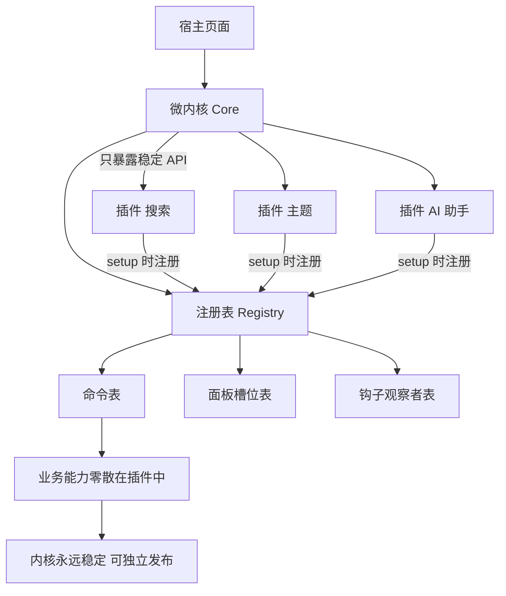

### DP-140：容器-组件-服务三层模式如何落地？和 MVC 什么关系？（高频）
**答**：
- 三层：Service 层（数据与业务，DP-133 的 Service/Repository）、Container 层（连接 Service 与视图：取数、状态编排，多为自定义 Hook）、Component 层（纯视图：props in、事件 out）。
- 与 MVC 对应：Service ≈ Model、Container ≈ Controller/Presenter、Component ≈ View；本质都是"关注点分层"，前端以组件树为骨架重新表述。
- 依赖方向：Component 不许 import Service（靠 props）；Container 不写样式；Service 不碰 DOM——违规即分层破坏。

```jsx
// Service 层：纯业务与数据，不碰 React
const orderService = {
  async list(query) { return orderRepo.query(query); },       // 委托仓库（DP-132）
  async cancel(id) { return orderRepo.update(id, { status: 'canceled' }); },
};
// Container 层：自定义 Hook 编排（原 Controller 职责）
function useOrderPage() {
  const [orders, setOrders] = useState([]);
  const load = useCallback(async (q) => setOrders(await orderService.list(q)), []);
  const cancel = useCallback(async (id) => { await orderService.cancel(id); load(lastQuery.current); }, [load]);
  useEffect(() => { load({ page: 1 }); }, [load]);
  return { orders, cancel, load };                            // 数据 + 动作
}
// Component 层：纯视图，无 import service
function OrderPageView({ orders, onCancel, onLoadMore }) {
  return (
    <ul>
      {orders.map((o) => (
        <li key={o.id}>
          {o.no}
          <button onClick={() => onCancel(o.id)}>取消</button>
        </li>
      ))}
      <button onClick={onLoadMore}>加载更多</button>
    </ul>
  );
}
// 组装：依赖方向 Component ← Container ← Service，单向清晰
export default function OrderPage() {
  const { orders, cancel, load } = useOrderPage();
  return <OrderPageView orders={orders} onCancel={cancel} onLoadMore={() => load(nextPage)} />;
}
```

### DP-141：受控/非受控组件为什么是"双向绑定模式的变体"？（高频）
**答**：
- 双向绑定 = 状态与视图自动互相同步；React 拆成两种显式形态：受控（value + onChange，状态上行视图下行）与非受控（defaultValue + ref，内部状态自治）。
- 模式语义：受控 = 观察者（父订阅子变更）+ 单一数据源；非受控 = 封装内部状态 + 命令式句柄（ref 即外观入口）。
- 设计接口时双模式兼收：`value` 存在走受控，否则走内部 state（headless 库标准做法，DP-122）。

```jsx
// 双模式输入组件：受控优先，非受控兜底（组合两者语义）
function Input({ value, defaultValue = '', onChange, ...rest }) {
  const [inner, setInner] = useState(defaultValue);           // 非受控的内部状态
  const isControlled = value !== undefined;                   // 判定：传了 value 即受控
  const current = isControlled ? value : inner;               // 单一数据源二选一
  const handleChange = (e) => {
    if (!isControlled) setInner(e.target.value);              // 非受控：自己改自己
    onChange?.(e.target.value);                               // 受控：交回父层裁决（可拦截）
  };
  return <input {...rest} value={current} onChange={handleChange} />;
}
// 受控用法：状态在父层，输入被拦截校验
function Demo() {
  const [text, setText] = useState('');
  return <Input value={text} onChange={(v) => setText(v.replace(/\D/g, '').slice(0, 11))} placeholder="仅数字手机号" />;
}
// 非受控用法：表单一次性收集，ref 命令式读取
function Demo2() {
  const ref = useRef(null);
  const submit = () => console.log(ref.current.value);        // 不逐字符同步，性能友好
  return <Input ref={ref} defaultValue="hello" />;
}
```

### DP-142：布局组件如何体现组合模式？children 与 slot 各适合什么？（高频）
**答**：
- 布局组件 = 组合模式的结构节点：Layout 不管"装什么"，只管"怎么摆"（栅格、间距、层级），内容通过 children/slot 注入，结构与内容解耦（DP-037）。
- children 适合单一内容流；多插槽（Card 的 header/body/footer）用子组件约定或具名 props（element 传 VNode/JSX），React 亦可用 context 注入。
- 收益：页面不再写裸 div 拼样式，布局规则集中可换肤、可响应式；嵌套布局天然递归（组合模式自相似）。

```jsx
// React：多插槽布局 = 组合组件（结构组件 + 约定子组件）
function PageLayout({ sidebar, children }) {
  return (
    <div className="page">
      <aside className="page-sidebar">{sidebar}</aside>
      <main className="page-main">
        <header className="page-header">{extractSlot(children, Header)}</header>
        <section className="page-body">{stripSlot(children, Header)}</section>
      </main>
    </div>
  );
}
PageLayout.Header = ({ children }) => children;               // 声明用子组件，由 Layout 决定摆位
// 使用：内容自己声明"是什么"，布局决定"放哪里"
<PageLayout sidebar={<Nav />}>
  <PageLayout.Header><h1>订单中心</h1></PageLayout.Header>
  <OrderTable />
</PageLayout>
// Vue：具名插槽同构
// <PageLayout><template #sidebar><Nav /></template><template #header><h1>订单中心</h1></template>...</PageLayout>
```

### DP-143：主题系统如何用策略模式设计？tokens 与换肤的关系？（高频）
**答**：
- 主题 = 一组设计 token（颜色/圆角/间距）的策略集合；换肤 = 切换策略实例，消费方只读统一 token 接口（策略模式，DP-051 的 UI 化）。
- 三种实现强度：CSS 变量注入（运行时切换，主流）、Provider 注入 token 对象（组件库）、构建期多主题产物（极致性能）。
- 工程要点：token 分层（全局基座 → 组件级映射 → 页面覆盖）；跟随系统的 dark 模式 = 策略选择器 + 观察者监听 `prefers-color-scheme`。

```javascript
// 策略：每套主题产出同一形状的 token
const lightTheme = { name: 'light', colorPrimary: '#1677ff', text: '#333', bg: '#fff', radius: 8 };
const darkTheme  = { name: 'dark',  colorPrimary: '#4096ff', text: '#eee', bg: '#111', radius: 8 };
const strategies = { light: lightTheme, dark: darkTheme, auto: () => matchMedia('(prefers-color-scheme: dark)').matches ? darkTheme : lightTheme };
// 应用层：解析策略 → 注入 CSS 变量（消费方只认变量名）
function applyTheme(name) {
  const tokens = typeof strategies[name] === 'function' ? strategies[name]() : strategies[name];
  for (const [key, value] of Object.entries(tokens))
    document.documentElement.style.setProperty(`--${key.replace(/[A-Z]/g, (m) => '-' + m.toLowerCase())}`, value);
}
// 观察者：跟随系统自动换肤
const mq = matchMedia('(prefers-color-scheme: dark)');
mq.addEventListener('change', () => userPref === 'auto' && applyTheme('auto'));
// 组件消费：样式只写变量，永不写死颜色
// .btn { background: var(--color-primary); border-radius: var(--radius); color: var(--text); }
applyTheme('auto');
```

### DP-144：如何用 xstate 做状态机驱动的 UI？相比手写状态字段好在哪？（高频）
**答**：
- xstate 三要素：states（状态节点）、events（事件）、transitions（转移），声明式定义后 UI 完全由 `state.value` 驱动渲染——非法状态（loading 且 error 同时为真）从模型上不可能出现。
- 相比手写布尔标志（isLoading/isError/isEmpty 组合爆炸），状态机把"合法组合"收敛进结构，配合可视化（stately）可直接给产品看流程。
- 实战要点：context 放数据、states 放形态、`invoke` 声明异步服务（成功/失败自动转移）。

```jsx
import { createMachine, assign } from 'xstate';
import { useMachine } from '@xstate/react';
// 状态机：登录表单（状态驱动 UI 的标准范式）
const loginMachine = createMachine({
  id: 'login',
  initial: 'idle',
  context: { form: { user: '', pwd: '' }, error: null },
  states: {
    idle: { on: { SUBMIT: 'submitting', INPUT: { actions: 'saveForm' } } },
    submitting: {
      invoke: {                                               // 异步服务内置成功/失败转移
        src: (ctx) => api.login(ctx.form),
        onDone: 'success',
        onError: { target: 'idle', actions: assign({ error: (_, e) => e.data.message }) },
      },
    },
    success: { type: 'final' },
  },
}, { actions: { saveForm: assign({ form: (_, e) => e.value, error: null }) } });
function LoginPage() {
  const [state, send] = useMachine(loginMachine);
  // UI 完全由状态值驱动：三态互斥由机器保证
  return (
    <form onSubmit={(e) => { e.preventDefault(); send({ type: 'SUBMIT' }); }}>
      <input onChange={(e) => send({ type: 'INPUT', value: { ...state.context.form, user: e.target.value } })} />
      <button disabled={state.matches('submitting')}>登录</button>
      {state.context.error && <p role="alert">{state.context.error}</p>}
      {state.matches('success') && <p>欢迎回来</p>}
    </form>
  );
}
```

### DP-145：表单引擎由哪些模式组合而成？（工厂+策略+观察者+备忘录 压轴）
**答**：
- 四模式分工：工厂按 schema 字段类型创建控件（DP-018）；策略承载校验与联动规则（DP-051）；观察者实现字段间联动广播（DP-043）；备忘录保存草稿与历史快照（DP-067）。
- 数据流：schema → 工厂实例化控件 → 控件变更发出事件 → 联动引擎（观察者）按规则更新其他字段 → 校验引擎（策略）出结论 → 备忘录存档。
- 收束：一个字段四条链路各归其位，任何扩展（新控件、新规则、新联动）都只加策略/注册，引擎不动。

```javascript
// 表单引擎骨架：四种模式各就各位
class FormEngine {
  #fields = new Map(); #rules = new Map(); #linkages = []; #history = [];   // 工厂产品 / 策略表 / 观察者 / 备忘录
  registerControl(type, ControlClass) { this.#fields.set(type, ControlClass); }   // 工厂注册（控件目录）
  registerRule(name, fn) { this.#rules.set(name, fn); }                          // 策略注册（校验规则）
  addLinkage(watch, effect) { this.#linkages.push({ watch, effect }); }          // 联动规则（观察者订阅表）
  createField(schema) {
    const Cls = this.#fields.get(schema.type);
    if (!Cls) throw new Error('未注册控件 ' + schema.type);
    const field = new Cls(schema);                        // 工厂产出控件实例
    field.onChange = (value) => {                         // 观察者：变更 → 联动 → 校验 → 存档
      const prev = { ...field.value };                    // 备忘录：改动前快照
      field.value = value;
      this.#linkages.filter((l) => l.watch === schema.name).forEach((l) => l.effect(value, this));
      field.errors = (schema.rules ?? []).map((r) => this.#rules.get(r)(value)).filter((m) => m !== true);
      this.#history.push({ name: schema.name, prev, next: value });
      this.emit('change', this.getValues());              // 引擎对外广播（表单级观察者）
    };
    return field;
  }
  emit = null; getValues = null;                          // 由宿主注入（观察者出口）
}
// 装配示例：注册 → 建 schema → 实例化
const engine = new FormEngine();
engine.registerControl('input', InputControl);
engine.registerControl('select', SelectControl);
engine.registerRule('required', (v) => (v !== '' && v != null) || '必填');
engine.registerRule('phone', (v) => !v || /^1[3-9]\d{9}$/.test(v) || '手机号错误');
engine.addLinkage('city', (v, e) => v === 'other' && e.createField({ name: 'otherCity', type: 'input', rules: ['required'] }));
engine.emit = (t, p) => console.log(t, p); engine.getValues = () => ({});  // 宿主注入示意
engine.createField({ name: 'phone', type: 'input', rules: ['required', 'phone'] });
```

表单引擎模式组合图：

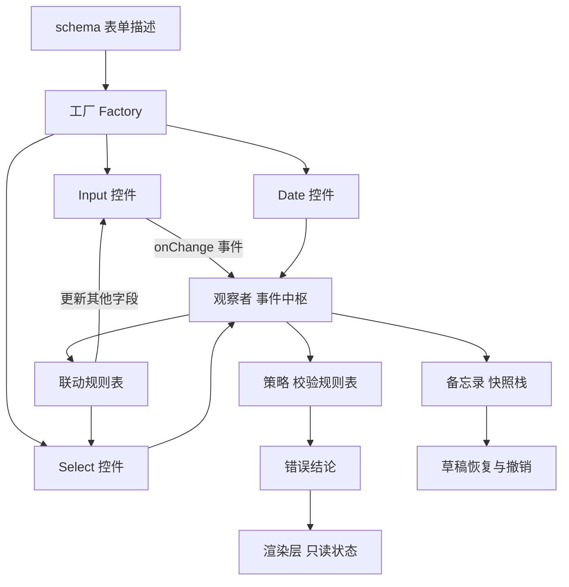

---

## 十八、基础设施模式

### DP-146：通用 SDK 的模式组合怎么设计？各模式承担什么？（外观+工厂+职责链+单例 压轴）
**答**：
- 五件套分工：外观（统一入口 `track/user/destroy`）、工厂（按环境/平台产出适配器）、职责链（中间件处理上报数据：脱敏→采样→压缩）、单例（模块级唯一实例）、观察者（自动订阅全局事件）。
- 设计顺序：先定外观 API（用户视角）→ 再用工厂适配环境差异 → 中间件链处理横切逻辑 → 最后单例化出口。
- 与 DP-100 的差别：DP-100 侧重全景收束，本题给可背的五件套代码骨架，面试 15 分钟可手写。

```javascript
// 1 外观：业务唯一入口
class SDK {
  #adapters = new Map(); #middlewares = []; #adapter;
  constructor(options) {
    this.#adapter = AdapterFactory.create(options);          // 2 工厂：环境差异收口
  }
  use(mw) { this.#middlewares.push(mw); return this; }       // 3 职责链：注册中间件
  track(event, props = {}) {
    let ctx = { event, props, ts: Date.now() };
    for (const mw of this.#middlewares) ctx = mw(ctx) ?? ctx;  // 链式加工，返回 null 表示丢弃
    if (ctx) this.#adapter.send(ctx);                        // 适配器只管发
  }
}
// 2 工厂：按平台产出适配器
class AdapterFactory {
  static create({ platform }) {
    const impls = { web: WebAdapter, mp: MiniProgramAdapter, node: NodeAdapter };
    const Cls = impls[platform ?? 'web'];
    if (!Cls) throw new Error('不支持的平台 ' + platform);
    return new Cls();
  }
}
class WebAdapter { send(ctx) { navigator.sendBeacon('/collect', JSON.stringify(ctx)); } }
class MiniProgramAdapter { send(ctx) { wx.request({ url: '/collect', data: ctx }); } }
// 3 职责链：横切逻辑各成一段中间件
const desensitize = (ctx) => ({ ...ctx, props: { ...ctx.props, phone: ctx.props.phone?.replace(/(\d{3})\d{4}(\d{4})/, '$1****$2') } });
const sample = (ctx) => (ctx.event === 'pv' && Math.random() > 0.1 ? null : ctx);  // pv 抽样 10%
const compress = (ctx) => ({ ...ctx, props: JSON.stringify(ctx.props) });
// 4 单例出口：默认导出唯一实例（也可暴露 create 供多实例场景）
const sdk = new SDK({ platform: 'web' }).use(desensitize).use(sample).use(compress);
export default sdk;
export { SDK };
sdk.track('pay', { phone: '13812345678', channel: 'wechat' });   // 脱敏→采样→压缩→发送
```

SDK 模式组合图：

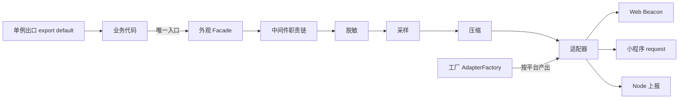

### DP-147：路由系统是哪些模式的组合？观察者+策略+备忘录如何各就其位？（高频）
**答**：
- 观察者：监听 hashchange/popstate，URL 变化即事件源，路由表与组件订阅变化（DP-089）。
- 策略：路径匹配算法可插拔（精确 / 动态参数 / 通配 / 嵌套），Matcher 是策略接口；history 模式与 hash 模式也是策略（History 实现族）。
- 备忘录：浏览器 history 栈本身 + 路由 meta 滚动位置的保存恢复；导航守卫是职责链（前置校验短路）。

```javascript
// 观察者：URL 变化即通知
class Router {
  #matcher; #historyImpl; #scrollMemory = new Map(); #guards = [];   // 策略 / 策略 / 备忘录 / 职责链
  constructor(matcher, historyImpl) { Object.assign(this, { #matcher: matcher, #historyImpl: historyImpl }); }
  get #loc() { return this.#historyImpl.current(); }
  start() {
    window.addEventListener('popstate', () => this.#resolve());  // 观察者注册
    this.#resolve();
  }
  #resolve() {
    const from = this.#current; const to = this.#matcher.match(this.#loc.path);   // 策略：路径匹配
    for (const guard of this.#guards) if (guard(to, from) === false) {          // 职责链：守卫短路
      this.#historyImpl.replaceState(from.fullPath); return;                    // 拦截则回滚地址栏
    }
    this.#scrollMemory.set(from?.fullPath, window.scrollY);                      // 备忘录：存滚动
    this.#current = to;
    this.listeners.forEach((fn) => fn(to, from));                                // 观察者广播
    window.scrollTo(0, this.#scrollMemory.get(to.fullPath) ?? 0);                // 备忘录：恢复滚动
  }
  listeners = new Set();
  beforeEach(guard) { this.#guards.push(guard); }                                // 守卫链
  push(path) { this.#historyImpl.pushState(path); this.#resolve(); }
}
// 策略1：匹配器（动态参数 /api/:id）
const pathMatcher = {
  match(path) {
    const hit = this.routes.find((r) => {
      const parts = r.path.split('/'), cur = path.split('/');
      return parts.length === cur.length && parts.every((p, i) => p.startsWith(':') || p === cur[i]);
    });
    if (!hit) return { path, params: {}, component: NotFound };
    const segs = hit.path.split('/');
    return { path, component: hit.component,
             params: Object.fromEntries(segs.map((p, i) => p.startsWith(':') ? [p.slice(1), path.split('/')[i]] : []).filter(Boolean)) };
  },
  routes: [{ path: '/user/:id', component: UserPage }],
};
// 策略2：history 实现族
const hashHistory = { current: () => ({ path: location.hash.slice(1) || '/' }), pushState: (p) => (location.hash = p), replaceState: (p) => location.replace('#' + p) };
const router = new Router(pathMatcher, hashHistory);
router.beforeEach((to) => to.path !== '/admin' || isAdmin());   // 守卫
router.listeners.add((to) => render(to.component, to.params));  // 订阅渲染
router.start();
```

### DP-148：权限系统如何用"策略 + 职责链"组合实现？（高频）
**答**：
- 策略：权限模式可插拔——RBAC（角色表）、ABAC（属性规则）、白名单，每种是独立判定策略；职责链：校验环节串行（登录态 → 角色匹配 → 资源级规则 → 数据范围），任一环拒绝即短路。
- 三层挂载点：路由级（守卫调用链）、按钮级（`v-access` / `<Access>` 组件）、接口级（请求拦截器兜底），同一套链复用。
- 关键设计：判定结果带原因（code + msg），方便埋点审计与用户提示。

```javascript
// 策略：权限判定算法族
const rbacStrategy = (user, need) => need.roles.some((r) => user.roles.includes(r));           // 角色命中
const abacStrategy = (user, need) => (need.rule?.(user) ?? true);                              // 属性规则
const allowListStrategy = (user) => !user.banned;
// 职责链：每个节点 = 环节，可短路
const createAccessChain = (nodes) => (user, need) => {
  for (const node of nodes) {
    const verdict = node(user, need);
    if (!verdict.pass) return verdict;                       // 短路：第一个拒绝生效
  }
  return { pass: true, code: 'OK' };
};
const access = createAccessChain([
  (u) => (u.loggedIn ? { pass: true } : { pass: false, code: 'NEED_LOGIN' }),                 // 环节1
  (u) => (allowListStrategy(u) ? { pass: true } : { pass: false, code: 'BANNED' }),           // 环节2
  (u, n) => (rbacStrategy(u, n) ? { pass: true } : { pass: false, code: 'NO_ROLE', need: n.roles }), // 环节3
  (u, n) => (abacStrategy(u, n) ? { pass: true } : { pass: false, code: 'NO_ATTR' }),         // 环节4
]);
// 挂载点1：路由守卫
router.beforeEach((to) => access(currentUser, to.meta.access ?? { roles: [] }).pass || goto403());
// 挂载点2：按钮级指令（Vue v-access 示意）
const vAccess = {
  mounted(el, { value }) {
    const v = access(currentUser, value);
    if (!v.pass) el.parentNode?.removeChild(el);             // 无权直接移除（display:none 会泄露）
  },
};
// <button v-access="{ roles: ['admin'] }">删除</button>
// 挂载点3：接口兜底
http.interceptors.response.use((res) => res.status === 403 ? Promise.reject(new Error('NO_ROLE')) : res);
```

### DP-149：错误处理的模式体系如何搭？装饰器包装与策略分类怎么配合？（高频）
**答**：
- 策略：按错误类型分治——网络错误（重试/退避）、业务错误（toast + code 路由）、代码错误（上报 + 降级 UI），`ErrorClassifier` 把任意异常归一为 `{ kind, level, userMsg }`。
- 装饰器/AOP：`@guard` 包装器统一 try-catch、上报、转换，业务函数只写 happy path，错误处理集中织入（DP-030）。
- 兜底分层：函数级 guard → 模块级错误域 → 全局 window.error/unhandledrejection 观察者，层层收口不漏报。

```javascript
// 策略：错误分类与处置
const handlers = {
  network: { level: 'warn',  handle: (e, ctx) => retryQueue.enqueue(ctx) },        // 入重试队列
  business: { level: 'info', handle: (e) => toast(e.userMsg ?? e.message) },       // 直接提示
  fatal:    { level: 'error',handle: (e) => { report(e); renderErrorPage(e); } },  // 上报 + 降级页
};
const classify = (e) => {
  if (e instanceof NetworkError || /fetch|timeout/i.test(e.message)) return 'network';
  if (e.code != null && e.code < 10000) return 'business';    // 约定：业务错误码万以内
  return 'fatal';
};
// 装饰器包装：统一织入（业务函数零 try-catch）
function guard(description) {
  return (_target, _key, descriptor) => {
    const raw = descriptor.value;
    descriptor.value = async function (...args) {
      try { return await raw.apply(this, args); }
      catch (e) {
        const kind = classify(e);
        const enriched = Object.assign(e, { userMsg: e.userMsg ?? '操作失败，请稍后再试', scope: description });
        handlers[kind].handle(enriched, { args, retry: () => raw.apply(this, args) });   // 策略处置
        if (kind === 'fatal') throw e;                   // fatal 继续抛给边界
      }
    };
  };
}
class OrderApi {
  @guard('提交订单')
  async submit(payload) { return http.post('/orders', payload); }   // 只写 happy path
}
// 全局兜底观察者
window.addEventListener('error', (e) => handlers[classify(e.error ?? e)].handle(e.error ?? e, {}));
window.addEventListener('unhandledrejection', (e) => handlers[classify(e.reason)].handle(e.reason, {}));
```

### DP-150：日志系统如何用"职责链 + 享元"设计？（高频）
**答**：
- 职责链：每条日志流经过滤器链（级别过滤 → 采样 → 脱敏 → 格式化 → 分发到 console/上报/文件），节点可插拔复用（与 axios 拦截器同构，DP-063）。
- 享元：Logger 实例按"命名空间"复用（同 namespace 同实例），成百上千个模块打日志不产生实例爆炸；日志对象字段用共享内部状态（app 级公共字段）+ 差异外部状态。
- 成本控制：同步 console 只在 dev，生产全走缓冲批量上报（DP-097）。

```javascript
// 享元工厂：同命名空间复用 Logger
class LoggerFactory {
  #pool = new Map();                                          // namespace → Logger
  #shared = { app: 'shop', env: 'prod', version: APP_VERSION }; // 共享内部状态：公共字段只存一份
  get(namespace) {
    if (!this.#pool.has(namespace)) this.#pool.set(namespace, new Logger(namespace, this.#shared));
    return this.#pool.get(namespace);
  }
}
class Logger {
  #chain = [];                                                // 职责链：管道节点
  constructor(ns, shared) { this.ns = ns; this.shared = shared; }
  use(node) { this.#chain.push(node); return this; }
  log(level, msg, extra = {}) {
    let entry = { level, msg, ns: this.ns, ...this.shared, at: Date.now(), ...extra };  // 共享字段并入
    for (const node of this.#chain) {                         // 流经处理链
      entry = node(entry);
      if (!entry) return;                                     // 链上任何节点可丢弃
    }
  }
}
// 链节点：级别过滤 / 采样 / 分发
const levelFilter = (min) => (e) => ({ debug: 0, info: 1, warn: 2, error: 3 })[e.level] >= min ? e : null;
const sampler = (rate) => (e) => (e.level === 'info' && Math.random() > rate ? null : e);
const dispatch = (e) => {
  if (import.meta.env.DEV) console.log(`[${e.ns}]`, e.msg, e);
  else buffer.push(e);                                        // 生产：批量缓冲（DP-097）
  return e;
};
const loggerFactory = new LoggerFactory();
const orderLog = loggerFactory.get('order').use(levelFilter('info')).use(sampler(0.1)).use(dispatch);
const payLog = loggerFactory.get('pay').use(levelFilter('warn')).use(dispatch);   // 不同链配置
payLog.warn('支付回调重试', { orderId: 'T1' });                // 同实例复用：两次 get('pay') === 同一对象
```

### DP-151：定时任务（轮询/倒计时/心跳）如何用状态模式治理？（高频）
**答**：
- 坏味道：一个布尔 `timerRunning` + 到处 setTimeout，暂停/恢复/销毁逻辑纠缠（谁都能 set，谁都不清理）。
- 状态模式：Timer 持有状态对象（idle/running/paused/stopped），start/pause/resume/stop 委托给当前状态类，非法操作（暂停一个已停止的任务）安全报错或忽略。
- 加分项：指数退避心跳、页面不可见自动暂停（visibilitychange 观察者联动）、多处订阅 tick（观察者）。

```javascript
// 状态模式：操作委托给状态对象
class Timer {
  #state; #task; #interval; #id = null; #listeners = new Set();   // 观察者：tick 订阅
  constructor(task, interval) { Object.assign(this, { task, interval }); this.#state = states.idle; }
  get state() { return this.#state; }
  #switch(next) { this.#state = states[next]; }
  start() { this.#state.start(this); }
  pause() { this.#state.pause(this); }
  stop()  { this.#state.stop(this); }
  onTick(fn) { this.#listeners.add(fn); return () => this.#listeners.delete(fn); }
  #loop = async () => {                                        // 私有循环：跑一轮并广播
    try { await this.task(); this.#listeners.forEach((f) => f()); } catch (e) { console.warn('task fail', e); }
  };
  #schedule() { this.#id = setTimeout(async () => { await this.#loop(); if (this.#state === states.running) this.#schedule(); }, this.interval); }
}
const states = {                                              // 各状态类：同样接口，行为不同
  idle:    { start: (t) => { t.#schedule(); t.#switch('running'); }, pause: () => {}, stop: () => {} },
  running: { pause: (t) => { clearTimeout(t.#id); t.#id = null; t.#switch('paused'); },
             stop: (t) => { clearTimeout(t.#id); t.#id = null; t.#switch('stopped'); }, start: () => {} },
  paused:  { start: (t) => { t.#schedule(); t.#switch('running'); },
             stop: (t) => { t.#switch('stopped'); }, pause: () => {} },
  stopped: { start: (t) => { t.#schedule(); t.#switch('running'); }, pause: () => {}, stop: () => {} },
};
// 使用：页面不可见自动暂停（观察者联动状态机）
const poller = new Timer(() => fetchNewMessages(), 5000);
document.addEventListener('visibilitychange', () => document.hidden ? poller.pause() : poller.state === states.paused && poller.start());
const off = poller.onTick(() => renderBadge());
onUnmounted(() => { poller.stop(); off(); });                 // 卸载兜底
```

### DP-152：配置系统如何支持热更新？观察者模式怎么落地？（高频）
**答**：
- 核心：配置单例 + 观察者。`ConfigService` 持有配置树，`watch(path, fn)` 订阅路径变更，热更新 = 拉取新配置 → diff → 精准通知订阅者，业务无需重启。
- 实现要点：路径订阅支持通配；`get` 返回冻结对象防止外部偷改；更新入口唯一（`update`），来源可以是轮询、WebSocket 推送或灰度下发。
- 与 DP-052 状态模式、DP-043 观察者的关系：配置变更即事件，订阅方各自收敛（刷新开关、重建连接、切换主题策略）。

```javascript
class ConfigService {
  #data; #subs = new Map(); polling;                          // path → Set<fn>
  constructor(initial, { polling = 30_000 } = {}) { this.#data = initial; this.polling = polling; }
  get(path) {                                                 // 冻结只读：外部改不动
    const value = path.split('.').reduce((o, k) => o?.[k], this.#data);
    return value && typeof value === 'object' ? Object.freeze({ ...value }) : value;
  }
  watch(path, fn) {                                           // 观察者：路径级订阅
    if (!this.#subs.has(path)) this.#subs.set(path, new Set());
    this.#subs.get(path).add(fn);
    return () => this.#subs.get(path).delete(fn);             // 返回退订函数
  }
  update(next) {                                              // 唯一写入口
    const old = this.#data;
    this.#data = deepMerge(old, next);
    for (const [path, fns] of this.#subs) {
      const before = getPath(old, path), after = getPath(this.#data, path);
      if (!deepEqual(before, after)) fns.forEach((fn) => fn(after, before));   // 精准通知
    }
  }
  startPolling(fetchRemote) {                                 // 热更新来源1：轮询
    setInterval(async () => this.update(await fetchRemote()), this.polling);
  }
  connectPush(url) {                                          // 热更新来源2：推送
    const ws = new WebSocket(url);
    ws.onmessage = (e) => this.update(JSON.parse(e.data));
  }
}
const config = new ConfigService({ feature: { newCart: false, aiCopy: true }, limit: { upload: 10 } });
const off = config.watch('feature.newCart', (on) => (store.state.useNewCart = on));   // 业务收敛自己的反应
config.startPolling(() => http.get('/runtime-config'));       // 下次配置下发自动生效，无需发版
```

---

## 十九、前端特有模式变体

### DP-153：为什么说虚拟 DOM 是"备忘录 + 组合"的组合体？（高频）
**答**：
- 组合模式：vdom 是统一节点构成的树（`{ type, props, children }`），组件/元素/文本同构，递归处理（DP-091、DP-037）。
- 备忘录模式：diff 前保留旧树快照（prevVNode），新树与旧树对比产出补丁——没有旧快照就没有 diff；双缓冲（两棵树交替）即备忘录的工程化。
- 收束话术：vdom = "声明式 UI 的中间表示"，组合负责"是什么"，备忘录负责"和上次比变了什么"。

```javascript
// 组合模式：统一树节点（叶子与容器同构）
const h = (type, props, ...children) => ({ type, props, children: children.flat() });
const oldTree = h('div', { id: 'app' },
  h('p', null, 'hello'),
  h(ItemList, { items: ['a', 'b'] }),          // 组件也是节点，类型可以是函数
);
const newTree = h('div', { id: 'app' },
  h('p', null, 'hello world'),                 // 文本变了
  h(ItemList, { items: ['a', 'b', 'c'] }),     // 子项多了
);
// 备忘录：渲染前保存旧树引用（框架内部 prevVNode 即旧快照）
let memo = null;
function render(tree, container) {
  const patches = memo ? diff(memo, tree) : [{ type: 'CREATE', node: tree }];  // 与快照 diff
  applyPatches(container, patches);
  memo = tree;                                 // 更新快照（备忘录出口）
}
// diff：同构递归，产出补丁而不是替换整树
function diff(a, b, path = []) {
  const patches = [];
  if (a.type !== b.type) { patches.push({ type: 'REPLACE', path, node: b }); return patches; }
  if (JSON.stringify(a.props) !== JSON.stringify(b.props))
    patches.push({ type: 'PROPS', path, props: b.props });
  const max = Math.max(a.children.length, b.children.length);
  for (let i = 0; i < max; i++) {
    if (i >= a.children.length) patches.push({ type: 'APPEND', path: [...path, i], node: b.children[i] });
    else if (i >= b.children.length) patches.push({ type: 'REMOVE', path: [...path, i] });
    else if (typeof b.children[i] === 'object') patches.push(...diff(a.children[i], b.children[i], [...path, i]));
    else if (a.children[i] !== b.children[i]) patches.push({ type: 'TEXT', path: [...path, i], text: b.children[i] });
  }
  return patches;
}
render(oldTree, root); render(newTree, root);   // 第二次只打 TEXT/APPEND 补丁
```

### DP-154：为什么说 React 并发调度是"优先级队列 + 状态机"？（高频）
**答**：
- 优先级队列：更新任务带 Lane 优先级（离散层），调度器每次取最高优先级任务；不同优先级可插队（用户输入 > 过渡更新），过期任务用 deadline 检查防止饿死。
- 状态机：Fiber 节点的 render 阶段在 `workLoop` 中可中断（shouldYield），中断/恢复/完成的状态转移由调度器管理——"可中断渲染"本质是状态机。
- 简化复刻：用 MessageChannel 模拟宏任务分片 + 小顶堆按优先级出队，面试可手写 30 行版（DP-096 tapable 对比：tapable 是同步发布订阅链，这里是异步调度）。

```javascript
// 极简并发调度器：优先级队列 + 时间切片 + 可中断状态机
class Scheduler {
  #queue = []; #running = false;
  #compare = (a, b) => a.priority - b.priority;               // 数字越小优先级越高
  schedule(task, priority = 3) {
    this.#queue.push({ task, priority, ts: Date.now() });
    this.#queue.sort(this.#compare);                          // 小顶堆的简化版：排序数组
    this.#flush();
  }
  #flush() {
    if (this.#running) return;
    this.#running = true;                                     // 状态机：running 态
    const channel = new MessageChannel();                     // 宏任务切片（浏览器版 requestIdleCallback）
    channel.port1.onmessage = () => this.#work(channel);
    channel.port2.postMessage(null);
  }
  #work(channel) {
    const deadline = performance.now() + 5;                   // 5ms 切片，时间到让出主线程
    while (this.#queue.length && performance.now() < deadline) {
      const { task } = this.#queue.shift();                   // 优先队列出队：最高优先级先执行
      task();                                                 // 注意：执行中可能 schedule 新高优任务插队
    }
    if (this.#queue.length) channel.port2.postMessage(null);  // 状态机：还没完 → 继续下一片
    else this.#running = false;                               // 状态机：队列空 → idle 态
  }
}
const scheduler = new Scheduler();
scheduler.schedule(() => renderList(10000), 5);               // 低优：大列表过渡更新
scheduler.schedule(() => updateInput(), 1);                   // 高优：用户输入插队先跑
```

### DP-155：为什么防抖节流是状态模式的变体？leading/trailing 如何实现？（高频）
**答**：
- 防抖/节流内部维护"当前处于什么相位"（空闲/等待中/已触发），不同相位对"再来一次调用"响应不同——这正是状态模式的行为分派（DP-052 的函数式微缩版）。
- 两个策略轴：leading（首次立即执行）与 trailing（最后一次补执行），组合出四象限（lodash 的 leading/trailing 选项）。
- 加分实现：cancel（取消等待中的相位）、flush（立即结算）、返回值透传 leading 首次结果。

```javascript
// 状态模式视角的防抖：相位 = idle / waiting
function debounce(fn, wait, { leading = false } = {}) {
  let timer = null, phase = 'idle', lastArgs, lastThis;
  function invoke() {                                          // 结算动作：两相位共用
    fn.apply(lastThis, lastArgs);
    phase = 'idle'; timer = null;
  }
  function debounced(...args) {
    lastArgs = args; lastThis = this;
    const isFirst = phase === 'idle';
    if (isFirst && leading) { phase = 'leading'; fn.apply(this, args); phase = 'waiting'; }  // leading 立即发
    clearTimeout(timer);
    timer = setTimeout(invoke, wait);                          // waiting 相位：不断重置倒计时
    if (isFirst && !leading) phase = 'waiting';
  }
  debounced.cancel = () => { clearTimeout(timer); timer = null; phase = 'idle'; };   // 状态清理
  debounced.flush = () => { if (phase === 'waiting') { clearTimeout(timer); invoke(); } };
  return debounced;
}
// 节流：相位 = idle / cooling，冷却结束按 trailing 补一次
function throttle(fn, wait, { leading = true, trailing = true } = {}) {
  let timer = null, last = 0, pendingArgs = null;
  return function (...args) {
    const now = Date.now(), remaining = wait - (now - last);
    pendingArgs = args;
    if (remaining <= 0 && !timer) {                            // idle 相位：可执行
      if (leading) { last = now; fn.apply(this, args); pendingArgs = null; }
      else last = now;
    } else if (trailing && !timer) {                           // cooling 相位：预约补发
      timer = setTimeout(() => {
        last = Date.now(); timer = null;
        if (pendingArgs) { fn.apply(this, pendingArgs); pendingArgs = null; }
      }, remaining);
    }
  };
}
const search = debounce((kw) => api.search(kw), 300, { leading: false });
const reportScroll = throttle(() => sendBeacon(), 1000, { leading: true, trailing: true });
```

### DP-156：懒加载为什么是"虚拟代理全家桶"？四种资源的代理如何收束？（高频）
**答**：
- 虚拟代理：控制"开销大的对象"的创建时机——真实资源在真正需要时才加载，对外接口不变（DP-031/032、DP-083）。
- 全家桶四件套：路由级（import() 动态导入 + 代码分割）、组件级（React.lazy / defineAsyncComponent）、图片级（IntersectionObserver 占位）、脚本级（动态 script 注入按需加载 SDK）。
- 收束话术：懒加载 = "把创建时机推迟到第一次使用"，统一回答框架里各种 lazy 的原理，体现模式迁移能力。

```javascript
// 1 路由级虚拟代理：import() 返回 Promise 包裹的组件（虚拟代理的 Promise 化）
const routes = [
  { path: '/report', component: () => import(/* webpackChunkName: "report" */ './Report.vue') },
];
// 2 组件级：React.lazy 本质是 thenable 虚拟代理 + Suspense 接住
const HeavyChart = lazy(() => import('./HeavyChart'));
<Suspense fallback={<Spin />}><HeavyChart data={data} /></Suspense>
// 3 图片级：占位符代理真实图
function lazyImage(el) {
  const io = new IntersectionObserver((entries) => {
    entries.forEach((e) => {
      if (!e.isIntersecting) return;
      const img = new Image();
      img.src = el.dataset.src;                               // 真实对象此刻才创建
      img.onload = () => el.replaceWith(img);
      io.unobserve(el);
    });
  });
  io.observe(el);
}
// 4 脚本级：按需加载大 SDK（地图/图表/编辑器），并缓存加载 Promise（备忘录语义）
const scriptCache = new Map();
function loadScript(src) {
  if (!scriptCache.has(src)) {
    scriptCache.set(src, new Promise((resolve, reject) => {
      const s = document.createElement('script');
      s.src = src; s.onload = resolve; s.onerror = () => { scriptCache.delete(src); reject(new Error(src)); };
      document.head.appendChild(s);
    }));
  }
  return scriptCache.get(src);                                // 第二次调用直接命中缓存
}
// 统一收束：四种资源同一个思想 —— 虚拟代理控制创建时机 + 缓存避免重复创建
export const ensureAMap = () => loadScript('https://webapi.amap.com/maps?v=2.0');
```

### DP-157：轮询与心跳为什么是"观察者 + 状态机"？（高频）
**答**：
- 观察者：tick/数据到达向外广播（UI、监控订阅）；状态机：连接生命周期（idle → connecting → healthy → degraded → closed）由事件驱动转移，退避策略挂在 degraded 态。
- 与 DP-151 的差别：本题偏"连接健康度"建模——成功/失败/超时三类事件驱动转移，失败连续 N 次升级退避间隔，恢复成功降级回来。
- 工程细节：心跳超时判定（发 ping 等 pong）、页面隐藏降频、卸载彻底关闭（观察者清理）。

```javascript
class Heartbeat {
  #state = 'idle'; #failures = 0; #listeners = new Set(); #timer = null; #pongTimer = null;
  #intervals = { healthy: 10_000, degraded: 60_000 };         // 状态 → 间隔（退避表）
  on(fn) { this.#listeners.add(fn); return () => this.#listeners.delete(fn); }
  #emit(d) { this.#listeners.forEach((f) => f(d)); }
  start() { this.#state = 'connecting'; this.#beat(); }
  #beat() {
    this.#timer = setTimeout(() => this.#ping(), this.#intervals[this.#state] ?? 10_000);
  }
  #ping() {
    this.#state = this.#state === 'idle' ? 'connecting' : this.#state;
    const pongTimeout = setTimeout(() => this.#onFail(), 3000);        // 超时也算失败
    api.ping().then(() => { clearTimeout(pongTimeout); this.#onOk(); })
              .catch(() => { clearTimeout(pongTimeout); this.#onFail(); });
  }
  #onOk() {                                                    // 状态机转移：成功 → 降级回来
    this.#failures = 0;
    if (this.#state !== 'healthy') { this.#state = 'healthy'; this.#emit({ type: 'recovered' }); }
    this.#beat();
  }
  #onFail() {                                                  // 失败 → 升级退避
    this.#failures++;
    const next = this.#failures >= 3 ? 'degraded' : 'healthy';
    if (next !== this.#state) { this.#state = next; this.#emit({ type: 'degrade', failures: this.#failures }); }
    this.#beat();
  }
  stop() { clearTimeout(this.#timer); this.#state = 'idle'; this.#listeners.clear(); }
}
const hb = new Heartbeat();
hb.on((e) => e.type === 'degrade' && toast('连接不稳定，已自动重试'));
hb.start();
onUnmounted(() => hb.stop());
```

### DP-158：为什么说乐观 UI 是"命令 + 备忘录"？与 DP-135 的差异点在哪？（高频）
**答**：
- 备忘录：操作前对"受影响的局部状态"拍快照（不是全量 store），回滚 = 恢复快照，O(1) 且精确。
- 命令：每个操作是 `{ do, undo }` 闭包/对象，发起即执行 do 并入栈；服务器确认成功则丢弃（或转正式记录），失败执行 undo。
- 与 DP-135（回滚队列）的分工：135 关注"多条乐观操作的排队与一致性"，本题关注"单条操作的快照与撤销原语"，二者可叠加（队列的每条 entry 用本条的快照回滚）。

```javascript
// 原语层：局部快照 + do/undo 命令
function withOptimistic(store) {
  const apply = (cmd) => {
    const snapshot = structuredClone(store.slice());          // 备忘录：局部快照
    cmd.do(store);
    return {
      async confirm(request) {
        try { const server = await request(); cmd.merge?.(store, server); return server; }  // 成功：用服务端真值覆盖
        catch (e) { store.replace(snapshot); toastError(e); throw e; }                      // 失败：恢复快照
      },
    };
  };
  return { apply };
}
const opt = withOptimistic(store);
// 场景1：点赞
const ticket1 = opt.apply({
  do: (s) => { const p = s.posts.find((x) => x.id === id); p.liked = true; p.likes++; },
});
ticket1.confirm(api.like(id));
// 场景2：编辑 + 重命名（命令可带 merge，消除乐观值与服务端值的偏差）
const ticket2 = opt.apply({
  do: (s) => { const doc = s.docs.find((d) => d.id === docId); doc.title = '新标题'; doc.saving = true; },
  merge: (s, server) => { const doc = s.docs.find((d) => d.id === docId); doc.updatedAt = server.updatedAt; doc.saving = false; },
});
await ticket2.confirm(api.rename(docId, '新标题'));           // 成功后 saving=false，updatedAt 用服务端
```

### DP-159：KeepAlive 的组件缓存为什么是"享元 + 备忘录"？（高频）
**答**：
- 享元：切走的组件不销毁，实例与 DOM 被放入缓存池按 key 复用（共享同一实例，DP-038 思想从 DOM 复用升级为组件实例复用）。
- 备忘录：切走时组件状态（表单输入、滚动位置）被原样封存，切回时恢复——即快照语义。
- 工程化细节：LRU 上限防内存泄漏（超出即逐出最久未用并真正卸载）、include/exclude 匹配、activated/deactivated 钩子= 备忘录恢复/封存的时机。

```javascript
// 极简 KeepAlive：LRU 缓存 + 快照恢复（原理示意）
function createKeepAlive({ max = 10 } = {}) {
  const cache = new Map();                                    // key → { vnode, dom, state }
  return {
    mount(key, createInstance) {
      if (cache.has(key)) {
        const hit = cache.get(key);
        cache.delete(key); cache.set(key, hit);               // LRU 触碰：移到最新
        return hit;                                           // 享元命中：复用实例与 DOM
      }
      const fresh = createInstance();                         // 未命中：真实创建
      cache.set(key, fresh);
      if (cache.size > max) {                                 // 逐出最久未用（防内存膨胀）
        const oldestKey = cache.keys().next().value;
        const evicted = cache.get(oldestKey);
        evicted.destroy?.();                                  // 逐出 = 真正卸载
        cache.delete(oldestKey);
      }
      return fresh;
    },
    deactivate(key) {                                         // 切走：封存状态（备忘录出口）
      const entry = cache.get(key);
      if (entry) entry.state = entry.snapshot?.() ?? null;    // 保存滚动位置/表单值
    },
    activate(key) {                                           // 切回：恢复状态
      const entry = cache.get(key);
      entry?.restore?.(entry.state);
    },
  };
}
// Vue 内建 <KeepAlive> 等价行为：
// <KeepAlive :include="['OrderList']" :max="10">
//   <component :is="currentComp" />
// </KeepAlive>  —— activated/deactivated 钩子里做恢复/封存的业务补充
const keepAlive = createKeepAlive({ max: 10 });
const entry = keepAlive.mount('order-list', () => createOrderListInstance());
keepAlive.deactivate('order-list');                           // 切走
keepAlive.activate('order-list');                             // 切回：输入与滚动都在
```

---

## 二十、反模式与陷阱

### DP-160：单例滥用会造成什么"测试灾难"？如何自救？（高频）
**答**：
- 灾难三连：测试间共享可变状态（用例顺序影响结果，flaky）；无法替换实现（mock 要 hack 模块缓存）；隐藏依赖（函数体里 `getInstance()`，签名看不出依赖）。
- 自救路径：类保留单例出口，但逻辑收敛到可实例化的类（DP-012）；消费方通过构造参数/工厂注入实例；测试 new 新实例 + 注入 fake。
- 识别口诀：单例没问题，"在业务深处随手取单例"才是问题——单例只该出现在组合根。

```javascript
// 反面教材：单例长在业务深处，测试无法隔离
class OrderService {
  async submit(cart) {
    const pay = PayGateway.getInstance();                     // 灾难1：依赖藏在函数体里
    const cache = RedisClient.getInstance();                  // 灾难2：测试必须连真 Redis
    const user = SessionStore.getInstance().currentUser;      // 灾难3：用例间共享会话状态
    return pay.charge({ cart, user });
  }
}
// 测试：要么连真实依赖，要么 vi.mock 整个模块（脆弱且到处写）
// vi.mock('./PayGateway', ...) × 每个用例文件都要写一遍
```

```javascript
// 重构：依赖走构造注入；单例只出现在组合根
class OrderService {
  constructor({ pay, cache, session }) {                      // 依赖全部显式
    Object.assign(this, { pay, cache, session });
  }
  async submit(cart) {
    return this.pay.charge({ cart, user: this.session.currentUser });
  }
}
// 生产组合根：这里才允许"单例"
export const orderService = new OrderService({ pay: PayGateway.instance, cache: RedisClient.instance, session });
// 测试组合根：全新实例 + 全 fake，用例间零共享
const service = new OrderService({ pay: fakePay, cache: fakeCache, session: fakeSession });
it('提交订单扣款', async () => {
  await service.submit(cart);
  expect(fakePay.charged).toBe(true);                         // 稳定、可重复、无顺序依赖
});
```

### DP-161：什么是上帝组件？如何识别与拆分？（高频）
**答**：
- 识别信号：单文件 500+ 行、state 字段 15+ 且分属不同业务域、同时管取数/格式化/埋点/弹窗、每改一个需求都碰它、code review 冲突高发。
- 拆分三板斧：按业务域抽自定义 Hook（逻辑域）、按 UI 块拆子组件（视图域）、跨组件的领域规则下沉 Service（数据域）——正好对应容器-组件-服务三层（DP-140）。
- 拆分纪律：先补测试锁行为 → 一次只搬一块 → 拆完检查 props 是否变成"字段打包袋"（receiveEverything 反模式）。

```jsx
// 反面教材：一个组件 = 取数 + 布局 + 校验 + 埋点 + 轮询
function Dashboard() {
  const [users, setUsers] = useState([]); const [orders, setOrders] = useState([]);
  const [page, setPage] = useState(1); const [keyword, setKeyword] = useState('');
  const [modal, setModal] = useState(null); const [dark, setDark] = useState(false);
  useEffect(() => { fetchUsers().then(setUsers); }, [keyword]);              // 域1 用户
  useEffect(() => { fetchOrders(page).then(setOrders); }, [page]);           // 域2 订单
  useEffect(() => { const t = setInterval(pollOrders, 5000); return () => clearInterval(t); }, []); // 域3 轮询
  const fmt = (o) => ({ ...o, amountText: '¥' + (o.amount / 100).toFixed(2) });  // 域4 格式化
  const track = (e) => beacon(e);                                            // 域5 埋点
  /* ……400 行 JSX 混排所有域…… */
}
```

```jsx
// 拆分后：每个域一个 Hook，视图只组装
function useUsers(keyword) {                                   // 域1 独立
  const [users, setUsers] = useState([]);
  useEffect(() => { fetchUsers(keyword).then(setUsers); }, [keyword]);
  return users;
}
function useOrders(page) {                                     // 域2 + 域3 内聚
  const [orders, setOrders] = useState([]);
  const load = useCallback(() => fetchOrders(page).then(setOrders), [page]);
  useEffect(() => { load(); const t = setInterval(load, 5000); return () => clearInterval(t); }, [load]);
  return orders;
}
const fmtOrder = (o) => ({ ...o, amountText: '¥' + (o.amount / 100).toFixed(2) });  // 域4 纯函数下沉
function useTheme() { return useState(false); }                // 域5
// 视图组件：无副作用，纯组装
export default function Dashboard() {
  const users = useUsers(keyword); const orders = useOrders(page).map(fmtOrder);
  const [dark, setDark] = useTheme();
  return <Theme.Provider value={dark}><UserPanel users={users} /><OrderPanel orders={orders} /></Theme.Provider>;
}
```

### DP-162：回调地狱与面条代码的根源是什么？除了 async/await 还要做什么？（高频）
**答**：
- 根源不是"没用 async/await"，而是：一个函数承担多个职责、错误处理路径与主路径缠绕、步骤间通过共享可变量隐式通信。
- async/await 只解决"嵌套形状"，不解决"职责纠缠"——还要配合：每步提成命名函数（步骤可测）、错误集中到一个 catch + 分类策略（DP-149）、共享状态收敛为上下文对象。
- 长流程再考虑职责链/状态机（DP-103），别一上来就上模式。

```javascript
// 反面教材：职责纠缠 + 共享可变量 + 错误路径缠绕
let result, tmp;                                               // 全局可变中间态
function importCsv(file, done) {
  parse(file, (rows) => {
    validate(rows, (ok) => {
      if (!ok) { done('校验失败'); return; }
      dedupe(rows, (clean) => {
        tmp = clean;                                           // 隐式通信：靠外层变量传值
        save(clean, (r) => {
          result = r;
          report(r); done(null, result);                       // 埋点和主流程混在一起
        }, (e) => done(e));
      }, (e) => done(e));
    });
  }, (e) => done(e));
}
```

```javascript
// 重构：每步一个命名纯函数 + 上下文对象 + 集中错误分类
async function importCsv2(file) {                              // 主路径一线贯穿
  const rows = await parseCsv(file);                           // 步骤1 解析
  const valid = await validateRows(rows);                      // 步骤2 校验（不合法 throw）
  const clean = dedupeRows(valid);                             // 步骤3 去重（纯函数）
  const saved = await saveRows(clean);                         // 步骤4 落库
  reportQueue.push({ op: 'import-csv', count: saved.count });  // 埋点走观察者队列，不混主流程
  return saved;
}
// 调用层：一处 catch，按类型分治（策略见 DP-149）
importCsv2(file)
  .then((r) => toast(`导入 ${r.count} 条成功`))
  .catch(async (e) => {
    if (e instanceof ValidationError) return toast('文件内容有误：' + e.field);
    if (e instanceof NetworkError) return retryQueue.enqueue(() => importCsv2(file));
    reportError(e);                                            // 未知错误上报
  });
```

### DP-163：什么是过早抽象与错误抽象？判断依据是什么？（高频）
**答**：
- 过早抽象：只有一处实现就建基类/接口/配置中心，未来变化方向纯靠猜——猜错的方向是负资产。错误抽象：把偶然相似（字段名相同）当成必然共性（语义相同）抽到一起，之后每加需求都要加参数/开关。
- 判断依据：重复第三次且变化方向一致（DP-166）；抽象的接口应来自"真实使用方"而非实现猜测（先有调用方，再抽接口）。
- 药方：sandwich 原则——底层保留具体实现，上层薄封装；抽象错了要敢于内联回去（inline）再重抽。

```javascript
// 错误抽象：两个"恰好相似"的需求被硬抽成一个函数
// CardList 和 StaffTable 都要"取数 + 渲染"，被抽象成 renderAnything
function renderAnything(config) {                              // 8 个参数，5 个 if
  const data = config.fetcher(config.params);
  if (config.mode === 'card') { /* 卡片特有：懒加载图片 */ }
  if (config.mode === 'table') { /* 表格特有：列宽拖拽 */ }
  if (config.mode === 'tree') { /* 后来加的树形，又多一条分支 */ }
  if (config.compact) { /* ... */ }
  return config.renderer(data);
}
renderAnything({ mode: 'card', fetcher: f1, params: p1, compact: false, sticky: true, ... });
// 加每个新模式都要改核心函数 —— 抽象成了"上帝函数"（和 DP-104 上帝对象同构）
```

```javascript
// 纠正：把错误抽象内联回去，只在真正共性处薄抽象
const useList = (fetcher, params) => {                         // 唯一真共性：取数 + 加载态（3 处复用才抽的）
  const [data, setData] = useState(null); const [loading, setLoading] = useState(true);
  useEffect(() => { setLoading(true); fetcher(params).then(setData).finally(() => setLoading(false)); }, [params]);
  return { data, loading };
};
const CardList = ({ params }) => {                             // 卡片特有逻辑留在卡片里
  const { data, loading } = useList(fetchCards, params);
  if (loading) return <Spin />;
  return <div className="cards">{data.map((c) => <LazyCard key={c.id} item={c} />)}</div>;
};
const StaffTable = ({ params }) => {                           // 表格特有逻辑留在表格里
  const { data, loading } = useList(fetchStaff, params);
  return loading ? <Spin /> : <Table columns={staffColumns} rows={data} resizable />;
};
// 判据：抽象层只包含"所有调用方都用到且语义一致"的东西
```

### DP-164：发布订阅的"幽灵监听"是什么？给出一个真实内存泄漏案例与治理方案。（高频）
**答**：
- 幽灵监听：组件销毁后事件订阅还在——匿名函数无法 off、忘记返回清理函数、订阅持有大对象引用，导致组件反复进出页面时监听器线性增长、内存与误回调双泄漏（DP-049 的案例化）。
- 案例特征：每次进详情页 +1 个 resize 监听，第 20 次时回调执行 20 次、闭包里 20 份旧数据。
- 治理三件套：注册时返回退订函数、卸载钩子统一清理（或 onScopeDispose/useEffect cleanup）、总线提供 `offAll(owner)` 按属主批量清（DP-115 的 Hub 模式）。

```javascript
// 泄漏案例：匿名函数 + 忘记清理，进出页面监听器无限累积
function DetailPage({ id }) {
  const [detail, setDetail] = useState(null);
  fetchDetail(id).then(setDetail);                             // 隐患1：卸载后 setState
  window.addEventListener('resize', () => {                    // 隐患2：匿名函数，永远无法 off
    drawChart(detail);                                         // 隐患3：闭包持有整份 detail 大对象
  });
  bus.on('cart-change', (payload) => updateBadge(payload));    // 隐患4：订阅没有退订
  // 页面切换 → 组件销毁 → 4 个引用全部存活 → 反复进出泄漏放大
}
```

```javascript
// 治理后：注册即返回退订函数 + 卸载统一清理 + 总线按属主清理
function DetailPageSafe({ id }) {
  const [detail, setDetail] = useState(null);
  useEffect(() => {
    let alive = true;
    fetchDetail(id).then((d) => alive && setDetail(d));
    return () => { alive = false; };                           // 竞态防护
  }, [id]);
  useEffect(() => {
    const onResize = () => drawChart(detail);                  // 命名函数：可 off
    window.addEventListener('resize', onResize);
    const offCart = bus.on('cart-change', updateBadge);        // 订阅返回退订函数
    return () => {                                             // 卸载 = 全量清理（一个出口）
      window.removeEventListener('resize', onResize);
      offCart();
    };
  }, [detail]);
}
// 总线侧兜底：按属主批量退订（防第三方组件内部订阅泄漏）
class SafeBus {
  #subs = new Map(); #owners = new Map();
  on(topic, owner, fn) {
    const off = this.#reg(topic, fn);
    if (!this.#owners.has(owner)) this.#owners.set(owner, []);
    this.#owners.get(owner).push(off);
    return off;
  }
  offAll(owner) { this.#owners.get(owner)?.forEach((off) => off()); this.#owners.delete(owner); }
  #reg = (topic, fn) => () => this.#subs.get(topic)?.delete(fn);
}
```

### DP-165：什么是"模式堆砌"？给一个可读性反而下降的反面案例。（高频）
**答**：
- 模式堆砌：为"体现会用模式"而用——一个简单需求叠了 5 层抽象，调用链比业务本身还长；评审者要在 7 个文件间跳转才能看懂一行逻辑。
- 典型信号：只有一个实现的接口、只有一种策略的策略工厂、空壳 Builder、为两个 if 引入的职责链。
- 正确姿势：模式必须解决"真实的变化点"（DP-007 过度设计判据）；能用一个函数 + 一个 Map 解决的，不要上三个类。

```javascript
// 反面案例：获取当前用户名这一个需求，堆了 6 层模式
interface IUserNameProvider { getUserName(): Promise<string>; }         // 只有一个实现
class UserNameProviderFactory {                                          // 工厂：也只产一种
  static create(): IUserNameProvider { return new DefaultUserNameProvider(); }
}
class DefaultUserNameProvider implements IUserNameProvider {
  constructor(private resolver: UserNameResolver) {}
  async getUserName() { return this.resolver.resolve(); }
}
class UserNameResolver { constructor(private validator: NameValidator) {} resolve() { return this.validator.validate(Session.USER_NAME); } }
class NameValidator { validate(n: string) { return n || '游客'; } }
const name = await UserNameProviderFactory.create().getUserName();       // 实际等价于一行：
// const name = Session.USER_NAME || '游客';
```

```javascript
// 纠正：YAGNI 优先，一行解决；真出现"多来源用户名"时再演进
export const getUserName = () => Session.USER_NAME || '游客';
// 演进触发器示例（真出现时才抽象，而且是一层不是六层）：
// const sources = { local: () => Session.USER_NAME, remote: () => api.getUser() };
// export const getUserName = async () => (await sources[config.userSource]?.()) || '游客';
// 自查清单：抽象是否只有一个实现？调用链是否比业务长？删掉这层会损失什么？
```

### DP-166：copy-paste 改造为模式的时机如何判断？"三次法则"怎么用？（高频）
**答**：
- 三次法则：第一次写直接写；第二次容忍复制（相似可能是巧合）；第三次抽象（重复被证实是模式）。
- 更准的判据是"变化方向"而非重复次数：两段代码如果总是一起改（修改耦合），重复一次就该合并；如果各自演化，重复十次也别硬抽（DP-163）。
- 落地检查表：重复的是"形状"还是"语义"？改这段代码时要同步改那几段吗？抽象后的入参是不是越来越像配置对象（坏信号）？

```javascript
// 第一次 & 第二次：允许重复（各自演化方向未知）
// order 页
const total1 = items.reduce((s, i) => s + i.price * i.qty, 0);
render(`合计 ¥${total1}`);
// cart 页（复制的同款，暂时容忍）
const total2 = items.reduce((s, i) => s + i.price * i.qty, 0);
render(`合计 ¥${total2}`);
// 第三次出现 + 需求变化同步打到两处（满减规则上线两页都要改）→ 抽象时机到了
```

```javascript
// 第三次：抽取，但只抽"语义一致且一起变化"的部分
const calcTotal = (items, promotions = []) => {                // 变化点（促销）作为参数进抽象
  const subtotal = items.reduce((s, i) => s + i.price * i.qty, 0);
  return promotions.reduce((p, rule) => rule(p), subtotal);    // 变化方向一致：满减/折扣都作用于金额
};
const fullCut = (p) => (p >= 300 ? p - 40 : p);
const percentOff = (rate) => (p) => p * rate;
// 三页共用一处实现；下次满减规则变更只改这里
calcTotal(orderItems, [fullCut, percentOff(0.9)]);
calcTotal(cartItems, [fullCut]);
// 反例警戒：若两处 reduce 未来一个算金额一个算件数（语义分叉），则不抽，保持各自实现
```

---

## 二十一、综合与体系

### DP-167：综合设计：用 8 种模式实现一个富文本编辑器（概览）。（高频压轴）
**答**：
- 分工表：命令模式（每个编辑操作 = 可撤销命令，DP-054）、备忘录（光标与选区快照）、观察者（内容变更向工具栏/字数统计广播）、策略（格式化规则：加粗/标题/列表）、工厂（按节点类型创建 DOM/模型节点）、组合（文档 = 段落 = 行内节点的树，DP-036）、职责链（按键快捷键匹配链）、虚拟代理（大图/iframe 懒加载）。
- 答题框架：先分层（视图层/模型层/命令层/扩展层），再逐层报模式，最后讲 undo 的设计重点。

```javascript
// 编辑器骨架：8 模式落位
class Editor {
  #commands = []; #listeners = new Set(); #formatters = new Map(); #keymap = [];  // 命令栈/观察者/策略/职责链
  constructor(root) { this.root = root; this.doc = createNode('doc'); }             // 工厂 + 组合
  // 模式1+2 命令 + 备忘录：操作可撤销
  exec(command) {
    const snapshot = { html: this.root.innerHTML, sel: saveSelection() };           // 备忘录快照
    command.do(this);
    this.#commands.push({ command, snapshot });
    this.#emit('change', this.doc);
  }
  undo() {
    const { command, snapshot } = this.#commands.pop() ?? {};
    command?.undo(this);
    restoreSelection(snapshot.sel);                                                 // 备忘录恢复
  }
  // 模式3 观察者：外部组件订阅
  on(fn) { this.#listeners.add(fn); return () => this.#listeners.delete(fn); }
  #emit(type, payload) { this.#listeners.forEach((f) => f({ type, payload })); }
  // 模式4 策略：格式化规则可注册
  registerFormat(name, fn) { this.#formatters.set(name, fn); }
  format(name, value) { this.exec({ do: (ed) => this.#formatters.get(name)(ed, value), undo: (ed) => this.#formatters.get(name)(ed, !value) }); }
  // 模式7 职责链：快捷键从specific到generic逐级尝试
  onKey(handler) { this.#keymap.push(handler); }
  handleKey(e) { for (const h of this.#keymap) if (h(e) === true) return; }
}
// 模式6 组合：文档树统一节点
const createNode = (type, props = {}, children = []) => ({ type, props, children });
// 模式8 虚拟代理：编辑器内大图懒加载
const imageProxy = { mount(el, url) { const io = new IntersectionObserver((es) => es[0].isIntersecting && (el.src = url, io.disconnect())); io.observe(el); } };
const editor = new Editor(root);
editor.registerFormat('bold', (ed, on) => document.execCommand('bold'));            // 策略示例
editor.on(({ type, payload }) => toolbar.sync(payload));                            // 观察者接线
editor.onKey((e) => (e.ctrlKey && e.key === 'z') ? (editor.undo(), true) : false);  // 职责链节点
```

### DP-168：富文本编辑器的撤销重做如何设计？连续输入如何合并为一个命令？（高频）
**答**：
- 基础版命令栈：每操作 push，undo pop 执行 undo；进阶需要 coalescing——连续打字（500ms 内、同段落）合并为一个 TextCommand，否则撤销粒度是字符级，不可用。
- 合并策略：时间窗口 + 影响范围（同一段落）+ 操作类型一致；粘贴/回车/格式化强制开新命令。
- 内存控制：栈上限 + 超限丢弃最旧；快照用增量 patch（备忘录的 Delta 形式）而不是整篇 HTML。

```javascript
// 命令 + 合并策略（coalescing）
class TextCommand {
  constructor(ed, patch) { Object.assign(this, { ed, patches: [patch], at: Date.now() }); }
  get last() { return this.patches[this.patches.length - 1]; }
  canMerge(patch) {                                            // 合并三条件
    return Date.now() - this.at < 500 && this.last.blockId === patch.blockId && patch.type === 'insert-text' && this.last.type === 'insert-text';
  }
  merge(patch) { this.patches.push(patch); this.at = Date.now(); }
  do() { this.patches.forEach((p) => applyPatch(this.ed.doc, p)); }
  undo() { [...this.patches].reverse().forEach((p) => revertPatch(this.ed.doc, p)); }
}
class History {
  #undoStack = []; #redoStack = []; #pending = null;
  record(ed, patch) {
    if (patch.forcesBreak) this.#pending = null;               // 粘贴/回车：强制断开
    if (this.#pending?.canMerge(patch)) this.#pending.merge(patch);   // 合并进当前命令
    else {
      if (this.#pending) this.#push(this.#pending);
      this.#pending = new TextCommand(ed, patch);              // 开新命令
    }
    this.#pending.do(ed); this.#redoStack = [];
  }
  commitPending() { if (this.#pending) { this.#push(this.#pending); this.#pending = null; } }
  #push(cmd) { this.#undoStack.push(cmd); if (this.#undoStack.length > 100) this.#undoStack.shift(); }  // 内存上限
  undo(ed) { this.commitPending(); const c = this.#undoStack.pop(); if (c) { c.undo(ed); this.#redoStack.push(c); } }
  redo(ed) { const c = this.#redoStack.pop(); if (c) { c.do(ed); this.#undoStack.push(c); } }
}
// 输入 5 个字 → 栈里只有 1 个命令；undo 一次撤整串 —— 粒度由合并策略决定
```

### DP-169：综合设计：用模式组合设计一个完整表单系统？（高频）
**答**：
- 总架构：schema（配置）→ 引擎（工厂建控件 + 策略校验 + 观察者联动 + 备忘录草稿，DP-145）→ 适配层（受控 v-model / value+onChange 双框架适配器）。
- 四层职责：协议层（JSON Schema 字段/规则/联动声明）、引擎层（四大模式）、渲染层（每框架一个 renderer 适配器）、扩展层（自定义控件注册 = 工厂注册）。
- 与 DP-145 差别：145 答单题四模式，本题给完整分层 + 代码协议样例，答"设计一个表单系统"大题。

```javascript
// 协议层：schema 即契约
const orderFormSchema = {
  fields: [
    { name: 'phone', type: 'input', label: '手机号', rules: ['required', 'phone'], props: { maxlength: 11 } },
    { name: 'payType', type: 'select', label: '支付方式', options: 'PAY_TYPES' },
    { name: 'invoice', type: 'input', label: '发票抬头', visible: ({ values }) => values.needInvoice },
    { name: 'address', type: 'address-picker', label: '地址', requiredIf: ({ values }) => values.needInvoice },
  ],
  linkages: [{ watch: 'needInvoice', effect: 'toggle-invoice' }],
  draft: { key: 'order-form', ttl: 86400_000 },               // 草稿（备忘录）
};
// 引擎层核心（完整版见 DP-145，此处补两块）
class FormEngineV2 extends FormEngine {
  #visibility = new Map();
  resolveOptions(field, ctx) { return Array.isArray(field.options) ? field.options : dictStore.get(field.options); }  // 字典工厂
  evaluateVisible(field, ctx) { return field.visible ? field.visible(ctx) : true; }   // 联动：可见性策略
  saveDraft() { localStorage.setItem(this.schema.draft.key, JSON.stringify({ values: this.getValues(), at: Date.now() })); }   // 备忘录持久化
  restoreDraft() { const d = JSON.parse(localStorage.getItem(this.schema.draft.key) ?? 'null'); if (d) this.setValues(d.values); }
}
// 渲染层：双框架适配器（同一引擎，两种宿主）
const vueRenderer = (engine, schema) => ({                    // Vue：v-model 适配
  render(h) { return h('form', schema.fields.map((f) => h(resolveControl(f.type), { modelValue: engine.getValue(f.name), 'onUpdate:modelValue': (v) => engine.setValue(f.name, v) }))); },
});
const reactRenderer = (engine, schema) => schema.fields.map((f) => {   // React：value/onChange 适配
  const Control = resolveControl(f.type);
  return <Control key={f.name} value={engine.getValue(f.name)} onChange={(v) => engine.setValue(f.name, v)} />;
});
// 扩展层：自定义控件注册（地址选择器这种业务控件由业务方注册）
engine.registerControl('address-picker', AddressPickerControl);
```

### DP-170：表单引擎的联动与性能如何做？大数据量字段如何不卡？（高频）
**答**：
- 联动性能：观察者按"依赖路径"精准订阅（字段 A 变只通知依赖 A 的规则），避免任何变更触发全表联动（DP-046 的依赖收集思想）。
- 渲染性能：长表单只渲染可见字段（虚拟化）+ 字段级 memo（props 浅比较）+ 大字段懒挂载（折叠面板内容进入视口再建）。
- 校验性能：同步规则即时校验、异步规则（唯一性校验）防抖 + 取消过期请求（竞态保护）。

```javascript
// 依赖收集：只通知真正依赖该字段的订阅者
class ReactiveForm {
  #deps = new Map(); #values = {};                            // field → Set<effect>
  watch(targetField, effect) {                                // 显式声明依赖（比自动收集可控）
    if (!this.#deps.has(targetField)) this.#deps.set(targetField, new Set());
    this.#deps.get(targetField).add(effect);
  }
  setValue(name, value) {
    if (this.#values[name] === value) return;                 // 等值短路：无效变更不触发
    this.#values[name] = value;
    this.#deps.get(name)?.forEach((fn) => fn(value));         // 精准通知：O(依赖数) 而非 O(字段数)
  }
}
// 长表单虚拟化：1000 字段只挂可视区
function useFormVirtualization(fields, containerH = 600, rowH = 48) {
  const [scrollTop, setScrollTop] = useState(0);
  const range = useMemo(() => ({
    start: Math.max(0, Math.floor(scrollTop / rowH) - 5),
    end: Math.min(fields.length, Math.ceil((scrollTop + containerH) / rowH) + 5),
  }), [scrollTop, fields.length]);
  return { visibleFields: fields.slice(range.start, range.end), offsetTop: range.start * rowH, onScroll: (e) => setScrollTop(e.target.scrollTop) };
}
// 异步校验防抖 + 竞态保护
function useAsyncRule(validateFn, delay = 400) {
  const [state, setState] = useState({ status: 'idle', msg: '' });
  const run = useMemo(() => {
    let seq = 0;                                              // 版本号：旧请求作废
    return debounce(async (value) => {
      const my = ++seq;
      setState({ status: 'pending', msg: '' });
      const msg = await validateFn(value);
      if (seq !== my) return;                                 // 过期结果丢弃
      setState(msg ? { status: 'error', msg } : { status: 'done', msg: '' });
    }, delay);
  }, [validateFn]);
  return { state, trigger: run };
}
const nameRule = useAsyncRule((v) => api.checkUsername(v));
```

### DP-171：综合设计：用模式组合设计一个拖拽系统？（高频）
**答**：
- 模式组合：观察者（pointerdown/move/up 事件流对外广播）、状态机（idle → dragging → dropping，DP-155 的相位思想）、策略（拖拽源的行为：排序/复制/跨容器）、命令（每次移动可撤销）、备忘录（拖起前的布局快照，取消时还原）。
- 关键抽象：DragSource（谁可拖）、DropTarget（谁能接）、DnDManager（单例中枢调度）——与 dnd-kit/react-dnd 同构。
- 性能：move 中只做 transform（不触发布局），拖影用克隆节点（享元：同一拖影复用）。

```javascript
class DnDManager {                                            // 单例中枢
  static #inst; static get inst() { return (this.#inst ??= new DnDManager()); }
  #state = 'idle'; #listeners = new Set(); #source = null; #snapshot = null;
  on(fn) { this.#listeners.add(fn); return () => this.#listeners.delete(fn); }
  #emit(type, payload) { this.#listeners.forEach((f) => f({ type, ...payload })); }
  register(source) {                                           // 拖拽源注册（策略对象）
    source.el.addEventListener('pointerdown', (e) => this.#start(e, source));
  }
  #start(e, source) {
    if (this.#state !== 'idle') return;                        // 状态机：拒绝非法转移
    this.#state = 'dragging';
    this.#source = source;
    this.#snapshot = { x: source.el.style.transform, order: source.parent?.getOrder?.() };  // 备忘录快照
    const ghost = source.el.cloneNode(true);                   // 享元：拖影复用节点
    Object.assign(ghost.style, { position: 'fixed', pointerEvents: 'none', opacity: 0.8 });
    document.body.appendChild(ghost);
    const move = (ev) => {
      ghost.style.transform = `translate(${ev.clientX}px, ${ev.clientY}px)`;  // 只 transform
      const target = document.elementsFromPoint(ev.clientX, ev.clientY).find((el) => el.dataset?.dropId);
      this.#emit('over', { target: target?.dataset.dropId, sourceId: source.id });
    };
    const up = (ev) => {
      document.removeEventListener('pointermove', move);
      const target = document.elementsFromPoint(ev.clientX, ev.clientY).find((el) => el.dataset?.dropId);
      if (target) source.commit?.(target.dataset.dropId);      // 策略对象决定落点语义
      else { source.el.style.transform = this.#snapshot.x; }   // 取消：备忘录还原
      ghost.remove(); this.#state = 'idle'; this.#emit('end', {});
    };
    document.addEventListener('pointermove', move);
    document.addEventListener('pointerup', up, { once: true });
    e.preventDefault();
  }
}
// 业务侧：注册一个"可排序卡片"策略
DnDManager.inst.register({
  id: 'card-1', el: cardEl, parent: listRef.current,
  commit(dropId) { moveCard('card-1', dropId); history.push({ do: () => moveCard('card-1', dropId), undo: () => moveCard(dropId, 'card-1') }); },  // 命令：可撤销
});
```

### DP-172：拖拽系统的吸附与约束如何用策略链实现？（高频）
**答**：
- 约束是典型的可组合策略：网格吸附、边界限制、容器对齐、等比缩放各自独立，按需串联成管道（职责链/管道模式，每节输入候选坐标输出修正坐标）。
- 顺序有意义：边界限制先于吸附（先保证合法再优化对齐），管道顺序即配置。
- 收益：新增"旋转 15° 吸附"= 追加一个策略节点，零改核心；不同画布场景组装不同管道。

```javascript
// 约束策略管道：每个节点 = 坐标修正器
const constraints = {
  boundRect: (rect) => (pos) => ({                             // 边界限制
    x: Math.min(Math.max(pos.x, 0), rect.width - pos.w),
    y: Math.min(Math.max(pos.y, 0), rect.height - pos.h),
  }),
  grid: (size) => (pos) => ({                                  // 网格吸附
    x: Math.round(pos.x / size) * size,
    y: Math.round(pos.y / size) * size,
  }),
  alignGuides: (others, threshold = 6) => (pos) => {           // 对齐参考线
    const snap = (v, targets) => targets.find((t) => Math.abs(t - v) < threshold) ?? v;
    return { x: snap(pos.x, others.map((o) => o.x)), y: snap(pos.y, others.map((o) => o.y)) };
  },
};
// 管道组装：顺序即语义
const buildPipeline = (nodes) => (pos) => nodes.reduce((p, node) => node(p), pos);   // 逐节修正
const canvasPipeline = buildPipeline([
  constraints.boundRect({ width: 1280, height: 720 }),         // 1 先保证在画布内
  constraints.alignGuides(otherBlocks),                        // 2 再对齐参考线
  constraints.grid(8),                                         // 3 最后吸网格
]);
// 拖拽 move 中接入（与 DP-171 的 move 回调对接）
onDragMove((raw) => setBlockPos(canvasPipeline(raw)));         // 新约束 = 数组加一项
```

### DP-173：综合设计：用模式组合设计一个站内消息中心？（高频）
**答**：
- 模式组合：观察者（WS 推送 → 多消费端：红点/列表/toast）、策略（消息类型渲染与聚合策略）、享元（消息卡片 DOM 池复用，DP-039）、职责链（接收管道：去重 → 过滤黑名单 → 分级 → 落库 → 通知）。
- 状态设计：未读数 = 派生 selector（DP-137 CQRS 读模型），读侧按需拉取，写侧只 append 事件。
- 离线补偿：断线重连后按 lastEventId 拉增量（备忘录：记录游标）。

```javascript
class MessageCenter {
  #handlers = new Map(); #seen = new Set(); #cursor = '';      // 观察者 / 去重 / 游标备忘录
  #pipeline = [];                                              // 接收职责链
  #pool = [];                                                  // 消息卡片享元池
  use(node) { this.#pipeline.push(node); return this; }        // 注册管道节点
  async connect(url) {
    const ws = new WebSocket(url);
    ws.onmessage = async (e) => {
      const msg = JSON.parse(e.data);
      this.#cursor = msg.id;                                   // 游标推进
      for (const node of this.#pipeline) {                     // 流经处理链
        msg.continue = true;
        await node(msg, this);
        if (msg.continue === false) return;                    // 短路（重复/被过滤）
      }
      this.#emit('message', msg);
    };
    ws.onclose = () => setTimeout(() => this.connect(url), 3000);   // 断线重连
  }
  async resync() {                                             // 重连补偿：增量拉取
    const missed = await api.get('/messages/after', { cursor: this.#cursor });
    missed.forEach((m) => this.#emit('message', m));
  }
  on(type, fn) { (this.#handlers.get(type) ?? this.#handlers.set(type, new Set()).get(type)).add(fn); return () => this.#handlers.get(type).delete(fn); }
  #emit(type, payload) { this.#handlers.get(type)?.forEach((f) => f(payload)); }
  acquireCard() { return this.#pool.pop() ?? document.createElement('div'); }   // 享元池取
  releaseCard(el) { el.replaceChildren(); this.#pool.push(el); }                // 用完归还
}
// 管道节点：去重 → 黑名单 → 分级
const dedupe = (msg) => { if (seen.has(msg.id)) msg.continue = false; else seen.add(msg.id); };
const mutedFilter = (msg) => { msg.continue = !mutedUsers.includes(msg.from); };
const priorityRouter = (msg, center) => center.#emit(msg.level >= 2 ? 'urgent' : 'normal', msg);
const center = new MessageCenter();
center.use(dedupe).use(mutedFilter).use(priorityRouter);
center.on('urgent', (m) => toast(m.title));                    // 观察者：多端消费
center.on('message', (m) => store.append(m));                  // 列表落库（写模型只 append）
center.connect('wss://im.example.com');
```

### DP-174：综合设计：用模式组合设计一个权限组件库？（高频）
**答**：
- 组合：策略（判定模式 RBAC/ABAC/白名单，DP-148）、职责链（判定环节）、组合模式（权限点树：菜单→页面→按钮层级继承）、观察者（登录态/权限版本变化 → 全库刷新）、Provider（注入判定服务）。
- 组件形态：`<Access>` 包裹组件（有权渲染/无权 fallback）、`useAccess()` Hook（逻辑消费）、`v-access` 指令（模板消费）——三入口共享同一引擎。
- 关键工程点：权限变更批量通知（微任务合并）、`<Access remove>` 与 `display:none` 的安全差异（防泄露）。

```jsx
// 引擎：策略 + 职责链（复用 DP-148，此处挂 Provider 与组件形态）
const AccessContext = createContext(null);
export function AccessProvider({ engine, children }) {
  const [version, setVersion] = useState(0);
  useEffect(() => engine.onChange(() => startTransition(() => setVersion((v) => v + 1))), [engine]);  // 观察者：权限刷新
  return <AccessContext.Provider value={{ engine, version }}>{children}</AccessContext.Provider>;
}
export function useAccess(need) {
  const { engine, version } = useContext(AccessContext);       // version 依赖：权限变了才重算
  return useMemo(() => engine.check(need), [engine, version, need]);
}
// 组件形态1：<Access> 包裹
export function Access({ need, fallback = null, remove = false, children }) {
  const verdict = useAccess(need);
  if (verdict.pass) return children;
  if (remove) return null;                                     // remove：节点彻底不存在（防泄露）
  return <div className="access-locked">{fallback}</div>;      // 非 remove：展示占位
}
// 组件形态2：useAccess 逻辑消费
function ExportButton() {
  const { pass, code } = useAccess({ roles: ['analyst'] });
  if (!pass) return <Tooltip code={code}><Button disabled>导出</Button></Tooltip>;
  return <Button onClick={doExport}>导出</Button>;
}
// 组合模式：权限点树（层级继承：菜单权限蕴含页面+按钮）
const permTree = {
  accept(node, path = '') {                                    // 汇总所有权限点并继承父级
    const full = path ? `${path}:${node.key}` : node.key;
    node.full = full;
    node.children?.forEach((c) => permTree.accept(c, full));
  },
};
permTree.accept({ key: 'order', children: [{ key: 'export' }, { key: 'audit' }] });
// order:export —— 子权限点自动带父级前缀，菜单/页面/按钮三级同源
```

### DP-175：综合设计：用模式组合设计一个图表库？（高频）
**答**：
- 组合：策略（图表类型：折线/柱状/饼图的渲染策略）、工厂（`chart(type, config)` 产出实例）、组合模式（场景树：chart→series→symbol，DP-042）、观察者（数据变更 → 脏标记 → 下一帧渲染；交互事件 → tooltip/legend 广播）、职责链（交互手势处理链）、享元（相同形状的 symbol/DOM 复用）。
- 渲染管线：data → transform（策略可插拔）→ 场景树构建 → 渲染器（Canvas/SVG 适配器）。
- 与 ECharts 对应：option 即协议、series 即策略、dataset 即读模型。

```javascript
// 渲染器适配器（结构型：适配 Canvas/SVG 差异）
class CanvasRenderer { rect(x, y, w, h, style) { this.ctx.fillRect(x, y, w, h); } circle(x, y, r, style) { this.ctx.arc(x, y, r, 0, 7); this.ctx.fill(); } }
class SvgRenderer { rect(x, y, w, h) { return el('rect', { x, y, width: w, height: h }); } circle(x, y, r) { return el('circle', { cx: x, cy: y, r }); } }
// 图表类型策略
const strategies = {
  bar: { layout(data, box) { const maxV = Math.max(...data.map((d) => d.value)); return data.map((d, i) => ({ x: box.pad + i * (box.w / data.length) + 8, y: box.h - (d.value / maxV) * (box.h - 40), w: box.w / data.length - 16, h: (d.value / maxV) * (box.h - 40) })); },
         paint(boxes, r) { boxes.forEach((b) => r.rect(b.x, b.y, b.w, b.h)); } },
  line: { layout(data, box) { const maxV = Math.max(...data.map((d) => d.value)); return data.map((d, i) => ({ x: box.pad + i * (box.w / (data.length - 1)), y: box.h - (d.value / maxV) * (box.h - 40) })); },
          paint(pts, r) { r.path(pts); } },
};
// 图表实例：工厂 + 观察者 + 脏检查
class Chart {
  #dirty = true; #listeners = new Set();
  constructor(container, type, renderer) { Object.assign(this, { container, strategy: strategies[type], renderer }); }
  setData(data) { this.data = data; this.#dirty = true; this.#listeners.forEach((f) => f('data')); this.#requestRender(); }
  #requestRender() {                                            // 观察者 + 脏标记：合并同帧多次变更
    if (this.#raf) return;
    this.#raf = requestAnimationFrame(() => { this.#raf = null; if (this.#dirty) { this.#dirty = false; this.#paint(); } });
  }
  #paint() {
    const boxes = this.strategy.layout(this.data, this.box);    // 策略：布局
    this.strategy.paint(boxes, this.renderer);                  // 策略：绘制
  }
}
// 工厂出口
export const createChart = (container, { type = 'bar', engine = 'canvas' } = {}) =>
  new Chart(container, type, engine === 'canvas' ? new CanvasRenderer(container) : new SvgRenderer(container));
chart.setData(newData); chart.setData(newerData);               // 同帧两次 → 只画一次
```

### DP-176：图表库的大数据量渲染如何优化？增量渲染用哪些模式？（高频）
**答**：
- 享元 + 对象池：百万点不创建百万绘制对象——Canvas 下直接复用绘制参数结构；SVG/DOM 下用虚拟化（视口内才建节点）。
- 增量渲染：数据 append 型变更走脏分支（只画新增区域 + 平移），全量变更才重算 layout（备忘录：保留上次布局结果做对比）。
- 降级策略（策略模式的运行时切换）：点数 > 阈值自动降采样（LTTB）或切换聚合渲染，用户无感。

```javascript
class PerformantChart extends Chart {
  #lastLayout = null;                                          // 备忘录：上帧布局
  #sampleThreshold = 5000;
  setData(data, { append = false } = {}) {
    const prev = this.#lastLayout;
    if (append && prev) {                                      // 增量分支：只补新点 + 平移旧画布
      this.renderer.shift(-stepWidth(prev.count));             // 平移历史区域
      const newBoxes = this.strategy.layout(data.slice(prev.count), this.box);
      this.strategy.paint(newBoxes, this.renderer);
      this.#lastLayout = { count: data.length };               // 更新快照
      return;
    }
    // 全量分支：超阈值先降采样（运行时策略切换）
    const effective = data.length > this.#sampleThreshold ? lttbDownsample(data, this.#sampleThreshold) : data;
    super.setData(effective);
  }
}
// LTTB 降采样：保形状抽稀（前端大数据可视化的标准预处理）
function lttbDownsample(data, threshold) {
  const every = (data.length - 2) / (threshold - 2);
  const sampled = [data[0]];
  for (let i = 1; i < threshold - 1; i++) {
    const start = Math.floor((i - 1) * every) + 1, end = Math.min(Math.floor(i * every) + 1, data.length);
    let maxArea = -1, idx = start;
    for (let j = start; j < end; j++) {
      const area = Math.abs((data[j].x - sampled[i - 1].x) * (data[end]?.y ?? 0) - (sampled[i - 1].y - data[j].y) * (data[end]?.x ?? 0));
      if (area > maxArea) { maxArea = area; idx = j; }
    }
    sampled.push(data[idx]);
  }
  sampled.push(data[data.length - 1]);
  return sampled;
}
// tooltip 跨图联动：观察者 + 中介者（DP-115）
const hub = new ComponentHub();
chart1.on('hover', (p) => hub.emit('chart1', 'axis-hover', p)); // 图1 悬停
hub.on('axis-hover', 'chart2', (p) => chart2.showCrosshair(p.x)); // 图2 跟随十字线
```

### DP-177：综合设计：用模式组合设计一个状态管理库？（高频）
**答**：
- 组合：观察者（subscribe/notify 通知订阅方）、命令（action/ dispatch 封装变更意图）、工厂（createStore 闭包工厂）、职责链（middleware: dispatch 流经中间件）、备忘录（快照实现 devtools 时间旅行）、享元（selector 记忆化共享派生结果）。
- 最小内核 30 行：state + getState + dispatch + subscribe + applyMiddleware——redux 内核的复刻（DP-088）。
- 设计权衡：单一 store + selector 派生（读模型）优于多 store 互相同步。

```javascript
// createStore：观察者 + 命令 + 工厂
export const createStore = (reducer, preloaded) => {
  let state = preloaded; const listeners = new Set();
  const getState = () => state;                                // 只读快照
  const subscribe = (fn) => (listeners.add(fn), () => listeners.delete(fn));   // 观察者：返回退订
  const dispatch = (action) => {                               // 命令入口：唯一写路径
    state = reducer(state, action);                            // 纯函数转移（状态模式）
    listeners.forEach((fn) => fn());
    return action;
  };
  return { getState, dispatch, subscribe };
};
// 职责链：中间件（dispatch 的洋葱模型，DP-062 同构）
export const applyMiddleware = (store, ...mws) => {
  let dispatch = store.dispatch;
  const api = { getState: store.getState, dispatch: (a) => dispatch(a) };
  dispatch = mws.map((mw) => mw(api)).reduceRight((next, mw) => mw(next), store.dispatch);  // 组合出洋葱链
  return { ...store, dispatch };
};
// 中间件示例：日志 + thunk
const logger = ({ getState }) => (next) => (action) => { console.log('->', action, getState()); return next(action); };
const thunk = ({ getState, dispatch }) => (next) => (action) =>
  typeof action === 'function' ? action(dispatch, getState) : next(action);
// 备忘录：devtools 时间旅行 = 保存 action 序列重放（DP-136 事件溯源）
const timeTravel = (reducer) => {
  const log = [];
  return (state, action) => {
    if (action.type === '@@TRAVEL') return log.slice(0, action.index).reduce(reducer, undefined);  // 回放
    if (!action.type.startsWith('@@')) log.push(action);
    return reducer(state, action);
  };
};
const store = applyMiddleware(createStore(timeTravel(rootReducer)), thunk, logger);
```

### DP-178：状态管理库的 selector 与派生缓存如何设计？（高频）
**答**：
- selector = CQRS 读模型（DP-137）+ 享元（相同输入共享计算结果）：组件订阅"派生视图"而不是原始 state，减少无关渲染。
- 三级缓存设计：单 selector 记忆化（输入相等短路）→ 组合 selector（上游变了下游才重算，依赖图）→ 全局缓存表（按 key 共享，跨组件复用）。
- 关键细节：输入相等判断用浅比较（reselect 默认），嵌套对象必须由上游保证引用稳定（配合 immutable 结构共享，DP-075）。

```javascript
// 一级：单 selector 记忆化（reselect createSelector 复刻）
function createSelector(...fns) {
  const resultFn = fns.pop();
  let lastArgs = null, lastResult;
  const equality = (a, b) => a === b;                          // 默认引用相等
  return (...args) => {
    const deps = fns.map((fn) => fn(...args));
    const hit = lastArgs && deps.every((d, i) => equality(d, lastArgs[i]));   // 输入全等才短路
    if (!hit) { lastArgs = deps; lastResult = resultFn(...deps); }            // 否则重算并缓存
    return lastResult;                                         // 享元：同输入同结果对象
  };
}
// 二级：组合 selector（依赖图：上游变才重算）
const selectItems = (state) => state.cart.items;
const selectKeyword = (state) => state.ui.keyword;
const selectVisibleItems = createSelector(selectItems, selectKeyword,
  (items, kw) => items.filter((i) => i.name.includes(kw)));    // items 或 kw 变才重算
const selectTotal = createSelector(selectVisibleItems,
  (visible) => visible.reduce((s, i) => s + i.price * i.qty, 0));   // 上游不变直接复用
// 三级：全局缓存表（跨组件共享同一 selector 实例）
const selectorCache = new Map();
export const getSelector = (key, factory) => {
  if (!selectorCache.has(key)) selectorCache.set(key, factory());
  return selectorCache.get(key);                               // 组件A/B 共用同一份缓存
};
// 订阅派生值而非原始 state：无关字段变更不触发本组件
useSyncExternalStore(store.subscribe, () => selectTotal(store.getState()));
```

### DP-179：综合设计：用模式组合设计一个前端路由库？（高频）
**答**：
- 组合：观察者（popstate/hashchange 监听 + 路由变化广播，DP-147）、策略（匹配器：静态/动态/通配可替换）、职责链（全局守卫 → 路由守卫 → 组件内守卫，任一拒绝短路）、备忘录（history 栈 + 滚动位置 + keep-alive 缓存）、工厂（createRouter 按模式产出 history 实现族）。
- 完整流转：URL 变化 → 匹配策略解析 → 守卫链校验 → 状态更新 → 观察者广播 → 视图渲染。
- 与 vue-router 对应（DP-089）：createWebHistory 是工厂产物，beforeEach 是守卫链入口。

```javascript
// 完整 mini router：五种模式合体
export function createRouter({ routes, mode = 'history', scrollBehavior }) {
  const historyImpl = factories[mode]();                       // 工厂：history/hash 实现族
  const matcher = createMatcher(routes);                       // 策略：匹配器
  const guards = []; const listeners = new Set();
  let current = null;
  function resolve(to) {
    const matched = matcher.match(to.path);                    // 策略匹配
    return { ...to, ...matched };
  }
  async function navigate(to, { replace = false } = {}) {
    const target = resolve(to);
    for (const guard of guards) {                              // 职责链：守卫逐级
      const v = await guard(target, current);
      if (v === false) return false;                           // 拒绝
      if (typeof v === 'string' || v?.path) return navigate(v); // 重定向：重新走链
    }
    scrollMemory.set(current?.fullPath, { x: scrollX, y: scrollY });   // 备忘录：存滚动
    replace ? historyImpl.replace(target.fullPath) : historyImpl.push(target.fullPath);
    current = target;
    listeners.forEach((fn) => fn(target));                     // 观察者：广播
    const saved = scrollBehavior?.(target, current) ?? scrollMemory.get(target.fullPath);
    scrollTo(saved?.x ?? 0, saved?.y ?? 0);                    // 备忘录：恢复滚动
    return true;
  }
  historyImpl.listen(() => navigate({ path: historyImpl.currentPath() }));   // 观察者：URL 事件源
  return {
    current: () => current,
    beforeEach: (fn) => guards.push(fn),                       // 守卫链注册
    afterEach: (fn) => listeners.add((to) => fn(to)),          // 观察者订阅
    push: (path) => navigate({ path }),
    install(app) { app.provide('router', this); app.component('RouterView', RouterView); },  // Vue 插件形态（DP-129）
  };
}
const factories = {                                            // 工厂：模式实现族
  history: () => ({ currentPath: () => location.pathname,
    push: (p) => history.pushState({}, '', p), replace: (p) => history.replaceState({}, '', p),
    listen: (fn) => addEventListener('popstate', fn) }),
  hash: () => ({ currentPath: () => location.hash.slice(1) || '/',
    push: (p) => (location.hash = p), replace: (p) => location.replace('#' + p),
    listen: (fn) => addEventListener('hashchange', fn) }),
};
const createMatcher = (routes) => ({                          // 策略：支持动态参数
  match(path) {
    for (const r of routes) {
      const segs = r.path.split('/'), cur = path.split('/');
      if (segs.length !== cur.length) continue;
      const params = {};
      if (segs.every((s, i) => s.startsWith(':') ? (params[s.slice(1)] = cur[i], true) : s === cur[i]))
        return { params, component: r.component, meta: r.meta };
    }
    return { component: NotFound, params: {} };
  },
});
```

### DP-180：综合设计：用模式组合设计一个请求库？（高频）
**答**：
- 组合：外观（`http.get/post` 统一入口）、职责链（请求/响应拦截器，DP-063）、策略（重试、退避、超时策略可配置）、代理（请求缓存与去重，DP-134）、工厂（按环境创建适配器：xhr/fetch/小程序，DP-027）、命令（请求可取消：AbortController 即取消命令）。
- 关键流程：配置合并（默认值 + 实例配置 + 请求配置）→ 请求链 → 适配器 → 响应链 → 业务。
- 错误分治：适配器抛统一 HTTPError，拦截链上分类处理（DP-149 策略）。

```javascript
class HttpClient {
  #interceptors = { request: [], response: [] }; #adapter; #defaults;
  constructor(defaults = {}) { this.#defaults = { timeout: 10_000, retry: 0, ...defaults }; this.#adapter = AdapterFactory.create(defaults.adapter); }
  use(type, fn) { this.#interceptors[type].push(fn); return this; }   // 职责链注册
  #runChain(list, value) { return list.reduce((p, fn) => p.then(fn), Promise.resolve(value)); }
  request(config) {
    const merged = { ...this.#defaults, ...config };           // 配置合并（原型式默认值 DP-023）
    merged.cancelToken = new AbortController();                // 命令：取消句柄
    return this.#runChain(this.#interceptors.request, merged)  // 请求链
      .then((cfg) => this.#withRetry(cfg))                     // 策略：重试
      .then((cfg) => this.#adapter(cfg))
      .then((res) => this.#runChain(this.#interceptors.response, res), (e) => Promise.reject(e));
  }
  #withRetry(cfg) {                                            // 策略：指数退避重试
    const attempt = (n) => this.#adapter(cfg).catch(async (e) => {
      if (n >= cfg.retry || !isRetryable(e)) throw e;
      await new Promise((r) => setTimeout(r, Math.min(500 * 2 ** n, 5000)));
      return attempt(n + 1);
    });
    return attempt(0);
  }
  get(url, params) { return this.request({ url, method: 'GET', params }); }
  post(url, body) { return this.request({ url, method: 'POST', body }); }
  cancelAll() { this.#adapter.abortAll?.(); }
}
// 外观出口 + 缓存代理（DP-134）组合使用
export const http = new HttpClient({ baseURL: '/api', adapter: 'fetch' });
http.use('request', (cfg) => { cfg.headers.Authorization = `Bearer ${token()}`; return cfg; });   // 鉴权节点
http.use('response', (res) => (res.code !== 0 ? Promise.reject(new BizError(res)) : res.data));   // 业务错误分类
const getCached = withCache((id) => http.get(`/users/${id}`), { ttl: 60_000 });   // 代理：缓存包装
```

### DP-181：综合设计：用模式组合设计一个埋点 SDK？（高频）
**答**：
- 组合：外观（track 一行接入）、职责链（数据管道：公共字段→脱敏→采样→校验）、策略（采样策略：全量/比例/白名单；上报策略：beacon/fetch）、享元（批量队列合并 + 实例复用，DP-097）、单例（全局唯一）、观察者（自动埋点：监听全局 click/route/error）。
- 可靠性三件套：批量缓冲 + 失败回补 + 页面卸载 flush（visibilitychange 触发 sendBeacon）。
- 与 DP-146 差别：146 给通用 SDK 骨架，本题聚焦埋点域模型（事件分级、自动埋点、采样）。

```javascript
class Tracker {
  #queue = []; #mws = []; #strategy; #staticProps = {};
  constructor({ sample = 'all', endpoint } = {}) {
    this.#strategy = samplers[sample];                        // 策略：采样器
    document.addEventListener('visibilitychange', () => document.hidden && this.flush());  // 卸载兜底
    this.autoTrack();                                         // 观察者：自动埋点
  }
  setCommonProps(props) { Object.assign(this.#staticProps, props); }
  use(fn) { this.#mws.push(fn); return this; }                // 职责链
  track(event, props = {}) {
    let evt = { event, props: { ...this.#staticProps, ...props }, ts: Date.now() };
    for (const mw of this.#mws) { evt = mw(evt); if (!evt) return; }   // 链上可丢弃
    if (!this.#strategy(evt)) return;                         // 策略：采样否决
    this.#queue.push(evt);                                    // 享元：攒批
    if (this.#queue.length >= 10) this.flush();
  }
  flush() {
    if (!this.#queue.length) return;
    const batch = this.#queue.splice(0);                      // 快照取走
    transport.send(this.endpoint, batch).catch(() => this.#queue.unshift(...batch));  // 失败回补
  }
  autoTrack() {                                               // 观察者：全局代理埋点
    document.addEventListener('click', (e) => {
      const el = e.target.closest('[data-track]');
      if (el) this.track('click', { id: el.dataset.track });
    }, true);
  }
}
const samplers = { all: () => true, half: () => Math.random() < 0.5,
  whitelist: (e) => e.event === 'error' || e.event === 'pay' };   // 关键事件必采
const transport = {                                           // 策略：上报通道
  send: (url, data) => navigator.sendBeacon ? Promise.resolve(navigator.sendBeacon(url, JSON.stringify(data))) : fetch(url, { method: 'POST', body: JSON.stringify(data) }),
};
export const tracker = new Tracker({ sample: 'whitelist', endpoint: '/collect' })  // 单例出口
  .use((e) => ({ ...e, props: { ...e.props, uid: store.userId } }));
```

### DP-182：综合设计：用模式组合设计一个低代码引擎？（高频）
**答**：
- 组合：解释器（schema → 组件树求值，DP-066）、工厂（物料注册表：type → 组件，DP-131）、观察者（属性/联动变更广播）、命令（画布操作全部命令化：撤销重做、多人协同 op）、备忘录（schema 版本快照与草稿）、职责链（渲染前置处理：权限过滤→数据注入→国际化）、外观（引擎 API 收口）。
- 核心数据流：DSL schema → 物料工厂实例化 → 联动引擎 → 渲染画布；编辑侧：操作 → 命令 → schema 变更 → 重渲染。
- 与 DP-098 差别：098 是源码识别 + 反模式，本题给正向设计骨架。

```javascript
// 引擎骨架：schema 驱动
class LowCodeEngine {
  #materials = new Map(); #history = []; #listeners = new Set(); #pipeline = [];
  registerMaterial(type, comp, propsSchema) { this.#materials.set(type, { comp, propsSchema }); return this; }  // 工厂：物料目录
  use(node) { this.#pipeline.push(node); return this; }       // 职责链：渲染前处理
  on(fn) { this.#listeners.add(fn); return () => this.#listeners.delete(fn); }   // 观察者
  dispatch(command) {                                         // 命令：一切编辑操作
    command.do(this.#schema);
    this.#history.push(command);
    this.#listeners.forEach((f) => f(this.#schema));          // 广播 schema 变更
  }
  undo() { this.#history.pop()?.undo(this.#schema); this.#listeners.forEach((f) => f(this.#schema)); }
  render(schema) {                                            // 解释器：递归求值
    const material = this.#materials.get(schema.type);
    if (!material) return h('div', `未知物料 ${schema.type}`);
    const ctx = this.#pipeline.reduce((c, node) => node(c) ?? c, { schema, state: this.#state });   // 前置链
    return h(material.comp, {
      ...schema.props,
      style: schema.style,
      children: (schema.children ?? []).map((child) => this.render(child)),   // 组合：树递归
    });
  }
  #schema = { type: 'page', children: [] }; #state = {};
}
// 物料注册（业务物料 = 工厂产品）
engine.registerMaterial('Button', ElButton, { text: 'string', type: 'enum[primary,danger]' });
engine.registerMaterial('Table', ProTable, { api: 'string', columns: 'array' });
// 命令示例：拖入组件
class AddNodeCommand {
  constructor(parentId, node, index) { Object.assign(this, { parentId, node, index }); }
  do(schema) { findNode(schema, this.parentId).children.splice(this.index ?? -1, 0, this.node); }
  undo(schema) { const p = findNode(schema, this.parentId); p.children.splice(p.children.indexOf(this.node), 1); }
}
engine.dispatch(new AddNodeCommand('page-root', { type: 'Button', props: { text: '提交' } }));
engine.undo();                                                // 撤销拖入
```

### DP-183：低代码引擎的"出码"与运行时渲染如何取舍？各用什么模式？（高频）
**答**：
- 运行时渲染：解释器模式在线求值 schema，改完即见、支持运行时数据注入，代价是运行时开销与工程化弱（无 TS、调试难）。
- 出码：代码生成器把 schema 编译为真实源码（解释器的 generate 阶段，DP-066），获得完整工程能力，代价是失去动态性。
- 模式视角：两者共用同一套 schema 与物料协议（工厂不变），差异只在"求值器"这一策略——可按页面切策略（核心页出码、活动页运行时）。

```javascript
// 求值策略接口：interpret（运行时） / generate（出码）
class RuntimeStrategy {                                       // 运行时渲染
  evaluate(schema, materials) {
    const walk = (node) => {                                  // 解释器：现场求值
      const m = materials.get(node.type);
      return h(m.comp, node.props, (node.children ?? []).map(walk));
    };
    return walk(schema);
  }
}
class CodegenStrategy {                                       // 出码：schema → Vue SFC 文本
  evaluate(schema, materials) {
    const walk = (node) => {
      const tag = materials.get(node.type)?.tagName ?? 'div';
      const props = Object.entries(node.props ?? {}).map(([k, v]) => `:${k}="${JSON.stringify(v)}"`).join(' ');
      const children = (node.children ?? []).map(walk).join('\n  ');
      return `<${tag} ${props}>\n  ${children}\n</${tag}>`;
    };
    return `<template>\n  ${walk(schema)}\n</template>`;      // 产物：真实源码，走完整工程链
  }
}
// 引擎按页面配置切换求值策略（策略模式）
class HybridEngine {
  #strategies = { runtime: new RuntimeStrategy(), codegen: new CodegenStrategy() };
  render(page, materials) {
    return this.#strategies[page.mode ?? 'runtime'].evaluate(page.schema, materials);
  }
}
// 决策表：营销活动页（频繁改、无复杂逻辑）→ runtime；结算页（性能敏感、要单测）→ codegen
```

### DP-184：综合设计：用模式组合设计一个组件库？（高频）
**答**：
- 组合：工厂（h/createVNode 与 install 按需注册）、策略（主题 token 与尺寸策略，DP-143）、组合模式（组件树与插槽体系）、Headless（行为 Hook 与样式分离，DP-122）、职责链（全局配置继承：ConfigProvider → 组件默认值）、适配器（受控/非受控双模，DP-141）。
- 工程结构：core（headless hooks）+ styles（token）+ components（组合层）+ 按需入口（虚拟代理：ESM 动态导入）。
- 与 DP-092 差别：092 读 element-plus 源码，本题正向设计并落到代码骨架。

```jsx
// 1 Headless 核心：行为与样式分离
function usePagination({ total, pageSize }) {                 // 无 UI 的分页逻辑
  const [page, setPage] = useState(1);
  const pages = Math.ceil(total / pageSize);
  const go = useCallback((p) => setPage(Math.min(Math.max(1, p), pages)), [pages]);
  return { page, pages, go, canPrev: page > 1, canNext: page < pages };
}
// 2 组件层：Headless + 样式（策略消费 token）
export function Pagination({ total, pageSize, theme, ...props }) {
  const ctx = useContext(ConfigContext);                      // 职责链：全局默认值继承
  const merged = { size: 'md', ...ctx.pagination, ...props }; // Provider → 组件 props 逐层覆盖
  const p = usePagination({ total, pageSize });
  return (
    <nav className={`pg pg-${merged.size}`} data-theme={theme ?? ctx.theme}>
      <button disabled={!p.canPrev} onClick={() => p.go(p.page - 1)}>上一页</button>
      <span>{p.page} / {p.pages}</span>
      <button disabled={!p.canNext} onClick={() => p.go(p.page + 1)}>下一页</button>
    </nav>
  );
}
// 3 职责链：ConfigProvider 全局默认值
export const ConfigContext = createContext({ theme: 'light', pagination: { size: 'md' } });
export function ConfigProvider({ theme, size, children }) {
  const parent = useContext(ConfigContext);
  const value = useMemo(() => ({ ...parent, theme, pagination: { ...parent.pagination, size } }), [theme, size, parent]);   // 继承父级再覆盖
  return <ConfigContext.Provider value={value}>{children}</ConfigContext.Provider>;
}
// 4 工厂与按需入口（虚拟代理）
export default { install(app) { app.component('XPagination', Pagination); } };   // 全量
// import { XPagination } from 'x-ui/pagination'   —— ESM 子路径按需，虚拟代理由构建器完成
```

### DP-185：组件库的按需加载与 Tree-Shaking 如何设计？（高频）
**答**：
- 两种形态：全量 install（工厂注册全部）与按需引入（ESM 子路径导出 + sideEffects:false 声明，构建器 tree-shake）——后者本质是虚拟代理（用到才真正加载模块，DP-156）。
- 样式按需：组件内 import './style.less'（依赖联邦进 bundle）或 unplugin 按需注入样式；token 主题用 CSS 变量避免多份样式产物（DP-143）。
- 验证手段：打包分析产物应只含引用组件；`npm run size` CI 卡口。

```javascript
// package.json 关键声明
// { "sideEffects": ["**/*.css", "**/*.less"], "exports": {
//     ".": "./es/index.js",                       // 全量入口
//     "./pagination": "./es/pagination/index.js", // 子路径：按需入口（虚拟代理）
//     "./pagination/style": "./es/pagination/style/index.js" } }
// 组件源码：样式与逻辑同目录，便于单独引
// es/pagination/index.js
export { default as Pagination } from './Pagination.jsx';
export { usePagination } from './usePagination';               // Headless 也单独导出
// 按需插件（unplugin 思路）：编译期把全量引用重写为子路径（构建期工厂）
function createElementImport() {
  return {
    name: 'element-import',
    transform(code) {
      return code.replace(/import \{ ([^}]+) \} from ['"]x-ui['"];?/g, (_, names) =>
        names.split(',').map((n) => `import { ${n.trim()} } from 'x-ui/${kebab(n.trim())}';\nimport 'x-ui/${kebab(n.trim())}/style';`).join('\n'));
    },                                                         // import { Pagination } from 'x-ui' → 两条按需 import
  };
}
// 享元补充：通用工具单例共享（同包内 formatter/date 只装一份）
// 验证：npx webpack-bundle-analyzer --stats dist/stats.json → 确认未引用组件不在产物中
```

### DP-186：综合设计：用模式组合设计一个微前端框架？（高频）
**答**：
- 组合：代理（JS 沙箱：with Proxy 记录增删改、卸载时还原，DP-095）、模板方法（子应用生命周期 load→bootstrap→mount→unmount 固定骨架，子应用覆写钩子，DP-060）、观察者（全局事件总线跨应用通信）、职责链（资源加载与样式隔离处理链）、工厂（按 entry 类型：HTML/JS/框架适配）、备忘录（沙箱快照恢复）。
- 关键链路：注册子应用 → 命中路由 → 加载资源（链）→ 创建沙箱（代理+备忘录）→ 依次调生命周期（模板方法）→ 卸载还原。
- 与 DP-095 差别：095 深挖沙箱代理，本题给框架整体骨架。

```javascript
class MicroFrontend {
  #apps = new Map(); #active = null; #listeners = new Set();
  register(entry) { this.#apps.set(entry.name, entry); return this; }    // 工厂：注册表
  on(fn) { this.#listeners.add(fn); return () => this.#listeners.delete(fn); }
  #emit(e) { this.#listeners.forEach((f) => f(e)); }
  async load(name) {                                           // 职责链：资源加载
    const app = this.#apps.get(name);
    const html = await fetch(app.entry).then((r) => r.text());
    const { scripts, styles } = parseAssets(html);             // 解析 entry 资产
    styles.forEach((s) => scopeStyle(s, name));                // 样式隔离策略：scoped 重写
    const exports = await evalSandboxed(scripts, app.name);    // 代理沙箱内执行
    app.__lifecycles = exports;                                // 模板方法钩子来自子应用
    return app;
  }
  async mount(name, container) {
    if (this.#active) await this.unmount();                    // 状态收敛：单活
    const app = await this.load(name);
    const sandbox = createSandbox(app.name);                   // 代理沙箱（备忘录：快照 window 差异）
    app.__sandbox = sandbox;
    await app.__lifecycles.bootstrap?.({ container, sandbox });
    await app.__lifecycles.mount({ container, sandbox, bus });
    this.#active = app;
    this.#emit({ type: 'mounted', name });
  }
  async unmount() {
    const app = this.#active; if (!app) return;
    await app.__lifecycles.unmount?.({ container: app.__container });
    app.__sandbox.restore();                                   // 备忘录：恢复 window 快照
    this.#active = null;
    this.#emit({ type: 'unmounted', name: app.name });
  }
}
// 沙箱：Proxy 记录 + 快照还原（精简自 DP-095）
function createSandbox(appName) {
  const added = new Map(); const origProps = new Map();
  const fakeWindow = new Proxy(window, {
    get(t, k) { return added.has(k) ? added.get(k) : t[k]; },
    set(t, k, v) { if (!k in t) added.set(k, v); else if (!origProps.has(k)) origProps.set(k, t[k]); added.set(k, v); return true; },
    deleteProperty(t, k) { added.delete(k); return true; },
  });
  return {
    window: fakeWindow,
    restore() { added.forEach((_, k) => delete window[k]); origProps.forEach((v, k) => (window[k] = v)); },  // 快照还原
  };
}
// 全局事件总线：观察者跨应用通信（命名空间隔离）
const bus = { on: (t, fn) => /* 按 appName 加前缀 */ null, emit: (t, p) => null };
```

### DP-187：微前端的通信与样式隔离如何实现？各自用什么模式？（高频）
**答**：
- 通信：跨应用事件走命名空间化观察者总线（appName:event 前缀 + offAll 按应用清理）；共享数据走中介者（主应用提供 globalStore，子应用订阅切片）——避免子应用直连（DP-115）。
- 样式隔离策略可插拔：Shadow DOM（强隔离，弹窗有坑）、scoped 前缀重写（弱隔离，成本低）、CSS Modules 约定（依赖规范）——策略模式运行时按子应用配置选择。
- 通信纪律：只传数据不传组件引用；高频数据走 store 订阅而非事件风暴。

```javascript
// 1 命名空间观察者总线：跨应用通信 + 按应用回收
class NamespaceBus {
  #subs = new Map(); #byApp = new Map();
  on(appName, topic, fn) {
    const key = `${appName}:${topic}`;                         // 前缀隔离：app1:order-changed
    if (!this.#subs.has(key)) this.#subs.set(key, new Set());
    this.#subs.get(key).add(fn);
    if (!this.#byApp.has(appName)) this.#byApp.set(appName, []);
    const off = () => this.#subs.get(key)?.delete(fn);
    this.#byApp.get(appName).push(off);
    return off;
  }
  emit(fromApp, topic, payload) {
    // 广播给除发送方外的所有应用（中介者转发）
    for (const [key, fns] of this.#subs)
      if (key.endsWith(`:${topic}`) && !key.startsWith(`${fromApp}:`)) fns.forEach((f) => f(payload, fromApp));
  }
  offApp(appName) { this.#byApp.get(appName)?.forEach((off) => off()); this.#byApp.delete(appName); }  // 卸载即清（DP-164）
}
// 2 共享数据：主应用中介者 + 切片订阅
const globalStore = createSliceStore({ user: null, lang: 'zh' });   // DP-177 mini store
// 子应用A：只订阅自己的切片
globalStore.subscribe('lang', (lang) => i18nA.setLocale(lang));
// 3 样式隔离策略族
const styleStrategies = {
  shadow: (root, css) => { const host = root.attachShadow({ mode: 'open' }); host.innerHTML = `<style>${css}</style>`; return host; },
  scoped: (root, css, appName) => { const s = document.createElement('style'); s.textContent = prefixAll(css, `[data-app="${appName}"]`); root.appendChild(s); },   // 前缀重写
};
function scopeStyle(css, appName, mode = 'scoped') { return styleStrategies[mode](container, css, appName); }
// 策略选择：核心老应用用 scoped（成本低），SaaS 第三方应用用 shadow（强隔离）
```

### DP-188：综合设计：用模式组合设计一个前端缓存系统？（高频）
**答**：
- 组合：策略（淘汰算法 LRU/LFU/FIFO/TTL 可切换）、代理（读写拦截：命中判断、防击穿 singleflight）、观察者（失效广播：写操作后通知相关缓存）、备忘录（持久化快照：IndexedDB/localStorage 同步恢复）、工厂（createCache 配置化产出实例）。
- 防击穿/防雪崩：同 key 并发回源去重（缓存 Promise，DP-134）+ TTL 加随机抖动。
- 分层：内存 Map（热）→ Storage（温）→ 网络（冷），读取逐层回填（装饰器语义的分层装饰）。

```javascript
// 淘汰策略族（策略模式）
class LRUEviction {                                           // 双向链表简化：Map 插入序
  constructor(max) { this.max = max; this.map = new Map(); }
  get(k) { if (!this.map.has(k)) return undefined; const v = this.map.get(k); this.map.delete(k); this.map.set(k, v); return v; }  // 触碰置新
  set(k, v) { this.map.set(k, v); if (this.map.size > this.max) this.map.delete(this.map.keys().next().value); }  // 逐出最旧
}
class TTLPlaceholder { /* TTL 由条目级过期实现 */ }
const evictions = { lru: (max) => new LRUEviction(max), none: () => ({ map: new Map(), get(k) { return this.map.get(k); }, set(k, v) { this.map.set(k, v); } }) };
// 缓存核心：代理 + 观察者 + singleflight
function createCache({ max = 200, ttl = 60_000, storage, name = 'app-cache' } = {}) {
  const store = evictions.lru(max);                           // 工厂产出策略实例
  const inflight = new Map(); const listeners = new Set();    // 防击穿 / 失效观察者
  const wrap = (v) => ({ v, expires: Date.now() + ttl + Math.random() * 5000 });  // TTL 抖动防雪崩
  const read = (k) => { const hit = store.get(k); return hit && hit.expires > Date.now() ? hit.v : (store.set(k, undefined), undefined); };
  return {
    get(k) { return read(k); },
    set(k, v) { store.set(k, wrap(v)); storage?.set(`${name}:${k}`, v); listeners.forEach((f) => f({ type: 'set', key: k })); },
    async fetch(k, loader) {                                  // 代理：回源 + singleflight
      const hit = read(k); if (hit !== undefined) return hit;
      if (inflight.has(k)) return inflight.get(k);            // 并发去重：只回源一次
      const p = loader().then((v) => { this.set(k, v); inflight.delete(k); return v; });
      inflight.set(k, p);
      return p;
    },
    invalidate(prefix = '') {                                 // 写后失效：按前缀
      store.map.forEach((_, k) => k.startsWith(prefix) && store.map.delete(k));
      listeners.forEach((f) => f({ type: 'invalidate', prefix }));
    },
    onChange(fn) { listeners.add(fn); return () => listeners.delete(fn); },
    hydrate() {                                               // 备忘录：启动时从 Storage 恢复
      storage?.keys?.(`${name}:`).forEach((k) => this.set(k.slice(name.length + 1), storage.get(k)));
    },
  };
}
// 分层装饰：内存未命中 → Storage → 网络，逐层回填（装饰器叠加）
const cache = createCache({ max: 200, storage: idbStorage, name: 'goods' });
cache.hydrate();
const getGoods = (id) => cache.fetch(`goods:${id}`, () => http.get(`/goods/${id}`));
api.updateGoods(goods); cache.invalidate('goods:');           // 写后失效广播
```

### DP-189：综合设计：用模式组合设计一个国际化 i18n 方案？（高频）
**答**：
- 组合：策略（语言包加载与回退策略）、观察者（locale 变更 → 全部订阅组件刷新）、工厂（翻译函数 t 与复数/插值处理器）、职责链（取词链：当前语言 → 回退语言 → 默认语言 → key 本身）、备忘录（用户语言偏好持久化）。
- 取词链是核心：`zh-CN` 缺词 → 回退 `zh` → 再回退 `en`（defaultLocale）→ 兜底显示 key 并上报缺失。
- 工程点：语言包按路由分包懒加载（虚拟代理）、编译期提取 key（扫描器）、缺失上报监控。

```javascript
class I18n {
  #messages = new Map(); #listeners = new Set(); #fallbackChain = []; #missing = new Set();
  constructor({ defaultLocale, fallback = [] } = {}) { this.#fallbackChain = [defaultLocale, ...fallback]; }
  // 语言包懒加载（虚拟代理：进入语言才加载，加载 Promise 缓存）
  async load(locale, loader) {
    if (this.#messages.has(locale)) return;
    this.#messages.set(locale, loader().then((m) => (this.#messages.set(locale, m), m)));   // Promise 缓存防重复
    await this.#messages.get(locale);
  }
  on(fn) { this.#listeners.add(fn); return () => this.#listeners.delete(fn); }   // 观察者
  async setLocale(locale) {
    document.cookie = `locale=${locale};max-age=31536000`;     // 备忘录：偏好持久化
    this.locale = locale;
    this.#listeners.forEach((f) => f(locale));                 // 广播刷新
  }
  t(key, params = {}) {                                        // 工厂：翻译函数 + 插值
    const lookup = (loc) => this.#messages.get(loc)?.[key] ?? key.split('.').reduce((o, k) => o?.[k], this.#messages.get(loc));   // 嵌套取词
    for (const loc of [this.locale, ...this.#fallbackChain]) {  // 职责链：逐级回退
      const hit = typeof lookup(loc) === 'string' ? lookup(loc) : lookup(loc)?.[params.count === 1 ? 'one' : 'other'];   // 复数策略
      if (typeof hit === 'string') return hit.replace(/\{(\w+)\}/g, (_, k) => params[k] ?? `{${k}}`);
    }
    this.#missing.add(key);                                    // 全链未命中：上报缺失
    return key;                                                // 兜底：显示 key
  }
  reportMissing(endpoint) { return () => fetch(endpoint, { method: 'POST', body: JSON.stringify([...this.#missing]) }); }
}
// 组件接入：订阅 locale，语言切换全站即时刷新（无需 reload）
const i18n = new I18n({ defaultLocale: 'zh-CN', fallback: ['zh', 'en'] });
await i18n.load('zh-CN', () => import('./locales/zh-CN.json'));  // 虚拟代理：分包
i18n.on((loc) => document.documentElement.setAttribute('lang', loc));
i18n.setLocale('en-US');
i18n.t('order.submit', { count: 2 });                          // 复数 + 插值
```

### DP-190：综合设计：弹窗/Toast 的队列管理用什么模式？（高频）
**答**：
- 组合：单例（全局唯一 ModalManager）、策略（入队策略：串行排队/替换/合并同类）、命令（open/close 命令化，可编程取消）、观察者（弹窗生命周期事件给埋点/焦点管理）、享元（同类型弹窗复用容器实例）。
- 核心问题：并发弹窗的层叠灾难——必须由唯一管理者裁决顺序与互斥，而不是各组件自己 v-if。
- 细节：优先级队列（错误 > 确认 > 提示）、z-index 自增、焦点圈（focus trap）与 ESC 处理集中实现。

```javascript
class ModalManager {                                          // 单例
  static #inst; static get inst() { return (this.#inst ??= new ModalManager()); }
  #queue = []; #current = null; #z = 1000; #listeners = new Set(); #types = new Map();
  register(type, Component) { this.#types.set(type, Component); }    // 工厂：弹窗类型目录
  on(fn) { this.#listeners.add(fn); return () => this.#listeners.delete(fn); }
  open(request) {                                              // 命令：open 请求对象
    const merged = { priority: 1, mode: 'queue', ...request };
    const same = this.#queue.find((r) => r.key === merged.key);
    if (same) return same.promise;                             // 合并同类：相同 key 不重复弹
    merged.priority === 0 ? this.#queue.unshift(merged) : this.#queue.push(merged);   // 优先级入队
    this.#queue.sort((a, b) => b.priority - a.priority);
    this.#next();
    return merged.promise;                                     // Promise 化结果：await 用户选择
  }
  #next() {
    if (this.#current || !this.#queue.length) return;          // 策略：串行排队
    const req = this.#queue.shift();
    const Comp = this.#types.get(req.type);                    // 工厂产出
    this.#current = req;
    req.zIndex = ++this.#z;
    this.#listeners.forEach((f) => f({ type: 'open', req }));  // 观察者：埋点/焦点锁定
    render(Comp, { req, close: (result) => this.#close(req, result) });
  }
  #close(req, result) {
    req.resolve(result);                                       // 命令完成：把用户选择交回调用方
    this.#current = null;
    this.#listeners.forEach((f) => f({ type: 'close', req }));
    this.#next();
  }
}
export const modal = ModalManager.inst;                        // 单例出口
// 调用方：await 拿结果，先来后到自动排队，错误弹窗插队
async function onDelete() {
  const ok = await modal.open({ type: 'confirm', key: 'delete-order', priority: 1, title: '确认删除？' });
  if (ok) await api.remove(id);
}
modal.open({ type: 'error', key: 'net-error', priority: 0, title: '网络异常' });   // priority 0 插队
```

### DP-191：综合设计：大文件分片上传系统如何用模式组合实现？（高频）
**答**：
- 组合：状态机（文件生命周期：pending → hashing → uploading → paused → merging → done/error）、策略（分片大小、并发数、重试退避）、命令（暂停/恢复/重试 = 命令对象）、观察者（进度事件多端消费：UI/统计）、备忘录（断点续传：已传分片清单持久化，刷新后恢复）、职责链（上传前置校验：类型→大小→病毒扫描占位）。
- 核心算法：文件 hash（web worker 计算）→ 服务端对比秒传 → 分片并发上传 → 全部完成 merge。
- 竞态治理：分片级重试只补失败分片，整体状态由状态机收敛，不出现"部分上传"的模糊态。

```javascript
class UploadTask {
  #state = 'pending'; #chunks = []; #listeners = new Set(); #controller = null;
  #memoKey = `upload:${file.name}:${file.size}`;               // 备忘录：续传清单 key
  on(fn) { this.#listeners.add(fn); return () => this.#listeners.delete(fn); }
  #emit() { this.#listeners.forEach((f) => f({ state: this.#state, progress: this.#progress() })); }
  #switch(s) { this.#state = s; this.#emit(); }                // 状态机唯一入口
  async start() {
    if (this.#state !== 'pending' && this.#state !== 'paused') return;   // 非法转移拦截
    this.#switch('hashing');
    const hash = await hashFile(file);                         // worker 计算
    const exists = await api.checkFile(hash);                  // 秒传判断
    if (exists) return this.#switch('done');
    const uploaded = new Set(JSON.parse(localStorage.getItem(this.#memoKey) ?? '[]'));   // 备忘录恢复
    this.#chunks = sliceFile(file, 5 * 1024 * 1024).map((blob, i) => ({ i, blob, done: uploaded.has(i) }));   // 策略：5MB 分片
    this.#switch('uploading');
    this.#controller = new AbortController();
    await this.#runPool(hash, this.#controller.signal, uploaded);   // 策略：并发池
    this.#switch('merging');
    await api.mergeFile({ hash, total: this.#chunks.length });
    localStorage.removeItem(this.#memoKey);                    // 备忘录清除
    this.#switch('done');
  }
  async #runPool(hash, signal, uploaded) {                     // 并发池 + 分片重试（策略）
    const pending = this.#chunks.filter((c) => !c.done);
    const workers = Array.from({ length: 3 }, async () => {    // 策略：并发 3
      while (pending.length && !signal.aborted) {
        const chunk = pending.shift();
        for (let retry = 0; retry < 3; retry++) {              // 策略：单分片重试 3 次
          try {
            await api.uploadChunk({ hash, index: chunk.i, blob: chunk.blob, signal });
            chunk.done = true; uploaded.add(chunk.i);
            localStorage.setItem(this.#memoKey, JSON.stringify([...uploaded]));   // 备忘录即时落盘
            this.#emit();
            break;
          } catch (e) { if (retry === 2) throw e; await sleep(1000 * 2 ** retry); }   // 指数退避
        }
      }
    });
    await Promise.all(workers);
  }
  pause() { this.#controller?.abort(); this.#switch('paused'); }   // 命令：暂停
  #progress() { const done = this.#chunks.filter((c) => c.done).length; return this.#chunks.length ? done / this.#chunks.length : 0; }
}
// 观察者消费：UI 进度条与全局上传面板同源
task.on(({ state, progress }) => { bar.value = progress; panelBadge.update(state); });
```

### DP-192：综合设计：如何用微内核模式搭一个视频播放器插件系统？（高频）
**答**：
- 微内核：播放器内核只管播放面（video 元素封装、时间轴、缓冲），能力皆插件——弹幕、倍速、清晰度、快捷键、统计，均通过注册 API 接入（DP-139 的媒体场景化）。
- 插件三扩展点：命令（控制条按钮）、观察者（player 事件：timeupdate/error）、策略（清晰度/倍速切换策略）。
- 收益：内核稳定小版本迭代，插件按需组合——不同业务线（课程/直播/短视频）装配不同插件集。

```javascript
// 内核：只做播放面与插件调度
class Player {
  #plugins = []; #listeners = new Map(); #commands = new Map();
  constructor(videoEl) { this.video = videoEl; }
  use(plugin) { this.#plugins.push(plugin); plugin.install?.(this.api); return this; }   // 微内核入口
  api = {
    registerCommand: (name, fn) => this.#commands.set(name, fn),              // 扩展点1 命令
    on: (event, fn) => { (this.#listeners.get(event) ?? this.#listeners.set(event, new Set()).get(event)).add(fn); return () => this.#listeners.get(event).delete(fn); },   // 扩展点2 事件观察者
    video: null,                                              // 由构造器补全引用
  };
  play() { this.video.play(); this.#emit('play'); }
  #emit(event, payload) { this.#listeners.get(event)?.forEach((f) => f(payload)); }
  runCommand(name, ...args) { return this.#commands.get(name)?.(...args); }   // 命令执行
}
// 插件1：倍速（策略：档位表）
const speedPlugin = { install: (api) => {
  const rates = [0.5, 1, 1.5, 2];                              // 策略：档位
  let idx = 1;
  api.registerCommand('speed-up', () => { api.video.playbackRate = rates[(idx = Math.min(idx + 1, rates.length - 1))]; });
  api.on('ratechange', () => tracker.track('speed', { rate: api.video.playbackRate }));
}};
// 插件2：弹幕（观察者：订阅时间轴）
const danmakuPlugin = { install: (api) => {
  api.on('timeupdate', (t) => danmakuPool.sync(t));            // 弹幕池按播放进度同步
  api.registerCommand('send-danmaku', (text) => api.video.currentTime >= 0 && danmakuPool.add(text));
}};
// 装配：不同业务线不同插件集（微内核收益）
const coursePlayer = new Player(videoEl).use(speedPlugin);                 // 课程：只要倍速
const livePlayer = new Player(videoEl).use(danmakuPlugin).use(speedPlugin); // 直播：弹幕 + 倍速
coursePlayer.runCommand('speed-up');
```

### DP-193：综合设计：Excel 类大表格组件需要哪些模式？（高频）
**答**：
- 组合：享元（可视区单元格 DOM 池复用，百万行只渲染可视 40 行 × 20 列）、组合模式（workbook → sheet → row → cell 树）、策略（列类型渲染器：text/number/date/select 各自编辑与格式化策略）、命令（单元格编辑可撤销，宏命令支持批量粘贴）、备忘录（编辑前快照 + 撤销栈）、观察者（选区/滚动/数据变更广播）。
- 性能三支柱：虚拟滚动（享元池）+ 脏区域重绘（备忘录对比）+ requestAnimationFrame 合帧。

```javascript
class DataGrid {
  #pool = []; #undoStack = []; #listeners = new Set(); #types = new Map();   // 享元池 / 命令栈 / 观察者 / 渲染策略
  registerCellType(name, strategy) { this.#types.set(name, strategy); }      // 策略：列类型注册
  on(fn) { this.#listeners.add(fn); return () => this.#listeners.delete(fn); }
  render(viewport) {                                           // 虚拟滚动：只渲染可视区
    const { rowStart, rowEnd, colStart, colEnd } = this.#calcRange(viewport);
    const frag = document.createDocumentFragment();
    for (let r = rowStart; r <= rowEnd; r++)
      for (let c = colStart; c <= colEnd; c++) {
        const cell = this.#pool.pop() ?? document.createElement('div');       // 享元：取池或建
        const strategy = this.#types.get(this.schema[c]?.type ?? 'text');
        cell.textContent = strategy.format(this.data[r][c]);   // 策略：格式化
        cell.className = strategy.cls;
        cell.dataset.rc = `${r}:${c}`;
        frag.appendChild(cell);
      }
    viewport.replaceChildren(frag);                            // 整批替换，剩余回池
    this.#pool.push(...[...viewport.children].slice(rowEnd - rowStart + 1).slice(colEnd - colStart + 1));
  }
  editCell(r, c, value) {                                      // 命令 + 备忘录
    const prev = this.data[r][c];
    const cmd = { do: () => { this.data[r][c] = value; this.#emit(r, c); },
                  undo: () => { this.data[r][c] = prev; this.#emit(r, c); } };
    cmd.do();
    this.#undoStack.push(cmd);
  }
  pasteBlock(startRC, matrix) {                                // 宏命令：批量粘贴一次撤销
    const cmds = matrix.flatMap((row, dr) => row.map((v, dc) => ({ r: startRC.r + dr, c: startRC.c + dc, v })));
    this.#undoStack.push({ do: () => cmds.forEach((x) => (this.data[x.r][x.c] = x.v)),
                           undo: () => cmds.forEach((x) => (this.data[x.r][x.c] = x.prev)) });
    this.#undoStack.at(-1).do();
  }
  undo() { this.#undoStack.pop()?.undo(); }
  #emit(r, c) { this.#listeners.forEach((f) => f({ r, c })); }
  #calcRange = (v) => ({ rowStart: Math.floor(v.scrollTop / ROW_H), rowEnd: Math.floor((v.scrollTop + v.height) / ROW_H), colStart: Math.floor(v.scrollLeft / COL_W), colEnd: Math.floor((v.scrollLeft + v.width) / COL_W) });
}
grid.registerCellType('date', { format: (v) => dayjs(v).format('YYYY-MM-DD'), cls: 'cell-date' });   // 策略注册
grid.registerCellType('number', { format: (v) => Number(v).toLocaleString(), cls: 'cell-num' });
```

### DP-194：跨端开发（H5/小程序/RN）如何用模式抹平差异？（高频）
**答**：
- 桥接模式：把"平台能力"抽象成统一接口（storage、request、navigate），各端实现各自的桥接实现（DP-040）；适配器：把三端组件 API 形状对齐（className↔class↔style 对象）。
- 工厂：构建期/运行期判定平台产出实现族（process.env.TARO_ENV / Taro.getSystemInfo）；策略：平台特有行为（下拉刷新、安全区）走平台策略文件。
- 分层纪律：业务代码只 import 抽象层，永远不出现 `if (isWeapp)` 散落在业务里——平台分支收敛到桥接实现内部。

```javascript
// 1 统一抽象接口（桥接的抽象侧）
// interface Platform { request(cfg): Promise<any>; setStorage(k, v): void; navigateTo(url): void; }
// 2 各端实现族（桥接的实现侧 + 适配器抹平参数差异）
class H5Platform {
  request(cfg) { return fetch(cfg.url, { method: cfg.method ?? 'GET', body: JSON.stringify(cfg.data) }).then((r) => r.json()); }   // 适配：data → body
  setStorage(k, v) { localStorage.setItem(k, JSON.stringify(v)); }
  navigateTo(url) { location.href = url; }
}
class WeappPlatform {
  request(cfg) { return new Promise((resolve, reject) => wx.request({ ...cfg, success: resolve, fail: reject })); }   // 适配：回调 → Promise
  setStorage(k, v) { wx.setStorageSync(k, v); }                // 小程序原生不需要序列化
  navigateTo(url) { wx.navigateTo({ url }); }
}
class RNPlatform {
  request(cfg) { return fetch(cfg.url, { method: cfg.method ?? 'GET', body: JSON.stringify(cfg.data) }).then((r) => r.json()); }
  setStorage(k, v) { AsyncStorage.setItem(k, JSON.stringify(v)); }
  navigateTo(url) { Navigation.navigate(url); }                // 适配：路由语义映射
}
// 3 工厂：平台判定只出现一次
export const platform = factories[process.env.TARO_ENV ?? 'h5']();
const factories = { h5: () => new H5Platform(), weapp: () => new WeappPlatform(), rn: () => new RNPlatform() };
// 4 业务代码：零平台分支（依赖倒置的收益）
export const userService = {
  getProfile(id) { return platform.request({ url: `/api/users/${id}` }); },
  saveProfile(u) { platform.setStorage('draft', u); return platform.request({ url: '/api/users', method: 'PUT', data: u }); },
  goDetail(id) { platform.navigateTo(`/pages/detail?id=${id}`); },
};
// 平台特有行为走策略文件：safe-area.h5.js / safe-area.weapp.js 同名导出，构建期按平台解析
import { useSafeArea } from './platform/safe-area';            // 构建器决定加载哪份实现
```

### DP-195：Server Driven UI（服务端驱动 UI）是什么模式组合？（高频）
**答**：
- 本质：解释器模式——服务端下发 UI 描述（JSON 协议），客户端解释求值为组件树；配合工厂（组件注册表）、策略（动作分发：navigate/submit/api 调用）、观察者（数据绑定与状态广播）、备忘录（页面状态快照用于回退）。
- 与低代码同构（DP-182）：低代码是"人写 schema"，SDUI 是"服务端生成 schema"，客户端解释器完全复用。
- 安全边界：协议白名单组件注册（工厂只认注册过的 type），未知组件降级占位不崩溃。

```javascript
// 协议样例：服务端下发的 UI 描述
const pageSchema = {
  version: '1.2',
  state: { count: 0 },
  body: {
    type: 'column',
    children: [
      { type: 'text', text: '当前库存 {state.count}' },
      { type: 'button', text: '下单', action: { type: 'submit', api: '/order', body: { sku: 'A1' } } },
      { type: 'banner', img: 'https://cdn/x.png', action: { type: 'navigate', url: '/act/618' } },
    ],
  },
};
class SDUIRenderer {                                           // 解释器 + 工厂
  #registry = new Map(); #listeners = new Set(); #actions = new Map();
  register(type, comp) { this.#registry.set(type, comp); return this; }   // 工厂：白名单组件目录
  registerAction(type, fn) { this.#actions.set(type, fn); return this; }  // 策略：动作分发器
  on(fn) { this.#listeners.add(fn); return () => this.#listeners.delete(fn); }
  render(schema) {
    const walk = (node) => {                                   // 解释器：递归求值
      const Comp = this.#registry.get(node.type);
      if (!Comp) return h(Fallback, { type: node.type });      // 未知组件：安全降级
      const bound = interpolateProps(node, schema.state);      // 观察者语义：状态插值
      return h(Comp, { ...bound, onPress: node.action ? () => this.#dispatch(node.action) : undefined,
                       children: (node.children ?? []).map(walk) });
    };
    return walk(schema.body);
  }
  #dispatch(action) {                                          // 策略：动作类型分派
    const handler = this.#actions.get(action.type);
    handler?.(action);
    this.#listeners.forEach((f) => f(action));                 // 埋点观察
  }
}
const renderer = new SDUIRenderer()
  .register('column', Column).register('text', Text).register('button', Button).register('banner', Banner)
  .registerAction('navigate', (a) => router.push(a.url))
  .registerAction('submit', (a) => http.post(a.api, a.body));
render(renderer.render(pageSchema));
// 版本协商：协议 version 高于客户端支持版本时走 H5 兜底（策略降级）
if (semverGt(pageSchema.version, CLIENT_MAX)) return openH5Fallback();
```

### DP-196：设计模式面试题 Top20 速答（一句话版本）。（高频）
**答**：
- 速答策略：先一句话点本质，再跟一个前端实例，10 秒内完成；下表按"模式 → 本质 → 前端实例"三列背。
- 用法：一面快问快答直接调用；二面追问时再展开对应 DP 编号的完整题。

```javascript
// Top20 速答表：pattern → 本质一句话 → 前端实例
const top20 = {
  单例: '全局唯一实例 + 受控访问点', instance: 'ESM 模块导出 / 全局 store',
  工厂: '把 new 的决定权交给工厂', instance: 'createElement / schema 表单控件',
  建造者: '链式收敛复杂配置，分步构建', instance: 'QueryBuilder / axios 默认配置',
  原型: '以既有对象为模板克隆创建', instance: 'Object.create / 组件默认配置合并',
  适配器: '转换接口形状使旧代码可用', instance: 'axios adapter / 后端 DTO 映射',
  装饰器: '不改原对象动态叠加职责', instance: 'HOC / @guard 错误包装',
  代理: '控制对目标对象的访问', instance: 'Vue3 reactive / 图片懒加载',
  外观: '给复杂子系统一个简单入口', instance: '统一埋点 SDK / $http',
  组合: '部分与整体同构统一处理', instance: '组件树 / 文件树渲染',
  享元: '共享细粒度对象省内存', instance: '虚拟列表 DOM 复用 / 对象池',
  观察者: '目标直接通知观察者', instance: 'dep 依赖收集 / watch',
  发布订阅: '经由中介 Topic 解耦收发', instance: 'EventBus / tapable',
  策略: '封装算法族，运行时替换', instance: '表单校验规则 / 促销计算',
  状态: '状态决定行为，转移受控', instance: '订单状态机 / xstate',
  命令: '操作对象化，可排队撤销', instance: '编辑器 undo / 操作日志',
  模板方法: '骨架固定，步骤可覆写', instance: '组件生命周期 / 导出流程',
  中介者: '多对多交互收敛为星型', instance: '表单联动中枢 / 微前端总线',
  职责链: '请求沿链传递，逐级处理', instance: 'axios 拦截器 / Koa 洋葱',
  迭代器: '统一遍历协议与实现解耦', instance: 'for-of / Generator',
  备忘录: '快照保存与恢复状态', instance: '撤销重做 / KeepAlive',
};
const quick = (name) => `${name}：${top20[name]}，例：${top20[top20[name] ? name : name] ?? ''}`;
quick('策略');   // 策略：封装算法族，运行时替换，例：表单校验规则 / 促销计算
```

再补一张"八股题背后的模式"映射 mindmap——答题时在原理后补一句"这背后是 X 模式"，能瞬间拔高一个档次；备考时按 mindmap 分支自查，每个八股至少能说出一个模式名 + 一句对应关系：

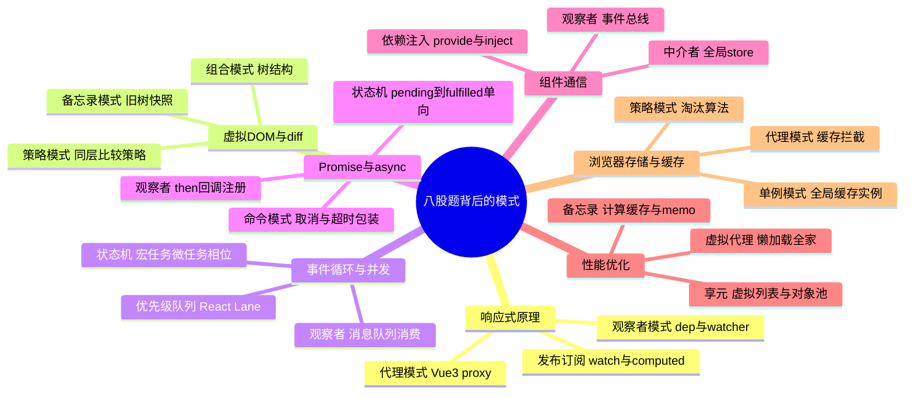

### DP-197：业务代码评审中的"模式视角"检查清单有哪些？（高频）
**答**：
- 评审不是"找模式用没用"，而是检查坏味道与扩展点：清单按"信号 → 建议"组织，review 时逐条对照。
- 五组信号：条件膨胀（建议策略/状态）、重复复制（三次法则，DP-166）、依赖混乱（全局变量/单例直取，建议 DI）、职责纠缠（上帝对象，建议拆分）、生命周期泄漏（幽灵监听，DP-164）。
- 表达方式：提"这里每加一种促销都要改这个函数，要不要抽策略表"，而不是"你应该用设计模式"。

```javascript
// 评审检查清单（可挂在 CODE_REVIEW.md）
const reviewChecklist = [
  { signal: '同一函数 if-else 超过 5 个分支且在增长', suggest: '抽策略表或映射表', ref: 'DP-101/102' },
  { signal: '同一代码块出现第 3 次复制', suggest: '三次法则：抽象为函数/模板方法', ref: 'DP-166' },
  { signal: '业务深处直接读 window/全局单例', suggest: '改构造注入，单例只留组合根', ref: 'DP-105/160' },
  { signal: '单文件同时管取数+布局+埋点', suggest: '按域拆 Hook/子组件/Service', ref: 'DP-161' },
  { signal: '事件订阅没有返回退订函数', suggest: '注册即返回 off，卸载统一清理', ref: 'DP-164' },
  { signal: '接口只有一个实现却建了抽象层', suggest: 'YAGNI：内联回去等第三次', ref: 'DP-163/165' },
  { signal: '状态字段 15+ 且互相纠缠', suggest: '收敛为状态机或 reducer', ref: 'DP-102/119' },
  { signal: '回调嵌套 3 层以上', suggest: 'async 化 + 步骤函数 + 错误分类', ref: 'DP-162' },
];
// 评审示例输出（对事不对人）：
// "submit 函数里有 6 个支付渠道分支（条件膨胀），最近每月都加一个（增长信号），
//  建议抽渠道注册表：每个渠道一个策略对象 + 网关统一入口，参考 DP-109。"
```

### DP-198：从需求到模式的"推导练习"：5 个真实需求怎么推？（高频）
**答**：
- 推导套路：需求 → 找"变化点"（什么会经常变）→ 变化点选模式 → 说权衡（不做什么）。面试官考的是推导过程而不是模式名。
- 五个练习：多语言需求 → 策略（语言包）+ 观察者（切换广播）+ 职责链（回退取词，DP-189）；审批流多分支 → 状态机；报表导出多格式 → 模板方法 + 策略（DP-114）；秒杀高并发 → 享元（池）+ 策略（限流）；多厂商推送 → 外观 + 适配器（DP-113）。
- 反向检查：每个模式的抽象是否有真实调用方，防止答成过度设计。

```javascript
// 推导示例1：需求"活动页弹窗规则经常变（每天配置）"
// 变化点：规则本身 → 模式：职责链（规则可插拔）
const popupRules = [
  { when: (u, ctx) => !u.loggedIn, popup: 'login' },          // 未登录先弹登录
  { when: (u, ctx) => ctx.todayPopups < 3, popup: 'activity' },   // 每天最多 3 次
  { when: (u, ctx) => u.newUser, popup: 'guide' },            // 新人引导
];
const decidePopup = (u, ctx) => popupRules.find((r) => r.when(u, ctx))?.popup ?? null;   // 规则增删不改内核
// 推导示例2：需求"订单详情按钮随状态变化且要防误点"
// 变化点：状态 × 行为 → 模式：状态机（DP-102）
const buttonMachine = { pending: ['pay', 'cancel'], paid: ['ship', 'refund'], shipped: ['confirm'] };
const visibleButtons = (status) => buttonMachine[status] ?? [];   // 非法状态无按钮，天然防误点
// 推导示例3：需求"列表页要支持表格/卡片/时间轴三种视图"
// 变化点：渲染方式 → 模式：策略（视图渲染器）+ 工厂
const viewStrategies = { table: TableStrategy, card: CardStrategy, timeline: TimelineStrategy };
const renderList = (data, mode) => viewStrategies[mode].render(data);   // 新视图 = 注册新策略
// 推导示例4：需求"埋点必须先脱敏再采样，以后还会加规则"
// 变化点：处理步骤 → 模式：职责链（DP-181）
// 推导示例5：需求"同页面对接 3 家广告 SDK，随时换"
// 变化点：厂商接口差异 → 模式：适配器 + 外观（DP-113）
```

### DP-199：如何在团队制定"设计模式使用规范"？哪些强制、哪些引导？（高频）
**答**：
- 规范三层：强制（安全与稳定性相关：订阅必须退订、非法状态转移必须报错、单例只在组合根）、引导（重复三次再抽象、优先组合优于继承）、禁止（一个实现建接口、为炫技堆模式）。
- 载体：Wiki 模式手册（模式 → 场景 → 模板代码链接）+ ESLint 自定义规则（如 no-restricted-syntax 拦 eventbus 裸用）+ code review 清单（DP-197）。
- 落地节奏：先收录团队真实重构案例（比背 GoF 有效），每季度更新一次"当年度最佳实践"。

```javascript
// 模式规范手册骨架（team-patterns.md 的机读版）
const teamStandards = {
  must: [                                                       // 强制级：违反打回
    { rule: '事件/订阅必须有对应退订', how: '注册函数必须返回 off，onUnmounted/useEffect cleanup 调用', ref: 'DP-164' },
    { rule: '状态机非法转移必须抛错', how: 'dispatch 查不到转移直接 throw，不静默', ref: 'DP-102' },
    { rule: '单例只在组合根获取', how: '业务模块通过构造参数注入实例', ref: 'DP-160' },
    { rule: '请求必须有超时与错误分类', how: '统一走 HttpClient，禁止裸 fetch 散落', ref: 'DP-180' },
  ],
  should: [                                                     // 引导级：评审建议
    { rule: '重复第三次才抽象', how: '提交信息注明重复出处', ref: 'DP-166' },
    { rule: '优先 Hook/组合而非继承', how: '基类层次超过 2 层需说明理由', ref: 'DP-007' },
    { rule: 'if-else 分支超 5 个先想映射表', how: '评审模板附带提示', ref: 'DP-101' },
  ],
  avoid: [                                                      // 禁止级：负清单
    { rule: '禁止只有一个实现的接口', ref: 'DP-165' },
    { rule: '禁止在业务代码内 new 全局事件总线', ref: 'DP-050' },
    { rule: '禁止为两个分支引入职责链', ref: 'DP-165' },
  ],
};
// ESLint 配套（引导落地）：
// "no-restricted-syntax": [
//   ["error", { "selector": "CallExpression[callee.name='getEventBus']", "message": "事件总线请通过 DI 注入，参考团队规范 must-3" }]
// ]
```

### DP-200：设计模式知识体系收束：三大类 × 框架/业务/基建的三维全景图。（高频压轴）
**答**：
- 收束方法：横轴 = 三大类（创建/结构/行为），纵轴 = 应用域（框架原理/业务重构/基础设施），每个交点背 1-2 个代表案例即可应对任何综合题。
- 答题策略升级：拿到设计题先报"变化点清单"，再为每个变化点匹配模式，最后主动说权衡——体现的是体系而不是名词。
- 本篇收束：DP-001~096 打单模式地基，DP-097~100 进框架源码，DP-101~200 完成业务实战与体系化，配合 mindmap 复习即可。

```javascript
// 三维全景速查表：行 = 三大类，列 = 应用域，格 = 代表案例
const panorama = {
  '创建型': {
    框架原理: 'createElement 工厂 / ESM 单例 / h 与 VNode',
    业务重构: '促销策略注册表 / 控件工厂 / 请求 Builder（DP-107）',
    基础设施: 'SDK 多端适配工厂（DP-146）/ 缓存实例工厂（DP-188）',
  },
  '结构型': {
    框架原理: 'Vue3 代理 / HOC 装饰器 / KeepAlive 享元',
    业务重构: '上帝对象拆分（DP-104）/ 多厂商适配器（DP-113）/ 图片池（DP-111）',
    基础设施: '统一 SDK 外观（DP-146）/ 数据源适配（DP-138）/ 权限组件库（DP-174）',
  },
  '行为型': {
    框架原理: '响应式观察者 / 拦截器职责链 / 模板编译访问者',
    业务重构: '促销引擎（DP-101）/ 订单状态机（DP-102）/ 表单联动（DP-145）',
    基础设施: '风控链（DP-112）/ 日志链（DP-150）/ 配置热更新观察者（DP-152）',
  },
};
// 万能答题模板（30 秒框架）：
// 1 需求转译：这题本质是"管理 N 个可变点"
// 2 变化点清单：渠道会加 → 策略；顺序有讲究 → 职责链；要可回退 → 命令+备忘录
// 3 组合方案：一句话架构 + 关键接口签名
// 4 权衡收尾：不引入 IoC 容器、不上微内核（YAGNI），理由是当前规模
const answerTemplate = (changePoints) => changePoints.map((c) => `${c} → ${modeFor(c)}`).join('；');
const modeFor = (point) => ({ 会增减类型: '策略+工厂', 顺序流程: '职责链/模板方法', 要撤销回滚: '命令+备忘录', 多方通信: '观察者/中介者', 性能瓶颈: '享元+代理', 接口不一致: '适配器+外观' }[point] ?? '先别抽');
```

全景收束 mindmap：

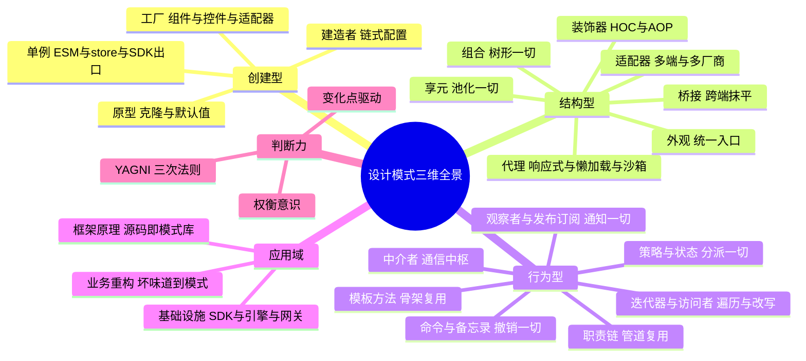

---

> **DP-001 ~ DP-200 全部完成**。DP-101 ~ DP-200：重构实战、模式组合、React/Vue 深化、数据层、UI 架构、基础设施、模式变体、反模式、综合与体系。
