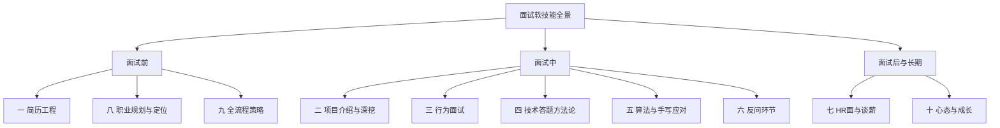
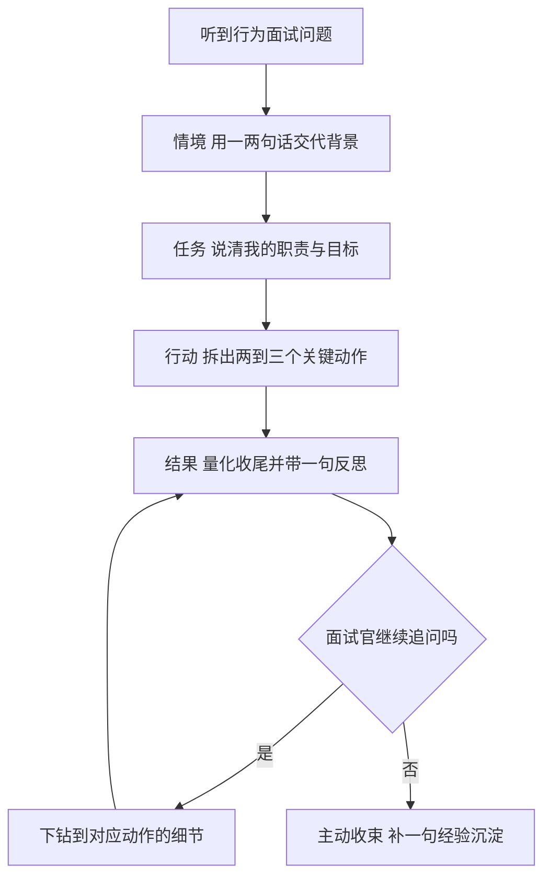
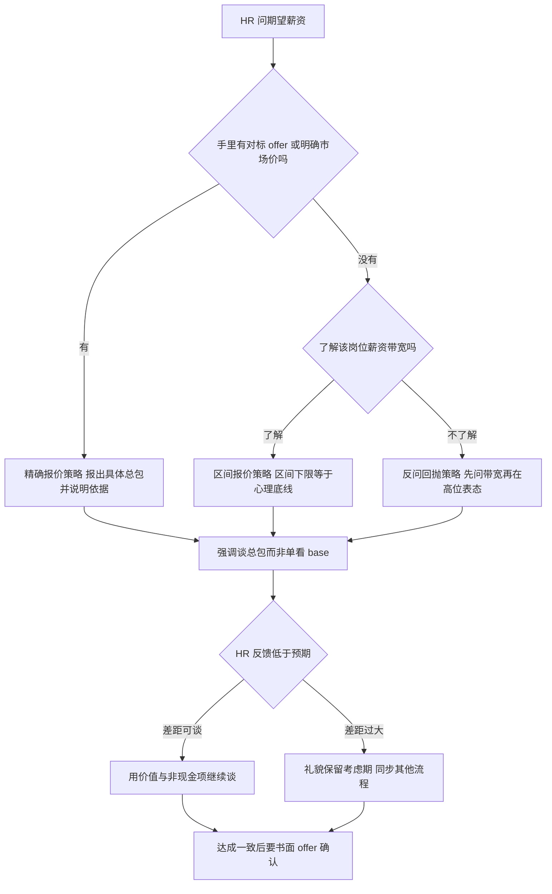
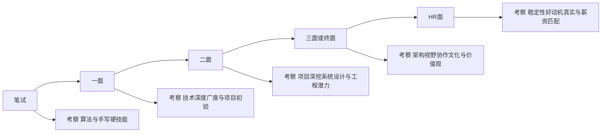
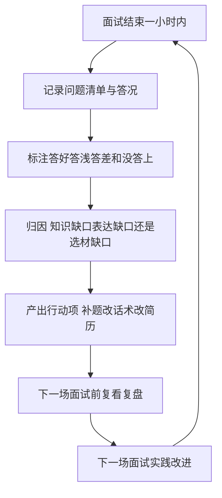

# 前端面试题库：面试软技能

> **定位**：技术面试的非代码环节全集——简历与项目包装、行为面试、技术答题方法论、算法与手写环节应对、反问环节、HR 面与谈薪、职业规划、全流程策略、心态与长期成长。这类题不考代码，考的是"把你会的东西卖出去"的能力；本题库中原本放代码块的位置，统一替换为**可直接套用的模板 / 话术骨架 / 结构块**（```text 或 ```markdown），每题一一对应， skeleton + 占位符 + 填好的示例。
>
> **使用方法**：面试前按章检索；每场面试后对照 SOFT-073 复盘模板落盘一次；改简历时对照 SOFT-010 自查清单过一遍。编号 SOFT-001 ~ SOFT-100，共 100 题。



## 目录

- 一、简历工程（SOFT-001 ~ SOFT-010）
- 二、项目介绍与深挖应对（SOFT-011 ~ SOFT-018）
- 三、行为面试（SOFT-019 ~ SOFT-027）
- 四、技术答题方法论（SOFT-028 ~ SOFT-036）
- 五、算法与手写环节应对（SOFT-037 ~ SOFT-041）
- 六、反问环节（SOFT-042 ~ SOFT-048）
- 七、HR 面与谈薪（SOFT-049 ~ SOFT-060）
- 八、职业规划与定位（SOFT-061 ~ SOFT-069）
- 九、面试全流程策略（SOFT-070 ~ SOFT-073）
- 复盘：A 司前端二面（SOFT-074 ~ SOFT-078）
- 十、心态与成长（SOFT-079 ~ SOFT-100）

---

## 一、简历工程

### SOFT-001：简历的结构与信息密度怎么安排？为什么坚持一页原则？

**答**：
- 一页原则的本质是**筛选成本**：HR 初筛一份简历平均只有 10~30 秒，两页等于把翻页成本转嫁给筛简历的人。
- 结构按"价值递减"排列：基本信息 → 3 行核心亮点 → 工作经历与项目 → 技能清单 → 教育背景。
- 每段项目 3~5 条 bullet，每条不超过两行；每条 bullet 必须含动词和结果。
- 删除一切与目标岗位无关的信息：与前端无关的兼职、堆砌的课程名、空泛的自我评价。
- 三年以上经验不需要写"自我评价"栏，用事实替代形容词。

```text
一页简历结构清单（自上而下按价值递减）

【基本信息】1 行：姓名 | 电话 | 邮箱 | 城市 | GitHub/博客链接
【核心亮点】3 行：我是谁 + 几年经验 + 最拿得出手的一段话
  例：4 年前端经验，主导过日活 200 万 C 端主站的性能治理，
      首屏从 4.2s 降到 1.5s；熟悉 Vue/React 双栈与工程化建设。
【工作经历】倒序，每段 1 行公司 + 1 行角色概述 + 项目挂下面
【项目经历】2~3 个最相关的项目，每个 3~5 条 bullet
  bullet 公式：动词 + 做了什么 + 用什么技术 + 量化结果
【技能清单】分档列出（见 SOFT-004），不超过 6 行
【教育背景】1~2 行，社招放最后

自查：删掉任何一条后信息是否受损？不受损就删。
```

### SOFT-002：项目描述如何用 STAR 改写？给一个前后对比。

**答**：
- 简历上的项目描述是"压缩版 STAR"：Situation 和 Task 各占半句，Action 一句，Result 必须量化收尾。
- 90% 的烂描述烂在只有 Action 没有 Result：写了"做了什么"，没写"带来了什么"。
- 改写步骤：先补背景（为什么做）→ 再补结果（数据/对比）→ 最后压缩动作描述。
- 对比示例见下方模板，重点看"参与开发页面"与"主导优化，首屏 4.2s→1.5s"的信息密度差异。

```text
STAR 改写公式：背景（为什么做）+ 动作（我做了什么）+ 结果（数字对比）

【改写前】（典型流水账）
参与 XX 管理后台开发，负责页面开发与接口联调，使用了 Vue3 和 ElementPlus。

【改写后】（压缩 STAR）
针对运营后台日均 3000+ 工单的处理瓶颈（S/T），主导重构工单模块：
抽出可配置表单引擎支撑 12 类工单场景，联调周期从 5 天缩到 1 天；
配合懒加载与虚拟滚动，万级数据列表渲染从 3s 降到 400ms（A/R）。

【练习方法】
1. 列出项目里所有"参与了/负责了/开发了"开头的句子
2. 每句追问三个问题：为什么做？我具体做了什么决策？结果怎么衡量？
3. 答不出的条目直接删，答得出的补上数字
```

### SOFT-003：没有数据时，量化成果的方法有哪些？

**答**：
- 数据不是"编"出来的，是"找"回来+"算"出来的：性能数据可现场复现，业务数据可回忆口径。
- 找数据五渠道：监控/埋点后台、Git 提交记录、Lighthouse/性能面板复测、当时的汇报 PPT 和周报、找老同事确认。
- 找不到绝对数就用相对量：覆盖多少页面/模块、减少多少次重复操作、节省多少人力天。
- 实在没有就"估算 + 标注口径"：如"估算日均为团队节省约 1 人时（按 30 个页面 × 2 分钟维护成本计）"。
- 严禁凭空创造精确数字：写了 37.5% 这种精度，就要能答出统计口径。

```text
量化公式：动词 + 对象 + 手段 + 结果数字 + 对比基线

没数据时的四条降级路线（按优先级）：
1. 补测：花 10 分钟跑 Lighthouse / Performance 面板拿真实数字
   例：改造前保留分支复测一次，得到"首屏 3.8s → 1.2s"
2. 相对量：覆盖 X 个页面 / X 个模块 / 服务 X 条业务线
   例：抽象表单组件，覆盖 12 类场景，新表单开发从 2 天缩到 2 小时
3. 人力换算：次数 × 单次成本
   例：自动化发布脚本替代手工发布，按每次 20 分钟、每周 10 次计，
       每周节省约 3.5 人时
4. 口径标注：数字后加括号说明估算方式
   例：页面加载错误率下降约 60%（按 Sentry 周报抽样对比）

自查：每条量化能否在面试现场被追问口径时自圆其说？
```

### SOFT-004：技术栈描述的诚实边界在哪里？

**答**：
- 核心原则：**写了就会被问，答不上就是负资产**。简历上每个技术词都是自己签发的考点。
- 技能分三档描述：能讲原理与源码细节、能独立干活、能答基础概念并快速上手——分别对应"深入理解 / 熟练使用 / 了解"。
- "精通"慎用：写了精通 JS，面试官就有权问到 V8 与规范层面；没有金刚钻就写熟练。
- 没上过生产的（只在个人项目或学习中接触），显式标注来源，否则按生产经验追问会翻车。
- 完全不会的坚决不写：简历不是愿望清单。

```text
技能分档对照表（写之前先自测）

┌──────────┬──────────────────────────────┬─────────────────────┐
│ 描述用词  │ 面试官会问到的深度             │ 达标线               │
├──────────┼──────────────────────────────┼─────────────────────┤
│ 深入理解  │ 原理、源码、底层机制、性能权衡  │ 能白板讲清一个核心机制│
│ 熟练使用  │ 常用 API、工程实践、典型坑     │ 独立完成生产级模块    │
│ 了解      │ 概念、适用场景、基础用法       │ 能答基础题并快速上手  │
└──────────┴──────────────────────────────┴─────────────────────┘

【填写示例】
- 深入理解 Vue3 响应式原理，读过 reactivity 模块源码，能讲清依赖收集与触发链路
- 熟练使用 React + TypeScript 开发中大型 C 端应用，熟悉 hooks 最佳实践
- 了解 Rust / WebAssembly，完成过个人图片压缩工具（未上生产）

【红线自查】
1. 逐词自问：这个词被追问三层我能接到第几层？接不到第二层的降档或删除
2. 只在 demo 里写过的，必须带"个人项目/学习中"标注
```

### SOFT-005：简历中的亮点词与垃圾词分别有哪些？

**答**：
- 垃圾词的共同点是**零信息量且不可验证**："负责""参与""熟悉""良好的沟通能力"——任何人都能写。
- 亮点词的共同点是**含动作、含决策、含对比**："主导""设计并落地""从 0 到 1""推动""沉淀了"。
- 形容词是垃圾词重灾区：吃苦耐劳、积极主动、抗压能力强——全部删掉，换成事实。
- 判断标准：这句话换成别人写是不是也成立？成立就是垃圾句。

```text
亮点词 / 垃圾词对照表（左写右改）

┌────────────────────┬──────────────────────────────────────┐
│ 垃圾写法            │ 亮点改写                              │
├────────────────────┼──────────────────────────────────────┤
│ 参与了 XX 项目开发  │ 独立负责 XX 模块，交付 8 个核心页面    │
│ 负责 XX 系统维护    │ 主导 XX 系统重构，线上故障率月均 5 起→1│
│ 熟悉性能优化        │ 首屏 LCP 从 4.2s 优化到 1.5s          │
│ 使用 React 开发     │ 基于 React+TS 从 0 到 1 搭建 XX 中台   │
│ 解决了很多疑难问题  │ 攻克长列表滚动白屏问题，沉淀通用方案    │
│ 良好的沟通能力      │ 推动 3 个团队统一埋点规范并落地        │
│ 精通 Vue            │ 深入理解 Vue3 响应式与编译优化机制     │
└────────────────────┴──────────────────────────────────────┘

【替换口诀】参与→独立负责/主导；负责→具体管了什么；熟悉→数字；
形容词→事实；精通→深入理解 + 一个可讲的机制。
```

### SOFT-006：简历如何针对 JD 做关键词匹配？

**答**：
- 机筛与人筛都吃关键词：大厂简历初筛常有 ATS 关键词匹配，人筛时面试官也拿 JD 对照简历找命中点。
- JD 拆成两类：**硬关键词**（框架、经验年限、业务领域）必须在简历显式命中；**软关键词**（性能、工程化、跨端）要在项目描述里用实例体现。
- 改写措辞贴近 JD 用语：JD 写"低代码"，你有类似经验就用同义词对齐，但不造假。
- 缺失项不硬凑，放在求职信/自我介绍里作为"学习方向"补位。

```text
JD 拆解三栏表（投递前花 10 分钟做一次）

| JD 原文要求            | 我的证据（项目/技能）        | 简历落点        |
|------------------------|------------------------------|-----------------|
| 3 年以上 Vue 经验      | 4 年，两个 Vue3 生产项目     | 核心亮点第 1 行 |
| 有性能优化实战         | LCP 4.2s→1.5s 案例          | 项目 A 第 2 条  |
| 熟悉微前端             | qiankun 子应用接入经验       | 技能清单"熟练"档|
| 有可视化经验（缺失）    | 曾用 ECharts 做报表（弱相关）| 项目 B 顺带提及 |
| 低代码平台经验（缺失）  | 无                           | 不硬凑，面试口头补|

【匹配策略】
1. 硬关键词命中率 < 60% 时降低该岗位优先级，避免海投浪费
2. 每条命中项都要能在面试里展开 3 分钟，展开不了的降级处理
3. 同义词映射：组件库建设=UI 中台、埋点=数据采集、CI=工程化
```

### SOFT-007：校招简历与社招简历的核心差异是什么？

**答**：
- 校招筛"潜力"：基础、学习能力、竞赛/开源/实习、可培养性；社招筛"结果"：业务产出、工程深度、即战力。
- 教育背景位置不同：校招放前面（尤其学校好时），社招放最后。
- 项目来源不同：校招可以是课设、比赛、个人项目、开源贡献，但要用工程标准描述；社招必须突出生产环境与业务结果。
- 校招可写 GPA、奖学金、学生工作；社招这些信息降权甚至删除。
- 共同点不变：一页、量化、动词开头、写了就会被问。

```text
校招 vs 社招结构差异对照表

┌──────────┬──────────────────────────────┬──────────────────────────┐
│ 模块      │ 校招版                        │ 社招版                    │
├──────────┼──────────────────────────────┼──────────────────────────┤
│ 排序首位  │ 教育 + GPA / 奖学金           │ 核心亮点（经验与成果）     │
│ 项目来源  │ 实习 + 竞赛 + 开源 + 课设     │ 生产项目，倒序            │
│ 描述重心  │ 学了什么、难度、成长速度       │ 业务结果、技术决策、量化   │
│ 可写加分  │ ACM/竞赛、开源 PR、技术博客   │ 架构主导、跨团队推动、带人 │
│ 弱化处理  │ 工作经历（只有实习就写实习）   │ GPA、学生干部、课程名      │
└──────────┴──────────────────────────────┴──────────────────────────┘

【校招项目描述示例】
用工程标准包装课设：独立开发校园二手交易平台（Vue3 + Node），
支持 2000+ 在校用户；实现图片懒加载与 CDN 接入，弱网环境
首屏从 6s 降至 2s（自测 20 次取中位数）。
```

### SOFT-008：简历如何做版本管理？为什么要按公司定制？

**答**：
- 一份 master 版 + 按公司定制的分支版：项目顺序、亮点措辞、关键词随 JD 微调，基础事实不动。
- 定制的三个开关：项目排序（最相关的放最前）、技能关键词对齐、核心亮点一句话重写。
- 每个投递版本建立记录：投了哪个版本、投给谁、什么渠道——防止面试时自己都记不清对方看的是哪版。
- 用 Git 或网盘管版本都行，关键是文件名可追溯、投递有台账。

```text
版本管理规范（命名 + 定制 + 台账）

【命名规范】
简历-前端-{姓名}-master.pdf           ← 母版
简历-前端-{姓名}-字节-抖音电商-v2.pdf  ← 定制版，带公司与版本号

【每次定制 checklist（10 分钟内完成）】
1. 按 JD 重排项目顺序：最相关项目放第一个
2. 核心亮点一句话按 JD 重写：突出 JD 最在意的那一刀
3. 关键词对齐：对照 SOFT-006 三栏表补齐硬关键词
4. 删除与该岗位无关的项目细节，为一页让位
5. 检查文件名不含"最终版""简历2"等暴露性字样

【投递台账（表格维护）】
| 日期      | 公司 | 岗位 | 渠道 | 版本 | 状态   |
|-----------|------|------|------|------|--------|
| 03-05     | 字节 | 前端 | 内推 | v2   | 一面约 |
| 03-05     | 美团 | 前端 | 官网 | v1   | 已投   |
```

### SOFT-009：简历投递的渠道与时机怎么选？

**答**：
- 渠道优先级：**内推 > 猎头 > 官网直投 > 海投**；内推跳过机筛且有真人背书，简历通过率差一个量级。
- 时机：周二至周四上午 9~11 点投递打开率最高；避开周五下午、周末、深夜——会和几百封邮件一起沉底。
- 岗位新鲜度：新发布 3 天内的岗位响应最快，发布超两周的多半已在流程中。
- 招聘季节奏：金三银四、金九银十的高峰前 1~1.5 个月开始准备与内推预热（详见 SOFT-070）。
- 内推要给内推人省事：一句话自我介绍 + PDF 简历 + 目标岗位链接，打包发。

```text
投递节奏参考表

【渠道动作】
内推  ：找 1~2 度人脉，附打招呼三件套（自我介绍 3 行 + PDF + 岗位链接）
猎头  ：明确告知期望薪资与底线，简历版本对外统一
官网  ：每周固定批量投，登记台账
海投  ：仅作为兜底，命中率极低不作为主策略

【时机口诀】
周中投、上午投、新岗位 3 天内投；周五下午与节假日不投。

【打招呼三件套示例】
哥好，我 4 年前端，主站性能优化方向（LCP 4.2s→1.5s），
对贵司抖音电商前端岗位很感兴趣，简历见附件，
方便的话帮我内推一下，岗位链接：xxx。谢谢！
```

### SOFT-010：简历常见死穴有哪些？如何自查？

**答**：
- 死穴分三类：**格式类**（错别字、PDF 命名、排版混乱）、**内容类**（时间断档、垃圾词、技术词拼写错误）、**操作类**（投错版本、薪资信息泄露、附件过大）。
- 技术词拼写是前端简历高危区：Vue 写成 vue、JavaScript 写成 Javascript，直接暴露基本功。
- 时间断档不写原因会引发最坏猜测，用一句话主动交代（进修/休整/项目保密期）。
- 投递前用打印预览检查一页原则：Word 排版好 PDF 错乱是常见事故。

```markdown
投递前 10 分钟死穴自查清单

格式类
- [ ] 全文无错别字（通读一遍 + 拼写检查）
- [ ] PDF 命名规范：简历-岗位-姓名.pdf
- [ ] 打印预览确认一页，排版不乱码不缺字
- [ ] 技术词拼写：Vue / Vue3、JavaScript、TypeScript、Node.js
- [ ] 邮箱名为姓名拼音，非昵称

内容类
- [ ] 每条项目 bullet 有动词 + 有结果
- [ ] 无"负责/参与/精通/吃苦耐劳"等垃圾词
- [ ] 时间线连续，断档处有一句话交代
- [ ] 手机号邮箱正确（发一封测试邮件给自己验证）
- [ ] 无上一家公司机密信息、无薪资敏感数字

操作类
- [ ] 附件 < 5MB，PDF 格式非 doc
- [ ] 投递版本与台账一致，没有发错母版/旧版
- [ ] 收件人与岗位对应，无复制粘贴错投
```

---

## 二、项目介绍与深挖应对

### SOFT-011：如何准备项目介绍的 90 秒版本？

**答**：
- 90 秒版本是项目深挖的"预告片"：目的不是讲完，是**钓出你想被追问的问题**——把最有把握的点放进去。
- 结构五段：一句话定位 → 业务背景与我方压力 → 我的角色与技术方案关键词 → 量化结果 → 一句挑战预告（钩子）。
- 控制在 250~300 字，多说一个字面试官就会从更早的位置打断你。
- 准备三个版本：C 端、中后台、基建方向，投递不同业务线时用对应的。

```text
90 秒脚本骨架（五段式）

1. 定位（1 句）：这是给谁用的、解决什么问题的系统
2. 背景（1 句）：当时的业务压力/技术痛点是什么
3. 角色（1 句）：团队多少人，我负责哪一块
4. 方案（2~3 句）：技术方案关键词，只报关键词不展开
5. 结果 + 钩子（1~2 句）：量化结果 + "其中最有挑战的是 XX"

【填好示例】
这是一个服务内部 2000 名运营的素材管理平台（定位）。
此前素材散落在各处，运营平均找一张图要 10 分钟（背景）。
团队 5 人，我负责检索与上传链路（角色）。
方案上前端用 Vue3 + 虚拟列表，上传做了分片与秒传，
检索接入了以图搜图（方案关键词）。
上线后找图时间从 10 分钟降到 30 秒，上传失败率从 8% 降到 0.5%（结果）。
其中以图搜图的相似度排序调优踩了不少坑（钩子，诱导追问）。

【练习法】手机计时录音讲 3 遍，超 100 秒就砍。
```

### SOFT-012：如何用三层挖掘法找出项目亮点？

**答**：
- 亮点不是项目自带的，是挖出来的：任何项目都有业务、技术、工程三层价值。
- **业务价值**：对收入/效率/体验的影响；**技术价值**：性能/稳定性/架构改进；**工程价值**：流程、工具、规范、可复用沉淀。
- 每层准备一个"数字或事实"作为证据，面试时按面试官身份选层：业务面试官听业务层，架构师听技术层。
- 挖不出亮点通常是站在"执行者视角"，切到"如果这事不做会怎样"的视角重看一遍。

```text
三层挖掘表（对每个项目各填一行，每格必须有证据）

| 层级     | 提问句                         | 我的答案示例                       |
|----------|--------------------------------|------------------------------------|
| 业务价值 | 这事对业务指标有什么影响？       | 转化率 +2.3%，客服工单量 -40%       |
| 技术价值 | 解决了什么硬技术问题？           | 万级列表渲染 3s→400ms，白屏率归零   |
| 工程价值 | 留下了什么可复用的东西？         | 表单引擎被 3 条业务线复用，新表单 2h |

【挖掘练习：对项目连问五个为什么】
我做了个后台 → 为什么做？运营效率低 → 多低？每天 3000 工单积压
→ 瓶颈在哪？表单写死，改一个字段要发版 → 我做了什么？配置化表单引擎
→ 结果？需求交付从 2 天到 2 小时 —— 这就是一条完整亮点链。

【使用时机】
一面讲技术层，二面讲技术+工程层，总监面/HR 面讲业务层。
```

### SOFT-013：「这个项目最大的挑战是什么」怎么答？

**答**：
- 这题考的是**定义问题的能力与解决问题的完整度**，不是比惨——挑战要"难在技术或约束"，不能难在"沟通不畅"。
- 标准结构：挑战是什么 → 为什么难（约束与矛盾）→ 尝试过什么、失败在哪 → 最终方案 → 结果 → 沉淀。
- "失败尝试"是加分项：说明你是排除法找到的解，不是背来的答案。
- 避免两种反面答案：挑战太轻（改个 bug）和挑战与人无关（纯属运气差）。

```text
五段式应答话术

1. 定义：最大的挑战是 XX（一句话说清问题本身）
2. 为什么难：难在 A 约束与 B 需求互相矛盾，当时没有现成方案
3. 尝试：先试了方案 1，因为 XX 问题被否掉
4. 终解：最终用方案 2，核心思路是 XX，代价是 XX（承认取舍）
5. 结果与沉淀：上线后指标 XX；后来这个方案沉淀成团队通用做法

【填好示例】
最大挑战是 weak 网环境下大文件上传的可靠性。难在：用户网络差、
文件普遍 500MB 以上、又不能引第三方云服务（成本约束）。
先试了整包重传，弱网下失败率还是 8%；后来改分片上传 +
断点续传 + 秒传（MD5 秒判），失败率降到 0.5%，
代价是服务端多了一套分片合并逻辑。
这套方案后来成了部门上传组件的标准实现。

【避坑】挑战不要选"时间紧""人手少"——那是所有项目的常态，不构成挑战。
```

### SOFT-014：「如果重做一次你会怎么做」怎么答？

**答**：
- 这题考**反思能力与技术判断的进化**，不是让你否定过去——全盘否定过去等于否定当年的自己（以及当年的决策约束）。
- 标准结构：肯定当时决策的合理性（基于当时的信息和约束）→ 指出以现在的认知哪里可以更好 → 给出具体改进方案 → 收在"学到了什么"。
- 必须给具体改进：重构成微前端、提前上监控、类型系统早铺——空泛的"多沟通多测试"是零分答案。
- 这题和 SOFT-018 共用素材：烂项目重做时最容易出彩。

```text
四段式话术骨架

1. 肯定：当时选 XX 是因为 XX 约束（工期/人力/技术储备），是合理决策
2. 反思：现在看，问题出在 XX——当时低估了 XX
3. 改进：重做的话我会 XX，预计能避免 XX 问题
4. 沉淀：这个认知后来在 XX 项目里已经用上了

【填好示例】
当时选 Vuex 是因为团队只有 Vue2 经验、工期两个月，这个选择今天看
依然是对的。但低估了模块间共享状态的规模，一年后 store 膨胀到
3000 行。重做的话，我会第一天就按业务域拆分 module，并加一层
类型约束限制跨域直接取值——这个做法后来在新项目里直接沿用了，
状态层一年了仍然很干净。

【避坑】不要说"我会用更新的框架重写"——工具追新不是反思，是浮躁。
```

### SOFT-015：技术选型被追问「为什么用 X 不用 Y」时怎么答？

**答**：
- 选型题的标准答案是**约束 + 对比 + 代价**，最忌"大家都用""官方推荐""新版本好用"。
- 回答框架：先复述需求约束 → 列候选方案 → 说清选择理由（最好是 2~3 条硬理由）→ 主动说出所选方案的代价 → 有回退预案更佳。
- 主动说代价是高级信号：说明你评估过而不是无脑选。
- 没做过对比就说没做过，可以现场推理，但不要编造"我们测过 XX 快 30%"。

```text
选型应答四问表

1. 需求约束是什么？——团队技术栈 / 工期 / 性能要求 / 维护人力
2. 候选有哪些？——至少 2 个，说明各自适用场景
3. 为什么选它？——硬理由 2~3 条（性能数据 / 团队匹配 / 生态成熟度）
4. 代价与回退？——接受什么缺点，出问题怎么退

【填好示例：为什么用 Vite 不用 Webpack】
约束是：30+ 页面的中后台，本地启动当时要 90 秒，团队天天抱怨。
候选是 Vite 和升级 Webpack5 + esbuild-loader。
选 Vite 的硬理由：dev 冷启动依赖预构建后 3 秒内，且团队 60%
代码是原生 ESM 友好的 TS；生产仍可用 Vite 的 rollup 打包。
代价：部分 CommonJS 老依赖要配 optimizeDeps，SSR 场景当时不成熟——
我们没有 SSR 需求，所以可接受。真不行构建产物可切回 Webpack，
CI 保留了双构建配置两周作为回退期。

【避坑】答不出代价 = 没真用过；只会说"社区活跃" = 没做过对比。
```

### SOFT-016：简历与面试中数据造假的边界和风险是什么？

**答**：
- 边界清晰：**模糊量级与口径可以，凭空创造数字不行**。写"约""日均""周均"是口径，写"37.5%"就是承诺精度。
- 高风险数据三类：性能数字（可现场复测或复算）、业务大盘数字（可能涉及机密且易被交叉验证）、团队规模与贡献占比（背调可查）。
- 造假被击穿的场景：追问统计口径、追问对比基线、背调核实、让现场推演"这个数字怎么来的"。
- 安全做法：所有数字背后准备一句话口径说明，答得出来就是真话，答不出来就别写。

```text
数据可信度自查表（每个数字过一遍）

┌────────────────┬──────────────────────┬──────────────────────┐
│ 数据类型        │ 安全写法              │ 危险写法              │
├────────────────┼──────────────────────┼──────────────────────┤
│ 性能指标        │ LCP 4.2s→1.5s（实测）│ "快了 300%"（无基线） │
│ 业务指标        │ 转化率提升约 2%（AB） │ "GMV 涨 1000 万"（越权）│
│ 工程效率        │ 联调周期 5 天→1 天    │ "效率提升 80%"（无口径）│
│ 规模数据        │ 服务 12 类工单场景    │ 编造的精确 DAU 数字    │
└────────────────┴──────────────────────┴──────────────────────┘

【每个数字配一句口径说明（被追问时直接用）】
- LCP 数据：Lighthouse 移动端模拟，改造前后各测 5 次取中位数
- 转化率：AB 实验一周，置信度 95%，实验组 vs 对照组
- 联调周期：按迭代排期记录对比

【红线】
1. 业务大盘数字不写绝对值（越权 + 机密），写相对变化
2. 编造的精确小数是最大破绽——真数据才有权重大
3. 背调时代价不对称：编一句真话换一个拒信加行业口碑损失
```

### SOFT-017：团队协作项目如何切分与讲清个人贡献？

**答**：
- 核心是**边界感**：用"我"陈述你主导的决策与实现，用"我们"陈述团队成果，混用会两头翻车。
- 切分三要素：模块边界（我负责哪几个模块）、决策边界（哪些技术决策是我做的）、协作边界（我与谁配合做了什么）。
- 面试官必然验证：对你声称的贡献追问实现细节，答不出细节的贡献等于没有。
- 不抢功劳也不自贬："这个功能是同事做的，我 review 过"也是有效贡献。

```text
贡献切分话术模板

模块层：这个项目团队 X 人，我主要负责 A、B 模块，
        C 模块是同事负责、我参与联调。
决策层：A 模块的 XX 技术方案是我提出并推动落地的，
        理由是 XX；B 模块整体方案是 leader 定的，我负责实现。
协作层：我和后端约定了 XX 接口协议，推动了 XX。

【填好示例】
项目 5 个人，两个前端。我负责列表与导出模块，同事负责编辑器。
列表页虚拟滚动方案是我提的——当时吵过原生滚动还是虚拟滚动，
我写了个 demo 压了 5 万条数据对比后定的。
编辑器的撤销重做是同事做的，细节他更清楚，
我做过两轮 code review，大致思路我可以讲。

【验证准备】对自己声称的每个贡献，准备到"能白板画图"的深度。
```

### SOFT-018：项目很烂、业务很水时，怎么讲出价值？

**答**：
- 没有烂项目，只有没被翻译的项目：维护性工作可以翻译成稳定性收益，重复劳动可以翻译成效率工程。
- 四条价值转化路径：烂代码治理（你踩的坑就是经验）、成本节约（少出故障、少花人力）、流程改进（把手工变自动）、规模证明（再小的系统服务了多少用户/订单）。
- 主动定调：与其等面试官问"这项目怎么这么简单"，不如自己先说"这个项目技术上不复杂，但我从中提炼出了 XX"。
- 实在没得讲，把项目当"反面素材"用：讲清它的不足以及你如果重做会怎样（接 SOFT-014）。

```text
烂项目价值转化表

┌──────────────────┬────────────────────────────────────┐
│ 项目现状          │ 价值翻译                            │
├──────────────────┼────────────────────────────────────┤
│ 一直在修 bug      │ 治理线上稳定性，故障率 X→Y，沉淀排查 SOP │
│ 都是增删改查      │ 把增删改查抽象成通用 CRUD 引擎，新页面 2h│
│ 系统很小没人用    │ 0 成本从 0 到 1，覆盖 XX 内部用户     │
│ 历史遗留代码多    │ 有计划地还了 X 类技术债，出了重构方案   │
│ 没有技术挑战      │ 在工期约束下保证了交付质量与可维护性    │
└──────────────────┴────────────────────────────────────┘

【主动定调话术】
这个项目业务逻辑不复杂，我主动做了两件超出需求的事：
一是把重复的三套列表页抽成了通用组件，后续需求交付快了一半；
二是给系统补了监控和告警，接手后线上问题从被动救火变成了主动发现。

【兜底策略】实在没有亮点，就讲"这个项目教会我 XX"，
把反思质量当亮点（衔接 SOFT-014 的重做框架）。
```

---

## 三、行为面试

### SOFT-019：STAR 法完整拆解：怎么用才不生硬？

**答**：
- STAR 是行为题的底层结构：Situation 背景、Task 任务、Action 行动、Result 结果；行为面试官用过去行为预测未来表现，所以追问永远往"你具体做了什么"上钻。
- 生硬用法是背四段，正确用法是**加权**：S/T 合起来不超过两成篇幅，Action 占五成，Result 占三成。
- Action 要拆成 2~3 个具体动作，每个动作能独立扛住"为什么这么做"的追问。
- Result 必须量化，并补一句反思/沉淀，把故事升级为经验。
- 提前备 4~5 个素材故事（冲突、失败、跨团队、超预期交付、快速学习），一个故事应对多类问题。



```text
STAR 素材卡片模板（提前写好 4~5 张，每场面试前扫一遍）

【故事标签】冲突处理 / 项目延期救火 / 跨团队推动 / ……
S 背景：______（时间、团队、业务场景，两句内）
T 任务：我负责______，目标是______
A 行动：
  动作 1：______（为什么这么做：______）
  动作 2：______（为什么这么做：______）
  动作 3：______（为什么这么做：______）
R 结果：______（数字）+ 沉淀：______

【填好示例卡片：跨团队推动】
S：去年 Q3，公司要大促前统一三个事业部的埋点口径
T：我作为前端侧接口人，负责推动埋点 SDK 统一
A：1 摸底三个团队现有实现差异（为什么：先量化问题才能立项）
   2 写兼容层让新旧 SDK 并行一个迭代（为什么：降低迁移风险）
   3 拉三方周会同步进度并出迁移文档（为什么：跨团队靠文档不靠口头）
R：大促前完成统一，数据口径冲突工单从每周 10+ 降到 0；
   沉淀：跨团队的事要"先给对方算收益，再谈配合"
```

### SOFT-020：与同事或 leader 有分歧的冲突处理题怎么答？

**答**：
- 考察点：对事不对人、能否用事实和数据解决分歧、能否向上管理而非情绪对抗。
- 标准结构：分歧是什么 → 对方的合理性先承认 → 摆事实/做验证 → 结果 → 关系修复。
- 高分动作是"把分歧变成验证题"：谁对听谁的太幼稚，让数据/实验裁决才专业。
- 选材忌讳：不要讲 leader 坏话的故事，哪怕你赢了——面试官会代入"他以后也会这样讲我"。

```text
冲突题五步话术

1. 事实：我和 XX 在 XX 事上有分歧，他主张 A，我主张 B
2. 换位：他的出发点是 XX，这个考虑有道理
3. 验证：我们没有争论对错，而是 XX（写 demo 压测/拉数据/小范围试点）
4. 结果：数据说明 XX，最终采用 XX，我做对了/他做对了/各取了一半
5. 关系：事后我 XX（主动同步结论/请他吃饭/复盘文档），协作没受影响

【填好示例】
我和 mentor 在列表页方案上有分歧，他倾向直接分页，我认为
业务方需要连续滚动浏览。他的考虑是实现成本低、上线快，有道理。
我花半天写了虚拟滚动的 demo，5 万条数据下滚动帧率稳定 60fps，
代码量只多了 200 行，拿给他看后他同意了，还让我把这个方案
整理成了团队 wiki。这件事我学到：分歧最有力的解法是
"把观点变成可验证的东西"，而不是说服对方。

【避坑】"最后领导拍板了" 不是解决方案，是回避。
```

### SOFT-021：讲一个失败经历的题怎么答？选材标准是什么？

**答**：
- 这题考的不是失败本身，是**复盘质量**：能否诚实归因、能否提炼改进、改进是否已验证。
- 选材三条标准：真实但非致命（没造成重大损失）、主因在自己（不甩锅给环境与他人）、已有改进证据（之后的项目里真的改了）。
- 忌讳三种答案：伪失败（"我太追求完美导致加班"）、甩锅型（需求变了/同事坑了）、无改进型（讲完就完了）。
- 归因要到认知层：不是"下次更细心"，而是"我建立了 XX 机制让这类问题不会再发生"。

```text
失败题四段话术

1. 事件：一次 XX 导致了 XX 后果（真实、具体、一句带过后果）
2. 归因：根本原因是我的 XX（认知/机制缺失，不是粗心）
3. 改进：之后我建立了 XX 机制 / 改变了 XX 做法
4. 验证：在后来的 XX 事件里，这个改进起了作用

【填好示例】
去年我负责一个活动页，上线前只在自己电脑上测了，没测低端机，
结果上线后大量用户反馈白屏——是老机型上一个新 API 兼容问题，
紧急回滚了。根本原因是我没有"多机型验证"的意识，
把测试当成了别人的事。之后我推动团队接入了自动化兼容检测 +
每次上线前列低端机清单自测，这套流程用了一年，
再没出过同类问题。这件事让我从"写完"进化到"对上线质量负责"。

【选材红线】项目失败导致重大资损的、还在保密期的、
责任主要在他人的——都不选。
```

### SOFT-022：跨团队协作的题怎么答？

**答**：
- 考察点：能否跨越"口头催"的初级协作方式，用机制（文档、接口人、里程碑）推动别人。
- 标准结构：目标对齐 → 摸清对方诉求与约束 → 建立机制（文档/会议/接口人）→ 结果 → 方法论沉淀。
- 高分心法："先给对方算收益，再谈配合"——跨团队没有权力，只有利益和人情。
- 讲清楚一个细节：对方为什么愿意配合你？答案是动机设计，不是"我们关系好"。

```text
跨团队协作话术骨架

1. 目标：要和 XX 团队一起完成 XX，我的角色是 XX（接口人/发起者）
2. 摸底：先了解对方的 KPI 和顾虑是什么——他们担心 XX
3. 机制：我建立了 XX（共享文档/双周会/联调排期表），关键是 XX
4. 收益：我把这事翻译成对他们的收益 XX，阻力就小了
5. 结果与沉淀：按时 XX；沉淀出跨团队协作的 XX 方法

【填好示例】
大促前要把 H5 商详和 native 团队的缓存策略统一，我是前端侧接口人。
native 同学担心改动影响线上稳定性，我先做了兼容方案给他们兜底，
又把这事翻译成他们的收益——崩溃率能降 0.3%，正好是他们 Q3 的指标。
过程中用共享文档维护双端进度，每周 30 分钟同步会。
最终大促前上线，缓存命中率提升 25%。
我的心得：跨团队推进 = 给对方算清收益 + 降低对方的风险 + 机制代替催促。
```

### SOFT-023：遇到压力面试怎么办？反问、暂停、澄清三招怎么用？

**答**：
- 先识别：连环否定、打断、故意唱反调、连环追问细节——多数是**压力测试**，考察情绪稳定性，不是真的否定你。
- 第一招**澄清**：把攻击性问题拉回事实——"您是指方案的性能问题，还是落地的可行性？"问题一具体，压力减一半。
- 第二招**暂停**：允许自己停 3~5 秒思考，"这个问题我想十秒钟"比慌乱作答专业得多。
- 第三招**反问**：用反问夺回节奏——"想确认一下，您觉得不合理的点是假设层面还是我在推导里遗漏了？"
- 底线心态：面试官怼的是答案，不是人格；答不上就答不上，稳住就是赢。

```text
压力面三招话术卡

【澄清——把模糊攻击变具体问题】
面试官：你这方案根本没法落地。
我：想跟您确认下，您觉得不可行的点主要在哪里——
    是资源估算部分，还是灰度方案的假设？

【暂停——争取思考时间】
"这个问题有点意思，给我十秒钟理一下思路。"
（停 5 秒，然后分点作答）

【反问——把压力还给问题本身】
"您刚才两次提到性能，是想引导我往缓存方向考虑吗？
    还是您观察到我前面的推导里有个具体漏洞？"

【心态定调（自我对话）】
他在演，我知道他在演，我知道他知道我知道——
那就演好一个"情绪稳定的工程师"，这本身就是答案。
```

### SOFT-024：「你为什么从上家公司离职」怎么答？

**答**：
- 原则：**离职原因必须是"奔向"，不能是"逃离"**——逃离型答案（钱少、加班、领导差）会让面试官代入同样的问题会在新公司重演。
- 应答矩阵：把真实原因映射到发展叙事——钱少→成长空间与价值匹配；加班→节奏与效率方法论不合；人际→寻求更专业的协作环境（慎用）。
- 忌三点：说前公司坏话、说谎（背调可查）、过度坦诚（真实原因 100% 说）。
- 真实原因和对外叙事不冲突的条件：对外叙事也必须是真话，只是选择了真实原因中的成长侧一面。

```text
离职原因应答矩阵

┌──────────────────┬────────────────────────────────────┐
│ 真实原因          │ 对外叙事（必须也是真话的一部分）      │
├──────────────────┼────────────────────────────────────┤
│ 薪资低于市场       │ 寻求价值与回报更匹配的平台            │
│ 技术栈停滞/维护为主│ 希望参与更有技术挑战的业务            │
│ 加班文化严重       │ 更认同结果导向的节奏，追求长期效率     │
│ 汇报线频繁变动     │ 希望在方向更稳定的团队深耕            │
│ 业务收缩/裁员      │ 业务调整，主动寻求更大空间的下一步     │
└──────────────────┴────────────────────────────────────┘

【话术骨架】
上一段经历我收获很大（先给肯定），这两年做到了 XX。
但 XX 方面（业务方向/技术空间）的限制是结构性的，
我判断未来两年我在那里的成长曲线会平下来。
我现在的目标是 XX，贵司这个岗位正好是 XX，所以选择看机会。

【红线】不说"领导 PUA""同事甩锅""就是想多要钱"；
被 HR 交叉验证时叙事必须一致。
```

### SOFT-025：「你最大的缺点是什么」怎么答？

**答**：
- 这题考**自我认知的真实性与改进能力**，假缺点（追求完美、工作太拼）是最大扣分项。
- 标准结构：真实缺点 → 它带来过的具体代价（证明是真话）→ 正在执行的改进动作 → 改进的阶段性效果。
- 缺点选择标准：与岗位核心能力不致命冲突（投前端别说"细节把控差"）、真实可举例、可改进。
- 改进要有证据：学了什么、建了什么机制、最近一次的验证案例。

```text
缺点题四段话术

1. 缺点：我的 XX 比较弱（真实、具体、非岗位致命项）
2. 代价：具体一次它造成了 XX（用真实小事证明不是套路）
3. 改进：我现在用 XX 方法在改（具体动作）
4. 效果：最近 XX 件事上已经 XX（阶段验证）

【填好示例（内向型）】
我的短板是公开表达的感染力偏弱，技术内容我能讲清楚，
但调动气氛、演讲感染力一般。去年组内分享时有同事反馈"内容好但听着困"。
现在我两个动作在改：一是每次分享前先讲给一两个同事当听众做预演，
二是刻意练习用故事开场代替大纲开场。上个月的分享收到的反馈里
"讲得清楚"排第一了。这个短板我在有计划地补，但短期内
它仍然是我要持续管理的点。

【选材对照】可说：当众演讲弱/拒绝别人慢/对新领域上手前期偏慢
           不可说：代码质量差/拖延/沟通有攻击性/抗压差
```

### SOFT-026：被问加班与工作节奏的看法怎么答？

**答**：
- 这题的坑在两端：无条件表忠心（"随时加班"显得没有边界和价值）和硬杠（"我准时下班"显得不配合）。
- 安全立场：**效率优先 + 项目关键期全力配合 + 边界诚实**——用"结果交付"定义工作，而不是用小时数。
- 主动反问核实真实节奏：是常态化加班还是项目期冲刺，两者性质完全不同。
- 如果自己确实不接受高强度，如实说并接受可能的不匹配——入职后的痛苦代价更高。

```text
加班问题应答话术

1. 表态：我看重的是结果交付，项目关键期全力以赴没问题，
   大促上线、故障处理这类节点我历来是冲在最前面的
2. 方法：平时我更愿意靠提效解决——自动化、组件复用、流程改进，
   例：上家我把发布流程自动化，迭代日的加班基本消灭了
3. 反问核实：想了解一下这个团队平时的节奏是怎样的，
   是常态性晚走，还是项目节点冲刺？

【两种情形的判断】
若答"常态 996 式"→ 结合自身底线决定是否继续；
若答"节点冲刺为主"→ 正常，互联网业务客观存在。

【红线】不要说"我效率高所以从不加班"——听感是傲慢；
也不要承诺"多晚都行"——你兑现不了，入职即违约。
```

### SOFT-027：被面试官质疑「我觉得你能力不行」时怎么应对？

**答**：
- 先分类：是压力测试（见 SOFT-023）、还是具体质疑（有明确指出的短板）、还是真的不匹配——三种应对不同。
- 面对具体质疑：不辩解情绪，用事实回应——作品、数据、现场推演，并承认差距部分。
- 面对笼统否定：礼貌请求具体化——"您是指哪方面？技术深度还是项目复杂度？"具体了才可能翻盘。
- 翻不动就体面收场：承认不匹配 + 保留专业姿态——行业小，圈子和口碑会流转。

```text
被质疑应对话术分叉

情形 1：有具体质疑点
"您提到我微前端经验不足，这确实是事实。
不过我在上家公司独立做过 iframe 到 qiankun 的渐进迁移，
核心的样式隔离和通信问题踩过完整的坑。
您觉得这部分经验离贵司的要求还差在哪，我可以展开讲讲。"

情形 2：笼统否定（压力测试）
"我想确认下您的判断是基于刚才哪部分回答？
如果是 XX 题答得不完整，我可以补充；
如果是您对候选人另有具体要求，也特别希望听听，
这样无论结果如何对我来说都是收获。"

情形 3：真不匹配
"感谢您直说。那看来这个岗位需要的是 XX 方向的深度积累，
我目前的主场在 XX。可能确实不是最匹配的人选，
不过今天和您的交流很有收获，谢谢您的时间。"
```

---

## 四、技术答题方法论

### SOFT-028：八股题的分层答法是什么？

**答**：
- 八股题拉开差距的不是背功，是**层次**：同一道题，有人答出定义，有人答出原理、场景与权衡。
- 标准四层：**定义（是什么）→ 原理（为什么/怎么实现）→ 场景（什么时候用）→ 权衡（代价与替代方案）**。
- 答题节奏：定义一句话，原理两三句，场景一句，权衡主动说——总共控制在 60~90 秒，给面试官追问留口。
- 权衡层是区分度所在：能说出"它不好在哪、什么情况下我不这么选"，立刻从背诵者变成使用者。

```text
分层答法模板（定义 → 原理 → 场景 → 权衡）

1. 定义：XX 是指______，一句话说清本质
2. 原理：它底层靠______实现，关键机制是______
3. 场景：适合______，典型例子是______
4. 权衡：代价是______，如果______我就不会选它

【填好示例：什么是虚拟 DOM】
定义：虚拟 DOM 是用 JS 对象描述真实 DOM 树结构的编程模型。
原理：状态变更先生成新 vnode 树，diff 算法比对新旧树找出最小变更集，
      再批量 patch 到真实 DOM——本质是把"操作 DOM 的粒度"从
      手动细粒度变成声明式自动求差。
场景：交互复杂、状态多的中大型应用收益最大。
权衡：代价是 diff 与内存开销，极端性能场景（每帧高频率更新）
      直接操作 DOM 或细粒度响应式反而更快——所以 Svelte、
      SolidJS 走了编译时路线。如果只做静态展示页，我引入
      虚拟 DOM 框架就是负收益。

【练习法】把本库 JS/Vue/React 各章的八股题按四层重答一遍。
```

### SOFT-029：完全不会的题怎么答才不减分？

**答**：
- 直接说"不知道"诚实但不加分，瞎编是最大减分项（面试官一定知道你在编）。
- 标准三步：**诚实承认 → 从已知推理 → 迁移相似知识**——展示你的思考过程比答案本身值钱。
- 推理示范：不会 X，但知道它解决的是 Y 问题，Y 问题我熟悉 Z 方案，所以 X 大概率……
- 最后留一句请教："这块我确实没接触过，方便的话想听听正确思路"——面试官通常愿意给提示，给提示后的表现也算数。

```text
不会的题三步话术

1. 承认：这个我没有实际用过/深入研究过，不瞒您说。
2. 推理：不过按我理解，它要解决的问题是______。
   类比我熟悉的______，我猜它的思路可能是______，
   不确定对不对，您可以听听看。
3. 请教：如果方向不对，特别希望您指点一下正确的思考路径。

【填好示例：被问某个没用过的构建工具】
Rspack 我没在生产里用过。不过按我理解，它要解决的是
Webpack 构建慢的问题。类比我熟悉的 SWC 和 esbuild，
用 Rust 重写编译热路径能拿到一个数量级的提速，
所以猜它的架构是兼容 Webpack 生态 API 的高性能替代。
不知道对不对——如果我想错了，想听听您的思路。

【为什么这样说】面试官常考"未知的处理方式"——
工程师每天都会遇到不会的东西，恐慌和瞎编都是负资产。
```

### SOFT-030：发现面试官问的可能不是自己理解的意思，怎么纠正？

**答**：
- 答非所问是双输：面试官得不到想听的，你暴露理解偏差。**先确认再作答**永远不亏。
- 澄清句式："您是想问 A 方面的，还是 B 方面的？"——把开放题收敛成选择题。
- 已经答到一半发现跑偏：立即止损——"不好意思，我可能理解偏了，您问的是 XX 对吗？"，不要硬圆。
- 澄清不显得无能，反而显得沟通成熟：真实工作里确认需求是基本素养。

```text
答前确认与跑偏止损话术

【答前确认】
开放大题："这个词在不同语境下含义不太一样——
          您是想问它在______场景下的用法，还是它的实现原理？"

歧义题   ："确认一下：您说的'性能'是指首屏加载，还是运行时流畅度？"

【跑偏止损】
中途察觉："等一下，我可能跑偏了——您问的其实是______，
          那我重新组织一下。"（直接重启，不要解释跑偏的原因）

答完补救："我刚才答的是 A 角度，不确定是不是您想问的。
          如果您想听的是 B，我可以再讲。"

【填好示例】
面试官问"说说你的项目架构"——我先确认：
"想确认下您想听哪个层面：前端工程结构怎么组织的，
还是整个系统前后端怎么协作的？我分别都准备了。"
```

### SOFT-031：手写题的沟通式解法是怎样的？

**答**：
- 手写题淘汰的一半人不是写不出来，是**闷头写**：不确认需求、不讲思路、写完不测——职场协作大忌三连。
- 标准流程：复述题目 → 确认输入输出与边界 → 口头讲思路并得到认可 → 再动笔 → 写完主动跑一个用例。
- 讲思路的价值：即使写挂了，思路对了也有分；面试官还可能提前纠正你的方向，帮你省时间。
- 确认边界（空值、超大数据、重复输入）本身就是加分项。

```text
手写题五步沟通流程

1. 复述："题目是______，我理解对吗？"
2. 确认边界：
   - 输入范围：______（会不会为空/超大/有特殊值）
   - 输出要求：______（返回新对象还是原地修改）
   - 环境：可以用 ES6+ 吗？可以调内置 API 吗？
3. 讲思路："我的思路是______，复杂度 O(?)，
   您觉得这个方向可以吗？"（面试官点头再写）
4. 写码：边写边说关键行在干嘛，卡住就说出卡点
5. 自测："我跑一个用例验证：输入 X，第一步……输出应该是 Y，符合。"

【对照反面】拿到题 30 秒沉默 → 直接写 → 写完就停 →
面试官问"考虑过空数组吗" → 当场改结构。
——全程零沟通，是手写环节最常见的死法。
```

### SOFT-032：系统设计题的答题骨架是什么？

**答**：
- 系统设计题考的是**结构化思维与权衡**，不考标准答案；直接闷头设计是最大失分点。
- 五步骨架：**澄清需求 → 估算量级 → 分层设计 → 深挖关键点 → 权衡与演进**。
- 澄清阶段砍范围：功能边界（做哪些不做哪些）、非功能需求（性能/可用性），范围砍错了后面全错。
- 深挖阶段由面试官引导，跟着他的疑问走；结尾主动说演进方向（从 1 万用户到 100 万用户怎么办）。

```text
系统设计五步骨架

1. 澄清（3 分钟）：
   - 功能：核心场景是什么？哪些明确不做？
   - 非功能：日活/峰值 QPS 量级？容忍多大延迟？一致性要求？
2. 估算（2 分钟）：存储量、带宽、并发量级——
   只需要数量级（万/十万/百万），不要精确数字
3. 分层设计（8 分钟）：
   前端层：页面拆分 / 状态管理 / 渲染策略
   网关层：BFF 聚合 / 缓存 / 限流
   服务层：核心服务拆分 / 数据存储选型
4. 深挖（10 分钟）：跟着面试官的问题钻一个点讲透
   （如：秒杀库存怎么防超卖 / 长列表怎么做秒开）
5. 权衡与演进（2 分钟）：
   - 当前方案的代价：______
   - 用户量 ×10 时的瓶颈与应对：______

【示例开场（设计短视频 feed 流）】
先对齐几个问题：目标日活大概百万级吗？信息流需要实时性多高？
要不要支持关注关系和推荐混排？——好，那我按日活百万、
刷 feed 延迟 1s 内、不做实时私信来设计……
```

### SOFT-033：现场 debug 题的排查叙事怎么讲？

**答**：
- debug 题考的是**排查方法论**，不是运气；面试官想听你"按什么顺序排除"。
- 标准叙事：复现 → 缩小范围（二分法切变量）→ 提出假设 → 最小成本验证 → 修复 → 回归。
- 说出你的排除依据："控制变量"四个字贯穿全程——一次只改一个变量。
- 展示工具链的熟练：Sources 断点、Performance 录制、Network 对比、console 计时，说出工具名就是专业度。

```text
debug 排查叙事六步模板

1. 复现：稳定复现吗？什么条件触发？（先拿到可重复现场）
2. 缩小：把问题切成两半——是数据问题还是渲染问题？
        是首屏还是交互后？二分定位
3. 假设：最可能的原因是______，因为______
4. 验证：用最小成本验证——断点/日志/注释法/二分依赖
5. 修复：改______，为什么这是根因而不是表象
6. 回归：用原复现路径验证 + 检查没引入新问题 + 补个用例

【填好示例：列表偶尔白屏】
先复现：发现只在低端安卓机快速滚动时出现。
二分：DOM 在（Elements 面板可见），说明不是数据问题，
      是渲染层——快速滚动才触发，怀疑是滚动事件节流导致
      虚拟列表更新滞后。
假设验证：把节流从 200ms 改 16ms，问题频率大降但没消失；
      再用 Performance 录制，发现长任务阻塞了 rAF 里的
      DOM 更新——根因是滚动回调里有同步的 JSON.parse。
修复：解析移到 Web Worker + 用 requestAnimationFrame 对齐更新。
回归：压测 5 万条快速滚动 10 分钟无白屏，并把这个场景
      加进了自动化测试。
```

### SOFT-034：答对之后主动延伸的「度」在哪里？

**答**：
- 主动延伸是高级信号，但过界就是抢戏：原则是**延伸一句、留钩子，不展开、不抢面试官的话头**。
- 正确姿势：答完核心后加"这块还有个相关的点是 XX"，把是否展开的决定权交给面试官。
- 错误姿势：一口气把 A、B、C 三个相关话题全讲完——压缩了面试节奏，也暴露不了互动能力。
- 延伸选最有把握的领域：延伸进自己的知识洼地等于自爆。
- 80/20 原则：答出 80% 核心内容，留 20% 给追问——追问是面试官的存在感，也是你的机会。

```text
主动延伸的分寸模板

【正确：一句钩子】
"……以上就是事件循环的核心机制。
另外宏任务里其实还有个常见的坑是 setTimeout 的最小延时，
您感兴趣的话我可以展开。"（面试官：说说看 → 你才展开）

【错误：自行开火车】
答完事件循环又主动讲渲染时机、又讲 Node 的 libuv、
又扯到浏览器进程模型——面试官三次想打断没插上话。
（信息过载 + 节奏失控 + 部分内容会自曝短板）

【分寸三原则】
1. 延伸一句就停，等对方点头或追问再展开
2. 只往自己最有把握的方向延伸
3. 观察面试官微表情：看表/低头 = 立刻收束

【留白的艺术】核心答案覆盖 80%，明确留一个"我还有个点"
作为追问缓冲——既控时，又把深挖的主动权做成互动。
```

### SOFT-035：被面试官当场指出错误时怎么应对？

**答**：
- 错误应对是高权重扣分/加分点：情绪化辩解或瞬间崩溃都减分，**先检查、再表态**。
- 流程：停下 → 重新检查自己的推理 → 对了就坚持（摆依据）→ 错了就痛快认并当场纠正 → 无论对错保持专业姿态。
- 坚持己见不是硬刚："我记得规范里是 XX，我们一起看一下？"——把对错交给可查证的东西。
- 面试官也可能故意说错（压力测试）：这时坚持正确答案本身就是考题。
- 认错的加分动作是"纠正后顺带修正结论"：展示错误不会污染你后面的推导。

```text
被指错应对流程话术

第一步（停顿检查）："哦？我重新过一遍我的推理……"
第二步分叉 A——自己真错了：
"您说得对，我这里把 XX 和 XX 搞混了。
 正确的应该是______。那我前面的第 2 步结论也要修正为______。"
第二步分叉 B——自己是对的：
"我印象里规范是这么定义的：______（引 MDN/规范/源码）。
 不确定的话我们可以一起确认下，也有可能是我记错了版本变化。"
第二步分叉 C——有争议：
"这块好像不同浏览器实现有差异，我印象中 Chrome 是______，
 Firefox 是______。这种兼容问题真实业务里我会用特性检测兜底。"

【心态】认错速度 = 成长速度，面试官赌的就是你面对错误的样子。
当场认错 + 修正推导链条，比"从头到尾没错"更让人放心。
```

### SOFT-036：面试中如何管理节奏与时间？

**答**：
- 面试是双向时间博弈：拖沓消耗面试官耐心，过快显得浅薄——单题理想时长 1~2 分钟，系统设计题除外。
- 节奏技巧：长答案**先给结论再展开**；复杂问题先说"我从 X 和 Y 两方面说"（给对方地图）。
- 读取信号：面试官看表、身体后仰、开始追问别的方向——立即收束当前话题。
- 时间不够时主动降级："时间关系我先讲最核心的 A，B 可以在下一轮或入职后展开。"
- 手写/算法题预留思考时间：宁可前面答快一点，把时间留给写码环节。

```text
节奏控制工具箱

【先结论后展开】
"结论是可以做，但有两个前提。第一……第二……"

【给地图】
"这个问题我从三个层面回答：语言机制、引擎实现、工程影响。"

【信号识别与收束】
对方看表/打断欲明显 → "这块先讲到这，您看接下来……"
对方追问频繁   → 说明方向对，跟住他往深处走

【时间不够的降级话术】
"时间可能不太够，我先讲最关键的部分——
 XX 方案为什么可行；细节部分如果有下一轮我再补充。"

【单题时长参考】
概念题 60~90s / 场景题 2~3min / 手写题 10~15min /
系统设计题 25~40min / 自我介绍 60~90s
```

---

## 五、算法与手写环节应对

### SOFT-037：算法题的思考过程怎么展示？和私下刷题有什么区别？

**答**：
- 刷题是"想清楚再一气呵成"，面试算法是**全程外置思考**：面试官评估的是推理过程，答案只是载体。
- 标准流程：读题复述 → 用小例子手动模拟 → 说出暴力解 → 找瓶颈 → 优化 → 写码 → 口头跑用例。
- 沉默是最大扣分项：超过 30 秒的沉默要输出一句中间状态（"我在想能不能用哈希把查找降到 O1"）。
- 手动模拟例子是关键动作：既帮自己找规律，也让面试官看到你的解题路径。

```text
算法思考外置流程

1. 复述确认："题目是：从数组中找出和为 target 的两个数，
   返回下标，每个元素只用一次，对吗？"
2. 小例子模拟："比如 [2,7,11,15]、target 9——
   暴力就是每两个配对试一遍，O(n²)。"
3. 找瓶颈："瓶颈在'找配对数'要遍历——如果我能 O(1) 查
   9-2=7 存不存在，整体就降一档。"
4. 定方案："用哈希表存遍历过的值，一遍扫描，O(n)。"
5. 写码 + 口头测试："用 [2,7,11,15] 跑一遍：
   存 2 → 看 7 的 complement 2 已存在 → 返回 [0,1]，符合。"

【沉默管理】卡住时说中间状态，不说"呃……"：
"我在想排序之后能不能双指针……但返回原下标会有问题，
 我在权衡要不要先存下标映射。"
——这句话即使没解出来，也已经展示了分析能力。
```

### SOFT-038：算法卡壳时怎么开口求助？

**答**：
- 卡壳超过 3~5 分钟就要求助——面试官通常本来就准备了提示，硬扛浪费双方时间，还显得缺乏协作意识。
- 求助要**具体化**：不说"我不会"，说"方向卡在 XX，能不能提示一下 XX"——展示你已经推进到哪一步。
- 阶梯式求助：先要方向（用什么数据结构/算法类别），再要关键步骤，最后才要细节。
- 拿到提示后的表现也算分：快速接住提示并推进，比无提示解出更能体现协作能力。

```text
阶梯式求助话术

第一级——要方向：
"我的暴力解是 O(n²)，在往优化方向想但没打开思路，
 能否提示一下应该往哪种数据结构方向考虑？"

第二级——要关键步骤：
"哈希表这个方向我理解了，但怎么处理重复元素这里卡住了，
 这一步有什么技巧吗？"

第三级——要细节：
"思路我理顺了，就是边界那里（下标从 0 还是从 1 开始）
 有点拿不准，您帮我确认一下。"

【禁用话术】
"这题我没刷过。"（暴露刷题面窄且放弃思考）
"能不能换一道？"（除非明确被允许，否则是大忌）

【接提示的正确姿势】
"明白了，用单调栈维护递减序列——那右侧第一个更大元素
 就是栈顶弹出时机的问题。我来写。"
（复述提示 + 立刻转化为具体步骤，展示理解力）
```

### SOFT-039：暴力解到优化解的表达顺序是什么？

**答**：
- 即使你会最优解，也**先说暴力解**：它确立基线，让优化显得有来路，还兜住了"最优解想不出来"的风险。
- 顺序铁律：暴力解 + 复杂度 → 指出瓶颈在哪一步 → 针对瓶颈给优化 → 新复杂度 → 比较取舍。
- 有些场景暴力解反而该保留：数据量小、代码简单可维护——能说出这一点是工程成熟度。
- 跳过暴力直接最优的风险：面试官看不到你的推理链，还常被追问"为什么这里快"时露怯。

```text
暴力→优化表达模板

1. 基线："最直接的解法是______，复杂度 O(?)。"
2. 瓶颈："它慢在______这一步，因为______。"
3. 优化："针对这一步，可以用______把它从 O(?) 降到 O(?)。"
4. 取舍："优化后空间换时间，空间开销 O(?)；
   如果数据量只有几十条，我会直接用暴力解，代码更好维护。"

【填好示例：两数之和】
暴力解是双重循环枚举所有数对，时间 O(n²)、空间 O(1)。
瓶颈在内层"寻找 target - 当前值"要线性扫。
用哈希表把"找配对"降到 O(1)，一遍扫描完成，
时间 O(n)，代价是 O(n) 的额外空间。
补充：如果 n 很小或者内存极受限，暴力解反而更合适——
这也是我写业务代码的取舍习惯，先对再快。

【为什么先说暴力】万一优化想不出，暴力解 + 清晰的瓶颈分析
已经是及格答案；直接跳最优则两头落空。
```

### SOFT-040：手写防抖节流的标准答题流程是什么？

**答**：
- 这是前端最高频手写题，标准流程：先辨析概念差异 → 确认需求场景 → 手写实现 → 补进阶点 → 自测。
- 概念辨析一句话讲透：防抖是"停止触发 n 毫秒后才执行"（最后一次说了算），节流是"n 毫秒内最多执行一次"（第一次说了算）。
- 先写基础版拿稳分，再主动补进阶点（立即执行、取消、返回值）——由浅入深展示完整度。
- 写完口头跑场景：搜索框用防抖、滚动加载用节流，场景对应是理解证明。

```text
防抖节流答题流程

1. 辨析："防抖 debounce：事件停止触发 n ms 后执行，适合搜索框
   输入联想；节流 throttle：n ms 内最多执行一次，适合
   scroll/resize 这类高频事件。"
2. 确认："需要我实现哪个？需要支持立即执行首次触发吗？"

3. 基础版防抖：
   function debounce(fn, delay) {
     let timer = null
     return function (...args) {
       clearTimeout(timer)
       timer = setTimeout(() => fn.apply(this, args), delay)
     }
   }

4. 进阶点（主动补）：
   - 立即执行版：首次触发立刻执行，后续静默期内的触发重置定时器
   - 取消能力：返回对象上挂 cancel 方法，clearTimeout 并置空
   - 组件卸载清理：Vue 的 onUnmounted / React 的 useEffect cleanup
5. 自测："模拟连续输入：每 100ms 触发一次、共 5 次、delay 500ms——
   前面 4 次都被 clearTimeout 重置，停止输入 500ms 后执行 1 次。"

【追问预案】
"防抖和节流结合？"→ 答过渡思路：延迟窗口内收集、窗口边界执行。
```

### SOFT-041：现场写代码的代码风格要注意什么？

**答**：
- 白板代码的评分维度不只是对错：**命名、结构一致性、防御性、可读性**都在镜头里。
- 必做：语义化命名（不用 a/b/tmp）、统一缩进、关键分支加一行注释、入口处判空/判边界。
- 防御性判空是高频丢分点：写主逻辑前先问"输入可能为 null/空数组吗"，问到就是想到。
- 写完必须口头跑一个用例：自己发现小 bug 是加分，被面试官指出是减分。
- 小瑕疵别擦写大改：涂改太多会放大慌乱感，局部修正 + 一句"这里我修正一下"更从容。

```markdown
白板代码风格 checklist

写之前
- [ ] 确认函数签名与返回值约定
- [ ] 问过边界：空输入 / 单元素 / 极大值

写的过程中
- [ ] 命名语义化：maxLen 而不是 m；getUserInfo 而不是 fn1
- [ ] 缩进层级一致，嵌套不超过 3 层（太深先抽函数）
- [ ] 关键分支写一行注释说明意图（不是翻译代码）
- [ ] 入口防御：if (!arr || !arr.length) return ...

写完之后
- [ ] 口头跑用例：正常输入 1 个 + 边界 1 个
- [ ] 自查复杂度并报出来："时间 O(n)，空间 O(1)"
- [ ] 有 bug 自己指出来："这里越界了，我改成 < 而不是 <="

【对照示例】
差：const f = (a) => { let t=0; for(let i=0;i<a.length;i++){t+=a[i]} return t/a.length }
好：/** 求数组平均值，空数组返回 0 */
    function average(nums) {
      if (!nums || nums.length === 0) return 0
      const sum = nums.reduce((acc, n) => acc + n, 0)
      return sum / nums.length
    }
```

---

## 六、反问环节

### SOFT-042：反问环节的价值是什么？有哪些雷区？

**答**：
- 反问是唯一一段**你考察对方**的时间：准备 2~3 个问题本身就是面试内容——"没什么想问的"约等于"对这份工作没兴趣"。
- 反问的价值：收集决策信息（该不该来）、展示思考深度（问出的问题暴露你的水平）、缓和氛围建立连接。
- 雷区三类：百度能查到的（公司多大、做什么产品）、一轮技术面就问薪资福利细节、"没有问题了"。
- 问题要匹配提问对象：问面试官他自己经历过的东西，回答质量最高，还能引导他分享（好感的来源）。
- 收尾技巧：留一个轻松的开放问题（"您在这边工作最深的感受是什么"）作为结束。

```text
反问准备模板（每场面试前填好，按对象选用）

问技术面试官（一/二面）：
1. "团队目前最大的技术挑战是什么？"
2. "您在这里工作，最有成就感和最头疼的各是什么？"
3. "这个岗位进来后前三个月一般做什么？"

问总监/老板（终面）：
1. "您对团队未来一年方向的规划里，前端承担什么角色？"
2. "在您看来，在这个团队做得好的人和做得一般的人，差别在哪？"

问 HR：
1. "接下来的流程和时间安排大概是怎样的？"
2. "这个岗位是新增的还是补位？团队现在有多少前端？"

【雷区自查】
× "贵公司主营业务是什么"（没做功课）
× 一面就问"加班多吗年假几天"（时机不对，放 HR 面末尾问）
× "我表现怎么样，能过吗"（让面试官为难）
× "没什么想问的了"（直接扣分）
```

### SOFT-043：问业务的高质量反问有哪些？

**答**：
- 问业务是最能体现"你已经在思考怎么干活"的反问：好的业务问题 = 你对岗位的理解 + 对产出的关心。
- 高质量方向：业务现状与指标、我的工作对什么指标负责、业务所处的阶段（从 0 到 1 还是存量优化）、资源与优先级。
- 一个问题问两层更高级："XX 的现状是……？以及它对前端的要求是……？"
- 业务问题的回答质量还能帮你判断公司成色：答得含糊的业务，多半自己也没想清楚。

```text
业务向反问题库（挑 2 个用）

1. 岗位产出："这个岗位进去后，前半年最有价值的一件事
   会是什么？"（同时探测预期是否清晰）

2. 指标责任："前端团队的核心指标现在主要看哪几个——
   是体验指标（性能/稳定性）还是业务指标（转化）为主？"

3. 业务阶段："这块业务现在处于什么阶段——
   快速扩张期还是存量优化期？不同阶段前端的工作重点差别挺大。"

4. 现状痛点："从面试过程看这块业务对工程化要求不低，
   目前最大的技术债或者最想解决的问题是哪一块？"

5. 双层连问示例：
   "了解到咱们在做 XX 业务——它目前的日活/订单量级大概是怎样的？
   这个量级下，前端侧最被关注的挑战是性能还是迭代效率？"

【为什么高级】最后这问把"我做功课了 + 我懂前端痛点"两件事
一次问完，面试官大概率会认真回答并对你加分。
```

### SOFT-044：问技术栈与工程实践的反问怎么设计？

**答**：
- 技术反问的目的是**判断技术成色**：这个团队是真做工程还是写着玩——答案里全是信息。
- 好问题：技术挑战、code review 与发布流程、技术决策怎么产生、技术债的态度、基础设施成熟度。
- 侧面探测成熟度：问"上线流程"比问"用什么框架"更能看出工程水位——框架是明面的，流程才是里子。
- 避免审问感：连问五个流程问题像查户口，挑两个最关心的，配上"我们现在是 XX，想对比下"的铺垫。

```text
技术实践反问题库（挑 2 个用）

1. 发布与质量："咱们的发布节奏是怎样的——
   有没有完整的 CI/CD 和灰度机制？线上出问题一般怎么回滚？"

2. 协作规范："code review 在团队里执行得怎么样——
   是严格要求还是尽力而为？"

3. 技术决策："比如上个月要引入一个新依赖或升级框架大版本，
   团队一般怎么决策？"

4. 技术债："业务迭代快是常态——团队怎么平衡业务需求
   和技术优化的投入？"

5. 基建成熟度："监控告警体系是自建的还是用第三方？
   前端错误能定位到人吗？"

【铺垫式问法（避免查户口感）】
"我上家是每周四固定发布窗口 + 强制一人 review，
想了解下咱们的实践是怎样的？"
（先交代自己的坐标系，再对比提问，更像同行交流）
```

### SOFT-045：问团队与成长路径的反问怎么问？

**答**：
- 成长反问展示你有长期打算（稳定性的正面信号），同时帮你看清：这地方三年后你是变强还是变旧。
- 好问题：团队规模与梯队、导师机制、成长路径的实际案例（而不是制度条文）、技术氛围（分享会、技术评审）。
- 问"实际发生的案例"比问"有没有制度"有效：制度会写在官网，案例才是真相。
- 顺带探测梯队健康度："团队前端有多少人、什么级别构成"——没有比你资深的前端，成长基本靠自学。

```text
团队与成长反问题库（挑 2 个用）

1. 梯队健康："团队现在前端的构成大概是怎样的——
   有没有资深一点的 front end architect 角色？"

2. 成长实例："过去一年团队里成长最快的一位同学，
   主要是靠什么机会成长起来的？"（问案例，不问制度）

3. 培养机制："新人进来有没有 mentor 制度？
   前 1~3 个月的预期是什么？"

4. 技术氛围："团队内部有定期的技术分享或者复盘机制吗？
   跨团队的技术交流多吗？"

5. 视野机会："这个岗位有机会接触到架构设计或者
   跨端这类更上层的工作吗，还是前期以业务需求为主？"

【解读答案的潜台词】
"大家都很忙，多看多学"→ 没有培养体系，自生自灭；
"新人前三个月有明确任务清单 + 双周 review"→ 体系化，加分。
```

### SOFT-046：问考核与晋升的反问，怎么问才安全？

**答**：
- 考核晋升问题敏感：问得直白（"多久涨薪""晋升快吗"）像来镀金的；完全不问又错失关键决策信息。
- 安全问法：**转正标准 + 绩效周期 + 晋升机制的客观描述**，问"机制"不问"我的待遇"。
- 时机敏感：技术面可以问机制，薪资数字留到 HR 面或 offer 阶段谈（见第七章）。
- 最安全的切入是转正："试用期考核主要看什么"——这个问题既务实又无害。

```text
考核晋升安全问法（按敏感度从低到高）

低敏感（技术面/HR 面都可问）：
1. "试用期一般是多久？转正考核主要看哪些方面？"
2. "团队绩效是季度还是半年一个周期？评估的大致维度是？"

中敏感（HR 面问）：
3. "这个岗位的晋升机制大概是怎样的——
   有明确的职级体系吗？"

高敏感（offer 阶段再问）：
4. 调薪周期与幅度、晋升年限预期——放到谈薪时作为
   决策信息确认，不当面讨价还价。

【组合话术示例（HR 面）】
"还有两个务实的问题想确认下：一是试用期时长和转正的标准，
想提前对齐预期；二是绩效评估周期和大概维度。
主要是希望能进来之后把力气用在正确的方向上。"
——落点是"我想做好"，而不是"我想快点升"，安全且正面。
```

### SOFT-047：一面、终面、HR 面的反问要怎么差异化？

**答**：
- 反问要跟着面试官的角色走：面试官只答得了他职责范围内的问题——问总监 KPI 细节、问 HR 技术架构，都会得到劣质答案。
- 一面（技术同学）：问技术细节、协作方式、新人上手——建立同行感。
- 终面（总监/老板）：问方向、价值观、团队在组织里的位置——展示视野。
- HR 面：问流程、制度、福利框架——拿到决策所需的行政信息。
- 每轮 1~2 个问题足够，质量和匹配度比数量重要。

```text
分轮次反问配置表

┌──────────┬────────────────────────┬──────────────────────────┐
│ 轮次      │ 问什么                  │ 千万别问                  │
├──────────┼────────────────────────┼──────────────────────────┤
│ 一面      │ 技术挑战、日常分工、     │ 薪资、加班费、公司战略     │
│ (工程师)  │ code review 实践        │ （他答不了也不该他答）    │
├──────────┼────────────────────────┼──────────────────────────┤
│ 二面      │ 技术方向、技术债、       │ 具体薪资数字               │
│ (leader)  │ 团队梯队与培养          │                           │
├──────────┼────────────────────────┼──────────────────────────┤
│ 终面      │ 业务方向、团队定位、     │ 太细节的实现问题           │
│ (总监/CXO)│ 对优秀者的定义          │ （显得视野窄）             │
├──────────┼────────────────────────┼──────────────────────────┤
│ HR 面     │ 流程节奏、职级体系、     │ 一上来就压价、            │
│           │ 福利框架（五险一金比例） │ 问负面八卦                │
└──────────┴────────────────────────┴──────────────────────────┘

【每轮通用收尾问题（推荐）】
"您觉得我今天的面试表现有什么可以改进的地方吗？"
——技术面问这句能免费拿到一次 coaching；
就算对方不细说，态度分也拿到了。
```

### SOFT-048：如何从面试官的反问回答里读出红旗信号？

**答**：
- 反问环节是双向尽调：面试官的回答方式本身就是公司成色的样本，注意收集并事后复盘。
- 高危红旗：贬低离职员工或现同事、回避所有业务问题、"我们能承受高强度压力"反复出现、加班默认化且面露得意。
- 中度信号：业务描述含糊（战略摇摆）、技术问题答得敷衍（工程不受重视）、晋升问题打太极（机制混乱）。
- 单个信号不定罪，**多个信号共振才下结论**；面试官个人风格与公司制度要分开评估。
- 面试后 10 分钟内把红旗信号记进复盘（见 SOFT-073），offer 决策时调用。

```text
红旗信号清单（面试中默记，面试后立即填写）

高危（出现两条以上建议慎重）
- [ ] 面试官吐槽前公司/前同事超过 3 分钟
- [ ] "我们这边节奏很快，要能承受压力"出现 2 次以上
- [ ] 加班被描述成奋斗美德且无补偿机制
- [ ] 反问业务，答"这个说了你也帮不上"或全程含糊

中度（记下来，offer 决策时权衡）
- [ ] 技术负责人说不清自己的技术架构
- [ ] 晋升考核问题得到"看表现嘛"式回答
- [ ] 团队一年内核心成员走了多个且轻描淡写
- [ ] 财务/融资状况被刻意回避（创业公司）

正面信号（同样要记）
- [ ] 面试官主动介绍业务挑战并坦诚技术债
- [ ] 回答具体、有数字、敢说不足
- [ ] 反问被认真对待，甚至被追问"你还想知道什么"

【复盘话术】
"今天三个反问里，业务问题答得最虚——
结合刚才说的'去年走了 4 个人'，这条业务线稳定性存疑，
offer 若来，薪资要求要再上浮才值得冒这个险。"
```

---

## 七、HR 面与谈薪

### SOFT-049：HR 面到底在考察什么？

**答**：
- HR 面不是走过场：考察稳定性（会不会很快跑路）、文化匹配、动机真实性、沟通协作风格，以及**定薪信息采集**。
- 稳定性信号采集点：每段工作的时长与离职原因的一致性、职业规划是否清晰、对公司的了解程度。
- 动机核验：HR 会拿技术面反馈交叉验证你的叙事——前后矛盾是最大减分项。
- 沟通风格考察：你是否好合作、表达是否有条理、抗压反应。
- 谈薪侦察：期望薪资、在途 offer、到岗时间——你说的每句话都会成为谈薪筹码的计算依据。

```text
HR 面考察点地图（按 HR 关心的问题组织）

1. 你稳定吗？
   - 每段工作时长、离职原因（与简历和一面口径一致吗）
   - "未来三年怎么规划"（有清晰主线 = 稳定性强）
2. 你为什么来？
   - 对公司/业务的了解程度（做没做功课一问便知）
   - 动机是发展型还是逃避型（对照 SOFT-024）
3. 你好合作吗？
   - 离职叙事里如何描述前同事
   - 情境题： disagreement 怎么处理（对照 SOFT-020）
4. 谈薪情报采集
   - "您现在薪资结构大概是怎样的？"
   - "手里有其他机会吗，进展到什么阶段？"
   - "最快什么时候能到岗？"

【应对总原则】
口径一致 > 完美话术：简历、一面、HR 面三处叙事对不上的地方，
就是 HR 深挖的地方。面试前把 SOFT-024 的离职叙事过一遍。
```

### SOFT-050：被问期望薪资时，报价、区间、反问三种策略怎么选？

**答**：
- 三种策略：**精确报价**（有对标筹码时）、**区间报价**（常规稳妥）、**反问回抛**（信息不足时）。
- 精确报价的前提：手里有对标 offer 或明确知道自己的市场价——报具体数字显得笃定，且锚定效应强。
- 区间报价的技巧：区间下限 = 你的心理底线，说"18~22"时你的真实目标是 20，不是 18。
- 反问回抛："想先了解下这个岗位的薪资带宽大概是多少？"——如果对方给了范围，你就在范围内报高位。
- 永远谈**总包**：base + 月数 + 绩效 + 期权/股票 + 五险一金基数，base 低但总包高的结构要算完再判断。



```text
三种策略话术模板

【精确报价】
"我目前的总包是 XX，这次看机会的预期涨幅在 25% 左右，
期望总包是 XX（base X 个月 + 绩效），主要依据是
我手上有一个同量级岗位的 offer 和当前市场行情。"

【区间报价】
"我期望在 XX 到 XX 之间，具体可以根据岗位职责和
整体福利结构来聊。"（注意：下限 = 心理底线，报出去就收不回）

【反问回抛】
"想先了解下这个岗位的薪资带宽大概是怎样的？
我好判断双方的预期是否在同一区间。"
（对方给范围 → 在上四分之一位报价；对方反问你不放 →
退回区间策略，区间的下限守住底线）

【总包核算公式】
年总包 = base × 月数 + 绩效奖金预期值 + 股票/期权年化价值
       + （公积金缴存差额 × 12）
base 15k×13 和 16k×12 差不多，但公积金与加班费基数差异巨大。
```

### SOFT-051：手里有其他 offer 时，怎么用作谈判筹码？

**答**：
- 竞争 offer 是最硬的谈判筹码，但用错了会炸：**说事实，不下最后通牒**。
- 正确用法：告知存在竞争流程与时间点，请对方加速或给匹配——"另一家月底前要答复，我更倾向贵司，能否在这个时间前给我结论"。
- 风险三则：虚报 offer 金额（对方可能要求看证明）、用 offer 威胁（HR 圈子小，人设会流传）、筹码过期（offer 已过期还拿来压价）。
- 诚意原则：让对方觉得"我在为你争取内部支持"，而不是"你们不加我就走"。
- 没 offer 也可以诚实说"在流程中"：面试到二轮的机会同样是筹码。

```text
offer 筹码使用话术

【正确用法——告知 + 请求加速】
"跟您同步一下进展：我手上有一个 offer，X 月 X 日前需要答复，
另外还有一家在终面阶段。坦白说我更认可贵司这个岗位的方向，
如果方便的话，能不能帮我在流程上加加速，
薪资上如果也有匹配的空间那就更理想了。"

【错误用法——最后通牒】
"XX 给了我 XX 万，你们不给这个数我今天就没法答应了。"
（HR 听到的是要挟，就算给到了，入职后你的起点印象也坏了）

【风险自查】
1. 提到的 offer 金额必须真实——大厂背调/ offer 证明是常态
2. 筹码必须还有效：过期的 offer 别再拿出来
3. 只对明确有意向的公司用：对方已冷时，筹码只会加速对方放弃

【无 offer 的诚实版】
"手里有两个流程在走，一家约了下周一面。
贵司这边如果匹配，我是优先级最高的。"
```

### SOFT-052：被要求提供当前薪资证明怎么办？

**答**：
- 先判断公司性质与动机：大厂合规流程（背调环节统一要求）vs 谈薪压价手段——前者是流程，后者要警惕。
- 反制策略：**把锚点从"过去薪资"换到"岗位价值"**——薪资证明只能证明过去，新岗位定价应基于岗位与能力。
- 可用的折中：提供区间或总包结构概要（不露精确数）、提供流水但同步强调期望涨幅逻辑、明确拒绝但给出替代锚（期望薪资 + 市场 data）。
- 若必须提供（入职合规硬要求），确保此前口头报的数与流水一致——不一致属于诚信问题，直接毁 offer。
- 最好的防御在事前：报当前薪资时就按真实口径报（含奖金与补贴的总包），永远别虚报。

```text
薪资证明应对话术分叉

情形 1——合规背调要求（大厂常态）：
"没问题，入职流程需要的话我可以配合提供流水。
不过想同步下我的总包口径：base XX 加季度绩效，
加上补贴年总包是 XX——免得数字对不上产生误会。"

情形 2——谈薪压价手段（还没发 offer 就要证明）：
"理解贵司的流程。不过我更希望我们把锚点放在这个岗位
本身的价值上：我的期望总包是 XX，依据是我对标的能力项
和市场同类岗位的行情。过去的薪资只能说明上一家公司的
定价，希望不会成为这次定价的上限。"

情形 3——实在躲不过：
提供流水 + 同步书面说明总包口径，并再次确认期望涨幅。
【红线】流水与口述不一致 = 诚信问题，offer 会被撤回；
低报了自己的真实薪资则再无翻盘机会——所以口供必须真实。
```

### SOFT-053：跳槽频繁被质疑怎么回应？

**答**：
- 质疑背后只有一个问题："你会不会干一年就走？"——所以回答目标是**建立稳定性的可信证据**，不是辩解过去。
- 结构：承认事实 → 给每段跳槽一个发展型理由（且不重复）→ 展示现阶段的稳定意愿与匹配度。
- 关键论证：前面的跳槽已帮你收敛了方向——"正是通过前两段，我确认了自己想深耕 XX，所以这次择业标准很明确"。
- 如果近期一段确实很短（半年），准备一个"入职后业务变化"的客观说明，并主动讲你在这短期间完成了什么。

```text
频繁跳槽应答话术

【结构】承认 + 各段理由收敛 + 证明这次会留

"确实，我前面三段分别是 1 年半、1 年和 2 年，
看起来移动得比较勤。但每段的理由其实是一条收敛的线：
第一段去 XX 是从外包转自研补工程化经验；
第二段是因为业务线被裁撤，主动找了下一个机会；
第三段做满两年，把 XX 项目从 0 做到了上线，
这个周期里我确认了自己真正想深耕的是 XX 方向。
所以我这次看机会非常谨慎——贵司这个岗位正是我要的
XX 方向，我的预期是至少做满三年，把这块做深。"

【短经历补充话术】
"有一段只有 8 个月，入职时说的方向后来调整了，
我评估后觉得继续耗着对双方都不划算。
即使在那 8 个月里我也推动了 XX，并且离职交接拿到了
好评——但我知道频繁变动不是好的职业状态，
这也是我这次格外看重业务稳定性的原因。"

【忌】抱怨前司垃圾、把跳槽说成纯追涨薪资
（"每次都涨了 30%" 听起来随时会被更高价挖走）。
```

### SOFT-054：背调环节有哪些注意事项？

**答**：
- 背调查什么：任职时间、职位、离职原因、工作表现（有的查薪资流水、有无劳动纠纷）——核心是**验证一致性**。
- 铁律：简历与口述的事实必须经得起核验——时间、职级、离职原因对不上是最常见的翻车点。
- 提前准备背调联系人：选关系好的直属上级或合作同事，提前打招呼；避免留一个会说你坏话的人。
- 离职原因口径统一：简历、面试、背调三方一致；与前司有仲裁或纠纷的，主动向 HR 说明背景，别等背调爆出来。
- 竞业协议自查：入职新公司前确认原协议限制范围，必要时咨询法务——竞业违约是定时炸弹。

```text
背调准备 checklist

【事前自查】
- [ ] 简历工作时间与社保记录一致
- [ ] 职位名称与实际一致（写"前端负责人"就要真管过人）
- [ ] 离职原因三方口径统一（简历/面试/前同事）
- [ ] 无未了结的劳动仲裁或竞业纠纷；有则提前向 HR 说明

【联系人准备】
- 首选：直属上级（关系好）/ 平级合作同事 / 隔级上级
- 提前打招呼："我在看机会，可能有你这边的背调电话，
  帮我说下工作情况就行，谢啦。"
- 避免：HR（只说流程且关系一般时）、已闹掰的 leader

【特殊事项】
- 薪资流水：确认自己报过的口径与流水一致
- 竞业协议：翻出原合同核对限制条款与期限，
  拿不准就先咨询，别带着风险入职
- 与前司有纠纷：主动一句"这段有些背景我跟您同步下"，
  掌握叙事主动权
```

### SOFT-055：offer 里五险一金与 base 有哪些坑？

**答**：
- base 的坑：报价说"月薪 X"不说是几薪（12/13/14/16 薪差异巨大）、绩效占比过高（base 70% + 绩效 30% 意味着 30% 不保底）。
- 五险一金的坑：**按最低基数缴纳**——月入 30k 按 6k 交，公积金和养老都缩水，还影响贷款资质。
- 关键确认项：公积金缴存比例（5%~12%）、缴纳基数（全额还是底薪）、试用期是否全额缴纳、社保在哪个城市交。
- 补贴与报销：餐补房补通讯补是否计入薪资、加班有没有调休或补偿、年假天数是法定还是公司标准。
- 口头承诺一律落到书面 offer：口头说的"一年两次调薪机会"没有写在 offer 里就当不存在。

```text
offer 细节核对清单（拿到 offer 后逐项确认）

薪资结构
- [ ] base 多少，是几薪（12/13/14/16）
- [ ] 绩效占比多少，绩效如何考核、有没有保底
- [ ] 补贴（餐/房/通讯/交通）金额与发放条件
- [ ] 年终奖是"保底 X 个月"还是"视公司经营情况"

五险一金
- [ ] 公积金缴存比例（12% 顶格 vs 5% 最低，年差上万）
- [ ] 缴纳基数是全额工资还是最低基数
- [ ] 试用期是否正常全额缴纳
- [ ] 补充医疗保险 / 企业年金有没有

其他
- [ ] 年假天数（法定 5 天起 vs 公司 10 天起）
- [ ] 加班是否有调休或加班费
- [ ] 调薪机制（一年一次还是随时）写进 offer 了吗
- [ ] 期权条款见 SOFT-056 单独评估

【总包换算示例】
offer A：25k×12，公积金 5% 最低基数 → 年现金 30 万
offer B：22k×14，公积金 12% 全额 → 年现金 30.8 万 + 公积金
         多 7300/月 —— B 的真实价值更高。
```

### SOFT-056：期权/股票怎么评估？有没有框架？

**答**：
- 核心认知：**未上市的期权是一张彩票，定价时要打折**——常见做法按面值 10%~30% 计入总包。
- 必问五项：行权价多少、行权条件（ vesting 周期与 cliff）、回购机制（离职时公司收不收、什么价）、公司当前估值与轮次、稀释保护。
- 已上市公司的 RSU 相对可信：按当前股价 × 折价（考虑税费与波动）计入总包，但注意发放节奏（分年归属）。
- 谈判策略：期权部分不要接受"用现金换期权"的大幅降薪——除非你对公司有超额信心。
- 文件落纸：期权承诺必须见到协议（授予协议/期权池说明），口头期权 = 没有期权。

```text
期权评估五问清单

1. 给多少：股数/期权数多少，占公司总股本比例多少
   （占比比绝对数诚实——"100 万股"可能只值 0.01%）
2. 什么价：行权价是多少，当前估值下是否还有价差
3. 怎么给：vesting 4 年、cliff 1 年？（干满 1 年才开始归属）
4. 走了怎么办：离职时未归属部分作废？已归属的
   公司回购吗，按什么价？
5. 公司现状：融资到哪一轮、现金流能撑多久、
   有没有明确的上市/并购路径

【计入总包的定价方式】
未上市期权年化价值 = 预估归属价值 × 10%~30% 折价系数
例：名义上 4 年归属价值 80 万 → 年化按 80/4×0.2 = 4 万计，
而不是把 80 万摊平当 20 万年薪用。

【谈判话术】
"期权部分我很有信心也愿意一起成长，但 base 不希望
因此打折太多——我更希望现金流部分保住 XX，
期权当作向上的部分。"
【红线】只给口头承诺的期权、拒绝出示任何书面条款的，
按没有期权处理。
```

### SOFT-057：多个 offer 怎么比较决策？给一个加权矩阵。

**答**：
- offer 比较忌讳只看现金总包：用**加权评分矩阵**把多维度量化，权重反映你当前人生阶段的真实优先级。
- 常用维度与参考权重：薪资总包 30%、成长空间 25%、业务稳定性 15%、团队与上级 15%、通勤与生活 10%、平台背书 5%。
- 打分方式：每个维度 1~10 分主观打分（依据面试中收集的信息），加权求和出总分。
- 权重要在**看 offer 之前**定好，避免"看了数字再倒推权重"的自我说服。
- 矩阵之外留一条直觉校验：如果最高分那家你毫无心动，回到权重检查是不是骗了自己。

```text
offer 决策加权矩阵模板

| 维度（权重）      | Offer A（大厂） | Offer B（创业公司） |
|-------------------|-----------------|---------------------|
| 薪资总包（30%）   | 7（32万）       | 9（36万+期权）      |
| 成长空间（25%）   | 8（体系成熟）   | 7（全栈机会多）     |
| 业务稳定（15%）   | 9               | 5（B轮现金流一般）  |
| 团队上级（15%）   | 7               | 9（面试聊得最好）   |
| 通勤生活（10%）   | 5（单程1.2h）   | 9（步行10min）      |
| 平台背书（5%）    | 9               | 4                   |
| **加权总分**      | **7.55**        | **7.45**            |
计算：A = 7×0.3+8×0.25+9×0.15+7×0.15+5×0.1+9×0.05

【使用步骤】
1. 定权重（看 offer 前完成，写下你现阶段最在乎什么）
2. 每格 1~10 打分，依据 = 面试收集的事实，不是想象
3. 算总分，再对比直觉：直觉排斥最高分 → 检查权重

【决策附录】
- 两名难分时，加一列"最坏情况"：如果一年后这家不行了，
  我简历上是加分还是减分？
- 钱差 10% 以内，优先选成长和团队——三年后差异远大于 10%。
```

### SOFT-058：谈薪的时间点怎么把握？每个节点说什么？

**答**：
- 谈薪有时间轴：简历期不报精确数、HR 初步沟通给区间、**offer 前是主谈窗口**、offer 后只做微调。
- 最佳主谈时机：对方明确表达录用意向后、发正式 offer 前——此时公司已投入成本，最有动力促成。
- 太早谈（一面问薪资）显得急躁且没筹码；太晚谈（接了 offer 再翻盘）伤信用且空间小。
- 每个节点的目标不同：初筛给区间是为了不被错杀，意向期报精确数是为了锚定，offer 后谈的是细节而非总数。
- 谈薪沟通用书面确认收尾：聊完的数字当天发一条确认消息，避免记忆偏差。

```text
谈薪时间轴与各节点话术

【节点 1：简历/初筛】目标：不被错杀，不锁死价格
话术："期望在 XX~XX 之间，具体可以面聊后结合岗位再确认。"

【节点 2：HR 初步沟通】目标：给区间、摸带宽
话术："我的期望总包在 XX 左右。方便了解下
      这个岗位的带宽范围吗，看看是否匹配？"

【节点 3：拿到录用意向（主谈窗口）】目标：锚定精确数
话术："很高兴收到意向。综合我的经验与手上其他机会，
      期望总包 XX（base X × X 薪 + ……）。
      这个数字是基于 XX 依据的，期待和您确认细节。"

【节点 4：正式 offer 后】目标：只微调、不吃回头草
可谈：到岗时间、期权比例、职级、试用期折扣。
不谈：整体推翻重谈（信用破产，offer 可能被撤）。

【收尾动作】每次谈完当天发消息确认：
"跟您确认下今天聊的结论：总包 XX，结构是……，
以书面 offer 为准，谢谢！"
```

### SOFT-059：被 HR 压价时的应对方法？

**答**：
- 压价是 HR 的本职工作，不是对你价值的否定——**情绪稳定是谈判的底线资产**。
- 应对四式：重申价值依据（能力项对标）、拆结构谈（base 不动谈签约奖金/调薪承诺/期权）、用市场数据说话、留缓冲期（"我考虑两天"）。
- 不接招的话术："我理解预算有约束——那我们看看结构上有没有空间，比如把一部分放到绩效或签字费？"
- 底线管理：谈判前写下自己的 walk-away number（最低接受值），触线就体面退出或接受，不反复拉锯。
- 接受压价前算总账：差 10% 的薪资 vs 三年成长差异，多数时候成长值钱；但差 30% 以上就值得再争一轮。

```text
被压价应对话术四式

第一式：重申价值锚
"我理解。我期望的数字是基于 XX 能力项——
过去两年我负责的 XX 成果在市场上有明确对标，
这个价格在同能力带上是中位数水平。"

第二式：拆结构
"base 如果实在有约束，我们看看别的形式：
签字费 / 首年保底绩效 / 更高的公积金比例 / 明确的调薪节点，
这些我都可以接受作为替代。"

第三式：市场数据
"我手上有两个同量级的流程在走，给的区间是 XX~XX。
我不是要拿它们压价，是希望咱们的数字回到同一个市场坐标系里。"

第四式：缓冲期（不当场答应也不当场翻脸）
"这样，我消化一下整体方案，明天给您答复可以吗？"

【底线管理】
写下 walk-away number = ______。
低于此值：礼貌退出——"感谢诚意，不过和我的预期差距比较大，
如果后面有更匹配的机会希望还能合作。"
```

### SOFT-060：接了 offer 之后还能反悔吗？怎么做风险最小？

**答**：
- 法律与实务层面：正式入职前的书面 offer 一般不构成强约束（除约定违约金），**可以反悔**，但代价是行业口碑——圈子比想象的小。
- 反悔风险排序：告知越早风险越小、理由越真实伤害越小、还没辞职的反悔几乎无损，已辞职+已入职的反悔基本烧掉与该公司的关系。
- 最佳实践：多 offer 并行期内**拖延最终答复时间**而不是先接再毁——"我需要 X 个工作日确认"是完全正当的。
- 反悔话术三要素：及时电话（不要只发消息）+ 真实理由 + 补偿性诚意（推荐人选/保持联系）。
- 决策建议：接 offer 前用 SOFT-057 的矩阵做完决策再接，能不反悔就不反悔。

```text
接 offer 后反悔的合规操作

【事前预防】
收到 offer 先说："非常感谢！我需要 X 个工作日完成
手上事项的收尾和最终确认，X 月 X 日前给您明确答复。"
——把犹豫放在承诺之前，是最干净的做法。

【反悔三要素话术】
1. 及时：决定当天就打电话，不要拖到入职前一天
2. 电话而非微信："X 总，跟您说个不好意思的事……"
3. 话术：
"非常抱歉，经过反复权衡，家里基于 XX 原因（通勤/家庭/方向）
 还是希望我选择更近/更稳的方案。我很认可贵司和这个岗位，
 这个决定让我很纠结。这次是我们家那边的原因，
 给您和团队添麻烦了，真的抱歉。
 如果以后有合适的机会，还是希望能再合作；
 我这边也认识两位这个方向不错的朋友，可以推荐给您。"

【风险对照】
还没提离职 + 未入职：基本无损，话术到位即可
已提离职未入职：损失的是诚信印象，理由要真实
已入职想走：慎重——至少干满 6 个月再动，
否则这段经历在背调里会成为双输记录
```

---

## 八、职业规划与定位

### SOFT-061：「你的三年/五年规划」标准答法是什么？

**答**：
- 这题的真实考点是**你的人生规划与岗位是否兼容**：答案要指向"在贵司这个岗位上深耕"，而不是"创业/转行/考研"。
- 安全结构：一年扎住（上手业务、成为可靠执行者）→ 两三年建立专长（某领域的主力/负责人）→ 三五年放大价值（带人或主导架构）。
- 规划要绑定具体技术方向：泛泛的"成为更优秀的工程师"是零分，"深耕性能与工程化方向"才是答案。
- 不要提与岗位冲突的目标：三年后想带团队可以提，"我可能想转产品/自己创业"是自毁。
- 结尾把球传回去："想听听团队对这个人选的成长预期"——把独白变成对话。

```text
三五年规划话术模板

【结构】一年扎住 → 三年立住 → 五年放大

"三年内的规划分两步。第一年，快速吃透业务和团队的
技术栈，成为团队里可以放心交付的可靠力量，
这块我有信心，因为我在 XX 上有直接可迁移的经验。
第二到第三年，我希望在 XX 方向（例：性能与稳定性/工程化/
可视化）建立自己的专长标签，争取成为这个方向上
团队首先想到的人。五年看团队的需要和个人积累，
希望能承担架构或带人的责任，把经验复制给更多人。
也想听听您对这个岗位前两三年的成长预期是怎样的？"

【按对象微调】
对业务型 leader：强调"业务结果"作为专长的证据链
对技术型 leader：强调"技术方向"的深耕路径

【禁忌清单】
× "三年后想自己创业" × "先干着看" × "想转管理/产品"（岗位不是管理时）
× "五年后年薪 XX 万"（把规划说成了薪资目标）
```

### SOFT-062：技术深度与广度的路线怎么选？怎么答？

**答**：
- 这是开放题，没有标准答案，考的是**你对自己的定位是否想清楚了**：答"都要"等于没答。
- 常见合理路线：前 3~5 年先深度（一两个领域做到团队前 20%），再扩广度（跨栈、跨端、架构）——深度是广度的入场券。
- 结合岗位答：投基建/架构岗偏向 T 型的深杆；投业务小团队偏全栈广度——答案跟着 JD 走。
- 高级答法：把深度与广度说成**先后与主次**，并给出自己的判断依据（市场定价、兴趣、机会成本）。

```text
深度广度应答话术模板

【主推答案：先深后广】
"我的选择是先深度后广度。前几年我把主要精力压在
 XX 方向上，做到了 XX（证据：主导了 XX / 排名前 X%）。
 这个阶段深度给我的是不可替代性——团队遇到 XX 问题
 第一个想到我。
 下一阶段我计划横向扩展：往 Node/BFF 和架构方向延伸，
 因为业务复杂度上来之后，前端的问题很多要跨端跨层解决。
 但扩广度不是平均用力——深度是主轴，广度是让深度
 更值钱的放大器。"

【按岗位调整】
基建/中台岗：强调"我把 XX 做到 XX 深度的路径正好匹配"
全栈/小团队岗：强调"我在保证前端主轴的前提下，已经用 Node
 支撑过完整的 XX 功能，广度我有实践"

【反面教材】
"我觉得深度和广度都很重要，我希望全面发展。"
——没有定位 = 没有思考 = 不匹配。
```

### SOFT-063：前端转全栈/转 AI 的叙事怎么讲？

**答**：
- 转向叙事的核心是**连续性**：让新方向看起来是既有轨迹的自然延伸，而不是追逐热点。
- 全栈叙事：前端是用户链路的终点，往 BFF/Node 延伸是"把链路上游也吃下来"——给出已发生的证据（写过的 Node 服务、独立交付的完整功能）。
- AI 叙事：从"用 AI 提效"（Copilot/工程接入）到"做 AI 产品"（Agent、对话式 UI）分两层讲，已有实践越多越可信。
- 忌讳：纯意图型叙事（"我计划学 XX"）——讲过去与现在，不讲将来时的口号。
- 与 SOFT-061 呼应：转轨叙事要嵌进三五年规划里，而不是孤立的故事。

```text
转轨叙事模板（过去证据 → 现在 → 方向收敛）

【全栈版】
"我的主轴一直是前端，但最近两年我在有意识地向上游走：
用 Node+TS 搭过团队的 BFF 层，独立交付过包括库表设计和
接口在内的 XX 功能。触发点是每次接口联调都在等后端排期，
我想把'用户链路'整条握在手里。未来我希望能以全栈的方式
负责一条业务线，前端是我的优势区，服务端是我正在补的板块。"

【AI 版】
"我从去年开始把 AI 落进工作流：一是工程提效，
在 CI 里接了 code review 机器人；二是产品侧，
用 LLM 给我们的 XX 功能做了智能搜索，上线后使用率 XX。
我理解自己的位置：不是转行做算法，而是做
'懂前端工程又懂 AI 应用'的工程师——
Agent 和对话式 UI 这类新交互形态，前端正是主战场。"

【禁忌】
× "我打算明年开始学 AI"（零证据，纯口号）
× "前端没前景了所以想转"（对现岗位的否定，一票否决）
```

### SOFT-064：管理路线与专家路线怎么选、怎么答？

**答**：
- 先分清两条路：管理（带人、定目标、要结果）与专家（解决最难的技术问题、做技术决策），多数公司双通道都能走得远。
- 回答要点是**基于自我认知的选择**：你的驱动来自"成就他人"还是"攻克难题"，给出对应路线并说明证据。
- 初中级别慎说"我想转管理"：管理岗需要业务与影响力的积累，提前喊话显得不务实。
- 若公司双通道明确，可答"近期专家路线走深，管理机会出现时愿意尝试"——展示弹性不显得骑墙。

```text
路线选择应答话术

【选专家路线】
"我给自己的定位是专家路线。判断依据是我最有成就感的
时刻都是攻克技术问题的时候——比如 XX 那次性能治理，
解决问题本身比推动别人给我更大的满足。
带人方面我会通过技术分享和 mentoring 参与，
但主线是把 XX 方向做到更深。"

【选管理路线（有真实带人经验时）】
"我在上家带过 X 人的小组，发现自己对'让团队整体产出
变大'这件事有正反馈——帮同事解决卡点、协调资源、
看到大家成长，这些事让我上瘾。所以我倾向管理路线，
但我会保持技术手感，因为前端团队的管理者不能脱离技术。"

【弹性版（对双通道公司）】
"近期我会把 XX 方向做深，这是我的主场；
如果团队需要并且时机成熟，我不排斥往管理走——
但我希望那个转变是因为团队需要和我准备好了，
而不是因为'该升职了'。"

【禁忌】初中级候选人说"我的目标是三年内做管理"——
先证明能独立扛事，再谈带人。
```

### SOFT-065：「为什么选择我们公司」应答框架是什么？

**答**：
- 这题考功课深度与动机真实性：能答好的唯一途径是**面试前真的研究这家公司**（业务、产品、技术博客、新闻）。
- 三层框架：行业/业务层（看好什么方向）→ 公司层（具体到产品或技术实践的证据）→ 岗位层（个人能力与岗位的咬合点）。
- 关键在"具体"：提到对方的具体产品细节、技术博客文章、业务动作，才证明不是群发话术。
- 顺序建议：先讲公司对你的吸引（研究功课），再讲你能带来什么（价值匹配），形成双向选择。
- 忌讳：说平台大、钱多、离家近——这些对任何公司都成立，等于零。

```text
为什么选我们：三层框架模板

1. 业务层：贵司在 XX 方向的布局我一直在关注，
   特别是 XX（具体产品/动作/新闻）。
2. 公司层：我读过咱们团队的技术博客里关于 XX 的文章/
   用过咱们的 XX 产品，注意到 XX 细节，这让我判断
   团队在 XX 上是真投入。
3. 岗位层：我在 XX 方向的积累正好是这条业务线需要的——
   我能把 XX 经验带过来，同时这个岗位的 XX 挑战
   也是我想深耕的方向。

【填好示例】
我一直在关注即时零售这个赛道，注意到咱们去年把配送
承诺做到了分钟级，这背后前端要解决的是全链路的实时状态
同步，这是我特别感兴趣的技术场景。
另外我看过咱们团队公众号里关于 Lottie 动画性能优化的文章，
能看出团队对体验细节的投入是认真的。
我自己过去两年主要在做高并发场景的 C 端性能治理
（LCP 4.2s→1.5s），这套经验在这个业务上可以直接复用，
同时分钟级履约的实时性挑战也是我想啃的下一个硬骨头。

【自查】话里的"具体名词"换一家公司是否还成立？成立就是模板腔。
```

### SOFT-066：「前端 30 岁危机」这类年龄焦虑问题怎么应对？

**答**：
- 这题考的是**你对职业的清醒认知与抗风险能力**，慌张或否认都不对，要给出结构化的回答。
- 认知层：焦虑的本质是"年龄涨了、能力没涨、性价比下降"——解法是让能力曲线跑赢年龄曲线。
- 论据层：前端的价值上限不在体力在判断力——架构决策、技术选型、踩坑经验是年限的复利。
- 行动层：给出自己的反脆弱动作（深耕不可替代领域、保持技术敏感、建立行业人脉与影响力）。
- 语气要点：不贩卖焦虑也不鸡汤，用工程师式的"问题-方案"结构回答本身就是加分。

```text
30 岁危机应答话术

【结构】承认问题真实 → 拆解本质 → 我的对策 → 收在自信

"这个焦虑我理解，而且我觉得它是真实的——但它的本质
不是年龄，是'经验没有复利'：如果一个 30 岁的工程师
和 25 岁的产出一样，贵的那个当然危险。
所以我的对策是三件事：
第一，把经验沉淀成判断力——我现在做技术选型和架构
决策的速度是三年前的几倍，这是年龄给我的红利；
第二，深耕难被替代的领域，比如 XX（性能治理/工程化/复杂业务），
这些方向的经验是堆时间堆不出来的；
第三，保持行业敏感和影响力，写博客、做分享、维护人脉，
让自己在任何时候都有选择权。
所以我更多是把这个问题当成一个提醒：每年年底自检一次，
我的能力曲线有没有跑赢年龄。"

【忌】"35 岁之前我准备转管理/考公/创业"
（暴露对岗位的无长期投入）
```

### SOFT-067：职业空窗期怎么解释？

**答**：
- 空窗期的解释原则：**真实 + 短句带过 + 有产出证明**——解释越长越像心虚，重点放在"期间做了什么"。
- 常见正当理由：健康与家庭事务、主动休整与学习、gap 探索、等一个合适的方向——都可以，但要配一个自驱的产出。
- 产出证据链：学了什么（课程/认证/开源）、做了什么（个人项目/接活）、验证了什么（技术博客、可演示的 demo）。
- 回答结构：一句事实原因 → 期间的两个具体产出 → 收在"现在状态满格、方向明确"。
- 忌讳：编造一段不存在的工作（背调会炸）、过度道歉、把空窗讲成被市场抛弃的被动故事。

```text
空窗期应答话术

【结构】一句原因 + 两个产出 + 状态收尾

"去年年中到今年年初这段空档，一个原因是家里有些事
需要我处理，另一个也是我想借机把一直想补的 XX 系统性补上。
这半年我做了两件事：一是把 XX（例：React 源码/Node 全栈）
学了一轮，输出了几篇技术笔记；二是做了一个 XX 小项目，
已经在 GitHub 上有 XX star / 我朋友公司在用。
现在家里的事处理完了，学习计划也落地了，
我状态和方向都很明确，也希望能稳定地投入下一段工作。"

【不同长度的口径】
1~3 个月：几乎不用专门解释，一句"交接和休整"即可
3~6 个月：原因 + 1~2 个产出
6 个月以上：原因 + 产出 + 主动展示"重返状态"
（"最近两个月我恢复了规律作息，还完成了 XX"）

【红线】
× 编造没发生过的工作经历（背调一问便知）
× "一直没找到合适的"（不加产出就是减分项）
× 道歉式表达："我知道这段空窗不太好……"——陈述事实即可
```

### SOFT-068：跨行/转前端的经历怎么讲成加分故事线？

**答**：
- 转行的叙事结构：旧行业的积累 → 转折点（为什么是前端）→ 验证期（如何补齐与证明）→ 双重优势（跨界视角）。
- 关键是把旧经历翻译成可迁移资产：机械转码——严谨与建模能力；设计转码——审美与还原度；运营转码——懂业务和用户。
- 转折点要具体：一门课、一个项目、一次协作触发的"我要做这个"的决定，比"觉得互联网赚钱"可信十倍。
- 验证期讲证据：作品、开源、上线的东西——转行者比科班更需要"东西说话"。
- 主动回应疑问："相比科班你缺什么"——承认基础差异 + 展示补齐速度。

```text
转行故事线模板

1. 原点：我在 XX 行业做了 X 年，积累是 XX（可迁移能力）
2. 转折：XX 年因为 XX（具体事件）我开始接触编程，
   第一次用代码解决 XX 问题时，确定这是我要转的方向
3. 验证：我用 X 个月系统学习 + 做了 XX（作品/项目），
   并在 XX 上线/获得了 XX 反馈
4. 优势：我的跨界背景在 XX 场景反而是优势——
   比如我比多数前端更懂 XX（设计/业务/制造流程）

【填好示例（设计转前端）】
我之前做了 3 年 UI 设计，最熟的是设计系统和还原度。
转折是有次我画了一个复杂交互，开发说实现不了，
我自己花两周学了 JS 把它做出来了——那次之后确定转前端。
我用 8 个月补了 JS/框架/工程化，做了两个上线项目，
其中把设计稿还原效率提升了 XX。
现在我的优势是：设计师愿意跟我聊，因为我知道他们的语言；
我 review 视觉还原时的标准也比一般前端高。
基础算法这些我确实起步晚，这也是我持续在补的部分——
过去一年我刷了 XX 题，这篇短板的曲线一直在涨。

【主动回应】"科班同学花四年打基础，我用八个月追平了工程能力，
计算机基础我在按自己的清单持续补。"
```

### SOFT-069：个人品牌与技术影响力怎么建设？

**答**：
- 影响力的本质是**可检索的信任**：别人在需要某类问题时能想到你、找到你。
- 最低成本路径：写作（博客/公众号）> 开源（维护项目/参与 PR）> 分享（公司内 → 社区）> 社交媒体经营。
- 内容定位原则：选一个细分领域持续输出（性能优化、工程化、可视化），比什么都写更容易建立标签。
- 公司内影响力是面试叙事的素材：内部的组件库、规范、分享记录都能变成简历上的"推动/沉淀"。
- 长期回报：内推与机会会主动找上门，面试时的技术话语权也更强——这就是本议题与求职的连接点。

```text
影响力建设路线图（一年期可执行版）

【第一步：定标签（1 周）】
选一个细分方向：______（例：前端性能 / 低代码 / 可视化）
标准：你有实战 + 市场有关注 + 你愿意写一年

【第二步：写作启动（第 1~3 个月）】
- 平台：掘金/公众号/GitHub Pages 任选其一，固定更新频率
- 节奏：每 2 周一篇，内容来自真实踩坑（比教程类更有价值）
- 冷启动：写 5 篇以内不要看数据，先形成习惯

【第三步：开源与分享（第 4~9 个月）】
- 把工作里沉淀的通用工具抽成小开源项目并维护
- 公司内部做 2~3 次技术分享，积累"讲者"身份
- 尝试向使用的库提 1~2 个 PR，哪怕只是文档修复

【第四步：外部连接（第 10~12 个月）】
- 向社区专栏/会议 Lightning Talk 投稿
- 与同领域作者互推、加入技术群组输出观点

【面试叙事挂载点】
"我在 XX 方向持续输出了 XX 篇文章和一个 XX 的开源工具，
这既是我的学习习惯，也让我在团队里成为这个方向的
默认咨询对象。"——这就是 SOFT-061 里'专长标签'的证据。
```

---

## 九、面试全流程策略

### SOFT-070：投递节奏与批次怎么安排？

**答**：
- 招聘季现实：金三银四、金九银十的高峰期岗位多但竞争者也多，**高峰前 1~1.5 个月的提前批**（内推、提前批招聘）性价比最高。
- 批次策略：先用 2~3 家练手公司恢复面试手感 → 再投目标层级的中坚公司 → 最后投 dream offer 公司（用前面的 offer 做筹码）。
- 节奏控制：同时在流程中的公司不超过 3~4 家，否则面试质量与复盘时间都会被挤压。
- 避坑：不要把唯一的内推名额用在练手上——内推通常一次有效，留给真正想去且准备好的时候。
- 淡季（11~12 月、6~7 月）也有价值：竞争少、流程快，适合精准补投。

```text
投递批次规划模板

【时间轴（以金三银四为例）】
1 月中~2 月：简历定稿 + 八股复习 + 算法热身（对应本库 01~21 章）
2 月中~3 月初：练手批——投 2~3 家不太想去的，找手感、攒面经
3 月：主攻批——目标公司集中投，内推全开
3 月底~4 月：dream 批——手握 offer 去谈最想去的

【批次划分表】
| 批次   | 公司类型      | 数量 | 目标           |
|--------|---------------|------|----------------|
| 练手批 | 无意向的保守选 | 2~3  | 恢复手感、校准预期 |
| 主攻批 | 匹配度高的目标 | 3~5  | 拿到核心 offer    |
| dream批 | 最想去        | 1~2  | 用筹码谈最优条件  |

【并行约束】
- 同期在流程公司 ≤ 3~4 家；每场面试后留半天复盘
- 内推名额策略：练手批用普通渠道，内推留给主攻与 dream 批
- offer 有效期管理：用 SOFT-058 的节点话术拉长决策窗口
```

### SOFT-071：笔试到 HR 面各轮的考察侧重是什么？

**答**：
- 每轮筛的是不同维度：笔试筛硬技能下限，一面筛技术深度，二面筛工程与潜力，三面/终面筛视野与协作，HR 面筛稳定性与动机。
- 策略含义：**不同轮次准备重点不同**——一面背熟八股与手写，终面准备业务理解与规划类问题。
- 通过逻辑：每轮面试官给下一轮写反馈，所以**叙事一致性**贯穿全程（项目、离职原因、规划各轮口径必须统一）。
- 越往后越考"人"：终面没有标准答案，状态、价值观、与团队的化学反应权重上升。



```text
分轮备考清单（考前一天对照勾选）

笔试/机考前：
- [ ] 算法热身（本库 15 章 + 手写题 04 章高频 10 题）
- [ ] 熟悉考试环境（ACM 模式 vs 核心代码模式）

一面前：
- [ ] 自我介绍 60~90s 定稿并录音练习
- [ ] 简历上每个技术词的八股过一遍（写了就会被问）
- [ ] 项目 90 秒版本 + 追问预案

二面前：
- [ ] 项目深挖：亮点三层 + 挑战 + 选型（SOFT-011~015）
- [ ] 系统设计骨架过一遍（SOFT-032）
- [ ] 复盘一面被问住的问题，补齐

终面前：
- [ ] 公司业务功课：产品、新闻、技术博客（SOFT-065）
- [ ] 三五年规划、路线选择类问题定稿（SOFT-061~064）
- [ ] 反问问题按终面档位配置（SOFT-047）

HR 面前：
- [ ] 离职原因/空窗/跳槽频率口径统一（SOFT-024/053/067）
- [ ] 薪资策略三选一定好（SOFT-050）
- [ ] 背调联系人打招呼（SOFT-054）
```

### SOFT-072：多家公司并行面试时怎么管理？

**答**：
- 并行管理的三件套：**进度台账**、**信息隔离与口径统一**、**精力分配**。
- 台账字段：公司、岗位、轮次、面试时间、面试官、待办、状态——每周一更新，offer 期每日更新。
- 口径管理：项目故事、离职原因等核心叙事全公司统一（防背调与交叉验证），但针对性功课按公司定制。
- 隐私纪律：不向 A 公司透露 B 公司的具体进度细节（说了会被利用压价），只说"有其他流程在推进"。
- 精力分配：把最高能量留给主攻批的面试，练手批允许 80% 状态；同一天最多安排两场，间隔至少 2 小时。

```text
多线并行管理台账模板

【进度台账】
| 公司 | 岗位 | 轮次 | 下次面试 | 面试官 | 待办         | 状态 |
|------|------|------|----------|--------|--------------|------|
| A司  | 前端 | 二面 | 3/10 15:00 | X 总 | 补系统设计 | 进行中 |
| B司  | 前端 | 一面 | 3/11 10:00 | -    | 查业务功课 | 已约   |
| C司  | 前端 | offer | -      | -    | 谈薪节点话术 | 等offer |

【口径卡（随身一份，各公司通用）】
- 离职原因：______（SOFT-024 定稿）
- 期望薪资：区间 ______ / 精确数 ______
- 三年规划：______（SOFT-061 定稿）
- 在途流程对外口径："有两三个流程在推进，具体不方便细说"

【日程纪律】
- 一天 ≤ 2 场，间隔 ≥ 2 小时；终面排在上午精力峰值
- 每场面试前 30 分钟：翻口径卡 + 该公司定制功课
- 每场面试后 1 小时内：填复盘模板（SOFT-073）
```

### SOFT-073：面试复盘怎么做？给一个每场必做的模板。

**答**：
- 复盘是整场求职季复利最高的动作：不复盘，面 20 家只是重复第一次；复盘，每场都在迭代。
- 黄金时间：结束后 1 小时内写完——记忆衰减很快，晚写一半细节丢失。
- 复盘三块：问题清单（原题 + 自己的答况）、亮点与失误归因、行动项（落到具体补什么）。
- 答况分四档：答好 / 答了但浅 / 答差 / 完全没答上——分别对应巩固、深化、修正、从零补。
- 复盘闭环：记录 → 归因 → 行动 → 下一场前复看 → 下一场实践——形成迭代循环。



```markdown
面试复盘模板（复制即用）

## 复盘：A 司前端二面（03-10，55 分钟，面试官 X 总）

### 一、问题清单
| # | 问题                          | 答况 | 备注               |
|---|-------------------------------|------|--------------------|
| 1 | 虚拟滚动实现细节              | 答好 | demo 经验加分      |
| 2 | 讲讲 diff 算法的优化策略      | 答浅 | 只答到双端比较     |
| 3 | 线上内存泄漏排查流程          | 答差 | 顺序混乱           |
| 4 | WebSocket 心跳重连实现        | 没答 | 完全空白           |

### 二、归因
- 第 2 题：知识缺口——longest-path 剪枝没复习到
- 第 3 题：表达缺口——知道但没结构，缺"复现→二分→验证"框架
- 第 4 题：知识缺口——从零补

### 三、行动项（落到人天）
- [ ] 用 SOFT-033 框架重答内存泄漏题并录音（0.5h）
- [ ] 补 WebSocket 心跳重连实现 + 手写一遍（2h）
- [ ] diff 算法优化策略对照本库 13 章补全（1h）

### 四、本场亮点（保留复用）
- 反问环节问了业务双层问题，面试官明显展开聊了 5 分钟

### 五、手感与状态
- 前半场语速偏快，后半场稳住了——下次开场刻意放慢
```

### SOFT-074：面试失败后怎么归类原因并针对性改进？

**答**：
- 被拒的原因可归四类：**硬技能**（八股/算法没过）、**项目深度**（一挖就空）、**表达与状态**（会但没讲好）、**匹配度**（经验方向/薪资/级别不匹配）。
- 归类方法：对照面试官反馈 + 复盘记录找卡点轮次——死在一面多半是硬技能，死在二面多半是项目深度，死在 HR 面多半是叙事与稳定性。
- 不同类别的药方不同：硬技能补题库、项目深度补 STAR 与三层挖掘、表达问题录音重答、匹配度问题改投递方向。
- 匹配度失败不必自责：方向不对的努力改不了结果，调整选岗比死磕更有效。
- 量化改进：同类错误连续出现两次以上，说明改进动作没生效，要换方法而不是加时长。

```text
失败归因与改进对照表

| 卡点位置     | 高概率原因     | 针对性药方                      |
|--------------|----------------|---------------------------------|
| 笔试/机考挂  | 算法量不足     | 高频 100 题过两轮 + 手写 10 题   |
| 一面挂       | 八股/基础漏洞  | 对照本库分章补，写就会被问自查    |
| 二面挂       | 项目深度不足   | SOFT-011~018 全套 + 三层挖掘表   |
| 终面挂       | 视野/规划/文化 | SOFT-061~066 + 业务功课加深      |
| HR 面挂      | 叙事矛盾/薪资  | 口径统一 + 谈薪策略重设          |
| 全程无面试   | 简历问题       | SOFT-001~010 逐项重查            |

【归因话术示例（写给自己的复盘）】
"本周 3 家被拒：2 家死在二面项目深挖，1 家死在算法。
共同点是项目只讲了做了什么，没讲为什么和结果——
明天用 STAR 把主项目全部 bullet 重写一遍，
再对着三层挖掘表把技术层证据补齐。"

【两条纪律】
1. 同类错误出现第 2 次：换改进方法（录音重答/找人模拟）
2. 匹配度被拒 ≥ 3 次：说明选岗方向偏了，重新做 JD 匹配分析
```

### SOFT-075：二面被问到一面已经问过的问题，怎么答？

**答**：
- 二面重复提问有三种可能：交叉验证（故意考一致性）、换人不知道一面问过、换个角度深挖同一主题。
- 首要纪律：**答案必须一致**——故意换答案在交叉验证里是致命伤，候选人被抓前后矛盾直接出局。
- 推荐策略：主动点破 + 提升一层——"这个问题一面我也聊过，当时讲到 XX；这次我可以补充 XX 更深入的视角"。
- 提升一层的内容：一面答了 what，二面就补 why 与 trade-off；一面给结论，二面给推演过程。
- 如果感觉面试官在验证一致性，稳定复述关键结论即可，不需要加戏。

```text
重复问题应答话术

【标准版：点破 + 升维】
"这个话题一面的时候我也聊过一部分——当时主要讲了
 XX 是什么和基础原理。这次我补充一个更工程层面的视角：
 我们生产上真实遇到的坑是 XX，当时的取舍是 XX。"

【交叉验证场景（察觉对方在核对）】
稳定重述核心结论，与一面保持一致：
"我的理解是这样的：……（与一面一致的关键结论）
细节上当时有一点没展开——XX，我可以现在补充。"

【面试官不知道一面问过】
直接正常作答，最后加一句：
"这块一面也有聊到，我特意准备了更完整的一版。"（可选）

【红线】
× 发现重复就答得完全不同（无论有意无意，都是一致性事故）
× "这个问题一面问过了"然后拒绝作答——正确的说法永远是
  "一面聊过基础，这次我补充深入的部分"
```

### SOFT-076：终面（总监/CXO 面）主要考察什么？

**答**：
- 终面基本不再考八股：考察**视野、判断力、文化匹配、稳定性**——判断"这个人放进团队能不能长大、会不会添乱"。
- 高频问题类型：业务理解（你怎么看我们的业务）、宏观技术判断（怎么看 XX 技术趋势）、职业规划、对团队的价值假设。
- 应答姿态：与总监对话要**向上半层**——谈业务与技术的关系、谈取舍，而不是扎进实现细节。
- 终面的项目介绍要用 SOFT-012 的业务层：总监关心结果与杠杆，不关心你用了什么 API。
- 反问环节按终面档位配置（SOFT-047）：问方向、问标准、问愿景，别问细节。

```text
终面应答策略卡

【终面高频题与应对口径】
1. "你怎么看我们这个业务？"
   → 面前做足功课：业务模式 + 竞品 + 你观察到的体验细节
   → 给出一个"观察 + 建议"结构：肯定主体，提一个有依据的小建议
2. "怎么看 XX 技术趋势？"（如 AI/低代码/跨端）
   → 辩证结构：它解决了什么 + 边界在哪 + 对前端岗位的影响
3. "如果和 leader 意见不一致怎么办？"
   → 对接 SOFT-020：事实验证 + 对齐目标，不站队不越级
4. "你觉得你能给团队带来什么？"
   → 用 SOFT-012 三层挖掘的业务层 + 工程层证据回答

【对话姿态】
× 沉浸实现细节："这个我用 useEffect 的 cleanup 处理……"
√ 向上半层："这件事的关键取舍在迭代速度和稳定性之间，
  我的做法是灰度加监控兜底，具体实现上……（一句带过）"

【心态】终面没有对错，只有气场匹配：
稳、诚、有观点——比"答对"重要。
```

### SOFT-077：远程面试（视频/电话）有哪些注意事项？

**答**：
- 远程面试的竞争者优势差异被放大：**设备、网络、环境**是基础分，挂了任何一项都直接扣印象。
- 设备 checklist：摄像头平视高度、麦克风测试、耳机防回声、电脑插电源、关掉所有通知（微信/系统更新）。
- 环境与镜头感：安静背景、面部光线充足（面光不背光）、看摄像头而非屏幕（眼神接触）、上半身入镜着装整洁。
- 网络与预案：提前测试会议软件、备用热点、留好面试官联系方式——掉线时能第一时间恢复。
- 远程答题补偿技巧：白板题改用共享文档时，边写边说；适当放慢语速，用点头与回应弥补非语言信号损失。

```markdown
远程面试 checklist（面试前 30 分钟逐项过）

设备
- [ ] 摄像头高度平视，画面里头部留白合理
- [ ] 麦克风收音清晰（录 10 秒回放自测）
- [ ] 耳机连接正常，无回声
- [ ] 电脑插电源，关闭系统更新与所有通知（免打扰模式）

环境
- [ ] 安静、无他人入镜、背景整洁
- [ ] 面向光源，面部清晰不逆光
- [ ] 桌面收拾干净，手边放简历、口径卡、笔

网络与预案
- [ ] 会议链接提前 10 分钟进入测试
- [ ] 手机热点作为备用网络
- [ ] 面试官电话/邮箱在手边，掉线 3 分钟内主动联系

镜头感与表达
- [ ] 说话时看摄像头（贴个箭头提示自己）
- [ ] 语速比线下慢 10%，回答间留半秒空隙防抢话
- [ ] 手写/画图：用共享文档时每写一段口头同步在写什么

【掉线应急话术（重新接入后）】
"不好意思刚才网络闪断了，我们刚聊到 XX，
我接着说……"（主动接住进度，展示镇定）
```

### SOFT-078：和猎头合作有哪些须知与技巧？

**答**：
- 猎头的价值：岗位情报（真实需求与预算带宽）、流程加速、谈判中间人——但利益不完全一致（促成成交才有佣金）。
- 建立合作：主动告知你的求职画像（方向、城市、期望、底线），让他精准匹配，减少无效机会。
- 信息纪律：薪资底线、其他 offer 的具体金额、对某公司的真实评价——选择性透露；对猎头说的"底线"会部分传给雇主方。
- 核实与防坑：确认猎头与岗位真实性（公司全称、岗位 JD 原文），警惕"包装简历"建议（造假风险由你承担）。
- offer 阶段让猎头当谈判杠杆：让他去传你的期望与竞争 offer（SOFT-051），比你自己开口柔和。

```text
猎头合作管理卡

【初次沟通要给的信息】
- 求职画像：方向/城市/年限/期望薪资区间/到岗时间
- 加分信息：手里在途流程的阶段（不透露公司名与金额）
- 明确底线：什么类型的公司不考虑（如外派、某行业）

【选择性透露原则】
可以透露：求职方向、大致期望区间、可到岗时间
谨慎透露：确切的最低底线、其他 offer 具体数字、
         对前雇主的负面评价（都会被转述）

【防坑自查】
- [ ] 岗位真实性：要 JD 原文与公司全称，官网核对
- [ ] 拒绝简历包装："把实习写成工作经历"类建议直接拒绝，
      背调风险全在你身上
- [ ] 流程透明：要求及时反馈每轮结果，超一周无音信主动追问

【offer 阶段的杠杆用法】
"X 姐，我的期望是 XX，手上另一家的数字是 XX。
您跟雇主那边沟通时，可以强调我的到岗时间和稳定性——
您来传话比我自己开口合适。"
——让佣金驱动他为你争取。
```

---

## 十、心态与成长

### SOFT-079：面试焦虑怎么应对？

**答**：
- 焦虑的来源主要是**不确定性与单次博弈感**——把它拆掉：面试是概率游戏（面 10 家成 1~2 家是正常期望），单场失败不构成对自己的否定。
- 赛前准备是焦虑的最强解药：焦虑水平与准备度成反比，把"怕"翻译成"还没复习的清单"。
- 赛中技巧：面试前 5 分钟做生理调节（深呼吸 4-7-8、热身自我介绍念两遍）；把面试重构为"同行交流"而不是"审判"。
- 赛后释放：不管好坏，当天写完复盘（SOFT-073）就翻篇——复盘完成等于这场的情绪也有了着落。
- 长期心态：把每场面试当成免费的深度 coaching——面试官的问题暴露你的盲区，这是付费课程都买不到的。

```text
面试焦虑管理工具包

【赛前——把焦虑翻译成清单】
写下焦虑的具体内容："怕被问 XX" → 对应行动：
"今晚把 XX 复习一遍" → 焦虑转化为 todo
模拟面试：找朋友或 AI 做 1 次全流程模拟，陌生感是焦虑放大器

【赛中——三个生理与心理技巧】
1. 进场前 5 分钟：4-7-8 呼吸（吸 4s、屏 7s、呼 8s）× 3 轮
2. 自我介绍念一遍热身——第一题永远是最熟的，用它稳住开局
3. 心理重构默念："我不是被审判，我是来和同行交换信息，
   顺便看看这家公司值不值得我。"

【赛后——仪式感翻篇】
1 小时内写完复盘 → 合上文档 → 做一件与求职无关的事（运动/游戏）
禁止动作：面试后反复回放"我刚才那句话是不是说砸了"

【概率心态校准】
预期设定：每 5 场有 1 场 good match 即为正常发挥。
被拒 ≠ 我不行，= 这一次匹配没成。写进复盘就翻篇。
```

### SOFT-080：连续被拒之后怎么调整？

**答**：
- 连续被拒分两种：技能型连拒（同一环节反复挂）与概率型连拒（多在终面/HR 面惜败）——先归因再调整，盲目加量刷题是常见误区。
- 技能型连拒的调整：按 SOFT-074 的归因表定位卡点，换改进方法而不是堆时长（同类错误第二次出现就该换法）。
- 概率型连拒的调整：检查选岗匹配度，可能不是你不行，是池子选错了——调整 JD 匹配分析（SOFT-006）。
- 心理层面的硬规则：**暂停 2~3 天是战术不是逃跑**——状态差时面试只会消耗内推资源与自信。
- 数据化自证：记录"投递→面试→推进轮次"的转化率，用数据代替情绪判断自己处于哪个环节的问题。

```text
连续被拒调整方案

【第一步：数据归因（半天）】
| 指标            | 我的数字 | 健康参考       |
|-----------------|----------|----------------|
| 简历→面试邀约率 | __%      | > 20%          |
| 一面通过率      | __%      | > 40%          |
| 二面+通过率     | __%      | > 30%          |
| 总 offer 率     | __%      | 每 8~10 场 1 个 |

哪个环节的数字异常，问题就在哪——对症下药，
而不是"我不行"的情绪结论。

【第二步：分型调整】
技能型 → 定位卡点环节，换方法补（找人对练/录音重答）
概率型 → 重新做 JD 匹配，放宽或调整目标层级
状态型 → 暂停 2~3 天，运动 + 正常作息再回到牌桌

【第三步：重启规则】
- 每天投递与面试动作 ≤ 3 小时，剩余时间用于补短板
- 每完成一轮改进（比如 3 天），先投 1 家练手验证再上主攻批
- 给自己设一个"里程碑"而非截止日期：
  "完成 XX 补强"而不是"X 月 X 日前必须拿 offer"
```

### SOFT-081：面试礼仪与第一印象管理要注意什么？

**答**：
- 第一印象在开场 2 分钟内定型，且会锚定面试官对后续回答的评价——礼仪不是表演，是降低对方的评估噪音。
- 基础项：准时（提前 5~10 分钟到场/上线）、得体着装（互联网一般 smart casual 即可，不必正装）、称呼礼貌、离开时致谢。
- 线下细节：带 2~3 份纸质简历、提前查好路线与楼栋登记要求、面试中手机静音。
- 线上细节见 SOFT-077；共同细节：坐姿、眼神接触、不打断面试官、语速适中。
- 面试后 24 小时内发一条简短感谢消息（可选但加分）：真诚具体，不谄媚——"今天聊到 XX 很有收获，谢谢您的时间"。

```markdown
第一印象 checklist

面试前
- [ ] 提前 5~10 分钟到达/上线，不迟到也不到太早
- [ ] 着装：整洁得体即可（互联网 smart casual，忌太随意）
- [ ] 线下：纸质简历 2~3 份、笔、路线与登记要求已确认
- [ ] 手机静音

面试中
- [ ] 进门/连线主动问好，等对方示意再坐/开始
- [ ] 称呼：X 老师 / X 总 / 面试官您好，不熟不套近乎
- [ ] 不打断对方，听完再答；语速适中、眼神自然
- [ ] 不抱怨前司、不问敏感隐私、不玩手机

面试后
- [ ] 离开/下线时致谢："今天聊得很愉快，谢谢您的时间"
- [ ] （可选）24h 内一条简短感谢：
      "X 您好，今天聊到的 XX 让我很有启发，
      感谢您的时间，期待后续消息。"
- [ ] 无论如何不在社交平台公开评价面试过程
```

### SOFT-082：技术成长的长期学习体系怎么搭建？

**答**：
- 可持续的学习体系是**输入-处理-输出-实践**的闭环：只输入不输出（囤课式学习）的留存率极低。
- 输入层：固定时间预算（如每天 45 分钟），源头精选（官方文档、源码、高质量博客），跟需求走而不是跟热点走。
- 输出层：写作与分享是留存率的杠杆——能讲清楚才算学会（费曼原则），输出物同时构成影响力（SOFT-069）。
- 实践层：每个新知识找一个真实落点——工作里的优化项、个人项目、开源 PR；用不上的知识半年就蒸发。
- 体系化工具：维护个人知识库（笔记 + 索引），并定期（每季度）做一次自检（见 SOFT-083）。

```text
学习体系闭环模板

【输入（每天 ≤ 45 分钟，克制而稳定）】
- 主食：官方文档 / 框架源码 / 规范原文（第一手信息）
- 点心：精选博客与会议视频（每周 ≤ 3 篇，收藏夹每月清零）
- 原则：当前项目用得到的优先——"以战养学"

【处理（边学边做）】
- 任何输入产生笔记：用自己的话写 3~5 句摘要 + 一个疑问
- 笔记带索引标签：按主题归档，可检索

【输出（每周 2~4 小时）】
- 双周一篇博客/内部文档，主题来自最近的输入与实践
- 每月 1 次内部分享或一次公开讨论（群/社区回答）

【实践（持续）】
- 每个新技术点绑定一个落点：工作中的 XX / 个人项目 XX
- 落点优先级：工作痛点 > 个人项目 > 纯 demo

【季度自检（对照 SOFT-083）】
这个季度：学了什么？输出了什么？用上了什么？
三问答不上来的输入，下季度砍掉。
```

### SOFT-083：如何高效刷题与备考本工程题库？

**答**：
- 本工程（01~21 章 + 本章）的用法不是通读背诵，而是**三遍法**：第一遍过面筛盲区、第二遍按四层答法（SOFT-028）精修高频题、第三遍考前闪卡式快过。
- 优先级排序：先高频题（标"高频"的条目），后长尾；先目标公司面经对应的章节，后其他。
- 主动回忆优于重复阅读：看完一题，合上文件自己答一遍并录音，对照标准答案找差距——这就是刷题的本质动作。
- 建立错题本：把"答不上/答浅"的题号记下来，形成个人化高频清单，第二遍只攻它。
- 配合模拟面试使用：SOFT-023/031/037 的沟通流程需要练，找朋友或 AI 扮演面试官跑 2~3 轮全流程。

```text
题库三遍法使用手册

【第一遍：扫盲（2~3 天/章，目标公司相关章优先）】
- 快速过每题，只判断：会 / 答得浅 / 不会
- 产出个人错题清单：不会与答浅的题号记入错题本
- 不求记住，求标出战场

【第二遍：精修（错题本驱动）】
- 每题用四层答法重答：定义→原理→场景→权衡（SOFT-028）
- 关键动作：合上答案，口头回答并录音，回放找差距
- 软技能章（本章）：把话术模板填成自己的版本并念熟
- 每天处理 10~15 题，错题本逐步清零

【第三遍：考前闪过（面试前 1 天）】
- 只看错题本 + 高频题标题，每题 30 秒脑内过一遍答案骨架
- 过一遍项目素材卡（SOFT-019）与口径卡（SOFT-072）
- 睡前不再新学，只巩固

【模拟面试配置】
- 频率：求职季每周 1 次全流程模拟
- 对象：朋友 / AI 面试官
- 复盘：模拟完照 SOFT-073 模板复盘
```

### SOFT-084：知识体系自检清单怎么用？

**答**：
- 自检清单的作用是**暴露"不知道自己不知道"的区域**：面试挂掉的题常出自你以为会但其实只是眼熟的板块。
- 方法：按本工程章节体系逐章自评，每章打分（能讲 / 能用 / 眼熟 / 空白），生成个人能力雷达。
- 自评标准要严格："能讲"= 能对空气白板讲 10 分钟不带卡壳；"能用"= 生产环境用过并踩过坑。
- 每季度做一次，对比上季度的雷达图——成长可视化本身就是动机管理。
- 自检结果直接驱动学习预算分配：空白区决定要不要补，眼熟区决定优先精修什么。

```markdown
知识体系自检清单（每季度一次，逐章打分）

评分标准：
4 能讲：可白板讲 10 分钟，含原理与权衡
3 能用：生产用过，能答工程实践问题
2 眼熟：知道概念，细节答不准
1 空白：基本没接触

| 章节                    | 本季 | 上季 | 行动           |
|-------------------------|------|------|----------------|
| 01 网络与浏览器         | __   | __   | __             |
| 02 HTML5                | __   | __   | __             |
| 03 CSS                  | __   | __   | __             |
| 04 JavaScript           | __   | __   | __             |
| 05 TypeScript           | __   | __   | __             |
| 06/07 框架（Vue/React） | __   | __   | __             |
| 08 工程化               | __   | __   | __             |
| 09 性能安全             | __   | __   | __             |
| 10 基础                 | __   | __   | __             |
| 11 场景题               | __   | __   | __             |
| 12 性能优化             | __   | __   | __             |
| 13 框架原理             | __   | __   | __             |
| 14 Agent 开发           | __   | __   | __             |
| 15 算法                 | __   | __   | __             |
| 16 运维发布             | __   | __   | __             |
| 17 架构                 | __   | __   | __             |
| 18 构建工具             | __   | __   | __             |
| 19 小程序               | __   | __   | __             |
| 20 Node/BFF             | __   | __   | __             |
| 21 设计模式             | __   | __   | __             |
| 22 软技能（本章）       | __   | __   | __             |

产出三张清单：
- 目标岗位 JD 要求但我是 1~2 分的：下季度补强优先级最高
- 我是 3 分但 JD 高频要求的：用第二遍法精修到 4
- 我是 4 分的：准备成面试的主动延伸弹药（SOFT-034）
```

### SOFT-085：如何从面试官视角准备面试？

**答**：
- 出题人思维是降维打击：想清楚"如果我是面试官，拿到这份简历会问什么"，准备就从被动防守变成主动布防。
- 三个视角转换：看简历出题（写了就会被问，SOFT-004）、按岗位画像出题（JD 每个要求对应一类题）、按验证逻辑出题（面试官要交叉验证你的叙事）。
- 实操方法：拿着自己的简历逐行问"这行我能被追问几层"，追问到第 2 层接不住的地方就是布防重点。
- 进阶：研究目标团队的技术博客与开源项目，推测他们的技术痛点——面试官最爱问自己正在踩的坑。
- 模拟出题产出物：一份"自问自答清单"（15~25 题），它就是你的考前重点，比任何通用面经都精准。

```text
出题人思维工作坊（面试前 1 小时完成）

【第一步：拿简历逐行出题】
对简历每行自问：会被追问几层？
"主导性能优化，LCP 4.2s→1.5s" →
 L1 怎么做的？ L2 为什么选这个方案？
 L3 指标怎么测的？ L4 如果再让你降 50% 怎么办？
——接到第 2 层就卡：布防重点 +1

【第二步：按 JD 画像出题】
JD 写"有微前端经验" → 出：qiankun 样式隔离原理 /
JS 沙箱方案对比 / 通信设计 / 我为什么选它不选 iframe
JD 写"熟悉 Node" → 出：事件循环差异 / 中间件模型 / 部署运维

【第三步：按验证逻辑出题】
我声称"主导"了项目 → 面试官会验证：细节/决策点/团队角色
我声称"深入理解"XX → 面试官会问：源码层面/边界情况

【产出物：自问自答清单】
| # | 预测问题 | 我的答案骨架 | 把握度 |
|---|----------|--------------|--------|
| 1 | …        | …            | 高/中/低 |
把握度低的题 = 面试前最后 24 小时的复习清单。
```

### SOFT-086：影响力的积累除了写作还有哪些路径？

**答**：
- 影响力的层级：把事做成（可靠）→ 让方法可复制（沉淀）→ 让别人因你变强（成就他人）→ 让圈层知道你（声誉），逐级放大。
- 公司内路径：组件库/工具建设、规范制定、跨团队推动、带新人——这些都会变成简历与背调里的硬证据。
- 社区路径：开源贡献与维护、社区回答（Stack Overflow/掘金问答）、会议分享、翻译与布道。
- 声誉资产的特点：慢积累、快兑现——平时沉淀，跳槽和评级时集中变现（面试叙事、背调口碑、内推网络）。
- 与 SOFT-069 的写作互补：写作建立"可检索信任"，做事与人建立"可背书的信任"——两条腿走路。

```text
影响力四级路径与动作清单

L1 可靠：把事做成
- 交付质量稳定、承诺兑现——这是后面所有层级的地基

L2 沉淀：让方法可复制
- 项目结束产出文档/组件/工具，别人能直接用
- 动作：每季度至少 1 个可复用产出（组件/脚手架/SOP）

L3 成就他人：让别人因你变强
- code review 认真写、带 1~2 个新人、答疑有耐心
- 动作：组内固定 mentoring 1 人 + 每月 1 次分享

L4 声誉：让圈层知道你
- 开源维护、社区回答、会议分享、技术文章（SOFT-069）
- 动作：每年 1 次对外分享或 2 篇有分量的文章

【面试挂载点】
L2/L3 的产出写进简历（"沉淀 XX 组件被 3 条业务线复用"
"mentored 2 名新人独立交付"）；
L4 写进自我介绍与终面叙事（影响力 = 潜力的证据）。
```

### SOFT-087：向上管理与汇报怎么做？

**答**：
- 向上管理不是拍马屁，是**让你的上级拥有做出正确决策所需的信息**，并让信任随可预期性增长。
- 核心机制：主动同步（不让 leader 追着问进度）、坏消息先行（风险第一时间上报并带方案）、给选择题不给问答题。
- 汇报结构：结论先行 → 三个支撑 → 需要的决策/资源——30 秒版本与 3 分钟版本各备一套。
- 建立信任的节奏：重要事项事前对齐方向、事中同步里程碑、事后复盘结论——leader 对你的工作永远"不意外"。
- 与面试的连接：向上管理能力是终面与背调的高频考察点，"我主动暴露风险并带方案"是黄金叙事素材。

```text
向上管理工具箱

【日常同步模板（周报/口头 30 秒版）】
"本周结论：XX 按期，进度 70%。
 两个支撑：1 已完成 XX；2 XX 联调中。
 一个风险：XX 可能延期 2 天，我的方案是 XX，
 需要您确认是否接受这个取舍。"

【坏消息上报模板】
"有个风险需要您第一时间知道：XX 出了 XX 问题。
 影响范围：XX。我已经做了 XX 止损，
 剩下两个选项：A（快但留技术债）B（稳但多 1 天），
 我建议 A，理由是 XX。您看？"
 ——坏消息永远自己先说，且必须带着方案说。

【给选择题不给问答题】
× "这个问题怎么办？"（把思考推给上级）
√ "两个方案 A/B，差异在 XX，我倾向 A，因为 XX，请拍板。"

【信任积累节奏】
事前对齐方向（避免白干）→ 事中里程碑同步 →
事后复盘沉淀。目标是 leader 的体感：
"这事交给他，我不需要追问。"
```

### SOFT-088：技术分享与写作怎么养成习惯？

**答**：
- 写作与分享是前端工程师性价比最高的成长杠杆：强迫结构化思考（学透）+ 建立影响力（SOFT-069）+ 面试素材库。
- 选题公式：**真实踩坑 > 教程转述**——"我们线上怎么解决 XX 的"永远比"XX 入门"更有价值。
- 习惯养成：降低启动门槛（从 300 字的笔记开始）、固定节奏（双周一篇）、先完成再完美（发布比完美重要）。
- 公司内分享的额外收益：演讲能力、跨团队 visibility、述职与晋升的素材——分享是被看见的最短路径。
- 素材管理：随时记录"值得写"的点（坑、对比、数据），形成选题池，写作时不再从零开始。

```text
写作与分享习惯系统

【选题池（随时记，每条一句话）】
- 本周踩的坑：______（解决过程就是一篇文章）
- 做过的对比：______（选型/方案/工具 benchmark）
- 有数据的结论：______（性能数字/转化数据）

【最小写作流程（2~3 小时/篇）】
1. 一句话结论：这篇文章要说清______
2. 骨架：问题背景（3 段）→ 方案与取舍（主体）→
   结果与数据 → 还没解决的问题（留钩子）
3. 初稿 90 分钟一次写完，不回头改
4. 冷却半天后修订一遍再发布

【节奏承诺】
双周 1 篇 × 3 个月 = 6 篇，即形成"持续输出"的标签。
公司内分享：每季度至少 1 次，选题复用文章内容。

【质量自检】
- 有没有真实数据或代码？（纯观点文砍掉）
- 别人看完能拿去用吗？（可操作 = 有价值）
- 标题说清了读者收益吗？
```

### SOFT-089：开源参与的路径是什么？

**答**：
- 开源参与是阶梯式的：使用者 → issue 反馈者 → 文档/小 PR 贡献者 → 功能贡献者 → 维护者，每一级都有明确动作。
- 起步的最佳选择是**自己深度使用的库**：有真实使用场景，issue 才提得准，PR 才有意义。
- 第一个 PR 的常见低门槛入口：文档修正、类型补全、测试补充、复现 issue 的失败用例——先融入协作流程。
- 参与开源的收益链：强制读懂源码（技术成长）→ 公开协作记录（简历背书）→ 社区人脉（机会网络）。
- 自建项目与贡献他人项目并行：自建小工具练全流程（设计/发布/维护），贡献大项目学协作规范。

```text
开源参与阶梯路线图

Step 1 使用者（已在做）
- 选 1~2 个深度使用的库，读它的 README 与 CHANGELOG

Step 2 issue 反馈者（1~2 周）
- 遇到 bug：按模板提 issue（版本/复现步骤/最小 demo）
- 高质量 issue 本身就是贡献，维护者会记住你

Step 3 小 PR 贡献者（1~2 个月）
- 入口：文档错别字/失效链接、类型定义缺失、补测试
- 流程：先在 issue 里认领 → 看 contributing guide →
  fork/branch → 提 PR 附测试 → 响应 review
- 第一个 PR 目标是走通流程，不是改大功能

Step 4 功能贡献者（3~6 个月）
- 从 issue 区认领标着 good first issue / help wanted 的项
- 大改动先开 RFC/issue 讨论方案，得到维护者认可再写码

Step 5 维护者/自建项目（长期）
- 持续贡献后申请权限；或把自己的通用工具开源运营
- 自建项目的完整历练：设计 → 发布 → 写文档 → 处理 issue

【简历挂载点】
"向 XX 库贡献 X 个 PR（含 XX 功能）" /
"维护 XX 工具，XX star"——比"熟悉 XX 源码"硬十倍。
```

---

### SOFT-090：副业与技术变现有哪些路径与边界？

**答**：
- 副业的层级：接活外包（卖时间）→ 产品化（卖工具/课程/模板）→ 内容与咨询（卖声誉）——单位时间价值逐级上升。
- 低门槛起点：独立开发小工具（浏览器插件、效率小产品）、技术专栏付费订阅、模板/组件付费。
- 主业优先原则：副业是主业的延伸（练新技术、建品牌），而不是主业的对冲；占用主业精力就本末倒置。
- 边界与合规：**查劳动合同的竞业与兼职条款**、不使用公司资源与代码、不服务与雇主冲突的客户——踩线副业是职业生涯的地雷。
- 面试叙事价值：有产品的副业经历（从 0 到 1 全流程）是独立作战能力的最强证据，终面聊这个很加分。

```text
副业路径与合规自查

【路径层级（单位时间价值递增）】
L1 卖时间：外包接单/私活 —— 门槛最低，但不可积累
L2 卖产品：小工具/插件/模板/组件库付费 —— 一次开发反复卖
L3 卖声誉：付费专栏/小册/咨询/训练营 —— 依赖影响力（SOFT-069）

【低成本起步清单】
- 独立开发：从一个解决自己痛点的工具开始（如浏览器插件），
  两周内发布 MVP，用真实用户反馈迭代
- 内容变现：先免费写满 10 篇（SOFT-088），有稳定读者
  再考虑付费专栏
- 定价心理：第一版定价宁可低（验证需求），再逐步上调

【合规红线自查（做副业前必查）】
- [ ] 劳动合同的兼职/竞业条款允许吗
- [ ] 是否完全使用个人设备与时间（不用公司代码/服务器/资源）
- [ ] 客户是否与雇主业务冲突
- [ ] 收入是否需要报税（了解当地政策）

【面试叙事挂载点】
"工作之外我独立做了一个 XX 工具，从需求、开发到支付和
客服全流程自己跑通，现有 XX 用户——这个经历让我对
产品完整链路和成本意识有了实感。"（终面高分素材）
```

### SOFT-091：行业趋势的持续跟踪怎么做才不焦虑？

**答**：
- 趋势跟踪的目的是**决策**（技术选型、方向投资），不是收藏焦虑——信息必须流进学习体系（SOFT-082）才算数。
- 分层摄入：日频只看标题（5 分钟）、周频精读 2~3 篇、季频做一次趋势综述与自己的判断。
- 高质量信源：官方博客与 release notes（第一手）、知名工程师博客/周报、会议视频；社区二手炒作类信息降权。
- 判断框架：一个新趋势问三个问题——解决什么问题、成本与成熟度、对我的业务/方向相关吗——三问答不好就放进观察列表不动手。
- 输出转化：每季度写一篇"我对 XX 趋势的判断"，一年后回看验证——判断力就是这样练出来的（也是终面谈资）。

```text
趋势跟踪系统（每周 ≤ 1.5 小时）

【信源分层】
日频（5 分钟）：社区热搜/周报标题扫一遍，只收藏不深读
周频（60 分钟）：精读 2~3 篇——官方博客、release notes、
                一篇深度分析
季频（半天）：写一篇趋势判断综述（下一节）

【三问过滤框架（新热点进来先过筛）】
1. 它解决什么问题？我或我的业务有这个问题吗？
2. 成熟度与迁移成本：生态/招聘/学习曲线/回退方案
3. 判断：立即上手 / 观察列表 / 与我无关
——三问写不出答案的，一律进观察列表，不投入时间

【季度判断练习】
"本季度我判断：XX 会继续涨、XX 会降温、XX 是炒作。
 依据：______。上季度判断的回看：对了哪些、错了哪些、
 为什么错。"
——判断力的复利来自回看，不来自浏览量。

【焦虑解药】订阅源控制在 10 个以内；
收藏夹每周清一次——没读的删掉，收藏不是学习。
```

### SOFT-092：AI 时代前端的能力升级路线是什么？

**答**：
- AI 对前端的重构发生在两层：**工程提效**（AI 写码/审查/测试，改变生产方式）与**产品形态**（对话式 UI、Agent、生成式界面，改变前端做什么）。
- 升级路线三层：会用（AI 工具融入日常开发流）→ 会建（LLM 应用开发：API 编排、RAG、Agent 前端）→ 会判断（知道边界、成本与风险）。
- 前端的独特机会位：AI 产品的交互层正是前端的主场——流式渲染、工具调用的状态管理、人机协作 UI 都是新的工程问题。
- 学习落点建议：Vercel AI SDK / 流式 SSE / Function Calling 前端集成 / 多模态交互，找一个真实项目练手（本库 14 章）。
- 面试叙事：把 AI 经验讲成"我在用 AI 重构自己的工作流和产品"的证据链，而不是"我会用 ChatGPT"。

```text
AI 时代前端升级路线图

L1 会用：AI 融入日常开发流（人人必备，1 个月内）
- 编码：AI 辅助写码 + 自己 review（防幻觉是基本素养）
- 工程：AI code review、单测生成、文档生成进 CI
- 自检：你的日常开发里，AI 参与了哪几个环节？

L2 会建：LLM 应用开发（3~6 个月，选型方向）
- 基础：Prompt 工程 / SSE 流式 / Function Calling
- 应用：RAG 前端集成、Agent 的会话与状态管理、
  多轮工具调用的 UI 状态机
- 落点：给工作或个人项目加一个 AI 功能（真实场景）

L3 会判断：边界与架构（持续）
- 成本核算：token 成本/延迟/降级策略（AI 挂了产品怎么办）
- 风险：幻觉的内容边界、敏感数据不出域、合规
- 判断：什么场景该用 AI、什么场景是过度设计

【面试叙事模板】
"AI 对我的改变分两层：工作流上，我在 CI 接入了 AI review，
日常编码 AI 参与 XX 环节，效率提升约 XX；
产品上，我用 SSE + Function Calling 给 XX 做了
智能 XX 功能，上线后 XX 数据。
我理解前端的下一个战场是 AI 产品的交互层——
流式 UI 和人机协作的状态管理，这些正是我在投入的方向。"
```

### SOFT-093：跳槽与留任的时机怎么判断？

**答**：
- 留任的正面理由清单：还有成长空间（新领域/新职责可争取）、关键项目进行中（做完再走叙事更完整）、团队与上级值得学——满足其一就不急。
- 跳槽的信号清单：连续半年无成长输入（重复劳动）、晋升/调薪通道锁死、业务方向与个人方向背离、公司基本面恶化。
- 时机选择：**在顺境跳槽**（有业绩在手、心态从容）优于逆境逃跑；项目上线后 1~2 个月是叙事与心态的最佳窗口。
- 周期考虑：避开绩效后立即裸辞（年终奖与绩效系数）；金融/大厂股权归属点（vesting cliff）前后算清经济账。
- 永远不要"用跳槽解决情绪问题"：人际/情绪类问题的毒性会跟着你走，先在公司内尝试解决（SOFT-087 向上管理）再决定。

```text
跳槽/留任决策清单（每半年自检一次）

【留任信号（满足 2 条以上优先留）】
- [ ] 未来一年有明确可争取的成长（新方向/新职责/带项目）
- [ ] 手上关键项目未交付，做完有可写进简历的结果
- [ ] 团队里有值得继续学习的人（上级/资深同事）
- [ ] 薪资处于市场 50 分位以上且有调薪通道

【跳槽信号（满足 2 条以上开始看机会）】
- [ ] 连续 6 个月工作内容与去年高度重复，无新输入
- [ ] 晋升调薪通道明确锁死（组织/预算原因）
- [ ] 业务方向收缩或与个人发展方向背离
- [ ] 公司基本面恶化（融资/裁员/核心流失）

【时机操作】
- 最佳窗口：大项目交付后 1~2 个月（叙事巅峰 + 心态从容）
- 经济算账点：年终奖发放前不走、股票 vesting 节点算清
- 纪律：骑驴找马优于裸辞（议价能力完全不同）；
  裸辞仅在身心健康或法律风险场景

【情绪红线】
"因为跟 leader 吵了一架所以想走"→ 先用 SOFT-087/020
处理关系，三个月后再评估——情绪驱动的跳槽后悔率最高。
```

### SOFT-094：大厂、中小厂与远程办公怎么取舍？

**答**：
- 三者的本质差异是**拿什么换什么**：大厂用自由换平台与体系，中小厂用稳定换成长速度与话语权，远程用地理换自主与自律要求。
- 大厂价值：流程体系、技术基建、简历背书、人脉密度；代价：螺丝钉化风险、垂直分工、晋升拥挤。
- 中小厂/创业公司价值：全栈视野、决策参与度、从 0 到 1 经验；代价：基建差、体系靠自学、稳定性风险。
- 远程办公价值：时间自主、地域自由、深度工作环境；代价：孤独感、沟通带宽下降、对自律与书面表达要求极高。
- 取舍随阶段变化：早期去大厂打地基（体系与背书），中后期按目标选（想创业/带队→中小厂；想要生活方式→远程），没有标准答案只有阶段匹配。

```text
大厂/中小厂/远程 三方对照决策表

| 维度      | 大厂           | 中小厂/创业     | 远程             |
|-----------|----------------|-----------------|------------------|
| 体系背书  | ★★★★★         | ★★              | ★★（看公司）     |
| 成长方式  | 体系化但分工细 | 野蛮但全面      | 高度自主，靠自驱 |
| 风险      | 螺丝钉化       | 业务/现金流风险 | 边缘化与孤独感   |
| 适合阶段  | 0~5 年打地基   | 3 年+想扛起全链 | 自律强+书面表达好|
| 面试侧重  | 算法/八股/深度 | 全栈/交付/性价比| 沟通/自驱案例    |

【自评三问（拍板前）】
1. 我现阶段最缺什么——体系背书、全面性，还是自主权？
2. 我能承受什么风险——大厂的慢，小厂的稳，还是远程的孤？
3. 三年后的简历上，这段经历是加分项吗？

【组合策略】
常见健康路径：大厂打地基 2~4 年 → 按目标分叉
（专家线留大厂深耕 / 全链路去成长型中型公司 /
 数字游民方向攒远程履历先从混合办公试起）
```

### SOFT-095：第一份工作与早期职业选择要注意什么？

**答**：
- 第一份工作的权重排序：**成长速度 > 平台与导师 > 业务方向 > 薪资**——前三年赚的是能力本金，薪资差异三年后会被能力差距抹平反超。
- 最贵的坑不是小平台，是"没有学习密度的舒适区"：判断标准是"我每天接触的人比我强吗、做的事有真实用户/量级吗"。
- 尽量避免的第一份工作类型：纯外包驻场（接触不到核心业务与决策）、以维护老代码为主且无重构机会的岗位。
- 导师密度优先：有愿意带你做 code review 的资深同事，比多 20% 薪资值钱——成长期的复利来自人。
- 如果已经"入坑"：18~24 个月内主动调整——内部转岗或外部跳槽都行，早期换赛道成本最低。

```text
早期 offer 评估表（第一/第二份工作用）

| 维度（权重）        | 打分要点                              |
|---------------------|---------------------------------------|
| 导师密度（30%）     | 团队有 5 年+ 资深且愿意带人吗         |
| 业务含金量（25%）   | 真实用户/量级？接触核心链路吗？       |
| 技术环境（20%）     | code review/CI/监控体系存在吗         |
| 成长通道（15%）     | 一年内可预期的挑战升级                |
| 薪资（10%）         | 达到市场中位即可，不为 10% 折扣选坑   |

【红旗识别（早期岗位高危信号）】
- "主要维护 XX 老系统"且无重构计划
- 团队没有比你资深的前端（自学模式，成长靠悟）
- 外包驻场/人力外派（接触不到业务与决策）
- 面试全程不聊技术只聊服从度

【入坑后的止损原则】
18~24 个月为评估周期：成长曲线仍平 → 主动行动
（内部转岗优先，其次看外部）；早期跳槽的"不稳定"标签
远小于"三年舒适区"标签的代价。
```

### SOFT-096：mentor 与人脉网络怎么建设？

**答**：
- 职业人脉的本质是**价值交换的信任记录**：你能帮到别人什么，决定了人脉的上限——先给后取是唯一可持续的模式。
- Mentor 的获取路径：不必拜师，用"具体问题+已做功课"去请教资深者——问题具体的人最容易得到帮助，请教一次就是一段关系。
- 同侪网络最被低估：同期入职的伙伴、面试认识的同学、社区里同方向的人——三五后的信息差与机会差来自他们。
- 维护机制：低频但真实——遇到对方可能关心的信息主动转发、对方有动态真诚互动、每年主动约一次叙旧。
- 与求职的连接：好机会大多走内推（SOFT-009），而内推来自"平时记得你的人"——人脉是求职季的隐藏杠杆。

```text
人脉与 mentor 建设系统

【请教模板（向资深者提问的正确姿势）】
"X 哥，关于 XX 我查了 A 和 B，我的理解是 XX，
但 XX 这点想不通。方便的时候指点两句就行，不急。"
——要素：具体问题 + 已做功课 + 低压力请求。
（反面："在吗，想请教下怎么学好前端"——大概率得不到回复）

【三层人网维护】
上行（mentor/资深者）：每季度请教 1 次（带功课的具体问题）
同侪（同事/同期/社区同好）：每月至少 1 次真实互动，
                          组小圈子互相 review/信息共享
下行（你带过的人）：认真 mentoring——他们是你未来的
                   口碑与内推网络

【先给后取的动作清单】
- 看到对方相关的文章/机会，随手转发 + 一句话说明价值
- 对方求助时认真帮（哪怕只是引荐）
- 自己的产出（文章/工具）主动分享给可能需要的人

【求职季激活】
看机会时更新一批老朋友："我在看新机会，方向是 XX，
有合适的记得想到我。"——内推转化率远高于海投。
```

### SOFT-097：时间管理与精力管理怎么做？

**答**：
- 时间管理的真相是**精力管理**：人的产出由专注时段决定，把最难的事放进个人精力峰值（多数人上午），是第一杠杆。
- 工程师专属技巧：**保护整块深度时间**（2 小时无会议无打断）——碎片时间只适合 review/杂务，写代码进 state flow 需要连续块。
- 任务系统极简版：每日 3 件要事（MIT）+ 待办池 + 每周五 30 分钟周回顾，工具不重要，"每天清空今天的三件事"才重要。
- 会议与打扰的防御：批处理沟通（固定答疑时段）、学会说不或说"晚点回复"、会议前明确议程与产出。
- 与职业发展的连接：把成长时间（学习/输出，SOFT-082）当作不可侵犯的日程项写进日历，而不是"有空再说"。

```text
精力与时间管理系统（工程师版）

【第一杠杆：精力峰值调度】
记录一周自己的精力曲线：峰值时段 = ______（多为上午）
→ 峰值只做：核心开发/难题攻坚/面试准备
→ 低谷只做：code review/邮件/会议/杂务

【第二杠杆：整块深度时间】
每天保底 1 个 2 小时无打断块（日历上标成会议防占用）
打断三防：通知全关 / 答疑批处理（固定时段如 16:00~17:00）
        / "这个不急的话我下午统一回复你"

【第三杠杆：每日三件事】
早上写下今日 MIT（Most Important Tasks）× 3
下班前检查：3 件没全清 → 明天最优先
周五 30 分钟回顾：本周产出/下周三件事/成长时间花了吗

【不可侵犯日程项】
- 成长时间：每天 45 分钟（对应 SOFT-082 输入预算）
- 输出时间：双周一篇的写作块
- 健康底座：睡眠 7h+、每周 3 次运动——精力管理的前提

【会议防御话术】
"这个会需要我全程参与吗？如果只是 XX 部分，
 我可以只参加那 15 分钟，其余时间继续 XX。"
```

### SOFT-098：长期主义与技术人的复利体现在哪？

**答**：
- 技术人的复利资产四类：**可迁移的能力**（基础与方法论）、**可检索的产出**（文章/开源/代码库）、**可背书的信誉**（口碑与人脉）、**可叠加的判断力**（业务与技术交叉视野）——每类都随时间加速增值。
- 复利的敌人是频繁清零：频繁追新框架而不沉淀方法论、频繁换方向不留积累、为短期薪资放弃成长密度。
- 判断一个动作是否有复利：问"这件事三年后还剩什么"——加班搬砖剩加班费，写组件库剩影响力；蹭热点剩焦虑，吃透原理剩判断力。
- 长期主义的实操形态：本库所有"沉淀/输出/复盘"类动作（SOFT-073/082/088）都是复利动作，坚持一年就能看到曲线分叉。
- 与面试的连接：面试官评估的"潜力"本质就是复利曲线的斜率——你过去的积累模式，就是你未来价值的最好预测。

```text
技术人复利资产清单（每年年底盘点一次）

四类复利资产自评
1. 可迁移能力：基础（JS/网络/算法）与方法论今年变厚了吗
   → 证据：本库自检清单分数（SOFT-084）同比
2. 可检索产出：文章/开源/工具的存量与被引用情况
   → 证据：GitHub 数据/文章列表/被同事使用的产出
3. 可背书信誉：谁会为你说话（前同事/mentor/社区）
   → 证据：能列出 N 个"随时可以找他内推/背书"的名字
4. 可叠加判断力：业务理解 + 技术视野的交叉深度
   → 证据：今年做过的技术决策里，有几个事后验证是对的

【复利动作 vs 清零动作对照】
有复利：吃透一个领域 / 沉淀可复用产出 / 经营信誉 /
        写作与复盘 / 深度人脉
会清零：只追新框架不沉淀 / 纯堆工时不总结 /
        频繁换方向 / 只维护"认识的人"不经营信任

【年度一问】
"如果明年此时面试，我的简历上会多出哪一条
 三年后依然值钱的内容？"
——用这个问题校准每个季度的重心。
```

### SOFT-099：被拒后的礼貌跟进与人才库维护怎么做？

**答**：
- 被拒不等于关系结束：礼貌的跟进能把一次失败转化成未来的机会——招聘是流动的，三个月后同一个 HC 可能重开。
- 被拒当天的标准动作：回复一条简短感谢（感谢时间 + 表达认可 + 留一扇门），不追问原因不放低姿态。
- 值得争取反馈的场景：终面/二面惜败、面试官互动良好、或对方主动说"欢迎再来"——诚恳请求 1~2 条改进建议，多数人会回应。
- 人才库维护：把面过的公司记入台账（含面试官、印象、反馈），每 3~6 个月轻度触达（新作品/新成果），刷新存在感。
- 回马枪时机：半年后带着新成果（新项目/新技能）重新投递，"上次聊到 XX，这一年我补上了"是最强的二进宫叙事。

```text
被拒跟进话术与人才库维护

【被拒当天回复模板】
"感谢告知，也感谢这几轮面试中各位老师的时间。
 和 X 面试官聊 XX 的部分让我收获很大。
 希望以后还有机会合作，祝团队业务越来越好。"
——30 秒的事，但对方会记住你的体面。

【争取反馈模板（仅限互动良好/惜败场景）】
"理解结果。冒昧想请教一下：如果以这个岗位的要求看，
 我最需要补强的 1~2 个方向是什么？无论是否还有机会，
 对我都很有价值。"
——拿到反馈 → 立即写进复盘（SOFT-073）的行动项。

【人才库台账字段】
| 公司 | 岗位 | 结果 | 面试官 | 关键反馈 | 下次触达 |
| A司  | 前端 | 二面挂 | X 总 | 缺微前端深度 | 6 月 |

【轻度触达模板（3~6 个月一次）】
"X 总您好，上次面试您提到微前端深度的问题，
 这半年我完整做了一次 qiankun 迁移（文章：XX）。
 想起当时聊得很愉快，跟您同步下进展。
 如果团队有合适机会，随时欢迎想到我。"
——带新成果的触达 = 为半年后的回马枪铺路。
```

### SOFT-100：软技能知识体系收束：五域全景与核心心法

**答**：
- 本章 100 题收束为五域：**简历域**（把经历写成证据）、**行为域**（用 STAR 把经历讲成故事）、**答题域**（用方法论展示思考）、**交易域**（谈薪与决策保护自己的利益）、**长线域**（规划与成长让每次求职只是阶段节点）。
- 五域共享一条主轴：**一切软技能都是"证据管理"**——简历收集证据、项目组织证据、答题展示证据、谈薪为证据定价、长线持续生产证据。
- 核心心法三句话：事实比话术强（模板只解决结构，内容永远是你的真实经历）；准备是焦虑的解药（每个域都有对应的清单工具）；复盘让每场面试都有复利（SOFT-073 闭环）。
- 与技术题库的关系：01~21 章决定"你会什么"，本章决定"别人怎么知道你会、并愿意为它出价"——两条腿缺一不可。
- 毕业标准：不看本章能自发执行"定制简历→90 秒项目→STAR 素材→分层答题→反问三问→谈薪三策略→复盘归因"全链路，即算掌握。

```text
软技能五域全景图（终局收束）

┌────────────────────────────────────────────────────┐
│                 主轴：证据管理                       │
│   生产证据 → 组织证据 → 展示证据 → 证据定价 → 再生产  │
└────────────────────────────────────────────────────┘

域 1 简历域（001~010）
  职责：把经历变成可筛选的证据
  核心工具：一页原则 / STAR 改写 / 量化四条降级路线 /
            死穴自查清单
域 2 行为域（011~027）
  职责：把证据组织成可信的故事
  核心工具：90 秒项目脚本 / 亮点三层挖掘 / STAR 素材卡 /
            冲突失败题话术 / 压力面三招
域 3 答题域（028~041）
  职责：在技术环节展示证据与思考过程
  核心工具：八股四层答法 / 系统设计五步骨架 /
            手写五步沟通 / 卡壳阶梯求助
域 4 交易域（042~060）
  职责：用证据定价并保护自己的利益
  核心工具：反问分轮配置 / 谈薪三策略 / 总包核算 /
            offer 加权矩阵 / 底线管理
域 5 长线域（061~099）
  职责：持续生产证据，让求职只是节点
  核心工具：三五年规划 / 学习闭环 / 影响力四级 /
            复盘闭环 / 复利资产盘点

【毕业自检（不看正文能走通即毕业）】
[ ] 定制简历 10 分钟完成且过死穴清单
[ ] 任意项目 90 秒讲完并能扛三层深挖
[ ] 四个 STAR 素材卡随手可用
[ ] 八股按四层答，手写按五步走
[ ] 三轮反问脱口而出，谈薪三策略知道何时用哪个
[ ] 每场面试后 1 小时内复盘落盘

最后一句：面试的本质是别人替你把你的经历再讲一遍——
所以平时把经历做成证据，面试时只需要如实展示。
祝你 offer 满手，从容选择。
```
