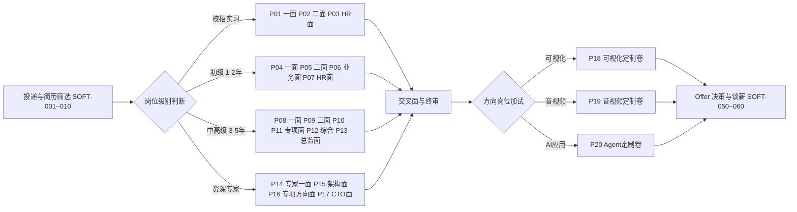
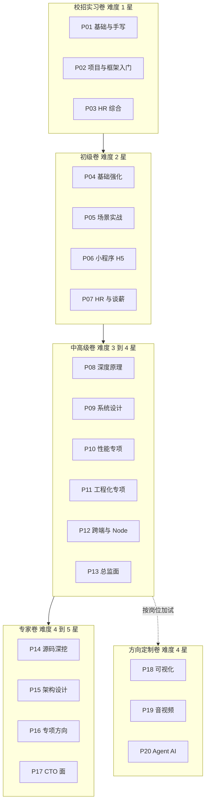
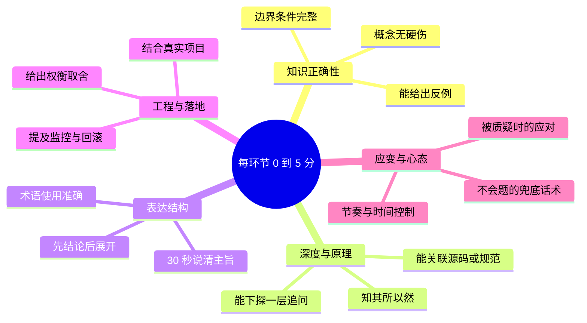
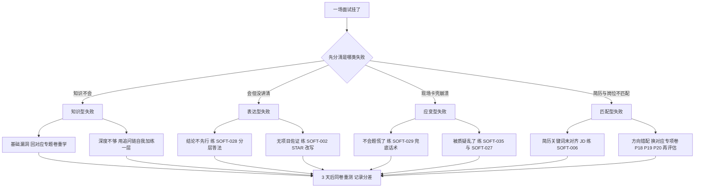

# 前端面试题库：模拟面试套卷

> 编号前缀：MOCK。本专题共 **20 套模拟面试卷（MOCK-P01 ~ MOCK-P20）**，覆盖校招/实习、初级 1-2 年、中高级 3-5 年、资深/专家四个级别，以及可视化、音视频、Agent 三个专项方向。每套卷只做"组卷"：所有题目**引用现有 22 个专题题库的真实编号**（如 JS-013、SCN-026），不重复展开题面，请对照原题库演练。

## 如何使用这套模拟卷

1. **自测计时**：按每套卷的"时间分配表"设总时长，用手机计时器或 `HW-060`（手写 InterviewTimer）做真实计时，中途不查资料、不暂停。
2. **录音复盘**：全程录音。答完一题立即给自己 0-5 分（对照评分表），错题与卡壳处回放定位到具体题库编号，回原专题补课。
3. **模拟追问**：把"面试官追问脚本"交给朋友扮演面试官，或自己答完主问题后强制念出追问链，逼自己往深答一层。
4. **一轮完整周期**：先打本级别一面卷（如 P04）→ 复盘补弱 → 二面卷（P05）→ 专项卷（P10/P11 按岗位选）→ HR 卷（P07）。三场下来分数曲线应单调上升。
5. **组卷原则**：每套卷遵循"基础题 → 深入题 → 手写/场景题 → 开放题"的难度曲线，与真实面试节奏一致；引用题号均已与各专题文件核对，实际存在。

## 20 套卷的级别矩阵

| 级别 | 卷号 | 定位 | 时长 | 主考域 |
|---|---|---|---|---|
| 校招/实习 | P01 | 校招一面 JS/CSS 基础 | 60min | JS、CSS、手写 |
| 校招/实习 | P02 | 校招二面 项目与框架原理 | 60min | V3、R19、SCN |
| 校招/实习 | P03 | 校招 HR 综合面 | 45min | SOFT |
| 初级 1-2 年 | P04 | 一面基础强化 | 90min | JS、CSS、WEB、HW |
| 初级 1-2 年 | P05 | 二面场景实战 | 90min | SCN、PER、JS |
| 初级 1-2 年 | P06 | 小程序/H5 业务面 | 75min | MP、SCN、CSS |
| 初级 1-2 年 | P07 | HR 面与谈薪 | 60min | SOFT |
| 中高级 3-5 年 | P08 | 高级一面 深度原理与手写压轴 | 90min | JS、FRP、HW |
| 中高级 3-5 年 | P09 | 高级二面 系统设计与架构 | 90min | ARC、SCN、V3/R19 |
| 中高级 3-5 年 | P10 | 性能专项面 | 90min | PER、OPT、SCN |
| 中高级 3-5 年 | P11 | 工程化专项面 | 90min | ENG、BLD、OPS |
| 中高级 3-5 年 | P12 | 综合技术面 跨端与 Node | 90min | XP、MP、NODE、DP |
| 中高级 3-5 年 | P13 | 总监面 技术视野与管理 | 70min | ARC、ENG、SOFT |
| 资深/专家 | P14 | 专家一面 源码级深挖 | 90min | FRP、BLD、VIZ |
| 资深/专家 | P15 | 架构设计面 低代码/微前端/大案例 | 90min | ARC、ENG、SCN |
| 资深/专家 | P16 | 专项方向面 三选一情景 | 90min | VIZ/AV/AGT |
| 资深/专家 | P17 | CTO 面与团队匹配 | 60min | ARC、SOFT、AGT |
| 方向定制 | P18 | 可视化岗定制卷 | 90min | VIZ、PER |
| 方向定制 | P19 | 音视频岗定制卷 | 90min | AV、WEB |
| 方向定制 | P20 | Agent/AI 应用岗定制卷 | 90min | AGT、TS、SCN |

## 面试全流程与轮次总览



## 各卷难度与考察重心分布



## 评分维度总图（每套卷通用）



## 目录

- [MOCK-P01：校招一面模拟卷](#mock-p01校招一面模拟卷jscss-基础60-分钟)
- [MOCK-P02：校招二面模拟卷](#mock-p02校招二面模拟卷项目--框架原理60-分钟)
- [MOCK-P03：校招 HR 综合面模拟卷](#mock-p03校招-hr-综合面模拟卷45-分钟)
- [MOCK-P04：初级一面基础强化卷](#mock-p04初级一面基础强化卷90-分钟)
- [MOCK-P05：初级二面场景实战卷](#mock-p05初级二面场景实战卷90-分钟)
- [MOCK-P06：小程序与 H5 业务面卷](#mock-p06小程序与-h5-业务面卷75-分钟)
- [MOCK-P07：HR 面与谈薪模拟卷](#mock-p07hr-面与谈薪模拟卷60-分钟)
- [MOCK-P08：高级一面模拟卷](#mock-p08高级一面模拟卷深度原理--手写压轴90-分钟)
- [MOCK-P09：高级二面模拟卷](#mock-p09高级二面模拟卷系统设计--架构90-分钟)
- [MOCK-P10：性能专项面模拟卷](#mock-p10性能专项面模拟卷90-分钟)
- [MOCK-P11：工程化专项面模拟卷](#mock-p11工程化专项面模拟卷90-分钟)
- [MOCK-P12：综合技术面模拟卷](#mock-p12综合技术面模拟卷跨端--node90-分钟)
- [MOCK-P13：总监面模拟卷](#mock-p13总监面模拟卷技术视野--管理70-分钟)
- [MOCK-P14：专家一面模拟卷](#mock-p14专家一面模拟卷源码级深挖90-分钟)
- [MOCK-P15：架构设计面模拟卷](#mock-p15架构设计面模拟卷低代码--微前端--大案例90-分钟)
- [MOCK-P16：专项方向面模拟卷](#mock-p16专项方向面模拟卷可视化--音视频--agent-三选一90-分钟)
- [MOCK-P17：CTO 面与团队匹配卷](#mock-p17cto-面与团队匹配卷60-分钟)
- [MOCK-P18：可视化岗定制卷](#mock-p18可视化岗定制卷90-分钟)
- [MOCK-P19：音视频岗定制卷](#mock-p19音视频岗定制卷90-分钟)
- [MOCK-P20：Agent 与 AI 应用岗定制卷](#mock-p20agent-与-ai-应用岗定制卷90-分钟)
- [附录：复盘方法与失败归因](#附录复盘方法与失败归因)

---

### MOCK-P01：校招一面模拟卷（JS/CSS 基础，60 分钟）

**目标画像**：校招/实习候选人，考察基础扎实度、编码习惯与潜力。面试官为团队骨干，节奏偏快，基础题答错一题即留下明显负面印象。

**时间分配**：

| 环节 | 时长 | 内容 |
|---|---|---|
| 自我介绍 | 3min | SOFT-011 |
| HTML/CSS 基础 | 12min | CSS-001、CSS-009、CSS-023、CSS-034 |
| JS 语言基础 | 15min | JS-001、JS-011、JS-013、JS-019、JS-026 |
| 异步与事件循环 | 8min | JS-034、JS-043、JS-037 |
| 手写题 | 15min | HW-014、HW-023、HW-011 |
| 追问与收尾 | 3min | 按追问脚本执行 |
| 候选人反问 | 4min | SOFT-042 |

**题目清单**（16 题）：

1. `BAS-019`（考察点：七种基本类型与 typeof 陷阱；要点提示：能指出 typeof null 返回 object 与函数特判）。
2. `CSS-001`（考察点：标准盒模型与 IE 盒模型；要点提示：box-sizing 切换与 border-box 工程惯例）。
3. `CSS-009`（考察点：BFC 触发条件；要点提示：overflow 非 visible、浮动、绝对定位等，能举实际应用）。
4. `CSS-023`（考察点：flex-grow/shrink/basis 语义；要点提示：能解释剩余空间分配与默认值）。
5. `CSS-034`（考察点：水平居中方案；要点提示：text-align、margin auto、flex 区分块级与行内）。
6. `JS-001`（考察点：数据类型与 typeof；要点提示：引用类型判断要换 instanceof/Object.toString）。
7. `JS-011`（考察点：var/let/const 与 TDZ；要点提示：块级作用域与暂时性死区举得出例子）。
8. `JS-013`（考察点：闭包原理；要点提示：作用域链 + 函数捕获词法环境，能举一个计数器实例）。
9. `JS-019`（考察点：this 绑定规则与优先级；要点提示：new > 显式 > 隐式 > 默认）。
10. `JS-026`（考察点：原型与原型链；要点提示：`__proto__` 与 prototype 的关系、属性查找顺序）。
11. `JS-034`（考察点：Promise 解决了什么问题与三种状态；要点提示：回调地狱与信任问题，状态不可逆）。
12. `JS-037`（考察点：Promise.all / allSettled / race / any 区别；要点提示：fail-fast 与否、空数组边界）。
13. `JS-043`（考察点：事件循环宏微任务；要点提示：先清空微任务队列再取宏任务）。
14. `HW-014`（考察点：手写防抖含 immediate/cancel；要点提示：闭包存 timer、this 与参数透传）。
15. `HW-023`（考察点：手写数组扁平化；要点提示：递归版 + reduce 版，追问迭代栈版）。
16. `HW-011`（考察点：手写 call/apply/bind；要点提示：Symbol 挂载、bind 对 new 的兼容）。

**面试官追问脚本**：

```text
追问链一：从 CSS-023 出发
你说了 flex-basis 优先于 width → 那 flex:1 具体展开成什么 → flex-basis: 0% 和 auto 的差别是什么场景 → 如果子项内容很长把容器撑爆了怎么办（引向 min-width: 0，对应 CSS-026）

追问链二：从 JS-013 出发
闭包的内存问题 → 什么情况下闭包会泄漏 → 和垃圾回收什么关系（引向 JS-073 标记清除）→ 循环里 setTimeout 打印 var i 的输出题（JS-014）

追问链三：从 JS-043 出发
宏任务微任务执行顺序 → async/await 混合输出题怎么分析（JS-045/JS-046）→ requestAnimationFrame 排在哪一步（引向 BAS-150 渲染时机）

追问链四：从 HW-014 出发
防抖和节流选型差异 → 输入联想该用哪个 → 如果还要"停在最底部补记一次"怎么改（引向 HW-015/JS-174）
```

**评分表**：

```text
HTML/CSS 基础（0-5）
5 分：四题全对且能主动举例；4 分：全对但举例牵强；3 分：错 1 题或对 BFC 理解停留在背概念；
2 分：错 2 题；0-1 分：盒模型或 flex 基本语义答错。

JS 语言基础（0-5）
5 分：this/闭包/原型全部讲清并能画原型链示意；4 分：全对但深度一般；
3 分：错 1 题但核心概念正确；2 分：this 优先级或原型链混乱；0-1 分：闭包定义都说不清。

异步与事件循环（0-5）
5 分：能口算输出题并解释渲染时机；3 分：顺序对但说不出为什么；0-1 分：认为 setTimeout 0 立即执行且微任务不知情。

手写题（0-5）
5 分：一次写对、边界完整、口头讲清思路；4 分：写对但有小瑕疵（如没透传参数）；
3 分：提示一次后完成；1-2 分：提示多次仍不完整；0 分：写不出来。

综合印象（0-5）：沟通结构、不会题的应对（SOFT-029）、整体自信度。
```

**演练建议**：第一次演练只看题号目录遮住答案，全程录音；答错的题回 JS/CSS 专题精读并当天重答一遍。间隔 3 天用同卷二刷，目标综合分从 3.5 提升到 4.5 以上。手写题务必在白纸或无补全的编辑器里写，禁止粘贴。

---

### MOCK-P02：校招二面模拟卷（项目 + 框架原理，60 分钟）

**目标画像**：通过一面后的校招候选人，面试官多为小组 leader，考察项目真实深度、框架理解与排查问题的思路。

**时间分配**：

| 环节 | 时长 | 内容 |
|---|---|---|
| 自我介绍与项目概述 | 8min | SOFT-011、SOFT-002（STAR 改写） |
| 框架原理（Vue 线） | 12min | V3-002、V3-003、V3-006、V3-042 |
| 框架原理（React 线） | 8min | R19-014、R19-016、R19-018 |
| 工程化常识 | 8min | ENG-009、ENG-028 |
| 场景排查 | 15min | SCN-008、SCN-015、SCN-001 |
| 手写题 | 5min | HW-038 或 HW-045 |
| 候选人反问 | 4min | SOFT-043 |

**题目清单**（12 题）：

1. `SOFT-002`（考察点：项目描述 STAR 结构；要点提示：情境-任务-行动-结果，结果必须量化）。
2. `V3-002`（考察点：Proxy 相比 defineProperty 的优势；要点提示：新增属性、数组索引、嵌套懒代理）。
3. `V3-003`（考察点：track/trigger 机制；要点提示：targetMap → depsMap → dep 三层结构）。
4. `V3-006`（考察点：ref 为什么需要 .value；要点提示：基本类型无法被 Proxy 拦截，包装成对象）。
5. `V3-042`（考察点：key 的作用；要点提示：diff 中标识节点复用，index 作 key 的复用错乱）。
6. `R19-014`（考察点：函数组件与 class 组件区别；要点提示：无实例、Hooks、心智模型）。
7. `R19-018`（考察点：useEffect 依赖数组语义与请求竞态；要点提示：cleanup 与 AbortController）。
8. `ENG-009`（考察点：Vite 开发模式为什么快；要点提示：原生 ESM 按需编译、不整包打包）。
9. `ENG-028`（考察点：tree-shaking 原理与 sideEffects；要点提示：基于 ESM 静态分析）。
10. `SCN-008`（考察点：搜索输入请求乱序竞态；要点提示：AbortController / 版本号两种方案）。
11. `SCN-015`（考察点：双击提交重复下单；要点提示：loading 锁 + 防抖 + 幂等键三层防御）。
12. `HW-038`（考察点：手写 Vue reactive 核心；要点提示：Proxy + track/trigger + effect，30 行量级）。

**面试官追问脚本**：

```text
追问链一：从项目概述出发
你说做了性能优化 → 具体指标从多少到多少 → 怎么量出来的 → 如果有人说你的数据是巧合怎么证明（引向 SOFT-003 无数据量化、PER-006）

追问链二：从 V3-003 出发
track 发生在什么时候 → trigger 之后界面立刻更新吗 → 异步批量更新怎么做的（引向 V3-007/FRP-009）→ nextTick 内部用什么实现（微任务）

追问链三：从 R19-018 出发
依赖数组写 [] 会怎样 → 闭包陷阱的根源是什么 → StrictMode 为什么执行两次 effect（R19-020）→ 你的项目里怎么治理 exhaustive-deps（R19-114）

追问链四：从 SCN-008 出发
AbortController 取消的是请求还是响应处理 → 换成 axios 怎么做 → 两个方案各自的坑（版本号方案会浪费带宽）
```

**评分表**：

```text
项目深度（0-5）
5 分：能讲清架构决策、量出数据、答出代价与取舍；4 分：STAR 完整但量化弱；
3 分：只讲做了什么讲不清为什么；0-2 分：项目像教程跟做，追问两句就露馅。

框架原理（0-5）
5 分：Vue/React 两线都及格且一条线能下探两层；4 分：主用框架及格另一条线浅；
3 分：主用框架仅停留在 API 层；0-2 分：说不清响应式或 diff 的基本原理。

场景排查（0-5）
5 分：有清晰排查框架，先复现再定位再验证；3 分：能猜到方向但无方法；0-2 分：上来就乱改代码。

手写题（0-5）：同 P01 标准，本题权重低，写对核心即可。
工程化常识（0-5）：Vite 快的根因 + tree-shaking 前提，两问都对给 4 以上。
综合印象（0-5）：反问质量、表达结构、与团队的匹配潜质。
```

**演练建议**：本卷的分数主要由项目部分决定。演练前先用 SOFT-012 三层挖掘法把自己的项目亮点写成提纲，确保每个亮点都接得住两层追问。场景题部分用"复现 → 定位 → 修复 → 防复发"四段式作答，这是二面和三面通用的加分叙事。

---

### MOCK-P03：校招 HR 综合面模拟卷（45 分钟）

**目标画像**：校招终轮 HR 面，考察动机、稳定性、价值观与基本职业素养。技术已过，此轮失分多为态度与表达问题。

**时间分配**：

| 环节 | 时长 | 内容 |
|---|---|---|
| 简历走查与经历陈述 | 5min | SOFT-001 |
| 项目与挑战深挖 | 12min | SOFT-013、SOFT-014 |
| 行为面试题 | 15min | SOFT-019、SOFT-021、SOFT-020、SOFT-025 |
| 职业规划与动机 | 6min | SOFT-061、SOFT-065 |
| 薪资意向与到岗时间 | 3min | SOFT-050 |
| 候选人反问 | 4min | SOFT-047 |

**题目清单**（10 题）：

1. `SOFT-001`（考察点：一页简历的信息密度；要点提示：HR 会按简历结构逐段核对）。
2. `SOFT-013`（考察点：项目最大挑战；要点提示：选真实难题，讲清解法与成长）。
3. `SOFT-014`（考察点：如果重做一次会怎么做；要点提示：展示反思能力而非全盘否定过去）。
4. `SOFT-019`（考察点：STAR 法不生硬的使用；要点提示：行动部分占 60%，结果带数据）。
5. `SOFT-021`（考察点：讲一个失败经历；要点提示：选材标准——真实、已改进、与岗位无关紧要）。
6. `SOFT-020`（考察点：与同事/leader 分歧处理；要点提示：对事不对人，数据说话，最终执行决定）。
7. `SOFT-025`（考察点：最大的缺点；要点提示：真实但可控，附正在做的改进措施）。
8. `SOFT-061`（考察点：三年五年规划；要点提示：技术深度路线 + 与公司业务结合，忌空谈管理）。
9. `SOFT-065`（考察点：为什么选择我们公司；要点提示：具体到产品/技术栈/团队，忌通用话术）。
10. `SOFT-049`（考察点：HR 面到底在考察什么；要点提示：动机、稳定性、成本、团队风险四件事）。

**面试官追问脚本**：

```text
追问链一：从失败经历出发
这次失败后来怎么改的 → 有没有证据说明改了 → 如果同样的情况再出现你会怎么办（考察 Action 是否落实）

追问链二：从职业规划出发
你说三年想成为资深前端 → 具体靠什么路径 → 你为此现在做了什么（考察自驱力，可引 SOFT-082 学习体系）

追问链三：从动机出发
你还面了哪些公司 → 如果它们先给你 offer 怎么选（引向 SOFT-057 决策矩阵，校招答偏好与平台即可，不必过度博弈）

追问链四：从缺点出发
这个缺点影响到现在的工作吗 → 举个例子 → 同事怎么看（考察自我认知是否真实）
```

**评分表**：

```text
经历真实性（0-5）：5 分细节丰富前后一致；3 分大体可信但细节含糊；0-2 分数据与描述对不上。
动机与稳定性（0-5）：5 分动机具体且与岗位强相关；3 分泛泛而谈；0-2 分明显海投话术。
行为题结构（0-5）：5 分 STAR 自然、有反思；3 分能讲事但无总结；0-2 分全是空话。
表达与态度（0-5）：语速、逻辑、对 HR 的基本尊重；反问环节主动提问加分。
风险信号（负分项）：简历造假暗示（SOFT-016）、贬低前实习单位、对加班/薪酬表态极端。
```

**演练建议**：HR 面是校招最容易掉链子的一轮。把 SOFT-021、SOFT-025、SOFT-061 三道高频题的答案写成 200 字以内的稿子并背熟框架（不是背字句），找非技术朋友模拟一次，要求对方在你答完每个问题后追问"为什么"。

---

### MOCK-P04：初级一面基础强化卷（90 分钟）

**目标画像**：工作 1-2 年候选人，一面以基础强化为主，题目比校招深一层，重点看"用没用过"与"知不知道为什么"。

**时间分配**：

| 环节 | 时长 | 内容 |
|---|---|---|
| 自我介绍 | 3min | SOFT-011 |
| JS 深度 | 25min | JS-003、JS-055、JS-044、JS-045、JS-073、JS-092 |
| CSS 深度 | 15min | CSS-016、CSS-024、CSS-051、BAS-151 |
| 网络与浏览器 | 12min | WEB-022、WEB-034、WEB-035、WEB-048 |
| 手写题 | 20min | HW-016、HW-015、HW-021 |
| 算法题 | 10min | ALG-021 |
| 候选人反问 | 5min | SOFT-044 |

**题目清单**（14 题）：

1. `JS-003`（考察点：== 隐式转换规则；要点提示：能推演 `[] == ![]` 为 true 的完整过程）。
2. `JS-055`（考察点：0.1+0.2 精度问题；要点提示：IEEE754 双精度，分转整数或 BigInt 处理）。
3. `JS-044`（考察点：宏任务微任务分类；要点提示：为什么要区分——微任务保证本轮同步代码后的原子执行）。
4. `JS-045`（考察点：setTimeout/Promise/async 混合输出；要点提示：逐行标注入队时机，async 函数体同步执行到首个 await）。
5. `JS-073`（考察点：V8 垃圾回收；要点提示：新生代 Scavenge、老生代标记清除/整理、增量并发）。
6. `JS-092`（考察点：微任务风暴；要点提示：无限 then 链饿死渲染，与长任务的区别）。
7. `CSS-016`（考察点：z-index 失效条件；要点提示：层叠上下文未创建或父级限制）。
8. `CSS-024`（考察点：flex:1 / flex:auto / flex:none；要点提示：三值展开后 basis 的差异）。
9. `CSS-051`（考察点：重排重绘；要点提示：读写分离避免强制同步布局）。
10. `BAS-151`（考察点：哪些情况创建新层叠上下文；要点提示：定位+z-index、transform、opacity<1、isolation 等）。
11. `WEB-022`（考察点：强缓存 Cache-Control；要点提示：max-age/no-cache/no-store 语义区分）。
12. `WEB-035`（考察点：CORS 简单请求与预检；要点提示：方法、自定义头、Content-Type 三个触发条件）。
13. `HW-016`（考察点：手写深拷贝；要点提示：递归 + WeakMap 处理循环引用 + 特殊对象分支）。
14. `HW-021`（考察点：手写 LRU；要点提示：Map 版 O(1) get/put，追问双链表版思想）。

**面试官追问脚本**：

```text
追问链一：从 JS-055 出发
为什么会丢精度 → toFixed(2) 可靠吗 → 金额计算你的项目里怎么做（引向 JS-112、ALG-200 分单位+BigInt）

追问链二：从 JS-073 出发
标记清除后内存碎片怎么办 → 哪些代码写法会延缓回收 → 你的项目里排查过内存问题吗（引向 JS-074/JS-178）

追问链三：从 WEB-022 出发
强缓存命中了但接口数据要实时怎么办 → 协商缓存 ETag 怎么生成 → content hash 产物怎么和缓存策略配合（引向 WEB-023/PER-011）

追问链四：从 HW-016 出发
WeakMap 为什么能解决循环引用 → RegExp/Date/Map/Set 怎么分支 → 结构化克隆为什么不能处理函数（JS-057）

追问链五：从 ALG-021 出发
一次遍历 O(n) 转树的关键是什么 → 如果数据有环怎么兜底 → 递归深度爆栈怎么办（迭代栈版）
```

**评分表**：

```text
JS 深度（0-5）
5 分：输出题全对且 GC/微任务风暴讲出工程含义；4 分：全对但深度止于概念；
3 分：错 1 题；2 分：输出题一半错；0-1 分：隐式转换或事件循环基本功不过关。

CSS 深度（0-5）：层叠上下文与重排重绘是分水岭，两者都清楚给 4+。
网络与浏览器（0-5）：缓存策略能画出判定流程给 4+（WEB-024），否则 3 封顶。
手写题（0-5）：三题加权，深拷贝占 2 分权重；循环引用没处理最多 3 分。
算法题（0-5）：先讲思路再写码，O(n) 版本给 4+。
综合印象（0-5）：2 年经验应表现出独立排查能力与至少一个说得深的知识点。
```

**演练建议**：初级一面的淘汰点集中在"输出题"与"深拷贝"。演练时把 JS-045、BAS-141/142/143 三道输出题各做 3 遍变体；HW-016 限定 15 分钟内写出含循环引用与 4 种特殊对象的版本。网络部分建议先手画一遍 WEB-024 的缓存判定流程图再答题。

---

### MOCK-P05：初级二面场景实战卷（90 分钟）

**目标画像**：工作 1-2 年候选人二面，以线上场景与业务方案为主，看独立作战能力：给你一个问题，能不能拆解、定位、落地、防复发。

**时间分配**：

| 环节 | 时长 | 内容 |
|---|---|---|
| 项目回顾 | 8min | SOFT-017（个人贡献切分） |
| 线上排查场景 | 25min | SCN-001、SCN-003、SCN-053 |
| 业务方案场景 | 25min | SCN-015、SCN-018、SCN-019、SCN-023 |
| 手写与工具 | 20min | HW-050、JS-091、JS-115 |
| 渲染与列表原理 | 5min | BAS-150、PER-019 |
| 追问与收尾 | 7min | 按追问脚本执行 |
| 候选人反问 | 5min | SOFT-045 |

**题目清单**（13 题）：

1. `SOFT-017`（考察点：团队项目切分个人贡献；要点提示：模块维度 + 代码证据）。
2. `SCN-001`（考察点：线上大面积白屏排查；要点提示：监控确认面 → 发布回溯 → 资源/JS/接口三条线）。
3. `SCN-003`（考察点：首屏 5 秒优化方案；要点提示：拆 TTFB/资源/渲染三段，给优先级）。
4. `SCN-053`（考察点：越用越卡的内存泄漏定位；要点提示：堆快照对比 + Detached DOM + 时间线曲线）。
5. `SCN-015`（考察点：防重复下单；要点提示：交互锁、幂等键、服务端终审三层）。
6. `SCN-018`（考察点：token 无感刷新；要点提示：刷新锁 + 请求队列重放 + 并发 401 处理）。
7. `SCN-019`（考察点：多标签页登录态同步；要点提示：storage 事件/BroadcastChannel，登出广播）。
8. `SCN-023`（考察点：1 万条数据虚拟列表落地；要点提示：视口计算、缓冲区、不定高方案）。
9. `HW-050`（考察点：手写请求竞态处理；要点提示：版本号 + abort 双方案封装）。
10. `JS-091`（考察点：AbortController 取消与级联取消；要点提示：signal 透传与组件卸载联动）。
11. `JS-115`（考察点：localStorage 完整封装；要点提示：过期时间、版本号、容量与异常降级）。
12. `BAS-150`（考察点：事件循环与渲染顺序、rAF 位置；要点提示：微任务后渲染前，rAF 在布局前）。
13. `PER-019`（考察点：虚拟列表原理与核心逻辑；要点提示：startIndex/endIndex 由 scrollTop 二分或推算）。

**面试官追问脚本**：

```text
追问链一：从 SCN-001 出发
你先看监控还是先看代码 → 怎么快速判断是不是发版引入 → 如果是第三方 CDN 挂了怎么办（引向 OPS-014 多 CDN 容灾）

追问链二：从 SCN-018 出发
刷新 token 的请求本身 401 怎么办 → 用户操作到一半 token 过期，表单数据怎么保住 → 并发 10 个请求同时 401，为什么不能发 10 次刷新（引向 JS-087 串行队列思想）

追问链三：从 SCN-023 出发
不定高怎么算总高度 → 滚动过快白屏怎么办 → 预估高度偏差导致跳动怎么修正（引向 PER-019/SCN-131 思想）

追问链四：从 SCN-053 出发
Detached DOM 是什么 → 为什么事件监听器会挂住 DOM → 全局交给 GC 不行吗（引向 JS-178 泄漏清单）
```

**评分表**：

```text
线上排查（0-5）
5 分：有标准排查框架，能分清前端/网络/后端/发布四类根因并给验证手段；
4 分：方向正确但缺验证闭环；3 分：能答一两种情况；0-2 分：只靠猜。

业务方案（0-5）
5 分：方案分层（交互层/网络层/服务端配合）且提到边界与降级；3 分：只给单点方案；0-2 分：方案有明显逻辑漏洞。

手写与工具（0-5）：HW-050 两方案都能写给 4+；JS-115 封装问版本失效策略，答出加 1 分。
追问存活度（0-5）：每条追问链往下走一层不崩即达标，能走两层以上给 5。
综合印象（0-5）：排查叙事是否像"做过事的人"，反问是否关注业务与团队。
```

**演练建议**：场景题用口述 + 白板画图方式演练，每题限定 5 分钟内给出"分类假设 → 逐一验证"的框架。录音后回放检查自己是否说了"可能吧""我也不确定"这类没有验证动作的空话。二面通常有反问深挖，把 SOFT-045 的问题提前写好 3 个。

---

### MOCK-P06：小程序与 H5 业务面卷（75 分钟）

**目标画像**：1-3 年候选人，岗位涉及小程序/H5 业务交付，考察移动端特有问题（双线程、适配、容器）与业务落地经验。

**时间分配**：

| 环节 | 时长 | 内容 |
|---|---|---|
| 自我介绍 | 3min | SOFT-011 |
| 小程序原理 | 15min | MP-001、MP-002、MP-016、MP-045 |
| 小程序工程 | 12min | MP-031、MP-037、MP-077 |
| H5 适配与兼容 | 15min | SCN-033、SCN-034、SCN-035、CSS-175 |
| 业务场景 | 15min | SCN-037、SCN-129、MP-101 |
| 手写或方案 | 10min | CSS-177、HW-034 |
| 候选人反问 | 5min | SOFT-043 |

**题目清单**（13 题）：

1. `MP-001`（考察点：小程序双线程架构原因；要点提示：渲染与逻辑分离，管控与安全）。
2. `MP-002`（考察点：setData 通信机制；要点提示：逻辑层序列化传 native 层再到渲染层）。
3. `MP-016`（考察点：setData 性能优化全套；要点提示：路径更新、减少频次与数据量、避免后台页 setData）。
4. `MP-045`（考察点：小程序登录鉴权完整流程；要点提示：wx.login code → 服务端换 session → 自定义登录态）。
5. `MP-031`（考察点：分包配置与体积限制；要点提示：主包 2M、总包上限、独立分包）。
6. `MP-037`（考察点：启动性能优化清单；要点提示：代码包瘦身、预下载、初始渲染缓存）。
7. `MP-077`（考察点：miniprogram-ci 自动化上传；要点提示：机器人 key、版本号管理、流水线集成）。
8. `SCN-033`（考察点：H5 适配工程方案；要点提示：rem/vw 方案与 postcss 落地）。
9. `SCN-034`（考察点：高清屏 1px 问题；要点提示：DPR 缩放、伪元素、box-shadow 方案对比）。
10. `SCN-035`（考察点：软键盘遮挡输入框；要点提示：visualViewport 监听与滚动定位）。
11. `CSS-175`（考察点：100vh 移动端问题与 dvh/svh/lvh；要点提示：地址栏动态高度）。
12. `SCN-037`（考察点：微信内置浏览器高频坑；要点提示：缓存、X5 内核、授权、分享配置）。
13. `SCN-129`（考察点：秒杀倒计时与服务端时间对齐；要点提示：服务器时间偏移校准 + rAF 更新）。

**面试官追问脚本**：

```text
追问链一：从 MP-016 出发
setData 数据量多大算大 → 路径更新怎么写 → 为什么长列表要 recycle-view（MP-060）→ 小程序没有 DOM，虚拟列表怎么估高

追问链二：从 MP-045 出发
code 换 session 在哪个端做 → session_key 过期怎么办 → 敏感数据解密为什么必须服务端（MP-091）

追问链三：从 SCN-035 出发
visualViewport 兼容性不够的降级 → 键盘弹起触发 resize 还是 scroll（iOS 差异）→ fixed 定位在键盘弹起后错位怎么修

追问链四：从 SCN-129 出发
服务器时间怎么安全拿（接口给的时间可信吗，传输耗时怎么扣）→ 页面切后台 5 分钟回来倒计时怎么修正（visibilitychange + 重校准）
```

**评分表**：

```text
小程序原理（0-5）：双线程 + setData 链路讲清给 4+；只背 API 给 2。
小程序工程（0-5）：有真实分包与 CI 经验给 4+；只看过文档给 2-3。
H5 适配（0-5）：1px、100vh、键盘三个问题都有方案与适用条件给 4+。
业务场景（0-5）：秒杀/电商场景有系统性方案（含防刷意识）给 4+。
手写或方案（0-5）：CSS-177 能对比至少两种方案的取舍给 4。
综合印象（0-5）：是否有真机调试与线上排查经验（MP-083/MP-141）。
```

**演练建议**：本卷适合做过小程序项目的候选人，也适合没做过的人用来"补容器端常识"。演练重点放在追问链一：把 setData 的传输路径画成图（逻辑层 → native → 渲染层），能对着图讲 3 分钟即过关。真机相关题目如果没经验，用 SOFT-029 的兜底话术承认并转述你熟悉的等价方案。

---

### MOCK-P07：HR 面与谈薪模拟卷（60 分钟）

**目标画像**：1-3 年社招候选人 HR 轮与谈薪环节。此轮的博弈本质是信息交换，考察点：离职原因是否可信、稳定性、期望薪资与谈判空间。

**时间分配**：

| 环节 | 时长 | 内容 |
|---|---|---|
| 职业经历回顾 | 8min | SOFT-053（跳槽频繁质疑） |
| 离职原因与稳定性 | 12min | SOFT-024 |
| 薪资沟通 | 20min | SOFT-050、SOFT-058、SOFT-059 |
| Offer 决策与背调 | 10min | SOFT-051、SOFT-054、SOFT-057 |
| 候选人反问 | 7min | SOFT-046 |
| 收尾与期望确认 | 3min | SOFT-055、SOFT-060 |

**题目清单**（11 题）：

1. `SOFT-053`（考察点：跳槽频繁被质疑；要点提示：给客观原因 + 主线一致性，不贬低前东家）。
2. `SOFT-024`（考察点：离职原因；要点提示：往"发展诉求"上归因，理由必须能被背调验证）。
3. `SOFT-050`（考察点：期望薪资三种策略；要点提示：报价/区间/反问的适用场景与时机）。
4. `SOFT-058`（考察点：谈薪时间点把握；要点提示：一轮技术面前少谈钱，offer 前才是黄金窗口）。
5. `SOFT-059`（考察点：被压价应对；要点提示：用市场数据与竞争 offer 支撑，不情绪化）。
6. `SOFT-051`（考察点：其他 offer 作谈判筹码；要点提示：真实、可验证、点到为止）。
7. `SOFT-054`（考察点：背调注意事项；要点提示：留好直属上级联系方式，口径与简历一致）。
8. `SOFT-057`（考察点：多 offer 加权决策矩阵；要点提示：列维度（薪资/成长/团队/稳定性）赋权重打分）。
9. `SOFT-055`（考察点：offer 中五险一金与 base 的坑；要点提示：缴存基数、试用期折扣、股票分行权）。
10. `SOFT-046`（考察点：问考核与晋升的安全问法；要点提示：问机制不问个人待遇承诺）。
11. `SOFT-060`（考察点：接 offer 后反悔的风险与做法；要点提示：尽早、诚实、留缓冲期）。

**面试官追问脚本**：

```text
追问链一：从离职原因出发
你说想找更大平台 → 现在的公司为什么满足不了 → 这两年你为此做过什么努力 → 如果新公司也遇到同样问题你会再走吗

追问链二：从期望薪资出发
你报的区间依据是什么 → 目前薪资多少能否提供流水（SOFT-052）→ 如果只能给到区间下限你来吗

追问链三：从竞争 offer 出发
另一家的 offer 是什么结构 → 为什么仍倾向我们 → 需要我们匹配对方哪部分

追问链四：从稳定性出发
如果三个月后发现岗位和说的不一样怎么办 → 你希望直属 leader 是什么风格（考察期望管理，SOFT-087 向上管理作延伸）
```

**评分表**：

```text
离职原因可信度（0-5）：5 分客观、一致、可背调；3 分大体合理但含糊；0-2 分抱怨前东家或自相矛盾。
谈薪策略（0-5）：5 分有数据支撑、节奏得当、进退有据；3 分只敢报区间不敢谈；0-2 分报价明显脱离市场或全盘接受压价。
信息收集（0-5）：是否主动问清薪资结构、考核、晋升机制与团队现状。
风险意识（0-5）：背调、offer 条款、违约金的注意程度。
整体成熟度（0-5）：谈判全程的情绪管理——这是 HR 卷的核心分。
```

**演练建议**：谈薪题必须口头演练而不是看会。找朋友扮演 HR，按追问链三连压三次价，练到不慌。提前查好目标岗位的市场区间数据源（薪资报告、脉脉/levels 等），把"我的依据"一句话化。所有数字口径（总包/月薪/股票）提前统一，避免现场换算出错。

---

### MOCK-P08：高级一面模拟卷（深度原理 + 手写压轴，90 分钟）

**目标画像**：3-5 年高级工程师一面。基础题快速过滤，重心在 JS 引擎、框架原理下探与 25 分钟手写压轴，看知识体系的深度上限。

**时间分配**：

| 环节 | 时长 | 内容 |
|---|---|---|
| 自我介绍 | 5min | SOFT-011 |
| JS 引擎与语言深度 | 15min | JS-073、JS-098、JS-099、JS-092 |
| 框架原理深挖 | 25min | FRP-008、FRP-023、FRP-027、FRP-028、FRP-046 |
| 网络与浏览器进阶 | 10min | WEB-125、WEB-084 |
| 手写压轴 | 25min | HW-001、FRP-113、FRP-116 三选二 |
| 候选人反问 | 10min | SOFT-044 |

**题目清单**（14 题）：

1. `JS-073`（考察点：V8 GC 全链路；要点提示：分代、Scavenge、标记整理、增量/并发标记）。
2. `JS-098`（考察点：Proxy 13 种 trap 分类；要点提示：get/set/has/deleteProperty/ownKeys 常用组合）。
3. `JS-099`（考察点：Proxy 为什么配 Reflect；要点提示：receiver 修正保证默认行为不破坏）。
4. `JS-092`（考察点：微任务风暴；要点提示：与长任务的区别在于"永远让不出微任务队列"）。
5. `FRP-008`（考察点：defineProperty 缺陷与 Proxy 解法；要点提示：新增属性、数组、性能）。
6. `FRP-023`（考察点：Fiber 链表结构；要点提示：child/sibling/return 三指针与可中断性）。
7. `FRP-027`（考察点：可中断渲染与 shouldYield；要点提示：时间切片、lane 优先级协同）。
8. `FRP-028`（考察点：多次 useState 如何区分；要点提示：Hooks 链表按顺序索引，引出规则限制）。
9. `FRP-046`（考察点：Vue 与 React 更新模型本质差异；要点提示：响应式精确推送 vs 拉取重渲 + memo）。
10. `WEB-125`（考察点：HTTP 三代演进各自解决与引入的问题；要点提示：队头阻塞、多路复用、QUIC）。
11. `WEB-084`（考察点：渲染进程主线程/合成线程/raster 分工；要点提示：合成器让滚动不等主线程）。
12. `HW-001`（考察点：手写 Promise 核心含 then 链；要点提示：状态机 + 回调队列 + 链式返回新 Promise）。
13. `FRP-113`（考察点：手写迷你 Vue 响应式核心；要点提示：reactive + effect + track/trigger + computed）。
14. `FRP-116`（考察点：手写迷你 React；要点提示：createElement + render 循环 + 函数组件 + useState 链）。

**面试官追问脚本**：

```text
追问链一：从 FRP-028 出发
Hooks 顺序为什么必须一致 → 条件语句里写 useState 会发生什么 → React 怎么知道该复用哪个 Hook（memoizedState 链）

追问链二：从 FRP-027 出发
浏览器一帧里切片渲染怎么配合 rAF → Scheduler 为什么用 MessageChannel 而不是 setTimeout（FRP-148，嵌套 setTimeout 4ms 下限）

追问链三：从 HW-001 出发
then 返回的新 Promise 什么时候 resolve → 值穿透怎么实现 → onFulfilled 返回 thenable 怎么处理 → 你的实现和 Promises/A+ 差在哪

追问链四：从 WEB-125 出发
HTTP/2 的队头阻塞解决了吗（TCP 层还在）→ 所以 HTTP/3 改了什么 → 0-RTT 的重放风险（WEB-009）

追问链五：从 JS-098 出发
trap 里 get 返回 undefined 会有什么连锁问题 → Vue3 里 ReadProxy 的 set 拦截为什么警告报错而不是静默失败
```

**评分表**：

```text
JS 引擎深度（0-5）：GC + trap + 微任务风暴三者都到工程含义层给 5；停留在概念给 3。
框架原理（0-5）：能手画 Fiber/Hooks 链表或响应式依赖图给 5；只背结论给 3。
网络进阶（0-5）：HTTP 三代演进能讲"解决了什么又引入了什么"给 4+。
手写压轴（0-5）
5 分：两道都完成且代码可运行、边界完整；4 分：一道完整一道差收尾；
3 分：一道完整；2 分：两道都半成品；0-1 分：核心逻辑错误。
反问质量（0-5）：高级岗的反问应体现技术判断力（SOFT-044）。
```

**演练建议**：手写压轴是本卷胜负手。三道手写按 12 分钟一道的节奏限时练习：先在纸上写框架（状态/队列/关键函数签名），再讲思路，最后补细节——顺序别反。FRP-113 和 FRP-116 各练到"脱稿 80 行内完成核心"为止。原理题练习时强迫自己每答一个结论就补一句"因为……所以……"。

---

### MOCK-P09：高级二面模拟卷（系统设计 + 架构，90 分钟）

**目标画像**：3-5 年候选人二面，通常由架构师或技术负责人主持，1-2 道系统设计大题 + 架构追问，看抽象能力与权衡意识。

**时间分配**：

| 环节 | 时长 | 内容 |
|---|---|---|
| 项目与背景 | 10min | SOFT-012（三层挖掘法讲亮点） |
| 系统设计主题 | 40min | SCN-026、ARC-009、ARC-051、ARC-057 |
| 架构追问 | 20min | ARC-060、ARC-059、ARC-131 |
| 质量与协作 | 10min | SCN-047、ARC-184 |
| 候选人反问 | 10min | SOFT-045 |

**题目清单**（12 题）：

1. `SOFT-032`（考察点：系统设计题答题骨架；要点提示：澄清需求 → 量级估算 → 分层设计 → 权衡 → 演进）。
2. `ARC-001`（考察点：可量化的技术选型矩阵；要点提示：维度加权打分，避免"我觉得"）。
3. `ARC-009`（考察点：经典分层与依赖方向；要点提示：视图/业务/服务/基础设施单向依赖）。
4. `ARC-051`（考察点：前端状态分类与放置；要点提示：服务端状态/客户端状态/URL/本地四类分治）。
5. `ARC-057`（考察点：请求层统一设计；要点提示：拦截器、重试、取消、缓存、去重五件套）。
6. `SCN-026`（考察点：中后台权限系统落地；要点提示：路由守卫 + 按钮级权限 + 接口层校验，前后端边界）。
7. `R19-178` 或 `V3-182`（考察点：中后台管理系统完整架构；要点提示：布局/权限/菜单/表格/表单五大体系）。
8. `ARC-060`（考察点：CSR/SSR/SSG/ISR 渲染架构决策；要点提示：SEO、实时性、成本三要素）。
9. `ARC-059`（考察点：数据失效与 tag invalidation 设计；要点提示：失效粒度与触发方）。
10. `SCN-047`（考察点：技术方案文档结构；要点提示：背景、目标、方案、风险、灰度、回滚）。
11. `ARC-131`（考察点：质量门禁体系；要点提示：lint/测试/体积/覆盖率四道卡口的分层拦截）。
12. `ARC-184`（考察点：写一份 ADR；要点提示：上下文、选项、决策、后果四段式）。

**面试官追问脚本**：

```text
追问链一：从权限系统出发
按钮级权限三种实现（指令/HOC/组件包裹）怎么选 → 权限数据变更后如何实时生效（PER-137）→ 接口权限前端拦不住怎么办（明确服务端终审）

追问链二：从请求层出发
重试会不会放大故障 → 重试与幂等什么关系 → 缓存和去重的边界（同一 URL 并发去重 vs TTL 缓存）→ 熔断放在请求层还是网关层

追问链三：从渲染架构出发
你选 SSR 的理由里哪条最硬 → SEO 之外的收益 → SSR 挂了怎么降级回 CSR（ARC-065 边界）

追问链四：从状态分类出发
服务端状态为什么不该放全局 store → 乐观更新失败回滚和 tag 失效怎么配合（ARC-058）→ 多标签页怎么同步失效（SCN-019）
```

**评分表**：

```text
需求澄清（0-5）：设计开始前是否主动问清用户量、实时性、约束条件；直接开画扣 2 分。
分层与抽象（0-5）
5 分：分层清晰、依赖单向、每层职责一句话可说清；3 分：能分层但边界模糊；0-2 分：堆技术名词无结构。
权衡意识（0-5）：每个关键决策给出至少一个被否选项及理由（ARC-002）。
落地完备性（0-5）：灰度、监控、回滚、门禁是否出现在方案里——高级岗的分水岭。
追问存活度（0-5）：架构追问连续两层不崩。
```

**演练建议**：系统设计题先练骨架再练深度。用 SCN-026 或 R19-178 做一次 40 分钟完整推演并录音，回放检查三件事：有没有先问需求、有没有给出被否选项、有没有提到监控与回滚。把 ARC-184 的 ADR 模板真的为自己的项目写一份，面试时可以直接引用。

---

### MOCK-P10：性能专项面模拟卷（90 分钟）

**目标画像**：3-5 年候选人，目标岗位有明确性能要求（C 端/大促/长列表密集型业务）。考察指标体系、工具归因与专项推进能力。

**时间分配**：

| 环节 | 时长 | 内容 |
|---|---|---|
| 指标与采集 | 20min | PER-001、PER-002、PER-003、PER-004、PER-007 |
| 工具与归因 | 20min | OPT-121、OPT-129、PER-029、PER-030 |
| 实战案例 | 25min | SCN-093、SCN-096、SCN-100 |
| 体系与推广 | 15min | PER-118、OPT-185、OPT-184 |
| 候选人反问 | 10min | SOFT-044 |

**题目清单**（14 题）：

1. `PER-001`（考察点：三大 Core Web Vitals 与阈值；要点提示：LCP 2.5s / INP 200ms / CLS 0.1，P75 口径）。
2. `PER-002`（考察点：LCP 候选元素与优化；要点提示：img/背景图/文本块，候选规则与失效）。
3. `PER-003`（考察点：INP 与 FID 区别；要点提示：INP 看整次交互的最差响应，覆盖输入到绘制全程）。
4. `PER-004`（考察点：CLS 计算与防偏移；要点提示：冲击分数、尺寸预留清单）。
5. `PER-007`（考察点：统一指标采集入口防漏采；要点提示：buffered 选项与 PerformanceObserver 注册时序）。
6. `OPT-121`（考察点：首屏慢的关键链路拆解；要点提示：TTFB→FCP→LCP 逐段归因）。
7. `OPT-129`（考察点：INP 三段归因；要点提示：输入延迟/处理时长/渲染延迟分别怎么测怎么治）。
8. `PER-029`（考察点：Performance 面板排查卡顿流程；要点提示：录制 → 火焰图 → 长任务 → 归因）。
9. `PER-030`（考察点：Memory 面板堆快照定位泄漏；要点提示：三次快照对比、retained size）。
10. `SCN-093`（考察点：大促页 3 天倒排优化时间分配；要点提示：先测后优，按 ROI 排序）。
11. `SCN-096`（考察点：10fps 掉帧定位重排/重绘/合成层；要点提示：Rendering 面板 + layer border）。
12. `SCN-100`（考察点：低端机优雅降级；要点提示：设备分档、动效裁剪、图片降质）。
13. `PER-118`（考察点：监控体系从 0 到 1 路线；要点提示：先错误后性能再行为，采样与告警配套）。
14. `OPT-184`（考察点：优化项收益/成本矩阵排优先级；要点提示：量化收益（ms/转化率）× 改造成本）。

**面试官追问脚本**：

```text
追问链一：从 PER-003 出发
INP 三段里你们哪段最长 → 长任务怎么拆（PER-017）→ 时间切片和 Web Worker 怎么选（OPT-031/OPT-032）

追问链二：从 OPT-121 出发
TTFB 高是 DNS 慢还是服务端慢，怎么证明 → CDN 命中率怎么查（OPT-026）→ 如果是接口瀑布怎么改并行（OPT-122）

追问链三：从 SCN-096 出发
你说是合成层问题，证据是什么 → 层爆炸怎么发现（CSS-186）→ will-change 加了没效果为什么（CSS-050 滥用）

追问链四：从 PER-118 出发
采样率定多少 → RUM 和 Lab 数据打架听谁的（OPT-044）→ 告警怎么不误报（PER-102 阈值/同环比/连续 N 次）
```

**评分表**：

```text
指标体系（0-5）：三大指标定义+阈值+P75 口径全对给 5；能定义自定义业务指标（PER-056）额外加分。
工具归因（0-5）：能描述"从现象到证据"的完整链条给 4+；只会念工具名给 2。
实战案例（0-5）：有真实案例且数据前后可比给 5；案例是套用模板给 3。
体系能力（0-5）：能谈采样、告警、预算、文化四层（PER-182）给 5。
反问质量（0-5）：是否问到团队性能基建现状与历史专项。
```

**演练建议**：性能面的关键是"证据链"。每道场景题演练时强制自己说出三样东西：用什么工具测、看到了什么数值、判断依据是什么。没有真实案例的候选人，用本仓库 OPT 专题的 SCN 案例题自导一次"纸上专项"：给自己 30 分钟设计 OPT-185 的 6 周 plan，然后对着评分表自评。

---

### MOCK-P11：工程化专项面模拟卷（90 分钟）

**目标画像**：3-5 年候选人，目标岗位偏基建/平台/效能方向。考察构建原理、规范落地、CI/CD 与 monorepo 治理。

**时间分配**：

| 环节 | 时长 | 内容 |
|---|---|---|
| 构建工具原理 | 25min | ENG-009、ENG-012、BLD-032、BLD-054、ENG-028 |
| 依赖与规范 | 15min | ENG-003、ENG-032、ENG-033 |
| CI/CD 与发布 | 20min | ENG-041、OPS-049、OPS-013 |
| Monorepo 治理 | 15min | ENG-044、ENG-046、ENG-053 |
| 文化与度量 | 10min | ENG-185、ENG-186 |
| 候选人反问 | 5min | SOFT-044 |

**题目清单**（14 题）：

1. `ENG-009`（考察点：Vite dev 快的根因；要点提示：不打包、原生 ESM、esbuild 预构建）。
2. `ENG-012`（考察点：Vite 生产构建用 Rollup 与分包；要点提示：manualChunks 与产物确定性）。
3. `BLD-032`（考察点：splitChunks 核心参数；要点提示：chunks/minSize/cacheGroups/优先级）。
4. `BLD-054`（考察点：hash/chunkhash/contenthash 区别；要点提示：contenthash 与按文件内容缓存配套）。
5. `ENG-028`（考察点：tree-shaking 原理与 sideEffects；要点提示：ESM 静态结构 + 无副作用标记）。
6. `ENG-003`（考察点：lockfile 作用与 CI 安装策略；要点提示：frozen lockfile 与可复现构建）。
7. `ENG-032`（考察点：ESLint 与 Prettier 职责划分；要点提示：格式化归 Prettier，质量归 ESLint，冲突治理）。
8. `ENG-033`（考察点：husky + lint-staged 拦截；要点提示：只查暂存区文件，降低卡口成本）。
9. `ENG-041`（考察点：lint+test+build 完整 CI；要点提示：阶段并行、缓存、失败快速反馈）。
10. `OPS-049`（考察点：完整前端发布流水线设计；要点提示：构建→制品→预览→灰度→全量→可回滚）。
11. `OPS-013`（考察点：Feature Flag 止血设计；要点提示：开关分级、清理机制，避免 flag 堆积）。
12. `ENG-044`（考察点：Monorepo 优劣决策；要点提示：代码共享 vs 权限/构建复杂度）。
13. `ENG-053`（考察点：changesets 版本发布管理；要点提示：变更集收集、版本计划、联动发版）。
14. `ENG-185`（考察点：工程效能度量北极星与 DORA；要点提示：部署频率/前置时长/变更失败率/恢复时长）。

**面试官追问脚本**：

```text
追问链一：从 BLD-032 出发
分包拆太碎有什么问题（BLD-038）→ 怎么量化判断该不该拆 → runtimeChunk 为什么是持久缓存关键（BLD-033）

追问链二：从 ENG-028 出发
CommonJS 为什么难 shake（BLD-027）→ 生产产物怎么验证 shake 生效（BLD-029）→ /*#__PURE__*/ 注解什么原理

追问链三：从 OPS-049 出发
发布时新旧 chunk 并存怎么保证不 404（SCN-057）→ 灰度期间怎么区分新旧版报错（OPS-093）→ 一键回滚靠什么保证可用（OPS-011）

追问链四：从 ENG-053 出发
monorepo 里 A 包改动如何只跑受影响的任务（ENG-110 affected）→ 私有包和 npmjs 混源怎么配（ENG-066）
```

**评分表**：

```text
构建原理（0-5）：hash 三兄弟 + tree-shaking 前提 + 分包权衡，三问都清楚给 5。
规范落地（0-5）：能讲"规范怎么被机器强制"而非"写文档"给 4+。
CI/CD（0-5）：能设计含灰度与回滚的完整流水线给 5；只会跑 lint 给 2。
Monorepo（0-5）：有真实多包管理经验给 4+；纯理论给 2-3。
文化与度量（0-5）：能谈 ROI 与"过度工程"的边界（ENG-184/ENG-199）给 5。
综合印象（0-5）：是否推动过至少一项工程化改进并能量化收益。
```

**演练建议**：工程化面最忌"名词流"。演练每道题时准备一个真实踩坑故事（比如 lockfile 冲突、ghost 依赖事故、HMR 失灵），用 STAR 讲 90 秒。没有基建经验的候选人，给自己虚拟项目补作业：手写 ENG-041 的 workflow YAML 并解释每个 step 的失败传播行为。

---

### MOCK-P12：综合技术面模拟卷（跨端 + Node，90 分钟）

**目标画像**：3-5 年候选人，岗位技术栈跨容器（小程序/Hybrid/Electron）与服务端（BFF/SSR）。考察两端打通的全栈视野与桥接层设计。

**时间分配**：

| 环节 | 时长 | 内容 |
|---|---|---|
| 自我介绍 | 5min | SOFT-011 |
| 跨端体系 | 25min | XP-001、XP-028、ARC-112、SCN-124 |
| 小程序与容器 | 10min | ARC-113、MP-016 |
| Node 与 BFF | 25min | NODE-046、NODE-047、NODE-048、NODE-023 |
| 手写与模式 | 15min | DP-062、HW-028 |
| 候选人反问 | 10min | SOFT-044 |

**题目清单**（14 题）：

1. `XP-001`（考察点：跨端方案全景对比；要点提示：WebView 混合/原生渲染/自绘/编译时四象限）。
2. `XP-028`（考察点：设计完整 JSBridge；要点提示：协议、回调表、超时、线程安全四要素）。
3. `ARC-112`（考察点：Hybrid 架构设计；要点提示：JSBridge 协议 + 离线包 + 首屏加速）。
4. `SCN-124`（考察点：5 个 App 版本接口行为不一致的兼容层；要点提示：能力检测 + 版本协商 + 降级）。
5. `ARC-113`（考察点：小程序双线程模型；要点提示：与 Hybrid 的隔离动机对比）。
6. `MP-016`（考察点：setData 优化；要点提示：跨端视角看"序列化通信成本"的共性）。
7. `NODE-046`（考察点：BFF 是什么解决什么；要点提示：面向端的数据服务，裁剪聚合协议转换）。
8. `NODE-047`（考察点：BFF 核心职责举例；要点提示：聚合、裁剪、协议转换各举一例）。
9. `NODE-048`（考察点：接口聚合模式设计；要点提示：Promise.all 并发 + 单接口超时降级不整体失败）。
10. `NODE-023`（考察点：手写 Koa compose；要点提示：递归与 reduce 两种实现，洋葱模型）。
11. `DP-062`（考察点：Koa 中间件与职责链模式；要点提示：对比 axios 拦截器链的差异）。
12. `NODE-053`（考察点：SSR 渲染流程与流式输出；要点提示：renderToPipeableStream 与模板 SSR 差异）。
13. `NODE-060`（考察点：优雅退出与连接排空；要点提示：SIGTERM 后停止接新请求、等存量完成、超时强杀）。
14. `HW-028`（考察点：手写串行任务队列；要点提示：Promise 链式串接，与 compose 的关系）。

**面试官追问脚本**：

```text
追问链一：从 XP-028 出发
H5 调原生超时了怎么办 → 回调表怎么防重与防泄漏 → 桥接协议怎么版本化（ARC-081）→ App 灰度新协议时旧 H5 怎么兼容

追问链二：从 NODE-048 出发
聚合里 5 个接口 1 个慢怎么办（失败降级 vs 整体超时）→ 降级数据从哪来（缓存/默认值/兜底服务）→ 用户无感降级要不要上报（PER-037）

追问链三：从 NODE-023 出发
compose 里 async 返回的 Promise 怎么串 → 中间件里 next 不 await 会怎样 → 错误在哪一层收口（NODE-024）

追问链四：从 NODE-060 出发
为什么不能直接 process.exit → K8s preStop 钩子和应用内排空怎么配合（OPS-045）→ 长连接怎么排空（WebSocket 场景）
```

**评分表**：

```text
跨端体系（0-5）：JSBridge 四要素答全给 5；能画完整时序再加心。
容器理解（0-5）：双线程与 Hybrid 的动机对比，能说清"为什么隔离"给 4+。
Node/BFF（0-5）：聚合+降级+缓存三件套能设计完整给 5；只谈 CRUD 给 2。
手写与模式（0-5）：compose 一次写对给 4+；能连到职责链模式给 5。
全栈视野（0-5）：是否主动谈前后端边界与契约（ARC-162）。
```

**演练建议**：本卷适合按"一条链路"复习：用户请求 → 网关 → BFF 聚合 → 容器端渲染，把整条链路上每一跳的超时、降级、缓存、监控都问一遍自己。JSBridge 与 compose 这两道手写务必限时写完——它们是本卷仅有的"写出来"环节，也是最能区分候选人的。

---

### MOCK-P13：总监面模拟卷（技术视野 + 管理，70 分钟）

**目标画像**：3-5 年冲刺高级/主管岗，或资深候选人的总监轮。技术细节不再是主体，考察技术判断力、团队协作与管理潜质、对业务的理解。

**时间分配**：

| 环节 | 时长 | 内容 |
|---|---|---|
| 阅历与动机 | 10min | SOFT-093（跳槽与留任判断） |
| 技术视野 | 20min | ARC-007、ARC-199、AGT-182 |
| 管理与协作 | 20min | SCN-048、ENG-186、SOFT-087 |
| 案例与复盘 | 10min | ARC-196、OPS-086 |
| 候选人反问 | 10min | SOFT-045 |

**题目清单**（11 题）：

1. `SOFT-093`（考察点：跳槽与留任时机判断；要点提示：成长曲线、业务前景、团队健康的综合评估）。
2. `ARC-007`（考察点：康威定律对团队与架构的指导；要点提示：组织沟通结构决定系统结构）。
3. `ARC-199`（考察点：前端架构未来 3 年趋势判断；要点提示：RSC/边缘/AI 化/跨端收敛，要给论据）。
4. `AGT-182`（考察点：AI 正在重构前端哪些模块；要点提示：组件生成/测试/CR/AI Agent 化的路径评估）。
5. `SCN-048`（考察点：CR 流于形式怎么建机制；要点提示：清单化、机器人预审、Review 时长与Owner 制）。
6. `ENG-186`（考察点：工程规范为什么失败为什么成功；要点提示：强制 vs 引导的分层，规范要解决当事人痛点）。
7. `SOFT-087`（考察点：向上管理；要点提示：预期对齐、主动汇报、坏消息先行）。
8. `ARC-196`（考察点：线上大故障的架构复盘方法论；要点提示：时间线、根因链、Action 跟踪、无责文化）。
9. `OPS-086`（考察点：postmortem 模板；要点提示：影响面、时间线、根因、教训、Action 五段）。
10. `ARC-195`（考察点：中小团队避免过设计的精简原则；要点提示：与 ARC-184 ADR 配合，决策留痕）。
11. `SOFT-064`（考察点：管理路线与专家路线怎么选；要点提示：诚实评估自己的驱动力来源）。

**面试官追问脚本**：

```text
追问链一：从 ARC-199 出发
你说的趋势里哪条你最看好 → 如果团队现在要投入，你怎么说服老板 → 三个月后怎么验证判断对不对

追问链二：从 SCN-048 出发
你推的 CR 机制有人抵制怎么办 → 资深员工觉得被机器人审查冒犯呢 → 机制上线三个月后用什么数据证明有效（ENG-115 DORA/ENG-113）

追问链三：从 ARC-196 出发
复盘会上有人甩锅怎么办 → 无责文化的边界在哪（OPS-186）→ 你亲自处理过的一次线上事故，当时的决策链是什么

追问链四：从 SOFT-064 出发
你想带人还是想钻技术 → 如果公司只给你专家路线你怎么选 → 带人最怕什么
```

**评分表**：

```text
技术视野（0-5）：趋势判断有论据、有反例、有验证方式给 5；只会罗列热词给 2。
管理潜质（0-5）：机制设计考虑了人的阻力与度量闭环给 5；只有理想化方案给 3。
案例与复盘（0-5）：真实事故的决策链清晰、有自我归因给 5。
业务理解（0-5）：技术决策能否回到业务收益（性能→转化、效能→交付）。
综合气场（0-5）：总监面看"能不能放心把一个方向交给你"。
```

**演练建议**：总监面要练"讲故事的三层结构"：一句话结论 → 决策链 → 数据佐证。提前准备两个完整故事（一次成功的技术推动、一次失败的事故），各演练到 5 分钟版本与 2 分钟版本都能讲。本卷所有题目录音复盘时重点听：我有没有说"我们团队"而不是"我"，总监面警惕两种极端——全是"我"显得独，全是"我们"显得没贡献。

---

### MOCK-P14：专家一面模拟卷（源码级深挖，90 分钟）

**目标画像**：资深/专家候选人一面，面试官通常为框架/基建方向的资深专家。问题直插源码实现，看"读过、想过、写过"三层证据。

**时间分配**：

| 环节 | 时长 | 内容 |
|---|---|---|
| 自我介绍 | 5min | SOFT-011 |
| Vue 侧源码 | 20min | FRP-061、FRP-062、FRP-052、FRP-121 |
| React 侧源码 | 20min | FRP-079、FRP-088、FRP-148、FRP-155 |
| 工具链源码 | 15min | BLD-101、BLD-104、FRP-161 |
| 手写实现 | 20min | FRP-119、FRP-199 |
| 候选人反问 | 10min | SOFT-044 |

**题目清单**（14 题）：

1. `FRP-061`（考察点：patchFlag 每个枚举位与 diff 快速路径；要点提示：TEXT/CLASS/STYLE/PROPS 位运算组合）。
2. `FRP-062`（考察点：Block Tree 与 dynamicChildren 收集；要点提示：v-if/v-for 打断 Block 的原因）。
3. `FRP-052`（考察点：effectStack 管理嵌套 effect；要点提示：不弹出会导致依赖收集到错误的 activeEffect）。
4. `FRP-121`（考察点：数组索引与 length 响应式细节；要点提示：length 与隐式索引的 special handling）。
5. `FRP-079`（考察点：Hooks 链表与 fiber.memoizedState；要点提示：顺序一致性的根源）。
6. `FRP-088`（考察点：completeWork 单链表 diff 四种情况；要点提示：Placement/Deletion/Update 的 flags 收集）。
7. `FRP-148`（考察点：Scheduler 用 MessageChannel 的原因；要点提示：嵌套 setTimeout 有 4ms 节流，MessageChannel 宏任务粒度更细）。
8. `FRP-155`（考察点：受控输入从键入到更新的完整调度旅程；要点提示：离散事件同步优先级 + revert 机制）。
9. `BLD-101`（考察点：webpack Compiler/Compilation 类关系；要点提示：CLI→Compiler→Compilation 的层级与生命周期）。
10. `BLD-104`（考察点：依赖收集全链路；要点提示：parse→Dependency→模块图生长）。
11. `FRP-161`（考察点：TanStack Query 缓存/去重/GC 协作；要点提示：observer 计数、staleTime 与 gcTime 分离）。
12. `FRP-166`（考察点：多标签页状态一致性实现；要点提示：BroadcastChannel + storage 事件双通道）。
13. `FRP-119`（考察点：手写同层 keyed diff 最小实现；要点提示：新旧 children 双指针 + key map）。
14. `FRP-199`（考察点：手写 signals 完整版 computed 依赖图；要点提示：拓扑更新、脏标记传播、惰性求值）。

**面试官追问脚本**：

```text
追问链一：从 FRP-062 出发
v-if 为什么打断 Block → 打断后动态节点收集怎么恢复 → 那 v-memo 为什么能跳过更新（V3-061）

追问链二：从 FRP-148 出发
MessageChannel 回调和 rAF 谁先 → 为什么不用微任务切片 → 长任务切片期间用户输入怎么插队（lane 优先级）

追问链三：从 FRP-161 出发
gcTime 到期但组件还在挂载会回收吗 → 两个组件同 key 请求怎么去重 → 失焦重新聚焦的 refetch 怎么关掉

追问链四：从 FRP-199 出发
computed 的依赖图有环怎么办 → 和 Vue 的 computed 实现差在哪 → Solid/Svelte 的 signals 编译产物长什么样（FRP-176/FRP-175）
```

**评分表**：

```text
源码深度（0-5）
5 分：能讲到"为什么这样设计"与代价，并引用过具体文件/函数名；4 分：能讲机制画不出细节；
3 分：知道设计但说不清实现；0-2 分：只背过二手结论。
手写实现（0-5）：FRP-119 的 diff 能处理新增/删除/移动三种情况给 4+；FRP-199 能处理脏标记传播给 5。
体系感（0-5）：能否把 Vue/React/工具链源码里的共性模式串起来（DP-086/DP-087）。
追问存活度（0-5）：专家卷的追问常到第三层，两层不倒及格。
```

**演练建议**：源码面无法速成，但可以定向准备：选 Vue 或 React 一条主线，把 5 个核心机制（响应式/调度/diff/事件/Hooks）各精读一次真实源码，用"画图 + 写 50 行迷你实现"双重验证。演练时接受"不知道"——专家面里坦然承认细节盲区、但展示推理路径，比硬编好得多（SOFT-029）。

---

### MOCK-P15：架构设计面模拟卷（低代码 / 微前端 / 大案例，90 分钟）

**目标画像**：资深/专家候选人，考察大型平台架构（低代码、微前端）与历史系统迁移的顶层设计能力。面试官为架构负责人。

**时间分配**：

| 环节 | 时长 | 内容 |
|---|---|---|
| 背景对齐 | 5min | 需求澄清与约束确认 |
| 低代码架构 | 30min | ARC-088、ARC-089、ARC-091、ARC-092 |
| 微前端体系 | 25min | ARC-039、ARC-040、ARC-042、ENG-048 |
| 迁移大案例 | 20min | SCN-044、ARC-139 |
| 候选人反问 | 10min | SOFT-045 |

**题目清单**（13 题）：

1. `ARC-088`（考察点：低代码平台整体架构；要点提示：编辑器/物料/渲染器/出码/发布五模块）。
2. `ARC-089`（考察点：物料协议设计；要点提示：属性 schema + Setter + 事件协议，版本化）。
3. `ARC-091`（考察点：渲染器 schema 到组件树；要点提示：递归渲染、性能瓶颈、循环引用防护）。
4. `ARC-092`（考察点：出码与运行时渲染取舍；要点提示：可维护性 vs 灵活性，混合策略）。
5. `ARC-094`（考察点：JSON Schema 表单引擎架构；要点提示：校验/联动/布局三分离）。
6. `ARC-097`（考察点：低代码逃逸舱设计；要点提示：自定义代码块的沙箱与审批）。
7. `ARC-100`（考察点：低代码落地风险评估；要点提示：需求漂移、长尾维护、与研发体系冲突）。
8. `ARC-039`（考察点：微前端适用场景与反模式；要点提示：多团队独立部署是硬理由，单团队是反模式）。
9. `ARC-040`（考察点：qiankun 原理；要点提示：JS 沙箱（proxy/快照）、样式隔离、生命周期约定）。
10. `ARC-042`（考察点：无界 wujie 原理与取舍；要点提示：iframe 隔离 + proxy 通信的组合思路）。
11. `ENG-048`（考察点：微前端 JS 沙箱与样式隔离；要点提示：代理沙箱/快照沙箱、scoped/Shadow DOM）。
12. `SCN-044`（考察点：jQuery+JSP 老系统渐进迁移；要点提示：绞杀者模式、路由级切入、共享登录态）。
13. `ARC-139`（考察点：绞杀者模式落地步骤；要点提示：防腐层、边界适配器、流量逐步切换、指标对照）。

**面试官追问脚本**：

```text
追问链一：从 ARC-092 出发
出码后用户手改了代码，再次生成怎么办 → 那什么场景出码是死路 → 你们的"逃生舱"代码谁 review 谁负责（ARC-097）

追问链二：从 ARC-040 出发
代理沙箱在什么场景失效（document 级副作用）→ 样式污染的具体案例 → 为什么要约定生命周期而不各自为政（ARC-047 容器协议）

追问链三：从 SCN-044 出发
新老页面共享登录态怎么设计（ARC-140）→ 老页面里嵌新页面还是新壳包老页 → 迁移进度怎么可视化、风险怎么控（ARC-146）

追问链四：从 ARC-100 出发
运营提的需求超出物料能力怎么办 → 排期压迫下你会妥协什么 → 低代码团队的 KPI 怎么定才不会做成"没人用的平台"（ENG-184 ROI）
```

**评分表**：

```text
平台顶层设计（0-5）：五模块职责与边界清楚、协议先行意识给 5；只描述页面长什么样给 2。
协议与契约（0-5）：物料协议/容器协议是否版本化、可演进、可回滚。
取舍论证（0-5）：出码 vs 运行时、iframe vs 沙箱，每个选型有被否项。
迁移风险意识（0-5）：渐进路径、流量切换、回滚预案、指标对照四件齐给 5。
追问存活度（0-5）：架构面追问偏"如果……怎么办"，连续两层给出条件化答案（看场景）即优秀。
```

**演练建议**：架构面建议真做一次"纸面平台"：给自己 60 分钟，用白板把 ARC-088 的低代码平台完整画一遍（模块图 + 数据流 + 协议示例），然后按追问链一自问自答。微前端部分重点练反模式识别——先说"什么时候不该上微前端"（ARC-039）往往比背原理更打动面试官。

---

### MOCK-P16：专项方向面模拟卷（可视化 / 音视频 / Agent 三选一，90 分钟）

**目标画像**：资深候选人，面试官会按岗位方向从三条支线中选一条考察。本卷三条支线并列，候选人自测时也按目标方向只走一条。

**时间分配**（三条支线通用）：

| 环节 | 时长 | 内容 |
|---|---|---|
| 方向确认与自我介绍 | 5min | 讲清与方向相关的项目经历 |
| 基础理论 | 20min | 支线对应 3-4 题 |
| 工程实践 | 25min | 支线对应 3-4 题 |
| 情景设计 | 30min | 支线大题一道 + 追问 |
| 候选人反问 | 10min | SOFT-044 |

**题目清单**（每条支线 8 题，按方向选一条作答）：

**支线 A：可视化**

1. `VIZ-001`（考察点：可视化完整流程与视觉映射核心地位；要点提示：数据→映射→渲染→交互四段）。
2. `VIZ-015`（考察点：Canvas 状态机渲染管线；要点提示：save/restore、状态泄漏的排查）。
3. `VIZ-018`（考察点：十万级点线 Canvas 优化；要点提示：批量绘制、离屏缓存、instancing 升级路径）。
4. `VIZ-030`（考察点：ECharts 架构与 ZRender 角色；要点提示： option → 模型 → ZRender → 多层 canvas）。
5. `VIZ-060`（考察点：大屏适配方案选型；要点提示：scale 等比/宽高分离/rem 三案对比与字体处理）。
6. `VIZ-129`（考察点：大规模时序数据降采样；要点提示：LTTB/min-max/平均的取舍）。
7. `VIZ-037`（考察点：ECharts 内存泄漏排查；要点提示：实例未 dispose、resize 监听未清理）。
8. `VIZ-156`（考察点：BI 看板平台前端设计；要点提示：拖拽布局 + 图表配置 + 联动三体系）。

**支线 B：音视频**

1. `AV-003`（考察点：封装格式与编码格式关系；要点提示：MP4/WebM 容器 vs H264/VP9 编码）。
2. `AV-006`（考察点：I/P/B 帧与 GOP；要点提示：对 seek、延迟、清晰度的影响）。
3. `AV-012`（考察点：MSE 原理与 appendBuffer；要点提示：SourceBuffer 的 mimeType 与时序约束）。
4. `AV-016`（考察点：HLS 全解与延迟构成；要点提示：分片长度 × 缓冲个数的下限）。
5. `AV-027`（考察点：ICE/STUN/TURN 打洞；要点提示：候选交换、连通性检查、TURN 兜底成本）。
6. `AV-034`（考察点：1v1 视频通话完整实现；要点提示：信令 → 协商 → ICE → 渲染四阶段）。
7. `AV-067`（考察点：getStats 关键指标；要点提示：丢包率、RTT、jitter、码率分辨方向）。
8. `AV-127`（考察点：秒开率优化全链路；要点提示：GOP 缓存、预建连、首帧对齐）。

**支线 C：Agent / AI 应用**

1. `AGT-002`（考察点：SSE 流式协议解析与打字机效果；要点提示：跨 chunk 边界、done 事件、异常中断）。
2. `AGT-013`（考察点：定义可调用工具 tools 参数；要点提示：JSON Schema 描述与模型自主决策）。
3. `AGT-015`（考察点：Function Calling 多轮循环；要点提示：解析 tool_calls → 执行 → 回填 → 再调用时序）。
4. `AGT-025`（考察点：RAG 全链路；要点提示：入库 → 检索 → 重排 → 组装 prompt → 生成）。
5. `AGT-050`（考察点：Prompt 注入形态与防御；要点提示：指令层级、内容隔离、输出校验三层）。
6. `AGT-084`（考察点：生成式 UI 落地；要点提示：模型输出 UI schema + 前端受控渲染 + 白名单组件）。
7. `AGT-136`（考察点：Agent 无限循环检测与熔断；要点提示：步数/相似度/预算三重熔断）。
8. `AGT-105`（考察点：代码审查 Agent 全链路设计；要点提示：仓库上下文 + diff 分析 + 评论输出的工程化）。

**面试官追问脚本**：

```text
支线 A 追问：从 VIZ-129 出发
LTTB 为什么保形比平均好 → 用户拖动 dataZoom 时怎么边采样边缓存 → 降采样会不会误导用户（VIZ-004 可视化误导的伦理边界）

支线 B 追问：从 AV-027 出发
双方都在对称 NAT 后怎么办 → TURN 中继的成本怎么治理（AV-184）→ 连接失败的前端排查 SOP（AV-085）

支线 C 追问：从 AGT-015 出发
工具执行失败要不要回填错误 → 一次返回 3 个 tool_calls 怎么并行（AGT-057）→ 工具执行怎么防危险操作（AGT-016/AGT-055 权限分级）
```

**评分表**：

```text
基础理论（0-5）：方向基础概念无硬伤，能解释"为什么这样设计"。
工程实践（0-5）：有真实项目细节（踩坑、监控、降级）给 4+；纯 demo 经验给 2-3。
情景设计（0-5）：大题按"澄清 → 分层 → 权衡 → 降级 → 度量"五段给分，缺两段以上不超过 3 分。
方向热情（0-5）：是否持续跟进方向动态、有 side project 或源码阅读。
```

**演练建议**：只练目标支线，另外两条支线的题目当作"扩展视野"浏览即可。专项面的情景设计大题建议写成提纲演练：可视化练 VIZ-156、音视频练 AV-068、Agent 练 AGT-105，各限时 25 分钟出结构图，再对照评分表五段自评。

---

### MOCK-P17：CTO 面与团队匹配卷（60 分钟）

**目标画像**：资深/专家终轮，CTO 或技术 VP 主持。不考细节，考察战略对齐、文化匹配、风险判断与"这个人来不来得了、留不留得住"。

**时间分配**：

| 环节 | 时长 | 内容 |
|---|---|---|
| 开场与动机 | 8min | SOFT-065、SOFT-093 |
| 战略与视野 | 15min | ARC-199、AGT-182、SOFT-092 |
| 团队匹配 | 15min | ARC-189、ARC-192 |
| 风险与压力评估 | 10min | SOFT-027、SOFT-026 |
| 候选人反问 | 12min | SOFT-046、SOFT-048 |

**题目清单**（11 题）：

1. `SOFT-065`（考察点：为什么选择我们公司；要点提示：CTO 面要答到业务与使命层，不只是技术栈）。
2. `SOFT-093`（考察点：职业节点的选择逻辑；要点提示：展示决策框架而非临时答案）。
3. `ARC-199`（考察点：前端未来 3 年趋势；要点提示：CTO 关心的是"对我们业务意味着什么投入"）。
4. `AGT-182`（考察点：AI 对前端岗位的重构路径；要点提示：哪些先被 AI 化、团队怎么应对）。
5. `SOFT-092`（考察点：AI 时代个人能力升级路线；要点提示：从写代码到设计系统与驾驭 AI 的转型）。
6. `ARC-189`（考察点：大规模前端团队角色分工；要点提示：Platform/App/Infra 边界，自己适合哪块）。
7. `ARC-192`（考察点：架构知识沉淀与内训；要点提示：说明你愿意建设而非独享知识）。
8. `ARC-197`（考察点：技术雷达与个人成长路径；要点提示：如何保持技术判断力不腐化）。
9. `SOFT-027`（考察点：被质疑"能力不行"时的应对；要点提示：不卑不亢、澄清标准、用事实回应）。
10. `SOFT-026`（考察点：加班与工作节奏；要点提示：表达真实边界，强调效率优先，忌两极表态）。
11. `SOFT-048`（考察点：从面试官反问里读红旗信号；要点提示：终轮反向评估公司，双向选择心态）。

**面试官追问脚本**：

```text
追问链一：从战略视野出发
你说的趋势要落地需要什么组织条件 → 如果老板只给半个人力你怎么裁剪 → 什么样的结果你会认为这场投入失败了

追问链二：从团队匹配出发
你习惯什么样的决策机制（共识还是拍板）→ 和你风格冲突的 leader 你怎么协作（SOFT-020）→ 举一个你说服了比你资深的人的例子

追问链三：从压力评估出发
你现在手里有几个 offer → 如果我们慢两周你等不等 → 你最担心加入我们后的什么（考察诚实度与信息收集能力）
```

**评分表**：

```text
战略对齐（0-5）：能把技术趋势翻译成业务语言与投入建议给 5。
文化匹配（0-5）：决策机制、协作风格的回答是否与团队现状兼容（面试后自查公司侧信息验证）。
压力应对（0-5）：被质疑时的情绪稳定与事实回应能力。
风险坦诚度（0-5）：敢说"我担心什么"比全程自信更得分。
反问质量（0-5）：终轮反问是展示判断力的最后机会，问组织与战略优于问福利细节。
```

**演练建议**：CTO 面演练要换掉"技术语料"，全程用业务语言。把 ARC-199 与 AGT-182 的答案改写成"给老板的 3 分钟简报"版本并背熟骨架。另外准备一份反问清单（至少 5 个），其中至少 2 个关于组织与战略（SOFT-045）、1 个安全地探团队现状（SOFT-048 的红旗信号识别要用上）。

---

### MOCK-P18：可视化岗定制卷（90 分钟）

**目标画像**：目标岗位为数据可视化/BI/大屏方向的中高级候选人。从图形学基础到图表库原理到平台设计全链路考察。

**时间分配**：

| 环节 | 时长 | 内容 |
|---|---|---|
| 图形基础 | 20min | VIZ-002、VIZ-003、VIZ-015、VIZ-020 |
| 渲染技术 | 25min | VIZ-008、VIZ-022、VIZ-023、VIZ-028 |
| 框架与库 | 20min | VIZ-038、VIZ-043、VIZ-119 |
| 综合设计 | 20min | VIZ-089、VIZ-146 |
| 候选人反问 | 5min | SOFT-044 |

**题目清单**（14 题）：

1. `VIZ-002`（考察点：坐标系与仿射变换矩阵；要点提示：平移/旋转/缩放的矩阵组合与顺序）。
2. `VIZ-003`（考察点：色板设计；要点提示：离散/连续/发散三类数据对应三类色板）。
3. `VIZ-015`（考察点：Canvas 渲染管线与状态机；要点提示：状态泄漏、批量绘制顺序）。
4. `VIZ-020`（考察点：Canvas 命中检测方案；要点提示：isPointInPath/几何计算/颜色拾取对比）。
5. `VIZ-008`（考察点：SVG 渲染模型与 DOM 瓶颈；要点提示：重排重绘成本、节点上限直觉）。
6. `VIZ-022`（考察点：WebGL 渲染管线一次 draw；要点提示：顶点数据→VS→光栅化→FS→帧缓冲）。
7. `VIZ-023`（考察点：attribute/varying/uniform 区别；要点提示：数据流向：CPU→VS→FS）。
8. `VIZ-028`（考察点：合并 draw call 与 instancing；要点提示：批处理是 WebGL 性能第一原则）。
9. `VIZ-038`（考察点：D3 data join 思想；要点提示：enter/update/exit 与 key 函数）。
10. `VIZ-043`（考察点：D3 与 React/Vue 集成；要点提示：命令式库的响应式包装边界，谁管 DOM）。
11. `VIZ-119`（考察点：ECharts 从 option 到像素的流程；要点提示：模型层→视图层→ZRender→canvas 分层）。
12. `VIZ-089`（考察点：从零实现 mini 折线图；要点提示：比例尺、路径生成、坐标轴、tooltip 最小集）。
13. `VIZ-146`（考察点：海量点位渲染与聚合；要点提示：网格/距离聚合、缩放层级联动）。
14. `VIZ-151`（考察点：Canvas 与 WebGL 性能边界决策；要点提示：数据量 × 交互复杂度二维矩阵）。

**面试官追问脚本**：

```text
追问链一：从 VIZ-028 出发
10 万个散点一个 draw call 画完，怎么响应 hover（拾取方案）→ 颜色拾取和几何拾取在 GPU 场景怎么选（VIZ-020/HC 思想）

追问链二：从 VIZ-043 出发
React 管组件树、D3 管 DOM，边界画在哪 → React 重渲会不会打掉 D3 的动画 → 你怎么让 D3 过渡与 React 状态同步

追问链三：从 VIZ-089 出发
坐标轴刻度怎么算才好看（VIZ-123 nice ticks）→ 双 Y 轴刻度怎么对齐（VIZ-091）→ 数据更新时的过渡动画怎么做形变插值（VIZ-058）

追问链四：从 VIZ-146 出发
聚合半径怎么定 → 缩放时聚合要不要重算、节流怎么设计 → 服务端聚合和前端聚合的边界
```

**评分表**：

```text
图形基础（0-5）：仿射变换能写出矩阵、命中检测能对比三案给 5。
渲染技术（0-5）：WebGL 管线完整 + instancing 原理清楚给 5；只用过 ECharts 配置项给 2。
框架与库（0-5）：D3 data join 与 ECharts 分层架构都能讲给 5。
综合设计（0-5）：mini 折线图现场白板实现（比例尺+轴+路径）完成度定分；聚合方案看是否考虑缩放节流。
```

**演练建议**：可视化岗的"动手"环节往往是白板画图。演练时准备三种介质：纸（画架构图）、无补全编辑器（写 mini 图表）、浏览器（现场调 ECharts option）。把 VIZ-089 的 mini 折线图练到 20 分钟内含 tooltip 完成，这在可视化面试中是最常见的手写题。

---

### MOCK-P19：音视频岗定制卷（90 分钟）

**目标画像**：目标岗位为直播/RTC/Web 播放器方向的中高级候选人。考察媒体基础、流媒体协议、WebRTC 全链路与播放器工程。

**时间分配**：

| 环节 | 时长 | 内容 |
|---|---|---|
| 媒体基础 | 20min | AV-001、AV-002、AV-006、AV-003 |
| 流媒体协议 | 25min | AV-016、AV-018、AV-012、AV-022 |
| WebRTC 全链路 | 25min | AV-025、AV-026、AV-027、AV-033、AV-108 |
| 综合设计 | 15min | AV-011、AV-068 |
| 候选人反问 | 5min | SOFT-044 |

**题目清单**（15 题）：

1. `AV-001`（考察点：帧率/分辨率/码率关系与关键帧；要点提示：码率是三者平衡的结果，关键帧是 seek 与解码起点）。
2. `AV-002`（考察点：YUV 与 RGB；要点提示：人眼对色度不敏感，YUV420 省一半带宽）。
3. `AV-006`（考察点：I/P/B 帧与 GOP；要点提示：GOP 越长压缩越好、seek 越慢、首帧越慢）。
4. `AV-003`（考察点：封装与编码格式关系；要点提示：容器装压缩数据与元信息，MP4 moov 位置影响起播）。
5. `AV-016`（考察点：HLS 全解与延迟构成；要点提示：分片时长 × 3 片缓冲 + 编码传输开销）。
6. `AV-018`（考察点：HTTP-FLV 与 flv.js 原理；要点提示：MSE 转封装、比 HLS 延迟低的原因）。
7. `AV-012`（考察点：MSE 原理与 SourceBuffer 管理；要点提示：appendBuffer 时序、buffer 队列上限）。
8. `AV-022`（考察点：点播/直播/连麦协议选型；要点提示：延迟容忍度是第一决策轴）。
9. `AV-025`（考察点：信令与 WebRTC 的关系；要点提示：WebRTC 只管媒体，信令自定义，可靠有序即可）。
10. `AV-026`（考察点：SDP 与 Offer/Answer 模型；要点提示：媒体能力协商，m 行/a 行的含义）。
11. `AV-027`（考察点：ICE/STUN/TURN 打洞流程；要点提示：候选收集→交换→连通性检查→relay 兜底）。
12. `AV-033`（考察点：P2P/Mesh/SFU 架构选型；要点提示：Mesh 上行 N-1 倍不可扩展，SFU 是多人标准解）。
13. `AV-108`（考察点：完美协商 polite/impolite 算法；要点提示：协商冲突（glare）时的让步策略）。
14. `AV-011`（考察点：自定义播放器设计；要点提示：状态机 + 控制条 + 快捷键 + 错误恢复）。
15. `AV-068`（考察点：网页版多人会议系统架构；要点提示：信令服务器 + SFU + 录制 + 弱网对抗分层设计）。

**面试官追问脚本**：

```text
追问链一：从 AV-016 出发
3 秒延迟里每一部分占多少 → LL-HLS 怎么压到 2 秒内（AV-017）→ 拉流端能做什么配合（buffer 上限、追帧）

追问链二：从 AV-027 出发
host/srflx/relay 候选怎么区分（AV-028）→ 打洞成功但视频卡，先查什么（AV-067 getStats 丢包与 RTT）→ TURN 流量成本怎么治理（AV-184）

追问链三：从 AV-033 出发
50 人房间 SFU 怎么办（AV-115 大房间优化）→ 下行带宽不够怎么办（AV-110 simulcast/SVC）→ 录制和转推在哪一层做（AV-116）

追问链四：从 AV-011 出发
播放器状态机里 error 后怎么恢复（AV-057 降级链）→ 倍速播放音画不同步怎么修（AV-015）→ 移动端内联播放的坑（AV-086）
```

**评分表**：

```text
媒体基础（0-5）：YUV/GOP/容器三连讲清给 5；只知名词给 2。
协议（0-5）：HLS 延迟构成能算数、flv.js 能讲到 MSE 转封装给 5。
WebRTC（0-5）：协商 + ICE + SFU 三层完整给 5；缺 TURN/SFU 任一层给 3。
综合设计（0-5）：会议系统设计按信令/媒体/弱网/监控四层评分，含降级与成本意识加 1 分。
追问存活度（0-5）：音视频追问爱走"出问题了查什么"，给出排查顺序即及格。
```

**演练建议**：音视频岗强烈建议先手跑一次真实链路再演练：用 WebRTC 写一个 1v1 demo（信令可以用同一个页面 mock），再拉一个 hls.js 播放流。踩过的坑在面试里就是弹药。本卷的输出顺序题是 AV-085 的排查 SOP，把它背成肌肉记忆：先信令、再协商、再 ICE、再媒体质量。

---

### MOCK-P20：Agent 与 AI 应用岗定制卷（90 分钟）

**目标画像**：目标岗位为 AI 应用前端/Agent 工程方向的中高级候选人。考察 LLM 集成、工具调用、RAG、安全与 Agent 工程化全链路。

**时间分配**：

| 环节 | 时长 | 内容 |
|---|---|---|
| LLM 集成基础 | 15min | AGT-001、AGT-002、AGT-009、AGT-012 |
| 工具与 Agent 循环 | 25min | AGT-013、AGT-015、AGT-018、AGT-019、AGT-136 |
| RAG 与上下文 | 15min | AGT-022、AGT-025、AGT-128 |
| 综合设计与安全 | 25min | AGT-105、AGT-050、TS-120 |
| 候选人反问 | 10min | SOFT-044 |

**题目清单**（15 题）：

1. `AGT-001`（考察点：fetch 调用 LLM 与 Key 安全；要点提示：前端不持有 Key，走 BFF/网关代理）。
2. `AGT-002`（考察点：SSE 流式解析与打字机；要点提示：跨 chunk 边界缓存、[DONE] 终止、错误中断恢复）。
3. `AGT-009`（考察点：让模型稳定输出 JSON；要点提示：JSON mode + schema 约束 + 失败重试）。
4. `AGT-012`（考察点：用 Zod 校验 LLM 结构化输出；要点提示：类型即 schema 单一来源，校验失败自动修复重试）。
5. `AGT-013`（考察点：定义 tools 参数；要点提示：JSON Schema 描述、参数约束、description 的提示词作用）。
6. `AGT-015`（考察点：Function Calling 多轮循环完整时序；要点提示：tool_calls 解析 → 执行 → tool role 回填 → 再次请求）。
7. `AGT-018`（考察点：ReAct 模式；要点提示：Thought-Action-Observation 文本协议循环，不依赖原生 FC）。
8. `AGT-019`（考察点：Agent 终止条件与成本保护；要点提示：最大步数、token 预算、超时三闸）。
9. `AGT-136`（考察点：无限循环检测与三重熔断；要点提示：步数、相似度（重复动作检测）、预算）。
10. `AGT-022`（考察点：chunking 切分策略；要点提示：按结构/语义切、重叠窗口、切太碎的检索灾难）。
11. `AGT-025`（考察点：RAG 全链路与向量库选型；要点提示：入库→检索→rerank→组装→生成的完整数据流）。
12. `AGT-128`（考察点：上下文预算分配器；要点提示：系统/记忆/检索/对话四区按优先级配额）。
13. `AGT-105`（考察点：代码审查 Agent 全链路；要点提示：diff 切片 → 仓库上下文检索 → 规则+LLM 混合审查 → 评论输出）。
14. `AGT-050`（考察点：Prompt 注入形态与防御；要点提示：直接/间接注入、指令层级隔离、工具权限白名单）。
15. `TS-120`（考察点：Zod 让校验 schema 与 TS 类型单一来源；要点提示：schema → 类型推断 → 运行时校验三合一）。

**面试官追问脚本**：

```text
追问链一：从 AGT-015 出发
并行 tool_calls 怎么执行（AGT-057 Promise.all）→ 某个工具超时拖死整轮怎么办 → 工具结果太大怎么回填（AGT-056 裁剪/分页/摘要）

追问链二：从 AGT-136 出发
相似度熔断怎么实现（动作指纹 + 阈值）→ 熔断后给用户什么反馈 → 恢复机制还是终止重开

追问链三：从 AGT-025 出发
检索回来的内容用户没权限怎么办（AGT-142 检索时剪枝）→ 幻觉怎么防（AGT-095 引用一致性 + AGT-039 溯源）

追问链四：从 AGT-050 出发
网页内容里的注入怎么防（间接注入）→ 工具描述本身被污染怎么办（AGT-123 信任链）→ 哪些操作永远不许自动执行（AGT-195 白名单红线）

追问链五：从 AGT-105 出发
大仓库上下文塞不下怎么办（AGT-067 语义路由缩小候选）→ AI 误报评论刷屏怎么治理 → 怎么评测这个 Agent 的准确率（AGT-091 评测集）
```

**评分表**：

```text
LLM 集成基础（0-5）：SSE 解析能处理跨 chunk 与异常中断给 5；只会用 SDK 封装好的给 2。
Agent 循环（0-5）：FC 时序完整 + 熔断三件套给 5；只会单轮调用给 2。
RAG（0-5）：能画全链路数据流并指出两处常见坑给 4+。
安全意识（0-5）：注入防御 + 工具权限 + 红线白名单三层都有给 5；只答"加 prompt 限制"给 1。
综合设计（0-5）：按"澄清 → 数据流 → 失败模式 → 评测 → 成本"五段评分，AI 岗的失败模式意识是核心分。
```

**演练建议**：AI 应用岗面试前务必真跑通一个最小 Agent：一个带 2 个工具的 Function Calling 循环（建议用 `HW-008` 重试 + `AGT-006` 超时封装），全程打印每轮消息数组观察变化——这个观察经验能答掉本卷一半的追问。评测题（AGT-091/AGT-093）是当前行业新热点，提前准备一套"你会怎么测"的答法。

---

## 附录：复盘方法与失败归因

### 一次完整演练的复盘流程

1. **当场记分**：每环节按评分表打分，总分 25 分制换算百分制。建议基线：一面卷 ≥ 75 可约真实面试，专项卷 ≥ 80 再上专项岗位。
2. **录音回放**：重点听三处——开头 30 秒（结论先行了吗）、被追问后的第一句（是慌了还是接住了）、不会题的兜底（SOFT-029 用了吗）。
3. **错题回库**：把卡壳题的编号写进"欠账清单"，回对应专题精读，3 天后重答。
4. **横向对比**：同级别三套卷（如 P04→P05→P10）分项得分画曲线，看"知识正确性"涨了而"工程与落地"没涨，就是下一步的补课方向。

### 失败原因归类（面试挂掉后的诊断图）



### 常见失分速查

| 失分点 | 对应练习 |
|---|---|
| 手写题写不出完整代码 | 24-handwrite 全卷限时练，每题 10 分钟 |
| 输出题顺序错 | JS-045/JS-046 + BAS-141~143 反复口算 |
| 场景题没有排查框架 | SOFT-033 排查叙事 + SCN 专题通读 |
| 系统设计上来就画图 | SOFT-032 答题骨架先背熟 |
| 追问两层就崩 | 每套卷追问脚本自答到第三层 |
| HR 轮挂掉 | P03/P07 整卷口头演练而非默背 |
| 项目讲不出数据 | SOFT-003 无数据量化方法 |

> 最后提醒：模拟卷的价值在"计时 + 录音 + 复盘"三件套，只看不练等于没刷。建议每套卷至少完整演练 2 遍，间隔 3 天以上；上真实面试前，用同级别卷拿一次 80 分以上的成绩。

---

*本文件为模拟面试组卷专题，共 20 套卷（MOCK-P01 ~ MOCK-P20）。所有题号引用自本仓库各专题题库文件，演练时请对照原题获取完整题面与参考答案。*
