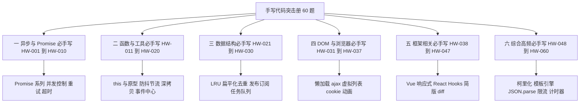
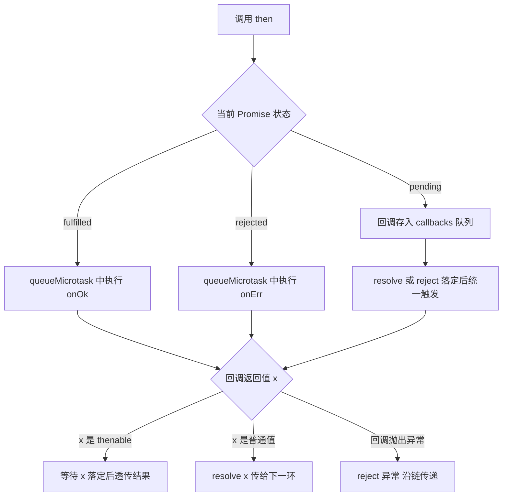
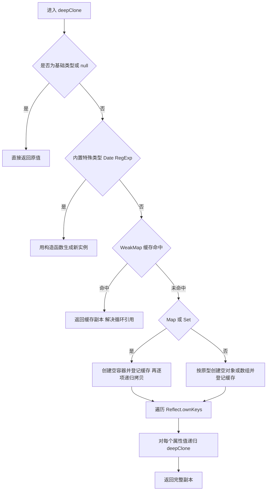
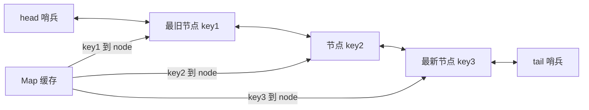
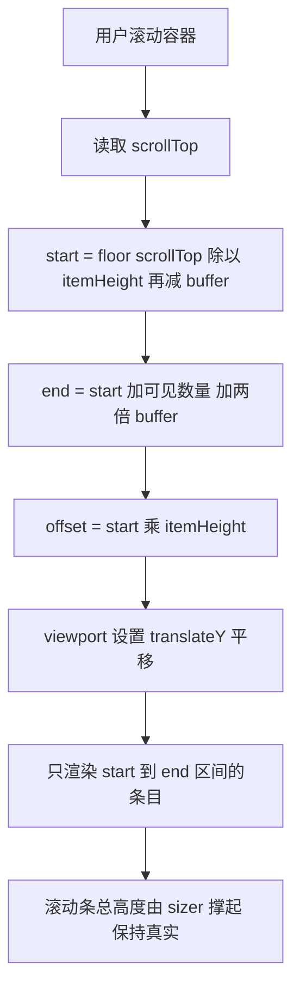

# 前端面试题库：手写代码突击册

> **定位**：大厂面试「现场手写」环节集中速练。共 60 题（HW-001 ~ HW-060），覆盖异步、函数工具、数据结构、DOM、框架原理、综合高频六大类。
>
> **使用方法（强烈建议按此执行）**：
> 1. 每题先**遮住答案**，给自己 5 分钟，在白板 / 草稿纸上写「5 分钟速写版」；
> 2. 写完对照答案，检查逻辑漏洞，再精读「标准完整版」的边界处理；
> 3. 最后逐条核对「评分点清单」——那就是面试官的目光落点；
> 4. 每章练完做一次「盲写复测」，隔 3 天再回看一遍。
>
> **三段结构**：每题 = 评分点清单 + 两个版本的代码（同一个代码围栏内，用注释分隔）：
> - **5 分钟速写版**：15~30 行，白板可写完，抓主干、保正确；
> - **标准完整版（含边界处理）**：30~60 行，展示工程素养：参数校验、边界 case、可扩展性。

## 手写题知识总览



## 目录

- [一、异步与 Promise 必手写（HW-001 ~ HW-010）](#一异步与-promise-必手写hw-001--hw-010)
- [二、函数与工具必手写（HW-011 ~ HW-020）](#二函数与工具必手写hw-011--hw-020)
- [三、数据结构必手写（HW-021 ~ HW-030）](#三数据结构必手写hw-021--hw-030)
- [四、DOM 与浏览器必手写（HW-031 ~ HW-037）](#四dom-与浏览器必手写hw-031--hw-037)
- [五、框架相关必手写（HW-038 ~ HW-047）](#五框架相关必手写hw-038--hw-047)
- [六、综合高频必手写（HW-048 ~ HW-060）](#六综合高频必手写hw-048--hw-060)

---

## 一、异步与 Promise 必手写（HW-001 ~ HW-010）

### HW-001：手写 Promise 核心（then 链）

**答**：
- 评分点：状态只能从 pending 单向流转且不可逆（fulfilled / rejected）；then 必须返回一个**新的** Promise，才能形成链式调用；回调必须异步执行（微任务 queueMicrotask），保证 then 注册时机晚于 resolve 也能收到通知；pending 时回调要存入 callbacks 队列，resolve 后统一触发；上一环返回 Promise（thenable）时要等待其落定再决定 resolve / reject；执行回调抛异常要转成 reject，实现错误沿链传递；值穿透：onFulfilled 缺省时值继续向下传，onRejected 缺省时异常继续向下抛。

```javascript
// ===== 5 分钟速写版 =====
class MyPromise {
  constructor(executor) {
    this.status = 'pending';
    this.value = undefined;
    this.callbacks = [];
    const resolve = v => {
      if (this.status !== 'pending') return;
      this.status = 'fulfilled'; this.value = v;
      this.callbacks.forEach(cb => cb.onOk());
    };
    const reject = r => {
      if (this.status !== 'pending') return;
      this.status = 'rejected'; this.value = r;
      this.callbacks.forEach(cb => cb.onErr());
    };
    try { executor(resolve, reject); } catch (e) { reject(e); }
  }
  then(onOk, onErr) {
    return new MyPromise((resolve, reject) => {
      const handle = cb => queueMicrotask(() => {
        if (typeof cb !== 'function') { // 值穿透 / 异常穿透
          this.status === 'rejected' ? reject(this.value) : resolve(this.value);
          return;
        }
        try {
          const r = cb(this.value);
          r instanceof MyPromise ? r.then(resolve, reject) : resolve(r);
        } catch (e) { reject(e); }
      });
      if (this.status === 'fulfilled') handle(onOk);
      else if (this.status === 'rejected') handle(onErr);
      else this.callbacks.push({ onOk: () => handle(onOk), onErr: () => handle(onErr) });
    });
  }
}

// ===== 标准完整版（含边界处理）=====
class MyPromise2 {
  static PENDING = 'pending';
  static FULFILLED = 'fulfilled';
  static REJECTED = 'rejected';
  constructor(executor) {
    if (typeof executor !== 'function') throw new TypeError('executor must be a function');
    this.status = MyPromise2.PENDING;
    this.value = undefined;
    this.callbacks = [];
    const resolve = v => this.settle(MyPromise2.FULFILLED, v);
    const reject = r => this.settle(MyPromise2.REJECTED, r);
    try { executor(resolve, reject); } catch (e) { reject(e); }
  }
  settle(status, value) {
    if (this.status !== MyPromise2.PENDING) return; // 状态不可逆
    this.status = status; this.value = value;
    const cbs = this.callbacks; // 先取出列表再清空，避免微任务执行时读到新空数组
    this.callbacks = [];
    queueMicrotask(() => cbs.forEach(cb => cb()));
  }
  // 解析 thenable：等待其落定，并防循环引用
  resolvePromise(p2, x, resolve, reject) {
    if (x === p2) return reject(new TypeError('Chaining cycle detected'));
    if (x !== null && (typeof x === 'object' || typeof x === 'function')) {
      let called = false;
      try {
        const then = x.then;
        if (typeof then === 'function') {
          then.call(x, y => { if (!called) { called = true; this.resolvePromise(p2, y, resolve, reject); } },
                    e => { if (!called) { called = true; reject(e); } });
        } else resolve(x);
      } catch (e) { if (!called) reject(e); }
    } else resolve(x);
  }
  then(onOk, onErr) {
    const p2 = new MyPromise2((resolve, reject) => {
      const run = cb => queueMicrotask(() => {
        if (typeof cb !== 'function') {
          this.status === MyPromise2.REJECTED ? reject(this.value) : resolve(this.value);
          return;
        }
        try { this.resolvePromise(p2, cb(this.value), resolve, reject); }
        catch (e) { reject(e); }
      });
      if (this.status === MyPromise2.FULFILLED) run(onOk);
      else if (this.status === MyPromise2.REJECTED) run(onErr);
      else this.callbacks.push(() => this.status === MyPromise2.FULFILLED ? run(onOk) : run(onErr));
    });
    return p2;
  }
  catch(onErr) { return this.then(null, onErr); }
  finally(cb) {
    return this.then(
      v => MyPromise2.resolve(cb()).then(() => v),
      e => MyPromise2.resolve(cb()).then(() => { throw e; })
    );
  }
  static resolve(v) { return v instanceof MyPromise2 ? v : new MyPromise2(r => r(v)); }
  static reject(r) { return new MyPromise2((_, rj) => rj(r)); }
}
```

then 链执行流程：



---

### HW-002：手写 Promise.all

**答**：
- 评分点：返回一个新 Promise；结果数组**顺序与传入顺序一致**（按下标写入，不是完成顺序）；全部成功才 resolve，**任意一个 reject 立即整体 reject**（fail-fast）；非 Promise 值要用 `Promise.resolve()` 包装再消费；用计数器判断全部完成，而不是 `results.length`（稀疏数组 length 不可靠）；空数组要直接 `resolve([])`（边界，漏掉会永远 pending）。

```javascript
// ===== 5 分钟速写版 =====
function promiseAll(promises) {
  return new Promise((resolve, reject) => {
    const list = Array.from(promises);
    const results = [];
    let count = 0;
    if (list.length === 0) return resolve([]);
    list.forEach((p, i) => {
      Promise.resolve(p).then(v => {
        results[i] = v;                 // 按下标写入，保序
        if (++count === list.length) resolve(results);
      }, reject);                       // 任一失败立即整体 reject
    });
  });
}

// ===== 标准完整版（含边界处理）=====
function promiseAllPro(promises) {
  return new Promise((resolve, reject) => {
    // 参数校验：必须是可迭代对象
    if (promises === null || typeof promises[Symbol.iterator] !== 'function') {
      return reject(new TypeError('promises must be iterable'));
    }
    const list = Array.from(promises);
    const len = list.length;
    if (len === 0) return resolve([]);
    const results = new Array(len);
    let count = 0;
    let settled = false;
    list.forEach((p, i) => {
      Promise.resolve(p).then(
        value => {
          if (settled) return;
          results[i] = value;
          if (++count === len) { settled = true; resolve(results); }
        },
        err => {
          if (settled) return;
          settled = true;              // fail-fast：第一个失败即终止
          reject(err);
        }
      );
    });
  });
}
// 测试：promiseAllPro([1, Promise.resolve(2), delay(100).then(() => 3)])
// → [1, 2, 3]，顺序稳定；任一 reject → 立即进入 catch
```

---

### HW-003：手写 Promise.race

**答**：
- 评分点：谁先落定（无论成功失败）谁决定最终状态；resolve 和 reject 都要传给同一个 then 的两个分支；非 Promise 值同样要 `Promise.resolve()` 包装；空数组边界：没有竞赛者则永远 pending（可作为考点反向提问「race 空数组会怎样」）；常与超时控制组合使用。

```javascript
// ===== 5 分钟速写版 =====
function promiseRace(promises) {
  return new Promise((resolve, reject) => {
    Array.from(promises).forEach(p => {
      // 成败都交给同一个出口，第一个落定的生效，后续调用无效（状态不可逆）
      Promise.resolve(p).then(resolve, reject);
    });
  });
}

// ===== 标准完整版（含边界处理）=====
function promiseRacePro(promises) {
  return new Promise((resolve, reject) => {
    if (promises === null || typeof promises[Symbol.iterator] !== 'function') {
      return reject(new TypeError('promises must be iterable'));
    }
    const list = Array.from(promises);
    let settled = false;
    if (list.length === 0) {
      // 边界说明：空数组没有任何竞赛者，与原生 Promise.race([]) 一致保持 pending
      // 生产中应配合外部超时兜底，这也是「race 空数组会怎样」的反向考点
      return;
    }
    list.forEach((p, i) => {
      Promise.resolve(p).then(
        v => { if (!settled) { settled = true; resolve(v); } },
        e => { if (!settled) { settled = true; reject(e); } }
      );
    });
  });
}
// 典型组合：请求超时
// promiseRacePro([fetch(url), new Promise((_, rj) => setTimeout(() => rj(new Error('timeout')), 3000))])
```

---

### HW-004：手写 Promise.allSettled

**答**：
- 评分点：**不会 fail-fast**，等全部落定；结果格式必须是 `{ status: 'fulfilled', value }` / `{ status: 'rejected', reason }`（注意字段名 value 与 reason 不同）；顺序保序；空数组 resolve `[]`；适合批量请求「部分失败不影响整体」的场景，是 all 的补集。

```javascript
// ===== 5 分钟速写版 =====
function promiseAllSettled(promises) {
  return new Promise(resolve => {
    const list = Array.from(promises);
    const results = [];
    let count = 0;
    if (list.length === 0) return resolve([]);
    list.forEach((p, i) => {
      Promise.resolve(p).then(
        value => { results[i] = { status: 'fulfilled', value }; },
        reason => { results[i] = { status: 'rejected', reason }; }
      ).finally(() => { if (++count === list.length) resolve(results); });
    });
  });
}

// ===== 标准完整版（含边界处理）=====
function promiseAllSettledPro(promises) {
  return new Promise(resolve => {
    if (promises === null || typeof promises[Symbol.iterator] !== 'function') {
      throw new TypeError('promises must be iterable');
    }
    const list = Array.from(promises);
    const len = list.length;
    if (len === 0) return resolve([]);
    const results = new Array(len);
    let count = 0;
    list.forEach((p, i) => {
      Promise.resolve(p).then(
        value => { results[i] = { status: 'fulfilled', value }; },
        reason => { results[i] = { status: 'rejected', reason }; }
      ).finally(() => {
        // 全部落定才 resolve，无论成功失败
        if (++count === len) resolve(results);
      });
    });
  });
}
// 业务用法：批量上报 / 多源数据聚合，失败项单独过滤
// const rs = await promiseAllSettledPro(tasks);
// const ok = rs.filter(r => r.status === 'fulfilled').map(r => r.value);
```

---

### HW-005：手写 Promise.any

**答**：
- 评分点：与 all 相反——**任一成功即 resolve**，全部失败才 reject；全部失败时 reject 的是 `AggregateError`（errors 数组按传入顺序收集，不是失败顺序）；失败计数与成功标记是两个独立信号；空数组直接 reject `AggregateError`；这是 ES2021 API，手写要能说清与 race 的区别（race 看落定，any 看成功）。

```javascript
// ===== 5 分钟速写版 =====
function promiseAny(promises) {
  return new Promise((resolve, reject) => {
    const list = Array.from(promises);
    const errors = [];
    let failCount = 0;
    if (list.length === 0) return reject(new AggregateError([], 'All promises were rejected'));
    list.forEach((p, i) => {
      Promise.resolve(p).then(resolve, err => {   // 任一成功直接 resolve
        errors[i] = err;                          // 按下标收集，保序
        if (++failCount === list.length) {
          reject(new AggregateError(errors, 'All promises were rejected'));
        }
      });
    });
  });
}

// ===== 标准完整版（含边界处理）=====
function promiseAnyPro(promises) {
  return new Promise((resolve, reject) => {
    if (promises === null || typeof promises[Symbol.iterator] !== 'function') {
      return reject(new TypeError('promises must be iterable'));
    }
    const list = Array.from(promises);
    const len = list.length;
    if (len === 0) {
      return reject(new AggregateError([], 'All promises were rejected'));
    }
    const errors = new Array(len);
    let failCount = 0;
    let settled = false;
    list.forEach((p, i) => {
      Promise.resolve(p).then(
        v => { if (!settled) { settled = true; resolve(v); } },
        e => {
          if (settled) return;
          errors[i] = e;
          if (++failCount === len) {
            settled = true;
            // 兼容无 AggregateError 的旧环境
            const agg = typeof AggregateError === 'function'
              ? new AggregateError(errors, 'All promises were rejected')
              : Object.assign(new Error('All promises were rejected'), { errors });
            reject(agg);
          }
        }
      );
    });
  });
}
```

---

### HW-006：手写 async 执行器（Generator 自动执行）

**答**：
- 评分点：`gen.next(value)` 的返回值 `{ value, done }`，value 要用 `Promise.resolve()` 包装成 thenable 再消费；递归驱动：未 done 就继续 `next`，把上一段 yield 的结果作为下一次 next 的入参回传（这就是 `const a = yield x` 能拿到值的原因）；done 为 true 时 resolve 最终值；用 `gen.throw(e)` 把 Promise 的失败注入回 generator 内部，让 try/catch 能捕获；执行器整体返回一个 Promise。

```javascript
// ===== 5 分钟速写版 =====
function asyncTo(genFn) {
  return new Promise((resolve, reject) => {
    const gen = genFn();
    const step = (nextFn, val) => {
      let result;
      try { result = nextFn(val); }
      catch (e) { return reject(e); }
      if (result.done) return resolve(result.value);
      Promise.resolve(result.value).then(
        v => step(gen.next.bind(gen), v),          // 成功 → 注入下一轮
        e => step(gen.throw.bind(gen), e)          // 失败 → throw 进 generator
      );
    };
    step(gen.next.bind(gen), undefined);
  });
}
// 用法：asyncTo(function* () { const a = yield fetchA(); const b = yield fetchB(a); return b; })

// ===== 标准完整版（含边界处理）=====
function asyncToPro(genFn, ...args) {
  return new Promise((resolve, reject) => {
    let gen;
    try { gen = genFn(...args); }        // 支持向 generator 传参
    catch (e) { return reject(e); }
    if (!gen || typeof gen.next !== 'function') {
      return reject(new TypeError('genFn must return a generator'));
    }
    const onFulfilled = val => { drain('next', val); };
    const onRejected = err => { drain('throw', err); };
    function drain(method, val) {
      let result;
      try { result = gen[method](val); }
      catch (e) { return reject(e); }    // generator 内部未捕获的异常 → 整体 reject
      if (result.done) {
        // 最终返回值若是 Promise，继续跟随其落定
        return Promise.resolve(result.value).then(resolve, reject);
      }
      Promise.resolve(result.value).then(onFulfilled, onRejected);
    }
    drain('next', undefined);
  });
}
// 面试追问点：
// 1. 为什么 next(v) 能让 const a = yield x 拿到 v —— next 的参数会作为上一处 yield 表达式的求值结果
// 2. 与真 async/await 差异 —— await 由引擎在微任务层面实现，且语法上不需要手写驱动器
```

---

### HW-007：手写 p-limit 并发控制

**答**：
- 评分点：维护「当前执行中数量 active」+「等待队列 queue」两个核心状态；新任务进来时若未满并发数直接执行，否则入队；每个任务结束后 `active--` 并从队列取下一个（调度时机必须在 finally，成功失败都要调度）；返回的 Promise 与原任务一一对应（resolve/reject 要绑定到具体任务，不能错位）；能说出并发数必须为正整数。

```javascript
// ===== 5 分钟速写版 =====
function pLimit(concurrency) {
  let active = 0;
  const queue = [];
  const next = () => {
    active--;
    if (queue.length) queue.shift()();
  };
  const run = (fn, resolve, reject) => {
    active++;
    fn().then(resolve, reject).finally(next); // 成败都要释放槽位
  };
  return fn => new Promise((resolve, reject) => {
    if (active < concurrency) run(fn, resolve, reject);
    else queue.push(() => run(fn, resolve, reject));
  });
}
// 用法：
// const limit = pLimit(3);
// urls.forEach(u => limit(() => fetch(u)));

// ===== 标准完整版（含边界处理）=====
function pLimitPro(concurrency) {
  if (!Number.isInteger(concurrency) || concurrency < 1) {
    throw new TypeError('concurrency must be a positive integer');
  }
  let active = 0;
  const queue = [];
  const dequeue = () => {
    while (active < concurrency && queue.length) {
      const { fn, resolve, reject } = queue.shift();
      active++;
      fn().then(resolve, reject).catch(() => {}).finally(() => {
        active--;
        dequeue(); // 链式补位，保证一次释放能拉起多个等待任务
      });
    }
  };
  const limit = fn => new Promise((resolve, reject) => {
    if (typeof fn !== 'function') return reject(new TypeError('fn must be a function'));
    queue.push({ fn, resolve, reject });
    dequeue();
  });
  // 附加能力：暴露当前状态，便于监控与测试
  limit.activeCount = () => active;
  limit.pendingCount = () => queue.length;
  limit.clearQueue = () => { queue.length = 0; }; // 场景切换时丢弃未执行任务
  return limit;
}
// 批量场景：分页采集 100 个接口，限制并发 5
// const limit = pLimitPro(5);
// await Promise.all(ids.map(id => limit(() => fetchDetail(id))));
```

---

### HW-008：手写 retry 重试

**答**：
- 评分点：重试次数语义要清晰（total 次尝试还是额外重试 total 次，面试时先说清约定）；失败后延迟重试用 setTimeout 包一层 Promise；最终失败要 reject **最后一次**的错误，而不是 undefined；每次重试都要重新调用 `fn()`（重新发起请求），绝不能复用同一个已 reject 的 Promise；能扩展「指数退避 backoff」是加分项。

```javascript
// ===== 5 分钟速写版 =====
function retry(fn, times = 3, delay = 0) {
  return new Promise((resolve, reject) => {
    const attempt = left => {
      fn().then(resolve, err => {
        if (left <= 0) return reject(err);   // reject 最后一次的真实错误
        setTimeout(() => attempt(left - 1), delay);
      });
    };
    attempt(times); // 约定：times 为额外重试次数，总尝试 = times + 1
  });
}

// ===== 标准完整版（含边界处理）=====
function retryPro(fn, { retries = 3, delay = 0, backoff = 1, shouldRetry = () => true } = {}) {
  return new Promise((resolve, reject) => {
    let attemptCount = 0;
    const attempt = () => {
      attemptCount++;
      Promise.resolve()
        .then(() => fn(attemptCount))          // 每次重试都重新调用，可把第几次传给业务
        .then(resolve)
        .catch(err => {
          // 可定制哪些错误才值得重试：如 4xx 参数错误重试无意义
          if (attemptCount > retries || !shouldRetry(err)) return reject(err);
          // 指数退避：delay * backoff^(n-1)，避免打挂下游
          const wait = delay * Math.pow(backoff, attemptCount - 1);
          setTimeout(attempt, wait);
        });
    };
    if (typeof fn !== 'function') return reject(new TypeError('fn must be a function'));
    attempt();
  });
}
// 用法：网络抖动重试 + 指数退避
// retryPro(() => fetch(url), { retries: 3, delay: 500, backoff: 2,
//   shouldRetry: e => !e.response || e.response.status >= 500 })
```

---

### HW-009：手写 promisify

**答**：
- 评分点：核心是「回调转 Promise」：返回一个新函数，内部 new Promise，在末尾追加 errfirst 风格的 callback（Node.js 约定 `(err, result) => {}`）；callback 里 err 非空 → reject，否则 resolve；要用 `fn.call(this, ...)` 保留原函数的 this；注意 callback 只能被调用一次（有些库会多次回调，需要加 once 保护）；进阶：支持自定义回调位置 / 多参收集（multiArgs）。

```javascript
// ===== 5 分钟速写版 =====
function promisify(fn) {
  return function (...args) {
    return new Promise((resolve, reject) => {
      fn.call(this, ...args, (err, data) => {
        err ? reject(err) : resolve(data);
      });
    });
  };
}
// 用法：const readFile = promisify(fs.readFile); readFile('a.txt', 'utf8').then(console.log)

// ===== 标准完整版（含边界处理）=====
function promisifyPro(fn, { multiArgs = false } = {}) {
  if (typeof fn !== 'function') throw new TypeError('fn must be a function');
  return function promisified(...args) {
    return new Promise((resolve, reject) => {
      const callback = (...results) => {
        // once 保护：防止底层多次调用回调导致重复 settle
        if (callback.done) return;
        callback.done = true;
        const err = results[0];
        if (err) return reject(err);
        // multiArgs：resolve(results.slice(1))，如 dns.lookup 返回 [address, family]
        multiArgs ? resolve(results.slice(1)) : resolve(results[1]);
      };
      try {
        fn.call(this, ...args, callback);
      } catch (e) { reject(e); } // 同步抛错也要走 Promise 通道
    });
  };
}
// 自定义回调位置的变体（如 axios 风格 callback 在中间）：
function promisifyWith(fn, cbIndex) {
  return function (...args) {
    return new Promise((resolve, reject) => {
      const cb = (err, data) => (err ? reject(err) : resolve(data));
      args.splice(cbIndex, 0, cb); // 把 callback 插到指定位置
      fn.apply(this, args);
    });
  };
}
```

---

### HW-010：手写带超时的请求包装

**答**：
- 评分点：基础实现是 `Promise.race([请求, 超时 Promise])`；**必须 clearTimeout**——race 结束后定时器若不清，进程里会残留一个无意义 pending 的 timer（长连接服务里是泄漏点）；超时的 Promise 用独立 timer reject 一个可识别的 Error；进阶：只 race 不够「真取消」，超时后底层请求仍在跑，要结合 `AbortController` / XMLHttpRequest.abort 真正中断连接；返回值要与原请求语义一致（成功数据原样透传）。

```javascript
// ===== 5 分钟速写版 =====
function withTimeout(promise, ms, msg = `timeout after ${ms}ms`) {
  let timer;
  const timeout = new Promise((_, reject) => {
    timer = setTimeout(() => reject(new Error(msg)), ms);
  });
  return Promise.race([promise, timeout]).finally(() => clearTimeout(timer)); // 必须清理
}

// ===== 标准完整版（含边界处理）=====
function fetchWithTimeout(url, { timeout = 5000, ...options } = {}) {
  const controller = new AbortController();
  let timer = null;
  const timeoutPromise = new Promise((_, reject) => {
    timer = setTimeout(() => {
      controller.abort(); // 真取消：中断底层连接，而不是只让上层不等了
      reject(new Error(`request timeout after ${timeout}ms: ${url}`));
    }, timeout);
  });
  const request = fetch(url, { ...options, signal: controller.signal })
    .then(res => {
      if (!res.ok) throw new Error(`HTTP ${res.status}`);
      return res.json();
    });
  return Promise.race([request, timeoutPromise]).finally(() => clearTimeout(timer));
}
// 纯 Promise 版（不依赖 fetch/AbortController，适合 XMLHttpRequest 场景）：
function xhrWithTimeout(xhrTask, ms) {
  let timer;
  const timeout = new Promise((_, reject) =>
    (timer = setTimeout(() => {
      xhrTask.abort && xhrTask.abort(); // 同步触发 xhr.abort 真取消
      reject(new Error('timeout'));
    }, ms))
  );
  return Promise.race([xhrTask, timeout]).finally(() => clearTimeout(timer));
}
// 评分官常追问：race 之后底层 promise 会 GC 吗 —— 会 pending 到自然落定，且其回调仍会执行，
// 所以业务回调里要判断「本次结果是否已过期」，见 HW-050 竞态处理。
```

---
## 二、函数与工具必手写（HW-011 ~ HW-020）

### HW-011：手写 call / apply / bind

**答**：
- 评分点：call/apply 的核心是「把函数临时挂到目标对象上再调用」，用 `Symbol` 做 key 避免属性名冲突与污染；null/undefined 的 this 要回落到 globalThis，原始值要 `Object()` 包装（严格模式差异可作为加分讨论）；apply 与 call 唯一区别是参数是数组（要校验非数组报错）；bind 返回**新函数**且要支持 `new` 调用——new 时 this 指向实例而非绑定对象，原型要挂到原函数原型上（`Object.create(fn.prototype)`）；bind 还要支持预设参数柯里化拼接。

```javascript
// ===== 5 分钟速写版 =====
Function.prototype.myCall = function (ctx, ...args) {
  ctx = ctx === null || ctx === undefined ? globalThis : Object(ctx);
  const key = Symbol('fn');            // 唯一 key 防止覆盖对象已有属性
  ctx[key] = this;
  const res = ctx[key](...args);
  delete ctx[key];
  return res;
};
Function.prototype.myBind = function (ctx, ...preset) {
  const fn = this;
  function bound(...later) {
    // new bound() 时 this instanceof bound 成立 → this 优先于绑定的 ctx
    return fn.apply(this instanceof bound ? this : ctx, [...preset, ...later]);
  }
  bound.prototype = Object.create(fn.prototype); // 保持 new bound 时原型链正确
  return bound;
};

// ===== 标准完整版（含边界处理）=====
Function.prototype.myCallPro = function (ctx, ...args) {
  if (typeof this !== 'function') throw new TypeError('myCall must be called on a function');
  ctx = ctx === null || ctx === undefined ? globalThis : Object(ctx);
  const key = Symbol('fn');
  ctx[key] = this;
  const res = ctx[key](...args);
  delete ctx[key];
  return res;
};
Function.prototype.myApplyPro = function (ctx, args = []) {
  if (typeof this !== 'function') throw new TypeError('myApply must be called on a function');
  if (args !== null && args !== undefined && typeof args[Symbol.iterator] !== 'function') {
    throw new TypeError('second argument must be array-like');
  }
  ctx = ctx === null || ctx === undefined ? globalThis : Object(ctx);
  const key = Symbol('fn');
  ctx[key] = this;
  const res = ctx[key](...args);       // apply 与 call 只差参数展开方式
  delete ctx[key];
  return res;
};
Function.prototype.myBindPro = function (ctx, ...preset) {
  if (typeof this !== 'function') throw new TypeError('myBind must be called on a function');
  const fn = this;
  function bound(...later) {
    // 1. new 调用：this 是 bound 的实例，优先级最高
    // 2. 普通调用：绑定到 ctx
    return fn.apply(this instanceof bound && fn.prototype.isPrototypeOf(this) ? this : ctx,
                    [...preset, ...later]);
  }
  // 用中间层避免直接修改 bound.prototype 影响原函数原型（不污染 fn.prototype）
  bound.prototype = Object.create(fn.prototype);
  return bound;
};
```

---

### HW-012：手写 new

**答**：
- 评分点：new 做的四件事要说全——① 创建空对象并把原型指向构造函数的 prototype；② 以该对象为 this 执行构造函数；③ 构造函数若**显式返回对象或函数**，则覆盖默认实例（返回原始值会被忽略）；④ 返回实例。用 `Object.create(Ctor.prototype)` 一步完成原型挂载；判断返回值要用 `typeof === 'object' | 'function'` 且非 null。

```javascript
// ===== 5 分钟速写版 =====
function myNew(Ctor, ...args) {
  const obj = Object.create(Ctor.prototype); // ① ②合并：空对象 + 原型链
  const res = Ctor.apply(obj, args);         // ② this 绑定为新对象
  // ③ 返回对象/函数则覆盖，否则返回实例
  return res !== null && (typeof res === 'object' || typeof res === 'function') ? res : obj;
}

// ===== 标准完整版（含边界处理）=====
function myNewPro(Ctor, ...args) {
  if (typeof Ctor !== 'function') {
    throw new TypeError('Ctor must be a constructor function');
  }
  // Object.create 同时处理了 Ctor.prototype 为对象与 null 两种情况：
  // 为 null 时实例没有原型，仍可正常创建
  const obj = Object.create(Ctor.prototype);
  let res;
  try {
    res = Ctor.apply(obj, args);   // 构造函数内部 throw 时，new 表达式同样向上抛
  } catch (e) {
    throw e;
  }
  const isOverride = res !== null && (typeof res === 'object' || typeof res === 'function');
  return isOverride ? res : obj;
}
// 验证：
// function Person(name) { this.name = name; }
// myNewPro(Person, 'Tom').name === 'Tom'，且 instanceof Person 为 true
// function Weird() { return { custom: 1 }; } → myNewPro(Weird).custom === 1
// function Prim() { return 42; } → myNewPro(Prim) 是实例而非 42
```

---

### HW-013：手写 instanceof

**答**：
- 评分点：本质是沿 `Object.getPrototypeOf(left)` 的原型链逐层向上，与 `right.prototype` 比对；右侧必须是函数（构造函数/class），否则直接 false（注意 `typeof right !== 'function'` 这层校验，许多人漏掉）；终止条件是原型链到 null；能提一句 ES6 的 `Symbol.hasInstance` 可自定义 instanceof 行为是加分项。

```javascript
// ===== 5 分钟速写版 =====
function myInstanceof(left, right) {
  let proto = Object.getPrototypeOf(left);
  while (proto !== null) {
    if (proto === right.prototype) return true;
    proto = Object.getPrototypeOf(proto);
  }
  return false;
}

// ===== 标准完整版（含边界处理）=====
function myInstanceofPro(left, right) {
  // 右侧必须是可实例化的函数（含 class）；包装对象场景下 String 等也合法
  if (right === null || typeof right !== 'function') {
    throw new TypeError('right-hand side must be a constructor');
  }
  if (left === null || (typeof left !== 'object' && typeof left !== 'function')) {
    return false; // 原始值不在原型链上（除 Symbol.hasInstance 自定义外）
  }
  // 兼容 ES6 自定义 instanceof 行为。注意：Function.prototype 上有默认
  // Symbol.hasInstance（普通函数沿原型链继承到它），所以必须用「自有属性」判断，
  // 否则该分支永远命中，下面的手写遍历就成了死代码。
  if (Object.getOwnPropertyDescriptor(right, Symbol.hasInstance)) {
    return !!right[Symbol.hasInstance](left);
  }
  let proto = Object.getPrototypeOf(left);
  while (proto !== null) {
    if (proto === right.prototype) return true;
    proto = Object.getPrototypeOf(proto);
  }
  return false;
}
// 追问点：
// myInstanceofPro([], Array) === true; myInstanceofPro([], Object) === true（原型链多级命中）
// myInstanceofPro('abc', String) === false（原始值），new String('abc') 则为 true
```

---

### HW-014：手写防抖（含 immediate / cancel）

**答**：
- 评分点：闭包保存 timer，每次触发先 clearTimeout 再重设；immediate（leading）模式：第一次立即执行、之后的连续触发在静默期内全部丢弃，静默期过后恢复可触发；cancel 要同时清 timer **并置空变量**（否则 immediate 判断会错乱）；this 与参数都要正确透传（返回普通函数而不是箭头函数，用 `fn.apply(this, args)`）；能说出典型场景：输入搜索、resize 计算、按钮防连点。

```javascript
// ===== 5 分钟速写版 =====
function debounce(fn, wait, immediate = false) {
  let timer = null;
  function debounced(...args) {
    if (timer) clearTimeout(timer);
    if (immediate && !timer) {
      fn.apply(this, args);            // 首次立即执行
    }
    timer = setTimeout(() => {
      timer = null;
      if (!immediate) fn.apply(this, args); // 默认：静默期结束后执行最后一次
    }, wait);
  }
  debounced.cancel = () => { clearTimeout(timer); timer = null; };
  return debounced;
}

// ===== 标准完整版（含边界处理）=====
function debouncePro(fn, wait = 300, { immediate = false, resultCallback } = {}) {
  if (typeof fn !== 'function') throw new TypeError('fn must be a function');
  let timer = null;
  function debounced(...args) {
    if (timer) clearTimeout(timer);
    if (immediate && !timer) {
      const result = fn.apply(this, args);
      typeof resultCallback === 'function' && resultCallback(result);
    }
    timer = setTimeout(() => {
      timer = null;
      if (!immediate) {
        const result = fn.apply(this, args);
        typeof resultCallback === 'function' && resultCallback(result);
      }
    }, wait);
  }
  // cancel：组件卸载 / 路由切换时调用，防止闭包里的 timer 继续触发已销毁逻辑
  debounced.cancel = function () {
    if (timer) { clearTimeout(timer); timer = null; }
  };
  // flush：立即结束等待并执行挂起的调用（表单提交前兜底很有用）
  debounced.flush = function (...args) {
    if (timer) {
      clearTimeout(timer);
      timer = null;
      fn.apply(this, args);
    }
  };
  return debounced;
}
// 使用示例：
// const onSearch = debouncePro(q => fetchList(q), 300, { immediate: false });
// onInput(e => onSearch(e.target.value));
// 组件卸载：onSearch.cancel()
```

---

### HW-015：手写节流

**答**：
- 评分点：两种经典实现要会——时间戳版（首次立即执行但停止触发后末次不执行）+ 定时器版（末次必执行但首次延迟），合并版（时间戳 + 定时器互补）是满分答案；闭包里记录上次执行时间 prev，`wait - (now - prev)` 是剩余冷却时间；切换到时间戳触发时要顺手清掉挂着的 timer，避免重复执行；this / 参数透传；场景：scroll、mousemove、按钮限频。

```javascript
// ===== 5 分钟速写版 =====
function throttle(fn, wait) {
  let prev = 0;
  let timer = null;
  return function (...args) {
    const now = Date.now();
    const remain = wait - (now - prev);
    if (remain <= 0) {
      if (timer) { clearTimeout(timer); timer = null; }
      prev = now;
      fn.apply(this, args);              // 立即执行（leading）
    } else if (!timer) {
      timer = setTimeout(() => {         // 补末次执行（trailing）
        timer = null;
        prev = Date.now();
        fn.apply(this, args);
      }, remain);
    }
  };
}

// ===== 标准完整版（含边界处理）=====
function throttlePro(fn, wait = 300, { leading = true, trailing = true } = {}) {
  if (typeof fn !== 'function') throw new TypeError('fn must be a function');
  let prev = 0;
  let timer = null;
  const throttled = function (...args) {
    const now = Date.now();
    if (!prev && !leading) prev = now;   // 关闭 leading 时首轮从当前时间起算
    const remain = wait - (now - prev);
    if (remain <= 0) {
      if (timer) { clearTimeout(timer); timer = null; }
      prev = now;
      fn.apply(this, args);
    } else if (!timer && trailing) {
      timer = setTimeout(() => {
        timer = null;
        prev = leading ? Date.now() : 0; // 重置窗口
        fn.apply(this, args);
      }, remain);
    }
  };
  throttled.cancel = () => {
    if (timer) clearTimeout(timer);
    timer = null;
    prev = 0;
  };
  return throttled;
}
// 面试常追问：防抖 vs 节流一句话
// 防抖是「最后一次说了算」——等你不动了才执行；节流是「单位时间最多一次」——稀释执行频率。
```

---

### HW-016：手写深拷贝

**答**：
- 评分点：基础类型直接返回；Date/RegExp 等内置对象要走专属构造；**循环引用**用 WeakMap 缓存已拷贝对象（WeakMap 也是高频追问点：弱引用不阻止 GC）；Map/Set 要分别按各自 API 拷贝内部键值；拷贝结果要保留原型（`Object.create(Object.getPrototypeOf(obj))`）；键遍历建议 `Reflect.ownKeys`（含 Symbol key）+ 递归拷贝属性值。

```javascript
// ===== 5 分钟速写版 =====
function deepClone(obj, map = new WeakMap()) {
  if (obj === null || typeof obj !== 'object') return obj; // 基础类型 + null
  if (obj instanceof Date) return new Date(obj);
  if (obj instanceof RegExp) return new RegExp(obj.source, obj.flags);
  if (map.has(obj)) return map.get(obj);                   // 命中缓存：解开循环引用
  const clone = Array.isArray(obj) ? [] : Object.create(Object.getPrototypeOf(obj));
  map.set(obj, clone);
  for (const key of Reflect.ownKeys(obj)) {                // 含 Symbol key
    clone[key] = deepClone(obj[key], map);
  }
  return clone;
}

// ===== 标准完整版（含边界处理）=====
function deepClonePro(obj, map = new WeakMap()) {
  if (obj === null || typeof obj !== 'object') return obj;
  if (obj instanceof Date) return new Date(obj.getTime());
  if (obj instanceof RegExp) return new RegExp(obj.source, obj.flags);
  if (obj instanceof WeakMap || obj instanceof WeakSet) {
    return new obj.constructor(); // 弱引用内容不可枚举，只能给空壳
  }
  if (map.has(obj)) return map.get(obj);
  if (obj instanceof Map) {
    const clone = new Map();
    map.set(obj, clone);
    obj.forEach((v, k) => clone.set(deepClonePro(k, map), deepClonePro(v, map)));
    return clone;
  }
  if (obj instanceof Set) {
    const clone = new Set();
    map.set(obj, clone);
    obj.forEach(v => clone.add(deepClonePro(v, map)));
    return clone;
  }
  // 保留原型（含 class 实例），而不是一律退化为普通对象/数组
  const clone = Array.isArray(obj) ? [] : Object.create(Object.getPrototypeOf(obj));
  map.set(obj, clone);
  for (const key of Reflect.ownKeys(obj)) {
    const desc = Object.getOwnPropertyDescriptor(obj, key);
    // 保留 getter/setter 语义：只拷贝 value 型描述符；访问器可按需重新绑定 getter
    if ('value' in desc) desc.value = deepClonePro(desc.value, map);
    Object.defineProperty(clone, key, desc);
  }
  return clone;
}
```

深拷贝递归流程：



---

### HW-017：手写浅比较

**答**：
- 评分点：先 `a === b` 短路（同引用直接相等）；任一为 null 或非 object 则回到严格相等（`null == undefined` 的坑要用 `===` 规避）；只比较**第一层** key（这也是「浅」的含义）；key 数量不同直接不等；逐 key 用 `Object.is` 比较（能正确区分 NaN 与 +0，比 `===` 更严谨）；React PureComponent 的 shouldComponentUpdate 就是这个逻辑。

```javascript
// ===== 5 分钟速写版 =====
function shallowEqual(a, b) {
  if (a === b) return true; // 同引用
  if (typeof a !== 'object' || typeof b !== 'object' || a === null || b === null) {
    return false;
  }
  const keysA = Object.keys(a);
  const keysB = Object.keys(b);
  if (keysA.length !== keysB.length) return false;
  return keysA.every(k => a[k] === b[k]);
}

// ===== 标准完整版（含边界处理）=====
function shallowEqualPro(a, b) {
  if (Object.is(a, b)) return true;                 // 同引用 / NaN 相等 / +0 与 -0 区分
  if (a === null || b === null) return false;
  if (typeof a !== 'object' && typeof a !== 'function') return false;
  if (typeof b !== 'object' && typeof b !== 'function') return false;
  if (Array.isArray(a) !== Array.isArray(b)) return false;
  const keysA = Reflect.ownKeys(a);                 // 含 Symbol key
  const keysB = Reflect.ownKeys(b);
  if (keysA.length !== keysB.length) return false;
  return keysA.every(k => {
    // 可枚举性一致才算相等，避免一方 getter 一方 value 的假等
    const descA = Object.getOwnPropertyDescriptor(a, k);
    const descB = Object.getOwnPropertyDescriptor(b, k);
    if (!descA || !descB) return false;
    if (descA.enumerable !== descB.enumerable) return false;
    return Object.is(a[k], b[k]);
  });
}
// 追问：为什么不用递归比较 —— 浅比较 O(n)，深比较开销大且可能陷入循环，
// React 性能优化刻意选择浅比较，深层变化交给不可变数据（immutable）方案。
```

---

### HW-018：手写 memoize

**答**：
- 评分点：用 Map/WeakMap 闭包缓存「入参 → 结果」；默认取第一个参数做 key，支持自定义 resolver（如多参数 join 序列化）；结果缓存前函数内部的 this 要保留（`fn.apply(this, args)`）；缓存要暴露出来（`memoized.cache`）便于测试与手动失效；能讨论缓存对象作为 key 时用 WeakMap 防内存泄漏是加分项。

```javascript
// ===== 5 分钟速写版 =====
function memoize(fn, resolver) {
  const cache = new Map();
  function memoized(...args) {
    const key = resolver ? resolver(...args) : args[0];
    if (cache.has(key)) return cache.get(key);
    const result = fn.apply(this, args);
    cache.set(key, result);
    return result;
  }
  memoized.cache = cache; // 暴露缓存，便于测试与清理
  return memoized;
}

// ===== 标准完整版（含边界处理）=====
function memoizePro(fn, resolver) {
  if (typeof fn !== 'function') throw new TypeError('fn must be a function');
  if (resolver !== undefined && typeof resolver !== 'function') {
    throw new TypeError('resolver must be a function');
  }
  const cache = new Map();
  function memoized(...args) {
    const key = resolver ? resolver.apply(this, args) : args[0];
    if (cache.has(key)) return cache.get(key);
    const result = fn.apply(this, args);
    // Promise 语义：失败结果不该缓存，下次重试
    if (result && typeof result.then === 'function') {
      return result.catch(e => {
        cache.delete(key); // 失败即淘汰，成功保留
        throw e;
      }).then(v => (cache.set(key, result), v));
    }
    cache.set(key, result);
    return result;
  }
  memoized.cache = cache;
  return memoized;
}
// 多参数缓存示例：
// memoizePro(fetchUser, (id, type) => `${id}:${type}`)
// 追问：WeakMap 版 key 只能是对象，无法缓存原始值入参，两者取舍要能说清。
```

---

### HW-019：手写 compose / pipe

**答**：
- 评分点：compose 是**从右往左**执行（`compose(f, g)(x) === f(g(x))`），pipe 从左往右；实现用 `reduceRight` / `reduce` 一行搞定，但要说清 reduce 传入的是函数而非值（函数式组合的关键）；首个函数可接收多参数，后续函数一律单参数（上一环节的结果）；能扩展异步版本 composeP / 支持多参透传是加分项。

```javascript
// ===== 5 分钟速写版 =====
const compose = (...fns) =>
  x => fns.reduceRight((acc, fn) => fn(acc), x); // 从右往左
const pipe = (...fns) =>
  x => fns.reduce((acc, fn) => fn(acc), x);      // 从左往右
// compose(toUpper, getName)(user) 等价 toUpper(getName(user))

// ===== 标准完整版（含边界处理）=====
function composePro(...fns) {
  if (fns.some(fn => typeof fn !== 'function')) {
    throw new TypeError('all arguments must be functions');
  }
  if (fns.length === 0) return x => x; // identity 兜底
  return function (...args) {
    // 首个函数支持多参；后续单参串联
    return fns.reduceRight((acc, fn, i) =>
      i === fns.length - 1 ? fn(...args) : fn(acc), undefined);
  };
}
function pipePro(...fns) {
  if (fns.some(fn => typeof fn !== 'function')) {
    throw new TypeError('all arguments must be functions');
  }
  if (fns.length === 0) return x => x;
  return function (...args) {
    return fns.reduce((acc, fn, i) => (i === 0 ? fn(...args) : fn(acc)), undefined);
  };
}
// 异步组合版：每个 fn 返回 Promise
const composeAsync = (...fns) =>
  x => fns.reduceRight((acc, fn) => Promise.resolve(acc).then(fn), Promise.resolve(x));
// 追问：中间件洋葱模型（Koa）本质就是带 next 参数的 compose 变体。
```

---

### HW-020：手写 EventEmitter

**答**：
- 评分点：内部用 `Map<事件名, Set/数组<回调>>` 维护订阅关系；on 注册、emit 触发（把注册顺序遍历并传参）、off 注销（注意遍历时的拷贝，避免回调内 off 造成索引错乱）；once 实现：包装函数执行一次后自注销，off 原始回调也要能匹配到包装函数（常考细节）；链式调用（on/off/emit 返回 this）是 Node.js 风格；事件中心单实例与命名空间（`user:login`）可顺带一提。

```javascript
// ===== 5 分钟速写版 =====
class EventEmitter {
  constructor() { this.events = new Map(); }
  on(type, cb) {
    if (!this.events.has(type)) this.events.set(type, new Set());
    this.events.get(type).add(cb);
    return this;
  }
  once(type, cb) {
    const wrap = (...args) => { this.off(type, wrap); cb(...args); };
    wrap._origin = cb;                 // 让 off 原始回调也能注销
    return this.on(type, wrap);
  }
  off(type, cb) {
    const set = this.events.get(type);
    if (set) {
      set.delete(cb);
      set.forEach(fn => fn._origin === cb && set.delete(fn)); // 兼容 once 包装
    }
    return this;
  }
  emit(type, ...args) {
    const set = this.events.get(type);
    if (!set) return false;
    [...set].forEach(cb => cb(...args)); // 拷贝后遍历，防止回调内 off 导致跳元素
    return true;
  }
}

// ===== 标准完整版（含边界处理）=====
class EventEmitterPro {
  constructor() { this.events = new Map(); this.maxListeners = 10; }
  setMaxListeners(n) { if (Number.isInteger(n) && n > 0) this.maxListeners = n; return this; }
  on(type, cb) {
    if (typeof type !== 'string' || typeof cb !== 'function') {
      throw new TypeError('type must be string and cb must be function');
    }
    if (!this.events.has(type)) this.events.set(type, new Set());
    const set = this.events.get(type);
    if (set.size >= this.maxListeners) {
      console.warn(`possible EventEmitter memory leak: ${set.size} listeners on "${type}"`);
    }
    set.add(cb);
    return this;
  }
  once(type, cb) {
    const wrap = (...args) => { this.off(type, cb); cb(...args); };
    wrap._origin = cb;
    return this.on(type, wrap);
  }
  off(type, cb) {
    if (cb === undefined) { this.events.delete(type); return this; } // 注销整类事件
    const set = this.events.get(type);
    if (set) {
      set.delete(cb);
      set.forEach(fn => fn._origin === cb && set.delete(fn));
      if (set.size === 0) this.events.delete(type); // 空集合清理
    }
    return this;
  }
  emit(type, ...args) {
    const set = this.events.get(type);
    if (!set || set.size === 0) return false;
    [...set].forEach(cb => {
      try { cb(...args); }
      catch (e) { console.error(`listener on "${type}" threw:`, e); } // 单个失败不影响其他订阅者
    });
    return true;
  }
  listenerCount(type) { return this.events.get(type)?.size ?? 0; }
}
```

---
## 三、数据结构必手写（HW-021 ~ HW-030）

### HW-021：手写 LRU 缓存

**答**：
- 评分点：get 和 put 都要 **O(1)**——这是判题核心；Map 版利用 Map 的插入顺序：get/put 命中先 delete 再 set「移到末尾」，容量满时删 `keys().next().value`（最旧的头部）；双向链表版（LeetCode 146 满分答案）用 head/tail 哨兵节点，命中就摘下挂到尾部，淘汰删 head.next；get 不存在返回 -1（或 undefined，先说清约定）；要能画出 head ↔ tail 的双链表与 Map 中 key → node 的对应关系。

```javascript
// ===== 5 分钟速写版（Map 实现）=====
class LRUCache {
  constructor(capacity) {
    this.capacity = capacity;
    this.map = new Map();
  }
  get(key) {
    if (!this.map.has(key)) return -1;
    const val = this.map.get(key);
    this.map.delete(key);       // 删除再插入 = 移到「最新」端
    this.map.set(key, val);
    return val;
  }
  put(key, value) {
    if (this.map.has(key)) this.map.delete(key);
    else if (this.map.size >= this.capacity) {
      this.map.delete(this.map.keys().next().value); // 淘汰最旧
    }
    this.map.set(key, value);
  }
}

// ===== 标准完整版（双向链表 + Map，真 O(1)）=====
class DLinkedNode {
  constructor(key = 0, value = 0) {
    this.key = key; this.value = value;
    this.prev = null; this.next = null;
  }
}
class LRUCachePro {
  constructor(capacity) {
    if (!Number.isInteger(capacity) || capacity < 1) {
      throw new TypeError('capacity must be a positive integer');
    }
    this.capacity = capacity;
    this.map = new Map();          // key → node
    // 哨兵节点：省去边界判断
    this.head = new DLinkedNode(); // head.next 是最旧
    this.tail = new DLinkedNode(); // tail.prev 是最新
    this.head.next = this.tail;
    this.tail.prev = this.head;
  }
  _remove(node) { node.prev.next = node.next; node.next.prev = node.prev; }
  _addToTail(node) {              // 新/命中节点挂到尾部（最新端）
    node.prev = this.tail.prev;
    node.next = this.tail;
    this.tail.prev.next = node;
    this.tail.prev = node;
  }
  get(key) {
    const node = this.map.get(key);
    if (!node) return -1;
    this._remove(node);
    this._addToTail(node);        // 命中即提升为最新
    return node.value;
  }
  put(key, value) {
    const node = this.map.get(key);
    if (node) {
      node.value = value;
      this._remove(node);
      this._addToTail(node);
      return;
    }
    if (this.map.size >= this.capacity) {
      const oldest = this.head.next;    // 淘汰最旧
      this._remove(oldest);
      this.map.delete(oldest.key);      // 链表节点要带 key 才能 O(1) 删 Map
    }
    const fresh = new DLinkedNode(key, value);
    this.map.set(key, fresh);
    this._addToTail(fresh);
  }
  get size() { return this.map.size; }
}
```

LRU 双链表结构：



---

### HW-022：手写事件委托

**答**：
- 评分点：只给父容器绑定一个监听器，靠事件冒泡 + `e.target` 找到真实点击元素；用 `closest(selector)` 向上匹配（比一层层 parentNode 简洁且支持任意选择器），要校验找到的元素是否仍在容器内（`contains`），防止 target 冒出容器外误匹配；handler 的 this 指向命中的子元素；返回卸载函数、支持多个 selector 是工程加分项；要能说出委托的价值——动态子元素无需重复绑定、节省监听器内存。

```javascript
// ===== 5 分钟速写版 =====
function delegate(parent, selector, type, handler) {
  parent.addEventListener(type, e => {
    const target = e.target.closest(selector); // 从触发点向上找匹配元素
    if (target && parent.contains(target)) {   // 必须还在容器内
      handler.call(target, e);                 // this 指向命中的子元素
    }
  });
}
// delegate(list, 'li.item', 'click', e => console.log(e.currentTarget.dataset.id))

// ===== 标准完整版（含边界处理）=====
function delegatePro(parent, selectors, type, handler, options = {}) {
  if (!parent || typeof parent.addEventListener !== 'function') {
    throw new TypeError('parent must be an EventTarget');
  }
  const selectorList = Array.isArray(selectors) ? selectors : [selectors];
  const listener = e => {
    for (const selector of selectorList) {
      const target = e.target instanceof Element ? e.target.closest(selector) : null;
      if (target && parent.contains(target)) {
        e.delegateTarget = target; // 挂到事件对象上，方便业务取用
        handler.call(target, e);
        return;
      }
    }
  };
  parent.addEventListener(type, listener, options);
  // 返回卸载函数：组件销毁时解绑，防止内存泄漏
  return function off() {
    parent.removeEventListener(type, listener, options);
  };
}
// 追问：为什么有些事件不能委托 —— focus/blur/scroll/mouseenter 等
// 不冒泡（可用 focusin/focusout 等冒泡版本替代），需要能举出反例。
```

---

### HW-023：手写数组扁平化

**答**：
- 评分点：递归版：reduce + concat，非数组 push、数组递归，注意 depth 参数语义（1 = 只展开一层，Infinity = 全展开）；递归到 depth 为 0 时返回当前数组副本而不是原引用；能写出**迭代版**（用栈 / while + concat）说明没有栈溢出风险是加分项；对照原生 `Array.prototype.flat(Infinity)` 说出等价性。

```javascript
// ===== 5 分钟速写版 =====
function flatten(arr, depth = Infinity) {
  return depth > 0
    ? arr.reduce((acc, v) =>
        acc.concat(Array.isArray(v) ? flatten(v, depth - 1) : v), [])
    : arr.slice(); // depth 用尽：返回副本，不污染原数组
}

// ===== 标准完整版（含边界处理）=====
function flattenPro(arr, depth = Infinity) {
  if (!Array.isArray(arr)) throw new TypeError('arr must be an array');
  if (depth < 0) return arr.slice();
  return arr.reduce((acc, v) => {
    if (Array.isArray(v) && depth > 0) {
      acc.push(...flattenPro(v, depth - 1));
    } else {
      acc.push(v); // 稀疏数组空位保留为 undefined，与 flat 行为一致
    }
    return acc;
  }, []);
}
// 迭代版（无栈溢出风险，超深嵌套首选）：
function flattenIterative(arr) {
  const stack = [...arr];
  const res = [];
  while (stack.length) {
    const next = stack.shift();
    Array.isArray(next) ? stack.unshift(...next) : res.push(next);
  }
  return res;
}
// 另解：JSON 技巧（面试可提，注意元素必须是可序列化值）
// JSON.parse('[' + String(JSON.stringify(arr)).replace(/\[|\]/g, '') + ']')
```

---

### HW-024：手写数组去重（多维）

**答**：
- 评分点：先扁平化再用 Set 去重是速写思路；进阶要求**保留嵌套结构**去重——数组元素递归去重，基础值用 Set 判重；对象元素不能直接用 Set（引用不同），用 JSON.stringify 序列化做 key（能说出 NaN/undefined/循环引用 的局限是加分）；`[...new Set(arr)]` 要能解释 Set 对 NaN 的处理（SameValueZero 算法视为相等）。

```javascript
// ===== 5 分钟速写版 =====
function dedupFlatten(arr) {
  return [...new Set(arr.flat(Infinity))]; // 扁平化 + Set 一步到位
}

// ===== 标准完整版（含边界处理：保留嵌套结构）=====
function dedupDeep(arr, seen = new Set(), objSeen = new Set()) {
  const result = [];
  for (const item of arr) {
    if (Array.isArray(item)) {
      const inner = dedupDeep(item, seen, objSeen);
      if (inner.length) result.push(inner); // 空数组丢弃（已无未重复元素）
      continue;
    }
    if (item !== null && typeof item === 'object') {
      // 对象元素：用序列化结果判重（局限：键顺序敏感、不支持循环引用）
      const key = JSON.stringify(item);
      if (objSeen.has(key)) continue;
      objSeen.add(key);
      result.push(item);
      continue;
    }
    if (seen.has(item)) continue;           // 基础值：Set 判重，NaN 也能正确去重
    seen.add(item);
    result.push(item);
  }
  return result;
}
// dedupDeep([1, [2, 3, [2, 4]], 3, {a: 1}, {a: 1}]) → [1, [2, 3, [4]], {a:1}]
// 注意：seen 全局共享，内层 2、3 也占用了判重名额，外层的 3 因此被去重掉
// 追问：JSON.stringify 判重的问题 —— {a:1,b:2} 与 {b:2,a:1} 会被视为不同，
// 可先用 Object.keys 排序再序列化规避。
```

---

### HW-025：手写对象深层取值

**答**：
- 评分点：路径解析要同时支持点号与中括号下标：`'a.b[0].c'` 统一转成 `['a','b','0','c']`（正则 `replace(/\[(\d+)\]/g, '.$1')` 再 split）；也支持直接传路径数组（Lodash get 签名）；中途任意一层为 null/undefined 要**立即短路**返回默认值，不能抛 TypeError；默认值只在「取不到」时生效，取到的值本身是 undefined 时按约定处理（Lodash 会返回默认值，说清自己的约定即可）；数组越界返回 undefined 同样要短路。

```javascript
// ===== 5 分钟速写版 =====
function deepGet(obj, path, defaultVal) {
  const keys = Array.isArray(path)
    ? path
    : path.replace(/\[(\d+)\]/g, '.$1').split('.');
  let cur = obj;
  for (const key of keys) {
    if (cur === null || cur === undefined) return defaultVal; // 短路防 TypeError
    cur = cur[key];
  }
  return cur === undefined ? defaultVal : cur;
}
// deepGet(user, 'friends[0].name', 'anon')

// ===== 标准完整版（含边界处理）=====
function deepGetPro(obj, path, defaultVal) {
  if (obj === null || obj === undefined) return defaultVal;
  let keys;
  if (Array.isArray(path)) {
    keys = path;
  } else if (typeof path === 'string') {
    if (path === '') return defaultVal;
    keys = path
      .replace(/\[(\d+)\]/g, '.$1')  // a[0][1] → a.0.1
      .replace(/^\./, '')            // 去掉开头可能的点
      .split('.')
      .filter(k => k !== '');
  } else {
    throw new TypeError('path must be string or array');
  }
  let cur = obj;
  for (const key of keys) {
    if (cur === null || cur === undefined) return defaultVal;
    cur = cur[key]; // 数组 key 是字符串 '0' 时 JS 会自动转下标，无需特判
  }
  return cur === undefined ? defaultVal : cur;
}
// 对应的深层写入（面试常连着问）：
function deepSet(obj, path, value) {
  const keys = Array.isArray(path) ? path : path.replace(/\[(\d+)\]/g, '.$1').split('.');
  let cur = obj;
  for (let i = 0; i < keys.length - 1; i++) {
    const key = keys[i];
    if (typeof cur[key] !== 'object' || cur[key] === null) {
      cur[key] = /^\d+$/.test(keys[i + 1]) ? [] : {}; // 按下一级路径决定补数组还是对象
    }
    cur = cur[key];
  }
  cur[keys[keys.length - 1]] = value;
  return obj;
}
```

---

### HW-026：手写两数组合并有序

**答**：
- 评分点：双指针 i/j 分别指向两个数组头部，比较后小的进结果并前移指针，O(m+n) 时间；循环结束后要把**没走完的那个数组整段 concat**（许多人漏掉尾部）；`a[i] <= b[j]` 用 <= 保证**稳定性**（相等时先取前者）；LeetCode 88 变体（nums1 尾部预留空间、从后往前原地归并）要会；支持自定义 comparator 是工程加分。

```javascript
// ===== 5 分钟速写版 =====
function mergeSorted(a, b) {
  const res = [];
  let i = 0, j = 0;
  while (i < a.length && j < b.length) {
    if (a[i] <= b[j]) res.push(a[i++]); // <= 保证稳定
    else res.push(b[j++]);
  }
  return res.concat(a.slice(i), b.slice(j)); // 收尾：拼接未走完的部分
}

// ===== 标准完整版（含边界处理）=====
function mergeSortedPro(a, b, comparator = (x, y) => x - y) {
  if (!Array.isArray(a) || !Array.isArray(b)) {
    throw new TypeError('inputs must be arrays');
  }
  if (typeof comparator !== 'function') {
    throw new TypeError('comparator must be a function');
  }
  const res = [];
  let i = 0, j = 0;
  while (i < a.length && j < b.length) {
    if (comparator(a[i], b[j]) <= 0) res.push(a[i++]);
    else res.push(b[j++]);
  }
  while (i < a.length) res.push(a[i++]);
  while (j < b.length) res.push(b[j++]);
  return res;
}
// LeetCode 88 原地归并版：nums1 长度 m+n，尾部预留空间，从后往前填
function mergeInPlace(nums1, m, nums2, n) {
  let i = m - 1, j = n - 1, k = m + n - 1;
  while (j >= 0) {                          // nums2 走完即结束，nums1 剩余天然有序
    nums1[k--] = (i >= 0 && nums1[i] > nums2[j]) ? nums1[i--] : nums2[j--];
  }
  return nums1;
}
```

---

### HW-027：手写发布订阅

**答**：
- 评分点：与 EventEmitter 同源但要体现差异点——subscribe 返回**取消订阅函数**（React useEffect 清理函数同款范式）；核心结构 `Map<事件名, Set<回调>>`，同类型重复订阅要去重；publish 时拷贝集合遍历，防止回调内取消订阅导致遍历异常；once（执行一次自动退订）要实现；能说出与「观察者模式」的区别——发布订阅有事件中心解耦，观察者是目标直接通知观察者。

```javascript
// ===== 5 分钟速写版 =====
function createPubSub() {
  const subs = new Map();
  return {
    subscribe(type, cb) {
      if (!subs.has(type)) subs.set(type, new Set());
      subs.get(type).add(cb);
      return () => subs.get(type)?.delete(cb); // 返回退订函数
    },
    publish(type, payload) {
      const set = subs.get(type);
      if (!set) return;
      [...set].forEach(cb => cb(payload));     // 拷贝遍历防修改冲突
    }
  };
}

// ===== 标准完整版（含边界处理）=====
function createPubSubPro() {
  const subs = new Map(); // type → Set<callback>
  const api = {
    subscribe(type, cb, { once = false } = {}) {
      if (typeof type !== 'string' || typeof cb !== 'function') {
        throw new TypeError('type must be string and cb must be function');
      }
      if (!subs.has(type)) subs.set(type, new Set());
      const wrap = once ? payload => { off(); cb(payload); } : cb;
      subs.get(type).add(wrap);
      function off() {
        const set = subs.get(type);
        if (!set) return;
        set.delete(wrap);
        if (set.size === 0) subs.delete(type); // 空类型清理，防 Map 无限膨胀
      }
      return off;
    },
    publish(type, payload) {
      const set = subs.get(type);
      if (!set || set.size === 0) return false;
      [...set].forEach(cb => {
        try { cb(payload); }
        catch (e) { console.error(`subscriber on "${type}" error:`, e); }
      });
      return true;
    },
    clear() { subs.clear(); } // 全量清理：页面级消息中心销毁时用
  };
  return api;
}
// 典型用法：跨组件通信
// const off = bus.subscribe('cart:change', renderBadge);
// 组件卸载时 off();
```

---

### HW-028：手写任务队列（串行执行）

**答**：
- 评分点：核心技巧是「**Promise 链式接力**」——用一个 `this.chain = Promise.resolve()` 保存队尾，每次 add 就是 `chain = chain.then(task)`；前一个任务失败不能中断后续（catch 吞掉错误但对外要能拿到各自结果）；add 返回的 Promise 对应单个任务的结果；进阶要求：暂停 / 恢复 / 优先级是常见追问；能对比「数组 + 循环 await」的串行写法说出链式的好处——支持运行时动态加任务。

```javascript
// ===== 5 分钟速写版 =====
class SerialQueue {
  constructor() { this.chain = Promise.resolve(); }
  add(task) {
    const result = this.chain.then(() => task()); // 排在队尾依次执行
    this.chain = result.catch(() => {});          // 失败不阻塞后续任务
    return result;                                // 对外保留真实结果
  }
}
// const q = new SerialQueue();
// q.add(() => fetchA()).then(console.log);
// q.add(() => fetchB());

// ===== 标准完整版（含边界处理 + 暂停恢复）=====
class SerialQueuePro {
  #chain = Promise.resolve();
  #paused = false;
  #pending = []; // 暂停期间暂存的任务
  add(task) {
    if (typeof task !== 'function') return Promise.reject(new TypeError('task must be a function'));
    if (this.#paused) {
      return new Promise((resolve, reject) => this.#pending.push({ task, resolve, reject }));
    }
    return this.#enqueue(task);
  }
  #enqueue(task) {
    const result = this.#chain.then(() => task());
    this.#chain = result.catch(() => {}); // 隔离失败
    return result;
  }
  pause() { this.#paused = true; }
  resume() {
    if (!this.#paused) return;
    this.#paused = false;
    // 恢复时把暂存任务按原顺序重新入队
    const batch = this.#pending;
    this.#pending = [];
    batch.forEach(({ task, resolve, reject }) => {
      this.#enqueue(task).then(resolve, reject);
    });
  }
  // 便捷方法：批量串行 + 收集所有结果（含失败标记）
  async addAll(tasks) {
    const results = [];
    for (const task of tasks) {
      try { results.push({ status: 'fulfilled', value: await this.add(task) }); }
      catch (e) { results.push({ status: 'rejected', reason: e }); }
    }
    return results;
  }
}
```

---

### HW-029：手写洗牌算法

**答**：
- 评分点：必须答 **Fisher-Yates**：从尾部 i = n-1 倒序，j = random(0..i)（含 i），交换 a[i] 与 a[j]；每个排列概率严格相等 = 1/n!（这是与「随机 sort」的本质区别）；`Math.random() * (i + 1)` 再 floor，j 可以等于 i（自身交换合法）；不要修改原数组要先 slice 拷贝；能指出 `[].sort(() => Math.random() - 0.5)` 是错误答案（分布不均，依赖排序实现）是重要加分点。

```javascript
// ===== 5 分钟速写版 =====
function shuffle(arr) {
  const a = arr.slice(); // 不污染原数组
  for (let i = a.length - 1; i > 0; i--) {
    const j = Math.floor(Math.random() * (i + 1)); // 0 <= j <= i，含 i
    [a[i], a[j]] = [a[j], a[i]];
  }
  return a;
}

// ===== 标准完整版（含边界处理）=====
function shufflePro(arr, { inPlace = false } = {}) {
  if (!Array.isArray(arr)) throw new TypeError('arr must be an array');
  const a = inPlace ? arr : arr.slice();
  for (let i = a.length - 1; i > 0; i--) {
    const j = Math.floor(Math.random() * (i + 1));
    if (i !== j) [a[i], a[j]] = [a[j], a[i]];
  }
  return a;
}
// 部分洗牌变体：只取前 k 个（流式场景，n 很大时省内存）
function sampleK(arr, k) {
  const n = arr.length;
  if (k > n) throw new RangeError('k must not exceed array length');
  const a = arr.slice();
  for (let i = 0; i < k; i++) {           // 只洗前 k 位
    const j = i + Math.floor(Math.random() * (n - i));
    [a[i], a[j]] = [a[j], a[i]];
  }
  return a.slice(0, k);
}
// 正确性说明：第 1 轮每个元素入选末位概率 1/n，第 2 轮 1/(n-1)…
// 连乘 = 1/n!，即所有排列等概率。
```

---

### HW-030：手写千分位格式化

**答**：
- 评分点：正则版核心是 `/\B(?=(\d{3})+(?!\d))/g`——`\B` 不在单词边界处插入，前瞻断言后面跟 3 的倍数位数字；要处理：负数符号别打上逗号、小数部分不分组（只处理整数部分）、`String(num)` 防止数字传入报错；能写出**不用正则的手动循环版**（从右往左每 3 位插逗号）说明理解本质；非法输入（NaN、非数字）要兜底。

```javascript
// ===== 5 分钟速写版 =====
function formatMoney(num) {
  const [int, dec] = String(num).split('.');
  const sign = int.startsWith('-') ? '-' : '';
  const digits = sign ? int.slice(1) : int;
  return sign + digits.replace(/\B(?=(\d{3})+(?!\d))/g, ',') + (dec ? '.' + dec : '');
}
// formatMoney(-1234567.89) → '-1,234,567.89'

// ===== 标准完整版（含边界处理）=====
function formatMoneyPro(num, { decimals = -1 } = {}) {
  if (typeof num !== 'number' && typeof num !== 'string') {
    throw new TypeError('num must be number or numeric string');
  }
  const n = Number(num);
  if (Number.isNaN(n)) return String(num); // 非法输入原样返回或按需抛错
  if (!Number.isFinite(n)) return String(n); // Infinity
  let str = decimals >= 0 ? n.toFixed(decimals) : String(n);
  const [int, dec] = str.split('.');
  const isNeg = int.startsWith('-');
  const digits = isNeg ? int.slice(1) : int;
  // 手动循环版（从右往左每 3 位插逗号，面试要求非正则时用这个）
  let grouped = '';
  for (let i = 0; i < digits.length; i++) {
    const posFromRight = digits.length - i;
    grouped += digits[i];
    if (posFromRight > 1 && (posFromRight - 1) % 3 === 0) grouped += ',';
  }
  return (isNeg ? '-' : '') + grouped + (dec ? '.' + dec : '');
}
// formatMoneyPro(1234567.8, { decimals: 2 }) → '1,234,567.80'
// 另解：Number.toLocaleString('en-US')，但要能说出它与手写的精度差异（超大数丢精度）。
```

---
## 四、DOM 与浏览器必手写（HW-031 ~ HW-037）

### HW-031：手写图片懒加载

**答**：
- 评分点：首选 `IntersectionObserver`——`isIntersecting` 时把 `data-src` 写入 `src` 并 `unobserve`（一次性加载不可重复触发）；`rootMargin` 提前预加载一段距离（如 `200px`）提升体验；必须有**降级方案**：scroll 监听 + 节流 + `getBoundingClientRect().top < viewport 高度` 判断，配合计算是否已在视口内；scroll 方案要节流（性能）并要能说清「加载过就移出队列」避免重复处理；初始就要检查一次（首屏在视口内的图不能等滚动）。

```javascript
// ===== 5 分钟速写版 =====
function lazyLoadImages(selector = 'img[data-src]') {
  const io = new IntersectionObserver(entries => {
    entries.forEach(en => {
      if (en.isIntersecting) {
        en.target.src = en.target.dataset.src;
        io.unobserve(en.target); // 加载一次后停止观察
      }
    });
  }, { rootMargin: '200px' }); // 提前 200px 预加载
  document.querySelectorAll(selector).forEach(img => io.observe(img));
}

// ===== 标准完整版（含边界处理）=====
function lazyLoadImagesPro(selector = 'img[data-src]', { rootMargin = '200px', onLoad } = {}) {
  const loaded = new WeakSet(); // 双保险：防止重复加载
  const show = img => {
    if (loaded.has(img)) return;
    loaded.add(img);
    img.src = img.dataset.src;
    img.removeAttribute('data-src');
    img.addEventListener('load', () => img.classList.add('loaded'), { once: true });
    img.addEventListener('error', () => { img.src = 'placeholder.png'; }, { once: true });
    typeof onLoad === 'function' && onLoad(img);
  };
  if ('IntersectionObserver' in window) {
    const io = new IntersectionObserver(entries => {
      entries.forEach(en => {
        if (en.isIntersecting) {
          show(en.target);
          io.unobserve(en.target);
        }
      });
    }, { rootMargin, threshold: 0 });
    const observeAll = () => document.querySelectorAll(selector).forEach(img => io.observe(img));
    observeAll();
    return { refresh: observeAll, disconnect: () => io.disconnect() }; // 动态插入的图片可手动 refresh
  }
  // 降级方案：scroll + 节流 + 视口判断
  const imgs = Array.from(document.querySelectorAll(selector));
  const check = () => {
    const viewportH = window.innerHeight;
    for (let i = imgs.length - 1; i >= 0; i--) {
      const rect = imgs[i].getBoundingClientRect();
      if (rect.top < viewportH + 200 && rect.bottom > 0) {
        show(imgs[i]);
        imgs.splice(i, 1); // 已加载的移出队列
      }
    }
    if (imgs.length === 0) window.removeEventListener('scroll', throttledCheck);
  };
  const throttledCheck = throttlePro(check, 200); // 复用 HW-015 节流
  window.addEventListener('scroll', throttledCheck, { passive: true });
  check(); // 初始立即检查一次：首屏图片不能等滚动
}
```

---

### HW-032：手写原生 ajax（XMLHttpRequest）

**答**：
- 评分点：五步流程说清——`new XMLHttpRequest()` → `open(method, url)`（open 不发请求只是配置）→ `setRequestHeader`（必须在 open 之后、send 之前）→ `onreadystatechange` 监听 `readyState === 4` → `send(body)`；status 判断用 `>= 200 && < 300 || === 304`；onerror 只捕获网络层错误，HTTP 4xx/5xx 不会触发 onerror（高频坑）；GET/POST 序列化：对象转 query 或 JSON body；整体包成 Promise 返回。

```javascript
// ===== 5 分钟速写版 =====
function ajax({ url, method = 'GET', data = null }) {
  return new Promise((resolve, reject) => {
    const xhr = new XMLHttpRequest();
    xhr.open(method, url, true); // true = 异步
    if (method.toUpperCase() === 'POST') {
      xhr.setRequestHeader('Content-Type', 'application/json');
    }
    xhr.onreadystatechange = () => {
      if (xhr.readyState === 4) { // 4 = DONE
        if ((xhr.status >= 200 && xhr.status < 300) || xhr.status === 304) {
          resolve(JSON.parse(xhr.responseText));
        } else {
          reject(new Error(`HTTP ${xhr.status}`));
        }
      }
    };
    xhr.onerror = () => reject(new Error('network error'));
    xhr.send(method === 'GET' ? null : JSON.stringify(data));
  });
}

// ===== 标准完整版（含边界处理）=====
function ajaxPro({ url, method = 'GET', data = null, headers = {}, timeout = 10000 }) {
  return new Promise((resolve, reject) => {
    if (!url) return reject(new TypeError('url is required'));
    const xhr = new XMLHttpRequest();
    xhr.open(method.toUpperCase(), url, true);
    Object.entries(headers).forEach(([k, v]) => xhr.setRequestHeader(k, v));
    xhr.timeout = timeout; // 原生超时支持
    xhr.onreadystatechange = () => {
      if (xhr.readyState !== 4) return;
      // 0 常见于请求被取消 / 跨域被拦截
      if (xhr.status === 0) return reject(new Error('request aborted or blocked by CORS'));
      if ((xhr.status >= 200 && xhr.status < 300) || xhr.status === 304) {
        try {
          resolve(xhr.responseText ? JSON.parse(xhr.responseText) : null); // 空 body 容错
        } catch {
          resolve(xhr.responseText); // 非 JSON 按文本返回
        }
      } else {
        reject(Object.assign(new Error(`HTTP ${xhr.status} ${xhr.statusText}`), { status: xhr.status }));
      }
    };
    xhr.onerror = () => reject(new Error('network error')); // 断网 / DNS 失败才触发
    xhr.ontimeout = () => reject(new Error(`timeout after ${timeout}ms`));
    if (method.toUpperCase() === 'GET' || data === null) {
      xhr.send();
    } else if (data instanceof FormData) {
      xhr.send(data); // FormData 不能手动设置 Content-Type（浏览器会带 boundary）
    } else {
      xhr.setRequestHeader('Content-Type', 'application/json');
      xhr.send(JSON.stringify(data));
    }
  });
}
// 追问：readyState 五个值的含义 0 未初始化 / 1 已 open / 2 已收到响应头 / 3 解析中 / 4 完成。
```

---

### HW-033：手写 JSON 深比较

**答**：
- 评分点：同引用 `a === b` 短路；类型不同直接 false（用 `typeof` + Array.isArray 区分对象与数组，数组 vs 对象结构不同必不等）；key 长度不同直接 false（比逐 key 比较更快的剪枝）；NaN 用 `Object.is` 或「都不等于自身」处理；纯 JSON 数据不涉及循环引用，但要能说出若含环需要 WeakMap 记忆化路径；复杂度 O(n)（n 为节点总数）。

```javascript
// ===== 5 分钟速写版 =====
function jsonEqual(a, b) {
  if (a === b) return true; // 同引用（含原始值）
  if (typeof a !== typeof b) return false;
  if (a === null || b === null || typeof a !== 'object') {
    return Number.isNaN(a) && Number.isNaN(b); // NaN 之间视为相等
  }
  if (Array.isArray(a) !== Array.isArray(b)) return false;
  const keysA = Object.keys(a), keysB = Object.keys(b);
  if (keysA.length !== keysB.length) return false;
  return keysA.every(k => jsonEqual(a[k], b[k]));
}

// ===== 标准完整版（含边界处理）=====
function jsonEqualPro(a, b, seen = new Map()) {
  if (Object.is(a, b)) return true; // 同引用 / NaN / ±0 区分
  if (a === null || b === null) return false;
  if (typeof a !== 'object' || typeof b !== 'object') return false;
  if (Array.isArray(a) !== Array.isArray(b)) return false;
  // 循环引用保护：同一对节点比较中再次相遇 → 视为相等（各自内部环结构一致）
  const pairKey = a;
  if (seen.get(pairKey) === b) return true;
  seen.set(pairKey, b);
  const keysA = Reflect.ownKeys(a);
  const keysB = Reflect.ownKeys(b);
  if (keysA.length !== keysB.length) return false;
  return keysA.every(k => {
    if (!Object.prototype.hasOwnProperty.call(b, k)) return false; // key 集合必须一致
    return jsonEqualPro(a[k], b[k], seen);
  });
}
// 追问：与 JSON.stringify(a) === JSON.stringify(b) 的区别 ——
// 序列化法受 key 顺序、undefined 丢失、循环引用报错影响，不可靠；递归比较是标准答案。
```

---

### HW-034：手写 URL 参数解析

**答**：
- 评分点：先定位 `?` 与 `#` 之间的 query 部分（hash 必须剔除）；`split('&')` 后每项 `split('=')`，**值可能含 `=`**（如 base64），要用第一个 `=` 分割而不是固定下标 1；`decodeURIComponent` 解码（注意 `+` 是空格的旧约定，`decodeURIComponent` 不处理 `+`，要手动 replace）；同名 key 合并成数组是加分实现；对照 `new URL(url).searchParams` / `URLSearchParams` 的原生能力。

```javascript
// ===== 5 分钟速写版 =====
function parseQuery(url) {
  const qs = url.split('?')[1]?.split('#')[0] || '';
  const result = {};
  qs.split('&').filter(Boolean).forEach(pair => {
    const idx = pair.indexOf('=');               // 第一个 = 是分隔符，值里可能有 =
    const key = decodeURIComponent(pair.slice(0, idx));
    const value = idx === -1 ? '' : decodeURIComponent(pair.slice(idx + 1));
    result[key] = value;
  });
  return result;
}
// parseQuery('https://a.com/list?tag=fe&page=2&q=a%3Db') → { tag: 'fe', page: '2', q: 'a=b' }

// ===== 标准完整版（含边界处理）=====
function parseQueryPro(url) {
  if (typeof url !== 'string') throw new TypeError('url must be a string');
  const queryStart = url.indexOf('?');
  if (queryStart === -1) return {};
  let qs = url.slice(queryStart + 1);
  const hashIdx = qs.indexOf('#');
  if (hashIdx !== -1) qs = qs.slice(0, hashIdx);   // 剔除 hash
  const decode = s => decodeURIComponent(s.replace(/\+/g, ' ')); // 旧约定：+ 代表空格
  const result = {};
  for (const pair of qs.split('&')) {
    if (!pair) continue;                            // 空项容错 a=1&&b=2
    const idx = pair.indexOf('=');
    const key = decode(idx === -1 ? pair : pair.slice(0, idx));
    const value = idx === -1 ? '' : decode(pair.slice(idx + 1));
    if (key in result) {
      result[key] = [].concat(result[key], value);  // 同名 key → 数组
    } else {
      result[key] = value;
    }
  }
  return result;
}
// 对应的序列化（反向，常连着考）：
function stringifyQuery(params) {
  return Object.entries(params)
    .flatMap(([k, v]) => Array.isArray(v)
      ? v.map(item => `${encodeURIComponent(k)}=${encodeURIComponent(item)}`)
      : [`${encodeURIComponent(k)}=${encodeURIComponent(v)}`])
    .join('&');
}
```

---

### HW-035：手写 cookie 读写

**答**：
- 评分点：写入是给 `document.cookie` 赋单条字符串 `name=value; path=/; max-age=xxx`（一次只能设一条）；name/value 必须 `encodeURIComponent`（中文与 `=` `;` 等特殊字符）；过期控制两种写法——`expires`（GMT 字符串，`toUTCString()`）或 `max-age`（秒数）；删除 = 设同名 cookie 过期时间为过去（`max-age: 0`）；读取要按 `'; '` 分割并 trim（有的浏览器分隔带空格）。

```javascript
// ===== 5 分钟速写版 =====
const cookieUtil = {
  set(name, value, days = 7) {
    const exp = new Date(Date.now() + days * 864e5);
    document.cookie = `${encodeURIComponent(name)}=${encodeURIComponent(value)}; expires=${exp.toUTCString()}; path=/`;
  },
  get(name) {
    const match = document.cookie
      .split('; ')
      .find(row => row.startsWith(encodeURIComponent(name) + '='));
    return match ? decodeURIComponent(match.split('=').slice(1).join('=')) : null;
  },
  del(name) { this.set(name, '', -1); } // 设为过去时间即删除
};

// ===== 标准完整版（含边界处理）=====
const cookieUtilPro = {
  set(name, value, { maxAge, expires, path = '/', domain, secure = false, sameSite = 'Lax' } = {}) {
    if (typeof name !== 'string' || name === '') throw new TypeError('cookie name required');
    let str = `${encodeURIComponent(name)}=${encodeURIComponent(value)}`;
    if (maxAge !== undefined) str += `; max-age=${Math.floor(maxAge)}`;
    if (expires instanceof Date) str += `; expires=${expires.toUTCString()}`;
    if (path) str += `; path=${path}`;
    if (domain) str += `; domain=${domain}`;
    if (secure) str += '; secure';
    str += `; SameSite=${sameSite}`; // 防 CSRF 的基本配置
    document.cookie = str;
  },
  get(name) {
    const prefix = encodeURIComponent(name) + '=';
    for (const row of document.cookie.split(';')) {
      const trimmed = row.trim();        // 分隔符后可能带空格
      if (trimmed.startsWith(prefix)) {
        // 值本身可能含编码后的 = 号，取第一个 = 之后全部
        return decodeURIComponent(trimmed.slice(prefix.length));
      }
    }
    return null;
  },
  getAll() {
    const result = {};
    document.cookie.split(';').forEach(row => {
      const trimmed = row.trim();
      if (!trimmed) return;
      const idx = trimmed.indexOf('=');
      if (idx === -1) return;
      result[decodeURIComponent(trimmed.slice(0, idx))] = decodeURIComponent(trimmed.slice(idx + 1));
    });
    return result;
  },
  del(name, { path = '/', domain } = {}) {
    // 删除必须与原 cookie 的 path/domain 完全一致才能真正删除
    this.set(name, '', { path, domain, maxAge: 0 });
  }
};
```

---

### HW-036：手写 requestAnimationFrame 动画（缓动）

**答**：
- 评分点：rAF 回调拿到的 `now` 时间戳要用它**按时间算进度** `p = min((now - start) / duration, 1)`，绝不能用帧数累加（掉帧时不同步）；进度 p ∈ [0,1] 传给缓动函数（easeOutCubic 等要会写一两个），再映射到 from→to 的插值；p === 1 时结束并调 onDone，返回 cancel 函数内部 `cancelAnimationFrame`；动画值 onUpdate 每帧回调；能说出 rAF 在页面不可见时自动暂停、比 setInterval 不丢帧不掉频。

```javascript
// ===== 5 分钟速写版 =====
function animate({ from = 0, to = 100, duration = 300, easing = t => t, onUpdate, onDone }) {
  let rafId;
  const step = now => {
    const p = Math.min((now - start) / duration, 1); // 时间驱动进度
    onUpdate(from + (to - from) * easing(p));
    if (p < 1) rafId = requestAnimationFrame(step);
    else onDone && onDone();
  };
  let start;
  rafId = requestAnimationFrame(now => { start = now; step(now); }); // 首帧定起点
  return () => cancelAnimationFrame(rafId);
}

// ===== 标准完整版（含边界处理）=====
// 常用缓动函数（面试会要求现场写一个）
const easings = {
  linear: t => t,
  easeInQuad: t => t * t,
  easeOutCubic: t => 1 - Math.pow(1 - t, 3),
  easeInOutQuad: t => (t < 0.5 ? 2 * t * t : 1 - Math.pow(-2 * t + 2, 2) / 2)
};
function animatePro({ from = 0, to = 100, duration = 300, easing = easings.easeOutCubic,
                      onUpdate, onDone, onAbort }) {
  if (duration <= 0) throw new TypeError('duration must be positive');
  if (typeof onUpdate !== 'function') throw new TypeError('onUpdate is required');
  let rafId = null;
  let start = null;
  let finished = false;
  const step = now => {
    if (start === null) start = now;                 // 首帧才确定起始时间，避免 setTimeout 抖动
    const p = Math.min((now - start) / duration, 1); // 永远用时间戳算进度
    onUpdate(from + (to - from) * easing(p));
    if (p >= 1) {
      finished = true;
      rafId = null;
      onDone && onDone(from + (to - from) * easing(1));
      return;
    }
    rafId = requestAnimationFrame(step);
  };
  rafId = requestAnimationFrame(step);
  return function cancel() {
    if (rafId === null || finished) return;
    cancelAnimationFrame(rafId);
    rafId = null;
    onAbort && onAbort(); // 取消回调：组件卸载时清理状态
  };
}
// 用法：滚动到顶部
// animatePro({ from: window.scrollY, to: 0, duration: 500,
//   onUpdate: v => window.scrollTo(0, v) });
```

---

### HW-037：手写虚拟列表核心（定高）

**答**：
- 评分点：三个核心量——`start = Math.floor(scrollTop / itemHeight)`、可见数量 `Math.ceil(clientHeight / itemHeight)`（再加上下 buffer 各 N 条防白屏）、`offset = start * itemHeight`（用 transform 或 padding 撑起上方空白）；外层容器撑出**总高度** `total * itemHeight` 形成真实滚动条；滚动监听更新起止下标并重渲染**只渲染可见区**；要能说出定高与不定高的差异（不定高需要缓存测量高度 + 二分查找定位）；数据量在千级时才值得用（少量数据直接渲染更好）。

```javascript
// ===== 5 分钟速写版 =====
function virtualListCore(scrollTop, clientHeight, total, itemHeight, buffer = 5) {
  const visibleCount = Math.ceil(clientHeight / itemHeight);
  const start = Math.max(0, Math.floor(scrollTop / itemHeight) - buffer);
  const end = Math.min(total, start + visibleCount + buffer * 2);
  return { start, end, offset: start * itemHeight }; // offset 用于 transform 平移
}

// ===== 标准完整版（含边界处理）=====
class VirtualList {
  constructor({ container, itemHeight, totalCount, renderItem }) {
    if (itemHeight <= 0) throw new TypeError('itemHeight must be positive');
    this.container = container;
    this.itemHeight = itemHeight;
    this.totalCount = totalCount;
    this.renderItem = renderItem;
    this.buffer = 5;
    this.scrollTop = 0;
    container.style.overflowY = 'auto';
    container.style.position = 'relative';
    // 内层：撑出总高度，制造真实滚动条
    this.sizer = document.createElement('div');
    this.sizer.style.height = `${totalCount * itemHeight}px`;
    // 视口层：绝对定位，滚动时只平移
    this.viewport = document.createElement('div');
    this.viewport.style.position = 'absolute';
    this.viewport.style.left = '0';
    this.viewport.style.right = '0';
    this.viewport.style.top = '0';
    container.append(this.sizer, this.viewport);
    this._bindEvents();
    this._render();
  }
  _bindEvents() {
    this._onScroll = () => {
      this.scrollTop = this.container.scrollTop;
      // 同帧多次 scroll 事件只渲染一次
      if (!this._ticking) {
        this._ticking = true;
        requestAnimationFrame(() => { this._ticking = false; this._render(); });
      }
    };
    this.container.addEventListener('scroll', this._onScroll, { passive: true });
  }
  _render() {
    const visible = Math.ceil(this.container.clientHeight / this.itemHeight);
    const start = Math.max(0, Math.floor(this.scrollTop / this.itemHeight) - this.buffer);
    const end = Math.min(this.totalCount, start + visible + this.buffer * 2);
    this.viewport.style.transform = `translateY(${start * this.itemHeight}px)`;
    const frag = document.createDocumentFragment();
    for (let i = start; i < end; i++) frag.appendChild(this.renderItem(i));
    this.viewport.replaceChildren(frag); // 一次性替换，减少重排次数
  }
  updateTotal(totalCount) {              // 数据变化时同步滚动高度
    this.totalCount = totalCount;
    this.sizer.style.height = `${totalCount * this.itemHeight}px`;
    this._render();
  }
  destroy() { this.container.removeEventListener('scroll', this._onScroll); }
}
```

虚拟列表滚动定位流程：



---
## 五、框架相关必手写（HW-038 ~ HW-047）

### HW-038：手写 Vue reactive 核心

**答**：
- 评分点：`Object.defineProperty` 劫持 getter/setter（Vue2 方案）——get 时**收集依赖**（当前 Watcher 存入 Dep），set 时**派发更新**（通知所有 Watcher）；数据对象要**递归 observe**（深层属性也要响应式）；set 里新值若是对象同样要 observe；要用模块级变量 `activeWatcher`（Dep.target）做「正在求值的 Watcher」标记，Watcher 求值前后切换；能说出 Vue3 换成 Proxy 的原因——新增/删除属性、数组下标、length 无法被 defineProperty 拦截。

```javascript
// ===== 5 分钟速写版 =====
let activeWatcher = null;
class Dep {
  constructor() { this.subs = new Set(); }
  depend() { if (activeWatcher) this.subs.add(activeWatcher); }
  notify() { this.subs.forEach(w => w.update()); }
}
function defineReactive(obj, key, val) {
  const dep = new Dep();
  observe(val); // 新值/初值若为对象，递归劫持
  Object.defineProperty(obj, key, {
    get() { dep.depend(); return val; },          // 收集依赖
    set(nv) {
      if (nv === val) return;                     // 值未变不触发
      val = nv;
      observe(nv);
      dep.notify();                               // 派发更新
    }
  });
}
function observe(obj) {
  if (obj === null || typeof obj !== 'object') return;
  Object.keys(obj).forEach(k => defineReactive(obj, k, obj[k]));
}

// ===== 标准完整版（含边界处理）=====
// 复用上方 activeWatcher 模块级变量
class Dep2 {
  constructor() { this.subs = new Set(); }
  depend() {
    if (activeWatcher) {
      // 一个 Watcher 只收集一次（Set 去重），并建立双向关系便于清理
      this.subs.add(activeWatcher);
      activeWatcher.deps.add(this);
    }
  }
  notify() {
    [...this.subs].forEach(w => w.update()); // 拷贝遍历：更新中新增订阅不打乱循环
  }
}
class Watcher {
  constructor(getter, cb) {
    this.getter = getter;
    this.cb = cb;
    this.deps = new Set();
    this.value = this.get(); // 首次求值：过程中触发到的 getter 都会收集本 Watcher
  }
  get() {
    activeWatcher = this;    // 打开收集窗口
    let v;
    try { v = this.getter(); }
    finally { activeWatcher = null; } // 求值完必须关闭，防止污染其他读取
    return v;
  }
  update() {
    const old = this.value;
    this.value = this.get();
    if (old !== this.value) this.cb(this.value, old); // 值真正变化才回调
  }
}
function observe2(obj, seen = new WeakSet()) {
  if (obj === null || typeof obj !== 'object' || seen.has(obj)) return;
  seen.add(obj); // 循环引用保护
  Object.keys(obj).forEach(k => defineReactive2(obj, k, obj[k]));
}
function defineReactive2(obj, key, val) {
  const dep = new Dep2();
  observe2(val);
  Object.defineProperty(obj, key, {
    enumerable: true,
    configurable: true,
    get() { dep.depend(); return val; },
    set(nv) {
      if (nv === val || (nv !== nv && val !== val)) return; // NaN 也要能触发
      val = nv;
      observe2(nv);
      dep.notify();
    }
  });
}
// 局限说明（必答）：新增属性 / 删除属性 / 数组下标赋值不会触发，
// Vue2 用 $set/$delete 与重写七个数组方法弥补；Vue3 用 Proxy 根治。
```

---

### HW-039：手写 Vue 双向绑定（v-model 简版）

**答**：
- 评分点：双向绑定 = **数据劫持**（defineProperty）+ **编译**（遍历 DOM 找 `v-model` 与 `{{}}`）+ **订阅更新**（Dep/Watcher）；编译时：文本节点替换插值并注册更新函数；input 节点绑定 `input` 事件把值写回数据（视图 → 数据），同时初始化 `node.value`（数据 → 视图）；数据变化时要通知到对应的 updater（维护 key → updaters 映射）；能一句话总结：v-model 是 `:value` + `@input` 的语法糖。

```javascript
// ===== 5 分钟速写版 =====
class MiniVue {
  constructor({ el, data }) {
    this.$el = document.querySelector(el);
    this.$data = data;
    this.updaters = new Map(); // key → Set<updater 函数>
    Object.keys(data).forEach(k => this._reactive(k, data[k]));
    this._compile(this.$el);
  }
  _reactive(key, val) {
    const updaters = new Set();
    this.updaters.set(key, updaters);
    Object.defineProperty(this.$data, key, {
      get: () => val,
      set: nv => {
        val = nv;
        updaters.forEach(fn => fn(nv)); // 数据 → 视图
      }
    });
  }
  _bind(key, updater) {
    this.updaters.get(key).add(updater);
    updater(this.$data[key]); // 初始化视图
  }
  _compile(node) {
    node.childNodes.forEach(child => {
      if (child.nodeType === 3) { // 文本节点：处理 {{ xx }}
        const match = child.textContent.match(/\{\{\s*(\w+)\s*\}\}/);
        if (match) {
          const key = match[1];
          this._bind(key, v => { child.textContent = v; });
        }
      } else if (child.nodeType === 1) {
        if (child.hasAttribute('v-model')) {
          const key = child.getAttribute('v-model');
          this._bind(key, v => { child.value = v; });      // 数据 → 视图
          child.addEventListener('input', e => {            // 视图 → 数据
            this.$data[key] = e.target.value;
          });
        }
        if (child.childNodes.length) this._compile(child); // 递归编译子节点
      }
    });
  }
}

// ===== 标准完整版（含边界处理）=====
class MiniVuePro {
  constructor({ el, data }) {
    if (!el || !document.querySelector(el)) throw new Error('mount target not found');
    this.$el = document.querySelector(el);
    this.$data = data;
    this.updaters = new Map();
    Object.keys(data).forEach(k => this._reactive(k, data[k]));
    this._compile(this.$el);
  }
  _reactive(key, val) {
    const updaters = new Set();
    this.updaters.set(key, updaters);
    Object.defineProperty(this.$data, key, {
      enumerable: true,
      get: () => val,
      set: nv => {
        if (nv === val) return;
        val = nv;
        // 拷贝遍历：updater 内可能再次修改数据
        [...updaters].forEach(fn => fn(nv));
      }
    });
  }
  _bind(key, updater) {
    if (!this.updaters.has(key)) throw new Error(`unknown key: ${key}`); // 模板写错尽早暴露
    this.updaters.get(key).add(updater);
    updater(this.$data[key]);
  }
  _compile(node) {
    node.childNodes.forEach(child => {
      if (child.nodeType === 3) {
        // 支持一段文本内多个插值 {{ a }}-{{ b }}
        const text = child.textContent;
        if (/\{\{\s*\w+\s*\}\}/.test(text)) {
          const keys = [...text.matchAll(/\{\{\s*(\w+)\s*\}\}/g)].map(m => m[1]);
          const render = () => {
            child.textContent = text.replace(/\{\{\s*\w+\s*\}\}/g, (_, k) =>
              this.$data[k.trim()] ?? '');
          };
          keys.forEach(k => this.updaters.get(k)?.add(render));
          render();
        }
      } else if (child.nodeType === 1) {
        if (child.hasAttribute('v-model')) {
          const key = child.getAttribute('v-model');
          const tag = child.tagName.toLowerCase();
          const bindEvent = tag === 'input' ? 'input' : tag === 'textarea' ? 'input' : 'change';
          this._bind(key, v => { if (child.value !== v) child.value = v; });
          child.addEventListener(bindEvent, e => { this.$data[key] = e.target.value; });
        }
        if (child.childNodes.length) this._compile(child);
      }
    });
  }
}
```

---

### HW-040：手写 React useState

**答**：
- 评分点：hooks 状态存放在**模块级/闭包级数组**中，按调用**顺序**通过递增 index 对齐（这就是「Hooks 不能写在 if/循环里」的原因，必讲）；setState 要做**函数式更新**支持 `setCount(c => c + 1)`；setState 后触发**重新渲染**，渲染开始时 index 重置为 0；每次渲染有独立的 state 快照（闭包捕获，可作追问）；初始化只在第一次赋值（`if (!(i in states))`）。

```javascript
// ===== 5 分钟速写版 =====
let hookIndex = 0;
const hooks = [];
let scheduleRender = null;

function useState(initial) {
  const i = hookIndex++;
  if (!(i in hooks)) hooks[i] = typeof initial === 'function' ? initial() : initial;
  const setState = value => {
    hooks[i] = typeof value === 'function' ? value(hooks[i]) : value; // 函数式更新
    scheduleRender();
  };
  return [hooks[i], setState];
}
function render(App) {
  scheduleRender = () => render(App); // 下一次 setState 的入口
  hookIndex = 0;                      // 每次渲染 index 从 0 重新对齐
  App();                              // 简版：直接函数调用代替真实渲染
}
// 用法：
// function Counter() { const [n, setN] = useState(0); ... }

// ===== 标准完整版（含边界处理）=====
const React = (() => {
  let hookIndex = 0;
  const hooks = [];
  let pendingRenders = [];
  let isBatching = false;
  function useState(initial) {
    const i = hookIndex++;
    // 初始化：惰性初始化支持传入工厂函数（React 同款行为）
    if (!(i in hooks)) hooks[i] = typeof initial === 'function' ? initial() : initial;
    function setState(value) {
      const next = typeof value === 'function' ? value(hooks[i]) : value;
      if (Object.is(next, hooks[i])) return;       // 同值 bail-out，不触发渲染
      hooks[i] = next;
      schedule();
    }
    return [hooks[i], setState];
  }
  // 批处理：一次事件回调里多次 setState 只渲染一次
  function schedule() {
    pendingRenders.push(true);
    if (isBatching) return;
    isBatching = true;
    queueMicrotask(() => {
      pendingRenders = [];
      isBatching = false;
      mount();
    });
  }
  let App = null;
  function mount() {
    hookIndex = 0; // 渲染前重置，按顺序对齐
    App();
  }
  return {
    useState,
    createRoot(app) {
      App = app;
      mount();
      return {
        rerender: mount // 暴露手动渲染用于测试
      };
    }
  };
})();
// 追问考点：
// 1. 为什么不能在条件分支里调 Hook —— index 对齐错位，状态被张冠李戴
// 2. 同一组件多次 useState 依靠调用顺序隔离
// 3. setState 传入相同值 React 会跳过渲染（Object.is）
```

---

### HW-041：手写 React useMemo / useCallback 简版

**答**：
- 评分点：useMemo 缓存的是**值**，useCallback 缓存的是**函数引用**（useCallback(fn, deps) === useMemo(() => fn, deps)，必说）；依赖比较用**浅比较**逐项 `Object.is`；deps 为 undefined 表示每次都重新计算（无缓存意义），deps 为 `[]` 表示永久缓存；缓存结构挂在 hook 数组里 `{ value, deps }`，按 index 对齐；值过期时先重新计算再缓存。

```javascript
// ===== 5 分钟速写版 =====
let hookIndex = 0;
const hooks = [];
function depsEqual(a, b) {
  return a === b || (a && b && a.length === b.length && a.every((v, i) => Object.is(v, b[i])));
}
function useMemo(factory, deps) {
  const i = hookIndex++;
  const cached = hooks[i];
  if (!cached || !depsEqual(cached.deps, deps)) {
    hooks[i] = { value: factory(), deps }; // 依赖变了才重算
  }
  return hooks[i].value;
}
function useCallback(fn, deps) {
  return useMemo(() => fn, deps); // 本质：缓存函数引用
}

// ===== 标准完整版（含边界处理）=====
const Hooks = (() => {
  let hookIndex = 0;
  const slots = [];
  let rerender = null;
  function resetIndex() { hookIndex = 0; }
  function setRenderer(fn) { rerender = fn; }
  function depsEqual(a, b) {
    // deps === undefined：每次渲染都失效；空数组：永不失效
    if (a === undefined || b === undefined) return false;
    return a === b || (a.length === b.length && a.every((v, i) => Object.is(v, b[i])));
  }
  function useMemo(factory, deps) {
    const i = hookIndex++;
    const cached = slots[i];
    if (!cached || !depsEqual(cached.deps, deps)) {
      let value;
      try { value = factory(); }
      finally {
        // 即使 factory 抛错也要占位，否则后续 hook 错位
        slots[i] = { value, deps };
      }
      return value;
    }
    return cached.value;
  }
  function useCallback(fn, deps) {
    return useMemo(() => fn, deps); // 引用稳定性：把 fn 作为 useMemo 的缓存值
  }
  function triggerRender() { rerender && rerender(); }
  return { useMemo, useCallback, resetIndex, setRenderer, triggerRender };
})();
// 追问：
// 1. 为什么子组件要包 useCallback —— 保持 props 引用稳定，配合 memo 避免无效重渲染
// 2. deps 里含对象字面量 {a:1} 会怎样 —— 每次都是新引用，缓存永远失效
// 3. useMemo 不能代替 useRef 持有跨渲染的可变值（缓存可能因 deps 失效重建）
```

---

### HW-042：手写 useEffect 简版

**答**：
- 评分点：deps 三种语义必须答全——undefined（每次渲染后都执行）、`[]`（仅挂载后执行一次）、指定数组（依赖变化才执行）；**清理函数**：effect 返回的函数在「下一次 effect 执行前 / 卸载时」调用（顺序必考：先 cleanup 旧的，再跑新的）；deps 用浅比较（复用 Object.is 逐项比较）；副作用要异步调度（真实 React 是绘制后执行，简版可用 queueMicrotask 模拟）；同一 effect 的 cleanup 与 deps 存在同一个 slot。

```javascript
// ===== 5 分钟速写版 =====
let hookIndex = 0;
const hooks = [];
function useEffect(effect, deps) {
  const i = hookIndex++;
  const old = hooks[i];
  const shouldRun =
    !old ||                       // 首次挂载必执行
    deps === undefined ||         // 无 deps：每次渲染都执行
    deps.length !== old.deps.length ||
    deps.some((v, idx) => !Object.is(v, old.deps[idx])); // 依赖变化
  if (shouldRun) {
    queueMicrotask(() => {
      old && old.cleanup && old.cleanup(); // 先清理上一轮
      hooks[i].cleanup = effect();         // 记录本轮 cleanup
    });
  }
  hooks[i] = hooks[i] || { deps, cleanup: null };
  hooks[i].deps = deps;
}

// ===== 标准完整版（含边界处理）=====
const Effect = (() => {
  let hookIndex = 0;
  const slots = [];
  const cleanupQueue = [];
  function resetIndex() { hookIndex = 0; }
  function flush() {
    // 模拟 React 绘制后执行：先收集再统一跑，保证 cleanup 先于新 effect
    while (cleanupQueue.length) cleanupQueue.shift()();
  }
  function useEffect(effect, deps) {
    if (typeof effect !== 'function') throw new TypeError('effect must be a function');
    const i = hookIndex++;
    const old = slots[i];
    const shouldRun =
      !old ||
      deps === undefined ||
      deps.length !== old.deps?.length ||
      deps.some((v, idx) => !Object.is(v, old.deps[idx]));
    if (shouldRun) {
      queueMicrotask(() => {
        if (old && old.cleanup) {
          const r = old.cleanup();
          if (typeof r === 'function') r(); // cleanup 自身返回函数的极端容错
        }
        slots[i].cleanup = effect() || null; // effect 返回非函数按无 cleanup 处理
      });
    }
    slots[i] = { deps, cleanup: old ? old.cleanup : null };
  }
  function unmountAll() {
    // 组件卸载：倒序执行所有 cleanup（React 同款顺序）
    slots.slice().reverse().forEach(s => s && s.cleanup && s.cleanup());
    slots.length = 0;
  }
  return { useEffect, resetIndex, flush, unmountAll };
})();
// 追问：
// 1. cleanup 执行时机 —— 下一次 effect 之前 + 卸载时；且先 cleanup 旧 effect 再执行新 effect
// 2. 为什么 useEffect 里读到的 state 是旧值 —— 闭包快照，配合函数式更新或 useRef 解决
// 3. useLayoutEffect 与 useEffect 差异 —— 前者同步在 DOM 变更后、绘制前执行，可防闪屏
```

---
### HW-043：手写 diff（同层简单 diff）

**答**：
- 评分点：虚拟 DOM 节点约定 `{ type, props, children }`；同层比较策略（React 经典策略）：只对比同一层级的节点，不跨层移动（跨层视为删除 + 新建）；节点 type 不同 → 直接 **REPLACE** 整棵子树（不再深入比较）；type 相同 → diff props（新增 / 删除 / 修改三类变化）+ 递归 diff children；children 用 **key** 匹配复用（说清无 key 按索引、有 key 按 key 对齐两种模式）；输出补丁对象 `{ type, patches }` 或直接返回操作列表，能说出 patch 应用顺序（先 props 后 children）。

```javascript
// ===== 5 分钟速写版 =====
// 节点：{ type, props, children }，children 为节点数组
function diff(oldNode, newNode) {
  const patches = [];
  if (!oldNode) { patches.push({ op: 'CREATE', node: newNode }); return patches; }
  if (!newNode) { patches.push({ op: 'REMOVE' }); return patches; }
  if (oldNode.type !== newNode.type) {                 // 类型不同：整棵替换，不再深入
    patches.push({ op: 'REPLACE', node: newNode });
    return patches;
  }
  // props diff
  const propsPatch = {};
  for (const k of Object.keys(newNode.props)) {
    if (oldNode.props[k] !== newNode.props[k]) propsPatch[k] = newNode.props[k];
  }
  for (const k of Object.keys(oldNode.props)) {
    if (!(k in newNode.props)) propsPatch[k] = undefined; // 删除的 prop
  }
  if (Object.keys(propsPatch).length) patches.push({ op: 'PROPS', value: propsPatch });
  // children diff（同层按索引对齐，简版无 key）
  const max = Math.max(oldNode.children.length, newNode.children.length);
  for (let i = 0; i < max; i++) {
    const childPatches = diff(oldNode.children[i], newNode.children[i]);
    patches.push(...childPatches.map(p => ({ ...p, index: i })));
  }
  return patches;
}

// ===== 标准完整版（含边界处理：children 按 key 匹配）=====
function diffPro(oldNode, newNode, path = '') {
  const patches = [];
  const at = p => (path ? `${path}.${p}` : String(p)); // 补丁路径：便于定位 DOM
  if (!oldNode) return [{ op: 'CREATE', node: newNode, path }];
  if (!newNode) return [{ op: 'REMOVE', path }];
  if (oldNode.type !== newNode.type) {
    return [{ op: 'REPLACE', node: newNode, path }];
  }
  if (oldNode.type === 'TEXT') { // 文本节点直接比内容
    if (oldNode.props.text !== newNode.props.text) {
      patches.push({ op: 'TEXT', value: newNode.props.text, path });
    }
    return patches;
  }
  const propsPatch = {};
  [...Object.keys(oldNode.props), ...Object.keys(newNode.props)].forEach(k => {
    if (oldNode.props[k] !== newNode.props[k]) propsPatch[k] = newNode.props[k];
  });
  if (Object.keys(propsPatch).length) patches.push({ op: 'PROPS', value: propsPatch, path });
  // children：有 key 时按 key 建索引匹配复用；无 key 退化为索引对齐
  const oldChildren = oldNode.children, newChildren = newNode.children;
  const oldKeyed = new Map(oldChildren.map((c, i) => [c.props.key ?? `idx-${i}`, { node: c, i }]));
  newChildren.forEach((nc, ni) => {
    const key = nc.props.key ?? `idx-${ni}`;
    const match = oldKeyed.get(key);
    if (match) {
      patches.push(...diffPro(match.node, nc, at(ni)));
      oldKeyed.delete(key); // 已复用
    } else {
      patches.push({ op: 'CREATE', node: nc, path: at(ni) }); // 新增
    }
  });
  // 剩下未被复用的旧节点全部删除
  oldKeyed.forEach(({ node, i }) => {
    patches.push({ op: 'REMOVE', path: at(i) });
  });
  return patches;
}
// 追问：
// 1. 为什么同层比较 —— 跨层移动在真实业务极少，O(n^3) 全树比较不可接受，React 用 O(n) 策略
// 2. key 的作用 —— children 对齐从索引变 key，避免相邻同类型节点状态错乱（列表插入场景）
// 3. 简版没有 MOVE 补丁，进阶可提 React 的双向遍历 / Vue3 最长递增子序列
```

---

### HW-044：手写受控组件表单验证 hook

**答**：
- 评分点：受控核心——value 由 state 驱动，onChange 把输入写回 state（`values` 与 `errors` 分开管理）；change 时**只校验当前字段**，submit 时**全量校验**（两种时机要区分）；validator 返回错误文案或 undefined（无错误）；submit 要 preventDefault、全量校验不通过则不提交并滚到错误处；返回 `{ values, errors, handleChange, handleSubmit, reset }` 这类 API 与 Formik/antd Form 对齐；能提一句「受控 vs 非受控」——受控强一致可即时校验，非受控（defaultValue + ref）性能更好。

```javascript
// ===== 5 分钟速写版 =====
function useForm(initialValues, validators) {
  const [values, setValues] = useState(initialValues);
  const [errors, setErrors] = useState({});
  const handleChange = (name, value) => {
    setValues(v => ({ ...v, [name]: value }));
    // 实时校验当前字段
    setErrors(e => ({
      ...e,
      [name]: validators[name] ? validators[name](value, values) : undefined
    }));
  };
  const handleSubmit = onSubmit => e => {
    e.preventDefault();
    const nextErrors = {};
    Object.keys(validators).forEach(name => {
      const err = validators[name](values[name], values);
      if (err) nextErrors[name] = err;
    });
    setErrors(nextErrors);
    if (Object.keys(nextErrors).length === 0) onSubmit(values);
  };
  return { values, errors, handleChange, handleSubmit };
}

// ===== 标准完整版（含边界处理）=====
function useFormPro(initialValues, validators, { validateOnBlur = true } = {}) {
  if (typeof initialValues !== 'object' || initialValues === null) {
    throw new TypeError('initialValues must be an object');
  }
  const [values, setValues] = useState(initialValues);
  const [errors, setErrors] = useState({});
  const [touched, setTouched] = useState({});
  const validateField = (name, value, allValues) =>
    validators[name] ? validators[name](value, allValues) : undefined;
  const handleChange = (name, value) => {
    // 函数式更新：连续输入时基于最新值（React 批处理下直接用 values 会读到旧值）
    setValues(prev => {
      const next = { ...prev, [name]: value };
      setErrors(prevErrors => ({
        ...prevErrors,
        [name]: validateField(name, value, next)
      }));
      return next;
    });
  };
  const handleBlur = name => () => {
    if (!validateOnBlur) return;
    setTouched(t => ({ ...t, [name]: true }));
    setErrors(e => ({ ...e, [name]: validateField(name, values[name], values) }));
  };
  const validateAll = currentValues => {
    const nextErrors = {};
    Object.keys(validators).forEach(name => {
      const err = validateField(name, currentValues[name], currentValues);
      if (err) nextErrors[name] = err;
    });
    return nextErrors;
  };
  const handleSubmit = onSubmit => e => {
    e.preventDefault();
    const nextErrors = validateAll(values);
    setErrors(nextErrors);
    setTouched(Object.keys(values).reduce((t, k) => ({ ...t, [k]: true }), {}));
    if (Object.keys(nextErrors).length === 0) {
      onSubmit(values);
    }
  };
  const reset = () => {           // 提交成功或取消时恢复初始状态
    setValues(initialValues);
    setErrors({});
    setTouched({});
  };
  const isValid = Object.values(errors).every(v => v === undefined);
  return { values, errors, touched, isValid, handleChange, handleBlur, handleSubmit, reset };
}
// validators 示例：
// { phone: v => /^1\d{10}$/.test(v) ? undefined : '手机号格式不正确',
//   password: (v, all) => v.length >= 8 ? undefined : '至少 8 位' }
```

---

### HW-045：手写 useDebounce

**答**：
- 评分点：返回的是**延迟后的值**（与防抖函数相反——防抖防的是函数调用，useDebounce 防的是值更新），高频输入时下游昂贵渲染（如请求）只拿最终值；实现：state 保存 debounce 后的值 + useEffect 监听 value 变化 setTimeout 更新；**cleanup 里 clearTimeout 是精髓**——value 再变时上一轮定时器被取消，天然实现防抖；依赖数组 `[value, delay]` 必须写全；配套追问：useThrottledValue 用时间戳版实现。

```javascript
// ===== 5 分钟速写版 =====
function useDebounce(value, delay = 300) {
  const [debounced, setDebounced] = useState(value);
  useEffect(() => {
    const timer = setTimeout(() => setDebounced(value), delay);
    return () => clearTimeout(timer); // value 再变：取消上一轮，只剩最后一轮生效
  }, [value, delay]);
  return debounced;
}
// 用法：const kw = useDebounce(input, 400); useEffect(() => { search(kw) }, [kw])

// ===== 标准完整版（含边界处理）=====
function useDebouncePro(value, { delay = 300, leading = false } = {}) {
  const [debounced, setDebounced] = useState(value);
  const isFirst = useRef(true);
  useEffect(() => {
    // leading：首次挂载立即同步，不等 delay（首屏直接用初始值）
    if (leading && isFirst.current) {
      isFirst.current = false;
      setDebounced(value);
      return;
    }
    isFirst.current = false;
    const timer = setTimeout(() => setDebounced(value), delay);
    return () => clearTimeout(timer);
  }, [value, delay]);
  // 组件卸载时把最新值同步出去，避免最后一次输入丢失。
  // 注意不能写成 useEffect(() => () => setDebounced(value), [value])：
  // 那样每次 value 变化都会先执行 cleanup，把上一轮旧值刷进 state，防抖就失效了。
  // 用 ref 保存最新值 + 空依赖数组，保证 cleanup 只在卸载时执行。
  const latestRef = useRef(value);
  latestRef.current = value;
  useEffect(() => () => setDebounced(latestRef.current), []);
  return debounced;
}
// 节流值版（对照理解）：
function useThrottledValue(value, interval = 300) {
  const [throttled, setThrottled] = useState(value);
  const lastRef = useRef(0);
  const timerRef = useRef(null);
  useEffect(() => {
    const now = Date.now();
    const remain = interval - (now - lastRef.current);
    if (remain <= 0) {
      lastRef.current = now;
      setThrottled(value);
    } else if (!timerRef.current) {
      timerRef.current = setTimeout(() => {
        timerRef.current = null;
        lastRef.current = Date.now();
        setThrottled(value);
      }, remain);
    }
    return () => { if (timerRef.current) { clearTimeout(timerRef.current); timerRef.current = null; } };
  }, [value, interval]);
  return throttled;
}
// 追问：useDebounceValue 与「防抖搜索函数」的差异 —— 前者把防抖结果暴露为状态，
// 便于多个副作用共享；后者把逻辑封装进回调。两者都基于「定时器 + 清理」这一套。
```

---

### HW-046：手写 useRequest 最小版

**答**：
- 评分点：管理三个状态 loading / data / error（每次请求开始 loading 置 true、清 error）；run 返回 Promise 供调用方 await；**竞态保护**是加分核心——用自增 requestId 标记，响应回来时只有最新一次才允许写入 state（旧请求晚到直接丢弃）；组件卸载后不能再 setState（用 ref 标记 mounted）；手动触发 run 而不是渲染即请求（可选 auto 参数演示立即执行）。

```javascript
// ===== 5 分钟速写版 =====
function useRequest(fn) {
  const [state, setState] = useState({ loading: false, data: null, error: null });
  const latestId = useRef(0);
  const run = useCallback(async (...args) => {
    const id = ++latestId.current;         // 竞态保护：只认最新请求
    setState({ loading: true, data: null, error: null });
    try {
      const data = await fn(...args);
      if (id !== latestId.current) return; // 旧请求晚到，丢弃
      setState({ loading: false, data, error: null });
      return data;
    } catch (e) {
      if (id !== latestId.current) return;
      setState({ loading: false, data: null, error: e });
      throw e;
    }
  }, [fn]);
  return { ...state, run };
}

// ===== 标准完整版（含边界处理）=====
function useRequestPro(fn, { manual = false, onSuccess, onError, defaultParams = [] } = {}) {
  const [state, setState] = useState({
    loading: manual === false, // auto 模式挂载即 loading
    data: null,
    error: null
  });
  const latestId = useRef(0);
  const mountedRef = useRef(true);
  const fnRef = useRef(fn);
  fnRef.current = fn; // 每次渲染同步最新 fn，避免闭包旧值（React 官方推荐范式）
  useEffect(() => {
    mountedRef.current = true;
    return () => { mountedRef.current = false; }; // 卸载标记
  }, []);
  const run = useCallback(async (...args) => {
    const id = ++latestId.current;
    if (mountedRef.current) setState(s => ({ ...s, loading: true, error: null }));
    try {
      const data = await fnRef.current(...args);
      if (id !== latestId.current || !mountedRef.current) return data; // 过期/已卸载：不写 state
      setState({ loading: false, data, error: null });
      onSuccess && onSuccess(data);
      return data;
    } catch (e) {
      if (id !== latestId.current || !mountedRef.current) throw e;
      setState({ loading: false, data: null, error: e });
      onError && onError(e);
      throw e;
    }
  }, []);
  useEffect(() => {
    if (!manual) run(...defaultParams); // auto 模式：挂载即请求
    // eslint-disable-next-line react-hooks/exhaustive-deps
  }, []);
  const cancel = useCallback(() => {
    // 逻辑取消：提升 id，让在途响应全部过期
    latestId.current++;
    if (mountedRef.current) setState(s => ({ ...s, loading: false }));
  }, []);
  return { ...state, run, cancel };
}
// 追问：
// 1. 竞态场景 —— 输入快速变化连续请求，慢的旧响应覆盖新结果；解决：id 标记 / AbortController / SwitchMap 思想
// 2. 为什么用 fnRef —— useCallback 依赖 fn 会频繁换引用，ref 让 run 永远调用最新逻辑
```

---

### HW-047：手写 keep-alive 简版思想

**答**：
- 评分点：核心思想是**缓存组件实例而不是重新挂载**——切走时不销毁（不执行 unmount），切回时直接复用 DOM 与状态（对应 Vue keep-alive 的 activated / deactivated 钩子）；缓存要有 **LRU 上限**（配合 include/exclude 控制哪些缓存），超限淘汰最久未访问的实例并真正销毁；用 Map 保序实现 LRU（命中 delete+set 移到最新端）；能类比 React 的方案——React 没有官方 keep-alive，用 CSS display 隐藏 + 状态提升 / Offscreen（Activity）组件实现同等能力；说出缓存的是「实例 + vnode + DOM」三层是深度加分。

```javascript
// ===== 5 分钟速写版 =====
class KeepAlive {
  constructor(max = 5) {
    this.max = max;
    this.cache = new Map(); // key → 组件实例
  }
  mount(key, createComponent) {
    if (this.cache.has(key)) {
      const comp = this.cache.get(key);
      this.cache.delete(key);       // LRU 提位
      this.cache.set(key, comp);
      comp.activate();              // 恢复：不重新 created/mounted
      return comp;
    }
    const comp = createComponent(); // 新建实例
    comp.mount();
    this.cache.set(key, comp);
    if (this.cache.size > this.max) this._evict();
    return comp;
  }
  _evict() {
    const oldestKey = this.cache.keys().next().value; // Map 首个 = 最久未用
    const comp = this.cache.get(oldestKey);
    this.cache.delete(oldestKey);
    comp.destroy();               // 淘汰才真正销毁
  }
}

// ===== 标准完整版（含边界处理）=====
class KeepAlivePro {
  constructor({ max = 5, include = null, exclude = null } = {}) {
    if (!Number.isInteger(max) || max < 1) throw new TypeError('max must be a positive integer');
    this.max = max;
    this.include = include;   // 字符串 / 正则 / 数组：命中才缓存
    this.exclude = exclude;   // 命中则永不缓存
    this.cache = new Map();
    this.listeners = new Set(); // 缓存变化通知（调试面板 / 内存监控）
  }
  _match(key) {
    const inList = list => !list || (Array.isArray(list) ? list.includes(key) : list.test(key));
    if (this.exclude && inList(this.exclude)) return false;
    return this.include ? inList(this.include) : true;
  }
  mount(key, createComponent) {
    const comp = this.cache.get(key);
    if (comp) {
      this.cache.delete(key);
      this.cache.set(key, comp);
      comp.activate && comp.activate();     // 恢复（activated）
      return comp;
    }
    if (!this._match(key)) {
      const fresh = createComponent();
      fresh.mount();
      return fresh;                          // 不缓存：每次全新挂载
    }
    if (this.cache.size >= this.max) this._evict();
    const instance = createComponent();
    instance.mount();
    this.cache.set(key, instance);
    this.listeners.forEach(fn => fn('add', key, this.cache.size));
    return instance;
  }
  deactivate(key) {                          // 切走：只隐藏不销毁（deactivated）
    const comp = this.cache.get(key);
    if (comp) comp.deactivate && comp.deactivate();
  }
  _evict() {
    const oldestKey = this.cache.keys().next().value;
    const comp = this.cache.get(oldestKey);
    comp.destroy && comp.destroy();
    this.cache.delete(oldestKey);
    this.listeners.forEach(fn => fn('evict', oldestKey, this.cache.size));
  }
  remove(key) {                              // 主动清除：路由登出等场景
    const comp = this.cache.get(key);
    if (comp) { comp.destroy && comp.destroy(); this.cache.delete(key); }
  }
  clear() { [...this.cache.keys()].forEach(k => this.remove(k)); }
  onCacheChange(fn) { this.listeners.add(fn); return () => this.listeners.delete(fn); }
  get size() { return this.cache.size; }
}
// 追问：
// 1. keep-alive 三个参数 —— include / exclude / max（Vue 官方同名）
// 2. 缓存了什么 —— vnode + 组件实例 + 真实 DOM，切回时跳过整个实例化流程
// 3. React 对应方案 —— 状态提升 / 条件隐藏 / <Activity>（原 Offscreen）保留实例卸载效果
```

---
## 六、综合高频必手写（HW-048 ~ HW-060）

### HW-048：手写防抖节流合并版（可配置）

**答**：
- 评分点：用同一个闭包骨架（timer + lastInvoke）承载两种模式，`mode: 'debounce' | 'throttle'` 可配置；防抖模式：清旧 timer 设新 timer，可配 leading（首次立即）/ trailing（末次执行）；节流模式：按时间窗口 leading + trailing 补齐；lodash 式合并思路是加分项——防抖加 `maxWait` 上限：静默期超时也强制执行一次，即「防抖为主、节流兜底」；this 与参数透传、cancel/flush 方法。

```javascript
// ===== 5 分钟速写版 =====
function control(fn, wait = 300, { mode = 'debounce', leading = false, trailing = true } = {}) {
  let timer = null;
  let lastInvoke = 0;
  const invoke = (ctx, args) => { lastInvoke = Date.now(); fn.apply(ctx, args); };
  return function (...args) {
    const now = Date.now();
    const remain = wait - (now - lastInvoke);
    if (mode === 'throttle') {
      if (remain <= 0) {
        if (timer) { clearTimeout(timer); timer = null; }
        invoke(this, args);                      // 窗口期外：立即执行
      } else if (!timer && trailing) {
        timer = setTimeout(() => { timer = null; invoke(this, args); }, remain); // 补末次
      }
    } else {
      clearTimeout(timer);
      if (leading && !timer && now - lastInvoke >= wait) invoke(this, args);   // 首次立即
      timer = setTimeout(() => { timer = null; if (trailing) invoke(this, args); }, wait);
    }
  };
}

// ===== 标准完整版（含边界处理：lodash 式 maxWait 合并）=====
function controlPro(fn, wait = 300, {
  mode = 'debounce', leading = false, trailing = true, maxWait = Infinity
} = {}) {
  if (typeof fn !== 'function') throw new TypeError('fn must be a function');
  if (wait < 0 || maxWait < 0) throw new TypeError('wait and maxWait must be non-negative');
  let timer = null;
  let lastInvoke = 0;              // 上次真正执行的时间戳
  let lastArgs = null;             // 暂存参数，供 trailing / maxWait 使用
  let lastThis = null;
  const invoke = (ctx, args) => {
    lastInvoke = Date.now();
    fn.apply(ctx, args);
  };
  const throttled = function (...args) {
    const now = Date.now();
    lastArgs = args;
    lastThis = this;
    const remain = wait - (now - lastInvoke);
    const maxWaitRemain = maxWait !== Infinity ? maxWait - (now - lastInvoke) : Infinity;
    if (mode === 'throttle') {
      if (remain <= 0) {
        if (timer) { clearTimeout(timer); timer = null; }
        return invoke(this, args);
      }
      if (!timer && trailing) {
        timer = setTimeout(() => { timer = null; invoke(lastThis, lastArgs); }, remain);
      }
      return;
    }
    // 防抖模式
    clearTimeout(timer);
    if (leading && !timer && now - lastInvoke >= wait) invoke(this, args);
    // maxWait 兜底：持续触发超过 maxWait 仍未执行 → 强制执行（防抖退化为节流）
    if (maxWaitRemain <= 0) {
      // 强制执行前必须清掉挂起的 trailing timer，否则本次 + 末次会重复调用 fn
      if (timer) { clearTimeout(timer); timer = null; }
      invoke(this, args);
      return;
    }
    timer = setTimeout(() => {
      timer = null;
      if (trailing) invoke(lastThis, lastArgs);
    }, Math.min(wait, maxWaitRemain));
  };
  throttled.cancel = () => { if (timer) clearTimeout(timer); timer = null; lastArgs = null; };
  throttled.flush = () => {
    if (timer && lastArgs) {
      clearTimeout(timer);
      timer = null;
      invoke(lastThis, lastArgs);
    }
  };
  throttled.pending = () => timer !== null; // 查询是否有挂起调用
  return throttled;
}
// 场景话术：搜索输入用 debounce + maxWait=1000（等用户停手，但最多等 1 秒必须出结果）。
```

---

### HW-049：手写 Promise 超时取消

**答**：
- 评分点：与 HW-010 的区别——这里要做**可取消包装器**：cancel 后 Promise 整体 reject 一个「已取消」标记对象，底层结果再回来也**不能 resolve**（状态不可逆天然保证，但要在 cancel 时主动 reject 才能让 await 立刻退出）；被取消时底层任务要能联动中止（AbortController / xhr.abort）；配合 timeout 自动 cancel 组合成「超时即取消」；能说清「取消不是终止已执行的同步逻辑，而是让上层不再关心 + 通知底层中止」。

```javascript
// ===== 5 分钟速写版 =====
function makeCancelable(promise) {
  let canceled = false;
  const wrapped = new Promise((resolve, reject) => {
    promise.then(
      v => canceled ? reject({ isCanceled: true }) : resolve(v),
      e => canceled ? reject({ isCanceled: true, cause: e }) : reject(e)
    );
  });
  return {
    promise: wrapped,
    cancel() { canceled = true; } // 之后落定的结果一律转成「已取消」错误
  };
}
// 用法：const t = makeCancelable(fetchData()); t.cancel();

// ===== 标准完整版（含边界处理：真取消 + 超时自动取消）=====
function makeCancelablePro(task, { signal } = {}) {
  if (typeof task !== 'function') throw new TypeError('task must be a function');
  let canceled = false;
  let abortFn = null;
  const wrapped = new Promise((resolve, reject) => {
    if (signal && signal.aborted) {
      return reject({ isCanceled: true, reason: signal.reason });
    }
    signal && signal.addEventListener('abort', () => {
      canceled = true;
      abortFn && abortFn();              // 联动底层中止
      reject({ isCanceled: true, reason: signal.reason });
    }, { once: true });
    // task 可自行登记中止函数，cancel 时被调用
    const registerAbort = fn => { abortFn = fn; };
    task(registerAbort).then(
      v => canceled ? reject({ isCanceled: true }) : resolve(v),
      e => canceled ? reject({ isCanceled: true, cause: e }) : reject(e)
    );
  });
  return {
    promise: wrapped,
    cancel() { canceled = true; abortFn && abortFn(); }
  };
}
// 超时自动取消组合（推荐写法）：
function fetchWithAutoCancel(url, ms) {
  const controller = new AbortController();
  const timer = setTimeout(() => controller.abort(new Error('timeout')), ms);
  const { promise } = makeCancelablePro(
    () => fetch(url, { signal: controller.signal }).then(r => r.json()),
    { signal: controller.signal }
  );
  return promise.finally(() => clearTimeout(timer));
  // 超时路径：abort 触发 → makeCancelablePro 内的 abort 监听把 wrapped reject 成
  // { isCanceled: true, reason }，await 立即退出，无需再手动 cancel。
}
// 追问：cancel 能终止 fetch 吗 —— fetch 传入 signal 后 abort 会真正断开连接；
// 纯 CPU 任务无法取消，只能丢弃结果（协作式取消思想）。
```

---

### HW-050：手写请求竞态处理

**答**：
- 评分点：竞态场景必先讲清——连续请求 A、B，若 A 晚返回，旧结果会覆盖 B 的新结果；解法一：**序号标记**（自增 id，响应回来比对是否是最新 id，过期直接丢弃）；解法二：**AbortController** 取消上一个在途请求（真省流量）；两者结合最优；搜索输入场景要连着防抖一起说（先防抖减少请求数，再竞态保护兜底）；返回层建议丢弃而非报错（过期请求静默），日志层可标记 stale。

```javascript
// ===== 5 分钟速写版 =====
function createLatestRequest(requestFn) {
  let latestId = 0; // 闭包序号：标记最新一次请求
  return async (...args) => {
    const id = ++latestId;
    const result = await requestFn(...args);
    if (id !== latestId) return undefined; // 晚到的旧响应：静默丢弃
    return result;
  };
}

// ===== 标准完整版（含边界处理：序号 + AbortController 双保险）=====
function createLatestRequestPro(requestFn) {
  let latestId = 0;
  let currentController = null;
  return async function latest(...args) {
    // 1. 取消上一个在途请求（真取消，省流量）
    if (currentController) currentController.abort(new Error('superseded'));
    const controller = new AbortController();
    currentController = controller;
    const id = ++latestId;
    try {
      const result = await requestFn(...args, { signal: controller.signal });
      // 2. 双保险：即便 abort 失败（底层不支持），序号校验也能拦截过期数据
      if (id !== latestId) return { stale: true, result };
      return { stale: false, result };
    } catch (e) {
      if (controller.signal.aborted) return { stale: true, canceled: true }; // 被自己人取消，不算错误
      throw e;
    }
  };
}
// 搜索联想完整链路（防抖 + 竞态）：
function useSuggest(fetcher, delay = 300) {
  let timer = null;
  let latestId = 0;
  return function onInput(keyword, onSuccess) {
    if (timer) clearTimeout(timer);
    timer = setTimeout(async () => {
      const id = ++latestId;
      const suggestions = await fetcher(keyword);
      if (id !== latestId) return;   // 过期响应丢弃
      onSuccess(suggestions);
    }, delay);
  };
}
// 追问：React 里等价方案 —— useEffect cleanup 中 abort + requestId ref（见 HW-046）。
```

---

### HW-051：手写惰性函数

**答**：
- 评分点：核心思想「**函数重写自身**」——第一次调用时做环境探测，把函数重新赋值为分支确定的实现，之后每次调用直达，**判断只发生一次**；重写要连带返回新实现的结果（第一次调用也有正确返回值）；闭包版（IIFE 内缓存结果）是另一种实现，要能说出差异：重写版改的是函数引用（外部可见），闭包版不改签名；适用场景：特性检测（addEventListener、XHR 兼容）、环境配置一次性获取。

```javascript
// ===== 5 分钟速写版 =====
function addEvent(el, type, handler) {
  if (el.addEventListener) {                       // 第一次调用：探测一次
    addEvent = (el, type, handler) => el.addEventListener(type, handler);
  } else if (el.attachEvent) {                     // 旧 IE
    addEvent = (el, type, handler) => el.attachEvent('on' + type, handler);
  } else {
    addEvent = () => {};
  }
  return addEvent(el, type, handler);              // 首次调用也要有正确结果
}
// 第二次起 addEvent 已是探测后的实现，直接执行

// ===== 标准完整版（含边界处理）=====
// 方式一：函数重写自身（惰性载入）
function getScrollTop() {
  if (window.pageYOffset !== undefined) {
    getScrollTop = () => window.pageYOffset;
  } else if (document.documentElement) {
    getScrollTop = () => document.documentElement.scrollTop; // 怪异模式
  } else {
    getScrollTop = () => document.body.scrollTop;
  }
  return getScrollTop();
}
// 方式二：IIFE 闭包版（不修改函数引用，更安全）
const getStyle = (() => {
  let impl = null; // 首次调用时确定实现
  return (el, prop) => {
    if (!impl) {
      impl = window.getComputedStyle
        ? (el, p) => window.getComputedStyle(el, null).getPropertyValue(p)
        : (el, p) => el.currentStyle[p];           // 旧 IE
    }
    return impl(el, prop);
  };
})();
// 两种实现对比（面试加分）：
// 1. 重写版：模块级函数被替换，性能最好；缺点是赋值发生在首次调用，异步代码里引用旧名可能拿到旧函数
// 2. 闭包版：签名稳定、外部无感知；多一层 if 判断（可再包一层消除）
// 3. 初始化时机版：加载即探测（损失加载时间），适合探测成本极低且必然使用的函数
```

---

### HW-052：手写柯里化（含占位符）

**答**：
- 评分点：基础柯里化——递归收集参数，长度凑满 `fn.length` 才真正执行；占位符版（lodash `curry.placeholder`）是难点：后续补参要**填到前面占位符的位置**（合并逻辑：遍历已存参数，遇到占位符就用新参数替换）；参数够但含占位符 → 继续返回收集函数；支持多轮补参（`curried(1)(_, 3)(2)`）；this 透传；说清 `fn.length` 的局限（默认参数、剩余参数不计入 length）。

```javascript
// ===== 5 分钟速写版 =====
function curry(fn) {
  return function curried(...args) {
    if (args.length >= fn.length) {
      return fn.apply(this, args);          // 参数够了直接执行
    }
    return (...more) => curried(...args, ...more); // 继续收集
  };
}
// curry(add3)(1)(2)(3) / curry(add3)(1, 2)(3)

// ===== 标准完整版（含边界处理：占位符）=====
curryPro.placeholder = Symbol('curry.placeholder');
function curryPro(fn, arity = fn.length, placeholder = curryPro.placeholder) {
  if (typeof fn !== 'function') throw new TypeError('fn must be a function');
  return function curried(...args) {
    const valid = args.slice(0, arity);
    const hasPlaceholder = valid.includes(placeholder);
    // 参数数量足够且（arity 内）不含占位符 → 执行
    if (args.length >= arity && !hasPlaceholder) {
      return fn.apply(this, args);
    }
    return function (...more) {
      // 合并策略（lodash 语义）：
      // 1. more 中的占位符不参与填洞，只表示「这里留一个新洞」；
      // 2. more 中的非占位符按顺序填补 args 里的旧占位符；
      // 3. 没用完的 more 参数（含新占位符）按原顺序追加到尾部。
      const consumed = new Array(more.length).fill(false);
      const merged = [];
      for (const a of args) {
        if (a === placeholder) {
          const idx = more.findIndex((x, j) => !consumed[j] && x !== placeholder);
          if (idx !== -1) { consumed[idx] = true; merged.push(more[idx]); continue; }
        }
        merged.push(a);
      }
      more.forEach((x, j) => { if (!consumed[j]) merged.push(x); });
      return curried.apply(this, merged);
    };
  };
}
// 用法：
// const _ = curryPro.placeholder;
// const fn = curryPro((a, b, c) => a + b + c);
// fn(1, _, 3)(2) === 6
// fn(_, _)(1)(_, 3)(2) === 6
// 追问：fn.length 问题 —— function f(a, b = 2, c) 的 length 是 1（默认参数截断），
// 可显式传 arity 修正。
```

---

### HW-053：手写 chunk 分组

**答**：
- 评分点：slice 双参版 `[i, i + size)` 一次成型，最后不足 size 的组自动截短；边界：size 必须 ≥ 1（0 或负数会死循环 / 无意义，要抛错）、空数组返回 `[]`、size 大于数组长度返回单组；能给出**生成器版**（大数组流式处理不复制全部）与 `Array.from` + Math.ceil 的一行版是加分；说清与分页的关系——chunk 是纯内存分组，分页通常在服务端。

```javascript
// ===== 5 分钟速写版 =====
function chunk(arr, size = 1) {
  const result = [];
  for (let i = 0; i < arr.length; i += size) {
    result.push(arr.slice(i, i + size));
  }
  return result;
}
// chunk([1,2,3,4,5], 2) → [[1,2],[3,4],[5]]

// ===== 标准完整版（含边界处理）=====
function chunkPro(arr, size = 1) {
  if (!Array.isArray(arr)) throw new TypeError('arr must be an array');
  if (!Number.isInteger(size) || size < 1) {
    throw new TypeError('size must be a positive integer'); // 0 会死循环，必须拦截
  }
  if (arr.length === 0) return [];
  const result = [];
  for (let i = 0; i < arr.length; i += size) {
    result.push(arr.slice(i, Math.min(i + size, arr.length)));
  }
  return result;
}
// 生成器版：超大数据集按需产出，不整体驻留内存
function* chunkGen(arr, size) {
  if (!Number.isInteger(size) || size < 1) throw new TypeError('size must be positive');
  for (let i = 0; i < arr.length; i += size) {
    yield arr.slice(i, i + size);
  }
}
// 一行版（面试可展示代码手感）：
const chunkOneLine = (arr, size) =>
  Array.from({ length: Math.ceil(arr.length / size) }, (_, i) => arr.slice(i * size, i * size + size));
// 异步批量场景（高频追问）：分批请求接口
// for (const batch of chunkPro(ids, 50)) {
//   await Promise.all(batch.map(id => fetchDetail(id)));  // 每批 50 个并发
// }
```

---
### HW-054：手写对象展开深层合并

**答**：
- 评分点：先浅拷贝 target（`{ ...target }`）不修改源对象；规则要说清——**普通对象递归合并，数组与特殊值直接覆盖**（lodash merge 会合并数组下标，defaultDict 场景不同，先声明自己的约定）；源对象值为 null/undefined 的处理要明确（约定 undefined 不覆盖是常见需求，可加选项）；多源对象依次合并（右优先）；深层引用防污染——递归时对新对象操作而不是直接引用源对象的子对象。

```javascript
// ===== 5 分钟速写版 =====
function deepMerge(target, ...sources) {
  const isObj = v => v !== null && typeof v === 'object' && !Array.isArray(v);
  const result = { ...target };
  for (const src of sources) {
    if (!isObj(src)) continue;                    // 非纯对象源跳过
    for (const key of Object.keys(src)) {
      if (isObj(src[key]) && isObj(result[key])) {
        result[key] = deepMerge(result[key], src[key]); // 两边都是对象：递归
      } else {
        result[key] = src[key];                   // 数组/原始值/单侧对象：直接覆盖
      }
    }
  }
  return result;
}
// deepMerge({ a: { x: 1 } }, { a: { y: 2 } }) → { a: { x: 1, y: 2 } }

// ===== 标准完整版（含边界处理）=====
function deepMergePro(target, ...sources) {
  if (target === null || typeof target !== 'object') {
    throw new TypeError('target must be an object');
  }
  const isPlainObject = v =>
    Object.prototype.toString.call(v) === '[object Object]'; // 排除 Date/RegExp 等特殊对象
  const options = typeof sources[sources.length - 1] === 'object' && sources[sources.length - 1] !== null
    ? { overwriteUndefined: true, mergeArray: false, ...sources.pop() }
    : { overwriteUndefined: true, mergeArray: false };
  const merge = (t, s) => {
    const out = { ...t };
    for (const key of Reflect.ownKeys(s)) {
      const sv = s[key];
      if (!options.overwriteUndefined && sv === undefined) continue; // undefined 不覆盖
      if (isPlainObject(sv) && isPlainObject(out[key])) {
        out[key] = merge(out[key], sv);            // 双纯对象：递归合并，防引用污染
      } else if (Array.isArray(sv) && Array.isArray(out[key]) && options.mergeArray) {
        out[key] = [...out[key], ...sv];           // 可选：数组合并模式
      } else if (isPlainObject(sv)) {
        out[key] = merge({}, sv);                  // 源是对象但目标是原始值：深拷贝再放
      } else {
        out[key] = sv;                             // 其余一律覆盖
      }
    }
    return out;
  };
  return sources.reduce((acc, src) => (isPlainObject(src) ? merge(acc, src) : acc), { ...target });
}
// 追问：
// 1. 展开运算符 ... 是浅合并，嵌套对象是引用替换，会污染共享子对象
// 2. structuredClone / JSON 法只解决拷贝，不解决合并语义
// 3. 默认配置合并场景：deepMergePro(defaults, userConfig) —— 用户未传的 key 保留默认值
```

---

### HW-055：手写 once 幂等

**答**：
- 评分点：第一次调用执行并**缓存结果**（包括返回值），之后所有调用直接返回第一次的结果——即使参数不同；this 取第一次调用时的 this（要说清这个约定，因为后续调用不执行）；错误处理策略要明确——**执行抛错后是否允许重试**（lodash once 不重试，可提供 retryOnError 选项是加分）；典型场景：支付按钮防重复提交、单例初始化、DOM 事件一次性回调；与 `Promise` 结合（幂等请求）是常见追问。

```javascript
// ===== 5 分钟速写版 =====
function once(fn) {
  let called = false;
  let result;
  return function (...args) {
    if (!called) {
      called = true;
      result = fn.apply(this, args); // 缓存首次结果
    }
    return result;
  };
}
// const pay = once(doPay); pay(100); pay(100) → 只扣一次款，两次拿到同一结果

// ===== 标准完整版（含边界处理）=====
function oncePro(fn, { retryOnError = false } = {}) {
  if (typeof fn !== 'function') throw new TypeError('fn must be a function');
  let called = false;
  let result;
  return function (...args) {
    if (called && !(result instanceof Error && retryOnError)) {
      return result; // 已执行且（无错或不可重试）→ 直接返回缓存
    }
    try {
      result = fn.apply(this, args); // this 取首次调用者
    } catch (e) {
      if (retryOnError) {
        called = false;       // 失败允许重试：重置状态
        throw e;
      }
      called = true;          // 不重试：错误结果也被「记住」，避免反复尝试副作用
      result = e;
      throw e;
    }
    called = true;
    return result;
  };
}
// 异步版：请求进行中再次调用要复用同一个 Promise（去重并发）
function onceAsync(fn) {
  let pending = null;
  return function (...args) {
    if (!pending) {
      pending = Promise.resolve().then(() => fn.apply(this, args))
        .finally(() => { pending = null; }); // 失败后允许下次重新发起
    }
    return pending; // 并发调用共享同一 Promise
  };
}
// 追问：once 与 lodash once 差异、与 memoize(fn)（key 固定为 undefined）的关系、
// 与幂等性的区别 —— once 是代码层拦截，幂等是服务端语义（同一操作多次执行结果一致）。
```

---

### HW-056：手写 FlattenDeep

**答**：
- 评分点：与 HW-023 的区分——这里聚焦**全深度展开**且重点是**迭代实现**（递归在超深嵌套如 10 万层会栈溢出，迭代版用显式栈）；注意展开顺序——递归版天然保序，栈版用 pop 要 reverse 或用索引指针；能对比 `flat(Infinity)` 原生行为；处理类数组 / 稀疏位是细节加分；说出复杂度 O(n)（n 为叶子总数，每个元素进出栈常数次）。

```javascript
// ===== 5 分钟速写版 =====
function flattenDeep(arr) {
  return arr.reduce((acc, v) =>
    acc.concat(Array.isArray(v) ? flattenDeep(v) : v), []); // 递归 reduce 一行流
}

// ===== 标准完整版（含边界处理：迭代防栈溢出）=====
function flattenDeepPro(arr) {
  if (!Array.isArray(arr)) throw new TypeError('arr must be an array');
  const stack = [...arr];       // 显式栈代替调用栈
  const result = [];
  while (stack.length) {
    const next = stack.pop();
    if (Array.isArray(next)) {
      // 倒序压栈，保证 pop 出来的顺序与原数组一致
      for (let i = next.length - 1; i >= 0; i--) stack.push(next[i]);
    } else {
      result.push(next);        // 稀疏空位在解构时已变 undefined，行为与 flat 对齐
    }
  }
  return result;
}
// 索引指针版（不复制原数组到栈，更省内存）：
function flattenDeepIndex(arr) {
  const result = [];
  const stack = [{ list: arr, index: 0 }]; // 帧：当前数组 + 读取位置
  while (stack.length) {
    const frame = stack[stack.length - 1];
    if (frame.index >= frame.list.length) { stack.pop(); continue; }
    const value = frame.list[frame.index++];
    if (Array.isArray(value)) stack.push({ list: value, index: 0 });
    else result.push(value);
  }
  return result;
}
// 压测对比（面试可口述）：
// const deep = []; let cur = deep; for (let i = 0; i < 100000; i++) { cur.push([]); cur = cur[0]; }
// 递归版 RangeError: Maximum call stack size exceeded；迭代版正常返回 []。
```

---

### HW-057：手写 IntersectionObserver 曝光统计

**答**：
- 评分点：曝光定义要说清——元素进入视口且达到 `threshold`（如 0.5 表示可见面积过半）记一次曝光；`isIntersecting` 判定后立即 `unobserve`（**单次曝光去重**，同一元素不重复上报）；停留在视口的**时长**统计（要求 ≥ N ms 才算有效曝光）：进入时 setTimeout，离开/到期时结算——这是加分实现；`rootMargin` 扩大判定范围、批量 observe 复用同一个 observer 实例（性能）；上报要批量合并（queueMicrotask / 定时 flush）减少请求数。

```javascript
// ===== 5 分钟速写版 =====
function trackExposure(selector, report) {
  const io = new IntersectionObserver(entries => {
    entries.forEach(en => {
      if (en.isIntersecting) {
        report(en.target.dataset.trackId); // 上报埋点位
        io.unobserve(en.target);           // 单次曝光：去重
      }
    });
  }, { threshold: 0.5 });
  document.querySelectorAll(selector).forEach(el => io.observe(el));
  return io;
}

// ===== 标准完整版（含边界处理）=====
function trackExposurePro(selector, report, {
  threshold = 0.5, minDuration = 500, batchSize = 10, flushInterval = 3000
} = {}) {
  if (typeof report !== 'function') throw new TypeError('report must be a function');
  const reported = new WeakSet();       // 永久去重：页面刷新前只报一次
  const pending = [];                   // 待上报队列：批量合并
  const timers = new WeakMap();         // 停留时长计时
  let flushTimer = null;
  const flush = () => {
    flushTimer = null;
    if (pending.length === 0) return;
    const batch = pending.splice(0, pending.length);
    report(batch);                      // 一次请求上报一批
  };
  const queue = item => {
    pending.push(item);
    if (pending.length >= batchSize) flush();
    else if (!flushTimer) flushTimer = setTimeout(flush, flushInterval);
  };
  const io = new IntersectionObserver(entries => {
    entries.forEach(en => {
      const el = en.target;
      if (en.isIntersecting) {
        // 满足可见比例：起计时器，满 minDuration 才算有效曝光
        timers.set(el, setTimeout(() => {
          if (reported.has(el)) return;
          reported.add(el);
          queue({ id: el.dataset.trackId, duration: minDuration, ts: Date.now() });
          io.unobserve(el);           // 单次曝光后停止观察
          timers.delete(el);
        }, minDuration));
      } else {
        // 提前离开视口：未满时长不计曝光，清计时器
        if (timers.has(el)) { clearTimeout(timers.get(el)); timers.delete(el); }
      }
    });
  }, { threshold, rootMargin: '0px' });
  const observeAll = () => document.querySelectorAll(selector).forEach(el => {
    if (!reported.has(el)) io.observe(el);
  });
  observeAll();
  return {
    refresh: observeAll,                // 动态渲染的元素手动补观察
    disconnect() {
      io.disconnect();
      if (flushTimer) clearTimeout(flushTimer);
      flush();                          // 页面卸载前兜底上报
    }
  };
}
// 追问：为什么不用 scroll + getBoundingClientRect —— 每帧计算布局，主线程压力大；
// IO 由浏览器异步计算，不阻塞主线程。页面卸载兜底：visibilitychange / pagehide 里 flush。
```

---

### HW-058：手写模板字符串引擎（{{name}}）

**答**：
- 评分点：基础正则替换 `/\{\{\s*([\w.]+)\s*\}\}/g`（支持空白、点路径 `user.name`）；路径取值短路（任一层 null/undefined 返回空串，不抛错）；**XSS 防护**是亮点——提供 escape 选项对 `& < > " '` 转义（HTML 场景默认转义）；进阶：**预编译**——把模板编译成函数（new Function 或 AST），重复渲染时不再跑正则，性能好得多；非法模板（未闭合 `{{`）要兜底（原样保留或抛错，说清约定）。

```javascript
// ===== 5 分钟速写版 =====
function renderTemplate(tpl, data) {
  return tpl.replace(/\{\{\s*([\w.]+)\s*\}\}/g, (_, path) => {
    const value = path.split('.').reduce((o, k) => (o == null ? o : o[k]), data);
    return value === undefined || value === null ? '' : String(value);
  });
}
// renderTemplate('你好，{{user.name}}，积分 {{score}}', { user: { name: 'Tom' }, score: 99 })

// ===== 标准完整版（含边界处理）=====
const escapeHtml = str => String(str)
  .replace(/&/g, '&amp;').replace(/</g, '&lt;').replace(/>/g, '&gt;')
  .replace(/"/g, '&quot;').replace(/'/g, '&#39;');
function renderTemplatePro(tpl, data, { escape = true } = {}) {
  if (typeof tpl !== 'string') throw new TypeError('tpl must be a string');
  const getValue = path => {
    // 支持点路径与数组下标：a.b[0].c
    const keys = path.replace(/\[(\d+)\]/g, '.$1').split('.');
    let cur = data;
    for (const k of keys) {
      if (cur === null || cur === undefined) return undefined; // 短路不抛错
      cur = cur[k];
    }
    return cur;
  };
  return tpl.replace(/\{\{\s*([\w.[\]]+)\s*\}\}/g, (_, path) => {
    const value = getValue(path);
    if (value === undefined || value === null) return ''; // 缺失字段留空而不是 undefined 字样
    return escape ? escapeHtml(value) : String(value);
  }).replace(/\{\{([^}]*)$/g, '$1'); // 未闭合的 {{ 原样保留（兜底，不打坏模板）
}
// 预编译版：模板重复渲染上千次时，编译一次成函数，渲染只剩拼接
function compileTemplate(tpl) {
  const exprs = [];
  const code = tpl.replace(/\{\{\s*([\w.[\]]+)\s*\}\}/g, (_, path) => {
    exprs.push(path);
    return `\u0000${exprs.length - 1}\u0000`; // 占位符隔离表达式与文本
  });
  const parts = code.split(/\u0000\d+\u0000/);
  return function (data) {
    let out = '';
    exprs.forEach((path, i) => {
      out += parts[i];
      const v = path.split('.').reduce((o, k) => (o == null ? o : o[k]), data);
      out += v === undefined || v === null ? '' : String(v);
    });
    return out + parts[parts.length - 1];
  };
}
// 追问：为什么不直接 new Function('data', 'return `' + tpl + '`') ——
// 会把用户模板当代码执行，模板注入 = XSS/RCE 风险；预编译必须只做「取值拼接」。
```

---

### HW-059：手写 JSON.parse 核心

**答**：
- 评分点：递归下降解析器（LL(1)）：一个全局索引 i + 按首字符分发——`{` 进 object、`[` 进 array、`"` 进 string、`t/f/n` 三个字面量、其余进 number；string 要处理转义（`\" \\ \/ \b \f \n \r \t \uXXXX`）；number 要支持负号、小数、指数（简化版可用 `parseFloat` + 边界校验）；每步跳过空白；**末尾校验**——解析完必须确保索引已到字符串末尾，`JSON.parse('{} x')` 要抛错；非法输入抛 SyntaxError 与原生行为对齐。

```javascript
// ===== 5 分钟速写版 =====
function jsonParse(str) {
  let i = 0;
  function value() {
    const ch = str[i];
    if (ch === '{') return obj();
    if (ch === '[') return arr();
    if (ch === '"') return string();
    if (str.startsWith('true', i)) { i += 4; return true; }
    if (str.startsWith('false', i)) { i += 5; return false; }
    if (str.startsWith('null', i)) { i += 4; return null; }
    return number();
  }
  function obj() {
    const o = {};
    i++; // 跳过 {
    while (str[i] !== '}') {
      const key = string();       // key 必须是字符串
      i++;                        // 跳过 :
      o[key] = value();
      if (str[i] === ',') i++;    // 跳过 ,
    }
    i++; // 跳过 }
    return o;
  }
  function arr() {
    const a = [];
    i++; // 跳过 [
    while (str[i] !== ']') {
      a.push(value());
      if (str[i] === ',') i++;
    }
    i++; // 跳过 ]
    return a;
  }
  function string() {
    let s = '';
    i++; // 跳过开引号
    while (str[i] !== '"') s += str[i++];
    i++; // 跳过闭引号
    return s;
  }
  function number() {
    const start = i;
    while (i < str.length && /[\d.eE+-]/.test(str[i])) i++;
    return parseFloat(str.slice(start, i));
  }
  return value();
}

// ===== 标准完整版（含边界处理）=====
function jsonParsePro(str) {
  if (typeof str !== 'string') throw new TypeError('input must be a string');
  let i = 0;
  const error = msg => { throw new SyntaxError(`${msg} at position ${i}`); };
  const skipWs = () => { while (i < str.length && /\s/.test(str[i])) i++; };
  function parseValue() {
    skipWs();
    if (i >= str.length) error('unexpected end');
    const ch = str[i];
    if (ch === '{') return parseObject();
    if (ch === '[') return parseArray();
    if (ch === '"') return parseString();
    if (str.startsWith('true', i)) { i += 4; return true; }
    if (str.startsWith('false', i)) { i += 5; return false; }
    if (str.startsWith('null', i)) { i += 4; return null; }
    return parseNumber();
  }
  function parseObject() {
    const o = {};
    i++; skipWs();
    if (str[i] === '}') { i++; return o; }         // 空对象
    for (;;) {
      skipWs();
      if (str[i] !== '"') error('object key must be string');
      const key = parseString();
      skipWs();
      if (str[i] !== ':') error('expected colon');
      i++;
      o[key] = parseValue();
      skipWs();
      if (str[i] === ',') { i++; continue; }        // 逗号后继续下一个键值对
      if (str[i] === '}') { i++; return o; }
      error('expected comma or brace');
    }
  }
  function parseArray() {
    const a = [];
    i++; skipWs();
    if (str[i] === ']') { i++; return a; }          // 空数组
    for (;;) {
      a.push(parseValue());
      skipWs();
      if (str[i] === ',') { i++; continue; }
      if (str[i] === ']') { i++; return a; }
      error('expected comma or bracket');
    }
  }
  function parseString() {
    let s = '';
    i++; // 跳过 "
    while (i < str.length) {
      const ch = str[i++];
      if (ch === '"') return s;
      if (ch === '\\') {
        const esc = str[i++];
        const map = { '"': '"', '\\': '\\', '/': '/', b: '\b', f: '\f', n: '\n', r: '\r', t: '\t' };
        if (esc in map) s += map[esc];
        else if (esc === 'u') {
          const hex = str.slice(i, i + 4);
          if (!/^[0-9a-fA-F]{4}$/.test(hex)) error('invalid unicode escape');
          s += String.fromCharCode(parseInt(hex, 16));
          i += 4;
        } else error(`invalid escape \\${esc}`);
      } else {
        s += ch; // 控制字符严格校验略（原生会拒绝未转义换行）
      }
    }
    error('unterminated string');
  }
  function parseNumber() {
    const start = i;
    if (str[i] === '-') i++;
    if (!/\d/.test(str[i] ?? '')) error('invalid number');
    while (/\d/.test(str[i] ?? '')) i++;
    if (str[i] === '.') { i++; while (/\d/.test(str[i] ?? '')) i++; }
    if (str[i] === 'e' || str[i] === 'E') {
      i++;
      if (str[i] === '+' || str[i] === '-') i++;
      while (/\d/.test(str[i] ?? '')) i++;
    }
    return parseFloat(str.slice(start, i));
  }
  const result = parseValue();
  skipWs();
  if (i < str.length) error('unexpected trailing content'); // '{} x' 必须报错
  return result;
}
```

---

### HW-060：手写 InterviewTimer 计时器类

**答**：
- 评分点：**封装能力**是本题核心考点——私有状态（私有字段 `#` 或 `_` 前缀）、对外只暴露方法与只读 getter；计时用「**累计 + 时间戳**」法：pause/stop 时把本段时长累加进 total，resume 记录新的起点——绝不靠 setInterval 累加秒数（后台标签页会被节流导致不准，必讲）；状态机完整：idle → running → paused → stopped，非法状态转移要拒绝（如 idle 时 pause）；onTick 订阅每秒回调（展示事件封装）；stop 返回总时长并清理定时器防泄漏。

```javascript
// ===== 5 分钟速写版 =====
class InterviewTimer {
  #total = 0;        // 已累计毫秒
  #startAt = null;   // 当前段起点
  #state = 'idle';
  start() {
    if (this.#state !== 'idle') return;
    this.#startAt = Date.now();
    this.#state = 'running';
  }
  pause() {
    if (this.#state !== 'running') return;
    this.#total += Date.now() - this.#startAt; // 本段时长入账
    this.#startAt = null;
    this.#state = 'paused';
  }
  resume() {
    if (this.#state !== 'paused') return;
    this.#startAt = Date.now();
    this.#state = 'running';
  }
  stop() {
    if (this.#state === 'running') this.#total += Date.now() - this.#startAt;
    this.#state = 'stopped';
    return this.elapsed;
  }
  get elapsed() { // 只读出口
    return this.#total + (this.#state === 'running' ? Date.now() - this.#startAt : 0);
  }
}

// ===== 标准完整版（含边界处理）=====
class InterviewTimerPro {
  #total = 0;
  #startAt = null;
  #state = 'idle';
  #timer = null;
  #listeners = new Set();
  static IDLE = 'idle';
  static RUNNING = 'running';
  static PAUSED = 'paused';
  static STOPPED = 'stopped';
  get state() { return this.#state; }
  get elapsed() {
    // 用「累计值 + 当前段差值」实时计算，不依赖 interval 累加（防后台节流失准）
    return this.#total + (this.#state === InterviewTimerPro.RUNNING ? Date.now() - this.#startAt : 0);
  }
  get isRunning() { return this.#state === InterviewTimerPro.RUNNING; }
  start() {
    if (this.#state !== InterviewTimerPro.IDLE) {
      throw new Error(`cannot start from state: ${this.#state}`); // 状态机保护
    }
    this.#startAt = Date.now();
    this.#state = InterviewTimerPro.RUNNING;
    this.#scheduleTick();
    return this;
  }
  pause() {
    if (this.#state !== InterviewTimerPro.RUNNING) return this;
    this.#total += Date.now() - this.#startAt; // 入账后再清起点
    this.#startAt = null;
    this.#state = InterviewTimerPro.PAUSED;
    this.#clearTick();
    return this;
  }
  resume() {
    if (this.#state !== InterviewTimerPro.PAUSED) return this;
    this.#startAt = Date.now();
    this.#state = InterviewTimerPro.RUNNING;
    this.#scheduleTick();
    return this;
  }
  stop() {
    if (this.#state === InterviewTimerPro.RUNNING) {
      this.#total += Date.now() - this.#startAt;
      this.#startAt = null;
    }
    if (this.#state === InterviewTimerPro.STOPPED) return this.elapsed; // 幂等：重复 stop 无副作用
    this.#state = InterviewTimerPro.STOPPED;
    this.#clearTick();
    return this.elapsed; // 返回总毫秒
  }
  onTick(fn) {                       // 每秒广播一次（展示 UI）
    if (typeof fn !== 'function') throw new TypeError('listener must be a function');
    this.#listeners.add(fn);
    return () => this.#listeners.delete(fn); // 退订函数
  }
  #scheduleTick() {                  // 私有方法：仅驱动订阅回调，不参与计时
    this.#clearTick();
    this.#timer = setInterval(() => {
      const seconds = Math.floor(this.elapsed / 1000);
      [...this.#listeners].forEach(fn => fn(seconds, this.elapsed));
    }, 1000);
  }
  #clearTick() {
    if (this.#timer) { clearInterval(this.#timer); this.#timer = null; }
  }
  format(ms = this.elapsed) {        // 00:05:30 展示格式
    const s = Math.floor(ms / 1000);
    const h = String(Math.floor(s / 3600)).padStart(2, '0');
    const m = String(Math.floor(s % 3600 / 60)).padStart(2, '0');
    return `${h}:${m}:${String(s % 60).padStart(2, '0')}`;
  }
  destroy() { this.stop(); this.#listeners.clear(); } // 兜底清理
}
// 设计话术：计时真相只存在 elapsed getter 一处（单一数据源）；
// interval 只负责「提醒 UI 刷新」，崩了也不影响时长准确性。
```

---

## 结语：手写题应答心法

1. **先沟通再动笔**：确认函数签名、边界约定（如 get 不存在返回 -1 还是 undefined）、参数语义（times 是总次数还是重试次数）——这本身就是评分项。
2. **主干优先**：5 分钟内先写出能跑的主路径，再口头补充边界（「空数组我会先 resolve 掉，避免 pending」），比闷头写完美版更得分。
3. **边界自查三件套**：参数校验（类型 / 正整数 / 可迭代）、空输入（空数组 / 空对象 / 空字符串）、资源清理（timer、监听器、AbortController）。
4. **主动关联原理**：手写 useState 时讲 Hooks 顺序对齐，手写 p-limit 时讲浏览器并发限制——把「手写」升级成「原理验证」，是拉开差距的关键。
5. **高频回炉**：HW-001、014/015、016、021、040、050 是真实面试出现率最高的六题，考前一天务必盲写一遍。
