# 前端面试题库：数据可视化与图形

> 定位：大厂可视化团队 / 数据产品线方向面试题库。覆盖 SVG / Canvas / WebGL / ECharts / D3 / 图表类型原理 / 交互设计 / 大屏与报表工程 / 综合实战九大领域，强调"数据 → 映射 → 渲染 → 交互 → 工程"的完整链路。每题均配有可直接落地的核心代码实现。
>
> 本文收录 VIZ-001 ~ VIZ-200：前十章为基础与工程实战，十一至二十章为进阶专题（WebGL 进阶 / WebGPU / 高级图表 / 源码深潜 / 大数据可视化 / 工程化 / BI / 地理空间 / 性能深水区 / 综合大题与体系）。

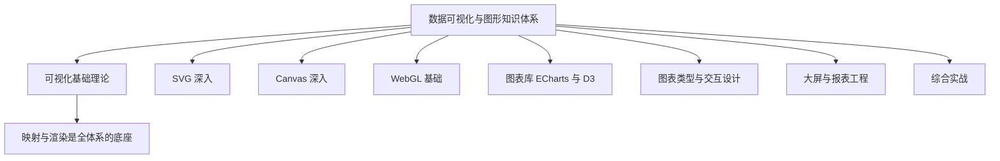

## 目录

- 一、可视化基础理论（VIZ-001 ~ VIZ-007）
- 二、SVG 深入（VIZ-008 ~ VIZ-014）
- 三、Canvas 深入（VIZ-015 ~ VIZ-021）
- 四、WebGL 基础（VIZ-022 ~ VIZ-029）
- 五、ECharts 工程（VIZ-030 ~ VIZ-037）
- 六、D3 思想（VIZ-038 ~ VIZ-044）
- 七、图表类型原理（VIZ-045 ~ VIZ-052）
- 八、交互设计（VIZ-053 ~ VIZ-059）
- 九、大屏与报表工程（VIZ-060 ~ VIZ-067）
- 十、综合实战（VIZ-068 ~ VIZ-100）
- 十一、WebGL 进阶（VIZ-101 ~ VIZ-107）
- 十二、WebGPU 与新图形 API（VIZ-108 ~ VIZ-111）
- 十三、数据可视化高级图表（VIZ-112 ~ VIZ-118）
- 十四、图表库源码与原理深潜（VIZ-119 ~ VIZ-125）
- 十五、大数据可视化（VIZ-126 ~ VIZ-131）
- 十六、可视化工程化（VIZ-132 ~ VIZ-137）
- 十七、BI 与数据分析场景（VIZ-138 ~ VIZ-143）
- 十八、地理与空间可视化（VIZ-144 ~ VIZ-149）
- 十九、可视化性能深水区（VIZ-150 ~ VIZ-155）
- 二十、综合大题与体系（VIZ-156 ~ VIZ-200）

---

## 一、可视化基础理论（VIZ-001 ~ VIZ-007）

### VIZ-001：请描述数据可视化的完整流程，为什么说"视觉映射"是核心？
**答**：完整链路是：原始数据 → 数据处理（清洗/聚合/降采样）→ 视觉映射（数值 → 位置/长度/颜色/形状等视觉通道）→ 渲染（SVG/Canvas/WebGL 生成像素）→ 交互（高亮/筛选/下钻）。视觉映射是核心，因为它决定了"数据关系"到"图形关系"的等价性——选错通道（如用面积编码本应用长度的量）会直接造成认知偏差。工程上应把数据层、映射层、渲染层解耦，各层可独立测试与替换。

```javascript
// 可视化流水线：数据 -> 统计处理 -> 视觉映射 -> 渲染
const pipeline = {
  // 1. 数据层：清洗 + 聚合，输出标准 dataset
  transform(rows, { groupBy, metric }) {
    const acc = new Map();
    for (const r of rows) {
      const k = r[groupBy];
      acc.set(k, (acc.get(k) || 0) + Number(r[metric]));
    }
    return [...acc].map(([name, value]) => ({ name, value }));
  },
  // 2. 映射层：数据值 -> 视觉通道（位置/长度/颜色）
  encode(data, { width, max }) {
    const scale = linearScale(0, max, 0, width); // 值域 -> 像素
    return data.map(d => ({ ...d, w: scale(d.value) }));
  },
  // 3. 渲染层：图元 -> 像素（此处以 SVG rect 为例）
  render(data, svg) {
    svg.innerHTML = data.map((d, i) =>
      `<rect x="0" y="${i * 24}" width="${d.w}" height="20" fill="#3b82f6"></rect>`).join('');
  },
};
function linearScale(d0, d1, r0, r1) {
  return v => r0 + ((v - d0) / (d1 - d0)) * (r1 - r0);
}
```

### VIZ-002：图形系统中的坐标系与仿射变换（平移/旋转/缩放）如何用矩阵表达？
**答**：2D 仿射变换用六元矩阵 [a, b, c, d, e, f] 表示，与 SVG 的 `transform="matrix(...)"`、Canvas 的 `setTransform` 同构。复合变换即矩阵乘法，**作用顺序从右往左**：先执行的变换写在最右侧。绕任意点旋转必须拆成"平移到原点 → 旋转 → 平移回去"三步。理解矩阵后，缩放锚点、zoom 联动、屏幕坐标与数据坐标互转都是同一套数学。

```javascript
// 2D 仿射矩阵 [a, b, c, d, e, f]：x' = a*x + c*y + e; y' = b*x + d*y + f
const I = [1, 0, 0, 1, 0, 0];
const mul = (m, n) => [
  m[0] * n[0] + m[2] * n[1], m[1] * n[0] + m[3] * n[1],
  m[0] * n[2] + m[2] * n[3], m[1] * n[2] + m[3] * n[3],
  m[0] * n[4] + m[2] * n[5] + m[4], m[1] * n[4] + m[3] * n[5] + m[5],
];
const translate = (tx, ty) => [1, 0, 0, 1, tx, ty];
const rotate = a => { const c = Math.cos(a), s = Math.sin(a); return [c, s, -s, c, 0, 0]; };
const scale = (sx, sy) => [sx, 0, 0, sy, 0, 0];
const apply = (m, x, y) => [m[0] * x + m[2] * y + m[4], m[1] * x + m[3] * y + m[5]];
// 绕点旋转：矩阵从右往左作用于点，即先平移到原点，旋转，再平移回去
const rotateAround = (cx, cy, deg) =>
  mul(mul(translate(cx, cy), rotate(deg * Math.PI / 180)), translate(-cx, -cy));
console.log(apply(rotateAround(100, 100, 90), 150, 100)); // [100, 150]
console.log(apply(scale(2, 2), 3, 4));                    // [6, 8]
```

### VIZ-003：颜色空间有哪些？离散、连续、发散色板分别怎么设计？
**答**：常用颜色空间有 RGB（屏幕友好但插值发灰）、HSL（直观但感知不均匀）、CIELAB/CIELCH（感知均匀，颜色插值首选）。色板三类：**离散色板**用于类目数据（区分色相、色盲安全）；**连续色板**用于有序数值（单色渐变或多色渐变，亮度单调变化）；**发散色板**用于有中间语义 0 值的数据（负端蓝、中点白、正端红）。在 RGB 空间直接插值会偏暗，应转 Lab/LCH 插值。

```javascript
// RGB 插值会偏暗发灰，感知均匀应转 CIELAB/CIELCH 再插值（此处演示结构）
function hexToRgb(h) { const n = parseInt(h.slice(1), 16); return [n >> 16, (n >> 8) & 255, n & 255]; }
function mixRgb(a, b, t) { return a.map((v, i) => Math.round(v + (b[i] - v) * t)); }
// 发散色板：负端 -> 中性白 -> 正端，0 值必须精确映射到中点
function divergingScale(neg, mid, pos) {
  return v => { // v ∈ [-1, 1]
    const t = Math.min(Math.abs(v), 1);
    const [a, b] = v < 0 ? [neg, mid] : [mid, pos];
    return `rgb(${mixRgb(hexToRgb(a), hexToRgb(b), t).join(',')})`;
  };
}
// 离散色板：类目数据用固定色相区分；连续色板：亮度随值单调变化
const ordinalPalette = ['#4e79a7', '#f28e2b', '#59a14f', '#e15759', '#b07aa1'];
const heat = divergingScale('#2c7bb6', '#ffffbf', '#d7191c');
console.log(heat(-0.5), heat(0), heat(0.8));
console.log(ordinalPalette[2]);
```

### VIZ-004：常见可视化误导有哪些？如何在工程上防住？
**答**：典型误导：柱状图 Y 轴截断不从 0 开始（长度通道失真）、双 Y 轴两套刻度制造虚假相关性、3D 饼图透视放大近处扇区、不等宽的面积/地图着色、过密的色彩让人看不出分组。工程防法：代码评审 checklist + 对 option 做静态校验（柱状图强制 min: 0）、截断只允许出现在折线图且必须显式标注、双轴必须共享对齐的刻度线。

```javascript
// 上线前对图表配置做"误导检测"，接入 CI 或控制台 warn
function checkMisleading(option) {
  const problems = [];
  const y = option.yAxis || {};
  const isBar = (option.series || []).some(s => s.type === 'bar');
  if (isBar && y.min !== undefined && y.min > 0) {
    problems.push('柱状图 Y 轴未从 0 开始，长度通道失真，应设 min: 0');
  }
  const yAxisArr = Array.isArray(option.yAxis) ? option.yAxis : [];
  if (yAxisArr.length === 2 && yAxisArr[1]?.min > 0) {
    problems.push('双 Y 轴第二轴截断会改变两序列交点，需从 0 开始或显式标注');
  }
  const pieSlices = (option.series || []).filter(s => s.type === 'pie').length;
  if ((option.series || []).some(s => s.type === 'pie') &&
      (option.series || []).some(s => s.type === 'bar')) {
    problems.push('饼图与柱状图混排时面积与长度通道不可直接对比，建议拆分图表');
  }
  return problems;
}
```

### VIZ-005：大数据可视化前的数据预处理（降采样/聚合/归一化）怎么做？
**答**：预处理三件套：**降采样**——点数远超像素时用 LTTB（保留视觉形状/峰值）或 min-max 抽取，等间隔抽样会丢峰值；**聚合**——按时间桶或空间格聚合（avg/sum/count），把百万点压到千级；**归一化**——多指标量纲差异大时归一到 [0,1] 或用 z-score，避免大数值完全压制小数值。原则：预处理在映射之前完成，且必须保留原始数据可回溯。

```javascript
// LTTB 降采样：以三角形面积贪心选点，保留峰值与趋势，比等间隔抽样保真
function lttb(data, target) {
  if (data.length <= target) return data;
  const every = (data.length - 2) / (target - 2);
  const sampled = [data[0]];
  let a = 0; // 上一个选中点下标
  for (let i = 1; i < target - 1; i++) {
    const avgStart = Math.floor(i * every) + 1;
    const avgEnd = Math.min(Math.floor((i + 1) * every) + 1, data.length);
    let avgX = 0, avgY = 0;
    for (let j = avgStart; j < avgEnd; j++) { avgX += data[j][0]; avgY += data[j][1]; }
    avgX /= (avgEnd - avgStart); avgY /= (avgEnd - avgStart);
    const rangeStart = Math.floor((i - 1) * every) + 1;
    const rangeEnd = Math.floor(i * every) + 1;
    let best = -1, idx = rangeStart;
    for (let j = rangeStart; j < rangeEnd; j++) {
      const area = Math.abs((data[a][0] - avgX) * (data[j][1] - data[a][1]) -
        (data[a][0] - data[j][0]) * (avgY - data[a][1])) * 0.5;
      if (area > best) { best = area; idx = j; }
    }
    sampled.push(data[idx]); a = idx;
  }
  sampled.push(data[data.length - 1]);
  return sampled;
}
// 归一化：min-max 到 [0,1]
const normalize = (arr) => {
  const min = Math.min(...arr), max = Math.max(...arr);
  return arr.map(v => (v - min) / (max - min || 1));
};
```

### VIZ-006：标注与图例体系如何设计？
**答**：图例应由 series 定义**自动派生**而非手写死，图例项 = 系列名 + 色样 + 可见性状态，点击只切换系列可见性并触发重算（堆叠图要重算坐标轴）。标注（markLine/markPoint/文字注释）应作为独立的 overlay 逻辑，坐标跟随数据经比例尺换算，而不是写死像素——否则 resize 后错位。告警线、目标线、异常点要有一套统一的标注规范（样式 + 优先级 + 遮挡避让）。

```javascript
// 图例由 series 自动派生；标注坐标走比例尺而非写死像素
function buildLegend(series, colors) {
  return series.map((s, i) => ({
    label: s.name,
    color: colors[i % colors.length],
    visible: true,
    // 图例点击 -> 只切可见性并重算，不重建整个图表
    toggle(all) { s.visible = !s.visible; return all.filter(x => x.visible); },
  }));
}
// 标注层：阈值线坐标 = scale(value)，resize 后重算即可，永不漂移
function renderAnnotation(scaleY, { type, value, label }) {
  if (type === 'threshold') {
    return { y: scaleY(value), text: `${label} ${value}` };
  }
  return null;
}
```

### VIZ-007：可视化的可访问性（a11y）要做什么？
**答**：四件事：**色盲友好**——避开红绿对（约 8% 男性红绿色盲），用 Okabe-Ito 类安全色板，必要时叠加形状/线型冗余编码；**对比度**——文字与背景满足 WCAG AA（4.5:1）；**降级通道**——图表旁边提供等价的隐藏数据表（`sr-only`）或 aria-label 摘要，屏幕阅读器可读；**键盘可达**——数据点可通过 Tab/方向键遍历。核心思想：图形是增强，数据本身必须有非图形的等价表达。

```javascript
// 1. 色盲安全色板（Okabe-Ito 子集，避开红绿对）
const COLOR_BLIND_SAFE = ['#0072B2', '#E69F00', '#009E73', '#CC79A7', '#56B4E9', '#D55E00'];
// 2. 生成隐藏数据表降级：图形之外的等价文本
function toAccessibleTable(option) {
  const rows = [];
  for (const s of option.series || []) {
    for (const d of s.data || []) {
      rows.push(`<tr><td>${s.name}</td><td>${d.name}</td><td>${d.value}</td></tr>`);
    }
  }
  return `<table class="sr-only" aria-label="图表数据表格">
    <caption>${option.title?.text ?? '图表数据'}</caption>
    <thead><tr><th>系列</th><th>类目</th><th>数值</th></tr></thead>
    <tbody>${rows.join('')}</tbody></table>`;
}
// 3. 图形摘要：把趋势读给屏幕阅读器
const summary = `共 ${option.series.length} 个系列，最大值出现在 ${peak.name}`;
```

---

## 二、SVG 深入（VIZ-008 ~ VIZ-014）

### VIZ-008：SVG 的渲染模型是什么？DOM 开销瓶颈在哪？
**答**：SVG 是 retained mode（保留模式）：每个图形都是一个活的 DOM 节点，浏览器维护完整文档树，修改任意节点都可能触发样式重算、layout 与重绘，且可直接用 CSS/事件/DOM API。代价是节点数增长时内存、样式匹配与渲染树开销线性爆炸——几千节点就开始卡。所以 SVG 适合节点少、强交互、需要无级缩放与导出的场景；节点一多就应换 Canvas。

```html
<svg id="chart" width="600" height="400"></svg>
<script>
  // retained mode：每个 rect 都是活 DOM，创建上万个会拖垮 style/layout
  const svg = document.getElementById('chart');
  const N = 500;
  const frag = document.createDocumentFragment(); // 批量插入避免多次 reflow
  const t0 = performance.now();
  for (let i = 0; i < N; i++) {
    const rect = document.createElementNS('http://www.w3.org/2000/svg', 'rect');
    rect.setAttribute('x', (i % 50) * 12);
    rect.setAttribute('y', Math.floor(i / 50) * 12);
    rect.setAttribute('width', 10); rect.setAttribute('height', 10);
    rect.setAttribute('fill', `hsl(${i % 360},70%,60%)`);
    frag.appendChild(rect);
  }
  svg.appendChild(frag);
  console.log(`创建 ${svg.childNodes.length} 个节点耗时 ${(performance.now() - t0).toFixed(1)}ms`);
</script>
```

### VIZ-009：SVG path 命令有哪些？如何把折线平滑成 Catmull-Rom 曲线？
**答**：path 基本命令：M/L 绝对直线、H/V 水平垂直、C 三次贝塞尔、Q 二次贝塞尔、A 圆弧、Z 闭合。折线平滑的本质是把 Catmull-Rom 样条**转换为三次贝塞尔**：每段曲线的两个控制点取自"相邻点差值的 1/6"，张力系数可调。相比 d3.curveCatmullRom，自己实现才能精确控制端点行为与过冲（overshoot）。

```javascript
// Catmull-Rom 样条转三次贝塞尔：控制点取相邻点切线方向差值 / 6
function catmullRomPath(points, tension = 1) {
  if (points.length < 2) return '';
  let d = `M${points[0][0]},${points[0][1]}`;
  for (let i = 0; i < points.length - 1; i++) {
    const p0 = points[i - 1] || points[i];
    const p1 = points[i], p2 = points[i + 1];
    const p3 = points[i + 2] || p2;
    const c1x = p1[0] + ((p2[0] - p0[0]) / 6) * tension;
    const c1y = p1[1] + ((p2[1] - p0[1]) / 6) * tension;
    const c2x = p2[0] - ((p3[0] - p1[0]) / 6) * tension;
    const c2y = p2[1] - ((p3[1] - p1[1]) / 6) * tension;
    d += `C${c1x.toFixed(2)},${c1y.toFixed(2)} ${c2x.toFixed(2)},${c2y.toFixed(2)} ${p2[0]},${p2[1]}`;
  }
  return d;
}
console.log(catmullRomPath([[0, 50], [50, 20], [100, 60], [150, 30]]));
```

### VIZ-010：SVG 的 viewBox 缩放机制是什么？如何实现滚轮以鼠标为锚点缩放？
**答**：viewBox 定义了 SVG 内部逻辑坐标系到视口的映射，`preserveAspectRatio` 控制宽高比不一致时的对齐方式。缩放 = 修改 viewBox 的 x/y/w/h。关键点是**锚点计算**：把鼠标位置换算成 viewBox 坐标，缩放后保证"指针下的点缩放前后位置不变"，即 `newX = mx - (mx - oldX) * k`。平移则直接平移 viewBox 原点。

```html
<svg id="s" viewBox="0 0 600 400" width="600" height="400" style="border:1px solid #ccc">
  <circle cx="300" cy="200" r="80" fill="steelblue"></circle>
</svg>
<script>
  const svg = document.getElementById('s');
  let vb = { x: 0, y: 0, w: 600, h: 400 };
  svg.addEventListener('wheel', e => {
    e.preventDefault();
    const k = e.deltaY < 0 ? 0.9 : 1.1;
    // 鼠标位置换算到 viewBox 逻辑坐标，作为缩放锚点，保证指针下的点不动
    const mx = vb.x + (e.offsetX / svg.clientWidth) * vb.w;
    const my = vb.y + (e.offsetY / svg.clientHeight) * vb.h;
    vb = {
      x: mx - (mx - vb.x) * k,
      y: my - (my - vb.y) * k,
      w: vb.w * k,
      h: vb.h * k,
    };
    svg.setAttribute('viewBox', `${vb.x} ${vb.y} ${vb.w} ${vb.h}`);
  }, { passive: false });
</script>
```

### VIZ-011：SVG 滤镜如何实现发光/阴影效果？性能注意点？
**答**：滤镜通过 `<filter>` 定义原语链：feGaussianBlur 高斯模糊 → feOffset 偏移 → feFlood/feComposite 上色 → feMerge 合并回原图。发光 = 模糊层叠在原图下面；投影 = 模糊 + 偏移 + 变暗。性能上滤镜是**逐像素计算**且开销大：模糊半径越大越贵，动一个带滤镜的元素会触发整个滤镜区域重算，所以要扩大 filter region 防裁切、避免对大面积或高频动画元素加滤镜、能预烘焙就导出成静态资源。

```html
<svg width="300" height="140">
  <defs>
    <!-- 发光：模糊层放在 SourceGraphic 之下叠加 -->
    <filter id="glow" x="-50%" y="-50%" width="200%" height="200%">
      <feGaussianBlur in="SourceGraphic" stdDeviation="4" result="blur"></feGaussianBlur>
      <feMerge>
        <feMergeNode in="blur"></feMergeNode>
        <feMergeNode in="SourceGraphic"></feMergeNode>
      </feMerge>
    </filter>
    <!-- 投影：模糊 + 偏移 + 变暗，垫在原图下方 -->
    <filter id="shadow" x="-30%" y="-30%" width="160%" height="160%">
      <feGaussianBlur in="SourceAlpha" stdDeviation="3" result="b"></feGaussianBlur>
      <feOffset in="b" dx="2" dy="3" result="o"></feOffset>
      <feFlood flood-color="#000" flood-opacity="0.35" result="c"></feFlood>
      <feComposite in="c" in2="o" operator="in" result="s"></feComposite>
      <feMerge>
        <feMergeNode in="s"></feMergeNode>
        <feMergeNode in="SourceGraphic"></feMergeNode>
      </feMerge>
    </filter>
  </defs>
  <circle cx="80" cy="70" r="30" fill="#4fc3f7" filter="url(#glow)"></circle>
  <rect x="170" y="40" width="80" height="60" rx="8" fill="#fff" stroke="#94a3b8" filter="url(#shadow)"></rect>
</svg>
```

### VIZ-012：SVG 动画有哪些方案？如何选型？
**答**：三种方案：**CSS**（transition/animation）声明式，transform/opacity 走合成器性能最好，适合状态切换与 hover，但插值能力弱；**SMIL**（animate/animateTransform）内嵌于 SVG、可沿路径运动，但兼容性收缩且趋于废弃，新项目不推荐；**JS + rAF**（或 Web Animations API）完全可控——逐帧插值、串行动画编排、物理缓动、数据驱动的形变，是图表库的标准选择。选型口诀：简单状态用 CSS，路径动画看兼容，其余一律 JS。

```html
<style>
  /* CSS：声明式，transform/opacity 走合成器，适合状态切换 */
  .bar { transition: transform .6s ease; transform-origin: left center; }
  .bar.active { transform: scaleX(1); }
</style>
<svg width="220" height="60">
  <rect class="bar" width="200" height="30" style="transform: scaleX(0.2)"></rect>
</svg>
<script>
  document.querySelector('.bar').classList.add('active');
  const rect2 = document.querySelector('rect');
  // JS + rAF：完全可控（逐帧插值/编排/物理缓动），图表库的标准方案
  function animate(from, to, dur, onFrame) {
    const t0 = performance.now();
    (function step(t) {
      const p = Math.min((t - t0) / dur, 1);
      const ease = 1 - Math.pow(1 - p, 3); // easeOutCubic
      onFrame(from + (to - from) * ease);
      if (p < 1) requestAnimationFrame(step);
    })(t0);
  }
  animate(0, 200, 600, v => { rect2.setAttribute('width', v); });
  // SMIL（animate/set 元素）已趋于废弃，新项目不推荐使用
</script>
```

### VIZ-013：SVG 的性能边界在哪？节点多了如何优化？
**答**：经验阈值：500 节点内随意交互，1k~3k 需要优化，上万节点基本不可用（样式重算 + 合成开销线性爆炸）。优化手段按优先级：**视窗裁剪/虚拟化**——只渲染可视区节点，总数恒定；**减少属性变更**——用 `transform` 而不是 x/y 逐个改，批量改样式用 class；**合并重绘**——DocumentFragment 或 `replaceChildren` 批量插入；**降级**——超阈值自动切 Canvas 渲染器；**文本与滤镜减负**——text 换 canvas 贴图、滤镜只用于静态元素。

```javascript
// 视窗虚拟化：无论数据多少，DOM 节点数恒定在可视窗口量级
const svgRoot = document.querySelector('#root');
function renderVisibleSvg(allData, viewport, rowH = 24) {
  const start = Math.max(0, Math.floor(viewport.scrollTop / rowH) - 5); // 上下各留 5 行缓冲
  const count = Math.ceil(viewport.clientHeight / rowH) + 10;
  const slice = allData.slice(start, start + count); // 视窗裁剪
  const frag = document.createDocumentFragment();
  for (const d of slice) {
    const g = document.createElementNS('http://www.w3.org/2000/svg', 'g');
    g.setAttribute('transform', `translate(0, ${d.i * rowH})`);
    const rect = document.createElementNS('http://www.w3.org/2000/svg', 'rect');
    rect.setAttribute('width', d.value); rect.setAttribute('height', rowH - 2);
    g.appendChild(rect); frag.appendChild(g);
  }
  svgRoot.replaceChildren(frag); // 整体替换，节点数不随数据量增长
}
// 超过阈值自动降级：if (data.length > 3000) useCanvasRenderer()
```

### VIZ-014：前端如何把 SVG 图表导出为 PNG/PDF？
**答**：PNG 路线：`XMLSerializer` 序列化 SVG → 包成 Blob → `Image` 加载（SVG 无跨域污染问题）→ 画到 canvas（按 DPR 放大）→ `toBlob`。PDF 路线：PNG 结果喂给 jsPDF 的 `addImage`，或走浏览器打印的"另存为 PDF"。三个坑：**字体**必须内联（style 里嵌 base64 woff2 或转 outline），**外链图片**必须转 dataURL 否则画不出来，**canvas 污染**——SVG 里如果引用了外域 image 且未 CORS 放行，toBlob 会抛 SecurityError。

```javascript
// SVG -> PNG：serialize 成 Blob -> Image -> canvas 绘制 -> toBlob
async function svgToPng(svgEl, scale = 2) {
  const xml = new XMLSerializer().serializeToString(svgEl);
  const url = URL.createObjectURL(new Blob([xml], { type: 'image/svg+xml;charset=utf-8' }));
  const img = new Image();
  await new Promise((ok, err) => { img.onload = ok; img.onerror = err; img.src = url; });
  const { width, height } = svgEl.viewBox.baseVal;
  const canvas = Object.assign(document.createElement('canvas'), {
    width: width * scale, height: height * scale,
  });
  const ctx = canvas.getContext('2d');
  ctx.scale(scale, scale); // 放大导出保证清晰
  ctx.drawImage(img, 0, 0);
  URL.revokeObjectURL(url);
  return new Promise(ok => canvas.toBlob(ok, 'image/png'));
}
// 注意：字体与外链图片需内联为 base64，否则导出缺字/缺图
// PDF：import jsPDF 后 pdf.addImage(pngDataUrl, 'PNG', 0, 0, width, height)
```

---

## 三、Canvas 深入（VIZ-015 ~ VIZ-021）

### VIZ-015：Canvas 的渲染管线与"状态机"模型如何工作？
**答**：Canvas 是立即模式（immediate mode）：每帧重画全部内容，浏览器不保留图形对象，只有一张位图。其上下文是**状态机**——fillStyle、strokeStyle、lineWidth、font、globalAlpha、变换矩阵都是全局状态，`save()` 压栈、`restore()` 出栈。绘制调用顺序即绘制结果（后画的盖前画的）。工程意义：状态切换本身有开销（同类图元应合并填充），忘记 restore 会让状态"泄漏"影响后续绘制，封装 withState 是常见实践。

```javascript
const ctx = document.querySelector('canvas').getContext('2d');
// Canvas 是立即模式 + 状态机：fillStyle/lineWidth/font/transform 都是全局状态
function withState(c, patch, draw) {
  c.save();                 // 当前状态压栈
  Object.assign(c, patch);  // 局部修改
  draw(c);
  c.restore();              // 弹栈还原，避免状态泄漏到后续绘制
}
withState(ctx, { fillStyle: 'red', lineWidth: 3 }, c => c.fillRect(10, 10, 50, 50));
withState(ctx, { fillStyle: 'blue' }, c => c.fillRect(80, 10, 50, 50));
// 优化点：同类图元合并设置状态——先统一 fillStyle 画完所有红点，再切蓝色，减少状态切换
```

### VIZ-016：什么是脏矩形局部重绘？如何工程化落地？
**答**：脏矩形（dirty rect）= 本帧真正变化的区域。流程：交互/数据更新时调用 `invalidate(x, y, w, h)` 标记脏区（同帧多次失效要**合并成包围盒**）；渲染帧只 `clearRect` 脏区并 clip 裁剪后重绘场景，场景内部再按元素包围盒剔除不可见图元。收益是重绘面积从全屏降到局部；代价是逻辑复杂度上升，且元素频繁大范围移动时脏区接近全屏，收益归零——此时应改用双 Canvas 分层。

```javascript
// 脏矩形：只 clear + 重绘发生变化的区域，适合局部高频更新
const renderer = {
  dirty: null,
  invalidate(x, y, w, h) {
    this.dirty = this.dirty ? unionRect(this.dirty, { x, y, w, h }) : { x, y, w, h };
  },
  flush(ctx, drawScene) {
    if (!this.dirty) return;
    const { x, y, w, h } = this.dirty;
    ctx.clearRect(x, y, w, h);          // 只清脏区
    ctx.save();
    ctx.beginPath(); ctx.rect(x, y, w, h); ctx.clip(); // 裁剪重绘范围
    drawScene(ctx, this.dirty);          // 场景内部按包围盒做图元剔除
    ctx.restore();
    this.dirty = null;
  },
};
function unionRect(a, b) {
  const x = Math.min(a.x, b.x), y = Math.min(a.y, b.y);
  return {
    x, y,
    w: Math.max(a.x + a.w, b.x + b.w) - x,
    h: Math.max(a.y + a.h, b.y + b.h) - y,
  };
}
```

### VIZ-017：如何用离屏 Canvas 缓存复杂图层？
**答**：把不常变的复杂内容（网格线、坐标轴、背景纹理、复杂贝塞尔底图）**画一次**缓存到离屏 canvas（OffscreenCanvas 或隐藏 canvas），主循环里一次 `drawImage` 贴回，把 N 次绘制压成 1 次位块拷贝。失效时机：容器 resize、主题切换、坐标轴范围变化时重画缓存。OffscreenCanvas 还能转移到 Worker 渲染，彻底不占主线程。注意缓存尺寸要含 DPR，drawImage 时按逻辑尺寸铺回。

```javascript
// 静态图层（网格/坐标轴/背景）画一次缓存到离屏 canvas，每帧 drawImage 贴回
const bg = typeof OffscreenCanvas !== 'undefined'
  ? new OffscreenCanvas(800, 600)
  : Object.assign(document.createElement('canvas'), { width: 800, height: 600 });
const bgCtx = bg.getContext('2d');
function drawGrid(c) {
  c.strokeStyle = '#eee';
  for (let x = 0; x <= 800; x += 50) { c.beginPath(); c.moveTo(x, 0); c.lineTo(x, 600); c.stroke(); }
  for (let y = 0; y <= 600; y += 50) { c.beginPath(); c.moveTo(0, y); c.lineTo(800, y); c.stroke(); }
}
drawGrid(bgCtx); // 只在尺寸/主题变化时重画缓存

function renderFrame(ctx) {
  ctx.clearRect(0, 0, 800, 600);
  ctx.drawImage(bg, 0, 0, 800, 600); // 一次位块拷贝，远快于几百次 lineTo
  drawDynamicPoints(ctx);            // 只有动态数据走实时绘制
}
```

### VIZ-018：十万级点/线在 Canvas 上如何渲染优化？
**答**：分层递进：① **TypedArray**（Float32Array）存坐标，去掉对象与 GC 压力；② **视口裁剪**——框外点直接 continue；③ **批量绘制**——所有点收集进同一个 path，一次 fill/stroke（状态切换与 draw call 是大头）；④ **像素分桶聚合**——点数远超像素时按网格聚合，每格最多画一次，性能与点数解耦；⑤ 交互命中用 quadtree 索引而不是遍历。折线则用步长抽稀（相邻像素最多一个点）。

```javascript
// 10 万点：TypedArray 存储 + 视口裁剪 + 单 path 批量 fill
function drawScatter(ctx, xs, ys, view) {
  ctx.fillStyle = 'rgba(30,120,200,0.5)';
  ctx.beginPath();
  for (let i = 0; i < xs.length; i++) {
    const x = xs[i], y = ys[i]; // TypedArray 读取，无对象与 GC 开销
    if (x < view.x0 || x > view.x1 || y < view.y0 || y > view.y1) continue; // 裁剪
    ctx.rect(x, y, 2, 2);       // 收集进同一个 path
  }
  ctx.fill();                   // 一次 fill 画完所有点，draw call 唯一
}
// 点数 > 数万像素时升级为分桶聚合：性能与点数无关，只与像素有关
function binPoints(xs, ys, w, h, cell = 4) {
  const cols = Math.ceil(w / cell), rows = Math.ceil(h / cell);
  const bins = new Uint32Array(cols * rows);
  for (let i = 0; i < xs.length; i++) {
    bins[Math.min(((ys[i] / h) * rows) | 0, rows - 1) * cols +
         Math.min(((xs[i] / w) * cols) | 0, cols - 1)]++;
  }
  return { bins, cols, rows, cell };
}
```

### VIZ-019：Canvas 没有自动排版，如何实现文本换行与省略号？
**答**：Canvas 的 fillText 是单行、无布局能力的，中文/英文混排都要自己写排版引擎：核心 API 是 `measureText(str).width`。**换行**：逐字符（中文）或逐单词（英文按空格切 token）累计宽度，超过 maxWidth 就断行；**省略**：超出 maxLines 时对最后一行从尾部删字符直到"内容 + …"不超宽；**对齐**：textAlign + 手动计算行高 lineHeight。优化：measureText 结果按字符串缓存，因为它是同步布局计算，高频调用会卡。

```javascript
// Canvas 无自动换行：基于 measureText 实现逐词换行 + 省略号
function wrapText(ctx, text, maxWidth, maxLines) {
  const lines = [];
  let line = '';
  for (const ch of text) { // 中文逐字断行；英文可先按空格切 token 再逐 token 累计
    const next = line + ch;
    if (ctx.measureText(next).width > maxWidth && line) {
      lines.push(line);
      line = ch;
      if (lines.length === maxLines) { // 达到行数上限：最后一行截断加省略号
        let last = lines[maxLines - 1];
        while (last && ctx.measureText(last + '…').width > maxWidth) last = last.slice(0, -1);
        lines[maxLines - 1] = last + '…';
        return lines;
      }
    } else {
      line = next;
    }
  }
  if (line) lines.push(line);
  return lines;
}
function drawWrapped(ctx, text, x, y, lineHeight) {
  wrapText(ctx, text, 200, 3).forEach((l, i) => ctx.fillText(l, x, y + i * lineHeight));
}
```

### VIZ-020：Canvas 的命中检测有哪几种方案？各自适用场景？
**答**：三种：① **几何法**——自己按图元形状做点在圆/矩形/多边形内判断，最快、可配合空间索引（quadtree/grid）支撑百万图元，需要自己维护图元几何表；② **isPointInPath / isPointInStroke**——把命中交给上下文，对复杂贝塞尔形状省心，但每次调用都要重建 path，量大时慢；③ **像素法**——`getImageData` 读该像素 alpha（或专属拾色色板 hit-map），对任意渲染结果通用，但读回 GPU 位图慢且需维护离屏拾取层。实践：常规图元用几何法 + 索引，异形元素用像素拾取层兜底。

```javascript
// 命中检测：几何法为主（倒序遍历，后画的在上层），复杂异形再考虑像素法
const shapes = [
  { type: 'circle', x: 100, y: 100, r: 30, id: 'a' },
  { type: 'rect', x: 200, y: 50, w: 80, h: 40, id: 'b' },
];
function hitTest(px, py) {
  for (let i = shapes.length - 1; i >= 0; i--) {
    const s = shapes[i];
    if (s.type === 'circle' && (px - s.x) ** 2 + (py - s.y) ** 2 <= s.r ** 2) return s.id;
    if (s.type === 'rect' && px >= s.x && px <= s.x + s.w && py >= s.y && py <= s.y + s.h) return s.id;
  }
  return null;
}
canvas.addEventListener('mousemove', e => {
  // 高频事件里只做几何判断；isPointInPath 需重建 path，getImageData 需读回位图，均更贵
  hoverShape = hitTest(e.offsetX, e.offsetY);
});
// 像素拾取法示意：离屏 hit-map 给每个图元分配唯一颜色，读 alpha/RGB 反查 id
function pickByPixel(hitCtx, x, y) {
  const [r, g, b] = hitCtx.getImageData(x, y, 1, 1).data;
  return r || g || b ? (r << 16) | (g << 8) | b : null; // 颜色即图元 id
}
```

### VIZ-021：Canvas 如何做 DPR 与浏览器缩放适配？
**答**：canvas 的 CSS 尺寸与位图尺寸是两回事：位图 = CSS 尺寸 × devicePixelRatio，再通过 `ctx.scale(dpr, dpr)` 让绘制代码继续用 CSS 像素坐标系。只设 CSS 不设位图会得到模糊拉伸；设了位图不 scale 会得到小一半的图形。注意两点：超高 DPR 设备限到 2 节省内存；浏览器页面缩放会改变 effective DPR，需监听 `matchMedia('(resolution: 2dppx)')` 之类变化重建画布。

```javascript
function setupHiDPI(canvas, cssW, cssH) {
  const dpr = Math.min(window.devicePixelRatio || 1, 2); // 超高 DPR 限 2 省内存
  canvas.width = Math.round(cssW * dpr);   // 位图物理像素
  canvas.height = Math.round(cssH * dpr);
  canvas.style.width = cssW + 'px';        // CSS 尺寸保持布局大小
  canvas.style.height = cssH + 'px';
  const ctx = canvas.getContext('2d');
  ctx.setTransform(dpr, 0, 0, dpr, 0, 0);  // 后续逻辑坐标一律用 CSS 像素
  return ctx;
}
// 浏览器缩放会改变有效 DPR：监听变化后重建画布，否则变模糊
const mq = matchMedia(`(resolution: ${window.devicePixelRatio}dppx)`);
mq.addEventListener?.('change', () => location.reload()); // 简单场景；复杂场景重渲染不刷新
```

---

## 四、WebGL 基础（VIZ-022 ~ VIZ-029）

### VIZ-022：描述 WebGL 的渲染管线，一次 draw 调用经历了什么？
**答**：管线流程：JS 提交顶点缓冲 → **顶点着色器**（每个顶点执行一次，算出裁剪空间坐标）→ **图元装配**（顶点组装成点/线/三角形）→ **裁剪与透视除法** → **光栅化**（图元离散成片元，varying 在此插值）→ **片元着色器**（每个片元执行一次，算颜色）→ **逐片元操作**（深度测试、模板测试、混合）→ 写入帧缓冲。核心心智模型：CPU 只负责喂数据 + 一次 `drawArrays/drawElements`，剩下全是 GPU 并行，这就是它比 Canvas 快的根源。


```javascript
const gl = canvas.getContext('webgl');
const compile = (g, type, src) => {
  const s = g.createShader(type);
  g.shaderSource(s, src); g.compileShader(s);
  if (!g.getShaderParameter(s, g.COMPILE_STATUS)) throw new Error(g.getShaderInfoLog(s));
  return s;
};
function createProgram(g, vsSrc, fsSrc) {
  const p = g.createProgram();
  g.attachShader(p, compile(g, g.VERTEX_SHADER, vsSrc));
  g.attachShader(p, compile(g, g.FRAGMENT_SHADER, fsSrc));
  g.linkProgram(p);
  return p;
}
// 一帧 = clearColor + clear -> useProgram -> 绑定 VBO/设置 attribute -> drawArrays
// CPU 只提交数据与一次 draw，其余全部在 GPU 并行执行
```

### VIZ-023：GLSL 中 attribute、varying、uniform 的区别？
**答**：**attribute**：逐顶点输入，只在顶点着色器可用（WebGL2 里叫 in），如坐标、法线、UV；**varying**：顶点着色器写入、经光栅化**插值**后传给片元着色器读取（WebGL2 里 out/in 配对），如逐像素的颜色/UV；**uniform**：全局常量，一次 draw 内所有顶点与片元共享同一值，由 JS 上传，如变换矩阵、时间、颜色。三者组合出"每顶点不同、每像素插值、整体统一"三个粒度。

```javascript
const vs = `
attribute vec2 aPos;          // attribute：每个顶点不同的输入
uniform float uPointSize;     // uniform：本次 draw 全局统一
varying float vAlpha;         // varying：写入后经光栅化插值传给片元
void main() {
  gl_Position = vec4(aPos, 0.0, 1.0);
  gl_PointSize = uPointSize;
  vAlpha = 0.5 + aPos.y * 0.5;
}`;
const fs = `
precision mediump float;
uniform vec3 uColor;
varying float vAlpha;         // FS 中读到的 vAlpha 已按像素位置插值
void main() { gl_FragColor = vec4(uColor, vAlpha); }`;
// 记忆：attribute 逐顶点、varying 逐像素插值、uniform 每次 draw 一份
```

### VIZ-024：顶点缓冲区与顶点属性如何配置？什么是交错缓冲？
**答**：流程：`createBuffer` → `bindBuffer` → `bufferData` 上传 Float32Array → `vertexAttribPointer` 告诉 GPU 每个 attribute 从缓冲的哪里开始读（offset）、步长多少（stride）→ `enableVertexAttribArray`。**交错缓冲（interleaved）**：把 position/color 打包进同一个数组，每个顶点占固定 stride，一次绑定即可，对 GPU 缓存更友好；也可以每个属性独立 buffer（便于单独更新某个属性）。大数组尽量 `STATIC_DRAW`，每帧变的用 `DYNAMIC_DRAW`。

```javascript
// 交错缓冲：position + color 打包在一个 Float32Array，一次绑定
const vertices = new Float32Array([
  //   x     y     r     g     b
  -0.5, -0.5,  1.0,  0.0,  0.0,
   0.5, -0.5,  0.0,  1.0,  0.0,
   0.0,  0.5,  0.0,  0.0,  1.0,
]);
const buf = gl.createBuffer();
gl.bindBuffer(gl.ARRAY_BUFFER, buf);
gl.bufferData(gl.ARRAY_BUFFER, vertices, gl.STATIC_DRAW); // STATIC_DRAW：不常改
const STRIDE = 5 * 4; // 每顶点 5 个 float，共 20 字节
const aPos = gl.getAttribLocation(prog, 'aPos');
const aColor = gl.getAttribLocation(prog, 'aColor');
gl.vertexAttribPointer(aPos, 2, gl.FLOAT, false, STRIDE, 0);      // x,y 从字节 0 开始
gl.vertexAttribPointer(aColor, 3, gl.FLOAT, false, STRIDE, 2 * 4); // rgb 从字节 8 开始
gl.enableVertexAttribArray(aPos);
gl.enableVertexAttribArray(aColor);
gl.drawArrays(gl.TRIANGLES, 0, 3);
```

### VIZ-025：MVP（模型/视图/投影）矩阵分别做什么？
**答**：裁剪空间坐标 = **P × V × M × 顶点**。**M（模型矩阵）**：物体局部坐标 → 世界坐标（物体的位移/旋转/缩放）；**V（视图矩阵）**：世界 → 相机空间（等价于相机的逆变换，lookAt）；**P（投影矩阵）**：相机空间 → 裁剪空间（透视投影带除 w，正交投影不带）。工程上通常在 JS 端把三者预乘成一个 mvp 矩阵，用一个 uniform 传入顶点着色器，省三次矩阵乘法。注意 WebGL 矩阵是列主序，传 `uniformMatrix4fv` 时不要转置。

```javascript
// gl-matrix：clip = P * V * M * pos，列主序 Float32Array
import { mat4 } from 'gl-matrix';
const model = mat4.create();                 // 模型：物体局部 -> 世界
mat4.rotateY(model, model, Math.PI / 4);
const view = mat4.create();                  // 视图：世界 -> 相机
mat4.lookAt(view, [0, 0, 5], [0, 0, 0], [0, 1, 0]);
const proj = mat4.create();                  // 投影：相机 -> 裁剪空间
mat4.perspective(proj, Math.PI / 4, canvas.width / canvas.height, 0.1, 100);
const mvp = mat4.create();
mat4.multiply(mvp, proj, view);
mat4.multiply(mvp, mvp, model);              // 预乘成一个矩阵，VS 里只乘一次
gl.uniformMatrix4fv(uMvpLoc, false, mvp);    // false：不转置，WebGL 用列主序
```

### VIZ-026：纹理如何创建与采样？有哪些必踩的坑？
**答**：流程：`createTexture` → `bindTexture` → `texImage2D` 上传图片/像素 → `texParameteri` 设置过滤（放大 LINEAR、缩小 LINEAR_MIPMAP_LINEAR）与环绕（REPEAT/CLAMP_TO_EDGE）→ 片元着色器里 `texture2D(uTex, uv)` 采样。经典坑：① 图片 Y 轴方向与纹理 UV 相反，要 `UNPACK_FLIP_Y_WEBGL`；② 图片异步加载期间纹理未就绪，先垫 1×1 像素；③ **NPOT（非 2 次幂）纹理不能用 mipmap，wrap 必须为 CLAMP_TO_EDGE**，否则渲染失败（WebGL1）。

```javascript
function loadTexture(gl, url) {
  const tex = gl.createTexture();
  gl.bindTexture(gl.TEXTURE_2D, tex);
  // 图片异步加载完成前先垫 1x1 像素，避免不完整纹理导致渲染黑屏
  gl.texImage2D(gl.TEXTURE_2D, 0, gl.RGBA, 1, 1, 0, gl.RGBA, gl.UNSIGNED_BYTE,
    new Uint8Array([0, 0, 0, 255]));
  const img = new Image();
  img.onload = () => {
    gl.bindTexture(gl.TEXTURE_2D, tex);
    gl.pixelStorei(gl.UNPACK_FLIP_Y_WEBGL, true); // 图片 Y 轴与纹理 UV 相反
    gl.texImage2D(gl.TEXTURE_2D, 0, gl.RGBA, gl.RGBA, gl.UNSIGNED_BYTE, img);
    gl.generateMipmap(gl.TEXTURE_2D);             // 多级纹理，缩小采样抗闪烁
    gl.texParameteri(gl.TEXTURE_2D, gl.TEXTURE_MIN_FILTER, gl.LINEAR_MIPMAP_LINEAR);
    gl.texParameteri(gl.TEXTURE_2D, gl.TEXTURE_WRAP_S, gl.CLAMP_TO_EDGE);
    gl.texParameteri(gl.TEXTURE_2D, gl.TEXTURE_WRAP_T, gl.CLAMP_TO_EDGE);
  };
  img.src = url;
  return tex;
}
// NPOT（非 2 次幂）纹理在 WebGL1 不能开 mipmap，wrap 必须为 CLAMP_TO_EDGE
```

### VIZ-027：混合模式如何工作？透明物体为什么要排序？
**答**：混合发生在逐片元操作阶段：`blendFunc(SRC_ALPHA, ONE_MINUS_SRC_ALPHA)` 即标准 alpha 混合，新片元颜色与帧缓冲已有颜色按权重合成。深度测试默认"谁近挡谁"，对**不透明**物体够用；但半透明片元若写深度，会挡住后面待画的透明片元，所以规范是：**不透明物体先画（开深度写入）→ 透明物体按相机距离从远到近排序后画（关深度写入、只读）**。不排序的结果就是透明面片互相"穿插闪烁"。WebGPU/新引擎用 OIT（order-independent transparency）技术绕开排序。

```javascript
gl.enable(gl.BLEND);
gl.blendFunc(gl.SRC_ALPHA, gl.ONE_MINUS_SRC_ALPHA); // 标准 alpha 混合
// 不透明物体先画：开深度写入，深度测试解决互相遮挡
const opaque = objects.filter(o => o.opacity >= 1);
for (const o of opaque) drawObject(o);
// 透明物体后画：按相机距离从远到近排序，关闭深度写入避免互相挡掉
const transparent = objects.filter(o => o.opacity < 1)
  .sort((a, b) => distSq(b.center, cameraPos) - distSq(a.center, cameraPos));
gl.depthMask(false); // 只读深度不写深度
for (const o of transparent) drawObject(o);
gl.depthMask(true);
function distSq(p, c) { return (p[0] - c[0]) ** 2 + (p[1] - c[1]) ** 2 + (p[2] - c[2]) ** 2; }
```

### VIZ-028：WebGL 性能优化为什么要合并 draw call？instancing 怎么用？
**答**：每次 draw call CPU 都要做状态校验、绑定切换与命令提交，GPU 本身很快，**瓶颈常在 CPU 提交侧**——10 万个三角形一次 draw 很轻松，1 万次 draw 则卡死。合批思路：把同材质图元拼进同一个缓冲一次画完。**instancing（实例化）**是合批的极致：同一 mesh 画 N 份、每份只差 transform/颜色这类"每实例属性"，用 `drawArraysInstanced` + `vertexAttribDivisor(1)` 一次 draw 搞定，海量散点图/图标渲染的标准答案。WebGL2 原生支持，WebGL1 用 ANGLE_instanced_arrays 扩展。

```javascript
// 1 万个同 mesh 不同 transform 的点/图标：instancing 把 1 万次 draw call 合成 1 次
const ext = gl.getExtension('ANGLE_instanced_arrays'); // WebGL2 原生无需扩展
const perInstance = new Float32Array(
  instances.flatMap(i => [i.x, i.y, i.scale])); // 每实例属性：偏移 + 缩放
const ibuf = gl.createBuffer();
gl.bindBuffer(gl.ARRAY_BUFFER, ibuf);
gl.bufferData(gl.ARRAY_BUFFER, perInstance, gl.DYNAMIC_DRAW);
const aOffset = gl.getAttribLocation(prog, 'aOffset');
gl.enableVertexAttribArray(aOffset);
gl.vertexAttribPointer(aOffset, 3, gl.FLOAT, false, 12, 0);
ext.vertexAttribDivisorANGLE(aOffset, 1); // divisor=1：每实例更新一次，而非每顶点
ext.drawArraysInstancedANGLE(gl.TRIANGLE_STRIP, 0, 4, instanceCount);
// 对比：普通 draw 循环 1 万次 -> instanced 1 次，CPU 提交开销下降两个数量级
```

### VIZ-029：Three.js 的场景图与渲染循环如何工作？
**答**：场景图是 Object3D 树：每个节点携带自己的局部变换，**父级变换级联作用于子级**（渲染时自顶向下算世界矩阵）。渲染循环 `renderer.render(scene, camera)` 做四件事：更新世界矩阵 → 视锥剔除 → 按材质/几何分组合并 draw call → 提交 WebGL。工程要点：动画只在 rAF 循环里改 transform；页面不可见暂停循环；resize 时同步 `camera.aspect` 与 `renderer.setSize`；静态对象合并 geometry 或用 InstancedMesh 降 draw call。

```javascript
import * as THREE from 'three';
const scene = new THREE.Scene();
const camera = new THREE.PerspectiveCamera(45, innerWidth / innerHeight, 0.1, 1000);
camera.position.set(0, 5, 10);
camera.lookAt(0, 0, 0);
const renderer = new THREE.WebGLRenderer({ antialias: true });
renderer.setSize(innerWidth, innerHeight);
document.body.appendChild(renderer.domElement);
// 场景图：Object3D 树，父级变换级联影响子级
const group = new THREE.Group();
group.add(new THREE.Mesh(new THREE.BoxGeometry(1, 1, 1), new THREE.MeshNormalMaterial()));
scene.add(group);
function tick(t) {
  group.rotation.y = t / 1000;         // 每帧只更新变换，渲染交给 render()
  renderer.render(scene, camera);      // 更新世界矩阵 -> 剔除 -> 合批 -> WebGL
  requestAnimationFrame(tick);
}
requestAnimationFrame(tick);
addEventListener('resize', () => {     // resize 必须同步相机纵横比与画布尺寸
  camera.aspect = innerWidth / innerHeight;
  camera.updateProjectionMatrix();
  renderer.setSize(innerWidth, innerHeight);
});
```

---

## 五、ECharts 工程（VIZ-030 ~ VIZ-037）

### VIZ-030：ECharts 的整体架构是怎样的？ZRender 扮演什么角色？
**答**：自上而下四层：**option 声明层** → **内部模型层**（M/C/V，把 option 解析成坐标系、series、组件模型并做 diff）→ **ZRender 渲染引擎**——它是 ECharts 与具体绘图 API 之间的抽象层，包含 Storage（场景图形树）、Painter（可插拔的 canvas/svg/vml 渲染后端）、Handler（命中检测与事件分发）、Animation（补间）。理解这条链路的意义：性能问题要定位是模型层算得慢还是 Painter 画得慢；`chart.getZr()` 能拿到 ZRender 实例做底层定制。

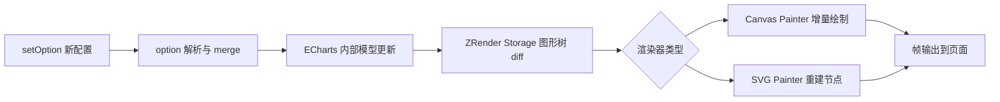

```javascript
// ECharts 分层：Option -> 内部模型 -> ZRender（Storage + Painter + Handler + Animation）
const chart = echarts.init(el, undefined, { renderer: 'canvas' });
// renderer 可选 canvas / svg：canvas 适合大数据量，svg 适合强交互小图与无失真导出
chart.setOption({
  xAxis: { type: 'category', data: ['A', 'B', 'C'] },
  yAxis: {},
  series: [{ type: 'bar', data: [1, 2, 3] }],
});
// ZRender 暴露底层能力：绕过 series 直接操作图形元素或监听空白区事件
chart.getZr().on('click', p => console.log('zrender 坐标', p.offsetX, p.offsetY));
```

### VIZ-031：setOption 的 merge / notMerge / replaceMerge 有什么区别？
**答**：默认 **merge**：新旧 option 深合并，未传字段保留，交互状态（dataZoom 位置等）不丢，适合数据更新；**notMerge: true**：完全替换，组件状态重置，适合整体切换视图/换图表类型；**replaceMerge: ['series']**：以数组为单位精确替换指定组件维度，用于动态增删系列且避免 merge 导致的旧系列残留。另有两个性能参数：`lazyUpdate` 延迟到下一帧渲染、`silent` 阻止触发事件。

```javascript
chart.setOption(baseOption); // 首次全量
// 默认 merge：只更新传入字段，dataZoom 位置等交互状态保留
chart.setOption({ series: [{ data: newData }] });
// notMerge: true 完全替换，适合整体切换视图（如换图表类型），但交互状态被重置
chart.setOption(nextOption, { notMerge: true, lazyUpdate: true });
// replaceMerge：动态增删系列时精确替换 series 维度，避免旧系列残留
chart.setOption({ series: newSeries }, { replaceMerge: ['series'] });
// 经验：轮询更新用 merge；页面视图切换用 notMerge + lazyUpdate；可配置面板用 replaceMerge
```

### VIZ-032：ECharts 渲染百万级数据怎么配置？（压轴）
**答**：三板斧组合：**sampling: 'lttb'**——在像素级降采样，保留峰值形状，数据量与渲染点数解耦；**large: true**——large 模式关闭逐项样式与动画，走优化绘制路径（scatter/bar 生效）；**progressive 分片渲染**——每帧最多渲染 progressive 个数据项，超长的渲染任务切片执行，避免单帧长任务阻塞交互。再配合：关动画、dataZoom 限制可视窗口、后端预聚合。终极手段是 `appendData` 增量加载或自研 WebGL 系列（GL series）。

```javascript
option = {
  xAxis: { type: 'category' },
  yAxis: { type: 'value' },
  dataZoom: [{ type: 'inside' }, { type: 'slider' }],
  series: [{
    type: 'line',
    data: millionPoints,          // 十万级以上数据
    sampling: 'lttb',             // 1. 像素级降采样，保留峰值形状
    large: true,                  // 2. large 模式：关逐项样式，走优化路径
    largeThreshold: 2000,         //    超过 2000 条启用 large
    progressive: 5000,            // 3. 分片渲染：每帧最多 5000 项，不阻塞交互
    progressiveThreshold: 10000,  //    超过 1 万条启用分片
    showSymbol: false,
    animation: false,             // 4. 大数据必关动画
  }],
};
```

### VIZ-033：如何用 renderItem 自定义 series？
**答**：`type: 'custom'` 系列把绘制权交给 renderItem 回调：入参 `api` 提供 `value(维度)` 取数据、`coord([x, y])` 数据坐标转像素、`style()` 继承 itemStyle；返回一个 ZRender 图形描述（rect/sector/group/polygon 等）。它解决了"option 描述不了的图形"——K 线、区间带、风罗盘、自定义标牌。要点：返回的 shape 必须是像素坐标；数据变化时会自动重调 renderItem；配合 `encode` 声明维度用途，tooltip 与坐标轴才能正确联动。

```javascript
series: [{
  type: 'custom',
  encode: { x: 0, y: [1, 2] },        // 维度 0 做 x，维度 1/2 做 y 区间
  renderItem: (params, api) => {
    // api.coord：数据坐标 -> 像素坐标；api.value：取原始值
    const start = api.coord([api.value(0), api.value(1)]);
    const end = api.coord([api.value(0), api.value(2)]);
    return {
      type: 'rect',
      shape: {
        x: start[0] - 10,
        y: Math.min(start[1], end[1]),
        width: 20,
        height: Math.abs(start[1] - end[1]),
      },
      style: api.style(),             // 继承 itemStyle / 调色板颜色
    };
  },
  data: [[0, 10, 30], [1, 20, 45]],   // [类目, 低值, 高值]，可画区间条/K 线
}],
```

### VIZ-034：ECharts 的事件与交互体系如何使用？
**答**：两层事件：**chart 级**（`chart.on('click', params)`）是语义事件，带 seriesIndex/dataIndex/value，支持 query 过滤（`'series.line'`）；**ZRender 级**（`chart.getZr().on('click')`）是像素级事件，点击空白区也能拿到坐标，配合 `convertFromPixel` 可做自定义区域选择。程序驱动交互用 `dispatchAction`（highlight/showTip/dataZoom），这是"外部状态同步到图表"的唯一正道。高频事件（mousemove/graphRoam）必须节流。

```javascript
chart.on('click', 'series.line', params => {           // query 过滤：只听 line 系列
  console.log(params.name, params.value, params.dataIndex);
});
chart.getZr().on('click', p => {                       // ZRender 级：点空白也拿坐标
  const pixel = [p.offsetX, p.offsetY];
  const data = chart.convertFromPixel('grid', pixel);  // 像素 -> 数据坐标
  console.log('落在数据点', data);
});
// 程序驱动：外部按钮高亮某点 / 打开 tooltip
chart.dispatchAction({ type: 'showTip', seriesIndex: 0, dataIndex: 3 });
chart.dispatchAction({ type: 'highlight', seriesIndex: 0, dataIndex: 3 });
// 注意：dispatchAction 也会触发 on 事件，联动代码要做来源标记防循环
```

### VIZ-035：如何把设计 Token 接入 ECharts 主题体系？
**答**：`echarts.registerTheme(name, themeObj)` 注册全局主题，`init(el, name)` 时绑定；主题覆盖色板、字体、各轴/组件默认样式。关键工程决策：**主题不支持热切换**——换肤要么 dispose 重建，要么（推荐）把颜色抽成设计 Token/CSS 变量，option 里引用 Token 生成的值，setOption merge 更新。这样多主题、暗色模式、品牌定制都收敛到 Token 一处维护，图表侧永远不写死 hex。

```javascript
// 设计 Token -> ECharts 主题，一次注册多处使用
const tokens = {
  color: { primary: '#3b82f6', text: '#334155', split: '#e2e8f0' },
  palette: ['#3b82f6', '#f59e0b', '#10b981', '#8b5cf6'],
};
echarts.registerTheme('brand', {
  color: tokens.palette,
  textStyle: { fontFamily: 'PingFang SC, sans-serif' },
  title: { textStyle: { color: tokens.color.text } },
  categoryAxis: { axisLine: { lineStyle: { color: tokens.color.split } } },
});
const chart = echarts.init(el, 'brand'); // init 时绑定主题，主题不支持热切换
// 换肤策略 A：dispose 重建（简单但有闪屏）；策略 B：Token 生成 option 后 setOption merge（推荐）
function themedOption(t) {
  return { color: t.palette, textStyle: { color: t.color.text } };
}
```

### VIZ-036：如何实现多图联动（connect/group）？
**答**：把多个实例设同一个 `chart.group`，再 `echarts.connect(groupName)`，组内自动同步：dataZoom、tooltip、legend、brush 等 action 广播到全组。适合"多个图表共享时间轴"的大盘场景。底层是实例间 action 事件转发，所以自定义 action 也能通过该机制扩展。注意：联动是双向的，A 触发 B、B 又触发 A 的循环由内部屏蔽，但自己再叠一层 dispatch 时要防环；dispose 时组引用会残留，销毁要置空 group。

```javascript
const charts = [echarts.init(el1), echarts.init(el2), echarts.init(el3)];
charts.forEach(c => { c.group = 'dashboard'; }); // 同 group 互相联动
echarts.connect('dashboard');
// 效果：任意图的 dataZoom / tooltip / legend / brush 操作同步到组内其它图
// 场景：多个指标图共享时间窗口，滑一个全部跟着滑
charts.forEach(c => c.on('datazoom', () => console.log('时间窗口已同步')));
// 销毁：dispose 后置空 group，避免组引用残留导致实例无法回收
charts.forEach(c => { c.dispose(); c.group = null; });
```

### VIZ-037：ECharts 内存泄漏如何排查与根治？
**答**：泄漏三大来源：① 切换页面/组件卸载时**没 dispose**，实例与 detached DOM 一起挂在内存；② resize 监听/定时器/ZRender 事件没清理；③ 全局变量、Map 缓存长期持有 chart 引用。排查方法：Chrome DevTools Performance Monitor 看 JS Heap 与 DOM Nodes 是否随操作单调上涨；Heap Snapshot 对比两次快照，搜 `ECharts` / `ECInstance` / detached 节点。根治：图表生命周期与框架生命周期强绑定，mount 建实例、unmount 必 dispose。

```javascript
// React 中防泄漏三件套：dispose 图表、移除 resize 监听、清理定时器
function useChart(elRef, option) {
  const chartRef = useRef(null);
  useEffect(() => {
    const chart = echarts.init(elRef.current);
    chartRef.current = chart;
    const onResize = () => chart.resize();
    window.addEventListener('resize', onResize);
    return () => {                       // 卸载必须清理，否则 SPA 路由切换累积实例
      window.removeEventListener('resize', onResize);
      chart.dispose();
      chartRef.current = null;
    };
  }, []);
  useEffect(() => {
    chartRef.current?.setOption(option);
  }, [option]);
  return chartRef;
}
// 排查：Performance Monitor 看 JS Heap / DOM Nodes；Heap Snapshot 对比搜 ECharts 实例
```

---

## 六、D3 思想（VIZ-038 ~ VIZ-044）

### VIZ-038：解释 D3 的 data join 思想（enter / update / exit）。（压轴）
**答**：D3 渲染不是"命令式地增删节点"，而是声明式地把**数据集与 DOM 选择集做对齐**：按 key 函数匹配后数据分成三部分——已有节点（update）、多出来的数据（enter）、多出来的节点（exit）。`selection.join(enter, update, exit)` 一次写全三个分支，且每支都能挂自己的过渡动画。key 函数是精髓：默认按索引对齐会在排序/过滤时错位，按业务 id 对齐才能做增量复用与平滑移动。这套思想正是后来 Virtual DOM diff 的同源思想。

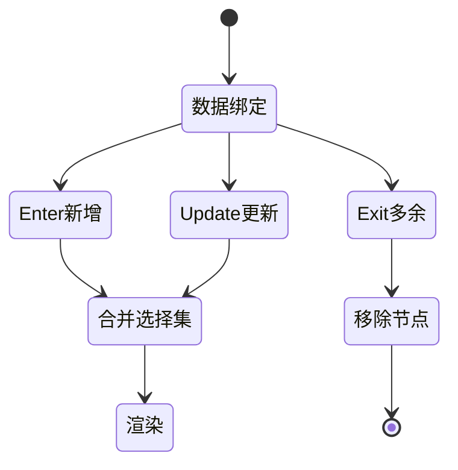

```javascript
const circles = svg.selectAll('circle').data(data, d => d.id); // key 函数保证增量复用
circles.join(
  enter => enter.append('circle')
    .attr('r', 0)
    .attr('cy', 50)
    .call(e => e.transition().attr('r', 4)),          // 新元素入场动画
  update => update
    .call(u => u.transition()                          // 既有元素平滑移动到新位置
      .attr('cx', d => x(d.value))),
  exit => exit.transition().attr('r', 0).remove()      // 多余元素退场后移除
);
// data join 是声明式对齐：每次渲染都是"当前数据 -> 目标 DOM"，而非手动增删节点
```

### VIZ-039：D3 比例尺有哪些类型？分别适用什么数据？
**答**：比例尺 = 数据域（domain）到视觉范围（range）的纯函数映射，配 `invert` 反查。常用：**scaleLinear** 连续数值（坐标轴默认）；**scaleTime** 时间轴（自动按日/月取刻度）；**scaleOrdinal / scaleBand** 类目（band 自动算类目带宽，柱状图必备）；**scaleLog** 数量级跨度大的指标（收入/人口）；**scaleSqrt** 面积编码（气泡图半径）；**scaleThreshold/scaleQuantize** 分箱着色（热力图）。

```javascript
const x = d3.scaleLinear().domain([0, 100]).range([0, 600]).clamp(true); // 超界截断
const ordinal = d3.scaleOrdinal().domain(['A', 'B', 'C']).range(d3.schemeCategory10);
const band = d3.scaleBand().domain(['A', 'B', 'C']).range([0, 600]).padding(0.2); // 柱状图
const time = d3.scaleTime()
  .domain([new Date('2026-01-01'), new Date('2026-12-31')]).range([0, 600]);
const log = d3.scaleLog().domain([1, 10000]).range([0, 400]); // 数量级差异大的指标
const sqrt = d3.scaleSqrt().domain([0, 1000]).range([2, 30]); // 面积编码用 sqrt
console.log(x(50), x.invert(300), band('B'), band.bandwidth(), log(100));
// 比例尺是一切坐标系的底座：scale + invert 完成 数据 <-> 像素 双向换算
```

### VIZ-040：D3 的轴组件是怎么实现的？
**答**：`d3.axisBottom(scale)` 等返回的是**组件函数**——接收一个 selection 并在其中生成 `<g>` 结构（domain 路径线 + 每个 tick 的 line/text），刻度位置与文本全部由比例尺计算。定制入口：`.ticks(n)` 建议刻度数、`.tickFormat` 格式化、`.tickSize` 内刻度线长度。样式定制用 CSS（如 `.domain { display: none }` 隐藏轴线）；轴更新时再 `call` 一次新轴并用 transition 平滑移动刻度。

```javascript
const xAxis = d3.axisBottom(x)
  .ticks(5)                          // 建议刻度数量（比例尺自动取"好看"的值）
  .tickSize(6)
  .tickPadding(8)
  .tickFormat(d => d + '%');         // 刻度文本格式化
const g = svg.append('g').attr('transform', 'translate(0, 300)').call(xAxis);
// axis 是"接受 selection 的组件函数"：内部生成 path 域线 + line/text 刻度
// 数据变化后平滑过渡：g.transition().duration(500).call(xAxis.scale(newX))
g.selectAll('.tick text').attr('fill', '#64748b');
g.select('.domain').attr('stroke', '#e2e8f0');
```

### VIZ-041：D3 布局生成器（pie/force/hierarchy）的工作原理？
**答**：D3 布局器**不画图**，只把数据加工成图形参数（角度/坐标/矩形），绘制仍交给 selection——这是它"计算与渲染分离"的设计。**pie**：算每个扇区的 startAngle/endAngle；**force**：物理模拟器，引力/斥力/弹簧三种力在每次 tick 迭代中更新节点坐标，直到系统收敛（alpha 衰减到 alphaMin）；**hierarchy 系列**：hierarchy 包装层级数据 + sum 聚合，treemap/partition/tree/pack 各自输出矩形/扇区/坐标。布局都是纯函数，可预计算缓存。

```javascript
// 布局生成器不画图，只把数据加工成图形参数，绘制仍交给 selection
const pie = d3.pie().value(d => d.value).sort(null); // sort(null) 保持原始顺序
const arc = d3.arc().innerRadius(60).outerRadius(100);
svg.selectAll('path').data(pie(data)).join('path').attr('d', arc);
// 力导向：simulation 每次 tick 迭代收敛，on tick 里同步图形位置
const sim = d3.forceSimulation(nodes)
  .force('link', d3.forceLink(links).id(d => d.id).distance(80)) // 弹簧力
  .force('charge', d3.forceManyBody().strength(-100))            // 电荷斥力
  .force('center', d3.forceCenter(300, 200))                     // 向心力
  .on('tick', () => {
    link.attr('x1', d => d.source.x).attr('y1', d => d.source.y)
        .attr('x2', d => d.target.x).attr('y2', d => d.target.y);
    node.attr('transform', d => `translate(${d.x},${d.y})`);
  });
```

### VIZ-042：D3 的过渡与插值机制是什么？
**答**：`selection.transition()` 基于 tween 定时器：duration 时长、ease 缓动（easeCubicOut 等）、`attr` 用内置插值器（数字、颜色、transform），遇到不支持的值类型（如 path 的 d）要自己 `attrTween` 写插值函数（如 arc 补间、路径形状 morph）。两个关键行为：**同名 transition 重启动会打断旧过渡**（防叠加错乱），`.transition().transition()` 可串行编排。数值滚动文本用 `textTween + interpolateNumber`。

```javascript
svg.selectAll('rect')
  .transition('grow').duration(750).ease(d3.easeCubicOut)
  .attr('width', d => x(d.value));   // 数字自动插值
// attrTween 自定义插值：路径 d、格式化文本需要 tween
svg.selectAll('text')
  .transition().duration(750)
  .textTween(d => {
    const i = d3.interpolateNumber(0, d.value);
    return t => Math.round(i(t)).toLocaleString(); // 0 -> 目标值滚动
  });
// 同名 transition 重启动会自动打断旧动画，避免并发过渡叠加错乱
svg.select('rect').interrupt('grow'); // 手动打断当前过渡
```

### VIZ-043：D3 与 React/Vue 如何集成？（命令式库的响应式包装）
**答**：核心模式：**ref 拿容器 + effect 承载命令式生命周期 + 数据作为响应式依赖**。React 中在 useEffect 里执行 D3 逻辑，`[data]` 变化触发重跑，return 清理函数处理监听与节点；Vue 用 onMounted/onBeforeUnmount 同理。三条铁律：不在 render/模板期间直接操作 DOM；effect 要幂等（StrictMode 会双调用）；数据 join 配 key，尽量增量更新而非全量重建。复杂场景把"数据计算"交给 D3、"视图 diff"交给框架也是合法分工。

```jsx
// 命令式库接入响应式框架：ref + useEffect 桥接 + 数据作依赖
function BarChart({ data }) {
  const ref = useRef(null);
  useEffect(() => {
    const svg = d3.select(ref.current);
    svg.selectAll('*').remove(); // 幂等：StrictMode 双调用也安全
    const x = d3.scaleLinear([0, d3.max(data, d => d.value)], [0, 480]);
    svg.selectAll('rect').data(data, d => d.id).join('rect')
      .attr('width', d => x(d.value))
      .attr('height', 20)
      .attr('y', (_, i) => i * 24);
  }, [data]); // data 变化 -> effect 重跑 -> D3 重绘
  return <svg ref={ref} width="500" height={data.length * 24} />;
}
// 严禁在 render 期间执行 D3 副作用；清理逻辑放 effect 的 return 中
```

### VIZ-044：D3 与 ECharts 如何选型？
**答**：ECharts 是**配置驱动的成品图表库**：开箱即用、内置交互/主题/大数据方案、交付快、团队上手低，覆盖 90% 业务图表；D3 是**可视化原语集**：数据 join、比例尺、布局器、过渡全是零件，自由度无限但人力成本高，适合深度定制、学术可视化、自研图表库底座。决策要素：定制深度、数据量、维护人力、导出/SSR 要求。折中路线：业务用 ECharts + 个别定制图用 D3（或 ECharts custom series），自研平台用 D3/AntV 底层。

```javascript
function pickLib(requirement) {
  const matrix = {
    '标准业务图表+快速交付': 'ECharts',
    '深度定制+学术级可视化': 'D3',
    '3D/大规模粒子/游戏化': 'Three.js 或 WebGL 原生',
    '关系图+图分析': 'AntV G6',
    '地理大屏+飞线': 'ECharts geo 或 deck.gl',
    '移动端轻量 H5': 'AntV F2',
  };
  return matrix[requirement] ?? 'ECharts 默认';
}
// 决策要素：定制深度、数据量、团队维护成本、SSR/导出需求、包体积
// ECharts 是配置驱动的成品；D3 是可视化原语集，自由度与人力成本都最高
```

---

## 七、图表类型原理（VIZ-045 ~ VIZ-052）

### VIZ-045：折线图与面积图的实现原理？堆叠与负值怎么处理？
**答**：折线 = 数据点经比例尺映射后连 path（直线 or 平滑曲线）；面积 = 折线 + 底边闭合（y0 基线到 y1 曲线之间填充）。**堆叠面积**：每个系列的 y 区间是"前面所有系列的累计值"，需要先逐 x 计算累计；**含负值时**不能简单累加——正数向上堆、负数向下堆，各自维护一个累计游标，0 轴成为分界，否则图形语义错误。

```javascript
// 堆叠面积：正数向上堆、负数向下堆，0 轴为分界
function stackedArea(series, xLen) {
  const pos = new Array(xLen).fill(0), neg = new Array(xLen).fill(0);
  return series.map(s =>
    s.data.map((v, xi) => {
      const base = v >= 0 ? pos[xi] : neg[xi];
      const top = base + v;
      if (v >= 0) pos[xi] = top; else neg[xi] = top; // 各自维护累计游标
      return [xi, base, top];  // [x, 下沿, 上沿]
    }));
}
// 面积路径：上沿正向画，下沿反向闭合
const area = d3.area()
  .x(d => x(d[0]))
  .y1(d => y(d[2]))
  .y0(d => y(d[1]));
```

### VIZ-046：柱状图与堆叠柱状图的实现原理？
**答**：普通柱 = 类目带宽（scaleBand）内取柱宽，值映射高度；**堆叠柱** = 每根柱由各系列分段矩形组成，逐类目累计 y0/y1，柱高 = total。实现要点：band.bandwidth() × 内边距系数算柱宽；系列顺序决定堆叠顺序，图例隐藏某系列后必须**重算累计与坐标轴**；负值柱从 0 分界向下；分组柱（grouped）则是柱内再切子带宽。

```javascript
// 堆叠柱：每根柱 = 各系列分段矩形，逐类目累计，total 定柱高
function stackBars(categories, series) {
  return categories.map((cat, ci) => {
    let acc = 0;
    const segs = series.map(s => {
      const v = s.data[ci] ?? 0;
      const seg = { series: s.name, y0: acc, y1: acc + v, v };
      acc += v;
      return seg;
    });
    return { cat, segs, total: acc };
  });
}
// 渲染：y0/y1 经 scale 反算像素；图例隐藏系列后需重算 stack 与 y 轴
const band = d3.scaleBand().domain(categories).range([0, width]).padding(0.2);
const y = d3.scaleLinear().domain([0, d3.max(stacked, d => d.total)]).range([height, 0]);
const colWidth = band.bandwidth();
```

### VIZ-047：饼图与环形图的实现原理？过多分类怎么处理？
**答**：核心是极坐标：每个扇区角度 = value / total × 2π，`d3.arc` 生成扇形 path（环形图设 innerRadius）。三个工程问题：**过多分类**——占比小于阈值（如 1.5%）或超出 topN 的合并为"其他"，明细收进 tooltip；**标签遮挡**——标签过密改用引导线外置或图例列表；**精度**——角度舍入会让扇区之间出现细缝，让最后一段直接用到 2π 收尾。经验法则：分类超过 8 个或需要精确比较数值时，改用横向条形图。

```javascript
// 过多分类：小于阈值或超出 topN 的合并为"其他"
function topNOther(data, n = 6, threshold = 0.015) {
  const total = d3.sum(data, d => d.value);
  const sorted = [...data].sort((a, b) => b.value - a.value);
  const top = sorted.slice(0, n).filter(d => d.value / total >= threshold);
  const rest = sorted.filter(d => !top.includes(d));
  const other = { name: '其他', value: d3.sum(rest, d => d.value), items: rest };
  return { list: [...top, other], total };
}
// 扇区 path：角度 = value/total*2π，最后一段直接收在 2π 避免缝隙
const pie = d3.pie().value(d => d.value).sort(null);
const arc = d3.arc().innerRadius(60).outerRadius(100).cornerRadius(2);
svg.selectAll('path').data(pie(topNOther(data).list)).join('path').attr('d', arc);
```

### VIZ-048：散点图与气泡图的数据映射要点？抖动是什么？
**答**：散点图：x/y 各绑一个连续比例尺，三维信息用颜色/形状/大小扩展成气泡图。两个关键原理：① **面积编码**——气泡的数值必须映射到**面积**而不是半径，半径用 sqrt 比例尺（面积 ∝ r²），否则大值被视觉放大；② **抖动 jitter**——类目轴或离散 x 上点会重叠成一列，在类目带宽内加均匀随机偏移让密度分布可见；点数过大时叠加透明度（alpha blending）表达密度。交互命中需要 quadtree 最近邻查询。

```javascript
// 类目轴散点重叠：抖动 jitter 在类目带宽内加随机偏移，让密度可见
function jitter(cx, bandwidth, strength = 0.6) {
  return cx + (Math.random() - 0.5) * bandwidth * strength;
}
// 气泡图面积编码：半径必须用 sqrt 比例尺，面积才与数值成正比
const r = d3.scaleSqrt().domain([0, d3.max(data, d => d.value)]).range([2, 30]);
svg.selectAll('circle').data(data).join('circle')
  .attr('cx', d => band(d.category) + jitter(0, band.bandwidth()))
  .attr('cy', d => y(d.score))
  .attr('r', d => r(d.value))
  .attr('fill-opacity', 0.5); // 半透明叠加，重叠处颜色变深表达密度
// 命中：d3.quadtree(data).find([mx, my], 20) O(log n) 最近邻查询
```

### VIZ-049：热力图的实现原理？颜色映射与插值怎么做？
**答**：热力图 = 二维网格 → 颜色映射：把 value 经连续色板（linear scale + 色板插值）转成颜色，逐格填充。性能分水岭：小于 1 万格用 fillRect；大于就用 `ImageData` 直接逐像素写 RGBA（快一个数量级）。平滑效果两条路：格间双线性插值预处理数据，或用 canvas 的 `filter: blur` / 径向渐变叠加（heatmap.js 的经典做法）——把每点画成径向渐变圆再对 alpha 通道做色带映射。

```javascript
// 热力图：二维网格 -> 颜色插值；大网格用 ImageData 逐像素写，比 fillRect 快一个数量级
const colorScale = d3.scaleLinear()
  .domain([0, 50, 100])
  .range(['#2c7bb6', '#ffffbf', '#d7191c'])
  .interpolate(d3.interpolateRgb);
function renderToImageData(ctx, grid, w, h) {
  const img = ctx.createImageData(w, h);
  grid.forEach((v, i) => {
    const c = d3.color(colorScale(v)); // rgb 对象
    img.data.set([c.r, c.g, c.b, 255], i * 4); // 直接写 RGBA
  });
  ctx.putImageData(img, 0, 0);
}
// 小网格（< 1 万格）直接 fillRect 即可
function drawHeatmap(ctx, cells, cellSize) {
  for (const c of cells) {
    ctx.fillStyle = colorScale(c.value);
    ctx.fillRect(c.x * cellSize, c.y * cellSize, cellSize, cellSize);
  }
}
```

### VIZ-050：桑基图与关系图的力导向布局原理？
**答**：**力导向布局**模拟物理系统：每个节点受三种力——电荷斥力（forceManyBody，防重叠）、弹簧引力（forceLink，连线把相关节点拉近）、向心力（forceCenter/forceX/forceY，防飘出画布），再加碰撞力（forceCollide）；每次 tick 积分更新速度与位置，alpha 从 1 衰减到 alphaMin 后停止，**可预计算**（跑完再渲染，交互时静态）。**桑基图**则是确定性布局：节点按边权分层（左到右），层内减少交叉，链路宽度 = 流量值，适合能量/资金/流量的流向分解。

```javascript
// 力导向三大力：斥力、弹簧、向心，每 tick 迭代直到 alpha 收敛
const simulation = d3.forceSimulation(nodes)
  .force('charge', d3.forceManyBody().strength(-120))          // 斥力防重叠
  .force('link', d3.forceLink(links).id(d => d.id).distance(60)) // 弹簧拉紧关系
  .force('x', d3.forceX(width / 2).strength(0.05))             // 向心防飘出
  .force('collide', d3.forceCollide().radius(12))              // 硬碰撞
  .on('tick', () => {
    link.attr('x1', d => d.source.x).attr('y1', d => d.source.y)
        .attr('x2', d => d.target.x).attr('y2', d => d.target.y);
  });
// 预计算：simulation.stop(); for (let i = 0; i < 300; i++) simulation.tick(); 一次跑完再渲染
// 桑基：d3.sankey() 一次算完节点坐标与链路，link.width = 流量值
```

### VIZ-051：树图与旭日图的层级数据处理原理？
**答**：两者共用 d3-hierarchy 前置流程：`d3.hierarchy(data)` 包装层级 → `.sum(d => d.value)` 从叶子向上聚合父级 value → `.sort` 降序。**树图**：`d3.treemap()` 把矩形递归切分（squarify 算法让子块尽量接近正方形，可读性最好），叶子输出 x0/y0/x1/y1。**旭日图**：`d3.partition()` 把层级映射到角度区间（径向 = 深度），再用 arc 画环形扇区，半径方向表达层级深度，适合展示"每层占比 + 层级路径"。

```javascript
// 层级数据 -> hierarchy 包装 -> sum 聚合 -> 布局器输出几何
const root = d3.hierarchy(treeData)
  .sum(d => d.value)                       // 叶子聚合出父级 value
  .sort((a, b) => b.value - a.value);
// 树图：treemap 递归切分矩形，squarify 让子块接近正方形
d3.treemap().tile(d3.treemapSquarify).size([width, height]).padding(2)(root);
svg.selectAll('rect').data(root.leaves()).join('rect')
  .attr('x', d => d.x0).attr('y', d => d.y0)
  .attr('width', d => d.x1 - d.x0).attr('height', d => d.y1 - d.y0);
// 旭日图 = partition + arc：角度编码占比，半径编码层级深度
const sunburstRoot = d3.partition().size([2 * Math.PI, 120])(d3.hierarchy(treeData).sum(d => d.value));
```

### VIZ-052：地图可视化的实现原理（投影 / GeoJSON / 下钻）？
**答**：地图渲染链路：**GeoJSON**（经纬度几何）→ **投影**（把球面坐标压平成平面坐标，Mercator 适合电商/位置场景，Albers 等积投影适合中国全图着色，避免高纬度面积失真）→ `d3.geoPath(projection)` 生成 SVG path 或 Canvas 绘制 → **choropleth** 着色（区域值映射发散/连续色板）。下钻要点：以 adcode 为键懒加载子级 GeoJSON 并缓存，维护区域栈支持面包屑回退；边界数据源推荐 DataV.GeoAtlas。

```javascript
// GeoJSON 经纬度 -> 投影 -> path；choropleth 着色 + 点击下钻
const projection = d3.geoMercator()
  .center([104, 36]).scale(700).translate([w / 2, h / 2]); // 中心与缩放决定视野
const path = d3.geoPath(projection);
svg.selectAll('path').data(geojson.features).join('path')
  .attr('d', path)
  .attr('fill', d => colorScale(valueMap[d.properties.adcode] ?? 0)) // choropleth
  .on('click', (e, d) => drillTo(d.properties.adcode));  // 点击下钻到子级行政区
// 下钻：adcode 懒加载子级 GeoJSON 并缓存，区域栈 + 面包屑支持回退
```

---

## 八、交互设计（VIZ-053 ~ VIZ-059）

### VIZ-053：缩放平移交互如何实现？滚轮缩放的锚点怎么算？
**答**：缩放 = 修改变换矩阵或数据域，平移 = 偏移原点。滚轮缩放的核心公式是**以鼠标为不动点**：设锚点在数据域中的比例位置 t 不变，缩放系数 k 后新域两端为 `anchor - t·span/k` 与 `anchor + (1-t)·span/k`，这样指针下的数据点在缩放前后保持在同一屏幕位置。实现上优先复用 d3.zoom（scaleExtent 限幅 + 事件节流）或 ECharts dataZoom inside，双轴图表缩放主轴后副轴要按比例同步重算。

```javascript
// 滚轮缩放核心：以鼠标位置为不动点，缩放数据域
function rescale(domain, k, anchor) {
  const [d0, d1] = domain;
  const t = (anchor - d0) / (d1 - d0);       // 锚点在 domain 中的比例位置，缩放前后不变
  const span = (d1 - d0) / k;
  return [anchor - t * span, anchor + (1 - t) * span]; // 锚点两侧按比例分配
}
svg.on('wheel', e => {
  e.preventDefault();
  const k = e.deltaY < 0 ? 1.25 : 0.8;
  const anchor = xScale.invert(e.offsetX);   // 鼠标像素 -> 数据坐标
  const next = rescale(xScale.domain(), k, anchor);
  xScale.domain(next);                       // 更新域并重绘
  render();
});
// 或直接用 d3.zoom：scaleExtent 限幅 + zoom 事件统一处理缩放平移
svg.call(d3.zoom().scaleExtent([0.5, 20]).on('zoom', e => g.attr('transform', e.transform)));
```

### VIZ-054：十字准线与 tooltip 的定位与节流策略？
**答**：tooltip 是最高频的交互路径，三个优化点：① **节流**——mousemove 不直接渲染，用 rAF 合帧（一帧至多更新一次），数据查找用二分而不是遍历；② **定位策略**——默认出现在指针右上方，靠近右边界翻转到左侧、靠近上下边界夹回可视区，避免遮挡与出界；③ **十字准线**——垂直/水平参考线 + 轴向跟随，trigger: 'axis' 模式下显示同 x 的所有系列值。数据量大时 tooltip 内容本身也要聚合（见 VIZ-096）。

```javascript
// tooltip 高频更新必须节流：rAF 合帧 + 二分查找最近数据点
let rafId = 0;
canvas.addEventListener('mousemove', e => {
  if (rafId) return;                       // 同帧只排一次任务
  rafId = requestAnimationFrame(() => {
    rafId = 0;
    const idx = d3.bisectCenter(xs, e.offsetX); // O(log n) 找最近点
    drawCrosshair(xs[idx], ys[idx]);            // 十字准线跟随数据点
    showTooltip(e.offsetX, e.offsetY, data[idx]);
  });
});
// 定位策略：距边 < tooltip 尺寸时翻转，上下夹回可视区
function tipPos(px, py, tw, th, vw, vh) {
  return {
    x: px + 16 + tw > vw ? px - tw - 16 : px + 16,
    y: Math.min(Math.max(py - th / 2, 8), vh - th - 8),
  };
}
```

### VIZ-055：框选刷选（brush）与数据筛选联动如何实现？
**答**：刷选 = 用户在画布上拖出矩形/区间，把该区间换算成数据域，联动所有依赖视图。d3 提供 `d3.brushX / d3.brush`：`.extent` 限定可刷区域，事件回调里 `selection.map(scale.invert)` 得到数据域，然后驱动主图过滤、统计卡片更新、其他图表同步。工程要点：双击/清空选区要恢复全量；大数据边界定位用 bisect 而不是全量 filter；刷选状态要可编程恢复（ECharts 用 dispatchAction dataZoom）。

```javascript
const brush = d3.brushX()
  .extent([[0, 0], [width, height]])
  .on('start brush end', e => {
    if (!e.selection) { restoreAll(); return; }   // 双击清空选区 -> 恢复全量
    const [x0, x1] = e.selection.map(xScale.invert); // 像素 -> 数据域
    const i0 = d3.bisectLeft(times, x0), i1 = d3.bisectRight(times, x1); // bisect 定位
    const filtered = data.slice(i0, i1);
    renderMain(filtered);   // 主图只画选区内数据
    renderStat(filtered);   // 联动统计卡片：均值/峰值/计数
  });
svg.append('g').call(brush);
// 联动本质：一次刷选 -> 一个数据域 -> 所有视图以该域为单一数据源重算
```

### VIZ-056：图例联动与维度切换怎么设计？
**答**：图例切换的本质是维护"**可见系列集合**"这个单一状态源：切换 → 过滤系列 → 重算堆叠与坐标轴 → 平滑过渡重绘，全隐藏时要落空态。维度切换（如"销售额/订单量"指标切换）则是替换数据源 + 更新轴 label + 保留缩放状态，用 setOption merge 保证交互态不丢。反模式：每次切换 notMerge 全量重建，导致 dataZoom 位置丢失与闪屏。

```javascript
// 图例切换：维护"可见系列集合"单一状态源 -> 重算 -> merge 更新
function toggleSeries(state, name, allSeries, chart) {
  const next = new Set(state.visible);
  next.has(name) ? next.delete(name) : next.add(name);
  const visible = allSeries.filter(s => next.has(s.name));
  if (visible.length === 0) return { ...state, visible: next, empty: true }; // 全隐藏落空态
  chart.setOption({
    legend: { data: [...next] },
    series: visible.map(s => s.option),      // merge 更新，ECharts 自动重堆叠
  });
  return { ...state, visible: next, empty: false };
}
// 维度切换：换数据源 + 更新轴名，保留 dataZoom 状态（不用 notMerge）
function switchMetric(chart, metric) {
  chart.setOption({
    yAxis: { name: metric.label },
    series: [{ data: metric.data }],
  });
}
```

### VIZ-057：下钻与上卷的交互如何实现？（多维分析）
**答**：下钻（drill down）= 点击聚合节点展示更细粒度，上卷（roll up）= 回到更粗层级，本质是维护一个**层级路径栈**：当前路径 `[全国, 华东, 上海]` 决定渲染哪一层。工程要点：子级数据懒加载 + 缓存（按层级 id 去重）；面包屑展示路径并支持跳到任意层；下钻动画表达"进入感"（旧层缩小淡出、新层放大进入）；异步加载期间保持旧图 + loading 态，失败可回退。

```javascript
// 下钻：点击聚合节点 -> 懒加载子级 -> 入栈 -> 更新面包屑与图表；上卷 = 出栈
class Drilldown {
  stack = [];
  cache = new Map();            // 层级缓存防重复请求
  async drill(node) {
    this.stack.push(node);
    let children;
    if (this.cache.has(node.id)) {
      children = this.cache.get(node.id);
    } else {
      children = await fetchChildren(node.id); // 懒加载子层级
      this.cache.set(node.id, children);
    }
    this.render(children, this.breadcrumb());
  }
  rollUpTo(level) {                        // 上卷：回退到任意层级
    this.stack = this.stack.slice(0, level + 1);
    const node = this.stack.at(-1);
    this.render(node?.children ?? rootChildren, this.breadcrumb());
  }
  breadcrumb() {
    return this.stack.map(n => n.name).join(' / '); // 全国 / 华东 / 上海
  }
}
```

### VIZ-058：数据变化时的动画过渡（形变插值）如何实现？
**答**：本质是**旧值到新值的补间**：key 对齐后逐项插值（新增项从 0 生长、删除项收缩退场），rAF 驱动帧更新。关键细节：① 重入处理——新数据到来时先取消进行中的动画，以**当前显示值**为起点续接，否则会闪跳；② 位置与形状分开插值（x 平移 + 高度变化）；③ D3 的 transition/join 已内置这套逻辑，自绘时用统一 Tween 管理器。高频数据流（秒级更新）建议直接跳变或只做 200ms 短过渡，避免动画永远追不上数据。

```javascript
// 数据变化动画：旧值 -> 新值逐项插值，key 对齐，重入时从当前显示值续接
function createDataTween(renderFn, duration = 600) {
  let current = [];                          // 当前显示值（而非上次目标值）
  let raf;
  return function update(newData) {
    cancelAnimationFrame(raf);               // 重入：取消进行中的动画
    const keyed = new Map(current.map(d => [d.name, d]));
    const pairs = newData.map(d => ({
      name: d.name,
      from: keyed.get(d.name)?.value ?? 0,   // 新增项从 0 生长
      to: d.value,
    }));
    const t0 = performance.now();
    (function frame(t) {
      const p = Math.min((t - t0) / duration, 1);
      const e = 1 - Math.pow(1 - p, 3);
      current = pairs.map(d => ({ name: d.name, value: d.from + (d.to - d.from) * e }));
      renderFn(current);
      if (p < 1) raf = requestAnimationFrame(frame);
    })(t0);
  };
}
```

### VIZ-059：移动端可视化交互要注意什么？
**答**：四方面：**手势**——hover 不存在，用点按（tap 即 click）替代，双指 pinch 缩放 + 单指平移，`touch-action: none` 防页面滚动冲突；**热区**——可点目标 ≥ 44×44px，轴标签过密旋转或 dataZoom inside 滑动；**性能取舍**——关阴影/发光/长动画、降低采样精度、控制并发图表数；**布局**——竖屏时宽类目图改横向滚动条形图，tooltip 改底部固定面板。监听 touch 事件必须 `{ passive: false }` 才能 preventDefault。

```javascript
// 双指缩放 pinch：记录初始距离与当前 domain，按距离比例缩放
let pinch = null;
canvas.addEventListener('touchstart', e => {
  if (e.touches.length === 2) {
    pinch = { dist: fingerDist(e), domain: [...currentDomain] };
  }
}, { passive: false });
canvas.addEventListener('touchmove', e => {
  if (e.touches.length === 2 && pinch) {
    e.preventDefault();                     // 阻止页面缩放/滚动
    const k = pinch.dist / fingerDist(e);
    currentDomain = rescale(pinch.domain, k, midDomain(pinch.domain)); // 复用 VIZ-053 公式
    render();
  }
}, { passive: false });
canvas.addEventListener('touchend', () => { pinch = null; });
function fingerDist(e) {
  const [a, b] = e.touches;
  return Math.hypot(a.clientX - b.clientX, a.clientY - b.clientY);
}
function midDomain([d0, d1]) { return (d0 + d1) / 2; }
// 移动端取舍：点按代替 hover、热区 >= 44px、关阴影与长动画、tooltip 改固定面板
```

---

## 九、大屏与报表工程（VIZ-060 ~ VIZ-067）

### VIZ-060：大屏适配方案有哪些？如何选型？（压轴）
**答**：三大方案：**等比 scale**——设计稿固定 1920×1080，整体 `transform: scale(min(sw/dw, sh/dh))` 居中，实现最简单、还原度 100%，缺点是文字放大发虚、事件坐标需换算；**rem/vw**——根字号或 CSS 单位随屏宽缩放，文字始终清晰，但所有尺寸都要换算、宽高比不一致时布局会变形；**响应式布局**——flex/grid 自适应，适合后台不固定分辨率。混合方案最常见：外层 scale 等比 + 内部关键文字用 rem 二次修正。决策看"是否固定分辨率 + 是否要求文字清晰 + 是否多终端"。

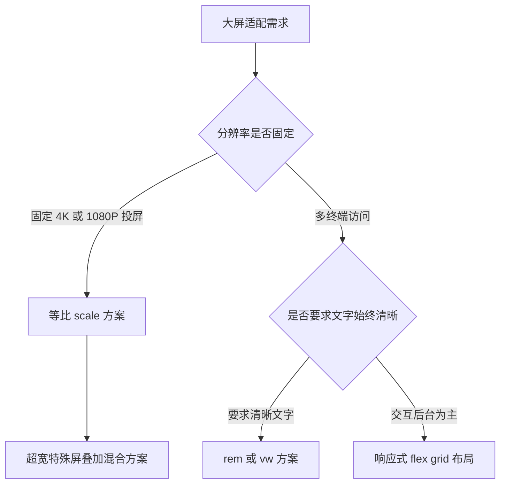

```javascript
// 等比缩放：设计稿 1920x1080，按宽高小的一边缩放并居中留黑
function fitScale(designW = 1920, designH = 1080) {
  const screen = { w: window.innerWidth, h: window.innerHeight };
  const scale = Math.min(screen.w / designW, screen.h / designH);
  const el = document.getElementById('screen');
  el.style.width = designW + 'px';
  el.style.height = designH + 'px';
  el.style.transform = `scale(${scale})`;
  el.style.transformOrigin = 'left top';
  el.style.position = 'absolute';
  el.style.left = (screen.w - designW * scale) / 2 + 'px'; // 水平居中
  el.style.top = (screen.h - designH * scale) / 2 + 'px';
}
window.addEventListener('resize', fitScale);
fitScale();
// scale 方案注意：图表 resize 需按设计稿尺寸即可；鼠标事件坐标在缩放容器内自动正确（同一坐标系）
```

### VIZ-061：大屏的实时数据如何推送与更新？
**答**：推送通道选择：**WebSocket** 全双工、低延迟，需自管心跳与重连；**SSE** 单向推送、自带断线重连、HTTP 友好，大盘场景够用；轮询只兜底不支持长连接的网关。更新侧：高频消息**合帧节流**——同帧多条只保留最新，按业务刷新率（1s）setOption；增量数据用 `appendData`；断线指数退避重连 + 数据过期提示（见 VIZ-063）。Web Worker 里解压/解析大报文，主线程只做 setOption。

```javascript
// 实时推送：WebSocket + 心跳 + 节流合帧更新，防止高频消息打爆渲染
const socket = new WebSocket('wss://example.com/dashboard');
let pending = null, timer = null;
socket.onmessage = e => {
  pending = JSON.parse(e.data);          // 同帧多条消息只保留最新
  if (!timer) {
    timer = setTimeout(() => {           // 大盘 1s 刷新率足够，多余更新全部合并
      timer = null;
      if (pending) chart.setOption({ series: [{ data: toSeries(pending) }] });
    }, 1000);
  }
};
socket.onclose = () => setTimeout(connect, backoff()); // 指数退避重连
setInterval(() => {
  if (socket.readyState === WebSocket.OPEN) socket.send(JSON.stringify({ type: 'ping' }));
}, 30000);                               // 心跳保活，30s 无 pong 判定断线
function backoff() { return Math.min(30000, 1000 * 2 ** retryCount++); }
```

### VIZ-062：大屏的性能优化为什么要图层分层？
**答**：大屏元素更新频率天然分层：背景/装饰（几乎不变）、图表（秒级）、特效扫光粒子（每帧）。混在一个 Canvas 里就等于每帧全量重画。分层方案：**静态层**（canvas 画一次缓存）、**数据层**（canvas + 脏矩形局部重绘）、**特效层**（DOM/CSS 动画，transform/opacity 走合成器线程，`will-change` 提升，`pointer-events: none` 不挡交互）。收益：每帧只重画真正变化的那层，GPU 合成各层位图，低端机也能稳帧。

```html
<div class="stage">
  <canvas id="bg"></canvas>       <!-- 静态层：网格/坐标轴/装饰，几秒才变一次 -->
  <canvas id="data"></canvas>     <!-- 数据层：折线/点，秒级更新，脏矩形局部重绘 -->
  <div id="fx"></div>             <!-- 特效层：扫光/粒子，CSS 动画走合成器 -->
</div>
<style>
  .stage { position: relative; }
  .stage canvas, .stage #fx { position: absolute; inset: 0; }
  #fx { will-change: transform, opacity; pointer-events: none; } /* 特效层只做合成不挡事件 */
</style>
<script>
  // 各层独立重绘：renderBg 只在初始化/换肤时执行；renderData 走脏矩形；fx 层纯 CSS
  renderBg(bgCtx);
  setInterval(renderData, 1000);  // 数据层 1s 一帧，静态层与特效层零负担
</script>
```

### VIZ-063：数据大屏的异常兜底怎么做？
**答**：按数据生命周期分层兜底：**请求失败**→ 自动重试（指数退避）→ 失败后展示重试按钮，不留白屏；**数据断流**→ 心跳/看门狗检测"超过 N 秒未更新"，打横幅"数据更新于 xx:xx:xx，正在重连"并继续展示最后快照；**数据异常**→ 空值/类型错误在前端校验层拦住，空态组件替代坏图；**渲染异常**→ try/catch 包 setOption，崩了降级为缓存快照。原则：宁可展示"旧数据 + 明确的时间戳"，绝不静默展示过期数据。

```javascript
// 数据断流兜底：看门狗检测超时 -> 提示数据过期 -> 降级为最后快照
function createWatchdog(onStale, maxStale = 15000) {
  let lastAt = Date.now();
  const timer = setInterval(() => {
    if (Date.now() - lastAt > maxStale) onStale(new Date(lastAt)); // 触发横幅提示
  }, 5000);
  return {
    onMessage() { lastAt = Date.now(); hideStaleBanner(); },
    dispose() { clearInterval(timer); },
  };
}
const watchdog = createWatchdog(staleAt =>
  showStaleBanner(`数据更新于 ${staleAt.toLocaleTimeString()}，正在重连`));
socket.onmessage = e => { watchdog.onMessage(); handle(JSON.parse(e.data)); };
// 兜底分层：重试 -> 缓存快照 -> 空态组件 -> 全屏错误页，逐级降级，绝不静默展示旧数据
```

### VIZ-064：报表引擎的动态行列与交叉表如何实现？
**答**：交叉表 = 行维度 × 列维度 → 度量值的三维映射，核心是 pivot 聚合：遍历明细行，按 `rowKey|colKey` 累积，再笛卡尔展开成二维矩阵（缺失组合补 null 显示 `-`）。渲染要点：行表头/列表头动态生成；首列冻结 + 表头吸顶（sticky）；单元格支持条件格式（色阶/图标）与内嵌迷你图；总计/小计在聚合阶段一并算出。十万行级明细必须服务端聚合，前端只拿透视结果。

```javascript
// 交叉表：按行维度+列维度聚合，缺失组合补 null
function pivot(rows, { rowKey, colKey, metric }) {
  const cell = new Map();
  for (const r of rows) {
    const k = `${r[rowKey]}|${r[colKey]}`;
    cell.set(k, (cell.get(k) ?? 0) + Number(r[metric] || 0));
  }
  const rowKeys = [...new Set(rows.map(r => r[rowKey]))];
  const colKeys = [...new Set(rows.map(r => r[colKey]))];
  return {
    colKeys,
    matrix: rowKeys.map(rk => ({
      row: rk,
      cells: colKeys.map(ck => ({ col: ck, value: cell.get(`${rk}|${ck}`) ?? null })),
    })),
    rowTotal: rk => colKeys.reduce((s, ck) => s + (cell.get(`${rk}|${ck}`) ?? 0), 0),
  };
}
// 渲染：sticky 首列 + 表头吸顶；单元格条件格式：value 越界标红 / 色阶
```

### VIZ-065：报表导出 Excel / PDF / PNG 如何实现？
**答**：**Excel**：SheetJS（xlsx）或 exceljs 前端生成 xlsx，AOA（array of arrays）转 sheet，支持多 sheet、列宽、合并单元格；超 10 万行走服务端流式导出。**PNG**：图表 `getDataURL` / SVG 转 PNG（见 VIZ-014）。**PDF**：jsPDF 把 PNG 逐页 addImage，或复用浏览器打印。批量导出注意：置 loading 防重复点击；任务大时逐个 yield 让出主线程；文件名带时间戳；数字列保持数值类型（别导成文本）。

```javascript
import * as XLSX from 'xlsx';
// 报表导出：前端生成 xlsx，多 sheet 支持；超大报表(>10w 行)改走服务端流式
function exportExcel(sheets) {
  const wb = XLSX.utils.book_new();
  for (const { name, aoa, widths } of sheets) {
    const ws = XLSX.utils.aoa_to_sheet(aoa);        // 二维数组转 sheet
    ws['!cols'] = widths?.map(w => ({ wch: w }));   // 列宽
    XLSX.utils.book_append_sheet(wb, ws, name);
  }
  XLSX.writeFile(wb, `报表_${new Date().toISOString().slice(0, 10)}.xlsx`);
}
// PNG：chart.getDataURL({ pixelRatio: 2 }) 直接下载
function downloadDataURL(url, filename) {
  const a = document.createElement('a');
  a.href = url; a.download = filename; a.click();
}
// PDF：jsPDF 分页 addImage；批量导出置 loading，逐个 await 防止主线程长任务
```

### VIZ-066：权限与数据脱敏在可视化中如何落地？
**答**：两层：**数据脱敏**——展示层掩码（手机号/身份证/姓名正则打码），更根本的是后端只下发聚合结果，敏感明细不出网关；**权限裁剪**——按用户权限过滤 series/指标/维度，无权限的数据**根本不进 option**，而不是画出来再隐藏（防 devtools 查看）。前端脱敏只是纵深防御的一环，真正的安全边界必须落在后端接口与字段级权限上。

```javascript
// 数据脱敏：展示层掩码；权限裁剪：无权限系列根本不进 option
const maskRules = {
  phone: v => v.replace(/^(\d{3})\d{4}(\d{4})$/, '$1****$2'),
  idCard: v => v.replace(/^(\d{4})\d+(\d{3}[\dXx])$/, '$1***********$2'),
  name: v => (v.length <= 1 ? v : v[0] + '*'.repeat(v.length - 1)),
};
function applyPermission(option, user) {
  const denied = user.permissions?.deniedMetrics ?? [];
  return {
    ...option,
    series: option.series.filter(s => !denied.includes(s.name)), // 直接剔除，不渲染
  };
}
// 前端脱敏只防君子：敏感明细不下发、只下发聚合结果才是根本解法
console.log(maskRules.phone('13812345678')); // 138****5678
```

### VIZ-067：多分辨率与超宽屏（32:9）如何适配？
**答**：超宽屏（双联屏 5120×1440、三联屏 7680×2160）的适配思路是**比例分区**而非整体 scale：核心区（主指标图）固定视觉权重，副区（明细流、次要图）弹性伸缩，flex 权重分配宽度；字号独立于 scale 按"观看距离"设定（大屏观看距离远，最小字号 20px+）。工程要点：`matchMedia` 或 JS 检测屏宽切布局档位；单屏 scale 方案在 32:9 上文字会小到不可读，必须分区设计；图表按各自容器独立 resize。

```javascript
// 32:9 超宽屏：按物理屏数切分布局区，核心区固定权重、副区弹性伸缩
function ultraWideLayout(screenW) {
  const zones = screenW >= 7680
    ? [{ id: 'main', flex: 2 }, { id: 'sub1', flex: 1 }, { id: 'sub2', flex: 1 }] // 三联屏
    : screenW >= 5120
      ? [{ id: 'main', flex: 2 }, { id: 'sub1', flex: 1 }]                        // 双联屏
      : [{ id: 'main', flex: 2 }, { id: 'sub1', flex: 1 }];                       // 普通屏
  const total = zones.reduce((s, z) => s + z.flex, 0);
  return zones.map(z => ({
    ...z,
    width: Math.floor(screenW * z.flex / total),
    fontSize: z.id === 'main' ? 28 : 20, // 字号按观看距离独立设定，不随 scale 缩
  }));
}
// 核心思路：布局用比例分区而非整体 scale，每个图表容器独立 ResizeObserver + resize
```

---

## 十、综合实战（VIZ-068 ~ VIZ-100）

### VIZ-068：如何设计一个可视化图表库的核心架构？（压轴）
**答**：经典四层：**配置层**——声明式 option/schema，负责校验、merge、默认值；**模型层**——数据变换、比例尺、布局计算，产出与渲染无关的图元描述（纯函数，可单测）；**渲染层**——图元 → 像素/节点，可插拔 Canvas/SVG/WebGL 后端；**交互层**——事件 → 命中检测 → 语义事件（hover/click/brush），与渲染解耦。横向能力：动画系统、状态管理（可见系列/缩放域）、插件化系列类型。设计检验标准：换渲染后端不动模型、加一种图表类型不改核心、交互可撤销。

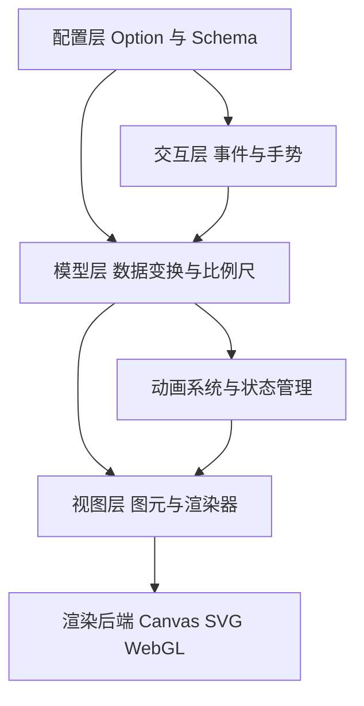

```javascript
// 图表库核心分层：配置层声明式 option，模型层算坐标，渲染层画像素，交互层给语义事件
class Chart {
  constructor(el, option) {
    this.el = el;
    this.option = option;
    this.renderer = new CanvasRenderer(el);   // 可插拔：SVGRenderer / WebGLRenderer
    this.listeners = new Map();
    this.bindEvents();
  }
  setOption(next) {                            // 配置层：merge + 校验
    this.option = mergeOption(this.option, next);
    this.render();
  }
  render() {                                   // 模型层：数据 -> 比例尺 -> 图元
    const marks = computeMarks(this.option);   // 纯函数：可单测、可缓存
    this.renderer.clear();
    for (const m of marks) this.renderer.draw(m); // 渲染层：图元 -> 像素
  }
  bindEvents() {                               // 交互层：像素事件 -> 语义事件
    this.el.addEventListener('mousemove', e =>
      this.emit('hover', hitTest(computeMarks(this.option), e.offsetX, e.offsetY)));
  }
  on(type, fn) { this.listeners.set(type, fn); }
  emit(type, payload) { this.listeners.get(type)?.(payload); }
}
```

### VIZ-069：设计一个监控大盘：折线 + 告警阈值 + 实时推送完整实现。
**答**：三要素：① **折线实时更新**——WebSocket 推送，`appendData` 增量追加（不整表 setOption）；② **告警阈值线**——markLine 常驻红线，超阈值的数据点 itemStyle 动态标红并触发通知；③ **工程细节**——滑动窗口限制数据点数量防内存增长、断线重连、超阈值去重告警（同指标 5 分钟内只报一次）。整个组件封装成可复用的 metric 监控卡片。

```javascript
// 监控大盘：阈值告警线 + 实时推送 + 增量追加，一条链路完成
function createMonitor(el, metric, THRESHOLD = 90) {
  const chart = echarts.init(el);
  chart.setOption({
    xAxis: { type: 'time' },
    yAxis: { type: 'value', max: 100 },
    series: [{
      type: 'line', showSymbol: false, data: [],
      markLine: { silent: true, symbol: 'none',
        data: [{ yAxis: THRESHOLD, lineStyle: { color: 'red' },
                 label: { formatter: `阈值 ${THRESHOLD}` } }] },
      itemStyle: { color: p => p.value[1] >= THRESHOLD ? '#e74c3c' : '#3b82f6' },
    }],
  });
  let lastAlertAt = 0;
  const ws = new WebSocket(`wss://host/metrics/${metric}`);
  ws.onmessage = e => {
    const { ts, value } = JSON.parse(e.data);
    chart.appendData({ seriesIndex: 0, data: [[ts, value]] }); // 增量追加，不整表重绘
    if (value >= THRESHOLD && Date.now() - lastAlertAt > 5 * 60 * 1000) {
      lastAlertAt = Date.now();                // 同指标 5 分钟去重告警
      notify(`[${metric}] 超阈值: ${value}`);
    }
  };
  return chart;
}
```

### VIZ-070：设计一个实时行情图：K 线 / 分时高频更新。（压轴）
**答**：核心是**K 线聚合器**：逐笔成交按时间片（1 分钟）聚合成 OHLCV——同片更新当前 K 线的 close/high/low/volume，跨片则收盘旧的、开启新的。渲染只动"最后一根"：未完成 K 线高频跳变，用局部 setOption 替换最后一位；完成的 K 线 appendData 入历史。分时图 = 当日 1 分钟线 + 均价线。再叠加：涨跌颜色、dataZoom 默认聚焦最新、断线时用 REST 补齐缺口数据。

```javascript
// 行情高频更新：当前 K 线逐笔聚合（秒 -> 分），完成才入历史，避免整表重排
class KlineAggregator {
  constructor(intervalMs) { this.interval = intervalMs; this.current = null; }
  tick(trade) { // trade: { price, time, volume }
    const bucket = Math.floor(trade.time / this.interval) * this.interval;
    if (!this.current || this.current.time !== bucket) {
      if (this.current) this.onClose?.(this.current);   // 上一根完成，入历史
      this.current = { time: bucket, open: trade.price, close: trade.price,
        high: trade.price, low: trade.price, volume: trade.volume };
    } else {
      const c = this.current;
      c.close = trade.price;
      c.high = Math.max(c.high, trade.price);
      c.low = Math.min(c.low, trade.price);
      c.volume += trade.volume;
    }
    return this.current; // 未完成 K 线实时更新最后一根
  }
}
// 渲染：未完成 K 线只 setOption 替换最后一位；完成走 appendData；dataZoom 默认聚焦最新
```

### VIZ-071：设计一个流量地图：飞线动画如何实现？
**答**：飞线 = 起点到终点的曲线（大圆弧用二次/三次贝塞尔，控制点取中点上方制造拱形），动画是**沿曲线参数 t 移动的"头部 + 拖尾"**：头部 t 按时间推进，拖尾取 [t-0.2, t] 区间的一段重画，透明度随进度衰减。性能方案：飞线数量大时用 Canvas 分层（轨迹层静态 + 运动层动画），或 GPU 化——顶点着色器里按 uniform 时间算贝塞尔位置，每个飞线一个 instance，一次 draw 画全部。

```javascript
// 飞线：二次贝塞尔 + 头部推进 + 拖尾渐隐
function quadPoint(p0, p1, p2, t) {
  const u = 1 - t;
  return [
    u * u * p0[0] + 2 * u * t * p1[0] + t * t * p2[0],
    u * u * p0[1] + 2 * u * t * p1[1] + t * t * p2[1],
  ];
}
function drawFlights(ctx, flights, time) {
  ctx.clearRect(0, 0, ctx.canvas.width, ctx.canvas.height);
  ctx.lineWidth = 2; ctx.lineCap = 'round';
  for (const f of flights) {
    const ctrl = [(f.from[0] + f.to[0]) / 2, Math.min(f.from[1], f.to[1]) - 80]; // 上拱控制点
    const head = (time / f.duration + f.phase) % 1;   // phase 让飞线错峰
    const tail = Math.max(head - 0.2, 0);             // 拖尾长度 0.2
    ctx.beginPath();
    for (let i = 0; i <= 30; i++) {
      const t = tail + (head - tail) * i / 30;
      const [x, y] = quadPoint(f.from, ctrl, f.to, t);
      i === 0 ? ctx.moveTo(x, y) : ctx.lineTo(x, y);
    }
    ctx.strokeStyle = `rgba(64,169,255,${0.8 * (1 - head)})`; // 渐隐
    ctx.stroke();
  }
  requestAnimationFrame(t => drawFlights(ctx, flights, t));
}
```

### VIZ-072：设计一个关系图谱：力导向 + 聚类 + 展开收起。
**答**：四步：① **力导向**为基础布局（斥力 + 弹簧 + 向心 + 碰撞），预计算后停止仿真保证首屏稳定；② **聚类**——按社区/分组着色，加 group 引力（同组节点互相吸引）或预聚类后固定组中心；③ **展开收起**——子节点挂在父节点上，收起时钉到父位置并从仿真中移除，展开时从父位置生长（动画自然）；④ **性能**——节点超千用 WebGL（如 G6/GL），交互时冻结仿真，只在拖拽单个节点时局部加热。

```javascript
// 关系图谱：力导向 + 聚类着色 + 展开/收起
function createGraph(svg, graph) {
  const sim = d3.forceSimulation(graph.nodes)
    .force('link', d3.forceLink(graph.links).id(d => d.id).distance(70))
    .force('charge', d3.forceManyBody().strength(-150))
    .force('x', d3.forceX(400).strength(d => 0.02 + (d.group ?? 0) * 0.01)) // 组内向心=聚类
    .force('collide', d3.forceCollide(12));
  function toggle(node) {
    node.expanded = !node.expanded;
    graph.nodes.filter(n => n.parentId === node.id).forEach(c => {
      c.hidden = !node.expanded;
      if (c.hidden) { c.fx = node.x; c.fy = node.y; } // 收起时钉到父节点位置
      else { c.fx = c.fy = null; }
    });
    sim.nodes(graph.nodes.filter(n => !n.hidden));    // 只让可见节点参与仿真
    render();
  }
  return { toggle };
}
// 大图优化：预计算布局后 sim.stop()；千级节点换 WebGL 渲染
```

### VIZ-073：设计一个层级下钻地图（省市区）。
**答**：数据流：**adcode 为键**维护缓存 Map，点击区域 → 拉取 `_full.json`（含子级边界）→ 入栈 → 重渲染 + 更新面包屑；面包屑/返回键可跳回任意层。工程要点：地图组件接收 GeoJSON + 值映射（choropleth 着色），下钻动画（旧层淡出、新层从投影中心放大）表达层级；顶层预加载，二级懒加载；边界条件——区县级没有下一级时禁用点击；切屏时保留栈状态。DataV.GeoAtlas 是常用边界数据源。

```javascript
// 省市区下钻：adcode -> GeoJSON 缓存 -> 渲染 -> 点击入栈，面包屑回退
const geoCache = new Map();
async function loadGeo(adcode) {
  if (!geoCache.has(adcode)) {
    const res = await fetch(`https://geo.datav.aliyun.com/areas/v3/bound/${adcode}_full.json`);
    geoCache.set(adcode, await res.json());
  }
  return geoCache.get(adcode);
}
const stack = ['100000']; // 从中国开始
async function drillTo(adcode) {
  stack.push(adcode);
  await renderMap(await loadGeo(adcode));
  renderBreadcrumb(stack);          // 中国 / 浙江省 / 杭州市
}
async function backTo(level) {      // 面包屑点击回退到任意层级
  stack.length = level + 1;
  await renderMap(await loadGeo(stack[level]));
  renderBreadcrumb(stack);
}
// 区县级（adcode 后 4 位为 0 且无子级）禁用点击；顶层预加载，其余懒加载
```

### VIZ-074：设计一个时间轴回放组件（历史数据回放）。
**答**：播放器模型：`{ t 当前时间, speed 倍速, playing }` + 关键帧数组。播放 = rAF 中按 `speed × dt` 推进 t，用 bisect 定位相邻关键帧做**帧间插值**（平滑）；拖拽进度条 = seek 直接跳最近关键帧；倍速 = 缩放推进步长。工程要点：拖拽时暂停插值直接取帧；循环播放越过 duration 归零；大数据帧用预计算的离散帧数组（不插值），插值只用于轻量帧（如聚合统计）。

```javascript
// 时间轴回放：播放头驱动 + 关键帧插值 + 倍速/拖拽控制
function createTimeline(player) {
  let raf, last;
  function frame(t) {
    if (last != null) player.t += (t - last) * player.speed; // 倍速推进播放头
    last = t;
    const idx = d3.bisectLeft(player.times, player.t);       // 定位相邻关键帧
    const a = player.frames[idx - 1], b = player.frames[idx];
    if (a && b) {
      const k = (player.t - a.time) / (b.time - a.time || 1);
      player.render(lerpFrame(a, b, k));                     // 帧间插值平滑回放
    }
    if (player.t >= player.duration) player.t = 0;           // 循环播放
    if (player.playing) raf = requestAnimationFrame(frame);
  }
  return {
    play() { player.playing = true; last = null; raf = requestAnimationFrame(frame); },
    pause() { cancelAnimationFrame(raf); player.playing = false; },
    seek(t) { cancelAnimationFrame(raf); player.t = t; player.render(nearestFrame(t)); },
    setSpeed(s) { player.speed = s; },
  };
}
function lerpFrame(a, b, k) {
  return { value: a.value + (b.value - a.value) * k, time: player.t }; // 数值帧插值
}
```

### VIZ-075：设计一个表格图表混合报表。
**答**：两种融合方式：① **表内嵌图**——单元格内嵌 sparkline/迷你条（每格一个独立小 canvas，尺寸固定、绘制极轻），数字列右对齐等宽字体；② **表图联动**——表格上方放大图，行 hover/勾选联动大图高亮对应系列，大图 brush 联动表格过滤。工程要点：行数大时表格虚拟滚动，sparkline 只渲染可视行；列配置驱动（字段 + 类型 + 渲染器），单元格渲染器是扩展点。

```javascript
// 表格图表混合：单元格内嵌迷你 sparkline（小 canvas 足够轻），行勾选联动大图
function sparkline(canvas, values, w = 120, h = 28) {
  const ctx = setupHiDPI(canvas, w, h);
  const min = Math.min(...values), max = Math.max(...values);
  const sx = i => 1 + (i / (values.length - 1)) * (w - 2);
  const sy = v => h - 3 - ((v - min) / (max - min || 1)) * (h - 6);
  ctx.beginPath();
  values.forEach((v, i) => (i ? ctx.lineTo(sx(i), sy(v)) : ctx.moveTo(sx(i), sy(v))));
  ctx.strokeStyle = '#3b82f6'; ctx.lineWidth = 1.5; ctx.stroke();
}
// 每行渲染：<td><canvas class="spark"></canvas></td>，虚拟滚动时只画可视行
function bindRowLink(rowEl, seriesName, mainChart) {
  rowEl.addEventListener('mouseenter', () =>
    mainChart.dispatchAction({ type: 'highlight', seriesName })); // 行 hover 联动大图
}
```

### VIZ-076：设计一个仪表盘组件（gauge 多指针）。
**答**：结构：底盘弧（240° 起止角，0.75π → 2.25π）、刻度线与数值标签、多根指针（每根独立值/颜色/标签，从圆心指向 `angle = start + value/max × sweep`）。Canvas 实现要点：值转角度函数统一收敛；指针动画用补间（VIZ-092 的 Tween）避免跳变；中心盖帽遮住指针根部；刻度色带（红黄绿区间）用分段 arc + 颜色。多指针时避免标签重叠——按半径分层放置。

```javascript
// 多指针仪表盘：共享弧形刻度盘，每根指针独立角度与颜色
function drawGauge(ctx, cx, cy, r, pointers, maxValue = 100) {
  const START = Math.PI * 0.75, SWEEP = Math.PI * 1.5; // 240 度弧
  const valueToAngle = v => START + (v / maxValue) * SWEEP;
  const bands = [[0, 60, '#22c55e'], [60, 85, '#f59e0b'], [85, 100, '#ef4444']];
  ctx.lineWidth = 10;
  for (const [lo, hi, color] of bands) {           // 分段色带
    ctx.strokeStyle = color;
    ctx.beginPath();
    ctx.arc(cx, cy, r, valueToAngle(lo), valueToAngle(hi));
    ctx.stroke();
  }
  for (const p of pointers) {                      // 每根指针独立绘制
    const a = valueToAngle(Math.min(p.value, maxValue));
    ctx.strokeStyle = p.color; ctx.lineWidth = 3;
    ctx.beginPath();
    ctx.moveTo(cx, cy);
    ctx.lineTo(cx + Math.cos(a) * (r - 12), cy + Math.sin(a) * (r - 12));
    ctx.stroke();
    ctx.fillStyle = p.color; ctx.font = '12px sans-serif';
    ctx.fillText(p.label, cx + Math.cos(a) * (r + 16) - 10, cy + Math.sin(a) * (r + 16));
  }
}
```

### VIZ-077：设计一个甘特图：时间刻度 / 依赖线 / 拖拽。（压轴）
**答**：三大块：① **时间比例尺**——scaleTime 把任务 start/end 映射到 x，顶部双行刻度（上层月、下层日），行高固定 + 左侧任务名列冻结；② **依赖线**——从前置任务终点连到后置任务起点，用 C 命令贝塞尔走"右出-左进"的肘形；③ **拖拽**——拖条身改 start/end（整体平移）、拖边缘调时长，拖拽中实时更新比例尺换算的时长提示，落点做依赖冲突校验。数据量大时按可视时间窗虚拟渲染。

```javascript
// 甘特图：时间比例尺 -> 条形；依赖线用三次贝塞尔；拖拽改 start/end
const xTime = d3.scaleTime()
  .domain([d3.min(tasks, d => d.start), d3.max(tasks, d => d.end)])
  .range([0, width]);
function depPath(from, to) {              // 依赖线：前置终点 -> 后置起点，肘形贝塞尔
  const fx = xTime(from.end), fy = rowY(from.id) + 12;
  const tx = xTime(to.start), ty = rowY(to.id) + 12;
  const mx = (fx + tx) / 2;
  return `M${fx},${fy} C${mx},${fy} ${mx},${ty} ${tx},${ty}`;
}
svg.selectAll('path.dep').data(deps).join('path')
  .attr('d', d => depPath(taskById(d[0]), taskById(d[1])))
  .attr('fill', 'none').attr('stroke', '#94a3b8');
// 拖拽：pointer 事件 + xTime.invert 换算天数，实时预览，落点做依赖冲突校验
function onDrag(e, task) {
  const days = xTime.invert(e.x);
  task.end = days;                        // 拖右边缘调时长；拖条身整体平移
  render();
}
```

### VIZ-078：设计一个组织架构图：树布局 / 缩放平移。
**答**：用 `d3.tree`（横向树 nodeSize 控制间距）布局节点，`d3.linkVertical` 生成肘形连线，外层套 `d3.zoom` 实现缩放平移（transform 应用在统一的 `<g>` 上）。工程要点：初始只展开前两层（子树按 collapsed 折叠，点击节点 toggle + 动画生长）；节点卡片用 foreignObject 或 SVG 组合渲染头像/职级；人数多时（500+）折叠是必须的，且展开动画用 join 的 enter 过渡；节点定位信息可导出给搜索高亮。

```javascript
// 组织架构图：d3.tree 布局 + zoom 缩放平移 + 折线连接 + 节点折叠
function renderOrg(svg, data) {
  const root = d3.hierarchy(data, d => d.collapsed ? null : d.children);
  d3.tree().nodeSize([160, 80])(root);
  const g = svg.append('g');
  g.selectAll('path.link').data(root.links()).join('path')
    .attr('d', d3.linkVertical().x(d => d.x).y(d => d.y))   // 肘形连线
    .attr('fill', 'none').attr('stroke', '#cbd5e1');
  const nodes = g.selectAll('g.node').data(root.descendants()).join('g')
    .attr('transform', d => `translate(${d.x},${d.y})`);
  nodes.append('rect').attr('x', -60).attr('y', -18).attr('width', 120).attr('height', 36).attr('rx', 6);
  nodes.append('text').text(d => d.data.name).attr('text-anchor', 'middle').attr('dy', 4)
    .on('click', (e, d) => { d.data.collapsed = !d.data.collapsed; rerender(); });
  svg.call(d3.zoom().scaleExtent([0.3, 2])
    .on('zoom', e => g.attr('transform', e.transform)));
}
// 大组织：初始折叠到 2 层；展开用 join enter 过渡动画生长
```

### VIZ-079：设计一个词云：布局算法概览。
**答**：主流算法：**阿基米德螺旋放置**——从画布中心沿螺旋外扩找位置，矩形碰撞检测（词的包围盒 vs 已放置集合），放不下就缩字号重试，大词先放；进阶版是 **d3-cloud**——像素级碰撞（把词渲染到网格做位运算检测），支持旋转角度且更致密。性能要点：碰撞检测用空间网格（grid bucket）而不是 O(n²) 遍历；词数超几百先按权重截断。生产可直接用 wordcloud2，面试要求讲清放置 + 碰撞 + 缩放三步。

```javascript
// 词云：阿基米德螺旋放置 + 包围盒碰撞，放不下缩小字号重试
function placeWord(word, placed, w, h) {
  for (let scale = 1; scale >= 0.2; scale -= 0.15) {   // 缩字号重试
    for (let t = 0; t < 720; t++) {
      const a = t * 0.1, r = 4 * a;                    // 阿基米德螺旋
      const x = w / 2 + Math.cos(a) * r;
      const y = h / 2 + Math.sin(a) * r * 0.6;         // 压扁成椭圆贴合屏幕
      const box = wordBox(word, x, y, scale);
      if (inside(box, w, h) && !placed.some(p => overlap(p, box))) {
        placed.push(box);
        return box;                                    // 命中空位，放置成功
      }
    }
  }
  return null; // 放不下则丢弃
}
function renderCloud(words, svgEl) {
  const placed = [];
  [...words].sort((a, b) => b.size - a.size).forEach(word => placeWord(word, placed, 600, 400));
  // 大词先放：优先占据中心；placed 里存 x/y/scale 渲染 text
}
```

### VIZ-080：设计一个瀑布流散点图（大量点性能）。
**答**：本质是"**先聚合后绘制**"：百万点直接画必卡，方案是像素分桶——把画布切成 cell 网格，遍历数据把点计入桶（Uint32Array 计数），渲染时每桶一次 fillRect，颜色映射桶计数（密度热力），性能与点数无关。交互补偿：hover 时用桶索引反查该格内明细点聚合成 tooltip（见 VIZ-096），zoom 放大到低密度区时退回逐点绘制（细节还原）。这是 ECharts scatter large 模式与 deck.gl 聚合层的共同思想。

```javascript
// 瀑布流散点（百万级）：先按像素网格分桶聚合出密度，性能与点数无关
function binnedScatter(data, w, h, cell = 4) {
  const cols = Math.ceil(w / cell), rows = Math.ceil(h / cell);
  const bins = new Uint32Array(cols * rows);
  for (const p of data) {
    const cx = Math.min(((p.x / p.xMax) * cols) | 0, cols - 1);
    const cy = Math.min(((1 - p.y / p.yMax) * rows) | 0, rows - 1);
    bins[cy * cols + cx]++;              // O(n) 计数，无排序无对象
  }
  return { bins, cols, rows, cell };
}
function renderBins(ctx, { bins, cols, rows, cell }, color) {
  for (let i = 0; i < bins.length; i++) {
    if (!bins[i]) continue;
    ctx.fillStyle = color(bins[i]);      // 密度 -> 颜色
    ctx.fillRect((i % cols) * cell, ((i / cols) | 0) * cell, cell, cell);
  }
}
// zoom 放大到低密度区（max bin < 阈值）时退回逐点绘制，还原明细
```

### VIZ-081：设计一个对比分析页：双图联动刷选。
**答**：双图（如本期 vs 上期、两个渠道）联动三件事：① **轴对齐**——两图 x 轴 domain 强制一致（取并集），网格线对齐；② **缩放联动**——任一图 dataZoom 变化同步到另一图，用来源标记防循环触发；③ **刷选对比**——brush 圈选区间后，两图分别统计区间内指标并渲染差值对比卡片。ECharts 实现最短路径是 connect 组；自定义实现则监听 datazoom/brush 事件 + dispatchAction 同步。

```javascript
// 对比分析：双图共享 x 轴，任一图 dataZoom 同步另一图，来源标记防循环
function linkZoom(mainChart, compareChart) {
  let syncing = false;
  const bind = (from, to) => from.on('datazoom', params => {
    if (syncing) return;
    syncing = true;                          // 来源标记：同步出去的动作不再回传
    const { start, end } = params.batch?.[0] ?? params;
    to.dispatchAction({ type: 'dataZoom', start, end });
    syncing = false;
  });
  bind(mainChart, compareChart);
  bind(compareChart, mainChart);
}
// 前提：两图 x 轴 domain 必须一致（取两数据集时间并集），网格线才对得上
// 刷选对比：brush end -> 两图各自统计区间指标 -> 渲染差值卡片（差值/环比）
```

### VIZ-082：设计一个移动端图表页：触摸交互与性能取舍。
**答**：交互改造：hover 全部换成点按（tap 触发 click），tooltip 改屏幕底部固定面板避免手指遮挡；类目多时 dataZoom inside 单指滑动 + 边缘渐隐提示可滑。性能取舍清单：关动画与阴影、降低 DPR 上限到 2、类目超百个启用 sampling、并发图表 ≤ 3 张、首屏外的图 IntersectionObserver 懒初始化。布局上竖屏优先，宽表图横置或换横向滚动条形图。

```javascript
// 移动端图表页：点按代替 hover、关动画阴影、dataZoom inside 滑动查看
const isMobile = matchMedia('(pointer: coarse)').matches;
function buildOption(data) {
  return {
    animation: !isMobile,                 // 低端机省去动画帧开销
    textStyle: { fontSize: isMobile ? 12 : 14 },
    xAxis: { type: 'category', data: data.map(d => d.name),
      axisLabel: { interval: 0, rotate: 30 } },
    dataZoom: isMobile ? [{ type: 'inside' }] : [{ type: 'slider' }], // 手势滑动
    series: [{
      type: 'bar',
      data: data.map(d => d.value),
      label: { show: false },             // 关闭常驻标签省渲染
      emphasis: { focus: 'series' },      // tap 触发高亮（移动端 click 即 tap）
    }],
  };
}
// 其他取舍：DPR 上限 2、首屏外图表 IntersectionObserver 懒初始化、tooltip 改底部面板
```

### VIZ-083：设计一个可视化配置器：拖拽生成图表。
**答**：三层结构：**Schema**（数据源 + 字段 + 图表类型 + 样式的声明式描述）是唯一状态源；**编辑器**——拖拽字段到编码槽（x/y/color），表单改样式；**预览**——schema 经编译函数生成 ECharts option 实时预览。核心原则：**schema 单向数据流**——任何编辑只改 schema，option 由 `buildOption(schema)` 纯函数派生，可撤销可序列化保存。字段绑定要做类型校验（数值字段才能进 y 槽），非法配置给出可读错误而非白屏。

```javascript
// 可视化配置器：schema 驱动 -> 纯函数生成 option；编辑只改 schema，option 是派生物
function buildOption(schema, dataset) {
  const xField = schema.encoding.x, yField = schema.encoding.y;
  return {
    xAxis: { type: 'category', data: dataset.map(r => r[xField]) },
    yAxis: { type: 'value', name: schema.encoding.y },
    tooltip: { trigger: 'axis' },
    series: [{
      type: schema.mark,                  // bar / line / pie ...
      data: dataset.map(r => Number(r[yField])),
      itemStyle: { color: schema.style.color },
    }],
  };
}
// 编辑器：拖字段进编码槽 -> setState(schema) -> buildOption 重算 -> chart.setOption
// 校验：数值字段才能进 y 槽；类目字段过多样式告警；非法配置给可读错误而非白屏
```

### VIZ-084：ECharts 内存泄漏排查实战案例。
**答**：案例现象：SPA 频繁切换报表页，内存单调上涨直至崩溃。排查：Performance Monitor 看到 JS Heap 与 DOM Nodes（detached）同步增长；Heap Snapshot 两次快照对比，retained 中出现几十个 `ECharts` 实例，retainer 链指向 `window._charts` 全局缓存与未解绑的 resize 监听。修复：组件卸载时 dispose + removeEventListener + 清空全局引用；轮询定时器一并清理。回归手段：切换 50 次后断言实例数为 1 的内存测试。

```javascript
// 案例：全局缓存 + resize 监听 + 定时器 三处泄漏源
const charts = new Map(); // 泄漏点 1：全局 Map 永不清理，持有 chart -> DOM 整条引用链
function mountChart(el, id, option) {
  let chart = charts.get(id) ?? echarts.init(el);
  chart.setOption(option);
  const onResize = () => chart.resize();
  window.addEventListener('resize', onResize);   // 泄漏点 2：监听器挂在 window 上
  const timer = setInterval(refresh, 5000);      // 泄漏点 3：轮询定时器
  charts.set(id, chart);
  return () => {                                 // 卸载函数必须拆掉全部三处
    clearInterval(timer);
    window.removeEventListener('resize', onResize);
    chart.dispose();
    charts.delete(id);
  };
}
// 验证：切换页面 50 次后 Heap Snapshot 搜 ECharts 实例数应为 0
```

### VIZ-085：万级数据折线卡顿优化实战案例。
**答**：案例现象：1 万点折线初始渲染 300ms，hover 触发整图重绘掉帧。定位：Performance 面板长任务在 Painter——逐点 symbol 元素 + tooltip mousemove 每次全量 setOption。优化四板斧：关 symbol（showSymbol: false）、sampling: 'lttb' 像素级降采样（1 万点降到约 2 千个可视点）、large: true 走优化路径、tooltip 改 trigger: 'axis' + 按需更新。效果：渲染进入 16ms/帧。更极端场景自绘 Canvas + quadtree 命中。

```javascript
// 案例：1 万点折线卡顿 —— 逐点 symbol + 高频 mousemove 全量重绘
// 优化前：symbol: 'circle', showSymbol: true -> 上万个图形元素，重绘整棵树
// 优化后四板斧：
option = {
  tooltip: { trigger: 'axis', axisPointer: { type: 'line' } }, // 轴向提示，按需取点
  series: [{
    type: 'line',
    data: bigData,
    showSymbol: false,          // 1. 关闭逐点 symbol
    sampling: 'lttb',           // 2. 像素级降采样，渲染点数与数据量解耦
    large: true,                // 3. large 优化路径，关逐项样式
    emphasis: { disabled: true }, // 4. 关闭单点 emphasis 重绘
  }],
};
// 效果：主线程长任务从 300ms 降到 16ms 内；仍不够则 Canvas 自绘 + quadtree 命中
```

### VIZ-086：大屏在低端机的卡顿优化实战案例。
**答**：案例现象：低端会议盒子上大屏 FPS 从 60 掉到 15。定位：并发 8 张 ECharts 动画 + CSS 粒子特效 + 全屏 blur 滤镜。优化：① 设备分级（CPU 核数 + 内存 + GPU 字符串打分），低配关动画/粒子/毛玻璃；② 图表按可视性懒渲染，离开视口暂停轮询；③ 合并 8 张图的刷新节拍到同一个 1s tick；④ FPS 监控（rAF 间隔统计）持续低于 25 时动态摘掉最低优先级图层。结果稳定 30+ FPS。

```javascript
// 案例：低端机大屏 —— 设备分级降级 + FPS 监控动态摘层
function detectPerfLevel() {
  const cores = navigator.hardwareConcurrency || 2;
  const mem = navigator.deviceMemory || 4;      // GB，Safari 不支持需兜底
  const gl = document.createElement('canvas').getContext('webgl');
  const debug = gl?.getExtension('WEBGL_debug_renderer_info');
  const gpu = debug ? gl.getParameter(debug.UNMASKED_RENDERER_WEBGL) : '';
  const score = cores * 2 + mem + (/Apple|Mali|Adreno 6|RTX|GTX/.test(gpu) ? 8 : 0);
  return score > 14 ? 'high' : score > 8 ? 'mid' : 'low';
}
const level = detectPerfLevel();
const option = base => ({
  ...base,
  animation: level !== 'low',                    // 低配关动画
  series: base.series.map(s => ({ ...s, sampling: level === 'low' ? 'lttb' : undefined })),
});
// FPS 监控：rAF 间隔滑动平均，持续 < 25 帧时摘掉最低优先级图层
let frames = 0, lastT = performance.now();
(function loop(t) {
  frames++;
  if (t - lastT >= 1000) {
    if (frames < 25) downgradeOneLayer();        // 动态降级
    frames = 0; lastT = t;
  }
  requestAnimationFrame(loop);
})(lastT);
```

### VIZ-087：图表库的单元测试与视觉回归策略。
**答**：三层策略：① **逻辑单测**——比例尺、堆叠、聚合、布局等纯函数用 Vitest/Jest 精确断言（图表库最值得测的部分）；② **配置快照**——buildOption 产物toMatchSnapshot，防 option 被意外改坏；③ **视觉回归**——Playwright `toHaveScreenshot` 截图对比像素，容差 0.2%以内，覆盖空态/极端值/长标签。三大杀手要隔离：动画（测试时禁用）、随机数据（固定 seed）、字体与 DPR（CI 里固定环境），否则快照永远不稳定。

```javascript
// 图表测试三层：数据逻辑单测 + option 快照 + 视觉回归像素 diff
import { test, expect } from 'vitest';
import { stackBars } from './stack';
test('堆叠累计计算正确', () => {
  const out = stackBars(['A'], [
    { name: 's1', data: [2] },
    { name: 's2', data: [3] },
  ]);
  expect(out[0].segs).toEqual([
    { series: 's1', y0: 0, y1: 2, v: 2 },
    { series: 's2', y0: 2, y1: 5, v: 3 },
  ]);
});
test('option 快照防配置回归', () => {
  expect(buildOption(schema, fixedData)).toMatchSnapshot();
});
// 视觉回归：Playwright 截图对比；动画关闭 + 固定数据 + 固定 DPR 才能稳定
// await expect(page.locator('#chart')).toHaveScreenshot({ maxDiffPixelRatio: 0.002 })
```

### VIZ-088：可视化错误监控：渲染异常如何捕获与上报？
**答**：分层捕获：① **全局**——window.error/unhandledrejection 兜底；② **渲染边界**——setOption/init 用 try-catch 包装成 safeRender，捕获后 chart.clear() + 展示错误占位，不让单图崩掉整屏；③ **WebGL 专项**——webglcontextlost（GPU 重置/上下文丢失，移动端切后台常见）preventDefault 并监听 contextrestored 重建；④ 上报内容带 optionKeys、数据规模、renderer 类型，便于复现。配合 Sentry sourceMap 定位到行。

```javascript
// 可视化错误监控：渲染边界捕获 + 降级空态 + WebGL 上下文丢失处理
function safeRender(chart, option) {
  try {
    chart.setOption(option);
  } catch (err) {
    report({ type: 'setOption-error', message: String(err),
      optionKeys: Object.keys(option), renderer: 'canvas' });
    chart.clear();                              // 降级为空态，不让单图崩掉整屏
    chart.setOption({ graphic: [{ type: 'text', left: 'center', top: 'middle',
      style: { text: '图表渲染异常', fill: '#94a3b8' } }] });
  }
}
canvas.addEventListener('webglcontextlost', e => {
  e.preventDefault();                           // 允许后续 contextrestored
  report({ type: 'webgl-context-lost' });       // 移动端切后台常触发，需重建上下文
});
canvas.addEventListener('webglcontextrestored', () => initScene());
```

### VIZ-089：从零实现一个 mini 折线图（完整代码）。（压轴）
**答**：核心只有五步：① DPR 适配；② 算数据范围（min/max 防除零）；③ 建两个线性比例尺（数据 → 像素）；④ path 绘制折线 + 闭合到底部形成渐变面积；⑤ 暴露 update 方法支持数据更新重绘。这个 40 行的组件覆盖了图表库的完整骨架：数据 → 比例尺 → 渲染 → 更新，面试可以直接默写。

```javascript
// mini 折线图：数据 -> 比例尺 -> path 折线 + 面积，支持数据更新
function miniLine(container, data, { width = 300, height = 120, padding = 8 } = {}) {
  const canvas = document.createElement('canvas');
  container.appendChild(canvas);
  const ctx = setupHiDPI(canvas, width, height);   // 复用 VIZ-021 的 DPR 适配
  const ys = data.map(d => d.value);
  const min = Math.min(...ys), max = Math.max(...ys);
  const x = i => padding + (i / (data.length - 1)) * (width - padding * 2);
  const y = v => height - padding - ((v - min) / (max - min || 1)) * (height - padding * 2);
  function draw() {
    ctx.clearRect(0, 0, width, height);
    ctx.beginPath();                                // 折线
    data.forEach((_, i) => (i ? ctx.lineTo(x(i), y(ys[i])) : ctx.moveTo(x(i), y(ys[i]))));
    ctx.strokeStyle = '#3b82f6'; ctx.lineWidth = 2; ctx.stroke();
    ctx.lineTo(x(data.length - 1), height - padding); // 闭合到底部形成面积
    ctx.lineTo(x(0), height - padding); ctx.closePath();
    ctx.fillStyle = 'rgba(59,130,246,0.15)'; ctx.fill();
  }
  draw();
  return {
    update(newData) {                               // 数据更新：重算范围后重绘
      ys.length = 0; ys.push(...newData.map(d => d.value));
      data = newData;
      draw();
    },
  };
}
const chart = miniLine(document.body,
  Array.from({ length: 30 }, (_, i) => ({ value: Math.sin(i / 3) * 40 + 50 })));
```

### VIZ-090：从零实现一个 mini 饼图与 mini 柱状图。
**答**：饼图核心是极坐标转 path：逐扇区累计角度，`M 圆心 L 弧起点 A 弧终点 Z`，角度过半要设 large-arc 标志，最后一段直接收在 2π 防缝隙。柱状图核心是 max 归一：值/最大值 × 绘图高即柱高，均分带宽防挤。两者都刻意用 SVG 实现——几十个图元的场景 SVG 代码最短、可直接导出。

```javascript
// mini 饼图：极坐标逐扇区生成 path，最后一段收在 2PI 防缝隙
function miniPie(container, data, { size = 120 } = {}) {
  const total = data.reduce((s, d) => s + d.value, 0);
  const svg = document.createElementNS('http://www.w3.org/2000/svg', 'svg');
  svg.setAttribute('viewBox', `0 0 ${size} ${size}`);
  const R = size / 2 - 4, cx = size / 2, cy = size / 2;
  let angle = -Math.PI / 2;
  data.forEach((d, i) => {
    const a1 = angle;
    const a2 = i === data.length - 1 ? Math.PI * 1.5 : angle + (d.value / total) * Math.PI * 2;
    angle = a2;
    const [x1, y1] = [cx + Math.cos(a1) * R, cy + Math.sin(a1) * R];
    const [x2, y2] = [cx + Math.cos(a2) * R, cy + Math.sin(a2) * R];
    const large = a2 - a1 > Math.PI ? 1 : 0;   // 角度过半需要 large-arc 标志
    svg.insertAdjacentHTML('beforeend',
      `<path d="M${cx},${cy} L${x1},${y1} A${R},${R} 0 ${large} 1 ${x2},${y2} Z"
        fill="hsl(${i * 60},70%,55%)"></path>`);
  });
  container.appendChild(svg);
}
// mini 柱状图：max 归一 -> rect 高度，均分带宽
function miniBar(container, values, { width = 120, height = 40 } = {}) {
  const max = Math.max(...values, 1);
  const svg = document.createElementNS('http://www.w3.org/2000/svg', 'svg');
  svg.setAttribute('viewBox', `0 0 ${width} ${height}`);
  const bw = width / values.length;
  values.forEach((v, i) => svg.insertAdjacentHTML('beforeend',
    `<rect x="${(i * bw + 1).toFixed(1)}" y="${(height - (v / max) * height).toFixed(1)}"
      width="${(bw - 2).toFixed(1)}" height="${((v / max) * height).toFixed(1)}"
      fill="#3b82f6"></rect>`));
  container.appendChild(svg);
}
```

### VIZ-091：实现双 Y 轴刻度对齐。
**答**：双轴不对齐的根因是两轴各自取整后网格线数量/位置不一致。解法：两轴用**相同的 tick 数**，各自做 nice 取整（把 min/max 调整到"好看"的步长倍数上），这样两轴的刻度线共享同一组像素位置。进阶要求：让两轴 0 线也对齐——以两轴 span 的比例做映射换算，避免两序列在 0 线上下交叉产生视觉误导。校验手段：截图检查网格线是否一一重合。

```javascript
// 双 Y 轴对齐：两轴同 tick 数 + 各自 nice 取整 -> 刻度线共享同一组像素位置
function alignedDualAxis(leftData, rightData, ticks = 5) {
  const nice = (min, max) => {
    const span = max - min || 1;
    const rough = span / (ticks - 1);
    const mag = 10 ** Math.floor(Math.log10(rough));
    const norm = rough / mag;                        // 归到 1~10
    const step = mag * (norm >= 7.5 ? 10 : norm >= 3 ? 5 : norm >= 1.5 ? 2 : 1);
    return {
      min: Math.floor(min / step) * step,
      max: Math.ceil(max / step) * step,
      interval: step,
    };
  };
  const L = nice(Math.min(...leftData), Math.max(...leftData));
  const R = nice(Math.min(...rightData), Math.max(...rightData));
  return { // 两轴 tick 数相同 -> 网格线天然对齐，0 线是否重合取决于区间
    left: { min: L.min, max: L.max, interval: L.interval },
    right: { min: R.min, max: R.max, interval: R.interval },
  };
}
```

### VIZ-092：实现数据动态更新的平滑过渡动画。
**答**：要点有三：① 补间必须从**当前显示值**出发而不是上一个目标值——把"当前值"存在闭包里，新数据到来先 cancel 旧动画再续接，否则高频更新会闪跳；② easeOutCubic 缓动收尾自然；③ 新增项从 0 生长、删除项收缩，配合 D3 join 或手写 key 对齐。仪表盘数字、进度条、柱高都复用同一个 Tween 工厂。

```javascript
// 数值变化的补间：从当前显示值续接，重入不闪跳
function createTween(getValue, setValue, duration = 600) {
  let raf;
  return function to(target) {
    cancelAnimationFrame(raf);               // 重入：先取消进行中的动画
    const from = getValue();                 // 起点 = 当前显示值
    const t0 = performance.now();
    (function frame(t) {
      const p = Math.min((t - t0) / duration, 1);
      const e = 1 - Math.pow(1 - p, 3);      // easeOutCubic
      setValue(from + (target - from) * e);
      if (p < 1) raf = requestAnimationFrame(frame);
    })(t0);
  };
}
// 用法：仪表盘指针平滑滚动
const gauge = { current: 0, set(v) { gauge.current = v; drawNeedle(v); } };
const roll = createTween(() => gauge.current, v => gauge.set(v));
setInterval(() => roll(20 + Math.random() * 80), 1000); // 每秒新数据，动画永远平滑续接
```

### VIZ-093：实现图表主题切换不闪烁。
**答**：闪烁根源：dispose 重建实例（白屏一帧）+ DOM 背景与图表背景不同步变色。方案：① 图表 `backgroundColor: 'transparent'`，底色交给容器 CSS 变量，DOM 一次 class 切换整体变色；② 图表配色 setOption **merge** 更新（不重建实例），并 `lazyUpdate: true` 让图表重绘与 DOM 重绘落在同一帧；③ 提前预加载双主题资源（字体/图标）。验证：录屏逐帧看是否出现白闪帧。

```javascript
// 主题不闪：背景走 CSS 变量，图表只 merge 颜色，不重建实例
const themes = {
  light: { text: '#334155', line: '#3b82f6', palette: ['#3b82f6', '#f59e0b', '#10b981'] },
  dark: { text: '#e2e8f0', line: '#60a5fa', palette: ['#60a5fa', '#fbbf24', '#34d399'] },
};
function applyTheme(chart, name) {
  document.documentElement.dataset.theme = name;  // CSS 变量整体切换，容器底色同帧变色
  const t = themes[name];
  chart.setOption({
    backgroundColor: 'transparent',               // 图表透明，底色由容器控制
    textStyle: { color: t.text },
    color: t.palette,
    series: [{ lineStyle: { color: t.line } }],
  }, { lazyUpdate: true });                       // 与 DOM 重绘同帧提交，避免闪色
}
// 关键：init(el, null, ...) 不绑死主题；dispose 重建才是闪烁元凶
```

### VIZ-094：实现图表自适应容器尺寸（ResizeObserver）。
**答**：window.resize 监听不到容器自身变化（侧边栏折叠、tab 切换、父级 flex 变化），正确做法是 `ResizeObserver` 观察图表容器，回调里 chart.resize()。注意三点：① 回调高频触发要 rAF 合帧；② contentRect 宽高为 0（隐藏容器）时跳过，等显示后再 resize；③ Observer 断开要放进组件卸载逻辑防泄漏。ECharts 内部也是这个机制（自动 resize 需开启时同样基于容器尺寸）。

```javascript
// ResizeObserver 优于 window.resize：监听容器真实尺寸变化（侧边栏折叠/布局变化都能感知）
function autoResize(chart, el) {
  let raf = 0;
  const ro = new ResizeObserver(entries => {
    cancelAnimationFrame(raf);                   // 高频触发合并到一帧
    raf = requestAnimationFrame(() => {
      const { width, height } = entries[0].contentRect;
      if (width > 0 && height > 0) chart.resize({ width, height }); // 隐藏容器跳过
    });
  });
  ro.observe(el);
  return () => { ro.disconnect(); cancelAnimationFrame(raf); };   // 卸载时断开防泄漏
}
// tab 切换场景：容器从 display:none 恢复时会触发一次回调，自然完成补 resize
```

### VIZ-095：实现空数据 / 异常态的展示规范。
**答**：规范四态：**加载态**（skeleton/loading，可取消）、**空态**（明确"暂无数据"，与"加载失败"区分，给出引导动作）、**错误态**（错误信息 + 重试按钮，重试要带上下文上报）、**部分数据态**（系列部分为空时保留其余系列，空系列打标）。工程实现：状态层与图表层互斥渲染，状态组件统一模板；空态判定要在数据变换前做（原始数据为空 vs 聚合后为空是两回事）。

```javascript
// 空数据/加载/错误三态：状态层与图表层互斥显示
function createChartStates(el) {
  const TPL = {
    loading: '加载中…',
    empty: '暂无数据',
    error: '加载失败 <button class="retry">重试</button>',
  };
  return {
    show(name) {
      el.querySelector('.chart')?.classList.toggle('hidden', name !== 'data');
      el.querySelector('.chart-state')?.remove();
      if (name !== 'data') {
        el.insertAdjacentHTML('beforeend', `<div class="chart-state">${TPL[name]}</div>`);
      }
    },
  };
}
// 使用：fetch 失败 -> show('error') 并上报；聚合后无数据 -> show('empty')；两者语义必须区分
const states = createChartStates(box);
try {
  const data = await fetchData();
  states.show(data.length ? 'data' : 'empty');
  if (data.length) chart.setOption(buildOption(data));
} catch (e) {
  states.show('error');
  report(e);
}
```

### VIZ-096：实现大数据 tooltip 的聚合显示。
**答**：百万级散点/密集折线的 tooltip 不能逐点显示，策略：① 命中改**分桶索引**——hover 位置 O(1) 定位到像素桶；② 内容**聚合**——取该桶及邻域统计（计数/均值/分位数），展示"该区域 3,842 个点，均值 52.3"；③ 高频更新 rAF 节流；④ 需要明细时提供"点击下钻"逐点查看。核心思想与 VIZ-080 的分桶渲染共用同一套桶结构，一份数据两处使用。

```javascript
// 大数据 tooltip：复用分桶结构，O(1) 命中 + 邻域聚合成统计文案
function aggregateTooltip(bins, cols, cell, px, py) {
  const cx = Math.floor(px / cell), cy = Math.floor(py / cell);
  let sum = 0, count = 0;
  for (let dy = -2; dy <= 2; dy++) {            // 5x5 邻域统计
    for (let dx = -2; dx <= 2; dx++) {
      const v = bins[(cy + dy) * cols + (cx + dx)];
      if (v != null) { sum += v; count++; }
    }
  }
  return count
    ? `该区域平均 ${Math.round(sum / count)} 点/格，密度 ${sum}`
    : '该区域无数据';
}
// 链路：mousemove -> rAF 节流 -> 桶索引命中 -> 聚合文案 -> tooltip 渲染
// 需要明细时提示"点击查看该区域明细"，点击后取桶内原始数据逐点展示
```

### VIZ-097：实现图表截图分享（带水印）与打印友好样式。
**答**：截图分享：ECharts 直接 `getDataURL({ pixelRatio: 2 })`；水印最佳做法是放进 option 的 graphic（旋转半透明文字，`silent: true` 不响应事件），与图一体导出、防篡改；自定义 canvas 场景在导出前 drawImage 水印层。打印：`@media print` 隐藏交互控件、强制白底黑字、`break-inside: avoid` 防图表跨页截断、`print-color-adjust: exact` 保留图表颜色。

```html
<div id="chart"></div>
<style>
  /* 打印友好：隐藏交互控件、白底黑字、图表禁止跨页截断 */
  @media print {
    .no-print, .toolbar, .datazoom-slider { display: none; }
    body { background: #fff; color: #000; }
    .chart-card { break-inside: avoid; page-break-inside: avoid; }
    canvas, svg { max-width: 100%; }
    * { -webkit-print-color-adjust: exact; print-color-adjust: exact; }
  }
</style>
<script>
  // 截图分享：水印放进 option graphic，与图一体导出、防篡改
  function shareChart(chart, user) {
    chart.setOption({
      graphic: [{
        type: 'text', left: 'center', top: 'middle', silent: true, // 不响应事件
        style: { text: `内部分享 · ${user}`, fill: 'rgba(0,0,0,0.08)',
          fontSize: 28, rotate: Math.PI / 12 },
      }],
    }, { lazyUpdate: true });
    return chart.getDataURL({ pixelRatio: 2, backgroundColor: '#fff' });
  }
  downloadDataURL(shareChart(chart, 'zhang'), 'chart.png'); // 复用 VIZ-065 的下载函数
</script>
```

### VIZ-098：可视化团队协作规范（设计稿 ↔ 图表还原）。
**答**：规范五条：① **Token 对齐**——图表色板/字号/间距只能引用设计 Token，禁止手写 hex，主题自动跟随 Token 变更；② **验收标准**——与设计稿像素差 < 2%，轴线网格对齐设计栅格，hover 态有设计稿依据；③ **命名一致**——设计稿图层名与 series.name 对齐，便于埋点与排查；④ **交付物**——设计侧交付色板 + 间距 + 标注规范，前端交付可交互预览链接而非截图；⑤ **变更流程**——Token 变更走 PR，设计与前端双侧评审。落地形式是仓库里的 chart-spec.json + CI 校验。

```json
{
  "chartSpec": {
    "tokens": {
      "palette": ["#3b82f6", "#f59e0b", "#10b981", "#8b5cf6"],
      "fontFamily": "PingFang SC, sans-serif",
      "gridColor": "#e2e8f0",
      "minFontSize": 12
    },
    "acceptance": {
      "pixelDiff": "<2%",
      "hoverStateRequired": true,
      "axisAlignGrid": true
    },
    "naming": { "layerNameEqualsSeriesName": true },
    "delivery": { "design": "色板+间距+标注规范", "frontend": "可交互预览链接" },
    "process": { "tokenChange": "PR 双侧评审", "ciCheck": "option 引用的颜色必须在 tokens 中" }
  }
}
```

### VIZ-099：可视化选型总表与性能优化清单总表。（收束）
**答**：选型矩阵按"定制深度 × 数据规模 × 场景"决策：业务报表选 ECharts，深度定制选 D3，图分析选 G6，3D/海量点选 Three.js/deck.gl，移动端轻量选 F2。性能清单按数据层/渲染层/交互层/工程层四段走查，作为图表上线前的固定 checklist 执行。两表合一即可作为团队评审的速查工具。

```javascript
// 选型矩阵 + 性能优化清单（上线前 checklist）
const MATRIX = {
  '业务报表/快速交付': 'ECharts',
  '深度定制/学术可视化': 'D3',
  '图关系分析': 'AntV G6',
  '3D/海量点/地理': 'Three.js 或 deck.gl',
  '移动端轻量 H5': 'AntV F2',
  '大屏组合渲染': 'ECharts + Canvas 分层',
};
const PERF_CHECKLIST = {
  数据层: ['LTTB/min-max 降采样', '按时间桶或像素格聚合', '只传可视窗口数据', '服务端预聚合兜底'],
  渲染层: ['大数据切 Canvas/WebGL', '关动画与逐点 symbol', 'progressive 分片渲染', '静态图层离屏缓存'],
  交互层: ['tooltip rAF 节流', '命中用 quadtree/分桶索引', '拖拽合并到帧', '事件来源标记防循环联动'],
  工程层: ['dispose 释放实例', 'ResizeObserver 合帧', '低端机分级降级', '错误边界 + 空态兜底'],
};
```

### VIZ-100：WebGPU 与可视化未来概览 + 知识体系收束。
**答**：WebGPU 相比 WebGL 对可视化的增益：Compute Shader 把聚合/布局搬到 GPU（百万点分桶不占主线程）、原生 instancing 与 indirect draw、更低的驱动开销与更好的多线程提交。现状：Chrome/Edge 已稳定，Safari/Firefox 跟进中，未来数年仍需 WebGL/Canvas 降级路径。收束全专题：理论定对错（视觉编码/色板）、SVG 定交互、Canvas 定规模、WebGL/WebGPU 定上限、图表库定效率、工程域定落地——六域合一看任何可视化需求都能迅速定位技术路径。

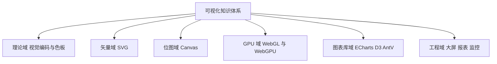

```javascript
// WebGPU 相比 WebGL 的可视化收益：Compute 聚合、原生 instancing、更低驱动开销
const adapter = await navigator.gpu?.requestAdapter();
if (adapter) {
  const device = await adapter.requestDevice();
  const ctx = canvas.getContext('webgpu');
  const format = navigator.gpu.getPreferredCanvasFormat();
  ctx.configure({ device, format, alphaMode: 'opaque' });
  // 百万级点：positions 写 GPUBuffer，compute pass 分桶聚合，render pass 直接绘制
} else {
  initWebGLFallback(); // 未来若干年仍需 WebGL/Canvas 降级路径
}
// 收束：理论定对错、SVG 定交互、Canvas 定规模、WebGL/WebGPU 定上限、
// 图表库定效率、工程域定落地——六域合一定位任何可视化需求
```

---

## 十一、WebGL 进阶（VIZ-101 ~ VIZ-107）

### VIZ-101：WebGL 着色器中的光照模型有哪些？法线在其中起什么作用？
**答**：三大经典模型递进：**Lambert** 只算漫反射 `max(dot(N, L), 0)` 最廉价；**Phong** 加镜面反射 `pow(dot(R, V), shininess)`，高光沿反射向量；**Blinn-Phong** 用半程向量 `H = normalize(L + V)` 替代反射向量，更便宜且高光更圆润，是实时渲染默认选择。法线 N 是所有光照的输入基石：模型被非均匀缩放时必须用法线矩阵（模型矩阵逆转置的 3x3 部分）变换法线并 normalize，否则光照方向错误。可视化中 3D 柱体、地球、机柜的质感都来自这套公式。

```glsl
// Blinn-Phong 光照：顶点着色器里必须用 normalMatrix 变换法线
attribute vec3 aNormal;
uniform mat4 uModel; uniform mat3 uNormalMatrix; uniform mat4 uViewProj;
varying vec3 vNormal; varying vec3 vWorldPos;
void main() {
  vec4 wp = uModel * vec4(aPosition, 1.0);
  vWorldPos = wp.xyz;
  vNormal = normalize(uNormalMatrix * aNormal); // 非均匀缩放必须用 normalMatrix
  gl_Position = uViewProj * wp;
}
// 片元着色器：漫反射 + 半程向量高光
precision mediump float;
varying vec3 vNormal; varying vec3 vWorldPos;
uniform vec3 uLightDir; uniform vec3 uEyePos; uniform vec3 uColor;
void main() {
  vec3 N = normalize(vNormal);
  vec3 L = normalize(uLightDir);
  vec3 V = normalize(uEyePos - vWorldPos);
  float diff = max(dot(N, L), 0.0);             // Lambert 漫反射
  vec3 H = normalize(L + V);                    // Blinn 半程向量
  float spec = pow(max(dot(N, H), 0.0), 64.0);  // 高光强度
  gl_FragColor = vec4(uColor * (0.25 + 0.75 * diff) + vec3(spec), 1.0);
}
```

### VIZ-102：如何用 WebGL 实现百万级 GPU 粒子系统？
**答**：核心思路是"状态放 GPU、CPU 只发一次"，三种做法：① 每帧 CPU 更新 BufferSubData——简单但 CPU 成为瓶颈；② WebGL2 **transform feedback** 在顶点着色器里更新位置写入另一块 buffer，乒乓交换，零 CPU 参与；③ 无状态粒子——位置完全由 `uTime` 在着色器里解析算出，CPU 每帧只更新一个 uniform。绘制用 `gl.drawArrays(gl.POINTS)` 一百万点一次 draw call。注意 gl_PointSize 有硬件上限，大粒子要用 billboard 四边形。

```javascript
// 无状态 GPU 粒子：种子数据只上传一次，位置由时间在顶点着色器解析计算
const N = 1000000;
const seeds = new Float32Array(N * 4); // xyz 初始位置 + w 随机相位
for (let i = 0; i < N; i++) {
  seeds[i * 4] = Math.random() * 2 - 1;
  seeds[i * 4 + 1] = Math.random() * 2 - 1;
  seeds[i * 4 + 2] = Math.random() * 2 - 1;
  seeds[i * 4 + 3] = Math.random();
}
gl.bindBuffer(gl.ARRAY_BUFFER, seedBuf);
gl.bufferData(gl.ARRAY_BUFFER, seeds, gl.STATIC_DRAW); // 一次性上传，STATIC_DRAW
// 顶点着色器核心逻辑：
// float t = fract(uTime * uSpeed + aSeed.w);          // 生命周期 0-1
// vec3 pos = aSeed.xyz + vec3(0.0, t * uRise, 0.0);   // 解析式位移，无需状态存储
// gl_PointSize = uSize * (1.0 - t);  vAlpha = 1.0 - t;
function frame(now) {
  gl.useProgram(prog);
  gl.uniform1f(uTimeLoc, (now / 1000) % 1);  // 每帧只更新一个 uniform
  gl.drawArrays(gl.POINTS, 0, N);            // 100 万点一次 draw call
  requestAnimationFrame(frame);
}
```

### VIZ-103：Bloom 辉光与高斯模糊等后处理效果的实现原理是什么？
**答**：后处理 = 把场景先渲染到**帧缓冲纹理（FBO）**，再对纹理做全屏 quad 的多 pass 处理。Bloom 标准流程：① 亮度提取 pass（超阈值的像素留下）；② 对亮区降采样后做多级高斯模糊（横一遍 + 竖一遍的分离卷积，复杂度从 O(n²) 降 O(n)）；③ 上采样加法混合回原场景。工程上直接用 Three.js 的 EffectComposer + UnrealBloomPass，但要知道 threshold/strength/radius 三个参数对应哪一步才能调出效果。

```javascript
// Three.js 后处理链：场景渲染 -> 亮度提取 -> 高斯模糊 -> 叠加
import { EffectComposer } from 'three/addons/postprocessing/EffectComposer.js';
import { RenderPass } from 'three/addons/postprocessing/RenderPass.js';
import { UnrealBloomPass } from 'three/addons/postprocessing/UnrealBloomPass.js';
const composer = new EffectComposer(renderer);   // 内部维护多张 render target
composer.addPass(new RenderPass(scene, camera));
const bloom = new UnrealBloomPass(
  new THREE.Vector2(innerWidth, innerHeight),
  0.9,   // strength：辉光强度
  0.4,   // radius：模糊扩散半径
  0.85   // threshold：亮度阈值，低于此值不发光
);
composer.addPass(bloom);
function animate() {
  composer.render();          // 依次执行各 pass，最终输出到屏幕
  requestAnimationFrame(animate);
}
```

### VIZ-104：WebGL / Three.js 的射线拾取原理是什么？如何高效拾取？
**答**：原理：屏幕坐标 → NDC → 逆投影得到**射线 origin + direction** → 与场景物体求交（三角形级别用 Möller–Trumbore，粗筛用包围球/AABB），取距离最近者。Three.js 的 `Raycaster.intersectObjects` 默认遍历所有三角形，对象一多就卡；优化三板斧：① three-mesh-bvh 加速求交；② 只对可交互层拾取（layers/分组隔离）；③ GPU 拾取——把对象 id 编码成颜色渲染到 1x1 FBO 用 readPixels 读回。拾取频率务必节流到每帧一次。

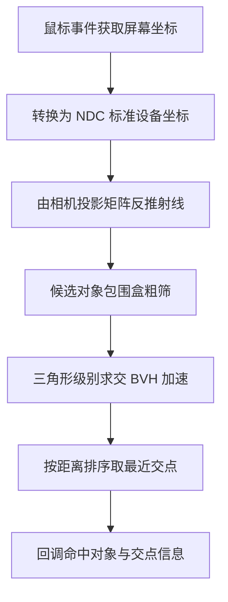

```javascript
// 屏幕坐标 -> NDC -> 射线 -> 求交，Three.js 用法与节流要点
function ndcFromEvent(e, canvas) {
  const r = canvas.getBoundingClientRect();
  return new THREE.Vector2(
    ((e.clientX - r.left) / r.width) * 2 - 1,
    -((e.clientY - r.top) / r.height) * 2 + 1  // y 轴翻转
  );
}
const raycaster = new THREE.Raycaster();
raycaster.layers.set(1);                 // 只拾取第 1 层的可交互对象
let pendingNdc = null;
canvas.addEventListener('pointermove', e => {
  pendingNdc = ndcFromEvent(e, canvas);  // 事件里只记录，rAF 中统一处理
});
function pickInFrame() {
  if (pendingNdc) {
    raycaster.setFromCamera(pendingNdc, camera);
    const hits = raycaster.intersectObjects(interactives, false);
    if (hits.length) onHover(hits[0]);   // hits 按距离排序，取最近
    pendingNdc = null;
  }
  requestAnimationFrame(pickInFrame);
}
```

### VIZ-105：轨道控制器 OrbitControls 的实现原理是什么？
**答**：本质是**球面坐标 + 目标点**：相机始终看向 target，位置由半径 r、方位角 theta、极角 phi 的球面坐标决定。鼠标拖动 → 修改 theta/phi（带阻尼惯性）；滚轮 → 缩放 r（乘法缩放 + min/maxDistance 夹紧，手感与距离无关）；右键/双指 → 平移 target。每帧先按阻尼因子插值再由球面坐标重建相机位置并 lookAt。注意 phi 要夹在 (0.01, PI - 0.01) 避免极点万向节死锁。

```javascript
// 迷你轨道控制器：球面坐标 + 阻尼 + 乘法缩放
class MiniOrbit {
  constructor(camera, dom, target = new THREE.Vector3()) {
    this.camera = camera; this.dom = dom; this.target = target;
    this.sph = new THREE.Spherical().setFromVector3(camera.position.clone().sub(target));
    this.vel = { theta: 0, phi: 0 };
    dom.addEventListener('pointermove', e => {
      if (e.buttons !== 1) return;
      this.vel.theta -= e.movementX * 0.005;   // 拖动 -> 方位角速度
      this.vel.phi   -= e.movementY * 0.005;   // 拖动 -> 极角速度
    });
    dom.addEventListener('wheel', e => {
      const k = e.deltaY > 0 ? 1.1 : 0.9;      // 乘法缩放：手感与当前距离无关
      this.sph.radius = THREE.MathUtils.clamp(this.sph.radius * k, 5, 500);
      e.preventDefault();
    }, { passive: false });
  }
  update() {  // 每帧：阻尼逼近 + 重建相机位置
    this.sph.theta += this.vel.theta;
    this.sph.phi = THREE.MathUtils.clamp(this.sph.phi + this.vel.phi, 0.01, Math.PI - 0.01);
    this.vel.theta *= 0.85; this.vel.phi *= 0.85;   // 阻尼惯性
    const offset = new THREE.Vector3().setFromSpherical(this.sph);
    this.camera.position.copy(this.target).add(offset);
    this.camera.lookAt(this.target);
  }
}
```

### VIZ-106：glTF 模型加载与优化有哪些手段？
**答**：glTF 是"3D 界的 JPEG"，加载链：GLTFLoader 解析 JSON → 二进制 buffer → GPU 上传。优化四件套：① **几何压缩**——Draco（有损顶点压缩，体积 -70%）、Meshopt（解码快、按需解码）、KTX2（GPU 直接吃压缩纹理，省显存也省带宽）；② **LOD**——多级细节模型按距离/屏幕占比切换（THREE.LOD）；③ **实例化**——重复模型用 InstancedMesh；④ **加载体验**——decoder 预热、loadingManager 进度、大模型渐进显示。数字孪生/机房场景几乎是必考组合。

```javascript
// glTF + Draco + KTX2 + LOD 全链路
import { GLTFLoader } from 'three/addons/loaders/GLTFLoader.js';
import { DRACOLoader } from 'three/addons/loaders/DRACOLoader.js';
import { KTX2Loader } from 'three/addons/loaders/KTX2Loader.js';
const loader = new GLTFLoader();
const draco = new DRACOLoader().setDecoderPath('/libs/draco/'); // WASM 解码器
loader.setDRACOLoader(draco);
const ktx2 = new KTX2Loader().setTranscoderPath('/libs/basis/').detectSupport(renderer);
loader.setKTX2Loader(ktx2);
loader.load('/model.glb',
  gltf => {
    const lod = new THREE.LOD();
    lod.addLevel(gltf.scene, 0);       // 高模：近距离
    lod.addLevel(buildLowPoly(gltf), 50); // 低模：50 米外自动切换
    scene.add(lod);
  },
  ev => setProgress(ev.loaded / ev.total),  // 进度回调
  err => showFallbackModel()                // 加载失败兜底
);
```

### VIZ-107：Three.js 场景性能优化的核心手段有哪些？（压轴）
**答**：先量化再优化：stats 看帧率、Spector 看每帧 draw call。手段按收益排序：① **降 draw call**——静态物体 `mergeGeometries` 合并、重复物体 InstancedMesh、保持 frustum culling；② **材质共享**——相同外观复用同一 Material 实例，避免着色器首次编译掉帧（可预热编译）；③ **纹理治理**——KTX2 压缩、尺寸取 2 的幂、及时 dispose；④ **渲染侧**——pixelRatio clamp 到 2、按需渲染（无交互不跑 render）、阴影贴图按需更新；⑤ **更新侧**——静态物体 `matrixAutoUpdate = false`。

```javascript
// draw call 优化三板斧：合并 + 实例化 + 材质共享
import * as BufferGeometryUtils from 'three/addons/utils/BufferGeometryUtils.js';
// 1. 静态物体合并：1000 个箱子 1000 次 draw call -> 1 次
const merged = BufferGeometryUtils.mergeGeometries(boxGeometries);
scene.add(new THREE.Mesh(merged, sharedMaterial));
// 2. 重复物体实例化：一片森林只有 1 次 draw call
const forest = new THREE.InstancedMesh(treeGeo, treeMat, 10000);
const m = new THREE.Matrix4();
trees.forEach((t, i) => {
  m.compose(t.position, t.quaternion, t.scale);
  forest.setMatrixAt(i, m);           // 实例矩阵一次上传
});
forest.instanceMatrix.needsUpdate = true;
scene.add(forest);
// 3. 材质共享 + 按需渲染
const sharedMaterial = new THREE.MeshStandardMaterial({ map: atlasTex });
controls.addEventListener('change', () => { needsRender = true; }); // 交互时才渲染
```

---

## 十二、WebGPU 与新图形 API（VIZ-108 ~ VIZ-111）

### VIZ-108：WebGPU 与 WebGL 在架构上有哪些本质差异？
**答**：① **命令模型**——WebGL 是即时隐式状态机（改 uniform 全局生效），WebGPU 是显式命令编码器（CommandEncoder 录制、批量 submit），驱动开销极低；② **管线对象化**——WebGL 的着色器/混合/深度状态散落全局，WebGPU 打包成不可变 GPURenderPipeline，切换零成本；③ **资源绑定**——WebGL 靠 bindTexture 等副作用，WebGPU 用声明式 BindGroup；④ **多线程**——device/queue 可配合 OffscreenCanvas 在 Worker 使用；⑤ **Compute Shader** 原生支持。一句话：WebGL 像逐条发指令，WebGPU 像提交批处理任务。

```javascript
// 同一件事：设置 uniform 并画一个三角形——两代 API 的心智模型对比
// WebGL：全局状态机，状态散落且隐式生效
gl.useProgram(prog);
gl.uniformMatrix4fv(mvpLoc, false, mvp);
gl.bindTexture(gl.TEXTURE_2D, tex);
gl.bindVertexArray(vao);
gl.drawArrays(gl.TRIANGLES, 0, 3);
// WebGPU：录制命令 -> 一次性提交，管线与绑定都是显式对象
const encoder = device.createCommandEncoder();
const pass = encoder.beginRenderPass({ colorAttachments: [view] });
pass.setPipeline(pipeline);            // 不可变管线：着色器+混合+深度已打包
pass.setBindGroup(0, bindGroup);       // 声明式资源绑定
pass.draw(3);
pass.end();
device.queue.submit([encoder.finish()]); // 批量提交，驱动开销低
```

### VIZ-109：WebGPU 的渲染管线与 Bind Group 是什么？怎么组织资源？
**答**：GPURenderPipeline 在初始化时一次性声明：顶点/片元着色器、顶点缓冲布局、图元拓扑、深度模板、输出颜色格式——创建昂贵但之后切换零成本。资源（uniform buffer、纹理、采样器）通过 **BindGroupLayout → BindGroup** 声明式绑定到编号组与槽位；同一布局的多个 BindGroup 提前创建好按帧切换。易错点：bufferUsage 必须与声明一致、纹理格式必须与 pipeline 的 targets 格式匹配、每帧渲染前要拿 `context.getCurrentTexture().createView()`。

```javascript
// 管线 + BindGroup：声明一次，按帧复用
const pipeline = device.createRenderPipeline({
  layout: 'auto',
  vertex: {
    module, entryPoint: 'vs',
    buffers: [{ arrayStride: 20, attributes: [
      { shaderLocation: 0, offset: 0,  format: 'float32x3' },  // position
      { shaderLocation: 1, offset: 12, format: 'float32x2' },  // uv
    ]}],
  },
  fragment: { module, entryPoint: 'fs', targets: [{ format: canvasFormat }] },
  primitive: { topology: 'triangle-list' },
});
const bindGroup = device.createBindGroup({
  layout: pipeline.getBindGroupLayout(0),
  entries: [
    { binding: 0, resource: { buffer: uniformBuffer } },  // MVP 矩阵等
    { binding: 1, resource: texture.createView() },        // 采样纹理
    { binding: 2, resource: sampler },                     // 采样器
  ],
});
```

### VIZ-110：WebGPU 计算着色器能做什么？对可视化的价值在哪里？
**答**：Compute Pass 让 GPU 做通用并行计算：workgroup 内多线程，通过 `workgroupBarrier` 同步、storage buffer 读写数据。对可视化的价值：① **布局计算**——力导向图迭代、大规模分桶/排序搬到 GPU，主线程不卡；② **数据聚合**——百万点的直方图/热力格一次 pass 完成；③ **粒子模拟**——模拟与渲染共享同一份显存，零拷贝。入门经典是 GPU 直方图：每线程原子加分桶（atomicAdd）。注意 storage buffer 在顶点阶段读取的能力与设备相关，需要 feature 检测。

```javascript
// Compute：直方图分桶——百万数据一次 pass 聚合，替代主线程 for 循环
const shader = device.createShaderModule({ code: `
  @group(0) @binding(0) var<storage, read> data: array<f32>;
  @group(0) @binding(1) var<storage, read_write> bins: array<atomic<u32>>;
  @compute @workgroup_size(64)
  fn main(@builtin(global_invocation_id) gid: vec3u) {
    let n = arrayLength(&bins);
    let idx = u32(clamp(data[gid.x] * f32(n), 0.0, f32(n - 1u)));
    atomicAdd(&bins[idx], 1u);   // 原子加，多线程安全分桶
  }`});
const encoder = device.createCommandEncoder();
const pass = encoder.beginComputePass();
pass.setPipeline(computePipeline);
pass.setBindGroup(0, bindGroup);
pass.dispatchWorkgroups(Math.ceil(N / 64));  // 派发足够覆盖全部数据的线程组
pass.end();
device.queue.submit([encoder.finish()]);
// 之后渲染 pass 直接用 bins 作为柱高，模拟与渲染共享显存零拷贝
```

### VIZ-111：WebGPU 的兼容性现状如何？降级策略怎么设计？
**答**：截至 2026 年初：Chrome/Edge 113+ 稳定（含 Android），Safari 已跟进稳定，Firefox 逐步铺开；企业内网旧浏览器与部分低端安卓仍是空白。降级策略分层：① 能力检测 `navigator.gpu?.requestAdapter()` 失败 → WebGL2 → WebGL1 → Canvas 2D（大规模点用聚合缩略）；② 按"效果分级"降级：WebGPU 独有的 compute 聚合退化为 Worker/主线程聚合；③ 统一渲染抽象层（或用 Three.js WebGPURenderer 自动 fallback），业务代码不感知后端。关键是把"后端能力"做成运行时探测的特性矩阵并上报监控。

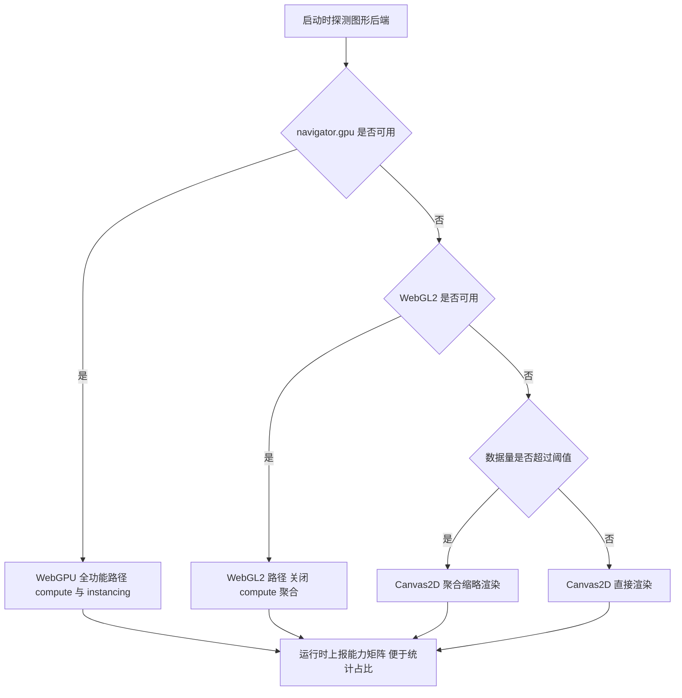

```javascript
// 能力探测与后端选择：特性矩阵驱动，业务不感知后端
async function pickBackend(canvas) {
  if (navigator.gpu) {
    try {
      const adapter = await navigator.gpu.requestAdapter();
      if (adapter) {
        const device = await adapter.requestDevice();
        return initWebGPU(canvas, device);   // 全功能：compute + 原生 instancing
      }
    } catch (e) { /* 探测失败，继续降级 */ }
  }
  const gl2 = canvas.getContext('webgl2');
  if (gl2) return initWebGL2(canvas, gl2);   // 降级：CPU 聚合 + instancing 扩展
  return initCanvas2D(canvas);               // 兜底：聚合缩略 + 静态图层
}
// 能力矩阵示例：{ compute: true, maxTextureSize: 8192, backend: 'webgpu' }
```

---

## 十三、数据可视化高级图表（VIZ-112 ~ VIZ-118）

### VIZ-112：3D 地球与地球飞线的实现原理？
**答**：三层结构：① 底图——贴地球纹理的球体，或"点阵地球"（按陆地掩码生成经纬点云，科技感大屏主流）；② 飞线——起终点球面坐标插值出的**贝塞尔弧线**：中点沿法向抬高形成拱形，渲染用 Line 或 TubeGeometry，流光动画用着色器按 uv 与 uProgress 比较（或 dashed line 的 dashOffset）；③ 光柱/涟漪标记起讫点。性能：几百条飞线用合并 geometry + 着色器相位偏移（每条线一个相位 uniform 或 attribute），避免几百个独立 mesh。

```javascript
// 经纬度 -> 球面坐标 -> 大圆弧飞线顶点 -> 流光动画
function latLonToVec3(lat, lon, R) {
  const phi = (90 - lat) * Math.PI / 180, theta = (lon + 180) * Math.PI / 180;
  return new THREE.Vector3(
    -R * Math.sin(phi) * Math.cos(theta),
     R * Math.cos(phi),
     R * Math.sin(phi) * Math.sin(theta));
}
function arcPoints(from, to, R, segments = 64) {
  const a = latLonToVec3(from[0], from[1], R);
  const b = latLonToVec3(to[0], to[1], R);
  const mid = a.clone().add(b).multiplyScalar(0.5)
    .normalize().multiplyScalar(R * (1 + a.distanceTo(b) / (R * 4))); // 中点抬高成拱
  return new THREE.QuadraticBezierCurve3(a, mid, b).getPoints(segments);
}
// 流光：几何上加 aUv attribute，片元里
// float head = fract(uTime * 0.5 + aPhase);
// float glow = smoothstep(head - 0.15, head, vUv.x) * step(head - 0.15, vUv.x);
// gl_FragColor = vec4(uColor * glow, glow);
```

### VIZ-113：热力图 / 等值线的插值算法原理？
**答**：离散站点数据 → 连续场需要空间插值：① **IDW 反距离加权**——每个网格点取周围站点值按距离倒数幂加权，简单通用；② **Kriging 克里金**——考虑空间相关性的地质统计学插值，更科学但计算重；③ 规则网格放大用双线性/双三次。得到网格后画等值线用 **Marching Squares**：逐格判断 4 角与阈值的相对关系（16 种组合查表），得到线段再连接成线。Canvas 热力图简版：径向渐变按 alpha 叠加，再按 alpha 值查色带上色（heatmap.js 原理）。

```javascript
// IDW 插值网格化离散站点 -> 供等值线 / 热力渲染
function idwGrid(points, cols, rows, power = 2) {
  const grid = new Float32Array(cols * rows);
  for (let j = 0; j < rows; j++) for (let i = 0; i < cols; i++) {
    const x = i / (cols - 1), y = j / (rows - 1);
    let num = 0, den = 0;
    for (const p of points) {
      const d2 = (p.x - x) ** 2 + (p.y - y) ** 2 + 1e-8;
      const w = 1 / Math.pow(d2, power / 2);   // 距离越远权重越小
      num += w * p.v; den += w;
    }
    grid[j * cols + i] = num / den;
  }
  return grid;
}
// Marching Squares：16 种角点组合查表输出线段，再拼接成等值线
function marchingSquares(grid, cols, rows, level) {
  const segs = [];
  for (let j = 0; j < rows - 1; j++) for (let i = 0; i < cols - 1; i++) {
    const a = grid[j * cols + i], b = grid[j * cols + i + 1],
          c = grid[(j + 1) * cols + i + 1], d = grid[(j + 1) * cols + i];
    const code = (a > level ? 8 : 0) | (b > level ? 4 : 0) |
                 (c > level ? 2 : 0) | (d > level ? 1 : 0);
    segs.push(...CASE_TABLE[code](i, j, level, { a, b, c, d })); // 查表出 0-2 条线段
  }
  return segs;
}
```

### VIZ-114：主题河流图（ThemeRiver / StreamGraph）的实现原理？
**答**：展示**时序多序列的流量变化**：x 轴是时间，每个类目是一条上下对称的"河带"，厚度编码数值。要点：① 堆叠布局用 **wiggle 居中偏移**（d3 `stackOffsetWiggle`）+ `stackOrderInsideOut`（大序列放中间），整体基线波动最小，视觉最像河流；② 边界用 Catmull-Rom/单调三次曲线平滑，注意单调插值防止过冲；③ 颜色沿序列渐变，hover 高亮单条河带并 tooltip 显示该时刻值。适合话题/情绪/流量构成随时间演化，不适合精确读数。

```javascript
// StreamGraph：wiggle 居中堆叠 + CatmullRom 平滑（D3）
const stack = d3.stack()
  .keys(seriesKeys)
  .offset(d3.stackOffsetWiggle)    // 基线偏移使整体波动最小，河带上下对称
  .order(d3.stackOrderInsideOut);  // 大序列放中间形成主河道
const layered = stack(timeRows);   // layered[k] 为第 k 条河的上下边界点列
const area = d3.area()
  .x(d => xScale(d.data.t))
  .y0(d => yScale(d[0]))
  .y1(d => yScale(d[1]))
  .curve(d3.curveCatmullRom.alpha(0.5)); // 平滑边界
svg.selectAll('path').data(layered).join('path')
  .attr('d', area)
  .attr('fill', (d, i) => colorScale(seriesKeys[i]))
  .on('mousemove', (e, d) => showRiverTooltip(e, d));
```

### VIZ-115：平行坐标图如何解决高维数据展示与刷选？
**答**：N 维数据 → N 条平行竖轴，每条样本是一条跨过各轴的折线，轴位置编码该维数值。关键问题与解法：① **量纲归一**——每轴独立线性归一到 [0,1]，支持按轴切对数；② **轴排序**——相邻轴相关性影响可读性，用相似度聚类自动排序；③ **刷选**——每轴放 brush 区间，取各轴过滤条件的**交集**，被过滤的线降透明度保留上下文而非删除；④ **遮挡**——大量样本降透明度 + bundle 聚合计数，或切 WebGL 渲染。适合金融风控特征分析、多维传感器对比。

```javascript
// 平行坐标：轴归一 + 多轴 brush 交集过滤
const dims = Object.keys(rows[0]);
const scales = Object.fromEntries(dims.map(d =>
  [d, d3.scaleLinear().domain(d3.extent(rows, r => r[d])).range([h, 0])]));
const brushes = {}; // axis -> [lo, hi]
function passes(r) {
  return dims.every(d => {
    const b = brushes[d];
    if (!b) return true;
    const y = scales[d](r[d]);
    return y >= Math.min(...b) && y <= Math.max(...b);
  });
}
function redraw() {
  ctx.clearRect(0, 0, w, h);
  for (const r of rows) {
    ctx.globalAlpha = passes(r) ? 0.35 : 0.03;   // 命中高亮，未命中淡出保留上下文
    ctx.beginPath();
    dims.forEach((d, i) => {
      const x = i * (w / (dims.length - 1)), y = scales[d](r[d]);
      i ? ctx.lineTo(x, y) : ctx.moveTo(x, y);
    });
    ctx.stroke();
  }
}
```

### VIZ-116：雷达图的实现原理与常见坑？
**答**：把 N 个维度均分到圆周（角度间隔 2π/N，从正上方开始），每轴从圆心向外线性映射数值，样本顶点连线闭合即多边形。要点：① 背景网格是**同心多边形**而非圆，刻度沿轴标注；② 顶点计算 `x = cx + r*cos(a)`、`y = cy + r*sin(a)`；③ 坑——维度过多（>8）轴标签拥挤；量纲不一时必须分轴归一或多轴独立刻度；面积对比会高估（视觉面积 ∝ r²）；多系列叠加以描边为主 + 半透明填充。

```javascript
// 雷达图核心：极角均分 + 半径映射 + 同心网格
function radarPath(values, max, cx, cy, R) {
  return values.map((v, i) => {
    const a = (i / values.length) * Math.PI * 2 - Math.PI / 2; // 从正上方开始
    const r = (v / max) * R;
    const p = [cx + r * Math.cos(a), cy + r * Math.sin(a)];
    return (i ? 'L' : 'M') + p[0].toFixed(1) + ' ' + p[1].toFixed(1);
  }).join('') + 'Z';
}
const dims = ['攻击', '防御', '速度', '技巧', '体力'];
const values = [90, 60, 75, 80, 70], MAX = 100;
svg.innerHTML =
  [0.25, 0.5, 0.75, 1].map(f =>   // 同心网格：多边形而非圆
    `<polygon points="${ringPoints(f)}" fill="none" stroke="#e2e8f0"/>`).join('') +
  dims.map((d, i) => axisLabel(i, d)).join('') +
  `<path d="${radarPath(values, MAX, cx, cy, R)}"
     fill="rgba(59,130,246,.2)" stroke="#3b82f6" stroke-width="2"/>`;
```

### VIZ-117：旭日图的交互下钻如何实现？
**答**：旭日图是多层环的径向树：每层角度区间继承父节点，半径分环。下钻三种方案：① **重布局式**——点击节点后以它为根重新分区（d3.partition），新旧布局做角度/半径插值过渡动画；② **聚焦式**——被点节点的祖先链占上半圆、子孙展开在下半圆（ECharts sunburst 默认 nodeClick 行为）；③ **放大镜式**——不改布局，点击后子树角度放大占用空闲角度。实现关键：把 partition 输出的 x0/x1/y0/y1 存到节点，中心圆放当前根与返回按钮。

```javascript
// 旭日图下钻：以点击节点为根重新 partition，新旧布局插值过渡
const partition = d3.partition().size([2 * Math.PI, R]); // x=角度 y=半径
let root = partition(d3.hierarchy(tree).sum(d => d.value));
function drill(node) {
  const oldMap = new Map(root.descendants().map(d =>
    [d, { x0: d.x0, x1: d.x1, y0: d.y0, y1: d.y1 }]));
  root = node;                                  // 换根重分区
  root.each(d => { d.depth -= node.depth; });   // 深度归零
  partition(root);
  svg.selectAll('path').transition().duration(600)
    .attrTween('d', d => {
      const o = oldMap.get(d) || d;
      const ix0 = d3.interpolate(o.x0, d.x0), ix1 = d3.interpolate(o.x1, d.x1);
      const iy0 = d3.interpolate(o.y0, d.y0), iy1 = d3.interpolate(o.y1, d.y1);
      return t => arc({ x0: ix0(t), x1: ix1(t), y0: iy0(t), y1: iy1(t) });
    });
}
// 中心圆放返回按钮：沿 parent 链逐级回退
```

### VIZ-118：桑基图的布局算法原理？
**答**：表达流量分配：节点为竖条，边为宽度 ∝ 流量的带子。布局三步：① **分层**——按 DAG 拓扑（最长路径定深度），环要在布局前检测打破；② **节点布局**——高度 = max(入流和， 出流和) × 比例，层内排序减少交叉（重心法迭代），垂直居中或按重心对齐；③ **边走线**——每条边在节点上按已占用的流量偏移依次堆叠，形状用三次贝塞尔（两个控制点取源目标中点 x）。D3-sankey 即此算法，ECharts sankey 提供 align: justify/left/right 对齐模式。

```javascript
// 迷你 sankey：分层 -> 节点定高 -> 边偏移分配
function sankey(nodes, links, W, H, K) {
  // 1. 分层：最长路径
  nodes.forEach(n => { n.depth = 0; });
  for (const n of nodes)
    for (const l of links.filter(l => l.source === n.id))
      nodes.find(t => t.id === l.target).depth = Math.max(
        nodes.find(t => t.id === l.target).depth, n.depth + 1);
  const layers = d3.groups(nodes, n => n.depth);
  // 2. 节点位置与高度：高度取出入流最大值
  layers.forEach(([d, ns], li) => ns.forEach((n, i) => {
    n.x = (li / (layers.length - 1)) * (W - 120);
    const inSum = d3.sum(links.filter(l => l.target === n.id), l => l.value);
    const outSum = d3.sum(links.filter(l => l.source === n.id), l => l.value);
    n.height = Math.max(inSum, outSum) * K;
    n.y = (H / (ns.length + 1)) * (i + 1);
  }));
  // 3. 边分配：节点上按已用偏移依次堆叠
  const used = new Map();
  for (const l of links) {
    const s = nodes.find(n => n.id === l.source), t = nodes.find(n => n.id === l.target);
    const sy = used.get(s.id) || 0; used.set(s.id, sy + l.value * K);
    const ty = used.get(t.id) || 0; used.set(t.id, ty + l.value * K);
    l.path = `M${s.x + NW},${s.y + sy} C${(s.x + t.x) / 2},${s.y + sy} ` +
             `${(s.x + t.x) / 2},${t.y + ty} ${t.x},${t.y + ty}`;
  }
  return links;
}
```

---

## 十四、图表库源码与原理深潜（VIZ-119 ~ VIZ-125）

### VIZ-119：从 option 到像素，ECharts 的渲染流程是怎样的？（源码级，压轴）
**答**：`setOption(option)` 后链路：① **parseOption**——归一化配置、合并默认项，OptionManager 管理原始配置；② **Model 层**——每个组件/系列由对应 Model 类持有内部模型，坐标系（CoordinateSystem）在此创建；③ **数据处理**——数据进入 DataStore/List，做 stack/filter 与**视觉映射**（颜色、symbol 大小由 visual encoder 生成）；④ **View 层**——每个 Series/Component 的 View 用模型生成 **ZRender 图元**（Displayable）；⑤ **zrender**——分层、脏矩形、动画插值与增量刷新，最终由 Canvas/SVG 渲染器出像素。理解这条链才能解释 lazyUpdate 为何快、动画为何在 zrender 层。

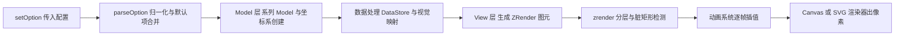

```javascript
// 面向源码的调试手段：观察 option -> model -> view 链路
const chart = echarts.init(dom);
chart.setOption({ series: [{ type: 'line', data: [1, 2, 3] }] });
console.log(chart.getModel().getSeriesByIndex(0));            // Model 层内部模型
console.log(chart.getModel().getSeriesByIndex(0).getData());  // 处理后的数据 List
const zr = chart.getZr();                                     // zrender 实例
console.log(zr.painter.getLayers().map(l => l.dom.id));       // 分层：zr_0 / zr_1 ...
zr.storage.getDisplayList().slice(0, 5).forEach(el =>
  console.log(el.type, el.animators?.length));                // 图元与其动画器
// 性能 API 与链路的对应：lazyUpdate -> 合并多次 setOption；
// progressive -> View 层分片生成图元；hoverLayerThreshold -> 命中层隔离
```

### VIZ-120：ZRender 的多层 Canvas 与脏矩形是怎么工作的？
**答**：① **分层**——zrender 默认背景层 + 可交互层，`zlevel` 相同的图元同层，跨 zlevel 创建新 canvas：把高频动画系列放高 zlevel，静态背景低 zlevel，动画帧内静态层完全不重绘；② **脏矩形**——图元变更时把其包围盒并入脏区，每帧只对脏区 clearRect 并重绘区域内图元，整屏静态部分不动；③ **命中检测**——事件层监听 pointer，用图元 `contain`（路径级精确判断）+ hover 层光标联动；④ tooltip 是独立 DOM 层不占 canvas。大屏分层是标准优化手段。

```javascript
// zrender 分层观察与利用
const chart = echarts.init(el);
chart.setOption(option);
const zr = chart.getZr();
console.log(zr.painter.getLayers().map(l => l.__zlevel)); // 各层 zlevel
// 按层拆分：动画飞线放 zlevel 2，静态地图放 zlevel 1，动画帧只重绘上层
chart.setOption({ series: [
  { type: 'map', zlevel: 1 },                                        // 静态层
  { type: 'lines', coordinateSystem: 'geo', zlevel: 2, data: flows } // 动画层
]});
// 直接用 zrender 同理：指定 zlevel 触发独立 canvas
const zr2 = zrender.init(dom);
zr2.add(new zrender.Circle({ shape: { r: 10 }, zlevel: 2 }));
```

### VIZ-121：ECharts 的动画系统如何实现？形变动画的插值原理？
**答**：① 入场/更新动画——View 层每图元注册到 zrender 的 **Animatable**：记录起始与目标状态，按 easing 函数 rAF 逐帧插值；② **形变（morphing）**——数据变化时旧图元到新图元：路径采样成等量点列做点对点插值，多边形用顶点插值，`universalTransition` 让跨系列形变（柱→饼→折线）成为可能；③ 插值器覆盖数字、颜色（RGB）、transform；④ 性能要点——大数据关更新动画（animationDurationUpdate: 0），只保留入场；自定义 easing 可注册到 zrender。

```javascript
// zrender 动画 API 与 ECharts 跨系列形变
const zr = zrender.init(document.getElementById('c'));
const rect = new zrender.Rect({ shape: { x: 0, y: 0, width: 10, height: 10 } });
zr.add(rect);
rect.animate('shape', true)          // loop 循环动画
  .when(1000, { width: 200, height: 80 })
  .when(2000, { width: 10, height: 10 })
  .start('cubicOut');                // easing 名称即插值函数
// ECharts 侧：柱形平滑变饼形
chart.setOption({ series: [{ type: 'bar',
  universalTransition: { enabled: true }, data }], animationDurationUpdate: 600 });
chart.setOption({ series: [{ type: 'pie',
  universalTransition: { enabled: true }, data }]); // 形变插值在 zrender 层完成
```

### VIZ-122：ECharts 的 tooltip 是如何实现的？
**答**：tooltip 不画在 canvas 里，而是**独立 DOM div**。链路：① 事件层捕获 pointermove → zrender 命中检测找到图元 → 触发 series highlight；② 数据查询——`trigger: 'item'` 取单图元数据，`'axis'` 按坐标系轴索引换算取跨系列对齐数据；③ 渲染——`formatter` 生成 HTML 写入 div，绝对定位 + 贴边自动翻转（position 回调可完全接管）；④ 性能——transitionDuration 动画、appendToBody、大数据配 axisPointer snap 与节流；⑤ 跨图表同步即各实例 axisPointer link 共享十字线。

```javascript
// tooltip：formatter 定制 + 轴触发 + 位置接管 + 跨图同步
chart.setOption({
  tooltip: {
    trigger: 'axis',
    axisPointer: { type: 'cross', snap: true },
    transitionDuration: 0.1,
    formatter: params => `<b>${params[0].axisValue}</b>` + params.map(p =>
      `<div>${p.marker}${p.seriesName}: ${fmt(p.value)}</div>`).join(''),
    position: (point, params, dom, rect, size) => ({
      // 边界翻转：右半屏出左侧 tooltip
      pos: [point[0] + 12, Math.max(0, point[1] - size.contentSize[1] / 2)],
    }),
  },
  axisPointer: { link: [{ xAxisIndex: 'all' }] },  // 多实例联动共享十字线
});
```

### VIZ-123：坐标轴刻度是怎么算出来的？（nice ticks，压轴）
**答**：目标是"人类友好刻度"：步长是 1/2/2.5/5×10ⁿ 这类整数、刻度数在 3~7 之间、范围覆盖数据。经典 **nice number 算法**：`rawStep = range / (tickCount - 1)`，`mag = 10^floor(log10(rawStep))`，再从 [1, 2, 2.5, 5, 10]×mag 中选不小于 rawStep 的最小者作为 step；然后 `lo = floor(min/step)*step`、`hi = ceil(max/step)*step`，从 lo 步进到 hi。浮点累加误差用 epsilon 与 toFixed 修正。对数轴与时间轴各有专用策略（时间轴按跨度选 分/时/天/月 粒度）。

```javascript
// nice ticks 算法实现
function niceTicks(min, max, tickCount = 5) {
  const range = max - min || 1;
  const rawStep = range / (tickCount - 1);
  const mag = Math.pow(10, Math.floor(Math.log10(rawStep)));
  const norm = rawStep / mag;
  const step = (norm >= 5 ? 10 : norm >= 2.5 ? 5 :
                norm >= 2 ? 2.5 : norm >= 1 ? 2 : 1) * mag;
  const lo = Math.floor(min / step) * step;
  const hi = Math.ceil(max / step) * step;
  const ticks = [];
  for (let v = lo; v <= hi + step * 1e-6; v += step)
    ticks.push(+v.toFixed(10));          // 浮点累加误差修正
  return { ticks, step, lo, hi };
}
console.log(niceTicks(3, 97).ticks);   // [0, 25, 50, 75, 100] 人类友好刻度
console.log(niceTicks(0, 1, 5).step);  // 0.25
```

### VIZ-124：图例 legend 的滚动与交互实现原理？
**答**：legend 是 LegendComponent：① 布局——按 orient 排布 icon+text，`type: 'scroll'` 时放不下的分页：维护 pageIndex，两侧渲染翻页箭头并带翻页动画；② 交互——点击触发 `legendToggleSelect` action，内部维护 selectedMap，渲染时按选中态过滤/置灰，对外抛 `legendselectchanged` 事件；③ 文本溢出——formatter 截断 + tooltip 显示全名；④ 自定义——rich 文本与 itemStyle 覆盖，或关掉内置 legend 用 DOM 自绘再 dispatchAction 联动（大屏/SSR 场景常用）。

```javascript
// 滚动图例 + 自绘图例联动两种方案
chart.setOption({
  legend: {
    type: 'scroll', orient: 'horizontal',
    pageIconSize: 10, pageButtonItemGap: 6,
    formatter: name => name.length > 8 ? name.slice(0, 8) + '…' : name,
  },
});
chart.on('legendselectchanged', ({ name, selected }) => syncExternalLegend(name, selected));
// 方案二：DOM 自绘图例，走 action 通道联动（SSR/大屏场景）
legendDom.addEventListener('click', e => {
  const name = e.target.dataset.name;
  if (name) chart.dispatchAction({ type: 'legendToggleSelect', name });
});
```

### VIZ-125：dataZoom 数据缩放的实现原理？
**答**：dataZoom 本质是**数据窗口过滤器**：① inside 型监听滚轮/拖拽，slider 型是独立组件画窗口把手；② 窗口模型——`start/end`（百分比）与 `startValue/endValue`（绝对值）双表示互转；`filterMode: 'filter' | 'weakFilter' | 'empty' | 'none'` 决定物理过滤数据还是只裁剪显示；③ 联动——窗口变化后重走"数据 → 视觉映射 → View"管线，轴刻度按新窗口重新 niceTicks；④ 性能——大数据配 `sampling: 'lttb'`、`throttle: 50` 拖动节流、`filterMode: 'none'` 避免频繁重建数据。

```javascript
// dataZoom 配置要点 + 手写迷你缩放原理
chart.setOption({
  dataZoom: [
    { type: 'inside', throttle: 50, filterMode: 'none' },  // 滚轮缩放，节流 50ms
    { type: 'slider', start: 0, end: 100 },
  ],
  series: [{ type: 'line', sampling: 'lttb', data: bigData }],
});
// 手写核心：归一化窗口 -> 切片 -> 重渲染
let win = { lo: 0, hi: 1 };
onZoom(k => { win.hi = Math.max(0.01, win.hi * k); render(); }); // 滚轮改窗口
function render() {
  const n = data.length, a = Math.floor(win.lo * n), b = Math.ceil(win.hi * n);
  drawSeries(data.slice(a, b));   // 只渲染窗口内数据
  drawSlider(a / n, b / n);       // 缩略图上的窗口把手
}
```

---

## 十五、大数据可视化（VIZ-126 ~ VIZ-131）

### VIZ-126：百万级散点图如何渲染？（WebGL instancing，压轴）
**答**：Canvas 2D 上限约 1~5 万点/帧，百万点必须 WebGL。方案阶梯：① **逐点 drawArrays(POINTS)**——一个 STATIC_DRAW buffer 装全部顶点，顶点着色器算屏幕坐标，一次 draw call；② **instancing**——点带贴图（圆/方形 sprite）时 instanced quad 更灵活；③ 工业实现直接用 deck.gl ScatterplotLayer。关键配套：命中检测用 **quadtree/网格索引**（CPU 做，与渲染解耦），缩放配降采样金字塔，或用密度着色（每像素计数）替代逐点绘制。

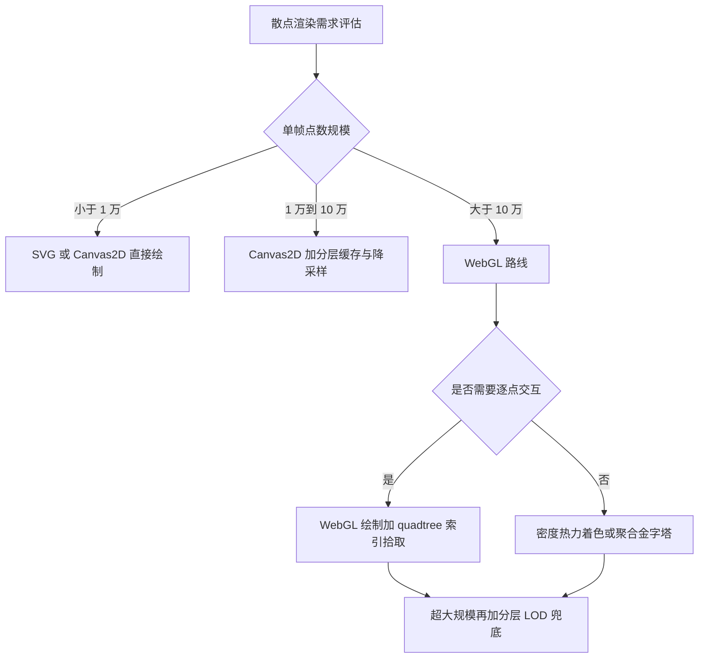

```javascript
// WebGL 百万点：单 draw call 渲染 + CPU 索引拾取，两者解耦
const gl = canvas.getContext('webgl');
const positions = new Float32Array(N * 2);
// ...填充数据
gl.bindBuffer(gl.ARRAY_BUFFER, posBuf);
gl.bufferData(gl.ARRAY_BUFFER, positions, gl.STATIC_DRAW); // 一次性上传
gl.vertexAttribPointer(aPosLoc, 2, gl.FLOAT, false, 0, 0);
gl.enableVertexAttribArray(aPosLoc);
gl.drawArrays(gl.POINTS, 0, N);   // 顶点着色器内做 MVP 与 gl_PointSize
// 拾取走 CPU 索引，与 GPU 渲染解耦
import Quadtree from 'quadtree-lib';
const qt = new Quadtree({ width: W, height: H, maxElements: 16 });
points.forEach((p, i) => qt.add({ x: p[0], y: p[1], i }));
function pickAt(mx, my, radius = 5) {
  return qt.collides({ x: mx - radius, y: my - radius,
                       width: radius * 2, height: radius * 2 }); // 命中候选
}
```

### VIZ-127：实时流式数据（每秒上万条）如何渲染？
**答**：核心是**环形缓冲（Ring Buffer）+ 定长窗口**：① 数据到达写入预分配的 Float64Array 环形数组，写满覆盖最旧，绝不 grow/shift（shift 是 O(n) 且触发 GC）；② 渲染按窗口顺序读环形缓冲（注意 wrap-around）；③ 每帧只画一次——新数据积累在待渲染队列，rAF 时批量 flush；④ 高频下增量维护统计量（每桶 min/max/avg），tooltip 直接读预聚合。适用于行情分笔、日志 QPS、IoT 传感器。

```javascript
// 环形缓冲 + 批量 flush 的实时折线
class RingSeries {
  constructor(cap = 60000) {
    this.buf = new Float64Array(cap); this.cap = cap;
    this.head = 0; this.count = 0;
  }
  push(v) {                        // 生产者：来自 WebSocket，O(1) 无 GC
    this.buf[this.head] = v;
    this.head = (this.head + 1) % this.cap;
    this.count = Math.min(this.count + 1, this.cap);
  }
  read(win) {                      // 消费者：每帧读一次最近 win 个点
    const n = Math.min(win, this.count), out = new Float64Array(n);
    for (let i = 0; i < n; i++)
      out[i] = this.buf[(this.head - n + i + this.cap) % this.cap];
    return out;
  }
}
const ring = new RingSeries();
function frame() {
  drawLine(ring.read(2000));       // 只渲染最近 2000 点
  requestAnimationFrame(frame);
}
```

### VIZ-128：增量渲染与脏检查如何实现？
**答**：原则：**每帧只处理变化**。三层脏检查：① 数据层——数据打版本号，渲染函数比较上次渲染版本，无变化直接返回（跳过 setOption/重绘）；② 图元层——维护上次绘制状态快照，diff 出变化的图元只重绘其包围盒（脏矩形）；③ 布局层——容器尺寸没变跳过 re-layout（ResizeObserver 记录上次尺寸）。React/Vue 封装层的反模式：props 每次新引用导致全量 setOption，任何 state 变化触发全图表重绘。

```javascript
// 三层脏检查：版本号 -> 图元 diff -> 布局跳过
class DirtyRenderer {
  #dataVersion = -1; #lastRects = []; #lastSize = '';
  setData(rows) { this.rows = rows; this.dataVersion++; this.schedule(); }
  schedule() {
    if (this.raf) return;
    this.raf = requestAnimationFrame(() => { this.raf = 0; this.render(); });
  }
  render() {
    const size = `${canvas.clientWidth}x${canvas.clientHeight}`;
    if (size !== this.#lastSize) { this.#lastSize = size; this.relayout(); }
    if (this.dataVersion === this.#dataVersion) return;  // 数据没变，直接跳过
    this.#dataVersion = this.dataVersion;
    const rects = this.encode();                          // 数据 -> 图元包围盒
    for (const r of diffRects(this.#lastRects, rects)) {  // 只重绘变化区域
      ctx.clearRect(r.x, r.y, r.w, r.h);
      this.drawRange(r);
    }
    this.#lastRects = rects;
  }
}
```

### VIZ-129：大规模时序数据的降采样算法如何选择？（LTTB/min-max/平均，压轴）
**答**：目标：可视窗口内每像素只保留代表点。对比：① **等距平均**——每桶取均值，实现最简单，但**会抹平尖峰**（监控场景致命）；② **min-max**——每桶保留最大 + 最小，不丢极值，告警/监控首选，点数 ×2；③ **LTTB（Largest-Triangle-Three-Buckets）**——按三角形面积最大选点，保留视觉形状最好，缩放体验佳；④ **M4**——每桶保留 x/y 各 min/max 共 4 点。选型：监控告警用 min-max，探索分析用 LTTB，报表缩略用平均；缩放时缓存多级降采样（金字塔）。

```javascript
// 三种降采样算法对比实现
function bucketAvg(data, buckets) {       // 平滑但会丢尖峰
  const size = data.length / buckets, out = [];
  for (let b = 0; b < buckets; b++) {
    let s = 0, n = 0;
    for (let i = Math.floor(b * size); i < Math.floor((b + 1) * size); i++) { s += data[i][1]; n++; }
    out.push([data[Math.floor((b + 0.5) * size)][0], s / n]);
  }
  return out;
}
function bucketMinMax(data, buckets) {    // 保留极值，监控首选
  const size = data.length / buckets, out = [];
  for (let b = 0; b < buckets; b++) {
    let lo = data[Math.floor(b * size)], hi = lo;
    for (let i = Math.floor(b * size); i < Math.floor((b + 1) * size); i++) {
      if (data[i][1] < lo[1]) lo = data[i];
      if (data[i][1] > hi[1]) hi = data[i];
    }
    out.push(lo, hi);
  }
  return out;
}
function lttb(data, threshold) {          // Largest-Triangle-Three-Buckets
  // 简化实现：参考点取下一桶首点；标准 LTTB 用下一桶全部点的均值作参考点
  const n = data.length, every = (n - 2) / (threshold - 2), sampled = [data[0]];
  let a = 0;
  for (let i = 0; i < threshold - 2; i++) {
    const rangeOffs = Math.floor(i * every) + 1, rangeTo = Math.floor((i + 1) * every) + 1;
    const avg = data[Math.min(rangeTo, n - 1)];
    let maxArea = -1, next = rangeOffs;
    for (let j = rangeOffs; j < rangeTo; j++) {
      const area = Math.abs((data[a][0] - avg[0]) * (data[j][1] - data[a][1]) -
                            (data[a][0] - data[j][0]) * (avg[1] - data[a][1])) * 0.5;
      if (area > maxArea) { maxArea = area; next = j; }
    }
    sampled.push(data[next]); a = next;
  }
  sampled.push(data[n - 1]);
  return sampled;
}
```

### VIZ-130：Web Worker 与可视化的结合有哪些模式？
**答**：主线程只留渲染与交互，重计算全部下沉 Worker：① **数据加工**——聚合/排序/过滤/降采样在 Worker 做，postMessage 传 **Transferable**（ArrayBuffer 所有权转移，零拷贝）；② **布局计算**——力导向图迭代、大规模 hexbin 聚合；③ **共享内存**——SharedArrayBuffer + Atomics 同步进度（需 COOP/COEP 头）；④ **预取管线**——Worker 预加载预解码下一窗口数据。注意：DOM/ECharts 实例不能进 Worker；结构化克隆大对象很慢要传 TypedArray；Worker 池按 CPU 核数开，Comlink 可省手写协议。

```javascript
// 主线程 <-> Worker：Transferable 零拷贝传大数组
const worker = new Worker('agg-worker.js');
worker.postMessage({ type: 'histogram', buf: bigBuffer }, [bigBuffer]); // 转移所有权
// agg-worker.js
self.onmessage = ({ data: { type, buf } }) => {
  const values = new Float64Array(buf);
  const bins = new Uint32Array(64);                  // 分桶聚合
  for (let i = 0; i < values.length; i++)
    bins[Math.min(63, Math.max(0, values[i] * 64 | 0))]++;
  self.postMessage({ type, bins: bins.buffer }, [bins.buffer]); // 结果也零拷贝传回
};
// 主线程收到后 new Uint32Array(e.data.bins) 直接画图
// 注意：buf 转移后主线程不可再用；Comlink.wrap(new Worker(...)) 可省手写协议
```

### VIZ-131：一个页面几十上百个图表，内存如何治理？
**答**：治理四步：① **实例生命周期**——图表随 tab/路由销毁时 `chart.dispose()`（否则 canvas 层、事件监听、动画 rAF 全泄漏），用 WeakMap 管理实例；② **缓存治理**——大 dataset 用 LRU 缓存（按字节估算上限），setOption 后不再持有原始大数据让 GC 回收；③ **上下文治理**——浏览器活跃 WebGL context 上限约 16 个，超限最老的被强杀（webglcontextlost），长列表图表必须共享上下文；④ **巡检**——监控 `performance.memory` 与 detached DOM 数量，压测模拟切换 500 次验证堆收敛。ECharts 实例泄漏是报表平台最常见内存 bug。

```javascript
// 图表实例生命周期管理：WeakMap + dispose + 上下文限流
const charts = new WeakMap();
function mountChart(el, option) {
  let chart = charts.get(el);
  if (chart) return chart;                    // 复用，避免重复 init
  chart = echarts.init(el);
  chart.setOption(option);
  charts.set(el, chart);
  return chart;
}
function unmountChart(el) {
  charts.get(el)?.dispose();                  // 释放 canvas/事件/动画
  charts.delete(el);
}
// WebGL context 治理：限流 + 共享
let ctxCount = 0;
function safeGetWebGL(canvas) {
  if (++ctxCount > 16) { ctxCount--; return getSharedGL(canvas); } // 超限共享上下文
  const gl = canvas.getContext('webgl');
  canvas.addEventListener('destroy', () => {
    gl.getExtension('WEBGL_lose_context')?.loseContext(); ctxCount--;
  });
  return gl;
}
setInterval(() => reportMemory(performance.memory?.usedJSHeapSize), 60_000); // 巡检
```

---

## 十六、可视化工程化（VIZ-132 ~ VIZ-137）

### VIZ-132：如何设计一个可视化组件库？（压轴）
**答**：分层架构：**内核层**（scale/色板/布局引擎/事件）→ **渲染层**（Canvas/SVG 适配器）→ **图表层**（按类型注册的图表组件）→ **业务层**（场景模板）。关键设计：① **配置驱动**——统一 props 协议（data + encode + theme），受控渲染；② **主题系统**——Token（色板/字号/间距）→ 主题对象 → 图表默认值三层映射，运行时可切换；③ **按需加载**——注册制（registerChart）保证 tree-shaking；④ **文档**——组件带 storybook 用例，配置 schema 自动生成文档；⑤ **测试**——数据驱动断言 + 渲染快照。可参考 AntV G2 的"标记 + 通道"设计。

```typescript
// 组件库内核：注册制 + 配置驱动 + 主题 Token
interface ChartSpec<D> {
  type: string;
  data: D[];
  encode: { x?: keyof D & string; y?: keyof D & string; color?: keyof D & string };
  theme?: Partial<ThemeToken>;
}
type ChartFactory = <D>(el: HTMLElement, spec: ChartSpec<D>) => ChartInstance;
const registry = new Map<string, ChartFactory>();
export function registerChart(type: string, factory: ChartFactory): void {
  registry.set(type, factory);
}
export function renderChart<D>(el: HTMLElement, spec: ChartSpec<D>): ChartInstance {
  const factory = registry.get(spec.type);
  if (!factory) throw new Error(`未注册图表类型 ${spec.type}`);  // fail fast
  const theme = resolveTheme(baseTheme, spec.theme);   // Token 三层合并
  const inst = factory(el, spec);
  inst.useTheme(theme);
  return inst;
}
// 使用方：renderChart(el, { type: 'bar', data, encode: { x: 'name', y: 'value' } })
```

### VIZ-133：图表配置 schema 如何设计？低代码平台的基础
**答**：schema 三职责：**约束**（JSON Schema 校验非法配置）、**生成表单**（schema → 属性面板）、**文档**（字段注释即文档）。设计要点：① 分区——data 数据绑定 / style 样式 / interaction 交互 / event 事件四大块，路径稳定便于版本迁移；② 类型系统——基础类型 + 枚举 + 条件显示（如 type=line 才显示 smooth）；③ 数据绑定用字段引用，与 dataset 列元数据联动校验；④ 版本化——schemaVersion + 迁移函数链，旧配置升级不丢配置。落地：JSON Schema + ajv/formily。

```json
{
  "$schema": "http://json-schema.org/draft-07/schema#",
  "schemaVersion": "2.1.0",
  "type": "object",
  "properties": {
    "chartType": { "type": "string", "enum": ["line", "bar", "pie"] },
    "dataBinding": {
      "type": "object",
      "properties": {
        "datasetId": { "type": "string", "title": "数据集" },
        "x": { "type": "string", "title": "维度字段" },
        "y": { "type": "array", "items": { "type": "string" }, "title": "指标字段" },
        "agg": { "type": "string", "enum": ["sum", "avg", "count", "max", "min"], "default": "sum" }
      },
      "required": ["datasetId", "x", "y"]
    },
    "style": {
      "type": "object",
      "properties": {
        "smooth": { "type": "boolean", "default": false, "visibleIf": { "chartType": "line" } },
        "palette": { "type": "string", "title": "主题色板", "enum": ["default", "cool", "warm"] }
      }
    }
  },
  "required": ["chartType", "dataBinding"]
}
```

### VIZ-134：可视化 DSL 是什么？如何设计图表描述语言？
**答**：DSL 是比 schema 更接近"意图"的描述层：用户写 `line: x=month y=amount | smooth` 这类声明，编译器翻译成图表库配置。设计要点：① **分层**——意图层（图表类型 + 数据角色）→ 编译层（词法/语法解析 → 目标 option）→ 执行层；② **图形语法思想**——借 G2/Vega-Lite 的"数据→变换→标记→通道"四段式，DSL 只暴露高频子集；③ **容错**——非法描述给出可读报错与建议（"字段不存在，可用 amount"）；④ 应用——聊天式 BI（自然语言→DSL→图表）、低代码平台序列化存储。Vega-Lite 是成熟参照。

```javascript
// 极简图表 DSL：解析 -> 编译为 ECharts option
const DSL = `line: x=month y=amount title=月度销售 | smooth`;
function compileDSL(src, datasets) {
  const [head, ...mods] = src.split('|').map(s => s.trim());
  const [type, ...assigns] = head.split(/\s+/);
  const cfg = {};
  assigns.forEach(a => { const [k, v] = a.split('='); cfg[k] = v; });
  const flags = new Set(mods);                         // 布尔开关：smooth 等
  const ds = datasets[cfg.dataset || 'default'];
  if (!ds?.columns?.includes(cfg.x)) throw new Error(`x 字段不存在 ${cfg.x}，可用: ${ds.columns}`); // 可读报错
  if (!ds.columns.includes(cfg.y)) throw new Error(`y 字段不存在 ${cfg.y}`);
  return {
    title: { text: cfg.title || '' },
    xAxis: { type: 'category', data: ds.rows.map(r => r[cfg.x]) },
    yAxis: { type: 'value' },
    series: [{ type, smooth: flags.has('smooth'), data: ds.rows.map(r => r[cfg.y]) }],
  };
}
```

### VIZ-135：可视化的国际化怎么做？多语言标注与 RTL
**答**：四块：① **文案**——图例/轴标签/tooltip 走 i18n 函数；② **数字与时间**——`Intl.NumberFormat`（千分位/货币/紧凑记法）与 `Intl.DateTimeFormat`（月名/周起始日）按 locale 格式化，禁止手写；③ **RTL**——阿拉伯语等从右向左：坐标轴 inverse 反转、图例与 tooltip 位置镜像、容器 `direction: rtl`、Canvas 文字用 `ctx.direction`；④ **长度与语义**——德语长词撑爆标签要截断换行，涨跌颜色语义 locale 化（国内红涨绿跌）。国际化要在设计阶段进入色板与布局评审，不能后补。

```javascript
// i18n 可视化工具集：数字/时间/文案/RTL
const i18n = {
  'zh-CN': { legendTotal: '合计', yAxisUnit: '万元' },
  'en-US': { legendTotal: 'Total', yAxisUnit: 'k USD' },
  'ar-SA': { legendTotal: 'المجموع', yAxisUnit: 'ألف' },
};
function buildOption(lang, rows) {
  const t = i18n[lang], rtl = lang === 'ar-SA';
  const numFmt = new Intl.NumberFormat(lang, { notation: 'compact', maximumFractionDigits: 1 });
  const timeFmt = new Intl.DateTimeFormat(lang, { month: 'short' });
  return {
    xAxis: { type: 'category', inverse: rtl,                 // RTL 轴反转
      data: rows.map(r => timeFmt.format(new Date(r.t))) },
    yAxis: { name: t.yAxisUnit, inverse: rtl },
    legend: { left: rtl ? 'right' : 'left' },                // 图例镜像
    tooltip: { formatter: p => `${t.legendTotal}: ${numFmt.format(sum(p))}` },
  };
}
container.style.direction = rtl ? 'rtl' : 'ltr';  // DOM 容器方向；Canvas 内用 ctx.direction
```

### VIZ-136：可视化如何做自动化测试？（渲染快照 / 数据驱动断言）
**答**：金字塔三层：① **数据驱动断言**（最稳）——测试视觉映射纯逻辑：scale 输出、图元坐标、路径 d 值，不依赖像素；② **渲染快照**——ECharts SSR 模式 `renderToSVGString` 做 SVG 结构快照，或 getDataURL 导出 PNG 与基线像素 diff（阈值容差防字体误报），必须固定字体/尺寸/关动画；③ **交互测试**——Playwright 模拟 hover/click 断言 tooltip DOM 与联动事件。headless 下 ECharts 用 `ssr: true` 或 node-canvas。视觉回归进 CI：PR 时截图对比，差异图存 artifact。

```javascript
// 三层可视化测试示例（vitest + Playwright）
test('scale 映射正确性：数据驱动断言', () => {
  const s = linearScale(0, 100, 0, 400);
  expect(s(50)).toBe(200);
  expect(s(0)).toBe(0);
});
test('渲染快照：SVG 结构 diff', () => {
  const chart = echarts.init(null, null,
    { renderer: 'svg', ssr: true, width: 800, height: 600 });  // SSR 固定尺寸
  chart.setOption({ animation: false, ...option });            // 关动画避免抖动
  expect(chart.renderToSVGString()).toMatchSnapshot();
});
test('交互：hover 出现 tooltip', async ({ page }) => {
  await page.goto('/report');
  await page.hover('.chart canvas');
  await expect(page.locator('.echarts-tooltip')).toContainText('销售额');
});
```

### VIZ-137：可视化如何优雅处理空数据 / 异常数据？（错误处理规范）
**答**：规范分四级：① **空数据**——区分"无数据"与"加载中"，空态用插画 + 引导文案 + 重试按钮，禁止白屏或 NaN 标签；② **脏数据**——入口统一清洗：NaN/null/字符串数字转 null（ECharts 会自动断开折线）、时间统一毫秒、异常值（超 3σ）打标不删除并在 tooltip 提示；③ **部分失败**——多图页面单图接口失败不影响其他图，图表级错误边界显示"加载失败 + 重试"并上报埋点；④ **契约**——后端返回 schema 校验（zod/ajv），不满足时兜底渲染并告警，把"图表为什么是空的"工单拦在监控里。

```javascript
// 图表数据清洗 + 空态 + 错误边界的标准实现
function sanitize(rows, { xField, yFields }) {
  return rows.map(r => ({
    [xField]: Number.isFinite(+r[xField]) ? +r[xField] : null,
    ...Object.fromEntries(yFields.map(f => {
      const v = typeof r[f] === 'string' ? parseFloat(r[f]) : r[f];
      return [f, Number.isFinite(v) ? v : null];   // 非法指标统一 null，折线自动断开
    })),
  }));
}
function renderSafe(el, fetcher, buildOption) {
  fetcher().then(rows => {
    const data = sanitize(rows, { xField: 't', yFields: ['val'] });
    if (!data.length)                              // 空态：引导 + 重试
      return showEmptyState(el, { onRetry: () => renderSafe(el, fetcher, buildOption) });
    ensureChart(el).setOption(buildOption(data));
  }).catch(err => {
    showChartError(el, err);                       // 图表级错误边界，不影响其他图
    report('chart_fetch_fail', err);               // 上报监控
  });
}
```

---

## 十七、BI 与数据分析场景（VIZ-138 ~ VIZ-143）

### VIZ-138：交叉表 / 透视表的实现原理？（压轴）
**答**：透视表 = **分组聚合 + 二维布局**：① 数据立方——按行维度 × 列维度 × 度量做 groupBy 增量聚合，输出 `Map<"rowKey|colKey", value>`；② 布局——行维度数决定行头树（嵌套展开），列同理，行头树与列头树笛卡尔积定位单元格；③ 小计/总计——每级维度缓存聚合结果，展开/收起读缓存不重算；④ 渲染——大数据用虚拟滚动（固定行高或测量缓存），数万行列仍流畅；⑤ 工业实现参考 AntV S2（布局树 + 单元格渲染器 + 交互刷选）。十万行内前端聚合可行，更大数据量服务端预聚合。

```javascript
// 迷你透视表引擎：增量聚合 -> 行列头树 -> 单元格定位
function pivot(rows, { rowDims, colDims, metric }) {
  const cells = new Map(), rowSub = new Map(), colSub = new Map();
  for (const r of rows) {
    const v = Number(r[metric] || 0);
    const rk = rowDims.map(d => r[d]).join('\u0001');
    const ck = colDims.map(d => r[d]).join('\u0001');
    cells.set(rk + '|' + ck, (cells.get(rk + '|' + ck) || 0) + v);  // 单元格增量聚合
    rowSub.set(rk, (rowSub.get(rk) || 0) + v);                      // 行小计
    colSub.set(ck, (colSub.get(ck) || 0) + v);                      // 列小计
  }
  let grand = 0;
  cells.forEach(v => { grand += v; });
  return {
    cell: (rk, ck) => cells.get(rk + '|' + ck) ?? 0,
    rowKeys: [...rowSub.keys()], colKeys: [...colSub.keys()],
    grandTotal: grand,                                              // 总计
  };
}
```

### VIZ-139：图表↔图表↔明细的下钻钻取联动体系如何设计？
**答**：核心是**以"筛选/钻取上下文"为中心的事件总线**：① 全局 filterStore 持有当前筛选（维度值集、时间窗、钻取路径）；② 图表发出 select/drill action → store 更新 → 订阅者各自 refetch/re-encode，事件带 sourceId 防循环（自己不响应自己）；③ 钻取是"维度路径栈"（年→季→月→日），push/pop 即上下层切换，面包屑展示可回退；④ 图表→明细表联动 = 把选中维度值作为明细查询条件；⑤ 筛选状态同步到 URL 支持分享。

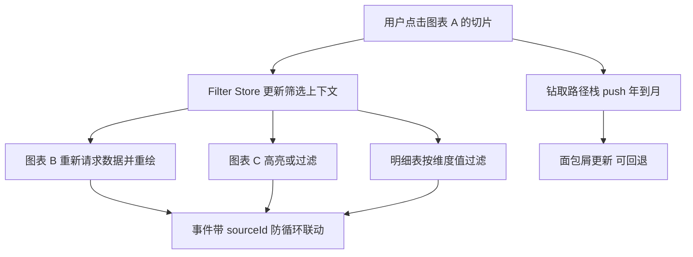

```javascript
// 联动总线：filterStore + 来源标记 + 钻取栈
const filterStore = {
  filters: new Map(), drillStack: [], listeners: new Set(),
  setFilter(dim, values, sourceId) {
    this.filters.set(dim, values);
    this.emit({ type: 'filter', sourceId });
  },
  drill(dim, value) {                        // 下钻：维度路径入栈
    this.drillStack.push({ dim, value });
    this.emit({ type: 'drill', sourceId: 'chart-A' });
  },
  breadcrumb() { return this.drillStack.map(d => `${d.dim}=${d.value}`).join(' > '); },
  emit(evt) { this.listeners.forEach(fn => fn(evt)); },
};
filterStore.listeners.add(evt => {
  document.querySelectorAll('[data-chart]').forEach(el => {
    if (el.dataset.chart === evt.sourceId) return;   // 自己不响应自己，防循环
    refetchWithFilters(el, filterStore.filters);
  });
});
chartA.on('click', p => filterStore.drill('region', p.name));
```

### VIZ-140：指标卡与同环比（YoY / MoM）的实现？
**答**：指标卡三要素：**主指标值 + 同比/环比徽标 + 迷你趋势 sparkline**。口径必须写成纯函数避免扯皮：环比 = (本期 - 上期) / 上期，同比 = (本期 - 去年同期) / 去年同期；分母为 0 或上期缺失显示 "--" 而不是 Infinity/NaN。视觉：涨跌色语义可配置（国内红涨绿跌），▲/▼ 符号；数值走 Intl 紧凑记法；sparkline 是 40x16 的无轴迷你折线。指标卡是最高频复用组件，口径计算务必独立可测。

```javascript
// 同环比纯函数 + 指标卡渲染
function growth(cur, prev) {
  if (prev == null || prev === 0 || !Number.isFinite(cur)) return null; // 不可比显示 null
  return (cur - prev) / prev;   // 0.234 表示 +23.4%
}
function kpiCard({ label, value, cur, prev, prevYear, spark }) {
  const fmt = v => new Intl.NumberFormat('zh-CN',
    { notation: 'compact', maximumFractionDigits: 1 }).format(v);
  const badge = g => g == null ? '<span class="muted">--</span>'
    : `<span class="${g >= 0 ? 'up' : 'down'}">${g >= 0 ? '▲' : '▼'}${Math.abs(g * 100).toFixed(1)}%</span>`;
  return `<div class="kpi">
    <div class="kpi-label">${label}</div>
    <div class="kpi-value">${fmt(value)}</div>
    <div class="kpi-meta">同比${badge(growth(cur, prevYear))} 环比${badge(growth(cur, prev))}</div>
    <svg viewBox="0 0 40 16">${sparkline(spark)}</svg>   <!-- 迷你趋势线 -->
  </div>`;
}
function sparkline(data) {
  const min = Math.min(...data), max = Math.max(...data), n = data.length;
  return `<path d="${data.map((v, i) =>
    `${i ? 'L' : 'M'}${(i / (n - 1) * 40).toFixed(1)} ` +
    `${(16 - (v - min) / (max - min || 1) * 14 - 1).toFixed(1)}`).join('')}"/>`;
}
```

### VIZ-141：漏斗图与留存分析图的实现？
**答**：**漏斗**：① 各层宽度 ∝ 转化人数，居中对齐（标准）或左对齐（流失位置更直观）；② 标注相邻转化率与整体转化率；③ 分析型漏斗难点在口径——**有序转化窗口**（用户 7 天内按顺序完成才算）需要按用户聚合事件流排序匹配。**留存图**：三角矩阵——行 = 注册批次（cohort），列 = 第 N 天/周，格子色深 = 留存率，对角线方向递减。两者渲染都简单，难点全在数据口径与聚合。

```javascript
// 有序转化漏斗：用户事件流 -> 各步转化人数（时序窗口约束）
function funnel(events, steps, windowMs = 7 * 864e5) {
  const byUser = new Map();
  for (const e of events) {
    if (!byUser.has(e.uid)) byUser.set(e.uid, []);
    byUser.get(e.uid).push(e);
  }
  const counts = steps.map(() => 0);
  for (const list of byUser.values()) {
    list.sort((a, b) => a.t - b.t);
    let step = 0, firstT = null;
    for (const e of list) {
      if (step === 0 && e.name === steps[0]) { step = 1; firstT = e.t; counts[0]++; }
      else if (step > 0 && e.name === steps[step] && e.t - firstT <= windowMs) {
        counts[step]++; step++; firstT = e.t;    // 必须在窗口内按顺序完成
      }
      if (step === steps.length) break;
    }
  }
  return counts.map((c, i) => ({ step: steps[i], count: c,
    rate: i ? c / counts[i - 1] : 1 }));         // 相邻转化率
}
// 留存矩阵：retention[cohort][day] = 0..1，格子 fill = colorScale(value)
```

### VIZ-142：自定义计算字段（Custom Field）的前端表达式解析如何实现？
**答**：BI 允许用户写 `profit / revenue * 100`，前端需要：① **词法分析**——切成 token（标识符/数字/运算符/括号）；② **语法分析**——递归下降/Pratt 解析成 AST 并校验语法，**绝不 eval**（注入风险）；③ **语义校验**——字段存在性、类型兼容、除零提示；④ **执行**——AST 解释器逐行求值；⑤ 聚合语义区分行级计算与聚合后计算（SUM(a)/SUM(b) ≠ AVG(a/b)），UI 上明示。可用 expr-eval 等库，也可自写 100 行递归下降。

```javascript
// 迷你表达式引擎：词法 -> 递归下降求值（无 eval，安全）
function tokenize(src) {
  const tokens = []; let i = 0;
  while (i < src.length) {
    const c = src[i];
    if (/\s/.test(c)) { i++; continue; }
    if (/[a-zA-Z_]/.test(c)) { let s = ''; while (i < src.length && /\w/.test(src[i])) s += src[i++]; tokens.push({ t: 'id', v: s }); continue; }
    if (/[0-9.]/.test(c)) { let s = ''; while (i < src.length && /[0-9.]/.test(src[i])) s += src[i++]; tokens.push({ t: 'num', v: +s }); continue; }
    if ('+-*/()'.includes(c)) { tokens.push({ t: c }); i++; continue; }
    throw new Error(`非法字符 ${c}`);
  }
  return tokens;
}
function evaluate(tokens, row) {
  let p = 0;
  const peek = () => tokens[p], next = () => tokens[p++];
  const primary = () => {
    const tk = next();
    if (tk.t === 'num') return tk.v;
    if (tk.t === 'id') { if (!(tk.v in row)) throw new Error(`字段不存在 ${tk.v}`); return row[tk.v]; }
    if (tk.t === '(') { const v = expr(); if (next().t !== ')') throw new Error('缺右括号'); return v; }
    throw new Error(`意外的 token ${tk.t}`);
  };
  const term = () => { let v = primary();
    while (peek() && '*/'.includes(peek().t)) { const op = next().t, r = primary();
      if (op === '/' && r === 0) throw new Error('除零'); v = op === '*' ? v * r : v / r; } return v; };
  const expr = () => { let v = term();
    while (peek() && '+-'.includes(peek().t)) { const op = next().t, r = term(); v = op === '+' ? v + r : v - r; } return v; };
  return expr();
}
console.log(evaluate(tokenize('profit / revenue * 100'), { profit: 30, revenue: 120 })); // 25
```

### VIZ-143：报表权限与行列级权限如何在前端配合实现？
**答**：**权限判定必须在服务端**（数据返回前过滤），前端权限只做体验：① **功能权限**——菜单/按钮/导出的显隐，RBAC 点位控制；② **行级权限**——服务端按用户部门/区域注入 WHERE 条件，前端不感知；③ **列级权限**——敏感列（薪资/手机号）服务端脱敏或置 null 返回，前端按权限标记显示原文/掩码/占位；④ **导出管控**——服务端导出走同样过滤，水印带用户 ID 溯源；⑤ 前端角色——渲染权限元数据（可看列、可钻维度），无权限交互直接禁用而非等 403。底线认知：前端隐藏 ≠ 安全。

```javascript
// 前端按权限元数据渲染：列掩码 + 交互禁用（安全由服务端保证）
const perm = { canViewSalary: false, canExport: false, drillDims: ['region'] };
function renderColumns(columns) {
  return columns.map(c =>
    c.sensitive && !perm[c.permKey]
      ? { ...c, render: () => '***' }        // 掩码占位（服务端其实已脱敏）
      : c);
}
if (!perm.canExport) exportBtn.remove();     // 无权限直接隐藏并埋点
chart.on('click', p => {
  if (!perm.drillDims.includes(p.dimension)) {
    toast('无权下钻该维度');
    audit('drill_denied', p.dimension);      // 越权尝试审计
    return;
  }
  filterStore.drill(p.dimension, p.value);
});
```

---

## 十八、地理与空间可视化（VIZ-144 ~ VIZ-149）

### VIZ-144：WGS84 / GCJ02 / BD09 坐标系的区别与互转？（压轴）
**答**：① **WGS84**——GPS 原始坐标（国际标准）；② **GCJ02**——国测局加密偏移（"火星坐标"），高德/腾讯使用，境内地图合规要求；③ **BD09**——百度在 GCJ02 基础上的二次加密。混用整体偏移 50~500 米。转换是非线性算法（公开实现），顺序 WGS84 ↔ GCJ02 ↔ BD09。工程要点：数据源声明坐标系、入库统一 WGS84、展示前转目标地图坐标系；GCJ02 只对境内偏移（境外原样返回）；用 gcoord 库而非自己抄公式。

```javascript
// WGS84 <-> GCJ02（火星坐标）核心转换
const PI = Math.PI, A = 6378245.0, EE = 0.00669342162296594326;
const outOfChina = (lng, lat) =>
  lng < 72.004 || lng > 137.8347 || lat < 0.8293 || lat > 55.8271; // 境外不偏移
function transformLat(x, y) {
  let ret = -100 + 2*x + 3*y + 0.2*y*y + 0.1*x*y + 0.2*Math.sqrt(Math.abs(x));
  ret += (20*Math.sin(6*x*PI) + 20*Math.sin(2*x*PI)) * 2/3;
  ret += (20*Math.sin(y*PI) + 40*Math.sin(y/3*PI)) * 2/3;
  ret += (160*Math.sin(y/12*PI) + 320*Math.sin(y*PI/30)) * 2/3;
  return ret;
}
function transformLng(x, y) {
  let ret = 300 + x + 2*y + 0.1*x*x + 0.1*x*y + 0.1*Math.sqrt(Math.abs(x));
  ret += (20*Math.sin(6*x*PI) + 20*Math.sin(2*x*PI)) * 2/3;
  ret += (20*Math.sin(x*PI) + 40*Math.sin(x/3*PI)) * 2/3;
  ret += (150*Math.sin(x/12*PI) + 300*Math.sin(x/30*PI)) * 2/3;
  return ret;
}
function wgs84ToGcj02(lng, lat) {
  if (outOfChina(lng, lat)) return [lng, lat];
  const radLat = lat / 180 * PI;
  let magic = Math.sin(radLat); magic = 1 - EE * magic * magic;
  const sqrtMagic = Math.sqrt(magic);
  const dLat = (transformLat(lng - 105, lat - 35) * 180) /
    ((A * (1 - EE)) / (magic * sqrtMagic) * PI);
  const dLng = (transformLng(lng - 105, lat - 35) * 180) /
    (A / sqrtMagic * Math.cos(radLat) * PI);
  return [lng + dLng, lat + dLat];
}
```

### VIZ-145：Leaflet / Mapbox GL / Cesium / 高德 JS API 怎么选型？
**答**：按"数据规模 × 3D 需求 × 合规 × 生态"决策：① **Leaflet**——轻量 40KB、栅格瓦片、插件丰富，适合简单标点，不支持矢量与 3D；② **Mapbox GL / MapLibre**——矢量瓦片 + WebGL，样式自由（style JSON），大规模点位与自定义图层强，国内底图合规注意瓦片源；③ **Cesium**——3D 地球/地形/倾斜摄影/时间轴，数字孪生场景，重且学习成本高；④ **高德/百度**——国内合规 + POI/路径服务齐全，深度定制受限。常见混合方案：高德底图 + ECharts GL 图层，或 MapLibre + deck.gl overlay 共享相机。

```javascript
// 选型决策表 + MapLibre 与 deck.gl 的混合渲染
const CHOICE = (need) => {
  if (need.is3DTerrain || need.photogrammetry) return 'Cesium';        // 3D 地球/倾斜摄影
  if (need.isChinaCompliance && need.poiService) return 'AMap';        // 国内合规 + POI 服务
  if (need.vectorStyle || need.pointCount > 5e4) return 'MapLibre GL'; // 矢量瓦片/WebGL
  return 'Leaflet';                                                    // 轻量标点
};
// MapLibre 底图 + deck.gl overlay：共享相机的大数据图层
import { MapboxOverlay } from '@deck.gl/mapbox';
const map = new maplibregl.Map({ container: 'map', style: styleJson });
map.addControl(new MapboxOverlay({ layers: [
  new ScatterplotLayer({ data: points, getPosition: d => d.coord, radiusMinPixels: 3 }),
  new HexagonLayer({ data: trips, extruded: true }),
]}));
```

### VIZ-146：海量点位如何渲染与聚合？（点聚合算法，压轴）
**答**：分层方案：① **缩放分级**——zoom 低于阈值用聚合，放大后展示原始点；② **聚合算法**——网格聚合（O(n)，按 tile+网格 key 分桶）、DBSCAN、或 **Supercluster 金字塔索引**（预建多级聚合，查询时按 zoom 取层，事实标准）；③ **渲染**——万级以下 Canvas，海量化用 deck.gl/icon 层；④ **热力替代**——只关心密度不关心单点时用热力图（h3 六边形/方格聚合）。核心认知：聚合查询要 O(视野内点数) 而不是 O(全量)，所以必须预建索引。

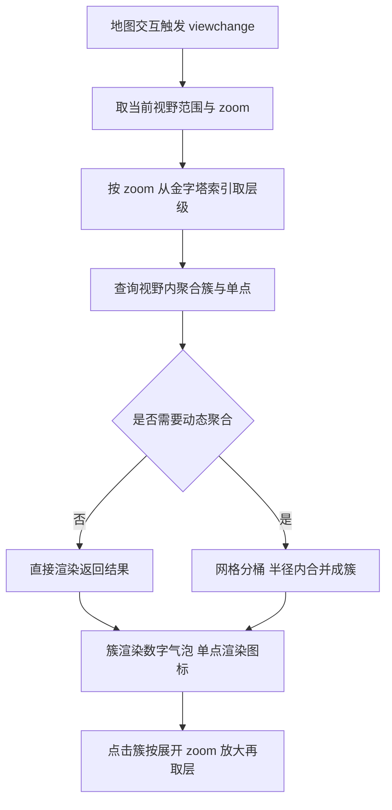

```javascript
// Supercluster 点聚合：预建金字塔索引，缩放即查表
import Supercluster from 'supercluster';
const index = new Supercluster({ maxZoom: 16, radius: 60 }); // 60px 半径内的点聚成一簇
index.load(points.map(p => ({
  type: 'Feature', geometry: { type: 'Point', coordinates: p.coord }, properties: p,
})));
map.on('move', () => {
  const bbox = map.getBounds().toArray().flat();   // 当前视野
  const clusters = index.getClusters(bbox, Math.round(map.getZoom())); // 毫秒级
  renderMarkers(clusters);  // 簇有 properties.cluster 与 point_count，画数字气泡
});
map.on('click', e => {
  const f = map.queryRenderedFeatures(e.point)[0];
  if (f?.properties?.cluster) {
    map.easeTo({ zoom: index.getClusterExpansionZoom(f.properties.cluster_id),
                 center: f.geometry.coordinates });  // 展开簇的最优 zoom
  }
});
```

### VIZ-147：轨迹渲染与回放如何实现？（抽稀 / 平滑 / 进度控制）
**答**：① **抽稀**——GPS 点冗余严重（停留漂移），Douglas-Peucker 保形状抽稀（阈值 5~10m）或按时间/距离间隔抽稀；② **平滑**——静态渲染折线即可，回放用插值让 marker 匀速前进；③ **回放控制**——维护 playhead 时间，rAF 中二分查找当前时刻前后两个 GPS 点做线性插值（角度插值让车头转向自然），倍速只改 playhead 推进速率；④ **已走/剩余路径分离渲染**——已走过的高亮，可只重画增量；⑤ 百万点轨迹按视窗切片或矢量瓦片化。

```javascript
// 轨迹抽稀（Douglas-Peucker）+ 回放推进（二分 + 插值）
function pointToSegDist(p, a, b) {
  const dx = b.x - a.x, dy = b.y - a.y;
  const t = Math.max(0, Math.min(1, ((p.x - a.x) * dx + (p.y - a.y) * dy) / (dx * dx + dy * dy || 1)));
  return Math.hypot(p.x - a.x - t * dx, p.y - a.y - t * dy);
}
function douglasPeucker(points, eps) {
  if (points.length < 3) return points;
  let maxD = 0, idx = 0;
  for (let i = 1; i < points.length - 1; i++) {
    const d = pointToSegDist(points[i], points[0], points[points.length - 1]);
    if (d > maxD) { maxD = d; idx = i; }
  }
  if (maxD > eps) {
    const l = douglasPeucker(points.slice(0, idx + 1), eps);
    const r = douglasPeucker(points.slice(idx), eps);
    return [...l.slice(0, -1), ...r];
  }
  return [points[0], points[points.length - 1]];
}
function tick(dtMs) {                       // rAF 回放循环
  playhead += dtMs * speed;                 // 倍速只改 speed
  const i = lowerBound(track, playhead);    // 二分：playhead 前后两点
  const [p, q] = [track[i], track[i + 1] ?? track[i]];
  const t = (playhead - p.t) / ((q.t - p.t) || 1);
  marker.setLngLat([p.x + (q.x - p.x) * t, p.y + (q.y - p.y) * t]); // 插值位置
  drawPlayedPath(track.slice(0, i + 1));    // 已走路径高亮
}
```

### VIZ-148：3D 城市（白模 / 建筑块）如何实现？
**答**：① **数据**——建筑轮廓 GeoJSON（面 + 高度字段），或城市级白模服务（Mapbox building 图层）；② **拉伸**——面挤出体块：MapLibre 用 fill-extrusion 图层（数万楼栋可用），Three.js 用 ExtrudeGeometry 合并 geometry；③ **着色**——按高度插值渐变，或注入数据编码（GDP/能耗/出租率）；④ **性能**——同色系合并材质、按 zoom LOD、建筑数据矢量瓦片化分块加载；⑤ **交互**——点击楼栋高亮 + 楼层滚动动画（clip 高度）+ 详情面板。数字孪生进阶再叠加设备点位与实时数据。

```javascript
// MapLibre fill-extrusion：楼栋白模 + 点击高亮
map.addLayer({
  id: 'buildings', type: 'fill-extrusion', source: 'building-footprints',
  paint: {
    'fill-extrusion-height': ['get', 'height'],      // 高度字段挤出体块
    'fill-extrusion-base': 0,
    'fill-extrusion-color': [
      'interpolate', ['linear'], ['get', 'height'],
      0, '#dbeafe', 100, '#3b82f6', 300, '#1e3a8a'], // 按高度渐变着色
    'fill-extrusion-opacity': 0.9,
  },
});
map.on('click', 'buildings', e => {
  map.setFilter('buildings-highlight',
    ['==', 'id', e.features[0].properties.id]);      // 高亮命中楼栋
  showBuildingPanel(e.features[0].properties);       // 详情：楼层/租户/能耗
});
```

### VIZ-149：室内地图如何实现？
**答**：与室外地图的本质差异：**楼层是核心维度**、坐标是平面局部坐标、底图是自绘矢量（CAD 图纸矢量化）。要点：① **数据建模**——楼层 → 区域（房间/走廊）→ 设施（门/电梯/工位）三层结构，多楼层切换；② **渲染**——小场景 SVG/Canvas，商场级规模用 MapLibre 自定义样式或自研 WebGL；③ **路径规划**——走廊图上 Dijkstra/A*，电梯/扶梯作为带 cost 的跨层边；④ **定位**——蓝牙 iBeacon/WiFi 指纹输入实时位置；⑤ 关键工程点：CAD（DWG）→ GeoJSON 的坐标与比例转换。

```javascript
// 室内地图数据模型：楼层 -> 区域 -> 跨层寻路边
const indoor = {
  floors: [{
    id: 'F1',
    areas: [
      { id: 'room-101', type: 'room', polygon: [[0, 0], [8, 0], [8, 6], [0, 6]], name: '会议室' },
      { id: 'corridor-1', type: 'corridor', polygon: [[0, 6], [8, 6], [8, 8], [0, 8]] },
    ],
    portals: [                                       // 门 = 区域间通行边
      { from: 'room-101', to: 'corridor-1', point: [4, 6] },
      { from: 'F1-corridor-1', to: 'F2-corridor-1', via: 'elevator-1', cost: 30 }, // 跨层边
    ],
  }],
};
function findPath(graph, start, end) {  // 楼层内走门，跨层走电梯
  return dijkstra(graph, start, end);   // 权重 = 距离 + 跨层 cost
}
```

---

## 十九、可视化性能深水区（VIZ-150 ~ VIZ-155）

### VIZ-150：渲染性能如何量化测量？
**答**：三个层次量化：① **帧率**——rAF 回调间隔 `performance.now()` 差值，口径用 **P95 帧时长**而非平均值（掉帧体验由长帧决定）；② **主线程**——PerformanceObserver 的 `long-animation-frame`（>50ms 即 long task）并把归因到脚本；③ **图形侧**——Spector.js 看每帧 draw call 数与状态切换、GPU 耗时看平台工具。压测方法：数据规模 × 操作序列（缩放/拖拽/tooltip）组合脚本回放，输出帧时长分布报告。没有量化口径的"性能优化"无法验收。

```javascript
// 帧率与长任务监控：P95 口径 + 长任务归因
const frames = [];
(function loop() {
  const t = performance.now();
  requestAnimationFrame(() => { frames.push(performance.now() - t); loop(); });
})();
new PerformanceObserver(list => {
  for (const e of list.getEntries()) {
    report('long_task', { dur: e.duration,                          // >50ms 视为卡顿
      scripts: (e.scripts || []).map(s => s.name).slice(0, 3) });   // 归因到脚本
  }
}).observe({ type: 'long-animation-frame', buffered: true });
setInterval(() => {
  const sorted = [...frames].sort((a, b) => a - b);
  const p95 = sorted[Math.floor(sorted.length * 0.95)] ?? 0;
  report('fps_p95', { p95FrameMs: +p95.toFixed(1), fps: +(1000 / (p95 || 16.7)).toFixed(0) });
  frames.length = 0;
}, 10_000);
```

### VIZ-151：Canvas 与 WebGL 的性能边界如何决策？（数据量 × 交互复杂度矩阵）
**答**：决策维度：① **数据量**——静态渲染 < 1 万点 Canvas 足够；每帧重绘 > 1 万或总量 > 10 万选 WebGL；② **交互复杂度**——高频动画（实时曲线/粒子）偏 WebGL，重文本标注/鼠标拾取偏 Canvas/SVG；③ **开发成本**——Canvas 调试直观，WebGL 心智成本高（状态机/着色器）；④ **文本质量**——大量文字标注 SVG/Canvas 排版好，WebGL 文本（SDF）实现复杂。实践准则：优先用现成封装（ECharts 大数据系列/deck.gl），确认瓶颈后再自研 WebGL；混合策略（WebGL 底层 + Canvas 标注层）常是最优解。

```javascript
// 决策矩阵：数据量 × 交互 -> 渲染后端
function pickRenderer({ pointCount, fpsInteraction, textHeavy, needGLFeatures }) {
  if (needGLFeatures) return 'WebGL';                       // 3D/着色器效果硬需求
  if (pointCount > 100_000 || (fpsInteraction && pointCount > 10_000))
    return 'WebGL';                                         // 大数据或高频动画
  if (textHeavy || pointCount < 5_000) return 'SVG 或 Canvas2D'; // 文本排版/小数据
  return 'Canvas2D';                                        // 中等规模默认
}
// 混合策略：静态大数据 WebGL 层 + 交互标注 Canvas2D 层叠加
// 例：deck.gl 画百万点，上层透明 canvas 画选中标注与 tooltip 引线
```

### VIZ-152：图形内存如何管理？（纹理 / 上下文释放）
**答**：GPU 内存泄漏最隐蔽：① **纹理**——创建的纹理必须 dispose/release；换图时复用纹理对象用 texImage2D 覆盖而非新建；② **几何**——BufferGeometry dispose 前解绑 attribute；③ **上下文**——活跃 WebGL context 上限约 16 个，超限最老的被浏览器强杀（webglcontextlost 事件），长列表图表必须共享或复用上下文；④ **Three.js**——`renderer.dispose()` + geometry/material/texture 全链路 dispose，切场景遍历释放；⑤ **监控**——`renderer.info.memory` 观察纹理与几何数量曲线应收敛不增长。

```javascript
// Three.js 资源释放全链路 + context lost 防护
function disposeObject3D(root) {
  root.traverse(obj => {
    if (obj.geometry) obj.geometry.dispose();               // 几何
    const mats = Array.isArray(obj.material) ? obj.material : [obj.material];
    for (const m of mats) {
      Object.values(m).forEach(v => { if (v?.isTexture) v.dispose(); }); // 材质上的纹理
      m.dispose();
    }
  });
  renderer.renderLists.dispose();
}
canvas.addEventListener('webglcontextlost', e => {          // 上下文被浏览器强杀
  e.preventDefault(); pauseRender(); showError('图形上下文丢失，点击重载');
});
canvas.addEventListener('webglcontextrestored', reinitGL);
setInterval(() => log('gpu_mem', renderer.info.memory), 5000); // { geometries, textures } 应收敛
```

### VIZ-153：动画帧率优化的通用手段有哪些？
**答**：① **合成器友好**——DOM 动画只用 transform/opacity（合成层属性），避免触发 layout/paint；② **Canvas**——静态内容离屏 canvas 预渲染，每帧 drawImage 贴图 + 只重绘动态图元；③ **WebGL**——pixelRatio clamp 1.5~2、按需渲染（无交互不跑 render，监听 controls change 置脏）、减少逐帧 uniform 上传与状态切换；④ **时序**——同帧内先数据计算再 DOM 读写分离（避免强制同步布局）最后绘制；⑤ **降级**——掉帧检测自动降粒子数/关阴影/动态分辨率。度量标准：帧时长稳定 < 8ms 留足浏览器余量。

```javascript
// 按需渲染 + 静态层离屏缓存 + 掉帧降级
let needsRender = true;
controls.addEventListener('change', () => { needsRender = true; }); // 相机变了才渲染
function renderLoop() {
  if (needsRender) { renderer.render(scene, camera); needsRender = false; }
  requestAnimationFrame(renderLoop);
}
// Canvas2D 静态背景离屏缓存：坐标轴/网格只画一次
const bg = document.createElement('canvas');
bg.width = w * dpr; bg.height = h * dpr;
drawGrid(bg.getContext('2d'));
function frame() {                                  // 每帧只贴图 + 画动态线
  ctx.drawImage(bg, 0, 0, w, h);
  drawAnimatedLine(ctx);
  requestAnimationFrame(frame);
}
let slow = 0;                                       // 掉帧自动降级
onFrame(dt => { slow = dt > 33 ? slow + 1 : 0; if (slow > 5) degrade(); }); // 降像素比/关阴影
```

### VIZ-154：超大 SVG（几万个节点）如何降维救场？
**答**：SVG 节点多后 DOM 重排与事件委托都会崩，降维方案：① **栅格化**——整幅 SVG 转 Canvas 位图（serialize → Image → drawImage），交互缩放改用瓦片金字塔像地图一样按视口重绘；② **按需矢量**——只保留视口内元素虚拟化，其余走图片；③ **结构简化**——同样式路径合并 d、去 filter/clip-path（GPU 慢源）、CSS 分层；④ **事件**——SVG 容器 pointer-events: none，命中改用几何索引（R-tree/quadtree）反查 DOM；⑤ **混合渲染**——图形层 Canvas + 文字层 SVG（清晰可选中）。能换渲染引擎就别死磕 SVG。

```javascript
// SVG 栅格化 + 几何索引命中：把 N 万节点 SVG 变成地图体验
async function svgToCanvas(svgEl, scale = 2) {
  const { width, height } = svgEl.viewBox.baseVal;
  const blob = new Blob([new XMLSerializer().serializeToString(svgEl)], { type: 'image/svg+xml' });
  const url = URL.createObjectURL(blob);
  const img = new Image();
  await new Promise(res => { img.onload = res; img.src = url; });
  const canvas = document.createElement('canvas');
  canvas.width = width * scale; canvas.height = height * scale;
  canvas.getContext('2d').drawImage(img, 0, 0, canvas.width, canvas.height);
  URL.revokeObjectURL(url);
  return canvas;   // 交互层：缩放平移画这张位图
}
// 命中索引：元素几何信息建 quadtree，鼠标事件查树反查 DOM
qt.add({ x, y, w, h, elRef });
container.addEventListener('pointermove', e =>
  highlight(qt.collides(hitBox(e))[0]?.elRef));
```

### VIZ-155：如何为可视化项目建立性能预算与卡口？
**答**：预算要**量化到可 CI 的指标**：① **加载预算**——图表库 gzip 体积（ECharts 按需 < 300KB）、首屏 TTI < 2s、接口 P95 < 500ms；② **运行时预算**——单图首帧 < 100ms、交互帧 P95 < 16.7ms、单页 JS 堆 < 100MB、long task 占比 < 5%；③ **卡口实现**——CI 中 headless 跑固定场景（固定数据集 + 操作脚本），指标超阈值 fail 禁止合入；④ **线上守护**——RUM 上报真实用户帧率与 long task，超阈值告警回滚；⑤ **治理**——新图表上线声明预算占用，挤占需评审。没有预算的优化会在迭代中悄悄回退。

```javascript
// CI 性能卡口：预算清单接入 headless 回放
const PERF_BUDGET = {
  bundle: { echartsCustom: '300KB', pageTotal: '1.2MB' },   // gzip 体积
  runtime: {
    firstPaintPerChart: 100,       // ms，单图首帧
    frameP95: 16.7,                // ms，交互帧率 60fps
    heapAfterTour: 100,            // MB，全操作回放后堆
    longTaskRatio: 0.05,
  },
  scenario: { data: 'fixtures/10w-points.json',
              ops: ['zoom', 'pan', 'tooltip', 'tabSwitch x50'] },
};
async function perfGate() {
  const metrics = await runHeadlessScenario(PERF_BUDGET.scenario);
  const fails = Object.entries(PERF_BUDGET.runtime).filter(([k, v]) => metrics[k] > v);
  if (fails.length) { console.error('性能预算超限', fails); process.exit(1); } // 卡口禁合入
  console.log('性能预算通过', metrics);
}
```

---

## 二十、综合大题与体系（VIZ-156 ~ VIZ-200）

### VIZ-156：设计一个 BI 看板平台前端（拖拽布局 + 图表配置 + 联动）。（压轴）
**答**：五个模块：① **拖拽布局**——12/24 栅格吸附引擎，widget 存 x/y/w/h，拖拽改坐标不重排 DOM，ResizeObserver 联动图表 resize；② **图表配置**——属性面板由 schema 驱动（VIZ-133），数据源选择器 + 字段映射；③ **数据层**——dataset 抽象（SQL/接口/Excel 上传统一为数据集），缓存 + 变更通知；④ **联动**——filterStore 总线（VIZ-139）；⑤ **持久化**——看板 JSON 序列化（布局 + 配置 + 数据源引用）+ 版本历史。性能：折叠 tab 不渲染、批量刷新节流、组件懒挂载。

```javascript
// 拖拽布局引擎：栅格吸附 + widget 状态
const GRID = 12, CELL = 100;
function snap(x, y) {                       // 像素 -> 栅格坐标
  return { gx: Math.round(x / CELL), gy: Math.round(y / (CELL / 2)) };
}
class Dashboard {
  #widgets = new Map();                     // id -> { x, y, w, h, chartId, option }
  onDragEnd(id, px, py) {
    const wgt = this.#widgets.get(id);
    const { gx, gy } = snap(px, py);
    if (this.collides({ ...wgt, x: gx, y: gy }, id)) return bounceBack(id); // 碰撞回弹
    Object.assign(wgt, { x: gx, y: gy });
    persistLayout(this.serialize());        // 布局防抖持久化
  }
  serialize() {                             // 看板 JSON：布局 + 配置 + 数据源引用
    return JSON.stringify({ widgets: [...this.#widgets.values()] });
  }
  collides(a, exceptId) {
    for (const [id, b] of this.#widgets)
      if (id !== exceptId && a.x < b.x + b.w && b.x < a.x + a.w &&
          a.y < b.y + b.h && b.y < a.y + a.h) return true;
    return false;
  }
}
```

### VIZ-157：设计一个监控告警大屏（多页轮播 + 告警闪烁 + 静音）。
**答**：需求特征：7x24 无人值守、远距离可读。要点：① **多页轮播**——页面列表 + 各页停留时长 + 切换动画，紧急告警可打断轮播置顶告警页；② **告警呈现**——分级配色（红/橙/黄）+ CSS 动画闪烁 + 声音，静音按钮点击后静默 30 分钟（权限控制，防误关）并显示倒计时；③ **数据新鲜度**——顶部时钟 + 每图数据时间戳，超时灰显提示链路异常；④ **防呆自愈**——接口失败重试、显示最后成功数据、内存超阈值自动 reload；⑤ 远看体验——最小字号 24px、对比度 > 4.5:1。

```javascript
// 轮播 + 告警闪烁 + 定时静音
const pages = [{ url: '/page/overview', dwell: 15000 }, { url: '/page/alarms', dwell: 20000 }];
let idx = 0, mutedUntil = 0;
setInterval(() => {                                  // 轮播器
  if (Date.now() < mutedUntil && hasCriticalAlarm()) return; // 静音期内不打断
  idx = (idx + 1) % pages.length;
  location.href = pages[idx].url + '#nocache=' + Date.now();
}, 0); // 实际用每页自轮播：页面加载后 setTimeout 到点跳下一页
function onAlarm(level) {
  if (level === 'critical') {
    document.body.classList.add('alarm-flash');      // CSS 动画闪烁
    if (Date.now() > mutedUntil) alarmSound.play().catch(() => {});
  }
}
muteBtn.onclick = () => {                            // 静音 30 分钟，权限校验
  if (user.canMute) mutedUntil = Date.now() + 30 * 60_000;
  muteBtn.textContent = `已静音 ${new Date(mutedUntil).toLocaleTimeString()} 前有效`;
};
```

### VIZ-158：设计一个电商数据大屏（GMV 实时滚动 + 地图 + 漏斗）。
**答**：① **GMV 数字滚动**——目标值到达后 rAF 缓动插值（easeOutCubic）从当前值滚到目标值，千分位/亿元单位，避免每秒 setState 抖动；② **地图飞线**——订单城市对飞线（VIZ-112），同时最多 N 条限流；③ **漏斗**——浏览→加购→下单→支付；④ **实时链路**——WebSocket + 心跳 + 断线重连 + 消息幂等（按版本号去重），后端窗口聚合，前端不做全量计算；⑤ 适配 1920 设计稿 scale；⑥ 组件级曝光埋点便于运营复盘。

```javascript
// GMV 数字滚动器：缓动插值 + 大数格式化
class NumberTicker {
  constructor(el, { duration = 800 } = {}) { this.el = el; this.duration = duration; }
  to(target) {
    const from = this.current ?? 0, start = performance.now();
    cancelAnimationFrame(this.raf);
    const step = now => {
      const t = Math.min(1, (now - start) / this.duration);
      const eased = 1 - Math.pow(1 - t, 3);            // easeOutCubic
      this.current = from + (target - from) * eased;
      this.el.textContent = new Intl.NumberFormat('zh-CN',
        { notation: 'compact', maximumFractionDigits: 2 }).format(this.current);
      if (t < 1) this.raf = requestAnimationFrame(step);
    };
    this.raf = requestAnimationFrame(step);
  }
}
const ticker = new NumberTicker(document.querySelector('#gmv'));
ws.onmessage = e => { const { gmv } = JSON.parse(e.data); ticker.to(gmv); }; // 每秒一跳
```

### VIZ-159：设计一个实时日志流可视化（虚拟滚动 + 高亮过滤）。
**答**：① **虚拟滚动**——日志行高固定（动态行高需测量缓存），只渲染视口 ± buffer 行，总量百万行；② **数据接入**——WebSocket 流写入环形缓冲（VIZ-127），auto-follow 模式新日志到达自动吸底，用户上滚查看历史时暂停跟随；③ **高亮过滤**——正则/级别过滤下沉 Worker，命中行着色，搜索关键字 mark 高亮；④ **性能**——行 DOM 节点回收复用、过滤与渲染解耦、rAF 合帧。体验对标 tail -f + Kibana Discover。

```javascript
// 日志虚拟滚动：固定行高 + 视口窗口渲染
class LogViewer {
  constructor(container, rowH = 22) {
    this.container = container; this.rowH = rowH;
    this.logs = []; this.follow = true;
    container.addEventListener('scroll', () => {
      const atBottom = container.scrollHeight - container.scrollTop - container.clientHeight < rowH;
      this.follow = atBottom;               // 上滚即暂停跟随
      this.render();
    });
  }
  push(line) {
    this.logs.push(line);
    if (this.logs.length > 1e6) this.logs.splice(0, 1e5); // 环形上限
    if (this.follow) this.container.scrollTop = this.logs.length * this.rowH;
    else this.render();
  }
  render() {
    const start = Math.max(0, Math.floor(this.container.scrollTop / this.rowH) - 10);
    const end = start + Math.ceil(this.container.clientHeight / this.rowH) + 20;
    this.container.innerHTML = this.logs.slice(start, end).map((l, i) =>
      `<div class="log ${levelClass(l)}" style="position:absolute;top:${(start + i) * this.rowH}px">${mark(l)}</div>`
    ).join('');
  }
}
```

### VIZ-160：设计一个网络拓扑图（节点拖拽 / 连线 / 告警传播动画）。
**答**：① **数据模型**——nodes/links，节点有状态（正常/告警/离线）；② **布局**——力导向或分层树（网络层次），节点拖拽后 fixed 标记固定坐标，重启布局不丢失；③ **连线**——贝塞尔曲线避免重叠，双向流量双色；④ **告警传播动画**——告警节点向外扩散涟漪（圆环动画），并沿依赖链 BFS 逐级闪烁表示影响范围；⑤ **交互**——框选、缩放、右键菜单、双击下钻子拓扑；⑥ **大规模**——域→集群→节点分层聚合 + WebGL 渲染（G6/自研）。

```javascript
// 拓扑：力导向 + 拖拽固定 + 告警涟漪
const sim = d3.forceSimulation(nodes)
  .force('link', d3.forceLink(links).id(d => d.id).distance(80))
  .force('charge', d3.forceManyBody().strength(-200))
  .force('center', d3.forceCenter(w / 2, h / 2));
node.call(d3.drag()
  .on('start', (e, d) => { if (!e.active) sim.alphaTarget(0.3).restart(); d.fx = d.x; d.fy = d.y; })
  .on('drag', (e, d) => { d.fx = e.x; d.fy = e.y; })       // 拖拽即固定坐标
  .on('end', (e, d) => { if (!e.active) sim.alphaTarget(0); d.fixed = true; }));
function propagateAlarm(sourceId) {          // 告警沿依赖链传播高亮
  const affected = bfs(links, sourceId);     // 影响范围：下游全链路
  affected.forEach((id, depth) => {
    const el = nodeById(id).select('.ripple');
    el.attr('style', `animation-delay:${depth * 0.3}s`).classed('rippling', true);
  });
}
```

### VIZ-161：设计一个机房机柜可视化（3D 概览）。
**答**：① **场景分层**——园区俯瞰 → 机房 → 机柜列 → 机柜 U 位逐级下钻；② **3D 实现**——Three.js：机柜 = InstancedMesh 批量渲染，告警柜用 instanceColor 换色；③ **点击拾取**——raycaster 命中机柜展开 U 位占用详情面板；④ **温度云**——传感器温度在机柜阵列上 shader 插值热力着色；⑤ **性能**——几万机柜 instancing + 视野裁剪 + 纹理图集；⑥ **数据**——对接 CMDB/动环系统，U 位级实时刷新节流（10s 级）。

```javascript
// 机房机柜：InstancedMesh 批量渲染 + instanceColor 告警着色
const rack = new THREE.InstancedMesh(rackGeo, rackMat, racks.length);
const m = new THREE.Matrix4(), color = new THREE.Color();
racks.forEach((r, i) => {
  m.setPosition(r.x, 0, r.z);
  rack.setMatrixAt(i, m);
  color.set(r.alarm ? '#ef4444' : r.load > 0.8 ? '#f59e0b' : '#3b82f6');
  rack.setColorAt(i, color);                 // 告警/负载分色
});
rack.instanceMatrix.needsUpdate = true;
rack.instanceColor.needsUpdate = true;
scene.add(rack);
renderer.domElement.addEventListener('click', e => {
  const hits = raycaster.intersectObject(rack);
  if (hits.length) showRackDetail(racks[hits[0].instanceId]); // U 位占用详情
});
```

### VIZ-162：设计一个车间数字孪生概览。
**答**：与机房类似但更"现场"：① **模型导入**——glTF 产线模型（减面 + Draco 压缩），设备点位与模型节点 UUID 映射绑定；② **实时状态**——设备状态灯（运行/待机/故障）着色、节拍动画（机械臂旋转速度=实际产能）、产量数字牌 billboard；③ **数据驱动动画**——PLC/MES 数据经 WebSocket 映射到模型动画参数，而非装饰性动画；④ **降级**——低端设备/WebGL 不可用退 2D 平面图 SVG；⑤ 认知：孪生是"状态可视化"不是 3D 展示，先定数据点位清单再建模型，模型做不动的用图标牌代替。

```javascript
// 设备点位绑定模型节点 + 数据驱动动画
loader.load('/plant.glb', gltf => {
  scene.add(gltf.scene);
  for (const device of devices) {
    const node = gltf.scene.getObjectByName(device.modelNode);  // 按名称绑定
    deviceBindMap.set(device.id, node);
  }
});
ws.onmessage = ({ data }) => {
  const { id, status, rpm } = JSON.parse(data);
  const node = deviceBindMap.get(id);
  if (!node) return;
  node.material = statusMaterial[status];       // 运行/待机/故障着色
  if (node.userData.arm) node.userData.speed = rpm / 60; // 机械臂角速度=实际转速
};
function animate() {
  for (const node of deviceBindMap.values())
    if (node.userData.speed) node.rotation.y += node.userData.speed * dt;
  renderer.render(scene, camera);
  requestAnimationFrame(animate);
}
```

### VIZ-163：设计一个金融行情终端（多窗格 / 技术指标 / 快捷键）。（压轴）
**答**：① **多窗格布局**——可分割面板（分时/五档/K线），拖拽分栏 + 布局记忆 localStorage；② **K 线**——Canvas 自绘（不套 ECharts，数据量与交互密度高），主图蜡烛 + 副图 MACD/KDJ，十字光标 snap 最近 K 线且主副图联动；③ **实时推送**——行情 ws 高频更新最后一根 K 线（in-place 更新不动历史数组），300ms 节流重绘；④ **快捷键**——全局 keydown 捕获阶段，键位表可配置（数字键切周期、Tab 切窗格、F5 刷新）；⑤ **数字不闪**——只变更变化的 DOM 文本，涨跌色闪动一次（class 移除时序控制）。

```javascript
// K 线 Canvas 自绘核心：蜡烛 + 十字光标 + 最后一根实时更新
function drawCandles(ctx, candles, view) {
  const { lo, hi, w, priceRange } = view;
  const cw = w / (hi - lo);                      // 每根宽度
  for (let i = lo; i < hi; i++) {
    const c = candles[i], x = (i - lo + 0.5) * cw;
    const y = v => priceRange.toY(v);            // 价格 -> 像素
    ctx.fillStyle = c.c >= c.o ? UP_COLOR : DOWN_COLOR;
    ctx.fillRect(x - cw * 0.3, Math.min(y(c.o), y(c.c)),  // 实体
                 cw * 0.6, Math.abs(y(c.o) - y(c.c)) || 1);
    ctx.fillRect(x - 0.5, y(c.h), 1, y(c.l) - y(c.h));    // 影线
  }
}
// 实时更新：只改最后一根，不动历史，节流重绘
let pendingTick = null;
ws.onmessage = e => {
  pendingTick = JSON.parse(e.data);
  if (!throttled) { throttled = true; setTimeout(() => {
    candles[candles.length - 1] = mergeTick(candles.at(-1), pendingTick);
    draw(); throttled = false;
  }, 300); }
};
// 快捷键：捕获阶段全局监听
document.addEventListener('keydown', e => {
  if (e.key >= '1' && e.key <= '5') switchPeriod(PERIODS[e.key]); // 周期切换
  if (e.key === 'Tab') { e.preventDefault(); focusNextPane(); }
}, true);
```

### VIZ-164：设计一个医学影像查看器概览（窗宽窗位）。
**答**：① **DICOM 基础**——CT 像素值是 HU 值，显示需窗宽窗位映射：`display = clamp((hu - (wc - ww/2)) / ww) * 255`，本质是灰度 LUT；② **交互**——拖拽改窗宽窗位（垂直拖改窗宽、水平拖改窗位）实时重映射，滚轮切层，缩放平移翻转；③ **渲染**——2D 查看器用 WebGL 纹理逐层切片，3D 用体渲染 raycasting shader；④ **工程**——Cornerstone.js 事实标准，大文件分片加载 + LRU 缓存；⑤ **标注**——测量工具（长度/角度/ROI）独立图层不污染影像。

```javascript
// 窗宽窗位 LUT：HU -> 显示灰度（WebGL shader 版本）
precision mediump float;
uniform sampler2D uVolume;    // HU 值存在纹理 R 通道
uniform float uWW;            // 窗宽 Window Width
uniform float uWC;            // 窗位 Window Center
varying vec2 vUv;
void main() {
  float hu = texture2D(uVolume, vUv).r;
  float lower = uWC - uWW / 2.0;
  float v = clamp((hu - lower) / uWW, 0.0, 1.0);   // 线性窗映射
  gl_FragColor = vec4(vec3(v), 1.0);               // 肺窗/骨窗只是 ww/wc 参数不同
}
// 交互：垂直拖拽改 uWW、水平拖拽改 uWC，uniform 更新即时生效零重算
```

### VIZ-165：设计一个 genealogy 谱系图（大树布局）。
**答**：① **布局**——家谱是 DAG（通婚合并），简单家谱按 tidy tree（Reingold-Tilford）横向树 + 代际泳道；万人级用横向虚拟化 + 子树聚合折叠；② **视觉**——男左女右配色、世代泳道标注、头像照片；③ **交互**——点击节点展开/收起子树（子树折叠为 + 汇总节点）、定位某人居中、双击看个人页；④ **遮挡**——远世代节点信息递减、重叠子树合并计数；⑤ **数据**——GedCOM 标准解析入图。

```javascript
// 可折叠大族谱：tidy tree + 子树聚合
const root = d3.hierarchy(familyTree, d => d.children?.length ? d.children : null);
root.descendants().forEach(d => { d._children = d.children; d.children = d.depth < 3 ? d.children : null; }); // 默认展开 3 代
function update(src) {
  const tree = d3.tree().nodeSize([36, 160])(root);
  node.join('g')
    .attr('transform', d => `translate(${d.y},${d.x})`)
    .on('click', (e, d) => {
      if (d.children) { d._children = d.children; d.children = null; }  // 收起
      else { d.children = d._children; d._children = null; }            // 展开
      update(d);
    });
  link.join('path').attr('d', d3.linkHorizontal()
    .x(d => d.y).y(d => d.x));
}
```

### VIZ-166：设计一个流程挖掘图概览。
**答**：流程挖掘 = 从事件日志推导实际业务流程：① **输入**——事件日志（caseId, activity, timestamp）；② **直接跟随矩阵**——统计 activity 对的出现频次，构建 DFG（directly-follows graph），边宽 ∝ 频次，耗时均值标注；③ **布局**——分层 DAG 布局，自环/回边（返工）画弧线；④ **交互**——按频次/耗时阈值过滤低频路径（噪声过滤 slider，阈值实时重算）、单案例动画回放（事件在图上按时间流动）；⑤ **场景**——订单履约/审批流优化，定位返工瓶颈。开源参照 ProM/PM4Py 前端。

```javascript
// 从事件日志构建 DFG（directly-follows graph）
function buildDFG(events) {   // events: [{ case, activity, t }]
  const byCase = new Map();
  for (const e of events) {
    if (!byCase.has(e.case)) byCase.set(e.case, []);
    byCase.get(e.case).push(e);
  }
  const edges = new Map(), nodes = new Map();
  for (const list of byCase.values()) {
    list.sort((a, b) => a.t - b.t);
    nodes.set(list[0].activity, (nodes.get(list[0].activity) || 0) + 1); // 起点
    for (let i = 1; i < list.length; i++) {
      const key = list[i - 1].activity + '->' + list[i].activity;
      const cur = edges.get(key) || { freq: 0, durSum: 0 };
      cur.freq++; cur.durSum += list[i].t - list[i - 1].t;
      edges.set(key, cur);                              // 频次 + 平均耗时
      nodes.set(list[i].activity, (nodes.get(list[i].activity) || 0) + 1);
    }
  }
  return { nodes: [...nodes], edges: [...edges].map(([k, v]) =>
    ({ from: k.split('->')[0], to: k.split('->')[1],
       freq: v.freq, avgDur: v.durSum / v.freq })) };
}
```

### VIZ-167：实现图表编辑器（属性面板双向绑定）。
**答**：① **单一数据源**——图表 option 是唯一真相：option → schema 驱动表单初始化，表单变更 → 不可变 patch → setOption；② **路径更新**——嵌套对象用 immer（`produce` + 路径 patch），避免手写深拷贝；③ **撤销重做**——immer patches 记录到快照栈，内存友好；④ **预览节流**——拖动数值滑块 rAF 节流 setOption；⑤ **回填**——未显式配置的字段用 schema default 回填，面板与真实渲染状态一致。

```javascript
// immer patches 驱动的属性面板双向绑定
import { produce, applyPatches } from 'immer';
let state = { option: baseOption };
const undoStack = [], redoStack = [];
function updateOption(recipe) {
  const [next, patches, inverse] = produce(state, recipe, { enablePatches: true });
  undoStack.push(inverse); redoStack.length = 0;   // 记录逆操作
  state = next;
  throttledSetOption(state.option);                // rAF 节流渲染
}
panel.on('change:smooth', value => updateOption(draft => {
  draft.option.series[0].smooth = value;           // 路径级修改
}));
panel.on('change:color', value => updateOption(draft => {
  draft.option.series[0].itemStyle.color = value;
}));
undoBtn.onclick = () => {                          // 撤销：应用逆 patch
  const inv = undoStack.pop();
  if (inv) state = applyPatches(state, inv), throttledSetOption(state.option);
};
```

### VIZ-168：实现图表主题编辑器（实时预览）。
**答**：① **主题模型**——Token 结构（背景/文字/轴线/系列色板），编译为 ECharts theme 注册对象；② **实时预览**——token 变更 → 合成主题 → `echarts.registerTheme` + 实例 setOption(theme)，注意 registerTheme 对已创建实例不生效，需重新 init 或 setOption 显式传入；③ **色板工具**——取色器 + WCAG 对比度校验（文字 ≥ 4.5:1）+ 色盲模拟预览（SVG filter 矩阵）；④ **持久化**——主题 JSON 入库 / 导出 js 文件，用户偏好 localStorage。

```javascript
// 主题 Token -> ECharts theme 编译 + 实时预览
function compileTheme(token) {
  return {
    backgroundColor: token.bg,
    textStyle: { color: token.text },
    color: token.palette,                                   // 系列色板
    categoryAxis: { axisLine: { lineStyle: { color: token.axis } } },
    legend: { textStyle: { color: token.text } },
  };
}
function contrastRatio(hex1, hex2) {                        // WCAG 对比度校验
  const lum = h => {
    const [r, g, b] = hexToRgb(h).map(v => {
      v /= 255; return v <= 0.03928 ? v / 12.92 : Math.pow((v + 0.055) / 1.055, 2.4);
    });
    return 0.2126 * r + 0.7152 * g + 0.0722 * b;
  };
  const [a, b] = [lum(hex1), lum(hex2)].sort((x, y) => y - x);
  return (a + 0.05) / (b + 0.05);
}
editor.on('tokenChange', token => {                         // 实时预览
  if (contrastRatio(token.text, token.bg) < 4.5) warn('文字对比度不足');
  echarts.registerTheme('preview', compileTheme(token));
  previewChart.dispose();                                   // theme 需重新 init 生效
  previewChart = echarts.init(dom, 'preview');
  previewChart.setOption(sampleOption);
});
```

### VIZ-169：实现自动布局（避免遮挡）。
**答**：场景：仪表盘组件自动摆放、标签防重叠。手段：① **网格占用贪心**——画布栅格化，元素按面积从大到小放，碰撞找空位；② **标签防重叠**——候选位置打分（与数据点/其他标签的重叠罚分）选最优，即 d3-labeler 思路；③ **力导向斥力**——把标注当受斥力粒子迭代；④ **精确测量**——canvas measureText 得真实占位；⑤ **兜底**——仍有冲突则抽稀（只标 topN）或引线外置。要点：目标函数先行（什么是"好布局"），再做搜索。

```javascript
// 标签防重叠：候选位置打分（d3-labeler 思路）
function placeLabel(anchor, candidates, placed, dataPts) {
  let best = null, bestScore = -Infinity;
  for (const c of candidates) {            // 候选：上下左右偏移
    const box = labelBox(c);
    let score = 0;
    score -= 10 * countOverlap(box, placed);       // 与已放标签重叠，重罚
    score -= 5 * countOverlap(box, dataPts);       // 遮挡数据点，重罚
    score -= dist(box.center, anchor) * 0.01;      // 离锚点太远，轻罚
    score += c.preferred ? 1 : 0;
    if (score > bestScore) { bestScore = score; best = c; }
  }
  placed.push(labelBox(best));
  return best;
}
// 迭代优化版：模拟退火在所有标签间联合寻优，收敛于全局罚分最小
```

### VIZ-170：实现图表智能推荐（数据特征 → 图表类型）。
**答**：① **特征提取**——列角色（维度/度量/时间/地理）、基数（unique count）、字段语义（列名含"率/比/占比" → 百分比型）；② **规则引擎**——决策表：时间+度量→折线，类目基数≤8+度量→柱状，两度量→散点，占比且基数≤6→饼图，地理字段→地图，多度量多维度→分组柱/堆叠；③ **语义增强**——指标名"趋势/增长"→ 折线 + 同比参照；④ **展示**——主推荐 + 备选列表一键切换，用户选择反馈回规则权重。参照 Tableau Show Me 的规则矩阵。

```javascript
// 数据特征 -> 图表类型推荐规则引擎
function recommend(columns, sampleRows) {
  const feats = columns.map(c => ({
    ...c,
    cardinality: new Set(sampleRows.map(r => r[c.name])).size,
    isTime: c.type === 'date' || /date|time|日期|时间/.test(c.name),
    isGeo: /province|city|country|省|市|国家/.test(c.name),
    isRatio: /率|比|percent/.test(c.name),
  }));
  const dims = feats.filter(f => !f.isMetric), metrics = feats.filter(f => f.isMetric);
  const scores = [];
  const add = (type, why) => scores.push({ type, why });
  if (dims.some(d => d.isTime) && metrics.length)
    add('line', '时间维度 + 度量：趋势折线');
  else if (dims.length === 1 && metrics.length && dims[0].cardinality <= 8)
    add('bar', '单类目基数小：柱状对比');
  else if (metrics.length === 2)
    add('scatter', '两个度量：相关性散点');
  if (metrics.length === 1 && metrics[0].isRatio && dims[0]?.cardinality <= 6)
    add('pie', '占比语义 + 类目少：饼图');
  if (dims.some(d => d.isGeo)) add('map', '地理字段：地图');
  return scores.sort((a, b) => b.conf - a.conf);   // 主推荐 + 备选
}
```

### VIZ-171：实现无障碍图表的完整方案。
**答**：① **语义层**——图表容器 role="img" + aria-label 概述（"2024 年月度销售额折线图，总体上升 23%"），由数据自动生成摘要；② **数据表格兜底**——提供 visually-hidden 的 `<table>` 完整数据供屏幕阅读器；③ **键盘**——图例/数据点可 Tab 聚焦，方向键在数据点间移动并用 aria-live 播报值；④ **色觉**——色板过 WCAG 对比度，避免纯红绿区分，加形状/图案编码；⑤ **动效**——`prefers-reduced-motion` 关闭动画；⑥ **验证**——axe-core 扫描 + VoiceOver 人工测试进验收清单。

```javascript
// 无障碍图表：自动摘要 + 隐藏数据表 + aria-live 播报
function makeAccessible(container, { title, data, unit }) {
  const total = data.reduce((s, d) => s + d.value, 0);
  const max = data.reduce((a, b) => b.value > a.value ? b : a);
  container.setAttribute('role', 'img');
  container.setAttribute('aria-label',
    `${title}。共 ${data.length} 项，合计 ${total}${unit}，最高为 ${max.name} ${max.value}${unit}`);
  const tbl = document.createElement('table');     // 屏幕阅读器数据兜底
  tbl.className = 'visually-hidden';
  tbl.innerHTML = `<caption>${title}</caption>` +
    data.map(d => `<tr><th>${d.name}</th><td>${d.value}${unit}</td></tr>`).join('');
  container.appendChild(tbl);
}
// 键盘导航 + 播报
chartDom.addEventListener('keydown', e => {
  if (e.key === 'ArrowRight') {
    focusIndex = (focusIndex + 1) % data.length;
    liveRegion.textContent = `${data[focusIndex].name} ${data[focusIndex].value}`; // aria-live
    highlightPoint(focusIndex);
  }
});
```

### VIZ-172：实现大屏自动巡检（截图对比）。
**答**：① **巡检机器人**——定时（每小时）headless 打开大屏逐页截图；② **基线对比**——与首次成功基线做像素 diff（pixelmatch，阈值 0.1），差异区域框出；③ **健康判定**——截图非全黑/全白/加载中、接口状态码、数据时间戳新鲜度、window.onerror 收集 JS 错误；④ **告警**——异常发钉钉/企微（截图 + 差异图 + URL）；⑤ **注意**——轮播动画造成的固定差异要 mask 区域，截图环境固定分辨率与字体避免误报。

```javascript
// 大屏巡检：截图 + pixelmatch 像素 diff
import pixelmatch from 'pixelmatch';
import { chromium } from 'playwright';
async function inspect(url, baseline) {
  const browser = await chromium.launch();
  const page = await browser.newPage({ viewport: { width: 1920, height: 1080 } });
  const errors = [];
  page.on('pageerror', e => errors.push(e.message));      // JS 错误收集
  await page.goto(url, { waitUntil: 'networkidle' });
  await page.waitForTimeout(3000);                        // 等动画与数据
  const shot = await page.screenshot();
  const [img, base] = [toPng(shot), toPng(baseline)];
  const diff = new Uint8Array(img.width * img.height * 4);
  const diffPixels = pixelmatch(img.data, base.data, diff, img.width, img.height,
    { threshold: 0.1 });
  const ratio = diffPixels / (img.width * img.height);
  await browser.close();
  const unhealthy = errors.length || ratio > 0.05 || isBlank(img);
  if (unhealthy) notifyDingTalk({ url, errors, diffRatio: ratio, diffImage: toPngFile(diff) });
  return { ok: !unhealthy, diffRatio: ratio, errors };
}
```

### VIZ-173：实现可视化埋点的热力图。（压轴）
**答**：① **数据**——埋点上报（页面 URL + 归一化坐标 x/y + 视口尺寸），归一化防不同分辨率偏移；② **聚合**——服务端预聚合到 256x256 网格，前端只查表（原始点击量可能上亿）；③ **渲染**——Canvas 离屏叠加：每格画径向渐变按计数 alpha 累积（globalCompositeOperation: 'lighter'），再 getImageData 按 alpha 查色带上色，即 heatmap.js 原理；④ **配套视图**——滚动深度分段着色、元素点击率排行表；⑤ 忽略折叠区域外的点击防脏数据。

```javascript
// 点击热力图：alpha 累积 + 色带上色（heatmap.js 原理）
function drawHeatmap(canvas, grid, N) {      // grid: 256x256 点击计数
  const ctx = canvas.getContext('2d');
  const alpha = document.createElement('canvas');
  alpha.width = alpha.height = N;
  const actx = alpha.getContext('2d');
  const max = Math.max(...grid);
  for (let j = 0; j < N; j++) for (let i = 0; i < N; i++) {
    const v = grid[j * N + i] / max;
    if (!v) continue;
    const g = actx.createRadialGradient(i, j, 0, i, j, 8);   // 每格一个径向渐变斑
    g.addColorStop(0, `rgba(0,0,0,${v})`);
    g.addColorStop(1, 'rgba(0,0,0,0)');
    actx.fillStyle = g;
    actx.fillRect(i - 8, j - 8, 16, 16);     // alpha 通道累积
  }
  const img = actx.getImageData(0, 0, N, N);
  for (let i = 3; i < img.data.length; i += 4) {
    const t = img.data[i] / 255;             // 用累积 alpha 查色带
    const [r, g2, b] = heatColor(t);         // 蓝 -> 绿 -> 红
    img.data[i - 3] = r; img.data[i - 2] = g2; img.data[i - 1] = b;
  }
  actx.putImageData(img, 0, 0);
  ctx.drawImage(alpha, 0, 0, canvas.width, canvas.height);
}
```

### VIZ-174：设计一个实时风控监控大屏。
**答**：特征：高风险事件流 + 处置闭环。① **事件瀑布流**——按时间倒序虚拟滚动列表，等级着色，点击看详情与处置动作（冻结/放行/转人工）；② **指标**——拦截率/误杀率/资损额实时指标卡（VIZ-140）；③ **地理分布**——风险 IP 城市热力；④ **联动**——点地图城市过滤事件流；⑤ **频控**——事件流 1000 条/s 时前端聚合计数（同类型合并 +1 显示徽标），避免刷屏丢失关键事件。

```javascript
// 风控事件流：同类型合并计数，防洪峰刷屏
class RiskEventStream {
  #merged = new Map();                      // type -> { count, last, level }
  push(evt) {
    const cur = this.#merged.get(evt.type);
    if (cur && Date.now() - cur.last < 2000) {   // 2 秒内同类型合并
      cur.count++; cur.last = Date.now();
      cur.maxLevel = maxLevel(cur.maxLevel, evt.level);
    } else {
      if (cur) this.#flush(cur);             // 上一组落盘到列表
      this.#merged.set(evt.type, { count: 1, last: Date.now(), ...evt });
    }
    this.render();
  }
  #flush(group) {                            // 合并组：显示 count 徽标
    this.list.unshift({ ...group, badge: group.count > 1 ? `x${group.count}` : '' });
  }
  render() { /* 虚拟滚动渲染 + 等级着色 + 点击处置 */ }
}
```

### VIZ-175：设计一个物联网设备监控（IoT）。
**答**：① **设备树**——站点→网关→设备层级树表 + 状态点，万级设备虚拟滚动；② **遥测时序**——多通道曲线（温度/电流），min-max 降采样（VIZ-129），时间刷联动多图；③ **告警**——阈值越限：设备树标红 + 时序图阈值线 + 告警时刻数据快照存档；④ **离线处理**——心跳超时灰显，恢复后补数据（回填窗口标注）；⑤ **聚合视图**——按设备类型分组的均值带（P50/P95 阴影带），单设备下钻看原始曲线。

```javascript
// 遥测时序：阈值线 + P50/P95 聚合带 + 单设备下钻
function telemetryOption(deviceData, thresholds, aggBand) {
  return {
    series: [
      ...(deviceData ? [{ type: 'line', data: minMaxSample(deviceData, 2000), name: 'raw' }] : []),
      ...(aggBand ? [{ type: 'line', data: aggBand.p50, lineStyle: { width: 2 } },
                      { type: 'line', data: aggBand.p95, areaStyle: { opacity: 0.15 } }] : []),
    ],
    markLine: { silent: true, symbol: 'none',
      data: thresholds.map(t => ({ yAxis: t.value,
        lineStyle: { color: t.level === 'warn' ? '#f59e0b' : '#ef4444' },
        label: { formatter: t.name } })) },          // 阈值越限线
    dataZoom: [{ type: 'inside' }],                  // 时间窗刷选联动
  };
}
// 心跳超时：设备状态 = now - lastHeartbeat > offlineMs ? 'offline' : status
```

### VIZ-176：设计一个 A/B 实验分析看板。
**答**：① **实验元信息**——流量比例、假设描述、主指标/护栏指标；② **核心展示**——指标对比表：各组 vs 对照组，**95% 置信区间误差线** + 显著性标记（p<0.05 星号），不显著不标星防误读；③ **趋势**——日粒度两组差值曲线（累积效应是否稳定）；④ **防误读设计**——样本量不足提示、多指标 FDR 校正说明、实验到期提醒；⑤ **交互**——分群（segment）下钻重算。统计口径必须与数据团队对齐，前端只做展示不做 p 值计算。

```javascript
// 实验指标对比：置信区间误差线 + 显著性标记
function abOption(variants, control) {
  return {
    xAxis: { type: 'category', data: variants.map(v => v.name) },
    yAxis: { type: 'value', name: '转化率' },
    series: [{
      type: 'line',                                   // 点 + 误差线形式
      data: variants.map(v => v.rate),
      itemStyle: { color: p => p.dataIndex > 0 && variants[p.dataIndex].p < 0.05
        ? '#10b981' : '#9ca3af' },                    // 显著绿色，否则灰色
      markPoint: { data: variants.map((v, i) =>
        ({ coord: [i, v.rate], value: v.p < 0.05 ? '★' : 'ns' })) },
    ]/* 误差线用 custom series 或 markLine 区间 [ci_lo, ci_hi] */,
  };
}
// 误差线（custom）核心：ci = mean ± 1.96 * sqrt(p(1-p)/n)
```

### VIZ-177：设计一个低代码大屏搭建平台。
**答**：在 BI 看板（VIZ-156）上加大屏特化：① **画布适配**——1920x1080 设计基准，发布端 fit 模式（等比 scale/拉伸/裁剪），`transform: scale()` 整体缩放；② **组件市场**——组件包 = schema（VIZ-133）+ 数据源绑定 + 动效配置（入场/轮播/闪烁）；③ **画布编辑**——图层 zIndex/分组/锁定、对齐吸附与参考线、快捷键（方向键微调）；④ **发布链路**——JSON 快照 + 数据源引用 CDN 化，版本可回滚；⑤ **协同**——草稿/发布分离，项目组权限。易错点：scale 方案里 tooltip 定位与鼠标事件坐标要除以 scale 反算。

```javascript
// 大屏 scale 适配：设计稿基准等比缩放（含事件坐标反算）
function fitScreen(bw = 1920, bh = 1080) {
  const scale = Math.min(innerWidth / bw, innerHeight / bh);
  stage.style.transform = `scale(${scale})`;
  stage.style.transformOrigin = 'left top';
  stage.style.width = bw + 'px'; stage.style.height = bh + 'px';
  return scale;
}
addEventListener('resize', fitScreen);
stage.addEventListener('click', e => {           // 事件坐标反算
  const scale = currentScale;
  const rect = stage.getBoundingClientRect();
  const x = (e.clientX - rect.left) / scale, y = (e.clientY - rect.top) / scale;
  hitTest(x, y);                                 // 用反算后的逻辑坐标命中
});
```

### VIZ-178：实现 K 线图与分时图。
**答**：分时图——当日 1 分钟线 + 均价线 + 昨收基准线，面积渐变填充；K 线——蜡烛（开高低收），红涨绿跌可配置，副图成交量。实现要点：Canvas 自绘（数据量大、交互密，不套 ECharts），十字光标 snap 最近 K 线，tooltip 显示 OHLC；缩放模型是"可见根数"（30~500 根）——滚轮改可见数 + 拖拽平移（带惯性），指标（MA/MACD）只按窗口 + 周期余量重算，不全量重算。

```javascript
// K 线窗口模型：可见根数 + 惯性平移
const view = { offset: 0, visible: 120 };       // offset: 距最新 K 线的偏移
canvas.addEventListener('wheel', e => {
  view.visible = Math.round(clamp(view.visible * (e.deltaY > 0 ? 1.1 : 0.9), 30, 500));
  draw(); e.preventDefault();
}, { passive: false });
let dragging = null;
canvas.addEventListener('pointerdown', e => dragging = e.clientX);
canvas.addEventListener('pointermove', e => {
  if (dragging == null) return;
  view.offset = clamp(view.offset + Math.round((e.clientX - dragging) / candleW()),
                      0, candles.length - view.visible);
  dragging = e.clientX; draw();
});
function draw() {
  const { lo, hi } = visibleRange();
  drawCandles(ctx, candles, { lo, hi });        // 见 VIZ-163
  drawVolume(ctx, candles, { lo, hi });
  drawMA(ctx, candles, { lo, hi }, [5, 10, 20]);// 指标只算窗口 + 周期余量
}
```

### VIZ-179：实现大屏超分辨率与拼接屏适配。
**答**：场景：LED 拼接屏（如 7680x2160）或视频控制器固定输入分辨率。① **渲染策略**——专用盒子按目标分辨率直接输出 8K，或分块：页面分 N 个 1920x1080 区域分别输出到采集卡；② **字号线宽**——按全局 scale factor 换算，细线加粗防摩尔纹；③ **成本控制**——8K 下 CSS 动画与大面积渐变成本高：静态内容转视频背景/图片，动态数据用 DOM 局部刷新；④ **多盒子同步**——NTP 对时 + 轮播页用 URL 参数对齐页码；⑤ **验证**——上屏前用目标分辨率 headless 截图逐屏检查。

```javascript
// 拼接屏分块渲染：URL 参数决定本机负责的区域
const params = new URLSearchParams(location.search);
const col = +params.get('col') || 0, row = +params.get('row') || 0;
const COLS = 4, ROWS = 2;                        // 4x2 拼接，总分辨率 7680x2160
const W = 1920, H = 1080;
stage.style.transform =
  `translate(${-col * W}px, ${-row * H}px)`;     // 每块屏只显示整体画布的一个窗口
stage.style.width = COLS * W + 'px';
stage.style.height = ROWS * H + 'px';
// 主控端：统一页码广播，各块监听同步翻页
new BroadcastChannel('screen-sync').onmessage =
  ({ data }) => { if (data.type === 'goto') gotoPage(data.page); };
```

### VIZ-180：实现服务端渲染图表与批量导出。
**答**：① **SSR**——ECharts 5 `ssr: true` 模式 `renderToSVGString`，无 DOM 依赖，Node 集群渲染；② **批量导出**——PDF 报告：每图 SVG 嵌入页面模板 → puppeteer 打印 PDF；数据明细走 Excel 导出；③ **性能**——导出队列 + 限流（每 worker 限 N 个浏览器上下文），大 dataset 先降采样再渲染；④ **一致性坑**——服务器必须安装中文字体（否则豆腐块），PNG 导出 pixelRatio=2 保证清晰；⑤ 邮件场景用内嵌 SVG 或 CID 图片。

```javascript
// 服务端批量导出图表 PDF：SSR 渲染 + puppeteer 汇总
import echarts from 'echarts';
async function renderChartSVG(option, w = 1200, h = 600) {
  const chart = echarts.init(null, null, { renderer: 'svg', ssr: true, width: w, height: h });
  chart.setOption({ animation: false, ...option });
  const svg = chart.renderToSVGString();       // 无 DOM 环境渲染
  chart.dispose();
  return svg;
}
async function exportReport(items) {           // items: [{ title, option, table }]
  const pages = [];
  for (const it of items) {                    // 串行限流，防内存爆
    pages.push(`<section><h2>${it.title}</h2>${await renderChartSVG(it.option)}</section>`);
  }
  const browser = await puppeteer.launch({ args: ['--font-render-hinting=none'] });
  const page = await browser.newPage();
  await page.setContent(`<html><style>svg{width:100%}</style>${pages.join('')}</html>`);
  await page.pdf({ path: 'report.pdf', format: 'A4', landscape: true });
  await browser.close();
}
```

### VIZ-181：实现图表水印与截图溯源。
**答**：① **明水印**——canvas 绘制 45° 平铺文字（用户 ID + 时间戳），透明度 0.06~0.1；防删除：水印层独立 canvas + MutationObserver 监听 DOM 移除后重建；② **盲水印**——服务端导出图片时在 LSB/频域嵌入用户标识，泄露可溯源；③ **防截屏**——Web 无法完全防：可检测 PrintScreen 键提示并审计，敏感页失焦模糊；④ **策略**——按数据密级启用，低敏数据加水印影响体验需权衡；水印内容不含敏感信息本身。

```javascript
// 平铺水印 canvas + 防删除守护
function buildWatermark(userId) {
  const c = document.createElement('canvas');
  c.width = c.height = 256;
  const ctx = c.getContext('2d');
  ctx.rotate(-Math.PI / 6);
  ctx.font = '14px sans-serif';
  ctx.fillStyle = 'rgba(0,0,0,0.08)';
  ctx.fillText(`${userId}`, 20, 128);
  ctx.fillText(new Date().toISOString().slice(0, 10), 20, 148);
  return c.toDataURL();
}
function mountWatermark(userId) {
  const div = document.createElement('div');
  div.className = 'watermark';
  div.style.backgroundImage = `url(${buildWatermark(userId)})`; // 全屏 pointer-events:none 平铺
  document.body.appendChild(div);
  new MutationObserver((muts, obs) => {         // 被删除/改样式则重建
    const removed = muts.some(m => [...m.removedNodes].includes(div));
    if (removed || !document.body.contains(div)) { obs.disconnect(); mountWatermark(userId); }
  }).observe(document.body, { childList: true, subtree: true });
}
```

### VIZ-182：实现 DOM 与 Canvas 混合渲染。
**答**：原则：**文本/可访问/富交互用 DOM，图形/海量用 Canvas**。① 分层结构——canvas 底层画图形，DOM 上层透明叠加文本标签/tooltip/按钮，绝对定位对齐；② **同步**——平移缩放时两层共用同一容器 transform 一起动，避免逐元素重排；坐标转换收敛为统一函数 dataToPixel；③ **事件**——DOM 层元素自己接事件，canvas 层自绘命中（quadtree）；④ 典型应用——知识图谱（边 canvas + 节点 DOM 卡片）、地图富标注；⑤ 代价——两层坐标同步、遮挡裁剪、z 序要自己维护。

```javascript
// 混合渲染：Canvas 画边 + DOM 画节点卡片，统一坐标函数
const dataToPixel = p => ({ x: (p.x - view.x) * view.k, y: (p.y - view.y) * view.k });
function render() {
  ctx.clearRect(0, 0, w, h);
  for (const e of edges) {                       // 边走 canvas，量大
    const a = dataToPixel(nodes[e.s]), b = dataToPixel(nodes[e.t]);
    ctx.beginPath(); ctx.moveTo(a.x, a.y); ctx.lineTo(b.x, b.y); ctx.stroke();
  }
  for (const n of visibleNodes()) {              // 节点走 DOM，支持富文本与交互
    const p = dataToPixel(n);
    n.el.style.transform = `translate(${p.x}px, ${p.y}px)`;  // transform 定位不触发重排
  }
}
zoomLayer.style.transform = `translate(${view.x * view.k}px,${view.y * view.k}px) scale(${view.k})`;
```

### VIZ-183：实现 option diff 与增量 setOption。
**答**：ECharts setOption 默认 merge，但重复全量 setOption 仍触发重算。优化：① **diff**——新旧 option 深比较（data 引用与关键配置），无变化直接跳过 setOption；② **增量**——只 patch 变化的 series（seriesId 匹配），`replaceMerge: 'series'` 控制替换语义；③ lazyUpdate + silent 配合；④ React/Vue 封装层最常见反模式：props 每次新引用导致全量 setOption——封装层必须做 memo/diff。大数据追加用 appendData 或自管数据 + dataZoom 窗口。

```javascript
// 封装层：diff 后增量 setOption
const lastOption = new WeakMap();
function smartSetOption(chart, next) {
  const prev = lastOption.get(chart);
  if (prev && deepEqual(prev, next)) return;          // 无变化直接跳过
  const patch = diffOptions(prev, next);              // 只提取变化的分支
  chart.setOption(patch, {
    lazyUpdate: true,
    silent: true,
    replaceMerge: ['series'],                         // series 级替换语义
  });
  lastOption.set(chart, next);
}
// diffOptions：按 option 分支做浅/深比较，series 用 seriesId 对齐后再 diff data 引用
```

### VIZ-184：实现大屏灰度发布与降级开关。
**答**：① **发布策略**——大屏常驻 7x24 不能全量重启：按页面/组件维度灰度，配置中心下发版本号，前端比对后热替换图表配置；② **降级开关**——feature flag：WebGL 关闭退 Canvas、实时推送退轮询、动画关闭；③ **异常自愈**——连续渲染错误 N 次 → 自动切降级模式并上报；④ **配置中心**——开关走 Apollo/Nacos，长轮询或 WebSocket 推送生效；⑤ **回滚**——配置版本快照，一键回滚到上一稳定版本。

```javascript
// feature flag 降级 + 异常自愈
const flags = loadFlags({ webgl: true, realtime: true, animation: true }); // 默认值兜底
watchConfigCenter('viz-flags', remote => Object.assign(flags, remote));     // 热更新
let renderErrors = 0;
function safeRender(renderFn, fallbackFn) {
  try {
    if (!flags.webgl) return fallbackFn();              // 开关级降级
    renderFn(); renderErrors = 0;
  } catch (e) {
    if (++renderErrors >= 3) {                          // 连续失败自动降级
      flags.webgl = false;
      report('auto_degrade', { error: e.message });
      fallbackFn();
    }
  }
}
// 推送通道降级：flags.realtime ? initWebSocket() : startPolling(5000)
```

### VIZ-185：设计一个秒杀实时监控大屏。
**答**：特征：瞬时洪峰（QPS 十万级）+ 秒级延迟。① **指标**——QPS/成交/库存/失败率，滑动窗口聚合由服务端算好推送（前端不做全量计算）；② **渲染**——指标卡数字滚动（VIZ-158）、QPS 面积图（固定 120 点环形缓冲）、库存进度条；③ **洪峰策略**——ws 消息合帧（1s 内多帧合并渲染一次），洪峰时数字直接替换不缓动（缓动追不上真实值反而误导）；④ **预案联动**——降级预案开关状态可视化（限流/熔断状态灯）。

```javascript
// 秒杀监控：消息合帧 + 洪峰直接替换
let pending = null, flushing = false, lastDelta = 0;
ws.onmessage = e => {
  pending = mergeStats(pending, JSON.parse(e.data));  // 帧内合并，只保留最新
  if (!flushing) {
    flushing = true;
    requestAnimationFrame(() => {
      if (pending.deltaQps > 5e4) setImmediateText(pending);  // 洪峰：直接替换
      else ticker.to(pending.gmv);                            // 平峰：缓动
      pushRing(pending.qps);                                  // QPS 环形缓冲
      flushRingToChart();
      pending = null; flushing = false;
    });
  }
};
function mergeStats(a, b) { return a ? { ...b, gmv: a.gmv + b.deltaGmv,
  deltaQps: Math.max(a.deltaQps, b.deltaQps) } : b; }
```

### VIZ-186：设计可视化性能回归监控体系。
**答**：① **基准场景库**——每个核心图表一个"标准数据集 + 操作脚本"（打开/缩放/tooltip）；② **定时执行**——夜间 CI 跑全部场景，输出帧率/首帧/内存指标入时序库；③ **回归检测**——与历史 7 天中位数比，劣化 > 20% 告警并定位到 PR（结合 git blame 时间窗）；④ **线上 RUM**——抽样真实用户上报帧率分布，按版本对比；⑤ **报告**——性能趋势周报自动生成，回归图表进例会。让性能问题在"进主干当天"暴露而不是"用户投诉后"。

```javascript
// 性能回归：与历史中位数比较，劣化告警
async function perfRegression(scenario) {
  const metric = await runScenario(scenario);            // { fpsP95, firstPaint, heap }
  const history = await queryMetrics(scenario.id, { days: 7 });
  const median = arr => {
    const s = [...arr].sort((a, b) => a - b);
    return s[Math.floor(s.length / 2)];
  };
  const regressions = Object.entries(metric).filter(([k, v]) =>
    median(history.map(h => h[k])) && v > median(history.map(h => h[k])) * 1.2); // 劣化 >20%
  if (regressions.length) {
    const pr = await findBlamePR(scenario.id);           // 定位时间窗内的 PR
    notify(`性能回归: ${scenario.id} ${JSON.stringify(regressions)} 疑似 ${pr}`);
  }
  return { metric, regressions };
}
```

### VIZ-187：ECharts 万点卡顿优化案例全记录。
**答**：案例复盘式作答：**现象**——1 万点折线 + tooltip 拖动掉帧到 20fps。**定位**——Performance 火焰图：tooltip 触发全 series 高亮重绘 + 1 万点未降采样全量绘制，且每点独立 symbol 命中检测。**手段**——① `sampling: 'lttb'` 降到 2 千点；② `large: true` + `largeThreshold` 关逐点命中；③ tooltip 用 cross axisPointer + `emphasis: { focus: 'none' }` 避免全 series 高亮；④ 拖动时 `silent` + 自绘十字线；⑤ 关闭更新动画。**效果**——P95 帧 40ms → 8ms。**沉淀**——团队大数据图表模板默认配置 + 性能 checklist。答题要点：现象→定位→手段→量化效果→沉淀，五步闭环。

```javascript
// 优化前后对比：大数据折线的推荐配置
const before = { series: [{ type: 'line', data: tenKPoints, symbol: 'circle',
  hoverAnimation: true }] };                                   // 全量绘制 + 逐点命中
const after = {
  tooltip: { trigger: 'axis', axisPointer: { type: 'cross' } },
  series: [{
    type: 'line', data: tenKPoints,
    sampling: 'lttb',          // 渲染前 LTTB 降采样
    large: true, largeThreshold: 2000,   // 大数据模式，关逐点 symbol 命中
    symbol: 'none',            // 关 symbol
    emphasis: { focus: 'none' },                          // 关全 series 高亮
    animation: false,          // 大数据关动画
  }],
};
```

### VIZ-188：Three.js 内存泄漏排查案例。
**答**：**现象**——大屏运行 24h 内存涨 2GB。**排查**——① DevTools 三次堆快照对比：Texture 对象线性增长；② `renderer.info.memory.textures` 持续上涨不收敛；③ 堆快照 retainer 链指向未 dispose 的 CanvasTexture。**根因**——实时更新的告警牌每帧 `new THREE.CanvasTexture(canvas)` 未释放旧的。**修复**——纹理对象复用：同一 CanvasTexture 设置 `needsUpdate = true` 重传，或每 N 帧复用池。**防复发**——资源登记表统一 dispose、巡检断言 textures 数收敛、code review checklist 加"new 必有 dispose"。方法论：先看 renderer.info 再堆快照找 retainer。

```javascript
// 泄漏修复：纹理复用代替反复 new
// 反面模式：每帧 new CanvasTexture -> GPU 纹理堆积
// 正确模式：一块纹理反复更新
const labelCanvas = document.createElement('canvas');
labelCanvas.width = 256; labelCanvas.height = 64;
const labelTex = new THREE.CanvasTexture(labelCanvas);   // 只创建一次
function updateLabel(text) {
  const ctx = labelCanvas.getContext('2d');
  ctx.clearRect(0, 0, 256, 64);
  ctx.fillText(text, 8, 40);
  labelTex.needsUpdate = true;          // 重传同一纹理，无新 GPU 资源
}
// 巡检断言：纹理数应收敛
setInterval(() => {
  if (renderer.info.memory.textures > BASELINE_TEXTURES + 10)
    report('texture_leak_suspect', renderer.info.memory);
}, 60_000);
```

### VIZ-189：跨图表联动的状态管理设计。
**答**：与 VIZ-139 的联动总线互补，这题答"状态设计"：① **状态分层**——UI 状态（hover/选中高亮）与数据状态（filters/params/钻取栈）分开，只有数据状态触发请求；② **单向数据流**——action → store → 派生 query → 图表组件纯函数渲染；③ **去抖合并**——多图快速点击合并同帧请求（queryKey 去重）；④ **失败隔离**——单图请求失败不影响 store 与其他图；⑤ **时间旅行**——store 快照支持 undo/redo（复盘分析）；⑥ **持久化**——filters 同步 URL query 可分享可恢复。

```javascript
// 联动状态 store：数据状态与 UI 状态分离
function createVizStore() {
  const state = { filters: {}, drill: [], selection: null };  // selection 是 UI 态不触发请求
  const subs = new Set();
  const deriveQuery = s => ({ ...s.filters,
    drillPath: s.drill.map(d => d.value).join('/') });        // 数据态 -> 查询
  return {
    setFilter(dim, val) { state.filters[dim] = val; notify(); },
    drill(dim, val) { state.drill.push({ dim, val }); notify(); },
    undo() { state.drill.pop(); notify(); },
    subscribe(fn) { subs.add(fn); return () => subs.delete(fn); },
    get query() { return deriveQuery(state); },
  };
  function notify() {
    const q = deriveQuery(state);
    history.replaceState(null, '', `?${new URLSearchParams(clean(q))}`); // URL 同步可分享
    subs.forEach(fn => fn(q));      // 各图表按 queryKey 去重请求
  }
}
```

### VIZ-190：可视化中台的用户运营（模板 / 组件复用）。
**答**：中台成败看复用率：① **模板运营**——按业务域沉淀模板（经营日报/活动监控），度量模板使用率与二次修改率；② **组件复用**——自定义图表组件上架审核（schema 校验 + 性能基线），下载量/评分反哺迭代；③ **用户分层**——低代码用户（运营/分析师）与 pro-code 用户（开发）分层运营，SDK 与示例库服务后者；④ **自举**——中台看板自身用中台搭建（吃狗粮）；⑤ **推广**——周报推送热门模板、内部课程、hackathon。指标看板：复用率、搭建时长中位数、上线后修改频次。

```javascript
// 中台运营指标：复用漏斗度量
const opsMetrics = {
  template: { total: 120, used: 86, usageRate: 0.72,          // 模板使用率
    modifiedAfterUse: 0.4 },                                   // 使用后二次修改率
  component: { published: 300, reused: 180, topComponents:
    ['kpi-card', 'gmv-ticker', 'china-map'] },
  funnel: ['浏览模板', '使用模板', '成功发布', '30 天内复用'],
};
function reportOps() {                          // 周报自动生成
  return {
    模板复用率: opsMetrics.template.usageRate,
    组件复用率: opsMetrics.component.reused / opsMetrics.component.published,
    优化建议: opsMetrics.template.modifiedAfterUse > 0.5
      ? '模板与真实需求偏差大，需回访修订' : '模板健康',
  };
}
```

### VIZ-191：可视化数据安全（脱敏 / 水印 / 权限）。
**答**：① **脱敏**——服务端返回前掩码（姓名/手机号/身份证），前端渲染层不接触明文，脱敏规则集中配置；② **水印**——明水印 + 盲水印溯源（VIZ-181）；③ **权限**——行列级权限（VIZ-143），导出走同款过滤；④ **传输与存储**——HTTPS，看板 JSON 只存数据源引用不存明文数据，导出文件加密与有效期；⑤ **审计**——查询日志（谁在何时看了什么范围），批量导出异常告警；⑥ **供应链**——第三方图表 SDK 的 CDN SRI 校验或私化部署。

```javascript
// 服务端脱敏规则集中配置（前端只渲染已脱敏数据）
const MASK_RULES = {
  phone: v => v.replace(/(\d{3})\d{4}(\d{4})/, '$1****$2'),
  name: v => v[0] + '*'.repeat(Math.max(0, v.length - 1)),
  idCard: v => v.slice(0, 4) + '**********' + v.slice(-4),
};
function maskRow(row, fields) {                 // fields: { name: 'name', mobile: 'phone' }
  return Object.fromEntries(Object.entries(row).map(([k, v]) =>
    [k, fields[k] ? MASK_RULES[fields[k]](v) : v]));
}
// 密级分级：secret 级看板强制水印 + 禁导出 + 查询全审计
const policies = { public: {}, internal: { watermark: true },
  secret: { watermark: true, export: false, audit: true } };
```

### VIZ-192：大屏项目的交付流程（需求 → 设计 → 联调 → 验收）。
**答**：五阶段：① **需求**——业务指标清单确认（**口径评审**）、数据可得性确认、目标硬件确认（分辨率/盒子型号）；② **设计**——视觉稿（1920 基准）+ 动效稿 + 数据字段映射表；③ **开发**——前端/数据/后端并行，mock 数据先行，视觉走查；④ **联调**——真实数据接入 + 目标机硬件实测压测 + 异常演练（断网/数据延迟/接口 5xx）；⑤ **验收与运维**——UAT 验收单、上线部署、SLA 监控与自动巡检（VIZ-172）。最大坑：需求阶段不确认指标口径，联调期返工；第二坑：没在目标硬件上实测，上线后才发现掉帧。

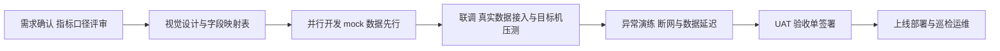

```javascript
// 交付 checklist：各阶段准出条件
const deliveryChecklist = {
  需求: ['指标清单与口径评审通过', '数据源可得性确认', '目标硬件清单确认'],
  设计: ['1920 基准视觉稿', '动效稿与时长标注', '数据字段映射表'],
  开发: ['mock 数据先行联调', '组件级性能预算声明', '视觉走查通过'],
  联调: ['目标机实测帧率达标', '断网 5 分钟自动恢复验证', '数据延迟降级表现验证'],
  验收: ['UAT 验收单签署', '巡检机器人接入', '值班与回滚预案'],
};
function gate(stage) {                           // 阶段准出：未全过不进入下一阶段
  const unmet = deliveryChecklist[stage].filter(item => !done(item));
  if (unmet.length) throw new Error(`${stage} 阶段未准出: ${unmet.join('、')}`);
}
```

### VIZ-193：可视化团队的技能矩阵。
**答**：角色与技能分层：① **可视化工程师**（核心）——图形学基础 + 图表库源码级 + 性能优化 + 地理/3D；② **前端工程师**（扩展）——会用图表库 + 基本调优；③ **数据工程师**——dataset/聚合/语义层；④ **设计师**——信息设计/色板/动效；⑤ **算法**——布局算法/推荐/降采样。矩阵用法：每人每技能 1-4 级，作为招聘画像与培养依据；风险管控：只有一人懂 WebGL = 单点风险，关键技能必须冗余（至少 2 人 ≥3 级）。培训路径：图表库使用 → 源码 → 图形学。

```javascript
// 团队技能矩阵：1 了解 2 会用 3 精通 4 能造
const SKILL_MATRIX = [
  { name: 'A', role: '可视化工程师', skills: { echarts: 4, d3: 4, webgl: 3, gis: 3, perf: 4 } },
  { name: 'B', role: '前端工程师',   skills: { echarts: 3, d3: 2, webgl: 1, gis: 2, perf: 2 } },
  { name: 'C', role: '可视化工程师', skills: { echarts: 3, d3: 3, webgl: 4, gis: 2, perf: 3 } },
];
function riskAudit(matrix) {                     // 关键技能单点风险审计
  const risk = [];
  for (const skill of ['echarts', 'webgl', 'gis', 'perf']) {
    const capable = matrix.filter(m => m.skills[skill] >= 3).length;
    if (capable < 2) risk.push(`${skill}: 仅 ${capable} 人精通，存在单点风险`);
  }
  return risk;
}
console.log(riskAudit(SKILL_MATRIX));            // 招聘与培养的依据
```

### VIZ-194：可视化面试答题框架。
**答**：通用框架"**需求 → 方案 → 细节 → 权衡 → 沉淀**"：① 先澄清需求（数据量级/交互/设备/实时性/兼容性）；② 给选型对比（2-3 方案 + 取舍理由）；③ 讲核心实现（架构图 + 关键代码思路）；④ 主动讲边界（性能预算/降级/监控/失败兜底）；⑤ 收尾讲沉淀（规范/组件/案例复用）。高频陷阱：只背概念不讲落地、说"优化了性能"没有量化指标、忽略数据口径。准备 3 个深度案例（BI/大屏/图形各一）大于追求广度。

```javascript
// 答题框架模板：用 STAR 变体组织性能优化案例
const ANSWER_FRAMEWORK = {
  需求澄清: ['数据量级与增长预期', '交互频率与关键路径', '设备与兼容范围'],
  方案对比: ['方案 A 优点缺点', '方案 B 优点缺点', '最终选择与理由'],
  核心实现: ['架构分层图', '关键技术点 2-3 个', '关键代码或伪码'],
  边界与权衡: ['性能预算数字', '降级与兜底策略', '已知遗留问题'],
  沉淀复用: ['团队规范或组件', '量化收益对比', '后续规划'],
};
function answer(topic) {                          // 面试前按框架逐格填空演练
  return Object.entries(ANSWER_FRAMEWORK)
    .map(([k, v]) => `${k}: ${v.map(q => `${q}(${topic})`).join(' / ')}`).join('\n');
}
```

### VIZ-195：高频题 Top15 速答。
**答**：15 个高频问题一句话核心答案：① Canvas vs SVG？——位图重绘快适合大数据，矢量可交互适合小规模标注；② WebGL 管线？——顶点着色器 → 光栅化 → 片元着色器 → 帧；③ ECharts 大数据？——sampling + large + progressive + dataZoom 窗口；④ setOption 机制？——默认 merge，replaceMerge 控制替换；⑤ 百万点？——WebGL 单 draw call + quadtree 拾取；⑥ 点聚合？——Supercluster 金字塔索引查表；⑦ 坐标系转换？——WGS84→GCJ02→BD09 链式伪随机偏移；⑧ 降采样？——监控 min-max、探索 LTTB、缩略平均；⑨ 脏矩形？——只重绘变化包围盒；⑩ tooltip 原理？——独立 DOM div + formatter + 事件命中；⑪ 主题系统？——Token 三层合并 + registerTheme；⑫ 内存泄漏？——renderer.info + 堆快照找 retainer + dispose 链；⑬ 大屏适配？——scale 等比 + 事件坐标反算；⑭ 联动？——filterStore 总线 + sourceId 防循环；⑮ 性能量化？——P95 帧时长 + long task 占比 + 预算卡口。

```javascript
// 高频速答索引：题目 -> 一句话答案 + 详见题号
const TOP15 = [
  ['Canvas vs SVG', '位图快 vs 矢量可交互，按规模与交互选', 'VIZ-151'],
  ['WebGL 渲染管线', '顶点着色器到光栅化到片元着色器到帧', 'VIZ-022'],
  ['ECharts 大数据优化', 'sampling large progressive dataZoom', 'VIZ-187'],
  ['setOption 机制', '默认 merge，replaceMerge 控制替换语义', 'VIZ-183'],
  ['百万点渲染', 'WebGL 单 draw call 加 quadtree 拾取', 'VIZ-126'],
  ['点聚合', 'Supercluster 金字塔索引，缩放即查表', 'VIZ-146'],
  ['坐标系转换', 'WGS84 到 GCJ02 到 BD09 链式偏移', 'VIZ-144'],
  ['降采样选型', '监控 min-max，探索 LTTB，缩略平均', 'VIZ-129'],
  ['脏矩形', '只重绘变化包围盒', 'VIZ-120'],
  ['tooltip 原理', '独立 DOM div 加 formatter 加事件命中', 'VIZ-122'],
  ['主题系统', 'Token 三层合并加 registerTheme', 'VIZ-168'],
  ['内存泄漏排查', 'renderer.info 加堆快照找 retainer 加 dispose 链', 'VIZ-188'],
  ['大屏适配', 'scale 等比加事件坐标反算', 'VIZ-179'],
  ['跨图联动', 'filterStore 总线加 sourceId 防循环', 'VIZ-139'],
  ['性能量化', 'P95 帧时长加 long task 占比加预算卡口', 'VIZ-150'],
];
```

### VIZ-196：工具链全景选型总表。
**答**：扩展 VIZ-099 到全家桶，作为技术评审引用标准：**图表**——ECharts（业务报表全能）、AntV G2/G6/S2（语法体系/关系图/透视表）、D3（深度定制）、Chart.js（轻量）；**地理**——Leaflet（轻量）、MapLibre（矢量 WebGL）、Cesium（3D 地球）、deck.gl（海量地理图层）、高德（国内合规服务）；**3D**——Three.js（通用）、Babylon.js（游戏化交互）；**低代码**——Formily + 自研 schema；**导出**——puppeteer + ECharts SSR。每个注明场景/体积/学习成本/合规，避免每次方案评审重新争论选型。

```javascript
// 可视化工具链选型总表
const TOOLCHAIN = {
  图表: {
    ECharts:    { scene: '业务报表大屏全能', size: '~300KB', cost: '低', note: '生态最大' },
    'AntV G2':  { scene: '图形语法深度定制', size: '~200KB', cost: '中', note: '标记+通道' },
    'AntV G6':  { scene: '关系图网络图', size: '~400KB', cost: '中' },
    'AntV S2':  { scene: '透视表交叉表', size: '~300KB', cost: '中' },
    D3:         { scene: '学术与深度定制', size: '按需', cost: '高', note: '纯函数思想' },
    Chart.js:   { scene: '轻量 H5', size: '~60KB', cost: '低' },
  },
  地理: {
    Leaflet:    { scene: '轻量标点', size: '40KB', cost: '低' },
    MapLibre:   { scene: '矢量瓦片 WebGL', cost: '中', note: 'Mapbox 开源分支' },
    Cesium:     { scene: '3D 地球倾斜摄影', cost: '高' },
    'deck.gl':  { scene: '海量地理图层', cost: '中', note: '与 MapLibre 叠加' },
    高德JSAPI:  { scene: '国内合规 POI 路径', cost: '低', note: '定制受限' },
  },
  三维: {
    'Three.js': { scene: '通用 3D 数字孪生', cost: '高' },
    'Babylon.js': { scene: '游戏化交互 3D', cost: '高' },
  },
  工程: {
    puppeteer:  { scene: 'PDF 报告批量导出' },
    Formily:    { scene: 'schema 驱动属性面板' },
  },
};
```

### VIZ-197：学习路径与源码阅读顺序。
**答**：四阶段：① **入门（2 周）**——ECharts 官方示例全覆盖，建立图表类型选择直觉；② **进阶（1-2 月）**——D3 核心（scale/shape/selection）+ Canvas/SVG 自绘 5 个基础图表（柱/折/饼/散点/雷达），打通"数据→映射→渲染"；③ **源码（2-3 月）**——顺序：ZRender（小而全，看分层与动画）→ ECharts（option→model→view 链路）→ d3-scale/d3-shape（纯函数范本）→ Three.js 渲染器与 OrbitControls；④ **图形学**——LearnOpenGL（WebGL）+ The Book of Shaders（着色器）+ GAMES101（理论）。每阶段产出一个可演示项目，源码阅读配断点调试而非干读。

```javascript
// 学习路径检查单：每阶段产出可验证的里程碑
const ROADMAP = {
  入门_2周:   { read: ['ECharts 配置项手册', '官方 examples 全部跑一遍'],
                build: '复刻一个带联动与下钻的销售看板' },
  进阶_2月:   { read: ['d3-scale 源码', 'd3-shape 源码', 'Canvas MDN'],
                build: '零依赖自绘柱/折/饼/散点/雷达五图' },
  源码_3月:   { read: ['zrender 分层与动画', 'echarts option 到 view 链路',
                       'three 渲染器与 OrbitControls'],
                build: '给 ECharts 写一个自定义 series 或给 zrender 提 PR' },
  图形学:     { read: ['LearnOpenGL 光照与变换章节', 'The Book of Shaders'],
                build: '手写 Blinn-Phong + 粒子系统 + 后处理' },
};
function progress(projects) { return Object.keys(ROADMAP)
  .filter(stage => projects.includes(ROADMAP[stage].build)); }
```

### VIZ-198：可视化知识体系总收束（数据 / 渲染 / 交互 / 工程 / 业务 五维全景）。
**答**：五维收束全部 200 题：① **数据维**——清洗/聚合/降采样/环形缓冲/口径（VIZ-126~131、138~141）；② **渲染维**——SVG/Canvas/WebGL/WebGPU/地图/3D 引擎（一~四、十一、十二、十八）；③ **交互维**——选择/缩放/联动/下钻/无障碍（八、十三、117、139、171）；④ **工程维**——组件库/schema/测试/性能预算/安全（十六、19、155、181、191）；⑤ **业务维**——BI/监控/大屏/分析方法论（十七、二十）。五维交叉定位任何需求：如"百万点实时告警地图" = 数据（流式聚合）+ 渲染（WebGL+点聚合）+ 交互（视野过滤）+ 工程（降级+巡检）+ 业务（风控场景）。这张图就是面试自我介绍的知识地图。

```javascript
// 五维知识地图：任何可视化需求按五维拆解定位
const KNOWLEDGE_MAP = {
  数据: ['清洗与口径', '聚合与透视', '降采样 LTTB min-max', '环形缓冲与流式', 'Worker 下沉'],
  渲染: ['SVG 交互层', 'Canvas 万点', 'WebGL 百万与 3D', 'WebGPU compute', '地图聚合金字塔'],
  交互: ['选择与刷选', '缩放与 dataZoom', '联动与下钻', '快捷键与键盘', '无障碍'],
  工程: ['组件库与 schema', '测试与快照', '性能预算卡口', '错误兜底与降级', '安全与水印'],
  业务: ['BI 透视与指标', '监控告警大屏', '数字孪生', '分析方法论', '交付流程'],
};
function decompose(requirement) {          // 需求 -> 五维技术清单
  return Object.fromEntries(Object.entries(KNOWLEDGE_MAP)
    .map(([dim, items]) => [dim, items.filter(i => requirement.hits(i))]));
}
// 例：百万点实时告警地图 = 流式聚合 + WebGL 聚合 + 视野过滤 + 降级巡检 + 风控口径
```

### VIZ-199：可视化高频陷阱与易错点。
**答**：实战易错清单：① 柱状图 Y 轴不从 0 开始（长度失真）；② 饼图超 6 类不合并"其他"；③ 双 Y 轴不共享对齐刻度；④ 时间轴误用类目轴——缺数据的天被跳过而非断点；⑤ 面积编码代替长度编码；⑥ 环形进度算出 NaN（除以 0）；⑦ 组件重建不清理定时器导致重复渲染；⑧ dispose 遗漏；⑨ GCJ02/WGS84 混用偏移数百米；⑩ 降采样抹掉告警尖峰；⑪ 移动端忘乘 devicePixelRatio 导致模糊；⑫ tooltip 用 innerHTML 拼接用户数据导致 XSS。做成 review checklist 逐条走查。

```javascript
// 陷阱走查脚本：option 静态检查接入 CI
function lintVizOption(option) {
  const issues = [];
  const series = [].concat(option.series || []);
  for (const s of series) {
    if (s.type === 'bar' && (option.yAxis?.min ?? 0) !== 0 && !s.markLine)
      issues.push('柱状图 Y 轴被截断且无标注');            // 陷阱 1
    if (s.type === 'pie' && s.data.length > 6 &&
        !s.data.some(d => d.name === '其他'))
      issues.push('饼图超 6 类建议合并其他');              // 陷阱 2
    if (s.data?.some(v => typeof v === 'number' && Number.isNaN(v)))
      issues.push('存在 NaN 数据点');                     // 陷阱 6
  }
  if (option.tooltip?.formatter?.toString().includes('innerHTML'))
    issues.push('tooltip 拼接需转义防 XSS');              // 陷阱 12
  return issues;                                           // CI 非空即 fail
}
```

### VIZ-200：一页纸速记与全专题收束。
**答**：200 题压缩成速记卡：**数据**——降采样（监控 min-max/探索 LTTB）、环形缓冲、Worker 下沉、口径先行；**渲染**——SVG 交互、Canvas 万点、WebGL 百万、WebGPU 未来、地图聚合金字塔、脏矩形与分层；**图表库**——ECharts 链路 option→model→view→zrender、niceTicks、dataZoom 窗口过滤、tooltip 独立 DOM；**3D**——Three.js 优化四件套（合并/实例化/材质共享/dispose）、射线拾取、Blinn-Phong、轨道控制器；**工程**——schema 驱动、性能预算卡口、错误兜底四级、权限服务端裁决、水印溯源。收束语：可视化的本质是**把数据的形状翻译成人眼可读的形状**，而工程能力决定这个翻译在真实数据规模、真实硬件、真实组织协作下是否依然成立。

```javascript
// 全专题一页纸速记卡
const CHEATSHEET = {
  数据: '监控 min-max 探索 LTTB 缩略平均；环形缓冲不 GC；重计算下沉 Worker；口径先于图表',
  渲染: 'SVG 小而可交互，Canvas 万点，WebGL 百万，WebGPU compute 未来；分层加脏矩形是通用解',
  图表库: 'ECharts 链路 option 到 model 到 view 到 zrender；niceTicks 123 25；dataZoom 是窗口过滤',
  三维: 'Three.js 四件套 合并 实例化 材质共享 dispose；拾取走射线；光照 Blinn-Phong；相机球面坐标',
  地理: 'WGS84 到 GCJ02 到 BD09；聚合 Supercluster 金字塔；轨迹 DP 抽稀加插值回放',
  工程: 'schema 驱动配置；预算进 CI 卡口；空态脏数据错误边界四级兜底；权限服务端裁决',
  业务: 'BI 看透视图，大屏看交付闭环，监控看告警闭环；一切先确认口径',
};
// 收束：可视化 = 把数据的形状翻译成人眼可读的形状，
// 工程能力决定这个翻译在真实规模下是否依然成立。
```
