# 前端面试题库：音视频与实时通信

> **专题简介**：本专题聚焦 WebRTC / 直播 / 播放器 / 会议方向的音视频前端能力，是前端岗位中薪资溢价最明显的领域之一。内容覆盖：音视频基础（编码/封装/颜色空间/码率）、媒体标签与 MSE 播放器、流媒体协议（HLS/FLV/DASH/RTMP/WHIP）、WebRTC 核心（信令/SDP/ICE/SFU）、实时互动场景、采集与处理、Web Audio、播放器工程、实时通信工程与综合架构设计。
> **适用人群**：准备音视频/实时通信方向中高级前端面试的工程师，也适合作为团队技术分享与自查清单。
> **难度标注**：多数题目为高频考点，压轴题标注于章内题目标题中；建议先掌握 001-033 的基础与协议部分，再进入场景与工程部分。

## 全景总览

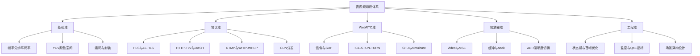

## 目录

- 一、音视频基础（AV-001 ~ AV-008）
- 二、媒体标签与播放器（AV-009 ~ AV-015）
- 三、流媒体协议（AV-016 ~ AV-023）
- 四、WebRTC 核心（AV-024 ~ AV-033）
- 五、实时互动场景（AV-034 ~ AV-040）
- 六、采集与处理（AV-041 ~ AV-047）
- 七、Web Audio（AV-048 ~ AV-053）
- 八、播放器工程（AV-054 ~ AV-060）
- 九、实时通信工程（AV-061 ~ AV-067）
- 十、综合实战（AV-068 ~ AV-100）
- 十一、编解码深入（AV-101 ~ AV-106）
- 十二、WebRTC 源码级与进阶（AV-107 ~ AV-113）
- 十三、SFU 与媒体服务器（AV-114 ~ AV-119）
- 十四、播放器深度工程（AV-120 ~ AV-126）
- 十五、性能与 QoE 深化（AV-127 ~ AV-132）
- 十六、场景工程深化（AV-133 ~ AV-139）
- 十七、安全与合规（AV-140 ~ AV-145）
- 十八、移动端与跨端音视频（AV-146 ~ AV-151）
- 十九、AI 与音视频（AV-152 ~ AV-157）
- 二十、综合大题与体系（AV-158 ~ AV-200）

---

## 一、音视频基础（AV-001 ~ AV-008）

### AV-001：视频的三要素帧率、分辨率、码率之间是什么关系？关键帧为什么重要？
**答**：
- 分辨率决定像素数量，帧率决定每秒画面数，码率 ≈ 分辨率 × 帧率 × 每像素编码位数，三者共同决定清晰度与体积。
- 码率固定时，提高分辨率或帧率必然压缩每个宏块的编码质量，需按场景权衡（监控高帧率、点播高分辨率）。
- 关键帧（I 帧）可独立解码，是 seek、进入直播、丢帧恢复的"锚点"，播放器 seek 后必须从最近的 I 帧开始解。
- GOP（两个 I 帧的间隔）越大压缩率越高但 seek/出画越慢，直播常取 1~2s（与分片对齐）。
- 面试高频点：秒开要求 GOP 缓存 + 首个分片含 I 帧。

```javascript
// 用码率公式粗算 1080p30 视频的存储与带宽需求
function estimateBitrate({ width, height, fps, bpp = 0.1 }) {
  // bpp: bits per pixel，H264 高质量经验值约 0.1
  const bitrateBps = width * height * fps * bpp; // bits per second
  const sizeMBPerMin = (bitrateBps / 8 / 1024 / 1024) * 60;
  return {
    bitrateMbps: +(bitrateBps / 1e6).toFixed(2),
    sizeMBPerMin: +sizeMBPerMin.toFixed(1),
  };
}
// 1920x1080 30fps 0.1bpp ≈ 6.2 Mbps ≈ 每分钟约 46MB
console.log(estimateBitrate({ width: 1920, height: 1080, fps: 30 }));

// 关键帧间隔影响：GOP=2s 时直播出画最坏要等一个 GOP
const GOP_SECONDS = 2;
const worstJoinLatency = GOP_SECONDS; // 观众最坏等待 2s 才遇到下一个 I 帧
console.log('无 GOP 缓存时的最坏出画延迟', worstJoinLatency, 's');
```

### AV-002：YUV 颜色空间是什么？为什么视频都用 YUV 而不用 RGB？
**答**：
- YUV 把颜色拆成亮度 Y 和色度 U/V，人眼对亮度敏感、对色度不敏感，可对色度做下采样（4:2:0 最常见）。
- 4:2:0 表示每 4 个亮度像素共享 1 组 UV，数据量是 RGB888 的 1.5/4 ≈ 37.5%，是 H264/VP9 标准输入格式。
- YUV 与 RGB 需要矩阵转换（BT.601/709 系数不同），前端在 Canvas/WebGL 渲染解码帧时必须处理。
- 兼容性问题高频：黑白/偏绿画面通常是 YUV 转 RGB 矩阵用错（601 当 709 用）或 UV 通道错位。

```javascript
// YUV420p 转 RGB 的核心公式（BT.601），前端 WebGL 渲染解码帧时常用
function yuv420ToRgb(y, u, v) {
  // 输入 0-255
  const yy = y - 16, uu = u - 128, vv = v - 128;
  const r = 1.164 * yy + 1.596 * vv;
  const g = 1.164 * yy - 0.392 * uu - 0.813 * vv;
  const b = 1.164 * yy + 2.017 * uu;
  const clamp = (x) => Math.max(0, Math.min(255, Math.round(x)));
  return [clamp(r), clamp(g), clamp(b)];
}
console.log(yuv420ToRgb(235, 128, 128)); // 近似白色

// WebGL 渲染 YUV 的经典做法：三分纹理 + fragment shader 矩阵转换
const FRAG_SHADER = `
  precision mediump float;
  varying vec2 v_texCoord;
  uniform sampler2D u_y;
  uniform sampler2D u_u;
  uniform sampler2D u_v;
  void main() {
    float y = texture2D(u_y, v_texCoord).r;
    float u = texture2D(u_u, v_texCoord).r - 0.5;
    float v = texture2D(u_v, v_texCoord).r - 0.5;
    vec3 rgb = vec3(y + 1.402 * v,
                    y - 0.344 * u - 0.714 * v,
                    y + 1.772 * u);
    gl_FragColor = vec4(rgb, 1.0);
  }
`;
```

### AV-003：封装格式和编码格式有什么区别？MP4/WebM 与 H264/VP9/AV1 是什么关系？（高频压轴）
**答**：
- 编码格式（codec）是压缩算法，决定像素→比特流的压缩方式：H264/H265/VP8/VP9/AV1/AVS。
- 封装格式（container）是"盒子"，定义轨道、时间戳、索引的组织方式：MP4/WebM/MKV/FLV/TS。
- 一个封装可装多种编码：MP4 常装 H264/H265/AV1+AAC/Opus，WebM 只装 VP8/VP9/AV1+Vorbis/Opus。
- 浏览器支持矩阵高频结论：H264+AAC 凭 MP4 覆盖最广；WebM 主要服务 VP9/AV1；WebRTC 默认 VP8/H264+Opus。
- `canPlayType` / `MediaSource.isTypeSupported` 是判断兼容性的唯一可信方式。

```javascript
// 区分「容器支持」与「编码支持」的探测代码
const videoEl = document.createElement('video');

// 容器+编码组合探测（canPlayType 只返回 probably/likely/maybe/''）
function probeNative(codecs) {
  return videoEl.canPlayType(`video/mp4; codecs="${codecs}"`) || '不支持';
}
console.log('H264+AAC in MP4:', probeNative('avc1.42E01E, mp4a.40.2'));
console.log('H265 in MP4:', probeNative('hvc1.1.6.L93.B0'));

// MSE 场景必须用 isTypeSupported（决定能否喂给 SourceBuffer）
const mseCandidates = [
  'video/mp4; codecs="avc1.64001f, mp4a.40.2"', // H264 High + AAC-LC
  'video/webm; codecs="vp9, opus"',             // VP9 + Opus
  'video/mp4; codecs="av01.0.05M.08"',          // AV1
];
const supported = mseCandidates.filter((t) => MediaSource.isTypeSupported(t));
console.log('MSE 可用组合:', supported);

// 错误示范：把 .webm 容器当编码 —— 文件后缀≠编码
function guessRealCodec(mimeType) {
  const [, codecStr] = mimeType.split('codecs=');
  return codecStr ? codecStr.replace(/"/g, '') : '未知，需要 ffprobe 探测';
}
```

### AV-004：音频三要素采样率、位深、声道是什么？CD 音质一秒多少数据？
**答**：
- 采样率：每秒采样次数，奈奎斯特定理要求 ≥ 信号最高频率的 2 倍；人耳上限 20kHz，故 44.1kHz/48kHz 覆盖全频段。
- 位深（bit depth）：每个采样点的量化精度，16bit 是 CD 标准，8bit 有明显噪声；WebRTC 内部常用 16bit PCM。
- 声道数：mono/stereo，数据量线性乘以声道数。
- 未压缩码率 = 采样率 × 位深 × 声道数，CD 音质 44100×16×2 ≈ 1.41 Mbps。
- 语音场景 16kHz 采样 + 单声道已够用（ASR、WebRTC 语音优先模式），这是降级省带宽的依据。

```javascript
// 音频原始码率与体积计算器
function audioBitrate({ sampleRate, bitDepth, channels }) {
  const bps = sampleRate * bitDepth * channels;
  return {
    bps,
    kbps: +(bps / 1000).toFixed(1),
    mbPerMin: +((bps / 8 / 1024 / 1024) * 60).toFixed(2),
  };
}
// CD 音质
console.log(audioBitrate({ sampleRate: 44100, bitDepth: 16, channels: 2 })); // ~1411kbps, ~10MB/min
// WebRTC 语音优先模式
console.log(audioBitrate({ sampleRate: 16000, bitDepth: 16, channels: 1 })); // ~256kbps 原始，Opus 压后 16~32kbps

// 用 Web Audio 采集时声明约束
const constraints = {
  audio: {
    sampleRate: { ideal: 48000 },
    channelCount: { ideal: 1 },
    echoCancellation: true,
    noiseSuppression: true,
  },
};
navigator.mediaDevices.getUserMedia(constraints).then((stream) => {
  console.log('实际采样率以 track 设置为准:', stream.getAudioTracks()[0].getSettings());
});
```

### AV-005：音频为什么能压缩到几十 kbps？AAC 和 Opus 的区别与选型？
**答**：
- 压缩三板斧：心理声学模型（掩蔽效应，丢弃听不见的频段）、时频变换（MDCT）、熵编码，故有损压缩也能"听不出来"。
- AAC：MP3 继任者，44.1/48kHz 音乐场景质量好，直播/点播生态最成熟，浏览器 MP4 容器内兼容性最佳。
- Opus：RFC 6716，内置 SILK（语音）+ CELT（音乐）双模式自动切换，延迟极低（2.5~60ms 帧），是 WebRTC 唯一强制音频编码。
- 选型结论：点播/直播用 AAC（兼容），实时通信用 Opus（低延迟），窄带语音 Opus 16kbps 仍清晰。
- 语音也可再降级：Opus DTX（静音期不发包）大幅省带宽，是多人会议的标配。

```javascript
// Opus 编码参数在 SDP 中的典型协商结果
const OPUS_SDP_LINE =
  'a=rtpmap:111 opus/48000/2\r\n' +
  'a=fmtp:111 minptime=10;useinbandfec=1;stereo=0;sprop-stereo=0';
console.log(OPUS_SDP_LINE);
// useinbandfec=1 表示开启抗丢包的带内 FEC，弱网下音频更抗断

// WebRTC 中调整音频码率与 DTX（发送前设置）
const pc = new RTCPeerConnection();
pc.addEventListener('negotiationneeded', async () => {
  const sender = pc.getSenders().find((s) => s.track?.kind === 'audio');
  if (!sender) return;
  const params = sender.getParameters();
  params.encodings = [{ maxBitrate: 32_000, dtx: 'enabled' }];
  try {
    await sender.setParameters(params); // Opus 32kbps + DTX
  } catch (e) {
    console.warn('setParameters 失败，部分浏览器不支持 dtx 字段', e);
  }
});

// 用 isTypeSupported 确认 AAC 在 MSE 中可用
console.log(MediaSource.isTypeSupported('audio/mp4; codecs="mp4a.40.2"'));
```

### AV-006：I 帧、P 帧、B 帧和 GOP 分别是什么？对播放体验有什么影响？
**答**：
- I 帧（帧内编码）自含完整画面；P 帧参考前面的帧做运动补偿；B 帧双向参考，压缩率最高但增加延迟与解码复杂度。
- GOP = 两个 I 帧之间的帧序列；丢包/花屏会持续到下一个 I 帧才恢复，这就是"花屏要到关键帧才好"的原因。
- 直播出画、seek、切清晰度都必须对齐 I 帧，否则黑屏/花屏；因此直播分片切点必须落在 I 帧上。
- B 帧在实时通信（WebRTC）中默认禁用——它引入显示顺序与解码顺序的重排延迟。
- 工程要点：转码服务设置固定 GOP（如 2s）并对齐各清晰度，保证 ABR 无缝切换。

```javascript
// 从 fMP4/TS 解析角度模拟：seek 时定位最近关键帧的逻辑
const segments = [
  { url: 'seg-0.ts', start: 0, hasKeyframe: true },
  { url: 'seg-1.ts', start: 2, hasKeyframe: true },
  { url: 'seg-2.ts', start: 4, hasKeyframe: false }, // 中途分片以 P 帧开场
  { url: 'seg-3.ts', start: 6, hasKeyframe: true },
];

function findSeekTarget(seekTime) {
  // 从目标时间向前找最近的关键帧起点，避免从 P 帧开始解码导致花屏
  for (let i = segments.length - 1; i >= 0; i--) {
    if (segments[i].start <= seekTime && segments[i].hasKeyframe) {
      return segments[i];
    }
  }
  return segments[0];
}
console.log('seek 到 5s 应从', findSeekTarget(5)); // seg-3 start=6? 不，回退到 seg-3 之前的 seg-2 无 I 帧，命中 seg-1
console.log('seek 到 1s 应从', findSeekTarget(1)); // seg-0

// 切清晰度也必须等待 IDR 帧：用 appendBuffer 前校验新分片首帧类型
function canSwitchNow(newFragmentInfo) {
  return newFragmentInfo.firstFrameType === 'IDR';
}
```

### AV-007：传统直播 3-5 秒延迟和 RTC 亚秒延迟的差距是怎么形成的？
**答**：
- 传统 HLS 延迟构成：编码缓冲 1~2s + 切片完整 1 个分片 + CDN 缓存与拉取 + 客户端缓冲 3 个分片，合计 6~30s；HTTP-FLV 优化到 1~3s。
- RTC 延迟构成：采集编码 + 网络传输 + 抖动缓冲 jitter buffer（几十 ms 级），全链路 100~500ms。
- 本质差异：HLS 基于 HTTP 短连接拉分片（依赖缓冲抗抖动），RTC 基于 UDP 长连接实时推（依赖 FEC/NACK/抖动缓冲抗丢包）。
- 延迟和流畅是跷跷板：buffer 越大越流畅但越迟；RTC 用实时重传换低延迟。
- 选型口诀：毫秒级互动（连麦/答题）必须 RTC；秒级可接受用 FLV/LL-HLS；纯观看成本优先用标准 HLS。

```javascript
// 各协议延迟量级的估算模型（面试可用来说话有据）
const PROTOCOL_LATENCY = [
  { name: 'HLS',       segments: 3, segDuration: 4, extraMs: 2000 }, // 3 个分片缓冲
  { name: 'LL-HLS',    segments: 2, segDuration: 1, extraMs: 800  },
  { name: 'HTTP-FLV',  bufferSec: 1.5, extraMs: 500 },
  { name: 'WebRTC',    jitterMs: 120, extraMs: 150  },
];
function estimateLatency(p) {
  if (p.segments) return p.segments * p.segDuration * 1000 + p.extraMs;
  if (p.bufferSec) return p.bufferSec * 1000 + p.extraMs;
  return p.jitterMs + p.extraMs;
}
console.log(PROTOCOL_LATENCY.map((p) => `${p.name}: ~${estimateLatency(p)}ms`));

// 播放器追帧：延迟超标时加速播放（1.1 倍速）追回延迟
function maybeCatchUp(currentLatencySec, videoEl) {
  if (currentLatencySec > 3) videoEl.playbackRate = 1.1;
  else if (currentLatencySec < 1) videoEl.playbackRate = 0.95;
  else videoEl.playbackRate = 1;
}
```

### AV-008：码率自适应 ABR 的基本思想是什么？前端要关心什么？
**答**：
- 核心循环：测量（吞吐/缓冲水位）→ 决策（选下一个分片的码率档位）→ 执行（下载该档分片）。
- 两类经典策略：基于吞吐（估计带宽选不高于它的档）与基于缓冲（buffer 少则保守、多则激进，如 BBA）；MPC/DASH 引入预测优化。
- 播放端buffer 水位是关键信号：低于 2 个分片立即降档防卡顿；接近满档且带宽富余才升档。
- 前端职责：hls.js/dash.js 已内置 ABR，但需要会调参数（abrEwmaFastLive、maxBufferLength）、会手动 setLevel、会做自定义规则。
- 升档需对齐 I 帧 + 双 buffer 平滑切换，避免闪屏；直播场景还要兼顾延迟追帧。

```javascript
// 简化版 ABR 决策器：吞吐估计 + 缓冲水位双因子
class SimpleABR {
  constructor(levels) {
    this.levels = levels; // [{ bitrate: 500000, name: '360p' }, ...] 升序
    this.ewma = 2_000_000; // 吞吐指数加权估计，初始 2Mbps
    this.current = 0;
  }
  onSegmentDownloaded(bytes, durationMs) {
    const throughput = (bytes * 8) / (durationMs / 1000); // bps
    this.ewma = 0.7 * this.ewma + 0.3 * throughput; // 平滑
  }
  decide(bufferSec) {
    const levels = this.levels;
    let target = levels.findIndex((l) => l.bitrate > this.ewma * 0.9) - 1;
    if (target < 0) target = levels.length - 1;
    // 缓冲告急立即降档
    if (bufferSec < 2) target = 0;
    else if (bufferSec > 12 && target < levels.length - 1) target++; // 缓冲充足才升档
    target = Math.max(0, Math.min(target, levels.length - 1));
    this.current = target;
    return levels[target];
  }
}
const abr = new SimpleABR([
  { bitrate: 400_000, name: '360p' },
  { bitrate: 1_000_000, name: '720p' },
  { bitrate: 3_000_000, name: '1080p' },
]);
abr.onSegmentDownloaded(500_000, 4000); // 下载 500KB 用了 4s
console.log(abr.decide(1.5)); // 缓冲告急 → 360p
```

---

## 二、媒体标签与播放器（AV-009 ~ AV-015）

### AV-009：video 元素常用属性有哪些？移动端为什么要加 playsinline？
**答**：
- 核心属性：`src/poster/preload/controls/loop/muted/autoplay`，以及移动端专属 `playsinline`、`x5-video-player-type`。
- `preload="none|metadata|auto"`：列表页多视频必须 none/metadata，避免带宽与内存浪费。
- `playsinline` 防止 iOS Safari 点击播放后强制全屏接管；iOS 低版本还需 `webkit-playsinline`。
- 安卓微信/X5 内核用 `x5-video-player-type="h5-page"` 进入同层播放器，否则视频置顶遮盖 DOM。
- `muted + autoplay` 是自动播放的通行证；内联播放 + 自绘控制条是移动端播放器标配。

```html
<!-- 移动端兼容三件套的标准写法 -->
<video
  id="player"
  src="https://cdn.example.com/demo.m3u8"
  poster="https://cdn.example.com/cover.jpg"
  preload="metadata"
  playsinline
  webkit-playsinline
  x5-playsinline
  x5-video-player-type="h5-page"
  x5-video-orientation="portraint"
  muted
></video>
<script>
  const video = document.getElementById('player');
  // iOS 静音自动播放，用户手势后再取消静音
  video.play().catch(() => {
    document.addEventListener('touchstart', () => video.play(), { once: true });
  });
</script>
```

### AV-010：浏览器自动播放策略是怎样的？如何优雅地实现"打开即播"？
**答**：
- Chrome 策略：有声音自动播放默认禁止；满足以下任一可播：muted、用户与域名有高 Media Engagement Index、移动端添加到主屏、桌面 PWA 安装。
- 被拒绝时 `video.play()` 返回 rejected Promise，必须 catch，否则报 Uncaught（NotAllowedError）。
- Safari 更严格：即使 muted 也可能拦截，需要在用户手势内调用 play。
- 通行方案：首帧 muted autoplay → 监听首次点击/滑动解除 muted → 交互按钮提供"开启声音"提示。
- `navigator.userActivation.isActive` 可判断当前是否处于用户激活窗口，用它决定能否直接带声播放。

```javascript
// 自动播放降级链：带声 → 静音 → 等手势
async function smartAutoplay(video) {
  // 1. 先尝试带声播放（高 MEI 用户可成功）
  try {
    await video.play();
    return 'with-sound';
  } catch (e) {
    if (e.name !== 'NotAllowedError') throw e;
  }
  // 2. 静音自动播放兜底
  video.muted = true;
  try {
    await video.play();
    // 首次有效交互解除静音
    const unmute = () => {
      video.muted = false;
      window.removeEventListener('pointerdown', unmute);
    };
    window.addEventListener('pointerdown', unmute, { once: true });
    return 'muted';
  } catch (e) {
    // 3. 完全失败：展示封面+播放按钮，等手势再播
    video.addEventListener('click', () => video.play(), { once: true });
    return 'manual';
  }
}

// 也可先探测用户激活状态
if (navigator.userActivation?.isActive) {
  video.play(); // 处于用户激活内，可带声
}
```

### AV-011：如何设计一个自定义播放器？（控制条/状态机/快捷键）（高频压轴）
**答**：
- 分层架构：MediaCore（video/MSE 封装）→ StateMachine（状态迁移）→ UIController（控制条/弹层）→ PluginSystem（弹幕/清晰度/快捷键）。
- 原生 video 隐藏 `controls`，全部控件自绘，通过事件总线把 state 变化推给 UI 单向渲染。
- 控制条自动隐藏：播放中鼠标静止 3s 隐藏；`pointermove` 重置计时器；触屏用 tap 切换。
- 快捷键：空格暂停、←→ seek 5s、↑↓ 音量、F 全屏、M 静音，注意 input 聚焦时屏蔽。
- 要点：状态只有一份（MediaCore 事件驱动），UI 不自己维护布尔值，避免 UI 与真实播放态脱节。

```javascript
// 播放器骨架：事件总线 + 状态 + 快捷键
class Player {
  constructor(video) {
    this.video = video;
    this.listeners = {};
    video.addEventListener('play', () => this.emit('state', 'playing'));
    video.addEventListener('pause', () => this.emit('state', 'paused'));
    video.addEventListener('waiting', () => this.emit('state', 'buffering'));
    video.addEventListener('timeupdate', () =>
      this.emit('time', video.currentTime, video.duration));
  }
  on(evt, fn) { (this.listeners[evt] ??= []).push(fn); }
  emit(evt, ...args) { (this.listeners[evt] ?? []).forEach((fn) => fn(...args)); }

  toggle() { this.video.paused ? this.video.play() : this.video.pause(); }
  seekBy(sec) { this.video.currentTime = Math.max(0, this.video.currentTime + sec); }

  bindShortkeys() {
    document.addEventListener('keydown', (e) => {
      if (/INPUT|TEXTAREA/.test(e.target.tagName)) return; // 输入框内屏蔽
      const map = {
        Space: () => this.toggle(),
        ArrowLeft: () => this.seekBy(-5),
        ArrowRight: () => this.seekBy(5),
        KeyM: () => (this.video.muted = !this.video.muted),
        KeyF: () => (document.fullscreenElement
          ? document.exitFullscreen()
          : this.video.requestFullscreen()),
      };
      map[e.code]?.();
    });
  }
}
```

### AV-012：MSE 的原理是什么？appendBuffer 和 SourceBuffer 怎么用？（高频压轴）
**答**：
- MSE 允许 JS 向 video 喂入媒体数据：`MediaSource` 挂到 `video.src`（需 URL.createObjectURL），内部包含多个 `SourceBuffer`（每条轨道一个）。
- JS 只负责"取数据 + appendBuffer"，真正的 demux/decode 由浏览器 C++ 层完成——所以 MSE 输入必须是浏览器支持的封装（fMP4/WebM）。
- 标准流程：createObjectURL → addSourceBuffer(mimeType) → fetch 分片 → appendBuffer → updateend 续传 → endOfStream 结束。
- 常见坑：append 时 SourceBuffer 正在 updating 会抛错；数据时间戳乱序会报 decode error；必须 `removeBuffer` 清理旧数据防内存膨胀。
- hls.js/flv.js 的本质都是：JS demux（TS/FLV → fMP4）+ MSE 喂流。

```javascript
// 最小可用 MSE 播放器：顺序追加 fMP4 分片
async function playWithMSE(video, segUrls, mime = 'video/mp4; codecs="avc1.64001f,mp4a.40.2"') {
  const ms = new MediaSource();
  video.src = URL.createObjectURL(ms);
  await new Promise((r) => (ms.addEventListener('sourceopen', r, { once: true })));

  const sb = ms.addSourceBuffer(mime);
  sb.mode = 'sequence'; // 按追加顺序排时间戳，简单可靠
  const queue = [];

  const append = (buf) => {
    if (sb.updating) { queue.push(buf); return; }
    try { sb.appendBuffer(buf); } catch (e) { console.error('append 失败', e); }
  };
  sb.addEventListener('updateend', () => {
    if (queue.length) append(queue.shift());
    else if (video.buffered.length) video.play();
  });

  for (const url of segUrls) {
    const buf = await (await fetch(url)).arrayBuffer();
    append(new Uint8Array(buf));
  }
  sb.addEventListener('updateend', function done() {
    if (!sb.updating && !queue.length) ms.endOfStream();
    sb.removeEventListener('updateend', done);
  });
}
```

### AV-013：播放器 buffer 管理怎么做？seek 时如何处理？
**答**：
- `video.buffered` 是 TimeRanges，用 `buffered.start(i)/end(i)` 遍历出已缓存区间；播放点距区间末尾 < 若干秒即认为将卡顿。
- 内存控制：只保留播放点前后窗口（如前 30s 后 5min），用 `sourceBuffer.remove(start, end)` 主动清理，监听 updateend 后再继续 append。
- seek 处理：目标在 buffered 内直接设 currentTime（立即起播）；在 buffer 外要先 abort 当前 append、清理或保留旧数据、下载包含目标点关键帧的分片再 append。
- seek 抖动（拖动条连续事件）要 debounce，避免风暴式请求。
- 直播 seek 一般被禁止或限制在"回到直播边缘"（liveEdge）。

```javascript
// buffer 清理器 + seek 处理
class BufferManager {
  constructor(sb, { backSec = 30, frontSec = 300 } = {}) {
    this.sb = sb; this.backSec = backSec; this.frontSec = frontSec;
  }
  async evict(currentTime) {
    const { sb } = this;
    if (sb.updating || !sb.buffered.length) return;
    const start = sb.buffered.start(0);
    if (currentTime - start > this.backSec) {
      sb.remove(start, currentTime - this.backSec); // 清理过旧的已播数据
      await new Promise((r) => sb.addEventListener('updateend', r, { once: true }));
    }
  }
  async seek(video, target, fetchSegment) {
    const { buffered } = video;
    for (let i = 0; i < buffered.length; i++) {
      if (target >= buffered.start(i) && target <= buffered.end(i)) {
        video.currentTime = target; // 命中缓存，直接跳
        return;
      }
    }
    // 未命中：等当前 append 完，下载目标点所在分片
    const sb = this.sb;
    if (sb.updating) {
      sb.abort();
      await new Promise((r) => sb.addEventListener('updateend', r, { once: true }));
    }
    video.currentTime = target;          // 先跳，UI 立即响应
    const buf = await fetchSegment(target); // 内部需对齐关键帧
    sb.appendBuffer(buf);
  }
}
```

### AV-014：播放器错误处理与重试链路怎么设计？
**答**：
- 错误来源三类：video 元素 error（MEDIA_ERR_*）、网络 fetch 失败、MSE decode error；都要统一收口到错误中心。
- 区分可重试与不可重试：网络超时/5xx 可重试；400/403（URL 过期）需换签名；解码不支持直接降级源。
- 重试要指数退避 + 次数上限，并对"整个会话"计数（不能每个分片都重试 3 次 → 无限卡死）。
- 失败降级链：先重试当前分片 → 降清晰度 → 换线路/协议 → 提示用户手动刷新。
- 必须上报：错误码、URL、发生时间点、buffer 水位，否则线上无从排查。

```javascript
// 统一错误中心 + 分级重试
class ErrorHandler {
  constructor(video, { maxRetry = 3 } = {}) {
    this.video = video; this.maxRetry = maxRetry; this.sessionRetry = 0;
    video.addEventListener('error', () => this.handle(video.error));
  }
  async handle(err) {
    this.report(err);
    if (this.sessionRetry >= this.maxRetry) return this.fallback();
    this.sessionRetry++;
    const delay = 500 * 2 ** (this.sessionRetry - 1); // 0.5s 1s 2s
    await new Promise((r) => setTimeout(r, delay));

    if (err.code === MediaError.MEDIA_ERR_NETWORK) {
      return this.retrySameUrl();        // 网络抖动：重试
    }
    if (err.code === MediaError.MEDIA_ERR_SRC_NOT_SUPPORTED) {
      return this.downgradeSource();     // 解码不支持：换源
    }
    if (err.code === MediaError.MEDIA_ERR_DECODE) {
      return this.reloadAtCurrentTime(); // 解码错误：seek 当前时间重载
    }
    this.fallback();
  }
  retrySameUrl() { const t = this.video.currentTime; this.video.load(); this.video.currentTime = t; this.video.play(); }
  reloadAtCurrentTime() { return this.retrySameUrl(); }
  downgradeSource() { this.video.src = FALLBACK_MP4_URL; this.video.play(); }
  fallback() { /* 展示错误页 + 重试按钮 */ }
  report(err) { console.warn('[player-error]', err.code, err.message); }
}
```

### AV-015：倍速播放为什么会导致音画不同步？currentTime 跳变要处理什么？
**答**：
- video+audio 分轨时（尤其 MSE 双 SourceBuffer），变速后两轨时钟漂移策略不同就会失同步；同一 mux 内浏览器会自己维持。
- 设置 `currentTime` 是硬跳变：会触发 seeking/waiting，清空 decode 队列，画面可能闪黑帧，外挂字幕/弹幕必须监听 `seeked` 重新对齐。
- 倍速只改 `playbackRate`，音频经 resample 变调；要保音调需 `preservesPitch = true`（默认 true， Safari 老版本要加 webkit 前缀）。
- 倍速范围兼容性：Chrome 支持 0.0625~16，iOS Safari > 4 有被静默限速的情况，需测试兜底。
- 实践：切倍速时若 buffer 不足先降速或提示；弹幕、歌词、字幕都以 currentTime 为唯一时钟源，禁止各自 setInterval 累计。

```javascript
// 倍速控制 + 同步敏感组件的时钟订阅
class PlaybackRateController {
  constructor(video) {
    this.video = video;
    if ('preservesPitch' in video) video.preservesPitch = true; // 保音调
    video.webkitPreservesPitch = true;
  }
  setRate(rate) {
    const clamp = (x) => Math.min(4, Math.max(0.5, x)); // 业务安全范围
    const r = clamp(rate);
    const wasBuffering = this.video.readyState < 3; // HAVE_FUTURE_DATA
    if (wasBuffering) return console.warn('buffer 不足，暂缓切速');
    this.video.playbackRate = r;
    this.video.dispatchEvent(new CustomEvent('ratechanged', { detail: r }));
  }
}

// 弹幕/字幕以 currentTime 为唯一时钟：seek 后强制对齐
const video = document.querySelector('video');
video.addEventListener('seeked', () => {
  danmakuEngine.reset(video.currentTime); // 清屏重排
  subtitleEngine.align(video.currentTime);
});
// 外部进程（如画中画/投屏）改了时间，也要感知
video.addEventListener('timeupdate', () => {
  if (Math.abs(video.currentTime - expectedTime) > 0.5) {
    expectedTime = video.currentTime; // 时钟被外部改动，重新同步
  }
});
```

---

## 三、流媒体协议（AV-016 ~ AV-023）

### AV-016：HLS 协议全解？m3u8 和 ts 分片是怎么工作的？延迟由什么构成？（高频压轴）
**答**：
- HLS（HTTP Live Streaming）把流切成小分片（TS 或 fMP4），用 m3u8 索引文件描述顺序，客户端像下载普通文件一样循环拉取。
- m3u8 关键标签：`#EXTM3U`、`#EXT-X-VERSION`、`#EXTINF`（分片时长）、`#EXT-X-TARGETDURATION`、直播还有 `#EXT-X-MEDIA-SEQUENCE`（滑动窗口首序号）与 `#EXT-X-ENDLIST`（点播结束标志）。
- 直播播放循环：拉 playlist → 等待/下载新分片 → 下载间隙 sleep（约分片时长）→ 再拉 playlist；playlist 只保留最近几个分片（滑动窗口）。
- 延迟构成 ≈ 分片时长 × 缓冲分片数 + playlist 刷新周期 + 编码/CDN 缓存，标准 4s 分片约 12~20s 延迟。
- 优点：走 HTTP/80 端口、CDN 天然友好、自适应性靠多码率 playlist；缺点：延迟高。

```text
#EXTM3U
#EXT-X-VERSION:3
#EXT-X-TARGETDURATION:4
#EXT-X-MEDIA-SEQUENCE:1024
#EXTINF:4.0,
seg-1024.ts
#EXTINF:4.0,
seg-1025.ts
#EXTINF:4.0,
seg-1026.ts
```

```javascript
// 极简 HLS 直播拉流循环（说明原理，生产用 hls.js）
async function hlsLiveLoop(playlistUrl, onSegment) {
  let seq = 0;
  while (true) {
    const text = await (await fetch(playlistUrl)).text();
    const lines = text.split('\n');
    if (lines.includes('#EXT-X-ENDLIST')) break; // 点播结束
    const segs = [];
    for (let i = 0; i < lines.length; i++) {
      if (lines[i].startsWith('#EXTINF')) {
        segs.push({ duration: parseFloat(lines[i].slice(8)), url: lines[i + 1] });
      }
    }
    const mediaSeq = +lines.find((l) => l.startsWith('#EXT-X-MEDIA-SEQUENCE')).slice(20);
    for (const s of segs) {
      if (s.index = segs.indexOf(s) + mediaSeq, s.index > seq) {
        seq = s.index;
        onSegment(await (await fetch(s.url)).arrayBuffer()); // 喂给 MSE
      }
    }
    await new Promise((r) => setTimeout(r, 2000)); // 约半个分片周期再刷 playlist
  }
}
```

### AV-017：LL-HLS 是怎么把延迟降到 2 秒以内的？
**答**：
- 三大武器：Part Segments（把 4s 分片再切成 ~0.2-0.5s 的 part，边生产边可拉）、Blocking Playlist Reload（`_HLS_msn/_HLS_part` 参数，服务器 hold 住请求直到新内容到达，省轮询）、Preload Hints（`#EXT-X-PRELOAD-HINT` 提前预告下一个 part 的 URL）。
- 延迟降到分片时长 + 1~2 个 part，即 2~4s；配合极短分片可进 1s 级。
- 代价：请求频率暴涨，对 CDN 与源站压力大；需 HTTP/2 复用连接； Apple 官方与 hls.js（v1.2+）已支持。
- 与之竞争的方案：LL-DASH（chunked transfer）、HTTP-FLV、WebRTC；工业界国内更常用 HTTP-FLV 做低延迟直播。
- 面试要点：能说出 part 与 segment 的关系、阻塞式刷新消除了"猜下一个分片好了没"的轮询延迟。

```text
#EXTM3U
#EXT-X-VERSION:9
#EXT-X-TARGETDURATION:4
#EXT-X-PART-INF:PART-TARGET=0.334
#EXT-X-MEDIA-SEQUENCE:2680
#EXT-X-SERVER-CONTROL:CAN-BLOCK-RELOAD=YES,PART-HOLD-BACK=1.0,HOLD-BACK=3.0
#EXT-X-PART:DURATION=0.334,URI="part-2680-1.mp4",INDEPENDENT=YES
#EXT-X-PART:DURATION=0.334,URI="part-2680-2.mp4"
#EXTINF:4.0,
seg-2680.mp4
#EXT-X-PRELOAD-HINT:TYPE=PART,URI="part-2680-3.mp4"
```

```javascript
// Blocking reload：服务器 hold 到目标分片才返回，无需客户端轮询
async function blockingReload(baseUrl, msn, part) {
  const url = `${baseUrl}?_HLS_msn=${msn}&_HLS_part=${part}`;
  return (await fetch(url)).text(); // 可能挂起 1~2s，配合 HTTP/2 多路复用
}
```

### AV-018：HTTP-FLV 和 flv.js 的原理？为什么它比 HLS 延迟低？（高频压轴）
**答**：
- FLV 是把 H264/AAC 裸流加上轻量 tag 头的封装，HTTP-FLV 用 chunked transfer 长连接持续下发，天然流式、无分片等待，延迟 1~3s。
- 浏览器原生不认 FLV（除老旧 Flash 时代），flv.js 的核心 = JS 端 demux（FLV tag 解析出 H264 NALU/AAC 帧、重建时间戳）+ 封装成 fMP4 + MSE appendBuffer。
- 所以 flv.js 依赖：① 浏览器支持 MSE；② 服务器支持 HTTP chunked 流式响应。
- 与 HLS 比：少分片/索引开销，延迟低；缺点：不支持 Safari iOS（无 MSE 于老版本）、CDN 缓存命中差、断流恢复要自己处理。
- 进阶话题：FLV 的 AV packet 时间戳基线不统一时会造成音画不同步，flv.js 有时间戳补偿逻辑。

```javascript
// flv.js 标准用法与内部管线示意
import flvjs from 'flv.js';

flvjs.isSupported() && flvjs.getFeatureList().mseLivePlayback; // 能力检测
const player = flvjs.createPlayer({
  type: 'flv',
  url: 'https://cdn.example.com/live/stream.flv',
  isLive: true,
  hasAudio: true,
}, {
  enableStashBuffer: false, // 关闭内部缓冲以降低延迟（直播关键参数）
  lazyLoad: false,
  autoCleanupSourceBuffer: true, // 自动清 MSE 旧数据防内存膨胀
});
player.attachMediaElement(document.querySelector('video'));
player.load();
player.play();

// 直播追帧：flv.js 暴露延迟估算，超阈值跳到边缘
setInterval(() => {
  const latency = player.statisticsInfo.totalVideoFrames
    ? 0 : player.getMediaInfo().duration; // 实际用 buffered 末尾 - currentTime
  const video = document.querySelector('video');
  const bufEnd = video.buffered.length ? video.buffered.end(video.buffered.length - 1) : 0;
  if (bufEnd - video.currentTime > 3) {
    video.currentTime = bufEnd - 0.5; // 丢弃积压回到直播边缘
  }
}, 5000);
```

### AV-019：DASH 和 HLS 有什么区别？该怎么选？
**答**：
- MPEG-DASH 是国际标准（非 Apple 私有），manifest 为 XML 的 MPD，支持 SegmentTemplate/SegmentTimeline 灵活描述分片。
- DASH 支持 per-Title 编码、按字节范围寻址、多轨道（多语言/字幕）表达更精细；HLS 生态与 CDN 兼容性更好。
- 低延迟：DASH 有 LL-DASH（chunked segment），HLS 有 LL-HLS；功能趋同。
- 选型：对外传播/苹果设备必带 HLS；drm 与多语言复杂场景 DASH 表达力强；国内直播基本 HLS+FLV 双出，点播 HLS 为主。
- 浏览器：Chrome/Edge/Firefox 原生支持 DASH（仍需 dash.js MSE 播放），Safari 只认 HLS（但可原生播）。

```xml
<!-- DASH MPD 关键片段：SegmentTemplate 模板化分片 -->
<MPD xmlns="urn:mpeg:dash:schema:mpd:2011" type="dynamic">
  <Period>
    <AdaptationSet contentType="video">
      <Representation id="1080p" bandwidth="3000000" width="1920" height="1080">
        <SegmentTemplate
          media="$RepresentationID$/seg-$Number$.m4s"
          initialization="$RepresentationID$/init.mp4"
          startNumber="1" duration="4" timescale="90000"/>
      </Representation>
      <Representation id="720p" bandwidth="1200000" width="1280" height="720">
        <SegmentTemplate media="$RepresentationID$/seg-$Number$.m4s"
          initialization="$RepresentationID$/init.mp4"
          startNumber="1" duration="4" timescale="90000"/>
      </Representation>
    </AdaptationSet>
  </Period>
</MPD>
```

### AV-020：RTMP 协议现在扮演什么角色？为什么推流还是它？
**答**：
- RTMP（基于 TCP）浏览器已无法原生播放（Flash 死亡），但仍是推流事实标准：OBS/手机推流 SDK → 源站 → 转协议分发 HLS/FLV。
- 优势：生态成熟（各云厂商 ingest 端点都是 rtmp://）、推流端抗抖动、鉴权/录制链路完备；延迟 1~3s。
- 替代趋势：SRT（抗弱网、加密）、RTSP（安防）、WHIP（WebRTC 推流，亚秒延迟）都在吃 RTMP 的份额，但存量巨大短期不倒。
- URL 结构：`rtmp://host/app/streamName?sign=xxx`，streamName 即流 ID，主播端以此鉴权。
- 面试口径：RTMP 在前端的存在感主要是"推流地址的生成与鉴权"、"OBS 参数调优"、"服务端转封装理解"。

```bash
# 用 OBS / ffmpeg 推流到云厂商 RTMP 接入点
ffmpeg -re -i input.mp4 \
  -c:v libx264 -preset veryfast -tune zerolatency -g 50 \  # GOP=2s(25fps)
  -c:a aac -b:a 128k \
  -f flv "rtmp://push.example.com/live/room123?txSecret=abc&txTime=5f123456"

# 服务端将 RTMP 流转成 HLS / HTTP-FLV 分发（nginx-rtmp 配置示意）
```

```nginx
rtmp {
  server {
    listen 1935;
    application live {
      live on;
      hls on;
      hls_path /data/hls;       # 转出 HLS
      hls_fragment 2s;
      record off;
      exec_push ffmpeg -i rtmp://localhost/live/$name -c copy -f flv rtmp://localhost/hls/$name;
    }
  }
}
```

### AV-021：什么是 WHIP/WHEP？WebRTC 怎么流媒体化？
**答**：
- WHIP（WebRTC-HTTP Ingestion Protocol）/ WHEP（Egress）：用简单 HTTP POST 交换 SDP 完成推/拉流的标准化协议，省去自研信令。
- 客户端 POST `Offer SDP` 到 endpoint，服务器返回 `201 + Answer SDP`，再 PATCH/DELETE 管理 ICE 与会话——三步完成接入。
- 意义：让 CDN 厂商（Cloudflare、阿里云等）能提供"WebRTC 推流/拉流"的开放接口，直播延迟进入亚秒级。
- 适用：超低延迟直播、云游戏、云端渲染画面回传；传统 RTC 会议仍用自研 WebSocket 信令。
- 前端要点：会写 WHIP 客户端请求体（application/sdp）、处理 Location 头返回的 session URL。

```javascript
// 最小 WHIP 推流客户端
async function whipPublish(pc, whipUrl, token) {
  const offer = await pc.createOffer();
  await pc.setLocalDescription(offer); // 触发 ICE 收集
  // 等 ICE gathering 完成（简单实现；生产可用 trickle + PATCH）
  await new Promise((r) =>
    pc.iceGatheringState === 'complete' ? r() :
      pc.addEventListener('icegatheringstatechange', () =>
        pc.iceGatheringState === 'complete' && r()));
  const res = await fetch(whipUrl, {
    method: 'POST',
    headers: {
      'Content-Type': 'application/sdp',
      Authorization: `Bearer ${token}`,
    },
    body: pc.localDescription.sdp,
  });
  if (res.status !== 201) throw new Error(`WHIP 失败 ${res.status}`);
  await pc.setRemoteDescription({ type: 'answer', sdp: await res.text() });
  return res.headers.get('Location'); // session URL，用于 DELETE 挂断
}
```

### AV-022：点播、直播、连麦分别该怎么选协议？（选型决策矩阵）
**答**：
- 点播（录播课/短视频）：HLS（fMP4）或 MP4 渐进式下载；要点是首帧、seek 体验、多码率 ABR。
- 直播观看（无互动）：标准 HLS（3-10s，成本最低）；要低延迟选 HTTP-FLV（1-3s）或 LL-HLS（2-4s）。
- 连麦互动（语音/视频通话、连麦 PK、课堂）：WebRTC（<500ms），主播上行推流到 SFU/转推 RTMP 混流入 CDN。
- 复合场景（直播连麦）：主播间 WebRTC 互通 + 服务端混流转 RTMP/HLS 给观众，即"RTC 上行 + CDN 下行"混合架构。
- 决策因子：延迟要求 > 互动性 > 设备兼容 > CDN 成本 > 运维复杂度。

```javascript
// 协议选型决策器（可直接用于架构评审说明）
function pickProtocol({ maxLatencyMs, interactive, iosMandatory, costSensitive }) {
  if (interactive) return 'WebRTC(SFU)';            // 连麦/会议/答题
  if (maxLatencyMs <= 1000) return 'WebRTC(WHEP) 或 SRT';
  if (maxLatencyMs <= 3000) {
    if (iosMandatory) return 'LL-HLS';
    return 'HTTP-FLV（iOS 端并出 HLS 兜底）';
  }
  return costSensitive ? '标准 HLS' : 'HLS + DASH 双协议';
}
console.log(pickProtocol({ maxLatencyMs: 800, interactive: true }));   // WebRTC(SFU)
console.log(pickProtocol({ maxLatencyMs: 3000, iosMandatory: false })); // HTTP-FLV
console.log(pickProtocol({ maxLatencyMs: 15000, costSensitive: true })); // 标准 HLS
```

### AV-023：CDN 在流媒体里扮演什么角色？边缘节点、回源、预热是什么？
**答**：
- 角色：把海量观众请求就近收敛到边缘节点，源站只服务少量边缘（回源），实现扩展性与成本最优。
- 关键概念：边缘节点（就近服务）、回源（边缘未命中向源站/二级节点拉取）、预热（开播前把分片推到边缘避免首波回源风暴）、鉴权（URL 签名防盗链）。
- 直播特殊性：内容实时生成，无法传统预热，靠"分片拉取透传 + 边缘缓存窗口"实现；拉流爆发（开播瞬间）要靠调度与预热 playlist。
- 流媒体 HTTPS 首次回源耗时是首帧慢的常见根因；录制回源上传也是 CDN 侧能力。
- 前端关联：多 CDN 调度（测速选路）、HTTPDNS 防劫持、CDN 5xx 时的备用域名切换。

```javascript
// 多 CDN 测速选路（简化）：并发探测各 CDN 的探测 URL，选最快
async function pickBestCDN(cdns) {
  const tasks = cdns.map(async (cdn) => {
    const start = performance.now();
    const res = await fetch(`${cdn.probeUrl}`, { cache: 'no-store' });
    if (!res.ok) throw new Error(cdn.name);
    return { name: cdn.name, rtt: performance.now() - start };
  });
  const results = await Promise.allSettled(tasks);
  const ok = results.filter((r) => r.status === 'fulfilled')
    .map((r) => r.value).sort((a, b) => a.rtt - b.rtt);
  return ok[0]?.name ?? 'default-cdn';
}
pickBestCDN([
  { name: 'cdnA', probeUrl: 'https://a.cdn.com/probe.bin' },
  { name: 'cdnB', probeUrl: 'https://b.cdn.com/probe.bin' },
]).then(console.log);

// 防盗链签名 URL 生成（前端只做展示，签名应在服务端）
const signedUrl = (base, stream, expires) =>
  `${base}/${stream}.m3u8?auth_key=${expires}-0-0-${md5Token}`;
```

---

## 四、WebRTC 核心（AV-024 ~ AV-033）

### AV-024：WebRTC 三大 API 层分别是什么？
**答**：
- `getUserMedia`：采集层，拿到音视频 MediaStream（麦克风/摄像头/屏幕）。
- `RTCPeerConnection`：传输层，负责编码、加密、NAT 穿透、P2P/SFU 传输与带宽自适应。
- `RTCDataChannel`：数据通道，可靠/不可靠可配（类 TCP/UDP），传消息、文件、游戏状态、白板指令。
- 三层可独立使用：只采集不连（录制）、只 DataChannel 不传媒体（P2P 棋类游戏）。
- 附加 API：`getDisplayMedia`（屏幕）、`RTCRtpSender/Receiver`（轨道级控制）、`getStats`（监控）。

```javascript
// 三大 API 各自的最小演示
async function demoThreeLayers() {
  // 1. 采集层
  const stream = await navigator.mediaDevices.getUserMedia({ video: true, audio: true });

  // 2. 传输层
  const pc = new RTCPeerConnection({ iceServers: [{ urls: 'stun:stun.l.google.com:19302' }] });
  stream.getTracks().forEach((t) => pc.addTrack(t, stream));
  pc.ontrack = (e) => (document.querySelector('video').srcObject = e.streams[0]);

  // 3. 数据通道
  const dc = pc.createDataChannel('chat', { ordered: true });
  dc.onmessage = (e) => console.log('收到消息', e.data);
  pc.ondatachannel = (e) => e.channel.send('hello');

  return { stream, pc, dc };
}
```

### AV-025：什么是信令？为什么 WebRTC 不规定信令协议？（高频压轴）
**答**：
- 信令 = 在建连前交换"元信息"的通道：SDP（媒体能力）、ICE candidate（网络地址）、加入/离开房间等业务消息。
- W3C 故意不规定信令协议，因为业务形态千差万别（会议/直播/IoT），任何协议都能用（WebSocket/HTTP/甚至二维码）。
- 自研信令服务典型实现：WebSocket 房间服务器，消息类型 join/offer/answer/candidate/leave，按 roomId 广播或单播。
- 信令必须先于媒体工作：没有信令，双方互相不知道对方的 SDP 与候选地址。
- 生产要求：信令通道要可靠（见第九章），且信令服务器是唯一"中心点"，它挂了所有人无法建连。

```javascript
// 极简信令服务器（Node ws）+ 客户端封装
// server.js
import { WebSocketServer } from 'ws';
const wss = new WebSocketServer({ port: 8080 });
const rooms = new Map(); // roomId -> Set<ws>
wss.on('connection', (ws) => {
  ws.on('message', (raw) => {
    const msg = JSON.parse(raw);
    if (msg.type === 'join') {
      ws.roomId = msg.roomId;
      if (!rooms.has(msg.roomId)) rooms.set(msg.roomId, new Set());
      rooms.get(msg.roomId).add(ws);
      // 通知房间内其他人
      rooms.get(msg.roomId).forEach((c) => {
        if (c !== ws) c.send(JSON.stringify({ type: 'peer-joined', from: msg.uid }));
      });
      return;
    }
    // offer/answer/candidate/leave：转发给指定对端或全房间
    rooms.get(ws.roomId)?.forEach((c) => {
      if (c !== ws && (!msg.to || c.uid === msg.to)) c.send(raw);
    });
  });
  ws.on('close', () => ws.roomId && rooms.get(ws.roomId)?.delete(ws));
});
```

```javascript
// client.js 信令客户端
class Signaling {
  constructor(url) {
    this.ws = new WebSocket(url);
    this.handlers = new Map();
    this.ws.onmessage = (e) => {
      const msg = JSON.parse(e.data);
      this.handlers.get(msg.type)?.(msg);
    };
  }
  on(type, fn) { this.handlers.set(type, fn); }
  send(msg) { this.ws.send(JSON.stringify(msg)); }
}
const sig = new Signaling('wss://sig.example.com');
sig.on('offer', async ({ sdp, from }) => { /* 触发 answer 流程 */ });
```

### AV-026：SDP 是什么？Offer/Answer 模型怎么工作？（高频压轴）
**答**：
- SDP（Session Description Protocol）是文本协议，描述：媒体行 m=（音频/视频/应用）、属性 a=（编码 payload、ICE 参数、DTLS 指纹、方向）。
- Offer/Answer 模型：A 生成 offer（我有这些能力）→ B 生成 answer（取交集作为最终能力）→ 双方 setLocal/RemoteDescription。
- `a=mid` 标识 m-line 顺序（BUNDLE 复用一条传输通道）；`a=setup` 决定 DTLS 角色；`a=sendrecv/sendonly/recvonly` 表方向。
- 常见考题：callee 只收不发用 recvonly；单向屏幕共享 sendonly；`offerToReceiveVideo` 已废弃，用 addTransceiver。
- SDP 不能裸改就生效——改完要重新 setLocalDescription；munging 是黑魔法，优先用 setParameters/RTCRtpTransceiver。

```sdp
v=0
o=- 4611731400430051336 2 IN IP4 127.0.0.1
s=-
t=0 0
a=group:BUNDLE 0 1
a=msid-semantic: WMS stream-1
m=audio 9 UDP/TLS/RTP/SAVPF 111
c=IN IP4 0.0.0.0
a=rtcp:9 IN IP4 0.0.0.0
a=ice-ufrag:EsAw
a=ice-pwd:P2uYro0UCOQ4zxjKXaWCBui1
a=fingerprint:sha-256 D2:FA:0E:C3:22:59:5E:14:95:69:92:3D:13:B4:84:24
a=setup:actpass
a=mid:0
a=sendrecv
a=rtpmap:111 opus/48000/2
a=fmtp:111 minptime=10;useinbandfec=1
a=ssrc:1001 cname:webrtc
m=video 9 UDP/TLS/RTP/SAVPF 96
c=IN IP4 0.0.0.0
a=mid:1
a=sendrecv
a=rtpmap:96 VP8/90000
a=rtcp-fb:96 nack pli
a=rtcp-fb:96 goog-remb
a=ssrc:2002 cname:webrtc
```

### AV-027：ICE/STUN/TURN 分别解决什么问题？打洞流程是怎样的？（高频压轴）
**答**：
- ICE 是框架：收集所有可用"候选地址"并两两配对连通性检查；STUN 服务器帮 NAT 内主机发现自己的公网映射地址；TURN 服务器在打洞失败时中继转发。
- NAT 类型影响成功率：全锥形/受限锥形易打洞成功，对称型 NAT 大概率要 TURN（约 10~20% 连接走中继）。
- 流程：收集候选 → 交换候选（经信令）→ STUN 连通性检查（配对）→ 选最优路径；全程可能几秒。
- 成本与安全：TURN 有带宽成本（媒体全量中继），要加长期凭证（time-limited credentials）防盗用。
- 面试必背：iceServers 配置 stun: 免费、turn: 需账号；`iceTransportPolicy: 'relay'` 可强制走 TURN（排查用）。

```javascript
// 完整 iceServers 配置与候选收集
const pc = new RTCPeerConnection({
  iceServers: [
    { urls: 'stun:stun.l.google.com:19302' },
    {
      urls: ['turn:turn.example.com:3478?transport=udp', 'turn:turn.example.com:443?transport=tcp'],
      username: 'user',
      credential: 'pass',
      // 更安全的做法：服务端下发短时效 HMAC 凭证
      // username: `${expiry}:user`, credential: hmacSha1(sharedSecret, username)
    },
  ],
  iceCandidatePoolSize: 4, // 预收集，加快后续建连
});

pc.addEventListener('icecandidate', (e) => {
  if (e.candidate) signaling.send({ type: 'candidate', candidate: e.candidate.toJSON() });
});
pc.addEventListener('iceconnectionstatechange', () => {
  console.log('ICE 状态:', pc.iceConnectionState); // checking → connected / failed / disconnected
  if (pc.iceConnectionState === 'failed') pc.restartIce(); // 自动重启 ICE
});
```

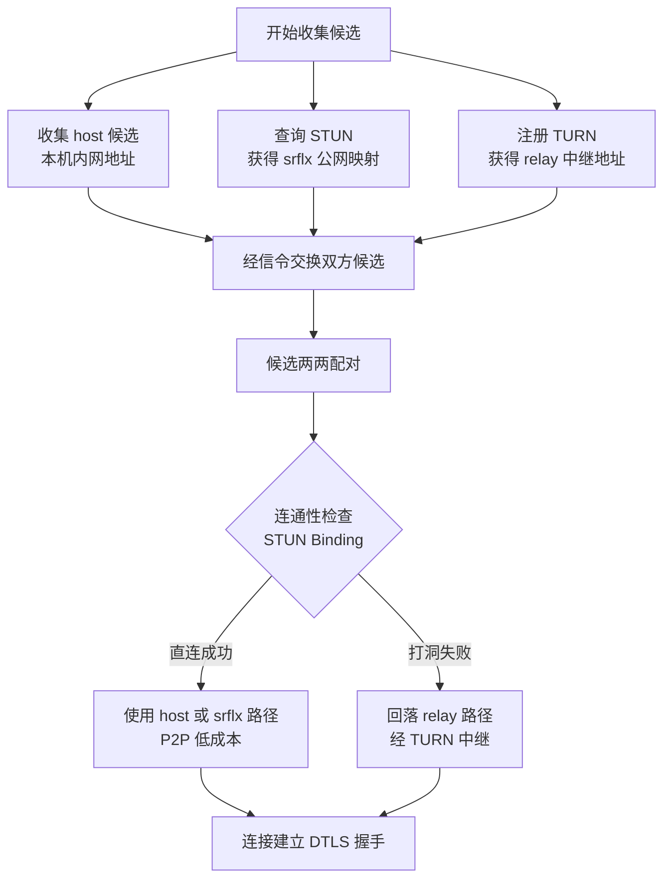

### AV-028：ICE 候选有哪几种类型？host/srflx/relay 怎么区分？
**答**：
- host：本机网卡地址（局域网直连）；srflx（server reflexive）：STUN 发现的公网映射；relay：TURN 中继地址；还有 prflx（对等反射，打洞过程中产生）。
- 优先级：host > srflx > relay，ICE 按优先级配对尝试；同一局域网内 host 候选毫秒级连上。
- mDNS 隐私：Chrome 把 host 候选换成 `xxx.local` mDNS 名，跨网段解析不了就得依赖 srflx/relay。
- 排查技巧：`getStats` 中 `candidate-pair` 的 `localCandidateId` 指向实际使用的候选类型，relay 说明走了中继（有带宽成本）。

```javascript
// 枚举本端候选类型 + 从 getStats 确认实际链路
pc.addEventListener('icegatheringstatechange', async () => {
  if (pc.iceGatheringState !== 'complete') return;
  const stats = await pc.getStats();
  const types = [];
  stats.forEach((r) => {
    if (r.type === 'local-candidate') types.push(`${r.candidateType}: ${r.address ?? r.ip}`);
  });
  console.log('收集到的候选:', types);
  // ['host: 192.168.1.5', 'srflx: 203.0.113.7', 'relay: 198.51.100.9']

  // 找出当前生效的连接对
  let pair, localId;
  stats.forEach((r) => {
    if (r.type === 'candidate-pair' && r.state === 'succeeded' && r.nominated) pair = r;
  });
  const local = stats.get(pair.localCandidateId);
  console.log('实际链路类型:', local.candidateType); // host/srflx/relay
});
```

### AV-029：WebRTC 的加密 DTLS/SRTP 是怎么回事？
**答**：
- 强制加密是 WebRTC 硬性要求：媒体走 SRTP（RTP 加密版），控制走 SRTCP，密钥通过 DTLS-SRTP 握手协商。
- 流程：ICE 连通后，先 DTLS 握手（证书自签，SDP 中的 `a=fingerprint` 校验防中间人）→ 协商出 SRTP 密钥 → 媒体加解密。
- DataChannel 走 SCTP over DTLS，同样是加密的。
- 对前端的意义：无需手写加密；但 `a=fingerprint` 变化会导致重协商失败；自建 SFU 要持有证书私钥。
- 常见误区：HTTPS 站点 ≠ WebRTC 加密，两者独立；信令要 wss，媒体加密由 DTLS/SRTP 保证。

```javascript
// 从 SDP 中提取并校验指纹（防信令篡改的入门做法）
function extractFingerprint(sdp) {
  const m = sdp.match(/a=fingerprint:(sha-256)\s+([0-9A-F:]+)/i);
  return m ? { algo: m[1], value: m[2].toUpperCase() } : null;
}
// 预共享指纹校验：对端指纹应与业务服务器下发的一致
function verifyPeerFingerprint(receivedSdp, expected) {
  const fp = extractFingerprint(receivedSdp);
  if (!fp || fp.value !== expected) {
    throw new Error('对端 DTLS 指纹不符，可能存在中间人'); // 拒绝 setRemoteDescription
  }
  return true;
}
// DTLS 状态监听
pc.addEventListener('connectionstatechange', () => {
  // new → connecting(ICE+DTLS) → connected；dtls 失败表现为 failed
  console.log('connectionState:', pc.connectionState);
});
```

### AV-030：请完整描述 WebRTC 媒体协商的时序（含 ICE）。
**答**：
- 标准时序：A addTrack → createOffer → setLocalDescription(offer) → 信令发 offer → B setRemoteDescription(offer) → B addTrack → createAnswer → setLocalDescription(answer) → 回 answer → A setRemoteDescription(answer)。
- ICE 候选与 SDP 交换并行进行（trickle ICE）：收集到就发，不必等 SDP 完成。
- 全部完成后进入 DTLS 握手与媒体传输；`negotiationneeded` 事件是触发 offer 的官方信号。
- 易错点：answer 侧必须先 setRemoteDescription(offer) 再 createAnswer；双端同时 offer 会 glare，需要角色仲裁。

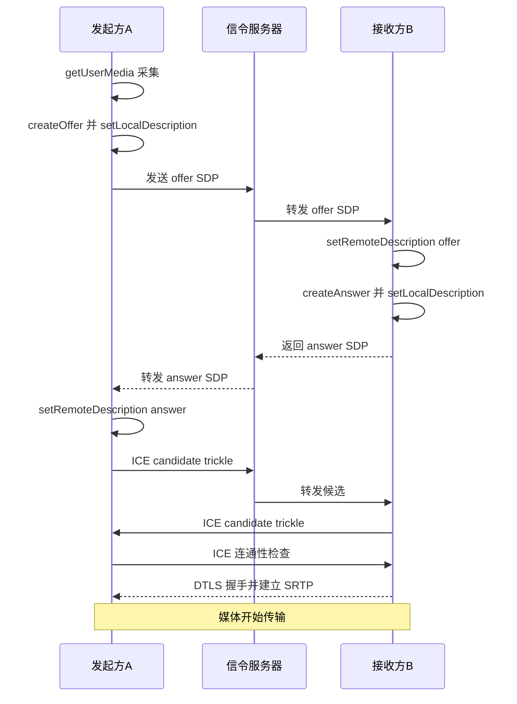

```javascript
// 发起方与应答方完整代码（与上图一一对应）
async function caller(pc, sig) {
  pc.onnegotiationneeded = async () => {
    const offer = await pc.createOffer();
    await pc.setLocalDescription(offer);
    sig.send({ type: 'offer', sdp: pc.localDescription });
  };
  sig.on('answer', (m) => pc.setRemoteDescription(m.sdp));
  sig.on('candidate', (m) => pc.addIceCandidate(m.candidate));
}
async function callee(pc, sig) {
  sig.on('offer', async (m) => {
    await pc.setRemoteDescription(m.sdp);
    const answer = await pc.createAnswer();
    await pc.setLocalDescription(answer);
    sig.send({ type: 'answer', sdp: pc.localDescription });
  });
  sig.on('candidate', (m) => pc.addIceCandidate(m.candidate));
}
```

### AV-031：会议中途加流/换流怎么办？renegotiation 怎么做才安全？（高频）
**答**：
- 触发 renegotiation 的操作：addTrack/removeTrack/replaceTrack（方向变化）、addTransceiver、setDirection；会在对端触发 `negotiationneeded`。
- 共享屏幕常用 `replaceTrack`：把 camera track 换成 screen track，不触发重协商、不断流（编码器参数变化瞬间可能抖动）——这是"无缝换流"的关键。
- addTrack 才触发完整重协商；要防 glare：每次协商加锁（makingOffer 标志），并用"完美协商"（perfect negotiation）模式处理冲突。
- 接收方处理 negotiationneeded 时如果自己不是 polite peer，要回滚（rollback）对方的 offer。

```javascript
// replaceTrack 无缝换流（摄像头 ↔ 屏幕），不触发重协商
async function switchToScreen(pc, videoSender) {
  const screenStream = await navigator.mediaDevices.getDisplayMedia({ video: true });
  const [screenTrack] = screenStream.getVideoTracks();
  await videoSender.replaceTrack(screenTrack); // 毫秒级切换，观众无感知断流
  screenTrack.addEventListener('ended', () => { // 用户点"停止共享"
    navigator.mediaDevices.getUserMedia({ video: true })
      .then((s) => videoSender.replaceTrack(s.getVideoTracks()[0]));
  });
}

// 完美协商模式：防 glare 冲突
class PerfectNegotiator {
  constructor(pc, sig, polite) {
    this.pc = pc; this.sig = sig; this.polite = polite;
    this.makingOffer = false; this.ignoreOffer = false;
    pc.onnegotiationneeded = async () => {
      try {
        this.makingOffer = true;
        await pc.setLocalDescription();
        sig.send({ type: 'description', sdp: pc.localDescription });
      } finally { this.makingOffer = false; }
    };
    sig.on('description', async ({ sdp }) => {
      const readyForOffer = !this.makingOffer &&
        (pc.signalingState === 'stable' || pc.signalingState === 'have-local-offer');
      const offerCollision = sdp.type === 'offer' && !readyForOffer;
      this.ignoreOffer = !this.polite && offerCollision;
      if (this.ignoreOffer) return;
      await pc.setRemoteDescription(sdp).catch(async (e) => {
        if (sdp.type === 'offer') await pc.setRemoteDescription(); // rollback
        else throw e;
      });
      if (sdp.type === 'offer') {
        await pc.setLocalDescription();
        sig.send({ type: 'description', sdp: pc.localDescription });
      }
    });
  }
}
```

### AV-032：WebRTC 带宽估计与码率控制是怎么回事？REMB 和 TWCC 是什么？（高频）
**答**：
- 接收端周期性反馈"我能吃多少带宽"，发送端据此调整编码码率，防止持续拥塞丢包。
- REMB：接收端估算可用带宽并通过 RTCP（PSFB/AFB）显式告诉发送端（老方案，主要作用于视频、粒度较粗，现行主流已被 TWCC 取代）。
- TWCC（Transport-Wide Congestion Control）：发送端给每个 RTP 包带序号，接收端回传到达时间，发送端基于延迟梯度估计带宽（GCC 算法），是现行主流。
- 落地动作：`sender.getParameters().encodings[0].maxBitrate` 设上限；监听 stats 中 `availableOutgoingBitrate` 观察估计值；配合 simulcast 让 SFU 选层。
- 弱网信号链：带宽下降 → 编码器降码率 → 再恶化降分辨率/帧率 → 仍不足关视频保音频。

```javascript
// 监听带宽估计并手动限速
function monitorBandwidth(pc, sender) {
  setInterval(async () => {
    const stats = await pc.getStats();
    stats.forEach((r) => {
      if (r.type === 'candidate-pair' && r.nominated && r.state === 'succeeded') {
        const avail = r.availableOutgoingBitrate; // bps
        if (avail && avail < 300_000) {
          console.warn('带宽告急', avail, 'bps，建议降级');
        }
      }
      if (r.type === 'outbound-rtp' && r.kind === 'video') {
        console.log('实际发送码率', Math.round(r.targetBitrate / 1000), 'kbps',
          '帧率', r.framesPerSecond);
      }
    });
  }, 2000);
}

// 设置视频编码上限（发送端）
async function capVideoBitrate(sender, bps) {
  const p = sender.getParameters();
  p.encodings = p.encodings?.length ? p.encodings : [{}];
  p.encodings[0].maxBitrate = bps;
  p.degradationPreference = 'maintain-framing'; // 弱网优先保分辨率降帧率，反之 balanced
  await sender.setParameters(p);
}
```

### AV-033：P2P、Mesh、SFU 三种架构怎么选？（高频压轴）
**答**：
- Mesh（全量 P2P）：每人上行 N-1 路，N 人会议上行带宽 O(N)，只适合 2~4 人小会；无服务器媒体成本。
- SFU（Selective Forwarding Unit）：每人只上行 1 路，SFU 按订阅转发给其他人；服务器带宽 O(N)，是 6~50 人会议主流。
- MCU：服务端解码再混流转码成一路，客户端最省但成本高、延迟高，现多用于录制/混流出 CDN。
- SFU 配套技术：simulcast（客户端同时发多档清晰度，SFU 按订阅者带宽选层）、SVC（时域/空域分层，VP9/AV1）、联级 SFU（跨机房扩展）。
- 选型口径：1v1 用 P2P（省成本），小型多人用 Mesh 可选、SFU 更稳，中大型必 SFU，万人直播 = SFU + 混流转 CDN。

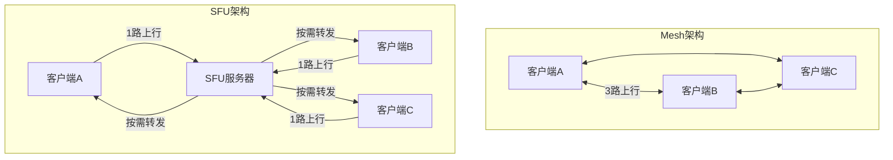

```javascript
// simulcast：客户端同时上行 3 档，SFU 按订阅者带宽选层
const stream = await navigator.mediaDevices.getUserMedia({ video: true });
const [track] = stream.getVideoTracks();
pc.addTransceiver(track, {
  direction: 'sendonly',
  sendEncodings: [
    { rid: 'low',    maxBitrate: 150_000,   scaleResolutionDownBy: 4 },
    { rid: 'mid',    maxBitrate: 500_000,   scaleResolutionDownBy: 2 },
    { rid: 'high',   maxBitrate: 1_500_000, scaleResolutionDownBy: 1 },
  ],
});
// 接收端按需选择：只订阅 low 层（小窗）或 high 层（大屏）
const receiver = pc.getReceivers().find((r) => r.track.kind === 'video');
const params = receiver.getParameters();
params.encodings = [{ rid: 'high' }]; // 服务端 SFU 转发 high 层
// 浏览器端 layer 切换主要由 SFU 控制，此处示意消费端意图
```

---

## 五、实时互动场景（AV-034 ~ AV-040）

### AV-034：请设计一个 1v1 视频通话的完整实现（信令+协商+渲染）。（高频压轴）
**答**：
- 流程：A 采集 → 创建 PC 并 addTrack → offer → 信令 → B 采集并 answer → 双方交换 ICE → ontrack 渲染远端画面。
- 状态管理：idle/calling/ringing/connected/ended，UI 按状态渲染（呼叫中转圈、接听按钮、挂断）。
- 挂断要双向清理：关 track（stop 释放摄像头灯）、close PC、信令广播 leave，对端收到后同样清理并回到 idle。
- 远端流渲染注意 `ontrack` 可能多次触发（音频/视频各一次），用 `e.streams[0]` 挂 srcObject。
- 加分项：呼叫超时未接自动 cancel、reconnect 时 ICE restart、通话时长统计。

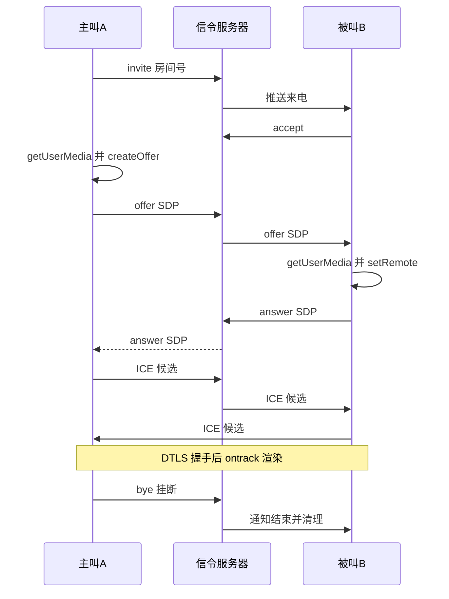

```javascript
// 1v1 通话核心类
class OneToOneCall {
  constructor(sig, localVideo, remoteVideo) {
    this.sig = sig; this.localVideo = localVideo; this.remoteVideo = remoteVideo;
    this.pc = new RTCPeerConnection({ iceServers: [{ urls: 'stun:stun.l.google.com:19302' }] });
    this.pc.ontrack = (e) => { this.remoteVideo.srcObject = e.streams[0]; };
    this.pc.onicecandidate = (e) =>
      e.candidate && this.sig.send({ type: 'candidate', candidate: e.candidate.toJSON() });
  }
  async start() {
    const stream = await navigator.mediaDevices.getUserMedia({ video: true, audio: true });
    this.localVideo.srcObject = stream;
    stream.getTracks().forEach((t) => this.pc.addTrack(t, stream));
    const offer = await this.pc.createOffer();
    await this.pc.setLocalDescription(offer);
    this.sig.send({ type: 'offer', sdp: this.pc.localDescription });
  }
  async accept(remoteOffer) {
    const stream = await navigator.mediaDevices.getUserMedia({ video: true, audio: true });
    this.localVideo.srcObject = stream;
    await this.pc.setRemoteDescription(remoteOffer);
    stream.getTracks().forEach((t) => this.pc.addTrack(t, stream));
    const answer = await this.pc.createAnswer();
    await this.pc.setLocalDescription(answer);
    this.sig.send({ type: 'answer', sdp: this.pc.localDescription });
  }
  hangup() {
    this.pc.getSenders().forEach((s) => s.track?.stop()); // 释放采集设备
    this.pc.close();
    this.sig.send({ type: 'bye' });
  }
}
```

### AV-035：多人会议为什么必须用 SFU？simulcast 和级联是什么？
**答**：
- 6 人以上 Mesh 上行带宽爆炸（每人 5 路上行），SFU 让每人只上行 1 路，服务器按订阅转发。
- SFU 不解码不混流，只转发 RTP 包：CPU 低、延迟低（<100ms 转发开销）、端到端加密保持。
- simulcast：发送端同传高中低三档，SFU 依据每个订阅端的带宽与窗口大小选层，解决"发送一份但消费端能力不一"的矛盾。
- 订阅模型：客户化 SFU（如 mediasoup/Janus/livekit）中发布者 publish、订阅者 consume，服务端下发 consumer 的 rtpParameters。
- 级联：多个 SFU 机房间互联（A 机房订阅 B 机房房间流），实现跨地域大房间的带宽与延迟均衡。

```javascript
// mediasoup 风格客户端：publish + simulcast + consume 订阅
async function joinMeeting(device, transport, track) {
  // 发布：三档 simulcast
  const producer = await transport.produce({
    track,
    encodings: [
      { rid: 'r0', maxBitrate: 150_000, scaleResolutionDownBy: 4 },
      { rid: 'r1', maxBitrate: 500_000, scaleResolutionDownBy: 2 },
      { rid: 'r2', maxBitrate: 1_200_000 },
    ],
    codecOptions: { videoGoogleStartBitrate: 1000 },
  });

  // 订阅他人：服务端下发 consume 参数后创建 consumer
  const consumer = await transport.consume({
    id: serverConsumer.id,
    producerId: serverConsumer.producerId,
    kind: serverConsumer.kind,
    rtpParameters: serverConsumer.rtpParameters,
  });
  const remoteStream = new MediaStream([consumer.track]);
  document.querySelector(`#peer-${serverConsumer.peerId}`).srcObject = remoteStream;

  // 弱网时向服务端请求降低订阅档位
  window.addEventListener('online', () => signal.requestLayers({ high: true }));
}
```

### AV-036：连麦直播（主播-观众连麦）的架构是怎样的？
**答**：
- 核心架构：RTC 网（主播与连麦观众互通，低延迟）+ CDN 网（混流后分发，扛海量观看），两网之间靠"混流转推"桥接。
- 观众上麦流程：申请 → 主播同意 → 观众推流进 RTC 房间 → 服务端把所有上行流混成一路 → 转推 RTMP → CDN 分发给其余观众。
- 连麦观众下麦：停止推流，其余观众恢复观看混流（多画面变单画面）。
- 技术要点：混流布局（服务端 Canvas 式合成/服务端 SFU 转发单流）、音量对齐、转推时加转码兼容（H264+AAC）。
- 延迟分层：主播↔连麦观众 <400ms，普通观众 3~5s（HLS）或 1~3s（FLV），体验割裂感靠 UI（连麦中观众端自动切低延迟协议）缓解。

```javascript
// 连麦观众端：上麦 = 加入 RTC 房间并推流；同时保留拉流
class LivestreamAudience {
  constructor(roomId) { this.roomId = roomId; }
  async goOnStage() {
    this.stream = await navigator.mediaDevices.getUserMedia({
      video: { width: 720 }, audio: { echoCancellation: true }, // 连麦必开 AEC
    });
    this.upPC = new RTCPeerConnection({ iceServers: this.iceServers });
    this.stream.getTracks().forEach((t) => this.upPC.addTrack(t, this.stream));
    // 服务端将此上行流加入混流布局
    await this.signal.requestMixLayout({ uid: this.uid, x: 0, y: 0, w: 0.5, h: 0.5 });
  }
  async leaveStage() {
    this.stream.getTracks().forEach((t) => t.stop());
    this.upPC.close();
    await this.signal.requestMixLayout({ uid: this.uid, remove: true });
  }
}
```

### AV-037：屏幕共享怎么实现？getDisplayMedia 有哪些实用选项？
**答**：
- 采集：`getDisplayMedia({ video, audio })`，用户在浏览器选择器中决定共享整屏/窗口/标签页；Chrome 还支持 `preferCurrentTab`、`selfBrowserSurface: 'exclude'` 防止共享自己。
- 推送：`sender.replaceTrack(screenTrack)` 无缝切换不重协商；停止共享触发 track 的 `ended` 事件要恢复摄像头。
- 音频：Chrome 支持标签页音频采集（system audio 仅 Windows），`audio: true` 可把演示视频声音一起共享。
- 帧率与清晰度权衡：PPT 场景 `frameRate: 5` 省带宽，视频播放场景 30fps；`contentHint: 'detail'/'motion'` 告诉编码器优化方向。
- 隐私提示：必须显著提示"正在共享屏幕"，并提供一键停止。

```javascript
// 屏幕共享完整管理器
class ScreenShare {
  constructor(pc) { this.pc = pc; this.videoSender = pc.getSenders().find((s) => s.track?.kind === 'video'); }
  async start() {
    this.screenStream = await navigator.mediaDevices.getDisplayMedia({
      video: { frameRate: { ideal: 15 }, width: { ideal: 1920 }, contentHint: 'detail' },
      audio: true, // Chrome 标签页音频
      preferCurrentTab: false,
      selfBrowserSurface: 'exclude', // 不让自己出现在选择列表
      surfaceSwitching: 'include',   // 允许用户中途切换共享目标
    });
    const [track] = this.screenStream.getVideoTracks();
    track.contentHint = 'detail'; // 文档型内容
    await this.videoSender.replaceTrack(track);
    this.screenStream.getAudioTracks().forEach((a) => this.pc.addTrack(a, this.screenStream));
    track.addEventListener('ended', () => this.stop()); // 用户点浏览器停止按钮
    return this.screenStream;
  }
  async stop() {
    this.screenStream?.getTracks().forEach((t) => t.stop());
    const cam = await navigator.mediaDevices.getUserMedia({ video: true });
    await this.videoSender.replaceTrack(cam.getVideoTracks()[0]); // 切回摄像头
  }
}
```

### AV-038：服务端混流与录制是怎么做的？
**答**：
- 混流：SFU 侧把多路 RTP 解码后合成一路视频（服务端画布布局）+ 多路音频混音，输出 RTMP/录制文件；或用 SFU 的 RTP 转发 + 客户端 canvas 合成（浪费客户端资源，少用）。
- 录制两种模式：合流录制（混流同时输出 mp4，回放友好）与单流录制（每人各录一路，后期可二次剪辑/布局重排）。
- 前端相关：录制任务的控制接口（开始/暂停/停止/标记章节），与云端时间戳对齐（服务器 NTP 时间）。
- 合规要点：录制需全员知情同意提示；存储加密与留存策略。
- 排查：录制文件音画不同步常因混流端时钟源不稳，前端能做的是上报本地时钟偏移。

```javascript
// 云端录制控制 API 封装（调服务端接口）
class CloudRecorder {
  constructor(signal) { this.signal = signal; }
  async start(roomId, mode = 'mixed') { // mixed 合流 | individual 单流
    return this.signal.rpc('recorder:start', { roomId, mode, layout: { type: 'grid' } });
  }
  async mark(roomId, label) { // 标记精彩片段，供点播生成章节
    return this.signal.rpc('recorder:mark', { roomId, label, ts: Date.now() });
  }
  async stop(roomId) {
    const { fileId } = await this.signal.rpc('recorder:stop', { roomId });
    return fileId; // 点播回放地址由后端转码后下发
  }
}

// 本地兜底录制：MediaRecorder 录自己的上行流（网络事故时的素材）
const localRecorder = new MediaRecorder(localStream, { mimeType: 'video/webm;codecs=vp8,opus' });
const chunks = [];
localRecorder.ondataavailable = (e) => e.data.size && chunks.push(e.data);
localRecorder.start(5000); // 5s 一个分片，防内存峰值
```

### AV-039：弱网对抗的降级策略链是怎样的？
**答**：
- 信号源：RTT 上升、丢包率、availableOutgoingBitrate 下降、NACK/PLI 频次。
- 降级顺序（业界共识）：降码率（编码器自动）→ 降分辨率 → 降帧率 → 关视频保音频 → 最后重连。
- WebRTC 内建机制：编码器自适应（degradationPreference）、NACK 重传、FEC 前向纠错、PLI 请求关键帧、JitterBuffer 平滑。
- 应用层联动：视频关掉时 UI 切换为"仅音频"头像模式；丢包 >30% 提示用户切换网络。
- 升级要渐进：网络恢复后逐步回升分辨率，避免反复横跳（抖动抑制，带迟滞）。

```javascript
// 弱网监控 + 带迟滞的降级/恢复状态机
class NetworkAdaptor {
  constructor(pc, senders) { this.pc = pc; this.senders = senders; this.level = 2; }
  async check() {
    const stats = await this.pc.getStats();
    let loss = 0, rtt = 0;
    stats.forEach((r) => {
      if (r.type === 'inbound-rtp' && r.kind === 'video') loss = r.packetsLost / (r.packetsLost + r.packetsReceived);
      if (r.type === 'candidate-pair' && r.state === 'succeeded') rtt = r.currentRoundTripTime * 1000;
    });
    if ((loss > 0.2 || rtt > 400) && this.level > 0) this.downgrade();
    else if (loss < 0.02 && rtt < 120 && this.level < 2) this.upgrade(); // 迟滞：阈值不重叠
  }
  async downgrade() {
    this.level--;
    const cfg = [
      { fps: 5,  h: 240 },  // level 0：最小画质
      { fps: 15, h: 480 },  // level 1
      { fps: 24, h: 720 },  // level 2
    ][this.level];
    await this.applyTrackConstraints(cfg);
  }
  async upgrade() { this.level++; await this.applyTrackConstraints(
    [{ fps: 5, h: 240 }, { fps: 15, h: 480 }, { fps: 24, h: 720 }][this.level]); }
  async applyTrackConstraints({ fps, h }) {
    const track = this.senders.video.track;
    await track.applyConstraints({ frameRate: fps, height: { ideal: h } });
  }
}
setInterval(() => adaptor.check(), 3000);
```

### AV-040：回声消除 AEC 与噪声抑制 ANS 是什么？前端要注意什么？（高频）
**答**：
- 回声原理：扬声器播出的远端声音被麦克风再次采集传回，形成"我说话自己听到"；AEC 用参考信号自适应滤波抵消。
- ANS（噪声抑制）： stationary 噪声谱估计 + 谱减法/WebRTC NS 模块；AGC 自动增益统一音量。
- 浏览器已内建：`getUserMedia` 约束 `echoCancellation/noiseSuppression/autoGainControl`，Chrome 走 AEC3，质量足够。
- 前端陷阱：外放 + 不开 AEC 必炸麦；用 `getUserMedia` 拿到的是处理后的流，专业需求可关约束拿原始流自研处理。
- 排查口诀：戴耳机不回声、外放回声 → AEC 问题；双方同时听到"机器人声"→ 双端都开了 AEC 且参考信号接错。

```javascript
// 音频约束的分级配置：普通通话 vs 音乐直播
const PRESETS = {
  voice: { // 默认通话：全开浏览器 DSP
    echoCancellation: true, noiseSuppression: true, autoGainControl: true,
  },
  music: { // 音乐模式：关 DSP 保留原声（WebRTC 内 opus 也建议 stereo+低复杂度）
    echoCancellation: false, noiseSuppression: false, autoGainControl: false,
    channelCount: 2, sampleRate: 48000,
  },
};
async function getMic(preset = 'voice') {
  const stream = await navigator.mediaDevices.getUserMedia({ audio: PRESETS[preset] });
  const settings = stream.getAudioTracks()[0].getSettings();
  console.log('生效的 DSP 设置', settings); // 验证约束是否被浏览器接受
  return stream;
}

// 检测回声风险：远端正在播放 + 本端外放 → 提示戴耳机
function echoRiskDetector(remoteVideo) {
  const ctx = new AudioContext();
  remoteVideo.addEventListener('play', () => {
    if (navigator.mediaDevices.getSupportedConstraints().echoCancellation && !remoteVideo.muted) {
      // 提示逻辑：外放播放远端音频且本端要开口说话时
      console.info('提示：请佩戴耳机以获得最佳连麦体验');
    }
  });
}
```

---

## 六、采集与处理（AV-041 ~ AV-047）

### AV-041：getUserMedia 的约束系统怎么用？ideal 和 exact 区别？
**答**：
- 约束分理想值（ideal，尽量满足）与硬性值（exact，不满足直接失败 OverconstrainedError）；默认是 ideal。
- 常用维度：width/height/frameRate（可用 {min, max, ideal} 区间）、facingMode（user/environment，手机前后摄）、deviceId（exact 才能锁定设备）。
- `getSupportedConstraints()` 探测浏览器支持哪些约束键；`track.getSettings()` 查询实际生效值；`applyConstraints()` 运行时动态调整（热切换分辨率/帧率）。
- 采集性能经验：请求 720p/30fps 让浏览器选择最近能力，比 exact 1080p 成功率高得多。
- 顺序陷阱：`deviceId` 在用户授权前不可枚举，首帧授权流程要处理。

```javascript
// 约束实战：区间理想值 + 动态调整 + 失败降级
async function openCamera() {
  const base = {
    video: {
      width: { ideal: 1280 }, height: { ideal: 720 }, // 理想，浏览器就近选
      frameRate: { ideal: 30, max: 30 },
      facingMode: 'user',
    },
  };
  try {
    return await navigator.mediaDevices.getUserMedia(base);
  } catch (e) {
    if (e.name === 'OverconstrainedError') {
      console.warn('约束过紧', e.constraint, '，降级到宽松模式');
      return navigator.mediaDevices.getUserMedia({ video: true });
    }
    throw e;
  }
}

// 运行时动态降分辨率（不重开摄像头）
const [track] = (await openCamera()).getVideoTracks();
await track.applyConstraints({ width: { ideal: 640 }, frameRate: 15 });
console.log('实际生效', track.getSettings()); // width 可能仍是 1280，浏览器尽力

// 探测能力
console.log(navigator.mediaDevices.getSupportedConstraints());
// { width: true, height: true, frameRate: true, facingMode: true, ... }
```

### AV-042：怎么枚举摄像头/麦克风并实现设备切换？
**答**：
- `navigator.mediaDevices.enumerateDevices()` 列出所有设备（kind/deviceId/label），未授权前 label 为空、deviceId 为空串，授权后才完整。
- 切换设备两种方式：关流重开（会闪断，简单）或 `sender.replaceTrack(newTrack)` / `applyConstraints({ deviceId })`（无缝，推荐）。
- 监听 `devicechange` 事件处理热插拔：拔掉摄像头时 track 自动 ended，要提示并引导重选。
- 手机端注意：facingMode 切前后摄在部分安卓上要重开流；deviceId 在隐私模式下会话间不稳定，需每次重新枚举。

```javascript
// 设备枚举 + 无缝切换 + 热插拔
class DeviceManager {
  async list() {
    const devices = await navigator.mediaDevices.enumerateDevices();
    return {
      cams: devices.filter((d) => d.kind === 'videoinput'),
      mics: devices.filter((d) => d.kind === 'audioinput'),
      speakers: devices.filter((d) => d.kind === 'audiooutput'),
    };
  }
  async switchCamera(sender, deviceId) {
    const stream = await navigator.mediaDevices.getUserMedia({
      video: { deviceId: { exact: deviceId } },
    });
    const [newTrack] = stream.getVideoTracks();
    await sender.replaceTrack(newTrack); // 无缝，不断流
    this.currentStream.getVideoTracks().forEach((t) => t.stop()); // 释放旧设备
  }
  bindHotplug(onChange) {
    navigator.mediaDevices.addEventListener('devicechange', async () => {
      const { cams } = await this.list();
      onChange(cams); // UI 刷新设备列表；被拔设备的 track 会触发 ended
    });
  }
}
```

### AV-043：摄像头/麦克风权限失败分哪几种情况？分别怎么处理？
**答**：
- NotAllowedError（用户拒绝）：引导去浏览器地址栏权限设置重新授权，展示图文指引；可用 `navigator.permissions.query({name:'camera'})` 预判状态。
- NotFoundError / DevicesNotFoundError：无设备或系统禁用，引导检查插拔与系统隐私设置（macOS 需在系统设置给浏览器授权）。
- NotReadableError（TrackStartError）：设备被其他应用占用（微信/Zoom 占用摄像头），提示关闭占用应用。
- OverconstrainedError：约束不满足，降级重试；SecurityError：非 HTTPS 环境（getUserMedia 强制安全上下文）。
- 通用原则：每个错误码对应专属文案 + 行动按钮，绝不只弹"打开失败"。

```javascript
// 分场景错误处理
async function openWithFriendlyError() {
  try {
    return await navigator.mediaDevices.getUserMedia({ video: true, audio: true });
  } catch (e) {
    const GUIDE = {
      NotAllowedError: '您拒绝了摄像头权限，请点击地址栏左侧图标重新允许',
      NotFoundError: '未检测到摄像头/麦克风，请检查设备连接',
      NotReadableError: '设备被其他应用占用，请关闭 Zoom、微信等应用后重试',
      OverconstrainedError: '设备不支持所选画质，已自动降低要求',
      SecurityError: '请在 HTTPS 环境下使用音视频功能',
    };
    if (e.name === 'NotAllowedError') {
      // 用 permissions API 判断是"永久拒绝"还是"临时拒绝"
      const st = await navigator.permissions.query({ name: 'camera' });
      GUIDE.NotAllowedError += st.state === 'denied' ? '（当前为永久拒绝）' : '（本次会话）';
    }
    showToast({ type: 'error', msg: GUIDE[e.name] ?? `未知错误 ${e.name}`, action: 'retry' });
    throw e;
  }
}
```

### AV-044：美颜/滤镜的处理管线怎么搭？Canvas 和 WebGL 各自怎么做？
**答**：
- 通用管线：video（源）→ 处理器（Canvas2D 或 WebGL）→ canvas.captureStream() 生成新 MediaStream → replaceTrack 推出去。
- Canvas2D 简单滤镜：`ctx.filter = 'blur(2px) brightness(1.1) saturate(1.2)'` 一行搞定；美颜思路 = 轻微高斯模糊 + 提亮 + 饱和度。
- WebGL 方案：YUV/RGB 上传纹理，fragment shader 做磨皮（双边滤波）、锐化、LUT 调色，性能可跑 1080p30；人像分割用 MediaPipe/TFLite 模型输出 mask 再合成。
- 帧率控制：requestAnimationFrame 驱动绘制，注意处理 video 的 readyState 与视频宽高同步。
- 代价提示：处理链增加 20~100ms 延迟与 GPU 占用；移动端 Canvas2D 会掉帧，美颜尽量 WebGL。

```javascript
// Canvas2D 滤镜 + captureStream 管线
class BeautyPipeline {
  constructor(videoEl, { fps = 30 } = {}) {
    this.video = videoEl;
    this.canvas = document.createElement('canvas');
    this.canvas.width = 1280; this.canvas.height = 720;
    this.ctx = this.canvas.getContext('2d');
    this.stream = this.canvas.captureStream(fps); // 输出流
    const loop = () => {
      if (this.video.readyState >= 2) {
        this.ctx.filter = 'blur(1.5px) brightness(1.08) saturate(1.15)'; // 轻美颜
        this.ctx.drawImage(this.video, 0, 0, this.canvas.width, this.canvas.height);
        this.ctx.filter = 'none';
      }
      this.raf = requestAnimationFrame(loop);
    };
    loop();
  }
  get track() { return this.stream.getVideoTracks()[0]; }
  destroy() { cancelAnimationFrame(this.raf); this.track.stop(); }
}
// 推流时替换
const beauty = new BeautyPipeline(localVideoEl);
await videoSender.replaceTrack(beauty.track);
```

### AV-045：虚拟背景是怎么实现的？
**答**：
- 核心是人像分割（segmentation）：模型对每帧输出人像 mask；TensorFlow.js body-segmentation、MediaPipe Selfie Segmentation 是常用方案。
- 合成三模式：纯色背景（绿幕替代）、模糊背景（背景区高斯模糊）、图片背景（绘制背景图 + 人像前景叠加）。
- 性能策略：分割模型低频跑（每 3~5 帧一次，中间帧复用 mask），主渲染仍 30fps；模型用 WebGL 后端跑 GPU。
- 边缘处理：mask 做羽化（feather）消除锯齿；发丝边缘是难点，生产常用双边引导滤波。
- 链路与 AV-044 相同：canvas.captureStream → replaceTrack。

```javascript
// 基于 bodySegmentation 的虚拟背景管线（TF.js）
import * as bodySegmentation from '@tensorflow-models/body-segmentation';

class VirtualBackground {
  constructor(videoEl, bgImage) {
    this.canvas = document.createElement('canvas');
    this.ctx = this.canvas.getContext('2d');
    this.bg = bgImage;
    this.frameCount = 0; this.mask = null;
  }
  async init() {
    this.model = await bodySegmentation.createSegmenter(
      bodySegmentation.SupportedModels.MediaPipeSelfieSegmentation,
      { runtime: 'tfjs', modelType: 'general' }); // landscape 模型更快
    this.loop();
  }
  async loop() {
    if (this.video.readyState >= 2) {
      if (this.frameCount % 3 === 0) { // 低频推理省性能
        const people = await this.model.segmentPeople(this.video);
        this.mask = people.length ? people[0].mask : null;
      }
      this.frameCount++;
      this.ctx.drawImage(this.bg ?? { width: 0 }, 0, 0, this.canvas.width, this.canvas.height); // 背景
      if (this.mask) {
        const fg = await this.mask.toCanvasImageSource();
        this.ctx.drawImage(fg, 0, 0, this.canvas.width, this.canvas.height); // 人像前景
      }
    }
    requestAnimationFrame(() => this.loop());
  }
  get track() { return this.canvas.captureStream(30).getVideoTracks()[0]; }
}
```

### AV-046：音频可视化怎么做？AnalyserNode 的 FFT 怎么用？
**答**：
- 链路：MediaStreamAudioSourceNode → AnalyserNode → （不连 destination，只"旁听"）；video 元素音频用 `createMediaElementSource`。
- `getByteFrequencyData`（频谱柱状图）与 `getByteTimeDomainData`（波形图）；`fftSize` 决定频率分辨率（bins = fftSize/2）。
- 渲染用 requestAnimationFrame，柱高 = freqData[i]/255 * 高度；smoothingTimeConstant 平滑动画。
- 麦克风音量检测（说话人高亮）：时域数据求 RMS，超阈值即"正在说话"。
- 注意：createMediaElementSource 后音频会改走 Web Audio 图，必须连回 destination 否则没声音（经典坑）。

```javascript
// 麦克风频谱可视化 + 说话检测
class AudioVisualizer {
  constructor(stream, canvas) {
    this.ctx2d = canvas.getContext('2d');
    const ac = new AudioContext();
    this.analyser = ac.createAnalyser();
    this.analyser.fftSize = 256;
    this.analyser.smoothingTimeConstant = 0.8;
    ac.createMediaStreamSource(stream).connect(this.analyser); // 旁听，不连 destination
    this.freq = new Uint8Array(this.analyser.frequencyBinCount);
    this.time = new Uint8Array(this.analyser.fftSize);
  }
  draw() {
    const { width: w, height: h } = this.ctx2d.canvas;
    this.analyser.getByteFrequencyData(this.freq);
    this.ctx2d.clearRect(0, 0, w, h);
    const barW = w / this.freq.length;
    this.freq.forEach((v, i) => {
      const barH = (v / 255) * h;
      this.ctx2d.fillStyle = `rgb(${v},120,255)`;
      this.ctx2d.fillRect(i * barW, h - barH, barW - 1, barH);
    });
    // 说话检测：时域 RMS
    this.analyser.getByteTimeDomainData(this.time);
    const rms = Math.sqrt(
      this.time.reduce((s, x) => s + ((x - 128) / 128) ** 2, 0) / this.time.length);
    if (rms > 0.06) this.onSpeaking?.(rms);
    requestAnimationFrame(() => this.draw());
  }
}
```

### AV-047：MediaRecorder 录制的完整流程？分片、暂停与格式怎么选？
**答**：
- 流程：new MediaRecorder(stream, options) → ondataavailable 收 chunk → start(timeslice) 定时分片 → stop 结束 → Blob 合成下载/上传。
- timeslice（如 1000ms）周期性吐分片：防内存峰值、支持边录边传（分片直接 POST 到服务端拼接）。
- 格式选择：`MediaRecorder.isTypeSupported` 探测，优先 `video/mp4;codecs=h264`（新 Chrome 支持），兜底 webm/vp9 → vp8；音频单独录可用 audio/webm;codecs=opus。
- 暂停/恢复：pause()/resume() 不产生新文件；`onstop` 后才能构造最终 Blob。
- 坑：Safari 旧版只支持 mp4 录制；录制 MSE 流（srcObject 必须是真实 MediaStream，video src 不行）。

```javascript
// 分片录制 + 边录边传
class ChunkUploader {
  constructor(stream, uploadUrl) {
    const mime = ['video/mp4;codecs=h264,aac', 'video/webm;codecs=vp9,opus', 'video/webm']
      .find((m) => MediaRecorder.isTypeSupported(m)) ?? '';
    this.recorder = new MediaRecorder(stream, { mimeType: mime, videoBitsPerSecond: 2_000_000 });
    this.uploadUrl = uploadUrl; this.seq = 0;
    this.recorder.ondataavailable = (e) => {
      if (!e.data.size) return;
      // 分片直传，服务端按 seq 拼接（注意 mp4 分片需 fMP4 才能独立解码）
      fetch(`${uploadUrl}?seq=${this.seq++}`, {
        method: 'POST',
        headers: { 'Content-Type': e.data.type },
        body: e.data,
      }).catch(console.error);
      this.chunks ??= []; this.chunks.push(e.data); // 本地留档
    };
  }
  start() { this.recorder.start(1000); } // 1s 分片
  pause() { this.recorder.pause(); }
  resume() { this.recorder.resume(); }
  stop() {
    return new Promise((resolve) => {
      this.recorder.onstop = () => resolve(new Blob(this.chunks, { type: this.recorder.mimeType }));
      this.recorder.stop();
    });
  }
}
```

---

## 七、Web Audio（AV-048 ~ AV-053）

### AV-048：AudioContext 的生命周期与移动端解锁怎么做？（高频压轴）
**答**：
- AudioContext 创建后默认 `suspended`，必须在用户手势内调用 `resume()` 才能运行（iOS 严格、Android Chrome 同样受限）。
- 状态机：suspended → running（resume 成功）→ closed（close 后不可复用）；`onstatechange` 监听。
- 实践模式：首次交互（click/touchstart）统一 resume；音频提前加载用 fetch/decodeAudioData（不受 suspended 限制），播放时才需要 running。
- Safari 老版本要 `webkitAudioContext`，且要求在手势回调的同步调用链里 resume。
- 数量限制：每个页面 AudioContext 不宜多（上限约 6 个），全局单例 + 复用是标准做法。

```javascript
// 全局 AudioContext 单例 + 手势解锁
class AudioEngine {
  static #instance;
  static get instance() {
    this.#instance ??= new AudioEngine();
    return this.#instance;
  }
  constructor() {
    const AC = window.AudioContext ?? window.webkitAudioContext;
    this.ctx = new AC();
    document.addEventListener('pointerdown', () => this.ctx.resume(), { capture: true });
    this.ctx.addEventListener?.('statechange', () =>
      console.log('AudioContext:', this.ctx.state));
  }
  get ready() { return this.ctx.state === 'running'; }
  async ensureRunning() {
    if (this.ctx.state !== 'running') await this.ctx.resume();
  }
}
// iOS 安全封装：所有发声入口先 ensureRunning
async function playSafe(node) {
  await AudioEngine.instance.ensureRunning();
  node.start(0);
}
```

### AV-049：Web Audio 的音频图（节点连接模型）是怎样的？
**答**：
- 模型：一切皆 Node，`connect()` 组成有向无环图（允许 fan-out/fan-in）；源节点（oscillator/mediaStream/buffer）→ 处理节点（gain/filter/pannner/analyser）→ destination。
- 调度基于 audio clock：`start(when)`、`setValueAtTime` 等支持亚毫秒精确调度，且不受主线程卡顿影响（音频渲染线程独立）。
- 节点是幂等复用的：一个 GainNode 可接多个目标；断开用 `disconnect(target)` 精确断或全断。
- Channel 处理：`channelCount/channelCountMode/interpretation` 决定上下混音行为。
- 设计意义：复杂链路（混音+特效+可视化）就是搭积木，比裸 audio 元素强大一个量级。

```javascript
// 音频图示例：麦克风 → 降噪模拟 → 混响 → 增益 → 输出 + 旁路可视化
async function buildAudioGraph(stream) {
  const ctx = new AudioContext();
  const src = ctx.createMediaStreamSource(stream);
  const biquad = ctx.createBiquadFilter();     // 高通滤掉低频隆隆声
  biquad.type = 'highpass'; biquad.frequency.value = 120;
  const compressor = ctx.createDynamicsCompressor(); // 动态压缩防爆音
  const gain = ctx.createGain(); gain.gain.value = 0.8;
  const analyser = ctx.createAnalyser(); analyser.fftSize = 512;

  // 主链
  src.connect(biquad).connect(compressor).connect(gain).connect(ctx.destination);
  // 旁路（不发声只观测）：fan-out 的体现
  gain.connect(analyser);

  // 定时淡入淡出：AudioParam 精确调度
  const t = ctx.currentTime;
  gain.gain.setValueAtTime(0.001, t);
  gain.gain.exponentialRampToValueAtTime(0.8, t + 0.5);
  return { ctx, analyser, gain };
}
```

### AV-050：多路音频混音与空间化（增益/声像）实战怎么做？（高频）
**答**：
- 混音本质：多个源 fan-in 到一个 GainNode/Mixer，Web Audio 自动叠加采样值；每路各自 GainNode 控制音量。
- 立体声像：StereoPannerNode 设 pan ∈ [-1, 1] 把说话人放到左右位置，多人会议体验明显提升。
- 空间化进阶：PannerNode + AudioListener 做 3D 空间音频（HRTF），按坐标自动算衰减与方位。
- 音量联动：检测各路 RMS，"谁说话谁高亮/拉高音量"（自动增益编排）；注意防止 feedback 风啸（连麦混音要接 AEC 处理后的流）。
- 峰值保护：DynamicsCompressor 放在混音输出前，防多路叠加削波爆音。

```javascript
// 多人会议混音台：每路独立音量+声像 + 总线压缩
class MixingDesk {
  constructor(ctx) {
    this.ctx = ctx;
    this.bus = ctx.createGain();
    this.comp = ctx.createDynamicsCompressor(); // 防叠加削波
    this.comp.threshold.value = -18; this.comp.ratio.value = 6;
    this.bus.connect(this.comp).connect(ctx.destination);
    this.channels = new Map();
  }
  addChannel(id, stream, { pan = 0, volume = 1 } = {}) {
    const src = this.ctx.createMediaStreamSource(stream);
    const gain = this.ctx.createGain();
    const panner = new StereoPannerNode(this.ctx, { pan });
    src.connect(gain).connect(panner).connect(this.bus);
    this.channels.set(id, { src, gain, panner });
    gain.gain.value = volume;
    return this.channels.get(id);
  }
  setVolume(id, v) { this.channels.get(id)?.gain.gain.setTargetAtTime(v, this.ctx.currentTime, 0.05); }
  panByPosition(id, x) { // 根据参会者宫格位置自动声像
    this.channels.get(id)?.panner.pan.setTargetAtTime(Math.max(-1, Math.min(1, x)), this.ctx.currentTime, 0.1);
  }
  removeChannel(id) {
    const ch = this.channels.get(id);
    ch?.src.disconnect(); this.channels.delete(id);
  }
}
```

### AV-051：AnalyserNode 深入：FFT 参数怎么调？波形图怎么画？
**答**：
- FFT 基础：fftSize 是窗口采样点数（32~32768，2 的幂），frequencyBinCount = fftSize/2；fftSize 越大频率分辨率越高、时间响应越慢。
- 频率轴映射：bin i 对应 i × sampleRate/fftSize Hz；人声频段（85~255Hz 基频）在前几个 bin，可视化常做对数频率轴。
- getFloatFrequencyData 返回 dB 值（负数），getByteFrequencyData 已映射到 0-255（min/maxDecibels 可调对比度）。
- 波形图：getByteTimeDomainData，128 为中线，逐点连线；频谱图：柱状/热度图。
- 两个 Analyser 可并行挂不同 fftSize：大窗口画精细频谱，小窗口做实时音量。

```javascript
// 对数频率轴频谱 + 波形双视图
class SpectrumView {
  constructor(analyser, canvas) {
    this.an = analyser; this.ctx2d = canvas.getContext('2d');
    this.freq = new Float32Array(analyser.frequencyBinCount);
    this.wave = new Uint8Array(analyser.fftSize);
  }
  draw() {
    const { width: w, height: h } = this.ctx2d.canvas;
    const sampleRate = this.an.context.sampleRate;
    this.an.getFloatFrequencyData(this.freq);
    this.an.getByteTimeDomainData(this.wave);
    this.ctx2d.clearRect(0, 0, w, h);

    // 频谱：对数频率轴（20Hz - 20kHz 分 64 段）
    const bands = 64;
    this.ctx2d.fillStyle = '#4a9eff';
    for (let b = 0; b < bands; b++) {
      const f0 = 20 * (1000) ** (b / bands);      // 对数取频带
      const i0 = Math.floor(f0 / (sampleRate / this.an.fftSize));
      const i1 = Math.max(i0 + 1, Math.floor((f0 * 1000 ** (1 / bands)) / (sampleRate / this.an.fftSize)));
      let peak = -100;
      for (let i = i0; i < Math.min(i1, this.freq.length); i++) peak = Math.max(peak, this.freq[i]);
      const barH = ((peak + 100) / 100) * (h / 2); // -100dB~0dB 映射
      this.ctx2d.fillRect((b / bands) * w, h / 2 - barH, w / bands - 1, barH);
    }
    // 波形：下半区
    this.ctx2d.beginPath();
    this.wave.forEach((v, i) => {
      const x = (i / this.wave.length) * w, y = h / 2 + (h / 4) * ((v - 128) / 128) + h / 4;
      i ? this.ctx2d.lineTo(x, y) : this.ctx2d.moveTo(x, y);
    });
    this.ctx2d.strokeStyle = '#ff6b6b'; this.ctx2d.stroke();
    requestAnimationFrame(() => this.draw());
  }
}
```

### AV-052：音频录制与处理链（MediaStreamSource → Destination）怎么搭？
**答**：
- 录制带处理效果的音频：麦克风 → 处理链（EQ/压缩/降噪）→ MediaStreamDestination（把 Web Audio 图转回 MediaStream）→ MediaRecorder 录制。
- `MediaStreamAudioDestinationNode` 是关键桥梁：Web Audio 图的输出重新变回 MediaStream，可录制、可推流（WebRTC addTrack）。
- 直播场景推"处理后的声音"：PC.addTrack(destNode.stream.getAudioTracks()[0])，观众听到的是调过音的。
- 双路录制：原始流与处理流各录一份（后期重制用原始）。
- 时钟对齐：录制的分片时间戳以 AudioContext 时钟为准，与视频合并时按实际时长对齐。

```javascript
// 麦克风 → 处理链 → 重新变 MediaStream → 录制 + 推流
async function processedRecording() {
  const raw = await navigator.mediaDevices.getUserMedia({ audio: true });
  const ctx = new AudioContext();
  const src = ctx.createMediaStreamSource(raw);

  const hp = ctx.createBiquadFilter(); hp.type = 'highpass'; hp.frequency.value = 100;
  const eq = ctx.createBiquadFilter(); eq.type = 'peaking'; eq.frequency.value = 3000; eq.gain.value = 3; // 提亮人声
  const comp = ctx.createDynamicsCompressor();

  const dest = ctx.createMediaStreamDestination(); // Web Audio → MediaStream 桥
  src.connect(hp).connect(eq).connect(comp).connect(dest);

  // 1. 录制处理后的声音
  const rec = new MediaRecorder(dest.stream, { mimeType: 'audio/webm;codecs=opus' });
  const chunks = [];
  rec.ondataavailable = (e) => chunks.push(e.data);
  rec.start();
  setTimeout(() => rec.stop(), 10000);

  // 2. 同时把处理后的流推给 WebRTC
  pc.addTrack(dest.stream.getAudioTracks()[0], dest.stream);
  return { stop: () => { rec.stop(); raw.getTracks().forEach((t) => t.stop()); ctx.close(); } };
}
```

### AV-053：游戏音效的音频池怎么实现？为什么要预解码？
**答**：
- 痛点：同一音效短时间触发几十次（枪声/点击），每次 new Audio() 有网络与解码延迟；AudioBufferSourceNode 创建成本极低，一次 decodeAudioData 到处复用。
- 池化模式：加载阶段 fetch + decodeAudioData 全部缓存到 Map；播放时 createBufferSource 即用即弃（源节点本来就是一次性对象）。
- 音量/变调随机化：playbackRate 微调 ±10% + 音量抖动，消除重复感。
- 并发上限：同屏音效并发限制（如 8 个），超出丢弃最旧或最低优先级，防 clipping。
- 移动端注意：所有播放前置手势解锁（AV-048）；静音开关要作用于总线 GainNode 而非逐个 stop。

```javascript
// 游戏音效管理器：预解码 + 池化 + 随机变调
class SfxPool {
  constructor() {
    this.ctx = new (window.AudioContext ?? window.webkitAudioContext)();
    this.master = this.ctx.createGain(); this.master.connect(this.ctx.destination);
    this.buffers = new Map();
  }
  async load(name, url) {
    const buf = await (await fetch(url)).arrayBuffer();
    this.buffers.set(name, await this.ctx.decodeAudioData(buf)); // 预解码
  }
  async preloadAll(manifest) {
    await Promise.all(Object.entries(manifest).map(([n, u]) => this.load(n, u)));
  }
  play(name, { volume = 1, rateJitter = 0.1, maxConcurrent = 8 } = {}) {
    if (this.ctx.state !== 'running') { this.ctx.resume(); return; }
    if ((this.active ??= 0) >= maxConcurrent) return; // 并发上限防爆音
    const src = this.ctx.createBufferSource();
    const gain = this.ctx.createGain();
    src.buffer = this.buffers.get(name);
    src.playbackRate.value = 1 + (Math.random() * 2 - 1) * rateJitter; // 随机变调
    gain.gain.value = volume * (0.85 + Math.random() * 0.3);
    src.connect(gain).connect(this.master);
    src.onended = () => this.active--;
    src.start(); this.active++;
  }
  setMuted(m) { this.master.gain.value = m ? 0 : 1; }
}
```

---

## 八、播放器工程（AV-054 ~ AV-060）

### AV-054：播放器状态机怎么设计？（loading/playing/paused/error）（高频压轴）
**答**：
- 显式状态机优于散落布尔值：定义有限状态（idle/loading/ready/playing/paused/buffering/seeking/ended/error）与合法迁移表。
- 映射规则：原生事件 → 状态。play 事件→playing、waiting→buffering、canplay→ready、seeking→seeking、error→error；`video.paused` 不可靠（buffering 时 paused 为 false），必须用 waiting/playing 对。
- UI 单向数据流：状态变更 emit 给所有订阅组件（控制条/加载动画/错误页），组件只渲染不决策。
- 非法迁移防御：如 error 状态下忽略 play 请求直到 reset；seeking 中忽略新的 seek（或排队最后一个）。
- 收益：埋点统计各状态停留时长（卡顿率=buffering 时长占比）、自动化测试状态覆盖。

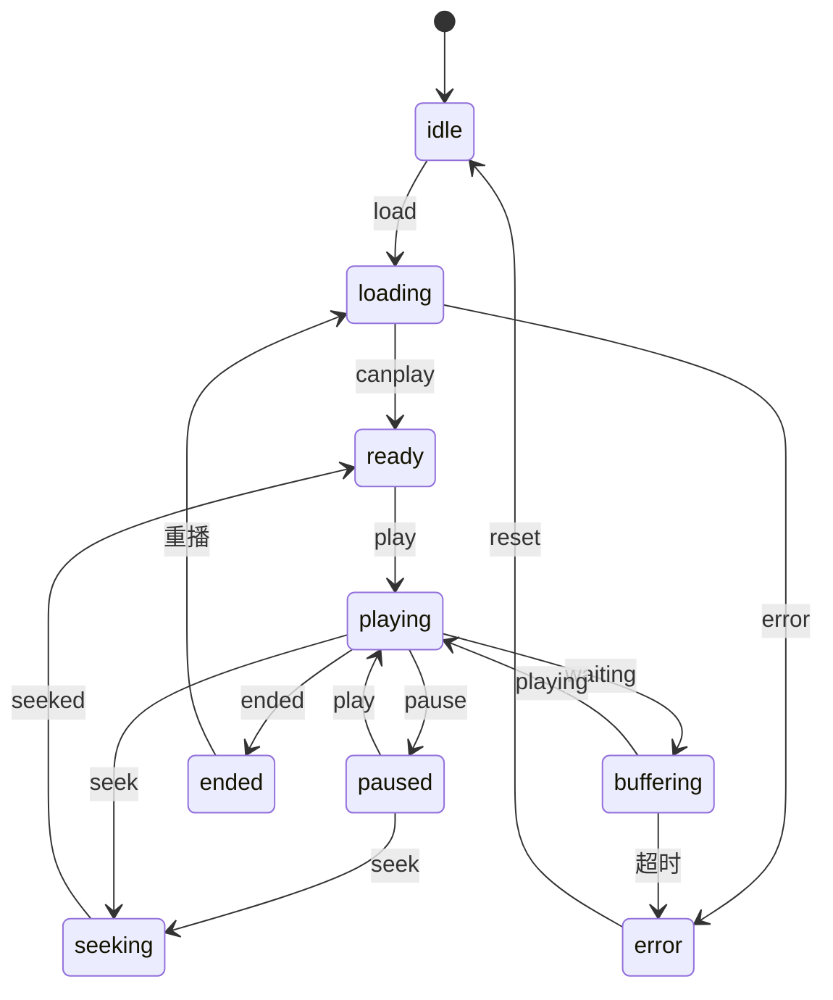

```javascript
// 播放器状态机：迁移表 + 事件驱动
class PlayerStateMachine {
  static TRANSITIONS = {
    idle: ['loading'],
    loading: ['ready', 'error'],
    ready: ['playing', 'loading'],
    playing: ['paused', 'buffering', 'seeking', 'ended', 'error'],
    paused: ['playing', 'seeking', 'loading'],
    buffering: ['playing', 'error', 'loading'],
    seeking: ['ready', 'playing', 'buffering'],
    ended: ['loading', 'idle'],
    error: ['idle'],
  };
  constructor(video) {
    this.state = 'idle'; this.subs = new Set();
    const map = {
      loadstart: 'loading', canplay: 'ready', play: 'playing',
      pause: 'paused', waiting: 'buffering', playing: 'playing',
      seeking: 'seeking', seeked: 'ready', ended: 'ended', error: 'error',
    };
    for (const [evt, next] of Object.entries(map)) {
      video.addEventListener(evt, () => this.transition(next, evt));
    }
  }
  transition(next, evt) {
    const allowed = PlayerStateMachine.TRANSITIONS[this.state] ?? [];
    if (!allowed.includes(next)) return console.warn(`非法迁移 ${this.state}→${next}`, evt);
    const prev = this.state;
    this.state = next;
    this.subs.forEach((fn) => fn(next, prev, evt));
  }
  on(fn) { this.subs.add(fn); return () => this.subs.delete(fn); }
}
```

### AV-055：首帧（秒开）优化有哪些手段？完整清单？（高频）
**答**：
- 服务侧：封面图占位 + 流式加载、首 GOP 缓存（直播边缘缓存最近一个 I 帧）、分片前移（第一个分片小且含 IDR）、转码时 moov 前置（MP4 faststart）。
- 网络侧：预加载下个视频分片（列表页预取 m3u8+首分片）、HTTPDNS 防劫持、多 CDN 竞速、HTTP/2 多路复用。
- 播放器侧：`preload="auto"` + autoplay muted、首帧渲染前不加载全量、`video.play()` 前置 readyState 检查、解码器预热（首次解码慢）。
- 指标定义：首帧时间 = 用户触发播放 → 视频第一帧上屏（用 `requestVideoFrameCallback` 精确测量）。
- 数据说话：给每个阶段打点（DNS/连接/请求/首包/解码），定位慢在哪一环。

```javascript
// 首帧耗时精确测量 + 预加载管理器
class FirstFrameTracker {
  constructor(video) {
    this.startTs = 0;
    video.addEventListener('loadstart', () => (this.startTs = performance.now()));
    if (video.requestVideoFrameCallback) {
      video.requestVideoFrameCallback(() => {
        this.report(performance.now() - this.startTs); // 第一帧真实上屏
      });
    } else {
      video.addEventListener('loadeddata', () => this.report(performance.now() - this.startTs));
    }
  }
  report(ms) { console.log('首帧耗时', Math.round(ms), 'ms'); /* 上报 */ }
}

// 列表页预加载：滑动停止时预取下一个视频的首个分片
class Preloader {
  constructor() { this.cache = new Map(); }
  async prefetch(url) {
    if (this.cache.has(url)) return;
    const controller = new AbortController();
    this.cache.set(url, controller);
    try {
      const res = await fetch(url, { signal: controller.signal, priority: 'low' });
      await res.arrayBuffer(); // 预热 CDN 与本地连接
    } catch (e) { this.cache.delete(url); }
  }
  cancel(url) { this.cache.get(url)?.abort(); this.cache.delete(url); }
}
```

### AV-056：卡顿监控怎么做？卡顿率指标怎么定义？
**答**：
- 卡顿检测：`waiting`（缓冲不足）触发开始计时，`playing`（恢复）结束，一次完整等待 = 一次 stall 事件。
- 卡顿率两种口径：频次口径 = stall 次数 / 播放时长分钟数；时长口径 = 累计 stall 时长 / 观看总时长（更贴近 QoE）。
- 归因字段必备：发生时刻、buffer 水位、当前码率、网络（RTT/下行）、设备与解码信息，否则只知卡不知因。
- 长卡告警：单次 stall > 5s 视为播放失败，触发降级或重载。
- 帧级卡顿（渲染丢帧）：`getVideoPlaybackQuality().droppedVideoFrames` 或 rVFC 帧间隔异常，用于定位解码跟不上。

```javascript
// stall 监控 + 卡顿率计算
class StallMonitor {
  constructor(video, { longStallMs = 5000 } = {}) {
    this.stats = { count: 0, totalMs: 0, events: [] };
    video.addEventListener('waiting', () => {
      this.stallStart = performance.now();
      this.timer = setTimeout(() => this.onLongStall?.(), longStallMs);
    });
    video.addEventListener('playing', () => {
      if (!this.stallStart) return;
      clearTimeout(this.timer);
      const dur = performance.now() - this.stallStart;
      this.stallStart = 0;
      this.stats.count++; this.stats.totalMs += dur;
      this.stats.events.push({
        at: video.currentTime, ms: Math.round(dur),
        bufferAhead: video.buffered.length
          ? video.buffered.end(video.buffered.length - 1) - video.currentTime : 0,
      });
    });
    setInterval(() => this.report(video), 10000);
  }
  stallRate() {
    const playMin = playDurationSec / 60;
    return {
      perMin: +(this.stats.count / playMin).toFixed(2),   // 次/分钟
      timeRatio: +(this.stats.totalMs / 1000 / playDurationSec * 100).toFixed(2) + '%', // 时长占比
    };
  }
  report(video) {
    const q = video.getVideoPlaybackQuality?.();
    if (q) this.stats.dropped = q.droppedVideoFrames; // 渲染丢帧
    /* 上报 this.stats */
  }
}
```

### AV-057：播放失败的降级链怎么设计？（HLS→FLV→MP4）
**答**：
- 源列表按优先级编排：HLS（自适应+生态好）→ HTTP-FLV（延迟低）→ MP4（点播兜底），同一内容服务端通常多协议同出。
- 触发降级的条件：连续 N 次网络错误、当前协议不支持（isTypeSupported 失败）、错误码 MEDIA_ERR_SRC_NOT_SUPPORTED。
- 降级要点：记录当前播放进度，新源 ready 后 seek 回原位（直播则跳到边缘）；每个源尝试时限（如 10s 超时算失败）。
- 配置中心下发源列表：事故时可热切换顺序，无需发版。
- 全链失败：展示错误页 + 重试按钮 + 客服入口，同时上报完整降级轨迹。

```javascript
// 多协议降级播放器
class FallbackPlayer {
  constructor(video, sources) {
    this.video = video;
    this.sources = sources; // [{ type:'hls', url }, { type:'flv', url }, { type:'mp4', url }]
    this.idx = 0; this.trail = [];
  }
  async play(fromSec = 0) {
    while (this.idx < this.sources.length) {
      const src = this.sources[this.idx];
      try {
        await this.attach(src, fromSec); // 挂载源（hls.js/flv.js/原生）
        await Promise.race([
          new Promise((r) => this.video.addEventListener('playing', r, { once: true })),
          new Promise((_, rej) => setTimeout(() => rej(new Error('timeout')), 10_000)),
        ]);
        return src.type; // 成功
      } catch (e) {
        this.trail.push({ type: src.type, url: src.url, err: String(e) });
        this.destroyEngine(); this.idx++; // 换下一个源
      }
    }
    this.showFatal(); // 全链失败
  }
  async attach({ type, url }, fromSec) {
    if (type === 'hls' && !this.video.canPlayType('application/vnd.apple.mpegurl')) {
      this.engine = new Hls.default({ maxBufferLength: 10 });
      this.engine.loadSource(url);
      this.engine.attachMedia(this.video);
    } else if (type === 'flv') {
      this.engine = flvjs.createPlayer({ type: 'flv', url, isLive: true });
      this.engine.attachMediaElement(this.video); this.engine.load();
    } else {
      this.video.src = url;
    }
    this.video.currentTime = fromSec;
    await this.video.play();
  }
  destroyEngine() { this.engine?.destroy?.(); this.engine = null; this.video.removeAttribute('src'); }
}
```

### AV-058：多码率切换的 UI 与策略怎么做？（手动+自动 ABR）
**答**：
- 双模式：AUTO（默认，ABR 引擎决策）+ 手动档位（用户强制锁定，此时关闭 ABR 升档，只在卡顿时仍允许降档）。
- UI 细节：清晰度菜单展示当前档位与"自动"标记；切换立即生效（直播需对齐 I 帧）；切档后短暂 toast 提示。
- hls.js 对应：`hls.currentLevel`（立即切换）、`nextLevel`（下个分片生效，推荐）、`loadLevel`、`autoLevelEnabled`。
- 策略参数：`capLevelToPlayerSize`（按播放器尺寸封顶档位）、`startLevel`（起始档位，弱网低起点）。
- 埋点：每次切档记录 from/to/trigger(auto|manual)/buffer 水位，优化 ABR 参数。

```javascript
// 清晰度控制器：auto 与手动档互斥
class QualityController {
  constructor(hls) {
    this.hls = hls;
    hls.on(Hls.default.Events.LEVEL_SWITCHED, (_, d) => this.onChange?.(d.level));
  }
  get levels() {
    return this.hls.levels.map((l, i) => ({
      index: i, height: l.height, bitrate: l.bitrate,
      current: i === this.hls.currentLevel,
    }));
  }
  setAuto() {
    this.hls.currentLevel = -1;         // -1 = 自动 ABR
    this.manual = false;
  }
  setManual(index) {
    this.manual = true;
    this.hls.nextLevel = index;         // 下个分片生效，避免打断
    this.hls.autoLevelCapping = index;  // 手动模式下也限制 ABR 不会升回去
  }
  // 弱网例外：手动锁定 1080p 但持续卡顿，仍降一档并提示
  onStallTooLong() {
    if (this.manual && this.hls.currentLevel > 0) {
      this.hls.nextLevel = this.hls.currentLevel - 1;
      this.notifyUser('网络不佳，已暂时降低清晰度');
    }
  }
}
```

### AV-059：弹幕系统怎么与播放器结合？渲染同步与防遮挡怎么做？
**答**：
- 时钟对齐：弹幕以 `video.currentTime` 为唯一调度时钟，timeupdate（或 rVFC 更精细）驱动每帧弹出计算；seek 后清屏重排。
- 渲染方案三选：DOM（简单但上百条会卡）、Canvas（性能好，主流选择）、CSS transform + will-change（中等量级）。
- 轨道分配算法：每行记录"最后一条弹幕的右边缘离开时间"，新弹幕找不重叠的轨道，找不到就丢或重叠显示（可配置密度上限）。
- 防遮挡：顶部/底部半屏模式避开主体（AI 检测人躲弹幕是进阶）；全屏时限制弹幕密度；进度条 hover 缩略图时暂停弹幕。
- 弹幕池：内容按秒预取（查表 currentTime±1s），WebSocket 实时增量合并。

```javascript
// Canvas 弹幕引擎：轨道分配 + 播放器时钟同步
class DanmakuEngine {
  constructor(canvas, video) {
    this.ctx = canvas.getContext('2d');
    this.video = video;
    this.lanes = 8;
    this.laneState = Array(this.lanes).fill({ rightAt: -1 }); // 每轨最后一条的离场时间
    this.pending = new Map(); // 秒 -> 弹幕数组
    requestAnimationFrame(() => this.loop());
  }
  addQueue(list) { list.forEach((d) => (this.pending.get(Math.floor(d.time)) ?? this.pending.set(Math.floor(d.time), []).get(Math.floor(d.time))).push(d)); }
  spawn() {
    const t = Math.floor(this.video.currentTime);
    const batch = this.pending.get(t) ?? [];
    for (const d of batch) {
      const lane = this.pickLane(d);
      if (lane >= 0) this.active.push({ ...d, lane, x: this.ctx.canvas.width, speed: 120 + Math.random() * 60 });
    }
    this.pending.delete(t);
  }
  pickLane(d) {
    const now = this.video.currentTime;
    const width = this.ctx.measureText(d.text).width + 20;
    for (let i = 0; i < this.lanes; i++) {
      // 该轨道上一条弹幕的尾部是否已完全进入屏幕
      if (this.laneState[i].rightAt + width / 180 < now) {
        this.laneState[i] = { rightAt: now, width };
        return i;
      }
    }
    return -1; // 满载丢弃，保证不重叠
  }
  loop() {
    if (!this.video.paused) {
      this.spawn();
      const { width: w, height: h } = this.ctx.canvas;
      this.ctx.clearRect(0, 0, w, h);
      this.active ??= [];
      this.active = this.active.filter((d) => {
        d.x -= d.speed / 60;
        this.ctx.fillText(d.text, d.x, (d.lane + 1) * (h / this.lanes));
        return d.x + 150 > 0;
      });
    }
    requestAnimationFrame(() => this.loop());
  }
  reset(time) { this.active = []; this.laneState.fill({ rightAt: -1 }); } // seek 后清屏
}
```

### AV-060：视频进度条缩略图预览（sprite 图）怎么做？
**答**：
- 原理：服务端预生成雪碧图（每隔 N 秒抽一帧拼成网格大图）+ VTT/JSON 索引；hover 进度条时按时间算出帧位置，`background-position` 偏移显示。
- sprite 优点：一次请求拿到全部缩略图，无逐帧请求风暴；缺点：大视频图很大，需分片 sprite（每 100 帧一张）。
- 无 sprite 兜底：动态 seek 生成——隐藏 video 设置 currentTime，等 seeked 后 drawImage 到 canvas（慢且有并发限制，仅适合短视频）。
- VTT 标准格式（webvtt thumbnail）逐条描述时间区间与 sprite 坐标，Safari 原生支持。
- 体验细节：hover 防抖、预加载相邻 sprite、retina 2x 图。

```text
WEBVTT

00:00:00.000 --> 00:00:05.000
thumbnails.jpg#xywh=0,0,160,90

00:00:05.000 --> 00:00:10.000
thumbnails.jpg#xywh=160,0,160,90

00:00:10.000 --> 00:00:15.000
thumbnails.jpg#xywh=320,0,160,90
```

```javascript
// 进度条 hover 缩略图：解析 sprite 索引 + 动态 seek 兜底
class ThumbnailPreview {
  constructor(video, spriteUrl, { interval = 5, cols = 10, tw = 160, th = 90 } = {}) {
    this.video = video; this.sprite = spriteUrl;
    Object.assign(this, { interval, cols, tw, th });
  }
  // 方案一：sprite 定位
  spriteStyleFor(time) {
    const idx = Math.floor(time / this.interval);
    const col = idx % this.cols, row = Math.floor(idx / this.cols);
    return {
      backgroundImage: `url(${this.sprite})`,
      backgroundPosition: `-${col * this.tw}px -${row * this.th}px`,
      width: this.tw + 'px', height: this.th + 'px',
    };
  }
  // 方案二：隐藏 video seek 生成（兜底，串行防抖）
  async captureAt(time) {
    const v = this.hiddenVideo ??= Object.assign(document.createElement('video'), {
      src: this.video.currentSrc, muted: true, preload: 'auto', crossOrigin: 'anonymous',
    });
    v.currentTime = time;
    await new Promise((r) => v.addEventListener('seeked', r, { once: true }));
    const c = document.createElement('canvas');
    c.width = this.tw; c.height = this.th;
    c.getContext('2d').drawImage(v, 0, 0, this.tw, this.th);
    return c.toDataURL('image/jpeg', 0.6);
  }
}
```

---

## 九、实时通信工程（AV-061 ~ AV-067）

### AV-061：信令服务的可靠传输怎么设计？（重连/去重/序号）
**答**：
- WebSocket 会断：客户端要指数退避重连（1s→2s→4s，上限 30s，带抖动防雪崩）；重连成功后要"状态恢复"（重新 join、重新拉房间快照）。
- 消息可靠性：每条消息带单调递增 seq，接收方检测空洞主动请求补发（或服务端提供拉取接口），处理乱序与去重（seen-set + 过期清理）。
- 服务端视角：连接与业务会话分离——连接断了会话保活（宽限期 30s），期间消息缓存，重连后补投。
- 幂等设计：offer/answer 天然幂等（后到覆盖），candidate 可能重复（addIceCandidate 重复同一候选无害但要容错）。
- 监控：信令 RTT ping/pong、重连次数、消息积压深度。

```javascript
// 可靠信令客户端：重连 + seq 去重 + 补拉
class ReliableSignaling {
  constructor(url, roomId) {
    this.url = url; this.roomId = roomId;
    this.lastSeq = 0; this.seen = new Set(); this.handlers = new Map();
    this.backoff = 1000;
    this.connect();
  }
  connect() {
    this.ws = new WebSocket(this.url);
    this.ws.onopen = async () => {
      this.backoff = 1000;
      await this.restore(); // 重连后恢复业务状态
    };
    this.ws.onmessage = (e) => this.dispatch(JSON.parse(e.data));
    this.ws.onclose = () => {
      const jitter = Math.random() * 300;
      setTimeout(() => this.connect(), this.backoff + jitter); // 指数退避+抖动
      this.backoff = Math.min(this.backoff * 2, 30_000);
    };
  }
  async dispatch(msg) {
    if (msg.seq) {
      if (this.seen.has(msg.seq)) return;      // 去重
      this.seen.add(msg.seq);
      if (msg.seq > this.lastSeq + 1) await this.fetchMissed(this.lastSeq, msg.seq); // 补空洞
      this.lastSeq = Math.max(this.lastSeq, msg.seq);
      if (this.seen.size > 500) this.seen = new Set([...this.seen].slice(-200)); // 防膨胀
    }
    this.handlers.get(msg.type)?.(msg);
  }
  async fetchMissed(from, to) {
    const missed = await fetch(`/api/signal?room=${this.roomId}&from=${from}&to=${to}`).then((r) => r.json());
    missed.forEach((m) => this.handlers.get(m.type)?.(m));
  }
  async restore() {
    this.send({ type: 'join', roomId: this.roomId, lastSeq: this.lastSeq }); // 服务端据此补投
  }
  send(msg) { this.ws.readyState === 1 && this.ws.send(JSON.stringify(msg)); }
  on(type, fn) { this.handlers.set(type, fn); }
}
```

### AV-062：心跳与断线重连的完整方案？
**答**：
- 双层心跳：WebSocket 层 ping/pong（协议级）+ 业务层 heartbeat（带用户状态）；服务端超时未收到心跳即判定离线并广播。
- 客户端判定假在线：发送心跳后超时（如 10s）无 pong 即主动 close 触发重连，不等 TCP 超时（可能几分钟）。
- 重连后区分场景：网络闪断（快速恢复，信令补投即可）vs 长时间离线（重新走完整建连：join → 重新协商媒体）。
- WebRTC 侧联动：`connectionState === 'disconnected'` 不立即动作（可能自愈），`failed` 才触发 ICE restart 或全量重连。
- 页面可见性联动：切后台时浏览器限流 WebSocket，回前台 visibilitychange 时立即心跳 + 检查状态。

```javascript
// 心跳看门狗 + 页面可见性联动
class Heartbeat {
  constructor(sig, { interval = 5000, pongTimeout = 10_000 } = {}) {
    this.sig = sig; this.interval = interval; this.pongTimeout = pongTimeout;
    sig.on('pong', () => clearTimeout(this.watchdog));
    document.addEventListener('visibilitychange', () => {
      if (!document.hidden) this.beat(); // 回前台立即心跳
    });
    this.timer = setInterval(() => this.beat(), interval);
  }
  beat() {
    this.sig.send({ type: 'ping', ts: Date.now() });
    clearTimeout(this.watchdog);
    this.watchdog = setTimeout(() => {
      console.warn('心跳超时，主动断开触发重连');
      this.sig.ws.close(); // 触发 ReliableSignaling 的 onclose 重连逻辑
    }, this.pongTimeout);
  }
  stop() { clearInterval(this.timer); clearTimeout(this.watchdog); }
}

// WebRTC 连接态与信令重连联动
function bindRecovery(pc, sig) {
  let disconnectedAt = 0;
  pc.addEventListener('connectionstatechange', () => {
    const s = pc.connectionState;
    if (s === 'disconnected') {
      disconnectedAt = Date.now();            // 观察期，可能自愈
      setTimeout(() => {
        if (pc.connectionState === 'disconnected') pc.restartIce(); // 15s 仍未恢复则重启 ICE
      }, 15_000);
    } else if (s === 'failed') {
      sig.send({ type: 'rejoin' });           // 彻底失败：全量重连
    } else if (s === 'connected') {
      disconnectedAt = 0;
    }
  });
}
```

### AV-063：房间管理（加入/离开/成员同步）怎么做？
**答**：
- 加入流程：authenticate → join(roomId) → 服务端返回房间快照（成员列表、已有流信息、房主）→ 本地按快照渲染 → 再对每个已存在成员主动发起订阅/建连。
- 成员变更广播：peer-joined / peer-left 全员广播；join 响应里带"你是第 N 个人"，新成员只需对已有成员做 subscriber 角色，避免 offer 冲突（新成员收流，老成员发流或由 SFU 统一）。
- 离开要显式：leave 消息 + beforeunload 兜底（sendBeacon），服务端也要有心跳超时兜底（防止极端情况僵尸成员）。
- 房主/权限模型：静音他人、踢人、锁定房间等操作走权限校验；房主掉线按策略转移。
- 一致性：成员列表以服务端为准，本地仅缓存；冲突时以房间快照全量刷新。

```javascript
// 房间管理客户端：快照 + 增量同步
class RoomManager {
  constructor(sig) {
    this.sig = sig; this.peers = new Map();
    sig.on('room-snapshot', ({ peers }) => {
      this.peers = new Map(peers.map((p) => [p.uid, p]));
      this.onSnapshot?.(peers); // 对每个已有 peer 建立订阅
    });
    sig.on('peer-joined', (p) => { this.peers.set(p.uid, p); this.onJoin?.(p); });
    sig.on('peer-left', ({ uid }) => { this.peers.delete(uid); this.onLeave?.(uid); });
  }
  async join(roomId, profile) {
    const res = await fetch('/api/rooms/join', {
      method: 'POST',
      headers: { 'Content-Type': 'application/json' },
      body: JSON.stringify({ roomId, profile }),
    });
    const { token, snapshot } = await res.json();
    this.sig.send({ type: 'join', roomId, token, profile });
    return snapshot;
  }
  leave() {
    navigator.sendBeacon('/api/rooms/leave', JSON.stringify({ roomId: this.roomId, uid: this.uid }));
    this.sig.send({ type: 'leave' });
  }
}
```

### AV-064：实时消息的可靠性（ACK/重发/乱序）怎么保证？
**答**：
- 三种投递语义：至多一次（丢了就丢，如弹幕）、至少一次（ACK+重发，可能重复，如礼物计数要做幂等）、恰好一次（至少一次 + 去重 ID）。
- DataChannel 可靠模式（ordered:true）已经保证有序可靠，走类 TCP；不可靠模式（maxRetransmits:0）类 UDP，适合高频状态（位置同步）。
- 自研 ACK：消息带 msgId，接收方回 ack；发送方维护 unacked 队列，超时重发（指数退避），收到 ack 移除。
- 乱序处理：按 (senderId, seq) 排序窗口，先缓存后交付；状态类消息只认最新（last-write-wins）。
- 持久化兜底：重要消息（连麦申请）写服务端队列，离线成员重连后拉取，防"只发给了在线的人"。

```javascript
// DataChannel 上的 ACK/重发层
class ReliableChannel {
  constructor(dc) {
    this.dc = dc; this.unacked = new Map(); this.nextId = 0;
    dc.onmessage = (e) => {
      const m = JSON.parse(e.data);
      if (m.ack) { this.unacked.delete(m.ack); return; } // 对端确认
      dc.send(JSON.stringify({ ack: m.id }));            // 立即回 ACK
      this.onMessage?.(m.payload);
    };
  }
  send(payload, { maxRetry = 5 } = {}) {
    const id = `${this.dc.label}-${this.nextId++}`;
    const frame = JSON.stringify({ id, payload });
    let retry = 0;
    const attempt = () => {
      if (!this.unacked.has(id)) return;      // 已确认
      if (retry++ >= maxRetry) return this.onFail?.(id); // 彻底失败上抛
      this.dc.readyState === 'open' && this.dc.send(frame);
      const delay = 300 * 2 ** retry + Math.random() * 100;
      this.unacked.set(id, setTimeout(attempt, delay));
    };
    this.unacked.set(id, setTimeout(attempt, 0));
  }
  // 高频不可靠消息走独立通道
  static createFastChannel(pc, label) {
    return pc.createDataChannel(label, { ordered: false, maxRetransmits: 0 });
  }
}
```

### AV-065：房间人数有上限吗？大了怎么办（分房/级联）？
**答**：
- 上限因素：下行带宽（每人订阅 N 路 = O(N²) 总带宽）、客户端渲染（几十路 video 标签+解码器）、SFU 转发 CPU。经验值：纯订阅模式 100+ 可行，全员互看一般 ≤16~25 路。
- 全员互看优化：只订阅"活跃说话人"（音频 RMS 排序前 N 路）+ 其余只听；simulcast 给小窗发低档。
- 分房/分组：大房间拆成多个子房间（分组讨论），主会场+分组自由迁移；主持型大会走"主讲推流 + 观众订阅单流"模式。
- 级联 SFU：房间流在多个 SFU 间复制，观众就近接入；跨机房延迟增加 50~150ms。
- 容量估算公式：SFU 出带宽 = 订阅数 × 码率；1000 人看 1Mbps 流 = 单 SFU 1Gbps，必然级联或转 CDN。

```javascript
// 大房间优化：只订阅活跃说话人 Top-N
class ActiveSpeakerSubscriber {
  constructor(room, { maxVideoSubs = 9 } = {}) {
    this.room = room; this.maxVideoSubs = maxVideoSubs; this.audioLevels = new Map();
  }
  onAudioLevel(uid, rms) { this.audioLevels.set(uid, rms); }
  async recomputeSubscriptions() {
    const ranked = [...this.audioLevels.entries()]
      .sort((a, b) => b[1] - a[1])
      .map(([uid]) => uid);
    const shouldWatch = new Set(ranked.slice(0, this.maxVideoSubs));
    for (const uid of this.room.peers.keys()) {
      if (shouldWatch.has(uid) && !this.watching.has(uid)) await this.room.subscribeVideo(uid, 'mid');
      if (!shouldWatch.has(uid) && this.watching.has(uid)) await this.room.unsubscribeVideo(uid);
    }
    this.watching = shouldWatch;
  }
}
// 每 2 秒根据说话热度刷新订阅
setInterval(() => subscriber.recomputeSubscriptions(), 2000);
```

### AV-066：MediaStream 的生命周期怎么管理？（轨道结束/设备热插拔）
**答**：
- 轨道结束的来源：用户点浏览器"停止共享"（ended 事件）、设备拔出、对端 removeTrack、mute 属性变化（静音不是 ended）。
- 清理原则：track.stop() 释放硬件（关摄像头灯）；PC.close() 后再 stop 本地轨；移除 video.srcObject 前先置 null 释放解码器。
- mute/unmute 监听用于 UI（头像遮罩），ended 用于移除画面与释放资源，两者语义不同。
- 热插拔：devicechange 事件 + 检查当前 track 是否仍 readyState === 'live'；被拔设备要自动切到剩余设备。
- 内存泄漏高发点：每次 ontrack 都创建新 video 元素不释放、旧 MediaStream 未停轨、事件监听未解绑。

```javascript
// MediaStream 生命周期管家
class TrackLifecycle {
  constructor(stream) {
    this.stream = stream;
    stream.getTracks().forEach((t) => this.bind(t));
  }
  bind(track) {
    track.addEventListener('ended', () => {
      console.log('轨道结束', track.kind);
      this.onEnded?.(track);       // UI 移除 + 资源释放
      this.cleanupIfEmpty();
    });
    track.addEventListener('mute', () => this.onMute?.(track, true));   // 静音≠结束
    track.addEventListener('unmute', () => this.onMute?.(track, false));
  }
  cleanupIfEmpty() {
    const live = this.stream.getTracks().filter((t) => t.readyState === 'live');
    if (!live.length) {
      this.video.srcObject = null;  // 先解绑再清引用，防解码器泄漏
      this.video = null;
    }
  }
  // 设备热插拔自愈
  async autoHeal(getStream) {
    navigator.mediaDevices.addEventListener('devicechange', async () => {
      const dead = this.stream.getTracks().filter((t) => t.readyState === 'ended');
      if (!dead.length) return;
      const fresh = await getStream(); // 重新采集可用设备
      dead.forEach((old) => {
        const repl = fresh.getTracks().find((t) => t.kind === old.kind);
        repl && old.onreplace?.(repl); // 调用方执行 replaceTrack
      });
    });
  }
  destroy() {
    this.stream.getTracks().forEach((t) => t.readyState === 'live' && t.stop());
  }
}
```

### AV-067：WebRTC getStats 排查要看哪些关键指标？（高频压轴）
**答**：
- 连接层：candidate-pair（是否 succeeded、nominated、当前 RTT）、local/remote-candidate 类型（relay = 走中继）、DTLS/ICE 状态。
- 发送侧：outbound-rtp 的 targetBitrate/framesPerSecond/encoderImplementation、retransmittedPacketsOut（重传比例）。
- 接收侧：inbound-rtp 的 packetsLost/丢包率、jitter（抖动）、jitterBufferDelay（端到端延迟主要增量）、framesDropped（解码跟不上）。
- 音频专项：audioLevel、concealedSamples（PLC 掩盖的丢包时长，听感"机器人声"的元凶）。
- 方法论：定时采样存时间序列 → 定位拐点（丢包陡增/带宽骤降）→ 结合 candidate 类型与时间点还原现场。

```javascript
// WebRTC 健康采样器：关键指标时间序列
class WebRTCHealthProbe {
  constructor(pc, { interval = 2000 } = {}) {
    this.pc = pc;
    this.timer = setInterval(() => this.sample(), interval);
    this.series = [];
  }
  async sample() {
    const stats = await this.pc.getStats();
    const snap = { ts: Date.now() };
    stats.forEach((r) => {
      switch (r.type) {
        case 'candidate-pair':
          if (r.state === 'succeeded' && r.nominated) {
            snap.rttMs = Math.round((r.currentRoundTripTime ?? 0) * 1000);
            snap.outboundBps = r.availableOutgoingBitrate ?? 0;
          }
          break;
        case 'inbound-rtp':
          if (r.kind === 'video') {
            snap.lossRate = +(r.packetsLost /
              Math.max(1, (r.packetsLost ?? 0) + (r.packetsReceived ?? 0)) * 100).toFixed(1);
            snap.jitterMs = Math.round((r.jitter ?? 0) * 1000);
            snap.jbDelaySec = +(r.jitterBufferDelay / Math.max(1, r.jitterBufferEmittedCount)).toFixed(3);
            snap.fps = r.framesPerSecond;
            snap.dropped = r.framesDropped;
          }
          if (r.kind === 'audio') snap.concealRatio = r.concealedSamples / Math.max(1, r.totalSamplesReceived);
          break;
      }
    });
    this.series.push(snap);
    if (this.series.length > 300) this.series.shift(); // 10 分钟窗口
    if ((snap.lossRate ?? 0) > 15 || (snap.rttMs ?? 0) > 500) this.onDegraded?.(snap);
  }
  stop() { clearInterval(this.timer); }
}
```

---

## 十、综合实战（AV-068 ~ AV-100）

### AV-068：请设计一个网页版多人视频会议系统（完整架构）。（高频压轴）
**答**：
- 三层架构：UI 层（宫格/聚焦视图、控制条、聊天面板）、信令层（WebSocket 房间服务器，承载成员/SDP/消息）、媒体层（SFU，承载 RTP 转发与 simulcast 选层）。
- 数据流：join → 快照渲染 → publish（simulcast 三档）→ 按需 consume 他人 → 活跃说话人驱动宫格布局。
- 关键子系统：设备管理（AV-042）、弱网降级（AV-039）、录制（AV-038）、字幕（AV-076）。
- 大房间策略：>16 人自动切换"订阅 Top-N 活跃说话人 + 其余仅音频"。
- 可用性：信令重连补投（AV-061）、ICE restart（AV-062）、全量状态恢复。

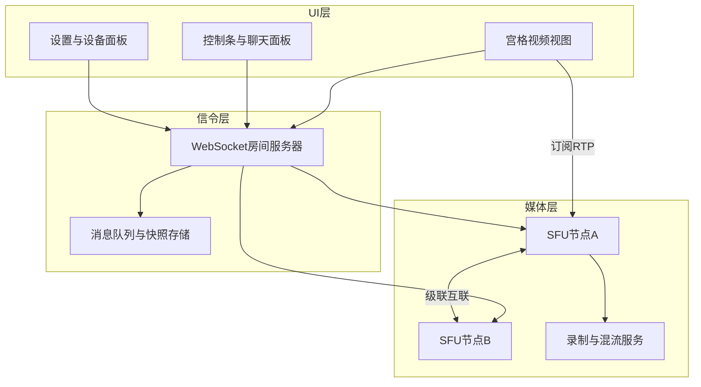

```javascript
// 会议核心编排器（串联信令/SFU/UI 三层）
class Meeting {
  constructor(roomId) {
    this.sig = new ReliableSignaling(SIGNAL_URL, roomId);
    this.room = new RoomManager(this.sig);
    this.media = new SfuClient(this.sig);      // 封装 publish/consume
    this.adaptor = null;                        // 弱网适配
  }
  async start() {
    const local = await openWithFriendlyError(); // AV-043 错误兜底
    this.localStream = local;
    await this.media.publish(local, { simulcast: true });
    const snapshot = await this.room.join(ROOM_ID, { name: userName });
    this.renderGrid(snapshot);
    this.room.onJoin = (p) => this.media.consume(p.uid);      // 新成员
    this.room.onLeave = (uid) => this.removeGridItem(uid);    // 移除画面
    this.adaptor = new NetworkAdaptor(this.media.pc, this.media.senders);
    setInterval(() => this.adaptor.check(), 3000);
  }
  renderGrid({ peers }) {
    peers.forEach((p) => {
      const cell = createGridCell(p);
      if (p.hasVideo) this.media.consume(p.uid).then((s) => (cell.video.srcObject = s));
      grid.appendChild(cell);
    });
  }
  removeGridItem(uid) { grid.querySelector(`#cell-${uid}`)?.remove(); this.media.closeConsumer(uid); }
  async leave() { this.room.leave(); this.media.closeAll(); this.localStream?.getTracks().forEach((t) => t.stop()); }
}
```

### AV-069：请设计一个直播观看页（拉流/弹幕/礼物/清晰度切换）。（高频压轴）
**答**：
- 模块：拉流播放器（HLS/FLV 多源降级）、弹幕层（Canvas 引擎）、礼物动效层（Lottie/Cocos 序列帧 + 队列调度）、清晰度切换、状态与埋点。
- 拉流策略：默认 FLV 低延迟，iOS 兜底 HLS；清晰度切换用 `switchURL` 平滑换源；进房秒开靠封面 + 预取。
- 礼物队列：连击合并（同 uid 同礼物 3s 窗口计数）、动效优先级（火箭插队）、动画结束才释放 DOM。
- 消息通道：IM WebSocket 独立于媒体，断线重连后按房间消息序号补拉。
- 性能红线：低端机降级（关闭弹幕动效、降低同时渲染弹幕数）；离开房间必须 destroy 播放器与 WebSocket。

```javascript
// 直播观看页编排
class LiveWatchPage {
  async mount({ roomId, protocols }) {
    // 1. 播放器：FLV 优先，HLS 兜底
    this.player = new FallbackPlayer(this.video, protocols); // AV-057 降级链
    await this.player.play(0);
    // 2. 弹幕引擎（挂播放器时钟）
    this.danmaku = new DanmakuEngine(danmakuCanvas, this.video);
    // 3. IM 消息
    this.im = new ReliableSignaling(IM_URL, roomId);
    this.im.on('danmaku', (m) => this.danmaku.addQueue([{ time: 0, text: m.text }]));
    this.im.on('gift', (m) => this.giftQueue.push(m));
    // 4. 礼物连击合并
    this.giftQueue = new GiftQueue({ mergeWindow: 3000, onPlay: (g) => this.playGiftAnim(g) });
    // 5. 清晰度 UI
    this.quality = new QualityMenu(this.player, { onChange: (lv) => this.player.switchLevel(lv) });
  }
  destroy() {
    this.player.destroyEngine();   // 防 MSE 与解码器泄漏
    this.danmaku.destroy();
    this.im.ws.close();
    this.giftQueue.destroy();
  }
}

// 礼物连击合并队列
class GiftQueue {
  constructor({ mergeWindow, onPlay }) {
    this.merge = new Map(); this.onPlay = onPlay;
    this.playing = false;
  }
  push(g) {
    const key = `${g.uid}-${g.giftId}`;
    const cur = this.merge.get(key) ?? { ...g, count: 0 };
    cur.count += g.count ?? 1;
    clearTimeout(cur.timer);
    cur.timer = setTimeout(() => this.enqueue(cur), 3000); // 3s 窗口合并连击
    this.merge.set(key, cur);
  }
  enqueue(g) { this.queue ??= []; this.queue.push(g); this.drain(); }
  async drain() {
    if (this.playing || !this.queue?.length) return;
    this.playing = true;
    while (this.queue.length) await this.onPlay(this.queue.shift()); // 串行播放防重叠
    this.playing = false;
  }
}
```

### AV-070：请设计一个直播推流页（采集/编码/推流全链路）。
**答**：
- 链路：设备采集（AV-041/043）→ 本地预览（muted 防啸叫）→ 编码推流（WebRTC 推流进 RTC 网或 WebSocket 自研推流）→ 服务端混流转 CDN。
- 推流方式选择：互动直播用 WebRTC（WHIP 或私有信令），纯推流可用自研 WS + MediaRecorder 分片（延迟高）或 WebCodecs 编码 + WebSocket 发包（可控性强）。
- 预览与监控：本地画面 + 实时码率/帧率/丢包面板（getStats 采样），开播前"设备检测"向导。
- 中断处理：网络切换（WiFi→4G）触发重推；切后台移动端停止采集要提示并自动恢复。
- 关键守则：muted 本地预览（防回声）、开播前权限与带宽预检、推流状态与云端确认双保险。

```javascript
// WebRTC 推流页核心
class LivePushPage {
  async setupPreview() {
    this.stream = await openWithFriendlyError();
    this.preview.srcObject = this.stream;
    this.preview.muted = true; // 本地预览必静音防啸叫
  }
  async precheck() { // 开播前检测：设备+带宽
    const speed = await measureUplink(); // 上传测速，不足 2Mbps 建议降档
    if (speed < 2_000_000) return { ok: false, msg: '上行带宽不足，建议使用 720p' };
    return { ok: true };
  }
  async startPush() {
    this.pc = new RTCPeerConnection({ iceServers: ICE_CONF });
    this.stream.getTracks().forEach((t) => this.pc.addTrack(t, this.stream));
    await capVideoBitrate(this.pc.getSenders()[1], 2_500_000); // AV-032 限速
    await whipPublish(this.pc, WHIP_ENDPOINT, PUSH_TOKEN);      // AV-021 推流
    this.probe = new WebRTCHealthProbe(this.pc);                // 推流质量监控
    this.watchBackground();
  }
  watchBackground() { // 移动端切后台采集会被暂停
    document.addEventListener('visibilitychange', () => {
      if (document.hidden) this.signal.send({ type: 'stream-stall', ts: Date.now() });
      else this.stream.getVideoTracks().forEach((t) => t.applyConstraints({})); // 触发恢复
    });
  }
  stop() { this.stream.getTracks().forEach((t) => t.stop()); this.pc?.close(); this.probe?.stop(); }
}
```

### AV-071：请设计一个在线教育课堂（师生连麦/举手/白板共享）。
**答**：
- 角色模型：老师（publish 大屏 + 白板权限）、学生（默认只听，举手后老师批准上麦）、旁听（纯观看）。
- 举手流程：学生点举手 → 信令广播 → 老师端弹窗 → 同意后服务端改角色 → 学生 publish（连麦）→ 下麦回收轨道。
- 白板共享：老师 getDisplayMedia 共享白板应用窗口（或 Web 白板同步 DataChannel 指令），走 replaceTrack 切主画面。
- 课堂纪律：全员静音、点名、禁言列表；连麦学生开 AEC 防啸叫（AV-040）。
- 稳定性：上课中断线自动重连并恢复角色状态（服务端持久化角色表）；录制供回放。

```javascript
// 课堂角色与举手状态机
class Classroom {
  constructor(sig) {
    this.sig = sig;
    sig.on('hand-raise', ({ uid }) => this.onHandRaise?.(uid));
    sig.on('role-changed', ({ uid, role }) => this.applyRole(uid, role));
  }
  async raiseHand() { this.sig.send({ type: 'hand-raise', uid: ME }); }
  async approve(uid) { // 老师批准：服务端改角色并广播
    await fetch('/api/class/approve', { method: 'POST', body: JSON.stringify({ uid }) });
  }
  async applyRole(uid, role) {
    if (uid === ME && role === 'speaker') {
      // 上麦：从 recvonly 转为 sendrecv，新增上行轨道触发 renegotiation
      const mic = await navigator.mediaDevices.getUserMedia({
        audio: { echoCancellation: true, noiseSuppression: true }, // 连麦必开 AEC
      });
      await this.sfu.publish(mic);
      this.handBtn.hide();
    }
    if (uid === ME && role === 'student') this.sfu.unpublishAll(); // 下麦回收
    seatList.update(uid, role);
  }
  async shareWhiteboard() { // 白板：共享窗口 + DataChannel 同步笔迹
    const board = await navigator.mediaDevices.getDisplayMedia({ video: true, audio: false });
    await this.videoSender.replaceTrack(board.getVideoTracks()[0]);
  }
}
```

### AV-072：请设计一个语音聊天室（上麦/排麦/混音）。
**答**：
- 形态：多人房间只传音频（省带宽），麦位 8 个，观众可申请排麦；聊天/礼物走 IM。
- 音频链路：每路麦克风 getUserMedia（AEC 开）→ publish 到 SFU → 客户端 Web Audio 混音台统一音量/声像（AV-050）。
- 排麦逻辑：麦位占用表（服务端权威），申请 → 校验空位 → 锁定 → 广播麦位变更；抱下麦/禁麦权限给房主。
- 体验细节：说话气泡（AnalyserNode RMS 驱动）、背景音乐混入（音乐模式关 DSP）、礼物音效走 SfxPool（AV-053）。
- 移动端关键：AudioContext 手势解锁（AV-048）、锁屏后台采集暂停处理。

```javascript
// 语音聊天室音频中枢
class VoiceRoomAudio {
  constructor() {
    this.desk = null;   // Web Audio 混音台
    this.mics = new Map(); // uid -> 音量检测器
  }
  async enterRoom() {
    await AudioEngine.instance.ensureRunning(); // 手势解锁
    this.desk = new MixingDesk(AudioEngine.instance.ctx);
  }
  async takeMicSeat() {
    const stream = await navigator.mediaDevices.getUserMedia({
      audio: PRESETS.voice, // 开 AEC/ANS
    });
    await this.sfu.publish(stream);
    const vol = new AudioVisualizer(stream, myBubbleCanvas);
    vol.onSpeaking = () => highlightMyBubble(); // 说话气泡
  }
  onRemoteAudio(uid, stream) {
    // 远端音频统一进混音台：按麦位排布设置声像
    const pos = seatIndex(uid); // 0~7
    this.desk.addChannel(uid, stream, { pan: (pos % 4 - 1.5) / 1.5, volume: 1 });
    this.mics.set(uid, stream);
  }
  async playBgm(url) { // 背景音乐：独立通道，音乐模式原始流
    const bgm = await navigator.mediaDevices.getUserMedia({
      audio: { ...PRESETS.music, deviceId: 'virtual-bgm' },
    }).catch(() => null);
    bgm && this.desk.addChannel('bgm', bgm, { volume: 0.3 });
  }
  leave() { this.mics.forEach((s) => s.getTracks().forEach((t) => t.stop())); }
}
```

### AV-073：请设计一个视频客服系统（排队/转接/满意度）。
**答**：
- 全流程：用户发起 → 排队（队列服务分配坐席）→ 建连（坐席侧 accept 后交换 SDP）→ 通话 → 转接（媒体与业务双转）→ 评价（满意度 + 截图/录像归档）。
- 排队体验：位置实时刷新 + 预估等待时间 + 排队中可留言/回拨；服务端按坐席空闲数调度。
- 转接实现：A 坐席发起 → 服务端把用户流订阅权转给 B 坐席 → B consume 既有流（SFU 中 producer 不变，无需用户重新推流）——这是 SFU 架构转接零感的优势。
- 可靠性：坐席端状态机（空闲/通话/小休），异常挂断自动回收；通话全程录制（合规提示）。
- 归档：满意度结果 + 录制文件 ID + 通话质量指标（RTT/丢包）关联工单。

```javascript
// 客服会话状态机与转接
class CustomerServiceSession {
  async joinQueue(skillGroup) {
    const { queueId } = await fetch('/api/cs/queue', { method: 'POST',
      body: JSON.stringify({ skillGroup }) }).then((r) => r.json());
    this.pollPosition(queueId); // 实时刷新排队位置与预估时长
  }
  async onAssigned(agentId) { // 排到坐席，开始建连
    await this.sfu.consume(agentId);   // 看坐席
    await this.sfu.publish(await getUserMedia({ video: true, audio: true })); // 被看
  }
  async transferTo(agentB) { // 坐席A发起转接：客户端只发指令，媒体由 SFU 无感切换
    await this.signal.rpc('cs:transfer', { session: this.id, from: agentA, to: agentB });
    // 用户端无感知：producer 不变，B 坐席订阅同一 producer
  }
  async finish() {
    const quality = this.probe.series.at(-1); // 通话质量随满意度归档
    await fetch('/api/cs/feedback', { method: 'POST', body: JSON.stringify({
      sessionId: this.id, score: 5, tags: ['专业'], quality,
    }) });
  }
}
```

### AV-074：请设计一个在线考试监考系统（多路摄像头/切屏检测）。
**答**：
- 采集三路：正面摄像头、屏幕共享（getDisplayMedia 全屏）、第二设备角度（手机扫码入房推流）。
- 切屏检测：`visibilitychange` + `blur/focus` 事件记录离开时刻与时长；`document.hidden` 期间禁止答题（或标记违规）；iframe 场景监听 `pointerleave`。
- 违规识别：多路流上传 SFU 供 AI 分析（多人入镜、目光偏离），前端只负责采集与上传，不在端上做重推理。
- 断流应对：任一路采集中断立即标记并提示，30s 未恢复按规则处理；全程录制取证。
- 合规要点：考前隐私告知勾选、数据加密存储与保留期限。

```javascript
// 监考采集与切屏检测
class ProctorCollector {
  async startAll() {
    this.face = await navigator.mediaDevices.getUserMedia({ video: { width: 640 } });
    this.screen = await navigator.mediaDevices.getDisplayMedia({ video: true });
    this.faceTrack = this.face.getVideoTracks()[0];
    this.screenTrack = this.screen.getVideoTracks()[0];
    await this.sfu.publishBoth(this.faceTrack, this.screenTrack);
    this.bindVisibilityAudit();
    this.watchTrackHealth();
  }
  bindVisibilityAudit() {
    const log = (type) => fetch('/api/proctor/audit', { method: 'POST',
      body: JSON.stringify({ examId, type, at: Date.now() }), keepalive: true });
    document.addEventListener('visibilitychange', () =>
      document.hidden ? log('leave-page') : log('back-page'));
    window.addEventListener('blur', () => log('window-blur'));
    window.addEventListener('focus', () => log('window-focus'));
  }
  watchTrackHealth() { // 任一路中断即告警
    [this.faceTrack, this.screenTrack].forEach((t) =>
      t.addEventListener('ended', () => {
        this.flag('stream-ended', t.label);
        setTimeout(() => this.tryRestart(t), 5000); // 5s 自动重采
      }));
  }
  async tryRestart(track) {
    if (track.kind === 'video' && track === this.screenTrack) {
      const s = await navigator.mediaDevices.getDisplayMedia({ video: true }).catch(() => null);
      s && this.videoSender.replaceTrack(s.getVideoTracks()[0]);
    }
  }
}
```

### AV-075：请设计一个网页版视频剪辑器（时间轴/轨道/预览）。（高频压轴）
**答**：
- 架构分层：素材库（文件/拍摄导入）、时间轴（多轨道拖拽，Canvas 或 DOM 渲染）、预览引擎（按时间轴合成画面）、导出（WebCodecs 逐帧编码或服务端渲染）。
- 预览引擎：把"当前时间"映射到各轨道素材的入点偏移，活跃片段 drawImage 到预览 canvas；音频轨用 AudioBufferSourceNode 调度。
- 时间轴数据模型：clips = [{ trackId, start, duration, srcInPoint, effects }]，所有操作（拖拽/裁剪/分割）都是对这个不可变模型的变换。
- 导出：WebCodecs VideoEncoder 逐帧渲染编码 + mp4 复用（mp4-muxer），音频 AudioEncoder 同理；长视频走服务端渲染队列。
- 性能：素材解码缓存（LRU）、缩略图懒生成、时间轴虚拟滚动。

```javascript
// 剪辑器核心：时间轴模型 + 预览合成
class EditorTimeline {
  constructor() { this.clips = []; } // [{ trackId, start, duration, src, srcIn }]
  splitAt(time) { // 在 time 处分割所有跨过的 clip
    this.clips = this.clips.flatMap((c) => {
      if (time <= c.start || time >= c.start + c.duration) return [c];
      const left = { ...c, duration: time - c.start };
      const right = { ...c, start: time, duration: c.start + c.duration - time,
        srcIn: c.srcIn + (time - c.start) };
      return [left, right];
    });
  }
  activeClipsAt(time) {
    return this.clips.filter((c) => time >= c.start && time < c.start + c.duration);
  }
}

class PreviewEngine {
  constructor(timeline) { this.tl = timeline; this.ctx = previewCanvas.getContext('2d'); }
  async seek(t) {
    const ctx2d = this.ctx;
    for (const clip of this.tl.activeClipsAt(t).filter((c) => c.trackId === 'v1')) {
      const frame = await this.decoder.getFrame(clip.src, clip.srcIn + (t - clip.start));
      ctx2d.drawImage(frame, 0, 0, ctx2d.canvas.width, ctx2d.canvas.height);
    }
  }
  async export({ fps = 30 } = {}) { // WebCodecs 导出
    const encoder = new VideoEncoder({
      output: (chunk) => muxer.addVideoChunk(chunk),
      error: (e) => console.error(e),
    });
    encoder.configure({ codec: 'avc1.640028', width: 1920, height: 1080, bitrate: 8e6 });
    for (let t = 0; t < this.tl.duration; t += 1 / fps) {
      await this.seek(t); // 渲染该帧
      const frame = new VideoFrame(previewCanvas, { timestamp: t * 1e6 });
      encoder.encode(frame, { keyFrame: (t * fps) % 60 === 0 });
      frame.close();
    }
    await encoder.flush();
  }
}
```

### AV-076：请设计一个实时字幕系统（ASR 接入/实时字幕/翻译）。
**答**：
- 语音输入：对端 WebRTC 音频轨 → AudioWorklet 抽取 PCM（16k 单声道）→ WebSocket 分片上传 ASR 引擎 → 流式返回中间/最终结果。
- 实时性策略：中间结果（partial）高频刷新上屏（灰色），最终结果（final）定稿上屏（白色）；延迟控制在 1s 内。
- 字幕渲染：贴在视频下沿，最长 N 字自动换行滚动；两人对话按说话人着色（服务端 speaker diarization）。
- 翻译：final 结果送翻译接口，双行显示原文/译文；翻译迟到时先显示原文再补译文。
- 工程要点：PCM 降采样（48k→16k，AudioWorklet 中做）、静音检测 VAD 省流量、字幕与音轨时间戳对齐（点播回放场景按 PTS 展示）。

```javascript
// PCM 抽取与 ASR 流式对接
class LiveCaptioner {
  async start(stream) {
    const ctx = new AudioContext({ sampleRate: 16000 });
    await ctx.audioWorklet.addModule('pcm-capture.js');
    const src = ctx.createMediaStreamSource(stream);
    this.node = new AudioWorkletNode(ctx, 'pcm-capture-processor');
    this.node.port.onmessage = ({ data }) => {
      if (data.rms > 0.01) this.ws.send(data.pcm.buffer); // VAD 过滤静音
    };
    src.connect(this.node); // 不连 destination，纯抽取
    this.ws = new WebSocket('wss://asr.example.com/stream');
    this.ws.onmessage = (e) => {
      const { partial, final, speaker } = JSON.parse(e.data);
      if (partial) this.renderPartial(partial, speaker);   // 灰色实时刷新
      if (final) this.commitFinal(final, speaker);         // 定稿 + 触发翻译
    };
  }
  commitFinal(text, speaker) {
    this.subtitleEl.renderFinal(text, speaker);
    fetch('/api/translate', { method: 'POST', body: JSON.stringify({ text, to: 'en' }) })
      .then((r) => r.json()).then(({ text: en }) => this.subtitleEl.renderTranslation(en));
  }
}
```

```javascript
// pcm-capture.js — AudioWorklet 降采样与分片
class PcmCaptureProcessor extends AudioWorkletProcessor {
  constructor() {
    super();
    this.ratio = sampleRate / 16000; // 48k→16k 抽取
    this.buffer = [];
    this.pos = 0;
  }
  process(inputs) {
    const ch = inputs[0][0];
    if (!ch) return true;
    for (let i = 0; i < ch.length; i += this.ratio) {
      this.buffer.push(ch[Math.floor(i)]); // 简单抽取降采样
    }
    if (this.buffer.length >= 1600) { // 100ms 一片
      const pcm = new Float32Array(this.buffer);
      this.buffer = [];
      let sum = 0;
      for (const v of pcm) sum += v * v;
      this.port.postMessage({ pcm, rms: Math.sqrt(sum / pcm.length) });
    }
    return true;
  }
}
registerProcessor('pcm-capture-processor', PcmCaptureProcessor);
```

### AV-077：请设计一个虚拟主播（驱动/渲染链路概览）。
**答**：
- 链路：真人驱动信号（摄像头人脸/表情捕捉，或音频驱动口型）→ 参数映射（blendshape/骨骼参数）→ 2D/3D 渲染（PixiJS Live2D / Three.js MMD / VRM 模型）→ 合成推流。
- 面捕方案：MediaPipe Face Mesh（浏览器端 468 点）、云端面捕 SDK（更准更高延迟）；嘴型驱动可用音量 RMS 简化实现。
- 渲染要点：Live2D 用参数化变形网格，WebGL 渲染；VRM 走 three-vrm，表情用 blendshape 权重插值平滑。
- 合成输出：渲染 canvas.captureStream() + 麦克风音轨合并（RTCPeerConnection addTrack 两条）推流。
- 性能预算：面捕 + 渲染 + 编码三重 GPU 消耗，移动端需降模型精度。

```javascript
// MediaPipe 面捕驱动 Live2D 参数（简化）
import { FaceMesh } from '@mediapipe/face_mesh';

class VtuberDriver {
  async init(model) {
    this.model = model; // Live2D 模型句柄
    this.fm = new FaceMesh({ locateFile: (f) => `https://cdn.jsdelivr.net/npm/@mediapipe/face_mesh/${f}` });
    this.fm.onResults((r) => this.apply(r.multiFaceLandmarks?.[0]));
    const cam = await navigator.mediaDevices.getUserMedia({ video: { width: 320 } }); // 低分辨率省算力
    this.video.srcObject = cam;
    const tick = () => { this.fm.send({ image: this.video }); requestAnimationFrame(tick); };
    tick();
  }
  apply(lm) {
    if (!lm) return;
    // 嘴部开合：上下唇关键点距离
    const mouthOpen = Math.hypot(lm[13].x - lm[14].x, lm[13].y - lm[14].y);
    // 头部姿态：用左右脸颊点近似估计
    const yaw = (lm[454].x - lm[234].x) - 0.3;
    this.model.setParameter('ParamMouthOpenY', Math.min(1, mouthOpen * 8)); // 平滑在模型层做 lerp
    this.model.setParameter('ParamAngleY', Math.max(-30, Math.min(30, (yaw - 0.1) * 100)));
  }
  getOutputTrack() { // 渲染 canvas 变成推流轨道
    return this.renderCanvas.captureStream(30).getVideoTracks()[0];
  }
}
```

### AV-078：请设计一个亚秒延迟互动直播（Half-Second 方案概览）。
**答**：
- 目标：观众端延迟 <800ms 且保留弹幕/投票互动，成本介于 RTC 与 CDN 之间。
- 路线一（主流）：RTC 网做"一对多扇出"——主播推 RTMP/WebRTC 进 RTC 服务，服务端用 WebRTC 向观众直推（SFU 大扇出 + 级联），延迟 500ms~1s。
- 路线二：CDN 侧 WebRTC 化（厂商提供 WHEP 拉流 + 边缘 SFU），观众走 HTTP 信令就近接入。
- 播放端要点：禁大 buffer（jitter buffer 50~150ms）、关 ABR 改 simulcast 选层、延迟超标追帧（0.95/1.1 倍速微调）。
- 互动同步：互动事件（投票/红包）带服务器时间戳，观众端按时间戳对齐展示，避免与画面错位。

```javascript
// 亚秒直播观众端：WHEP 拉流 + 低延迟参数
class HalfSecondViewer {
  async play(whepUrl) {
    this.pc = new RTCPeerConnection({
      iceServers: ICE_CONF,
      // RTCRtpReceiver 抖动缓冲在浏览器内部，能控的是播放侧
    });
    this.pc.addTransceiver('video', { direction: 'recvonly' });
    this.pc.addTransceiver('audio', { direction: 'recvonly' });
    this.pc.ontrack = (e) => (this.video.srcObject = e.streams[0]);
    const offer = await this.pc.createOffer();
    await this.pc.setLocalDescription(offer);
    const res = await fetch(whepUrl, {
      method: 'POST',
      headers: { 'Content-Type': 'application/sdp' },
      body: this.pc.localDescription.sdp,
    });
    await this.pc.setRemoteDescription({ type: 'answer', sdp: await res.text() });
    this.keepLowLatency();
  }
  keepLowLatency() { // 延迟测量与追帧
    setInterval(() => {
      const b = this.video.buffered;
      if (!b.length) return;
      const latency = b.end(b.length - 1) - this.video.currentTime;
      if (latency > 1.0) this.video.playbackRate = 1.1;       // 加速追
      else if (latency < 0.3) this.video.playbackRate = 0.95; // 防追过头
      else this.video.playbackRate = 1;
    }, 1000);
  }
}
```

### AV-079：请设计一个多端互通会议（小程序/App/Web）。
**答**：
- 互通的本质：统一信令协议 + 统一媒体接入（SFU 对各端一视同仁）+ 各端 SDK 封装同一套业务语义（房间/角色/麦位）。
- 各端差异：Web 走浏览器 WebRTC；小程序用 live-pusher/live-player（RTMP 私有链路或微信同层 RTC）；App 用原生 SDK。差异被服务端转协议抹平（小程序 RTMP 进 → 服务端转 RTP 进 SFU）。
- 对齐问题：各端时间戳基准不同，混流/录制以服务端时钟为准；消息序号全局统一。
- 能力降级：小程序不支持 simulcast → 服务端转码出多档；Web 端不支持 H265 → 协商回落 H264。
- 联调方法论：以信令协议文档 + 时序图为契约，各端独立跑通"回环测试"再互通。

```javascript
// 统一信令契约（各端共同遵守的协议定义）
// 统一协议 schema（节选）
const SIGNAL_PROTOCOL = {
  'join.req':   { roomId: 'string', token: 'string', clientType: 'web|miniprogram|app', sdkVersion: 'string' },
  'join.resp':  { code: 'number', selfUid: 'string', snapshot: 'PeerSnapshot' },
  'media.pub':  { sdp: 'string', tracks: [{ kind: 'audio|video', simulcast: 'boolean' }] },
  'media.ans':  { sdp: 'string' },
  'ice.cand':   { candidate: 'IceCandidate' },
  'room.evt':   { event: 'peer-joined|peer-left|role-changed', payload: 'object' },
};
// 小程序端适配器：live-pusher/RTMP 进 RTC 网
const miniAdapter = {
  async publish(roomId, streamName) {
    const pushUrl = await fetch(`/api/rtmp/url?room=${roomId}&stream=${streamName}`)
      .then((r) => r.json());
    const ctx = wx.createLivePusherContext();
    return new Promise((resolve, reject) =>
      ctx.start({ url: pushUrl.rtmp, mode: 'RTC', success: resolve, fail: reject }));
    // 服务端把 RTMP 转 RTP 注册进 SFU，其余端正常 consume
  },
};
```

### AV-080：播放器内存泄漏排查案例。
**答**：
- 现象：列表页滑动切换 20+ 视频后页面卡死，Chrome 内存超 2GB。
- 定位：Performance Monitor 看 JS Heap 与 DOM Nodes 双增长；Memory 快照对比发现大量 detached video 元素与 SourceBuffer 未释放。
- 根因：切换时只改了 src 未销毁 hls.js 实例，MSE 的 SourceBuffer 与 buffer 持续累积；旧 video 元素被事件闭包持有无法 GC。
- 修复：统一的 destroy 链（hls.destroy → srcObject=null → removeAttribute src → 解绑事件 → remove DOM）+ 对象池复用 video 元素。
- 预防：组件 unmount 生命周期挂 destroy 钩子 + 长跑自动化测试（切换 1000 次断言内存回归）。

```javascript
// 播放器实例池 + 完整销毁链
class VideoInstancePool {
  constructor(size = 3) { this.pool = Array.from({ length: size }, () => this.create()); }
  create() {
    const v = document.createElement('video');
    v.muted = true; v.playsInline = true;
    v.dataset.hls = '';
    return v;
  }
  acquire(src, hlsFactory) {
    const v = this.pool.pop() ?? this.create();
    if (src.endsWith('.m3u8') && !v.canPlayType('application/vnd.apple.mpegurl')) {
      v.dataset.hls = '1';
      v._hls = hlsFactory(v, src); // hls = new Hls(); hls.attachMedia(v)
    } else {
      v.src = src;
    }
    return v;
  }
  release(v) { // 关键：完整销毁链，防泄漏
    v._hls?.destroy(); delete v._hls;          // 1. 销毁 MSE 与 SourceBuffer
    v.pause();
    v.srcObject = null;                        // 2. 解绑流
    v.removeAttribute('src'); v.load();        // 3. 释放网络与解码器
    v.replaceChildren();                       // 4. 清空内部字幕 track 节点
    v.cloneNode; // 事件匿名监听无法解绑 → 池化复用替代重复创建，闭包随元素复用被覆盖
    this.pool.push(v);
  }
}
```

### AV-081：直播页卡顿排查案例。
**答**：
- 现象：大促直播间大量用户反馈画面卡顿，卡顿率从 0.5% 涨到 5%。
- 排查路径：监控聚合 → 按 CDN 厂商/地区/运营商分维对比 → 发现某 CDN 华东节点回源超时率 20%。
- 客户端归因字段验证：stall 事件里 buffer 水位为 0 + fetch 耗时 >2s，确认是分片拉取慢而非解码慢。
- 处置：调度降权该 CDN 节点 → 客户端多 CDN 竞速兜底（AV-023）→ 失败分片立即换域名重试。
- 复盘沉淀：卡顿归因三件套（buffer 水位 / 网络耗时 / 解码帧率）必须默认埋点，事故时才有数据可用。

```javascript
// 卡顿归因采样器：把"卡"拆成 网络慢 or 解码慢
class StallForensics {
  constructor(video, loader) {
    this.video = video; this.loader = loader;
    video.addEventListener('waiting', async () => {
      const snapshot = {
        ts: Date.now(),
        bufferAhead: 0,
        lastSegmentMs: this.loader.lastDownloadMs,   // 上个分片下载耗时
        fps: 0,
        decodeQueue: 0,
      };
      const b = video.buffered;
      if (b.length) snapshot.bufferAhead = +(b.end(b.length - 1) - video.currentTime).toFixed(2);
      const s = await video.getVideoPlaybackQuality?.();
      const stats = await (video.webkitDroppedFrameCount ? null : Promise.resolve(null));
      // 简化：用 rVFC 估计真实渲染帧率
      let frames = 0;
      const t0 = performance.now();
      const cb = () => { frames++; if (performance.now() - t0 < 1000) video.requestVideoFrameCallback(cb); };
      video.requestVideoFrameCallback(cb);
      setTimeout(() => {
        snapshot.fps = frames;
        const cause = snapshot.lastSegmentMs > 1500 ? 'network'
          : (snapshot.fps < 10 ? 'decode' : 'unknown');
        report({ ...snapshot, cause }); // network=CDN问题 decode=设备问题
      }, 1100);
    });
  }
}
```

### AV-082：用户反馈"有回声/自己听到自己"，怎么排查？
**答**：
- 先分类：本端回声（自己说话自己听到延迟的回声）通常对端外放且 AEC 未生效；多人房间回声通常是"某个人的设备在转发所有人声音"。
- 快速二分：让回声接收方全员静音排查定位"声源者"；声源者戴耳机测试，戴了就消失 → AEC/外放问题。
- 技术检查项：约束里 echoCancellation 是否被关闭（连麦场景必须开）；是否把"未经 AEC 的原始流"错误推给了 WebRTC；是否同时播放 Web Audio 处理后的音轨（双路声音，一路带 AEC 一路不带）。
- 浏览器 AEC 限制：蓝牙耳机 HFP 档位自带回声、部分安卓 WebView 无 AEC，需用 `getSettings()` 验证。
- 兜底方案：检测到疑似回声（双向音频同时活跃且 RTT 稳定）自动提示戴耳机或强制外放静音。

```javascript
// AEC 生效验证与回声定位辅助
async function verifyAecActive() {
  const stream = await navigator.mediaDevices.getUserMedia({
    audio: { echoCancellation: true, noiseSuppression: true },
  });
  const s = stream.getAudioTracks()[0].getSettings();
  console.log('约束回读', s);
  // 部分浏览器不回读 echoCancellation，需实际测试：
  // 播放一段测试音 + 同时录音，比对录音中是否含测试音残片
  const ctx = new AudioContext();
  const testTone = ctx.createOscillator();
  testTone.frequency.value = 1000;
  const rec = ctx.createScriptProcessor(4096, 1, 1);
  let leaked = 0;
  rec.onaudioprocess = (e) => {
    const data = e.inputBuffer.getChannelData(0);
    const energy = data.reduce((a, x) => a + x * x, 0);
    if (energy > 1e-4) leaked++; // 采集到能量说明回声泄漏
  };
  testTone.connect(ctx.destination); // 外放
  ctx.createMediaStreamSource(stream).connect(rec);
  setTimeout(() => {
    testTone.stop(); rec.disconnect();
    console.warn(leaked > 3 ? '疑似回声泄漏，建议提示戴耳机' : 'AEC 正常');
  }, 3000);
}
```

### AV-083：直播画面花屏/黑屏怎么排查？（高频压轴）
**答**：
- 黑屏分类：无画面有声（视频轨没渲染/解码器不支持）、全黑（主播端没画面或黑帧）、加载中黑屏（分片未到）。先区分"有没有声"。
- 花屏根因：丢包后从 P 帧开始解码、关键帧缺失、编码端分辨率中途变更但客户端未感知、时间戳错乱。
- 客户端自愈：检测到连续 N 秒 videoWidth=0（黑屏）或 decodedFrames 不增长（花屏停滞）→ 触发 reload/seek 回直播边缘/请求 PLI（WebRTC 端）。
- WebRTC 专项：接收端发现 framesDropped 激增 + framesDecoded 停滞，发 PLI 请求关键帧；MSE 端花屏常因 demux 拼帧错误（flv.js 时间戳补偿失败）。
- 上报字段必备：videoWidth/Height、decodedFrames、droppedFrames、当前分片 URL，服务端配合查转码切片完整性。

```javascript
// 花屏/黑屏自愈检测器
class PictureHealthGuard {
  constructor(video, { blackMs = 4000, stallMs = 6000 } = {}) {
    this.video = video;
    this.timer = setInterval(() => this.check(), 1000);
    this.blackSince = 0; this.lastDecoded = 0; this.stallSince = 0;
  }
  check() {
    const v = this.video;
    // 黑屏：解码帧在涨但画面尺寸为 0 或视频轨静默
    const isBlack = v.readyState >= 2 && (!v.videoWidth || !v.videoHeight);
    if (isBlack && !this.blackSince) this.blackSince = Date.now();
    if (!isBlack) this.blackSince = 0;
    if (this.blackSince && Date.now() - this.blackSince > 4000) {
      this.recover('black-screen');
    }
    // 花屏停滞：解码帧数不增长但 should playing
    const q = v.getVideoPlaybackQuality?.();
    const decoded = q?.totalVideoFrames ?? 0;
    if (!v.paused && decoded === this.lastDecoded) {
      this.stallSince ??= Date.now();
      if (Date.now() - this.stallSince > 6000) this.recover('decode-stall');
    } else {
      this.stallSince = 0;
    }
    this.lastDecoded = decoded;
  }
  recover(reason) {
    report({ type: 'picture-recover', reason, currentTime: this.video.currentTime });
    this.blackSince = 0; this.stallSince = 0;
    const t = this.video.currentTime;
    this.video.load();          // 重载当前源
    this.video.currentTime = t;
    this.video.play().catch(() => {});
  }
}
```

### AV-084：音画不同步排查案例。
**答**：
- 定位口诀：先确认是"恒定偏移"还是"逐渐漂移"。恒定偏移多为转码/封装时 PTS 错位；漂移多为两端时钟基不同（音视频轨采样时钟差异）。
- 客户端线索：MSE 双 SourceBuffer 场景，比对 audio/video 的 buffered 起点偏差；`video.currentTime` 对齐的是视频轨，音频若起点偏 200ms 就全程不同步。
- 常见根因：FLV 上行时间戳基线不统一（flv.js 补偿失败）、转码服务音视频 GOP 对不齐、WebRTC 中 audio 与 video 走不同 simulcast 层时 delay 各异、蓝牙耳机延迟突变。
- WebRTC 端：`jitterBufferDelay` 音视频差异过大即端侧缓冲不对齐；服务端看 RTP 时间戳与 NTP 映射（RTCP SR）。
- 缓解手段：播放器提供 ±毫秒级音画微调（用户手动校准），并把校准值上报用于服务端修复。

```javascript
// 音画偏移测量与微调
class AVSyncProbe {
  constructor(video, audioSb) { this.video = video; this.audioSb = audioSb; }
  measure() {
    const vStart = this.findStart(this.video.buffered);
    // 音轨起点：从 MSE audio SourceBuffer 的 trackBuffer 或用 buffered 估计
    const aStart = this.findStart(this.audioBuffered);
    const offset = +(aStart - vStart).toFixed(3);
    if (Math.abs(offset) > 0.05) {
      console.warn('音画起点偏差', offset, 's');
      this.applyOffset(offset);
    }
    return offset;
  }
  findStart(ranges) { return ranges?.length ? ranges.start(0) : 0; }
  set audioBuffered(r) { this._ab = r; }
  get audioBuffered() { return this._ab; }
  applyOffset(sec) { // 用户/自动微调：audio element 可用 currentTime 微移
    if (this.audioEl) this.audioEl.currentTime += sec;
  }
}
// WebRTC 端：音视频 jitterBuffer 延迟差异监控
function jbDiffProbe(pc) {
  return setInterval(async () => {
    const s = await pc.getStats();
    let av = 0, vv = 0;
    s.forEach((r) => {
      if (r.type !== 'inbound-rtp') return;
      if (r.kind === 'audio') av = r.jitterBufferDelay / Math.max(1, r.jitterBufferEmittedCount);
      if (r.kind === 'video') vv = r.jitterBufferDelay / Math.max(1, r.jitterBufferEmittedCount);
    });
    if (Math.abs(av - vv) > 0.15) console.warn('端侧音画缓冲偏差', (av - vv).toFixed(3), 's');
  }, 3000);
}
```

### AV-085：WebRTC 连接失败的排查 SOP。（高频压轴）
**答**：
- SOP 六步：① 确认 HTTPS 与浏览器兼容；② 信令是否通（offer/answer 是否互换成功）；③ SDP 是否合法（方向/编码交集）；④ ICE 状态走到哪（checking/failed）；⑤ 候选类型与 NAT 环境（强制 relay 测试）；⑥ DTLS/证书指纹与防火墙端口。
- 快速分诊表：connectionState=failed + 无 relay 候选 → TURN 未配/凭证错；有 relay 仍 failed → 端口被防火墙封（换 443/tcp）；never beyond checking → SDP 不匹配或候选未交换。
- 工具：chrome://webrtc-internals 看 createOffer/setRemoteDescription 报错与候选配对；ICE restart 验证网络瞬断；对端 getStats 对比双向候选。
- 日志采集：每次失败上报 signalingState/connectionState/iceConnectionState/候选摘要 + webrtc-internals dump，形成可回放的现场。
- 典型案例：企业内网封 UDP → 必须 turn tcp/443；华为部分机型 VP9 硬解不支持 → SDP 编码集合裁剪。

```javascript
// 连接失败诊断器：自动输出 SOP 结论
class WebrtcDiagnostic {
  async diagnose(pc, sigLog) {
    const report = { sig: {}, ice: {}, sdp: {} };
    // 1. 信令
    report.sig.offerSent = sigLog.some((m) => m.type === 'offer');
    report.sig.answerGot = sigLog.some((m) => m.type === 'answer');
    report.sig.candidatesExchanged = sigLog.filter((m) => m.type === 'candidate').length;
    // 2. 状态
    report.ice.state = pc.iceConnectionState;         // failed?
    report.ice.conn = pc.connectionState;
    // 3. 候选与选路
    const stats = await pc.getStats();
    const cands = [], pairs = [];
    stats.forEach((r) => {
      if (r.type === 'local-candidate') cands.push(r.candidateType);
      if (r.type === 'candidate-pair') pairs.push(r);
    });
    report.ice.hasRelay = cands.includes('relay');
    report.ice.bestPair = pairs.find((p) => p.state === 'succeeded')?.nominated ? 'ok' : 'none';
    // 4. 结论
    let verdict = 'unknown';
    if (!report.sig.answerGot) verdict = 'signaling-broken';
    else if (!report.ice.hasRelay && report.ice.state === 'failed') verdict = 'need-turn-or-credential';
    else if (report.ice.hasRelay && report.ice.state === 'failed') verdict = 'firewall-blocked-ports';
    else if (report.ice.state === 'failed' && report.sig.candidatesExchanged === 0) verdict = 'candidates-not-exchanged';
    return { verdict, report };
  }
}
```

### AV-086：移动端 H5 播放有哪些经典适配坑？（inline/全屏/内核差异）（高频）
**答**：
- iOS：video 默认全屏接管，必须 `playsinline + webkit-playsinline`；低电量模式/自动播放策略拦截；音量 API 只读（volume 属性无效），静音只能 muted。
- 安卓 X5/UC 内核：`x5-video-player-type="h5-page"` 同层播放，否则视频永远盖在 DOM 上；部分内核 video 尺寸必须撑满或居中，否则黑边。
- 全屏差异：`requestFullscreen` iOS 不支持 video 元素级（用 `webkitEnterFullscreen`）；安卓自定义全屏 = 播放器容器 transform + 横竖屏锁定（screen.orientation.lock）。
- 事件差异：timeupdate 频率不一（iOS 250ms~1s），进度条动画要用 rAF 插值；iOS seek 后可能触发完整 load。
- 实践清单：统一封装内核检测 + 属性全集 + 静音自动播放降级（AV-010）+ 手势播放队列。

```javascript
// 移动端播放适配器：内核检测 + 全屏封装
class MobilePlayerAdapter {
  constructor(video) {
    this.v = video;
    this.kernel = this.detect();
    this.applyInlineFix();
  }
  detect() {
    const ua = navigator.userAgent;
    if (/iPhone|iPad/.test(ua)) return 'ios';
    if (/MicroMessenger/.test(ua)) return 'wechat-x5';
    if (/QQ\//.test(ua)) return 'qq-x5';
    if (/Android/.test(ua)) return 'android';
    return 'desktop';
  }
  applyInlineFix() { // 差异属性一次性补齐
    const v = this.v;
    v.setAttribute('playsinline', '');
    v.setAttribute('webkit-playsinline', '');
    v.setAttribute('x5-playsinline', '');
    if (this.kernel.includes('x5')) {
      v.setAttribute('x5-video-player-type', 'h5-page');
      v.setAttribute('x5-video-orientation', 'portraint');
    }
  }
  async requestFullscreen() { // 全屏封装：三种实现
    if (this.v.enterFullscreen) return this.v.webkitEnterFullscreen();  // iOS video 原生
    if (document.documentElement.requestFullscreen) {
      await this.container.requestFullscreen();
      try { await screen.orientation.lock('landscape'); } catch (e) {}   // 安卓锁横屏
      return;
    }
    this.container.classList.add('fake-fullscreen'); // 老内核 CSS 伪全屏
  }
}
```

### AV-087：弱网传输的 QoE 指标体系怎么建？（卡顿率/秒开率/延迟）
**答**：
- 核心指标五件套：首帧时间（秒开率 = 首帧 <1s 的会话占比）、卡顿率（stall 次数/分钟 或 stall 时长占比）、延迟（直播端到端延迟分布）、清晰度（实际播放档位分布）、错误率（播放失败/建连失败）。
- 维度切分：网络类型（WiFi/4G/5G）、地区与运营商、CDN 厂商、机型档位、协议类型，任何指标不看维度都是误导。
- 采集实现：播放器生命周期事件打点（loadstart/first-frame/stall/error）+ getStats 周期采样 + beacons 上报（unload 前 sendBeacon 防丢）。
- 指标联动分析：秒开率降 → 查 CDN 首包与预加载命中率；卡顿率升 → 查分片下载耗时分布与 buffer 水位。
- 目标基线参考：秒开率 >85%、卡顿率 <1 次/分钟、直播延迟 FLV <3s、建连成功率 >99%。

```javascript
// QoE 指标采集 SDK（播放器侧）
class QoeTracker {
  constructor(video, meta) {
    this.meta = meta; // { cdn, region, protocol, netType, device }
    this.metrics = { firstFrameMs: 0, stalls: 0, stallMs: 0, errors: 0, bytes: 0 };
    let t0 = 0;
    video.addEventListener('loadstart', () => (t0 = performance.now()));
    if (video.requestVideoFrameCallback) {
      video.requestVideoFrameCallback(() => { this.metrics.firstFrameMs = performance.now() - t0; });
    }
    video.addEventListener('waiting', () => (this.stallT = performance.now()));
    video.addEventListener('playing', () => {
      if (this.stallT) { this.metrics.stalls++; this.metrics.stallMs += performance.now() - this.stallT; this.stallT = 0; }
    });
    video.addEventListener('error', () => this.metrics.errors++);
    window.addEventListener('pagehide', () => this.flush(), { once: true }); // 离开前必报
  }
  flush() {
    navigator.sendBeacon('/api/qoe', JSON.stringify({
      ...this.meta, ...this.metrics,
      stallRate: this.metrics.stallMs / Math.max(1, playSec) * 100,
    }));
  }
}
```

### AV-088：音视频功能怎么做测试？（自动化/真机矩阵）
**答**：
- 分层测试：单元（demux/ABR 决策/状态机纯逻辑）、集成（真实拉流起播/seek/切清晰度）、E2E（双端互通：两个无头浏览器互为对端）。
- E2E 关键技巧：用合成流替代真实摄像头——`canvas.captureStream` + `getUserMedia` mock，可在 CI 稳定跑；伪音轨用 oscillator。
- 真机矩阵：iOS/安卓主流机型 × 浏览器（Safari/Chrome/微信 X5）× 网络弱化（Network Link Conditioner / Chrome throttling 丢包 10%）。
- 专项测试：弱网阶梯（丢包 5/10/20/30% 下各指标阈值）、长稳（8 小时会议内存/温度）、双端时钟对齐（音画同步用音画测试卡视频校验）。
- 断言方式：getStats 数值断言（fps/丢包）、canvas 像素抽样断言画面非黑、行为断言（重连后 ontrack 触发）。

```javascript
// Playwright E2E：合成流双端互通测试
import { test, expect } from '@playwright/test';

test('1v1 通话双端互通', async ({ browser }) => {
  // 注入合成摄像头：canvas 动画作为伪视频源
  async function withFakeCam(context) {
    await context.addInitScript(() => {
      const orig = navigator.mediaDevices.getUserMedia.bind(navigator.mediaDevices);
      navigator.mediaDevices.getUserMedia = async (constraints) => {
        const c = document.createElement('canvas');
        c.width = 640; c.height = 480;
        const g = c.getContext('2d');
        setInterval(() => {
          g.fillStyle = `hsl(${Date.now() / 100 % 360},80%,50%)`;
          g.fillRect(0, 0, 640, 480);
        }, 100);
        const stream = c.captureStream(15);
        return stream; // 伪摄像头（无音轨简化）
      };
    });
  }
  const ctxA = await browser.newContext({ permissions: ['camera', 'microphone'] });
  const ctxB = await browser.newContext({ permissions: ['camera', 'microphone'] });
  await withFakeCam(ctxA); await withFakeCam(ctxB);
  const pa = await (await ctxA.newPage()).goto('/room/1');
  const pb = await (await ctxB.newPage()).goto('/room/1');
  // 断言：B 页面出现远端画面（videoWidth > 0）
  await expect
    .poll(() => pb.evaluate(() => {
      const v = document.querySelector('video.remote');
      return v?.videoWidth ?? 0;
    }), { timeout: 15000 }).toBeGreaterThan(0);
});
```

### AV-089：CDN 成本与调度概览。
**答**：
- 成本模型：带宽计费（按峰值 Mbps 或 95 峰值）或流量计费（GB）；直播成本 ≈ 观看人次 × 观看时长 × 码率，降码率（H265/AV1）与降低高峰峰值直接省钱。
- 调度体系：DNS 调度（粗粒度）+ HTTPDNS（绕劫持、精确到 IP）+ 客户端测速纠偏；多 CDN 之间按质量与成本动态分配流量（成本优先/质量优先模式）。
- 前端配合：探测数据上报（RTT/丢包/首包）、备用域名容灾（主域名 5xx 自动切换）、预热触发（大主播开播前通知预取）。
- 削峰手段：高峰期降默认清晰度、P2P-CDN 混合分发（牺牲部分体验换成本）。
- 核算意识：前端切清晰度策略影响成本——默认档位与 capLevelToPlayerSize 是产品/成本决策不是纯技术决策。

```javascript
// 客户端多 CDN 流量分配执行器（服务端下发权重，客户端按权重选路）
class CdnScheduler {
  constructor() { this.config = null; }
  async refreshConfig() {
    this.config = await fetch('/api/cdn/weights').then((r) => r.json());
    // [{ vendor:'A', domain, weight:0.7 }, { vendor:'B', weight:0.3, backup:true }]
  }
  pick(exclude = []) {
    const pool = this.config.filter((c) => !exclude.includes(c.domain));
    const total = pool.reduce((s, c) => s + c.weight, 0);
    let r = Math.random() * total;
    for (const c of pool) { r -= c.weight; if (r <= 0) return c; }
    return pool[0];
  }
  async fetchWithFailover(path) {
    const tried = [];
    while (tried.length < this.config.length) {
      const cdn = this.pick(tried);
      tried.push(cdn.domain);
      try {
        const res = await fetch(`https://${cdn.domain}${path}`, { signal: AbortSignal.timeout(4000) });
        if (res.ok) return res;
        reportCdnError(cdn.vendor, res.status); // 质量数据回传供调度降权
      } catch (e) { reportCdnError(cdn.vendor, 'timeout'); }
    }
    throw new Error('all cdn failed');
  }
}
```

### AV-090：浏览器编解码格式兼容矩阵？怎么维护一张 support 表？（高频）
**答**：
- 关键矩阵维度：容器（MP4/WebM/TS）× 编码（H264 profile/level、H265、VP8/VP9/AV1、AAC/Opus/FLAC）× 场景（原生 canPlayType / MSE isTypeSupported / WebRTC codec）。
- 已知重点：Safari 无 MSE（旧版）但原生 HLS；H265 仅 Safari 与部分硬解设备；AV1 Chrome/安卓新版可解、iOS 17+ 才支持；WebRTC 音频强制 Opus。
- 动态探测而非硬编码：用 `MediaSource.isTypeSupported` + `RTCReceiver.getCapabilities(kind)` 运行时构建支持表，缓存到 sessionStorage。
- 服务端配合：转码输出按 UA/能力接口返回对应格式清单（内容协商），而不是客户端碰运气。
- 维护方式：caniuse + 内部真机矩阵定期回归 + 能力上报聚合生成真实分布报表。

```javascript
// 运行时构建编解码支持矩阵并上报
async function buildCodecSupportMatrix() {
  const videoCodecs = ['avc1.42E01E', 'avc1.640028', 'hvc1.1.6.L93.B0',
    'vp09.00.10.08', 'av01.0.05M.08'];
  const audioCodecs = ['mp4a.40.2', 'opus', 'flac'];
  const matrix = { video: {}, audio: {}, webrtc: {} };
  const hasMSE = typeof MediaSource !== 'undefined';
  for (const c of videoCodecs) {
    matrix.video[c] = {
      mp4Mse: hasMSE && MediaSource.isTypeSupported(`video/mp4; codecs="${c}"`),
      webmMse: hasMSE && MediaSource.isTypeSupported(`video/webm; codecs="${c}"`),
      native: document.createElement('video').canPlayType(`video/mp4; codecs="${c}"`) !== '',
    };
  }
  for (const c of audioCodecs) {
    matrix.audio[c] = hasMSE && MediaSource.isTypeSupported(`audio/mp4; codecs="${c}"`);
  }
  // WebRTC 接收能力（rVFC 时代最准的来源）
  if (window.RTCRtpReceiver?.getCapabilities) {
    matrix.webrtc.video = RTCRtpReceiver.getCapabilities('video').codecs.map((c) => c.mimeType);
    matrix.webrtc.audio = RTCRtpReceiver.getCapabilities('audio').codecs.map((c) => c.mimeType);
  }
  await fetch('/api/codec-report', { method: 'POST', body: JSON.stringify({ ua: navigator.userAgent, matrix }) });
  return matrix;
}
```

### AV-091：WebCodecs API 概览：比 MSE 更底层的能力能做什么？（高频）
**答**：
- 定位：直接暴露编码器/解码器（VideoDecoder/VideoEncoder/AudioEncoder/AudioDecoder），输入输出是原始帧（VideoFrame/AudioData），跳过容器与播放器黑盒。
- 与 MSE 区别：MSE 喂封装流、浏览器决定解码时机；WebCodecs 由 JS 完全控制每一帧——可实现自定义播放器、低延迟渲染、逐帧处理、录制编码。
- 典型应用：视频剪辑导出（AV-075）、云游戏解码渲染、实时滤镜后重编码、超低延迟播放（配合 WebTransport 传裸帧）。
- 关键概念：configure（codec 字符串/码率/硬件偏好）、decode 队列（decodeQueueSize 背压控制）、VideoFrame 的 timestamp/duration 与 close()（必须手动释放，否则内存爆）。
- 兼容性：Chrome/Edge 全支持，Safari 16.4+，Firefox 部分支持；硬解能力用 isConfigSupported 预检。

```javascript
// WebCodecs 解码 + Canvas 渲染最小示例
async function decodeWithWebCodecs(demuxedSamples) {
  const support = await VideoDecoder.isConfigSupported({
    codec: 'avc1.640028', // 需与流参数一致
  });
  if (!support.supported) throw new Error('本机不支持该解码配置');

  const canvas = document.querySelector('canvas').transferControlToOffscreen();
  const ctx = canvas.getContext('2d');
  const decoder = new VideoDecoder({
    output: (frame) => {           // 解码出的 VideoFrame
      ctx.drawImage(frame, 0, 0);
      frame.close();               // 必须释放！
    },
    error: (e) => console.error('decode error', e),
  });
  decoder.configure({ codec: 'avc1.640028', optimizeForLatency: true }); // 低延迟模式
  for (const sample of demuxedSamples) { // 由 demuxer（如 mp4box.js）提供
    decoder.decode(new EncodedVideoChunk({
      type: sample.isSync ? 'key' : 'delta',
      timestamp: sample.pts,
      data: sample.data,
    }));
    // 背压控制：队列过深时等待
    while (decoder.decodeQueueSize > 10) await new Promise((r) => setTimeout(r, 5));
  }
  await decoder.flush();
}
```

### AV-092：WebTransport 是什么？对流媒体意味着什么？
**答**：
- 基于 HTTP/3（QUIC）的客户端-服务端流式传输 API：流（streams，可靠有序）、数据报（datagrams，不可靠无序）、双向流，兼顾可靠与低延迟。
- 对比 WebSocket：多路复用无队头阻塞、支持不可靠投递、0-RTT 重连，天然适合"信令走可靠流 + 媒体走 datagram"。
- 流媒体场景：替代 HTTP-FLV 的下一代低延迟拉流；WebCodecs 解码 + WebTransport 传裸帧可实现 <500ms 的自研低延迟播放器；云游戏/远程桌面主力候选。
- 现状：Chrome/Edge 稳定支持，Safari/Firefox 落地中；服务端需 QUIC 栈（如 quic-go、envoy）；HTTP/2 fallback 必须设计。
- 前端要点：connection.closed/negotiate、datagram 容量上限（约 1200B）、发送背压（writer.desiredSize）。

```javascript
// WebTransport 拉流：可靠流走元数据，datagram 走实时帧
async function wtStreamingPlayer(url, videoRenderer) {
  const wt = new WebTransport(url); // wss 协商
  await wt.ready;
  console.log('拥塞控制侧', wt.congestionControl); // throughput/low-latency

  // 1. 元数据/关键信息：可靠双向流
  const bi = await wt.createBidirectionalStream();
  const writer = bi.writable.getWriter();
  writer.write(new TextEncoder().encode(JSON.stringify({ cmd: 'init', codec: 'av01' })));

  // 2. 实时帧数据：不可靠 datagram（超时即丢，不做重传 —— 适合实时）
  const reader = wt.datagrams.readable.getReader();
  (async () => {
    while (true) {
      const { value, done } = await reader.read();
      if (done) break;
      const { type, ts, data } = parseFrameDatagram(value);
      videoRenderer.enqueue(type, ts, data); // 喂 WebCodecs VideoDecoder
    }
  })();

  // 3. 断线恢复：session ID 支持 0-RTT 重连
  wt.closed.then((info) => console.log('closed', info));
  wt.closed.catch((e) => {
    console.warn('连接异常', e);
    reconnectWithSessionId(wt.sessionId); // 0-RTT 恢复
  });
}
```

### AV-093：WebAssembly 在音视频领域有哪些落地？（ffmpeg.wasm/解码器）
**答**：
- 典型场景：ffmpeg.wasm（浏览器内转码/抽帧/合成，纯前端剪辑导出）、自研解码器（软解 AV1/H265 覆盖不支持硬解的设备）、Web Audio 自研 DSP（降噪模型/混响）。
- 与 WebCodecs 关系：WebCodecs 走硬件加速优先；WASM 解码器是"硬解不支持时"的软件兜底，也用于 MSE/WEbCodecs 不覆盖的格式（如 TS 直解、RMVB 老格式）。
- 性能与代价：SIMD + 线程（SharedArrayBuffer 需要 COOP/COEP 头）后接近原生 50-80%；代价是体积（ffmpeg.wasm 核心约 25MB，按模块裁剪）与首载时间。
- 工程要点：Worker 中运行防阻塞主线程、分片流式处理控内存、按需加载（用户点导出才拉 wasm）。
- 边界认知：能拿到的 ffmpeg.wasm 是 LGPL 裁剪版，商业编解码器（H264 编码）要注意授权问题。

```javascript
// ffmpeg.wasm 抽帧 + WASM 软解码兜底
import { FFmpeg } from '@ffmpeg/ffmpeg';
import { fetchFile } from '@ffmpeg/util';

async function extractFramesWithFFmpeg(videoUrl) {
  const ffmpeg = new FFmpeg();
  await ffmpeg.load(); // 首次加载 wasm 核心（建议提前预热）
  await ffmpeg.writeFile('in.mp4', await fetchFile(videoUrl));
  await ffmpeg.exec(['-i', 'in.mp4', '-vf', 'fps=1/5', '-q:v', '5', 'frame_%03d.jpg']);
  const frames = [];
  for (let i = 1; ; i++) {
    const name = `frame_${String(i).padStart(3, '0')}.jpg`;
    try {
      const data = await ffmpeg.readFile(name);
      frames.push(URL.createObjectURL(new Blob([data.buffer], { type: 'image/jpeg' })));
      await ffmpeg.deleteFile(name);
    } catch { break; }
  }
  return frames; // 用于进度条缩略图（AV-060 的服务端方案替代）
}

// WASM 软解兜底：优先 WebCodecs 硬解
async function pickDecoder(codec) {
  const hw = await VideoDecoder.isConfigSupported({ codec });
  return hw.supported ? 'webcodecs' : 'wasm-decoder'; // 按机型自动选择
}
```

### AV-094：AI 与音视频结合有哪些方向？（超分/降噪/虚拟人）（高频）
**答**：
- 增强类：视频超分（低清→高清，边缘侧 onnxruntime-web/WebGPU）、实时降噪（RNNoise 类模型跑 AudioWorklet/WASM）、插帧（24→60fps 丝滑）。
- 生成类：虚拟人（AV-077）、AI 换背景（AV-045）、实时字幕/翻译（AV-076）、AI 剪辑（粗剪/精彩片段自动定位）。
- 质量类：无参考画质评估（VQA 模型做 QoE 监控）、卡顿/花屏自动识别（替代用户投诉驱动）。
- 部署形态：端侧（隐私好、零成本、算力受限，onnxruntime-web + WebGPU）、边缘/云侧（模型大、延迟要求高时走 RTC 把帧推上去算完拉回）。
- 工程要点：模型量化（int8）、帧间复用推理结果降频跑、算子兼容性验证（WebGPU 后端对某些算子缺失）。

```javascript
// onnxruntime-web 视频超分管线（WebGPU EP）
import * as ort from 'onnxruntime-web';

class SuperResolution {
  async init() {
    this.session = await ort.InferenceSession.create('/models/espcn-x2.onnx', {
      executionProviders: ['webgpu'], // GPU 加速，回退 wasm
      graphOptimizationLevel: 'all',
    });
  }
  async enhance(videoEl, outCanvas) {
    const ctx = outCanvas.getContext('2d');
    const input = new ort.Tensor('float32', this.preprocess(videoEl), [1, 3, 360, 640]);
    const { output } = await this.session.run({ input }); // 每帧推理
    ctx.putImageData(this.postprocess(output), 0, 0);
  }
  preprocess(video) { // video → NHWC → NCHW float32
    const c = document.createElement('canvas');
    c.width = 640; c.height = 360;
    const d = c.getContext('2d').drawImage(video, 0, 0) ?? c.getContext('2d');
    const px = c.getContext('2d').getImageData(0, 0, 640, 360).data;
    const out = new Float32Array(3 * 360 * 640);
    for (let i = 0; i < 640 * 360; i++) {
      out[i] = px[i * 4] / 255;                       // R
      out[640 * 360 + i] = px[i * 4 + 1] / 255;       // G
      out[2 * 640 * 360 + i] = px[i * 4 + 2] / 255;   // B
    }
    return out;
  }
  postprocess(tensor) { /* tensor → ImageData */ return new ImageData(640, 360); }
}
```

### AV-095：音视频监控指标体系总表：线上要监控哪些？
**答**：
- 播放侧：秒开率、卡顿率、错误率、清晰度分布、退出前 buffer 水位、seek 成功率。
- RTC 侧：建连成功率与建连耗时、端到端延迟、丢包率、RTT、jitter、码率/帧率实际值、Mute/关闭摄像头比例。
- 服务侧：推流成功率、转码队列积压、CDN 回源命中率、录制成功率、信令在线数与消息延迟。
- 采集实现：客户端 SDK 统一打点（getStats 采样 + 生命周期事件）→ 网关 → 时序数据库（按维度聚合）→ 告警（阈值 + 同环比突变）。
- 告警分级：P0 建连成功率 <95% 电话告警；P1 卡顿率同环比涨 50% 即时告警；P2 趋势劣化日报。

```javascript
// 监控指标结构化定义（可直接当埋点 schema）
const QOE_SCHEMA = {
  playback: {
    firstFrameMs: 'number',   // 秒开
    stallCount: 'number',     // 卡顿次数
    stallDurationMs: 'number',
    errorType: 'string|null',
    levelDistribution: 'object',  // 清晰度分布
  },
  rtc: {
    connectMs: 'number',      // 建连耗时
    connectSuccess: 'boolean',
    rttMs: 'number', lossRate: 'number', jitterMs: 'number',
    outBitrateKbps: 'number', fps: 'number',
    candidateType: 'host|srflx|relay',
  },
  signaling: {
    reconnects: 'number', msgDelayMs: 'number', missedPulled: 'number',
  },
  server: { // 服务端补充
    pushSuccess: 'boolean', transcodeLagMs: 'number', cdnHitRate: 'number',
  },
};
// 采样器统一出口：1min 聚合 + 告警规则
function aggregateAndAlert(series) {
  const connectFailRate = 1 - series.filter((s) => s.rtc.connectSuccess).length / series.length;
  if (connectFailRate > 0.05) alertP0('建连成功率低于 95%');
  const stallSpike = series.at(-1).playback.stallCount /
    Math.max(1, avg(series.slice(0, -1).map((s) => s.playback.stallCount)));
  if (stallSpike > 1.5) alertP1('卡顿率环比上涨超 50%');
}
```

### AV-096：协议选型总表：一张表说清所有流媒体协议。
**答**：
- 一张表记住：HLS（3-10s/全兼容/成本最低）、LL-HLS（2-4s）、HTTP-FLV（1-3s/国内直播主流）、DASH（同 HLS 生态略弱/表达力强）、RTMP（推流标准）、WebRTC（<1s/互动）、WHIP/WHEP（WebRTC 的 HTTP 化推拉标准）、SRT（弱网推流/加密）、WebTransport（未来自研低延迟）。
- 选择三个轴：延迟要求、互动性、兼容与成本。
- 组合拳：主播推 RTMP/WHIP → 服务端转 HLS+FLV 双协议 → CDN 分发；连麦走 RTC 网独立并行。
- 面试输出方式：先问业务参数（延迟容忍/互动/覆盖端/预算）再给方案，避免背答案。

```javascript
// 协议总表（可作为技术选型评审材料）
const PROTOCOL_MATRIX = [
  { name: 'HLS',       latency: '3-10s',  interactive: false, compat: '全平台含iOS', cost: '低',   use: '点播/普通直播' },
  { name: 'LL-HLS',    latency: '2-4s',   interactive: false, compat: '需hls.js较新版', cost: '中', use: '低延迟直播-苹果生态' },
  { name: 'HTTP-FLV',  latency: '1-3s',   interactive: false, compat: '依赖MSE(无iOS原生)', cost: '低', use: '国内直播首选' },
  { name: 'DASH',      latency: '3-10s',  interactive: false, compat: '无iOS原生', cost: '低', use: '多语言/DRM点播' },
  { name: 'RTMP',      latency: '1-3s',   interactive: false, compat: '无浏览器播放', cost: '低', use: '推流接入' },
  { name: 'WebRTC',    latency: '<1s',    interactive: true,  compat: '现代浏览器全支持', cost: '高', use: '连麦/会议/超低延迟' },
  { name: 'WHIP/WHEP', latency: '<1s',    interactive: false, compat: '新兴标准化', cost: '高', use: 'WebRTC流媒体化推拉' },
  { name: 'SRT',       latency: '~1s',    interactive: false, compat: '需SDK', cost: '中', use: '跨公网可靠推流' },
  { name: 'WebTransport', latency: '<1s', interactive: false, compat: 'Chrome系为主', cost: '自建高', use: '下一代自研低延迟' },
];
function recommend(params) { // 结构化选型函数
  return PROTOCOL_MATRIX
    .filter((p) => parseLatency(p.latency) <= params.maxLatency)
    .filter((p) => !params.interactive || p.interactive)
    .sort((a, b) => a.cost.localeCompare(b.cost))[0]?.name;
}
```

### AV-097：音视频前端知识体系收束：五域全景图。
**答**：
- 基础域：像素与帧（帧率/分辨率/码率/YUV）、压缩（I/P/B、GOP、心理声学）、封装与编码的分离思想。
- 协议域：一条延迟光谱（WebRTC → FLV → LL-HLS → HLS）与"推流-转码-分发-播放"的四段式架构。
- WebRTC 域：一条建连主线（信令 → SDP 协商 → ICE 打洞 → DTLS → RTP 流动）+ 三种拓扑（P2P/SFU/MCU）。
- 播放器域：MSE 为核心的黑盒边界（JS 管 demux 与调度，浏览器管 decode）+ 状态机/ABR/监控三大工程件。
- 工程域：把前四域装进真实业务——降级链、QoE 指标、排查 SOP、场景架构（会议/直播/教育）。
- 面试策略：以"延迟"为纲串全场（为什么 HLS 慢？为什么 RTC 快？代价是什么？），用排查案例证明工程深度。

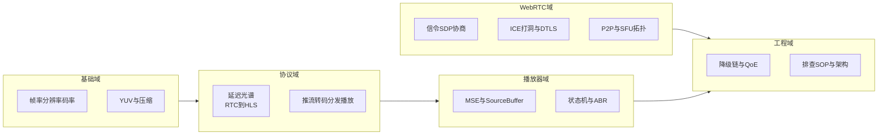

```javascript
// 收束自检清单：能否不查资料回答以下问题
const SELF_CHECK = [
  '为什么直播分片切点必须在 I 帧？GOP 对秒开的影响？',
  'YUV 4:2:0 比 RGB 888 省多少？渲染解码帧时为什么常用三分纹理？',
  'HLS 延迟构成的每一项是什么？LL-HLS 靠哪三个机制降延迟？',
  'flv.js 的核心原理一句话？为什么要转 fMP4？',
  'Offer/Answer 交换的完整时序？glare 怎么解决？',
  'ICE 候选三种类型分别什么时候被选中？怎么确认当前走了 relay？',
  'MSE 的 appendBuffer 为什么会抛错？buffer 管理窗口怎么设？',
  '卡顿率的两种口径与归因字段？秒开怎么精确测量？',
  'simulcast 解决什么矛盾？SFU 为什么不解码？',
  '回声产生的原理？连麦场景哪个约束必须开？',
];
console.log(SELF_CHECK.forEach((q, i) => console.log(`${i + 1}. ${q}`)));
```

### AV-098：直播流状态监控与开播链路如何保障？
**答**：
- 开播链路状态机：未开播 → 推流中（推流成功以服务端确认为准）→ 直播中（流健康监控）→ 异常（推流中断/断网）→ 已结束。
- 断流判定双保险：客户端 RTMP/WebRTC 断开事件 + 服务端流超时（如 10s 无数据包强制下线），以服务端为准广播。
- 观众端感知：收到 stream-end 后进入"主播离开"状态并停止拉流省流量，主播回归自动恢复（轮询房间状态或信令推送）。
- 重推防抖：网络抖动导致的短暂断流自动重推（带退避），避免观众端频繁闪断。
- 沉淀数据：每次直播的断流次数、断流时长分布是主播端体验的核心指标。

```javascript
// 主播端推流状态机与断流自愈
class StreamLifecycle {
  constructor() { this.state = 'idle'; }
  async onPushConnected() {
    this.state = 'live';
    this.watchdog = setInterval(async () => {
      const alive = await this.probeServerStream(); // 服务端确认流仍在
      if (!alive && this.state === 'live') this.onStreamLost();
    }, 10_000);
  }
  onStreamLost() {
    this.state = 'reconnecting';
    report({ type: 'stream-lost', at: Date.now() });
    let retry = 0;
    const attempt = async () => {
      if (retry++ > 5) return this.giveUp('网络不可用，请检查后重新开播');
      try {
        await this.repush();               // 重新采集+推流（退避 2s*retry）
        await this.onPushConnected();      // 成功后服务端广播恢复
      } catch { setTimeout(attempt, 2000 * retry); }
    };
    setTimeout(attempt, 2000);
  }
  async stop() {
    clearInterval(this.watchdog);
    this.state = 'idle';
    await fetch('/api/live/end', { method: 'POST', keepalive: true });
  }
}
```

### AV-099：多标签页/多应用抢占摄像头冲突怎么管理？
**答**：
- 现象：同页面两个标签页都调 getUserMedia，后开的可能 NotReadableError（被占用），或两个都能拿到但画面切换导致前一个卡死。
- 管理方案：跨标签页互斥锁——BroadcastChannel/Web Locks API 声明"设备占用者"，后来者检测到占用则提示或排队。
- Web Locks（推荐）：`navigator.locks.request('camera', callback)`，浏览器保证同一时刻只有一个标签页持锁，标签关闭自动释放。
- 自家产品内冲突：路由级单例（进入视频页面强制释放其他页面的流）；第三方应用冲突只能提示用户关闭（AV-043 的 NotReadableError 文案）。
- 验证点：释放逻辑必须覆盖 beforeunload/unload 与 visibilitychange（切后台可选保持或让出）。

```javascript
// Web Locks 管理摄像头独占
class CameraLock {
  async acquire(task) {
    let result;
    await navigator.locks.request('device-camera', async (lock) => {
      if (!lock) throw new Error('摄像头被本站其他标签页占用');
      const stream = await navigator.mediaDevices.getUserMedia({ video: true });
      result = await task(stream); // 持锁期间执行视频业务
      stream.getTracks().forEach((t) => t.stop());
    }); // 标签页关闭或异常时锁自动释放
    return result;
  }
}
// 被占用时的提示（配合 AV-043 错误处理）
navigator.locks.query({ name: 'device-camera' }).then(({ held }) => {
  if (held) console.warn('另一标签页正在使用摄像头:', held.mode); // 'exclusive'
});
```

### AV-100：音视频面试高频考点速记与复习路径。
**答**：
- 三条主线必须脱口而出：延迟光谱（RTC<1s / FLV 1-3s / LL-HLS 2-4s / HLS 3-10s）、建连主线（信令→SDP→ICE→DTLS→RTP）、播放主线（fetch→demux→MSE append→decode→render）。
- 六个高频代码题方向：MSE 最小播放器、Offer/Answer 交换、getUserMedia 约束与错误处理、AudioContext 解锁、MediaRecorder、getStats 采样。
- 五个排查题方向：黑屏花屏、音画不同步、回声、建连失败、卡顿——每个都有"分类→定位→自愈→上报"四段式。
- 复习路径建议：一周基础（001-015）→ 一周协议与 WebRTC（016-033）→ 一周场景工程（034-067）→ 两周综合与排查（068-100），每章配代码手敲一遍。
- 差异化竞争力：面试官最认的不是背概念，而是"你真的排查过线上问题"——把自己项目里的指标数据与案例带进面试。

```javascript
// 面试速记卡：一题一行的知识索引
const FLASH_CARDS = {
  '为什么 YUV 省空间': '人眼对色度不敏感，4:2:0 每4个Y共享1组UV，数据量37.5%',
  'GOP 与秒开关系': 'GOP 缓存让新观众立即从最近 I 帧出画，无缓存最坏等一个 GOP',
  'MSE 的边界': 'JS 只做 demux 与调度，decode 在浏览器内核，输入必须是支持的封装',
  'ICE 打洞失败率': '约 10-20% 连接走 TURN relay，对称型 NAT 几乎必走中继',
  'simulcast 本质': '发送端多档上行，SFU 按订阅者能力选层，解决一对多的能力差异',
  'AEC 的必要条件': '远端播放信号作为参考输入，连麦场景 echoCancellation 必须 true',
  '卡顿率口径': '频次口径 次/分钟 与 时长口径 stall时长/播放时长，后者更贴 QoE',
  'ABR 决策因子': '吞吐估计 EWMA + buffer 水位双因子，buffer 告急立即降档',
  'WebCodecs 价值': '帧级控制权，支撑剪辑导出/超低延迟/逐帧处理，须手动 close 释放',
  'WebRTC 不规定信令': '业务形态千差万别，W3C 只定义 SDP 状态机，传输层自选',
};
Object.entries(FLASH_CARDS).forEach(([k, v]) => console.log(`[${k}] ${v}`));
```

---

## 十一、编解码深入（AV-101 ~ AV-106）

### AV-101：H264 码流结构是怎样的？NALU、SPS、PPS 各起什么作用？（高频压轴）
**答**：
- H264 分两层：VCL（视频压缩数据，slice）与 NAL（网络抽象层，负责打包传输），一个 NALU = 1 字节头 + RBSP 载荷。
- 码流两种格式：AnnexB（起始码 00 00 00 01 分隔，TS/裸流用）与 AVCC（长度前缀，MP4/FLV 用），MSE 喂 fMP4 用 AVCC，两者不能混喂。
- SPS（序列参数集）放 profile/分辨率/帧率等"这条流长什么样"；PPS（图像参数集）放熵编码方式等解码开关；解码器必须先拿到两者才能解 IDR 帧。
- 前端意义：换清晰度/seek 到新流时必须等新 SPS/PPS；播放器花屏十有八九是丢了参数集或丢了 I 帧（关联 AV-083）。
- NALU 类型看头部低 5 位：1=非 IDR 切片，5=IDR（关键帧起点），6=SEI，7=SPS，8=PPS。

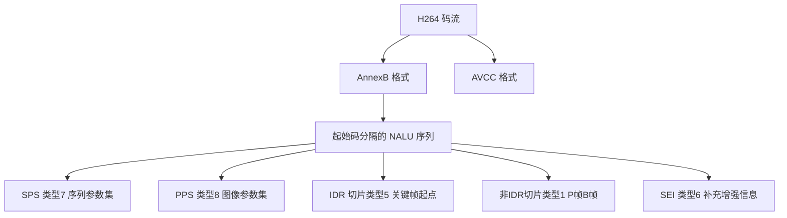

```javascript
// AnnexB 码流分割：按起始码切出 NALU 并解析类型
function parseAnnexB(buffer) {
  const u8 = new Uint8Array(buffer);
  const nalus = [];
  const findStartCode = (i) => {
    while (i < u8.length - 3) {
      if (u8[i] === 0 && u8[i+1] === 0 && u8[i+2] === 1) return [i, 3];
      if (u8[i] === 0 && u8[i+1] === 0 && u8[i+2] === 0 && u8[i+3] === 1) return [i, 4];
      i++;
    }
    return [-1, 0];
  };
  let [pos, len] = findStartCode(0), start = -1;
  while (pos !== -1) {
    if (start >= 0) nalus.push(u8.subarray(start, pos)); // 上一 NALU 到此结束
    start = pos + len;
    [pos, len] = findStartCode(start);
  }
  if (start >= 0) nalus.push(u8.subarray(start));
  return nalus.map((n) => ({
    type: n[0] & 0x1f,                       // 7=SPS 8=PPS 5=IDR 1=非IDR
    isKeyframe: (n[0] & 0x1f) === 5,
    size: n.length,
  }));
}
```

### AV-102：H264、H265、AV1 怎么选？压缩率与兼容性如何权衡？（高频）
**答**：
- 压缩率：同画质下 H265 比 H264 省约 40% 码率，AV1 再省约 30%，但压缩率越高编码/解码越贵。
- 兼容性：H264 100% 通用；H265 iOS 硬解好但桌面 Chrome 默认不支持、专利池多头；AV1 免专利费、新设备硬解逐步铺开，老手机软解 CPU 高。
- 场景选型：RTC 互通优先 H264/VP8 保兼容；点播/下载场景用 H265/AV1 省带宽成本。
- 前端做支持性探测（MSE.isTypeSupported + WebCodecs.isConfigSupported + 实播验证），维护降级链 AV1→H265→H264。
- 决策公式：带宽成本收益 > 编码算力成本 + 兼容性风险，才上新一代编码。

```json
{
  "codec-choice-matrix": {
    "H264": { "compression": "基线", "compat": "全平台通用", "royalty": "专利费高", "use": "RTC互通与点播保底" },
    "H265": { "compression": "省约40%码率", "compat": "iOS硬解好 桌面Chrome默认不支持", "royalty": "多头专利池", "use": "移动端点播 4K" },
    "AV1":  { "compression": "再省约30%", "compat": "Chrome与Firefox支持 老设备无硬解", "royalty": "免专利费", "use": "点播降本 海外分发" }
  },
  "frontend-probe-mimes": [
    "video/mp4; codecs=av01.0.05M.08",
    "video/mp4; codecs=hvc1.1.6.L93.B0",
    "video/mp4; codecs=avc1.42E01E"
  ],
  "fallback-order": ["av01", "hvc1", "avc1"]
}
```

### AV-103：一条 FFmpeg 转码命令长什么样？关键参数分别什么意思？（高频）
**答**：
- 转码管线：demux 解封装 → decode 解码 → filter 处理 → encode 编码 → mux 再封装，FFmpeg 一条命令串起来。
- 必会参数：-i 输入、-c:v/-c:a 指定编码器、-b:v 码率、-vf 滤镜（缩放/水印）、-g GOP、-preset 速度与压缩率权衡、-f 输出格式。
- 直播转码典型需求：源转多档 ABR ladder，GOP 与分片时长对齐（2s 分片配 48 帧 GOP@24fps）。
- 前端要懂到能自测：排查"上传的视频播不了"时自己转一版标准参数验证，是快速二分问题位置的手段。

```bash
# 点播转 HLS：1080p 源转 720p 一档，GOP 与 2 秒分片对齐
ffmpeg -i input.mp4 \
  -vf "scale=-2:720" -c:v libx264 -preset medium -b:v 2500k -maxrate 2750k -bufsize 5000k \
  -g 48 -keyint_min 48 -sc_threshold 0 \
  -c:a aac -b:a 128k \
  -hls_time 2 -hls_list_size 0 -hls_playlist_type vod \
  master_720.m3u8

# 抽查码流信息：分辨率、编码、码率、帧率
ffprobe -v error -show_streams -show_format master_720.m3u8

# 直播推流联调（-re 按原速读文件，常用于压测与端到端联调）
ffmpeg -re -stream_loop -1 -i loop_source.mp4 -c:v libx264 -preset veryfast \
  -b:v 2000k -g 50 -c:a aac -f flv rtmp://push.example.com/live/stream001
```

### AV-104：MP4 的 box 结构是怎样的？为什么"moov 在前"对网络播放很重要？（高频）
**答**：
- MP4 由嵌套 box 组成：ftyp（文件类型）→ moov（索引元数据）→ mdat（音视频数据），box 头 8 字节 = 4 字节长度 + 4 字节类型。
- moov 里的 sample 表记录每帧的偏移/大小/时长，播放器没拿到 moov 就无法定位任何一帧。
- 传统 MP4 写完文件才知道索引（moov 在尾部），网络播放要下完整文件；faststart 把 moov 移到头部，支持边下边播。
- MSE 场景建议 fMP4：每个 moof+mdat 自带小索引，天然适合分片流式喂 SourceBuffer。
- 前端工程点：上传服务要校验 moov 位置（转码 pipeline 里 qt-faststart/-movflags +faststart 兜底）。

```javascript
// MP4 box 树遍历：找出 moov 与 mdat 位置判断是否 faststart
function walkBoxes(u8, start = 0, end = u8.length, depth = 0) {
  const boxes = [];
  let offset = start;
  while (offset < end - 7) {
    const size = (u8[offset] << 24) | (u8[offset+1] << 16) | (u8[offset+2] << 8) | u8[offset+3];
    const type = String.fromCharCode(...u8.subarray(offset + 4, offset + 8));
    boxes.push({ type, offset, size, depth });
    if (['moov', 'trak', 'mdia', 'minf', 'stbl'].includes(type)) {
      boxes.push(...walkBoxes(u8, offset + 8, offset + size, depth + 1)); // 容器 box 递归
    }
    if (size <= 0) break;
    offset += size;
  }
  return boxes;
}
// 用法：Range 请求拿头部 64KB 解析，moov.offset < mdat.offset 即 faststart
// const head = new Uint8Array(await (await fetch(url, { headers: { Range: 'bytes=0-65535' } })).arrayBuffer());
// const boxes = walkBoxes(head);
// console.log(boxes.filter((b) => ['moov', 'mdat', 'ftyp'].includes(b.type)));
```

### AV-105：硬解与软解的区别？WebCodecs 在解码链路中扮演什么角色？（高频）
**答**：
- 硬解走 GPU/专用解码器，功耗低性能高但只认特定 profile/分辨率；软解 CPU 通用实现，兼容性强但耗电发热。
- 浏览器分层：video 标签解码对 JS 黑盒；MSE 只控制到封装层；WebCodecs VideoDecoder 把"逐帧解码"直接暴露给 JS。
- WebCodecs 角色：剪辑导出（解码→处理→重编码）、逐帧分析（AI/截图）、超低延迟自渲染管线（绕过播放器）。
- 用法三步：configure（codec 字符串+分辨率+description）→ decode（EncodedVideoChunk）→ output 回调拿 VideoFrame，必须 close() 否则内存泄漏。
- 背压控制：看 decodeQueueSize 决定喂帧节奏，别把队列堆爆。

```javascript
// WebCodecs VideoDecoder 最小可用示例
const decoder = new VideoDecoder({
  output: (frame) => {            // VideoFrame 用完必须 close
    drawToCanvas(frame);
    frame.close();
  },
  error: (e) => console.error('decode error', e),
});
decoder.configure({
  codec: 'avc1.42001f',           // H264 Constrained Baseline
  codedWidth: 1280, codedHeight: 720,
  description: avccConfigBytes,   // AVCC 格式传 SPS+PPS；AnnexB 不需要
});
// 逐帧喂入（数据来自 demux 或 WebCodecs 上游）
// decoder.decode(new EncodedVideoChunk({ type: 'key',   timestamp: 0,  data: idrBytes }));
// decoder.decode(new EncodedVideoChunk({ type: 'delta', timestamp: 33, data: pBytes }));
console.log(decoder.state, decoder.decodeQueueSize); // 'configured' + 队列深度做背压
```

### AV-106：音频处理链路里重采样、混音、降噪分别发生在哪一步？（高频）
**答**：
- 全链路：采集（麦克风 PCM）→ AEC/ANS/AGC 前处理 → 重采样到统一采样率 → 混音（多路相加+增益防削波）→ 编码 → 传输 → 解码 → 播放。
- 重采样：麦克风可能是 44.1k，RTC 链路统一 48k，AudioContext 构造时指定 sampleRate 自动重采样；离线批量用 OfflineAudioContext。
- 混音不是简单相加：多路直接相加会削波爆音，要做增益归一（1/N）或加 limiter。
- 降噪主体在采集侧（AEC3/RNNoise），前端能做的是把 wasm 版 RNNoise 接进 AudioWorklet 链（AV-153）。
- 检查点：连麦场景必须保留浏览器原生 AEC（AV-180），自己搭 Web Audio 链时注意别绕开参考信号。

```javascript
// OfflineAudioContext 离线重采样 + 多路混音（防削波）
async function resampleAndMix(buffers, targetRate = 48000) {
  const total = Math.max(...buffers.map((b) => b.duration));
  const ctx = new OfflineAudioContext(2, Math.ceil(total * targetRate), targetRate);
  const mix = ctx.createGain();
  mix.gain.value = 1 / buffers.length;              // 多路归一 防止相加削波
  const limiter = ctx.createDynamicsCompressor();   // 简易限制器兜底
  limiter.threshold.value = -3;
  limiter.ratio.value = 20;
  mix.connect(limiter).connect(ctx.destination);
  for (const buf of buffers) {
    const src = ctx.createBufferSource();           // 采样率不同会自动重采样到 ctx
    src.buffer = buf;
    src.connect(mix);
    src.start(0);
  }
  return ctx.startRendering();                      // 输出 48k 双声道 AudioBuffer
}
```

## 十二、WebRTC 源码级与进阶（AV-107 ~ AV-113）

### AV-107：RTCPeerConnection 有哪些关键事件？分别在什么时机触发？（高频）
**答**：
- onicecandidate：收集到本地候选逐个触发，发信令给对端；candidate 为 null 表示收集结束。
- ontrack：远端媒体到达，绑 video.srcObject 渲染；重协商时可能再次触发，注意解绑旧流防泄漏。
- onconnectionstatechange：connected/failed/disconnected，驱动重连机制；failed 要 ICE restart，disconnected 可观察自愈。
- oniceconnectionstatechange：更底层的 ICE 状态，与 connectionstate 并不同步，监控两边都要。
- onnegotiationneeded：addTrack/换流后触发，是发起 offer 的正确时机，配合完美协商（AV-108）防碰撞。

```javascript
// 事件接线全景：一个生产级 peer 的骨架
function wirePeer(pc, { onRemoteStream, onState, sendSignal }) {
  pc.onicecandidate = ({ candidate }) => {
    if (candidate) sendSignal({ type: 'candidate', candidate }); // 逐个转发
    else sendSignal({ type: 'candidate-done' });                 // 收集完成
  };
  pc.ontrack = (ev) => {
    onRemoteStream(ev.streams[0], ev.track.kind);                // 按 kind 分发渲染
    ev.track.onended = () => console.warn('远端轨道结束', ev.track.id);
    ev.track.onmute = () => console.info('远端静音或丢流', ev.track.id);
  };
  pc.onconnectionstatechange = () => {
    onState(pc.connectionState);
    if (pc.connectionState === 'failed') pc.restartIce();        // 触发重新协商
  };
  pc.onnegotiationneeded = async () => {                          // addTrack 后自动进入
    const offer = await pc.createOffer();
    await pc.setLocalDescription(offer);
    sendSignal({ type: 'offer', sdp: pc.localDescription });
  };
}
```

### AV-108：完美协商 perfect negotiation 是什么？polite/impolite 算法怎么写？（高频压轴）
**答**：
- 解决问题：双方同时发起 offer（glare 冲突），SDP 状态机不允许并发 setLocal/setRemote，需要确定性仲裁。
- 角色固定：impolite 一律坚持自己的 offer，polite 遇冲突回滚让步；角色由业务信令指定，不做动态选举。
- 核心三变量：makingOffer（本端协商中）、ignoreOffer（impolite 冲突时丢弃对端 offer）、isSettingRemoteAnswerPending。
- 现代浏览器 setLocalDescription() 无参自动生成 offer，polite 端冲突时 setRemoteDescription(offer) 会自动 rollback。
- 面试要点：能写出 onnegotiationneeded 竞态防护，并说清"冲突时 polite 回滚接受、impolite 静默丢弃"。

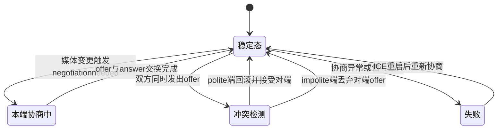

```javascript
// 完美协商标准实现（W3C 推荐写法）
class PerfectNegotiator {
  constructor(pc, socket, polite) {
    this.pc = pc; this.socket = socket; this.polite = polite;
    this.makingOffer = false;
    this.ignoreOffer = false;
    this.isSettingRemoteAnswerPending = false;
    pc.onnegotiationneeded = () => this.negotiate();
  }
  async negotiate() {
    try {
      this.makingOffer = true;
      await this.pc.setLocalDescription();      // 无参自动生成并应用 offer
      this.socket.emit('signal', { description: this.pc.localDescription });
    } finally { this.makingOffer = false; }
  }
  async onSignal({ description, candidate }) {
    if (description) {
      const readyForOffer = !this.makingOffer &&
        (this.pc.signalingState === 'stable' || this.isSettingRemoteAnswerPending);
      const offerCollision = description.type === 'offer' && !readyForOffer;
      this.ignoreOffer = !this.polite && offerCollision;   // impolite 丢弃对端 offer
      if (this.ignoreOffer) return;
      this.isSettingRemoteAnswerPending = description.type === 'answer';
      await this.pc.setRemoteDescription(description);     // polite 冲突时自动 rollback
      this.isSettingRemoteAnswerPending = false;
    } else if (candidate) {
      try { await this.pc.addIceCandidate(candidate); }
      catch (e) { if (!this.ignoreOffer) throw e; }        // 冲突期候选失败可容忍
    }
  }
}
```

### AV-109：Insertable Streams 是什么？怎么做端到端加密与自定义帧处理？（高频）
**答**：
- 定位：在"编码后/传输前"与"接收后/解码前"插入 JS 回调，直接操作每一帧的加密字节流，可看可改。
- E2EE 场景：SFU 只转发密文，密钥只在终端持有，服务器无法窥探内容——企业会议/医疗的核心卖点。
- API 形态：新标准 RTCRtpScriptTransform（配 Worker），Chrome 旧接口 RTCRtpSender.createEncodedStreams()（AV-181 Safari 差异）。
- 帧上可附加自定义元数据（帧号/时间戳），用于同步校准与防重放；密钥轮换靠 postMessage 通知 worker。
- 注意：处理必须在 worker 里做避免阻塞主线程；transform 流处理完必须 enqueue，否则画面冻结。

```javascript
// e2ee.js worker：发送端加密 / 接收端解密（演示级异或，生产用 AES-GCM）
let currentKey = new Uint8Array(32);
self.onmessage = ({ data }) => { if (data.key) currentKey = data.key; }; // 密钥轮换入口

function handleTransform(rtcrtpScriptTransformer, isSender) {
  const transform = new TransformStream({
    transform(frame, controller) {
      const view = new DataView(frame.data);
      const payloadStart = view.getUint16(2) * 4 + 12;   // 跳过 RTP 头与 CSRC
      const payload = new Uint8Array(frame.data, payloadStart);
      for (let i = 0; i < Math.min(payload.length, 64); i++) {
        payload[i] ^= currentKey[i % currentKey.length]; // 就地修改即生效
      }
      controller.enqueue(frame);                          // 必须 enqueue 否则画面冻结
    },
  });
  if (isSender) rtcrtpScriptTransformer.transform = transform; // readable/writable 接线方向两侧相反
  else rtcrtpScriptTransformer.transform = transform;
}
self.onrtctransform = (ev) => handleTransform(ev.transformer, ev.transformer.options?.role === 'sender');
// 主线程注册：pc 的 sender/receiver 各挂 new RTCRtpScriptTransform(worker, { role: 'sender' | 'receiver' })
```

### AV-110：simulcast 与 SVC 分别是什么？前端怎么用？（高频压轴）
**答**：
- simulcast：同一画面编码出 2-3 档独立码流（q/h/f），一起发给 SFU，SFU 按订阅者网络与能力选流转发。
- SVC：一路可分级码流（时间层 T/空间层 S/质量层 Q），SFU 丢高层即降档，编码一次冗余小，但链路与解码器要求高。
- 前端开启：addTransceiver + sendEncodings 配 rid/scaleResolutionDownBy/maxBitrate；setParameters 可动态开关档位。
- 上行带宽代价：simulcast 上行约翻倍，发送端弱网时先关最高档（active: false）。
- 与 AV-035 的区别：这里落到 API 与参数层面，能说出 rid 与 setParameters 才算会。

```javascript
// 开启 simulcast 三档 + 动态调档
const pc = new RTCPeerConnection();
const { sender } = pc.addTransceiver(cameraTrack, {
  direction: 'sendonly',
  sendEncodings: [
    { rid: 'q', maxBitrate: 150_000,  scaleResolutionDownBy: 4 }, // 180p
    { rid: 'h', maxBitrate: 500_000,  scaleResolutionDownBy: 2 }, // 360p
    { rid: 'f', maxBitrate: 1_500_000, scaleResolutionDownBy: 1 },// 720p
  ],
});
// 弱网时降上行：关掉最高档，SFU 侧只剩 q/h 可转发
async function capToLow() {
  const p = await sender.getParameters();
  p.encodings = p.encodings.map((e) => e.rid === 'f' ? { ...e, active: false } : e);
  await sender.setParameters(p);
}
// SVC（VP9/AV1）：在 encoding 上声明 scalabilityMode，如 'L1T3'（1 空间层 3 时间层）
// const p = await sender.getParameters(); p.encodings[0].scalabilityMode = 'L1T3'; await sender.setParameters(p);
```

### AV-111：关键帧请求 PLI 和 FIR 是什么？画面卡住后为什么会自动恢复？（高频）
**答**：
- 解码端丢包/换流后无法继续解 P 帧，通过 RTCP 反馈向发送端要关键帧：PLI（Picture Loss Indication）与 FIR（Full Intra Request）。
- 差异：FIR 常用于"新订阅者必须立刻出画"，PLI 用于丢包后恢复；前端不直接发送，由解码器自动触发，SFU 再向源头转发。
- 前端感知：getStats 的 inbound-rtp 里 pliCount/firCount 上涨 = 远端频繁请求关键帧，说明链路丢包严重或订阅切换频繁。
- 体验问题：切流后黑屏 1-2 秒本质是等 I 帧；优化靠 SFU 缓存最近 GOP 或发布端关键帧间隔更密。
- 与 AV-083 花屏排查呼应：花屏是"错的帧还在解"，说明 PLI 恢复链路失效，要查 RTCP 通道。

```javascript
// 监控 PLI/FIR 频次：判断链路丢包与解码健康度
class KeyframeMonitor {
  constructor(pc, peerId, interval = 2000) {
    this.prev = new Map();
    this.timer = setInterval(async () => {
      const stats = await pc.getStats();
      stats.forEach((r) => {
        if (r.type !== 'inbound-rtp' || r.kind !== 'video') return;
        const p = this.prev.get(r.id) ?? { pli: 0, fir: 0 };
        const d = {
          pli: (r.pliCount ?? 0) - p.pli,
          fir: (r.firCount ?? 0) - p.fir,
          lost: (r.packetsLost ?? 0) - (p.lost ?? 0),
        };
        if (d.pli + d.fir > 2) {
          report({ level: 'warn', peerId, ssrc: r.ssrc, ...d,
            msg: '关键帧请求激增 链路丢包或订阅切换' });
        }
        this.prev.set(r.id, { pli: r.pliCount ?? 0, fir: r.firCount ?? 0, lost: r.packetsLost ?? 0 });
      });
    }, interval);
  }
  stop() { clearInterval(this.timer); }
}
```

### AV-112：JitterBuffer 是什么？网络抖动如何被吸收？（高频）
**答**：
- 抖动 = 包到达间隔的波动；路由变化/链路排队导致 RTP 包乱序、早到晚到。
- 接收端 JitterBuffer 把包缓存一小段时间再按序交给解码器，用一点延迟换连续性；音频侧（neteq）还做变速不变调补偿。
- WebRTC 暴露 receiver.jitterBufferTarget（毫秒）可调"延迟 vs 流畅"的平衡；直播播放器则靠 1-3s buffer 吸收。
- 前端量化：getStats 的 jitter（秒）+ jitterBufferDelay/EmittedCount（平均 JB 停留）+ 播放端 stall 定位问题在传输还是渲染。
- 调优原则：互动场景 target 50-150ms 优先实时；观看场景靠播放器大 buffer 保流畅。

```javascript
// 抖动观测与 jitterBufferTarget 自适应调节
async function tuneJitter(pc) {
  const receiver = pc.getReceivers().find((r) => r.track.kind === 'video');
  if (receiver && 'jitterBufferTarget' in receiver) receiver.jitterBufferTarget = 100; // 互动优先
  return setInterval(async () => {
    const s = await pc.getStats();
    s.forEach((r) => {
      if (r.type === 'inbound-rtp' && r.kind === 'video') {
        const jitterMs = Math.round((r.jitter ?? 0) * 1000);
        const lossPct = (r.packetsLost / (r.packetsReceived + r.packetsLost)) * 100;
        // 抖动大且丢包不严重 → 放大 target 换流畅；否则压小追求实时
        if (receiver && jitterMs > 60 && lossPct < 1) receiver.jitterBufferTarget = 200;
        const jbDelayMs = r.jitterBufferEmittedCount
          ? Math.round((r.jitterBufferDelay / r.jitterBufferEmittedCount) * 1000) : null;
        console.log({ jitterMs, lossPct: lossPct.toFixed(2), jbDelayMs });
      }
    });
  }, 3000);
}
```

### AV-113：GCC 拥塞控制算法的核心思想是什么？（高频）
**答**：
- GCC（Google Congestion Control）= 基于延迟的估计 + 基于丢包的估计，取较小者作为目标码率输出。
- 延迟侧：TWCC 让发送端拿到每个包的到达时间，到达时间滤波器估计延迟梯度趋势，输出 overuse/normal/underuse 三态。
- 丢包侧简单直接：loss < 2% 升码率，> 10% 降码率，之间保持。
- 升级慢（乘性增最高 8%/s）降级快（0.85 倍）——稳定性优先的设计哲学。
- 前端关联：SDP 里 transport-cc 扩展即是 TWCC；getStats 的 availableOutgoingBitrate 是 GCC 输出的近似反映（AV-032 的深入版）。

```typescript
// GCC 简化模型：用于理解原理，生产实现位于 libwebrtc 内部
interface TrendReport { sendDeltaMs: number; arriveDeltaMs: number; lossRate: number; }
class GccLite {
  targetBps = 1_500_000;
  estimateBandwidth(reports: TrendReport[]): number {
    const gradient = reports.map((r) => r.arriveDeltaMs - r.sendDeltaMs);
    const trend = gradient.slice(-20).reduce((a, b) => a + b, 0) / Math.max(1, Math.min(20, gradient.length));
    const state = trend > 10 ? 'overuse' : trend < -5 ? 'underuse' : 'normal';
    if (state === 'overuse') this.targetBps = Math.floor(this.targetBps * 0.85);   // 降级快
    else if (state === 'normal') this.targetBps = Math.floor(this.targetBps * 1.02); // 升级慢
    const lastLoss = reports[reports.length - 1]?.lossRate ?? 0;   // 丢包侧独立估计 取小者
    if (lastLoss > 0.10) this.targetBps = Math.floor(this.targetBps * (1 - 0.5 * lastLoss));
    else if (lastLoss < 0.02) this.targetBps = Math.floor(this.targetBps * 1.05);
    return Math.max(150_000, Math.min(this.targetBps, 4_000_000));
  }
}
```

## 十三、SFU 与媒体服务器（AV-114 ~ AV-119）

### AV-114：SFU 的核心原理是什么？为什么"只转发不编解码"能支撑大规模多人？（高频压轴）
**答**：
- SFU（Selective Forwarding Unit）：只做 RTP 包的选择性转发，不解码、不混流、不重编码，CPU 开销近似"转发带宽 × 订阅数"。
- 对比：Mesh 每人上行 N-1 路（上行是移动端最稀缺资源），MCU 服务端转码成本高；SFU 每人上行 1 路、下行 N-1 路。
- 转发的前提：simulcast/SVC 提供多档码流，让 SFU"有得选"；没有多档就只能全网统一最低码率。
- SFU 还承担：RTCP 终结与再生成（PLI/NACK/TWCC 汇聚）、房间路由、录制转推旁路输出。
- 成本特征：MCU 成本随规模平方增长，SFU 线性增长——这是会议类产品选 SFU 的根本原因。

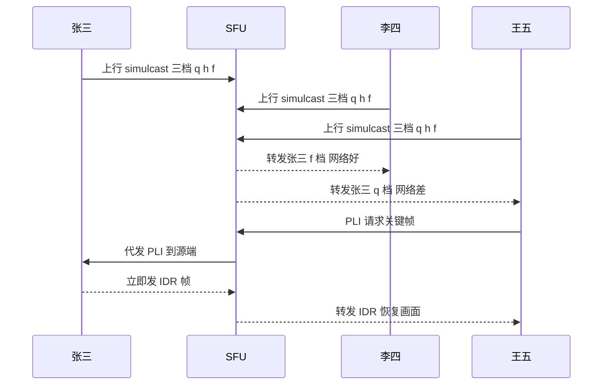

```typescript
// mediasoup 风格核心对象关系（伪代码骨架）：Router → Transport → Producer/Consumer
const room = {
  router: await worker.createRouter({ mediaCodecs: [
    { kind: 'video', mimeType: 'video/VP8', clockRate: 90000 },
    { kind: 'audio', mimeType: 'audio/opus', clockRate: 48000 },
  ]}),
  peers: new Map<string, Peer>(),
};
async function publish(peerId: string, kind: 'video' | 'audio', rtpParameters: any) {
  const transport = await room.router.createWebRtcTransport({
    listenIps: [{ ip: '0.0.0.0', announcedIp: PUBLIC_IP }],
    enableUdp: true, enableTcp: true,
  });
  const producer = await transport.produce({ kind, rtpParameters });
  // 新 Producer 上线 → 房间内其他人各自 createConsumer 订阅它
  room.peers.forEach((p) => p.id !== peerId && p.consume(producer));
  return producer;
}
```

### AV-115：SFU 的房间与订阅管理怎么做？大房间（50 人以上）如何优化？（高频）
**答**：
- 订阅模型：进房自动订所有人只适合小房间；大房间改按需订阅——平铺布局订全部、聚焦模式只订屏幕上的人。
- 说话人驱动：服务端音频能量检测推 activeSpeaker 事件，前端只渲染 topN，其余人"只订音频"。
- 级联配合：单 SFU 受下行扇出限制（几百路），更大规模靠多 SFU 分摊订阅或房间分裂（关联 AV-065）。
- 进出房抖动：批量进房要合并 renegotiation（攒一帧再发一个 offer），避免连环协商风暴。
- 前端职责：虚拟列表渲染、离屏 video 暂停、订阅意愿上报（谁在屏幕上就订谁）。

```typescript
// 大房间按需订阅管理器：批量信令 + 说话人兜底
class SubscriptionManager {
  private subscribed = new Set<string>();
  private speakers: string[] = [];                  // 服务端 activeSpeaker 列表
  constructor(private ws: WebSocket) {}
  onActiveSpeaker(list: string[]) { this.speakers = list; }
  updateVisible(peerIds: string[]) {
    const want = new Set<string>([...peerIds, ...this.speakers]); // 说话人始终订阅
    const add = [...want].filter((id) => !this.subscribed.has(id));
    const remove = [...this.subscribed].filter((id) => !want.has(id));
    if (add.length || remove.length) {
      // 合并成一条信令 防止连环协商
      this.ws.send(JSON.stringify({ type: 'subscribe-batch', add, remove }));
    }
    add.forEach((id) => this.subscribed.add(id));
    remove.forEach((id) => this.subscribed.delete(id));
  }
}
```

### AV-116：录制与转推在 SFU 侧怎么做？前端要注意什么？（高频）
**答**：
- 两条路：服务端旁路录制（SFU 转 RTP 给 GStreamer/ffmpeg 合流落盘）与客户端本地合成（MediaRecorder）。
- 服务端合流：布局由服务端混流模板决定，客户端断线不影响成片；音画同步靠 RTCP SR 的 NTP/RTP 映射。
- 转推：把房间内容合成后转 RTMP 推给 CDN——"RTC 连麦 + CDN 大盘观众"融合直播的桥接点（关联 AV-036）。
- 前端注意：服务端录制的是"SFU 收到的流"，本地美颜/滤镜不在成片里；要一致就得把处理后的流推上来。
- 业务提示：录制/转推必须有全员可见的合规提示（AV-143）。

```bash
# SFU 旁路：接收 SFU 转出的 RTP（SDP 描述端口）并合成录制
# 两路视频左右拼接 + 两路音频混音，输出 mp4
ffmpeg -protocol_whitelist file,udp,rtp \
  -i video1.sdp -i video2.sdp -i audio1.sdp -i audio2.sdp \
  -filter_complex "[0:v]scale=640:360,pad=1280:360[v0];[1:v]scale=640:360[v1];[v0][v1]hstack[top];[2:a][3:a]amix=inputs=2:duration=longest[aout]" \
  -map "[top]" -map "[aout]" -c:v libx264 -preset veryfast -b:v 2000k \
  -c:a aac -b:a 128k meeting_record.mp4

# 合流结果转推 CDN（生产中由合流服务直接推流，避免二次转码）
ffmpeg -re -i meeting_record.mp4 -c copy -f flv rtmp://push.example.com/live/room42
```

### AV-117：mediasoup、Janus、LiveKit 这些开源 SFU 怎么选？（高频）
**答**：
- mediasoup：Node.js/C++ 库而非成品服务器，灵活度最高，房间/信令/权限全要自己写，适合有研发深度的团队。
- Janus：C 写的老牌全家桶（插件体系：视频会议/SIP/流媒体），成熟稳定，二开门槛较高。
- LiveKit：Go 编写，开箱即用 + 官方多端 SDK 全（Web/iOS/Android/React），可托管，适合快速上线。
- 其他：Jitsi（自带完整前后端的整套会议方案）、SRS（RTC+CDN 融合直播）、Pion 生态（Go 库）。
- 选型逻辑：要成品选 LiveKit/Jitsi，深度定制选 mediasoup，对接 SIP 选 Janus，融合直播看 SRS。

```json
{
  "sfu-comparison": {
    "mediasoup": { "lang": "Node.js与C++", "type": "library", "sdk": "自建", "fit": "深度定制团队", "复杂度": "高" },
    "janus":     { "lang": "C", "type": "server", "sdk": "社区", "fit": "SIP网关与传统会议", "复杂度": "中高" },
    "livekit":   { "lang": "Go", "type": "server与cloud", "sdk": "官方多端", "fit": "快速上线", "复杂度": "低" },
    "jitsi":     { "lang": "Java与C", "type": "全栈方案", "sdk": "自带前端", "fit": "开源自部署会议", "复杂度": "中" },
    "srs":       { "lang": "C++", "type": "流媒体服务器", "sdk": "HTTP API", "fit": "RTC与CDN融合直播", "复杂度": "中" }
  },
  "decision": {
    "两周内上线": "livekit 或云服务商",
    "深度自研SFU": "mediasoup",
    "对接SIP电话": "janus",
    "整包开源会议": "jitsi"
  }
}
```

### AV-118：自建 SFU 还是直接用云服务（TRTC/Agora）？怎么决策？（高频）
**答**：
- 云服务买"结果"：弱网对抗、全球节点、回声消除全打包，按分钟计费，上线快、SLA 有保障。
- 自建买"控制权"：成本随规模摊薄、数据不出内网、深度定制，但要养传输协议/SFU/运维团队。
- 经验阈值：日活几千、无特殊合规要求 → 云服务；日活十万级以上 RTC 成本占比高 → 评估自建或混合。
- 混合策略：核心业务用云服务保稳，海外/灰度流量自建；云服务做保底链路，防止自建故障全灭。
- 评估维度：全球节点、弱网算法、多端 SDK 成熟度、计费模式、SLA 与账单透明度、数据合规。

```typescript
// 选型评分模型：把决策变成可复算的表格
interface Option {
  name: string;
  monthlyCost: (minutes: number) => number;
  controlScore: number;  // 控制权 1-9
  speedScore: number;    // 上线速度 1-9
  opsCost: number;       // 运维负担 1-9
}
function evaluate(options: Option[], monthlyMinutes: number) {
  return options.map((o) => {
    const cost = o.monthlyCost(monthlyMinutes);
    return { name: o.name, cost, score: (o.controlScore + o.speedScore) * 0.4 - o.opsCost * 0.2 - cost / 1e5 };
  }).sort((a, b) => b.score - a.score);
}
const cloud: Option = { name: 'TRTC', monthlyCost: (m) => m * 9.9, controlScore: 3, speedScore: 9, opsCost: 2 };
const selfHosted: Option = { name: '自建mediasoup', monthlyCost: () => 30000, controlScore: 9, speedScore: 4, opsCost: 7 };
// console.log(evaluate([cloud, selfHosted], 5_000_000)); // 月 500 万分钟量级 自建开始占优
```

### AV-119：媒体服务器要监控哪些指标？怎么发现"SFU 不转发"这类暗故障？（高频）
**答**：
- 四层指标：机器层（CPU/网卡带宽/内存）、链路层（NACK/PLI/重传率/RTT）、会话层（建房数/断连率/协商失败率）、体验层（端到端延迟/卡顿率抽样）。
- SFU 特有暗故障：Consumer 字节数为 0（发了没人收）、Producer 无流量（说了没人听）——机器监控全绿但用户体验已坏。
- 端到端拨测：定时机器人进房推拉流，验证"发布→订阅"全链路，比机器监控更能抓真故障。
- 告警分级：协商失败率突增 P0；单节点 Consumer 零流量 P1；RTT 抬升 P2 观察项。
- 前端配合：getStats 关键字段定时上报，服务端聚合出"用户视角"的可用性（关联 AV-067）。

```typescript
// SFU 会话健康探针：字节级暗故障发现
interface SessionHealth { outBytes: number; inBytes: number; ts: number; }
class SfuSessionProbe {
  private sessions = new Map<string, SessionHealth>();
  async probeAll(clients: Map<string, RTCPeerConnection>) {
    const now = Date.now();
    for (const [peerId, pc] of clients) {
      const s = await pc.getStats();
      let out = 0, inn = 0;
      s.forEach((r) => {
        if (r.type === 'outbound-rtp') out += r.bytesSent ?? 0;
        if (r.type === 'inbound-rtp') inn += r.bytesReceived ?? 0;
      });
      const prev = this.sessions.get(peerId);
      if (prev) {
        const dt = (now - prev.ts) / 1000;
        const outKbps = ((out - prev.outBytes) * 8) / dt / 1000;
        const inKbps = ((inn - prev.inBytes) * 8) / dt / 1000;
        if (outKbps === 0 && prev.outBytes > 0) alertP1(`peer ${peerId} 上行断流`);
        if (inKbps === 0 && prev.inBytes > 0) alertP1(`peer ${peerId} 下行断流`);
      }
      this.sessions.set(peerId, { outBytes: out, inBytes: inn, ts: now });
    }
  }
}
```

## 十四、播放器深度工程（AV-120 ~ AV-126）

### AV-120：flv.js 的内部结构是怎样的？Remuxer 与 IO Loader 各干什么？（高频压轴）
**答**：
- 三层管线：IO Loader（fetch/WebSocket loader 拉字节流）→ Demux 层（FLV demuxer 拆出 H264 NALU 与 AAC 帧）→ Remuxer（转 fMP4 喂 MSE）。
- 为什么需要 Remux：浏览器 MSE 不吃 FLV 容器，只认 fMP4，所以要把 ES 流重新封装（mp4-generator 生成 box）。
- TransmuxingController 调度整条管线，可开 worker（enableWorker）避免阻塞主线程。
- 直播延迟关键在 IO 层与追帧：enableStashBuffer 要关（减少一跳缓冲），buffer 超阈值用追帧策略拉回。
- 源码阅读入口：transmuxer.js（管线调度）、flv-demuxer.js（tag 解析）、mp4-generator.js（box 生成）、fetch-stream-loader.js。

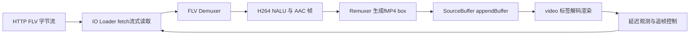

```typescript
import flvjs from 'flv.js';
if (!flvjs.isSupported()) fallbackToHls();          // MSE 探测失败走降级链
const player = flvjs.createPlayer({
  type: 'flv', isLive: true,
  url: 'https://cdn.example.com/live/stream1.flv',
  hasAudio: true, hasVideo: true,
}, {
  enableWorker: true,               // demux/remux 移入 worker
  enableStashBuffer: false,         // 直播必须关 IO stash 减少一跳缓冲
  stashInitialSize: 128,
  liveBufferLatencyChasing: true,   // buffer 超阈值自动加速追帧
  lazyLoad: false,                  // 直播不需要
});
player.attachMediaElement(videoEl);
player.load();
player.play();
player.on(flvjs.Events.ERROR, (_t: string, detail: string) => switchToHlsFallback(detail));
```

### AV-121：hls.js 的内部怎么工作？PlaylistLoader、FragmentLoader 与调度器？（高频）
**答**：
- 架构：主线程 Controller 状态机（IDLE→LOADING→PARSING→APPENDING→BUFFERING）+ 两类 Loader（playlist/fragment 分离，走 XHR/fetch）。
- LIVE 模式：按 reloadInterval 重拉 m3u8，用媒体序列号（MEDIA-SEQUENCE）增量发现新分片，滑动窗口决定可播区间。
- ABR 在 level-controller：吞吐 + buffer 选举 level，软切换优先（不重启解码）。
- 纠错链：分片超时/失败 → retry 配置 → 片段退避 → level 降级 → fatal 事件兜底。
- 可插拔点：自定义 loader（p2p 分发、防盗签注入）、自定义 abrController，是面试能加分的"工程深度"证据。

```javascript
import Hls from 'hls.js';
const hls = new Hls({
  liveSyncDurationCount: 3,          // 直播起点落后边缘 3 个分片 秒开与延迟的平衡
  manifestLoadingTimeOut: 10000,
  fragLoadingMaxRetry: 6,            // 分片重试次数
  abrEwmaDefaultEstimate: 1_000_000, // 初始带宽估计 影响首帧清晰度
  startLevel: -1,                    // -1 自动；0 锁定最低保首帧
});
hls.on(Hls.Events.MANIFEST_PARSED, (_, data) => data.levels.forEach((l) => console.log(l.height)));
hls.on(Hls.Events.FRAG_LOADED, (_, data) => trackFirstFrame(data.frag.stats.loading.end));
hls.on(Hls.Events.ERROR, (_, data) => {
  if (!data.fatal) return;           // 非致命错误内部自愈
  const recover = {
    [Hls.ErrorTypes.NETWORK_ERROR]: () => hls.startLoad(),        // 网络错重启加载
    [Hls.ErrorTypes.MEDIA_ERROR]: () => hls.recoverMediaError(),  // 解码错重建解码
  };
  (recover[data.type] ?? (() => hls.destroy()))();
});
hls.loadSource('https://cdn.example.com/live/index.m3u8');
hls.attachMedia(videoEl);
```

### AV-122：ABR 算法深入：吞吐估计型与 Buffer-based（BBA）各怎么工作？（高频）
**答**：
- 吞吐型（hls.js 默认）：EWMA 平滑历史吞吐 → 估计下一分片下载速度 → 选"吞吐吃得下"的最高档；对带宽波动敏感、易震荡。
- Buffer-based（BBA/Netflix）：只看当前 buffer 时长定档，buffer 低降档高升档，与吞吐解耦更稳，但起步阶段不友好。
- 工业方案是混合：buffer 告急立即降档（无视吞吐），正常时吞吐 + buffer 双因子，加滞回防抖动。
- 关键参数：panic 恐慌线（立即降档）、upgrade 升档水位、hysteresis 滞回与冷却时间。
- 前端落地：hls.js 自定义 abrController 或自研调度器，吞吐用分片下载实测，水位用 SourceBuffer.buffered。

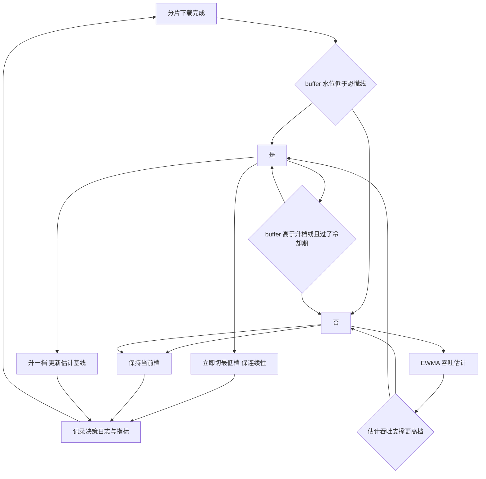

```javascript
// 混合 ABR 调度器骨架：吞吐 EWMA + buffer 双因子
class HybridAbr {
  ewma = { alpha: 0.2, value: 1_500_000 };  // bps
  current = 0; lastSwitchAt = 0;
  constructor(ladder) { this.ladder = ladder; }   // [{ bitrate, height }]
  decide({ bufferSec, lastSegBytes, lastSegMs }) {
    if (lastSegMs > 0) {                            // EWMA 更新吞吐估计
      const throughput = (lastSegBytes * 8) / (lastSegMs / 1000);
      this.ewma.value = this.ewma.alpha * throughput + (1 - this.ewma.alpha) * this.ewma.value;
    }
    const PANIC = 4, UPGRADE = 12, COOLDOWN_MS = 2000;
    if (bufferSec < PANIC) return { level: 0, why: 'buffer panic' };            // 恐慌立即降档
    const fit = this.ladder.filter((l) => l.bitrate < this.ewma.value * 0.9);   // 预留10%安全边际
    let target = fit.length ? fit.length - 1 : 0;
    if (target > this.current && bufferSec < UPGRADE) target = this.current;    // 未达升档水位不升
    if (target > this.current && Date.now() - this.lastSwitchAt < COOLDOWN_MS) target = this.current;
    if (target !== this.current) { this.current = target; this.lastSwitchAt = Date.now(); }
    return { level: target, why: `thr=${Math.round(this.ewma.value / 1000)}kbps buf=${bufferSec.toFixed(1)}s` };
  }
}
```

### AV-123：播放器错误恢复矩阵怎么设计？网络错、解码错、DRM 错分别怎么处理？（高频）
**答**：
- 分类才有策略：网络类（manifest/frag 失败）、媒体类（demux/decode 失败）、DRM 类（license 失效）、业务类（URL 过期/区域限制）。
- 错误必须带上下文上报：code、url、当前 level、buffer 水位、重试次数——没有上下文线上无法归因。
- 恢复阶梯：原地重试 → 降清晰度 → 换协议（FLV→HLS→MP4）→ 换 CDN → 重建播放器实例 → 提示用户。
- 重试要退避 + 上限：指数退避 1s/2s/4s，同一错误连续 3 次失败升级到下一级策略。
- 体验原则：恢复中显示"重连中"不黑屏，恢复成功无缝续播（记住 currentTime）。

```json
{
  "error-recovery-matrix": {
    "network.manifest.timeout": { "retry": 3, "backoff": "exp", "next": "switchCdn" },
    "network.frag.404":        { "retry": 1, "next": "skipFragment", "note": "直播直接跳过过期分片" },
    "media.decode.failed":     { "retry": 0, "next": "recoverMediaError", "then": "lowerLevel" },
    "media.buffer.stalled":    { "retry": 0, "next": "nudgeSeek", "note": "seek 当前时间戳踢活解码器" },
    "drm.license.expired":     { "retry": 0, "next": "refreshLicense", "note": "静默续期不重启播放" },
    "drm.unsupported":         { "retry": 0, "next": "fallbackUrl", "note": "切无DRM或软解方案" },
    "business.url.expired":    { "retry": 0, "next": "refreshToken", "note": "重新签名后重建实例" }
  },
  "report-fields": ["errCode", "errDetail", "url", "level", "bufferSec", "retryCount", "currentTime", "networkType"]
}
```

### AV-124：直播时移与回看（DVR）怎么实现？（高频）
**答**：
- DVR 本质：服务端把直播分片保留 N 小时并维护滚动/持续增长的 m3u8（EXT-X-PLAYLIST-TYPE: EVENT 不删旧分片），观众可 seek 到过去任意时刻。
- 时移播放 = seek 到"直播边缘 - offset"；播放器要识别"追上边缘后回到直播模式"。
- 进度条特殊化：直播页进度条映射"最近 N 小时"，右端是 LIVE 红点，拖走后显示"回到直播中"按钮。
- m3u8 带 EXT-X-PROGRAM-DATE-TIME 时可按真实时间定位（回看上午 10 点的比赛）。
- 工程要点：长 DVR 的 m3u8 变大要分段清理；seek 后要做 buffer 裁剪避免内存膨胀（关联 AV-182）。

```text
#EXTM3U
#EXT-X-VERSION:6
#EXT-X-TARGETDURATION:2
#EXT-X-PLAYLIST-TYPE:EVENT
#EXT-X-MEDIA-SEQUENCE:0
#EXT-X-PROGRAM-DATE-TIME:2026-11-08T10:00:00.000+08:00
#EXTINF:2.000,
seg_00000.ts
#EXT-X-PROGRAM-DATE-TIME:2026-11-08T10:00:02.000+08:00
#EXTINF:2.000,
seg_00001.ts
... 保留 4 小时即 7200 个分片 播放器按 PDT 定位后顺序拉取
#EXT-X-ENDLIST 只在直播结束时写入
```

### AV-125：DRM 与加密播放怎么做？EME 流程与 Widevine/FairPlay 的区别？（高频）
**答**：
- 三层概念：内容加密（CENC 标准分片加密）、密钥管理（DRM 服务签发 license）、协议桥（EME 让 JS 与浏览器 CDM 交互）。
- 三大体系：Widevine（Chrome/Android）、FairPlay（Safari/iOS）、PlayReady（Edge/Windows）；同一内容打 CENC，各端请求各自体系的 license。
- EME 流程：requestMediaKeySystemAccess → createMediaKeys → setMediaKeys → encrypted 事件 → generateRequest → license 请求 → session.update。
- 轻量替代：AES-128 加密 HLS（AV-141），安全性低于 DRM 但实现简单，适合内部培训等场景。
- 前端注意：license 请求要带自定义 header（走 xhr 设置）；HDCP 输出保护用 getStatusForPolicy 查询。

```javascript
// EME 标准流程骨架（Widevine 示例）
async function setupDrm(video, licenseUrl, authToken) {
  const config = [{
    initDataTypes: ['cenc'],
    videoCapabilities: [{ contentType: 'video/mp4; codecs="avc1.42E01E"' }],
  }];
  const access = await navigator.requestMediaKeySystemAccess('com.widevine.alpha', config);
  const keys = await access.createMediaKeys();
  await video.setMediaKeys(keys);
  video.addEventListener('encrypted', async (ev) => {
    const session = keys.createSession('temporary');
    session.addEventListener('message', async (msg) => {
      const res = await fetch(licenseUrl, {
        method: 'POST',
        headers: { 'Content-Type': 'application/octet-stream', Authorization: authToken },
        body: msg.message,                                   // license challenge
      });
      await session.update(new Uint8Array(await res.arrayBuffer())); // 密钥入库 解密开始
    });
    await session.generateRequest(ev.initDataType, ev.initData);
  });
}
// 输出保护查询：4K 仅在 HDCP2.2 输出下可用
// const status = await video.mediaKeys.getStatusForPolicy({ minHdcpVersion: '2.2' }); // 'usable'
```

### AV-126：播放器 SDK 化怎么做？多端统一 API 怎么设计？（高频）
**答**：
- 问题：Web、小程序、RN/Flutter 三套底层 API，业务层写三遍；SDK 化 = 统一行为协议，端上各自实现 adapter。
- 统一接口三件套：生命周期（create/load/play/destroy）、统一状态机枚举、统一事件总线（事件名与载荷结构一致）。
- 分层设计：core（状态机/指标/错误码）→ adapter（hls.js/flv.js/小程序原生）→ 业务插件（弹幕/字幕/广告）。
- 指标口径统一进 SDK：首帧、卡顿、错误码全端一致，监控平台才能横向对比（关联 AV-131/132）。
- 插件机制：SDK 只管生命周期与事件，功能以插件注册，避免上帝类；新业务品类 = 新插件组合。

```typescript
// 统一播放器协议：各端 adapter 实现同一接口
type PlayerState = 'idle' | 'loading' | 'playing' | 'paused' | 'stalled' | 'error';
interface UnifiedPlayer {
  load(src: { url: string; protocol: 'hls' | 'flv' | 'native' }): Promise<void>;
  play(): Promise<void>; pause(): void; destroy(): void;
  readonly state: PlayerState;
  on(ev: string, cb: (p: any) => void): void;
  setRate(rate: number): void; setQuality(level: number): void;
  readonly metrics: { firstFrameMs?: number; stallCount: number; playedSec: number };
}
type AdapterFactory = (el: unknown, cfg: SdkConfig) => UnifiedPlayer; // web 传 video 元素 小程序传 context
const registry = new Map<string, AdapterFactory>([
  ['web-hls', webHlsAdapter], ['web-flv', webFlvAdapter], ['mp-live', miniprogramAdapter],
]);
export function createPlayer(platform: string, el: unknown, cfg: SdkConfig): UnifiedPlayer {
  const factory = registry.get(platform) ?? webHlsAdapter;
  return withPluginHooks(factory(el, cfg));   // 注入插件生命周期钩子
}
// core 保证：无论底层是 hls.js 还是 live-player，业务拿到的 state 枚举与 firstFrameMs 口径完全一致
```

## 十五、性能与 QoE 深化（AV-127 ~ AV-132）

### AV-127：秒开率优化全链路怎么做？（高频压轴）
**答**：
- 先统一口径：首帧时间 = 用户点击 → 第一帧上屏；秒开率 = 首帧 < 1s 的播放占比（冷启动/热启动分开统计）。
- 服务端：GOP 缓存（新观众从最近 I 帧立即出画）、边缘预热（开播前把流拉到 CDN 边缘）、封面首帧图先渲染占位。
- 网络：预连接（DNS 预解析 + TCP/TLS 复用 + HTTP/2）、播放地址就近调度、防盗链签名预生成。
- 播放器：起播 buffer 阈值调小（直播 100-300ms 即播）、首帧锁低码率起播成功后升档、列表页预加载元数据。
- 闭环：全链路埋点（点击→请求→首包→首帧）分段归因，瓶颈在哪一段一目了然。

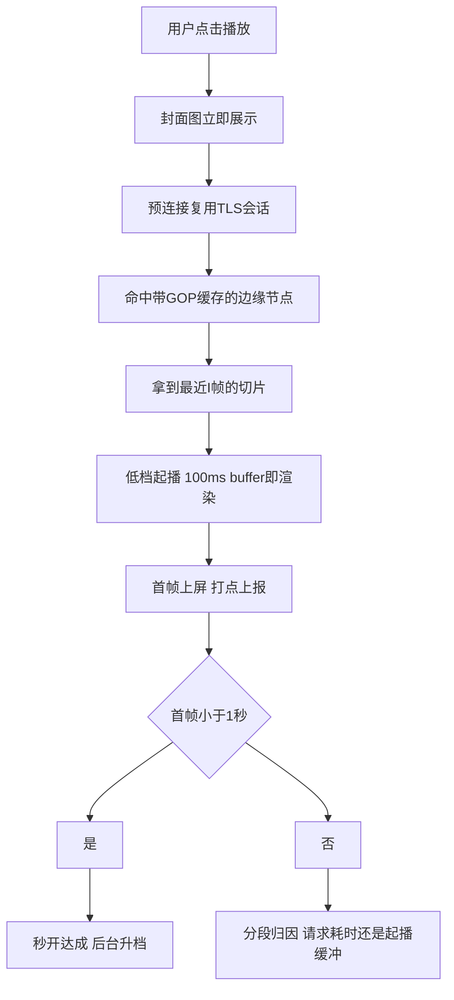

```javascript
// 首帧全链路埋点 + 秒开率数据产出
function instrumentPlayer(videoEl) {
  const t = { click: 0, request: 0, firstByte: 0, firstFrame: 0 };
  videoEl.addEventListener('loadeddata', () => {
    t.firstFrame = performance.now();
    const breakdown = {
      setup: Math.round(t.request - t.click),      // 预连接与签名耗时
      ttfb: Math.round(t.firstByte - t.request),   // CDN 响应 GOP缓存命中则很小
      buffer: Math.round(t.firstFrame - t.firstByte), // 起播缓冲 可压
      total: Math.round(t.firstFrame - t.click),
    };
    report({ metric: 'first-frame', ...breakdown, fastStart: breakdown.total < 1000 });
  });
  return {
    markClick: () => (t.click = performance.now()),
    markRequest: () => (t.request = performance.now()),
    markFirstByte: () => (t.firstByte = performance.now()),
  };
}
```

### AV-128：卡顿率优化：buffer 策略与预测下载怎么做？（高频）
**答**：
- 卡顿根因两类：网速跟不上码率（供血不足）、buffer 策略激进（储备不足）；优化 = 多囤 + 少耗 + 提前预判。
- buffer 策略：直播要平衡追帧与流畅（目标 3-5s，超了加速播放追延迟）；点播大 buffer 无害但要防内存膨胀。
- 预测下载：按滚动窗口估计网速，预测"下一个分片耗时"，在卡顿发生前降档——不要等卡了才反应。
- 移动网络：切网（WiFi↔蜂窝）会断流，用 Network Information API + visibilitychange 提前加大 buffer（关联 AV-150）。
- 度量：卡顿率用"时长占比"与"频次"双口径，P90 卡顿时长比均值更贴近体验。

```javascript
// 预测式降档：不等卡顿先反应
class PredictiveStallGuard {
  constructor(player) { this.player = player; }   // player.levels / currentLevel 由 SDK 提供
  onSegmentDownloaded(bytes, ms, bufferSec, nextSegSeconds) {
    const observedBps = (bytes * 8) / (ms / 1000);
    const needBps = this.player.levels[this.player.currentLevel].bitrate;
    const headroom = observedBps / needBps;       // 网速相对当前码率的余量
    // 余量不足且 buffer 撑不过下一个分片 → 提前降档
    if (headroom < 1.3 && bufferSec < nextSegSeconds + 1) {
      this.player.switchLevel(Math.max(0, this.player.currentLevel - 1), 'predictive');
    }
    // 余量充足且 buffer 健康 → 恢复升档（升档冷却由上层控制）
    if (headroom > 2 && bufferSec > 12) {
      this.player.switchLevel(this.player.currentLevel + 1, 'recover');
    }
  }
}
```

### AV-129：直播延迟优化：从 5 秒到 1 秒到 500ms 的完整路线？（高频压轴）
**答**：
- 先量化构成：总延迟 ≈ 编码缓冲 + 分片打包（约 GOP/2）+ CDN 传输 + 播放器起播缓冲；每段有名字才能治。
- 5s→2s：分片缩短到 1-2s、GOP 与分片对齐、减小 liveSyncDuration、少用/关闭 B 帧。
- 2s→1s：换 HTTP-FLV（无分片打包损耗）+ 播放器追帧（buffer 超阈值 1.1 倍速追赶）。
- 1s→500ms：LL-HLS（Part 分片传输）或 RTC 化（WHIP/WHEP 走 WebRTC 管线）；连麦场景直接纯 RTC <400ms。
- 代价曲线：延迟越低卡顿率越高（抖动吸收空间变小），按场景定目标——互动 500ms 内、电商 1-3s、赛事 3-5s 可接受。

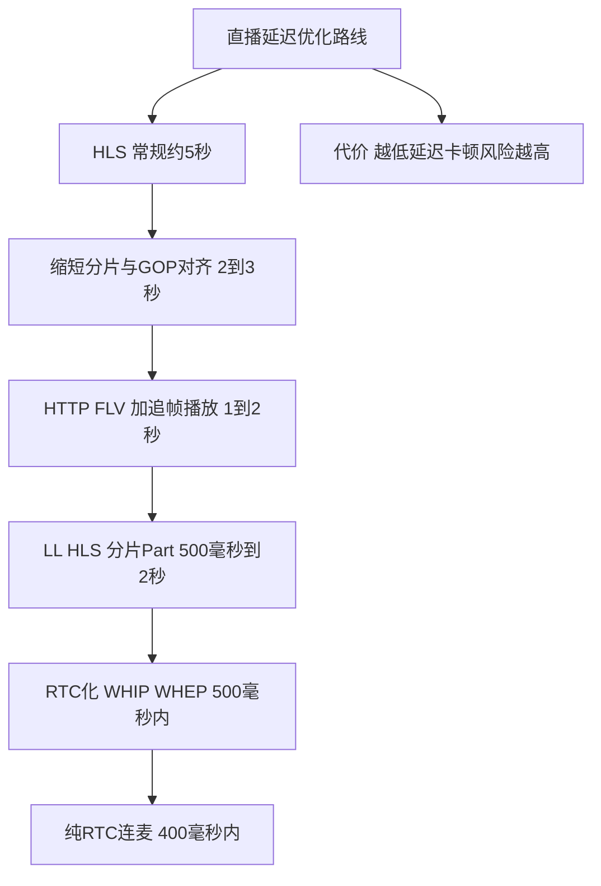

```text
# 延迟分段归因表（生产排查模板 每段独立可测）
segment          | 典型值  | 测量方法
编码侧缓冲       | 0.5-2s  | 推流端时间戳 与 编码输出对比
分片打包         | 1-3s    | GOP长度 与 hls_time 分片时长
CDN传输          | 0.3-1s  | 边缘缓存刷新策略 与 回源链路
播放器起播缓冲   | 0.5-3s  | liveSyncDurationCount 乘 分片时长
追帧关闭时的累积 | 0-无上限 | 观测 30 分钟 buffer 漂移
场景目标建议
电商互动直播     | ≤2s     | FLV 加追帧
赛事转播         | 3-5s    | 标准 HLS 成本优先
连麦PK           | ≤600ms  | RTC 管线
```

### AV-130：清晰度与码率怎么平衡？VMAF 是什么？（高频）
**答**：
- 码率↑画质↑但带宽成本线性涨；用户感知的是主观画质，PSNR/SSIM 与人眼相关性差。
- VMAF：Netflix 开源的主观画质评价指标（0-100），转码服务的目标是"每档码率下 VMAF 最高"的编码参数。
- ABR 档位表应是"VMAF 意义上的阶梯"：相邻档画质差可感知（ΔVMAF > 5），否则切档没有意义。
- 实操：转码上线前用测试序列扫参（CRF × preset），找出该内容类型的甜点参数；直播用固定模板 + 定期复核。
- 排查思路：高码率仍模糊 → 多半是多次转码代际损失或源片分辨率不足，不是码率问题。

```bash
# 用 libvmaf 对比转码输出与源片：输出 vmaf.json 的均值即画质分
ffmpeg -i transcoded_720p.mp4 -i source_1080p.mp4 \
  -lavfi "[0:v]setpts=PTS-STARTPTS[dist];[1:v]scale=1280:720,setpts=PTS-STARTPTS[ref];[dist][ref]libvmaf=log_path=vmaf.json:log_fmt=json:feature=name=psnr" \
  -f null -

# 分数解读: >93 优秀 85-93 良好 <80 明显劣化
# 扫参找甜点：同一源转 CRF 18/21/24，取 VMAF 分数与码率的平衡点
for crf in 18 21 24; do
  ffmpeg -y -i source.mp4 -c:v libx264 -crf $crf -preset slow -an out_$crf.mp4
done
```

### AV-131：首帧时间怎么统计才可信？埋点口径与常见误区？（高频）
**答**：
- 口径一（不可信）：canplay/loadedmetadata——只说明"准备好了"，不代表真正渲染上屏。
- 口径二（推荐）：业务起点（点击/进直播间）→ requestVideoFrameCallback 首次回调（最接近上屏）。
- 误区：不区分冷启动/热缓存；卡顿恢复、切清晰度、后台回前台都算"新首帧"，漏算会虚高。
- 上报维度：网络制式、CDN 厂商、清晰度、协议、机型——秒开问题必须按维度下钻才有结论。
- 双信号兜底：不支持 rVFC 的环境降级 loadeddata，并打上 fallback 标记，两类样本分开统计。

```typescript
// 可信首帧统计：requestVideoFrameCallback 最接近"上屏"
class FirstFrameTracker {
  private t0 = 0;
  private reported = false;
  constructor(private video: HTMLVideoElement) {
    if ('requestVideoFrameCallback' in video) {
      const cb = (now: number) => {
        if (!this.reported && this.t0 > 0) {
          this.reported = true;
          report({ metric: 'first-frame-v2', costMs: Math.round(now - this.t0) });
        }
        video.requestVideoFrameCallback(cb);   // 持续监听以捕获后续新首帧
      };
      video.requestVideoFrameCallback(cb);
    } else {
      video.addEventListener('loadeddata', () =>
        report({ metric: 'first-frame-fallback', costMs: Math.round(performance.now() - this.t0) }));
    }
  }
  start() { this.t0 = performance.now(); this.reported = false; }  // 业务点击时调用
}
```

### AV-132：QoE 与 QoS 指标体系怎么建？告警怎么配？（高频收束）
**答**：
- QoS 是服务视角（服务端可测：推流成功率、CDN 命中率、转码延迟）；QoE 是用户视角（端上采样：首帧/卡顿/失败/音画偏移）。
- 分层：北极星（秒开率、卡顿率、播放成功率）→ 过程指标（TTFB、buffer 水位、重试率）→ 根因指标（DNS 失败、TCP 重传、license 失败）。
- 采集口径：端上 SDK 统一埋点，按"分钟 × 维度"聚合上报，采样 1%-10%，错误样本全量。
- 告警设计：绝对值告警（卡顿率 > 3%）+ 环比突变告警（5 分钟环比 +50%），后者对灰度事故更敏感。
- 闭环：告警 → 维度自动定位（哪省/哪家 CDN/哪协议）→ 预案执行（切 CDN/降档）→ 复盘沉淀。

```json
{
  "north-star": {
    "first-frame-1s-rate": { "target": ">=92%", "dim": ["cdn", "isp", "protocol"] },
    "stall-duration-ratio": { "target": "<=1.5%", "note": "卡顿时长除以播放时长" },
    "play-success-rate": { "target": ">=99.5%", "note": "开播30秒内出画算成功" }
  },
  "alerts": [
    { "metric": "stall-duration-ratio", "abs": ">3%", "level": "P0", "action": "自动切CDN预案" },
    { "metric": "first-frame-1s-rate", "delta": "5min环比-20%", "level": "P1", "action": "联动CDN排查" },
    { "metric": "rtmp-push-fail-rate", "abs": ">1%", "level": "P0", "action": "切推流边缘" },
    { "metric": "av-sync-drift-p95", "abs": ">180ms", "level": "P2", "action": "排查转码时间戳" }
  ],
  "sampling": { "qoe-logs": "5%", "full-on-error": true, "aggregation": "1min x dims" }
}
```

## 十六、场景工程深化（AV-133 ~ AV-139）

### AV-133：多人会议的状态同步怎么做？说话人检测与布局切换？（高频）
**答**：
- 状态源在服务端：成员进出、静音状态、说话人能量、共享者——前端是状态的"渲染器"不是"判定者"。
- 说话人检测：服务端音频能量推 activeSpeaker 事件；前端可用 AnalyserNode 做 RMS 能量兜底（本地判定"我在说话"）。
- 布局策略：聚焦模式（大画面 = 说话人）、宫格、白板模式；切换要防抖（500ms 稳定期），避免说话人频繁闪烁。
- 一致性：事件带 version 单调递增，断线重连后先拉全量快照再补增量（关联 AV-063）。
- 性能：布局变化只动 CSS grid 区域，video 元素复用不销毁——销毁重建会黑屏一闪。

```javascript
// 说话人检测（本地能量兜底）+ 布局切换防抖
class ActiveSpeakerDetector {
  constructor(stream, onSpeaking) {
    const ctx = new AudioContext();
    const analyser = ctx.createAnalyser();
    analyser.fftSize = 512;
    ctx.createMediaStreamSource(stream).connect(analyser);
    const data = new Float32Array(analyser.fftSize);
    setInterval(() => {
      analyser.getFloatTimeDomainData(data);
      let sum = 0;
      for (const v of data) sum += v * v;
      const rms = Math.sqrt(sum / data.length);      // RMS 能量
      if (rms > 0.02) onSpeaking(Date.now());        // 报告说话时间戳
    }, 100);
  }
}
let lastSwitch = 0;
speakerBus.on('active-change', (peerId) => {
  if (Date.now() - lastSwitch < 500) return;         // 500ms 稳定期防抖
  lastSwitch = Date.now();
  setFocusedLayout(peerId);                          // CSS grid 模板区切换 video 复用
});
```

### AV-134：课堂互动系统（答题/红包/点名/举手）怎么设计？（高频）
**答**：
- 互动消息走信令通道（房间广播 + 单播），设优先级：点名 > 答题 > 举手 > 装饰类特效。
- 答题：服务端下发题目（含截止时间戳），前端用服务器时间（持续校准时差）倒计时；提交走 HTTP 不走媒体信令，防丢。
- 点名：服务端随机选人 + 全员广播，被点者自动走连麦升级链路，超时未响应自动释放。
- 举手：状态机（未举/举手中/已同意/已拒绝），老师端审批队列，并发举手排序展示。
- 可靠性：互动消息也要序号去重（AV-064 同款）；红包等资产类操作必须 HTTP + 幂等键。

```typescript
// 课堂互动消息协议与优先级队列
type Interaction =
  | { type: 'raise-hand'; peerId: string; version: number }
  | { type: 'quiz'; questionId: string; options: string[]; deadlineServerTs: number }
  | { type: 'call-on'; peerId: string; deadlineServerTs: number }
  | { type: 'red-packet'; packetId: string; count: number };
class InteractionQueue {
  private priority: Record<Interaction['type'], number> = { 'call-on': 0, quiz: 1, 'raise-hand': 2, 'red-packet': 3 };
  private q: Interaction[] = [];
  push(msg: Interaction) {
    this.q.push(msg);
    this.q.sort((a, b) => this.priority[a.type] - this.priority[b.type]); // 高优先级先渲染
    this.flush();
  }
  private flush() {
    const skew = serverClock.offset();          // 持续校准的服务器时差
    for (const m of this.q) {
      if ('deadlineServerTs' in m) startCountdown(m.deadlineServerTs + skew - Date.now());
    }
    this.q = [];
  }
}
```

### AV-135：观众连麦：上麦时媒体链路怎么切换？（高频压轴）
**答**：
- 身份切换：观众是 CDN 拉流（HLS/FLV），连麦 = 切换为"RTC 推流者 + RTC 订阅者"。
- 标准流程：申请 → 主播同意 → 停 CDN 拉流 → 建 RTC（上行自己的流 + 订阅主播 RTC 流）→ 服务端合流转推 CDN 给其他观众。
- 关键坑：切换期间 CDN 音频与 RTC 音频并存会双声/回声——顺序必须是"先停 CDN 并静音，再起 RTC"。
- 下麦反向：新流（CDN）先就绪出画，再拆 RTC，防黑屏；要处理"上麦失败回退"（RTC 建连失败退回观看模式）。
- 弱网兜底：RTC 上行失败自动降级为纯弹幕互动并提示用户。

```javascript
// 观众上麦的链路切换编排（顺序即正确性）
class AudienceMixer {
  async goLive(roomId, localStream) {
    await signal.requestMic(roomId);                            // 1 服务端审批与占麦
    await this.cdnPlayer.pauseAndMute();                        // 2 先停CDN并静音 防双声回声
    this.rtc = new RTCPeerConnection();
    localStream.getTracks().forEach((t) => this.rtc.addTrack(t, localStream));
    this.rtc.ontrack = (e) => this.replaceStage(e.streams[0]);  // 3 主播RTC流到达再切UI 防闪黑
    await negotiate(this.rtc, signal);                          // 4 完成协商
  }
  async leaveLive() {
    const cdnResume = this.cdnPlayer.prepareResume();           // 1 预载CDN流
    await cdnResume.ready;
    await signal.leaveRtc();
    this.rtc.close();                                           // 2 停RTC
    await cdnResume.play();                                     // 3 新流出画再拆旧UI
  }
}
```

### AV-136：虚拟直播（无人直播/素材合成推流）怎么实现？（高频）
**答**：
- 形态：本地素材（视频/轮播/数字人）合成为一路流推出；前端方案 = Canvas 合成 + captureStream + WHIP/RTMP 推流。
- 合成层：主画面 + 叠加（弹幕挂件/贴片/频谱），rAF 驱动 canvas 绘制，30fps 足够。
- 音频合成：Web Audio 图把 BGM、TTS 人声、音效混成一路 MediaStreamAudioDestinationNode。
- 稳定性：素材循环无缝（双 video 交替）、长时推流内存监控、合成进程崩溃自动重启。
- 数字人驱动：TTS 音频 → 口型参数 → 驱动模型渲染到同一 canvas（关联 AV-077/154）。

```javascript
// Canvas 合成虚拟直播画面 + Web Audio 混音
function buildVirtualStage(bgVideo, stickerCanvas) {
  const stage = document.createElement('canvas');
  stage.width = 1280; stage.height = 720;
  const ctx = stage.getContext('2d');
  (function draw() {
    ctx.drawImage(bgVideo, 0, 0, 1280, 720);       // 主画面
    ctx.drawImage(stickerCanvas, 0, 0);            // 弹幕挂件层
    requestAnimationFrame(draw);
  })();
  const stream = stage.captureStream(30);          // 视频源
  const actx = new AudioContext();
  const mix = actx.createGain();
  mix.gain.value = 0.9;
  actx.createMediaElementSource(new Audio('bgm.mp3')).connect(mix);   // BGM
  actx.createMediaStreamSource(ttsStream).connect(mix);               // 数字人TTS人声
  const dest = actx.createMediaStreamDestination();
  mix.connect(dest);
  dest.stream.getAudioTracks().forEach((t) => stream.addTrack(t));    // 音画合一
  return stream;                                    // → WHIP 推流
}
```

### AV-137：跨房间连麦怎么实现？（高频）
**答**：
- 场景：两个主播在不同房间 PK，双方观众同时看到两人——服务端把 A 房主播流"转推"进 B 房间 SFU。
- 服务端：媒体服务器把 A 的流转推到 B 的 SFU，B 房成员看到一个"外来 Producer"；A 房对称。
- 客户端无感知：前端只是多了一个远端流，但要区分流来源（本房/外房）打不同 UI 标识。
- 延迟代价：跨房转发多一跳，可能跨区域回源，延迟 +100-300ms；PK 节拍由服务端统一 startTs 对齐。
- 本质：跨房连麦是 SFU 级联（AV-115）的业务形态，路由决策在业务服务端不在前端。

```javascript
// 跨房 PK 的业务编排（信令侧）
async function startPk(roomA, roomB) {
  const [okA, okB] = await Promise.all([signal.approvePk(roomA), signal.approvePk(roomB)]);
  if (!okA || !okB) throw new Error('双方未就绪');
  const startTs = await signal.lockStartTs(roomA, roomB);      // 服务端统一开战时刻
  const foreign = await signal.getForeignProducer(roomB, roomA); // B 房里 A 主播的 producer
  bus.emit('pk-start', { startTs, foreignPeer: foreign });
}
bus.on('pk-start', ({ startTs }) => {
  const skew = serverClock.offset();
  countdown(startTs + skew - Date.now());                       // 校准后的统一倒计时
});
```

### AV-138：万人观看的大型活动直播，前端如何做保障？（高频）
**答**：
- 容量分层：观看走 CDN（HLS/FLV）不进 SFU；互动消息走独立 IM 通道并限流（丢装饰类保核心类）。
- 预热：开播前 30 分钟 CDN 预热、客户端预连接、灰度放量（1%→10%→100%）验证链路。
- 降级链：主 CDN → 备 CDN → FLV 降 HLS → 互动降级只留文字 → 极端时切图文直播。
- 前端限流：弹幕/礼物本地节流合并渲染（1s 窗口聚合），动画池复用防 DOM 爆炸。
- 保障机制：活动专属监控大盘 + 值班 soak 机器人（持续拉流验证），异常自动切流并通知。

```json
{
  "event-plan": {
    "warmup": { "cdn-preheat": "T-30min", "gray-ramp": ["1%", "10%", "100%"], "preconnect": true },
    "capacity": { "media": "CDN only", "im": { "qps-limit": 2000, "drop-policy": "decoration-first" } },
    "degrade-chain": ["primary-cdn", "backup-cdn", "flv-to-hls", "text-only-live"],
    "client-throttle": { "danmaku": "1s窗口聚合渲染", "gift-anim-pool": 20 }
  },
  "monitor": { "dashboard": "event-dedicated", "soak-bot": { "interval": "10s", "verify": "拉流加首帧加卡顿采样" } }
}
```

### AV-139：多语言会议（同声传译/字幕轨道）怎么实现？（高频）
**答**：
- 音频：译员声道独立（SFU 多路 audio：original/zh/en），听众选订阅哪路——比混音后切语言干净得多。
- 字幕：ASR 实时转写 + 翻译（AV-076/152 链路），字幕按语言分轨，前端可叠加显示。
- 信令：language-track 事件广播（trackId/lang），客户端按偏好订阅；译员端要"听原声 + 推译文"双链路。
- UI 规范：语言偏好持久化；字幕带 live 标识，低置信度弱化展示。
- 录制：按语言分轨存档（回放可切语言），成片混流用默认语言。

```typescript
// 多语言音频轨订阅与字幕轨道管理
interface LangTrack { trackId: string; lang: 'zh' | 'en' | 'ja'; kind: 'audio' | 'subtitle'; }
class MultiLangManager {
  private pref = localStorage.getItem('audio-lang') ?? 'zh';
  constructor(private tracks: LangTrack[]) {}
  subscribeAll() {
    const audio = this.tracks.filter((t) => t.kind === 'audio');
    sfu.subscribe([
      ...audio.filter((t) => t.lang === this.pref),                 // 主语言有声
      ...audio.filter((t) => t.lang !== this.pref).map((t) => ({ ...t, muted: true })), // 其余静音预连接
    ]);
    this.renderSubtitles(this.tracks.filter((t) => t.kind === 'subtitle' && t.lang === this.pref));
  }
  switchLang(lang: 'zh' | 'en' | 'ja') {                            // 切换不停播
    this.pref = lang;
    localStorage.setItem('audio-lang', lang);
    sfu.subscribe(this.tracks.filter((t) => t.lang === lang));
  }
  private renderSubtitles(subs: LangTrack[]) { /* 渲染层叠加到 video 上 */ }
}
```

## 十七、安全与合规（AV-140 ~ AV-145）

### AV-140：防盗链的完整方案有哪些？（高频）
**答**：
- 四板斧：Referer 白名单（挡外站直链，可伪造仅作第一道）、URL 时效签名、Token 鉴权（业务身份绑定）、播放器内二次鉴权 + 水印溯源。
- 标准签名：URL 携带 auth_key（时间戳-随机串-鉴权 MD5），CDN 边缘验签，过期即 403。
- 时效设计：点播 URL 有效期几分钟到几小时；直播签名短（60-300s），且播放器要支持"中途静默续签"。
- 播放器职责：403 触发续签重试；防下载（禁右键/画中画只是辅助），真防泄漏靠水印溯源（AV-144）。
- 进阶：UA/设备指纹限制、并发路数限制（一号一播）、HLS 分片级鉴权（key 服务鉴权）。

```typescript
// 防盗链签名生成与续签（与 CDN 验签算法对应）
import md5 from 'js-md5';
function signPlayUrl(uri: string, key: string, ttlSec = 300): string {
  const ts = Math.floor(Date.now() / 1000) + ttlSec;     // 过期时刻
  const rand = Math.random().toString(36).slice(2, 12);
  const hash = md5(`${uri}-${ts}-${rand}-0-${key}`);     // 鉴权串拼接规则与 CDN 配置一致
  return `${uri}?auth_key=${ts}-${rand}-0-${hash}`;
}
// 播放器 403 自动续签
player.on('error', async (e) => {
  if (e.code === 403 && e.detail === 'auth-expired') {
    const fresh = signPlayUrl(path, KEY, 300);           // 中途过期静默续签
    await player.reload(fresh, { seekTo: player.currentTime }); // 续播用户无感
  }
});
```

### AV-141：加密 HLS（AES-128）与 key 服务怎么搭？（高频）
**答**：
- 原理：分片用 AES-128-CBC 加密，m3u8 里 `#EXT-X-KEY:METHOD=AES-128,URI="key接口"`，播放器先取 key 再解密分片。
- key 服务：校验播放令牌（token 绑定用户/设备/时效）后才返回 16 字节密钥；可做 per-user key 与定期轮换（m3u8 中 EXT-X-KEY 换版）。
- 安全层级：不加密 < Referer/Token < AES-128（抓包拿到 ts 也解不开）< DRM（防录屏级）。
- 坑：key 接口必须 no-store 不缓存；CORS 要配好；Safari 原生 HLS 自持解密但 key 请求带不走自定义 header。
- 实操：ffmpeg 一条命令产出加密分片 + keyinfo，联调方便。

```bash
# 生成密钥与 IV，写 keyinfo 交给 ffmpeg 加密转 HLS
openssl rand 16 > enc.key
openssl rand -hex 16 > enc.iv.hex

cat > keyinfo <<EOF
https://api.example.com/hlskey?token=PLAYBACK_TOKEN
./enc.key
IV_HEX_VALUE
EOF
# keyinfo 三行: 第一行是播放器请求密钥的URI 第二行本地密钥文件 第三行IV

ffmpeg -i input.mp4 -c:v libx264 -c:a aac \
  -hls_time 4 -hls_playlist_type vod \
  -hls_key_info_file keyinfo \
  -hls_segment_filename 'seg_%03d.ts' index.m3u8
# 产出: index.m3u8 内含 EXT-X-KEY 指向 key 接口 + 加密分片
# key 服务逻辑: 校验 PLAYBACK_TOKEN 有效性后才返回密钥字节
```

### AV-142：内容审核（截图 + AI 审核）前端怎么配合？（高频）
**答**：
- 审核主体在服务端/云端（推流旁路截图 → AI 模型 → 人工复审队列），前端做"即时反馈与止损"。
- 前端可做：开播前封面预检（video → canvas → 上传 AI 接口）、审核状态轮询展示（正常/复审中/已封禁）。
- 推流端预检：开播前自检封面与首帧，命中敏感直接拦截，减少"开播即封"的差体验。
- 实时止损：服务端下发"流违规"事件 → 前端立即下播并展示原因，截图证据按合规要求留存。
- 灰度与误杀：审核结果带置信度，低置信度走"限流不封禁"，必须给申诉通道。

```javascript
// 本地抽帧送审：封面预检
async function precheckCover(videoEl, token) {
  const canvas = document.createElement('canvas');
  canvas.width = videoEl.videoWidth;
  canvas.height = videoEl.videoHeight;
  canvas.getContext('2d').drawImage(videoEl, 0, 0);      // 抓当前帧
  const blob = await new Promise((r) => canvas.toBlob(r, 'image/jpeg', 0.8));
  const form = new FormData();
  form.append('image', blob, 'cover.jpg');
  const res = await fetch('/api/moderation/image', {
    method: 'POST',
    headers: { Authorization: `Bearer ${token}` },
    body: form,
  });
  const { label, confidence } = await res.json();        // label: pass | review | block
  if (label === 'block' && confidence > 0.9) {
    toast('封面包含违规内容，请更换后再开播');            // 开播前拦截
    return false;
  }
  return true;                                           // review 档放行但进入异步复审
}
```

### AV-143：直播合规有哪些硬性要求？（高频）
**答**：
- 资质：平台需网络文化经营许可证/信息网络传播视听节目许可等，主播实名认证（身份证 + 人脸），海外另有 GDPR/本地法规。
- 内容：实时审核（AV-142）、违规处置留痕、举报入口必须存在、未成年人保护（青少年模式/打赏限制）。
- 数据：录制留存（常见要求 60 天以上）、日志留存、用户数据出境评估。
- 技术配合：实名采集前端接人脸核身 SDK；录制留存对接对象存储合规桶（WORM 防篡改）。
- 前端 checklist：举报入口、违规提示文案、隐私政策链接、年龄提示、禁播词过滤（弹幕/标题）。

```json
{
  "compliance-checklist": {
    "platform": ["视听节目许可", "网络文化经营许可", "ICP备案", "公安备案"],
    "anchor": ["实名认证加人脸核身", "违规计分制度", "黑名单共享"],
    "content": ["实时AI审核", "人工复审队列", "举报通道", "禁播词库热更新"],
    "data": ["录制留存60天以上", "WORM存储防篡改", "日志留存6个月以上", "出境安全评估"],
    "frontend-must": ["举报入口常驻", "隐私政策链接", "青少年模式开关", "违规下播提示文案"]
  },
  "retention": { "recording-days": 60, "moderation-evidence-days": 180, "log-days": 180 }
}
```

### AV-144：录制视频的水印与溯源怎么做？（高频）
**答**：
- 目的：泄露后定位泄露源——水印携带"用户ID + 场次 + 时间"，出事后提取即可追责。
- 明水印：画面上可见的 logo/ID（ffmpeg drawtext 或服务端混流模板），有威慑力但易被遮挡裁剪。
- 暗水印（数字水印）：频域嵌入不可见信息，抗压缩/裁剪/录屏，离线工具提取；适合溯源场景。
- 成本策略：平台 logo 明水印全量加；"一人一码"暗水印只在高价值内容（付费课/会议录制）上做。
- 层级组合示例：录课 = 平台 logo 明水印 + 观众 ID 暗水印；会议录制 = 场次明水印 + 参会人暗水印。

```bash
# 服务端转码时按观众逐路加明水印（一对一溯源水印）
ffmpeg -i source.mp4 \
  -vf "drawtext=text='UID-10086 ROOM-42':fontsize=18:fontcolor=white@0.25:x=20:y=h-th-20" \
  -c:v libx264 -preset fast -c:a copy watermarked_uid10086.mp4

# 批量：每个观众一份（成本高，仅高价值课程与会议录制用）
for uid in $(cat viewers.txt); do
  ffmpeg -y -i source.mp4 \
    -vf "drawtext=text='UID-$uid':x=w-tw-30:y=h-th-30:fontcolor=white@0.3" \
    -c:a copy "out_$uid.mp4"
done
# 暗水印为专业频域方案（商用DigiMarc类或开源频域实现） 在转码环节嵌入 溯源时用提取工具离线解析
```

### AV-145：摄像头/麦克风授权的隐私合规怎么做？（高频）
**答**：
- 原则：使用前明示用途（为什么需要摄像头）、最小化采集（只取用到的设备与分辨率）、可随时撤回且立即停止采集。
- 提示时序：先自绘 UI 说明用途 → 再触发浏览器原生弹窗（getUserMedia）；直接弹原生框被拒后二次引导非常困难（浏览器记住拒绝）。
- 被拒后引导：捕获 NotAllowedError → 展示分浏览器/分平台的开启指引（Safari 设置路径与 Chrome 锁图标路径不同）。
- 数据合规：音视频上传必须告知并获同意（隐私协议勾选）；端上处理不上传（如本地美颜）也要明示"不上传"。
- 法规：GDPR/个保法要求"明示同意"，摄像头属于敏感个人信息，未成年人需监护人同意；团队要有数据分级清单。

```typescript
// 合规授权流程：先解释后请求 被拒后分平台引导
interface PermissionIntro { feature: string; reason: string; dataScope: string; }
const INTRO: Record<'video' | 'audio', PermissionIntro> = {
  video: { feature: '摄像头', reason: '用于会议画面与虚拟背景', dataScope: '本地采集 仅参会人可见' },
  audio: { feature: '麦克风', reason: '用于会议发言', dataScope: '实时传输 不落地存储' },
};
async function requestWithConsent(kind: 'video' | 'audio'): Promise<MediaStream> {
  await showConsentDialog(INTRO[kind]);                       // 1 自绘说明层 必须先于原生弹窗
  try {
    return await navigator.mediaDevices.getUserMedia({ [kind]: true });
  } catch (e) {
    if ((e as DOMException).name === 'NotAllowedError') {     // 2 分平台开启指引
      const guide = isSafari()
        ? '设置 - Safari - 摄像头 - 允许本网站'
        : '地址栏锁图标 - 权限 - 允许后刷新页面';
      showGuide(guide);
    }
    throw e;
  }
}
```

## 十八、移动端与跨端音视频（AV-146 ~ AV-151）

### AV-146：iOS/Android WebView 的播放差异有哪些？（高频压轴）
**答**：
- iOS：video 默认全屏接管（必须 playsinline）、无声才允许自动播（muted+autoplay）、低电量模式拦 autoplay、Safari 上 play() 必须在用户手势调用栈内。
- 安卓：各厂商 WebView 内核差异大（X5/UC），HLS 与 MSE 支持不齐，需运行时探测降级；硬件加速关闭会花屏。
- 内嵌 App：iOS WKWebView 要 native 配 allowsInlineMediaPlayback；安卓 X5 用 x5-playsinline 等私有属性。
- 实用策略：能力探测 + 全屏兜底（inline 不行就 Fullscreen API）+ 静音自动播 + 首次触摸解锁声音。
- 兜底心智：所有"自动播失败"都要有视觉降级（封面 + 播放按钮），而不是黑屏等待。

```html
<!-- 移动端兼容性最全的 video 标签写法 -->
<video id="player"
  playsinline
  webkit-playsinline
  x5-playsinline="true"
  x5-video-player-type="h5"
  x5-video-orientation="portrait|landscape"
  muted
  autoplay
  preload="metadata"
  controls></video>
<script>
  // iOS 自动播被拦（低电量模式等）的兜底：首次触摸解锁并开声
  document.body.addEventListener('touchstart', function unlock() {
    const v = document.getElementById('player');
    v.play().catch(() => {});
    v.muted = false;
    document.body.removeEventListener('touchstart', unlock);
  }, { once: true });
</script>
```

### AV-147：小程序音视频怎么做？live-pusher/live-player 有什么限制？（高频）
**答**：
- 组件：live-pusher（推流）/live-player（拉流），需要主体类目资质声明，个人主体不可用；组件是原生层渲染。
- 模式：live-player mode="RTC" 走 RTC 链路（延迟 <500ms），mode="live" 走 CDN（1-3s）；连麦 = 双组件（自己推 + 订阅对方）。
- 限制：不支持 MSE/WebRTC JS 栈；切后台即断流（音频后台模式需单独申请）；原生组件层级最高，覆盖 UI 必须用 cover-view。
- 与 H5 互通：同一信令与 SFU，小程序走原生组件、Web 走 MSE/WebRTC，业务层协议统一（关联 AV-126）。
- 状态驱动：bindstatechange 返回码表驱动重连与 UI 状态，错误码要全量映射。

```html
<!-- 小程序连麦页面（WXML 形态） -->
<live-pusher id="pusher" url="{{pushUrl}}" mode="RTC"
  enable-mic="true" enable-camera="true" autopush
  bindstatechange="onPushState"
  style="width:180rpx;height:320rpx" />
<live-player id="player" url="{{playUrl}}" mode="RTC" autoplay
  bindstatechange="onPlayState"
  style="width:750rpx;height:422rpx" />
<cover-view class="ctrl-btn" bindtap="toggleMic">静音</cover-view>
<!-- 注意：原生组件层级最高 普通view会被盖住 必须cover-view -->
<script>
// pushUrl/playUrl 由业务服务端生成（含防盗链签名） 小程序端不落密钥
function onPushState(e) {
  const code = e.detail.code;
  if (code === -1307) reconnectPush();        // 断网码表驱动重连
  if (code === 3002) reSignPushUrl();         // 推流URL签名过期 重新拉取
}
</script>
```

### AV-148：RN/Flutter 的播放器封装怎么做？（概览）
**答**：
- RN：react-native-video（基于 ExoPlayer/AVPlayer）；Flutter：video_player、better_player、fijkplayer。
- 桥接要点：JS/Dart 只发指令（play/seek/setSource）+ 收事件（state/progress/error），媒体能力全在 native 层。
- 事件归一：native 事件粒度与 Web 不同（如 iOS itemDidPlayToEndTime），封装层要归一成统一状态机（对齐 AV-126 协议）。
- 原生能力穿透：画中画、后台播放、锁屏控制（MPNowPlayingInfoCenter / AudioService）需在 native 开，封装层暴露开关。
- 选型：纯播放用官方库；直播/DRM/自定义 UI 用 better_player 这类增强库；深度需求自写桥接。

```typescript
// RN 播放器统一封装：桥接层归一事件
import Video, { VideoRef } from 'react-native-video';
class RNPlayerAdapter implements UnifiedPlayer {          // 实现 AV-126 统一协议
  private ref = React.createRef<VideoRef>();
  private listeners = new Map<string, Function[]>();
  state: PlayerState = 'idle';
  load(src: PlaySource) {
    this.state = 'loading';
    return <Video
      ref={this.ref}
      source={{ uri: src.url }}
      resizeMode="contain"
      playsInLine                                          // 对齐 Web 的 playsinline
      onReadyForDisplay={() => this.emit('state', 'playing')}
      onPlaybackStalled={() => this.emit('state', 'stalled')}
      onError={(e) => this.emit('error', e)} />;
  }
  on(ev: string, cb: Function) {
    const l = this.listeners.get(ev) ?? [];
    l.push(cb);
    this.listeners.set(ev, l);
  }
  private emit(ev: string, p?: unknown) { this.listeners.get(ev)?.forEach((f) => f(p)); }
  play() { return this.ref.current?.resume(); }
  pause() { this.ref.current?.pause(); }
  destroy() { /* 卸载组件并清理native资源 */ }
}
```

### AV-149：App 与 H5 的播放互通怎么做？（deep link / 接力）（高频）
**答**：
- 场景：H5 分享页唤起 App 续播（进度接力）；App 内嵌 H5 跳原生播放器。
- 技术：Universal Links（iOS）/ App Links（安卓）直达具体页 + 自定义 URL Scheme 兜底；参数带 videoId + currentTime。
- 接力实现：H5 把进度写入 URL 参数或短链服务，App 启动后取参 seek 续播；未装 App 降级留在 H5。
- 反向：App 内 H5 用 JSBridge（postMessage）请求原生播放器接管，原生播完回传进度。
- 坑：微信内屏蔽自定义 Scheme（需开放标签 wx-open-launch-app）；iOS Universal Links 依赖域名校验（AASA 文件）配置正确。

```javascript
// H5 唤起 App 续播（含降级链）
function handoffToApp({ videoId, currentTime }) {
  const payload = encodeURIComponent(JSON.stringify({ videoId, t: Math.floor(currentTime), from: 'h5' }));
  const universalLink = `https://app.example.com/play?ctx=${payload}`; // 首选 装了App直达
  const scheme = `myapp://player?ctx=${payload}`;                       // 兜底
  location.href = universalLink;
  setTimeout(() => {
    if (!document.hidden) {                        // 页面仍在前台说明未唤起
      const ifr = document.createElement('iframe'); // iframe 触发 scheme 防当前页跳走
      ifr.src = scheme;
      document.body.appendChild(ifr);
      setTimeout(() => ifr.remove(), 100);
      showStayHint();                              // 最终兜底 留在 H5 继续播
    }
  }, 1500);
}
```

### AV-150：移动端弱网专项：切网/后台/锁屏后的恢复策略？（高频）
**答**：
- 三大场景：网络切换（WiFi↔蜂窝，连接断几秒）、App 切后台（iOS 直接挂起媒体）、锁屏（音频可续视频必停）。
- 监控信号：online/offline、Network Information API、visibilitychange、页面冻结（freeze/resume）。
- 恢复策略：回前台/恢复网络 → 检查 buffer 是否枯竭 → 枯竭则 seek 当前时间刷新加载 → 校准音画（长时间挂起有时钟漂移）。
- RTC 场景：切后台推流断，回前台要 ICE restart + 重推；保活（后台音频模式）仅音频合法。
- 直播特例：长时间后台回来 m3u8 滑动窗口早已滚过，必须重新 loadSource 而不是续播旧 buffer。

```javascript
// 移动端回前台/切网的统一恢复编排
class MobileRecovery {
  constructor(player, { isLive }) { this.player = player; this.isLive = isLive; }
  install() {
    document.addEventListener('visibilitychange', () => {
      if (document.visibilityState === 'visible') this.recover('foreground');
    });
    window.addEventListener('online', () => this.recover('online'));
    navigator.connection?.addEventListener('change', () => this.recover('network-switch'));
  }
  async recover(reason) {
    const buf = this.bufferAhead();
    if (this.isLive && buf === 0) {
      await this.player.reloadCurrentSource();   // 直播窗口已滚动 必须重拉 m3u8
    } else if (buf < 0.3) {
      this.player.currentTime += 0.01;           // seek 踢活 stalled 的解码管线
    }
    report({ metric: 'mobile-recover', reason, bufferSec: buf.toFixed(1) });
  }
  bufferAhead() {
    const v = this.player.video;
    const end = v.buffered.length ? v.buffered.end(v.buffered.length - 1) : 0;
    return end - v.currentTime;
  }
}
```

### AV-151：移动端音视频的发热与耗电怎么优化？（高频）
**答**：
- 耗电大头：解码（分辨率×帧率）、渲染（WebGL/GPU 合成）、网络（RF 常亮）、摄像头采集。
- 降载动态化：小窗口自动降档（移动端 720p 上限）、页面不可见暂停视频只留音频、低电量限帧（15fps）。
- 渲染优化：video 离屏暂停（IntersectionObserver）、canvas 合成降频（30fps 足够）、减少多层叠加合成。
- 网络优化：合并心跳、预连接复用（避免频繁 TLS 握手）、弱网降码率（省电同时省流量）。
- 度量：Battery API + 性能日志采样上报；发热主诉多来自长时间 RTC 会议，帧率 15fps 上限可显著缓解。

```javascript
// 移动端省电调度器：可见性与电量驱动的动态降载
class PowerGovernor {
  constructor(pipeline) { this.pipeline = pipeline; }  // 摄像头/渲染/网络三子系统句柄
  install() {
    document.addEventListener('visibilitychange', () => {
      const hidden = document.hidden;
      this.pipeline.setRenderPaused(hidden);                    // 后台停渲染
      this.pipeline.setVideoEnabled(!hidden);                   // 后台可选只保音频
      this.pipeline.setHeartbeatInterval(hidden ? 30000 : 5000); // 心跳降频
    });
    navigator.getBattery?.().then((b) => {
      const apply = () => {
        if (b.level < 0.2 && !b.charging) {
          this.pipeline.capFrameRate(15);             // 低电量限帧
          this.pipeline.capResolution(480);           // 降采集分辨率
          report({ metric: 'power-governor', mode: 'saver', level: b.level });
        }
      };
      b.addEventListener('levelchange', apply);
      apply();
    });
  }
}
```

## 十九、AI 与音视频（AV-152 ~ AV-157）

### AV-152：实时字幕与翻译的架构怎么搭？ASR 流式怎么接入？（高频压轴）
**答**：
- 链路：音频流（采 Opus/PCM 帧）→ 流式 ASR（增量返回 partial→final）→ 翻译（可流式）→ 字幕广播（信令/IM 通道）→ 各端渲染。
- 流式语义：partial 是持续被修正的中间结果，final 是句级确定结果；前端渲染 partial 但标记"未确定"，final 落定替换。
- 前端接入：getUserMedia → AudioWorklet 采 16k PCM → WebSocket 二进制送云 ASR（讯飞/火山/Azure）。
- 时序对齐：ASR 返回带媒体时间戳，字幕与画面同步；回放场景按 currentTime 定位字幕（可做成字幕轨）。
- 合规：开启字幕即上传音频，必须明示（AV-145）；ASR 按时长计费，要有限流与开关。

```javascript
// 流式 ASR 接入：AudioWorklet 采帧 + WS 送识别
class LiveCaptioner {
  constructor(wsUrl, lang = 'zh') {
    this.ws = new WebSocket(wsUrl);
    this.lang = lang;
  }
  start(stream) {
    const ctx = new AudioContext({ sampleRate: 16000 });   // 多数 ASR 要求 16k
    ctx.audioWorklet.addModule('pcm-capture.js').then(() => {
      const node = new AudioWorkletNode(ctx, 'pcm-capture', { outputChannelCount: [1] });
      ctx.createMediaStreamSource(stream).connect(node);
      node.port.onmessage = ({ data }) => {
        if (this.ws.readyState === WebSocket.OPEN) this.ws.send(data); // 二进制 PCM 帧
      };
      stream.getAudioTracks()[0].addEventListener('ended', () => ctx.close());
    });
    this.ws.onmessage = (ev) => {
      const { mode, text, ts } = JSON.parse(ev.data);      // mode: partial | final
      captionStore.upsert({ lang: this.lang, text, ts, tentative: mode === 'partial' });
    };
  }
}
```

### AV-153：AI 降噪与超分在前端怎么落地？（概览）
**答**：
- AI 降噪：RNNoise-wasm 跑在 AudioWorklet，逐帧推理输出增益，对非稳态噪声（键盘/人声）优于传统 ANS。
- 超分（SR）：ESRGAN 类模型对低清视频上采样；端上实时 720p 仍吃力，多用于点播离线增强或云端推理。
- 运行环境：WebGPU + WASM SIMD 让端上推理可行；音频在 AudioWorklet、视频在 OffscreenCanvas worker，主线程零阻塞。
- 接入形态：降噪做成本地处理开关（用户可关）；超分做成云端转码选项（成本在服务端）。
- 评估：降噪看 PESQ/STOI 提升，超分看 VMAF（AV-130）提升；端上方案必须 A/B 电量与发热。

```javascript
// denoise-worklet.js：RNNoise-wasm 降噪节点（骨架）
class DenoiseWorklet extends AudioWorkletProcessor {
  static get parameterDescriptors() { return [{ name: 'bypass', defaultValue: 0 }]; }
  constructor() {
    super();
    this.enabled = true;
    import('rnnoise-wasm').then((m) => { this.denoiser = new m.Denoiser(480); }); // 48k 下 10ms 帧 480 采样
    this.port.onmessage = ({ data }) => { if (data.cmd === 'toggle') this.enabled = data.on; };
  }
  process(inputs, outputs, params) {
    const input = inputs[0][0], output = outputs[0][0];
    if (params.bypass[0] || !this.enabled || !this.denoiser || input.length !== 480) {
      output.set(input);
      return true;
    }
    const gain = this.denoiser.computeFrame(input);       // 模型输出逐频点抑制增益
    for (let i = 0; i < input.length; i++) output[i] = input[i] * gain;
    return true;
  }
}
registerProcessor('denoise-worklet', DenoiseWorklet);
```

### AV-154：数字人直播概览：驱动、合成、推流的链路？（高频）
**答**：
- 五段链路：文案/TTS（语音合成）→ 驱动（音素对口型 + 表情/动作策略）→ 渲染（2D Live2D / 3D 模型）→ 合成（数字人 + 背景 + 贴片）→ 推流（WHIP/RTMP）。
- 2D vs 3D：Live2D 类是"参数驱动贴图变形"成本低；3D（Unreal/Unity 云渲染）真实感强但算力在云端，视频流回传。
- 前端角色：渲染端（three.js/Live2D web SDK）、合成推流端（AV-136 canvas 方案）、控制台（话术管理、人工接管）。
- 实时性：TTS 流式合成（边生成边播）+ 口型并行计算，端到端 <2s 才自然；音频能量驱动嘴型是最稳的兜底。
- 合规：数字人直播必须标识"AI 生成"，形象与声音要有完整授权链。

```typescript
// 数字人直播的驱动管线（前端渲染端视角）
interface DriveFrame { audioChunk: AudioBuffer; viseme: string; expression: number[]; }
class AvatarStage {
  private model: L2DModel;
  async onTtsChunk(chunk: DriveFrame) {            // TTS 边到边播
    await this.playAudio(chunk.audioChunk);        // 声音先行
    this.model.setViseme(chunk.viseme);            // 口型映射 a i u e o
    this.model.setExpression(chunk.expression);    // 表情参数向量
  }
  start(overlay: HTMLCanvasElement) {              // 合成到推流画面
    const canvas = this.model.mount(overlay);
    return canvas.captureStream(30);               // 交给 AV-136 合成器
  }
  emergencyStop() {                                // 人工接管 停TTS断驱动
    this.tts.abort();
    this.model.setViseme(null);
  }
  private playAudio(chunk: AudioBuffer) { return this.player.play(chunk); }
  private get player() { return this.model.audioPlayer; }
  private get tts() { return this.ttsClient; }
}
```

### AV-155：智能剪辑概览：精彩片段检测怎么做？（高频）
**答**：
- 信号源：音频能量突变（欢呼/高潮）、弹幕密度（互动热点）、画面运动强度（镜头切换）、ASR 关键词（"绝杀""秒杀"）。
- 架构：离线管道为主（转码后批量分析）；直播中实时切片（检测到高潮立即产出 15-30s 片段）是进阶形态。
- 融合打分：多信号加权求和，超阈值前后各扩 5s 成片；权重先拍脑袋，用运营标注回归校准。
- 前端参与：剪辑工具 UI 在时间轴标出 AI 建议片段、一键成片、片段预览跳转。
- 闭环：人工采纳率回传用于校准权重，模型越用越准。

```javascript
// 精彩片段打分器：多信号融合
function scoreHighlights(signals, windowSec = 5) {   // signals: 按秒聚合的指标序列
  const w = { danmaku: 2.0, audioPeak: 1.5, motion: 0.8, asrKeyword: 2.5 };
  return signals
    .map((s, t) => ({
      t,
      score: s.danmakuPerSec * w.danmaku
           + s.audioRmsPeak * w.audioPeak
           + s.motionEnergy * w.motion
           + s.keywordHits * w.asrKeyword,
    }))
    .sort((a, b) => b.score - a.score)
    .slice(0, 10)                                    // Top10 候选片段
    .map(({ t, score }) => ({
      start: Math.max(0, t - windowSec),
      end: t + windowSec,
      score,
    }));
}
// 剪辑 UI 展示候选片段 人工采纳率回传校准权重 w
```

### AV-156：语音识别的前端接入：Web Speech API 与云服务怎么选？（高频）
**答**：
- Web Speech API：免费零依赖，但只有 Chrome 系实现稳定、流式格式不可控、无 SLA——适合 demo/轻量场景。
- 云 ASR（讯飞/火山/Azure）：流式 partial/final、领域热词、SLA 保障——生产选择。
- 本地 wasm（whisper.cpp）：隐私最好可离线，但模型大（75MB-1.5GB）、速度慢，适合短音频与隐私敏感场景。
- 选型四维：延迟（流式首字 <500ms）、准确率（热词支持）、成本、离线能力。
- 组合策略：会议实时字幕走云流式；录音文件转写走批量接口；隐私场景本地 whisper 兜底。

```javascript
// Web Speech API 实时识别（对照实现，与云 ASR 的 partial/final 语义对齐）
const SR = window.SpeechRecognition ?? window.webkitSpeechRecognition;
const rec = new SR();
rec.continuous = true;
rec.interimResults = true;
rec.lang = 'zh-CN';
let finalText = '';
rec.onresult = (e) => {
  let partial = '';
  for (let i = e.resultIndex; i < e.results.length; i++) {
    const r = e.results[i];
    if (r.isFinal) finalText += r[0].transcript;   // final 落定
    else partial += r[0].transcript;               // partial 中间态
  }
  render(finalText, partial);
};
rec.onerror = (e) => { if (e.error === 'not-allowed') showMicGuide(); };
rec.onend = () => { if (!stopped) rec.start(); };  // Chrome 会自动停 需要重启
rec.start();
```

### AV-157：AI 审核与内容安全怎么体系化？（高频）
**答**：
- 多模态审核：视频帧（色情/暴力/违禁物）、音频 ASR（涉政/辱骂）、文本（弹幕/标题）、封面，各自模型 + 融合仲裁。
- 三级处置：机审高置信直接处置、中置信限流降权（不给推荐）、低置信人工复审队列。
- 直播特性：抽帧频率与成本平衡（1-2s/帧 + 关键帧），音频流式送审；直播与回放分开策略。
- 前端配合：审核状态实时下发（流内提示）、违规片段时间戳回传给主播端警示。
- 度量：机审准确率/召回率、人工复审率（复审比例是成本核心）、误杀申诉成功率。

```json
{
  "moderation-pipeline": {
    "video": { "sample-rate": "1fps加关键帧", "model": "nsfw加violence", "threshold": { "block": 0.9, "review": 0.6 } },
    "audio": { "pipeline": "asr流式转写后文本审核", "latency-target": "<3s" },
    "text": { "scope": ["弹幕", "标题", "评论"], "strategy": "词库加语义模型双通道" }
  },
  "disposal": [
    { "confidence": ">=0.9", "action": "切断流加封禁", "notify": "immediate" },
    { "confidence": "0.6-0.9", "action": "限流且不给推荐", "notify": "async" },
    { "confidence": "<0.6", "action": "人工复审队列", "sla": "10min" }
  ],
  "metrics": { "review-rate-target": "<5%", "appeal-success-rate": "监控误杀" }
}
```

## 二十、综合大题与体系（AV-158 ~ AV-200）

### AV-158：设计一个企业级会议系统前端（多端/共享/录制/字幕）。（高频压轴）
**答**：
- 架构分层：信令层（WS + 快照 + 增量版本号）、媒体层（SFU + simulcast）、能力层（共享/录制/字幕/白板插件化）、UI 层（布局引擎）。
- 多端：Web/Mac/Win/移动共用同一信令协议与 SFU；能力矩阵各端声明（如手机不支持虚拟背景），服务端按能力调度。
- 核心链路：入会（设备预检→权限→建连→成员同步）、共享（getDisplayMedia→双流协商→共享者高亮）、录制（服务端合流 + 全员提示条）、字幕（AV-152 链路）。
- 稳定性：断线重连三件套（信令重连 + ICE restart + 快照恢复）、主持人中控（静音/踢人/锁定会议）。
- 工程要点：16 人以上宫格虚拟渲染、设备热插拔监听、耳返与音量条、状态同步（AV-133）。

```typescript
// 会议系统前端核心域模型（节选）
class MeetingClient {
  private signal = new SignalChannel();               // 快照加增量 版本号对齐
  private sfu = new SfuClient();
  private caps = new Map<string, boolean>([
    ['e2ee', true],
    ['virtual-bg', !isMobile],                        // 能力矩阵各端声明
  ]);
  async join(meetingId: string) {
    const snapshot = await this.signal.join(meetingId, { caps: [...this.caps] });
    await this.sfu.connect(snapshot.iceServers);      // 建连
    snapshot.members.forEach((m) => this.renderMember(m));
    this.signal.onDelta((d) => this.applyDelta(d, snapshot.version)); // 增量对账
  }
  async shareScreen() {
    const stream = await navigator.mediaDevices.getDisplayMedia({ video: { frameRate: 15 } });
    await this.sfu.publish(stream, { kind: 'screenshare' });  // 独立track类型 SFU区别路由
    stream.getVideoTracks()[0].addEventListener('ended', () => this.stopShare()); // 浏览器停止共享按钮
  }
  startRecording() {                                  // 服务端合流 全员提示条合规
    this.signal.send({ type: 'record-start' });
    this.ui.showBanner('本次会议正在录制');
  }
  private renderMember(m: Member) { /* 布局虚拟渲染 */ }
  private applyDelta(d: Delta, base: number) { /* 版本对账 */ }
}
```

### AV-159：设计一个直播平台的前端体系全景。（高频压轴）
**答**：
- 三端角色：推流端（采集/编码/推流/连麦）、消费端（拉流播放/互动/消费）、运营端（导播/监控/审核工作台）。
- 全景链路：开播（推流→转码→分发）→ 观看（CDN→播放器→互动）→ 连麦（RTC 融合 AV-036）→ 回放（录制→点播）。
- 通用底座：播放器 SDK（AV-126）、监控埋点（AV-131/132）、房间信令（AV-061-064）、鉴权防盗链（AV-140）。
- 工程化：直播间模板化（布局 + 插件集），新业务品类 = 新模板；灰度与降级预案、A/B 实验（延迟档位 × UI 方案）。
- 度量体系：QoE 北极星（秒开/卡顿/时长）与业务指标（互动率/转化率）双轨对照。

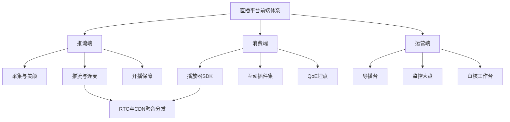

```javascript
// 直播间页面 = 布局 + 插件集（模板化组装）
const livePage = createLiveRoom({
  layout: 'portrait-std',                                        // 竖屏标准位 竞猜类可切横屏位
  plugins: [
    playerPlugin({ protocols: ['flv', 'hls'], abr: 'hybrid' }),  // 播放器与ABR
    danmakuPlugin({ renderPool: 40, mergeWindow: 800 }),         // 弹幕聚合渲染
    giftPlugin({ animPool: 20 }),                                // 礼物特效池
    interactionPlugin({ quiz: true, redpacket: true }),          // 互动
    qoePlugin({ sample: 0.05 }),                                 // QoE 埋点
    degradePlugin({ chain: ['flv', 'hls', 'static-cover'] }),    // 降级链
  ],
});
// 新直播品类 = 新模板：竞猜直播 = landscape 布局 + quizPlugin 加强 + 延迟敏感档位
```

### AV-160：设计一个在线 KTV（歌词同步/伴唱/评分）。（高频）
**答**：
- 核心：伴奏与原唱双音轨 + 歌词逐字同步（QRC 逐字时间戳）+ 混音（人声 + 伴奏）+ 评分（音高比对）。
- 同步基准：用媒体时钟（audioContext.currentTime / video.currentTime）驱动，不用 setInterval 累计（会漂移）。
- 连麦合唱：伴奏由主唱端统一播放，副唱端只收人声——避免两端伴奏不同步；RTC 只上行人声。
- 评分：Web Audio 取人声基频（自相关法），与标准 MIDI 音高比对，逐句给分。
- 体验：歌词逐字染色、下一句提示行、抢唱/慢唱检测提示。

```javascript
// KTV 歌词逐字同步与音高采集
class KtvStage {
  constructor(lrc, musicEl) {
    this.lrc = parseQrc(lrc);          // 逐字时间戳
    this.music = musicEl;
  }
  tick() {                             // rAF 驱动 基准 = 媒体时钟
    const t = this.music.currentTime * 1000;
    const word = this.lrc.wordAt(t);
    if (word) paintLyric(word, (t - word.start) / word.dur);  // 逐字染色进度 0-1
    requestAnimationFrame(() => this.tick());
  }
  startPitchTrack(userStream) {        // 评分：取用户人声基频
    const ctx = new AudioContext();
    const an = ctx.createAnalyser();
    an.fftSize = 2048;
    ctx.createMediaStreamSource(userStream).connect(an);
    const buf = new Float32Array(an.fftSize);
    setInterval(() => {
      an.getFloatTimeDomainData(buf);
      const f0 = autocorrelation(buf, ctx.sampleRate);          // 基频估计
      const midi = f0 ? 69 + 12 * Math.log2(f0 / 440) : null;   // 转 MIDI 音高
      scoreEngine.push(midi, this.lrc.expectedMidiAt(this.music.currentTime * 1000));
    }, 100);
  }
}
```

### AV-161：设计一个远程医疗会诊系统（加密/高清/合规）。（高频）
**答**：
- 硬要求：传输加密（E2EE 优先 AV-109）、录制需双方知情同意、数据境内存储、身份强认证（医生执业校验）。
- 媒体：高清视频（720p 起，处方场景要能看清皮肤/伤口，提供对焦提示）、屏幕共享（看报告/影像截图）。
- 弱网优先：患者端常在弱网环境——simulcast + 音频优先策略（断流时保通话保音频）。
- 合规 UI：会话开始提示"将录制用于医疗档案"（可拒绝则不录）、知情书电子签名、候诊队列隐私遮蔽。
- 可审计：会诊记录关联（会话 ID + 时间戳 + 参与人执业号）全链路可查。

```typescript
class TelemedSession {
  async start(caseId: string, patientConsent: boolean) {
    const pc = new RTCPeerConnection({ bundlePolicy: 'max-bundle' });
    this.applyE2ee(pc);                                 // 端到端加密 SFU 仅转发密文
    await this.publish({ video: { width: { ideal: 1280 } }, audio: true });
    if (patientConsent) await this.recordWithConsent(); // 双方可见的录制提示条
    audit.log({
      caseId,
      event: 'session-start',
      ts: Date.now(),
      participants: this.roster.map((r) => r.licenseNo), // 审计链 执业号入档
    });
  }
  onConnectionState(s: RTCPeerConnectionState) {
    if (s === 'failed') this.fallbackToAudioOnly();     // 弱网兜底 音频优先级最高
  }
  private applyE2ee(pc: RTCPeerConnection) { /* AV-109 方案 */ }
  private publish(c: MediaTrackConstraints) { return Promise.resolve(); }
  private async recordWithConsent() { /* 服务端合流录制 */ }
  private fallbackToAudioOnly() { /* 停视频保音频 */ }
  private get roster() { return [] as { licenseNo: string }[]; }
}
```

### AV-162：设计一个在线面试系统（双摄/防作弊/录制）。（高频）
**答**：
- 防作弊硬件：前置摄像头（主画面）+ 第二机位（手机侧拍键盘）+ 屏幕共享（桌面）三路合一，服务端合流画中画。
- 作弊信号：切屏/最小化、多显示器接入、答题窗口失焦、注视偏离检测——全部"仅提示不自动判罚"，判罚权在面试官。
- 录制：服务端合流（三路 PIP），出证留存；录制前考生知情同意。
- 流程：候场（设备检测 AV/麦克风/网速）→ 面试（服务端计时）→ 反馈（结构化评分表）。
- 工程：1-2 小时长会无泄漏、断网恢复后计时以服务端为准（防本地改时钟）。

```javascript
// 防作弊监控集合（提示不判罚 判罚由面试官决定）
const proctor = createProctor({
  signals: {
    visibility: () => document.addEventListener('visibilitychange', () => {
      if (document.hidden) report({ type: 'tab-blur', at: Date.now() });      // 切屏
    }),
    focus: () => window.addEventListener('blur', () => report({ type: 'window-blur' })),
    fullscreen: () => document.addEventListener('fullscreenchange', () => {
      if (!document.fullscreenElement) report({ type: 'exit-fullscreen' });   // 退出全屏
    }),
  },
});
// 第二机位：QR 引导手机浏览器打开枪位页 以第二流加入同房间
secondCameraLink = `https://exam.example.com/cam/${roomId}`;
// 服务端合流 PIP：主画面全屏 + 枪位右上小窗 + 屏幕共享可替换主画面
```

### AV-163：设计一个体育直播互动（多路解说/数据叠加）。（高频）
**答**：
- 多解说轨：多路独立音频（普通话/粤语/英语 + 现场声），观众切换订阅——复用 AV-139 多语言轨方案。
- 数据叠加：比分/技术统计走低延迟通道（WS/datachannel），按媒体时间轴对齐渲染，回放时叠加随进度走。
- 关键时刻：进球事件触发多端同步（动效/竞猜结算），服务端统一时间戳，客户端按各自流延迟补偿展示。
- 延迟对齐：比分实时性与画面延迟错位要管理——数据按"流延迟 - 提前量"调度弹出，卡在画面变化点。
- 多路同看：分屏/画中画多场并看，audio 焦点切换。

```javascript
// 数据叠加与解说轨切换
class SportsOverlay {
  constructor(player, ws) {
    this.player = player;
    this.ws = ws;
  }
  bindScoreFeed() {                        // 服务端按流延迟补偿推送
    this.ws.on('score', ({ home, away, streamTs }) => {
      const delay = this.player.latencyMs;          // 当前流延迟
      const wait = Math.max(0, streamTs + delay - 200 - Date.now()); // 提前200ms 弹在画面变化点
      setTimeout(() => renderScore(home, away), wait);
    });
  }
  switchCommentary(lang) {                 // 解说切换 音频轨独立 不重载视频
    sfu.subscribeAudioTracks([`commentary-${lang}`, 'ambient']);
    sfu.muteAudioTracks((t) => !t.labels.includes(lang));
  }
}
```

### AV-164：设计一个云演唱会（高并发/虚拟礼物特效）。（高频）
**答**：
- 流量特征：开票/开场瞬间百万并发、礼物特效风暴、消息洪峰——核心是限流 + 聚合 + 分级渲染。
- 播放：CDN 多线主备、开场前预热与预连接、清晰度阶梯（Wi-Fi 用户给最高档）。
- 礼物：全屏特效排队合并（同类合并计数）、DOM 池/WebGL 粒子、消息按重要级分级丢弃。
- 互动：合唱/应援色/点歌；消息通道 QoS 分级（AV-064）。
- 保障：值班 soak 机器人、扩容预案、降级链（特效全关保画面）、高负载允许"延迟换流畅"。

```javascript
// 礼物风暴聚合渲染器
class GiftStormRenderer {
  queue = new Map();
  constructor(private play: (tpl: string, count: number) => void,
              private showCounter: (tpl: string, count: number) => void) {}
  onGift(gift) {                                   // 1s 窗口合并同类
    const cur = this.queue.get(gift.tplId) ?? { count: 0 };
    cur.count += gift.count;
    this.queue.set(gift.tplId, cur);
  }
  flush() {                                        // TopN 上特效 其余走计数条
    const list = [...this.queue.entries()].sort((a, b) => b[1].count - a[1].count);
    list.slice(0, 3).forEach(([tpl, { count }]) => this.play(tpl, count));
    list.slice(3).forEach(([tpl, { count }]) => this.showCounter(tpl, count));
    this.queue.clear();
  }
}
setInterval(() => giftStorm.flush(), 1000);
```

### AV-165：设计一个视频客服质检系统（语音转写/情绪检测）。（高频）
**答**：
- 质检双轨：实时质检（会中预警，情绪激动提示人工介入）+ 离线质检（全量转写 → 规则 + 模型打分）。
- 链路：通话录音（双声道分离客服/客户）→ ASR 转写（带角色分离）→ 文本质检（违禁词/服务规范）+ 声学情绪（音量/语速/能量突变）。
- 实时预警：情绪分超阈值推送给班长席，可旁听/强插/接管。
- 合规：录音告知（IVR 提示）、转写文本脱敏（身份证/手机号打码）。
- 度量：质检覆盖率、预警准确率、客服评分分布。

```typescript
// 实时情绪预警：声学特征 + 文本双通道
class QcRealtimeInspector {
  constructor(private alert: (level: number, why: string) => void) {}
  onAudioFrame(pcm: Int16Array, side: 'agent' | 'customer') {
    const feats = { rms: rmsOf(pcm), rate: speechRateEstimate(pcm) };
    const score = emotionModel.score(feats);                  // 声学情绪分 0-1
    if (side === 'customer' && score > 0.8) this.alert(score, '声学情绪高危');
  }
  onTranscript(text: string, side: string) {
    const masked = text.replace(/(\d{3})\d{4}(\d{4})/g, '$1****$2'); // 手机号脱敏
    if (forbiddenWords.hit(masked)) this.alert(0.9, '违禁词命中');
    transcriptStore.append({ side, text: masked, ts: Date.now() });
  }
}
```

### AV-166：设计一个播客平台（音频处理/章节/变速）。（高频）
**答**：
- 音频工程：响度归一（EBU R128，播客标准约 -16 LUFS）、转码多档（128k/64k/32k Opus）、片头片尾拼接。
- 章节：chapters 元数据驱动进度条分段 + 章节跳转；数据来自制作端标注或 ASR 自动切分。
- 变速：playbackRate + preservesPitch（变速不变调），1.5x 以上听感劣化要提示；剩余时长按倍速换算。
- 交互：断点续播（本地 + 服务端双写）、跳过片头、AI 静音检测快进。
- 分发：RSS feed 标准输出（播客生态通用），展示层自建。

```javascript
// 播客播放核心：章节 + 变速 + 续播
class PodcastPlayer {
  constructor(audio, chapters) {
    this.audio = audio;
    this.chapters = chapters;    // [{ title, start }]
  }
  setRate(rate) {
    this.audio.playbackRate = rate;
    this.audio.preservesPitch = true;   // 变速不变调
    renderRemaining((this.audio.duration - this.audio.currentTime) / rate);
  }
  currentChapter() {
    return this.chapters.find((c, i) =>
      this.audio.currentTime >= c.start &&
      (i === this.chapters.length - 1 || this.audio.currentTime < this.chapters[i + 1].start));
  }
  seekChapter(i) { this.audio.currentTime = this.chapters[i].start; }
  onTimeUpdate() {                     // 断点续播 每 5s 同步一次
    if (Math.floor(this.audio.currentTime) % 5 === 0) saveProgress(this.audio.currentTime);
  }
}
```

### AV-167：设计一个语音识别训练数据采集工具。（高频）
**答**：
- 目标：低成本采集"文本 + 对应朗读音频"对（供 ASR 训练），要求录音质量可控、标注即时、隐私合规。
- 流程：展示句子 → 录音（MediaRecorder/Worklet 采 PCM）→ 质量自检（信噪比/削波/时长）→ 通过即上传并自动对齐文本。
- 质量门槛：有效人声占比、削波检测（sample 触顶比例）、环境噪声底估计；不达标提示重录。
- 标注体验：逐句进度、波形可视化确认、不满意即重录。
- 合规：采集协议明示"授权用于语音识别训练"、可删除申诉通道、数据脱敏。

```javascript
// 采集工具：录音质量自检管线
async function recordSentence(sentenceText) {
  const stream = await navigator.mediaDevices.getUserMedia({
    audio: { echoCancellation: false, noiseSuppression: false },   // 采集原始音色 供训练
  });
  const rec = new MediaRecorder(stream, { mimeType: 'audio/webm;codecs=opus' });
  const chunks = [];
  rec.ondataavailable = (e) => chunks.push(e.data);
  rec.start();
  await new Promise((r) => setTimeout(r, 8000));  // 按句长定时
  rec.stop();
  const blob = new Blob(chunks);
  const qc = await qualityCheck(blob, {
    minDuration: 2, maxDuration: 15,
    clipRatioOk: (pcm) => ratioOf(pcm, (s) => Math.abs(s) > 32000) < 0.005, // 削波 < 0.5%
    snrOk: (pcm) => estimateSnr(pcm) > 15,                                  // 信噪比 > 15dB
  });
  if (!qc.pass) return { retry: true, reason: qc.reason };  // 前端提示重录
  await uploadForTraining(blob, { text: sentenceText, qc }); // 带质检元数据入库
  return { ok: true };
}
```

### AV-168：设计一个网页版多机位导播台（切换/预览/PGM）。（高频压轴）
**答**：
- 广播术语：PVW（预览，准备切出的画面）、PGM（节目，正在输出的画面）、Tally（机位在播提示灯）。
- 核心：多路输入（拉流预览）→ 切换（硬切/叠化/画中画）→ 合成输出（canvas/WebGL 合成）→ 推流（WHIP/RTMP）。
- 切换时序：切 PGM 前先在 PVW 调好；硬切要在同一 rAF 内换源防撕裂；叠化用合成层透明度动画。
- 音频导播：音频跟随视频源或独立调音台（每路 gain + 主输出）。
- 工程约束：多路同时解码性能（≤4 路 720p）、键盘快捷键（1-4 选机位，空格切出）、Tally 状态信令同步。

```javascript
// 导播台合成核心：PVW/PGM 双缓冲 + 硬切/叠化
class Switcher {
  constructor(sources) {              // sources: [{ id, video }]
    this.sources = sources;
    this.pgm = sources[0];
    this.canvas = document.createElement('canvas');   // 1280x720 合成画布
  }
  cut(toId) {                         // 硬切：立即换 PGM 源（同 rAF 内完成防撕裂）
    this.pgm = this.sources.find((s) => s.id === toId);
    tally.broadcast({ pgm: toId });   // Tally 广播 各机位端亮红灯
  }
  fade(toId, ms = 500) {              // 叠化：透明度动画
    const from = this.pgm, to = this.sources.find((s) => s.id === toId);
    const start = performance.now();
    const step = (now) => {
      const k = Math.min(1, (now - start) / ms);
      this.composite(from, to, k);    // 两层叠加 alpha = k
      if (k < 1) requestAnimationFrame(step);
      else { this.pgm = to; tally.broadcast({ pgm: to.id }); }
    };
    requestAnimationFrame(step);
  }
  output() { return this.canvas.captureStream(30); }   // 合成画布 → 推流
  composite(a, b, k) { /* 在 canvas 上按 alpha 绘制两层 */ }
}
```

### AV-169：设计一个低延迟竞猜直播（答题/结算一致性）。（高频）
**答**：
- 痛点：观众流延迟不一致（0.5-3s），题目若按墙钟下发，弱网用户还没看到画面题就结束了。
- 方案：竞猜事件锚定"流内时间戳"（题目在视频第 T 秒出现），客户端在媒体时间到达 T 才弹题。
- 结算：服务端按统一截止时间判卷；前端"作答截止"按媒体时间加固定 buffer 提前锁卷，防迟到作答。
- 防作弊：作答带设备指纹与服务端时间戳，重放/迟到判无效；答案在截止前不下发。
- 一致性：先锁卷后结算，结算结果经二次确认通道广播，前端幂等渲染。

```javascript
// 媒体时间锚定的竞猜弹题
class QuizSynchronizer {
  constructor(player) { this.player = player; }
  onQuiz({ streamTs, lockAfterSec, quizId }) {   // streamTs = 题目在流内出现的媒体时间
    const wait = (streamTs - this.player.currentTime) * 1000;
    setTimeout(() => {
      renderQuiz(quizId);
      // 作答窗口 = lockAfterSec - 0.5s 安全余量 网络慢的用户提前锁卷
      setTimeout(() => lockAnswer(quizId), (lockAfterSec - 0.5) * 1000);
    }, Math.max(0, wait));
  }
}
```

### AV-170：设计一个虚拟形象会议（Live2D/表情驱动）。（高频）
**答**：
- 隐私动机：不想露脸但要有临场感——摄像头视频在本地转成表情参数，只传参数 + 音频，带宽极低且隐私好。
- 链路：本地人脸关键点（MediaPipe FaceMesh）→ 表情参数（嘴型/眉毛/头部姿态）→ 渲染 Live2D/VRM → 合成会议流。
- 两种传输：传合成后的画面（兼容性最好）或只传参数（接收端渲染，最省带宽）；音频照常 RTC。
- 同步：表情参数 15-30Hz 更新；嘴型用音频能量驱动最稳（不需要精确音素）。
- 性能：推理放 worker/OffscreenCanvas，低端机降帧到 15Hz。

```javascript
// 摄像头 → 表情参数 → 虚拟形象合成
async function avatarPipeline(cameraStream) {
  const mesh = await loadFaceMesh();               // MediaPipe wasm
  const canvas = document.createElement('canvas'); // 形象渲染层
  (async function loop() {
    const pts = await mesh.detect(cameraStream);
    const params = {                               // 关键参数映射
      mouthOpen: pts.mouthGap,
      browUp: pts.browRaise,
      headYaw: pts.yaw,
      headPitch: pts.pitch,
    };
    renderL2D(canvas, params);                     // 驱动 Live2D 模型
    paramChannel.send(params);                     // 可选：只传参数 30Hz
    requestAnimationFrame(loop);
  })();
  return canvas.captureStream(30);                 // 作为 video 轨入会
}
```

### AV-171：设计一个云剪辑导出工厂（WebCodecs 并行渲染）。（高频）
**答**：
- 痛点：MediaRecorder 是实时导出（1 分钟视频导 1 分钟）；WebCodecs + OfflineAudioContext 可数倍速并行渲染。
- 管线：时间轴 → 渲染计划 → 逐段解码（VideoDecoder）→ Canvas/WebGL 特效合成 → VideoEncoder 编码 → mp4 mux（mp4box.js）。
- 并行：按 GOP/时间段分段并行，各段独立编码后拼接；段任务表支持断点续导与段级重试。
- 音频：OfflineAudioContext 离线渲染整条音轨，与视频时间戳对齐封装。
- 资源管理：VideoFrame/VideoDecoder 用完必须 close，长任务要监控内存。

```javascript
// WebCodecs 导出管线核心（分段并行）
async function exportSegment(plan, range) {
  const frames = [];
  for (const clip of plan.clipsInRange(range)) {
    const decoder = new VideoDecoder({ output: (f) => frames.push(f), error: console.error });
    decoder.configure({ codec: 'avc1.42001f' });
    for (const sample of clip.samples(range)) decoder.decode(sample);
    await decoder.flush();
    decoder.close();
  }
  const encoder = new VideoEncoder({
    output: (chunk, meta) => muxer.addVideoChunk(chunk, meta),
    error: console.error,
  });
  encoder.configure({ codec: 'avc1.640028', width: 1280, height: 720, bitrate: 3_000_000 });
  for (const frame of frames) {                  // 特效合成后编码
    const processed = await applyEffects(frame, plan.effects);
    encoder.encode(processed, { keyFrame: false });
    frame.close();
    processed.close();                           // 及时释放
  }
  await encoder.flush();
  encoder.close();
}
// 分段任务 Promise.all 并行 + 段级重试 全部完成后 mp4 拼接
```

### AV-172：设计一个多人在线自习室（氛围/专注计时/伴学）。（高频）
**答**：
- 产品核心是氛围：低压力视频（可关摄像头用头像）、专注计时（番茄钟全房同步）、轻互动（击掌/点头特效）。
- 媒体形态：常开音频（白噪音/彼此键盘声）+ 可选视频；成本敏感——默认只订音频。
- 状态同步：专注/休息状态服务端统一，倒计时用服务器时钟校准。
- 麦控：休息时间才能语音聊天，专注中只允许文字快捷表情。
- 可选监督：摄像头"专注监督"（AI 检测离开座位），结果仅本人可见，不做惩罚。

```typescript
class StudyRoomClient {
  private mode: 'focus' | 'break' = 'focus';
  private visibleSet = new Set<string>();
  onServerTick({ phase, endTs }: { phase: 'focus' | 'break'; endTs: number }) {  // 全房统一节奏
    const skew = serverClock.offset();
    this.countdown(endTs + skew - Date.now());           // 校准倒计时
    this.mode = phase;
    phase === 'break' ? this.media.enableMic()           // 休息开麦可聊
                      : this.media.muteMic();            // 专注静音
  }
  subscribePolicy(peers: Peer[]) {                        // 流量策略：默认只订音频
    return peers.map((p) => ({
      peerId: p.id,
      audio: true,
      video: this.visibleSet.has(p.id) && p.cameraOn,
    }));
  }
  private countdown(ms: number) { /* 渲染倒计时 */ }
}
```

### AV-173：设计一个手语识别/无障碍通话功能。（高频）
**答**：
- 方向一（手语→语音）：摄像头采手语视频 → 端上/云端模型识别 → TTS 播报给对方；延迟与准确率决定可用性。
- 方向二（语音→字幕/手语动画）：对方语音 ASR → 大字字幕 + 3D 手语虚拟人；手语语法与口语不同，需转译层。
- 前端工程：手语视频帧率优先（30fps）、画面占大窗、置信度低时提示重做手势。
- 无障碍规范：WCAG 字号/对比度、字幕常驻不遮挡手语区、开关记忆。
- 渐进增强：识别失败降级为"视频通话 + 文字输入"，绝不阻断基础通话。

```javascript
// 手语识别通话管线（方向一）
class SignLanguageCall {
  async start() {
    const cam = await navigator.mediaDevices.getUserMedia({
      video: { width: 640, frameRate: 30 },
    });
    this.pipeline = setInterval(async () => {       // 抽帧送识别
      const frame = await grabFrame(this.videoEl);
      const res = await this.model.infer(frame);    // 端上 wasm 或云端
      if (res.confidence > 0.7) {
        const spoken = glossToSpeech(res.gloss);    // 手语 gloss → 口语
        tts.speak(spoken);                          // 对方听到
        this.rtc.datachannel.send(JSON.stringify({ type: 'caption', text: spoken }));
      }
    }, 200);                                        // 5fps 识别足够
    this.rtc.publish(cam);                          // 原始视频同时传 对方可见
  }
  stop() { clearInterval(this.pipeline); }
}
```

### AV-174：设计一个推流稳定性压测工具。（高频）
**答**：
- 目标：模拟 N 路并发推流（含弱网模型），验证 SFU/CDN 承载力与监控告警有效性。
- 技术选型：无头 Chrome（fake 媒体源：canvas + 音频振荡器）横向扩展，或协议级压测工具直推 RTMP。
- 弱网模型：tc/netem 注入丢包/延迟/抖动，模拟 3G/地铁/电梯场景。
- 观测：推流成功率、断流率、SFU CPU 与带宽水位、端到端延迟抽样，与监控大盘交叉验证。
- 输出：容量基线报告（单节点承载上限）+ 告警触发验证清单。

```bash
# 无头浏览器并发推流压测（每容器 N 路 fake 推流）
for i in $(seq 1 20); do
  google-chrome --headless --no-sandbox \
    --autoplay-policy=no-user-gesture-required \
    --use-fake-device-for-media-stream --use-fake-ui-for-media-stream \
    "https://push.example.com/studio?stream=stress_$i&autostart=1" &
done
# 弱网注入：容器内网卡施加 3% 丢包 + 120ms 延迟（模拟地铁场景）
sudo tc qdisc add dev eth0 root netem delay 120ms loss 3%
# 观测: SFU 转发字节速率 / CPU / 客户端断流率 与告警大盘比对
```

### AV-175：设计一个 PTZ 摄像头云台导播控制面板。（高频）
**答**：
- PTZ = Pan/Tilt/Zoom，控制协议 ONVIF/VISCA-over-IP：前端发指令 → 控制服务 → 摄像头执行。
- UI：方向舵（按住连发松开停）、变焦滑杆、预置位存/调、巡航路径编辑。
- 联动导播：说话人检测驱动自动跟踪（AI 找人脸 → 云台转向），人工指令优先级最高。
- 时延控制：显示控制链路 RTT，慢时降低指令频率防"过冲"（云台惯性）。
- 多机位：预置位集按场景组织，一键场景宏（机位 + 预置位 + 导播切换绑定）。

```typescript
// PTZ 控制指令节流与预置位管理
class PtzController {
  private timer?: number;
  constructor(private ws: WebSocket) {}
  move(dir: 'pan-left' | 'pan-right' | 'tilt-up' | 'tilt-down', speed = 5) {
    if (this.timer) return;                 // 按住连发但限频 防过冲
    this.send({ cmd: dir, speed });
    this.timer = window.setTimeout(() => (this.timer = undefined), 120);
  }
  stop() {                                  // 松手即停
    if (this.timer) { clearTimeout(this.timer); this.timer = undefined; }
    this.send({ cmd: 'stop' });
  }
  recallPreset(i: number) { this.send({ cmd: 'preset-goto', id: i }); }
  savePreset(i: number) { this.send({ cmd: 'preset-set', id: i }); }
  private send(p: object) { this.ws.send(JSON.stringify({ type: 'ptz', ...p })); }
}
// 方向键 keydown 触发 move keyup 触发 stop
```

### AV-176：设计一个纯音频电台直播（伴听/连麦/贴纸互动）。（高频）
**答**：
- 主播端：Web Audio 混音（麦克风 + 背景乐 + jingle）→ Opus 高质量（64-128k）→ 推流；侧链闪避让说话时音乐自动压低。
- 听众端：纯音频 32-64k 成本低；后台播放与锁屏控制用 Media Session API。
- 连麦：听众 RTC 上麦，服务端混流回 CDN；音频延迟容忍度高于视频（500ms-1s 可接受）。
- 互动：礼物音效（Web Audio 音效池实时插入混音）、文字弹幕墙、点歌队列。
- 回放：直播流同步录制，按节目单自动切片存档为点播。

```javascript
// 电台主播端混音推流
class RadioStudio {
  async goLive() {
    const ctx = new AudioContext({ sampleRate: 48000 });
    const mic = await navigator.mediaDevices.getUserMedia({ audio: { echoCancellation: true } });
    const mix = ctx.createGain();
    const micGain = ctx.createGain();
    micGain.gain.value = 0.9;
    ctx.createMediaStreamSource(mic).connect(micGain).connect(mix);
    const bgmGain = ctx.createGain();
    bgmGain.gain.value = 0.25;                       // 音乐压低衬托人声
    ctx.createMediaElementSource(new Audio('bgm.mp3')).connect(bgmGain).connect(mix);
    this.jingles = new SfxPool(ctx, mix);            // 礼物音效池 实时插入
    const duck = ctx.createDynamicsCompressor();     // 侧链闪避：说话时音乐被压低
    mix.connect(duck);
    const dest = ctx.createMediaStreamDestination();
    duck.connect(dest);
    return whip.publish(dest.stream);                // 推流
  }
}
```

### AV-177：WebRTC 项目实战复盘：一次跨国会议的延迟与卡顿优化。（高频）
**答**：
- 背景：中美双方参会，国内端看美国端画面频繁卡顿，connectionState 时连时断。
- 定位：getStats 显示 relay 占比 100%（全走 TURN）、RTT 300ms+、丢包 8%；根因是 TURN 单点部署在美国西部，亚洲端绕美。
- 措施一：TURN 多区域就近部署（香港/法兰克福），RTT 降到 90ms、丢包降到 1%。
- 措施二：simulcast 从 2 档加到 3 档 + SFU 按订阅端网络选层；弱网端 jitterBufferTarget 调到 150ms 保音频优先。
- 结果与沉淀：卡顿率 12% → 1.8%；沉淀"跨国会议 checklist"（TURN 拓扑、编码档位、地区维度监控基线）。

```text
# 复盘时间线与归因（模板）
T0  反馈: 跨国会议画面频繁卡顿
T1  采样 getStats: candidateType=relay 100% RTT 280-340ms 丢包 6-9%
T2  根因: TURN 单点部署在美国 亚洲端绕美 路径劣化
T3  措施A: TURN 多区域部署 按用户地理位置就近接入
T4  措施B: simulcast 增加低档 SFU 按订阅端网络选层
T5  措施C: 弱网端 jitterBufferTarget=150ms 音频优先
T6  结果: RTT<100ms 卡顿率 12% 到 1.8%
checklist 沉淀
  1 TURN 节点必须按区域就近部署
  2 跨国场景必开 simulcast 三档
  3 getStats 定时上报 建立地区维度基线
```

### AV-178：直播事故复盘：推流中断与 CDN 故障的应急处置。（高频）
**答**：
- 事故：大促开播 10 分钟后主播端推流失败、观众黑屏，并扩散（推流边缘单点故障 + 观众端降级链未覆盖该场景）。
- 时间线：1 分钟发现（断流率突增告警）→ 3 分钟定位（推流边缘无响应）→ 8 分钟切备用推流域名 → 12 分钟全量恢复。
- 前端预案生效情况：观众端降级链覆盖了"拉流 CDN 故障"，但没覆盖"推流域名故障导致流中断"——黑屏时间偏长。
- 根因：推流边缘无健康探测、不自动摘除坏节点；CDN 切备后预热不足。
- 改进：推流多链路（主备域名 + 客户端自动切换）、CDN 双厂商热备、降级链补全任意环节的兜底画面、季度预案演练。

```text
# 事故复盘模板（五问法）
发生了什么: 开播后推流失败 观众黑屏 12分钟恢复
影响面: 在线峰值3万 中途流失约18%
时间线: 0min故障 1min告警 8min切备用推流域名 12min全量恢复
为什么发生: 推流边缘单点 无健康探测 故障未自动剔除
为什么扩散: 观众端降级链只覆盖拉流CDN故障 未覆盖推流域名故障
改进项
  推流端: 主备域名 客户端SDK失败自动切换
  服务端: 边缘健康探测 自动摘除坏节点
  观众端: 降级链补全 任意环节失败都有兜底画面
  流程: 季度预案演练 值班响应SOP
```

### AV-179：音画不同步深挖：采集侧/传输侧/渲染侧归因。（高频）
**答**：
- 采集侧：摄像头/麦克风启动时间差（第一帧 video 晚于 audio 数百 ms）、美颜管线给视频加延迟——采集端要音视频启动对齐。
- 传输侧：音视频是两条独立 RTP 流，抖动不同步到达；同步依赖 RTCP SR 的 NTP/RTP 映射，SFU 转发要保持该映射。
- 渲染侧：video/audio 各自 buffer，video 解码慢（大分辨率）会落后；MSE 播放器要按 audio 时钟为主轴对齐 video。
- 归因方法：同步测试源（闪灯 + 滴声）端到端录制回放测偏移，分段测量缩小范围。
- 修复优先级：先修渲染侧（最可控）→ 查传输侧时间戳 → 最后动采集端（设备行为难控）。

```text
# 音画同步归因决策树
症状: 口型对不上 偏移>200ms
第一步 渲染侧
  播放器读 audio.currentTime 与 video.currentTime 的差
  差值稳定大 → 渲染侧失步 按音频时钟重对齐video
第二步 传输侧
  getStats 对比 audio 与 video 的 jitterBufferDelay 趋势
  视频显著更大 → 传输或SFU侧 检查RTCP SR映射与转发策略
第三步 采集侧
  录制同步测试源(闪灯加滴声) 端到端回放测偏移
  偏移出现在源头 → 采集设备启动时序问题 采集端做启动对齐
判定口径: 偏移>180ms 不可接受 (ITU 参考阈值)
```

### AV-180：回声问题深挖：为什么开了 AEC 还有回声？（高频）
**答**：
- AEC 原理：以"远端播放信号"为参考，自适应滤波抵消扬声器→麦克风的声学路径；参考信号缺失或失真，AEC 必失效。
- 原因一：用 Web Audio 图重路由（createMediaStreamSource→Destination）产出的新流绕过了浏览器 AEC——RTC 推流必须用原始 track。
- 原因二：外放音量过大产生非线性失真，超出滤波器建模能力；声学路径突变（挪设备/戴摘耳机）后需要重新收敛。
- 原因三：多方会议中有端未静音互为回声源；还有系统混音回录类软件引起。
- 排查顺序：确认 echoCancellation 生效 → 排查 Web Audio 绕行 → 单人外放复测 → 换耳机定位（戴耳机无声即确认声学回声）。

```javascript
// 回声排查与规避：确认 AEC 生效 + 不绕过浏览器处理
async function echoSafePublish() {
  // 正确：直接用 getUserMedia 的 track，浏览器 AEC/ANS 在 track 内部生效
  const stream = await navigator.mediaDevices.getUserMedia({
    audio: { echoCancellation: true, noiseSuppression: true, autoGainControl: true },
  });
  // 错误示范: new AudioContext() → createMediaStreamSource(stream) → destination
  // 产出的新 stream 已脱离 AEC 参考链 连麦必回声
  // 若确需 Web Audio 处理（如电音），保留原 track 给 RTC，处理流只用于本地监听
  const usesAec = stream.getAudioTracks()[0].getSettings().echoCancellation;
  if (!usesAec) report({ level: 'warn', msg: 'AEC 未生效 检查约束与设备' });
  return stream;
}
```

### AV-181：WebRTC 兼容性坑全集：Safari/iOS 的差异清单。（高频）
**答**：
- SDP：Safari 的 H264 profile 协商严格（要用 Constrained Baseline）；renegotiation 时序怪癖，冲突要显式 rollback。
- iOS 特有：切后台 RTC 挂起、锁屏断流、静音键影响音频路由、getUserMedia 必须 HTTPS。
- API 缺口：RTCRtpScriptTransform 与 Chrome 的 createEncodedStreams 是两套；sendEncodings 部分字段支持滞后；getStats 字段命名与单位有差异。
- 播放侧：Safari 原生 HLS 不走 MSE，hls.js 要探测降级为原生播放。
- 工程对策：能力探测表 + adapter.js 兼容层 + 真机回归矩阵（iOS 大版本必测），把"差异"变成数据而不是记忆。

```javascript
// WebRTC 兼容层：统一差异点（adapter 思路简版）
const compat = {
  supportsSimulcast: (() => {
    const pc = new RTCPeerConnection();
    try {
      pc.addTransceiver('video', { direction: 'sendonly', sendEncodings: [{ rid: 'q' }, { rid: 'f' }] });
      return true;
    } catch { return false; } finally { pc.close(); }
  })(),
  supportsEncodedTransform: typeof RTCRtpScriptTransform !== 'undefined',
  nativeHls: document.createElement('video').canPlayType('application/vnd.apple.mpegurl') !== '',
};
// Safari 与 Chrome 的 insertable streams 两套接口统一封装
function attachTransform(sender, worker) {
  if (compat.supportsEncodedTransform) {
    sender.transform = new RTCRtpScriptTransform(worker, { role: 'sender' });  // 新标准与Safari
  } else if (sender.createEncodedStreams) {                                     // Chrome 旧接口
    const { readable, writable } = sender.createEncodedStreams();
    worker.postMessage({ readable, writable }, [readable, writable]);
  }
}
// getStats 兼容取数：字段与单位差异统一封装
async function outboundBytes(pc) {
  const s = await pc.getStats();
  let total = 0;
  s.forEach((r) => { if (r.type === 'outbound-rtp' && r.kind === 'video') total += r.bytesSent ?? 0; });
  return total;  // 差分再除时间 由调用方计算速率
}
```

### AV-182：MSE buffer 堆积导致内存爆炸的复盘案例。（高频）
**答**：
- 现象：直播页开 1 小时后崩溃（iOS 更明显），内存曲线只涨不跌。
- 根因：直播场景 appendBuffer 只进不出，没人做旧 buffer 清理；叠加同页 3 路隐藏预览流。
- 定位：performance.memory 采样 + video.buffered 区间可视化（总时长持续增长）。
- 修复：直播滑动窗口清理（保留播放点前后 30s，sourceBuffer.remove）；隐藏预览流降频或惰性加载。
- 沉淀：buffer 水位管理组件化 + 上线内存告警（buffered 总时长 > 60s 报警）。

```javascript
// 直播 buffer 滑动窗口清理
async function trimLiveBuffer(video, sourceBuffer, keepSec = 30) {
  const buf = video.buffered;
  if (buf.length === 0) return;
  const end = buf.end(buf.length - 1);
  const cutBefore = video.currentTime - keepSec;
  if (buf.start(0) < cutBefore) {
    try {
      sourceBuffer.remove(buf.start(0), cutBefore);  // updateend 后内存实际释放
    } catch (e) {
      report({ level: 'warn', msg: 'buffer trim failed', err: String(e) });
    }
  }
  if (end - video.currentTime > 120) {
    video.currentTime = end - 3;                     // 追帧 buffer 超长直播要拉回边缘
  }
}
// setInterval(() => trimLiveBuffer(video, sb), 10_000)
```

### AV-183：iOS AudioContext 被中断（来电/Siri）后的恢复案例。（高频）
**答**：
- 现象：iOS 来电/微信语音后页面所有 Web Audio 无声，AudioContext.state 停在 interrupted/suspended，resume() 部分场景无效。
- 根因：系统中断打断 AudioContext；部分版本中断后 sampleRate 变化，旧节点全部失效。
- 恢复方案：监听 onstatechange，中断后重建 AudioContext 与整条音频图（节点不可跨 context 复用）。
- RTC 场景：中断后麦克风轨道可能被系统收回，要监听 track onended 与 devicechange，重新 getUserMedia + replaceTrack。
- 预防：进后台主动 suspend 释放，回前台重建；关键业务提示用户"恢复后请重新检查设备"。

```javascript
// iOS 音频中断自愈：重建 AudioContext
class AudioInterruptionRecovery {
  private ctx?: AudioContext;
  private graphSampleRate = 48000;
  async ensure() {
    if (!this.ctx || this.ctx.state === 'closed') this.ctx = new AudioContext();
    if (this.ctx.state === 'suspended') await this.ctx.resume();
  }
  install() {
    this.ctx!.onstatechange = async () => {
      if (this.ctx!.state === 'interrupted') {
        report({ level: 'info', msg: 'audio interrupted' });
      }
      if (this.ctx!.state === 'running' && this.ctx!.sampleRate !== this.graphSampleRate) {
        // 中断后采样率变了 旧节点全部失效 必须重建整条音频图
        await this.rebuildGraph(this.ctx!.sampleRate);
      }
    };
    document.addEventListener('visibilitychange', async () => {
      if (document.visibilityState === 'visible') await this.recoverRtcTracks(); // 恢复被收回的麦克风
    });
  }
  private async rebuildGraph(rate: number) { this.graphSampleRate = rate; /* 按描述重建所有节点 */ }
  private async recoverRtcTracks() { /* 重新 getUserMedia 并 replaceTrack */ }
}
```

### AV-184：TURN 成本失控的治理案例。（高频）
**答**：
- 现象：月账单突增 3 倍，relay 流量占比从 15% 涨到 45%。
- 归因一：某客户端版本 SDP/ICE 配置错误，大量本可 P2P 的连接退化为 relay；归因二：TURN 无鉴权被外部白嫖。
- 治理：TURN 一次性凭证（REST API 按 user/realm 下发，带 TTL 与配额）、relay 流量按房间维度监控与预算告警、ICE 配置回归测试进 CI。
- 降本：iceServers 池按地区就近下发；保证 host/srflx 候选收集完整，能直连绝不 relay。
- 沉淀：基础设施成本纳入发布检查——灰度期对比 relay 占比基线，劣化即暂停放量。

```json
{
  "turn-governance": {
    "auth": { "mode": "REST一次性凭证", "ttl": "3600s", "per-user-quota-gb-day": 2 },
    "alerts": [
      { "metric": "relay-traffic-ratio", "baseline": "<20%", "delta": "灰度期对比 +10% 即暂停", "level": "P1" },
      { "metric": "turn-anonymous-conn", "abs": ">0", "level": "P0", "note": "无凭证连接直接拒绝" }
    ],
    "ci": { "sdp-regression": "候选类型断言 host与srflx 必须出现" },
    "regional-pool": { "cn": "turn-cn-1", "ap": "turn-ap-1", "eu": "turn-eu-1" }
  }
}
```

### AV-185：SFU CPU 打满事故复盘。（高频）
**答**：
- 现象：晚间高峰某大房间全员卡顿，该 SFU CPU 100%，其他节点正常。
- 归因：房间内一个 Producer 恶意上行 1080p60 高码率，SFU 对 N 个 Consumer 的转发放大开销（扇出放大）。
- 处置：立即限流该 Producer（SFU 侧上限），房间降级为只订阅音频，15 分钟恢复。
- 改进：上行准入（SDP 校验 maxBitrate/分辨率上限）、扇出预算（房间 Consumer 总码率超限自动拆房）、压测覆盖"恶意上行"场景。
- 前端配合：订阅端上报解码能力，SFU 据此限制下发档位。

```json
{
  "sfu-guardrails": {
    "producer-limits": { "max-width": 1280, "max-fps": 30, "max-bitrate-bps": 2500000, "enforce": "SDP校验加超限降采样" },
    "fanout-budget": { "room-max-total-bps": 60000000, "action": "超限自动拆房或锁定新订阅" },
    "circuit-breaker": { "cpu-percent": 85, "action": "新房间调度到备用节点" },
    "monitor": ["cpu-per-room", "fanout-bps-per-producer", "drop-rate"]
  }
}
```

### AV-186：双流不同步案例：共享屏幕与摄像头的时间轴错位。（高频）
**答**：
- 现象：主讲人共享 PPT，观众反馈"翻页后约 1 秒画面才动"，与讲解对不上。
- 归因：共享流与摄像头流是两条独立 RTP 流，转发队列深度不同；共享流在静态画面时几乎不发帧（1-2fps），接收端按固定节奏渲染引入额外排队。
- 修复：两流独立 jitterBuffer；UI 上"讲解画面与共享画面分区渲染"；关键动作（翻页）用 datachannel 发对齐信号。
- 设计启示：凡涉及"操作对齐"的场景（演示/白板/远程控制），优先信令事件驱动而不是纯视频流。
- 验证：录制同步测试源（翻页动作 + 信号事件）回放对比时差。

```javascript
// datachannel 对齐信号：翻页事件强制同步
shareScreenEl.addEventListener('wheel', (e) => {
  const delta = e.deltaY > 0 ? 1 : -1;
  dc.send(JSON.stringify({ type: 'slide', delta, at: Date.now() }));
});
// 接收端：收到信号立即本地渲染翻页（不等视频帧） 共享视频作为底图慢速跟上
dc.onmessage = ({ data }) => {
  const msg = JSON.parse(data);
  if (msg.type === 'slide') pptViewer.apply(msg.delta);   // 事件驱动 确定性同步
};
```

### AV-187：getStats 口径错误导致误判的案例。（高频）
**答**：
- 现象：运维报表显示"RTT 200ms 严重劣化"，用户却无投诉；另一张报表 RTT 40ms。
- 归因：两处口径不同——一处把 TURN relay 链路 RTT 当端到端 RTT，一处把信令 RTT 当媒体 RTT；还有把累计 bytesSent 直接当速率（没做差分）。
- 正确口径：媒体 RTT 用当前选中 candidate-pair 的 currentRoundTripTime；速率必须差分（Δbytes/Δt）；丢包率用差分而非累计。
- 治理：统一 stats 采集 SDK（唯一负责差分与口径），所有报表只消费 SDK 输出，禁止散落 getStats 调用。
- 教训：指标先对口径再上大盘，否则监控本身会成为"故障源"。

```typescript
// 统一 getStats 采集组件：差分与口径唯一出处
class StatsSampler {
  private prev = new Map<string, { bytes: number; ts: number }>();
  async sample(pc: RTCPeerConnection) {
    const s = await pc.getStats();
    let pairRtt: number | undefined;
    let outKbps = 0;
    const now = performance.now();
    s.forEach((r: any) => {
      if (r.type === 'candidate-pair' && r.state === 'succeeded' && r.nominated) {
        pairRtt = r.currentRoundTripTime;                // 秒 正确口径
      }
      if (r.type === 'outbound-rtp' && r.kind === 'video') {
        const p = this.prev.get(r.id);
        if (p) outKbps += ((r.bytesSent - p.bytes) * 8) / ((now - p.ts) / 1000) / 1000; // 差分
        this.prev.set(r.id, { bytes: r.bytesSent, ts: now });
      }
    });
    return { rttMs: pairRtt != null ? Math.round(pairRtt * 1000) : null, outKbps: Math.round(outKbps) };
  }
}
```

### AV-188：音视频 SDK 的版本升级策略怎么做？（高频）
**答**：
- 风险特征：媒体栈横跨浏览器内核行为、native SDK、信令协议三层，任何一层不兼容都是线上事故。
- 策略：语义化版本 + 协议版本协商（信令握手带 protocolVersion，新旧共存期双向兼容）。
- 灰度机制：按流量灰度（1%→10%→100%），灰度期对比 QoE 基线（首帧/卡顿/建连成功率），劣化自动暂停。
- 兼容层：SDK 内置 adapter（旧协议转新协议）；服务端支持 N-1 版本；强制升级只在破坏性变更且给足迁移期。
- 回滚预案：CDN 保留版本化旧版文件，客户端版本可由配置下发指定——回滚 = 改配置。

```json
{
  "sdk-release-policy": {
    "versioning": "semver 加信令 protocolVersion 协商",
    "server-compat": "支持 N-1 版本",
    "canary": { "ramp": [1, 5, 25, 100], "gate": "首帧与建连成功率劣化超2%自动暂停放量" },
    "rollback": { "mechanism": "配置下发指定版本", "assets": "CDN 版本化路径永久保留旧版" },
    "breaking-change": "提前60天公告 双端兼容期 提供数据迁移脚本"
  }
}
```

### AV-189：音视频团队协作规范：前端/服务端/算法的边界怎么划？（高频）
**答**：
- 前端边界：采集约束、渲染、播放器、UI 状态机、埋点上报、弱网重连体验——"用户感知的一切"。
- 服务端边界：信令、房间路由、SFU/混流/录制、调度与鉴权——"状态真相源"。
- 算法边界：ASR/审核/降噪模型服务化（HTTP/WS 接口），前端只做推理调用与结果渲染，不内嵌训练逻辑。
- 接口契约：信令协议 schema 化 + 版本化；媒体参数约定（编码/档位/分辨率上限）；时间戳口径统一（毫秒 + NTP）。
- 协作机制：联调环境支持故障注入（弱网/丢包）；线上问题按"端上证据包"（getStats 快照 + 埋点）流转归因。

```text
# 团队协作边界与接口契约（RACI 简表）
事项                 | 前端 | 服务端 | 算法
采集与设备兼容        | A/R  |  C    |  -
信令协议设计          | C    | A/R   |  -
SFU 调度与容量        | -    | A/R   |  -
播放器与ABR策略       | A/R  |  C    |  -
ASR 字幕质量          | C    |  C    | A/R
QoE 埋点口径          | A/R  |  C    |  -
线上排查              | R    |  R    |  C  按端上证据包归因流转
A=负责 R=执行 C=被咨询
接口契约: 信令schema版本化 / 媒体参数上限约定 / 时间戳统一毫秒NTP
```

### AV-190：音视频面试答题框架：怎么组织答案？（高频）
**答**：
- 万能框架：定位（这是什么问题）→ 原理（底层机制）→ 方案（分层列）→ 权衡（成本/复杂度/风险）→ 实战（项目落地 + 数据）。
- 排查题框架：现象确认 → 分类假设（采集/传输/渲染）→ 证据采集（getStats/日志/埋点）→ 修复验证 → 沉淀机制。
- 设计题框架：clarify 需求（规模/延迟/预算）→ 画架构图（数据流）→ 逐层展开（信令/媒体/播放/监控）→ 容量与降级 → 主动提已知坑。
- 高分信号：主动给数字（延迟构成拆分、丢包阈值）、主动说权衡（为什么不用 MCU）、带一线证据（"线上卡顿率从 x 降到 y"）。
- 减分信号：只背概念无落地、想到哪说到哪、不会的硬编。

```text
# 答题框架速查
概念题: 定位→原理→分层方案→权衡→项目数据
排查题: 现象→分类假设→证据(getStats与日志)→修复→沉淀
设计题: 需求clarify→架构图→逐层展开→容量与降级→已知坑
加分句式
  "这里有两个方案 我倾向B 因为..."
  "我们线上数据是 秒开率92% 卡顿率1.5%"
  "这个方案的风险是x 我会用y兜底"
减分信号
  只背名词 / 无权衡 / 无线上视角
```

### AV-191：高频题 Top15 速答。（高频）
**答**：
- 一句话结论 + 追问展开层的标准答案集，面试前 30 分钟过一遍。
- 覆盖：编码/封装/MSE/WebRTC 建连/SFU/延迟/秒开/卡顿/ABR/回声/同步/DRM/监控。
- 用法：先给一句话结论，再按面试官追问逐层展开（结论先行）。
- 注意场景差异：同类问题在连麦/直播/点播下答案不同，先反问场景本身就是加分项。

```text
# Top15 速答卡
1 为什么YUV不用RGB: 人眼对色度不敏感 4:2:0 数据量约37.5%
2 GOP与秒开: 新观众从最近I帧出画 GOP缓存决定出画速度
3 MSE作用: JS控制demux与喂流 解码在内核 fMP4进SourceBuffer
4 WebRTC建连主线: 信令→SDP offer与answer→ICE打洞→DTLS→SRTP
5 打洞失败怎么办: TURN relay 约10-20%连接需要中继
6 为什么SFU: 不编不解 上行1路下行N路 成本线性
7 simulcast: 发送端多档上行 SFU按订阅者能力选层
8 HLS延迟构成: 分片打包+CDN+播放器缓冲 缩分片/追帧/LL-HLS/RTC化
9 秒开三板斧: GOP缓存+预连接+低码率起播
10 卡顿根因: 供血不足或储备不足 双因子ABR加预测降档
11 ABR双因子: EWMA吞吐加buffer水位 恐慌线立即降档
12 回声条件: AEC需要远端参考信号 Web Audio绕行会失效
13 音画同步: RTCP SR的NTP与RTP映射 传输侧重建 渲染侧按音频时钟
14 DRM三体系: Widevine/FairPlay/PlayReady EME桥接CDM
15 监控北极星: 秒开率/卡顿率/播放成功率 QoE用户视角 QoS服务视角
```

### AV-192：协议总表升级版：含 LL-HLS/SRT/RIST。（高频）
**答**：
- 在 AV-096 基础上补全两块：低延迟档位（LL-HLS/WebTransport）与贡献传输协议（SRT/RIST）。
- SRT：ARQ + 加密的可靠 UDP 传输，公网替代专线做"贡献传输"（赛事回传/跨国上行），延迟可控 100-800ms。
- RIST：SRT 的标准化同类（互通性好），广电行业用得多。
- 选型补全维度：成本（专线 vs SRT）、互通性（开源生态）、延迟全谱（400ms-10s）。
- 记忆锚点：主播上行看 RTMP/SRT，大众分发看 HLS/FLV/LL-HLS，互动看 WHIP/WHEP，远程制作看 SRT/RIST。

```json
{
  "protocol-table-v2": {
    "RTMP":             { "delay": "1-3s", "role": "推流主力", "note": "上行推流事实标准" },
    "HLS":              { "delay": "3-10s", "role": "分发", "note": "兼容性最好" },
    "LL-HLS":           { "delay": "0.5-2s", "role": "分发", "note": "Part分片加阻塞加载" },
    "HTTP-FLV":         { "delay": "1-2s", "role": "分发", "note": "依赖MSE 国产生态" },
    "DASH":             { "delay": "3-10s", "role": "分发", "note": "国际标准 DRM生态好" },
    "WebRTC-WHIP-WHEP": { "delay": "<1s", "role": "互动与超低延迟", "note": "SFU架构" },
    "SRT":              { "delay": "0.1-0.8s", "role": "贡献传输", "note": "公网替代专线 ARQ加密" },
    "RIST":             { "delay": "0.1-1s", "role": "贡献传输", "note": "广电标准化 互通性好" },
    "WebTransport":     { "delay": "0.5-1s", "role": "分发实验", "note": "QUIC 可靠加不可靠双通道" }
  },
  "selection": {
    "主播上行": "RTMP 通用 或 SRT 弱网跨国",
    "大众分发": "HLS 或 FLV 按延迟与生态",
    "互动场景": "WHIP与WHEP 加 SFU",
    "远程制作": "SRT 或 RIST"
  }
}
```

### AV-193：指标总表：QoE/QoS 全量指标字典。（高频）
**答**：
- QoE（用户视角，端上采）：首帧时间/秒开率、卡顿频次与时长占比、播放成功率、直播延迟、音画偏移、清晰度达标率。
- QoS（服务视角，服务端采）：推流成功率、转码延迟、CDN 命中率/回源率、SFU CPU 与扇出、信令成功率、TURN relay 占比。
- 每个指标三要素：口径定义（分子分母）、采集方式（埋点/日志/拨测）、目标值（基线）。
- 关联性：QoE 劣化时沿"播放器→CDN→源站→推流端"逐段对账 QoS 指标定位（关联 AV-132/199）。

```json
{
  "qoe": {
    "first-frame-ms":  { "p50": "<800", "p90": "<1500", "collect": "rVFC打点" },
    "stall-ratio":     { "def": "卡顿总时长除以播放总时长", "target": "<1.5%" },
    "play-success":    { "def": "开播30秒内成功出画", "target": ">99.5%" },
    "live-latency":    { "def": "端到端延差", "target": "按场景0.5-5s" },
    "av-drift-ms":     { "def": "音画偏移绝对值", "target": "<180" }
  },
  "qos": {
    "push-success":    { "target": ">99.9%" },
    "transcode-lag":   { "target": "<1s 实时流" },
    "cdn-hit-rate":    { "target": ">95%" },
    "sfu-cpu":         { "target": "<70% 基线" },
    "turn-ratio":      { "target": "<20%" },
    "signal-success":  { "target": ">99.99%" }
  }
}
```

### AV-194：开源项目地图：从工具链到完整方案。（高频）
**答**：
- 播放器：hls.js、flv.js、dash.js、shaka-player（DASH+DRM）、video.js（生态壳）、xgplayer。
- WebRTC/SFU：mediasoup、Janus、LiveKit、ion、Pion（Go 库）、Jitsi（整套方案）。
- 服务器/工具：SRS（RTC+CDN 融合直播）、nginx-http-flv、FFmpeg、mp4box.js、webrtc-adapter。
- AI/处理：RNNoise、whisper.cpp、MediaPipe、ffmpeg.wasm、ONNX Runtime Web。
- 学习建议：精读一个播放器（hls.js）+ 一个 SFU（mediasoup）的源码结构，收益最大；其余按需查阅。

```json
{
  "players": { "hls.js": "HLS加ABR 必读源码", "flv.js": "FLV remux 必读源码", "shaka-player": "DASH加DRM", "video.js": "插件生态壳", "xgplayer": "国产全能" },
  "webrtc":  { "mediasoup": "Node SFU库 定制首选", "livekit": "开箱即用", "janus": "老牌全家桶", "pion": "Go库生态", "jitsi": "整套开源会议" },
  "servers": { "srs": "RTC加CDN融合直播", "nginx-http-flv": "轻量FLV", "ffmpeg": "万能工具链" },
  "ai":      { "rnnoise": "端上降噪", "whisper.cpp": "离线转写", "mediapipe": "人脸与姿态", "onnxruntime-web": "通用推理" },
  "utils":   { "mp4box.js": "MP4解析", "webrtc-adapter": "兼容层", "sse-client": "信令调试" }
}
```

### AV-195：学习路径：从理论到 demo 到生产的路线。（高频）
**答**：
- 阶段一（理论 1-2 周）：编码/封装/协议概念，手算码率与延迟构成；产出知识笔记 + 协议对比表。
- 阶段二（demo 3-4 周）：三个必做 demo——MSE 播放器、WebRTC 1v1、mediasoup 跑通 SFU；产出可运行仓库。
- 阶段三（生产 2-3 月）：进项目承担真实问题（秒开/卡顿排查/连麦），建立指标意识（埋点口径、getStats）。
- 阶段四（深化）：读源码（hls.js/mediasoup）、专项（QoE/安全/移动端）、沉淀方法论（排查 SOP、复盘库）。
- 反模式：只看文档不动手、只抄 demo 不排查问题、不做指标闭环。

```text
# 音视频前端成长路线
阶段一 理论1-2周
  输入: 编码封装协议基础 手算延迟与码率
  产出: 协议对比表 知识地图
阶段二 demo3-4周
  必做三件套: MSE迷你播放器 / WebRTC 1v1 / mediasoup跑通SFU
  产出: 可运行仓库加复盘笔记
阶段三 生产2-3月
  承接真实问题: 秒开优化或卡顿排查
  建立指标意识: 埋点口径 getStats 上报链路
阶段四 深化
  读源码: hls.js 与 mediasoup
  专项: QoE体系 安全合规 移动端适配
  沉淀: 排查SOP 故障复盘库
反模式: 只看不动手 / 不做指标闭环 / 回避源码
```

### AV-196：音视频知识体系总收束：五域全景升级版。（高频）
**答**：
- 在 AV-097 的五域（基础/协议/WebRTC/播放器/工程）之上升级为九域：新增编解码深入、性能与 QoE、安全合规、AI 融合。
- 主线不变：延迟光谱（决定协议选型）、建连主线（信令→SDP→ICE→DTLS→SRTP）、播放主线（fetch→demux→MSE→decode→render）。
- 进阶主线：媒体服务器域（SFU 是 RTC 的服务端大脑）、跨端域（移动/小程序差异）、AI 域（字幕/降噪/审核）。
- 面试策略：用"全景图 + 三条主线"开场定调，再按面试官追问下钻到具体题目。
- 终极检验：能否把"一场 10 万人观看加万人连麦的演唱会"从推流到渲染讲一遍全链路。

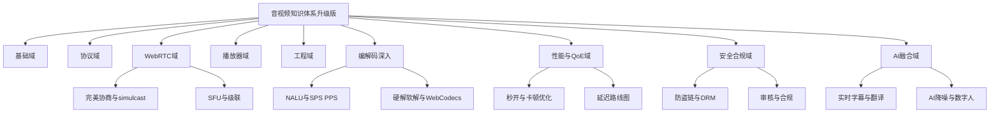

```javascript
// 九域自检：面试前逐项打分 低于 3 分的回对应章节补课
const SELF_CHECK = {
  '基础域': 'YUV/GOP/封装 能手算码率与延迟',
  '协议域': 'HLS/FLV/RTMP/WHIP 延迟光谱脱口而出',
  'WebRTC域': 'SDP/ICE/DTLS 完整建连时序',
  '播放器域': 'MSE/ABR/状态机/错误恢复',
  '工程域': '埋点/降级/排查SOP',
  '编解码深入': 'NALU/SPS-PPS/WebCodecs',
  '性能QoE': '秒开链路/卡顿归因/延迟路线',
  '安全合规': '防盗链/DRM/审核/隐私',
  'AI融合': '流式ASR/降噪/数字人',
};
Object.entries(SELF_CHECK).forEach(([k, v]) => console.log(`[${k}] ${v}`));
```

### AV-197：编解码兼容性测试矩阵怎么自动化？（高频）
**答**：
- 痛点：机型 × 系统 × 内核 × codec × 分辨率的组合爆炸，人工回归不可能覆盖。
- 矩阵设计：维度建模（profile/level、分辨率、DRM）→ 用例生成（笛卡尔积后裁剪，只保留有意义组合）。
- 执行：云真机平台（Appium/Playwright）跑探针脚本（静态探测 + 实播一帧验证），产出"支持性矩阵 JSON"。
- 消费：播放器降级链读矩阵数据（服务端下发、版本化），新机型上架自动进矩阵。
- 产出：按市场份额加权的兼容性覆盖率报告 + 前端实时支持性查询 API。

```javascript
// 编解码支持性探针：自动生成矩阵数据
async function probeCodecMatrix(candidates) {
  const result = {};
  for (const c of candidates) {
    result[c.name] = {
      mse: MediaSource.isTypeSupported(c.mime),
      webcodecs: 'VideoDecoder' in window
        ? await VideoDecoder.isConfigSupported(c.decoderConfig).then((r) => r.supported).catch(() => false)
        : false,
      playback: await probePlayback(c.mime),   // 实播一帧验证 不能只信静态探测
    };
  }
  return result;  // → 上报服务端聚合 维护全设备支持矩阵
}
// const CANDIDATES = [
//   { name: 'h264-main', mime: 'video/mp4; codecs="avc1.4d401f"', decoderConfig: { codec: 'avc1.4d401f' } },
//   { name: 'hevc',      mime: 'video/mp4; codecs="hvc1.1.6.L93.B0"', decoderConfig: { codec: 'hvc1.1.6.L93.B0' } },
//   { name: 'av1',       mime: 'video/webm; codecs="av01.0.05M.08"', decoderConfig: { codec: 'av01.0.05M.08' } },
// ];
```

### AV-198：音视频功能的灰度发布与 AB 实验体系。（高频）
**答**：
- 特殊性：核心指标有长期累积属性（卡顿率/留存），实验周期要长（≥2 周），看分位数不是均值。
- 分层实验：传输层（协议/CDN/编码参数）与体验层（UI/交互）分开实验，避免互相污染。
- 灰度维度：按用户/地域/机型/网络多维圈量；新编码参数先灰度自有测试房间再放量。
- 守护熔断：设置自动熔断（秒开劣化 > 2% 自动暂停放量），避免坏实验伤及大盘。
- 证据留存：实验报告带置信区间与维度下钻（"弱网用户受影响更大"这类发现最值钱）。

```typescript
// 实验分流与守护熔断
interface Experiment {
  key: string;
  layers: string[];
  traffic: number;                       // 0-1
  guard: { metric: string; threshold: number };
}
function assign(userId: string, exp: Experiment): 'control' | 'treatment' {
  const h = hash(`${exp.key}:${userId}`) % 10000 / 10000;
  return h < exp.traffic ? 'treatment' : 'control';
}
class GuardMonitor {
  check(current: number, baseline: number, exp: Experiment): 'ok' | 'pause' {
    // 例: 秒开率基线92% treatment 降到89% → 劣化3.3% 超阈值熔断
    const degrade = (baseline - current) / baseline;
    if (degrade > exp.guard.threshold) {
      this.pauseAndAlert(exp.key, { current, baseline });
      return 'pause';
    }
    return 'ok';
  }
  private pauseAndAlert(key: string, data: object) { /* 暂停放量并告警 */ }
}
```

### AV-199：端到端延迟拨测体系怎么建？（高频）
**答**：
- 目标：把"用户感知延迟"变成可测量、可告警、可对比（CDN/协议/地区）的连续指标。
- 拨测方法：推流端画面内嵌"毫秒时钟水印"，拨测端 video 截帧读数，延迟 = 拨测端墙钟 - 画面时钟。
- 部署：多地拨测机器人（云机 + 真机）持续拉主流频道，分钟级采样。
- 精度与成本：OCR 读数误差 ±100ms 可接受；画面内嵌时钟比"音频哔声比对"实现简单。
- 消费：延迟看板（分 CDN/协议/地区）、劣化告警、低延迟档成本决策依据。

```javascript
// 拨测端：截帧读时钟水印算 E2E 延迟
class LatencyProber {
  constructor(videoEl, intervalMs = 60_000) {
    this.video = videoEl;
    this.timer = setInterval(async () => {
      const r = await this.probeOnce();
      if (r) report({ metric: 'e2e-latency', ...r });
    }, intervalMs);
  }
  async probeOnce() {
    const canvas = document.createElement('canvas');
    canvas.width = 320; canvas.height = 180;
    canvas.getContext('2d').drawImage(this.video, 0, 0, 320, 180);
    const ts = await readClockFromFrame(canvas);   // OCR 画面内嵌的时分秒毫秒水印
    if (ts == null) return null;                   // 读数失败跳过 不污染样本
    return { latencyMs: Date.now() - ts, at: Date.now() }; // 前提: 两端 NTP 对时
  }
  stop() { clearInterval(this.timer); }
}
```

### AV-200：面试官视角：音视频前端怎么出题与评分？（高频）
**答**：
- 出题逻辑：一面考基础与排查（001-060 域），二面考架构设计（SFU/播放器/大场景），三面考方法论（监控体系/事故复盘/协作）。
- 好题特征：有真实场景背景、能分层作答（初级给方案、高级给权衡）、能延伸追问（从 simulcast 追到 GCC）。
- 评分维度：概念准确（30%）、工程落地（30%）、权衡意识（25%）、线上视角（15%）。
- 识别背题：追问一层就露馅（背了完美协商但说不清 rollback 触发条件）；给变式场景看迁移能力。
- 给候选人：带着自己的数据和案例来，比任何题库都有说服力——本题库的正确用法是查漏，不是背诵。

```json
{
  "interview-rubric": {
    "concept-accuracy": { "weight": 0.30, "check": "YUV GOP SDP ICE 等核心概念无误" },
    "engineering":      { "weight": 0.30, "check": "能写出可用代码 MSE与WebRTC管线完整" },
    "tradeoff":         { "weight": 0.25, "check": "延迟与卡顿 成本与自建 主动给权衡" },
    "production-view":  { "weight": 0.15, "check": "有监控指标 线上案例 复盘意识" },
    "red-flags":  ["只背概念", "追问一层就断", "说不出自己项目的指标"],
    "green-flags": ["结论先行分层展开", "主动给数字", "把不会的坦白并给出学习路径"]
  }
}
```

---

> **全题库完（AV-001 ~ AV-200）**：基础与协议（001-033）→ 场景与工程（034-100）→ 进阶深入（101-157）→ 综合与体系（158-200）。
