# 前端面试题库：跨端开发深度

## 简介

本专题聚焦**跨端开发深度**，覆盖 React Native（新架构）/ Flutter / Hybrid 与 WebView / Electron / 小程序容器与 uni-app / 跨端工程化 / 综合架构设计七大版块。面向两类岗位画像：**通用前端岗**重点考察原理与选型（JSI、三棵树、JSBridge、IPC 等高频题），**跨端岗**在此基础上深挖实现细节与系统设计（迁移策略、离线包、错误监控、跨端架构设计题）。

- 编号规则：`XP-001 ~ XP-150`（001-075 原理与实战篇，076-150 后续补充）。
- 每题均带一个与题目严格对应的代码/配置/结构块，可直接用于复习自测。
- 技术名词保留英文原文，答案以"要点式"呈现，便于面试口头复述。

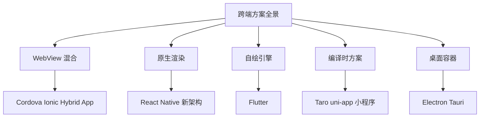

## 目录

- 一、跨端总论（001-006）
- 二、React Native 新架构（007-016）
- 三、Flutter 原理（017-025）
- 四、Hybrid 与 WebView（026-032）
- 五、Electron 深度（033-040）
- 六、小程序容器与 uni-app 深度（041-046）
- 七、跨端工程化（047-052）
- 八、综合实战（053-075）
- 九、RN 深度实战（076-083）
- 十、Flutter 深度实战（084-091）
- 十一、Hybrid 深度实战（092-098）
- 十二、Electron 深度实战（099-105）
- 十三、跨端一致性专项（106-112）
- 十四、性能对比与调优（113-118）
- 十五、AI 与跨端（119-121）
- 十六、综合与体系（122-150）

---

## 一、跨端总论（001-006）

### XP-001：主流跨端方案全景对比？WebView 混合、原生渲染、自绘引擎、编译时方案的差异？
**答**：
- **WebView 混合**（Cordova/Ionic/Hybrid App）：UI 全部用 H5，容器提供桥接 API；开发成本低、动态化最强，但受 WebView 内核性能与 JSBridge 序列化开销制约。
- **原生渲染**（React Native 新架构）：JS 写业务，UI 映射为系统原生控件；交互体验接近原生，但受桥接（旧架构）与布局到原生映射（平台差异）影响。
- **自绘引擎**（Flutter）：不依赖原生控件，Skia/Impeller 直接绘制像素；三端像素级一致，但包体积大、动态化受限、无浏览器生态。
- **编译时方案**（Taro/uni-app/Rax）：同一 DSL 编译到小程序/RN/H5 多目标；一套代码覆盖面最广，但受目标端能力上限约束，运行时适配层有损耗。
- 选型本质是 **性能上限 vs 动态化 vs 一致性 vs 生态** 四角权衡，没有银弹。

```text
方案            渲染方式        性能上限    动态化        一致性    生态/上手
WebView 混合    浏览器内核      低-中       极强(免发版)  差        前端零成本
RN 新架构       原生控件映射    中-高       强(热更新)    中        React 生态
Flutter         Skia/Impeller   高          弱(需发版/壳) 极强      Dart 生态
编译时 Taro     各端各自渲染    取决于目标  中           中        React/Vue 语法
小程序原生      双线程+原生     中          强(审核发布)  各家不一  各家私有 DSL
Electron        Chromium        中          强(整包更新) 强        Node + Web
```

### XP-002：如何为一个新项目做跨端技术选型？决策矩阵怎么建？
**答**：
- 先列**硬约束**（filter）：是否需要小程序端、是否需要强动态化、团队技术栈、包体积红线——不满足直接淘汰。
- 再做**软评分**（score）：团队熟悉度、性能要求、生态成熟度、招聘难度、长期维护成本，按权重加权。
- 典型结论：电商内容类重动态化选 RN+H5，强视觉一致选 Flutter，需要小程序则 Taro/uni-app，桌面工具类选 Electron。
- 决策要写成 ADR（Architecture Decision Record）留档，避免"拍脑袋"和反复横跳。

```typescript
// 跨端选型决策矩阵：硬约束过滤 + 加权评分
interface Candidate {
  name: string;
  supports: { miniapp: boolean; hotUpdate: boolean; desktop: boolean };
  teamFamiliarity: number;   // 1-5 团队熟悉度
  performance: number;       // 1-5 性能上限
  ecosystem: number;         // 1-5 生态成熟度
  hireCost: number;          // 1-5 招聘/维护容易度（5 为最易）
}

const weights = { teamFamiliarity: 0.3, performance: 0.3, ecosystem: 0.2, hireCost: 0.2 };

function select(requirements: { miniapp: boolean; hotUpdate: boolean }, pool: Candidate[]) {
  // 第一步：硬约束过滤，一票否决
  const eligible = pool.filter(
    (c) => (!requirements.miniapp || c.supports.miniapp)
       && (!requirements.hotUpdate || c.supports.hotUpdate),
  );
  // 第二步：加权评分排序
  return eligible
    .map((c) => ({
      name: c.name,
      score: weights.teamFamiliarity * c.teamFamiliarity
        + weights.performance * c.performance
        + weights.ecosystem * c.ecosystem
        + weights.hireCost * c.hireCost,
    }))
    .sort((a, b) => b.score - a.score);
}
// select({ miniapp: true, hotUpdate: true }, candidates) => Taro 胜出
```

### XP-003：跨端应用的通用架构分层怎么设计？
**答**：
- 经典四层：**业务层**（页面/组件/状态，纯 DSL 不感知平台）→ **能力层**（业务 SDK：埋点/请求/支付）→ **适配层**（把各端差异 API 抹平成统一接口）→ **桥接层**（JSI/PlatformChannel/JSBridge 等与原生的通信通道）。
- 核心原则：**差异只允许出现在最下面两层**，业务代码里禁止出现 `Platform.OS` 分支散落，必须收敛到适配层。
- 分层后每层可独立替换：换跨端框架时业务层与能力层理论上可迁移（配合 monorepo 见 XP-047）。
- 依赖方向自上而下单向依赖，底层不能反向 import 业务。

```text
cross-platform-app/
├── packages/
│   ├── business/            # 业务层：页面、组件、领域状态（纯 React/Taro DSL）
│   │   ├── pages/
│   │   ├── components/
│   │   └── stores/
│   ├── services/            # 能力层：登录、支付、埋点、请求（调 adapter 暴露的接口）
│   ├── adapter/             # 适配层：统一接口定义 + 各端实现
│   │   ├── types.ts         #   interface IStorage / IRouter / IPay ...
│   │   ├── h5/              #   localStorage + history 实现
│   │   ├── rn/              #   AsyncStorage + react-navigation 实现
│   │   └── mini/            #   wx.setStorage + 小程序路由实现
│   └── bridge/              # 桥接层：JSI / PlatformChannel / JSBridge 封装
└── apps/
    ├── h5-app/  ├── rn-app/  └── miniapp/   # 各端壳工程，只做组装与配置
```

### XP-004：一套代码多端的工程组织怎么做？
**答**：
- **monorepo + workspace** 是主流：壳工程只负责构建配置，共享代码放 packages，用 pnpm/yarn workspace 管理。
- 构建入口按端分化：同一业务包被 h5-app/rn-app/mini-app 分别引用，构建工具（Vite/Metro/Taro compiler）各自处理。
- 环境差异用**条件编译**（Taro/uni-app 的 `process.env.TARO_ENV`）或**文件后缀**（`.rn.tsx`/`.h5.tsx`）收敛在适配层文件内。
- 版本策略：packages 内部用 `workspace:*` 协议，发布时 changesets 统一升版。

```yaml
# pnpm-workspace.yaml：一套代码多端的工程骨架
packages:
  - 'apps/*'      # 各端壳工程：h5-app、rn-app、mini-app、desktop-app
  - 'packages/*'  # 共享包：business、services、adapter、components、utils

# 根 package.json 中的多端构建矩阵脚本
scripts:
  build:h5:   "pnpm --filter h5-app build"      # Vite 构建
  build:rn:   "pnpm --filter rn-app bundle:ios && pnpm --filter rn-app bundle:android"   # Metro bundle
  build:mini: "pnpm --filter mini-app build:weapp"   # Taro 编译到微信小程序
  lint:cross: "eslint packages/** --ext .ts,.tsx"
# 壳工程通过 "dependencies": { "@app/business": "workspace:*" } 引用共享包
```

### XP-005：各跨端方案的调试体系有什么差异？
**答**：
- **H5/Hybrid**：Chrome DevTools 远程inspect（iOS 用 Safari Web Inspector），WebView 可通过 `setWebContentsDebuggingEnabled` 打开调试。
- **RN**：新版用 React Native DevTools（Hermes debugger，基于 CDP），组件树用 React DevTools，网络需自行代理抓包。
- **Flutter**：DevTools 体系（Widget Inspector / Performance / Memory / Network），时间线用 timeline view。
- **小程序**：各家开发者工具 + 真机调试（vConsole），但性能面板各家口径不一，需自建监控对齐（见 XP-069）。
- **Electron**：每个渲染进程一个 DevTools，主进程用 VSCode attach 或 inspector 协议调试。
- 跨端统一思路：日志/埋点先落统一通道，桌面端配一个"跨端日志查看器"比逐端翻工具高效。

```text
方案          调试工具                    JS/Dart 调试协议      常用技巧
H5/WebView    Chrome/Safari inspect       CDP                   setWebContentsDebuggingEnabled(true)
RN 新架构     React Native DevTools       CDP(Hermes)           adb reverse tcp:8081 / react-devtools
Flutter       Flutter DevTools            VM Service(WS)        widget inspector / debugPrintLayout
微信小程序    开发者工具 + 真机调试        私有                  打开调试模式注入 vConsole
Electron      每渲染进程 DevTools          CDP                   main 进程 node --inspect
统一方案      自建日志 SDK 落库 + Web 台   -                     traceId 串联各端日志，桌面端聚合查询
```

### XP-006：各跨端方案的性能心智模型？瓶颈分别在哪？
**答**：
- **WebView 混合**：瓶颈在**首屏**（WebView 冷启动 100-500ms + 网页资源加载）与长列表/复杂动画（DOM+合成层代价高），优化方向是离线包+预创建 WebView。
- **RN 旧架构**：瓶颈在 **Bridge 序列化**（JSON 批量异步传输、丢函数引用）；新架构 JSI 后主要瓶颈转移到 **JS 线程长任务**（掉帧）与 Fabric 挂载吞吐。
- **Flutter**：瓶颈在 **raster 线程**（着色器编译卡顿，Impeller 缓解）与 build 阶段的无效重建；几乎无桥接开销。
- **小程序**：瓶颈在 **双线程 setData 通信量与频率**（序列化+跨线程），以及分包/包体积。
- **Electron**：瓶颈在**主进程阻塞**（所有窗口共享）与内存（每窗口一个 Chromium 渲染进程）。
- 心智模型总结：先定位"通信开销 / JS 线程 / 渲染线程 / 启动链路"四类瓶颈，再谈优化。

```text
方案           启动链路瓶颈                运行时瓶颈              首要优化抓手
WebView 混合   WebView 冷启动 + HTML 资源  DOM 重排、长列表        离线包、预创建容器、SSR/骨架屏
RN 旧架构      Bridge 初始化 + bundle 加载 JSON 序列化风暴        新架构迁移、bundle 拆分
RN 新架构      Hermes 字节码 + TTI         JS 线程长任务、挂载吞吐 FlashList、Hermes、Fabric
Flutter        引擎初始化 + 首帧光栅化     raster 线程着色器编译    Impeller、const、列表 builder 惰性
小程序         逻辑层注入 + 分包下载       setData 频率与体积      分包、合并 setData、虚拟列表
Electron       主进程冷启动 + 多进程内存   主进程阻塞、GPU 进程    utilityProcess、窗口按需创建
```

---

## 二、React Native 新架构（007-016）

### XP-007：RN 架构从 Bridge 到新架构（JSI/TurboModules/Fabric）是如何演进的？
**答**：
- **旧架构 Bridge**：JS 与 Native 异步批量消息通信，JSON 序列化、无法同步调用、丢函数引用，是性能与能力的天花板。
- **JSI**：用 C++ 层替代 Bridge，JS 直接持有原生对象的引用（HostObject），支持同步调用与任意 JS 引擎。
- **新架构三件套**：TurboModules（按需加载的原生模块）+ Fabric（新渲染器，C++ ShadowTree、同步可中断布局）+ Codegen（编译期生成胶水代码，去掉运行时反射）。
- Hermes 引擎配合：字节码免编译、启动更快、内存更省，且与 JSI 深度绑定。
- 演进动机一句话：**把"异步消息总线"升级为"同步直接调用 + 编译期契约"**。

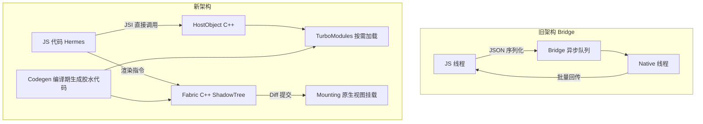

```typescript
// 旧架构：Bridge 异步 + JSON 序列化，无法拿到同步返回值
NativeModulesOld.DeviceInfo.getDeviceId().then((id: string) => { /* 异步回调 */ });

// 新架构：通过 JSI 暴露的 TurboModule，JS 直接持有原生对象引用
import { requireNativeModule } from 'expo-modules-core'; // 或 turbo-module 注册产物
const DeviceInfo = requireNativeModule<{ getDeviceId: () => string }>('DeviceInfo');

const id: string = DeviceInfo.getDeviceId(); // 同步调用，无 JSON 序列化
// 底层：JS 侧拿到的是 JSI HostObject 代理，
// 方法调用直接进入 C++，绑定到原生实现，参数经 JSI Value 直接转换
```

### XP-008：JSI 的原理是什么？它如何实现 JS 与原生的直接调用？
**答**：
- JSI 是一层**纯 C++ 的抽象接口**（不依赖 JS 引擎实现），向上对接 JS 引擎（Hermes/JSC/V8），向下暴露 HostObject/HostFunction 概念。
- 原生对象以 `HostObject` 形式注册进 JS 全局，JS 侧拿到的是一个**代理对象**，属性访问/方法调用直接触发 C++ 虚函数调用。
- 关键收益：① 同步调用；② 参数无需 JSON 序列化（JSI Value 直接转换）；③ 可以传函数引用（Callback 也走 HostFunction）；④ 与引擎解耦，换引擎不改业务。
- 旧 Bridge 与 JSI 对比：Bridge 是"信箱异步传 JSON"，JSI 是"直接拿着引用调方法"。
- JSI 也是 RN 与 C++ 生态（Yoga、Fabric、TurboModules）统一的基石。

```typescript
// JSI 语义示意（C++ 侧等价逻辑以注释说明）
// C++ 侧：class JSI_DEVICE : public HostObject {
//   Value get(Runtime&, const PropNameID& name) override {
//     if (name.utf8(rt) == "vibrate") return Function::createFromHostFunction(...);
//   }
// } 并注入 global.__DeviceModule

// JS 侧：global 上直接拿到原生 HostObject 代理
declare const __DeviceModule: { vibrate: (ms: number) => void };

__DeviceModule.vibrate(30); // 同步直达 C++，参数 int 由 JSI Value 直接转换
// 对比旧 Bridge：
// NativeModules.Device.vibrate(30) → 入队 → JSON 化 → native 线程反序列化执行 → 无法同步

// 自定义 JSI 模块的注册（新架构下由 Codegen + Autolinking 自动完成）
import NativeVibrate from './specs/NativeVibrate'; // Codegen 生成的规格化封装
NativeVibrate.vibrate(30);
```

### XP-009：Fabric 渲染器与旧渲染器（Paper）的差异是什么？
**答**：
- **C++ ShadowTree**：布局树移到 C++ 层（旧版在 JS 线程算 Yoga），与 JS 线程解耦，布局不再阻塞 JS。
- **同步可中断渲染**：React 18 并发特性（Transition、Suspense）可支持，渲染阶段可中断重排；旧版是"整树 commit 异步通知"。
- **挂载机制**：Fabric 由 C++ Mounting 阶段统一计算 Diff 后原子提交到平台视图；旧版由 UIManager（Java/ObjC）增量处理，容易出现中间态闪烁。
- **代码生成**：组件规格（Props/Events）由 Codegen 生成，JS 与原生强契约，属性解析在编译期完成。
- 淘汰了 LegacyComponents，新组件必须提供 Fabric 实现（interop layer 兼容旧三方）。

```jsx
// Fabric 组件：Props 由 Codegen 规范约束，编译期生成解析代码
import React from 'react';
import { View, Text, Pressable } from 'react-native';

// specs/NativeBadge.ts 中 Codegen 规格：
// export interface Spec extends TurboModule { ... }
// Fabric 视图组件的 props 必须与 Codegen 生成的类型一一对应
export function Badge({ label, tint, onPress }) {
  return (
    <Pressable onPress={onPress} accessibilityRole="button">
      {/* Fabric 下 View 布局由 C++ ShadowTree + Yoga 完成，不占 JS 线程 */}
      <View style={{ backgroundColor: tint, borderRadius: 8, padding: 4 }}>
        <Text style={{ color: '#fff', fontSize: 12 }}>{label}</Text>
      </View>
    </Pressable>
  );
}
// 原生侧（Kotlin/ObjC）需实现 Fabric 组件注册：
// BadgeViewManager : SimpleViewManager<BadgeView> + @ReactProp(label)（新架构经 Codegen 绑定）
```

### XP-010：Hermes 引擎是什么？为什么能优化启动性能？
**答**：
- Hermes 是 Facebook 为 RN 定制的 JS 引擎，核心是 **AOT 字节码**：打包期把 JS 编译成 bytecode，运行时免了解析/AST/编译，直接执行。
- 收益：TTI（可交互时间）显著下降、内存占用降低（无 JIT 的元数据开销）、包体积可控（bc 文件比源码小）。
- 配套能力：Hermes GC 优化（分代回收适配移动端）、`RAM bundle`/inline requires 按需加载、`console` 裁剪。
- 调试支持：Hermes 支持标准调试协议，React Native DevTools 直接 attach；可用 `hgstack`/Sourcemap 还原线上堆栈。
- 注意：字节码与 Hermes 版本绑定，热更新 bundle 需要确保引擎版本一致。

```yaml
# 开启 Hermes 的配置链路
# android/gradle.properties
android:
  properties:
    hermesEnabled: true          # Android 启用 Hermes
# ios/Podfile
ios:
  podfile: |
    :hermes_enabled => true      # CocoaPods RN 启用 Hermes
# metro.config.js 产出字节码（RN 0.70+ 默认内置，此处展示命令本质）
# npx react-native bundle \
#   --platform android --dev false \
#   --entry-file index.js \
#   --bundle-output index.android.bundle \
#   --assets-dest res/
# 之后 composeHermesc 将 .bundle 编译为 .hbc 字节码：
#   hermesc -O -emit-binary index.android.bundle -out index.android.hbc
# 启动链路变化：读 .hbc 直接执行，省去 parse+compile（约等于省掉 40%-60% 启动 JS 时间）
```

### XP-011：TurboModules 与 Codegen 的作用和协作方式？
**答**：
- **Codegen**：编译期扫描 `Native<Name>.ts` 规格文件（Typed API），生成 Java/ObjC++ 胶水代码与 C++ 结构体，把"运行时反射查方法名"变成"编译期符号绑定"。
- **TurboModules**：基于 JSI 的模块系统，**懒加载**——JS 首次 require 时才初始化原生模块（旧版启动即全量注册），并允许原生模块做异步初始化。
- 协作流程：写 TS 规格 → codegen 生成 `Spec` → 原生实现 `Spec` 接口 → JS 通过 TurboModuleRegistry 获取。
- 类型契约带来两大收益：JS 与原生接口类型安全（编译期报错）、跨平台参数转换代码自动生成。
- 旧 NativeModules 在新架构下经由 interop layer 兼容运行，但拿不到同步调用等新能力。

```typescript
// specs/NativeLocation.ts —— Codegen 规格文件（新架构模板）
import type { TurboModule } from 'react-native';
import { TurboModuleRegistry } from 'react-native';

export interface Spec extends TurboModule {
  // Codegen 据此生成 Android(Java/Kotlin) 与 iOS(ObjC++) 的接口与参数转换代码
  getCurrentPosition(promise: Promise<{ lat: number; lng: number }>): void;
  startHeadingUpdate(callback: (degree: number) => void): void; // 函数引用可传，旧 Bridge 做不到
  readonly isSupported: boolean;                                 // 常量也走编译期契约
}

export default TurboModuleRegistry.getEnforcing<Spec>('Location');

// 原生侧（示意 Android）：
// class LocationModule : NativeLocationSpec(this.reactContext) {
//   override fun getCurrentPosition(promise: Promise) { ... }  // 实现 Codegen 产物接口
// }
// package.json 配置：codegenConfig { "name": "RNLocationSpec", "type": "modules", "jsSrcsDir": "specs" }
```

### XP-012：新旧架构混用与迁移策略怎么设计？
**答**：
- 官方提供 **interop layer**：新架构下旧 NativeModules/Paper 组件仍可跑（`unstable_enablePackageSuffix`、`RCT.fm` interop），允许渐进迁移。
- 迁移顺序建议：① 开新架构 + interop 全量回归（不写新代码）；② 高频模块（动画/手势/列表）优先迁 TurboModule/Fabric——reanimated/gesture-handler 等库新版本已原生支持；③ 自研原生模块逐个 Codegen 化；④ 清理 interop 开关。
- 风险点：三方库必须升到新架构兼容版；同步调用可能改变时序（原异步逻辑被同步化）；Hermes 字节码与热更新基线要对齐。
- 灰度策略：按设备/渠道比例放量，保留 `newArchEnabled` 开关可秒回滚。

```text
# android/gradle.properties —— 迁移期开关
newArchEnabled=true          # 开启 Fabric + TurboModules
hermesEnabled=true           # 引擎先统一

# 迁移四阶段（与代码状态对应）
# 阶段1 interop 兼容：newArchEnabled=true，三方库仍走 interop layer，全量回归
# 阶段2 核心链路升级：reanimated/gesture-handler 升到 Fabric 版，自研动画模块改 TurboModule
# 阶段3 模块 Codegen 化：specs/ 下逐个补 TS 规格，删除运行时反射注册
# 阶段4 收口：删除 legacy 兼容代码，关闭 interop，性能看板对比 TTI/FPS 指标

# JS 侧判断运行环境（迁移期兼容代码模板）
# const isNewArch = global.RN$Bridgeless !== undefined || TurboModuleRegistry != null;
```

### XP-013：RN 的线程模型是怎样的？JS/UI/Native 三线程如何协作？
**答**：
- **JS 线程**：跑 React 渲染与业务逻辑（Hermes），长任务会掉帧但不卡原生动画。
- **UI/主线程**：原生视图布局与绘制；Fabric 下 ShadowTree 在 C++ 侧，布局不在 JS 线程。
- **Native Modules 线程**：原生模块方法默认在自己的线程池执行，耗时任务不能占主线程。
- 协作机制：JS 侧通过微任务/宏任务派发，Fabric 的 commit 在 C++ 完成后原子挂载；reanimated 让动画直接在 UI 线程跑 worklet，绕开 JS 线程抖动。
- 面试高频追问：为什么列表滚动时 setState 掉帧？——JS 线程繁忙导致渲染指令迟到，方案是 worklet 化或降低 JS 负载。

```javascript
// react-native-worklets：把逻辑下沉到 UI 线程，绕开 JS 线程抖动
import { useSharedValue, useAnimatedStyle, runOnJS, withTiming } from 'react-native-reanimated';

function useDragPanel(onSnapDone) {
  const offset = useSharedValue(0);
  const style = useAnimatedStyle(() => ({
    // worklet：此函数标记后在 UI 线程执行，不依赖 JS 线程帧调度
    transform: [{ translateY: withTiming(offset.value) }],
  }));

  function handleEnd() {                 // JS 线程（业务回调必须回 JS 侧）
    'worklet';
    runOnJS(onSnapDone)(offset.value);   // UI 线程 → JS 线程的切换点
  }
  return { offset, style, handleEnd };
}

// 线程全景：
// JS 线程：React render / 业务逻辑 / setState（Hermes 执行）
// UI 线程：原生视图挂载、手势、worklet 动画
// Native 线程：TurboModule 方法（默认非主线程）、网络栈
// Fabric C++：ShadowTree 布局与 Mounting（独立于 JS 线程）
```

### XP-014：RN 的列表方案怎么选？FlatList 与 FlashList 的性能差异？
**答**：
- FlatList 基于 VirtualizedList：虚拟化窗口渲染 + 一次性 mount 批量（windowSize/initialNumToRender 控制），瓶颈是 item mount 走 JS 线程 + 空白率（blank areas）。
- FlashList（Shopify）核心优化：**cell 复用**（复用原生视图而非重建）、布局下沉到主线程（v1 借助原生测量）、减少 JS 参与，blank area 与内存显著下降。
- 实践建议：固定高度用 `getItemLayout`；复杂 item 用 `React.memo` + 细粒度拆分；图片用渐进加载；万级数据避免 FlatList。
- 通用铁律：减少不可见渲染、避免 item 内深 diff、滚动中不做同步重排。

```jsx
// FlatList 关键参数优化
<FlatList
  data={feeds}
  renderItem={({ item }) => <FeedCard item={item} />}   // FeedCard 用 React.memo 包裹
  keyExtractor={(i) => i.id}
  initialNumToRender={8}     // 首屏渲染条数，越小 TTI 越快
  maxToRenderPerBatch={8}    // 每批 mount 数量，降低 JS 线程尖刺
  windowSize={5}             // 视口外保留 5 屏，平衡内存与回滚体验
  getItemLayout={(d, index) => ({ length: 120, offset: 120 * index, index })} // 定高免测量
  removeClippedSubviews      // Android 裁剪屏外子视图
/>

// FlashList：单元格复用是本质差异
import { FlashList } from '@shopify/flash-list';
<FlashList
  data={feeds}
  estimatedItemSize={120}    // 必填：供原生侧预估布局，替代逐项测量
  renderItem={({ item }) => <FeedCard item={item} />}
  masonry // 瀑布流场景用 MasonryFlashList
/>
// 对比结论：FlashList mount 复用原生视图、JS 参与更少 → 长列表 FPS 与内存均优于 FlatList
```

### XP-015：RN 如何与原生模块通信？Promise 桥的完整链路是什么？
**答**：
- 新架构路径：TS 规格（Spec）→ Codegen 生成胶水 → 原生实现 `Spec`，JS 经 TurboModuleRegistry 调用。
- 回调形态三种：**Promise**（一次异步结果）、**Callback**（可多次触发，如传感器）、**Event Emitter**（原生主动广播，需原生 emit + JS 订阅）。
- Promise 桥链路：JS 调用 → JSI 传参 → 原生线程执行 → resolve/reject 携带结果回传 → JS 侧 promise settle；新架构无需 JSON 序列化。
- 踩坑点：原生必须保证 promise 只 settle 一次（二次 resolve 崩溃/告警）；长任务要在原生侧切线程；常量用 `constantsProvider` 导出。

```typescript
// JS 侧：规格化调用 + 三种通信形态
import { NativeEventEmitter } from 'react-native';
import NativeScanner from './specs/NativeScanner'; // Codegen 产物，见 XP-011

// 1) Promise：一次性异步结果
async function scanOnce(): Promise<{ text: string; format: string }> {
  try {
    return await NativeScanner.scanOnce({ timeoutMs: 5000 });
  } catch (e: any) {
    if (e.code === 'PERMISSION_DENIED') throw new Error('请开启相机权限');
    throw e;
  }
}

// 2) EventEmitter：原生持续广播（如扫码连续回调）
const emitter = new NativeEventEmitter(NativeScanner as any);
const sub = emitter.addListener('onBarcode', (payload: { text: string }) => {
  console.log('barcode', payload.text);
});
// sub.remove() 释放

// 3) 原生侧（示意 ObjC）Promise 规约：
// RCTPromiseResolveBlock resolve; RCTPromiseRejectBlock reject;
// 成功 resolve(@{...})；失败 reject(@"PERMISSION_DENIED", msg, nil)；且只允许调用一次
```

### XP-016：RN 的热更新（CodePush 思想）如何设计与实现？
**答**：
- 原理：RN 业务逻辑在 JS bundle 中，**替换 bundle 即更新逻辑**，原生壳与原生模块仍需发版；小程序/服务端渲染是另外两条热更新路线（对比见 XP-074）。
- 流程：启动 check 更新 → 下载差分/全量 bundle → 校验签名与哈希 → 写入 staging 目录 → 下次启动 `setJSBundle` 生效（或立即 reload）。
- 关键机制：**双 bundle 槽位**（current/staging）保证失败可回滚；**灰度发布**按设备分桶；**版本映射** bundle 必须与原生版本兼容（native version 匹配）。
- 安全：bundle 走 HTTPS + 签名校验，防中间人篡改；商店合规（Apple 需符合 3.3.2 条款，禁改原生行为）。
- 自建要点：差分算法（bsdiff/自研 chunk diff）+ CDN 分发 + 埋点全链路（下发/下载/应用/崩溃率回滚熔断）。

```javascript
// 自建热更新核心流程（CodePush 同构思想）
const manifest = await fetch('/ota/manifest?platform=ios&nv=3.2.0&cv=' + currentVer).then(r => r.json());
// manifest: { version, url, hash, size, nativeMin, nativeMax, rollout: 30 }

function shouldUpdate(m, deviceId) {
  if (!semverSatisfies(m.nativeMin, m.nativeMax, nativeVersion)) return false; // 原生版本兼容校验
  return parseInt(hash(deviceId), 16) % 100 < m.rollout;                        // 灰度分桶
}

async function applyUpdate(m) {
  const file = await downloadDiff(m.url);              // 1. 下载差分包
  await verify(file, m.hash, PUBLIC_KEY);              // 2. 验签 + 哈希校验
  await unzipTo(STAGING_DIR, file);                    // 3. 解压到 staging 槽位
  pendingRollbackGuard(m.version);                     // 4. 埋点 + 启动崩溃率熔断标记
  // 5. 下次启动原生侧：setJSBundle(stagingBundle) 后 reload；
  //    若新 bundle 启动 N 秒内连续崩溃 → 原生回滚 current 槽位并上报
}
```

---

## 三、Flutter 原理（017-025）

### XP-017：Flutter 三棵树（Widget/Element/RenderObject）的关系？
**答**：
- **Widget**：不可变的配置描述（轻量，每帧可大量重建），持有树的形状与参数。
- **Element**：Widget 的实例化载体与**上下文**，持有生命周期、状态（State）与父子关系，是 diff 的锚点——`canUpdate`（runtimeType + key 相同）决定复用还是重建。
- **RenderObject**：真正参与布局、绘制、命中测试的对象，重而持久，尽量复用。
- 三棵树意义：**Widget 便宜所以随便重建，Element 守住状态做 diff，RenderObject 昂贵所以少动**，这是 Flutter 高刷新性能的结构基础。
- 面试追问：StatefulElement 持有 State，Widget 重建不丢状态就是 Element 在复用。

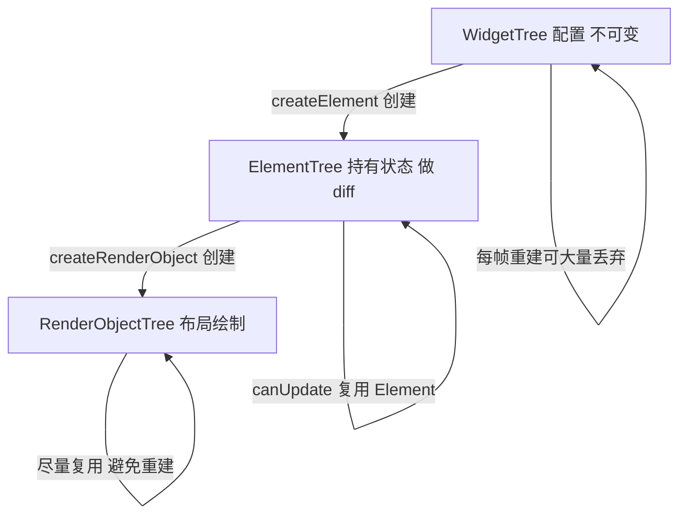

```dart
// 三棵树的观察与关系
final key = GlobalKey();
Stack(children: [
  Positioned(key: key, left: 0, top: 0, child: Container(width: 100, height: 40)),
]);

void inspectTrees(BuildContext context) {
  final element = key.currentContext!;              // Element 树节点
  final widget = element.widget;                    // 上一行对应的 Widget 配置
  final renderObj = element.findRenderObject()!;    // RenderObject 树节点
  debugPrint('${widget.runtimeType} / ${renderObj.runtimeType}');
  // StatelessWidget 没有对应 RenderObject，Element 只是组合作业：
  // 如 StatelessWidget 直接 build 子树，布局由子级 RenderObject 承担
}
// 迁移示例：把 Positioned 换成 Align（不同 runtimeType）→ canUpdate 失败 →
// Element 与 RenderObject 一起销毁重建；只换属性（如 left: 20）→ 仅 markNeedsLayout
```

### XP-018：Widget 的不可变性与重建优化？const 和 Key 的正确用法？
**答**：
- Widget 是 `@immutable` 的：重建成本只是" new 一个小对象 + Element diff"，但重建太深太广仍会烧 CPU。
- **const 构造**：编译期常量 Widget 指向同一实例，build 时被 Element 直接跳过（identical 短路），是最便宜的优化。
- **Key**：无状态 diff 用默认即可；列表重排/有状态子项必须用 ValueKey/ObjectKey，否则 State 会错位复用；GlobalKey 用于跨树移动且保留 State（慎用，代价高）。
- 优化顺序：const → 缩小 rebuild 范围（拆 Consumer/Selector）→ RepaintBoundary → 慎用深比较 shouldRebuild。
- 反模式：在 build 里 new 大闭包/匿名 List 导致 const 失效；用 index 当 key。

```dart
class CartPage extends StatelessWidget {
  const CartPage({super.key, required this.items});
  final List<Item> items;

  @override
  Widget build(BuildContext context) {
    return Column(children: [
      const HeaderBar(),                    // const：实例复用，Element diff 直接 identical 跳过
      Expanded(
        child: ListView.builder(
          itemCount: items.length,
          // 正确：以业务 id 作 key，删除/重排时 State 不错位
          // 错误示例：key: ValueKey(index) —— 删除中间项后复选框状态会错位
          itemBuilder: (_, i) => CartRow(
            key: ValueKey(items[i].id),
            item: items[i],
          ),
        ),
      ),
    ]);
  }
}
// 反例：CartRow(trailing: Checkbox(value: x)) 每次 build new Checkbox → 无 const、重建成本高
// 改法：Checkbox 加 const 或下沉到内部 StatefulWidget 管理，缩小 rebuild 范围
```

### XP-019：Flutter 渲染流水线（build→layout→paint→composite）是怎样跑起来的？
**答**：
- Vsync 驱动：每帧经 **Animator→Build→Layout→CompositingBits→Paint→Semantics→Finalize** 七个阶段（SchedulerBinding 的 persistent frame callbacks）。
- Build：执行 setState 标脏的 Element 的 rebuild，产出新 Widget；Layout：RenderObject 树从上向下传约束、从下向上传尺寸（一次 O(n) 遍历）；Paint：生成 LayerTree/绘制指令。
- Composite：Layer 树交给 Skia/Impeller 光栅化到 GPU。 RepaintBoundary 会隔离重绘，子树变化只重建其下 Layer。
- 关键约束：布局是**单遍**的（constraints down / size up），保证 60fps 下一帧内完成；任何同步回读尺寸（如 `context.size` 在 build 里）都会强制再跑一帧。
- 排查工具：DevTools Performance 里看每阶段耗时，红条即超 16ms。

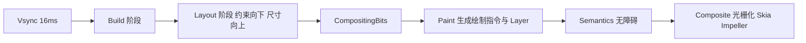

```dart
// 观察流水线 + RepaintBoundary 隔离重绘
void watchPipeline() {
  WidgetsBinding.instance.addTimingsCallback((timings) {
    for (final t in timings) {
      debugPrint('build=${t.buildDuration} raster=${t.rasterDuration} vsyncOverhead=${t.vsyncOverhead}');
      if (t.buildDuration > const Duration(milliseconds: 8)) {
        reportSlowFrame(t); // 上报慢帧：优先查 build 阶段
      }
    }
  });
}

class Timeline extends StatelessWidget {
  const Timeline({super.key});
  @override
  Widget build(BuildContext context) {
    return ListView.builder(
      itemBuilder: (_, i) => RepaintBoundary(           // 隔离：单条变化不整页重绘
        child: ListTile(title: Text('event $i')),
      ),
    );
  }
}
// setState → markNeedsBuild(标脏 Element) → 下一帧 Build；
// 布局改动 → markNeedsLayout；仅外观改动 → markNeedsPaint，跳过 layout 更省
```

### XP-020：Dart 的 isolate 模型？与 JS 单线程模型对比？
**答**：
- Dart 默认 main isolate 单线程事件循环（与 JS 类似），但可以**真正并行**：每个 isolate 有独立的堆与事件循环，互不共享内存，靠消息传递（SendPort）通信。
- JS 的 Web Worker 也是多线程但浏览器环境受限；RN 中 JS 是单线程，CPU 密集任务会阻塞渲染指令派发。
- Flutter 中典型用法：`compute()` 把 JSON 解析/图片处理丢到后台 isolate，避免 UI 线程掉帧；isolate 间传大对象可走 `TransferableTypedData` 免拷贝。
- 与 JS 对比总结：JS 用"异步 IO + 切片"模拟并发，Dart 用"真并行 isolate + 消息传递"；两者 UI 线程都禁止长任务。
- 新特性：isolate groups（共享大部分堆、低开销 spawn）缓解消息拷贝成本。

```dart
// 后台 isolate 解析大 JSON，避免 UI 线程卡顿
import 'package:flutter/foundation.dart';

Future<List<Post>> parseInIsolate(String raw) async {
  // compute：短平快的一次性任务（内部 spawn isolate 并传参）
  final posts = await compute(_decode, raw);
  return posts.map(Post.fromJson).toList();
}

List<dynamic> _decode(String raw) => jsonDecode(raw) as List<dynamic>;

// 长驻任务：双工通信
Future<void> counterIsolate(SendPort mainPort) async {
  final port = ReceivePort();
  mainPort.send(port.sendPort);
  await for (final msg in port) {
    if (msg == 'tick') mainPort.send(DateTime.now().millisecondsSinceEpoch);
  }
}
// JS/RN 对比：同样任务只能 requestIdleCallback 切片或 Web Worker（浏览器环境才有）
// Dart：真并行执行，8 核机器可同时跑 8 个 isolate
```

### XP-021：Skia 与 Impeller 的差异？Impeller 解决了什么问题？
**答**：
- Skia：通用 2D 渲染库，GPU 管线对象（shader）在**运行时按需编译**——首次出现复杂路径/特效时编译着色器造成毫秒级卡顿（jank），早期靠 SkSL 预热缓解但难覆盖全。
- Impeller：Flutter 自研渲染引擎，**构建期预编译所有着色器**（Metal/早期 Vulkan），运行时零编译卡顿；管线状态对象PSO 提前烘焙。
- 其他收益：更好的调试能力（可捕获每帧指令）、简化渲染栈、去掉 SkSL 编译层。
- 现状：iOS 默认启用（Metal），Android 逐步默认（Vulkan/回退 GL）；Skia 仍是回退与 CanvasKit（Flutter Web）底座。
- 顺带对比 Flutter Web 渲染器：canvaskit（Skia wasm）vs html renderer（见 XP-025）。

```yaml
# impeller 开关与验证（Flutter 3.10+）
ios:
  Runner:
    Info.plist:
      FLTEnableImpeller: true        # iOS 默认开启，显式声明便于回滚
android:
  gradle:
    app:
      build.gradle: |
        android {
          defaultConfig {
            // Flutter 3.16+ Android 逐步默认启用；回退开关
            // manifestPlaceholders += [io.flutter.embedding.android.Impeller: "true"]
          }
        }
# 验证着色器编译 jank 是否消除：
#   flutter run --profile → DevTools Performance → Raster 线程
#   Skia：首次进入复杂页面出现长 raster 块（shader 编译）
#   Impeller：raster 时间稳定，无首现尖刺
# 预热方案（Skia 时代）：flutter build 产物含 SkSL warmup：
#   flutter run --cache-sksl --profile → 交互采集 → flutter build --bundle-sksl-path flutter_sksl.json
```

### XP-022：Flutter 与原生的通信（Platform Channel）原理？
**答**：
- 核心机制：Dart 与原生（Kotlin/ObjC）之间通过 **BinaryMessenger** 传二进制消息，`MethodCodec`（StandardMessageCodec）编解码——数据按类型表（int/double/String/List/Map/Uint8List）编码，**不是 JSON**。
- 四种通道：MethodChannel（方法调用+返回）、BasicMessageChannel（双向消息流）、EventChannel（原生持续推送流）、以及 Pigeon（类型安全的代码生成方案，推荐）。
- 通道调用是**异步**的（跨线程消息），无泛型校验，参数只支持 codec 类型表内的类型，自定义对象需转 Map。
- 性能注意：高频大数据（如实时帧）应降频聚合或直接走 texture/FFI 共享内存，不走 channel 序列化。
- 与 RN 的 JSI 对比：channel 是异步消息、JSI 是同步直接调用，这是两套架构的本质区别之一。

```dart
// Dart 侧：MethodChannel 双向通信 + EventChannel 流
static const _method = MethodChannel('app/pay');
static const _events = EventChannel('app/pay/events');

Future<Map<String, dynamic>> requestPay(Order o) async {
  // 参数/返回都经 StandardMessageCodec 编码为二进制，非 JSON 字符串
  final result = await _method.invokeMethod<Map<Object?, Object?>>(
    'requestPay',
    {'orderId': o.id, 'amountFen': o.amountFen, 'channel': o.channel},
  );
  return result?.cast<String, dynamic>() ?? {};
}

Stream<PayState> payStateStream() => _events.receiveBroadcastStream().map(
      (e) => PayState.values.byName(e as String),
    );

// Android 侧（示意 Kotlin，放在 FlutterActivity 中）：
// EventChannel(flutterEngine.dartExecutor.binaryMessenger, "app/pay/events")
//   .setStreamHandler(object : EventChannel.StreamHandler {
//     override fun onListen(args: Any?, events: EventChannel.EventSink?) { payEmitter = events }
//     override fun onCancel(args: Any?) { payEmitter = null }
//   })
// MethodChannel(...).setMethodCallHandler { call, result ->
//   when (call.method) { "requestPay" -> startPay(call.arguments(), result) }
// } // result.success(map) 只能调用一次，与 RN Promise 规约一致
```

### XP-023：Flutter 状态管理怎么选？Provider/Bloc/Riverpod 的差异？
**答**：
- **Provider**：InheritedWidget 的封装，简单直接，适合中小项目；缺点是依赖 BuildContext、组合复杂状态吃力。
- **Bloc**：事件驱动的单向数据流（Event→Bloc→State），强约束可测试，适合大型强流程业务；样板代码多。
- **Riverpod**：Provider 的进化版——编译期安全、不依赖 BuildContext、Provider 组合与缓存（autoDispose/family）能力强，社区当前主流推荐。
- 选型经验：团队结构简单选 Riverpod；有严格流程/审计诉求（金融、工单流）选 Bloc；勿混用多套。
- 无论哪套，核心心法相同：**UI = f(state)，状态放哪、范围多大，比选哪个库更重要**。

```dart
// Riverpod 2.x：组合、缓存与异步状态
final cartRepoProvider = Provider((ref) => CartRepo(dio));
final cartProvider = NotifierProvider<CartNotifier, CartState>(CartNotifier.new);
final totalPriceProvider = Provider<int>((ref) =>           // 派生状态：自动依赖追踪
    ref.watch(cartProvider).items.fold(0, (s, i) => s + i.priceFen * i.count));

class CartNotifier extends Notifier<CartState> {
  @override
  CartState build() => const CartState.loading();
  Future<void> load() async {
    state = const CartState.loading();
    state = CartState.data(await ref.read(cartRepoProvider).fetch());
  }
  void add(Item i) => state = state.copyWith(items: [...state.items ?? [], i]);
}

class CartPage extends ConsumerWidget {                     // 只重建依赖变化的子树
  @override
  Widget build(BuildContext context, WidgetRef ref) {
    final price = ref.watch(totalPriceProvider);            // 细粒度订阅
    return Text('合计 ${(price / 100).toStringAsFixed(2)} 元');
  }
}
// Bloc 同场景：CartBloc.add(CartItemAdded(i)) → emit(CartState(...))，事件可审计可回放
```

### XP-024：Flutter 与 RN 渲染模式的本质区别（自绘 vs 原生映射）？
**答**：
- **Flutter 自绘**：引擎持有完整渲染管线，UI 是像素输出，与平台控件无关——一致性最强、动画自由度高；代价是无法直接用系统控件、无障碍/输入法等需要引擎桥接。
- **RN 原生映射**：JS 描述的 View 树映射到系统真实控件（UITextView/TextView），天然获得系统无障碍、字体渲染、辅助能力；代价是**平台差异暴露**（两端样式/行为不完全一致）与映射开销。
- 布局引擎也不同：Flutter Yoga（C++ 常驻 ShadowTree）；RN 同样用 Yoga 但树的位置不同（Fabric 在 C++、旧版在 JS 侧）。
- 推论差异：Flutter 的热更新受限（Dart AOT 产物是引擎字节码）；RN 换 JS bundle 即可热更。
- 追问"谁性能高"：一般性结论 Flutter 帧稳定更优（无桥接、管线可控），RN 新架构后常规页面差距已缩小，列表与复杂动画 Flutter 仍占优。

```text
维度            Flutter 自绘                          RN 原生映射
UI 本体         Skia/Impeller 画布上的像素             系统 UIText 等 真实控件
一致性          三端像素级一致                          依赖平台控件 需逐项适配
平台能力接入    引擎桥接（无障碍 输入法 需适配）        原生天然具备
布局引擎        Yoga 常驻 C++ ShadowTree               Yoga Fabric C++ ShadowTree 新架构
动画上限        引擎内完成 可到每帧像素级              worklet 下沉 UI 线程后接近 原生控件动画受限
热更新          Dart AOT 受限                          替换 JS bundle 即可
包体积          引擎自带 基础包大                      复用系统控件 基础包小
典型瓶颈        raster 线程着色器 build 重建           JS 线程长任务 挂载吞吐
```

### XP-025：Flutter Web 的取舍与现状？
**答**：
- 两种渲染器：**canvaskit**（Skia wasm，像素级一致、性能较好，但体积大、SEO/无障碍弱）与 **html**（映射为 DOM/CSS，文本选择/SEO 好，但样式兼容差、已逐步弃用）。
- 定位结论：Flutter Web 适合**已有 Flutter 代码的低成本复用**（内部工具、产品演示），不适合以 Web 为第一公民的站点。
- 硬伤：首屏体积（canvaskit wasm + 数据）、文本渲染与浏览器习惯不一致、无障碍依赖 canvas 帧循环成本高。
- 工程建议：Web 端做条件适配（`kIsWeb` 分支）、按需 deferred components、移动端路由/URL 同步（go_router + browser history）。
- 若 Web 是主要目标，直接选 React/Vue 生态，别硬上 Flutter Web。

```yaml
# flutter web 构建与渲染器选择
targets:
  web:
    build:
      command: flutter build web
      args:
        - --release
        - --wasm                   # 3.22+ 可选 wasm 产物（Dart 编译到 WasmGC）
        - --web-renderer canvaskit # canvaskit 或 html（html 已不推荐）
        - --pwa-strategy=offline-first
    # 条件适配示例（lib/pay/pay_button.dart）：
    #   if (kIsWeb) { window.open(payUrl) }   // Web 无支付 SDK，跳转支付页
    #   else { MethodChannel('app/pay').invokeMethod(...) }
    # 路由同步：MaterialApp.router + go_router，URL 与移动端路由表共用一份定义
    # 体积优化：deferred components（延迟加载组件库）、canvaskit 走 CDN 缓存
```

---

## 四、Hybrid 与 WebView（026-032）

### XP-026：Hybrid App 的整体架构是怎样的（Native Shell + H5）？
**答**：
- 组成：**Native Shell**（容器：WebView 池、JSBridge、离线包、导航栏、原生能力集）+ **H5 业务层**（页面资源，可热更）。
- 生命周期：Shell 启动 → 预创建 WebView → 加载离线包/CDN 资源 → 注入 JSBridge 与登录态 → 页面运行 → 销毁回收。
- 关键子系统：桥协议（XP-028）、离线包（XP-030）、监控自愈（XP-031）、路由与导航协作（XP-032）。
- 定位：适合内容展示/运营页/低交互频次业务；强交互（长列表、复杂手势）应让位给原生或 RN/Flutter。
- 现代演进：小程序容器本质上是 Hybrid 的"受控加强版"（双线程+组件化+审核机制）。

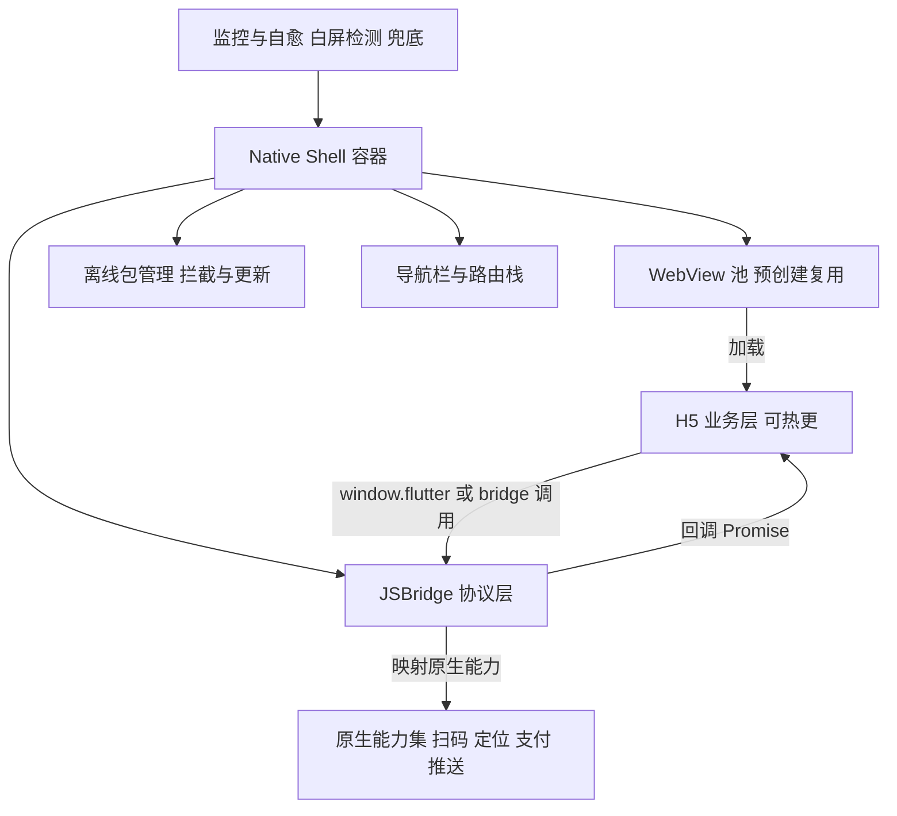

```text
hybrid-app/
├── shell-android/            # Native Shell（Android）
│   ├── webview/              #   WebView 池与预创建、复用策略
│   ├── bridge/               #   JSBridge 注册表与协议分发（对应 XP-028）
│   ├── offline/              #   离线包下载/校验/shouldInterceptRequest（XP-030）
│   └── monitor/              #   白屏检测、JS 异常桥回传、自愈重载（XP-031）
├── shell-ios/                # WKWebView 版实现（WKScriptMessageHandler 等）
├── h5-packages/              # H5 业务层（Vite 多入口，产物对接离线包版本）
│   ├── mall/  ├── campaign/  └── help/
└── manifest/                 # 离线包清单与灰度配置（服务端下发）
```

### XP-027：WebView 的性能特性与限制有哪些？
**答**：
- **启动成本**：WebView 冷初始化（内核加载）+ 网页三段（HTML/JS/CSS + 数据请求）串行，中低端机首屏 1-3s；预创建/预热 WebView 池能砍掉内核启动时间。
- **进程/内存模型**：Android WebView 进程独立但受主进程管控，iOS WKWebView 每实例开销大（约 30-60MB），页面栈深内存爆。
- **能力限制**：无同步跨进程调用、Cookie 管理分散（WKHTTPCookieStore vs Android CookieManager）、文件上传/相机需代理回调、部分内核（X5/旧 WebView）行为碎片化。
- **JS 性能**：JIT 受 iOS 长期限制（WKWebView 只能 JIT 其页面脚本，注入脚本上下文受限），复杂计算应下沉原生。
- 渲染瓶颈与普通浏览器一致：DOM 重排、长列表、大图解码。

```javascript
// Native Shell 侧：WebView 预创建池（伪码，两端同构）
class WebViewPool {
  constructor(size = 2) { this.pool = []; this.fill(size); }
  fill(n) {
    for (let i = 0; i < n; i++) {
      const wv = createWebView({
        javaScriptEnabled: true,
        domStorageEnabled: true,
        cacheMode: 'LOAD_DEFAULT',          // 离线包配合 HTTP 缓存
        // 预热：提前进入 about:blank 并注入 bridge 基础脚本
      });
      wv.loadUrl('about:blank');
      this.pool.push(wv);                   // 冷启动成本在 App 启动期就花掉
    }
  }
  async acquire(url) {
    const wv = this.pool.pop() ?? createWebView(defaultConfig);
    await injectBridge(wv);                 // 注入 JSBridge（XP-028）
    await syncCookie(wv, getAuthCookie());  // 登录态注入（XP-029）
    wv.loadUrl(url);
    return wv;
  }
  recycle(wv) {                             // 页面销毁后复用容器，省内核启动
    wv.loadUrl('about:blank');
    if (this.pool.length < 2) this.pool.push(wv); else wv.destroy();
  }
}
```

### XP-028：设计一个完整的 JSBridge（协议、回调表、超时、线程安全）？
**答**：
- 协议要素：**唯一 requestId**（关联调用与回调）、方法命名空间、参数、版本号；回调经 `window.__bridge_cb_<id>` 派发，用完即焚。
- 传输通道：iOS 用 `WKScriptMessageHandler`（H5→原生）+ `evaluateJavaScript`（原生→H5）；Android 用 `addJavascriptInterface` 或 `prompt/onJsPrompt` 拦截（兼容老内核）。
- 必备机制：**超时**（定时器清理回调表防泄漏）、**取消**、**重复注册防护**、**序列化大小限制**、**线程切换**（原生统一回主线程再 evaluate）。
- 安全：域名白名单（哪些页面可调敏感 API）、参数校验、高危 API 二次确认。
- 双向对等：原生调 H5 用同一协议（原生作为 caller 走回调表），保持对称。

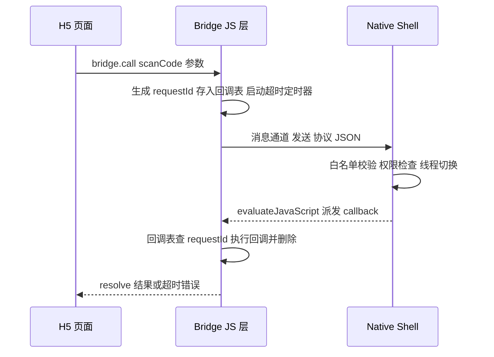

```javascript
// H5 侧 JSBridge 完整实现
const CALLBACK_PREFIX = '__bridge_cb_';
const pending = new Map();                       // id -> { resolve, reject, timer }

function call(method, params = {}, { timeout = 10000 } = {}) {
  const id = `${Date.now()}_${Math.random().toString(36).slice(2, 8)}`;
  return new Promise((resolve, reject) => {
    pending.set(id, { resolve, reject });
    pending.get(id).timer = setTimeout(() => {   // 超时兜底：防回调丢失导致内存泄漏
      pending.delete(id);
      reject(Object.assign(new Error(`bridge timeout: ${method}`), { code: 'E_TIMEOUT' }));
    }, timeout);
    const payload = JSON.stringify({ id, method, params, v: 2 });
    if (window.webkit) window.webkit.messageHandlers.nativeBridge.postMessage(payload); // iOS
    else if (window.nativeBridge) window.nativeBridge.postMessage(payload);             // Android addJavascriptInterface
    else legacyPrompt(payload);                  // Android 老内核走 onJsPrompt 拦截
  });
}

// 原生回调统一入口：native 完成后 evaluateJavaScript(`__dispatch('${id}', ${json})`)
window.__dispatch = (id, errJson, okJson) => {
  const ctx = pending.get(id);
  if (!ctx) return;                              // 已超时/取消，忽略迟到回调
  clearTimeout(ctx.timer); pending.delete(id);
  errJson ? ctx.reject(errJson) : ctx.resolve(okJson);
};
// 原生侧要点：回调表去重、只在主线程 evaluate、API 域名白名单校验后分发
```

### XP-029：H5 与 Native 如何共享登录态（Cookie/Token 注入）？
**答**：
- 两种主流方案：**Cookie 共享**（Native 把 session 写入 WebView CookieManager，H5 请求自动携带，服务端无感知）与 **Token 注入**（桥下发 token，H5 自行放 header，适合纯接口型 H5）。
- Cookie 注入时机必须在**首次请求发出前**（WKWebView 需在 `WKHTTPCookieStore.setCookie` 完成后 loadUrl，Android 在 loadUrl 前写 CookieManager 并 flush）。
- 一致性难题：Native 登录/登出后要**同步刷新**所有 WebView Cookie；多容器实例（WKWebView 各自 store）需遍历同步。
- 安全红线：token 不落 localStorage（XSS 可读）；敏感域 Cookie 用 HttpOnly+Secure；JSBridge 下发凭据必须白名单域。
- SSO 场景：共享 Cookie 域（父域）+ 桥通知刷新，双保险。

```javascript
// Native Shell 侧：登录态同步到 WebView（两端关键时序）
// Android：
// CookieManager.getInstance().setAcceptCookie(true);
// CookieManager.getInstance().setAcceptThirdPartyCookies(webView, true);
// for (const c of buildAuthCookies(token)) {
//   CookieManager.getInstance().setCookie('https://m.example.com',
//     `session=${c.value}; Domain=.example.com; Path=/; Secure; HttpOnly`);
// }
// CookieManager.getInstance().flush();           // 关键：立刻落盘，否则首个请求丢 Cookie

// iOS（WKWebView 必须等 setCookie 完成再 loadUrl）：
async function syncCookieToWK(webView, cookies) {
  const store = webView.configuration.websiteDataStore.httpCookieStore;
  await Promise.all(cookies.map((c) =>
    new Promise((res) => store.setCookie(
      new NSHTTPCookie({ name: c.name, value: c.value, domain: '.example.com', path: '/', secure: true }),
      res,
    )),
  ));
}
// H5 侧（Token 方案）：桥获取 token 后由统一请求库注入 header，绝不写 localStorage
// const token = await bridge.call('getAccessToken');
// http.interceptors.request.use((cfg) => ({ ...cfg, headers: { Authorization: `Bearer ${token}` } }));
```

### XP-030：设计一套离线包体系（拦截、签名校验、增量更新）？
**答**：
- 原理：把 H5 的静态资源打包（zip）预置/预下载到本地，请求时由 Native **拦截 URL** 返回本地文件，网络请求只留动态接口——首屏从"网络加载"变"本地读盘"。
- 清单驱动：服务端 manifest 记录每个包的 version/hash/url/diffUrl，客户端启动或 WiFi 时轮询，**差分更新**（bsdiff/按文件 chunk diff）省流量。
- 校验链：下载后校验包 hash + **签名**（防篡改），解压到版本目录，原子切换 `current` 指针；失败回滚上一版本。
- 拦截实现：Android `shouldInterceptRequest`、iOS `URLProtocol`/`WKURLSchemeHandler`；内存映射大文件，注意 MIME 与 range 请求（视频/音频需支持 206）。
- 灰度与回滚：manifest 支持按渠道/比例下发，线上包异常（白率上升）可秒级把指针切回旧版。

```javascript
// Android 拦截核心 + manifest 协议
class OfflineIntercept {
  shouldInterceptRequest(webView, request) {
    const url = request.url.toString();
    const hit = this.packages.resolve(url);            // current 版本目录内精确匹配
    if (!hit) return null;                             // 未命中走网络
    const file = hit.localFile;
    if (request.method === 'GET' && request.headers['Range']) {
      return serve206(file, request.headers['Range']); // 媒体资源必须支持 Range
    }
    const resp = webResourceResponse(hit.mime, 'utf-8', file.inputStream());
    resp.addHeader('X-Offline-Pkg', hit.pkgVersion);   // 便于监控统计命中率
    return resp;
  }
}
// manifest.json（服务端下发）
// {
//   "packages": [{
//     "name": "mall", "version": "1.8.3", "url": "https://cdn/.../mall-1.8.3.zip",
//     "diffUrl": "https://cdn/.../mall-1.8.2_1.8.3.patch", "baseVersion": "1.8.2",
//     "size": 286720, "hash": "sha256-...",
//     "sign": "sig(hmac(content, pkgKey))",           // 解压前验签，防 CDN 篡改
//     "routes": ["https://m.example.com/mall/*"],
//     "rollout": { "default": 100, "gray": { "city": ["sh"], "ratio": 20 } }
//   }]
// }
// 更新流程：下载 → 验签 → 解压到 versions/1.8.3/ → 原子切换 current → 删旧版本（保留 1 个回滚）
```

### XP-031：WebView 白屏监控与自愈方案怎么设计？
**答**：
- 白屏根因分类：资源加载失败（CDN/离线包损坏）、JS 报错中断渲染、内存回收（iOS 杀 WKWebView 进程）、内核崩溃。
- **检测手段**：① 渲染检测——`document.elementFromPoint` 采样视口多点判断是否全空白，或比较 DOM 树节点量；② 信号量——首字节时间/FCP 超阈值；③ 原生侧检测进程存活与 `didTerminate` 回调。
- **自愈策略分级**：重载页面（换非离线包 URL）→ 重建 WebView 实例 → 清缓存后重载 → 兜底静态页；同一会话限次数（防循环白屏）。
- 上报闭环：白屏率按版本/机型/离线包版本聚合，白率超阈值自动停用对应离线包（联动 XP-030 灰度）。

```javascript
// H5 侧检测脚本（Native 注入，采样视口渲染内容）
export function startWhiteScreenMonitor({ points = 5, thresholdMs = 3000, onWhite } = {}) {
  const start = performance.now();
  const timer = setInterval(() => {
    if (performance.now() - start > thresholdMs) return finish(true);
    const blanks = samplePoints(points).every(
      (el) => !el || el.tagName === 'HTML' || el.tagName === 'BODY' || isBlankStyle(el),
    );
    const hasContent = document.body && document.body.children.length > 0;
    if (!blanks && hasContent) return finish(false);   // 有内容即视为正常
  }, 500);

  function finish(white) {
    clearInterval(timer);
    if (white) {
      reportWhiteScreen({ url: location.href, dpr: devicePixelRatio, ua: navigator.userAgent });
      onWhite?.();                                     // 通知 Native 执行自愈
      bridge.call('webview.selfHeal', { level: 'reload', cacheBust: true });
    }
  }
}
// Native 侧分级自愈（伪码）：
// level reload → loadUrl(url + ts)（绕过离线包）
// level recreate → pool.recycle + 新建实例（对应 iOS didTerminate / 内存回收场景）
// level purge → 清 WebView 缓存与离线包 current 指针后重载，单会话最多 2 次，超出落兜底页
```

### XP-032：H5 与原生的导航栏协作（沉浸式状态栏、胶囊按钮）怎么设计？
**答**：
- 协作模式两种：**H5 主导**（原生透明导航栏，页面用 CSS 画导航，用桥取安全区参数）与 **Native 主导**（H5 通过桥动态改原生导航栏标题/颜色/按钮）。
- 关键数据：**safe area**（状态栏/底部横条高度、胶囊按钮位置）由桥下发，CSS 用 `env(safe-area-inset-*)` + 桥数据兜底。
- 沉浸式：原生设透明状态栏 + WebView 全屏铺开；H5 用 `viewport-fit=cover`，头部背景延伸到状态栏下。
- 一致性治理：导航交互（返回、关闭、右侧按钮）定义协议集合，两端渲染结果对齐设计稿；胶囊按钮（微信式）位置必须由原生实时下发，避免算错。
- 页面栈：H5 内部 push 与原生 push（新 WebView）要共享一套路由栈（详见 XP-071）。

```javascript
// 桥协议：导航能力集合（两端实现同一 Spec）
const nav = {
  setTitle: (t) => bridge.call('nav.setTitle', { title: t }),
  setStyle: (s) => bridge.call('nav.setStyle', s),        // { theme: 'dark'|'light', hidden: false }
  setButtons: (b) => bridge.call('nav.setButtons', b),    // [{ id, icon, text, position }]
  onButtonTap: (id, fn) => bridge.on(`nav.btn.${id}`, fn),
};

// 沉浸式适配（H5 侧消费桥下发的安全区）
const layout = await bridge.call('nav.getLayoutInsets');
// layout: { statusBar: 47, capsule: { top: 6, height: 32, right: 87 }, homeIndicator: 34 }
document.documentElement.style.setProperty('--status-bar', `${layout.statusBar}px`);
// CSS：.page-header { padding-top: var(--status-bar); }  配合 viewport-fit=cover

// 微信式胶囊对齐（页面自绘导航时，右侧按钮起点 = 胶囊左边界）
const header = document.querySelector('.page-header');
header.style.paddingRight = `${layout.capsule.right + 8}px`;

// 原生侧（示意）：nav.setTitle 收到后 main 线程更新原生导航栏；
// 沉浸式 = statusBar 透明 + WebView frame 延伸到屏幕顶部 + H5 自绘头部背景
```

---

## 五、Electron 深度（033-040）

### XP-033：Electron 的进程模型是怎样的（主进程/渲染进程/Utility）？
**答**：
- **主进程**（main）：Node 环境，管理应用生命周期、窗口、原生 API、系统托盘；**全局唯一**，是所有渲染进程的父进程。
- **渲染进程**（renderer）：每个 BrowserWindow/BrowserView/`<webview>` 一个独立 Chromium 渲染进程，跑页面 UI；默认无 Node 能力（安全考虑）。
- **Utility Process**（utilityProcess 模块）：Node 子进程，用于在不污染主进程的情况下跑重活（如 LSP、文件索引、ffmpeg）。
- **GPU 进程/网络服务**：Chromium 基础设施进程，开发者一般不直接操作。
- 关键认知：主进程卡 = 全部窗口卡（菜单/窗口管理失灵）；渲染进程卡 = 单窗口卡；崩溃隔离由进程边界保证。

```text
electron-app 进程树（tasklist / ps 视角）
electron（主进程 main.ts：app、BrowserWindow、ipcMain、托盘、全局快捷键）
├── renderer（窗口 A 的 Chromium 渲染进程：index.html + preload.cjs）
├── renderer（窗口 B 的渲染进程）
├── utility-process（utilityProcess.fork('worker.cjs')：重 CPU 任务、文件索引）
├── GPU Process（合成与光栅化，所有窗口共享）
└── Network Service（网络栈，独立进程）

// main.ts —— 进程模型骨架
import { app, BrowserWindow, utilityProcess } from 'electron';
app.whenReady().then(() => {
  const win = new BrowserWindow({ webPreferences: { preload: path.join(__dirname, 'preload.cjs') } });
  win.loadFile('index.html');                                   // 独立渲染进程
  const util = utilityProcess.fork(path.join(__dirname, 'worker.cjs'));
  util.postMessage({ task: 'index', dir: '/docs' });            // 重活放 Utility，防主进程阻塞
});
```

### XP-034：Electron 的 IPC 通信完整链路（ipcMain/ipcRenderer/preload/contextBridge）？
**答**：
- 链路：渲染进程页面代码 → **preload**（唯一桥梁，contextBridge.exposeInMainWorld 暴露白名单 API）→ `ipcRenderer.invoke` → 主进程 `ipcMain.handle` 处理 → Promise 回传。
- 四种模式：`invoke/handle`（请求-响应，推荐）、`send/on`（单向推送 renderer→main）、`webContents.send`（main→renderer 广播）、MessagePort（renderer↔renderer 直连，大数据免经主进程）。
- **contextIsolation**：preload 与页面运行在隔离上下文，只能通过暴露的受控 API 交互，是安全模型的基础（见 XP-035）。
- 易错点：直接给页面暴露 `ipcRenderer` 对象 = 全权授予 IPC 能力（高危）；主进程处理消息必须校验 sender 与参数。

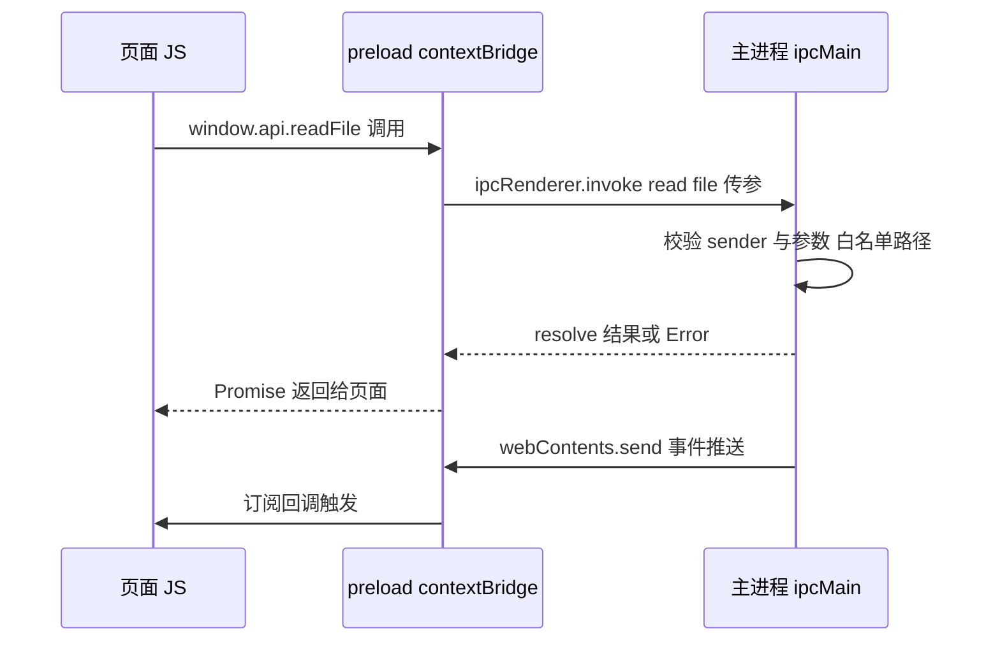

```javascript
// preload.cjs —— 白名单 API 暴露（唯一正确的暴露方式）
const { contextBridge, ipcRenderer } = require('electron');
contextBridge.exposeInMainWorld('api', {
  readFile: (p) => ipcRenderer.invoke('file:read', p),
  onExportProgress: (cb) => {
    const handler = (_e, progress) => cb(progress);
    ipcRenderer.on('export:progress', handler);
    return () => ipcRenderer.removeListener('export:progress', handler); // 返回退订函数
  },
});

// main.ts —— handle 与校验
import { ipcMain } from 'electron';
ipcMain.handle('file:read', (event, p) => {
  if (!event.senderFrame.url.startsWith('https://app.example.com')) throw new Error('forbidden');
  if (!isPathInWhitelist(p)) throw new Error('path not allowed');   // 防任意文件读
  return fs.promises.readFile(p, 'utf-8');
});

// renderer（页面）：
const text = await window.api.readFile('/docs/a.md');
const stop = window.api.onExportProgress((p) => render(p));
```

### XP-035：Electron 安全模型怎么配置？contextIsolation 与 nodeIntegration 如何取舍？
**答**：
- 黄金配置：**`contextIsolation: true`（默认）+ `nodeIntegration: false` + `sandbox: true`**，preload 是唯一通道，页面永远不直接摸 Node。
- 放弃 `nodeIntegration: true` 的理由：渲染进程一旦被 XSS/加载第三方页面，等于拿到整台机器的 Node 权限（fs/child_process/RCE）。
- 配套措施：禁 `nodeIntegrationInWorker`、`webSecurity` 不许关、限制 `will-navigate`/`setWindowOpenHandler`（防导航劫持）、加载远程内容必须 CSP、`session.setPermissionRequestHandler` 管权限弹窗。
- 校验习惯：所有 ipcMain.handle 校验 senderFrame.origin；不 `eval` 任何远程输入；shell.openExternal 仅放行 https。
- 历史教训：Node 任意版本漏洞都会经由 nodeIntegration 放大成桌面端 RCE，社区安全公告反复强调。

```javascript
// 安全基线配置（main.ts）
const win = new BrowserWindow({
  webPreferences: {
    contextIsolation: true,     // 必开：preload 与页面上下文隔离
    nodeIntegration: false,     // 必关：渲染进程无 Node
    sandbox: true,              // 沙箱渲染进程，即使 preload 漏洞也被限制
    preload: path.join(__dirname, 'preload.cjs'),
    webviewTag: false,          // 不需要就关掉
  },
});

// 防导航劫持与外链
win.webContents.setWindowOpenHandler(({ url }) => {
  if (url.startsWith('https://')) shell.openExternal(url); // 外链交给系统浏览器
  return { action: 'deny' };
});
win.webContents.on('will-navigate', (e, url) => {
  if (!url.startsWith('https://app.example.com')) e.preventDefault();
});

// CSP（index.html 头部）：
// <meta http-equiv="Content-Security-Policy" content="default-src 'self'; script-src 'self'; object-src 'none'">
// 权限收口：
session.defaultSession.setPermissionRequestHandler((wc, permission, cb) =>
  cb(permission === 'clipboard-read' && wc.frame.url.includes('app.example.com')));
```

### XP-036：Electron 中重任务应该放在主进程还是渲染进程？如何分工？
**答**：
- 原则：**主进程只做轻协调**（窗口、生命周期、IPC 路由、托盘），因为它阻塞会影响所有窗口；重 CPU（压缩、解析、索引、图像处理）放 **Utility Process** 或渲染进程的 Web Worker。
- 分工矩阵：文件 IO 大量数据 → utility；纯计算不碰 Node API → renderer Web Worker；需要 Node + CPU → utilityProcess（Node 子进程）。
- 通信成本意识：大 Buffer 跨进程传输有拷贝成本，能传文件路径就不传内容，或用 SharedArrayBuffer/MessagePort 直连。
- 兜底观测：主进程加 event loop lag 监控，超阈值告警；utility 崩溃由主进程守护重启。
- 与浏览器认知对齐：渲染进程内阻塞同样掉帧，Worker 不解决"需要访问 DOM"的重活——那要靠虚拟化与增量渲染。

```javascript
// 重任务调度：utilityProcess 承担 Node 重活，renderer Worker 承担纯计算
// main.ts
const util = utilityProcess.fork('worker.cjs');
const taskMap = new Map();
ipcMain.handle('zip:create', (e, { id, files }) => {
  util.postMessage({ type: 'zip:create', id, files });       // 主进程只转发，不干活
  return 'accepted';
});
util.on('message', ({ type, id, result }) => {               // 结果回投窗口
  const win = BrowserWindow.getAllWindows().find((w) => w.webContents);
  taskMap.get(id)?.(result);
  win?.webContents.send('zip:done', { id, result });
});

// worker.cjs（Utility 进程，有 Node 能力）
process.parentPort.on('message', async ({ data }) => {
  if (data.type === 'zip:create') {
    const buf = await zipInWorkerNode(data.files);            // 压缩在子进程完成
    process.parentPort.postMessage({ type: 'zip:done', id: data.id, result: buf.length });
  }
});

// renderer：纯 CPU 且不需要 Node 的任务（如 JSON 大解析）直接 Web Worker
const w = new Worker(new URL('./parse.worker.ts', import.meta.url), { type: 'module' });
w.postMessage(bigJsonText); // 主线程不卡
```

### XP-037：Electron 多窗口管理怎么做？窗口之间如何通信？
**答**：
- 用 **WindowManager 统一管理**：创建、焦点、生命周期、按 key 复用（单例窗口如"设置"）、`getAllWindows()` 遍历广播。
- 窗口间通信三条路：① 经主进程中转（通用但主进程是瓶颈）；② **MessagePort 直连**（`postMessage` 把 port 转给两个渲染进程，点对点、不经主进程，适合高频大数据）；③ 共享状态走主进程 + 变更广播（保持单一数据源）。
- 关闭策略：`close` 事件拦截做确认/保存；macOS 惯例关窗不退应用（`window-all-closed` 区分平台）。
- 崩溃隔离：一个窗口渲染进程崩不影响其它窗口，监听 `render-process-gone` 重建窗口并恢复状态（状态快照存主进程）。

```javascript
// main.ts —— WindowManager + 两种窗口通信
class WindowManager {
  #wins = new Map();
  open(key, options, url) {
    if (this.#wins.has(key)) { this.#wins.get(key).focus(); return this.#wins.get(key); } // 单例复用
    const win = new BrowserWindow(options);
    this.#wins.set(key, win);
    win.on('closed', () => this.#wins.delete(key));
    win.loadURL(url);
    return win;
  }
  broadcast(channel, payload) {
    for (const w of BrowserWindow.getAllWindows()) w.webContents.send(channel, payload);
  }
}
// 路径1：经主进程转发
ipcMain.on('win:forward', (e, { to, channel, data }) =>
  wm.#wins.get(to)?.webContents.send(channel, data));

// 路径2：MessagePort 直连（高频场景：编辑器 A ↔ 预览窗 B）
ipcMain.on('peer:connect', (e) => {
  const p2 = new MessageChannelMain();
  e.senderFrame.postMessage('peer:init', null, [p2.port1]);       // 给请求方
  BrowserWindow.getAllWindows().find((w) => w.webContents !== e.sender)
    ?.webContents.postMessage('peer:init', null, [p2.port2]);     // 给对端
});
// renderer：window.onmessage = ({ ports }) => ports[0].onmessage = (m) => apply(m.data);
```

### XP-038：Electron 自动更新（electron-updater）全流程怎么设计？
**答**：
- 流程：启动后台 `checkForUpdates` → 比对版本 → `downloadUpdate`（断点续传、差分更新 delta）→ 校验签名 → `quitAndInstall`（通常等用户确认或下次启动静默装）。
- 发布通道：`latest.yml/mac.yml` 元数据 + 分通道（latest/beta/alpha），按用户设置 `setFeedURL` 切换。
- 平台差异：Windows 走 NSIS/squirrel + 代码签名校验；macOS `Squirrel.Mac` + zip，需公证（notarize）否则 Gatekeeper 拦截；Linux AppImage/deb 自管理。
- 工程细节：更新期间业务可用（下载在后台）；失败重试与退避；强制更新场景在渲染层阻断；灰度按 latest.yml 分流或自建更新服务按设备发不同版本。
- 自建服务：electron-updater 支持 generic provider 指向自家 CDN/接口，可完全掌控灰度与埋点。

```yaml
# electron-builder.yml —— 自动更新配套
appId: com.example.app
publish:
  provider: generic          # 自建更新源（也可 github/s3）
  url: https://update.example.com/desktop
  channel: latest
nsis:
  differentialPackage: true  # Windows 差分更新
mac:
  hardenedRuntime: true      # 公证前置要求
  notarize: true             # 自动公证，未公证的 dmg 用户会拒装
  identity: Developer ID Application: Example Inc
```

```javascript
// main.ts —— 更新编排
import electronUpdater from 'electron-updater';
const { autoUpdater } = electronUpdater;

autoUpdater.autoDownload = false;                       // 手动控制下载节奏
autoUpdater.on('update-downloaded', async ({ version }) => {
  const { response } = await dialog.showMessageBox(win, {
    message: `新版本 ${version} 已就绪，是否立即重启安装？`, buttons: ['稍后', '立即更新'],
  });
  if (response === 1) autoUpdater.quitAndInstall();      // 或记录标记，下次启动静默安装
});
autoUpdater.on('error', (e) => report('updater.error', e)); // 退避重试由业务编排
app.whenReady().then(() => autoUpdater.checkForUpdates());  // 启动后静默检查，不打扰使用
```

### XP-039：Electron 打包与签名（electron-builder / macOS 公证 / Windows 签名）怎么做？
**答**：
- electron-builder 统一产出：Windows NSIS 安装包、macOS dmg/zip、Linux AppImage/deb，自动处理 asar、依赖裁剪、双架构（x64/arm64）。
- macOS 链路：Developer ID 代码签名 → **notarize 公证**（hardenedRuntime 必开）→ staple；缺公证时用户打开报"已损坏/无法验证"。
- Windows 链路：EV/OV 证书签名（EV 可直接过 SmartScreen 信誉）；`signAndEditExecutable` 在打包时签名，避免被篡改后再签。
- asar 与安全：asar 防用户手改代码但不是加密，敏感逻辑本就不该进客户端；native 模块按平台 rebuild（electron-rebuild）。
- CI 要点：证书走密钥管理（不落仓库）、arm64 与 x64 矩阵构建、产物含 latest.yml 供更新器消费。

```yaml
# electron-builder.yml —— 多平台打包矩阵（CI 消费）
appId: com.example.app
productName: ExampleApp
directories: { output: dist }
files: [ 'dist/**', 'package.json' ]
asar: true
mac:
  target: [ { target: dmg, arch: [x64, arm64] }, { target: zip, arch: [x64, arm64] } ] # zip 供 Squirrel 更新
  category: public.app-category.productivity
  hardenedRuntime: true
  entitlements: build/entitlements.mac.plist
  notarize: true
  identity: Developer ID Application: Example Inc (TEAMID)
win:
  target: [ { target: nsis, arch: [x64, arm64] } ]
  signingHashAlgorithms: [ sha256 ]
  certificateSubjectName: Example Inc        # CI 中用 EV 证书签名
linux:
  target: [ AppImage, deb ]
  category: Utility
# CI（GitHub Actions）矩阵：macos-latest 签名公证出 dmg/zip；windows-latest 出 NSIS；
# 产物 dist/latest.yml 上传 update.example.com 供 electron-updater 消费
```

### XP-040：Electron 应用内存优化怎么做？
**答**：
- 大头在**窗口与进程数量**：每窗口一个渲染进程（几十 MB 起步），策略是按需创建、单例复用、隐藏窗口延迟销毁或挂起（`webContents.setBackgroundThrottling`）。
- 渲染层：常规 Web 内存治理（事件解绑、大列表虚拟化、图片解码释放）；`<webview>`/BrowserView 用完立即销毁并监听 `destroyed`。
- 主进程：缓存设上限与 LRU 淘汰；避免持有大 Buffer 全局引用；`app.commandLine.appendSwitch('js-flags', '--max-old-space-size=512')` 收敛 V8 堆。
- 系统级：Windows 可释放工作集；后台时降低渲染频率；GPU 缓存大小限制。
- 观测：`process.memoryUsage()`/`app.getAppMetrics()` 定期采样上报，按进程类型聚合出内存水位看板。

```javascript
// main.ts —— 内存治理组合拳
// 1) 单例窗口复用，避免重复开渲染进程
ipcMain.handle('win:open-settings', () => wm.open('settings', { width: 720, height: 560 }, 'settings.html'));

// 2) 隐藏窗口内存回收：最小化/隐藏后清空闲缓存并挂起渲染
win.on('minimize', () => win.webContents.session.clearCache()); // 配合 setBackgroundThrottling(true)

// 3) V8 堆上限与 GPU 缓存收敛
app.commandLine.appendSwitch('js-flags', '--max-old-space-size=512');
app.commandLine.appendSwitch('gpu-program-cache-size-kb', '10240');

// 4) 内存水位监控与自愈
setInterval(() => {
  for (const m of app.getAppMetrics()) {
    const heapMB = (m.memory?.workingSetSize ?? 0) / 1024;
    if (heapMB > 400) {
      report('memory.high', { type: m.type, pid: m.pid, heapMB });
      if (m.type === 'Window' && isIdleWindow(m.pid)) recreateWindow(m.pid); // 空闲窗口重建释放
    }
  }
}, 60_000);
// 5) 渲染层：window.addEventListener('pagehide', disposeTimers) 防泄漏；大图 URL.revokeObjectURL
```

---

## 六、小程序容器与 uni-app 深度（041-046）

### XP-041：小程序容器的通用架构是什么？各家的双线程模型有何异同？
**答**：
- 通用架构：**逻辑层**（独立 JS 引擎：JsCore/V8，无 DOM/BOM）+ **渲染层**（WebView 或原生渲染）+ **Native 层**（中转通信、原生组件、能力管控、审核体系）。
- 微信：逻辑层单线程 JsCore，渲染层多 WebView（或 Skyline 原生渲染）；setData 经 native 序列化中转。
- 抖音/支付宝基本同构，差异在渲染层实现与通信优化（如支付宝渲染层同构优化、字节部分场景同层渲染策略）。
- 双线程动机：**安全管控**（JS 摸不到 DOM，可静态审查）+ **性能隔离**（逻辑卡不阻塞渲染）+ **跨端一致**。
- Skyline 类方案的趋势：渲染层从 WebView 走向原生渲染，通信链路更短、同层渲染更彻底。

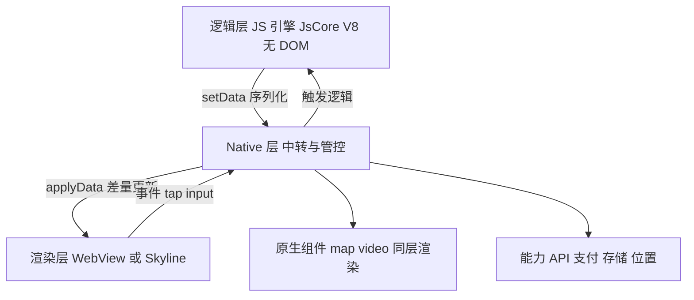

```text
方案            逻辑层引擎        渲染层                    通信优化点
微信小程序      JsCore/V8        WebView / Skyline 原生     setData 差量 同层渲染
支付宝小程序    V8 (部分 NJS)    WebView + 自研渲染优化     初始数据直传 渲染缓存
抖音小程序      JsCore/V8        WebView + 部分原生组件     lyra 类优化 审核流快
统一抽象        独立 JS 线程     与逻辑隔离的 UI 线程        双向消息必经 Native
关键推论        DOM 不可达       WXML 模板驱动              频繁 setData 是第一杀手
```

### XP-042：Taro 运行时原理？React 组件是如何跑在小程序上的？
**答**：
- 三步本质：**编译期**把 JSX 编译成模板（WXML）并抽离静态结构；**运行时**实现一套"小程序版 react-dom"（taro-runtime），把 React 的 DOM 操作**代理**为 setData 数据更新。
- 核心机制：运行时构造一个 **伪 DOM 树**（TaroElement），React 对它的 createAppend/remove 操作不触发真实渲染，而是 diff 出**数据补丁**（模板绑定的 data 字段），再 setData 给渲染层。
- 渲染层 WXML 是一份**通用模板**（递归 view/text/image 组件树，按节点类型动态渲染），配合 data 里的树形数据驱动显示。
- 事件：WXML 上绑定统一入口（`eh`），运行时找到对应 TaroElement，触发 React 合成事件体系。
- Hooks 与 React 生态（Redux 等）可直接用，因为它们只依赖 react 运行时，不依赖真实 DOM——这就是适配层的价值。

```jsx
// Taro 运行时核心链路示意（简化源码模型）
import { createReactApp, TaroElement, TaroText } from '@tarojs/runtime';
import { createPageConfig } from '@tarojs/taro';

// 1) 自定义 renderer：把 react-dom 的宿主操作换成 TaroElement 操作
// ReactDOM.createRoot → taroRoot，commitUpdate 不写 DOM 而是标脏节点
class FakeElement extends TaroElement {
  enqueueUpdate(payload) {                    // React 改动 → 收集数据补丁
    this.pendingUpdates.push(payload);        // { path: 'a.b.c', value } 形式
  }
  flush() {
    const patch = diff(this.pendingUpdates);
    this.getPageInstance().setData(patch);    // 2) 经 native 中转到渲染层（同 setData 心智）
  }
}

// 3) 模板侧：编译期生成通用递归模板（WXML 片段）
// <template name="tmpl_0_view"><view id="{{i.uid}}" bindtap="eh">{{i.cn}}</view></template>
// <template is="tmpl_0_view" data="{{ i: root.cn[0] }}" /> —— 树形 data 驱动，无 DOM 操作

// 业务代码完全标准 React，感知不到上述机制
function Cart() {
  const [count, setCount] = useState(0);
  useEffect(() => { Taro.setStorageSync('cart', count); }, [count]);
  return <Button onClick={() => setCount(count + 1)}>加购 {count}</Button>;
}
export default createPageConfig(Cart, 'pages/cart/index');
```

### XP-043：uni-app 的运行时原理？编译时与运行时如何混合？
**答**：
- **双引擎架构**：Vue 源码经**编译器**（vue-cli/vite 插件）按目标端输出——小程序端编译成 WXML/JSON/JS；App 端（HBuilderX/nvue）保留运行时渲染。
- 小程序端模式与 Taro 类似：运行时把 Vue 的渲染函数产物转为 setData 数据流；H5 端直接走标准 vue-dom。
- **App 端分两路**：vue 页面走 WebView 渲染；nvue 页面走原生渲染（weex 系，适合长列表/视频页性能敏感场景）。
- 条件编译是差异收敛手段：`#ifdef MP-WEIXIN / APP-PLUS / H5` 控制代码与样式分支，编译期剔除无关代码。
- 取舍：编译时方案产物更"原生"（模板在编译期生成，运行时包更小），但语法受限（Vue 模板子集）；运行时方案灵活但性能与包体有损耗。

```javascript
// uni-app：条件编译 + 运行时补丁示意
// pages/pay/index.vue（编译期按端拆分）
// <template>
//   <view class="pay">
//     <!-- #ifdef MP-WEIXIN -->
//     <button open-type="requestPayment" @tap="wxPay">微信支付</button>
//     <!-- #endif -->
//     <!-- #ifdef H5 -->
//     <button @tap="h5Pay">跳转收银台</button>
//     <!-- #endif -->
//   </view>
// </template>

export default {
  methods: {
    async wxPay() {
      // 编译进小程序端：uni.requestPayment 最终映射 wx.requestPayment（运行时 API 抹平层）
      await uni.requestPayment({
        provider: 'wxpay', timeStamp, nonceStr, package: prepayId, signType: 'RSA',
      });
    },
    h5Pay() { location.href = cashierUrl; },
  },
};
// 编译产物（MP-WEIXIN）：
//   wxml：模板编译产物，含通用渲染模板与事件绑定 eh
//   js：Vue 运行时 + uni-app 运行时，commit 时收集补丁 → setData
// 编译产物（H5）：标准 Vue SPA，uni.* 映射到浏览器/自研 H5 实现
// 编译产物（APP-PLUS vue）：WebView 渲染；nvue：原生控件渲染（weex 管线）
```

### XP-044：跨端样式一致性如何治理（rpx/单位/兼容降级）？
**答**：
- 单位策略：**设计稿对齐**——Taro/uni-app 的 px→rpx/upx 转换（designWidth 配置），H5 端转 vw 或运行时换算；RN 用 PixelRatio 注入 dp 概念。
- 三大差异源：**盒模型与默认样式**（小程序各端 reset 不一）、**安全区/刘海**、**字体渲染与行高**。治理靠：统一 reset 样式包 + PostCSS 编译期转换 + 安全区变量注入。
- 兼容降级：低版本 WebView/基础库不支持的新特性（如 flex gap）用 PostCSS 插件自动降级或运行时探测。
- 视觉走查自动化兜底：CI 多端截图对比（见 XP-072），把"样式漂移"变成可度量指标。
- 原则：**样式分支只允许出现在样式文件内（条件编译/平台后缀），禁止业务 JSX 里写平台 if**。

```javascript
// 样式一致性工程化：PostCSS 管线（Taro/uni-app 同构思路）
// postcss.config.js
module.exports = {
  plugins: [
    require('postcss-pxtransform')({            // 设计稿 750 宽：px → rpx(小程序)/rem(vw)(H5)
      platform: process.env.TARO_ENV,
      designWidth: 750,
      deviceRatio: { 750: 1 },
    }),
    require('postcss-preset-env')({ browsers: ['iOS >= 10', 'Android >= 8'] }), // 语法降级
    require('./plugins/safe-area-variable')(),  // 兜底：bottom: calc(20rpx + env(safe-area-inset-bottom))
    require('autoprefixer'),
  ],
};
// 平台差异样式收敛（只允许出现在样式层）：
//   index.scss 中：
//   .badge { color: #fff; }
//   /* #ifdef MP-ALIPAY */
//   .badge { line-height: 1.2; }   // 支付宝渲染差异
//   /* #endif */
// 文件后缀法：index.rn.scss / index.weapp.scss 由构建器按端选择
// 统一 reset：packages/style/reset.scss 引入各端_normalize 差异（button::after 清除等）
```

### XP-045：跨端 API 差异抹平层（Adapter）怎么设计？
**答**：
- 接口先行：定义 **TypeScript 接口**（能力契约），各端提供实现并在壳工程注册；业务只 import 接口不 import 实现（依赖倒置）。
- 差异处理三类：**语义等价**（直接映射，如 setStorage）、**语义近似**（包装补齐，如支付宝无某回调则模拟）、**能力缺失**（降级或抛明确错误码，见 XP-073）。
- 注册与分发：运行时按平台探测选择实现；编译期条件编译直接剔除他端代码，两者结合。
- 质量保障：接口层 100% 单测 + 每端契约测试（同一用例矩阵跑各端实现，行为一致性断言）。
- 演进安全：接口版本化（v2 加字段向后兼容），废弃走告警日志统计真实使用量再下线。

```typescript
// adapter/storage/index.ts —— 能力契约
export interface IStorage {
  get<T>(key: string): Promise<T | null>;
  set(key: string, value: unknown): Promise<void>;
  remove(key: string): Promise<void>;
}

// adapter/storage/weapp.ts
export const weappStorage: IStorage = {
  get: (k) => new Promise((res) => wx.getStorage({ key: k, success: (r) => res(r.result ?? null), fail: () => res(null) })),
  set: (k, v) => new Promise((res, rej) => wx.setStorage({ key: k, data: v, success: () => res(), fail: rej })),
  remove: (k) => new Promise((res) => wx.removeStorage({ key: k, complete: () => res() })),
};

// adapter/storage/h5.ts
export const h5Storage: IStorage = {
  get: async (k) => { const raw = localStorage.getItem(k); return raw ? JSON.parse(raw) : null; },
  set: async (k, v) => localStorage.setItem(k, JSON.stringify(v)),
  remove: async (k) => localStorage.removeItem(k),
};

// adapter/index.ts —— 平台探测注册（编译期条件编译剔除他端实现）
let impl: IStorage;
// #ifdef MP-WEIXIN
impl = weappStorage;
// #endif
// #ifdef H5
impl = h5Storage;
// #endif
export const storage: IStorage = new Proxy(impl, {           // 统一埋点/降级切面
  get(t, p) { reportApiCall('storage', String(p)); return Reflect.get(t, p); },
});
```

### XP-046：跨端框架的调试与性能分析工具链怎么搭？
**答**：
- 调试分层：**业务调试**（各端开发者工具 + 真机调试）与**框架调试**（Taro/uni-app 运行时的 setData 面板、组件树检查）。
- 性能分析口径统一：启动（首屏时间）、setData 频率与体积、长任务、内存快照；各端原始指标先归一化再上报（对接 XP-069 看板）。
- 关键工具：微信「体验评分/Audits」、Taro DevTools（VSCode 插件，组件树+setData 预览）、代理抓包（Whistle/Charles）统一网络调试。
- 自动化：CI 里跑 Lighthouse（H5）、自动化脚本采集小程序启动 trace，回归时对比基线，劣化即卡门禁。
- 跨端日志：统一 traceId + 各端日志 SDK 桥接到统一检索台，摆脱"每端翻各的工具"。

```text
跨端调试与性能工具链（一图流）
业务调试：
  H5        → Chrome DevTools / vConsole（真机）
  小程序    → 各家开发者工具 + 真机调试（打开调试模式）
  Taro      → Taro DevTools（VSCode 插件：组件树 / setData 预览 / 路由）
  React     → react-devtools（bridge 到真机）
网络调试    → Whistle / Charles 代理，统一域名 map 与 mock
性能分析：
  启动      → 小程序 Audits / H5 Lighthouse / RN Perf Monitor
  setData   → Taro DevTools 面板（频率+体积），告警阈值：单次 >256KB 或 >20 次/页
  长任务    → 各端 Performance trace 归一化上报（start/end/depth）
  内存      → DevTools Heap 快照 + 基线对比
自动化回归：
  CI        → lighthouse-ci(H5) + miniprogram-automator(小程序) + 截图对比（XP-072）
统一日志    → traceId 串联 → 自建日志检索台（对齐 XP-068/XP-069）
```

---

## 七、跨端工程化（047-052）

### XP-047：跨端 monorepo 怎么组织业务逻辑的跨端复用？
**答**：
- 复用金字塔：**纯逻辑优先**（领域模型/规则/校验/SDK 封装，零 UI 依赖，复用率 100%）→ 无头组件（headless hooks，逻辑复用 UI 各端实现）→ UI 组件（适配层抹平，复用率打折）。
- 包划分：`core`（类型+常量+纯函数）、`api`（请求与协议）、`store`（状态机与领域逻辑）、`hooks`（headless 交互逻辑）、`ui`（含平台适配的组件）、各端 `apps` 壳。
- 工具链：pnpm workspace + Turborepo/Nx 做任务编排与缓存；构建产物用 **bundler-neutral 源码直发**（各端壳自编译）或按端预构建双产物。
- 依赖纪律：`core/api/store` 禁止依赖任何平台 API（lint 强制 import 边界），平台能力必须经 adapter 注入。
- 复用度量：包被引用率、重复实现检测（jscpd），量化"一套代码多端"是否名副其实。

```yaml
# pnpm-workspace.yaml + turbo.json：跨端 monorepo 骨架
packages:
  - 'apps/*'          # h5-app rn-app mini-app desktop-app（壳，只组装）
  - 'packages/core'   # 领域模型/校验/常量：零平台依赖（eslint 边界强制）
  - 'packages/api'    # 请求协议：依赖 adapter 注入的 requester
  - 'packages/store'  # zustand/领域状态机：跨端一致
  - 'packages/hooks'  # headless 逻辑：useCart、useOcrScan（UI 由各端绑定）
  - 'packages/ui'     # 跨端组件库（XP-049）
  - 'packages/adapter'# 平台实现层（XP-003/XP-045）

# turbo.json —— 多端构建编排与缓存
pipeline:
  build:
    dependsOn: ['^build']
    outputs: ['dist/**']
  build:rn:
    dependsOn: ['^build']            # 先构建依赖包，再 Metro bundle
    outputs: ['bundles/**']
  test:
    dependsOn: []                    # 与构建并行
    outputs: []
# eslint no-restricted-imports（core 包内）：
#   patterns: ['react-native', '@tarojs/*', 'uni-*', 'electron']  —— 保住零平台依赖
```

### XP-048：多端构建流水线（矩阵构建与产物分发）怎么设计？
**答**：
- 矩阵构建：一次提交触发按**端 × 平台 × 环境**的矩阵（H5/RN-iOS/RN-Android/小程序/桌面 × test/staging/prod），共享构建缓存（Turbo remote cache）。
- 产物类型各异：H5 → 静态资源（CDN）；RN → js bundle+assets（热更通道）；小程序 → 代码包（各家 CI 上传）；桌面 → 安装包（更新源）。
- 分发与登记：所有产物统一登记到**制品库**（含 git sha、版本、变更人），发布平台按端路由到对应系统（CDN/灰度平台/小程序后台/更新服务器）。
- 卡门禁：矩阵中任一端测试/质量检查失败则整体阻断，防"只顾一端"。
- 效率优化：受影响包增量构建（turbo filter --since）、RN bundle 差分、H5 长缓存 hash。

```yaml
# .github/workflows/cross-build.yml —— 矩阵构建与分发
on: { push: { branches: [main] } }
jobs:
  affected:                       # 第一步：算受影响的端
    runs-on: ubuntu-latest
    outputs: { matrix: ${{ steps.set.outputs.matrix }} }
    steps:
      - id: set
        run: |
          # turbo run build --since=origin/main --dry=json 解析受影响端
          echo "matrix={\"end\":$(node scripts/affected-ends.js)}" >> $GITHUB_OUTPUT
  build:
    needs: affected
    strategy:
      matrix:
        end: ${{ fromJSON(needs.affected.outputs.matrix).end }}   # [h5, rn-ios, rn-android, weapp, desktop]
    runs-on: ${{ contains(matrix.end, 'ios') && 'macos-14' || 'ubuntu-latest' }}
    steps:
      - uses: actions/checkout@v4
      - run: pnpm install --frozen-lockfile
      - run: pnpm turbo run build lint test --filter=./apps/* --affected
      - run: node scripts/publish-artifacts.mjs --end=${{ matrix.end }}   # 统一登记制品库
      # 分发路由：h5→CDN+OSS；rn→热更平台（CodePush 思想，XP-016）；
      # weapp→miniprogram-ci 上传；desktop→electron-builder 产物上传更新源（XP-038）
```

### XP-049：跨端组件库如何设计（平台适配层与样式系统）？
**答**：
- 分层：**接口层**（平台无关 Props/行为与无头逻辑）→ **适配层**（按端实现渲染细节与平台事件）→ **样式层**（设计 token 统一，编译期单位转换）。
- 实现策略按端：小程序/H5 走同一 DSL 模板编译；RN 用独立实现文件（`Button.rn.tsx`）；缺失能力组件（如 canvas 类）提供降级实现。
- 样式系统：设计 token（颜色/间距/字号/圆角）单一来源，生成各端变量（CSS 变量 / RN StyleSheet 主题 / 小程序样式常量）。
- 质量门禁：每组件多端截图基线（XP-072）+ API 单测 + 无障碍属性检查。
- 版本策略：语义化版本 + 变更日志按端标注差异，业务按端锁版本升级。

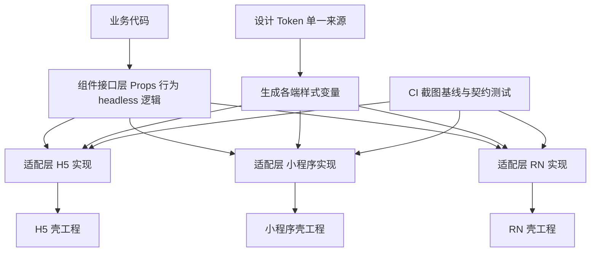

```typescript
// packages/ui/Button —— 平台适配层结构
// index.ts       —— 统一出口（类型 + 无头逻辑 + 按端分发）
// useButton.ts   —— headless：禁用/加载/点击节流/无障碍 props 生成
// button.h5.tsx  —— H5/小程序共用实现
// button.rn.tsx  —— RN 实现
// token.scss / token.ts —— 来自设计 token 生成的变量

export function useButton(props: ButtonProps) {           // 逻辑只写一遍
  const { loading, disabled, onPress } = props;
  const throttled = useMemo(() => throttle(onPress, 500), [onPress]);
  return {
    handlers: { onClick: disabled || loading ? undefined : throttled },
    a11y: { role: 'button' as const, 'aria-disabled': disabled, 'aria-busy': loading },
  };
}
// button.rn.tsx：
export function ButtonRN(props: ButtonProps) {
  const { handlers, a11y } = useButton(props);
  const s = useTokenStyleSheet((t) => ({                 // token.ts 生成 RN 主题
    root: { backgroundColor: t.color.primary, borderRadius: t.radius.md, height: t.space.x8 },
  }));
  return (
    <Pressable accessibilityRole="button" accessible {...a11y}
      onPress={handlers.onClick} style={[s.root, props.style]}>
      <Text style={{ color: t.color.onPrimary }}>{props.children}</Text>
    </Pressable>
  );
}
// index.ts：export const Button = process.env.TARO_ENV === 'rn' ? ButtonRN : ButtonH5;
```

### XP-050：跨端状态如何同步与保持多端数据一致？
**答**：
- 分场景：**同设备跨容器**（App 内 RN 页 ↔ H5 页 ↔ 原生页）、**多设备同用户**、**多端协同**（IM）。
- 同设备方案：状态以**原生为单一数据源**（Native 持有 store），各容器经桥订阅变更（EventChannel/EventEmitter/bridge event），保证只有一个写入口。
- 多设备方案：服务端为唯一事实源 + 客户端乐观更新与版本向量/seq 对账，冲突按业务规则收敛（last-write-wins 或 CRDT）。
- 关键工程点：**事件顺序与幂等**（消息带 seq，乱序重排/去重）、**离线缓冲**（断网期间本地队列，重连后同步）、状态快照恢复（容器重建时全量拉一次）。
- 防坑：桥事件是"通知"不是"事务"，写操作必须回到数据源端确认后再广播，禁止双写。

```typescript
// 同设备跨容器状态同步：Native 为数据源，各容器订阅
// Native 侧（事件总线 + 版本号）
interface CrossAppState<T> { value: T; version: number }
class NativeStore {
  #state = new Map<string, CrossAppState<unknown>>();
  #listeners = new Map<string, Set<(s: CrossAppState<unknown>) => void>>();

  commit<T>(key: string, next: T, fromContainer: string) {   // 唯一写入口
    const prev = this.#state.get(key);
    if (prev && next === prev.value) return;                 // 幂等
    const state = { value: next, version: (prev?.version ?? 0) + 1 };
    this.#state.set(key, state);
    for (const fn of this.#listeners.get(key) ?? []) fn(state);   // 广播含来源，避免回环
  }
  on(key: string, fn: (s: CrossAppState<unknown>) => void) { /* 注册到桥事件 */ }
}
// RN 侧 hook：经 TurboModule 订阅（XP-011），收到 version > local 才应用，防过期回放
export function useCrossState<T>(key: string, initial: T): [T, (v: T) => void] {
  const [v, setV] = useState(initial);
  useEffect(() => NativeStoreBridge.subscribe(key, (s) => setV(s.value as T)), [key]);
  return [v, (next) => NativeStoreBridge.commit(key, next)];  // 写回 Native，由它广播
}
// 多设备一致性：commit 带本地 seq，服务端 seq 权威化；H5/RN/原生页共用同一协议与去重逻辑
```

### XP-051：跨端 CI 的测试矩阵（含真机云测）怎么搭？
**答**：
- 测试金字塔按端组合：**单元测试**（core/hooks 全端跑同一份 jest）→ **契约测试**（adapter 各端实现跑同一用例矩阵）→ **E2E**（H5 Playwright、小程序 automator、RN Detox/Maestro）→ **真机云测**（Testin/Firebase Test Lab/自建设备农场，覆盖机型碎片化）。
- 矩阵维度：端 × OS 版本 × 机型档位（旗舰/中端/低端）× 网络（弱网模拟），高频组合进流水线，长尾组合夜间跑。
- 质量门禁：核心链路 E2E 通过率 100%、崩溃率阈值、启动时长基线对比；不达标禁止发布。
- 设备管理：云测接入 CI（API 提交任务+轮询报告），失败自动归档录屏/日志，联动告警。

```yaml
# .github/workflows/cross-test.yml —— 测试矩阵 + 真机云测接入
jobs:
  unit:
    runs-on: ubuntu-latest
    steps:
      - run: pnpm turbo run test --filter=packages/core --filter=packages/hooks   # 全端共用
  contract:
    strategy:
      matrix: { adapter: [h5, weapp, rn] }
    runs-on: ubuntu-latest
    steps:
      - run: pnpm --filter @app/adapter-${{ matrix.adapter }} test:contract       # 同一用例矩阵
  e2e:
    strategy:
      matrix:
        include:
          - { suite: h5,    run: playwright test }
          - { suite: weapp, run: miniprogram-automator scripts/e2e-weapp.js }
          - { suite: rn,    run: maestro test .maestro/ }                      # RN UI 测试
    runs-on: ubuntu-latest
    steps: [ uses: actions/checkout@v4, run: ${{ matrix.run }} ]
  cloud-devices:                # 真机云测：夜间全量，发布前跑核心机型
    if: github.event_name == 'schedule'
    runs-on: ubuntu-latest
    steps:
      - run: node scripts/cloudtest-submit.js --devices=flagship,mid,lowend --os="iOS17,iOS15,Android13,Android11"
      - run: node scripts/cloudtest-wait.js --timeout=1800
      - run: node scripts/cloudtest-gate.js --crash<0.1 --pass>99.5             # 门禁
```

### XP-052：多端版本对齐与发布协同怎么管理？
**答**：
- 对齐模型：定义**产品版本 = 各端产物版本的最小兼容集**（如 API 契约版本 + 各端最低可用版本矩阵），发布前生成对齐报告。
- 协同机制：**changesets 管理 monorepo 包版本**；端产物（热更包/小程序/桌面安装包）由发布平台统一编排，支持"分端发布、一键对齐"。
- 兼容策略：接口协议向后兼容（加字段不删字段）、客户端按能力协商（服务端下发 feature flag 按版本裁剪，见 XP-073）、热更基线与原生版本映射（XP-016）。
- 发布节奏：错峰发布（先灰度低风险端）+ 发布窗口（避免与大促/审核冲突）+ 回滚预案逐端预演。
- 留痕与审计：发布单记录 git sha、制品指纹、灰度计划、审批人，出问题可全链路回溯。

```yaml
# 发布平台配置：多端版本对齐（release-alignment.yml）
product: mall-app
compatMatrix:                     # 产品版本 3.2.0 的最小兼容集
  apiContract: v3                 # 服务端契约版本，必须向后兼容
  ends:
    h5:      { minVersion: 3.2.0, channel: cdn }
    rn-ios:  { minVersion: 3.1.4, nativeMin: 3.1.0, hotUpdate: true }   # 热更依赖原生基线
    rn-android: { minVersion: 3.1.6, nativeMin: 3.1.0, hotUpdate: true }
    weapp:   { minVersion: 3.2.0, channel: miniprogram, reviewHours: 24 }  # 审核时长风险
    desktop: { minVersion: 3.1.2, channel: autoupdater }
rolloutPlan:                      # 错峰灰度：低风险端先行
  - { end: h5, steps: [5, 20, 100], intervalHours: 2 }
  - { end: weapp, steps: [10, 100], waitForReview: true }
  - { end: rn-ios, steps: [1, 5, 20, 100], gate: crashRate<0.1 }          # 联动 XP-016 熔断
  - { end: desktop, steps: [10, 100] }
rollback: { autoOn: crashRate>0.3 || whiteScreenRate>1, perEnd: true }    # 逐端独立回滚
```

---

## 八、综合实战（053-075）

### XP-053：设计一个电商 App 的跨端架构（RN / H5 / 小程序三端）？
**答**：
- 分端定位：**RN** 承载主链路（首页/商品/购物车/订单，性能与体验优先）、**H5** 承载运营与传播页（活动、分享落地，免审核热更）、**小程序** 承载私域流量（微信生态拉新与裂变）。
- 架构落地：monorepo 分层（XP-047），业务逻辑包全端复用，UI 层"RN 自有 + Taro 小程序 + H5 共用"两条 UI 线，adapter 抹平存储/请求/支付/埋点（XP-045）。
- 关键横向系统：登录态（SSO+桥同步）、支付（各端渠道收口到统一支付服务）、埋点（统一协议 XP-058）、热更（RN bundle + 离线包 + 小程序审核节奏，XP-074）。
- 发布协同与兼容矩阵按 XP-052 管理；性能口径统一到跨端看板（XP-069）。

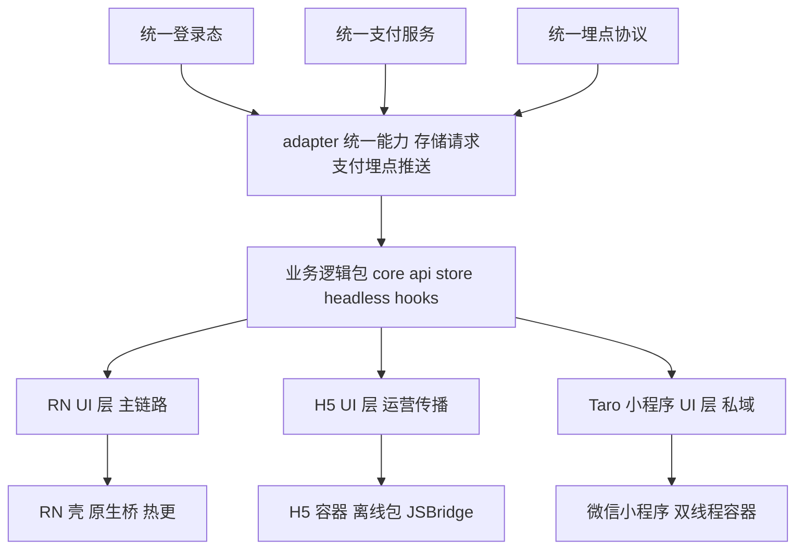

```text
mall-cross/
├── packages/
│   ├── core/            # 商品/订单/购物车领域模型与校验（三端复用）
│   ├── api/             # 统一请求协议（签名 重试 竞态处理）
│   ├── store/           # 购物车/订单状态机（zustand，纯逻辑）
│   ├── hooks/           # useCart usePayBridge useTrack（headless）
│   ├── adapter/         # h5/rn/weapp 三套实现（XP-045）
│   └── tracking/        # 埋点 SDK（XP-058）
├── apps/
│   ├── rn-app/          # RN 壳：首页 商详 购物车 订单（Fabric + FlashList）
│   ├── h5-app/          # H5：活动页 分享落地页 帮助中心
│   └── mini-app/        # Taro 编译到微信小程序：私域玩法
└── infra/
    ├── gateway/         # BFF：按端裁剪接口（小程序弱机型返回精简 schema）
    └── release/         # 版本对齐与灰度（XP-052）
关键决策：主链路 RN 保体验；活动页 H5 保热更速度（大促一天多改）；
小程序端复用 core/store，UI 走 Taro 线——双 UI 线是成本与体验的平衡点。
```

### XP-054：设计一个跨端 IM 应用，如何保证消息一致性？
**答**：
- 一致性核心：**服务端 seq 权威化**——每会话单调递增 seq，客户端按 seq 排序去重，乱序补拉。
- 收发链路：本地先渲染（乐观消息，pending 态）→ 上行带 clientMsgId（幂等）→ 服务端落库分配 seq → ACK 后转 confirmed；失败转 failed 可重试。
- 同步模型：每个设备维护 `syncCursor`，重连/离线后按 cursor 增量拉取（拉取接口幂等分页），多端在线用已读回执与 seq 对齐状态。
- 跨端要点：消息**存储层抽象**（各端本地 DB：SQLite/MMKV/IndexedDB）+ 同步引擎独立成包（core，XP-047）；断线重连指数退避+消息补洞。
- 顺序保证：UI 展示按 seq 插入，发送方本地时间只用于显示不用于排序。

```typescript
// packages/core/im/sync-engine.ts —— 跨端消息同步引擎
interface Msg { clientMsgId: string; seq?: number; state: 'pending' | 'confirmed' | 'failed'; body: any }

export class SyncEngine {
  #cursor = 0;                       // 设备级同步位点（持久化到本地 DB）
  #outbox: Msg[] = [];

  async send(text: string) {
    const msg: Msg = { clientMsgId: uuid(), state: 'pending', body: { text } };
    this.#outbox.push(msg); this.emit(msg);                   // 乐观上屏
    try {
      const ack = await api.sendMsg({ clientMsgId: msg.clientMsgId, body: msg.body }); // 幂等键
      msg.seq = ack.seq; msg.state = 'confirmed'; this.emit(msg);   // ACK 转正
    } catch { msg.state = 'failed'; this.emit(msg); }
  }

  async onConnect() {                                   // 重连/启动：按 cursor 增量对账
    let page = await api.pullSince(this.#cursor);
    for (const m of page.msgs.sort((a, b) => a.seq! - b.seq!)) {
      if (m.seq! <= this.#cursor) continue;             // 去重（服务端可能重复下发）
      this.db.upsert(m); this.#cursor = m.seq!;         // 按 seq 单调推进
      // 补洞：发现 seq 跳跃（m.seq > cursor+1）→ 回退拉取缺口
    }
    if (page.hasMore) return this.onConnect();
  }
}
// 各端绑定：RN/小程序用 SQLite，H5 用 IndexedDB；UI 按 seq 排序渲染，
// pending 消息以占位插入confirmed 流的尾部，ACK 后替换（clientMsgId 关联）
```

### XP-055：设计一个跨端直播观看页，各端的播放方案怎么选？
**答**：
- 协议选型：**HLS**（生态最广、延迟 5-20s）适合大众观看，**HTTP-FLV/WebRTC**（延迟 1-3s/亚秒）适合互动直播；小程序各端自带 `live-player`（FLV/RTC），H5 用 hls.js/flv.js（MSE）。
- 分端方案：RN 用原生播放器桥（ijkplayer/ExoPlayer/AVPlayer 封装，软硬解可控）；小程序用 live-player（仅特定类目）或 video 标签；H5 用 MSE + hls.js，降级 HLS 原生播放（iOS Safari）。
- 共同工程点：**清晰度切换无感**（同一套 ts 切片）、首帧优化（预播放/秒开 buffer 策略）、弱网降级（码率自适应 ABR）、卡顿埋点（卡顿率/首帧时长统一口径，XP-069）。
- 弹幕/礼物等互动层：跨端 UI 组件（XP-049），数据通道统一 WebSocket（IM 引擎复用 XP-054）。
- 成本与合规：推流端不在本题；播放鉴权（防盗链 URL 带过期签名）各端共用同一签发服务。

```typescript
// packages/av/player —— 跨端播放器适配层
export interface IPlayer {
  load(url: string, opts?: { startTime?: number }): Promise<void>;
  setQuality(q: 'sd' | 'hd' | 'ultra'): Promise<void>;
  on(event: 'firstFrame' | 'stall' | 'error', cb: (p: any) => void): void;
  destroy(): void;
}
// weapp 实现（小程序 live-player）：
// class WeappPlayer implements IPlayer {
//   load(url) { this.ctx = wx.createLivePlayerContext('player'); this.ctx.play(); }
//   on(event, cb) { /* bindstatechange: PLAYING→firstFrame, LOADING/RECONNECTING→stall */ }
// }
// h5 实现（MSE + hls.js）：
// class H5Player implements IPlayer {
//   load(url) { this.hls = new Hls({ maxBufferLength: 6 }); this.hls.loadSource(url); this.hls.attachMedia(video); }
//   // iOS Safari 不支持 MSE 直播流 → 降级 <video src="m3u8" playsinline>（原生 HLS）
// }
// rn 实现：TurboModule 桥到 ijkplayer/AVPlayer，软解硬解可配，firstFrame 由原生回调
// 首帧口径统一：clickTime→firstFrameTime 差值上报各端一致；卡顿率 = stallDuration / watchDuration
```

### XP-056：设计一个跨端支付收银台？
**答**：
- 架构原则：**统一收银台服务端**管渠道决策（风控、可用渠道、营销），客户端只负责"拉起-轮询-收尾"三步，各端差异收敛在拉起层。
- 流程：创建订单（业务侧）→ 收银台预下单（返回渠道列表+token）→ 用户选渠道 → 各端拉起（小程序 wx.requestPayment / RN-H5 跳转或 SDK）→ 支付结果**以服务端回调为准**（轮询+推送双保险），前端结果仅做 UI 提示。
- 跨端细节：H5 内微信环境走 JSAPI、外部浏览器走扫码/H5 支付；RN 壳内拉起原生 SDK（支付宝/微信 SDK 桥接）；小程序直接原生 API。
- 可靠性：订单状态机（created→paying→success/failed/closed）、超时关单、重复支付防护（幂等键）、对账补偿。
- 安全：金额/商品由服务端计算下发，前端只传业务标识；签名与证书管理在后端。

```typescript
// packages/core/pay —— 收银台统一流程（各端只实现 IPayLauncher）
export interface IPayLauncher { launch(channel: Channel, prepay: PrepayOrder): Promise<'ok' | 'cancel' | 'unknown'> }

// h5/微信内：JSAPI
// const launcher: IPayLauncher = {
//   launch: (c, p) => new Promise((res) => WeixinJSBridge.invoke('getBrandWCPayRequest',
//     { ...p.params }, (r) => res(r.err_msg === 'get_brand_wcpay_request:ok' ? 'ok' : 'cancel'))),
// };
// weapp：wx.requestPayment(p.params)；rn：PayBridge.launch(channel, params)（原生 SDK 桥）

export async function pay(orderId: string, launcher: IPayLauncher) {
  const prepay = await api.cashier.prepay({ orderId });      // 服务端决定渠道与参数
  const result = await launcher.launch(prepay.channel, prepay);
  // unknown（如 H5 支付中途切走）：进入轮询兜底
  for (let i = 0; i < 12; i++) {                              // 轮询服务端真实状态
    const st = await api.cashier.status(orderId);
    if (st.state === 'success') return gotoResult(true);
    if (st.state === 'failed' || st.state === 'closed') return gotoResult(false);
    await sleep(2500);
  }
  return gotoPending();                                       // 留"处理中"页，推送回调兜底
}
// 铁律：前端任何结果（resolve/reject/超时）都不改订单状态，以服务端异步回调+对账为准
```

### XP-057：设计一个跨端推送体系？
**答**：
- 通道分层：**系统级**（APNs/FCM/厂商通道华为小米 OPPO vivo）、**App 内长连接**（自建 WS，最可靠且支持业务语义）、**小程序模板/订阅消息**（触达唤醒）。
- 投递策略：优先长连接（在线用户实时送达），不在线走系统通道；按用户多设备并发投递（每设备独立 badge/已读状态）。
- 消息可靠性：消息 ID 幂等去重、到达/点击回执、重试与降级链（自建→厂商→短信兜底，按业务等级选配）。
- 跨端一致：推送**只做通知**，点击后各端按深链路由（XP-066）进入页面并从服务端拉最新数据，禁止在 payload 里塞全量业务数据。
- 合规与体验：iOS 通知权限引导策略、Android 厂商通道配额、免打扰时段、频控按用户维度限流。

```typescript
// infra/push/gateway.ts —— 多通道路由（服务端）
interface PushMsg { id: string; userId: number; title: string; body: string; deeplink: string; level: 'normal' | 'high' }

export async function push(m: PushMsg) {
  const devices = await db.userDevices(m.userId);       // 多端多设备
  await Promise.all(devices.map((d) => route(d, m)));
  await receipts.expect(m.id);                          // 到达回执收集，超时降级
}
async function route(d: Device, m: PushMsg) {
  if (d.online && d.channel === 'ws') {                 // 1) 在线：长连接（可靠、可带富内容）
    ws.send(d.socketId, { type: 'push', id: m.id, ...m });
  } else if (d.platform === 'ios') {
    await apns.send({ deviceToken: d.token, aps: { alert: { title: m.title, body: m.body } },
      'mutable-content': 1, biz: { id: m.id, deeplink: m.deeplink } });   // payload 只带标识
  } else if (d.platform === 'android') {
    await vendorRoute(d, m);                            // 2) FCM 失败/国内 → 厂商通道轮询
  } else if (d.platform === 'weapp') {
    await weapp.subscribeSend(d.openid, m);             // 3) 小程序订阅消息
  }
  receipts.log(m.id, d.deviceId, 'sent');
}
// 客户端各端统一做：通知点击 → 解析 deeplink → XP-066 路由 → 页面拉最新数据（不信任 payload 数据）
```

### XP-058：设计一个跨端埋点 SDK（采集层适配）？
**答**：
- 分层设计：**采集层**（自动采集：PV/点击/曝光/时长；手动 API）→ **处理层**（统一事件协议、公共属性注入、采样与队列）→ **发送层**（批量、重试、本地缓存、多通道）→ **适配层**（各端系统信息/存储/网络实现，XP-045 同构）。
- 统一事件模型：`{ event, ts, user, device, page, props, sdkVer, appVer }`，各端字段口径一致（对接看板 XP-069）。
- 关键实现点：曝光用 IntersectionObserver/原生可见性回调 + 去重（同 item 会话内一次）；队列本地持久化防丢；启动期埋点补发（时序问题）；时钟漂移校正。
- 性能与隐私：批量上报（满 N 条或 T 秒）、弱网降采样、敏感字段脱敏、SDK 本身体积与耗时预算（< 50KB，初始化 < 10ms）。

```typescript
// packages/tracking —— 跨端埋点 SDK 骨架
interface Event { event: string; ts: number; props: Record<string, unknown>; common: CommonFields }

class TrackSDK {
  #queue: Event[] = [];
  constructor(private adapter: ITrackAdapter) {}        // 适配层注入（storage/network/device）
  track(event: string, props = {}) {
    this.#queue.push({ event, ts: this.adapter.now(), props,
      common: this.adapter.commonFields() });            // 统一公共属性：appVer/deviceId/page/traceId
    if (this.#queue.length >= 10) this.#flush();
  }
  expose(componentId: string, ref:unknown, extra = {}) { // 曝光：适配层提供可见性探测
    this.adapter.observeVisible(ref, () => {
      this.track('expose', { componentId, ...extra });   // 内部按 id 会话去重
    });
  }
  async #flush(retry = 0) {
    const batch = this.#queue.splice(0, 50);
    try { await this.adapter.network.post('/t.gif', batch, { keepalive: true }); }
    catch {
      await this.adapter.storage.append('track_dead', batch);   // 失败落盘，下次启动补发
      if (retry < 3) setTimeout(() => this.#flush(retry + 1), 2 ** retry * 1000);
    }
  }
}
// 各端 adapter：weapp（wx.getSystemInfo/Storage/IntersectionObserver）
// h5（navigator.sendBeacon/localStorage/IntersectionObserver）、rn（NativeModules/AsyncStorage/View.onLayout）
```

### XP-059：设计一个跨端权限系统？
**答**：
- 两个层面要分开：**系统能力权限**（相机/定位/通知，各端 API 完全不同）与**业务功能权限**（会员可见、角色可操作，RBAC/ABAC，全端逻辑一致放 core）。
- 系统能力权限抽象：`IPermission.request('camera')` 统一四态（granted/denied/blocked/unavailable），适配层处理 iOS 缺省拒绝、Android 运行时权限、小程序 `wx.getSetting` 授权模型。
- 引导闭环：请求前解释（ Why 弹窗）、拒绝后引导设置页（各端跳转方式经 adapter），SDK 不弹裸框。
- 业务权限：服务端下发权限点集合（按角色/灰度），客户端缓存 + 订阅变更；组件层 `<Can do="order:refund">` 声明式消费。
- 审计：权限调用埋点（申请/授予/拒绝率），产品据此优化引导文案与时机。

```typescript
// packages/adapter/permission —— 系统能力权限统一抽象
export type PermState = 'granted' | 'denied' | 'blocked' | 'unavailable';
export interface IPermission {
  state(p: SysPerm): Promise<PermState>;
  request(p: SysPerm): Promise<PermState>;
  openSetting(): Promise<void>;
}
// weapp 实现（授权模型差异最大）：
// request: async (p) => { const { authSetting } = await wx.getSetting();
//   if (authSetting[`scope.${p}`] === false) return 'blocked';   // 曾拒绝 → 引导 openSetting
//   await wx.authorize({ scope: `scope.${p}` }); return 'granted'; }
// rn 实现：PermissionsAndroid.request(...) / iOS Info.plist + 框架 API，映射四态
// h5 实现：navigator.permissions.query，denied 后只能文案引导（无 openSetting，返回 false）

// 业务权限（core，全端一致）：
export function useCan() {
  const perms = usePermStore((s) => s.points);           // 服务端下发的权限点集合
  return (do_: string) => perms.has(do_);
}
// UI 消费：<Can do="order:refund" fallback={<Null/>}><RefundBtn/></Can>
```

### XP-060：设计一个跨端图片选择上传（各端 API 适配）？
**答**：
- 适配面拆解：**选取**（相册/拍照/多选上限）、**压缩**（质量/尺寸策略）、**上传**（分片/直传 OSS/凭据）、**预览与删除**，四段各自定义接口。
- 各端差异：小程序 `wx.chooseMedia`+`wx.uploadFile`；H5 `input[type=file]`+Canvas 压缩+FormData/XHR；RN `launchImageLibrary`+原生压缩+ tus/multipart，统一收敛进 `IPicker/IUploader`。
- 大图方案：**服务端签发直传凭据**（STS），客户端直传对象存储，回调业务服务器——绕开业务服务器带宽；分片+断点续传（tus 协议）跨端一致。
- 质量策略：按用途定参（头像压 750px/0.8，长图限 1080），EXIF 方向校正（H5/RN 需处理，小程序端上传一般已带）。
- 失败治理：分片重试、弱网切换（WiFi→蜂窝确认）、上传取消与去重（文件 hash）。

```typescript
// packages/adapter/media —— 图片选择上传适配层
export interface PickResult { path: string; size: number; width: number; height: number }
export interface IPicker { pick(o: { count: number; source: 'album' | 'camera' }): Promise<PickResult[]> }
export interface IUploader { upload(path: string, onProgress: (p: number) => void): Promise<{ url: string }> }

// weapp：
// pick: (o) => wx.chooseMedia({ count: o.count, sourceType: [o.source] }).then(r =>
//   r.tempFiles.map((f) => ({ path: f.tempFilePath, size: f.size, ...imageInfo(f) })))
// upload: (path, onProgress) => new Promise((res, rej) => wx.uploadFile({
//   url, filePath: path, name: 'file', formData: { stsToken }, success: (r) => res(JSON.parse(r.data)),
// })) —— wx.uploadFile 自带 onProgressUpdate

// h5：input[type=file] → createImageBitmap + OffscreenCanvas 压缩（EXIF 用 createImageBitmap 的 imageOrientation:'from-image'）
//     → FormData + XHR.upload.onprogress；大文件走 tus-js-client 分片断点

// rn：TurboModule 桥 launchImageLibrary + 原生压缩（Luban/CGImageSource）+ 原生分片上传

// 通用编排（core）：
export async function pickAndUpload(picker: IPicker, uploader: IUploader, limit = 9) {
  const files = await picker.pick({ count: limit, source: 'album' });
  return Promise.all(files.map(async (f) => {
    const compressed = await compress(f.path, { maxEdge: 1080, quality: 0.8 }); // adapter 提供
    return uploader.upload(compressed, renderProgress);
  }));
}
// 直传安全：STS 临时凭据由服务端签发（15 分钟过期），客户端永不持有长期密钥
```

### XP-061：设计一个跨端地图组件？
**答**：
- 难点在**渲染内核不可统一**：小程序/原生各绑定其地图 SDK（腾讯/高德/Apple Maps），H5 用 JS SDK（GL 版），无法像素级一致，只能**接口一致 + 外观近似**。
- 适配层拆解：初始化（key/坐标系统一：GCJ-02 vs WGS-84 转换必须收敛在适配层）、覆盖物（marker/polyline 统一数据模型，各端翻译）、相机（center/zoom/fitBounds 统一）、事件（tap/markerClick/regionChange 统一命名）。
- 数据模型先行：定义 `MapAnnotation/MapOverlay/CameraPosition` 纯数据结构放 core，各端实现只做"数据→SDK 对象"翻译。
- 性能点：marker 万级聚合（cluster 算法放 core 复用）、regionChange 防抖、覆盖物 diff 更新（避免全量重绘）。
- 降级：地图 SDK 加载失败（境外/网络）降级静态图 + 模拟交互（缩放查看关键 POI）。

```typescript
// packages/ui/map —— 跨端地图适配层
export interface CameraPosition { center: LatLng; zoom: number }
export interface IMap {
  setAnnotations(list: MapAnnotation[]): Promise<void>;   // 内部做 diff，不全量清空
  setPolyline(points: LatLng[], style?: LineStyle): Promise<void>;
  animateTo(camera: Partial<CameraPosition>): Promise<void>;
  fitBounds(points: LatLng[], padding?: number): Promise<void>;
  on(event: 'markerTap' | 'regionChange' | 'mapTap', cb: (p: any) => void): void;
}
// weapp：MapContext + <map markers="{{markers}}">（markers 数组 diff 后 setData，防抖 200ms）
// h5（腾讯 GL JS）：new TMap.Map(el)，覆盖物 MultiMarker，坐标 gcj02 直用
// rn：原生桥（高德/腾讯 SDK），事件经 TurboModule 回传（XP-011），marker 更新走原生 diff
// core：坐标转换工具（wgs84→gcj02 偏移算法）、cluster 聚合（网格+层级）、fitBounds 数学
// 降级（h5 境外场景）：
export async function createMap(el: HTMLElement, opts: MapOptions): Promise<IMap> {
  try { return await loadTMap(el, opts); }
  catch { return new StaticMapFallback(el, opts); }   // 静态图 + zoom 按钮 + POI 列表兜底
}
```

### XP-062：设计一个跨端扫码功能？
**答**：
- 三条实现路径：**原生扫码**（RN 桥到 AVFoundation/CameraX，性能与识别率最佳）、**H5 采集**（`getUserMedia` + BarcodeDetector/JS 识别库，受 HTTPS 与 iOS 限制）、**小程序原生 API**（`wx.scanCode`，最简单但 UI 不可定制）。
- 适配层四态：成功（code+format）、取消、权限拒绝、识别失败重试；上层流程统一。
- 长连接扫码（网页扫码登录）：H5 无摄像头时展示二维码 + 轮询/WebSocket 等待手机端确认，是"扫码"的另一方向（被扫），跨端 SDK 应同时支持扫与被扫。
- 工程细节：手电筒开关（RN/H5 摄像头 API）、相册识码（图片上传→服务端/端上解码）、连续扫码节流（同一 code 防抖）、深链结果处理（扫出的 scheme 走 XP-066 路由）。
- 权限联动：复用 XP-059 权限系统，拒绝后引导设置页。

```typescript
// packages/adapter/scanner —— 跨端扫码适配层
export interface ScanResult { code: string; format: string }
export interface IScanner {
  scan(opts?: { torch?: boolean; fromAlbum?: boolean }): Promise<ScanResult>;
  continuous(cb: (r: ScanResult) => void, throttleMs?: number): () => void;  // 连续扫码（点检场景）
}

// weapp：scan: async () => { const r = await wx.scanCode({ onlyFromCamera: false }); return r; }
// h5：getUserMedia({ video: { facingMode: 'environment' } }) → video 帧送
//     'BarcodeDetector' in window ? new BarcodeDetector().detect(video) : jsQR(canvasImageData)
//     权限拒绝（NotAllowedError）→ 抛 'blocked'，上层引导手动输入/被扫二维码
// rn：TurboModule 桥接（AVMetadataMachineReadableCodeObject / ML Kit），连续回调经事件通道

// 通用编排：扫码结果路由（对接深链体系 XP-066）
export async function scanAndRoute(scanner: IScanner) {
  try {
    const { code } = await scanner.scan();
    track('scan_success', { format: code.slice(0, 8) });
    if (code.startsWith('https://m.example.com')) return navigateInApp(code);
    if (code.startsWith('example://')) return openDeepLink(code);
    showToast('不支持的码内容');
  } catch (e: any) {
    if (e.state === 'blocked') return guideToSetting();        // XP-059
    if (e.state === 'cancelled') return;                       // 用户取消静默
    throw e;
  }
}
// 同码防抖：continuous 内按 code+500ms 节流，业务侧仍需幂等（如核销接口带 code 去重）
```

### XP-063：设计一个跨端视频播放器？
**答**：
- 与直播（XP-055）差异：点播需要**进度条/倍速/清晰度记忆/字幕/预加载**，控制层是重点；各端播放器内核不同但控制协议可统一。
- 统一状态机：idle→buffering→playing→paused→ended→error，由 core 定义，各端实现把原生状态映射进来；UI 控制条消费状态机（各端渲染，逻辑复用）。
- 关键体验点：**预加载**（列表滑到前 2 个预建播放器/预拉 m3u8）、秒开（首帧优化同 XP-055）、进度记忆（服务端存进度，跨端续播）、后台播放与画中画（各端能力开关由 adapter 暴露）。
- 封面首帧：封面图+懒加载视频，进入视口才创建播放器（配合 XP-014 列表回收，防内存爆）。
- 埋点口径：起播时长/卡顿率/完播率与直播统一（XP-069）。

```typescript
// packages/av/vod —— 跨端点播播放器：core 状态机 + 各端内核适配
export type PlayerState = 'idle' | 'buffering' | 'playing' | 'paused' | 'ended' | 'error';
export interface IVodKernel {
  load(url: string, startAt?: number): Promise<void>;
  play(): void; pause(): void; seek(sec: number): void;
  setRate(r: number): void; setQuality(q: Quality): Promise<void>;
  onState(cb: (s: PlayerState, progress: { cur: number; dur: number }) => void): void;
}
// weapp 内核：VideoContext（bindtimeupdate/bindwaiting/bindended → 状态映射）
// h5 内核：<video> + hls.js（waiting/playing/ended 事件映射）；续播：load(url, serverProgress)
// rn 内核：expo-av 或原生桥（ExoPlayer/AVPlayer），pipEnabled 经 adapter 暴露

// core：控制条消费的状态机 + 续播 + 预加载编排
export class VodController {
  constructor(private kernel: IVodKernel, private vid: string) {}
  async prepare() {
    const progress = await api.vod.progress(this.vid).catch(() => 0);   // 跨端续播
    await this.kernel.load(buildPlayUrl(this.vid, 'auto'), progress);
  }
  async switchQuality(q: Quality) {                                     // 清晰度切换无感续播
    const cur = this.progressNow();
    await this.kernel.setQuality(q);
    await this.kernel.load(buildPlayUrl(this.vid, q), cur);
  }
  onExit() { api.vod.saveProgress(this.vid, this.progressNow()); }      // 退出上报进度
}
// 列表场景：onViewportEnter(prepare) / onViewportLeave(pause+释放)，同时最多 1 个活跃播放器
```

### XP-064：设计一个跨端文件预览？
**答**：
- 分类策略：**图片**（各端 image 组件+手势缩放）、**PDF**（小程序 web-view/原生 PDFView、H5 pdf.js、RN 原生桥）、**Office**（统一转 H5 预览服务：服务端 LibreOffice/OnlyOffice 转 pdf 或在线渲染，端上不集成三套内核）、**视频/音频**（复用 XP-063）、**纯文本/代码**（虚拟滚动渲染）。
- 核心决策：Office 预览**收口到服务端转换**，客户端只认 pdf/图片/text 三类，复杂度大幅下降。
- 链路安全：预览 URL 走短时效签名（防外链），下载权限与预览权限分离（可看不可存）。
- 体验点：大 PDF 分页懒加载（pdf.js range 请求）、加载骨架与失败重试、跨端打开方式（外部浏览器/系统预览器 fallback）。
- 缓存：预览产物（转换后 pdf）CDN 缓存 + 端侧缓存按文件 hash，二次秒开。

```typescript
// packages/preview —— 跨端文件预览编排
export type PreviewKind = 'image' | 'pdf' | 'office' | 'media' | 'text';
export interface IFilePreviewer {
  previewImage(urls: string[], index: number): Promise<void>;
  previewPdf(url: string): Promise<void>;          // 各端 pdf 能力
  openExternally(url: string): Promise<void>;      // 系统预览器兜底
}
// weapp：previewImage 用 wx.previewImage；pdf 用 web-view 加载 h5 预览页（承载 pdf.js）
// h5：image 走 lightbox（手势缩放）；pdf 用 pdf.js（HTTP Range 分页加载）
// rn：pdf 走原生桥（PDFKit/PdfRenderer），image 走 ImageViewer

export async function preview(file: { id: string; name: string; mime: string }, fp: IFilePreviewer) {
  const kind = classify(file.mime);                             // image/pdf/media/text 直接认
  const signed = await api.file.signPreview(file.id);           // 短时效签名 URL（15min）
  if (kind === 'office') {                                      // 统一转 H5 预览服务
    const converted = await api.office.toPdf(file.id);          // LibreOffice/OnlyOffice 转换+CDN 缓存
    return fp.previewPdf(converted.url);
  }
  if (kind === 'pdf') return fp.previewPdf(signed.url);
  if (kind === 'image') return fp.previewImage([signed.url], 0);
  if (kind === 'media') return vodRoute(file);                  // 复用 XP-063
  return fp.openExternally(signed.url);                         // 未知类型兜底：系统打开
}
// 安全铁律：预览签名 URL 不可转存（Content-Disposition: inline + Referer 校验）；
// "下载"是独立接口与独立权限（XP-059），预览通过≠可下载
```

### XP-065：设计一个跨端日历组件？
**答**：
- 需求分层：展示（月视图/周视图切换）、选择（单选/区间/多选/禁用日期）、数据叠加（价格/库存角标/节假日）、性能（跨年长列表虚拟化）。
- 实现策略：**数据层纯函数**（月矩阵生成/区间合法性/禁用规则，放 core 全端复用），UI 层各端渲染同一份"格子数据"。
- 性能关键：日历本质是横向（月份）×纵向（42 格）二维列表——用**懒加载月份数组 + 滑动加载前后月**，避免一次性生成 10 年数据；区间选择用标记位渲染而非重建全树。
- 状态设计：受控组件（value/onChange），选择模式是纯函数（`resolveSelection(prev, tap, mode)`）可单测。
- 各端细节：小程序 swiper 滑月、H5 触摸手势、RN FlatList 横向虚拟化（XP-014）；字体/RTL/周起始日（周日/周一）配置化。

```tsx
// packages/ui/calendar —— core 选择逻辑（纯函数，全端单测）
export type Mode = 'single' | 'range' | 'multiple';
export function resolveSelection(prev: string[] | null, tap: string, mode: Mode): string[] {
  if (mode === 'single') return [tap];
  if (mode === 'multiple') return prev?.includes(tap) ? prev.filter((d) => d !== tap) : [...(prev ?? []), tap];
  if (!prev || prev.length === 2 || (prev.length === 1 && tap <= prev[0])) return [tap];
  return [prev[0], tap];                                        // range 第二击
}
export function monthMatrix(year: number, month: number, weekStart: 0 | 1): DayCell[] {
  const first = new Date(year, month, 1);
  const offset = (first.getDay() - weekStart + 7) % 7;
  return Array.from({ length: 42 }, (_, i) => {
    const d = new Date(year, month, i - offset + 1);
    return { date: iso(d), inMonth: d.getMonth() === month, weekday: d.getDay() };
  });
}

// UI（jsx，Taro/H5 同构；RN 端换横向 FlatList 承载月份）
export function Calendar({ value, mode, disabled, marks, onChange }: CalendarProps) {
  const [anchor, setAnchor] = useState(value?.[0] ?? iso(new Date()));
  const months = useLazyMonths(anchor, 2);                      // 当前月±2 懒加载，滑到边界再扩
  return (
    <View className="cal">
      {months.map((m) => (
        <SwiperItem key={m.key}>
          <View className="grid">
            {monthMatrix(m.year, m.month, 1).map((cell) => {
              const isSel = value?.includes(cell.date);
              const mark = marks?.[cell.date];                  // 价格/角标数据叠加
              return (
                <View key={cell.date}                       // date 作 key：XP-018 复用正确
                  className={cls('cell', { dim: !cell.inMonth, sel: isSel, off: disabled(cell.date) })}
                  onClick={() => { const d = cell.date; if (!disabled(d)) onChange(resolveSelection(value, d, mode)); }}>
                  {mark?.badge && <Text className="badge">{mark.badge}</Text>}
                </View>
              );
            })}
          </View>
        </SwiperItem>
      ))}
    </View>
  );
}
```

### XP-066：设计一个跨端深链体系（scheme / universal link / 小程序码）？
**答**：
- 目标：一条**路由表达式**（页面+参数）在三端都能正确落地——App 内跳路由、冷启动 App（scheme/Universal Link/App Link）、H5 兜底（未装 App 落 H5）、小程序码拉起小程序。
- 协议设计：统一 `example://route?path=product%2F123&src=share` 或 universal link `https://m.example.com/app/product/123`（推荐后者：iOS Universal Link + Android App Links 复用 H5 域名，未装自动落网页）。
- 各端配置：iOS `apple-app-site-association`（AASA）+ `NSUserActivity`；Android `assetlinks.json` + intent-filter autoVerify；小程序 scene 参数解析 + 二维码生成（带参小程序码）。
- 归因与容错：点击→落地全链路埋点（哪个渠道码、是否首次安装）、延迟深链（装后首启恢复意图）、参数白名单防伪造。
- 收口：所有入口（分享卡片/推送/扫码/短信）都生成统一 DeepLink 对象，禁止散落拼 URL。

```json
// iOS：https://m.example.com/.well-known/apple-app-site-association
{
  "applinks": {
    "details": [{
      "appIDs": ["TEAMID.com.example.mall"],
      "components": [
        { "/": "/app/product/*", "comment": "商品详情" },
        { "/": "/app/live/*", "?": { "roomId": "?*" } },
        { "/": "/app/*", "exclude": true, "comment": "其余路径落 H5" }
      ]
    }]
  }
}
// Android：https://m.example.com/.well-known/assetlinks.json
// { "statement": [{ "relation": ["delegate_permission/common.handle_all_urls"],
//   "target": { "app": "com.example.mall", "sha256_cert_fingerprints": ["..."] } }] }
```

```typescript
// 统一 DeepLink 构建与解析（core，全端一致）
export function buildDeeplink(r: { path: string; params?: Record<string, string>; channel: string }) {
  const q = new URLSearchParams({ ...r.params, src: r.channel, t: String(Date.now()) }).toString();
  return {
    universal: `https://m.example.com/app/${r.path}?${q}`,   // iOS UL / Android App Links 首选
    scheme: `example://open?path=${encodeURIComponent(r.path)}&${q}`, // 仅 App 内/剪贴板兜底
    weappPath: `pages/entry/index?path=${encodeURIComponent(r.path)}&${q}`, // 带参小程序码
  };
}
export function parseLaunch(raw: string): RouteIntent {        // 冷启动统一入口（各端壳调用）
  const u = new URL(raw);
  const path = u.pathname.startsWith('/app/') ? u.pathname.slice(5) : u.searchParams.get('path')!;
  validateParamsWhitelist(u.searchParams);                    // 防参数伪造：白名单键+值格式校验
  return { path, params: Object.fromEntries(u.searchParams), scene: u.searchParams.get('src') };
}
// 未装 App：H5 落地页展示内容 + 唤起按钮（计时器尝试 scheme，失败即停留）+ 延迟深链（安装后首启带 cookie 匹配恢复意图）
```

### XP-067：设计一个跨端灰度体系？
**答**：
- 两个灰度面：**版本灰度**（新包/热更包按比例放量，XP-016/XP-052）与**功能灰度**（feature flag 按用户/设备/分群控制，跨端一致生效）。
- Flag 服务设计：服务端下发 `{ key, enabled, payload }`，按 `hash(userId + key) % 100 < ratio` 确定性分桶（同用户跨端命中一致，不是随机）；本地缓存 + 秒级轮询/推送刷新。
- 跨端一致性关键：**分桶键统一**（优先 userId，其次 deviceId）且算法一致（同一 hash 函数放 core），否则 RN 端开、H5 端关造成状态割裂。
- 工程闭环：配置变更审计、灰度指标联动（对应功能报错率/转化对比）、一键全量与一键回滚、过期清理（避免 flag 永生）。
- 应急：配置服务不可用时用本地兜底值（release 内置默认配置），保证可用性优先。

```typescript
// packages/core/flags —— 跨端一致性 Feature Flag
interface FlagRule { key: string; ratio: number; payload?: unknown; whitelist?: string[]; disabled?: boolean }
class FlagClient {
  #rules = new Map<string, FlagRule>();
  #defaults: Record<string, unknown>;                       // release 内置兜底（网络不可用时）
  constructor(private identity: { userId?: string; deviceId: string }) {}

  isEnabled(key: string): boolean {
    const r = this.#rules.get(key);
    if (!r || r.disabled) return false;
    if (r.whitelist?.includes(this.identity.userId ?? '')) return true;
    // 确定性分桶：userId 优先（跨端一致），无登录态用 deviceId；hash 函数放 core 全端同源
    const bucketKey = this.identity.userId ?? this.identity.deviceId;
    return fnv1a32(`${bucketKey}:${key}`) % 100 < r.ratio;
  }
  payload<T>(key: string): T {                              // 带参数灰度（如新收银台配置）
    return (this.#rules.get(key)?.payload ?? this.#defaults[key]) as T;
  }
  refresh() { pollFlags().then((rs) => rs.forEach((r) => this.#rules.set(r.key, r))); } // 秒级刷新
}
// 使用：flags.isEnabled('new_cashier') 决定走 XP-056 新流程；
// 治理：flag 创建即登记 owner 与下线时间，CI 检查存在超 90 天的 flag 报警
```

### XP-068：设计一个跨端错误监控体系（堆栈归一化）？
**答**：
- 数据链路：各端 SDK 采集（JS 异常/unhandledrejection、RN ErrorUtils+原生 crash、Dart FlutterError、Electron 主进程 uncaughtException、WebView 白屏联动 XP-031）→ 统一上报协议 → 归一化 → 聚合 → 告警。
- **堆栈归一化**是核心难点：RN 压缩堆栈要 sourcemap 反解；Hermes 字节码栈格式不同；Dart 栈是 Dart 帧；原生栈要 symbolicate——统一到 `frames: [{ file, line, col, fn }]` 模型，版本+平台选择对应 map 反解。
- 聚合维度：**异常指纹**（归一化后 stack hash + message 模板化，去掉变量部分）→ issue 聚合，按版本/端/机型下钻。
- 上下文：面包屑（路由/点击/网络请求）、设备与版本、灰度分桶（对接 XP-067，快速定位"某 flag 引发"）、release 健康度（崩溃率阈值联动发布门禁 XP-052）。
- 降噪：采样控制、重复折叠、已知问题标记，避免告警疲劳。

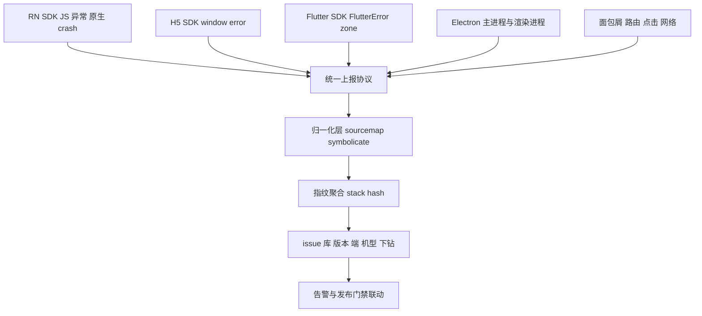

```typescript
// infra/monitor/normalize.ts —— 堆栈归一化
export interface Frame { file: string; line: number; col: number; fn?: string }
export interface NormalizedError {
  platform: 'rn' | 'h5' | 'flutter' | 'electron';
  appVer: string; osVer: string; device: string;
  message: string; frames: Frame[]; fingerprint: string; breadcrumbs: Breadcrumb[];
}
export async function normalize(raw: RawReport): Promise<NormalizedError> {
  let frames: Frame[] = raw.frames;
  if (raw.platform === 'rn') {
    const map = await sourceMapRepo.get(raw.appVer, raw.bundleHash);       // Hermes 栈反解
    frames = frames.map((f) => map ? applySourceMap(map, f) : f);          // file→ts 源码行列
  } else if (raw.platform === 'flutter') {
    frames = parseDartFrames(raw.rawStack);                                // Dart 帧格式解析
    if (raw.nativeStack) frames.push(...symbolicate(raw.nativeStack));     // 原生栈符号化
  } else if (raw.platform === 'electron') {
    frames = raw.frames.map(cleanElectronFrame);                           // 去 app:// 内部帧
  }
  const fingerprint = hash(normalizeMsg(raw.message) + frames.slice(0, 5).map(fmt).join('\n'));
  return { ...raw, frames, fingerprint };
}
function normalizeMsg(m: string) {   // 模板化：去掉变量，让同类异常聚合
  return m.replace(/\b[0-9a-f-]{8,}\b/g, '<id>').replace(/\d+/g, '<n>');
}
```

### XP-069：设计一个跨端性能看板（统一指标口径）？
**答**：
- 统一口径先行：定义跨端等价指标——**启动**（冷启到首屏可交互：H5 FCP/TTI、RN TTI、小程序首屏 setData 完成、Flutter 首帧+首接口）、**流畅度**（FPS/掉帧率：各端 frame callback 采样）、**稳定性**（崩溃率/白屏率）、**网络**（接口成功率/P90 耗时）。
- 采集侧各端 SDK 埋入统一上报协议（XP-058/XP-068 同构），指标带 `end/platform/appVer/deviceTier` 维度。
- 归一化层做**口径对齐文档化**：每个指标明确"计时起点/终点/包含哪些阶段"，否则看板数字不可比（面试高频追问：H5 的 FCP 和 RN 的 TTI 能直接比吗？——不能，必须定义等价锚点）。
- 看板能力：分端/分版本/分机型档位下钻、发布对比（新旧版本 diff）、劣化告警联动发布门禁（XP-052）与灰度熔断（XP-016）。
- 设备分层：按 SoC/内存把设备分档（旗舰/中端/低端），避免"平均数掩盖低端机问题"（对接 XP-073）。

```typescript
// infra/perf/schema.ts —— 统一指标协议与口径对齐
export interface PerfSample {
  metric: 'startup_cold' | 'fps_avg' | 'jank_rate' | 'crash_rate' | 'api_p90';
  end: 'h5' | 'rn-ios' | 'rn-android' | 'weapp' | 'flutter' | 'desktop';
  appVer: string; deviceTier: 'flagship' | 'mid' | 'lowend';
  value: number; p50?: number; p90?: number; count: number;
  anchor: { start: string; end: string };       // 口径自描述：防止跨端对比失真
}
// 口径注册表（看板生成与告警共用，文档化每一项）
export const METRIC_REGISTRY: Record<PerfSample['metric'], { anchor: [string, string]; gate: number }> = {
  startup_cold: { anchor: ['进程/容器创建', '首屏可交互（首接口完成+首帧渲染）'], gate: 2500 },
  fps_avg:      { anchor: ['页面可见期间', 'frame callback 均值'], gate: 50 },
  jank_rate:    { anchor: ['同上', '单帧>32ms 占比'], gate: 5 },
  crash_rate:   { anchor: ['启动用户', '发生 crash 的用户占比'], gate: 0.1 },
  api_p90:      { anchor: ['request start', 'response complete'], gate: 1200 },
};
// 看板 SQL（示意）：按 end×appVer×deviceTier 聚合，发布 diff：
//   SELECT end, appVer, deviceTier, avg(value) FROM perf_samples
//   WHERE metric='startup_cold' AND ts > now()-7d GROUP BY 1,2,3
// 门禁联动：CI 发布前拉当前版本灰度数据，startup_cold > gate(2500ms) 或 jank_rate > 5 → 阻断放量
```

### XP-070：设计一个原生模块桥接层，RN 与 Flutter 两套实现的差异对比？
**答**：
- 同一契约两种实现：接口定义（TS Spec / Dart 抽象类）→ 平台胶水（Codegen TurboModule / MethodChannel handler）→ 原生实现共享（同一份原生代码，两套薄绑定层）。
- 关键差异：**调用模型**——RN 新架构经 JSI 可同步、传参走 JSI Value 直转；Flutter MethodChannel 永远异步、参数经 StandardMessageCodec 二进制编解码（非 JSON，但仍有序列化成本）。
- 事件流：RN 用 EventEmitter（原生 emit）；Flutter 用 EventChannel（StreamHandler + EventSink），语义等价。
- 线程模型：RN 原生模块方法默认非主线程；Flutter 平台通道 handler 默认在平台主线程，重活要自己 `compute`/ isolate 或原生侧切线程。
- 工程结论：契约与原生核心代码全端共享，绑定层薄壳化；性能敏感高频调用优先 RN/JSI 或 Flutter 的 FFI/texture 方案。

```typescript
// RN 侧：specs/NativeBattery.ts（Codegen 契约，见 XP-011）
import type { TurboModule } from 'react-native';
import { TurboModuleRegistry } from 'react-native';
export interface Spec extends TurboModule {
  getLevel(): number;                                        // JSI 同步直达
  startMonitor(cb: (pct: number) => void): void;             // 函数引用直达 C++
}
export default TurboModuleRegistry.getEnforcing<Spec>('Battery');
```

```dart
// Flutter 侧：同一契约经 MethodChannel（异步 + codec 编解码）
class BatteryBridge {
  static const _ch = MethodChannel('app/battery');
  static const _events = EventChannel('app/battery/events');
  Future<int> getLevel() async => _ch.invokeMethod<int>('getLevel') as int;   // 永远异步
  Stream<int> monitor() => _events.receiveBroadcastStream().cast<int>();      // 对应 RN EventEmitter
}
// Android 原生（共享实现，两套绑定）：
// override fun onMethodCall(call: MethodCall, result: MethodChannel.Result) {
//   when (call.method) { "getLevel" -> result.success(BatteryCore.level()) } }  // Flutter：主线程回调
// RN 侧实现 BatteryModule : NativeBatterySpec {
//   override fun getLevel() = BatteryCore.level()          // JSI 同步；默认在 native 线程池
//   override fun startMonitor(cb: Callback) { BatteryCore.monitor { cb.invoke(it) } }
// }
// 差异总结：RN=同步直调+函数引用；Flutter=异步消息+codec 序列化+主线程回调（重活自切线程）
```

### XP-071：WebView 页面与原生页面的混合路由栈怎么设计？
**答**：
- 统一抽象：定义**路由协议**（页面 URI + 转场动画 + 参数），路由表声明每条 URI 由哪端承载（native/webview/weapp），路由器负责栈管理与容器创建。
- 栈的真相：原生页面栈是真正的栈（UINavigationController/Fragment 栈），H5 内部跳转只是 WebView 内 location 变化——必须区分**容器级路由**（新开/关闭 WebView）与**页内路由**（history.push），并把 H5 的 back 语义接入统一返回键。
- 关键场景：H5 → 原生（桥调用 openNative，原生 push）；原生 → H5（新 WebView 入栈）；跨容器返回传参（回调注册表/事件总线，页面 result 机制）；H5 多层内跳后按返回逐级回退而非直接关容器。
- 一致性：手势返回、物理返回键、导航栏返回按钮全部走同一个 `router.back()`，适配层处理各端默认行为差异。

```typescript
// packages/adapter/router —— 混合路由栈
export interface RouteEntry { uri: string; container: 'native' | 'webview'; params?: Record<string, unknown> }
export interface IRouter {
  push(uri: string, params?: Record<string, unknown>): Promise<void>;
  back(result?: unknown): void;                       // 跨容器返回带 result
  replace(uri: string): Promise<void>;
}

// Native Shell 路由器（伪码，RN 壳内也用同一协议）
class HybridRouter implements IRouter {
  #stack: RouteEntry[] = [];
  async push(uri: string, params?: Record<string, unknown>) {
    const target = routeTable.resolve(uri);           // { pattern: '/product/*', container: 'native' }
    if (target.container === 'webview') {
      const wv = await webviewPool.acquire(target.buildUrl(uri));  // XP-027 池化
      this.#stack.push({ uri, container: 'webview' });
      wv.pushNative(this.#stack.length);              // 原生侧压入一个持有 WebView 的页面
    } else {
      this.#stack.push({ uri, container: 'native' });
      nativeNavigator.push(target.screen, params);
    }
  }
  back(result?: unknown) {
    const top = this.#stack.pop()!;
    if (result && top.uri) resultBus.emit(`result:${top.uri}`, result);  // 返回传参
    if (top.container === 'webview') {
      // H5 有内部 history → 先 webView.goBack()，栈不动；到入口页才真正弹容器
      if (top.hasInnerHistory) { this.#stack.push(top); webviewPool.current.goBack(); return; }
      webviewPool.recycle(top.webview); nativeNavigator.pop();
    } else nativeNavigator.pop();
  }
}
// H5 侧：bridge.call('router.push', { uri: 'example://cart' }) → Native push；
// Android 物理返回键 → OnBackPressedCallback → router.back()，语义与手势返回一致
```

### XP-072：跨端 UI 还原度保障与兼容性测试策略？
**答**：
- 还原度量化：**多端截图 diff**——设计稿标注导出 token，组件库每组件建截图基线（H5/RN/小程序三端 × 亮暗色 × 关键断言尺寸），CI 跑视觉回归（pixelmatch/自研，阈值如 0.5% 差异告警）。
- 布局断言：不只像素，还要**关键几何断言**（元素位置/尺寸/层级），对截图噪声（字体渲染差异）更鲁棒。
- 兼容性测试策略：机型矩阵（旗舰/中端/低端 × OS 版本，XP-051 云测执行）、内核矩阵（X5/系统 WebView/各厂商）、暗色模式/大字号/RTL/横竖屏组合。
- 流程机制：视觉走查自动化前置（CI 拦截）+ 发布前人工抽查少量高频页 + 线上"还原度反馈"入口（设计师一键报差）。
- 度量：还原度得分 = 截图通过率 + 几何断言通过率，按组件/页面聚合进看板（XP-069 同构）。

```yaml
# .github/workflows/visual-regression.yml —— 多端截图基线与几何断言
jobs:
  snapshot:
    strategy:
      matrix:
        end: [h5, weapp, rn]
    runs-on: ubuntu-latest
    steps:
      - run: pnpm install --frozen-lockfile
      - run: pnpm turbo run storybook:build --filter=@app/ui          # 组件库 stories
      - run: pnpm --filter @app/ui-${{ matrix.end }} screenshot       # 截图：三端统一用例集
      - run: node scripts/geometry-assert.mjs --end=${{ matrix.end }} # 几何断言：位置/尺寸/层级
      - run: node scripts/pixel-diff.mjs --threshold=0.005            # 与基线 diff，>0.5% 差异 fail
      - uses: actions/upload-artifact@v4
        with: { name: diff-${{ matrix.end }}, path: .diffs/ }         # 失败图归档，PR 评论可视化
  compatibility:                # 兼容矩阵：夜间 + 发布前
    strategy:
      matrix:
        device: [ { model: pixel8, os: android14, tier: flagship },
                  { model: redmi9,  os: android10, tier: lowend },
                  { model: iphone11, os: ios16, tier: mid } ]
    runs-on: ubuntu-latest
    steps:
      - run: node scripts/cloudtest-visual.js --device=${{ toJson(matrix.device) }}
      - run: node scripts/darkmode-fontscale-check.js   # 暗色/大字号/RTL 组合断言
```

### XP-073：低端机适配与某端能力缺失的降级方案设计？
**答**：
- 设备分档：启动时采集（内存/SoC/系统版本/历史卡顿数据）计算 deviceTier，写入运行时上下文，驱动**能力开关与参数降档**（XP-069 的 deviceTier 维度回流验证）。
- 低端机策略：动画降帧/降复杂度、长列表降级（关闭视差/阴影）、图片降分辨率、预加载收敛、并发限流（请求数/任务池）。
- 能力缺失分级：**等价替代**（无 map SDK→静态图）、**功能降级**（无扫码→手输/被扫）、**只读降级**（无推送→站内信）、**明确拒绝**（支付等强依赖，给清晰提示而非白屏）。
- 实现机制：能力探测层（feature detect 一次，缓存结果）+ 降级路由（接口实现选择器，XP-045 的 Proxy 切面）+ 服务端配合（低配端返回精简 schema）。
- 治理：降级路径必须有埋点与告警（降级率异常上升=事故信号），且降级实现也要写单测——"降级代码不许是三无代码"。

```typescript
// packages/core/degrade —— 设备分档 + 能力降级路由
export type Tier = 'flagship' | 'mid' | 'lowend';
export function detectTier(d: { ramGB: number; socScore: number; osVer: number }): Tier {
  const score = d.ramGB * 2 + d.socScore / 1000 + (d.osVer >= 12 ? 2 : 0);
  return score >= 10 ? 'flagship' : score >= 5 ? 'mid' : 'lowend';
}

// 能力探测 + 降级选择器（adapter 层统一消费）
const capability = {                                        // 探测一次，缓存
  scanner: probe('scanner'),                                // H5 无 BarcodeDetector → false
  mapSdk: probe('map'), push: probe('push'),
};
export function resolveImpl<K extends keyof Caps>(k: K): Caps[K] {
  const primary = impls[k];                                 // 首选实现
  if (primary.isAvailable()) return primary;
  track('capability.degraded', { key: k, tier, to: fallbacks[k].name });  // 降级埋点+告警
  return fallbacks[k];                                      // 等价替代/功能降级实现
}
// 参数降档（低端机）：
export const perfProfile = {
  flagship: { listPrefetch: 400, imageMaxEdge: 1440, animation: 'full' },
  mid:      { listPrefetch: 300, imageMaxEdge: 1080, animation: 'full' },
  lowend:   { listPrefetch: 120, imageMaxEdge: 720,  animation: 'reduced' }, // 关阴影/视差/降帧
}[tier];
// 强依赖缺失：支付 SDK 不可用 → 引导到 H5 收银台（XP-056 兜底渠道），绝不静默白屏
```

### XP-074：跨端热更新策略对比（RN CodePush / 小程序 / 离线包 / 服务端渲染）？
**答**：
- **RN CodePush**：替换 JS bundle+资源，逻辑层全热更，原生模块变更必须发版；需要 bundle 与原生版本兼容矩阵（XP-016）。
- **小程序**：逻辑与渲染全在包里，上传即更新（含审核延迟）；分包与按需注入控制生效节奏。
- **离线包（H5）**：资源级热更，manifest 驱动秒级生效可回滚（XP-030），逻辑受 WebView 能力上限。
- **服务端渲染/动态化**（如服务端下发 DSL/配置驱动 UI）：热更粒度最细（无需发端上包），但表达能力受 DSL 限制，调试与一致成本高。
- 选型维度对比：热更粒度、生效速度、可回滚性、商店合规风险、能力上限。复合策略：RN 逻辑走 CodePush+原生发版对齐；运营页走离线包/SSR；配置类走 flag 下发（XP-067）。

```text
策略             热更内容          生效速度      回滚          合规风险    能力上限
RN CodePush      JS bundle+assets  下次启动/立即 秒级(槽位切换) 中(需合规)  受原生模块版本约束
小程序           全部代码包        审核后发布    版本回退       低(平台内)  双线程容器约束
H5 离线包        静态资源+页面逻辑 manifest 驱动秒级   指针切回旧版   低          WebView 能力
服务端下发 DSL   页面结构与逻辑    请求即生效    配置回滚       低          DSL 表达力受限
原生发版         原生代码/SDK      商店审核 1-7 天  版本回滚慢  无          完整
复合实践：
  逻辑热更      → RN CodePush（兼容矩阵+灰度+熔断，XP-016）
  运营/活动页   → H5 离线包（秒级生效与回滚，XP-030）
  配置开关/文案 → 服务端 flag 下发（XP-067，不进包）
  UI 快速试错   → 服务端 DSL 动态化（营销位/流程编排，表达力受限场景）
  原生能力变更  → 必须发版，与热更基线对齐（XP-052 兼容矩阵）
```

### XP-075：跨端团队协作模式如何划分前端与客户端的边界？
**答**：
- 边界原则：**契约先行**——桥接接口（Spec）、路由协议、埋点协议、降级策略全部以文档/类型定义形式纳入 code review，变更走版本化。
- 职责划分推荐：**前端 owns** 业务逻辑、UI、JS 侧性能、跨端框架层；**客户端 owns** 容器（WebView 池/离线包/桥实现）、原生模块、启动与包体积、崩溃治理；**共有区**（性能、混合路由）设 Owner 制并共建。
- 协作机制：双周容器例会、Spec 变更 RFC 流程、联合值班（线上问题按层路由：容器问题客户端、业务问题前端）、联调环境（桥 mock 服务让前端不等原生）。
- 组织形态：跨端平台组（容器/组件库/工程化）+ 业务前端组（按端交付），平台组对 SLA 负责（桥耗时、容器崩溃率）。
- 冲突预防：接口 belongs to 消费方（前端提需求客户端实现，但接口设计前端主导）；性能问题先看数据（XP-069）再定责，禁止"感觉是谁的问题"。

```text
协作边界矩阵（Spec 驱动）
领域                前端职责                    客户端职责                 共建物
JSBridge/TurboModule  Spec 定义 调用方实现        桥实现 容器注册 线程安全     specs/*.ts（Codegen）
PlatformChannel       Dart 侧契约                  原生 handler               pigeon/api 定义文件
容器(WebView池 离线包) 资源与页面接入 协议消费     容器实现 拦截 监控 自愈       容器 SLA 文档
路由协议              业务路由表 URI 规范           原生页面注册 转场           route-table.ts
启动性能              bundle 体积 首屏逻辑          壳启动 内核预热 包体积      启动 trace 看板
崩溃治理              JS/Dart 异常修复              原生 crash 符号化 修复     XP-068 监控平台
协作机制：
  Spec 变更 → RFC + 双方 review → 版本化（semver）→ 兼容期双实现
  联调     → 桥 mock 服务（前端可独立开发）+ 每日集成包
  值班     → 告警按层路由（容器 crash→客户端，业务报错→前端），升级路径明确
  度量     → 平台组 SLA：桥 P95<5ms 容器崩溃率<0.05% 离线包命中率>90%
```


---

## 九、RN 深度实战（076-083）

### XP-076：RN 大列表性能治理怎么做？FlatList 参数调优与 FlashList 原理？
**答**：
- FlatList 本质是 **VirtualizedList**：视口窗口化渲染 + 屏外批量挂载，痛点是快速滚动时白屏（blank area）与 JS 线程被 renderItem 挤占。
- 关键参数：`initialNumToRender`（首屏条数）、`getItemLayout`（定高跳过异步测量，治白屏最有效）、`windowSize`（视口倍数，降内存）、`maxToRenderPerBatch`/`updateCellsBatchingPeriod`（滚动流畅 vs 空窗权衡）、`onEndReachedThreshold`、`removeClippedSubviews`（Android 大列表）。
- 业务侧配套：item 定高或预估精准、图片固定宽高避免布局抖动、`renderItem` 与 item 组件 `React.memo` 化、避免在 item 内做重计算。
- **FlashList 原理**：借鉴 Android RecyclerView 的 **cell 复用池**——滚出屏幕的 CellContainer 不销毁而是按 `recyclingKey`（item 类型）回收复用，且布局测量在原生侧同步完成，大幅减少 JS 线程工作量；官方数据白屏率与内存显著优于 FlatList。
- 治理闭环：用 `onScroll` 采集 blankArea 比例 + JS 线程占用，指标看板（XP-069 口径）回归验证；90% 场景 FlashList 直接替换，异构 item 记得声明类型避免错位复用。

```jsx
// FlatList 调优 vs FlashList 替换
const DATA = makeItems(2000);

// 1) FlatList 极限调优
<FlatList
  data={DATA}
  renderItem={renderItem}                    // 顶层定义 + React.memo，绝不内联箭头函数
  getItemLayout={(data, index) => ({         // 定高：跳过异步 measure，滚动不再白屏
    length: ITEM_HEIGHT, offset: ITEM_HEIGHT * index, index,
  })}
  initialNumToRender={10}                    // 首屏真实可见条数即可
  maxToRenderPerBatch={8}                    // 每批渲染条数：越小越流畅，白屏窗口越长
  updateCellsBatchingPeriod={50}             // 批间隔 ms：与上行参数配合找平衡点
  windowSize={7}                             // 视口倍数，内存敏感可降到 5
  removeClippedSubviews                     // Android 长列表内存优化
  onEndReachedThreshold={0.5}
  keyExtractor={(it) => it.id}
/>

// 2) FlashList：复用池替代销毁重建
import { FlashList } from '@shopify/flash-list';
<FlashList
  data={DATA}
  estimatedItemSize={ITEM_HEIGHT}            // 唯一必填：预估高度用于滚动条与预加载
  renderItem={({ item }) =>
    item.kind === 'card' ? <CardItem item={item} /> : <AdItem item={item} />}
  // 异构 item 必须给稳定类型，否则复用池会拿错模板导致状态串位
  getItemType={(item) => item.kind}
  drawDistance={500}                         // 预渲染距离（默认 250），低端机调小降内存
/>
// 治理指标：blankArea Ratio < 2%、滚动平均 FPS >= 55（deviceTier 分档，XP-073）
```

### XP-077：RN 启动性能优化？Hermes 与懒加载 bundle 怎么落地？
**答**：
- 先拆阶段再优化：进程创建 → 原生壳初始化 → JS Runtime 创建 → **bundle 加载与执行** → 首帧渲染，各端用 trace 拆解耗时（口径对齐 XP-113）。
- **Hermes**：发布构建产出预编译字节码 .hbc，免去运行时解析 JS 的 CPU 与内存开销；懒编译 + 压缩 GC 让 TTI 与内存双降；开启 `enableHermes` 并用 `hermes-engine --exec-statistics` 验证。
- **懒加载**：`babel-plugin-transform-inline-requires` + 首屏外路由 lazy require；大型三方 SDK（统计/推送/崩溃）延后到 `InteractionManager.runAfterInteractions`；长列表首屏用骨架屏先出帧。
- 拆 bundle（多业务线场景）：metro 自定义 `processModuleFilter` 拆 base + business bundle，按业务域按需加载，基座预下载。
- 治理量化：T3i（首帧）P50/P90 看板 + bundle 执行耗时单独打点；每次发版跑启动 benchmark，防止"启动刺客"依赖混入。

```javascript
// index.js —— 启动关键路径最小化：首屏之外全部延迟
import { AppRegistry, InteractionManager } from 'react-native';
import { mark } from './src/perf/trace';             // 启动各阶段打点，口径同 XP-113

mark('bundle_exec_start');

// 首屏链路同步 require（配合 babel-plugin-transform-inline-requires 就近执行）
const { HomeScreen } = require('./src/screens/Home');

// 二级页面懒加载：进入路由时才 require，首屏 bundle 只保留关键路径
const lazyScreen = (loader) => (props) => {
  const Screen = loader();                            // 首次进入时同步加载并缓存
  return <Screen {...props} />;
};
const OrderScreen = lazyScreen(() => require('./src/screens/Order').default);
const MineScreen = lazyScreen(() => require('./src/screens/Mine').default);

// 非必需 SDK 延后初始化：不与首帧抢 JS 线程
InteractionManager.runAfterInteractions(() => {
  require('./src/sdk/analytics').init();
  require('./src/sdk/push').init();
  require('./src/sdk/crash').init();
  mark('deferred_sdk_done');
});

AppRegistry.registerComponent('MainApp', () => HomeScreen);

// metro.config.js 拆 bundle（多业务线）：base bundle 预置，业务 bundle 按需
// module.exports = { transformer: { ... }, serializer: {
//   processModuleFilter: (m) => !m.path.includes('business-b'),  // 拆出 business-b
// } };
// release 构建开启 Hermes：gradle.properties -> enableHermes=true，产物为 .hbc 字节码
```

### XP-078：RN 原生模块开发全流程（iOS / Android 双端）？
**答**：
- 新架构标准流程：**写 TS Spec（单一事实源）→ codegen 生成双端接口骨架 → iOS 实现 RCTTurboModule → Android 实现 TurboModule → 注册 → JS 调用**，生成代码不手改。
- iOS 侧：Podfile 加 `install_modules_dependencies(s)`，实现类遵循 codegen 生成的 `<Spec>` 协议，方法签名必须与 Spec 一致，`.podspec` 声明 `install_modules_dependencies`。
- Android 侧：实现 `NativeDeviceSpec()`（codegen 生成于 build 目录），包名注册到 `Package` 的 `getTurboModules`；注意主线程约束与 `@ReactModule`。
- 通信模型：方法调用经 JSI 直连（无 JSON 序列化），支持同步返回基础类型；异步用 Promise；主动通知 JS 用 `EventEmitter`（新架构下自建 `RCTEventEmitter` / `DeviceEventManagerModule`）。
- 线程纪律：耗时分派到自己的 methodQueue/executor；回调必须回到 JS 线程由框架保证，原生侧不要在回调里做重活。双端行为差异（权限弹窗时机等）在 Spec 注释与单测（mock 桥）里固化。

```typescript
// specs/NativeDeviceSpec.ts —— codegen 的单一事实源，双端实现以此为准
import type { TurboModule } from 'react-native';
import { TurboModuleRegistry } from 'react-native';

export interface Spec extends TurboModule {
  // 同步方法：JSI 直连，仅限轻量属性读取（不跨线程、无阻塞 IO）
  getDeviceId(): string;
  // 异步：Promise，双端 resolve/reject 线程由框架处理
  requestPermission(scope: string): Promise<boolean>;
  // 常量：codegen 生成 getConstants()，初始化时一次取回
  readonly deviceTier: string;
  // 事件约定：原生 emit，JS addListener
  addListener(eventName: string): void;
  removeListeners(count: number): void;
}
export default TurboModuleRegistry.get<Spec>('Device');

// iOS（ObjC++，Device.mm）：Podspec 中 install_modules_dependencies(s)
//   @interface Device () <NativeDeviceSpecBase>  // 协议由 codegen 生成
//   RCT_EXPORT_MODULE()
//   - (NSString *)getDeviceId { return _deviceId; }         // 签名与 Spec 严格一致
//   - (void)requestPermission:(NSString *)scope
//                    resolve:(RCTPromiseResolveBlock)resolve
//                     reject:(RCTPromiseRejectBlock)reject { ... 主线程弹窗 ... }
// Android（Kotlin，DeviceModule.kt）：
//   class DeviceModule(reactContext: ReactApplicationContext) :
//       NativeDeviceSpec(reactContext) {                  // 继承 codegen 生成基类
//     override fun getName() = NAME
//     override fun requestPermission(scope: String, promise: Promise) {
//       UiThreadUtil.runOnUiThread { /* 弹系统授权框 */ }   // UI 操作必须主线程
//     }
//   }
//   companion object { const val NAME = "Device" }        // 与 Spec 的 'Device' 对齐
```

### XP-079：RN 与 Web 如何共享业务逻辑？monorepo 业务包怎么设计？
**答**：
- 分层原则：**shared 只放与 UI 无关的逻辑**（领域模型、请求层、状态机、埋点协议、校验、常量），不 import react-native / react-dom，纯 TS 保证双端可构建。
- 平台差异用 **adapter 注入**：存储、路由跳转、toast 等能力由各端入口实现同一接口，shared 面向接口编程（依赖倒置）。
- monorepo 结构：`packages/shared`（业务逻辑）、`packages/api`（协议与类型，双端同源）、`apps/mobile`（RN）、`apps/web`（Next.js）；tsconfig paths + bundler 解析，构建产物 ESM。
- UI 层取舍：纯展示与逻辑组件可走 react-native-web 复用，复杂原生体验组件各端自绘，共享层限定到"无 UI"是性价比最高的一致性边界。
- 质量门禁：shared 覆盖率 ≥80% 单测、`import` 边界 lint（shared 禁止依赖端框架）、API 协议变更走 RFC（XP-075 契约先行）。

```typescript
// packages/shared/order —— 面向 adapter 接口编程，双端同源业务逻辑
import type { Storage } from './adapters';            // 只定义接口，不关心端实现

export interface OrderDraft { skuId: string; quantity: number; couponId?: string; }

export class OrderService {
  constructor(
    private http: HttpClient,                         // api 包统一请求层
    private storage: Storage,                         // 各端注入：RN=MMKV, Web=localStorage
  ) {}

  async submit(draft: OrderDraft) {
    validateDraft(draft);                             // 校验逻辑双端唯一实现
    const cached = await this.storage.get('last_order_fail');  // 失败补偿上下文
    const order = await this.http.post('/orders', { ...draft, retryOf: cached?.id });
    return order;
  }
}

// packages/shared/adapters/index.ts —— 能力接口，各端入口负责装配
export interface Storage {
  get(key: string): Promise<any>;
  set(key: string, value: any): Promise<void>;
}
// apps/mobile/container.ts（RN 侧装配）：
//   export const storage: Storage = { get: k => mmkvStorage.getString(k), ... }
// apps/web/container.ts（Web 侧装配）：
//   export const storage: Storage = { get: k => Promise.resolve(localStorage.getItem(k)), ... }
// 边界 lint：shared 内出现 "react-native"/"react-dom" import 直接 CI 报错
```

### XP-080：RN 动画系统？Animated 与 Reanimated 的原理与线程模型差异？
**答**：
- RN 旧 `Animated`：动画计算默认跑在 **JS 线程**，JS 忙时掉帧；`useNativeDriver: true` 后参数插值移到原生 UI 线程，但**不支持 layout 属性**（width/height）且手势联动无法闭环。
- **Reanimated 3 核心：worklet**——JS 函数编译后运行在 **UI 线程**，手势识别、SharedValue 更新、样式计算、提交渲染全链路在 UI 线程闭环，JS 线程阻塞（网络回调/大计算）不影响动画帧率。
- 关键概念：`useSharedValue`（UI 线程持有的可变值）、`useAnimatedStyle`（依赖 SV 的派生样式）、`runOnJS`/`runOnUI`（跨线程调度）、`withSpring/withTiming`（UI 线程动画器）、layout animations（进出场）。
- 线程纪律：worklet 内不能碰 JS 侧状态（需 runOnJS）；高频手势（跟手拖拽、BottomSheet）必须 Reanimated；低频属性动画 Animated + native driver 依旧够用。
- 底座差异：新架构下两者都走 JSI，但 Reanimated 自持 UI 线程 runtime，避免序列化，是复杂交互动画的事实标准（与 XP-076 列表、XP-077 启动并列为 RN 性能三大件）。

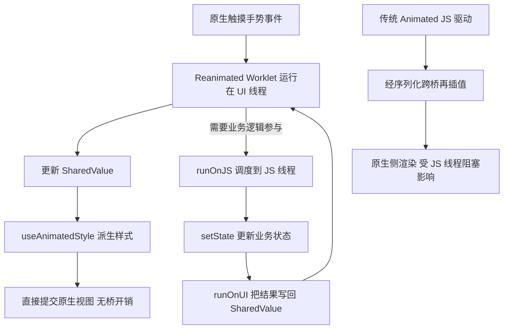

### XP-081：RN 新架构迁移实战？互操作层（interop layer）怎么用？
**答**：
- 开启开关：`gradle.properties` 设 `newArchEnabled=true`，iOS Podfile 设 `ENV['RCT_NEW_ARCH_ENABLED'] = '1'`；先用互操作层让存量代码"零修改"跑在新架构上。
- **互操作层**：旧 Native Module 经 `TurboModuleInterop`（JS 侧 API 不变，底层走 JSI）、旧 Native Component 经 `RCTComponentViewFactory` 兼容包装被 Fabric 挂载——先得新架构收益（同步布局、批量渲染），再逐步重写。
- 迁移顺序策略：先基础库（手势/导航/WebView）→ 自研组件 → 业务模块；每步跑双轨回归（旧架构基线 vs 新架构），指标对齐（启动、列表、动画帧率）。
- 依赖矩阵盘点：`npx react-native upgrade` 后检查三方库新架构兼容声明（react-native-screens/gesture-handler/reanimated 均 required），不兼容库先找替代或锁版本隔离。
- 回滚与风控：保留旧架构构建变体（flavor/scheme）做应急回退；灰度（XP-083）观察崩溃率与 JS 异常率达标后放量；迁移期禁止同时大改业务逻辑。

```text
// android/gradle.properties —— 开启新架构 + 互操作层
newArchEnabled=true
hermesEnabled=true

// ios/Podfile —— iOS 侧同义开关
ENV['RCT_NEW_ARCH_ENABLED'] = '1'
// 旧三方 Native Module 在新架构下经 interop 自动包装，JS 调用 API 完全不变
// TurboModuleProvider 发现模块未实现 TurboSpec 时走 TurboModuleInterop 兜底

迁移执行清单（按序）：
  1 依赖盘点     梳理三方库新架构兼容矩阵，锁定版本，无替代的封装隔离
  2 开关开启     双端打开 newArchEnabled，互操作层承接存量模块与组件
  3 双轨回归     启动耗时 列表帧率 动画 崩溃率 四指标与旧架构基线对比
  4 基础库替换   手势 导航 图像库逐个换成 Fabric/TurboModule 原生支持版本
  5 业务迁移     高频 Native Module 改写 Spec（XP-078 流程），codegen 验证
  6 灰度放量     XP-083 流程，JS 异常率 崩溃率达标后逐桶放量，保留回退变体
```

### XP-082：RN 包体积优化怎么做？
**答**：
- 先拆构成再治理：**原生 so 与引擎（Hermes）、JS bundle（.hbc）、assets 图片、三方原生库**四大头，用 apk-analyzer / bloaty / bundle-report 建体积清单。
- so 治理：按 ABI 拆分（App Store/Google Play 均支持 per-abi 分发）、R8/ProGuard 收缩 Java 层、去除冗余架构（x86 仅保留在模拟器变体）。
- bundle 治理：Hermes 字节码（比源码包更小且执行更快）、inline-requires 移除启动期引用、三方依赖审计（moment→dayjs、lodash 全量→按需）、拆 bundle（XP-077）。
- 资源治理：PNG→WebP/SVG（react-native-svg）、图片走 CDN 下发不进包、语言资源子集化、字体子集。
- 门禁：CI 体积预算（超阈值阻断合并）+ 体积 diff 报告到 PR（治理口径与 XP-116 跨端包体积看板对齐）。

```text
RN 包体积治理清单（Android APK 为例，iOS 同思路）
构成拆解：
  lib/**/**.so           ~40-60%   Hermes 引擎 + 三方原生库（按 ABI 拆分后单架构统计）
  assets/bundle .hbc     ~15-25%   JS 字节码与图片资源
  classes.dex            ~10-15%   Java/Kotlin 层（R8 收缩）
  res                    ~5-10%    壳资源

手段与预期收益：
  per-abi 拆分           总包 -40%+（用户实际下载单架构）
  Hermes 字节码          bundle 更小 且启动更快（XP-077 联动）
  R8 minify+shrink       dex -30%~50%
  依赖瘦身               moment/lodash 类替换，bundle -5%~15%
  图片 WebP/SVG + CDN    assets -50%+（运营图一律 CDN 下发不进包）
  拆 bundle 按需加载     基座只含首屏（XP-077）

CI 门禁（口径对齐 XP-116）：
  budget: { androidApkMB: 45, iosIpaMB: 55, diffLimitKB: 200 }
  超预算 → CI fail，附体积 diff 明细，需平台组审批豁免
```

### XP-083：RN 灰度与热更新风控体系怎么设计？
**答**：
- 发布节奏：dev → staging（内部包）→ production **百分比放量**（1/5/20/50/100），每档观察窗口（≥2h）内看核心风控指标再进下一档。
- 风控指标：JS 异常率、启动崩溃率、启动耗时 P90、热更成功率；阈值触发**自动熔断回滚**（CodePush `rollback` 指令回退到上一稳定 bundle 槽位）。
- 兼容矩阵：bundle 与原生壳版本强关联——热更包声明 `minNativeVersion/maxNativeVersion`，服务端按客户端原生版本下发匹配 bundle，杜绝"新 bundle + 旧壳"错配。
- 完整性：热更包公钥签名校验（code-push-sgn），防传输链路篡改；bundle 内 checksum 二次校验，失败走内置 bundle 兜底。
- 合规与体验：iOS 遵守审核条款（默认静默修复受限，需用户可感知策略合规执行）；强更/弱更分级，弱更允许本次跳过；全链路埋点（下载/安装/激活/回滚）进 XP-069 看板。

```javascript
// src/hotupdate/index.js —— 热更新客户端执行器：灰度遵循 + 签名校验 + 失败兜底
import codePush, { InstallMode } from 'react-native-code-push';

const RISK = { crashRate: 0.005, jsErrorRate: 0.02 };  // 熔断阈值（口径同 XP-068）

export async function checkAndSync() {
  try {
    await codePush.sync({
      deploymentKey: pickDeployment(),                  // 服务端按 灰度桶+原生版本 下发
      installMode: InstallMode.ON_NEXT_RESTART,         // 弱更：下次启动生效，不打断用户
      mandatoryInstallMode: InstallMode.IMMEDIATE,      // 强更：立即安装
      rollbackRetryOptions: { enableInAppRestart: true },
    });
  } catch (e) {
    track('hotupdate.failed', { stage: 'sync', msg: String(e) });
    // 失败兜底：继续使用内置 bundle，业务全量可用（功能可能旧一版）
  }
}

function pickDeployment() {
  // 服务端策略：客户端上报 原生版本 + 灰度桶 id，返回命中桶的 deploymentKey
  // bundle manifest 声明 minNativeVersion，原生版本不满足则不下发（兼容矩阵）
  return grayConfig.hotUpdate?.deploymentKey ?? Staging;
}

// 服务端熔断（伪代码）：滑动窗口内 crashRate/jsErrorRate 超 RISK 阈值
//   → 自动执行 code-push rollback <app> Production → 客户端下次 sync 拉回旧包
// 全链路埋点：download/install/activate/rollback 四事件 + 版本号，进 XP-069 看板
```

---

## 十、Flutter 深度实战（084-091）

### XP-084：Flutter 列表性能怎么治理？ListView.builder 与 Sliver 体系？
**答**：
- 基础纪律：列表用 `ListView.builder`（懒构建）而**绝不用 `children:` 全量构造**；能定高给 `itemExtent`（跳过子项测量，滚动计算 O(1)）；`shrinkWrap: true` 会失去懒加载，谨慎使用。
- Sliver 体系：复杂页面用 `CustomScrollView` + `SliverAppBar/SliverList/SliverGrid` 组合，头部吸顶、多类型混合布局一次滚动编排；`SliverPersistentHeader` 做下沉收缩效果。
- 构建卡顿定位：DevTools Timeline 看 **build / layout / raster** 三段；build 超帧多半是 item 内重计算（下放 isolate 或缓存），raster 超帧多为阴影/模糊/大图（用 `RepaintBoundary` 隔离重绘区域）。
- 配套参数：`cacheExtent` 控制屏外预构建距离（低端机调小省内存）、`addAutomaticKeepAlives/addRepaintBoundaries` 按需关闭减开销、`findChildIndexCallback` 保持 item 状态防抖动。
- 图片与占位：item 内图片强制定宽高 + `cacheWidth` 解码降采样，防止 decode 抖 raster 线程；预加载配合 `ScrollController` 位置监听（与 XP-076 的治理指标口径统一）。

```dart
// 复杂首页：Sliver 体系编排 + 定高懒列表
CustomScrollView(
  controller: _controller,
  cacheExtent: 300,                          // 屏外预构建距离，低端机可再调小
  slivers: [
    SliverAppBar(expandedHeight: 200, pinned: true, flexibleSpace: FlexibleSpaceBar(
      title: Text('发现'),                   // 吸顶收缩头部
    )),
    SliverToBoxAdapter(child: BannerCarousel()),          // 轮播：一次性构建合理
    SliverPadding(
      padding: EdgeInsets.symmetric(horizontal: 12),
      sliver: SliverList.builder(            // Sliver 懒构建列表
        itemCount: items.length,
        // 定高：跳过 item 测量，滚动与定位计算 O(1)，治白屏关键
        itemExtent: 88,
        // 列表数据重排时按 key 找回旧 child，保持状态防跳动
        findChildIndexCallback: (key) =>
            items.indexWhere((e) => e.id == key.toString()),
        itemBuilder: (_, i) => RepaintBoundary(          // 隔离 item 重绘
          child: FeedCard(item: items[i]),               // 内部图片定宽高+cacheWidth
        ),
      ),
    ),
    // 瀑布流场景换 SliverGrid / flutter_staggered_grid_view，slivers 间共享滚动
  ],
);
// 定位口诀：build 慢→缓存与 isolate，layout 慢→布局简化，raster 慢→RepaintBoundary 与降阴影
```

### XP-085：Flutter 混合开发（Add-to-App）怎么做？混合栈如何管理？
**答**：
- 形态：`flutter create --template=module` 产出可嵌入工程，原生宿主持有 `FlutterEngine`；**引擎复用**（单引擎多容器，共享 isolate/内存）vs 多引擎（内存翻倍、通信孤岛）——默认单引擎 + 引擎池预热。
- 混合栈核心矛盾：原生 Navigation 与 Flutter Navigator 是两套栈，直接 push 会"栈分裂"。用 **flutter_boost / thrio 类容器框架**：Flutter 页面在原生侧对应一个容器 Activity/ViewController，路由请求跨栈转发，保持逻辑栈唯一。
- 关键工程点：页面生命周期同步（Flutter 页面不可见时暂停动画与轮询）、返回键/手势回退跨栈统一、`Pigeon` 定义双向通信（避免手写 MethodChannel）、内存水位下销毁非活跃容器。
- 启动优化：引擎预热在 App 启动后期执行（不与首屏抢主线程）、首路由预指定、AOT 产物随主包或动态下发（合规前提下）。
- 适用边界：核心链路仍原生、少量重 Flutter 页面用 Add-to-App；全量 Flutter 化则直接 Flutter 为主壳（与 XP-113 启动链路对比互补）。

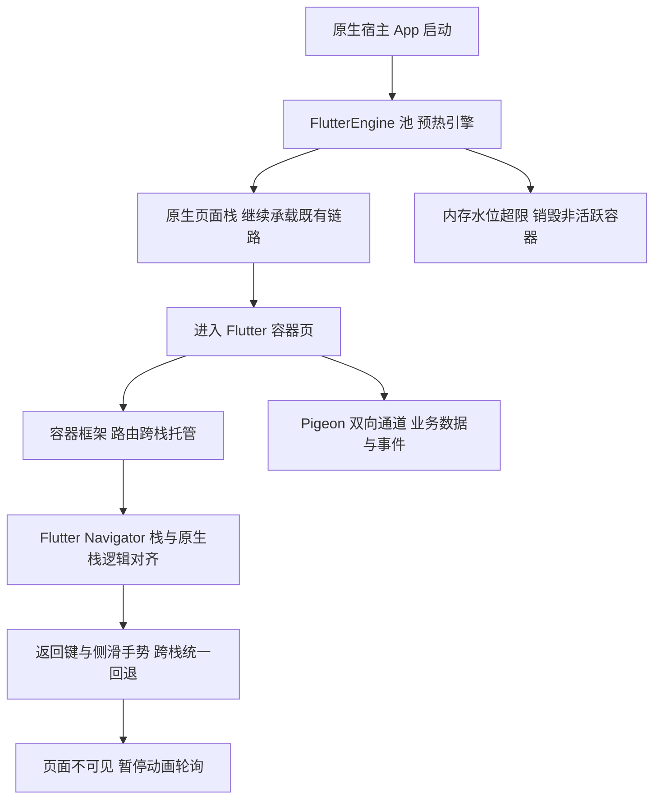

### XP-086：Flutter 状态管理与数据层怎么分层？Repository 模式如何落地？
**答**：
- 分层：**UI（Widget）→ 状态层（Riverpod/Bloc）→ Repository（数据门面）→ DataSource（remote/local）**，UI 不直连网络与 DB，状态层只编排不实现。
- 选型经验：Riverpod（编译期安全、易测试）适合中大型；Bloc（强约束事件流）适合复杂交互与团队强规范；Provider 只做依赖注入基础件。
- Repository 职责：聚合 remote/local 双源、DTO→Domain 映射、缓存与过期策略、分页游标管理；对外暴露 `Stream`/`Future`，屏蔽来源细节。
- 数据一致性：写操作走 Repository 单入口（本地乐观更新 + 服务端对账），多页面订阅同一 provider 自动同步；错误统一转 Domain 层异常类型。
- 测试：Repository 依赖注入 mock DataSource 单测；状态层用 fake Repository 测试编排；UI golden test 只验展示（与 XP-106 视觉回归衔接）。

```dart
// data/repository/article_repository.dart —— 数据门面：双源聚合 + 缓存 + 映射
class ArticleRepository {
  ArticleRepository(this._remote, this._local);
  final ArticleApi _remote;          // remote datasource：retrofit/dio
  final ArticleDao _local;           // local datasource：drift/sqlite

  Future<List<Article>> fetchFeed({String? cursor}) async {
    final cached = await _local.queryFeed(cursor: cursor);
    if (_isFresh(cached)) return cached.map(_toDomain).toList();   // 本地新鲜直接用
    try {
      final dto = await _remote.feed(cursor: cursor);
      await _local.upsertFeed(dto);                                 // 回写缓存
      return dto.items.map(_toDomain).toList();
    } on SocketException {
      if (cached.isNotEmpty) return cached.map(_toDomain).toList(); // 弱网降级缓存
      rethrow;
    }
  }
}

// 状态层 Riverpod：只编排，不碰实现细节
final articleRepoProvider = Provider((ref) =>
    ArticleRepository(ref.watch(articleApiProvider), ref.watch(articleDaoProvider)));

final feedProvider = AsyncNotifierProvider<FeedNotifier, List<Article>>(FeedNotifier.new);

class FeedNotifier extends AsyncNotifier<List<Article>> {
  @override
  Future<List<Article>> build() =>
      ref.watch(articleRepoProvider).fetchFeed();     // UI 只 watch 此 provider
}
```

### XP-087：Flutter 路由与导航怎么设计？go_router 与深链怎么处理？
**答**：
- go_router（声明式路由）：路径模板 + 类型安全参数、`redirect` 做登录守卫、`ShellRoute` 搭建底部导航多 tab 共存栈、`StatefulShellRoute` 保持各 tab 独立导航栈。
- 深链三件套：平台配置（Android intent-filter / iOS Universal Links）、go_router 自动解析 path/query、未登录/无权限场景 `redirect` 统一处理（先路由后登录，回跳原目标）。
- 路由与埋点：`NavigatorObserver`（RouteObserver）统一 PV 埋点与页面曝光；路由表集中声明，禁止散落的 `Navigator.push` 字符串拼接。
- 传参与刷新：`extra` 传对象仅限内存态，深链冷启动必走 path/query；列表→详情→编辑后用返回值或刷新信号（go_router 的 `push` 返回 Future）驱动更新。
- 与混合栈衔接：Add-to-App 场景路由由容器框架托管（XP-085），go_router 配置需注册为子路由，避免双栈冲突。

```dart
// app/router.dart —— 声明式路由 + 深链 + 守卫
final router = GoRouter(
  navigatorKey: _rootKey,
  initialLocation: '/home',
  redirect: (context, state) {
    final loggedIn = ref.read(authProvider).loggedIn;
    final onLogin = state.matchedLocation == '/login';
    if (!loggedIn && !onLogin) return '/login?from=${state.uri}';  // 深链守卫：记住来路
    if (loggedIn && onLogin) return state.uri.queryParameters['from'] ?? '/home';
    return null;
  },
  routes: [
    StatefulShellRoute.indexedStack(          // 底部导航：各 tab 独立导航栈
      builder: (_, __, shell) => MainScaffold(shell),
      branches: [
        StatefulShellBranch(routes: [GoRoute(path: '/home', builder: (_, __) => HomePage())]),
        StatefulShellBranch(routes: [GoRoute(path: '/mine', builder: (_, __) => MinePage())]),
      ],
    ),
    GoRoute(
      path: '/article/:id',                   // 深链目标：scheme 配置好后自动解析
      builder: (_, s) => ArticlePage(id: s.pathParameters['id']!),
    ),
  ],
  observers: [RouteTrackingObserver()],       // 统一 PV 埋点（XP-134 采集协议）
);
// Android: intent-filter 配 https 深链；iOS: Associated Domains + apple-app-site-association
```

### XP-088：Flutter 动画体系？隐式动画与显式动画怎么选？
**答**：
- 隐式动画（`AnimatedContainer` 等 ImplicitlyAnimatedWidget）：给目标值自动补间，适合状态切换类简单效果，代码量小、不可控过程。
- 显式动画（`AnimationController` + `Tween`/`Curve`）：完全掌控时长、曲线、循环、交错（Interval 编排），适合开场动画、序列编排、手势驱动；必须手动 `dispose` 防泄漏。
- 进阶件：`Hero` 转场共享元素、`TweenAnimationBuilder`（声明式显式）、`AnimatedSwitcher`（子树切换过渡）、`flutter_animate`/Rive/Lottie 承载复杂资产。
- 性能纪律：只动 `Transform`/`Opacity` 类合成属性可走 raster 之外的最优路径；动画区域包 `RepaintBoundary` 限制重绘范围；页面不可见时 controller 停止（配合 XP-091 生命周期）。
- 与平台一致性：同参数的弹簧/缓动在 iOS/Android 表现一致（自绘），但高频跟手动画注意 isolate 与 raster 负载，低端机降级策略同 XP-110。

```dart
// 显式动画：序列编排 + 手势联动；隐式动画：状态切换
class StaggerCard extends StatefulWidget { /* ... */ }
class _StaggerCardState extends State<StaggerCard>
    with SingleTickerProviderStateMixin {
  late final AnimationController _c =
      AnimationController(vsync: this, duration: const Duration(milliseconds: 900));
  // 交错编排：同一 controller 上用 Interval 切分时间轴
  late final Animation<double> _slide = CurvedAnimation(
      parent: _c, curve: const Interval(0, 0.6, curve: Curves.easeOutCubic));
  late final Animation<double> _fade = CurvedAnimation(
      parent: _c, curve: const Interval(0.4, 1, curve: Curves.easeOut));

  @override
  void initState() { super.initState(); _c.forward(); }   // 入场
  @override
  void dispose() { _c.dispose(); super.dispose(); }        // 必须 dispose，防泄漏

  @override
  Widget build(BuildContext context) => GestureDetector(
    onTapDown: (_) => _c.reverse(),                        // 手势驱动显式动画
    onTapUp: (_) => _c.forward(),
    child: RepaintBoundary(                                 // 限制重绘范围
      child: FadeTransition(
        opacity: _fade,
        child: SlideTransition(
          position: Tween(begin: const Offset(0, 0.2), end: Offset.zero).animate(_slide),
          child: const CardBody(),
        ),
      ),
    ),
  );
}
// 简单状态切换用隐式：AnimatedContainer(duration: 200ms, color/size 变化自动补间)
```

### XP-089：Flutter 包体积优化怎么做？
**答**：
- 体积大头：**引擎与 framework（双端各 ~10MB+ 级）、AOT 产物（libapp.so / App.framework）、字体与图片资源、图标树**；先 `flutter build apk --analyze-size` / DevTools 体积视图拆构成。
- 编译期手段：`--obfuscate --split-debug-info`（混淆并把符号表外置缩小产物）、`--split-per-abi`（so 按架构拆分）、Android `deferred components`（动态 feature 下发 Dart 产物，iOS 受限）。
- 资源治理：字体子集化（fonttools 按实际字符裁剪，中文字体收益巨大）、图片 WebP/压缩、`flutter_tree_shake_icons`（Material 图标按使用裁剪）、未引用资产清理（CI 脚本比对资产清单）。
- 依赖治理：pubspec 依赖审计，砍掉只为一个小工具引入的整包；平台侧 Android 用 R8、iOS 检查无用 framework。
- 门禁与口径：CI 记录双端体积趋势，diff 超 200KB 报警；基线口径与 XP-116 跨端包体积对比统一，防止"优化了 A 端把资产塞进 B 端"。

```yaml
# .github/workflows/flutter-size.yml —— 体积门禁与产物分析
name: flutter-size-guard
on: [pull_request]
jobs:
  size:
    runs-on: ubuntu-latest
    steps:
      - uses: actions/checkout@v4
      - uses: subosito/flutter-action@v2
      - name: build with size analysis
        run: |
          flutter build apk --release \
            --obfuscate --split-debug-info=build/symbols \  # 混淆+符号外置（崩溃还原用）
            --split-per-abi \                               # so 按 abi 拆分
            --analyze-size \                                # 产出体积构成报告
            --target-platform android-arm64
      - name: budget gate
        run: dart run tool/size_gate.dart --budget 45 --diff-limit 200
        # budget: 单架构 apk 上限 45MB；diff-limit: 相对 main 超 200KB 报警阻断
      - name: asset audit
        run: dart run tool/asset_audit.dart   # 未引用资产/超大图片/未子集化字体 清单
# 资源治理配套：中文字体 fonttools 子集化后体积常从 8MB 级降到 1MB 级
```

### XP-090：Flutter Web 的渲染模式？CanvasKit 与 html 渲染器怎么选？
**答**：
- 历史三选：`html`（DOM 渲染，包小、文本可选中/SEO 稍好，但像素不一致、部分 API 缺失）、`canvaskit`（Skia wasm 自绘，像素级一致、性能好，多 ~1.5MB wasm 下载）、`skwasm`（WasmGC 多线程渲染，Flutter 3.22+ 实验转正方向）。
- 版本现状：Flutter 3.29 起 `--web-renderer` 参数移除，**canvaskit 成为唯一主渲染器**，html 渲染器进入移除流程——新项目不应再基于 html 模式做架构决策。
- 选型逻辑（对存量项目）：纯内容/官网类站点本就不该用 Flutter Web（用 Next.js/SSR）；**应用型后台、内嵌工具、桌面端复用** 才是 Flutter Web 的甜区，canvaskit 一致性收益大于首载体积代价。
- 优化配套：canvaskit 资源走国内 CDN 缓存、字体（Noto 默认字体较大）子集化 + 本地化托管、`flutter build web --wasm` 试 skwasm、SSR 骨架/预加载遮罩缓解首屏（与 XP-095 秒开思路同构）。
- 兼容代价：文本选择/无障碍/SEO 弱于 DOM 方案，a11y 需开启 semantics 并实测（与 XP-141 无障碍体系联动）；接入既有浏览器埋点需适配 canvas 事件模型。

```text
Flutter Web 渲染模式决策（2024+）
渲染器        实现          首载体积    一致性    文本选择/SEO    现状
html          DOM+CSS       小          差        好              3.29 起废弃
canvaskit     Skia wasm     +1.5MB 级   像素级    弱              当前唯一主渲染器
skwasm        WasmGC+线程   中          像素级    弱              --wasm 构建渐进可用

决策树：
  内容型站点 SEO/可访问性优先 → 不用 Flutter Web，回退 Next.js SSR
  应用型后台/工具/桌面同构复用 → canvaskit（默认）
  对首载体积敏感且浏览器支持 WasmGC → 试用 --wasm 的 skwasm
配套优化：
  CanvasKit wasm 与字体改走自建 CDN（默认 google 源国内不可控）
  首屏：骨架页 + canvaskit 资源 preconnect/prefetch（XP-095 同构思路）
  文本选择/无障碍：开启 semantics，重点页面 DOM 副本兜底（a11y 树上报）
```

### XP-091：Flutter 如何处理平台生命周期？AppLifecycleState 怎么用对？
**答**：
- 挂监听：`WidgetsBindingObserver` + `didChangeAppLifecycleState`；Flutter 3.13 起 `inactive`/`hidden` 语义完善，跨平台状态机统一（`hidden` 是 paused 前的过渡）。
- 状态语义：`resumed`（可见可交互）、`inactive`（iOS 来电/分屏过渡，Android 较少）、`paused`（后台不可见）、`hidden`（所有平台过渡到隐藏）、`detached`（引擎与宿主分离，Add-to-App 场景常见）。
- 典型用法：进后台暂停动画/轮询/视频、`resumed` 刷新 token 与拉取增量消息、`paused` 时机上报（最后可靠的打点窗口，需 sync 上报）、隐私合规（后台不可截屏等）。
- 平台差异要防坑：iOS 的 inactive 出现频繁（下拉通知栏、权限弹窗），暂停逻辑别只挂 paused；Android 进程被杀后恢复需走冷启动恢复态，与 `WidgetsBinding` 冷启动参数区分。
- 与混合开发联动：Add-to-App 下容器页可见性由宿主驱动（XP-085），不能只依赖 App 级生命周期；页面级用 `RouteAware`/`RouteObserver` 补足。

```dart
// app_lifecycle.dart —— App 生命周期编排：暂停/恢复/上报/刷新
class AppLifecycleTracker with WidgetsBindingObserver {
  DateTime? _pausedAt;

  @override
  void didChangeAppLifecycleState(AppLifecycleState state) {
    switch (state) {
      case AppLifecycleState.inactive:      // iOS 过渡频繁：轻暂停（别做重逻辑）
        animationTickerMuted = true;
      case AppLifecycleState.hidden:        // 所有平台进入隐藏的统一过渡态
        _stopPolling();
      case AppLifecycleState.paused:
        _pausedAt = DateTime.now();
        sessionReporter.flushSync();        // 最后可靠打点窗口：同步上报会话时长
      case AppLifecycleState.resumed:
        _resumeWork();                      // 时长统计/刷新 token/拉增量消息
      case AppLifecycleState.detached:      // 引擎脱离宿主（Add-to-App 场景）
        _releaseEngineResources();
    }
  }

  void _resumeWork() {
    final bg = DateTime.now().difference(_pausedAt!);
    if (bg > const Duration(minutes: 5)) {  // 长后台：会话切片 + 强制刷新
      sessionReporter.newSession();
      tokenRefresher.refresh();
      messageRepo.pullIncremental();
    }
    animationTickerMuted = false;
    _startPolling();
  }
}
// main() 中注册：WidgetsBinding.instance.addObserver(AppLifecycleTracker());
// 页面级可见性另用 RouteObserver<RouteAware>，Add-to-App 容器可见性由宿主驱动（XP-085）
```

---

## 十一、Hybrid 深度实战（092-098）

### XP-092：JSBridge 的性能优化怎么做？高频通信与批量调用怎么设计？
**答**：
- 先量化瓶颈：单次桥调用成本 = 序列化（JSON）+ 线程切换 + messageHandler 分发，P95 通常 2-10ms；高频场景（滚动埋点、输入回显）每帧调用会打爆桥。
- **批量合并**：JS 侧把同一 tick 内的调用聚合成数组，microtask/16ms 窗口 flush 一次，N 次桥调用变 1 次；原生批量处理后一次性回包。
- **payload 瘦身**：埋点字段裁剪与字典表编码（枚举用短码）、图片/文件等大数据不走桥（用 `postMessage` 之外的 Blob/文件路径传递）、避免深层嵌套大对象。
- **优先级队列**：交互类调用（弹窗/支付）高优先级直通，日志类低优先级攒批+空闲时发送，避免低优任务饿死高优交互。
- 协议层配套：调用 id 关联请求响应（多路复用）、超时与重试、原生处理分线程（IO 类下后台线程）；监控桥 P95/P99 进 XP-069 看板，超阈值自动降频。

```javascript
// bridge/optimizer.js —— JSBridge 批量合并 + 优先级队列
class BridgeOptimizer {
  constructor(bridge) {
    this.bridge = bridge;
    this.batches = { high: [], low: [] };
    this.seq = 0; this.pending = new Map();
  }
  call(method, params, { priority = 'high' } = {}) {
    const id = ++this.seq;
    this.batches[priority].push({ id, method, params });   // 攒批：不立即过桥
    if (priority === 'high') this.flush();                  // 高优：当 tick 直通
    else scheduleIdle(() => this.flush());                  // 低优：空闲时统一 flush
    return new Promise((resolve, reject) => this.pending.set(id, { resolve, reject }));
  }
  flush() {
    const items = [...this.batches.high.splice(0), ...this.batches.low.splice(0)];
    if (!items.length) return;
    // N 次调用合并成 1 次原生调用：序列化与线程切换成本降一个数量级
    this.bridge.callNative('__batch__', { items });
  }
  onNativeMessage({ results }) {
    for (const r of results) {
      const p = this.pending.get(r.id);
      p && (r.ok ? p.resolve(r.data) : p.reject(r.error));
      this.pending.delete(r.id);
    }
  }
}
// 埋点场景：track() 走 low 优先级攒批，每 50ms 或满 20 条 flush
// 大数据：图片以本地文件路径传给原生（原生侧读文件），绝不 base64 过桥
// 监控：原生侧回传每批耗时，桥 P95 > 5ms 时 track 自动降采样（XP-069 口径）
```

### XP-093：离线包的灰度与回滚机制怎么设计？
**答**：
- 包版本模型：离线包 `bizId + version`，服务端 manifest 声明**线上稳定版 + 灰度版 + 最低兼容壳版本**；客户端按规则命中灰度规则表。
- 灰度维度：百分比（对 userId 哈希取模，保证同一用户稳定命中）、白名单（内部员工包）、人群标签（机型/地域）；灰度包只下发给命中设备，其余继续稳定版。
- **双槽位存储**：active（当前生效）与 backup（上一稳定版）两目录，版本校验失败或页面异常时**秒级切回 backup**，无需重新下载。
- 回滚链路：服务端把 manifest 指针切回旧版（秒级全量生效）→ 客户端下次校验 manifest 更新槽位；紧急事故直接下发"清空离线包走在线"指令兜底。
- 风控配套：包完整性校验（md5 + 签名）、下载安装与命中率埋点、灰度桶异常（白屏率/JS 错误率）自动暂停放量——风控口径与 XP-083 RN 热更、XP-137 发布体系统一。

```json
{
  "bizId": "mall-home",
  "stableVersion": "3.4.1",
  "gray": {
    "enabled": true,
    "version": "3.5.0",
    "rules": [
      { "type": "percent", "value": 10, "salt": "mall-home-3.5.0" },
      { "type": "whitelist", "uids": ["u_1001", "u_1002"] },
      { "type": "deviceTier", "value": ["flagship", "mid"] }
    ],
    "minShellVersion": "8.2.0",
    "haltOn": { "whiteScreenRate": 0.01, "jsErrorRate": 0.03 }
  },
  "packages": [
    {
      "version": "3.5.0",
      "url": "https://cdn.example.com/pkg/mall-home/3.5.0.zip",
      "md5": "9f86d081884c7d65",
      "sizeKB": 812,
      "baseVersion": "3.4.1",
      "diffUrl": "https://cdn.example.com/pkg/mall-home/3.4.1-3.5.0.patch",
      "diffMd5": "b6d81b360a567ca3"
    },
    { "version": "3.4.1", "url": "https://cdn.example.com/pkg/mall-home/3.4.1.zip", "md5": "5d41402abc4b2a76" }
  ],
  "rollback": { "manualCommand": true, "fallbackToOnline": true }
}
// 客户端执行：命中灰度→下载 diff 增量合成→校验 md5→写入 gray 槽位→验证通过后切 active
// active 异常（页面 5s 白屏/JS 错误超阈值）→ 槽位切回 backup → 上报回滚事件
// 服务端一键回滚：manifest stableVersion 改回 3.4.1，全量秒级生效
```

### XP-094：WebView 的缓存策略怎么设计？资源与接口双缓存怎么做？
**答**：
- 分层缓存模型：**离线包（拦截替换静态资源，最快最可控）→ HTTP 缓存（Cache-Control/ETag，CDN 边缘）→ 内存缓存 → 接口数据缓存（本地兜底）**，逐层命中递减。
- 资源侧：核心静态资源进离线包（XP-093），大图/视频走 CDN + 懒加载；WebView 拦截请求（`shouldInterceptRequest`/`URLProtocol`）命中本地包直接返回，不发网络。
- **接口双缓存**：写穿透缓存（stale-while-revalidate）——先回本地缓存数据立即渲染，同时后台请求新数据刷新并更新缓存；缓存 key 含参数指纹与数据版本，过期策略按业务分级（列表 5 分钟、配置 1 小时、用户态不缓存）。
- 用户态安全：登录态相关接口禁缓存或加密存储；缓存清理随账号切换与包版本升级联动，防串号。
- 治理指标：离线包命中率、接口缓存命中后首屏耗时对比、脏数据投诉率；缓存策略变更需灰度验证（XP-093 灰度通道复用）。

```javascript
// api/cache.js —— 接口层 stale-while-revalidate 双缓存
const POLICY = { list: { maxAge: 5 * 60 }, config: { maxAge: 60 * 60 }, user: null };

async function request(path, params) {
  const policy = POLICY[routeOf(path)];
  const key = `${path}?${stableStringify(params)}`;      // 参数指纹做 key
  if (!policy) return rawFetch(path, params);            // 用户态等敏感接口：直连不缓存

  const cached = await cacheStore.get(key);              // 本地持久缓存（IndexedDB/MMKV）
  const fresh = cached && Date.now() - cached.t < policy.maxAge * 1000;

  if (fresh) return cached.data;                         // 新鲜缓存：0ms 返回
  if (cached) {
    renderStale(cached.data);                            // 旧缓存先渲染：骨架屏直接出内容
    revalidate(path, params, key);                       // 后台静默刷新，不打断交互
    return cached.data;
  }
  return rawFetch(path, params);                         // 无缓存：正常请求 + 骨架屏
}

async function revalidate(path, params, key) {
  try {
    const data = await rawFetch(path, params);
    await cacheStore.set(key, { data, t: Date.now() });
    applyFresh(data);                                    // 新数据到达，diff 后无感刷新
  } catch (e) { /* 静默失败：用户继续用旧数据 */ }
}
// 资源侧配套：离线包拦截 shouldInterceptRequest 命中本地；大图 CDN 参数裁剪 + 懒加载
// 命中缓存的首屏接口耗时 P95 从 ~800ms 降至 ~30ms（口径 XP-069/XP-117）
```

### XP-095：H5 页面秒开方案怎么设计？预渲染、预加载与 SSR 如何组合？
**答**：
- 秒开 = **容器热 + 资源本地 + 数据前置 + 渲染直出** 四件事并行，把点击到首帧串行链路压成并发链路。
- 容器预热：App 启动后台**预创建 WebView 池**（内核初始化是最贵的 200-500ms），点击时复用已就绪容器；页面路由命中后立即注入公共 JS/CSS。
- 数据预取：入口点击瞬间并行发起核心接口请求（接口预取与容器创建并行，回包直接注入页面），高频入口可预请求首屏数据。
- 渲染加速：核心运营页走 **SSR/离线包直出**（HTML 首屏内容随资源包或服务端直达），CSR 页面用骨架屏 + 关键 CSS 内联；图片尺寸预定义防抖动。
- 度量与看护：秒开率（首帧 <1s 占比）、TTI、容器复用率、离线包命中率四指标进 XP-069；回归时用 XP-117 全链路打点定位劣化环节。

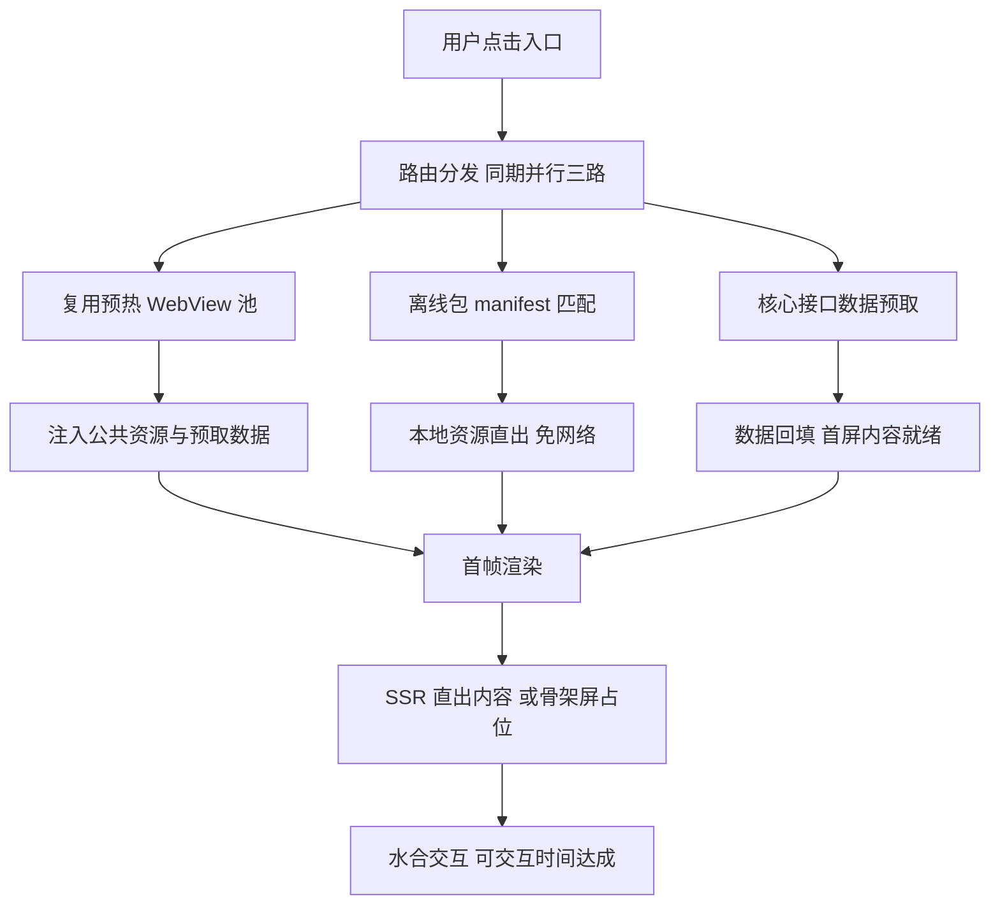

### XP-096：Native 与 H5 之间的数据同步怎么做？登录态、用户资料如何保持一致？
**答**：
- 同步三类数据：**会话态（token/登录态）、用户画像（昵称头像）、应用配置（主题/语言/灰度桶）**；原则是"原生为权威源，H5 为订阅者"。
- 注入时机：容器创建时通过启动参数/Cookie/localStorage 注入初始快照（避免页面起来后再等桥调用），**注入必须在首屏脚本前完成**。
- 变更推送：原生侧数据变更（登录/登出/资料修改）经桥广播 `profile:update` 事件，H5 订阅后刷新自身状态；H5 侧修改走桥回写原生，由原生统一分发。
- 一致性校验：数据带版本戳/时间戳，页面 `visibilitychange` 回前台时对账一次，不一致拉取最新——防多容器/长驻页面持有旧态。
- 多容器一致性：多个 WebView 实例共享登录态用原生 Cookie 同步（`CookieManager`/`WKHTTPCookieStore`）而非各自存储；账号切换时统一清理所有容器缓存（XP-094 安全项）。

```javascript
// bridge/sync.js —— 原生权威源 + 事件广播 + 前台对账
const ctx = { user: null, config: null, version: 0 };     // H5 侧本地快照

// 1) 容器创建时原生注入初始快照（首屏脚本前执行，避免首屏桥等待）
window.__BOOT_DATA__ && hydrate(window.__BOOT_DATA__);

// 2) 订阅原生变更广播：登录态/资料/配置任一变化即推送
bridge.on('state:update', (payload) => {
  if (payload.version <= ctx.version) return;             // 旧版本戳丢弃，防乱序
  hydrate(payload);
  emitter.emit('store:changed', ctx);                     // 通知页面级订阅者
});

// 3) H5 侧修改走原生回写，由原生统一分发（单一写入口）
export async function updateProfile(patch) {
  const next = await bridge.call('user.updateProfile', patch);
  hydrate(next);                                          // 原生返回新版本快照
  return next;
}

// 4) 前台对账：回可视时向原生要最新版本戳，不一致则拉全量
document.addEventListener('visibilitychange', async () => {
  if (document.visibilityState !== 'visible') return;
  const remote = await bridge.call('state.version', {});
  if (remote.version !== ctx.version) hydrate(await bridge.call('state.snapshot', {}));
});

function hydrate(data) { Object.assign(ctx, data, { version: data.version }); }
// 登出特殊处理：原生清理 Cookie 与所有容器缓存后再广播 state:update（user=null）
```

### XP-097：混合栈中 Native 与 H5 的路由一致性怎么保证？返回键怎么处理？
**答**：
- 核心矛盾：H5 内部 `history` 栈与原生页面栈是两套栈，直接返回会"跳过 H5 内层页"或"白屏兜底失败"。
- 统一回退协议：H5 弹层/内层页先拦截——`popstate`/`hashchange` 监听；无可回退历史时经桥调 `page.canGoBack` 询问原生，由**原生统一执行 close/pop**，栈语义唯一。
- Android 物理返回：容器 Activity `onBackPressed` 转发给 WebView（`dispatchEvent` 触发 H5 的 popstate），H5 消费则不透传，未消费再走原生回退。
- iOS 侧滑手势：容器禁用系统全屏侧滑或做"先 H5 后退再容器 pop"的两段式，避免手势直接 pop 容器丢掉 H5 内层页。
- 栈同步纪律：H5 push 内层页必须 `history.pushState`（产生可回退记录）；容器销毁前清空回调注册；深链打开的 H5 页需 seed 一条基础栈保证返回有归属。

```javascript
// hybrid/back-handler.js —— 统一回退协议：H5 优先消费，原生兜底
let bridge, popConsumers = new Set();      // 页面注册的弹层关闭器（Dialog/Drawer）

export function installBackHandler(ctx) {
  bridge = ctx.bridge;
  history.pushState({ seed: true }, '');   // seed 栈：保证容器内始终有一条可回退记录
  window.addEventListener('popstate', onPopState);
  document.addEventListener('visibilitychange', syncSeed);
}

function onPopState() {
  // 1) H5 内部弹层优先关闭（最后注册先关闭，模拟栈行为）
  if (popConsumers.size) {
    const closer = [...popConsumers].pop();
    closer(); history.pushState({ guard: true }, '');   // 重新压栈，保持回退不透传
    return;
  }
  // 2) H5 还有内层页历史：已被本次 popstate 消费，通知原生栈无需动作
  if (history.state?.seed !== true) {
    bridge.call('page.h5ConsumedBack', {});
    return;
  }
  // 3) 只剩 seed 栈：回退权交给原生（容器 close/pop）
  bridge.call('page.requestNativeBack', {});
}

export function registerPopConsumer(closer) {
  popConsumers.add(closer);
  return () => popConsumers.delete(closer);  // 弹层卸载时注销，防内存泄漏
}
// 原生侧（Android onBackPressed / iOS 转场手势）：
//   先调 evaluateJavascript 触发 history.back()；收到 page.h5ConsumedBack 则吞掉本次返回
//   收到 page.requestNativeBack 或超时（H5 未响应 100ms）→ 执行容器回退
```

### XP-098：WebView 内存治理怎么做？
**答**：
- 认清规模：单个 WebView 进程常驻 50-150MB，多实例并存是 App OOM 主因之一；治理目标——**实例数上限、单实例瘦身、及时回收**三管齐下。
- 池化管理：WebView 池有上限（低端机 1-2 个，旗舰 3-4 个，联动 XP-073 deviceTier），复用前 `destroy` 旧页资源、清 JS 状态；不可见页面超时（如 30s）自动销毁回收。
- 页面瘦身：离开页面时清理定时器/事件监听/桥回调注册（提供 destroy 生命周期钩子）；大图滚动出屏释放解码（`img.decoding` 与懒加载）；限制同时播放的音视频。
- 泄漏检测：退后台整体内存水位监控 + 页面销毁后进程 RSS 回收率采样，未回收定位到具体容器；JS 侧 heap snapshot 抽样分析。
- 自动降级：内存压力回调（`onTrimMemory`/`didReceiveMemoryWarning`）触发——销毁非活跃容器、清缓存、通知 H5 释放重资源；极端时全局只保留前台一个容器。

```javascript
// container/pool.js —— WebView 池：实例上限 + 内存压力分级回收
const LIMITS = { flagship: 3, mid: 2, lowend: 1 };         // 联动 XP-073 分档
const limit = LIMITS[deviceTier] ?? 2;

class WebViewPool {
  #live = new Map();        // id -> { webview, page, lastActiveAt }
  constructor() {
    // 系统内存压力分级回收
    nativeMemory.onTrimMemory((level) => {
      if (level >= 'RUNNING_MODERATE') this.#reapInactive(30_000);   // 回收 30s 不活跃
      if (level >= 'RUNNING_LOW')      this.#reapInactive(10_000);
      if (level >= 'RUNNING_CRITICAL') this.#keepOnlyForeground();
    });
  }
  acquire(page) {
    if (this.#live.size >= limit) this.#evictOldest();      // 超限淘汰最久未活跃容器
    const wv = this.#recycle() ?? createWebView();
    this.#live.set(page.id, { webview: wv, page, lastActiveAt: Date.now() });
    return wv;
  }
  release(id) {
    const item = this.#live.get(id);
    item.page.emit('destroy');                               // 给页面统一清理钩子
    item.webview.stopLoading(); item.webview.clearState();   // 停加载 清 JS 定时器回调
    this.#live.delete(id);
  }
  #reapInactive(maxIdleMs) {
    const now = Date.now();
    for (const [id, it] of this.#live)
      if (!it.page.isForeground && now - it.lastActiveAt > maxIdleMs) this.release(id);
  }
  #keepOnlyForeground() {
    for (const [id, it] of this.#live)
      if (!it.page.isForeground) this.release(id);           // 极端：只留前台容器
  }
}
// 监控：页面销毁后 5s 采样进程 RSS，回收率 < 60% 的容器标记泄漏并上报 XP-068
```

---

## 十二、Electron 深度实战（099-105）

### XP-099：Electron 大文件下载管理怎么设计？多线程分片与断点续传？
**答**：
- 分片下载：HEAD 拿 `Content-Length` 与是否支持 `Range`，按并发数（一般 3-6）切片并行请求，分片结果写临时文件或单文件 `pwrite` 指定偏移，避免内存堆积。
- 断点续传：持久化任务状态（分片完成位图、已写字节数、ETag/Last-Modified 校验服务端资源未变），重启后校验通过即从断点继续；服务端资源变更则整体重下。
- 工程要点：磁盘预分配（`fallocate`/创建等长文件）防碎片写、分片校验（各片 md5 或整体 md5）、失败分片指数退避重试、代理与限速配置透传。
- 进度与 IPC：渲染进程只收聚合进度（主进程 200ms 节流推送），不逐 chunk 跨 IPC；任务列表持久化（XP-102 SQLite）支持管理页恢复展示。
- 降级链路：不支持 Range 时退化为单流下载 +整体断点（已下载字节保留）；网络切换自动暂停恢复。

```javascript
// main/download/manager.js —— 分片 + 断点续传 + 校验
const CONCURRENCY = 4, CHUNK_RETRY = 5;

async function download(task, onProgress) {
  const head = await fetch(task.url, { method: 'HEAD' });
  const total = Number(head.headers.get('content-length'));
  const canRange = head.headers.get('accept-ranges') === 'bytes';
  const etag = head.headers.get('etag');                   // 断点前先校验资源未变

  const state = await db.loadTask(task.id) ?? initTask(task, total, canRange, etag);
  if (state.etag !== etag) resetTask(state);               // 服务端资源已变：整体重下

  await ensureFile(task.filePath, total);                  // 预分配等长文件
  const ranges = planChunks(state, CONCURRENCY);           // 未完成分片队列（含位图）

  await pMap(ranges, async (chunk) => {
    for (let i = 0; i < CHUNK_RETRY; i++) {
      try {
        const res = await fetch(task.url, {
          headers: { Range: `bytes=${chunk.start + chunk.done}-${chunk.end}` },
        });
        await streamToFile(res.body, task.filePath, chunk.start + chunk.done, (n) => {
          chunk.done += n; state.doneBytes += n;
          onProgress(state.doneBytes / total);             // 主进程聚合，节流后推 IPC
        });
        await db.saveChunk(task.id, chunk);                // 分片级持久化：崩溃可续传
        return;
      } catch (e) { await sleep(2 ** i * 500); }           // 指数退避重试
    }
    throw new Error(`chunk ${chunk.index} failed`);
  }, { concurrency: CONCURRENCY });

  await verifyMd5(task.filePath, task.md5);                // 整包校验，失败清位图重下
  await db.finishTask(task.id);
}
// 进度推送：主进程 setInterval 200ms 聚合后 webContents.send，渲染端只做 UI
// 不支持 Range：退化为单流 + 保留已下载字节的伪断点（state.doneBytes 记录）
```

### XP-100：Electron 如何做本地系统集成？托盘、通知、文件关联？
**答**：
- 托盘（Tray）：常驻图标 + 上下文菜单（显示主窗口/快捷任务/退出）；注意 macOS 菜单栏图标模板图（`setTemplateImage`）与 Windows 托盘闪烁处理；点击行为平台差异分派。
- 通知：用系统原生 `new Notification()`（走系统通知中心），别用渲染进程 HTML 模拟；点击通知跳转对应窗口/会话需要携带 payload 回传主进程路由。
- 文件/URL 关联：打包配置（electron-builder `fileAssociations`/`protocols`）注册文件类型与协议，运行时经 `open-file`/`open-url` 事件（macOS）与 `process.argv`（Windows 二次启动）接收，统一路由到主窗口处理。
- 其它集成：开机自启（`app.setLoginItemSettings`）、全局快捷键（`globalShortcut`，注意冲突与用户可关）、剪贴板、`shell.openPath/showItemInFolder`。
- 平台差异收口：所有系统能力经 `platform/` 适配层封装，渲染进程永远只调统一 IPC 接口（权限申请与能力探测也在此层，风格对齐 XP-070）。

```javascript
// main/integration.js —— 托盘 + 通知 + 文件关联 统一集成层
import { app, Tray, Menu, Notification, shell } from 'electron';

let tray;
function initTray(mainWindow) {
  tray = new Tray(iconFor(process.platform));              // mac 用 Template 图标自动适配
  tray.setToolTip('MyApp');
  tray.setContextMenu(Menu.buildFromTemplate([
    { label: '打开主窗口', click: () => showWindow(mainWindow) },
    { label: '开始同步', click: () => ipcSend('sync:start') },
    { type: 'separator' },
    { label: '退出', click: () => { app.quit(); } },
  ]));
  // mac: 点击图标弹菜单；win/linux: 点击直接开窗
  tray.on('click', () => process.platform === 'darwin' ? tray.popUpContextMenu()
                                                        : showWindow(mainWindow));
}

function notify(payload) {                                  // 系统原生通知
  if (!Notification.isSupported()) return;
  const n = new Notification({ title: payload.title, body: payload.body });
  n.on('click', () => routeTo(payload));                    // 点击跳转：主进程统一路由
  n.show();
}

// 文件关联：electron-builder.yml 配 fileAssociations 与 protocols（见下）
app.on('open-file', (e, path) => {                          // macOS：已启动实例
  e.preventDefault(); routeToFile(path);
});
app.on('second-instance', (_e, argv) => {                   // Windows/Linux：二次启动带参
  const file = argv.find(a => /\.(myext|mypkg)$/.test(a));
  if (file) routeToFile(file);
  showWindow(mainWindow);
});
const gotLock = app.requestSingleInstanceLock();            // 单实例锁：二次启动转发参数
if (!gotLock) app.quit();
// electron-builder.yml 片段：
// fileAssociations: [ { ext: myext, name: MyApp Document, role: Editor } ]
// protocols: [ { name: MyApp Deep Link, schemes: [myapp] } ]   // myapp:// 协议深链
```

### XP-101：Electron 自动更新的灰度通道怎么设计？
**答**：
- 通道模型：`latest/alpha/beta` 多 channel（electron-builder 按通道产出 `latest-beta.yml` 等），用户设置或内部账号决定 channel；`allowPrerelease`/`setFeedURL` 动态切换。
- **灰度放量**：generic provider 下自建更新服务——按机器 GUID 哈希分桶，只对命中桶的客户端返回新版本 yml，其余返回稳定版；放量比例服务端可调，秒级止血。
- 更新流程纪律：下载在后台完成、重启时机用户可控（提示而非强弹）、` differentialDownload`（blockmap 差量）省带宽；更新包签名校验（macOS 公证 + Windows 签名）必须开启。
- 风控指标：更新成功率、更新后崩溃率对比（crash 上报带版本，超阈值服务端停止放量并回滚 yml 指针）——与 XP-083 热更风控、XP-137 发布体系同一套门禁。
- 本地开发与内测：企业内网 feed、staging channel 隔离，禁止内测包走生产 feed。

```javascript
// main/updater.js —— 通道 + 服务端灰度 + 安全校验
import { autoUpdater } from 'electron-updater';

const CHANNELS = ['latest', 'beta', 'alpha'];

export function initUpdater(opts) {
  const channel = opts.channel ?? 'latest';               // 用户设置/内部身份决定
  autoUpdater.channel = channel;
  autoUpdater.allowDowngrade = false;
  autoUpdater.autoDownload = true;                        // 后台静默下载
  autoUpdater.differentialPackage = true;                 // blockmap 差量下载

  // feed 指向自建更新服务：服务端按机器 GUID 分桶实现灰度
  autoUpdater.setFeedURL({
    provider: 'generic',
    url: `${process.env.UPDATE_BASE}/${channel}`,         // /latest /beta 按通道隔离
  });

  autoUpdater.on('update-downloaded', (info) => {
    // 用户可控时机：提示条"重启以更新"，绝不强弹强更
    mainWindow.webContents.send('update:ready', { version: info.version });
  });
  autoUpdater.on('error', (e) => log.error('updater', e));

  autoUpdater.checkForUpdates();                          // 启动延迟 30s 检查 + 每 4h 轮询
}

// 自建更新服务端（伪代码）：
//   GET /latest/latest.yml?guid=<machine-id>
//   bucket = murmur3(guid) % 100
//   release = bucket < rolloutPercent(current) ? newVersion : stableVersion
//   返回对应 yml；newVersion 崩溃率超阈值 → rolloutPercent 置 0（秒级止血）
// 安全：macOS 公证 + Windows 代码签名，autoUpdater 校验签名失败拒绝安装
```

### XP-102：Electron 应用的数据存储怎么选型？SQLite、LevelDB 与其他方案对比？
**答**：
- 候选矩阵：**better-sqlite3**（关系查询、事务、WAL 高并发读——结构化业务数据首选）、**LevelDB/rocksdb 风格 KV**（高写入吞吐、无查询需求——日志缓冲、索引缓存）、**electron-store/JSON**（少量配置）、**IndexedDB**（渲染进程页面级数据）、**内存 Map + 落盘**（易变临时态）。
- 选型三问：数据要不要**查询与聚合**（要→SQLite）、写入是不是**高频追加**（是→KV/WAL）、要不要**多进程共享**（是→主进程独占 + IPC 服务化，SQLite 文件锁多进程写易脏）。
- 架构纪律：所有持久化收敛到主进程或 utilityProcess 的 **data service**，渲染进程经 IPC 访问（统一鉴权与迁移入口），禁止渲染进程各自落地存储（多窗口一致性，衔接 XP-104）。
- 迁移与体积：schema 版本表 + 增量迁移脚本；better-sqlite3 是原生模块，需按 Electron ABI 重编译（`electron-rebuild`）并纳入打包白名单。
- 数据安全：敏感字段应用层加密（safeStorage 存密钥）、定期 VACUUM/备份、磁盘满与损坏兜底（备份恢复链路演练）。

```javascript
// main/data/store.js —— better-sqlite3：WAL + 事务 + IPC 服务化
import Database from 'better-sqlite3';

export function openStore(file) {
  const db = new Database(file);
  db.pragma('journal_mode = WAL');        // 读写并发：写不阻塞读
  db.pragma('synchronous = NORMAL');      // WAL 下安全且更快
  db.pragma('busy_timeout = 3000');
  migrate(db);                            // schema 版本表 + 增量迁移
  return db;
}

const db = openStore(storePath);
// 事务批写：同步 API 但 O(1) 级开销，1w 行批量 insert 毫秒级
const insertMany = db.transaction((rows) => {
  const stmt = db.prepare('INSERT INTO tasks (id, name, state) VALUES (?, ?, ?)');
  for (const r of rows) stmt.run(r.id, r.name, r.state);
});

// 主进程数据服务：渲染进程一律 IPC 访问，禁止多进程直连 sqlite 文件
ipcMain.handle('data:tasks:list', (_e, filter) =>
  db.prepare('SELECT * FROM tasks WHERE state = ? ORDER BY created_at DESC LIMIT ?')
    .all(filter.state, filter.limit));
ipcMain.handle('data:tasks:create', (_e, row) =>
  db.prepare('INSERT INTO tasks ...').run(row));

// 选型落位：
//   任务/元数据/历史记录 → better-sqlite3（本文件）
//   日志缓冲与上报队列   → 内存 Map + 定期批量落 SQLite（高频追加不逐条写）
//   应用偏好设置         → electron-store（JSON，几十个 key）
//   页面级临时数据       → IndexedDB（渲染进程内，可丢弃）
```

### XP-103：Electron 打包体积优化怎么做？
**答**：
- 认清大头：**Electron 运行时（Chromium+Node，双平台约 150-200MB 解压后）**是主开销，业务代码通常 <10%；优化重点是"不重复带资源"而非压缩运行时本身。
- 依赖瘦身：`files` 白名单最小化、`asar` 打包业务代码、生产依赖 prune（two-package.json 结构隔离 devDependencies）、排除多语言 locale（`electron-builder` 的 `electronLanguages`）、剔除不需要的平台二进制（原生模块按平台构建）。
- 资源治理：大资源外置（首次启动下载到 userData，模型/字体/皮肤类），图标与素材压缩；`extraResources` 只放必须随包的。
- 分发优化：全量包之外提供 **differential（blockmap）差量更新**；macOS 产物做 universal 或按架构分发取舍（x64+arm64 双包 vs universal 体积翻倍）。
- 门禁：CI 记录安装包/解压后体积趋势，diff 门禁与 XP-116 口径统一；升级 Electron 版本时跑体积对比（版本间差异可达 10MB+）。

```yaml
# electron-builder.yml —— 体积治理配置
appId: com.example.app
asar: true                       # 业务代码 asar 归档（只读，配合白名单）
files:                           # 最小白名单：只打包运行必需
  - build/main.js
  - build/preload.js
  - build/renderer/**            # 渲染层产物（前端构建已 tree-shake）
  - "!**/*.map"                  # sourcemap 不进包，符号表走外置上报（XP-068 同思路）
  - "!**/*.md"
  - "!**/test/**"
asarUnpack:                      # 原生模块与二进制必须 unpack 才能被 require
  - "**/node_modules/better-sqlite3/**"
electronLanguages: [zh-CN, en-US]   # 砍 Chromium locale，省 ~10MB 级
compression: maximum
mac:
  target: { target: dmg, arch: [arm64, x64] }   # 分架构分发（不打 universal）
win:
  target: nsis
nsis:
  differentialPackage: true      # blockmap 差量更新：升级包常 <10% 全量
extraResources:                  # 仅必需随包；模型/大素材走首启动下载到 userData
  - from: assets/icons
    to: icons
# CI 门禁：dmg < 110MB、nsis < 95MB、解压后 diff > 5MB 阻断（口径对齐 XP-116）
```

### XP-104：Electron 多窗口的性能怎么治理？共享进程怎么设计？
**答**：
- 成本认知：每个 BrowserWindow 独立渲染进程（几十 MB 起），多窗口+多 webview 会让内存与 GPU 翻倍；治理三方向——**窗口复用、进程共享、按需创建**。
- 窗口复用：功能相近的弹窗类窗口合并为单实例多视图（切换 URL/状态而非新建）；隐藏代替销毁要配合释放重资源（视频/大列表），显示时恢复。
- **utilityProcess 共享**：重计算（数据索引、文件解析、压缩）从各窗口抽离到 utilityProcess（独立 Node 进程，主进程管理），窗口间经主进程转发或 MessagePort 直连，避免每个窗口各自起 Node 重活。
- 渲染进程间通信：主进程做 hub（广播节流），或 `MessageChannelMain` 建 port 直连降主进程压力；大数据（文件句柄/Buffer）走 structured clone 一次性传递。
- 治理指标：窗口数 × 内存基线监控、GPU 进程崩溃率、主进程事件循环阻塞时长；`backgroundThrottling` 按窗口场景开关（后台窗口可降帧）。

```javascript
// main/windows.js —— 窗口复用 + utilityProcess 共享计算
import { BrowserWindow, utilityProcess, MessageChannelMain } from 'electron';

// 1) 弹窗类窗口单实例复用：按 role 取窗，隐藏不销毁
const windowPool = new Map();
function getWindow(role) {
  if (windowPool.has(role)) return windowPool.get(role);
  const win = new BrowserWindow({
    show: false,
    webPreferences: { preload: PRELOAD, sandbox: true, nodeIntegration: false },
  });
  win.on('close', (e) => {                 // 关闭改隐藏：复用实例
    if (!app.isQuitting) { e.preventDefault(); win.hide(); releaseHeavy(win); }
  });
  windowPool.set(role, win);
  return win;
}
function releaseHeavy(win) { win.webContents.send('page:pause'); } // 停视频/大列表

// 2) utilityProcess：重计算抽离，多窗口共享一个 worker
const worker = utilityProcess.fork(path.join(__dirname, 'worker/indexer.js'));
ipcMain.handle('index:search', async (_e, q) => {
  const { port1, port2 } = new MessageChannelMain();   // port 直连：主进程只做接线
  worker.postMessage({ type: 'search', q, port: port2 }, [port2]);
  return new Promise((resolve) => { port1.once('message', (m) => { resolve(m.data); port1.close(); }); });
});

// 3) 广播节流：主进程 hub 聚合后再分发，防多窗口风暴
const broadcast = throttle((channel, payload) =>
  BrowserWindow.getAllWindows().forEach((w) => w.webContents.send(channel, payload)), 100);
// 监控：每窗口内存基线 + GPU 崩溃率 + 主进程 loop lag（口径进 XP-135 平台）
```

### XP-105：Electron 应用的安全审计清单应包含哪些项？
**答**：
- 渲染进程基线：`contextIsolation: true`、`nodeIntegration: false`、`sandbox: true`、`webSecurity: true`——四项为默认红线，任何窗口（含内嵌第三方页）不得关闭。
- preload 纪律：只通过 `contextBridge` 暴露**白名单化、最小粒度** API，绝不透传 `ipcRenderer` 全量对象；渲染侧禁 Node 痕迹（require/process 全量）。
- IPC 加固：每个 handle 校验 `event.senderFrame` 来源与参数 schema（zod），写操作区分窗口权限；禁止把主进程对象/函数直接传给渲染进程（原型污染）。
- Web 内容防线：CSP（禁 inline/eval、限 connect-src）、`will-navigate`/`setWindowOpenHandler` 拦截外部导航、自定义协议白名单（注册标准 scheme 禁 file:// 访问）、`permissionRequestHandler` 按来源放行摄像头/通知等。
- 数据与供应链：密钥走 safeStorage 不进代码、`npm audit`/lockfile 审计进 CI、更新链路签名校验（XP-101）、剪贴板/录屏等敏感权限用后即关；审计按此清单季度化执行 + 自动化扫描。

```text
Electron 安全审计清单（季度执行 + CI 自动化项）
A 渲染进程基线（自动化扫描 main 进程代码）
  [ ] contextIsolation=true  [ ] nodeIntegration=false  [ ] sandbox=true
  [ ] webSecurity=true       [ ] 全项目 grep 无 allowRunningInsecureContent
B contextBridge 暴露面
  [ ] preload 只暴露白名单方法，无 ipcRenderer 对象直传
  [ ] 每个 API 最小粒度，敏感操作（fs/shell/exec）不在暴露面
C IPC 加固（自动化：所有 handle 必须注册 schema 校验）
  [ ] event.senderFrame 校验来源（防 iframe/子窗口伪造）
  [ ] 参数 zod schema 校验；写操作按窗口角色鉴权
D Web 内容防线
  [ ] CSP：default-src self；禁 unsafe-inline/eval；connect-src 白名单
  [ ] will-navigate 拦截 + setWindowOpenHandler 强制外链走系统浏览器
  [ ] 自定义协议 standard+secure 注册，禁 file:// 通配；permissionRequestHandler 按来源放行
E 数据与供应链
  [ ] 密钥 safeStorage；日志/崩溃上报脱敏（路径/token）
  [ ] npm audit + lockfile diff 进 CI；原生模块来源审计
  [ ] 自动更新签名校验开启（XP-101）；devtools 生产禁用
F 演练与追踪
  [ ] 渗透样例：渲染进程被注入 XSS 后能否逃逸（预期：被 A-D 全链拦死）
  [ ] 审计结论归档，风险项进 XP-137 发布门禁
```

---

## 十三、跨端一致性专项（106-112）

### XP-106：跨端 UI 一致性测试怎么做？多端视觉回归矩阵如何搭建？
**答**：
- 目标分层：**组件级**（设计系统还原度）与**页面级**（关键链路截图），一致性验收标准来自 Design Token（尺寸/色板/字体梯度），Token 不一致先修 Token 再谈截图。
- 多端截图采集：Web/H5 用 Playwright 截图；RN 用 iOS/Android 模拟器截图（detox/maclib）；Flutter 用 `goldenFileTest`（无需模拟器）；小程序走真机截图自动化。**基线图统一按组件名+状态命名入库**。
- 对比与阈值：像素 diff（pixelmatch）+ 感知 diff（SSIM）双指标，容忍阈值按组件分级（文本组件 5%、图形组件 1%）；字体渲染差异（平台 hinting）在阈值或渲染层归一化处理。
- CI 矩阵：PR 触发多端多机型矩阵（与 XP-136 CI 体系复用），diff 报告生成 HTML 页挂 PR comment；基线更新需设计/平台双审。
- 治理节奏：核心组件库每次发版跑全量矩阵，业务页面按改动面跑增量；新增截图即"快照冻结"，变更必须显式接受（与 XP-072 兼容性测试衔接）。

```yaml
# .github/workflows/visual-regression.yml —— 多端视觉回归矩阵
name: visual-regression
on: [pull_request]
jobs:
  matrix:
    strategy:
      fail-fast: false
      matrix:
        include:
          - { target: web,        os: ubuntu-latest,  cmd: "npx playwright test --update-snapshots=false" }
          - { target: rn-ios,     os: macos-14,       cmd: "detox build && detox test -c ios.sim.release" }
          - { target: rn-android, os: ubuntu-latest,  cmd: "detox build && detox test -c android.emu.release" }
          - { target: flutter,    os: ubuntu-latest,  cmd: "flutter test --update-goldens=false test/goldens" }
          - { target: miniprogram,os: ubuntu-latest,  cmd: "miniprogram-automator screenshot-suite" }
    runs-on: ${{ matrix.os }}
    steps:
      - uses: actions/checkout@v4
      - run: ${{ matrix.cmd }}
      - uses: actions/upload-artifact@v4         # 采集图统一命名 组件名_状态_端_机型
        with: { name: shots-${{ matrix.target }}, path: screenshots/ }
  compare:                                        # 产物齐全后统一 diff
    needs: matrix
    runs-on: ubuntu-latest
    steps:
      - uses: actions/download-artifact@v4
      - run: node tools/visual-diff.js --threshold-web 5 --threshold-graphic 1
        # pixelmatch + SSIM 双指标；diff 报告 HTML 作为 PR comment，基线更新需双审
```

### XP-107：跨端行为一致性怎么做？事件与手势差异如何抹平？
**答**：
- 差异清单先行：点击 300ms 延迟（老 WebView）、hover 无触屏、右键/长按语义、滚动物理（iOS 回弹 vs Android 边界光晕）、键盘事件（软键盘布局）、双击缩放——建**平台差异登记表**逐项给策略。
- 统一手势层：业务代码只消费归一化手势事件（tap/longPress/swipe/pan），由各端 adapter 映射到平台实现（Web Pointer Events、RN Gesture Handler、Flutter GestureDetector），映射关系表驱动并纳入单测。
- 事件语义对齐：统一"激活态、按下反馈、禁用态"三态规范；触摸目标最小 44pt（iOS HIG）/48dp（Material）取交集 44pt 执行。
- 行为断言自动化：同一交互脚本（点击/长按/滑动序列）在多端跑，断言**结果状态一致**（选中态、回调参数），而不仅是截图——行为一致性比像素一致性更容易漏。
- 兜底策略：无法抹平的差异（回弹物理效果）登记为"接受差异"清单，设计侧确认，避免各业务自行补丁（与 XP-072、XP-075 差异登记机制复用）。

```typescript
// packages/core/gestures —— 归一化手势层：业务只消费统一语义
export type Gesture =
  | { type: 'tap'; x: number; y: number }
  | { type: 'longPress'; durationMs: number }
  | { type: 'swipe'; dir: 'left' | 'right' | 'up' | 'down'; velocity: number }
  | { type: 'pan'; dx: number; dy: number };

export interface GestureAdapter {
  on(target: unknown, handler: (g: Gesture) => void): () => void;
}

// 各端 adapter：把平台事件映射为统一 Gesture（映射表驱动，纳入单测）
// web:     Pointer Events + touch-action，300ms 延迟用 meta viewport 消除
// rn:      react-native-gesture-handler 映射
// flutter: GestureDetector 映射（onTap/onLongPress/Fluent swipe velocity 换算）

// 平台差异登记表（策略唯一来源，XP-072/075 复用）
export const platformDiffs: Record<string, { policy: 'normalize' | 'accept'; note: string }> = {
  'scroll.bounce':    { policy: 'accept', note: 'iOS 回弹为平台特性，设计侧已确认' },
  'longPress.menu':   { policy: 'normalize', note: 'Android 长按菜单映射 longPress 手势' },
  'hover.state':      { policy: 'normalize', note: '触屏端 hover 映射为 active 按压态' },
  'doubleTap.zoom':   { policy: 'normalize', note: 'Web 禁 viewport 双击缩放，容器端原生行为对齐' },
};

// 行为一致性断言：同一脚本多端执行，断言状态结果一致
// script: tap(item) -> longPress(600) -> swipe(left)
// assert: selected=true, menu=visible, page=2   （三端断言同表）
```

### XP-108：跨端的时间与时区一致性怎么保证？
**答**：
- 存储与传输铁律：**一律 UTC（ISO 8601 带毫秒与 Z 后缀）**，禁止本地时间字符串入库；展示层才转本地时区；接口避免传"无时区时间戳"。
- 业务时区概念：营销活动/直播开始时间用**运营方时区**（服务端下发带时区的绝对时刻），客户端只负责渲染，不做"我以为是本地 8 点"的换算。
- 时钟不可信：倒计时以服务端下发 `serverTime + duration` 计算，客户端本地时钟只做插值；防用户改表跳过倒计时（用 monotonic 时钟做耗时测量：performance.now / SystemClock.elapsedRealtime）。
- DST 与边界：跨夏令时地区的"明天"计算必须用带时区的日历库（date-fns-tz / Temporal），禁止 24h 时间戳加减；日期分界、周起始日随 locale。
- 一致性测试：构造跨时区设备矩阵（UTC+8/UTC-5/DST 切换日）跑同一断言集；倒计时/日程类组件纳入 XP-112 契约测试。

```typescript
// packages/core/time —— UTC 存储 + 服务端时钟 + monotonic 计时
export function toUtcIso(d: Date): string { return d.toISOString(); }       // Z 后缀

// 业务时区：运营时区由服务端下发，客户端不换算
export function formatAtServerTz(serverIso: string, tz: string, locale: string): string {
  return new Intl.DateTimeFormat(locale, { timeZone: tz, dateStyle: 'medium', timeStyle: 'short' })
    .format(new Date(serverIso));
}

// 倒计时：以服务端时间为锚，本地时钟只插值，改本机时间无效
export function createCountdown(serverNow: string, endsAt: string) {
  const skew = Date.parse(serverNow) - Date.now();          // 服务端-本地偏移
  const end = Date.parse(endsAt);
  return () => Math.max(0, end - (Date.now() + skew));
}

// 耗时测量用 monotonic 时钟：用户改系统时间不影响
export const monotonicNow = () =>
  typeof performance !== 'undefined' ? performance.now() : Date.now(); // 原生端换 elapsedRealtime

// 反例清单（CI lint 拦截 new Date('2026-11-08') 这类无时区解析）：
//   ✗ 入库存本地时间字符串        ✓ 入库 UTC ISO
//   ✗ Date.now() + 24h 表示明天  ✓ date-fns-tz addDays 带时区
//   ✗ 各端各自 new Date() 做倒计时 ✓ 服务端 serverTime 锚定
```

### XP-109：跨端文案与 i18n 一致性怎么管理？
**答**：
- Key 规范与唯一源：文案 key 按 `模块.组件.用途` 命名，**单一文案源（JSON/PO 文件）**被所有端消费，翻译改动只改源文件；CI 校验各端 key 完整性（缺 key 阻断、孤儿 key 告警）。
- ICU MessageFormat 统一处理复数/性别/选择（`{count, plural, one {...} other {...}}`），占位符 `{name}` 全端同名，禁止端上自定义拼接语序（德语/日语语序差异会让拼接崩坏）。
- 平台差异兜底：同一 key 允许平台覆盖（移动端短文案），但**默认值必须存在且共享**；覆盖项进登记表防漂移。
- 长文案适配：德语/俄语平均长度 +40%，样式侧统一策略（RN `adjustsFontSizeToFit`、Flutter `autoShrinkText`、Web `clamp`+省略+tooltip），翻译后跑长文案回归截图（XP-106 矩阵加 de/ru 语言维度）。
- 流程：伪本地化测试（pseudo-i18n 提前暴露截断/硬编码）、翻译平台（Crowdin/Lokalise）回源同步、新 key 必须带注释上下文给译者。

```json
{
  "$schema": "https://inlang.com/schema/inlang-message-format",
  "order.submit.button": {
    "value": "Submit order",
    "platformOverrides": {
      "ios": "Place order",
      "android": "Place order",
      "miniapp": "Submit"
    },
    "comment": "结算页提交按钮，'Submit' 为下单动作非表单提交"
  },
  "order.items.count": {
    "value": "{count, plural, =0 {No items} one {# item} other {# items}}",
    "comment": "ICU 复数：各端统一用 ICU，禁止端上拼接 item/items"
  },
  "order.discount.banner": {
    "value": "Save {amount} with code {code}",
    "comment": "占位符全端同名；德语语序不同由译文调整，不允许端上拼接"
  }
}
// CI 校验脚本（全部通过才可合并）：
//   1) 各端 locales/*.json 与源 key 集合一致（缺 key fail，孤儿 key warn）
//   2) 占位符一致性：所有语言 {amount}/{code} 占位符集合相同
//   3) 硬编码扫描：源码出现中文/英文全字面量进 UI 即 fail
//   4) pseudo-i18n 构建：[ΩΩ ΩΩΩ] 长度膨胀 1.4x 跑 XP-106 截图回归
```

### XP-110：跨端动画性能一致性怎么保证？低端机分档怎么做？
**答**：
- 一致性的定义是**体验一致而非实现一致**：同一设计在各端用各自最优实现（CSS transform / Reanimated / Flutter controller），验收标准统一为"帧率水位 + 视觉关键帧"。
- 设备分档驱动：启动时定档（XP-073 deviceTier），动画配置表按档分发——高端全效果、中端砍次要动画（视差/多层阴影）、低端只保留必要转场且时长缩短。
- 实现约束统一：只动合成属性（transform/opacity）、动画元素 RepaintBoundary（Flutter）/will-change（Web）/原生驱动（RN），避免各端各写一套触发重排的实现。
- 帧率目标分档：旗舰 120Hz 跟手、中端稳定 60、低端 45-60 区间可接受；用 XP-117 埋点采集各端动画掉帧率，按 deviceTier × 端聚合进看板。
- 回归机制：动画用例纳入 XP-106 矩阵的低端机档位（中端真机 + CPU/内存压力注入），掉帧超阈值阻断合并；新增动画必须声明分档降级配置。

```typescript
// packages/core/motion —— 分档动画配置：体验一致，实现各端最优
export interface MotionSpec {
  durationMs: number;
  easing: 'standard' | 'decelerate' | 'spring';
  layers: { shadow: boolean; parallax: boolean; blur: boolean };  // 可降级图层
  fpsTarget: 60 | 90 | 120;
}

const FULL: MotionSpec = { durationMs: 300, easing: 'spring', layers: { shadow: true, parallax: true, blur: true }, fpsTarget: 120 };
const TRIM: MotionSpec = { durationMs: 250, easing: 'standard', layers: { shadow: true, parallax: false, blur: false }, fpsTarget: 90 };
const MIN: MotionSpec = { durationMs: 200, easing: 'standard', layers: { shadow: false, parallax: false, blur: false }, fpsTarget: 60 };

export const motionFor = (tier: Tier): MotionSpec =>
  ({ flagship: FULL, mid: TRIM, lowend: MIN }[tier]);

// 各端消费同一配置：
//   Web:     shadow=false → 移除 filter: drop-shadow；只动 transform/opacity
//   RN:      shadow=false → 关 elevation；动画全走 Reanimated worklet（XP-080）
//   Flutter: shadow=false → 去 BoxShadow；动画包 RepaintBoundary
// 回归门禁：低档真机（或压力注入）跑动画用例，掉帧率 > 10% 阻断合并（XP-117 口径）
```

### XP-111：跨端日志格式怎么统一？
**答**：
- 单一 schema：所有端产出**结构化 JSON 日志**，公共字段（traceId/sessionId/userId 脱敏 hash/platform/appVersion/level/tsUtc）+ 业务字段（event/props），schema 由 shared 包定义并版本化。
- 归一化职责：各端 adapter 只负责把平台日志（原生崩溃堆栈/NSLog/logcat/Chromium console）**映射进统一 schema**（映射进 XP-068 堆栈归一化管道），业务侧无感知。
- 分级与采样：level 分 debug/info/warn/error；debug 端上滚动缓冲按需上报（用户触发反馈时附带），info 级采样，error/warn 全量；日志体大小与条数限制防端上存储膨胀。
- 脱敏与合规：字段白名单制（schema 外字段丢弃+计数）、手机号/位置/token 强制脱敏、隐私合规审批进发布门禁。
- 贯穿链路：traceId 从入口（深链/推送点击）贯穿到接口与日志，跨端跳转（Native→WebView→小程序）透传，实现一次请求跨域追踪。

```text
跨端统一日志 schema v2（shared/log/schema.ts 定义，各端 adapter 映射）
公共字段（必填）：
  ts          UTC ISO8601 毫秒          例 2026-11-08T02:00:00.123Z
  level       debug|info|warn|error
  platform    ios|android|web|harmony|miniprogram|electron
  appVersion  semver                    例 8.3.1
  sessionId   会话 id（XP-091 生命周期生成）
  traceId     链路 id（跨端跳转透传）
  userId      脱敏 hash（可选）
  sdkVer      日志 schema 版本          例 2
业务字段：
  event       事件名 点分命名            例 order.submit.fail
  props       白名单内键值对（schema 校验，多余丢弃+计数）
  stack       归一化堆栈（error 级，XP-068 管道）
分级与采样：
  error/warn  全量即时上报
  info        采样 10%（灰度桶内 100%）
  debug       端上环形缓冲 200 条，用户反馈时随单上报
脱敏白名单：phone→hash、token/cookie→discard、geo→城市级
adapter 职责：logcat/NSLog/console/原生 crash → 统一 schema 映射，业务零感知
```

### XP-112：跨端 API 版本协商怎么做？不同端不同版本如何共存？
**答**：
- 问题本质：发版节奏不同（Web 实时、App 商店延迟、小程序审核）导致**多版本客户端长期并存**，服务端必须同时服务 N-3 个客户端版本。
- 协商机制：客户端上报 `clientVersion + platform + capabilitySet`（能力集而非版本号——按能力路由比按版本路由更稳），接口响应带 `minClientVersion` 与迁移提示；handshake 接口启动时一次拉取。
- 兼容策略：服务端按能力集裁剪响应字段（缺的能力不下发新字段，客户端也不解析）；schema 演进遵守"只加不删、加字段必可选"的宽容读取原则（tolerant reader）。
- 强制升级与软降级：破坏性变更前先双写过渡期；`minClientVersion` 触发强更弹窗（强更文案与节奏走 XP-137 发布体系），未到强更线的旧版本走功能开关降级。
- 测试保障：契约测试（Pact 类）覆盖所有在支持版本 × 平台组合；"最旧客户端回归"进发版 checklist——支持矩阵本身就是 XP-137 的发布门禁输入。

```typescript
// packages/core/handshake —— 启动协商：能力集驱动，而非裸版本号
export interface ClientHello {
  platform: Platform;
  clientVersion: string;              // semver
  capabilities: string[];             // 能力集：'v2.checkout' 'ai.assistant' 'offline.pkg'
}
export interface ServerHello {
  serverTime: string;                 // UTC 锚点（XP-108）
  supported: boolean;                 // false → 触发强更
  minClientVersion?: string;          // 强更线
  featureGates: Record<string, boolean | number>;   // 旧版降级开关（XP-067 下发）
  deprecatedIn?: string;              // 提示：下个版本将移除某能力，提示升级
}

export async function handshake(http: HttpClient, me: ClientHello): Promise<ServerHello> {
  const res = await http.post('/gateway/handshake', me);
  if (!res.supported && res.minClientVersion) forceUpdateFlow(res.minClientVersion);
  return res;                          // featureGates 写入运行时，接口层按能力裁剪消费
}
// 服务端兼容矩阵（示例）：
//   8.0  capabilities 不含 v2.checkout → /checkout 返回 v1 结构
//   8.2  含 v2.checkout               → 返回 v2 结构（宽容读取：多字段无害）
//   <7.9 supported=false             → 强更（发布门禁：强更覆盖率 <0.5% 才允许下线旧接口）
// 契约测试：Pact 覆盖 {在支持版本} × {ios,android,web} 组合，CI 阻断破坏性变更
```

---

## 十四、性能对比与调优（113-118）

### XP-113：RN / Flutter / Hybrid 三端的启动性能怎么对比与优化？
**答**：
- 先统一口径再对比：启动定义（冷启/温启）、终点（首帧/可交互 TTI）、统计段（P50/P90，按 deviceTier 分档）——三端在同一指标框架下测量，否则对比是伪命题。
- 三端冷启链路差异：**Hybrid**（进程→WebView 内核初始化→HTML/JS 加载→首帧，内核初始化是大头，可池化预热）；**RN**（进程→JS runtime+bundle 加载执行→首帧，Hermes/懒加载治此段）；**Flutter**（引擎加载→Dart isolate→首帧，AOT 后最短，但引擎与资源加载固定开销大）。
- 优化抓手分端：Hybrid 治容器池+离线包+数据预取（XP-095）；RN 治 Hermes+懒加载+defer SDK（XP-077）；Flutter 治引擎预热+首路由精简+deferred components。
- 对比结论的用法：不是"哪个快"而是**按业务形态选型与分工**——高频入口用自绘/原生渲染保体验，长尾页面用 Hybrid 保动态性（综合实战选型同款方法论）。
- 看护：启动指标分端分档进 XP-069 看板，每次发版跑基准（自动化冷启脚本 ×30 次取分位值），回归超 10% 阻断。

```text
三端冷启动链路对比（口径：冷启 TTI，P50，中端机 2023 档，XP-069 统一测量）
阶段              Hybrid(WebView)         RN(新架构 Hermes)       Flutter
进程/容器创建      容器池命中 ~50ms        进程 ~100ms             进程 ~100ms
内核/引擎初始化    内核冷启 200-500ms      JSI runtime ~50ms       引擎加载 ~80ms
资源/代码加载      离线包命中 ~30ms        .hbc 加载+执行 ~200ms   libapp.so ~100ms
首帧渲染           HTML/CSS 解析 ~200ms    原生控件映射 ~100ms     Dart 首帧 ~60ms
可交互 TTI         接口回包后 ~500ms       首屏接口后 ~300ms       ~250ms
优化主抓手         池化 预取 离线包 XP-095  Hermes 懒加载 XP-077   引擎预热 首路由精简
基线（优化后 P50） ~700ms                  ~600ms                  ~500ms

对比结论（选型分工）：
  首页/高频入口     Flutter 或 RN（自绘/原生渲染，启动可优化到 500ms 级）
  长尾运营页        Hybrid（动态性强，秒开靠容器池+离线包兜住）
  治理动作          三端指标进同一看板；发版基准回归超 10% 阻断合并
```

### XP-114：三端的列表滚动性能怎么对比？各自的瓶颈与调优手段？
**答**：
- 测量口径统一：同数据集（2000 条异构 item）、同机型档位、指标为**滚动 FPS、blank area 比例、内存峰值、fast-fling 白屏恢复时间**。
- 机制差异决定瓶颈：Web/Hybrid 交给浏览器排版，瓶颈在 DOM 节点数与重排（虚拟滚动治）；RN 瓶颈在 JS 线程 renderItem 与异步布局（复用池治，XP-076）；Flutter 瓶颈在 build/layout/raster 三段（定高/RepaintBoundary 治，XP-084）。
- 结论趋势（同优化水平）：Flutter ≥ RN(FlashList) > Hybrid（原生渲染/自绘对浏览器排版的优势），但**优化到位的 Hybrid（虚拟滚动+离线包）完全够内容流场景**。
- 调优手段映射：统一抽象为"窗口化渲染、高度确定性、重绘隔离、图片降采样"四件事，各端实现名不同本质相同——团队培训按四件事讲，不按框架 API 讲。
- 看护：列表场景指标进 XP-069（blankArea/FPS/内存三指标分端分档），新列表上线跑滚动基准脚本对比同类页面基线。

```text
列表滚动性能对比矩阵（2000 条异构 item，中端机，fast-fling 场景）
维度            Hybrid + 虚拟滚动        RN + FlashList          Flutter Sliver
实现机制         浏览器排版+JS 虚拟窗口   原生 cell 复用池         widget 懒构建+sliver
主要瓶颈         DOM 重排 长任务          JS renderItem 异步测量   build/raster 阶段
滚动 FPS(P50)    50-55                   55-58                    58-60
blankArea        2-5%                    <2%                      <1%（定高）
内存峰值         中（DOM 树）             低（复用池）              中（widget 缓存）
调优四件事映射：
  窗口化渲染     虚拟滚动 overscan        itemEstimate+drawDistance cacheExtent/itemExtent
  高度确定性     固定 item 高             getItemLayout/estItem    itemExtent 定高
  重绘隔离       content-visibility       memo+复用类型            RepaintBoundary
  图片降采样     srcset+懒加载            定宽高+磁盘缓存          cacheWidth 解码降采样
结论：体验上限 Flutter ≥ RN > Hybrid；优化到位的 Hybrid 满足内容流；
     治理按四件事讲，不按框架 API 讲（口径统一进 XP-069）
```

### XP-115：跨端内存水位监控怎么做？
**答**：
- 数据源分端采集：iOS（footprint/os_proc_available_memory）、Android（PSS/Runtime maxMemory + WebView 进程 PSS 聚合）、Web（performance.memory 换算/浏览器受限则用降级信号）、Electron（process.memoryUsage + 渲染进程聚合）——统一为 `appFootprintMB` 与 `deviceTotalMB` 两个口径。
- **水位模型**：memoryPressure = appFootprint / deviceAvailable，分 绿(<40%)/黄(40-70%)/红(>70%) 三档，驱动端上分级自保（清缓存→释放重资源→回收容器，XP-098 分级回收同构）。
- 采集纪律：低频（前台每 30s 一次 + 关键事件前后）、采样上报、与 OOM 案例回捞关联（崩溃前的水位曲线是 OOM 归因唯一线索）。
- 归因能力：水位曲线打标（进入页面/加载图片/播放视频事件），OOM 时回放最后 N 分钟事件序列，定位泄漏页面或大对象。
- 看板与门禁：按 端 × deviceTier × 页面 聚合 P90 水位；新功能合入跑内存基准（对比同基线页面），水位劣化 >15% 阻断（与 XP-069 看板、XP-137 门禁联动）。

```typescript
// packages/core/memwatch —— 水位采集 + 分级自保 + OOM 回捞
export interface MemSample {
  ts: string; platform: Platform; tier: Tier;
  appFootprintMB: number;      // iOS footprint / Android PSS+WebView 聚合 / Electron rss 聚合
  deviceTotalMB: number;
  mark?: string;               // 事件打标：page.enter image.load video.play
}
const pressure = (s: MemSample) => s.appFootprintMB / s.deviceTotalMB;

export function startMemWatch(sample: () => MemSample, sink: Sink) {
  const timer = setInterval(() => {
    const s = sample();
    const p = pressure(s);
    sink.push(s);                                       // 采样上报（30s 低频）
    if (p > 0.7) degrade(s, 'red');                     // 红：回收容器 清缓存 XP-098
    else if (p > 0.4) degrade(s, 'yellow');             // 黄：释放图片缓存 暂停预加载
  }, 30_000);
  pageEvents.on('enter', (pg) => sink.push({ ...sample(), mark: `page.enter:${pg}` }));
  return () => clearInterval(timer);
}
// OOM 回捞：崩溃上报附带最后 5 分钟 MemSample 序列（环形缓冲），
//   归因模板：水位曲线 + mark 事件流 → 定位泄漏页面（P90 水位 × 端 × 页面 看板）
// 门禁：新页面合入跑基准，同档位 P90 水位劣化 > 15% 阻断（XP-137 门禁输入）
```

### XP-116：跨端包体积对比与治理体系怎么建？
**答**：
- 口径先行：统计对象分**下载体积（用户真实成本）与磁盘占用**，Android 用 APK/AAB per-abi、iOS 用 IPA（去 App thinning 虚高）、小程序用主包+分包、Web 用关键路径资源；各端统一登记进体积台账。
- 构成模型统一：每端拆"运行时/框架、业务代码、资源、依赖"四层，跨端对比按层对比才公平（Flutter 引擎大头 vs RN 动态下发 bundle 是结构性差异，要在台账注明）。
- 治理动作库：分端各有一套（XP-082 RN / XP-089 Flutter / XP-103 Electron / 离线包+CDN H5），台账记录每项动作的实测收益，形成"体积优化手册"。
- 门禁与预算：CI 体积门禁（超预算阻断，豁免走审批），预算按"运行时+基线+缓冲"制定；大促等资产膨胀期允许临时预算（XP-137 发布门禁联动）。
- 治理节奏：季度全量治理（ dependency 审计、资产清理）+ 日常 diff 门禁；体积趋势对全员透明（看板），"体积刺客"（一个 PR 涨 5MB）自动 @ 责任人。

```text
跨端包体积台账（季度更新 + CI diff 门禁）
端          统计口径            下载体积基线    四层构成（运行时/业务/资源/依赖）
Android RN  APK per-arm64       42MB           55% / 15% / 20% / 10%
iOS RN      IPA(arm64)          38MB           50% / 18% / 22% / 10%
Flutter 双端 per-abi AAP        45MB           60% / 12% / 18% / 10%（引擎固定大头）
H5          关键路径 gzip        380KB          0%   / 45% / 40% / 15%（框架按需加载）
小程序      主包+分包           主包 1.8MB     0%   / 50% / 40% / 10%
Electron    nsis/dmg            95MB           85% / 5%  / 8%  / 2%（Chromium 大头）

治理动作库（实测收益登记）：
  RN      per-abi/Hermes/R8/图片CDN         -45%（XP-082）
  Flutter obfuscate/字体子集/deferred       -20%（XP-089）
  H5      离线包后首屏网络 0KB，增量包 KB 级（XP-093）
  Electron locale 裁剪/差量更新/资源外置      -18%（XP-103）
门禁：预算 = 运行时基线 + 业务缓冲 10%；CI diff > 200KB 阻断，豁免需平台组审批；
     大促资产膨胀走临时预算（XP-137 联动）；体积刺客自动 @ 责任人
```

### XP-117：三端交互延迟怎么量化？"点击→响应"全链路怎么打点？
**答**：
- 链路拆解：**事件产生（系统触摸）→ 框架事件分发 → 业务 handler → 状态更新 → 渲染提交 → 帧上屏**，量化目标是把每段耗时拆出来，而不是只看"感觉卡不卡"。
- 各端打点锚点：Web（pointerdown → requestAnimationFrame 后上屏，long task API）；RN（触摸事件 → JS handler → Reanimated/Scheduler 提交，用 Fabric commit 时间）；Flutter（PointerEvent → build/layout/raster 三段，Timeline event）。统一抽象为 `interaction.start/commit/paint` 三事件。
- 线上量化：核心交互（tab 切换、加购、点开详情）埋 INP 风格指标——`input→next paint` 的 P75，按端 × deviceTier × 页面聚合；超过 200ms（移动端）/100ms（桌面）告警。
- 慢交互归因：handler 内分段打标（await 前后、重计算点），结合 trace 上报回捞 top 慢样本；区分"业务慢（handler 阻塞）"与"渲染慢（帧提交）"。
- 治理闭环：慢交互 top10 进月度治理清单；修复后同用例复测验证；基准脚本（自动化点击 ×100 取分位值）进 CI 防回归。

```typescript
// packages/core/interaction —— 点击→响应全链路量化（三端同构）
export interface InteractionTrace {
  id: string;
  scene: string;                 // 'tab.switch' | 'cart.add' | 'detail.open'
  t0: number;                    // 事件产生：各端取系统触摸/点击时间（monotonic，XP-108）
  tHandler?: number;             // 业务 handler 开始
  tCommit?: number;              // 状态提交完成（setState/notify/emit 后）
  tPaint?: number;               // 帧上屏：rAF/nextFrame/afterFrame 锚点
  segments?: Record<string, number>;  // handler 内分段打标（await 边界/重计算点）
}

export function trackInteraction(scene: string) {
  const t: InteractionTrace = { id: uid(), scene, t0: monotonicNow() };
  return {
    handlerStart() { t.tHandler = monotonicNow(); },
    segment(name: string) { t.segments ??= {}; t.segments[name] = monotonicNow(); },
    commit() { t.tCommit = monotonicNow(); },
    paint() {                                     // 各端 adapter 提供 nextFrame 锚点
      t.tPaint = monotonicNow();
      sink.push(t);                               // 上报：INP = tPaint - t0
    },
  };
}
// 各端锚点实现：Web requestAnimationFrame / RN useFrameCallback / Flutter WidgetsBinding
//   .addPostFrameCallback
// 门禁：核心交互 INP P75 —— 移动端 200ms、Electron 100ms 超线告警进 XP-069；
//      慢样本带 segments 回捞，区分业务慢与渲染慢；修复进月度治理清单
```

### XP-118：跨端性能基线怎么建立？怎么防止性能回归？
**答**：
- 基线三要素：**指标定义（口径唯一）、测量环境（设备档位×网络×数据集固定）、达标阈值（分档分级）**；没有固定环境的性能数字都是噪音。
- 建基线流程：选定核心场景（启动/列表/交互/内存/包体积五大类）→ 每场景定义指标与测量脚本 → 跑出当前真值 → 设定目标值（对标竞品/体验红线）→ 固化为基线版本。
- 防回归机制：**CI 基准任务**（PR 触发跑自动化基准：启动 30 次取分位、滚动 60s 采 FPS、交互点击 100 次）对比基线，劣化超阈值（启动 10%、FPS 5%、INP 20ms）阻断并 @ 责任人。
- 数据源双轨：实验室基准（可控可复现，防回归）+ 线上真实数据（XP-069 看板，验真）；两者口径必须一致，否则互相对不上扯皮。
- 治理与保鲜：基线每季度随旗舰设备更新换代重校；每次优化落地后基线前移（锁定收益）；性能豁免（大促临时劣化）走 XP-137 临时预算机制，到期自动恢复。

```yaml
# perf/baselines.yaml —— 跨端性能基线定义（CI 门禁与看板共用的唯一口径）
version: 2026.11
deviceTiers: { flagship: "iPhone15Pro/Pixel8", mid: "iPhone12/RedmiK60", lowend: "iPhoneXR/Redmi9A" }
scenarios:
  coldStart:
    metric: TTI P50
    unit: ms
    budget: { rn: 600, flutter: 500, hybrid: 700 }
    regressLimitPct: 10          # 劣化超 10% 阻断
    run: { repeats: 30, script: "perf/coldstart.sh" }
  listScroll:
    metric: FPS P50 during 60s fast-fling
    budget: { rn: 55, flutter: 58, hybrid: 50 }
    regressLimitPct: 5
    run: { repeats: 3, script: "perf/fling.sh" }
  interaction:
    metric: INP P75
    unit: ms
    budget: { rn: 200, flutter: 200, hybrid: 250, electron: 100 }
    regressLimitMs: 20
    run: { repeats: 100, script: "perf/tap.sh" }
  memory:
    metric: appFootprint P90 (XP-115)
    unit: MB
    regressLimitPct: 15
  bundle:
    metric: download size
    regressLimitKB: 200          # 口径对齐 XP-116
# 双轨：实验室基准（本文件，CI 防回归）+ 线上 XP-069 看板（验真），口径一致
# 基线保鲜：季度随旗舰换代重校；优化落地后基线前移锁定收益
```

---

## 十五、AI 与跨端（119-121）

### XP-119：端侧 AI 能力如何集成？RN / Flutter / Web 跑模型的路径？
**答**：
- 三条主路径：**平台原生 AI SDK**（Core ML / NNAPI / MediaPipe Tasks）、**推理运行时框架**（onnxruntime / TFLite 的跨端绑定：RN 用 onnxruntime-react-native、react-native-fast-tflite；Flutter 用 tflite_flutter / onnxruntime）、**Web 路径**（ONNX Runtime Web / WebGPU / wasm，Electron 走 Node 原生推理性能更佳）。
- 选型逻辑：优先平台 SDK（厂商加速、生态成熟），需要跨端同构模型时用 ONNX/TFLite 统一模型格式，端上只做推理与前处理（量化 int8/fp16 模型，100MB 内可控）。
- 工程架构：模型分发与热更走 CDN+版本校验（大模型不进安装包），推理封装为**统一端侧推理接口**（load/infer/stream），各端 adapter 对接底层运行时（风格同 XP-070 桥接层）。
- 性能与功耗：推理放后台线程/isolate/独立进程，防阻塞 UI；分档降级（低端机换更小模型或云端兜底）；功耗敏感场景（连续推理）做节流。
- 隐私卖点：端侧推理数据不出设备，但**遥测与模型更新链路**要合规声明；云端兜底方案必须显式告知用户数据流向。

```typescript
// packages/core/ai —— 统一端侧推理接口：load/infer/stream，各端 adapter 对接
export interface LocalInference {
  load(model: { url: string; version: string; quant: 'int8' | 'fp16' }): Promise<void>;
  infer(input: TensorInput): Promise<TensorOutput>;
  stream(input: TensorInput, onChunk: (t: TensorOutput) => void): () => void;
}

// 模型管理：CDN 分发 + 版本校验 + 不进安装包
export async function ensureModel(m: ModelMeta, cache: Storage): Promise<string> {
  const local = await cache.get(`model:${m.id}`);
  if (local?.version === m.version && local.intact) return local.path;   // 命中本地
  const path = await downloadWithVerify(m.url, m.md5);                    // 分片下载+校验
  await cache.set(`model:${m.id}`, { version: m.version, path, intact: true });
  return path;
}

// 各端 adapter 落位：
//   RN       adapter → onnxruntime-react-native（JSI 直连）或 fast-tflite
//   Flutter  adapter → tflite_flutter（isolate 内推理，UI 不阻塞）
//   Web/H5   adapter → onnxruntime-web（webgpu ep，无 webgpu 退 wasm）
//   Electron adapter → onnxruntime-node（原生线程，性能最佳）
// 运行策略：推理进后台线程；deviceTier=lowend 自动换小模型或云端兜底（显式告知数据流向）
// 功耗：连续推理（实时字幕类）200ms 节流 + 温度回退
```

### XP-120：跨端 AI 助手的对话式 UI 怎么设计？流式渲染各端怎么适配？
**答**：
- 交互基座：**流式输出（SSE/WebSocket）→ 增量解析 → 渐进渲染**，配合打字机节奏节流（30-60ms flush）；必须支持**中断/重试/重新生成**三态。
- 流式 Markdown 难点：半截语法（未闭合代码块/表格）要按"前缀合法渲染"处理，代码块先渲染纯文本占位，闭合后高亮升级；消息列表只重渲染当前追加中的最后一条。
- 各端适配：Web/H5 直接流式 DOM 更新（markdown 增量渲染+代码高亮 worker）；RN FlatList `inverted` + `maintainVisibleContentPosition` 追底滚动；Flutter `CustomScrollView` + `anchor`/`centerKey` 反向列表，追加时防跳动。
- 性能红线：长会话虚拟化（只渲染视口消息）、代码块高亮异步化、图片公式懒渲染；打字机节流合并 setState，避免每 token 一帧。
- 状态机完备：pending/streaming/done/error/aborted 五态驱动 UI（停止按钮、重试按钮、错误卡），输入框在 streaming 中可编辑但发送排队或禁用需明确定义。

```jsx
// apps/mobile/ai/ChatScreen.jsx —— RN 流式对话：inverted 列表 + 追加节流
function useAiStream() {
  const [messages, setMessages] = useState([]);
  const bufferRef = useRef(''); const flushRef = useRef(null);

  const onChunk = (text) => {                       // SSE/WebSocket 增量回调
    bufferRef.current += text;
    if (!flushRef.current) {                        // 50ms 节流合并：不逐 token setState
      flushRef.current = setTimeout(() => {
        setMessages((ms) => {
          const last = ms[ms.length - 1];
          return [...ms.slice(0, -1), { ...last, content: last.content + bufferRef.current }];
        });
        bufferRef.current = ''; flushRef.current = null;
      }, 50);
    }
  };
  const abort = () => streamCtl?.abort();           // 中断：状态机切 aborted
  return { messages, onChunk, abort };
}

export function ChatScreen() {
  const { messages, onChunk, abort } = useAiStream();
  return (
    <FlashList                                     // XP-076：长会话必须虚拟化
      inverted                                     // 反转列表：新消息置顶，追底不跳动
      data={[...messages].reverse()}
      renderItem={({ item }) => <Bubble msg={item} />}
      ListFooterComponent={                        // inverted 后 footer 即"最新消息"区
        <Bubble typing streaming={messages.at(-1)?.state === 'streaming'} />}
    />
  );
}
// Bubble 内：半截代码块先按纯文本渲染，闭合后再高亮（前缀合法渲染）
// streaming 态显示停止按钮；error 态显示重试；输入框始终可编辑，发送排队
```

### XP-121：AI 辅助跨端开发可行吗？一套 prompt 生成多端代码怎么工程化？
**答**：
- 可行性判断：生成"一次跑通的多端实现"不可靠（API 幻觉、平台差异遗漏），但**以契约为中心的受控生成**可行——Spec/Schema 是唯一事实源，AI 负责从契约派生各端实现。
- 工程化路径：**契约先行**（API 类型、路由协议、埋点协议、组件 Props 用 TS/JSON Schema 定义）→ AI 生成各端实现与测试 → 编译器/类型检查/契约测试兜底 → 人工 review 平台差异点。
- 适用边界（收益从高到低）：样板代码（表单/列表/桥接胶水）、单测与 mock 数据、迁移重构（旧架构→TurboModule）、平台差异标注（让 AI 对照差异登记表生成 checklist）。
- 风险与防线：API 版本漂移（prompt 里锁定框架版本与代码库样例）、幻觉 API（编译失败即打回，CI 强制）、平台差异遗漏（差异登记表作为 prompt 上下文注入）、许可污染（生成代码审计）。
- 度量：以"AI 初稿一次通过率、人工修改行数占比"评估收益；生成代码与手写代码同标准（lint/测试/门禁不豁免），防止 AI 代码成为"三无代码"。

```text
AI 辅助跨端开发流水线（契约为中心的受控生成）
输入（单一事实源）：
  specs/api.d.ts          接口契约（共享包，XP-079）
  specs/bridge.spec.ts    桥接协议（XP-070 codegen 同源）
  platform-diffs.md       平台差异登记表（XP-107）
  codebase/样例           锁定框架版本的成熟样例（RN 0.74 / Flutter 3.24）

Prompt 模板（每个目标端一次）：
  1) 角色：你是 {RN|Flutter|Web} 工程师，框架版本锁定为 {ver}
  2) 任务：按 specs/api.d.ts 实现 {module}，禁止使用契约外 API
  3) 上下文：注入 platform-diffs.md 相关差异项 + 仓库内同类样例 2 个
  4) 输出：实现代码 + 平台差异 checklist + 单测（mock 契约层）

兜底门禁（缺一不可，同人工代码标准）：
  编译与类型检查 fail → 直接打回重生成（幻觉 API 第一道滤网）
  契约测试（XP-112 Pact）fail → 打回
  平台差异 checklist 必须人工逐项确认（AI 最易遗漏处）
  lint/覆盖率/门禁不豁免；生成代码标注 ai-assisted 便于审计与回溯
度量：AI 初稿一次通过率、人工修改行数占比 → 决定 prompt 模板迭代方向
```

---

## 十六、综合与体系（122-150）

### XP-122：设计一个跨端组件库的完整方案（三层架构）？
**答**：
- **三层架构**：`core`（无 UI 逻辑：状态、无障碍、校验、事件）、`adapter`（平台抽象接口：存储/动效/手势/主题解析）、`platform`（各端实现：RN/Flutter/Web/小程序）；业务只 import core 的类型化 API。
- Design Token 驱动：色板/字号/间距/圆角/动效曲线以 token 单一源定义，构建时产各端产物（CSS vars / TS / Dart / 小程序 wxss）——一致性源头（XP-106 验收依据）。
- TS 类型体验：泛型 Props、泛型变体约束（size/variant 联合类型）、token 类型派生（颜色 token 类型安全）、headless 组件与样式层分离（业务可换皮）。
- 工程配套：monorepo（changesets 版本管理）、Storybook 文档站 + 各端 playground、CI 双重门禁——类型检查与**视觉回归矩阵**（XP-106，多端截图 diff）。
- 发布与兼容：semver + 破坏性变更走 RFC；旧版本维护期双版本共存；使用率埋点（哪些组件没人用就下线，控制维护面）。

```text
packages/ui —— 跨端组件库三层架构
├── token/                    # Token 单一源 → 构建产物各端样式
│   ├── token.src.json        #   color.font.primary / space.4 / motion.standard
│   └── dist/                 #   css-vars.ts | theme.dart | wxss/ | rn.ts（构建生成）
├── core/                     # 第 1 层：无 UI 逻辑，纯 TS，全端共享
│   ├── Select/               #   状态机、键盘导航、无障碍语义、校验
│   └── useDisclosure.ts
├── adapter/                  # 第 2 层：平台抽象接口（core 只依赖接口）
│   ├── Motion.ts             #   MotionAdapter / StorageAdapter / HapticAdapter
│   └── index.ts              #   各端入口注入实现（XP-079 依赖倒置同款）
├── platform/                 # 第 3 层：各端实现（消费 token dist + core 逻辑）
│   ├── web/    (DOM + css vars)
│   ├── rn/     (Native 组件 + Reanimated)
│   ├── flutter/(dart port)   #   Flutter 侧独立仓桥接 token，接口对齐
│   └── mini/   (小程序)
├── types/                    # 泛型 Props：ButtonProps<Variant, Size> 类型安全
└── storybook/                # 文档站 + 各端 playground 截图基线

CI 门禁：
  1) 类型检查 + token 构建产物 diff（token 变更必须显式评审）
  2) XP-106 视觉回归矩阵：多端截图 diff 阈值分级（文本 5% 图形 1%）
  3) 无障碍 axe/golden 断言；使用率埋点季度审计，零使用组件下线
```

### XP-123：设计一个跨端直播电商 App（RN 主端 + 小程序裂变 + H5 落地页）？
**答**：
- 分工逻辑：**RN 承载核心交易与直播间**（体验+热更能力）、**小程序承接社交裂变**（拼团/砍价分享链路最短）、**H5 承接投放落地**（SEO/秒开/免安装）；三端共用 API 网关、埋点协议、登录态体系。
- 直播间技术要点：播放器用平台原生播放器（低延迟直播协议），弹幕/礼物走 Reanimated（XP-080）与原生通道；商详/购物车页面级组件跨端复用（core 三层组件库 XP-122）。
- 裂变链路：小程序分享卡片 → 打开小程序完成拼团 → 引导下载 App 沉淀（深链携带活动参数归因）；H5 落地页 SSR 秒开（XP-095）+ 拉起 App 深链（XP-066 协议）。
- 一致性保障：Token 统一（视觉）、埋点协议统一（XP-134/111）、行为差异登记表（XP-107）；跨端会话互通（扫码登录/购物车同步）。
- 体系化配套：性能看板（XP-069 口径分端）、灰度发布（XP-137）、大促容量预案（离线包预热、CDN 扩容、降级开关 XP-073）。

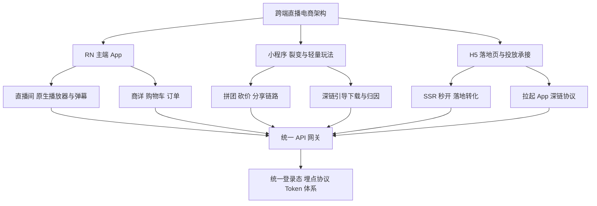

### XP-124：设计一个跨端办公套件（文档协作 + Electron 桌面 + 移动端）？
**答**：
- 编辑器架构：文档模型（CRDT——Yjs 类）作为协作核心，Web 端富文本编辑器为主实现；**CRDT 状态是端无关数据**，桌面与移动端复用同一文档引擎（WebView 内嵌或 Dart/TS 移植）。
- 端分工：**Electron 桌面**（完整编辑、离线优先、本地集成 XP-100：文件关联/托盘/通知）、**移动端**（浏览/轻编辑/评论审批，编辑能力分级）、**Web**（零安装协作入口）。
- 离线与同步：本地持久化 CRDT 快照 + oplog（Electron 用 SQLite，XP-102），联网后增量同步与冲突合并（CRDT 免冲突合并，撤销栈按用户隔离）。
- 协作周边：光标/选区协同展示、评论与@通知（推送中台 XP-129）、权限模型（XP-128：文档级/段落级权限，端上缓存授权决策）。
- 性能治理：大文档分页/虚拟化渲染、协同消息合帧节流、Electron 多窗口共享进程（XP-104）、移动端内存水位分档降级（XP-115）。

```text
跨端办公套件架构（CRDT 为核心的端无关文档引擎）
文档引擎（单一事实源）：
  Yjs 文档模型 + CRDT oplog   端无关二进制格式，任何端读同一状态
  同步协议：增量 update + awareness（光标选区在线状态）
端实现：
  Electron 桌面    完整编辑 + 文件关联 托盘 + 本地 SQLite 存快照与 oplog
  Web              零安装入口，同编辑器内核（浏览器渲染）
  移动端 RN        浏览 轻编辑 评论审批（编辑能力分级，大文档只读+虚拟化）
  离线同步：本地快照+oplog → 联网增量同步 → CRDT 自动合并（无需冲突 UI）
协作周边：
  权限    文档级/段落级 ACL（XP-128 决策 + 端上缓存）
  通知    评论与@ → XP-129 推送中台（多端可达）
  集成    文件中心挂载（XP-132） 导出 PDF/图片
性能红线：
  大文档分页渲染 + 虚拟化；协同消息合帧（16ms）；Electron 编辑窗口独立进程防串扰
```

### XP-125：设计一个跨端 IM，RN 与 Flutter 怎么选型论证？
**答**：
- IM 核心技术栈拆解：长连接（自有 socket/QUIC）、消息引擎（本地存储+同步协议）、渲染（消息列表+富媒体）、系统集成（推送/通知）。逐项对比两端能力再做总分。
- 长连接与存储：两端都需要原生侧实现（性能与后台存活），RN 走 TurboModule、Flutter 走 Pigeon——**此层两端成本相当**，不构成决定因素。
- 渲染层对比：超长消息列表 RN 用 FlashList 复用池（XP-076）成熟；Flutter Sliver 定高也优秀（XP-084）；富文本渲染 Flutter 生态（富文本编辑器）偏弱，RN 有 Web 血统优势（复制/选择/无障碍）。
- 决定性因素在**工程与组织**：团队既有 React 生态与 Web 共享逻辑需求（XP-079）→ RN；团队追求 UI 一致性与自绘掌控、已有 Dart 积累 → Flutter；多端复用代码比例、招人市场、热更诉求（RN CodePush 生态成熟）作为加分项。
- 结论模板：给出"技术分 + 组织分 + 风险分"加权决策表，**允许不同业务域异构**（主 App 用 RN，嵌入式模块用 Flutter——Add-to-App 反向融合），避免非黑即白。

```text
跨端 IM 选型论证表（RN vs Flutter）
维度                RN 新架构                    Flutter                     权重
长连接/消息引擎      原生实现+TurboModule ✓       原生实现+Pigeon ✓           平手
超长列表             FlashList 复用池 成熟 ✓      Sliver 定高 优秀 ✓          平手
富文本与选择/无障碍  Web 血统 生态强 ✓            富文本编辑器生态弱 △        RN+
热更/动态化          CodePush 生态成熟 ✓          受限（需壳或 DSBridge）✗    RN+
UI 一致性/自绘       平台差异需抹平 △             像素级一致 ✓                FL+
性能上限             高（JSI 后接近）              高                          平手
组织因素             React 生态/团队积累/Web 共享  Dart 积累/招人面            按团队实测
加权决策：技术分 40% + 组织分 40% + 风险分 20%，团队既有生态通常一票定音
结论模板：
  团队 React 背景且需 Web 共享逻辑 + 热更诉求 → RN 主端
  团队 Dart 积累 + 极致 UI 一致性 + 无热更强诉求 → Flutter 主端
  混合策略：主 App 一端，嵌入式功能页用另一端 Add-to-App（XP-085），允许异构
```

### XP-126：设计一个跨端短视频页？预加载与预渲染怎么做？
**答**：
- 体验目标：上滑切换**下一视频 300ms 内出帧**，靠三级前置——数据预取、封面/首帧预加载、播放器实例复用预热。
- 预取调度器：根据当前 index 与滑动方向，预取 N±2 的元数据与预览图；预取预算分档（低端机只预取 1 个），防内存反噬（XP-115 水位联动）。
- 播放器策略：双播放器实例轮转（当前 + 下一个），下一个实例提前 attach 解码首帧（软解预渲染或封面图+视频首帧图兜底）；切走即释放解码器。
- 各端实现：RN 用原生播放器组件（expo-video/自封装）+ Reanimated 手势切换；Flutter 用 `PageView` + `precacheImage` + 双 controller 轮转；H5 用 IntersectionObserver + `video.preload` 与 MSE 分档。
- 防坑：预加载与流量的平衡（Wi-Fi/蜂窝策略不同）、静音自动播放合规、滑动中断的播放状态机（pending/play/pause/release 五态）、性能水位超限自动降预取档。

```typescript
// features/feed/prefetch.ts —— 短视频三级前置调度器（跨端同构）
const BUDGET: Record<Tier, { metaAhead: number; players: number }> = {
  flagship: { metaAhead: 2, players: 2 },   // 双实例轮转
  mid:      { metaAhead: 1, players: 2 },
  lowend:   { metaAhead: 1, players: 1 },   // 低端机封面图兜底，不开双实例
};

export function useFeedPrefetch(controller: FeedController, tier: Tier) {
  const budget = BUDGET[tier];
  // 1) 元数据与预览图预取：当前 index ± 方向预判
  controller.onChange(async ({ index, direction }) => {
    for (let d = 1; d <= budget.metaAhead; d++) {
      const next = controller.at(index + d * direction);
      if (!next) break;
      await prefetchMeta(next.id);            // 接口预取（XP-095 同构）
      prefetchCover(next.coverUrl);           // 首帧图进图片缓存
    }
    // 2) 播放器预热：预算内提前 attach 下一个实例并解码首帧
    const nextItem = controller.at(index + direction);
    if (nextItem && budget.players === 2) playerPool.warm(nextItem, { decodeFirstFrame: true });
    // 3) 水位联动：内存黄档收预取，红档只保当前（XP-115）
    if (memPressure() !== 'green') playerPool.trim(budget.players - 1);
  });
}
// 播放状态机：idle → prepared → playing ⇄ paused → released（切走立即 release 解码器）
// 流量策略：蜂窝预取仅元数据+封面；Wi-Fi 预缓冲 3s 正片
// 合规：默认静音自动播放；首帧出帧打点口径并入 XP-117（目标 <300ms）
```

### XP-127：设计一个跨端表单引擎（schema 驱动多端渲染）？
**答**：
- 架构：**JSON Schema 表单协议**（字段类型/校验/联动/布局）为单一事实源 → 各端 renderer（Web/RN/Flutter/小程序）解析渲染 → core 层共享校验与联动逻辑（XP-122 分层同构）。
- 协议设计要点：字段级 `visibleWhen/requireWhen` 声明式联动（表达式引擎受限词表，拒绝任意代码）、异步校验（唯一性检查）、动态选项源（字典接口）、分步表单与草稿。
- 校验唯一实现：校验规则在 core 用纯 TS 实现，各端 renderer 只负责 UI 呈现——错误文案、触发时机（blur/submit）协议化，保证跨端行为一致（XP-107）。
- 类型链路：Schema → codegen 生成 TS 类型（提交 payload 类型安全）；Schema 版本化，旧端宽容读取（XP-112 原则）。
- 治理：表单 Schema 走配置平台下发（运营可配、发版免更）；渲染埋点（字段级放弃率）回流优化表单设计。

```json
{
  "formVersion": "1.3.0",
  "steps": [{ "id": "base" }, { "id": "detail" }],
  "fields": [
    {
      "key": "phone",
      "type": "input",
      "label": "手机号",
      "inputType": "tel",
      "required": true,
      "validators": [
        { "kind": "pattern", "value": "^1\\d{10}$", "message": "手机号格式不正确" },
        { "kind": "async", "api": "/check/phone-unique", "message": "该手机号已注册", "trigger": "blur" }
      ]
    },
    {
      "key": "company",
      "type": "input",
      "visibleWhen": { "field": "userType", "op": "eq", "value": "enterprise" },
      "requiredWhen": { "field": "userType", "op": "eq", "value": "enterprise" }
    },
    {
      "key": "city",
      "type": "select",
      "optionsSource": { "api": "/dict/cities", "labelKey": "name", "valueKey": "code" },
      "layout": { "colSpan": 2 }
    }
  ],
  "draft": { "enabled": true, "ttlHours": 72 }
}
// 联动表达式受限词表（eq/ne/in/gt/empty），拒绝任意代码——安全与跨端一致前提
// core：validate(schema, value) 纯 TS 实现，触发时机协议化；各端 renderer 只管 UI
// codegen：schema → TS 提交 payload 类型；配置平台下发 + 字段级放弃率埋点回流
```

### XP-128：设计一个跨端权限中心？
**答**：
- 模型分层：**RBAC（角色-资源-操作）为骨架 + ABAC（属性条件：数据归属/地域/时间）为约束**；权限元数据（资源点/操作点/角色）由权限中心统一管理，多端消费。
- 下发协议：登录后 handshake 下发**权限点集合 + 版本戳**（diff 增量），端上缓存（XP-115 存储中心同构）；权限变更服务端推送失效，回前台对账（XP-096 同步机制复用）。
- 端上消费形态统一：路由守卫（页面级）、组件条件渲染（元素级 v-permission）、API 网关校验（服务端最终裁决——**端上权限只做展示优化，不做安全边界**）。
- 与系统权限区分：设备系统权限（相机/定位）走运行时申请编排（申请时机/预说明文案/拒绝降级，XP-073 降级衔接），与业务权限（能否审批）分层管理。
- 审计与合规：授权变更全量审计日志、敏感操作二次确认、越权访问（端上请求被 403）计数上报——端上权限与服务端权限 diff 是安全信号。

```typescript
// packages/core/authz —— 权限中心端上消费层
export interface PermSnapshot {
  version: number;                       // 版本戳：变更推送失效 + 回前台对账（XP-096）
  grants: Record<string, string[]>;      // 资源点 -> 允许操作 ['read','write','approve']
  constraints?: Record<string, { region?: string[]; ownerOnly?: boolean }>;  // ABAC 条件
}

export function createAuthz(snapshot: PermSnapshot, ctx: SessionCtx) {
  const can = (resource: string, action: string, target?: { ownerId: string }): boolean => {
    const ops = snapshot.grants[resource];
    if (!ops?.includes(action)) return false;
    const c = snapshot.constraints?.[resource];
    if (c?.ownerOnly && target && target.ownerId !== ctx.userId) return false;  // 数据归属约束
    if (c?.region && !c.region.includes(ctx.region)) return false;              // 地域约束
    return true;
  };
  return {
    can,
    guardRoute: (path: string) => can(`route:${path}`, 'visit') || Redirect403,
    // 安全边界声明：端上 can() 只驱动 UI 显隐，服务端对每个请求独立鉴权
    // 403 上报：can()==true 但服务端 403 的 diff 计数 = 权限漂移信号（安全审计输入）
  };
}
// 下发：登录 handshake 拉全量 → 权限变更走推送失效 → 下次交互前对账
// 系统设备权限（相机/定位）另走 runtime 申请编排：预说明文案→申请→拒绝降级（XP-073）
```

### XP-129：设计一个跨端推送中台？
**答**：
- 通道矩阵：iOS APNs、Android 各厂商通道（华为/小米/OPPO/vivo/FCM 海外）、App 内长连接（在线优先走自建 socket，实时性最高）、Web Push/小程序订阅消息——中台做**通道接入与选择路由**。
- 路由策略：在线设备优先长连接（可达率与实时性最优），离线走厂商通道；消息分级（强提醒/普通/静默营销）映射不同通道与展示策略；营销消息频控与免打扰时段。
- 消息协议：统一消息模型（type/payload/deeplink/expireAt/channelPolicy），端上统一 SDK 处理点击路由（XP-140 深链中心）与去重幂等（messageId）。
- 可达性治理：厂商通道回执采集 → 到达率/点击率按 端 × 通道 × 消息类型 看板（XP-069 口径）；失败重试与通道降级（厂商 token 失效清理）。
- 合规：厂商通道分类申请（营销/系统）、卸载后清理、频控上限（单用户日上限）、点击归因带 traceId（XP-111 贯穿）。

```text
推送中台架构 —— 通道矩阵与路由
消息方 → 中台 API（统一消息模型）
  { messageId, type: 'system'|'order'|'marketing', title, body,
    payload, deeplink, expireAt, policy: { level, quietHours, freqCap } }

路由决策（按设备在线态 × 消息分级 × 通道可达性）：
  设备在线           → 自建长连接（实时 秒级，支持富 payload）
  离线 + iOS         → APNs（强提醒走 alert，静默走 content-available）
  离线 + Android     → 厂商通道（华为/小米/OPPO/vivo；海外 FCM）
  降级链             → 厂商回执失败 → 短信兜底（强提醒类仅限）
  Web/小程序         → Web Push / 订阅消息（按平台配额）

端上统一 SDK：
  收到推送 → messageId 去重幂等 → 前台转应用内横幅 / 后台进系统通知
  点击 → 携带 deeplink 与 traceId → XP-140 深链中心路由 → XP-111 链路贯穿
  token 生命周期：注册上报 更新 失效清理（厂商 token 失效是到达率杀手）

治理看板（XP-069 口径）：
  到达率/点击率 按 端 × 通道 × 消息类型；厂商分类申请与频控合规；营销免打扰时段
```

### XP-130：设计一个跨端支付中台（统一收银台）？
**答**：
- 中台职责：**渠道路由**（微信/支付宝/Apple Pay/Google Pay/H5 收银台/余额）、风控前置、订单状态机、对账清结算；业务方只面对"一个收单接口"。
- 统一收银台协议：业务方创建支付单（业务单号+金额+渠道偏好）→ 中台返回**渠道编排结果**（各端最优渠道顺序）→ 端上 SDK 按编排拉起渠道 → 状态回调闭环。
- 状态机纪律：支付单状态 `created → paying → success/failed/closed/refunded` 单向流转，幂等键防重复支付，**以服务端回调为唯一事实源**，端上轮询/推送仅加速感知。
- 各端拉起细节：App 内 SDK 拉起（微信 OpenSDK/支付宝 SDK）、iOS 内虚拟商品强制 IAP（合规红线）、小程序支付（跳转能力差异）、H5 兜底收银台（XP-073 降级链路）。
- 风控与对账：实时风控（频次/金额/设备指纹）拦截与人工审核位；日切对账（渠道账单 vs 支付单 diff），差错单自动挂起与处理流。

```typescript
// packages/pay/core —— 统一收银台协议与端上编排
export interface PaymentIntent {
  bizOrderNo: string;            // 业务幂等键
  amount: Money;                 // 币种+分
  scene: 'app' | 'miniapp' | 'h5';
  preferChannels?: string[];     // 业务偏好，中台有最终裁决权（合规与可用性）
}
export interface CashierPlan {   // 中台编排结果：端上按序尝试
  payId: string;
  channels: Array<
    | { kind: 'appSdk'; provider: 'wechat' | 'alipay' | 'union'; params: unknown }
    | { kind: 'iap'; productId: string }                      // iOS 虚拟商品合规强制 IAP
    | { kind: 'h5Cashier'; url: string }                      // 兜底收银台（XP-073）
  >;
  pollUrl: string;               // 状态感知轮询（事实源仍是服务端回调）
}

export async function pay(intent: PaymentIntent): Promise<PayResult> {
  const plan = await payApi.create(intent);      // 风控前置在中台，端上只执行编排
  for (const ch of plan.channels) {
    const launched = await channelLauncher.launch(ch);   // 各端 adapter 实现
    if (!launched) continue;                              // 渠道不可用（未装 App 等）降级下一渠道
    const status = await pollStatus(plan.payId, plan.pollUrl);  // 单向状态机等待
    if (status === 'success') return reportTrace('ok');
    if (status === 'failed') continue;                    // 可重试渠道
  }
  return reportTrace('exhausted');                        // 全渠道失败 → 引导人工/换卡
}
// 状态机：created→paying→success/failed/closed/refunded 单向；幂等键防重付；
// 对账：日切渠道账单 diff → 差错单挂起处理流；端上只加速感知，不做事实源
```

### XP-131：设计一个跨端日历与日程（引擎 + 组件）？
**答**：
- 分层：**日程引擎（纯逻辑：RRule 重复规则、时区换算、冲突检测、空闲查询）** + **视图组件（月/周/日/ Agenda 各端实现）**，引擎与视图解耦（core 三层同构 XP-122）。
- 重复规则：RFC 5545 RRule 作为协议标准（`FREQ=WEEKLY;BYDAY=MO,WE;UNTIL=...`），例外日期（exdate）与单次修改（split 实例）语义明确；引擎跨端同构实现或用成熟库移植。
- 时区纪律：日程存 UTC + 原始时区（跨时区旅行时"9 点开会"应钉在原时区），换算只发生在视图层（XP-108 规则直接适用）；DST 切换日由带时区日历库处理。
- 同步生态：与系统日历（EventKit/CalendarProvider）双向同步的映射层、第三方日历（Google/Outlook）走服务端聚合；冲突处理（同一时段重叠）策略可配。
- 组件要点：月视图虚拟化（切换不卡）、周视图手势横滑（XP-107 统一手势）、全天事件与跨天事件布局算法；日程提醒走推送中台（XP-129）与系统日历提醒双通道。

```typescript
// packages/core/calendar —— 日程引擎：RRule + 时区 + 冲突检测
import { RRule } from 'rrule-ts';      // 纯 TS 实现可跨端（Flutter 侧移植同协议）

export interface Event {
  id: string;
  title: string;
  startUtc: string;            // UTC 存储（XP-108）
  durationMin: number;
  originalTz: string;          // 原始时区：跨时区"9 点会"钉在原时区
  rrule?: string;              // RFC 5545：'FREQ=WEEKLY;BYDAY=MO,WE'
  exdates?: string[];          // 例外：单次取消
}

export function expandInRange(ev: Event, from: Date, to: Date): EventInstance[] {
  if (!ev.rrule) return [instance(ev, ev.startUtc)];
  const rule = RRule.fromString(ev.rrule);
  return rule.between(from, to)
    .filter((d) => !ev.exdates?.includes(toUtcIso(d)))
    .map((d) => instance(ev, toUtcIso(d)));          // 重复展开只产 UTC 实例，换算归视图层
}

export function detectConflicts(events: EventInstance[]): EventInstance[][] {
  const sorted = [...events].sort((a, b) => a.start - b.start);
  const groups: EventInstance[][] = [];
  for (const e of sorted) {                          // 扫描线：O(n) 重叠分组
    const g = groups.find((grp) => e.start < grp[0].end);
    g ? g.push(e) : groups.push([e]);
  }
  return groups.filter((g) => g.length > 1);
}
// 视图层（各端实现）：月/周视图按本地时区渲染 originalTz 标注；
// 提醒双通道：系统日历提醒 + 推送中台（XP-129）；同步映射层对接 EventKit/CalendarProvider
```

### XP-132：设计一个跨端文件中心（上传 / 预览 / 同步）？
**答**：
- 三能力层：**上传**（分片+断点+秒传 md5 去重）、**预览**（类型路由到渲染器：图片/文档/音视频，XP-064 预览方案复用）、**同步**（多端文件状态一致性：本地缓存目录 vs 云端清单版本）。
- 上传调度：并发分片（XP-099 下载同构复用）、失败重试、弱网降档（切片变小）、后台续传（App 切后台任务托管：iOS BGTask/Android WorkManager）；大文件走专用通道（直传 OSS 的 STS 临时凭证）。
- 预览路由：按 mime + 大小分级——图片原图/缩略、文档转码服务（Office→PDF→页图）、视频转码多码率；端上缓存预览产物（LRU，水位联动 XP-115）。
- 同步模型：**清单驱动**（服务端目录树 + fileVersion），端上 diff 拉增量；冲突（离线双端改）策略可配（保留两版/以新覆盖）；传输进度与冲突统一进文件中心消息中心。
- 安全与配额：预签名 URL 短时效、敏感文件水印（用户身份嵌入）、配额与频控；删除走回收站延迟生效（多端一致性窗口）。

```typescript
// packages/core/files —— 上传调度 + 清单同步（预览路由按 mime 分级）
export async function upload(file: FileHandle, opts: UploadOpts) {
  const { fastId, exists } = await filesApi.statByMd5(await md5(file));   // 秒传探测
  if (exists) return filesApi.commit({ fastId, name: file.name });

  const partSize = networkTier() === 'weak' ? 1 << 20 : 4 << 20;          // 弱网降档切片
  const parts = planChunks(file.size, partSize);
  const token = await filesApi.sts(file.name);                            // STS 直传 OSS
  await pMap(parts, (p) => uploadPartWithRetry(token, file, p), { concurrency: 4 });
  return filesApi.commit({ uploadId: token.uploadId });                   // 断点：parts 位图持久化
}

export async function syncFolder(localDir: string, cursor?: string) {
  const manifest = await filesApi.listManifest(cursor);    // 清单驱动：fileVersion 增量
  const diff = diffManifest(await readLocalIndex(localDir), manifest);
  for (const op of diff.downloads) await fetchToLocal(op, { cache: 'lru' });  // 拉增量
  for (const op of diff.conflicts) notifyConflict(op);     // 冲突策略：默认保留两版
  await writeLocalIndex(localDir, manifest);
}
// 预览路由：image→原图/缩略；office→转码服务 PDF→页图；video→多码率 HLS
// 安全：STS 短时效预签名；敏感文件身份水印；删除走回收站（多端一致窗口）
// 后台续传：iOS BGTask / Android WorkManager 托管（App 杀进程后可恢复）
```

### XP-133：设计一个跨端客服系统？
**答**：
- 会话编排：**机器人（意图识别+FAQ/RAG）→ 转人工判定（置信度/情绪/用户强制）→ 人工坐席（技能组路由+排队）**，全流程消息模型统一（复用 IM 消息协议）。
- 多端接入：App 内客服（RN/Flutter 容器组件）、H5 独立页、小程序客服消息（平台 API 适配）、桌面端（Electron 常驻入口）——同一会话跨端延续（会话 id + traceId 贯穿 XP-111）。
- 会话上下文注入：进入客服自动携带用户身份、当前页面/订单上下文（脱敏策略分级）、最近操作事件流——坐席侧不用反复询问，机器人侧可主动预判问题。
- 消息类型协议：文本/富文本/图片/商品卡片/订单卡片/表单（满意度/工单回填），卡片类消息各端 renderer 实现同一协议（XP-127 表单引擎复用）。
- 治理指标：机器人解决率、转人工率、首次响应时长、排队放弃率、满意度——分端分渠道看板（XP-069）；高峰限流与排队策略（VIP 优先级可配）。

```text
跨端客服系统架构 —— 编排 + 多端接入
会话编排管线：
  用户消息 → 意图识别+RAG 检索 → 置信度 ≥ 0.85 → 机器人直接应答（FAQ/操作指引/自助工单）
              ↓ 置信度不足 / 负面情绪 / 用户喊人工
           转人工：技能组路由（订单/支付/账号）→ 排队（VIP 权重可配）→ 坐席工作台
多端接入（同一会话协议）：
  App      RN/Flutter 容器组件（消息列表复用 XP-076/084 手势 XP-107）
  H5       独立页（免登录态场景走匿名会话 + 后续绑定）
  小程序   平台客服消息 API 适配层
  Electron 常驻入口（托盘快捷入口，XP-100）
上下文注入（脱敏分级）：
  身份 + 当前页面/订单号 + 最近 10 条操作事件流 → 坐席免询问 机器人可预判
消息协议：text/rich/image/商品卡片/订单卡片/表单卡片（满意度与工单回填，XP-127 复用）
指标看板（XP-069 口径分端分渠道）：机器人解决率 转人工率 首响时长 排队放弃率 满意度
```

### XP-134：设计一个跨端数据采集 SDK（埋点中台的采集端）？
**答**：
- 架构分层：**采集器（事件源：点击/曝光/PV/自定义/性能）→ 处理管线（校验、补全、采样、脱敏）→ 队列缓冲（内存环形 + 落盘持久）→ 上报器（批量压缩、多通道、退避重试）**；插件化管线便于扩展（XP-058 采集适配的架构升级版）。
- 数据质量优先：事件 schema 校验（坏数据丢弃+计数，不静默污染）、公共属性自动补全（XP-111 日志同款公共字段）、时间戳统一 UTC + 单调时钟序号防端上改表乱序。
- 上传策略：批量（50 条/5s 触发）+ gzip、场景分级（error 即时、行为攒批、性能定时）、退避重试与磁盘上限（超限丢弃低优先级）、网络分型（蜂窝降采样）。
- 可靠性语义：至少一次（落盘重发）+ messageId 幂等去重（服务端）；关键事件（转化）与普通事件分级保障。
- 性能与合规红线：主线程零阻塞（采集入队 O(1)、序列化在后台）、初始化 defer（XP-077 启动纪律）、隐私合规（脱敏白名单、用户可关闭采集开关、GDPR 删除权接口）。

```typescript
// packages/track/sdk —— 插件化管线：采集 → 处理 → 缓冲 → 上报
interface PipelinePlugin { name: string; process(e: TrackEvent): TrackEvent | null; }

export class TrackSDK {
  #queue = new RingBuffer<TrackEvent>(2000);      // 内存环形缓冲
  constructor(private plugins: PipelinePlugin[], private transport: Transport) {}

  track(name: string, props: Props, level: 'normal' | 'critical' = 'normal') {
    let e: TrackEvent = { name, props, tsUtc: new Date().toISOString(), seq: monotonicSeq() };
    for (const p of this.plugins) {               // 管线：校验→补全→采样→脱敏
      const out = p.process(e);
      if (!out) return;                           // 坏数据/被采样剔除：丢弃+计数，不污染
      e = out;
    }
    this.#queue.push(e);
    if (level === 'critical' || this.#queue.size >= 50) this.#flush();
    else scheduleFlush(5_000);                    // 5s 攒批
  }

  async #flush() {
    const batch = this.#queue.drain(50);
    if (!batch.length) return;
    const body = gzip(JSON.stringify(batch));     // 批量压缩
    try { await this.transport.send(body); }
    catch {
      await this.#persist(batch);                 // 失败落盘，退避重发（至少一次）
      backoff(() => this.#flush());
      if (diskUsage() > LIMIT) this.#queue.dropLowPriority();  // 磁盘上限保护
    }
  }
}
// 内置插件：schemaValidator / enrich(公共字段自动补全) / sampler(蜂窝降采样) / mask(脱敏)
// 红线：入队 O(1) 零主线程阻塞；初始化走 defer（XP-077）；用户可关闭采集+删除权接口
```

### XP-135：设计一个跨端性能监控平台？
**答**：
- 链路架构：**端侧 SDK（XP-113/115/117 的采集能力）→ 接入网关（鉴权、限流、Schema 校验）→ 流处理（聚合降采样、归一化）→ OLAP 存储（ClickHouse 类）→ 看板与告警**；与错误监控（XP-068）、日志（XP-111）共用 traceId 关联。
- 指标体系：五大类（启动 TTI、滚动 FPS、交互 INP、内存水位、包体积/资源）× 维度（端/版本/deviceTier/页面/渠道），指标口径唯一来源是基线文件（XP-118 baselines.yaml，代码即配置）。
- 实时性分层：核心指标分钟级流式聚合（发布门禁实时判定），明细明细样本异步入仓供下钻（trace 回放、慢样本 segments）。
- 告警与门禁：动态基线告警（同环比 + 分位值突刺）、发布门禁联动（XP-137：灰度桶指标劣化自动暂停放量——与 XP-083/093 熔断同一套机制）。
- 治理运营：指标口径变更走 RFC（看板口径漂移是平台公信力杀手）、数据保留分层（明细 30 天/聚合 1 年）、平台 SLA（采集丢失率、看板查询 P95）。

```text
跨端性能监控平台架构 —— 采集到告警全链路
端侧 SDK（采集）        接入网关           流处理              存储/查询
├─ 启动 TTI XP-113  →  ├─ 鉴权+限流    →  ├─ 分钟级聚合     →  OLAP（ClickHouse 类）
├─ 滚动 FPS XP-114     ├─ Schema 校验     ├─ 归一化(端/版本)    ├─ 明细 30 天（trace 回放）
├─ 交互 INP XP-117     ├─ 坏数据丢弃计数  └─ 慢样本抽全量       └─ 聚合 1 年（趋势）
├─ 内存水位 XP-115     └─ traceId 关联                            ↑
└─ 采样与批量（XP-134 管线复用）              看板/告警 ←────────┘
                                              ├─ 指标口径 = XP-118 baselines.yaml（唯一源）
                                              ├─ 动态基线告警（同环比+分位突刺）
                                              └─ 发布门禁联动（XP-137）

联动闭环：
  灰度发布 → 灰度桶实时指标（分钟级）→ 劣化超阈值 → 自动暂停放量（XP-083/093 同机制）
  慢样本 → segments 分段 → 区分业务慢/渲染慢 → 归因到代码变更（版本 diff 关联）
运营红线：
  指标口径变更走 RFC；采集丢失率 <1%；看板查询 P95 < 3s（平台自身 SLA）
```
### XP-136：设计一个跨端 CI/CD 体系（矩阵构建 / 签名 / 分发）？
**答**：
- 流水线分层：**PR 门禁（lint/单测/类型/契约测试/体积与视觉回归）→ 主干矩阵构建（多端多平台产物）→ 签名与归档 → 内测分发 → 灰度发布（XP-137）**；每层产物版本化唯一（版本号+构建号+commit sha 三元组可追溯）。
- 矩阵构建：按端拆并行 job（RN iOS 需 macOS、RN Android、Flutter 双端、Web/小程序、Electron 三平台），缓存策略（gradle/cocoapods/pub/monorepo 构建缓存）决定流水线时长。
- 签名安全：证书与密钥进 KMS/CI secret，**构建机不落盘持久密钥**；macOS 公证+Windows 签名自动化；签名产物 hash 归档，热更包签名同链路（XP-083）。
- 分发矩阵：内测（TestFlight/蒲公英/企业签）、商店（App Store/Google Play/各安卓市场）、桌面（自动更新通道 XP-101）、小程序（CI 上传+提审自动化）——统一发布单驱动，禁止绕过流水线手工发版。
- 度量与守护：流水线时长/成功率看板，flaky 用例隔离机制；主干 red（构建失败）15 分钟内必须有人响应（值班制）。

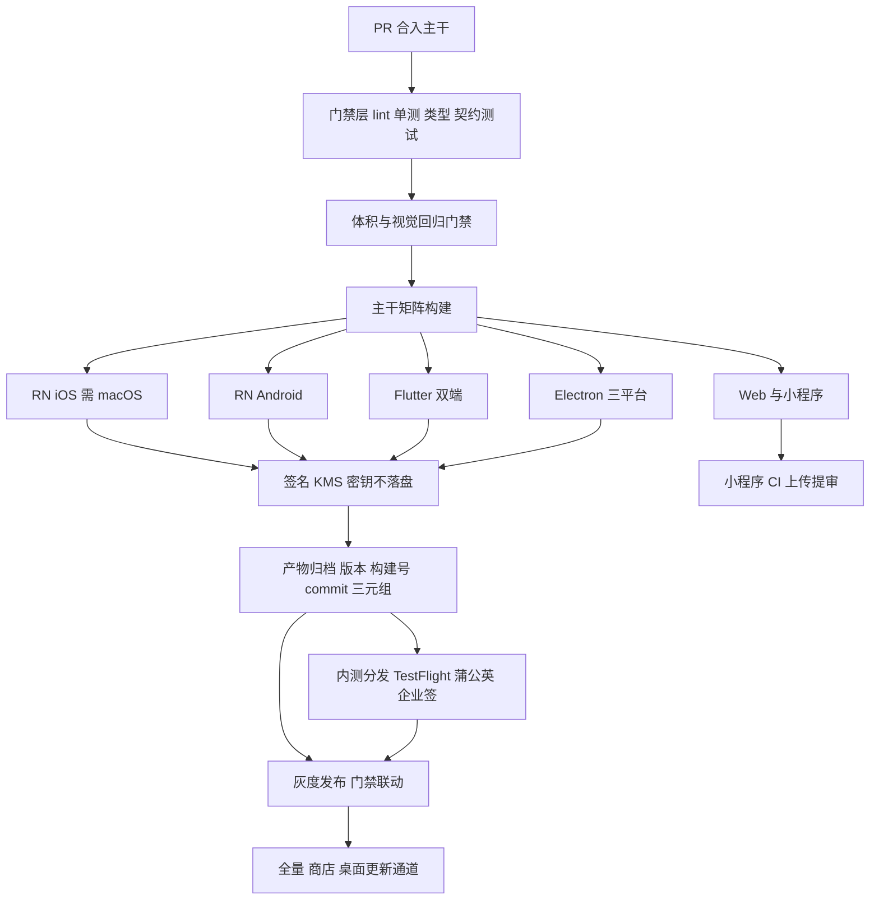

### XP-137：设计一个跨端灰度发布体系？
**答**：
- 核心抽象：**发布单（Release）**——一次发布声明"内容（RN bundle/原生/离线包/配置/服务端）、目标端、灰度计划、门禁指标、回滚预案"，全端发布走同一编排模型。
- 灰度节奏编排：桶位进度（1/5/20/50/100%）+ 每档观察窗 + 自动进位/自动熔断（XP-083/093/135 同一套机制复用到全端）；**多端协同节奏**（服务端先行、RN bundle 次之、原生最后）在发布单里显式声明依赖。
- 分流维度：默认按用户 id 哈希稳定分桶（XP-093 同构），叠加白名单/人群/地域/deviceTier 维度；同一实验域内正交分层（XP-139 分流引擎复用），避免多发布互相污染。
- 门禁与回滚：每档位实时判定核心指标（崩溃率/JS 异常率/性能水位/业务转化），超阈值自动暂停+告警；一键回滚全端联动（bundle 指针回切、离线包槽位回退、服务端开关关闭），回滚演练季度化。
- 治理：发布日历冲突检测（同域发布错峰）、紧急发布绿色通道（事后补审）、发布审计全量留痕（谁/何时/什么内容/门禁数据）。

```yaml
# release/rel-2026-1110.yaml —— 发布单：跨端灰度编排的唯一载体
release: rel-2026-1110
owner: team-checkout
artifacts:                                   # 本次发布的多端内容
  - { kind: server,  name: checkout-api,     version: 1.42.0, order: 1 }
  - { kind: rn-bundle, name: app-mobile,     version: 8.3.1-rc2, minNative: 8.3.0, order: 2 }
  - { kind: offline-pkg, name: mall-home,    version: 3.5.0, order: 2 }
  - { kind: native,  name: app-mobile,       version: 8.3.1, order: 3, storeReview: true }
gates:                                       # 门禁指标（XP-135 实时数据）
  crashRate: 0.005
  jsErrorRate: 0.02
  perf: { coldStartPct: 10, inpP75Ms: 200 }
rollout:                                     # 灰度节奏：桶位 + 观察窗 + 自动进位
  buckets: [1, 5, 20, 50, 100]
  dwellPerBucket: 2h
  autoAdvance: true                          # 门禁全绿自动进位；超阈值自动暂停+告警
  segmentation: { salt: rel-2026-1110, dims: [userId-hash, region, deviceTier] }
  emergency: { channel: fast-track, requiresPostReview: true }   # 紧急发布绿色通道
rollback:
  plan: bundle 指针回切 + 离线包槽位回退 + server 回滚，一键全端联动（XP-083/093）
  drill: quarterly                            # 回滚演练季度化
conflictCheck: mall-domain                    # 发布日历：同域发布错峰
```

### XP-138：设计一个跨端热更新平台？
**答**：
- 平台职责闭环：**打包（CI 产物）→ 签名与校验 → 分版本矩阵管理（bundle×原生壳兼容矩阵）→ 灰度分发（复用 XP-137）→ 监控熔断（XP-083）→ 回滚**，热更是发布体系的一种 artifact，不另起炉灶。
- 多技术栈支持：RN bundle（CodePush 协议兼容）、离线包（XP-093 manifest 协议）、Flutter 壳受限（强调合规与原生对齐）、小程序包（平台上传）——平台以**适配器模式**对接各协议，统一操作界面与审计。
- 兼容矩阵管理：每次原生发版生成新的"bundle 基线"，平台维护 `bundle ↔ minNativeVersion` 关系；孤儿 bundle（对应壳版本消失）自动清理。
- 安全：发布产物强制签名（平台私钥、端上公钥校验 XP-083）、打包来源可追溯（commit+构建人）、下载链路 CDN+防盗链+checksum。
- 效率能力：diff 增量包自动生成、预热下载（Wi-Fi 环境预取下一版本）、分端资源（图片按端裁剪进包）、发布报表（热更成功率/覆盖率/回滚次数）。

```text
跨端热更新平台 —— artifact 适配器架构
平台核心：发布单（XP-137）+ 兼容矩阵 + 签名服务 + 灰度分发 + 监控熔断
适配器层（对接各热更协议，操作界面与审计统一）：
  RN        CodePush 协议兼容：bundle 签名 + rollout 百分比 + rollback 指令
  离线包    manifest 协议：diff 增量 + 双槽位 + 一键回滚（XP-093）
  小程序    平台上传 API 适配（审核流约束，平台只做编排与审计）
  Flutter   受限：仅资源/配置热更（合规前提下），逻辑变更走原生发版对齐

兼容矩阵（bundle ↔ 原生壳）：
  原生 8.3.0 发版 → 生成 bundle 基线 b830
  bundle 声明 minNative/maxNative；服务端按客户端原生版本下发匹配 bundle
  孤儿 bundle（壳版本下线）→ 自动清理，防矩阵膨胀

安全链路：CI 产物 → 平台私钥签名 → CDN 防盗链 → 端上公钥校验 + checksum → 安装
效率：diff 自动生成 / Wi-Fi 预热下载 / 按端资源裁剪 / 成功率覆盖率报表
风控：熔断阈值与 XP-083 一致；回滚指令全端联动；发布审计全量留痕
```

### XP-139：设计一个跨端埋点实验平台（A/B 多端分流）？
**答**：
- 分流引擎核心：**分层正交模型**——流量层（layer）内实验互斥、层间正交（不同层实验可叠加），分流因子 `hash(layerId, experimentId, userId) % 100`，同一用户在任意端（App/H5/小程序）按同一 userId 分到同一桶——**跨端一致分流是硬要求**（未登录用户用设备指纹桥接，登录后切 userId 并做桶迁移记录）。
- 实验配置：变体（含参数 JSON）、目标人群（圈选条件）、指标（核心+护栏）、时长与样本量预估（功效分析）；配置下发热更新生效（XP-067 flag 通道）。
- 端上执行：SDK 启动 handshake 拉取实验分配（XP-112），暴露 `getVariant(experiment)`；曝光/转化事件自动带实验标记（XP-134 管线补全字段）。
- 分析与决策：指标看板（AA 期检验、显著性、护栏告警——崩溃率/性能劣化自动停实验）、MDE 未达提前判定、实验复盘归档（结论沉淀进知识库）。
- 治理：实验生命周期状态机（draft→running→concluded），超期实验强制收敛；同域实验冲突检测（分流层设计即预防）；埋点字典统一管理（XP-134 schema 同源）。

```typescript
// packages/ab/core —— 分层正交分流引擎（跨端一致）
export interface ExperimentCfg {
  id: string; layer: string;              // layer 内互斥，layer 间正交
  variants: Array<{ key: string; params: Record<string, unknown>; weight: number }>;
  audience?: { region?: string[]; tier?: Tier[]; minVersion?: string };
}

export function assign(cfg: ExperimentCfg, ctx: { userId: string; region: string; tier: Tier; version: string }): Variant | null {
  if (cfg.audience && !matchAudience(cfg.audience, ctx)) return null;
  // 分桶：hash 因子含 layerId 与 experimentId —— 层内互斥 层间正交
  const bucket = murmur3(`${cfg.layer}#${cfg.id}#${ctx.userId}`) % 100;
  let acc = 0;
  for (const v of cfg.variants) {
    acc += v.weight;                       // 权重和 = 100
    if (bucket < acc) return v;            // 同一 userId 任意端计算结果相同 → 跨端一致
  }
  return null;                             // 未命中（如灰度放量中）
}
// 未登录：设备指纹桥接；登录后切 userId + 桶迁移记录（分析侧修正）
// SDK：启动 handshake 拉实验配置（XP-112）→ getVariant() → 曝光事件自动带实验标记
// 平台侧：AA 检验 / 显著性 / 护栏自动停实验（崩溃率 劣化即停）；超期实验强制收敛
```

### XP-140：设计一个跨端深链路由中心？
**答**：
- 定位：统一收口所有"从外部/跨端进入某页面"的入口——scheme/universal link/推送 deeplink/小程序码/H5 拉起/桌面协议（XP-100 protocols），**路由表单一源**，注册中心平台化管理。
- 路由表协议：`routeId → 多端路径映射`（App 原生路由/Flutter 路由（XP-087）/H5 path/小程序 page + 各端参数序列化规则），参数 schema 校验（非法参数降级到等价页面而非白屏）。
- 解析与兜底：解析优先级链（App 已装 → 原生页面直达；未装 → 智能引导：落地页/下载器，携带归因参数）；App 内收到深链先鉴权（XP-128 路由守卫）再导航，未登录走 XP-087 守卫回跳。
- 跨端衔接：深链可声明"接力链"（App → 小程序 → H5 的降级与互补链路，XP-123 裂变场景）；归因参数 traceId 全链路透传（XP-111）。
- 治理：路由变更版本化 + 废弃路由兼容期映射（旧二维码永不断链）、各端注册自动化校验（CI 检查路由表与代码路由表一致）、链路点击→到达→转化漏斗看板。

```typescript
// packages/router/registry —— 路由中心：单一源 + 多端映射 + 兜底链
export interface RouteDef {
  id: string;                             // 'order.detail'
  paths: {
    native: string;                       // App 原生栈路由（RN/Flutter 对齐 XP-087）
    h5?: string;                          // '/order/:id'
    miniapp?: { appid: string; page: string };
  };
  params: JSONSchema;                     // 参数 schema：非法参数走 fallback 而非白屏
  auth: 'public' | 'login' | 'vip';       // 进页面先鉴权（XP-128 守卫）
  fallbackChain: Array<'app' | 'miniapp' | 'h5' | 'download'>;  // 未安装接力链
  deprecateTo?: string;                   // 废弃路由兼容映射：旧二维码永不断链
}

export function resolve(defs: RouteDef[], raw: DeepLink, ctx: ClientCtx): NavPlan {
  const def = defs.find((d) => match(d, raw)) ??
              defs.find((d) => d.id === raw.legacyId);          // 废弃路由映射兜底
  if (!def) return { action: 'home' };
  if (!validateParams(def.params, raw.params)) return { action: 'h5', path: def.paths.h5 };
  if (def.auth !== 'public' && !ctx.loggedIn) return { action: 'login', then: raw };  // XP-087 守卫
  // 按 ctx 所在端与能力选择落点：App 原生直达 / 小程序 page / H5；未装走 fallbackChain
  return planFor(ctx, def, raw);
}
// CI 校验：路由表注册项 ↔ 各端代码路由表 diff 一致（防路由漂移）
// 漏斗看板：点击 → 到达 → 转化，按入口渠道归因（traceId 贯穿 XP-111）
```

### XP-141：设计一个跨端无障碍（a11y）体系？
**答**：
- 标准与验收：以 WCAG 2.1 AA 为基线，拆成可执行 checklist（对比度 4.5:1、触摸目标 ≥44pt、焦点顺序、屏幕阅读器语义）进设计评审与验收门禁。
- 语义统一映射：Design Token 扩展 a11y 语义（roles/labels/order）——RN `accessibilityRole/Label`、Flutter `Semantics`、Web `ARIA`、小程序 aria-* 由组件库（XP-122）统一注入，业务零散配置收敛进组件。
- 各端重点差异：Web（语义 HTML 优先 + axe 自动扫描）、RN（accessibility* 属性 + iOS VoiceOver/Android TalkBack 实测）、Flutter（Semantics 树，Web 端 canvaskit 需显式开启 semantics，XP-090）、动态字体（跟随系统字号缩放，布局不碎）。
- 自动化与门禁：CI 静态扫描（axe-core/ESLint jsx-a11y）+ 组件库 golden 语义断言（XP-106 矩阵扩展 a11y 维度）+ 版本发布前真机读屏抽测脚本。
- 治理：a11y 缺陷按 P0（不可用）P1（难用）分级管理，P0 阻断发布；键盘/读屏/大字号三场景进回归用例集。

```jsx
// packages/ui/platform/rn/PrimaryButton.jsx —— 组件库统一注入 a11y 语义
export const PrimaryButton = forwardRef(function PrimaryButton(
  { label, onPress, disabled, loading }, ref,
) {
  return (
    <TouchableOpacity
      ref={ref}
      onPress={onPress}
      disabled={disabled || loading}
      // 语义由组件库统一注入，业务不散配（Web 侧同组件输出 role=button + aria-label）
      accessibilityRole="button"
      accessibilityLabel={label}
      accessibilityState={{ disabled: disabled || loading, busy: loading }}
      accessibilityHint="提交当前表单"
      style={[styles.base, disabled && styles.disabled]}   // 对比度来自 Token（4.5:1 已校）
    >
      <Text allowFontScaling style={styles.text}>{loading ? '提交中' : label}</Text>
    </TouchableOpacity>
  );
});
// 各端映射表（组件库内部）：accessibilityRole ↔ ARIA role ↔ Flutter Semantics ↔ 小程序 aria-role
// CI 门禁：jsx-a11y/axe-core 静态扫描 + 语义 golden 断言（XP-106 矩阵 a11y 维度）
// 版本门禁：P0 级读屏缺陷（按钮读不出/焦点丢失）阻断发布；动态字体 +2 档布局不碎进回归
```

### XP-142：设计一个跨端登录与会话体系？
**答**：
- 认证模型：多端统一 OAuth2/OIDC 风格——**token 双轨（短时 access token + 长效 refresh token）**，各端按平台存储约束落位（iOS Keychain / Android Keystore / Web httpOnly cookie / Electron safeStorage+XP-102）。
- 会话一致性：单点登录（一处登录多端可复用授权），支持设备管理（多设备会话列表与踢出）；token 轮换（refresh rotation）+ 重放检测（旧 refresh token 使用即吊销全链）。
- 刷新编排：请求 401 → 单飞刷新（并发请求共享一次 refresh，防竞态互踩）→ 重放原请求；刷新失败静默重登引导（游客态兜底，核心页面不裸奔）。
- 跨端会话同步：Native↔H5 用 Cookie 同步与桥推送（XP-096）；扫码登录（App 扫 Web 码）走同一授权服务；登录态变更全端广播失效。
- 安全红线：token 不进 URL/日志（XP-111 脱敏）、生物识别本地解锁（敏感操作二次验证）、异常地点/设备登录风控挑战、注销即全端吊销。

```typescript
// packages/core/session —— 双 token + 单飞刷新 + 跨端同步
class SessionManager {
  #refreshing: Promise<Tokens> | null = null;             // 单飞锁：并发 401 共享一次刷新

  async request<T>(req: Request): Promise<T> {
    const res = await http(req, { auth: this.tokens.access });
    if (res.status !== 401) return res.data;
    const tokens = await (this.#refreshing ??= this.#doRefresh().finally(() => (this.#refreshing = null)));
    return http(req, { auth: tokens.access }).then((r) => r.data);   // 重放原请求
  }

  async #doRefresh(): Promise<Tokens> {
    try {
      const next = await authApi.refresh(this.tokens.refresh);       // rotation：服务端轮换
      await this.secureStore.set('tokens', next);                    // Keychain/Keystore/safeStorage
      bridge.broadcast('state:update', { version: next.version });   // Native↔H5 同步（XP-096）
      return next;
    } catch (e) {
      if (isReplay(e)) await this.revokeAllDevices();                // 重放检测：吊销全链会话
      eventBus.emit('session:expired');                              // 静默重登引导 + 游客态兜底
      throw e;
    }
  }
}
// 红线：token 不进 URL 与日志；敏感操作生物识别二次验证；注销 = 服务端全端吊销
// 扫码登录：App 扫 Web 码 → 授权服务下发会话 → 同一套 rotation 体系
```

### XP-143：设计一个跨端消息中心（站内信 / 红点 / 已读）？
**答**：
- 定位与推送中台（XP-129）的关系：推送负责"触达在线/离线设备"，消息中心负责"端内消息盒子的状态管理"（未读数、已读、聚合、生命周期）——两者共享消息模型。
- 消息分级：强提醒（订单/资金，需明确已读）、资讯（聚合去重）、营销（折叠+频控）；同一消息多端投递去重（messageId 幂等，XP-129 同款）。
- 红点体系：**层级红点模型**（Tab→入口→列表，父节点未读数=子节点聚合），红点状态服务端为主端上缓存（XP-096 同步机制）；批量已读、按类型已读策略可配。
- 已读语义：已读状态机（未读/已读/已处理）服务端持久化，多端实时同步（在线长连接推送 + 回前台对账）；列表虚拟化（XP-076/084）支撑长消息列表。
- 治理：消息模板化（运营配置免发版）、消息保留策略（过期归档）、未读数准确率监控（红点误差是投诉重灾区）、端上未读数兜底自洽（服务端不可达时本地近似）。

```typescript
// packages/core/message-center —— 层级红点 + 已读状态机
export type ReadState = 'unread' | 'read' | 'done';

export interface MessageBox {
  nodes: Record<string, BadgeNode>;       // 树形：'root.tab.order' → 'root.tab.order.list'
}
export function recomputeUnread(box: MessageBox, leaves: Array<{ id: string; unread: number }>): MessageBox {
  // 叶子未读数自底向上聚合：父节点 = 子节点之和（红点层级模型）
  for (const leaf of leaves) box.nodes[leaf.id] = { unread: leaf.unread };
  for (const id of Object.keys(box.nodes).sort((a, b) => depth(b) - depth(a))) {
    const node = box.nodes[id];
    if (!node) continue;
    node.unread = isLeaf(id) ? node.unread
      : childrenOf(box, id).reduce((sum, c) => sum + (box.nodes[c]?.unread ?? 0), 0);
  }
  return box;
}

export async function markRead(box: MessageBox, ids: string[], scope: 'item' | 'list' | 'all') {
  const next = applyRead(box, ids, scope);          // 乐观更新：红点即时消失
  bridge.broadcast('msg:read', { ids, scope });     // 多端同步：其他端实时收敛
  try { await msgApi.markRead(ids, scope); }        // 服务端持久化（事实源）
  catch { scheduleResync(); }                       // 失败回前台对账（XP-096 机制）
  return next;
}
// 分级：强提醒需明确已读 / 资讯聚合去重 / 营销折叠+频控；messageId 多端去重
// 监控：未读数准确率（服务端 vs 端上 diff）看板；端上兜底：服务端不可达时本地近似并标记 stale
```

### XP-144：设计一个跨端配置中心？
**答**：
- 与灰度（XP-137 flag 通道）的关系：配置中心管"参数与开关的运行时取值"（缓存策略/分档参数/接口地址/文案变体），灰度管"发布进度编排"——配置下发复用同一通道与分流引擎（XP-139）。
- 数据模型：namespace（命名空间隔离业务域）→ key → 各灰度维度取值（按用户/桶/端/版本 fallback 链：实验值→人群值→默认值），取值决策在**服务端下发快照**，端上零计算（防端上规则引擎不一致）。
- 端上运行时：启动 handshake 拉快照（XP-112）+ 订阅增量推送；内存热生效（观察者模式），持久化缓存（断网用最后快照 + 版本戳）；变更审计与回滚（配置错误一键回滚上一版本）。
- 类型安全：配置 schema 化（JSON Schema → 各端类型生成），坏配置（schema 校验失败）拒绝生效并告警——配置事故大多源于无 schema。
- 治理：变更走审批流（高危 namespace 双审）、发布前 dry-run（按采样用户计算影响面）、配置项生命周期（无人使用的 key 定期清理）。

```typescript
// packages/core/config —— 快照驱动：服务端决策 端上零计算
export interface ConfigSnapshot {
  version: number; ns: Record<string, Record<string, unknown>>;   // ns.key → value
  appliedTo: { bucket: string; rules: string[] };                  // 取值依据（可解释）
}

export function createConfig(bootstrap: ConfigSnapshot, storage: Storage) {
  let snapshot = bootstrap;
  bridge.on('config:patch', (patch) => {                 // 增量推送：内存热生效
    if (patch.version <= snapshot.version) return;       // 版本戳防乱序（XP-096 同款）
    snapshot = mergeValidated(snapshot, patch);          // JSON Schema 校验失败拒绝生效+告警
    emitter.emit(`ns:${patch.ns}`);                      // 观察者通知订阅方热更新
  });
  document.addEventListener?.('visibilitychange', resyncIfStale);   // 回前台对账
  return {
    get<T>(ns: string, key: string, fallback: T): T {    // 类型化读取：codegen 生成签名
      const v = snapshot.ns[ns]?.[key];
      return (v === undefined ? fallback : v) as T;      // 断网兜底：最后快照 / 代码默认值
    },
  };
}
// fallback 链（服务端计算后写入快照）：实验值 XP-139 → 人群值 → 端/版本覆盖 → 默认值
// 治理：高危 ns 双审 + dry-run 影响面 + 一键回滚上一版本；无 schema 的坏配置拒绝生效
```

### XP-145：设计一个跨端存储中心（统一存储层）？
**答**：
- 问题：各端存储设施碎片化（MMKV/SharedPreferences/UserDefaults/localStorage/IndexedDB/SQLite），直接使用导致容量无治理、敏感数据裸奔、多端读写冲突——存储中心提供**统一抽象 + 分级落位**。
- 分级选型协议：按数据特征自动落位——KV 轻量（偏好态）→ 各端高性能 KV；结构化查询（消息/任务）→ SQLite；大对象（文件/模型）→ 文件目录 + 索引；易失缓存 → 内存 LRU；每类配 TTL 与容量上限。
- 安全策略：敏感数据强制加密落盘（密钥走安全区 Keychain/Keystore/safeStorage），分级标注（PII/凭证/普通）进 schema；日志与埋点禁存敏感字段（XP-111 白名单呼应）。
- 一致性治理：跨容器共享数据（Native↔WebView↔小程序）统一经存储中心中转（XP-096 同步机制），禁止各容器私拷贝；账号切换/注销的清空钩子统一实现（合规硬要求）。
- 治理看板：各 ns 容量与增长趋势、超限告警与 LRU 淘汰记录、孤儿 key 清理（无人读取的 key 定期下线）。

```typescript
// packages/core/storage —— 统一抽象 + 分级落位 + 安全标注
export type Sensitivity = 'plain' | 'pii' | 'credential';
export interface StoreNs { quotaMB: number; ttlDays?: number; sensitivity: Sensitivity }

// 各端 adapter：KV(MMKV/UserDefaults/localStorage) / sqlite(结构化) / file(大对象) / mem(LRU)
export function createStore(adapters: StoreAdapters) {
  const plan: Record<StoreNs['sensitivity'] | 'kv' | 'sqlite' | 'file' | 'mem', Adapter> = {
    kv: adapters.kv, sqlite: adapters.sqlite, file: adapters.file, mem: adapters.mem,
  };
  return {
    // 按 namespace 声明选择落位：ns 配置由平台统一下发（XP-144 同通道）
    ns(name: string, cfg: StoreNs) {
      const backend = cfg.sensitivity === 'credential' ? adapters.secureKV   // 安全区加密
                    : cfg.sensitivity === 'pii' ? adapters.encryptedKV       // 加密落盘
                    : backendFor(name, cfg);                                 // kv/sqlite/file
      return wrap(backend, {
        ns: name, quota: cfg.quotaMB,
        ttl: cfg.ttlDays,                                                    // 过期与 LRU 淘汰
        onAccountSwitch: () => backend.clear(name),                          // 注销清空钩子统一
        track: (op, bytes) => storageMeter.record(name, op, bytes),          // 容量看板
      });
    },
  };
}
// 落位示例：用户偏好→kv；消息列表→sqlite；下载缓存→file+LRU；token→credential 安全区
// 治理：容量增长趋势看板、超限淘汰记录、孤儿 key 季度清理（无人读取即下线）
```

### XP-146：跨端技术调研报告模板（评估新技术给团队用）？
**答**：
- 调研结构：**背景与问题（为什么现在看它）→ 候选方案与评估维度 → PoC 实测（自己跑出数据，不信博客）→ 结论与建议（明确 go/no-go 与适用边界）→ 迁移/引入路线**。
- 评估维度模板：功能匹配度、性能（自测基准 XP-118 口径）、生态与社区健康度（发版频率/issue 响应/商业支持）、团队适配成本（学习曲线/招人）、风险（许可证/供应链/停更风险）、与现有体系的兼容（XP-070 桥接成本等）。
- PoC 要求：给最小可信实验（MVP 级真实场景而非 demo），产出与现有方案对比数据；结论必须可复现（实验代码入库）。
- 输出规范：结论前置（一页摘要给决策者）、数据支撑（基准表）、风险清单与缓解措施、决策记录（ADR 归档，半年后可追溯为什么这么选）。
- 评审流程：预研（1-2 周）→ 报告评审（平台组+业务代表）→ 决策（引入/观望/放弃）→ 若引入则定试点范围与退出机制（试错有边界）。

```text
跨端技术调研报告模板（ADR 归档）
1 背景与问题（一页摘要，给决策者）
   现状痛点 / 期望收益 / 影响范围 / 结论先行：建议引入|观望|放弃 + 一句话理由
2 候选方案
   方案 A/B/C 一览；排除项与排除理由（避免评审时重新论证）
3 评估维度（打分 + 证据链接）
   功能匹配度        需求清单逐项对照（缺口标注）
   性能              自测基准（XP-118 口径：设备档位/数据集/分位值），不信博客数据
   生态健康度        发版频率 issue 响应时长 破坏性变更史 商业支持
   团队适配成本      学习曲线 招人面 与现有栈（XP-070 桥接）兼容成本
   风险              开源许可证 供应链（依赖树） 停更/被收购风险
4 PoC 实测（核心章节：最小可信实验）
   场景：真实业务切片（非 demo）；对比：现有方案同场景
   产出：基准数据表 + 已知坑清单 + 实验代码仓库（结论可复现）
5 结论与建议
   go/no-go + 适用边界（哪些场景适用 哪些明确不适用）
   引入路线：试点范围 → 验收标准 → 扩大/退出机制（试错有边界）
   风险缓解：每个风险项给措施与责任人
6 决策记录
   评审结论 / 不同意见记录 / 复审触发条件（版本大更新或痛点变化）
```

### XP-147：跨端项目的排期与风险评估怎么做？
**答**：
- 排期特点：跨端项目工作量 = **单端工作量 × 端数 × 联调系数**，最大不确定项是"端间差异与联调"；估时必须显式列出差异处理与联调 buffer（通常 +30-50%）。
- WBS 结构：按"契约（Spec）→ 核心逻辑（shared）→ 各端实现 → 联调 → 一致性验收"切分；契约与 shared 先行评审，各端实现才可并行。
- 风险登记表：逐项列（平台审核风险/三方库不兼容/性能不达标/一致性返工/人员单点），每项给概率×影响×缓解措施×责任人；**平台审核类风险必须前置**（提前送审、准备合规预案）。
- 里程碑门禁：契约冻结 → 各端 feature complete → 一致性验收（XP-106/107 矩阵）→ 性能达标（XP-118 基线）→ 灰度发布；每门禁有明确 exit criteria，不许"差不多就过"。
- 沟通机制：跨端联调期日站会、风险周报（登记表滚动更新）、延期预警触发条件明确（命中即升级，不裸奔到 deadline）。

```text
跨端项目排期与风险登记表（模板）
排期结构（WBS）：
  契约冻结（Spec 评审 XP-075）   3d    ← 先行，各端并行的前提
  shared 核心逻辑 + 单测          5d
  端实现（并行）                  8d × N 端   ← 差异处理 buffer 已含 30%
  跨端联调                        5d          ← 端数越多系数越大
  一致性验收（XP-106/107）        3d
  性能达标验证（XP-118）          2d
  灰度发布（XP-137）              2d
风险登记表：
  风险                      概率  影响  缓解措施                          责任人
  App 商店审核延误           中    高    提前 1 周送审 + 合规预案           客户端 TL
  三方库新架构不兼容         中    高    依赖矩阵预检（XP-081）+ 替代方案   平台组
  性能不达标（启动/列表）     中    中    里程碑门禁（XP-118 基线）前置验证   各端 Owner
  一致性返工（视觉/行为）     高    中    差异登记表前置确认（XP-107）        前端 TL
  人员单点（某端无备份）      低    高    关键模块结队 + 文档                PM
延期预警触发条件：联调期超 50% 未完成 / 任一门禁 exit criteria 未过 → 升级 PM 决策
沟通：联调期日站会 / 风险周报（登记表滚动更新）
```

### XP-148：跨端团队的角色与边界（前端 / 客户端 / 平台 / QA）？
**答**：
- 在 XP-075（前端 vs 客户端边界）之上扩展**四角色全景**：平台组（容器/组件库/工程化/监控体系的 SLA Owner）、前端（业务逻辑/UI/跨端框架层）、客户端（原生模块/系统集成/性能兜底）、QA（一致性矩阵/自动化基准/发布门禁执行）。
- RACI 矩阵工具：关键交付物（组件库、桥 Spec、性能基线、发布单）逐项标注 Responsible/Accountable/Consulted/Informed——**每个交付物唯一 Accountable**，消灭"都管都不管"。
- 常见模糊地带的判定规则：性能问题按 XP-117 分段数据定责；混合路由/容器稳定性归平台组 SLA；新端引入（如鸿蒙）由平台组主导评估（XP-146 流程）。
- 协作机制：平台组双周向业务同步路线图、业务向平台提需求走 RFC、跨组值班按层路由告警（XP-075 机制扩展到 QA 与平台）。
- 演进形态：小团队（前端兼跨端）→ 中型（平台组 3-5 人独立）→ 大型（按端设子系统 Owner + 中台化服务），随业务规模演进，不追求一步到位。

```text
跨端团队 RACI 矩阵（关键交付物 × 角色）
交付物                  前端        客户端      平台组      QA         PM
桥接 Spec（XP-070）     R（设计）   C（可实现） A           I          I
跨端组件库（XP-122）    R           C           A           C          I
容器与离线包（XP-093）  C（接入）   R           A           C          I
性能基线（XP-118）      R           R           A           C          I
一致性验收（XP-106/107）R（修复）   R（修复）   C           A（执行）  I
发布单与灰度（XP-137）  C           C           A           R（门禁）  C
端侧 AI（XP-119）       R（调用）   R（集成）   A（推理层） I          I
图例：R 执行  A 唯一问责  C 被咨询  I 被通知 —— 每行有且仅有一个 A
模糊地带判定规则：
  性能定责 → XP-117 分段数据说话，禁止"感觉是谁的问题"
  新端引入 → 平台组 A（走 XP-146 调研流程）
  组织演进：前端兼跨端 → 平台组独立 → 子系统 Owner + 中台化（随规模演进）
```

### XP-149：跨端方案的演进路线图（从 H5 到原生渲染的渐进）？
**答**：
- 演进逻辑：**先动态性活下来（H5 快速验证）→ 混合优化体验（离线包/桥/秒开）→ 高频链路原生渲染化（RN/Flutter 替换核心页）→ 体系化中台化**，每阶段由业务量与性能痛点驱动，不跳步。
- 阶段一（0→1）：全 H5/uni-app 快速验证市场，容器基础（桥/离线包雏形）；此时不要过度设计组件库。
- 阶段二（有增长后）：混合深度治理——离线包体系、JSBridge 规范化、秒开工程（XP-095）、监控体系（XP-068/069）立项；H5 体验上限暴露（列表/动画卡顿）成为换技术栈的论据。
- 阶段三（核心链路换原生渲染）：高频页面（首页/下单/IM）用 RN 或 Flutter 重写（XP-125 选型论证），长尾页面保留 Hybrid——**混合架构是常态终局**而非过渡耻辱；此时同步建组件库/CI/发布体系（XP-122/136）。
- 阶段四（体系化）：中台化（推送/支付/权限/配置中心）、AI 体系、跨端一致性专项固化；架构演进用指标驱动（启动/秒开/崩溃率达标线决定是否进入下一阶段）。

```text
跨端架构演进路线图（指标驱动，不跳步）
阶段一 0→1 验证期
  技术栈：H5 / uni-app 全端覆盖
  关键动作：桥基础 离线包雏形 快速上线
  出口指标：业务验证通过 DAU 增长曲线成立
阶段二 增长期（体验治理）
  技术栈：Hybrid 深化
  关键动作：离线包体系 XP-093 / JSBridge 规范化 XP-070 / 秒开工程 XP-095 /
           监控立项 XP-068/069
  出口指标：秒开率 >80% 桥 P95 <5ms；H5 列表/动画体验瓶颈暴露 → 论据成立
阶段三 核心链路原生渲染化
  技术栈：RN 或 Flutter 重写高频页（XP-125 论证） 长尾保留 Hybrid
  关键动作：组件库 XP-122 / CI 体系 XP-136 / 启动与大列表治理 XP-077/076
  出口指标：核心页 TTI 与竞品原生对齐（XP-118 基线）；混合架构=常态终局
阶段四 体系化中台期
  技术栈：多端异构并存（RN+Flutter+Hybrid+小程序 各取所长）
  关键动作：推送/支付/权限/配置中台化 XP-129~144 / AI 体系 XP-119~121 /
           一致性专项固化 XP-106~112
  出口指标：新业务接入成本（人日）持续下降；指标不达标不进入下一阶段
原则：每阶段由性能痛点与业务量驱动；禁止跳过阶段二直接堆阶段三（无监控无基线的原生渲染化=盲飞）
```

### XP-150：跨端知识体系收束：七域全景图？
**答**：
- 七域划分：**总论（选型与决策）、RN、Flutter、Hybrid 与 WebView、Electron、工程化、综合实战**——本专题 150 题的结构即知识地图，复习按域归位、面试按域调用。
- 各域核心母题：总论=四角权衡（性能/动态化/一致性/生态）；RN=桥的演进（旧架构→JSI）+ 性能三件套（启动/列表/动画）；Flutter=三棵树与自绘+混合开发；Hybrid=桥与容器（离线包/秒开/内存）；Electron=进程模型与安全；工程化=契约先行+矩阵构建+中台化；综合=把前六域组合成系统方案。
- 跨域通用心法：**契约先行、指标驱动（口径统一）、降级思维（能力缺失有预案）、数据定责（不靠感觉）**——四条心法贯穿所有域，是面试收尾时的"升华句"素材。
- 学习路径建议：总论 → 一个原生渲染栈深入（RN 或 Flutter）→ Hybrid/Electron 广度 → 工程化与体系 → 综合实战串联；避免平均用力。
- 面试调用策略：初级岗答"是什么+对比"，中高级答"原理+性能治理+量化口径"，架构岗答"选型论证+体系设计+组织协作"——同一知识点三档深度。

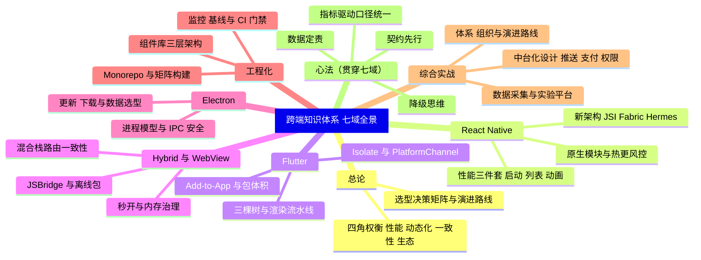
