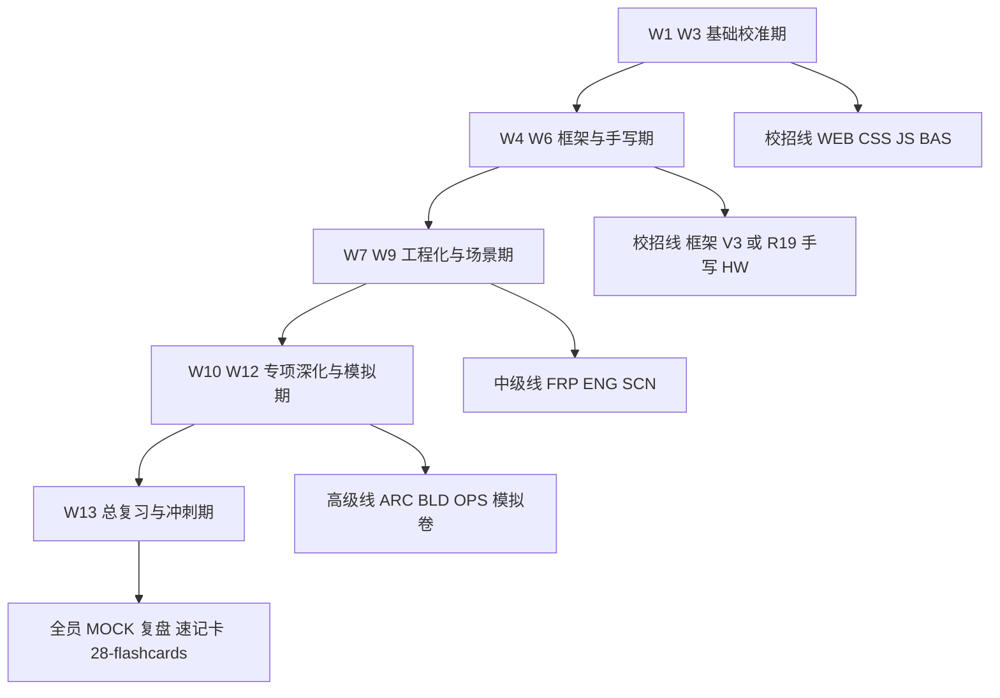
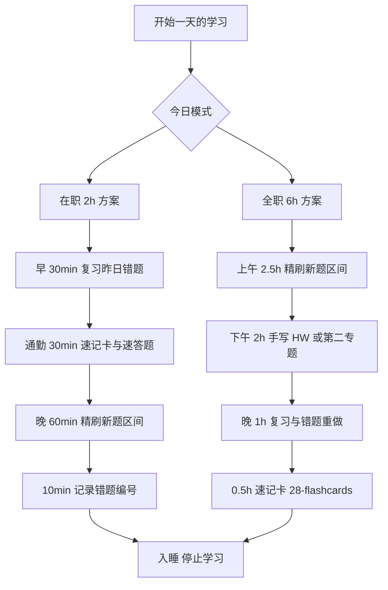
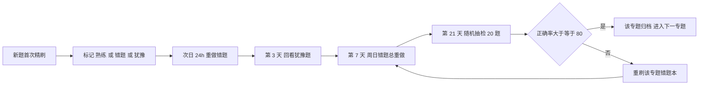
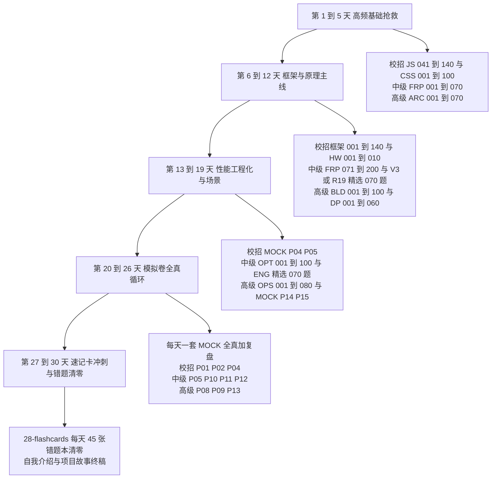

# 前端面试备考 90 天执行计划

本计划把本仓库 27 个题库文件（约 4930 题）、20 套模拟卷（MOCK-P01~P20）、60 道手写题（HW-001~060）与速记卡组 `28-flashcards.md` 组织成一份 **90 天（13 周）可执行备考日程**。针对三类人群分别给出逐周计划：

- **校招/初级**（0~2 年经验或应届生）：以 JS/CSS/WEB 基础 + 一个框架为主线，配 MOCK-P01~P05/P07；
- **中级 3 年**：以框架原理 FRP + 工程化 ENG + 性能 OPT/PER + 场景 SCN 为主线，配 MOCK-P04/P05/P10/P11/P12；
- **高级 5 年+**：以架构 ARC + 构建工具 BLD + 运维 OPS + 系统设计 + 项目叙事为主线，配 MOCK-P08/P09/P13/P14/P15。

所有周任务均引用真实题号区间（各文件最大编号已核实：多数专题 200 题，SOFT 100 题，HW 60 题，XP 150 题，MOCK 20 卷）。每天的任务粒度到"第几题到第几题"，直接打开对应文件从编号顺序刷即可。

## 13 周阶段总览

## 目录

1. [通用原则](#通用原则)
2. [校招/初级 90 天计划](#校招初级-90-天计划)
3. [中级 3 年 90 天计划](#中级-3-年-90-天计划)
4. [高级 5 年 90 天计划](#高级-5-年-90-天计划)
5. [考前 7 天冲刺](#考前-7-天冲刺)
6. [自检里程碑](#自检里程碑第-306090-天)
7. [弹性方案](#弹性方案)

---

## 通用原则

### 1. 每日时间预算：两种方案

| 方案 | 适用人群 | 时间切片 | 每周可消化题量 |
|---|---|---|---|
| **在职 2h/天** | 工作日在职备考 | 早 30min 复习昨日错题 + 通勤 30min 速记卡/速答题 + 晚 60min 精刷新题 | 精刷 40~60 题 + 复习 30~50 题 |
| **全职 6h/天** | 裸辞/Gap 期全职备考 | 上午 2.5h 精刷新题 + 下午 2h 第二专题/手写 + 晚 1h 复习与错题 + 0.5h 速记卡 | 精刷 100~140 题 + 复习 60~100 题 |

执行规则：

- 全职方案按 2 倍速度推进每周区间，剩余时间**加做手写题（HW）与场景题（SCN）**，不要提前透支后面两周的内容；
- 每天最后 10 分钟只做一件事：把今天答错/答不顺的题号记入错题本（见下文"错题本机制"）；
- 每周留半天弹性缓冲（建议周日），用于追赶进度或完整做一套模拟卷。

### 2. 复习节奏：艾宾浩斯间隔复习怎么落到本题库

本题库编号连续，间隔复习可以直接按"编号回退"操作。四个复习触发点：

| 间隔 | 触发时机 | 具体操作 |
|---|---|---|
| **24h** | 次日早晨 | 重做昨天错题本里的题号，只看题干口头作答，答不出才翻答案 |
| **3 天** | 每周三、周六 | 回看 3 天前刷过的编号段，只挑当时标记"犹豫"的题 |
| **7 天** | 每周日 | 重做本周错题本全部题号 + 速记卡组 `28-flashcards.md` 中对应专题的卡 |
| **21 天** | 每逢 W4/W8/W12 周末 | 抽查三周前的专题（如 W4 复查 W1 的 WEB），随机抽 20 题，正确率低于 80% 则该专题整体重刷一遍错题 |

### 3. 模拟卷的使用时机

`23-mock-interviews.md` 共 20 套卷，**不要开局就做**，按下面的节奏投放：

| 阶段 | 卷号 | 用法 |
|---|---|---|
| 第 1 周（摸底） | 各档第一章指定的摸底卷 | 不限时做完，目的只是暴露盲区，错题直接决定第一专题的精刷深度 |
| 第 3 周起（每 2~3 周一套） | 按各档周表指定卷号 | 严格计时、口头作答或写答案，禁止边看边答 |
| 第 10 周起（每周至少一套） | 各档冲刺卷 | 全真模拟：计时 + 录音/录像回听自己的表达 |
| 第 13 周（冲刺） | 重做全期错题最多的 2 套卷 | 只复盘，不再刷新卷 |

复盘标准：每套卷做完必须产出"错题编号清单"并入错题本，24h 内重做一遍。

### 4. 错题本机制

- 载体：一个单独文件（如 `mistakes.md`），按 `专题-编号 | 一句话错因 | 复习日期` 三列记录，例如 `JS-042 | 混淆了微任务与 rAF 的顺序 | D+1 D+7 D+21`；
- 每题错因只写一句话，超过一句话说明没理解，直接回看该题答案与示例代码；
- 每周日清点：错题本中连续两次重做全对的题可以划掉；连续三周仍在错题本里的题，降级处理——直接背该题速记卡（`28-flashcards.md` 对应条目），不再纠结；
- 模拟卷错题与题库错题分两节记录，模拟卷错题必须回链到题库编号（如"MOCK-P08 第 12 题不会 → 回刷 FRP-051~060"）。

---

## 校招/初级 90 天计划

**画像**：应届生或 0~2 年经验，目标是通过校招一面二面与初级社招一面。
**主线**：WEB → CSS → JS → 框架（V3 或 R19 二选一）→ H5/BAS 穿插 → HW 手写。
**模拟卷投放**：W1 摸底用 MOCK-P01；后续 P01/P02/P04/P05/P07；方向含小程序或 H5 业务可加 P06。
**题量基准**：按在职 2h/天设计（每周精刷约 60~80 题），全职按 2 倍推进并加刷 SCN 与 ALG。

### 第 1 阶段（W1~W3）：Web 协议与浏览器

| 周次 | 目标 | 每日任务 | 本周自测 | 完成标准 |
|---|---|---|---|---|
| W1 | 建立 HTTP/浏览器基础，完成摸底 | 每日 10 题：D1 WEB-001~010 D2 WEB-011~020 D3 WEB-021~030 D4 WEB-031~040 D5 WEB-041~050 D6 WEB-051~060 D7 WEB-061~070 + 周日错题总复习 | 限时做 MOCK-P01（校招一面卷，60 分钟），错题全部入错题本 | WEB-001~070 自答正确率 ≥70%；MOCK-P01 错题 24h 内重做一遍 |
| W2 | HTTP2/3、缓存、浏览器渲染 | 每日 10 题：D1 WEB-071~080 D2 WEB-081~090 D3 WEB-091~100 D4 WEB-101~110 D5 WEB-111~120 D6 WEB-121~130 D7 WEB-131~140 + 复习本周错题 | 口头复述"从输入 URL 到页面渲染"全流程，对照 WEB 章节答案补漏 | 能不看书讲清强缓存协商缓存与渲染流水线 |
| W3 | 收尾 WEB，启动基础速答 | 每日 10 题 WEB：D1 WEB-141~150 D2 WEB-151~160 D3 WEB-161~170 D4 WEB-171~180 D5 WEB-181~190 D6 WEB-191~200 D7 全周错题重做；另每日加 6 题速答：BAS-001~036 | 重做 MOCK-P01 错题，正确率应 ≥90% | WEB 全 200 题完成且正确率 ≥75%；BAS-001~036 完成 |

### 第 2 阶段（W4~W6）：CSS 全量

| 周次 | 目标 | 每日任务 | 本周自测 | 完成标准 |
|---|---|---|---|---|
| W4 | 盒模型/选择器/布局基础 | 每日 10 题：D1 CSS-001~010 D2 CSS-011~020 D3 CSS-021~030 D4 CSS-031~040 D5 CSS-041~050 D6 CSS-051~060 D7 CSS-061~070 + 错题；另每日 6 题速答 BAS-037~072 | 30 天里程碑自检（见自检里程碑章） | CSS-001~070 正确率 ≥75%；错题本首次周清点完成 |
| W5 | Flex/Grid/响应式 | 每日 10 题：D1 CSS-071~080 D2 CSS-081~090 D3 CSS-091~100 D4 CSS-101~110 D5 CSS-111~120 D6 CSS-121~130 D7 CSS-131~140 + 错题；另每日 6 题速答 BAS-073~108 | 手写实现三栏等高布局与圣杯布局（不查资料，各 10 分钟） | 两种布局 5 分钟内手写正确 |
| W6 | 动效/CSS 架构/新特性 | 每日 10 题：D1 CSS-141~150 D2 CSS-151~160 D3 CSS-161~170 D4 CSS-171~180 D5 CSS-181~190 D6 CSS-191~200 D7 全周错题 + 限时做 MOCK-P02（校招二面卷） | MOCK-P02 全真 60 分钟，错题入本 | CSS 全 200 题完成；MOCK-P02 得分自评及格线以上 |

### 第 3 阶段（W7~W9）：JavaScript 主线

| 周次 | 目标 | 每日任务 | 本周自测 | 完成标准 |
|---|---|---|---|---|
| W7 | 闭包/原型/this/执行上下文 | 每日 10 题：D1 JS-001~010 D2 JS-011~020 D3 JS-021~030 D4 JS-031~040 D5 JS-041~050 D6 JS-051~060 D7 JS-061~070 + 错题；另每日 6 题速答 BAS-109~144 | 手写 HW-001~005 中任选 3 题（防抖节流等），对照 24-handwrite.md 答案批改 | JS-001~070 正确率 ≥75%；3 道手写题一次通过 |
| W8 | 异步/Promise/事件循环 | 每日 10 题：D1 JS-071~080 D2 JS-081~090 D3 JS-091~100 D4 JS-101~110 D5 JS-111~120 D6 JS-121~130 D7 JS-131~140 + 错题；另手写 HW-006~010 中任选 2 题 | 限时做 MOCK-P04（初级一面基础强化卷，90 分钟） | 能画出事件循环执行顺序图；MOCK-P04 基础题部分正确率 ≥80% |
| W9 | 手写轮子收尾/ES 新特性 | 每日 10 题：D1 JS-141~150 D2 JS-151~160 D3 JS-161~170 D4 JS-171~180 D5 JS-181~190 D6 JS-191~200 D7 全周错题 + 手写 HW-011~020 中任选 3 题 | 把 JS 文件中所有手写类题目单独列一张清单，逐题口头复述思路 | JS 全 200 题完成；手写清单中 80% 的题能不看书说思路 |

### 第 4 阶段（W10~W12）：框架与广度

| 周次 | 目标 | 每日任务 | 本周自测 | 完成标准 |
|---|---|---|---|---|
| W10 | 框架基础（Vue3 或 React19 二选一） | 每日 10 题：D1 V3-001~010 或 R19-001~010 D2 第 011~020 D3 第 021~030 D4 第 031~040 D5 第 041~050 D6 第 051~060 D7 第 061~070 + 错题；另每日 4 题 H5-001~028 | 限时做 MOCK-P05（初级二面场景实战卷） | 框架 070 题正确率 ≥75%；MOCK-P05 场景题能给出至少两条排查思路 |
| W11 | 框架进阶 + HTML5 | 每日 10 题：D1 V3-071~080 或 R19-071~080 D2 第 081~090 D3 第 091~100 D4 第 101~110 D5 第 111~120 D6 第 121~130 D7 第 131~140 + 错题；另每日 4 题 H5-029~056 | 手写：用框架写一个受控表单组件与一个列表虚拟滚动思路（口头） | 能讲清所选框架的响应式或 Fiber 核心机制 |
| W12 | 框架收尾 + 算法起步 | 每日 10 题：D1 V3-141~150 或 R19-141~150 D2 第 151~160 D3 第 161~170 D4 第 171~180 D5 第 181~190 D6 第 191~200 D7 全周错题；另每日 3 题 ALG-001~015 | 做 MOCK-P07（HR 面与谈薪卷），并按 22-soft-skills.md 中 SOFT-001~030 准备自我介绍 | 框架全 200 题完成；自我介绍 90 秒版本背熟 |

### 第 5 阶段（W13）：总复习冲刺

| 周次 | 目标 | 每日任务 | 本周自测 | 完成标准 |
|---|---|---|---|---|
| W13 | 错题清零 + 全真模拟 | D1~D2 重做 MOCK-P01/P02/P04 全部错题 D3 重做 MOCK-P05 错题 + SCN-001~030 D4 手写题终检：HW-001~020 全部再写一遍 D5 SOFT-031~060 谈薪与规划 + 速记卡 28-flashcards 每日 45 张 D6 每日 45 张速记卡 + 免费复述日：随机抽 WEB/CSS/JS 各 10 题口头作答 D7 休整，只过错题本 | 第 90 天里程碑自检（见自检里程碑章） | 错题本清零或只剩背卡条目；90 天自检全部达标 |

---

## 中级 3 年 90 天计划

**画像**：约 3 年经验在职工程师，目标是通过中级社招一二面，突破"基础都会但深度不够"的瓶颈。
**主线**：框架原理 FRP（源码级）→ 工程化 ENG → 性能实战 OPT/PER → 场景 SCN → TS 与手写 HW 加固。
**模拟卷投放**：W1 摸底 MOCK-P05；后续 P11（工程化）、P10（性能）、P12（跨端+Node 综合）。
**速度模式**：JS/BAS 等已熟专题用"快扫模式"（每题 30 秒判断会不会，会就过，不会才精读）；新专题精读。在职 2h 拆分为：1h 新专题精刷 + 30min 快扫 + 30min 复习。

### 第 1 阶段（W1~W3）：校准与语言加固

| 周次 | 目标 | 每日任务 | 本周自测 | 完成标准 |
|---|---|---|---|---|
| W1 | 摸底定位盲区 | 每日快扫 12 题 JS：D1 JS-001~012 D2 JS-013~024 D3 JS-025~036 D4 JS-037~050 D5 只精读快扫中标"不会"的题 D6 继续精读 + 复习 D7 限时做 MOCK-P05 摸底；另每日 10 题速答 BAS-001~070 | MOCK-P05 不限时完成，标出每道题的"能答/答一半/不会" | 盲区清单产出（预期集中在异步与手写区）；MOCK-P05 错题入本 |
| W2 | TypeScript 工程实战 | 每日 10 题 TS：D1 TS-001~010 D2 TS-011~020 D3 TS-021~030 D4 TS-031~040 D5 TS-041~050 D6 TS-051~060 D7 TS-061~070 + 错题；另每日快扫 JS-051~074 | 手写：给一个业务接口定义完整的请求/响应泛型类型 | TS-001~070 正确率 ≥80%；泛型工具类型能默写 5 个 |
| W3 | TS 收尾 + 手写启动 | 每日 10 题：D1 TS-071~080 D2 TS-081~090 D3 TS-091~100 D4 TS-101~110 D5~D6 手写专项 HW-001~010（每天 5 题，写完对照答案重写） D7 全周错题 + 重做 MOCK-P05 错题 | 口头复述 Promise 全量 API 实现（对照 HW 文件中相关题） | TS-001~110 完成；HW-001~010 全部亲手写过一遍 |

### 第 2 阶段（W4~W6）：框架原理深水区

| 周次 | 目标 | 每日任务 | 本周自测 | 完成标准 |
|---|---|---|---|---|
| W4 | 响应式/调度原理 | 每日 10 题：D1 FRP-001~010 D2 FRP-011~020 D3 FRP-021~030 D4 FRP-031~040 D5 FRP-041~050 D6 FRP-051~060 D7 FRP-061~070 + 错题；另每日手写 HW-011~015 拆两天各写 2~3 题 | 白板默写：Vue3 响应式系统最小实现（依赖收集 + 触发更新），对照 FRP 章节相关题批改 | FRP-001~070 正确率 ≥80%；默写实现跑通逻辑 |
| W5 | 虚拟 DOM 与 diff | 每日 10 题：D1 FRP-071~080 D2 FRP-081~090 D3 FRP-091~100 D4 FRP-101~110 D5 FRP-111~120 D6 FRP-121~130 D7 FRP-131~140 + 错题；另手写 HW-016~025 中任选 5 题 | 手写简化 diff 算法（对照 FRP 中迷你框架章节） | 能讲清双端 diff 与最长递增子序列优化 |
| W6 | 编译与运行时收尾 | 每日 10 题：D1 FRP-141~150 D2 FRP-151~160 D3 FRP-161~170 D4 FRP-171~180 D5 FRP-181~190 D6 FRP-191~200 D7 全周错题 + 快扫 V3-001~050 或 R19-001~050（定位框架实战盲区） | 30 天里程碑自检（见自检里程碑章） | FRP 全 200 题完成；30 天自检达标 |

### 第 3 阶段（W7~W9）：框架实战与工程化

| 周次 | 目标 | 每日任务 | 本周自测 | 完成标准 |
|---|---|---|---|---|
| W7 | 框架实战与架构题 | 每日 10 题：D1 V3-051~060 或 R19-051~060 D2 第 061~070 D3 第 071~080 D4 第 081~090 D5 第 091~100 D6 第 101~110 D7 第 111~130 + 错题；另每日 8 题 ENG-001~048 | 手写：写一个带缓存与错误重试的 hooks（useRequest 思路） | 框架实战区正确率 ≥80%；ENG-001~048 完成 |
| W8 | 工程化主体 | 每日 10 题：D1 V3-131~150 或 R19-131~150 D2 第 151~170 D3 第 171~190 D4 第 191~200 D5~D6 每日 12 题 ENG-049~072 D7 限时做 MOCK-P11（工程化专项卷）+ 60 天里程碑自检 | MOCK-P11 全真 90 分钟，错题入本 | 框架全 200 题完成；能完整讲清从代码到上线的工程链路 |
| W9 | 工程化收尾 + 场景启动 | 每日 10 题：D1 ENG-073~082 D2 ENG-083~092 D3 ENG-093~102 D4 ENG-103~112 D5 ENG-113~122 D6 ENG-123~132 D7 ENG-133~142 + 错题；另每日 6 题 SCN-001~036 | 口头复述本团队 CI-CD 流程，对照 ENG 章节查漏 | ENG-001~142 完成；能画出自己项目的构建发布流程图 |

### 第 4 阶段（W10~W12）：性能与场景

| 周次 | 目标 | 每日任务 | 本周自测 | 完成标准 |
|---|---|---|---|---|
| W10 | 性能优化实战 | 每日 10 题：D1 OPT-001~010 D2 OPT-011~020 D3 OPT-021~030 D4 OPT-031~040 D5 OPT-041~050 D6 OPT-051~060 D7 OPT-061~070 + 限时做 MOCK-P10（性能专项卷）；另每日 5 题 SCN-037~066 | MOCK-P10 全真 90 分钟 | 能给出一个完整的首屏优化方案（指标→定位→手段→验证） |
| W11 | 性能收尾 + 指标安全 | 每日 10 题：D1 OPT-071~080 D2 OPT-081~090 D3 OPT-091~100 D4 OPT-101~110 D5 OPT-111~120 D6 OPT-121~130 D7 OPT-131~140 + 错题；另每日 6 题 PER-001~036 | 手写：写一个上报 SDK 思路（对照 OPT 章节监控相关题） | OPT-001~140 完成；PER-001~036 完成 |
| W12 | 性能深水区 + 场景收尾 | 每日 10 题：D1 OPT-141~150 D2 OPT-151~160 D3 OPT-161~170 D4 OPT-171~180 D5 OPT-181~190 D6 OPT-191~200 D7 限时做 MOCK-P12（跨端+Node 综合卷）；另每日 6 题 PER-037~072 | MOCK-P12 全真 90 分钟，错题入本 | OPT 全 200 题完成；PER-001~072 完成 |

### 第 5 阶段（W13）：总复习冲刺

| 周次 | 目标 | 每日任务 | 本周自测 | 完成标准 |
|---|---|---|---|---|
| W13 | 错题清零 + 查漏补缺 | D1~D2 重做 MOCK-P05/P10/P11/P12 全部错题 D3 BLD-001~040 选读（构建工具薄弱者必做） D4 HW-001~030 全部口头复述思路，不熟的 5 题重写 D5 SOFT-001~060 + 项目故事按 STAR 重写 3 个 D6 速记卡 28-flashcards 每日 45 张 + 随机抽 FRP/OPT 各 10 题口头作答 D7 休整，过错题本 | 第 90 天里程碑自检（见自检里程碑章） | 错题本清零；FRP/OPT 复述正确率 ≥90%；3 个项目故事脱稿可讲 |

---

## 高级 5 年 90 天计划

**画像**：5 年以上经验，目标是高级/资深岗面试，重点在架构选型、系统设计、深度原理与项目叙事。
**主线**：框架原理 FRP（源码级深挖）→ 设计模式 DP → 构建工具 BLD → 架构 ARC → 工程化 ENG/运维 OPS → Node/Agent 广度 → 项目叙事打磨。
**模拟卷投放**：W1 摸底 MOCK-P08；后续 P14（专家面）、P15（架构面）、P08/P09 重做、P13（总监面）；方向含可视化/音视频/Agent 另加 P16/P18/P19/P20。
**速度模式**：高级以"三档题速"处理——已会的扫读（每周可扫 100+ 题）、模糊的精读、陌生的逐题啃。在职 2h 拆分为：70min 精读新专题 + 30min 扫读 + 20min 项目叙事/复盘。每周任务量按此校准。

### 第 1 阶段（W1~W3）：原理深挖与设计模式

| 周次 | 目标 | 每日任务 | 本周自测 | 完成标准 |
|---|---|---|---|---|
| W1 | 摸底 + 源码级原理定位 | 每日 10 题：D1 FRP-001~010 D2 FRP-011~020 D3 FRP-021~030 D4 FRP-031~040 D5 FRP-041~050 D6 FRP-051~060 D7 FRP-061~070 + 限时做 MOCK-P08（高级一面卷）摸底 | MOCK-P08 不限时完成并逐题标注掌握度 | 盲区清单产出；FRP-001~070 中手写迷你框架类题全部亲手实现 |
| W2 | 原理深水区 | 每日 12 题：D1 FRP-071~082 D2 FRP-083~094 D3 FRP-095~106 D4 FRP-107~118 D5 FRP-119~130 D6 FRP-131~142 D7 FRP-143~150 + 错题 | 白板默写编译器 pipeline 与运行时调度两个流程图 | FRP-071~150 完成；两个流程图脱稿画出 |
| W3 | 原理收尾 + 模式识别 | 每日 10 题：D1 FRP-151~170 D2 FRP-171~190 D3 FRP-191~200 D4 DP-001~020 D5 DP-021~040 D6 DP-041~060 D7 全周错题；另从自己项目里找出 3 处设计模式实际应用并写一句话佐证 | 30 天里程碑自检（见自检里程碑章） | FRP 全 200 题完成；DP-001~060 完成；3 个项目内模式案例可讲述 |

### 第 2 阶段（W4~W6）：构建工具与架构入门

| 周次 | 目标 | 每日任务 | 本周自测 | 完成标准 |
|---|---|---|---|---|
| W4 | 构建工具原理 | 每日 10 题：D1 BLD-001~010 D2 BLD-011~020 D3 BLD-021~030 D4 BLD-031~040 D5 BLD-041~050 D6 BLD-051~060 D7 BLD-061~070 + 错题；另每日 8 题 DP-061~108 | 手写：一个 20 行的 mini-bundler 思路（模块解析+拼接），对照 BLD 章节源码级题批改 | BLD-001~070 正确率 ≥85%；DP-061~108 完成 |
| W5 | Vite/Rollup 与优化 | 每日 12 题：D1 BLD-071~082 D2 BLD-083~094 D3 BLD-095~106 D4 BLD-107~118 D5 BLD-119~130 D6 BLD-131~142 D7 BLD-143~150 + 错题；另每日 6 题 DP-109~132 | 口头复述 Vite dev 与 build 的完整流程及差异 | BLD-071~150 完成；DP-109~132 完成 |
| W6 | 构建收尾 + 架构启动 | 每日 10 题：D1 BLD-151~170 D2 BLD-171~190 D3 BLD-191~200 D4 ARC-001~020 D5 ARC-021~040 D6 ARC-041~060 D7 限时做 MOCK-P14（专家一面源码级卷） | MOCK-P14 全真 90 分钟，错题入本 | BLD 全 200 题完成；ARC-001~060 完成；MOCK-P14 源码题能答出至少 60% |

### 第 3 阶段（W7~W9）：架构主体与工程化

| 周次 | 目标 | 每日任务 | 本周自测 | 完成标准 |
|---|---|---|---|---|
| W7 | 架构核心：微前端/低代码/选型 | 每日 12 题：D1 ARC-061~072 D2 ARC-073~084 D3 ARC-085~096 D4 ARC-097~108 D5 ARC-109~120 D6 ARC-121~132 D7 ARC-133~140 + 错题 | 针对一道 ARC 综合大题（如微前端方案设计）写 300 字方案 + 一张架构图 | ARC-061~140 完成；方案文档存档备用 |
| W8 | 架构收尾 + 工程化 | 每日 10 题：D1 ARC-141~160 D2 ARC-161~180 D3 ARC-181~200 D4~D5 每日 12 题 ENG-001~024 D6~D7 每日 12 题 ENG-025~048 + 60 天里程碑自检 | 60 天里程碑自检（见自检里程碑章） | ARC 全 200 题完成；ENG-001~048 完成；里程碑达标 |
| W9 | 工程化体系 + 运维启动 | 每日 10 题：D1 ENG-049~068 D2 ENG-069~088 D3 ENG-089~108 D4 ENG-109~128 D5 ENG-129~148 D6 OPS-001~020 D7 OPS-021~040 + 错题 | 口头复述一次真实线上故障的应急处理，对照 OPS 章节应急 SOP 查漏 | ENG-001~148 完成；OPS-001~040 完成 |

### 第 4 阶段（W10~W12）：运维深化与广度

| 周次 | 目标 | 每日任务 | 本周自测 | 完成标准 |
|---|---|---|---|---|
| W10 | 运维发布 + 性能体系 | 每日 10 题：D1 OPS-041~060 D2 OPS-061~080 D3 OPS-081~100 D4 OPS-101~120 D5 OPT-130~150（体系与监控题） D6 OPT-151~170 D7 限时做 MOCK-P15（架构设计面卷） | MOCK-P15 全真 90 分钟：完成一道大案例设计并录音回听 | OPS-001~120 完成；OPT-130~170 完成；大案例 40 分钟内出方案 |
| W11 | Node 广度 + Agent 入门 | 每日 8 题：D1 NODE-001~010 D2 NODE-011~020 D3 NODE-021~030 D4 NODE-031~040 D5 AGT-001~010 D6 AGT-011~020 D7 AGT-021~030 + 错题；另每日花 20min 打磨项目叙事（SOFT-001~020 对应章节） | 项目叙事：写出 3 个项目的 STAR 故事卡，每个 200 字，读给他人或录音听 | NODE-001~040 完成；AGT-001~030 完成；3 个故事卡定稿 |
| W12 | 模拟重做 + 叙事终稿 | D1~D2 每日 10 题 NODE-041~060 选做 + 重做 MOCK-P08 全部错题 D3 重做 MOCK-P14 错题 + ARC 大案例限时重做 D4 全真做 MOCK-P09（系统设计+架构卷）并复盘 D5~D6 每日 10 题 SOFT-021~040 + 项目故事按面试官视角改写第 2 稿 D7 休整，过错题本 | MOCK-P09 得分自评达到目标线；叙事第 2 稿完成 | 每个故事能在 90 秒内讲完且含量化数据 |

### 第 5 阶段（W13）：总复习冲刺

| 周次 | 目标 | 每日任务 | 本周自测 | 完成标准 |
|---|---|---|---|---|
| W13 | 全真模拟 + 总监面准备 | D1 全真做 MOCK-P13（总监面：技术视野+管理）并复盘 D2 重做 MOCK-P15 错题 + ARC 方案文档终稿 D3 每日 45 张速记卡 28-flashcards + 抽 ARC/BLD 各 10 题口头作答 D4 SOFT-041~090（谈薪/规划/管理题） D5 速记卡每日 45 张 + 全库错题本最后清点 D6 方向岗加练：可视化/音视频/Agent 三选一做 MOCK-P16 D7 休整 | 第 90 天里程碑自检（见自检里程碑章） | 错题本清零；P08/P09/P13/P14/P15 五套卷复盘完毕；90 天自检全部达标 |

---

## 考前 7 天冲刺

考前 7 天**不再学任何新知识**，只做三件事：速记卡循环、MOCK 复盘、手写题保温。

### 每日固定动作

- **速记卡 45 张/天**：`28-flashcards.md` 按 45 张一组过卡，规则是"看到题干 3 秒内说出答案要点才算过，否则进'暂存堆'，当天睡前把暂存堆再过一遍"。7 天共 315 张，正好覆盖卡组主体一遍。
- **1 套 MOCK 复盘/天**：不刷新卷，重做此前错题最多的那套卷（各档见表），只写答案要点并对照批改。
- **手写题保温**：每天从 `24-handwrite.md` 选 3 题（HW-001~060 按错题本标记挑），在白板或纸上限时 8 分钟写完。

### 逐日安排

| 天 | 速记卡 | MOCK 复盘 | 手写保温 | 其他 |
|---|---|---|---|---|
| D-7 | 第 1 组 45 张 | 重做错误最多的一套卷 | HW-001~003 中 3 题 | 整理面试着装/设备/环境 |
| D-6 | 第 2 组 45 张 | 重做摸底卷（各档 W1 那套）错题 | HW-004~015 中 3 题 | 背熟 90 秒自我介绍 |
| D-5 | 第 3 组 45 张 | 重做专项卷错题（校招 P05 / 中级 P10 / 高级 P15） | HW-016~030 中 3 题 | 准备 3 个反问面试官的问题 |
| D-4 | 第 4 组 45 张 | 重做架构/场景卷错题（中级 P12 / 高级 P09） | HW-031~045 中 3 题 | 项目故事第 3 稿，删掉所有形容词只留数据 |
| D-3 | 第 5 组 45 张 | 重做剩余一套卷错题 | HW-046~060 中 3 题 | 口头自答最近 21 天错题本残留条目 |
| D-2 | 第 6 组 45 张 + 暂存堆全部 | 不做卷，只看错题本的"错因"列 | 任选 3 题最不熟的 | 模拟真实面试时间点做一次 30 分钟自我问答 |
| D-1 | 第 7 组 45 张 + 全部暂存堆 | 只翻不写：浏览全部 MOCK 复盘记录的错因列 | 0 题，停止 | 22 点前睡，考前一晚学习产出为负 |

### 心态调整

- 错题本在考前清到"只剩背卡条目"即可，**没有人能刷完 4930 题**，本计划的设计目标就是覆盖高频与深水区；
- 面试官在高级岗考察的是"方案取舍的表达"，答"我会在 A 与 B 之间选 A，因为在 XX 约束下"比背概念更得分；
- 出现"这题我不会"时的标准话术：先讲自己理解的相邻知识，再明确说出边界——这比沉默或硬编强得多；
- 若连续两套模拟卷自评低于及格线，回到弹性方案章启用 30 天急训版，推迟面试或降低目标岗位档位，比硬考更好。

---

## 自检里程碑（第 30/60/90 天）

三个里程碑都按档位给出可量化标准，**任一档位里程碑未达标超过 2 项，立即启用弹性方案章的压缩策略**。

### 第 30 天（校招 W4 末 / 中级 W6 末 / 高级 W3 末）

| 档位 | 量化标准 |
|---|---|
| 校招/初级 | WEB 全 200 题自答正确率 ≥75%；CSS-001~070 完成；MOCK-P01/P02 复盘完毕且错题重做正确率 ≥90%；错题本完成至少 4 次周清点 |
| 中级 3 年 | FRP 全 200 题自答正确率 ≥80%；HW-001~010 全部亲手写过；TS-001~110 完成；能白板默写响应式最小实现 |
| 高级 5 年 | FRP 全 200 题正确率 ≥85%；DP-001~060 完成；MOCK-P08 摸底复盘完毕；能脱稿画出编译与调度两张流程图 |

### 第 60 天（校招 W8 末 / 中级 W8 末 / 高级 W8 末）

| 档位 | 量化标准 |
|---|---|
| 校招/初级 | JS 全 200 题正确率 ≥75%；CSS 全 200 题完成；HW-001~020 手写过一遍；MOCK-P04 基础部分正确率 ≥80%；BAS 全 200 题过完一轮 |
| 中级 3 年 | 框架（V3 或 R19）全 200 题完成且正确率 ≥80%；ENG-001~142 完成；MOCK-P11 复盘完毕；能完整讲清工程链路 |
| 高级 5 年 | ARC 全 200 题完成；BLD 全 200 题正确率 ≥85%；ENG-001~048 完成；MOCK-P14 能答出 ≥60% 源码题；产出过一份 300 字架构方案 |

### 第 90 天（全员 W13 末）

| 档位 | 量化标准 |
|---|---|
| 校招/初级 | 三档指定的全部 MOCK 卷复盘完毕；错题本清零或只剩背卡条目；HW-001~020 全部二次手写通过；90 秒自我介绍与 3 个反问问题就绪 |
| 中级 3 年 | FRP/OPT 复述正确率 ≥90%；SCN-001~100 完成；SOFT-001~060 完成；3 个 STAR 项目故事脱稿可讲；指定 4 套 MOCK 全部复盘 |
| 高级 5 年 | P08/P09/P13/P14/P15 五套卷全部复盘；ARC 方案文档终稿；每个项目故事 90 秒讲完且含量化数据；NODE/AGT 广度题按周表完成 |

---

## 弹性方案

### 1. 进度落后 1~2 周怎么压缩

按"降级为只刷高频卡"的优先级从低到高砍（越靠后越优先砍）：

1. **第一刀——快扫化**：把当前专题未开始的"进阶区"题目（通常是各文件 141~200 编号段）从精读降为扫读，只记录完全不会的题号；
2. **第二刀——砍广度**：校招砍 H5（只保留 H5-001~028），中级砍 BLD 与 PER（保留 ENG 主线），高级砍 NODE/AGT（只保留周表里已完成的量）；
3. **第三刀——砍手写量**：HW 从"全写过一遍"降为"只写错题本标记的题 + HW-001~020"；
4. **绝不砍**：MOCK 复盘、错题本周清点、速记卡——这三项是复习闭环的地基，砍了等于白学。

压缩后的每周自测与完成标准不变，达标线可以放宽 5 个百分点。

### 2. 只剩 30 天：急训版路线

30 天急训版只保留"高频主战场 + 模拟卷闭环"，放弃系统性全覆盖。

急训版每天任务量（在职按 3h、全职按 7h 执行）：

| 天数 | 校招/初级 | 中级 3 年 | 高级 5 年 |
|---|---|---|---|
| 1~5 | JS-041~140 快扫 + CSS-001~100 精读 | FRP-001~070 精读 | ARC-001~070 精读 + MOCK-P08 摸底 |
| 6~12 | 框架 V3 或 R19-001~140 + HW-001~010 手写 | FRP-071~200 + 框架精选 070 题（V3 或 R19 的 001~070） | BLD-001~100 + DP-001~060 |
| 13~19 | SCN-001~050 + MOCK-P04/P05 全真 | OPT-001~100 + ENG 精选 070 题（ENG-001~040 与 141~170）+ MOCK-P10/P11 | OPS-001~080 + MOCK-P14/P15 + 项目故事定稿 |
| 20~26 | MOCK-P01/P02/P04 逐日全真 + 复盘 | MOCK-P05/P12 全真 + OPT 错题重做 | MOCK-P08/P09/P13 逐日全真 + 复盘 |
| 27~30 | 速记卡每天 45 张 + 错题清零 + 自我介绍终稿 | 同左 + 3 个 STAR 故事终稿 | 同左 + 架构方案文档终稿 |

急训版取舍原则：**模拟卷闭环 > 高频区精刷 > 广度覆盖**。宁可少刷 300 题也要保证每套做过的 MOCK 都复盘到"错因能一句话说清"。

