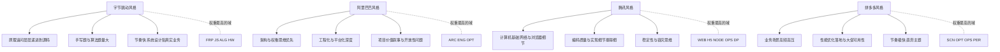
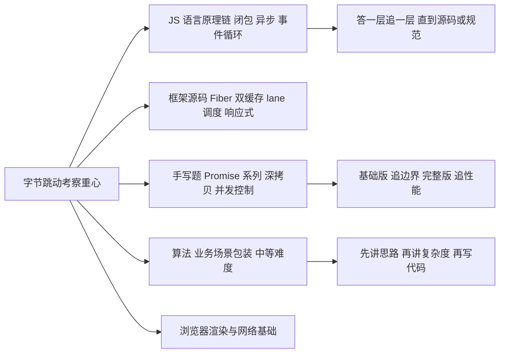
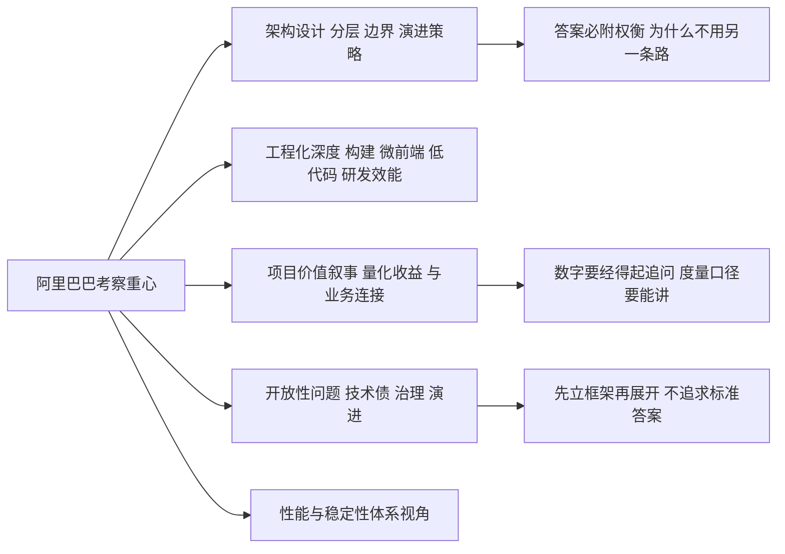
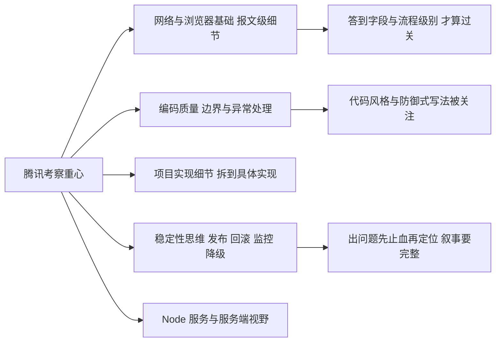
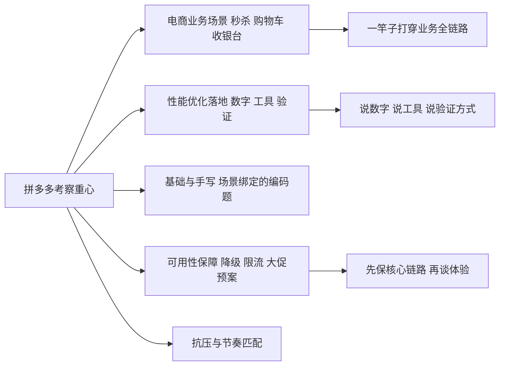

# 前端面试题库：公司风格画像与差异化模拟组卷

> 编号前缀：STYLE。本专题共 **8 套公司风格模拟卷（STYLE-ZJ/AL/TX/PDD × P01/P02）**，覆盖字节跳动、阿里巴巴、腾讯、拼多多四家公司各两套（P01 中高级一面卷、P02 中高级二面深挖卷）。所有题目**引用现有 27 个专题题库的真实编号**（如 JS-013、SCN-129），不重复展开题面，请对照原题库演练。

## ⚠️ 诚实性声明（必读）

1. **这不是真题。** 本文件的"风格画像"与"模拟卷"是基于**公开可见的社区讨论、面经分享的共性规律**归纳出来的"风格倾向 + 风格化组卷"，用于结构化备考，**不包含、不冒充任何公司的真实面试题**。
2. 大厂真实面试题受保密协议（NDA）保护，面试官也不允许泄露。**任何声称持有"某公司真题库/原题"的说法都不可信**——要么是违规泄露，要么是拼凑营销。本工程明确不做这种声称。
3. 风格画像只描述公开面经中**反复出现的考察倾向**（例如"追问容易层层递进""手写题占比偏高"），不指代任何具体面试官、具体团队、具体部门；同一家公司不同 BU、不同面试官的风格差异可能非常大，画像只反映"大概率出现什么"，不构成任何承诺。
4. 模拟卷中的"该家风格追问"是**训练用的演绎**，帮你在正确的方向上多练一层，不代表真实面试一定这么问。

## 如何使用本专题

1. **先读画像再做题**：每家先读完"风格画像"，理解该家把分数权重放在哪里，再开始模拟卷，避免用同一套答法应付四家公司。
2. **对照 23-mock-interviews.md 使用**：通用级别的 MOCK-P08/P09/P14 练"深度与广度"，本专题的 STYLE 卷练"风格适配"。建议先做 MOCK 再做 STYLE。
3. **录音 + 计时**：按每套卷的时间分配表计时（可复用 `HW-060` InterviewTimer），全程录音，答完按该家风格的评分表自评。
4. **追问脚本必须真演**：把 ```text 追问脚本交给朋友扮演面试官，或自己答完主问题后强制念出追问链。四家风格的差异 80% 体现在追问链的走向上，只答主问题等于白练。
5. **复盘闭环**：错题回链到原题库编号补课，配套记忆用 `28-flashcards.md`，排期用 `29-study-plan.md`，手写专项用 `24-handwrite.md`。

## 目录

- [四家公司风格对比总图](#四家公司风格对比总图)
- [一、字节跳动风格画像与模拟卷](#一字节跳动风格画像与模拟卷)
  - [字节跳动风格画像](#字节跳动风格画像)
  - [STYLE-ZJ-P01：中高级一面卷 原理链与手写算法](#style-zj-p01中高级一面卷原理链与手写算法90-分钟)
  - [STYLE-ZJ-P02：中高级二面卷 源码级深挖与设计](#style-zj-p02中高级二面卷源码级深挖与设计90-分钟)
- [二、阿里巴巴风格画像与模拟卷](#二阿里巴巴风格画像与模拟卷)
  - [阿里巴巴风格画像](#阿里巴巴风格画像)
  - [STYLE-AL-P01：中高级一面卷 架构工程化与项目叙事](#style-al-p01中高级一面卷架构工程化与项目叙事90-分钟)
  - [STYLE-AL-P02：中高级二面卷 平台化深挖与开放设计](#style-al-p02中高级二面卷平台化深挖与开放设计90-分钟)
- [三、腾讯风格画像与模拟卷](#三腾讯风格画像与模拟卷)
  - [腾讯风格画像](#腾讯风格画像)
  - [STYLE-TX-P01：中高级一面卷 计算机基础与编码细节](#style-tx-p01中高级一面卷计算机基础与编码细节90-分钟)
  - [STYLE-TX-P02：中高级二面卷 稳定性服务端视野与项目细节](#style-tx-p02中高级二面卷稳定性服务端视野与项目细节90-分钟)
- [四、拼多多风格画像与模拟卷](#四拼多多风格画像与模拟卷)
  - [拼多多风格画像](#拼多多风格画像)
  - [STYLE-PDD-P01：中高级一面卷 电商场景与性能落地](#style-pdd-p01中高级一面卷电商场景与性能落地90-分钟)
  - [STYLE-PDD-P02：中高级二面卷 大促保障与高可用深挖](#style-pdd-p02中高级二面卷大促保障与高可用深挖90-分钟)

## 四家公司风格对比总图



---

## 一、字节跳动风格画像与模拟卷

### 字节跳动风格画像

以下为公开面经中反复出现的考察倾向归纳，仅代表风格倾向，不构成对真实面试的承诺。

**技术栈倾向**：公开面经中候选人以 React 技术栈居多，但框架原理题往往"以 React 为入口、以框架无关的原理收尾"；TypeScript 几乎是默认技能；不少团队有 Node 中间层 / BFF 与自研工程链的背景，因此对 JS 语言本身、调度与渲染原理的追问深度普遍被提及。

**考察重点分布**（公开面经的常见比例倾向，非精确数据）：

| 维度 | 大致权重 | 公开面经中的典型表现 |
|---|---|---|
| 语言与原理 | 约 30% | 闭包、事件循环、Promise 链、原型链、GC，答一层追一层 |
| 手写与编码 | 约 25% | 一面普遍 2-4 道手写，Promise 系列、深拷贝、并发控制高频 |
| 算法 | 约 20% | 中等难度为主，常包装成前端业务场景出现 |
| 框架深度 | 约 15% | Fiber、Hooks 规则、diff、响应式，可下探到实现结构 |
| 场景与设计 | 约 10% | 偏实际业务的小型系统设计，而非纯八股 |

**面试风格特点**（公开面经的常见描述）：

- **层层追问**：一个起点追 4-5 层是常态，例如从"事件循环"追到"await 时机"再追到"调度器怎么让出主线程"，中途不会换题，答不上才换。
- **编码量大**：手写不是"写个防抖"就过，常见"写完基础版追问边界、追问完整版、追问性能"。
- **节奏快**：单位时间题量大，面试官普遍目标明确，寒暄少。
- **重推理过程**：输出题喜欢让你"先说结论再逐行推"，过程分占比高。

**常被提及的流程结构**（公开信息，供参考）：常见 3-4 轮技术面 + HR 面，部分岗位或时期有笔试/测评环节；每轮 45-60 分钟，二面及以上常含系统设计。

**面向人群的侧重差异**：校招重基础与潜力（算法权重更高）；1-3 年重原理 + 手写；3-5 年及以上在原理之外增加系统设计与架构权衡，但"原理下探"倾向在各级别都被普遍提及。

**字节考察重心图**：



### STYLE-ZJ-P01：中高级一面卷（原理链与手写算法，90 分钟）

**目标画像**：3-5 年中高级候选人的一面。面试官为团队骨干，节奏偏快，前 40 分钟原理 + 手写压着走，后半程 1-2 道算法。该家一面 famously"手写不收工"，请把编码准备拉满。

**时间分配**：

| 环节 | 时长 | 内容 |
|---|---|---|
| 自我介绍 | 3min | SOFT-011，压缩到 90 秒，留给题目的时间越多越好 |
| JS 原理链 | 20min | JS-013、JS-043、JS-045、JS-063、JS-073 |
| 手写题 | 25min | HW-016、HW-001、HW-007 |
| 算法题 | 20min | ALG-021、ALG-060 |
| 框架与浏览器 | 15min | FRP-023、WEB-048 |
| 追问与收尾 | 7min | 按追问脚本执行 |

**题目清单**（12 题）：

1. `JS-013`（考察点：闭包原理；要点提示：函数捕获词法环境、变量私有化；**该家风格追问**：闭包会内存泄漏吗 → 引向 JS-016 与 JS-073 的 GC 关联，一层不落）。
2. `JS-043`（考察点：浏览器事件循环；要点提示：先清微任务队列再取宏任务；**该家风格追问**：直接甩 JS-045 输出题让你逐行推，说错顺序立即加码）。
3. `JS-045`（考察点：setTimeout/Promise/async 混合输出题；要点提示：同步 → 微任务 → 宏任务的分层推导法；**该家风格追问**：把 setTimeout 换成 rAF 再问一遍，引向 BAS-150 渲染时机）。
4. `JS-063`（考察点：Proxy 与 defineProperty 区别；要点提示：拦截能力、惰性代理、数组与新增属性；**该家风格追问**：Proxy 有什么代价 → 引向 JS-098 trap 分类与性能权衡）。
5. `JS-073`（考察点：V8 垃圾回收；要点提示：分代、新生代 Scavenge、标记清除；**该家风格追问**：GC 什么时机发生、写代码怎么减少 GC 压力 → 引向 JS-180 大数组处理）。
6. `HW-016`（考察点：手写深拷贝；要点提示：递归 + WeakMap 防循环引用；**该家风格追问**：Date/RegExp/Map/Set 怎么补 → JS-140 完整版 → structuredClone 为什么不能完全替代）。
7. `HW-001`（考察点：手写 Promise then 链；要点提示：状态机 + 回调数组 + 链式返回新 Promise；**该家风格追问**：值穿透怎么处理 → HW-049 超时取消 → JS-092 微任务风暴）。
8. `HW-007`（考察点：手写 p-limit 并发控制；要点提示：队列 + 活跃计数 + 下一个任务补位；**该家风格追问**：要支持取消和优先级怎么改 → JS-090 → JS-188 任务调度器设计）。
9. `ALG-021`（考察点：扁平数组 O(n) 转树；要点提示：Map 建索引一次遍历；**该家风格追问**：如果数据有环怎么办 → 引向 ALG-043 环检测思维）。
10. `ALG-060`（考察点：滑动窗口最大值/单调队列；要点提示：单调递减队列头取最大；**该家风格追问**：为什么不用大顶堆 → 复杂度对比说清 O(n) 与 O(n log k)）。
11. `FRP-023`（考察点：Fiber 架构与链表结构；要点提示：可中断渲染的动机与链表遍历；**该家风格追问**：为什么链表能中断 → FRP-024 双缓存 → FRP-027 shouldYield，一路下探）。
12. `WEB-048`（考察点：输入 URL 到页面渲染全流程；要点提示：DNS/TCP/TLS → 解析 → 渲染管线分层叙述；**该家风格追问**：挑渲染环节往深挖，如合成层与重排 → WEB-049/WEB-050）。

**面试官追问脚本**（体现"连问五层到源码"的风格）：

```text
追问链一：从 JS-043 出发 五层连问
事件循环宏微任务顺序 → JS-045 混合输出逐行推 → await 后面的代码排在哪一步（JS-039）→ 浏览器每帧内 rAF 微任务 宏任务怎么排 → 如果微任务里再生成无限微任务会发生什么（JS-092 微任务风暴 饿死渲染怎么破）

追问链二：从 HW-016 出发 手写不收工
写深拷贝基础版 → 循环引用怎么破 WeakMap 讲原理 → Date RegExp Map Set 特殊对象怎么补（JS-140）→ 函数和 Symbol 键拷不拷 有什么取舍 → 生产上你会直接手写还是用 structuredClone 边界在哪（JS-057）

追问链三：从 FRP-023 出发 一路下探到调度器
Fiber 为什么用链表 → 双缓存 alternate 怎么工作（FRP-024）→ render 和 commit 为什么分两阶段（FRP-025）→ lane 优先级模型解决什么（FRP-026）→ Scheduler 为什么用 MessageChannel 而不是 setTimeout（FRP-148）

追问链四：从 HW-007 出发 手写加需求
p-limit 基础版 → 并发中一半任务失败了怎么办 allSettled 语义怎么加 → 加取消 AbortController 怎么接（JS-091）→ 队列任务有优先级怎么办（JS-188）→ 和防抖节流的调度思想差在哪（JS-174）
```

**评分表**（按该家风格加权：原理深度与编码占比最高）：

```text
维度                          权重   评分要点
原理下探深度                  30%    每个原理题能否多答 2 层以上 被追问不崩
编码正确性与完成度            25%    手写可运行 边界补得齐 被加需求改得动
算法思路与复杂度              15%   先讲思路再写 复杂度说清 代码可运行
知识正确性                    15%   概念无硬伤 输出题推导过程对
表达与节奏                    10%   先结论后展开 90 秒说清主旨 节奏不拖
应变                          5%    不会题的兜底 与追问被卡时的恢复

总分 = Σ 维度分(0-5) × 权重
通过线参考：一面 >= 3.5 分；手写题任一题完全写不出 且 原理下探两层即卡 → 大概率挂
```

**该家风格下的备考提示**：

1. 手写按 `24-handwrite.md` 的"基础版 → 完整版 → 追加需求"三段式练，每个高频题（Promise、深拷贝、并发控制）都要练过"写完被加需求"的场景，不是默写完就过。
2. 原理题用 `28-flashcards.md` 里带追问链的卡片自测：答完主问题强制自己再答两层，两层都空才允许翻答案。
3. 事件循环 + Promise 输出题是必考区，把 `JS-045/JS-046` 逐行推导法练成肌肉记忆，推导过程要说出口。
4. 算法按 `29-study-plan.md` 的算法周期排：先练"场景包装版"（ALG 题库全是业务包装），再补裸题，该家爱把算法藏进业务描述里。
5. 全程语速可以快，但每题必须"先给结论"，这是快节奏面试里最省时间的表达结构（配合 SOFT-028 分层答法）。

### STYLE-ZJ-P02：中高级二面卷（源码级深挖与设计，90 分钟）

**目标画像**：3-5 年候选人二面，面试官多为资深工程师或组长。公开面经的普遍描述是：一面筛基础，二面看深度与设计能力，原理追问会比一面更贴近实现结构，并加入一道贴合业务的系统设计。

**时间分配**：

| 环节 | 时长 | 内容 |
|---|---|---|
| 项目与深挖铺垫 | 10min | SOFT-013，挑一个项目讲挑战，面试官顺项目追问 |
| 框架源码深挖 | 25min | FRP-029、FRP-030、FRP-148、FRP-012、V3-003 |
| 进阶手写 | 25min | HW-006、HW-040、HW-037 |
| 场景设计 | 20min | JS-184、ARC-057 |
| 综合与收尾 | 10min | JS-178、SOFT-034 |

**题目清单**（12 题）：

1. `SOFT-013`（考察点：项目最大挑战怎么讲；要点提示：STAR + 技术决策点；**该家风格追问**：挑战会被拆成技术细节连环问，讲糊一个细节整段可信度下降）。
2. `FRP-029`（考察点：Hooks 为什么不能写在条件语句里；要点提示：Hook 链表按顺序对应；**该家风格追问**：链表存在 fiber 的哪个字段 → FRP-079 → 如果真写进条件会以什么方式报错）。
3. `FRP-030`（考察点：React 自动批处理原理；要点提示：更新入队 + 统一调度刷出；**该家风格追问**：flushSync 为什么能打断批处理 → FRP-091 → 批处理的微任务刷出时机（FRP-168））。
4. `FRP-148`（考察点：Scheduler 为什么用 MessageChannel 实现时间切片；要点提示：宏任务粒度与嵌套 setTimeout 下限；**该家风格追问**：shouldYield 怎么判断让出 → FRP-027 → 一帧内切片和 rAF 的协作时序）。
5. `FRP-012`（考察点：diff 双端比较与最长递增子序列；要点提示：LIS 决定哪些节点不用动；**该家风格追问**：手写 LIS 的 O(n log n) 思路 → ALG-078 → index 当 key 的具体破坏过程（FRP-044））。
6. `V3-003`（考察点：Vue3 track/trigger 机制；要点提示：targetMap → depsMap → dep 三层结构；**该家风格追问**：为什么用 WeakMap → FRP-002 → effect 嵌套为什么要栈（FRP-052）→ 和 React 订阅模型的本质差异（FRP-046））。
7. `HW-006`（考察点：手写 async 执行器；要点提示：generator 自动驱动 + Promise 包装；**该家风格追问**：错误怎么冒泡 → JS-148 → 和真 async/await 的语义差距在哪）。
8. `HW-040`（考察点：手写 React useState；要点提示：闭包数组模拟 Hook 链 + 触发重渲染；**该家风格追问**：函数式更新为什么必要 → R19-016 → 连续 setState 输出题）。
9. `HW-037`（考察点：手写定高虚拟列表核心；要点提示：可视区起止索引 + 上下缓冲 + totalHeight 撑开；**该家风格追问**：动态高度怎么改 → OPT-033 → 滚动过快白屏怎么治）。
10. `JS-184`（考察点：设计前端请求库；要点提示：拦截器/重试/缓存/取消/并发控制整合；**该家风格追问**：业务里最该先做哪个能力、为什么 → 竞态（JS-153）→ 错误分类（JS-175））。
11. `ARC-057`（考察点：请求层统一设计；要点提示：去重、取消、缓存、重试的分层归属；**该家风格追问**：和 JS-184 的方案互相印证，追权衡与落地顺序）。
12. `JS-178`（考察点：内存泄漏全场景清单与检测；要点提示：定时器/监听器/闭包/缓存/DOM 引用五类；**该家风格追问**：线上怎么证明是泄漏 → JS-074 → 堆快照对比怎么做）。

**面试官追问脚本**（二面版：沿实现结构下探 + 设计题追权衡）：

```text
追问链一：从 FRP-029 出发 到实现结构
Hooks 为什么不能进条件语句 → Hook 链表挂在 fiber.memoizedState 的结构长什么样（FRP-079）→ useState 的 dispatch 闭包怎么拿到最新 state（FRP-080）→ useEffect 的依赖比较算法（FRP-081）→ 为什么说 useMemo 不是语义保证（FRP-032）

追问链二：从 HW-037 出发 手写接需求
定高虚拟列表 → 动态高度怎么改 二分查找用在哪（ALG-066）→ 滚动到 10 万条时 scrollTop 累计误差怎么治 → 白屏与跳动怎么同时压住（SCN-023）→ 这个组件的内存要注意什么

追问链三：从 JS-184 出发 设计题追权衡
请求库整体设计 → 缓存和取消冲突吗 哪个层负责 → 重试什么接口能开什么不能开 幂等怎么判（PER-072）→ 这套东西团队怎么推广 不写代码的人怎么用 → 和直接用 TanStack Query 差距在哪 自研的理由站得住吗（FRP-161）

追问链四：从 JS-178 出发 收口到排查叙事
五类泄漏场景 → 线上怎么先发现再定位（PER-030）→ 堆快照里看什么字段 → 修完怎么验证 怎么防止复发
```

**评分表**（二面版：深度权重再加码，设计题看权衡）：

```text
维度                          权重   评分要点
实现级理解                    30%   能答到数据结构与调度层 而非概念复述
系统设计与权衡                20%   能说清取舍 优先级 落地路径 而非堆方案
编码能力                      20%   进阶手写可运行 改需求不掉链子
项目深挖抗性                  15%   项目细节经得起连环拆 能讲清自己的决策
知识面与迁移                  10%   Vue React 两边原理能互证 知识成网
表达与心态                    5%    被追问不防御 不懂就承认并给推理

总分 = Σ 维度分(0-5) × 权重
通过线参考：二面 >= 3.8 分；实现级理解或系统设计任一维度 < 2.5 → 大概率挂
```

**该家风格下的备考提示**：

1. 二面的分水岭是"实现级理解"：挑 React 或 Vue 一条主线（Fiber 或响应式）打到 FRP 题库的后半段（FRP-079 以后的实现细节区），另一条主线保底能答到 FRP-0xx 概念区。
2. 系统设计题练"权衡优先"：先说约束和优先级，再给方案，最后主动说方案代价，参考 SOFT-032 的设计骨架。
3. `24-handwrite.md` 的进阶区（HW-006/HW-037 一类）每题都按"写完加一个需求"练一遍，二面的手写几乎必加需求。
4. 项目深挖用 SOFT-012 三层挖掘法提前拆自己的项目，每个技术决策准备好"为什么不用 X"（SOFT-015），这是二面被拆得最深的地方。
5. 把本卷和 MOCK-P14（专家一面源码级深挖卷）组合练，先 MOCK 后 STYLE，差距就是该家风格要补的部分。

---

## 二、阿里巴巴风格画像与模拟卷

### 阿里巴巴风格画像

以下为公开面经中反复出现的考察倾向归纳，仅代表风格倾向，不构成对真实面试的承诺。

**技术栈倾向**：公开面经中阿里系候选人 Vue 与 React 生态都有，且因集团内中后台、开放平台、跨 BU 协作的传统，微前端、低代码、组件库、Monorepo、Node BFF 等工程化与平台化话题在面经中出镜率显著偏高；TypeScript 与构建体系是常聊背景。

**考察重点分布**（公开面经的常见比例倾向，非精确数据）：

| 维度 | 大致权重 | 公开面经中的典型表现 |
|---|---|---|
| 架构与权衡 | 约 25% | 选型必问"为什么不用 X"，要可量化的对比与取舍 |
| 工程化 | 约 20% | 构建、微前端、低代码、CI/CD、研发效能 |
| 项目与价值叙事 | 约 20% | 项目讲价值、讲收益、讲规模，量化数字被反复确认 |
| 基础与原理 | 约 20% | 仍会考，但常从项目出发带出原理 |
| 开放设计 | 约 15% | 无标准答案的开放题，看思考框架 |

**面试风格特点**（公开面经的常见描述）：

- **权衡思维**：答案本身不加分，"方案 A/B 的代价比较 + 你的选择理由"才加分；"我当时选 X 因为团队/业务约束 Y"是高价值句式。
- **项目价值叙事**：不只问"怎么做的"，更问"为什么做、带来什么业务结果、怎么度量"，量化不出来的项目容易显得单薄。
- **开放性问题**：如"你会怎么治理团队的技术债""这个平台三年后应该长什么样"，考的是结构化思考。
- **交叉面与价值观**：公开信息中常有交叉团队面与 HRG 面，稳定性与协作被认真评估。

**常被提及的流程结构**（公开信息，供参考）：常见 2-3 轮技术面（含交叉面）+ HR 面；部分岗位有在线测评；社招对简历与项目的评估权重高。

**面向人群的侧重差异**：校招仍以基础与编码为主；社招 3-5 年起"项目价值 + 架构能力"几乎决定基调；资深岗位常见平台化/治理类开放题。

**阿里考察重心图**：



### STYLE-AL-P01：中高级一面卷（架构工程化与项目叙事，90 分钟）

**目标画像**：3-5 年中高级候选人的一面。公开面经的普遍节奏：项目叙事占大头，工程化与架构题从项目里长出来，基础题收尾确认没有短板。这卷练的是"把项目讲出架构感与价值感"。

**时间分配**：

| 环节 | 时长 | 内容 |
|---|---|---|
| 项目深挖 | 25min | SOFT-011、SOFT-012、SOFT-013 |
| 架构与选型 | 20min | ARC-001、ARC-009、ARC-019、ARC-039 |
| 工程化 | 20min | ENG-019、ENG-028、SCN-047 |
| 性能体系 | 15min | PER-024、OPT-027 |
| 基础收尾 | 8min | TS-035、ALG-004 |
| 收尾 | 2min | SOFT-034 把握延伸的度 |

**题目清单**（13 题）：

1. `SOFT-011`（考察点：项目 90 秒介绍；要点提示：背景 → 我的角色 → 关键决策 → 结果数字；**该家风格追问**：每个数字会被问口径——"日活提升 30% 怎么算的"答不上口径，叙事直接贬值）。
2. `SOFT-012`（考察点：三层挖掘法找项目亮点；要点提示：从功能 → 技术 → 架构/业务价值逐层上翻；**该家风格追问**：面试官会挑最普通的点让你上翻价值，练的是把 CRUD 讲出治理视角）。
3. `SOFT-013`（考察点：项目最大挑战；要点提示：选有决策冲突的挑战而非纯工作量；**该家风格追问**：挑战 → 你的方案 vs 备选方案 → 如果重来（SOFT-014）三连）。
4. `ARC-001`（考察点：可量化的技术选型评估矩阵；要点提示：维度加权打分，避免拍脑袋；**该家风格追问**：矩阵维度怎么定的、谁参与打分、结果推翻过吗——选型过程的严谨性比结论重要）。
5. `ARC-009`（考察点：前端经典分层与依赖单向；要点提示：视图/业务/服务/基础设施四层；**该家风格追问**：你项目里依赖方向破过几次、怎么治（ARC-011 循环依赖治理））。
6. `ARC-019`（考察点：Monorepo vs Polyrepo 决策；要点提示：按团队规模/发布节奏/共享程度判；**该家风格追问**：选了 Monorepo 之后 CI 怎么不爆炸（ARC-026）、幽灵依赖怎么治（ARC-025））。
7. `ARC-039`（考察点：微前端适用场景与反模式；要点提示：多团队多技术栈并存才值得，单应用上微前端是负资产；**该家风格追问**：你们为什么用/不用 → 用了追问沙箱与隔离的代价（ARC-040/ARC-049）→ 这是要"反着说也通"的题）。
8. `ENG-019`（考察点：webpack 构建速度优化；要点提示：缩小范围/缓存/并行三路；**该家风格追问**：优化前后数字、怎么度量的 → 引向 ENG-094 构建缓存分层）。
9. `ENG-028`（考察点：Tree-shaking 原理与 sideEffects；要点提示：ESM 静态分析 + 无副作用标注；**该家风格追问**：为什么你们项目 shaking 失效了——从工程细节回打）。
10. `SCN-047`（考察点：技术方案文档结构；要点提示：背景/目标/方案/风险/度量；**该家风格追问**：你上一次技术方案被评审打回来哪一条——考评审文化的真实参与度（ARC-004））。
11. `PER-024`（考察点：首屏性能优化全景；要点提示：网络/资源/渲染/度量四层框架作答；**该家风格追问**：这一页你负责哪几层、团队性能基线怎么定（OPT-040 性能预算））。
12. `OPT-027`（考察点：SSR/SSG/ISR 选型；要点提示：按内容时效与流量模式判；**该家风格追问**：选型的运维代价谁承担——架构题必追"成本与组织"）。
13. `TS-035`（考察点：手写 Partial/Required/Readonly；要点提示：映射类型 + 修饰符增删；**该家风格追问**：深层的怎么办——引向递归类型与 satisfies（TS-021））。

**面试官追问脚本**（体现"追问权衡与价值"的风格）：

```text
追问链一：从项目叙事出发 价值三层下钻
项目背景与结果数字 → 数字的度量口径是什么 谁验收的 → 这个结果里技术贡献和业务贡献怎么拆 → 如果没有你的方案 业务会损失什么 → 这段经历沉淀出了什么可复用的东西（引向 ARC-014 公共包抽取时机）

追问链二：从 ARC-039 出发 权衡两面说
你们为什么用微前端 → 用之前的问题是怎么量化的 → 用之后引入了什么新问题 沙箱与样式隔离的代价（ARC-040）→ 公共依赖共享怎么定的（ARC-045）→ 如果今天重来 你还会选微前端吗 判断依据变了吗（SOFT-014）

追问链三：从 ENG-019 出发 效能到体系
构建慢怎么优化 → 优化前后的构建时长数字 → 团队层面怎么防止再劣化（OPT-040 性能预算与 CI 卡口）→ 远程缓存要不要上 成本和收益（ENG-094）→ 这些事你怎么说服团队投入

追问链四：从 PER-024 出发 性能看体系
首屏优化全景 → 你们线上用什么指标定基线 P75 还是均值 为什么（OPT-047）→ RUM 和实验室数据打架听谁的（OPT-044）→ 性能劣化怎么告警 怎么定责（OPS-070）
```

**评分表**（按该家风格加权：架构权衡与项目价值占比最高）：

```text
维度                          权重   评分要点
架构与权衡                    30%   每个选型有对比 有代价 有组织与成本视角
项目价值叙事                  25%   背景清楚 数字有口径 个人贡献与决策能拆开
工程化深度                    20%   构建与效能话题能从细节说到体系
基础扎实度                    15%   TS 与基础题无硬伤 不因基础失分
开放题思考框架                5%   先立框架再展开 不空谈
表达结构                      5%   结论先行 有 quantify 习惯

总分 = Σ 维度分(0-5) × 权重
通过线参考：一面 >= 3.5 分；项目叙事里出现"数字说不出口径"或"选型只会说结论"两条同时命中 → 大概率挂
```

**该家风格下的备考提示**：

1. 用 SOFT-002 的 STAR 改写把简历上每个项目重写一遍，所有数字标注度量口径——该家风格下"口径答不出"是叙事的致命伤。
2. 架构题按 `ARC` 题库的"决策类"（ARC-001/002/006/019）优先练，每题强迫自己写出"备选方案 + 不选的理由"，参考 SOFT-015。
3. 微前端与低代码是该家公开面经中的高频平台化话题，精读 ARC-039 ~ ARC-050 与 ARC-088 ~ ARC-100，练到"能反着论证适用与不适用"。
4. `29-study-plan.md` 里预留"项目复盘"时段：每 1-2 周把最近项目按价值三层重新讲一遍并录音，叙事是练出来的不是天生的。
5. 开放题不追求标准答案，用 SOFT-032 的答题骨架起手，`28-flashcards.md` 中架构类卡片背"框架句"即可。

### STYLE-AL-P02：中高级二面卷（平台化深挖与开放设计，90 分钟）

**目标画像**：3-5 年候选人二面或交叉面。公开面经的普遍节奏：一面看项目与工程化基础，二面上开放设计与平台化深度，问"你会怎么设计/怎么治理"，并压测项目的真实深度。

**时间分配**：

| 环节 | 时长 | 内容 |
|---|---|---|
| 项目抗深挖 | 15min | SOFT-017、SOFT-015 |
| 平台化设计 | 30min | ARC-088、ARC-090、ARC-092、ARC-028 |
| 架构演进 | 20min | ARC-005、ARC-006、SCN-044 |
| 大型性能架构 | 15min | ARC-101、ARC-102 |
| 开放收尾 | 10min | ARC-132、SOFT-014 |

**题目清单**（12 题）：

1. `SOFT-017`（考察点：协作项目讲清个人贡献；要点提示：边界拆分 + 承认协作；**该家风格追问**：贡献比例与决策归属被反复确认，虚报在交叉面容易穿帮）。
2. `ARC-088`（考察点：低代码平台整体架构；要点提示：编辑器/物料/渲染器/出码/发布五模块；**该家风格追问**：你们为什么做低代码、ROI 怎么算（ARC-100 落地风险）——动机问得比实现深）。
3. `ARC-090`（考察点：画布编辑器架构；要点提示：拖拽/选中/层级/标尺与数据模型分离；**该家风格追问**：撤销重做怎么做 → 引向 SCN-089 命令模式与不可变快照的取舍）。
4. `ARC-092`（考察点：出码与运行时渲染取舍；要点提示：灵活性与可维护性的光谱；**该家风格追问**：混合模式怎么设计、逃逸舱给多少（ARC-097）——要给出演进判断而非站队）。
5. `ARC-028`（考察点：组件库整体架构；要点提示：源码/构建/文档/测试/发布一条龙；**该家风格追问**：破坏性变更怎么管理（ARC-036）、怎么推动业务方升级——平台题必追"推广与治理"）。
6. `ARC-005`（考察点：技术债识别量化与偿还；要点提示：债的分类与利息模型；**该家风格追问**：你偿还过哪笔债、怎么向业务方解释投入产出——治理叙事是二面主菜）。
7. `ARC-006`（考察点：渐进演进 vs 推倒重来与绞杀者模式；要点提示：按风险与流量切分迁移；**该家风格追问**：新旧系统并存期状态怎么共享（ARC-140）、双跑成本谁背）。
8. `SCN-044`（考察点：jQuery 老系统渐进迁移 Vue；要点提示：绞杀者落地步骤与里程碑；**该家风格追问**：迁移期间双团队并行怎么协作、怎么防止"迁移十年迁不完"——落地陷阱是考点本身）。
9. `ARC-101`（考察点：大型 C 端首页性能架构全景；要点提示：CDN → 边缘 → 渲染 → 客户端分层作答；**该家风格追问**：每层给出指标与 owner（ARC-103 缓存分层）——开放设计要分层给结论）。
10. `ARC-102`（考察点：商品详情页静态化架构；要点提示：静态化 + 失效更新策略；**该家风格追问**：库存与价格这种强实时数据怎么和静态层共存——动态静态边界是核心追问）。
11. `ARC-132`（考察点：可观测性体系全景；要点提示：错误/性能/行为/健康四位一体；**该家风格追问**：先建哪个、怎么排期、ROI 怎么向老板讲——回到价值叙事）。
12. `SOFT-014`（考察点：重做一次会怎么做；要点提示：选真实犯过的错，给出当时约束下的反思；**该家风格追问**：回答会与前面的项目细节交叉验证，前后矛盾是减分项）。

**面试官追问脚本**（二面版：动机 → 设计 → 治理 → 反思）：

```text
追问链一：从 ARC-088 出发 平台题四连
你们为什么做低代码 目标用户是谁 → 整体架构怎么分模块 → 物料协议怎么设计的 谁生产物料（ARC-089）→ 平台上线后 采用率多少 不用的人为什么不用（ARC-100）→ 这平台三年后应该长什么样 维护成本怎么算

追问链二：从 ARC-006 出发 演进叙事
存量系统为什么选渐进迁移 → 绞杀者的切分单位怎么定 按页面还是按域 → 并存期新老系统登录与状态怎么打通（ARC-140）→ 中途出过什么事故 怎么复盘的 → 给你重来一次的判断标准是什么

追问链三：从 ARC-101 出发 开放设计分层收
首页性能架构全景 → 每层给指标和 owner → 静态化和个性化怎么共存（ARC-102）→ 大促流量十倍涨 你的架构哪层先崩 怎么提前防（ARC-107）→ 方案的妥协点是什么 你接受吗

追问链四：从 ARC-028 出发 平台推广拷问
组件库架构 → 业务方不升级怎么办 破坏性变更怎么护航（ARC-036）→ 贡献流程怎么设计 不做行政命令怎么让大家贡献（ARC-038）→ 你的 KPI 是什么 平台价值怎么证明
```

**评分表**（二面版：开放设计与治理叙事权重再加码）：

```text
维度                          权重   评分要点
开放设计能力                  30%   分层作答 有约束假设 有指标 有 owner
平台化与治理思维              25%   动机 ROI 采用率 推广策略 答得出组织视角
架构演进判断                  15%   渐进与重写有判据 存量治理有方法论
项目真实深度                  15%   细节经得起交叉验证 前后一致
基础与原理兜底                10%   追到原理层不塌方
反思与坦诚                    5%    敢承认取舍与错误 反思具体不空洞

总分 = Σ 维度分(0-5) × 权重
通过线参考：二面 >= 3.8 分；开放设计题全程"堆技术名词、无权衡无 owner"→ 大概率挂
```

**该家风格下的备考提示**：

1. 二面练"治理叙事"：每个平台化话题（组件库/低代码/微前端/监控）都准备"动机 → 架构 → 采用率 → 治理"四段，对照 ARC-100 的风险评估自查。
2. 开放设计题先花 1 分钟对齐约束（用户量、团队规模、时间），再分层作答，这是 SOFT-032 骨架的进阶用法。
3. 把 MOCK-P15（架构设计面）与 MOCK-P13（总监面）和本卷串成三场：专练开放题与价值叙事，`29-study-plan.md` 中安排在投递前两周。
4. 技术债与演进类题背 2-3 个真实案例（自己的最好），每个案例配"当时约束 + 结果 + 反思"三件套，交叉验证时才立得住。
5. `28-flashcards.md` 架构类卡片重点过 ARC 决策类与风险类，考前一周每天 10 张。

---

## 三、腾讯风格画像与模拟卷

### 腾讯风格画像

以下为公开面经中反复出现的考察倾向归纳，仅代表风格倾向，不构成对真实面试的承诺。

**技术栈倾向**：公开面经中腾讯系业务覆盖社交、内容、游戏、云与企微生态，Vue 与 React 都常见；因大量页面跑在 App WebView、小程序与企业级服务上，对 H5、Node 服务与发布稳定性的关注在面经中出镜率偏高。

**考察重点分布**（公开面经的常见比例倾向，非精确数据）：

| 维度 | 大致权重 | 公开面经中的典型表现 |
|---|---|---|
| 计算机基础 | 约 25% | HTTP/HTTPS/缓存/浏览器进程，网络题常被抠到报文与握手细节 |
| 编码与细节 | 约 25% | 手写量适中但抠细节：变量命名、边界、异常处理、API 语义 |
| 项目实现细节 | 约 20% | 不问宏大叙事，问"这一行为什么这么写、这个状态怎么存" |
| 框架与语言 | 约 15% | Vue/React 原理、JS 语言细节，深度中等偏上 |
| 稳定性与运维视角 | 约 15% | 发布、回滚、监控、线上问题定位常被提及 |

**面试风格特点**（公开面经的常见描述）：

- **抠细节**：同一个知识点横向挖到协议字段或 API 参数级别，如 Cookie 的每个属性、ETag 的强弱势。
- **实现视角**：项目题爱问"具体怎么实现的"，对"我们用了 XX 方案"这类一句话带过的点会停下来拆。
- **稳定性思维**：发布与线上事故话题常出现，考"出问题你怎么办"而不只是"功能怎么实现"。
- **温和但持续**：整体氛围常被描述为温和，但追问不会因为气氛友好而停止。

**常被提及的流程结构**（公开信息，供参考）：常见 2 轮技术面 + 总监面/HR 面；校招普遍有笔试；部分部门有测评或加面。

**面向人群的侧重差异**：校招重笔试与基础；1-3 年重语言细节与项目实现；3-5 年以上叠加稳定性、Node 服务与跨团队协作视角。

**腾讯考察重心图**：



### STYLE-TX-P01：中高级一面卷（计算机基础与编码细节，90 分钟）

**目标画像**：3-5 年中高级候选人的一面。公开面经的普遍节奏：网络与浏览器基础占开场，手写 2-3 道但扣细节，项目实现细节穿插其中。这卷练的是"细节颗粒度"。

**时间分配**：

| 环节 | 时长 | 内容 |
|---|---|---|
| 自我介绍与项目开场 | 5min | SOFT-011 |
| 网络与缓存 | 25min | WEB-012、WEB-022、WEB-023、WEB-025、WEB-051 |
| 浏览器与渲染 | 15min | WEB-048、WEB-049、H5-004 |
| JS 与 Node 细节 | 15min | JS-055、JS-065、JS-048、NODE-003 |
| 手写题 | 25min | HW-011、HW-035、HW-032 |
| 收尾 | 5min | 按追问脚本执行 |

**题目清单**（13 题）：

1. `WEB-012`（考察点：TLS 1.2 握手全流程；要点提示：ClientHello → 证书验证 → 密钥交换 → 对称通信；**该家风格追问**：为什么对称加非对称混合 → TLS 1.3 改了什么（WEB-015）→ 0-RTT 的风险是什么，答到字段与轮次级）。
2. `WEB-022`（考察点：强缓存与 Cache-Control 指令；要点提示：max-age/no-cache/no-store 语义；**该家风格追问**：no-cache 和 no-store 差在哪、private 和 public 在代理链路上谁说了算——抠到指令语义）。
3. `WEB-023`（考察点：协商缓存 ETag 与 Last-Modified；要点提示：强弱势 ETag、优先级、时钟问题；**该家风格追问**：为什么有了 Last-Modified 还要 ETag、分布式部署下 ETag 的坑）。
4. `WEB-025`（考察点：工程上设计可靠缓存策略；要点提示：index.html 与 hash 资源分策略；**该家风格追问**：发布后用户看到旧版怎么排查（OPS-008）——从缓存知识落到发布现场）。
5. `WEB-051`（考察点：CSS/JS 阻塞渲染与 defer/async；要点提示：解析阻塞差异与执行顺序；**该家风格追问**：module script 默认行为是什么、preload 和 defer 组合怎么排（OPT-008））。
6. `WEB-048`（考察点：输入 URL 到渲染全流程；要点提示：进程模型 → 网络 → 解析 → 渲染管线；**该家风格追问**：该家风格爱抠某一小段——追问浏览器多进程架构（WEB-082 起的进程专题）与 DNS 缓存层级（WEB-045））。
7. `WEB-049`（考察点：重排重绘与强制同步布局；要点提示：读写分离、批处理；**该家风格追问**：怎么从 Performance 面板证明是 Layout Thrashing（OPT-065）——要会拿证据）。
8. `H5-004`（考察点：meta viewport 各字段含义；要点提示：width/initial-scale/user-scalable 语义；**该家风格追问**：缩放禁用与无障碍的冲突怎么处理（H5-049）——细节题也要能上翻价值）。
9. `JS-055`（考察点：0.1 + 0.2 不等于 0.3 与精度处理；要点提示：IEEE754 双精度、修复方案；**该家风格追问**：toFixed 的陷阱（JS-112）、金额场景怎么做（JS-111）——边界追到业务）。
10. `JS-065`（考察点：CommonJS 与 ESM 核心区别；要点提示：静态分析/值拷贝 vs 绑定/加载时序；**该家风格追问**：循环依赖两边行为差异（JS-128）、tree-shaking 为什么只认 ESM（JS-127））。
11. `NODE-003`（考察点：libuv 线程池；要点提示：哪些 API 走线程池、默认线程数；**该家风格追问**：crypto 与 fs 哪个阻塞事件循环、怎么改（NODE-034/JS-048 语境）——服务端视野从基础长出来）。
12. `HW-011`（考察点：手写 call/apply/bind；要点提示：this 挂载、参数收集、new 干扰；**该家风格追问**：bind 返回的函数被 new 会怎样（JS-024）——写完必追边界）。
13. `HW-035`（考察点：手写 cookie 读写；要点提示：expires/path/domain/secure/sameSite 全处理；**该家风格追问**：SameSite 三值对 CSRF 的影响（WEB-030）——手写题接安全细节，是该家风格的典型组合）。

**面试官追问脚本**（体现"抠细节 + 实现视角"的风格）：

```text
追问链一：从 WEB-022 出发 抠到指令级
强缓存指令逐个说语义 → no-cache 和 no-store 的实际差别 → 启发式缓存什么时候生效（WEB-027）→ memory cache 和 disk cache 谁先（WEB-026）→ Service Worker 的缓存优先级呢（WEB-028）

追问链二：从 WEB-048 出发 任意一站停下细抠
全流程 → 浏览器为什么是多进程 主进程渲染进程网络进程各管什么（WEB-082 区）→ DNS 在系统缓存和路由器缓存各存多久（WEB-045）→ TLS 握手在哪个进程完成 复用 session 了吗（WEB-012 呼应）

追问链三：从 HW-011 出发 手写追边界
call 基础版 → Symbol 挂载冲突怎么办 用 WeakMap 行不行 → bind 后 new 的优先级怎么保证（JS-024）→ 箭头函数为什么 call 不动（JS-021）→ 严格模式下 undefined 传进来你的实现还安全吗

追问链四：从 JS-065 出发 模块细节下钻
CJS 和 ESM 区别 → import 提升发生在什么阶段 → 循环依赖 CJS 拿到什么 ESM 拿到什么（JS-128）→ 动态 import 的产物怎么加载（JS-129）→ 这对首屏意味着什么（PER-025）
```

**评分表**（按该家风格加权：基础细节与编码质量占比最高）：

```text
维度                          权重   评分要点
基础细节颗粒度                30%   网络与浏览器题答到字段 流程与指令级
编码质量                      25%   手写可运行 命名与边界 防御式写法
项目实现细节                  20%   实现说得出 代码级细节经得起拆
原理理解                      15%   Node 与模块系统下探一层不塌
表达与协作感                  10%   温和持续追问下不防御 有理有据

总分 = Σ 维度分(0-5) × 权重
通过线参考：一面 >= 3.5 分；基础细节颗粒度 < 3（字段级答不出）→ 明显减分
```

**该家风格下的备考提示**：

1. 网络与缓存按"字段级"标准复习：`28-flashcards.md` 里 WEB 类卡片要求自己能说出每个参数的语义与一个反例，不是背结论。
2. 手写题写完主动补边界（参数异常、严格模式、new 调用），参考 SOFT-031 沟通式解法——该家风格下"边界的自察"比"写得快"值钱。
3. 项目准备按"实现细节清单"过一遍：每个方案写下 3 个代码级细节（状态存哪、异常怎么处理、性能怎么测），应对实现视角追问（SOFT-033）。
4. `24-handwrite.md` 中 HW-011/HW-035 一类"小而深"的题优先练全，这类题是该家风格的得分主场。
5. 复习节奏参考 `29-study-plan.md` 基础巩固周期，把 WEB 题库 178-183 协议细节陷阱区当错题本刷。

### STYLE-TX-P02：中高级二面卷（稳定性服务端视野与项目细节，90 分钟）

**目标画像**：3-5 年候选人二面。公开面经的普遍节奏：一面卡基础细节，二面看稳定性思维、服务端视野与项目真实深度，常以"线上出过什么事、你怎么处理的"收尾。

**时间分配**：

| 环节 | 时长 | 内容 |
|---|---|---|
| 项目实现细节深挖 | 20min | SOFT-013、SCN-052 |
| Node 与服务端视野 | 25min | NODE-010、NODE-011、NODE-052、NODE-060 |
| 稳定性与发布 | 25min | OPS-007、OPS-011、OPS-084、OPS-085 |
| 代码质量与设计 | 15min | DP-002、DP-030、JS-178 |
| 收尾 | 5min | SOFT-022 |

**题目清单**（12 题）：

1. `SOFT-013`（考察点：项目最大挑战；要点提示：技术决策冲突型挑战；**该家风格追问**：实现细节连环拆——状态机怎么设计、异常路径走了哪个分支，一句话带过的点会被停下来问）。
2. `SCN-052`（考察点：偶现 5xx 前端自证清白；要点提示：traceId 串联、网络日志、复现路径；**该家风格追问**：没有 traceId 的老系统怎么办——排查叙事的完整性是该家的重点（PER-039 全链路监控呼应））。
3. `NODE-010`（考察点：Stream 背压与 pipe/pipeline 区别；要点提示：可读消费不匹配时的控制；**该家风格追问**：不处理背压内存会怎么涨、自己怎么实现一个简单背压——往 OS 视角问一句是常见走向）。
4. `NODE-011`（考察点：逐行处理 10GB 日志不爆内存；要点提示：流式 + readline/transform；**该家风格追问**：为什么要流式——引向进程内存模型与堆限制（NODE-082））。
5. `NODE-052`（考察点：BFF 熔断降级隔离舱；要点提示：失败传播链与降级策略；**该家风格追问**：熔断阈值怎么定、半开状态怎么恢复——稳定性思维从服务端问到前端兜底）。
6. `NODE-060`（考察点：优雅退出与连接排空；要点提示：SIGTERM 处理、存量请求排水；**该家风格追问**：不做优雅退出发布时会怎样——连到发布无损话题（OPS-045））。
7. `OPS-007`（考察点：发布时多版本并存；要点提示：index.html 与 hash 资源共存窗口；**该家风格追问**：用户正停在旧页面发请求，chunk 404 怎么兜（SCN-057）——发布事故场景是该家高频）。
8. `OPS-011`（考察点：一键回滚方案设计；要点提示：产物保留策略与回滚原子性；**该家风格追问**：回滚后缓存不一致怎么办（OPS-012）→ 你们的回滚要多久、演练过吗）。
9. `OPS-084`（考察点：止血三板斧组合；要点提示：回滚/降级/开关的优先序；**该家风格追问**：三板斧各自适用什么故障、开关没做过的系统第一步做什么（OPS-013）——考"没预案时的第一反应"）。
10. `OPS-085`（考察点：线上事故排查通用思路；要点提示：影响面 → 定位 → 止血 → 复盘的次序；**该家风格追问**：复盘怎么写才能不流于形式（OPS-086）→ 责任怎么界定——协作与工程文化视角）。
11. `DP-002`（考察点：单一职责在项目的落地；要点提示：一个模块一个变化理由；**该家风格追问**：你项目里哪个模块职责最混、怎么拆的——代码质量从口头落到实例）。
12. `DP-030`（考察点：AOP 织入埋点 before/after；要点提示：不改原函数织入横切逻辑；**该家风格追问**：和装饰器语法的关系（DP-029）、埋点失败会不会影响主流程——细节与健壮性双问）。

**面试官追问脚本**（二面版：沿"出事现场"问到底）：

```text
追问链一：从 SCN-052 出发 事故叙事完整链
偶现 5xx 你怎么自证清白 → traceId 从前端怎么注入 老系统没埋点怎么办 → 后端日志对不上怎么办 → 定位到了是网关超时 前端还能做什么兜底（OPS-015）→ 这类问题怎么从机制上防复发（PER-039）

追问链二：从 OPS-007 出发 发布现场推演
多版本并存窗口 → 用户停留 2 小时后点按钮 请求打到旧接口返回结构变了怎么办 → chunk 加载失败的全局兜底怎么写（SCN-057）→ 你们的发布窗口和灰度策略怎么定（OPS-005）→ 回滚演练做过吗 失败案例说一个

追问链三：从 NODE-010 出发 服务端下探
背压原理 → 10GB 日志处理 → 处理中途进程被 kill 已处理的数据怎么办 检查点怎么设计 → 这套思路搬到上传服务怎么做断点续传（SCN-079）

追问链四：从 DP-030 出发 代码质量收口
AOP 织入埋点 → 埋点同步上报会阻塞什么 用 sendBeacon 为什么（PER-036）→ 失败重试和丢失率怎么权衡（JS-190）→ 这些横切逻辑多了以后代码怎么组织 不变成新的技术债（ARC-005 呼应）
```

**评分表**（二面版：稳定性与排查叙事权重加码）：

```text
维度                          权重   评分要点
稳定性与容灾思维              30%   止血优先级 回滚演练 兜底设计 说得出实例
排查叙事完整性                20%   影响面 定位 证据 复盘 闭环讲完整
服务端视野                    20%   Node 流与进程模型 答得出 OS 级原因
项目实现深度                  15%   代码级细节经得起连环拆
代码质量意识                  10%   职责边界 横切逻辑 组织方式
协作与复盘态度                5%    不甩锅 复盘有行动项

总分 = Σ 维度分(0-5) × 权重
通过线参考：二面 >= 3.8 分；排查叙事讲不成闭环 或 稳定性话题全程无实例 → 大概率挂
```

**该家风格下的备考提示**：

1. 准备 1-2 个完整的"线上事故故事"（真实的最好），按 OPS-086 复盘模板写成提纲：影响面、定位证据、止血动作、防复发——这是该家二面最高权的软性考点。
2. Node 部分按 `20-nodejs-bff.md` 的流与进程章节（NODE-003/010/011/060）精读，能说出"为什么"到 OS 层面即可，不必背源码。
3. 发布与回滚话题配合 MOCK-P11（工程化专项面）一起练，该家问法更贴现场，参考本卷追问链二的推演式问法。
4. 代码质量用 DP-002/DP-030 的实例化练法：每个原则配一个自己项目的正例或反例，`28-flashcards.md` 设计模式卡片过一遍。
5. 手写题在该家二面可能以"改你刚才项目里的代码"形式出现，日常练习坚持 SOFT-041 的现场代码风格标准。

---

## 四、拼多多风格画像与模拟卷

### 拼多多风格画像

以下为公开面经中反复出现的考察倾向归纳，仅代表风格倾向，不构成对真实面试的承诺。

**技术栈倾向**：公开面经中拼多多以电商交易类业务为绝对主轴——秒杀、拼团、购物车、收银台、大促是高频词；技术栈以主流 SPA 框架 + H5/小程序多端为主，讨论围绕高并发流量下的前端表现展开。

**考察重点分布**（公开面经的常见比例倾向，非精确数据）：

| 维度 | 大致权重 | 公开面经中的典型表现 |
|---|---|---|
| 业务场景题 | 约 30% | 电商场景连环问，秒杀/购物车/优惠券出镜率最高 |
| 性能落地 | 约 25% | 不问概念问落地：数字、工具、验证方式 |
| 基础与手写 | 约 25% | 基础照考，手写常与场景绑（虚拟列表、倒计时、并发控制） |
| 可用性保障 | 约 15% | 大促保障、降级、限流、容灾 |
| 软性与动机 | 约 5% | 节奏、抗压、稳定性期望被公开面经普遍提及 |

**面试风格特点**（公开面经的常见描述）：

- **高压快节奏**：单位时间题量大，追问直接，寒暄极少；公开面经中"手写 + 场景 + 基础"一套下来的强度常被特别提到。
- **要落地不要概念**：性能题的常见否定句式是"你说的这些大家都会说，具体到你们页面你怎么做的、数字是多少"。
- **场景连环问**：一个秒杀场景可以从倒计时问到防超卖再问到排队页，一竿子打穿业务全链路。
- **可用性思维**：大促挂了怎么办、降级谁先降，常作为压轴题。

**常被提及的流程结构**（公开信息，供参考）：轮次相对紧凑，常见 2-3 轮技术面 + HR；部分候选人反馈流程推进快、问薪资与到岗时间较早——以官方流程为准。

**面向人群的侧重差异**：校招仍以基础 + 算法为主；社招几乎必问电商场景与性能落地经验，有交易类业务背景者叙事成本低；抗压与业务节奏匹配是公开面经中被反复提及的隐性考察点。

**拼多多考察重心图**：



### STYLE-PDD-P01：中高级一面卷（电商场景与性能落地，90 分钟）

**目标画像**：3-5 年中高级候选人的一面。公开面经的普遍节奏：开场即场景题，基础穿插在场景里考，手写 1-2 道，全程节奏快。这卷练的是"把性能与场景答出落地感"。

**时间分配**：

| 环节 | 时长 | 内容 |
|---|---|---|
| 自我介绍与项目 | 5min | SOFT-011，直奔重点 |
| 电商场景连环问 | 25min | SCN-129、SCN-015、SCN-018、SCN-023 |
| 性能落地 | 20min | SCN-093、OPT-013、PER-001、PER-002 |
| 手写题 | 25min | HW-037、HW-014、ALG-008 |
| 基础与收尾 | 15min | SCN-010、SOFT-026 |

**题目清单**（12 题）：

1. `SCN-129`（考察点：秒杀倒计时与服务端时间对齐、开抢瞬间不抖动；要点提示：服务器时间校准 + 渲染防抖；**该家风格追问**：多端时钟误差怎么收敛、开抢瞬间按钮状态机怎么设计——从倒计时直接接入秒杀全场景）。
2. `SCN-015`（考察点：防重复下单；要点提示：按钮锁 + 幂等 + 前后端双保险；**该家风格追问**：用户弱网下重复点击，前端锁失效了怎么办——该家风格必然追问到"前端方案全部失效后的最后防线"）。
3. `SCN-018`（考察点：accessToken 无感刷新；要点提示：刷新队列去重 + 失败降级；**该家风格追问**：并发请求同时 401 怎么只刷一次、刷新接口本身挂了怎么办——连环追问异常路径）。
4. `SCN-023`（考察点：万级数据表格虚拟列表落地；要点提示：可视区计算 + 缓冲区；**该家风格追问**：商品列表每项高度不一怎么办 → 直接引向 OPT-033 动态高度，落地细节连环问）。
5. `SCN-093`（考察点：大促页 3 天后上线、首屏 6 秒怎么分配优化时间；要点提示：先度量再排序投入；**该家风格追问**：3 天时间你怎么排优先级、砍什么保什么——考"落地排期"而不是技术清单）。
6. `OPT-013`（考察点：路由级代码分割；要点提示：动态 import 与分包粒度；**该家风格追问**：分割后首屏反而变慢的案例你见过吗——prefetch 策略（OPT-009）与性价比判断）。
7. `PER-001`（考察点：Core Web Vitals 三指标与阈值；要点提示：LCP/INP/CLS 良好阈值；**该家风格追问**：你们商品详情页三项分别是多少、用什么工具测的（OPT-041）——背不出数字在该家风格下等于没做过）。
8. `PER-002`（考察点：LCP 候选元素与优化；要点提示：候选规则 + 失效规则；**该家风格追问**：你们页面 LCP 元素是图还是文案、怎么针对性优化的——概念必须落到自己的页面上）。
9. `HW-037`（考察点：手写定高虚拟列表核心；要点提示：scrollTop 反算起止索引；**该家风格追问**：滚动过快白屏怎么办、和真实电商列表差距在哪——手写后接落地追问）。
10. `HW-014`（考察点：手写防抖含 immediate/cancel；要点提示：闭包存 timer；**该家风格追问**：搜索联想该用防抖还是节流（JS-174）、按钮防重点该用哪个——选型理由要脱口而出）。
11. `ALG-008`（考察点：分片分批上传；要点提示：并发上限 + 分组推进；**该家风格追问**：失败分片怎么重试、进度条怎么算——和 ALG-054 并发限制器互相印证）。
12. `SOFT-026`（考察点：加班与工作节奏的看法；要点提示：诚实且具体，给出自己对节奏的真实预期；**该家风格追问**：大促前后的节奏变化能不能接受、以往怎么应对高压交付——公开面经中被普遍提到的务实问题，答虚了反而减分）。

**面试官追问脚本**（体现"场景一竿子打穿 + 要落地"的风格）：

```text
追问链一：从 SCN-129 出发 秒杀全链路一竿子
倒计时对齐 → 开抢瞬间点按钮发生什么 前端做了哪几道防线（SCN-015）→ 防线全被绕过服务端怎么知道是重复请求 幂等键怎么传 → 库存扣减失败前端拿到什么提示怎么展示 → 大促当天这页挂了 降级方案是什么（OPS-088 排队页）

追问链二：从 SCN-093 出发 性能落地三连
3 天优化计划 → 第一天你先做什么 为什么是度量先行（OPT-041）→ 优化后 LCP 从多少到多少 用什么验证的 → 老板问再快一秒要多少人天 你怎么回答

追问链三：从 HW-037 出发 手写接场景
定高虚拟列表 → 商品卡片高度不一怎么改（OPT-033）→ 滚动中图片加载导致跳动怎么治（SCN-074）→ 快速滑动直接跳页怎么处理锚点（ALG-066 二分定位）

追问链四：从 SCN-018 出发 异常路径连环
无感刷新 → 刷新接口同时收到 5 个 401 怎么办 → 刷新 token 也过期了 用户体验降级方案 → 多标签页共享登录态刷新冲突怎么同步（SCN-019）
```

**评分表**（按该家风格加权：场景落地与性能数字占比最高）：

```text
维度                          权重   评分要点
业务场景应对                  30%   电商场景答得全 异常路径想得远
性能落地感                    25%   有数字 有工具 有验证 而非技术清单
基础与编码                    25%   手写可运行 基础无硬伤
可用性思维                    15%   降级与预案有优先级 核心链路意识
节奏与抗压                    5%    快问快答不乱 遇压不崩

总分 = Σ 维度分(0-5) × 权重
通过线参考：一面 >= 3.5 分；性能题全程说不出自己项目的数字 → 明显减分
```

**该家风格下的备考提示**：

1. 给自己准备一张"性能数字卡"：自己项目页面的 LCP/INP/CLS、优化前后对比、所用工具，全部背熟——该家风格下数字就是可信度（PER-001 ~ PER-008 配合 OPT-041 复习）。
2. 电商场景按 SCN-126 ~ SCN-134 逐题过，每题练出"主流程 → 异常路径 → 兜底降级"三层答案，`28-flashcards.md` 场景类卡片作辅助记忆。
3. 手写题以 `24-handwrite.md` 的 HW-037/HW-014/HW-050 为核心，练"写完接一个业务异常"的变体，而不是默写。
4. 快节奏面试练限时作答：用 `29-study-plan.md` 的模拟周期，把本卷总时长压到 75 分钟完整走一遍（该家公开面经中节奏普遍被描述为快）。
5. 对工作节奏类问题提前想清楚真实答案（SOFT-026），务实、具体、不表演。

### STYLE-PDD-P02：中高级二面卷（大促保障与高可用深挖，90 分钟）

**目标画像**：3-5 年候选人二面。公开面经的普遍节奏：一面筛场景与性能手感，二面深挖大促保障、可用性体系与交易链路细节，并压测"出事时你的反应"。

**时间分配**：

| 环节 | 时长 | 内容 |
|---|---|---|
| 交易链路深挖 | 25min | SCN-126、SCN-134、SCN-132、SCN-021 |
| 大促保障体系 | 25min | OPS-087、OPS-088、SCN-086、OPS-005 |
| 高可用与降级 | 20min | SCN-078、SCN-100、ARC-107、OPT-033 |
| 收尾 | 20min | OPS-133、SOFT-023、SOFT-043 |

**题目清单**（12 题）：

1. `SCN-126`（考察点：大促下单前端配合后端防超卖；要点提示：前端能做什么、不能做什么，边界清晰；**该家风格追问**：前端所有手段列完还超卖了，责任怎么分——考对前后端职责边界的清醒认知）。
2. `SCN-134`（考察点：大促购物车本地与服务端冲突合并；要点提示：离线加购、多端编辑的合并策略；**该家风格追问**：合并冲突的具体规则谁定的、出过什么客诉——落到规则细节）。
3. `SCN-132`（考察点：收银台多渠道跳转回跳不丢单；要点提示：状态保持 + 回跳校验 + 轮询兜底；**该家风格追问**：用户支付完没回跳直接杀 App，订单状态怎么最终一致——异常路径问到没有 UI 的地方）。
4. `SCN-021`（考察点：购物车状态管理与未登录合并；要点提示：本地与服务端双份状态设计；**该家风格追问**：登录合并的时机与失败重试、和 SCN-134 的冲突规则怎么统一——两题连成一个状态域来问）。
5. `OPS-087`（考察点：大促前前端保障清单；要点提示：压测/预案/降级/值班分层列项；**该家风格追问**：清单里哪一项最容易被忽略、你们踩过什么坑——要案例不要背书）。
6. `OPS-088`（考察点：流量洪峰前端限流与排队页；要点提示：排队页与后端闸门的配合；**该家风格追问**：排队页本身的体验怎么做才不引发二次流量——排队也能造成雪崩的细节）。
7. `SCN-086`（考察点：大促前端配合压测；要点提示：真实用户模拟与前端指标观测；**该家风格追问**：压测出前端瓶颈怎么改、改完怎么复测——闭环验证）。
8. `OPS-005`（考察点：灰度期间观测数据与放量回滚决策；要点提示：指标分级的放量门槛；**该家风格追问**：灰度数据好但客诉在涨，放量还是停——数据之外的判断）。
9. `SCN-078`（考察点：机房故障自动切换备用域名；要点提示：健康探测 + 域名池切换；**该家风格追问**：切换的误判怎么防、切回主域名怎么平滑——容灾的双向都要答）。
10. `SCN-100`（考察点：低端机优雅降级；要点提示：降级开关与分级策略；**该家风格追问**：怎么识别低端机、降到什么程度、谁来拍板降级开关——运营协同视角）。
11. `ARC-107`（考察点：秒杀场景前端架构全景；要点提示：防刷/排队/降级/静态化组合拳；**该家风格追问**：这套架构里哪一层收益最大、哪一层最贵——架构题最后都收敛到 ROI）。
12. `SOFT-023`（考察点：压力面试应对；要点提示：反问、暂停、澄清三招；**该家风格追问**：该家风格下追问尖锐是常态——被连续否定三次方案时你的真实反应，本身就是考题）。

**面试官追问脚本**（二面版：大促推演 + 出事反应）：

```text
追问链一：从 SCN-126 出发 交易链路推演
防超卖前端手段 → 全部失效服务端兜底是什么 你怎么配合排查 → 大促峰值下单接口 RT 从 200ms 涨到 3s 前端怎么顶住（OPT-023 SWR 与超时降级）→ 用户等不及关页面又回来 单还在吗（SCN-132 状态保持）

追问链二：从 OPS-087 出发 保障清单实战化
大促清单逐项过 → 压测流量怎么模拟到真实比例（SCN-086）→ 大促当天 10 点整错误率突增 3% 你的前 10 分钟做什么（OPS-084 三板斧）→ 灰度数据矛盾时你听数据还是听客诉（OPS-005）→ 复盘会上你怎么汇报前端责任边界

追问链三：从 ARC-107 出发 架构收敛到 ROI
秒杀架构全景 → 每层的成本与收益 → 预算砍一半先砍哪层 → 静态化的失效更新怎么保证不卖超（ARC-102 呼应）→ 这套东西沉淀成平台了吗 还是每次大促重来一遍
```

**评分表**（二面版：可用性与出事反应权重加码）：

```text
维度                          权重   评分要点
可用性与大促保障              30%   清单化 预案化 有真实案例
交易链路细节                  25%   状态机 幂等 最终一致 讲得闭环
出事反应与判断                20%   止血优先 数据与客诉矛盾有判断
架构 ROI 意识                 15%   方案收敛到成本与收益
抗压与坦诚                    10%   尖锐追问下不防御 职责边界不推卸

总分 = Σ 维度分(0-5) × 权重
通过线参考：二面 >= 3.8 分；大促保障全程无实例 或 出事反应题只会"上报等指示" → 大概率挂
```

**该家风格下的备考提示**：

1. 把"我做过的一个大促/高流量项目"写成完整剧本：事前清单（OPS-087）、事中三板斧（OPS-084）、事后复盘（OPS-086），二面就是让你演这场戏。
2. 交易链路的状态域（购物车/订单/收银台）按 SCN-021/126/132/134 串成一个故事练，四题共享一套状态设计语言，别答成四件孤立的事。
3. 容灾题练"双向"：切过去怎么防误判、切回来怎么平滑，`28-flashcards.md` 运维与场景类卡片覆盖 OPS-023/078/133 相关条目。
4. 尖锐追问的心理准备单独练：请朋友按本卷追问脚本连续否定你的方案三次，用 SOFT-023 的澄清与暂停技巧应对，`29-study-plan.md` 留出专门的抗压模拟时段。
5. 反问环节（SOFT-043）在该家风格下建议问业务节奏与大促周期，既显真实兴趣也帮你自查匹配度。

---

## 附录：四套风格一起练的顺序建议

1. **先通用后风格**：先完成 `23-mock-interviews.md` 的 MOCK-P08/P09（中高级通用一/二面），再进入本专题，风格差异会显现得更清楚。
2. **一轮四家循环**：ZJ-P01 → AL-P01 → TX-P01 → PDD-P01 为第一循环（各自一面），复盘补弱后打第二轮 P02。两轮分数曲线应单调上升。
3. **错题回流**：所有卡壳题回原题库编号补课，`28-flashcards.md` 建一个"风格错题"牌组；手写短板集中回 `24-handwrite.md` 对应小节。
4. **表达分层是公约数**：四家风格殊途同归的硬通货是"结论先行 + 权衡可见 + 数字可信"（SOFT-028/015/003），风格卷练差异，这三件练通用。

