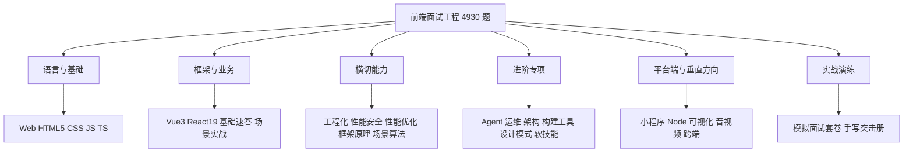
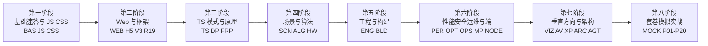

# 前端面试工程（Frontend Interview Project）

一套覆盖 Web 基础到 LLM Agent 开发、算法、运维、架构、构建工具、小程序、Node.js、设计模式、可视化、音视频、跨端与面试软技能的中文前端面试题库：**27 个文件、4930 题**，每题配有与题目**一一对应**的示例代码/模板，穿插 **349 个 mermaid 图**，并附带 20 套可直接计时演练的**模拟面试套卷**。

## 题库总览

### 一、语言与基础（5 个专题）

| 文件 | 专题 | 编号区间 | 题数 |
|---|---|---|---|
| [01-web-network-browser.md](./01-web-network-browser.md) | Web 协议与浏览器（含认证/安全攻防/排查 SOP） | WEB-001 ~ WEB-200 | 200 |
| [02-html5.md](./02-html5.md) | HTML5（含 Canvas 工程/音视频/综合案例） | H5-001 ~ H5-200 | 200 |
| [03-css.md](./03-css.md) | CSS（布局深水区/动效实战/架构/新特性） | CSS-001 ~ CSS-200 | 200 |
| [04-javascript.md](./04-javascript.md) | JavaScript（手写轮子/异步深水区/设计题） | JS-001 ~ JS-200 | 200 |
| [05-typescript.md](./05-typescript.md) | TypeScript（大厂类型体操与工程实战） | TS-001 ~ TS-200 | 200 |

### 二、框架与业务（4 个专题）

| 文件 | 专题 | 编号区间 | 题数 |
|---|---|---|---|
| [06-vue3.md](./06-vue3.md) | Vue3 全家桶（原理/实战/架构/综合大题） | V3-001 ~ V3-200 | 200 |
| [07-react19.md](./07-react19.md) | React 19（Hooks/RSC/并发/架构/综合大题） | R19-001 ~ R19-200 | 200 |
| [10-basics.md](./10-basics.md) | 基础速答（一题一考点） | BAS-001 ~ BAS-200 | 200 |
| [11-scenario.md](./11-scenario.md) | 场景实战（排查/表单/电商/跨端 全场景） | SCN-001 ~ SCN-200 | 200 |

### 三、横切能力（5 个专题）

| 文件 | 专题 | 编号区间 | 题数 |
|---|---|---|---|
| [08-engineering.md](./08-engineering.md) | 工程化（包管理/CI-CD/AI 工程化/体系） | ENG-001 ~ ENG-200 | 200 |
| [09-performance-security.md](./09-performance-security.md) | 性能指标与安全（深水区/平台化/应急） | PER-001 ~ PER-200 | 200 |
| [12-performance-optimization.md](./12-performance-optimization.md) | 性能优化实战（加载/渲染/弱网/体系） | OPT-001 ~ OPT-200 | 200 |
| [13-framework-principles.md](./13-framework-principles.md) | 框架原理（源码级/手写迷你框架） | FRP-001 ~ FRP-200 | 200 |
| [15-algorithms.md](./15-algorithms.md) | 场景算法（前端场景包装的大厂算法） | ALG-001 ~ ALG-200 | 200 |

### 四、进阶专项（6 个专题）

| 文件 | 专题 | 编号区间 | 题数 |
|---|---|---|---|
| [14-agent-development.md](./14-agent-development.md) | Agent 开发（LLM/RAG/MCP/多 Agent/平台化） | AGT-001 ~ AGT-200 | 200 |
| [16-ops-release.md](./16-ops-release.md) | 前端运维与上线（发布/回滚/CDN/K8s/应急） | OPS-001 ~ OPS-200 | 200 |
| [17-architecture.md](./17-architecture.md) | 前端架构（选型/微前端/低代码/大案例） | ARC-001 ~ ARC-200 | 200 |
| [18-build-tools.md](./18-build-tools.md) | 构建工具（webpack 源码级/Vite/Rollup） | BLD-001 ~ BLD-200 | 200 |
| [21-design-patterns.md](./21-design-patterns.md) | 前端设计模式（源码识别/重构实战/模式组合） | DP-001 ~ DP-200 | 200 |
| [22-soft-skills.md](./22-soft-skills.md) | 面试软技能（简历/STAR/答题法/谈薪/规划） | SOFT-001 ~ SOFT-100 | 100 |

### 五、平台与端（2 个专题）

| 文件 | 专题 | 编号区间 | 题数 |
|---|---|---|---|
| [19-miniprogram.md](./19-miniprogram.md) | 小程序开发（双线程/分包/登录支付/多端框架） | MP-001 ~ MP-200 | 200 |
| [20-nodejs-bff.md](./20-nodejs-bff.md) | Node.js 与 BFF（运行时/Koa/数据层/高并发） | NODE-001 ~ NODE-200 | 200 |

### 六、垂直方向（3 个专题）

| 文件 | 专题 | 编号区间 | 题数 |
|---|---|---|---|
| [25-visualization.md](./25-visualization.md) | 数据可视化与图形（SVG/Canvas/WebGL/ECharts/D3/大屏） | VIZ-001 ~ VIZ-200 | 200 |
| [26-av-rtc.md](./26-av-rtc.md) | 音视频与实时通信（WebRTC/直播/播放器/会议） | AV-001 ~ AV-200 | 200 |
| [27-cross-platform.md](./27-cross-platform.md) | 跨端深度（RN 新架构/Flutter/Hybrid/Electron） | XP-001 ~ XP-150 | 150 |

### 七、实战演练（2 个文件）

| 文件 | 内容 | 编号区间 | 数量 |
|---|---|---|---|
| [23-mock-interviews.md](./23-mock-interviews.md) | 模拟面试套卷（校招/初级/高级/专家 × 各轮次 + 可视化/音视频/Agent 定制卷，含时间分配/追问脚本/评分表） | MOCK-P01 ~ MOCK-P20 | 20 套 |
| [24-handwrite.md](./24-handwrite.md) | 手写代码突击册（60 道必手写题：5 分钟速写版 + 标准完整版 + 评分点） | HW-001 ~ HW-060 | 60 |

### 八、使用工具层（4 个文件）

| 文件 | 内容 | 说明 |
|---|---|---|
| [28-flashcards.md](./28-flashcards.md) / [28-flashcards-anki.csv](./28-flashcards-anki.csv) | Top 300 高频速记卡（可打印手册 + Anki 可导入 CSV） | 考前 7 天冲刺用，每卡 ≤3 行答案 + 编号回链 |
| [29-study-plan.md](./29-study-plan.md) | 90 天备考执行计划（校招/中级/高级三档 × 13 周逐周日程） | 含在职/全职两套时间预算、间隔复习法、30 天急训版 |
| [30-company-styles.md](./30-company-styles.md) | 字节/阿里/腾讯/拼多多 风格画像 + 8 套风格模拟卷 | ⚠️ 基于公开面经规律的风格模拟，**非任何公司真实真题** |
| [index.html](./index.html) | 全库检索导航站（4930 题全量索引，双击即用） | 支持按编号/关键词/专题前缀即时搜索；由 `tools/gen-index.mjs` 生成，题库更新后重跑一次即可 |

## 知识地图

## 推荐学习路线

## 大厂高频考点索引（跨文件）

| 考察点 | 对应专题 |
|---|---|
| 事件循环 / 闭包 / 原型链 | JS、BAS、FRP、NODE |
| Vue 响应式原理 / React Fiber | V3、R19、FRP 全篇 |
| 虚拟列表 / 大数据渲染 | ALG、SCN、OPT、R19/H5/MP 案例 |
| 防抖节流 / 限流 / 并发控制 | JS 手写、ALG、SCN、NODE、HW |
| webpack 原理 / Vite 原理 | BLD 全篇（源码级） |
| 缓存策略 / CDN / 灰度发布 | WEB、OPS、OPT、NODE、AV |
| Token 无感刷新 / 权限系统 | SCN、ARC、R19/V3 架构章、PER |
| RAG / Function Calling / MCP | AGT 全篇 |
| 性能指标 / 监控 / 降级 | PER、OPT、OPS、NODE、VIZ、AV |
| 手写 Promise / LRU / 请求库 | JS、ALG、FRP、HW |
| 小程序双线程 / 分包 / 支付 | MP 全篇 |
| Node 事件循环 / Koa 洋葱模型 | NODE 全篇 |
| 发布订阅 / 策略 / 职责链等模式 | DP 全篇（含框架源码对照） |
| 简历 STAR / 谈薪 / 反问 | SOFT 全篇 |
| ECharts / WebGL / 大屏适配 | VIZ 全篇 |
| WebRTC / 直播协议 / 秒开 | AV 全篇 |
| RN 新架构 / Flutter 三棵树 / JSBridge | XP 全篇、H5 |
| 模拟面试组卷 | MOCK 全篇（引用全库编号） |

## 使用方式

1. **系统复习**：按学习路线逐文件过题，先遮住「**答**」自答，再看要点和代码对照。
2. **模拟面试**：直接开卷 [23-mock-interviews.md](./23-mock-interviews.md)，按套卷计时演练（录音复盘），题目均引用真实编号可跳转对照。
3. **手写突击**：考前一周过 [24-handwrite.md](./24-handwrite.md)，每题先遮住答案限时 5 分钟写速写版，再对照完整版补边界。
4. **出题/培训**：每题独立编号 + 独立代码，可直接引用编号组卷。
5. **渲染查看**：所有 mermaid 图与代码块均为标准 GFM 语法，VS Code（Markdown Preview Mermaid 插件）、Typora 或 GitHub 均可直接渲染。

## 约定

- 每题格式固定：`### 编号：题目？` → `**答**：` 要点 → 一个与题目严格对应的代码块/模板块（算法题另附复杂度标注）。
- 编号前缀即专题代号（WEB/H5/CSS/JS/TS/V3/R19/ENG/PER/BAS/SCN/OPT/FRP/AGT/ALG/OPS/ARC/BLT/MP/NODE/DP/SOFT/VIZ/AV/XP/HW/MOCK），跨文件引用无歧义。
- 算法题全部基于前端场景包装，不出现裸 LeetCode 原题编号。
- Vue 示例统一 `<script setup>`；React 示例统一 React 19 函数组件 + Hooks；Agent 题基于 fetch 调 OpenAI 兼容接口；软技能题的代码块为可套用的话术/结构模板。
- 各专题互补不重复：同一知识点从不同维度组织，题干间大量交叉引用编号形成知识网络；模拟卷引用的 244 个题号已逐一验证真实存在。
