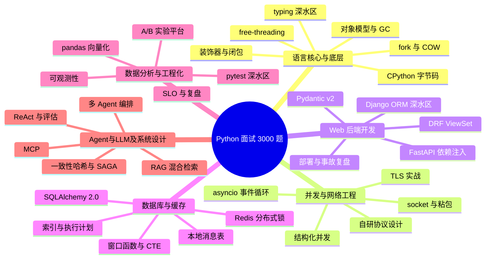

# Python 面试知识库

**3000 道**面试题(Q001–Q3000,去重后唯一),按 6 大类组织(每类约 500 题),另设**算法专题**(docs/07_算法专题,`A001` 起独立编号,不占 3000 题口径),配套自测 CLI 和离线网页版。每题都是工程向的原理 + 实战:题目 + 深度答案 + 多层追问链 + 完整可运行代码,文档与 `code/` 目录**一一对应**(脚本自动提取、全量校验)。版本基线:Python 3.9+、Pydantic v2、SQLAlchemy 2.0、Django 4.2+、Redis 6/7;第三方库题目带缺库降级提示,Agent 章节用 FakeLLM/stub 离线可跑。



## 分类目录

| 大类 | 内容 | 题号范围 | 题数 |
|---|---|---|---|
| 01 语言核心与底层 | 语言核心、进阶特性、工程级实践、CPython 底层与疑难杂症、夜间扩产批次 | Q001–Q045, Q401–Q560, Q1256–Q1300, Q1526–Q1570, Q1796–Q1840, Q2066–Q2110, Q2336–Q2380, Q2606–Q2650, Q2876–Q2896 | 496 |
| 02 并发与网络工程 | 并发异步、常用开发、并发进阶、网络深入、协议与服务、夜间扩产批次 | Q046–Q085, Q361–Q400, Q561–Q710, Q1301–Q1345, Q1571–Q1615, Q1841–Q1885, Q2111–Q2155, Q2381–Q2425, Q2651–Q2695, Q2897–Q2917 | 521 |
| 03 Web 后端开发 | Web 开发、FastAPI 进阶、Django/DRF 深入、生产部署与治理、夜间扩产批次 | Q086–Q145, Q711–Q855, Q1346–Q1390, Q1616–Q1660, Q1886–Q1930, Q2156–Q2200, Q2426–Q2470, Q2696–Q2740, Q2918–Q2938 | 496 |
| 04 数据库与缓存 | SQL 调优、ORM 与数据访问、Redis 与分布式、夜间扩产批次 | Q146–Q185, Q856–Q1020, Q1391–Q1435, Q1661–Q1705, Q1931–Q1975, Q2201–Q2245, Q2471–Q2515, Q2741–Q2785, Q2939–Q2959 | 496 |
| 05 数据分析与工程化 | 数据分析、测试工程化、数据分析进阶、质量深化、夜间扩产批次 | Q186–Q230, Q311–Q360, Q1021–Q1130, Q1436–Q1480, Q1706–Q1750, Q1976–Q2020, Q2246–Q2290, Q2516–Q2560, Q2786–Q2830, Q2960–Q2980 | 496 |
| 06 Agent 与 LLM 及系统设计 | Agent/LLM 工程、多 Agent 与 RAG、分布式系统设计、夜间扩产批次 | Q231–Q310, Q1131–Q1255, Q1481–Q1525, Q1751–Q1795, Q2021–Q2065, Q2291–Q2335, Q2561–Q2605, Q2831–Q2875, Q2981–Q3000 | 495 |

## 目录结构

```
python-interview/
├── docs/                  # 72 个内容 md + 7 个自动生成文档(唯一事实来源 = 六大类下的内容 md + 算法专题)
│   ├── 01_语言核心与底层/     # 01a~01l
│   ├── 02_并发与网络工程/     # 02a~02l
│   ├── 03_Web后端开发/       # 03a~03k
│   ├── 04_数据库与缓存/      # 04a~04k
│   ├── 05_数据分析与工程化/   # 05a~05k
│   ├── 06_Agent与LLM及系统设计/ # 06a~06l
│   └── 07_算法专题/          # 00 总览 + 高频算法题(A 编号,docs 内嵌代码)
├── code/                  # 3000 个代码文件(从文档自动提取,算法专题不入此目录)
├── scripts/               # extract_code.py / classify.py / quiz.py / audit.py / build_site.mjs / site.css
├── docs/paths/            # 自动生成:分层学习路径 + 标签索引
├── site/                  # 生成的离线静态网页(勿手改)
└── backups/               # 历史版本
```

## 自测 CLI(交互式抽题)

```bash
/usr/bin/python3 scripts/quiz.py            # 全库随机 10 题
/usr/bin/python3 scripts/quiz.py -c 6       # 只抽第 6 类(Agent/LLM)
/usr/bin/python3 scripts/quiz.py -t asyncio # 按标签过滤
/usr/bin/python3 scripts/quiz.py -d 5       # 只抽 5 星压轴难题
/usr/bin/python3 scripts/quiz.py --list     # 列出分类与题数
```

流程:只显示「问」→ 回车展开答案与代码 → 自评(会/模糊/不会)→ 结束输出统计与薄弱题清单。纯标准库,Python 3.9+ 可跑。

## 网页版

```bash
npm install                 # 首次(仅 marked + mermaid,走 npmmirror)
node scripts/build_site.mjs # 重新生成 site/
open site/index.html        # 浏览
```

`site/` 是纯静态站点(约 26MB,mermaid 已本地内置,离线可用):左侧 6 大类分组导航 + 每章题号直达,顶部搜索框按题号/标题过滤。侧栏题数由构建脚本实时统计,不再手写。

## 文档与代码的对应关系

每个代码块首行标注 `# file: code/<分类>/qNNN_名字.py`,与题号一一对应(共 3000 个文件)。校验与重新提取:

```bash
python3 scripts/extract_code.py --check   # 校验:题号连续唯一、每题一个代码块、内容一致
python3 scripts/extract_code.py           # 以 docs/ 为准重新生成 code/
```

## 运行示例代码

优先标准库;涉及第三方库的题目做了缺库降级提示;Agent 章节全部用 FakeLLM/stub,无需 API key 离线可跑。本机系统 Python 损坏时用 venv/conda 或 `uv run`。

## 由浅入深学习路径

`scripts/classify.py` 按星级把全库分成三层,生成 `docs/paths/`:

- `00_标签索引.md`:2438 个标签的频率表(L1/L2/L3 分布 + 题号),高频标签即大厂高频考点。
- `01~06_学习路径.md`:每类一份「L1 基础 → L2 进阶 → L3 高级」刷题顺序表(基础 52 题 → 进阶 74 → 高级 79,以此类推)。

quiz CLI 与路径联动:

```bash
/usr/bin/python3 scripts/quiz.py -l 1 -n 20 --ordered  # L1 基础题,按路径顺序过
/usr/bin/python3 scripts/quiz.py -l 3 -c 6            # 第 6 类高级压轴题
/usr/bin/python3 scripts/quiz.py -t asyncio --ordered  # 高频标签定向补弱
```

## 使用建议

1. **按类刷题**:每题先自己答,再对照「答」与「追问」,最后跑一遍代码。
2. **乱序自测**:用 `quiz.py -t <标签>` 针对弱项定向抽题。
3. **改造练手**:把 `code/` 示例当起点,删掉答案注释重写。

## 事实来源与校验规范

- **唯一事实来源**:`docs/<六大类>/*.md`(70 个内容文档)+ `docs/07_算法专题/*.md`(算法专题,`A` 编号、docs 内嵌代码)。`docs/paths/`、`site/`、`backups/` 均为生成物或归档,不得作为脚本输入,也不得人工反向修改源文件。
- **文件名规范**:内容文档禁止出现 `文件名 2.md` 之类的副本;历史版本一律放 `backups/`(已在 2026-11-10 归档一份)。
- **派生关系**:`code/` 由 docs 中带 `# file:` 首行的代码块提取,与题号一一对应(共 3000 个文件,其中 `q138_nginx.conf` 为唯一非 Python 文件)。修改答案里的代码必须同步修改 `code/` 同名文件。
- **代码块栅栏**:开始与闭合的 ``` 必须各自独占一行,否则 CommonMark 不闭合代码块,会吞掉后续追问与下一题标题。
- **校验入口**:`python3 scripts/extract_code.py --check` 检查题号连续且全局唯一、每题恰好一个代码块、docs 与 code/ 内容一致;另可用独立审计器做全量体检(语法编译、栅栏规范、站点时效、口径一致)。
- **口径同源**:题数、文档数、标签数、站点体积由脚本统计,不要手写进 README / package.json / 构建脚本。
