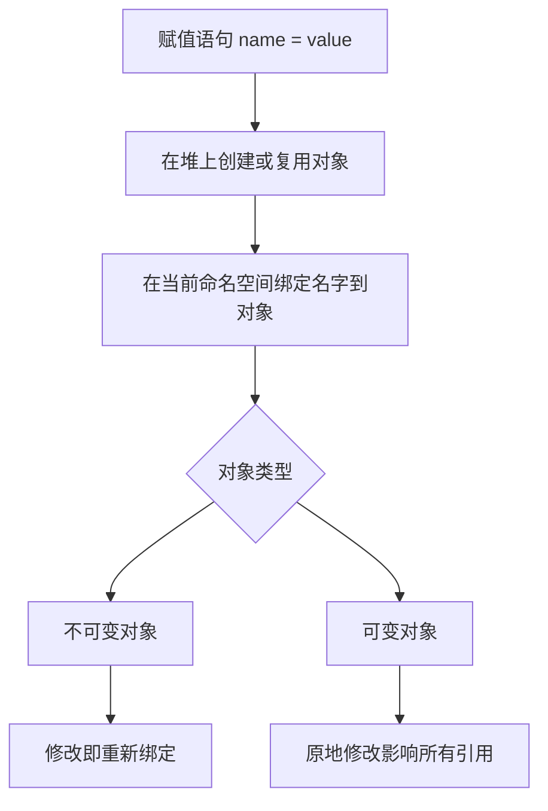
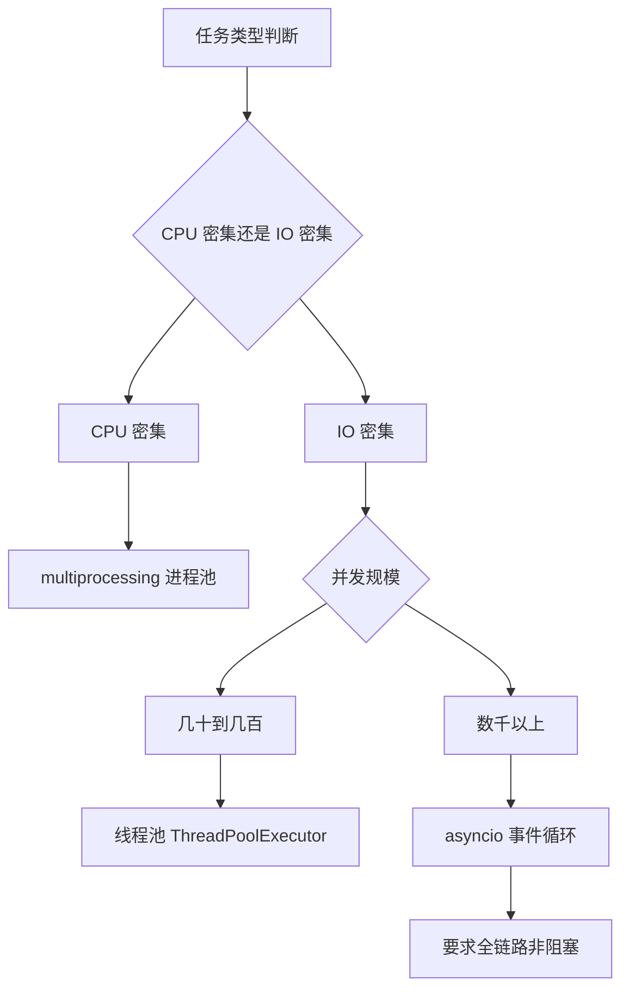
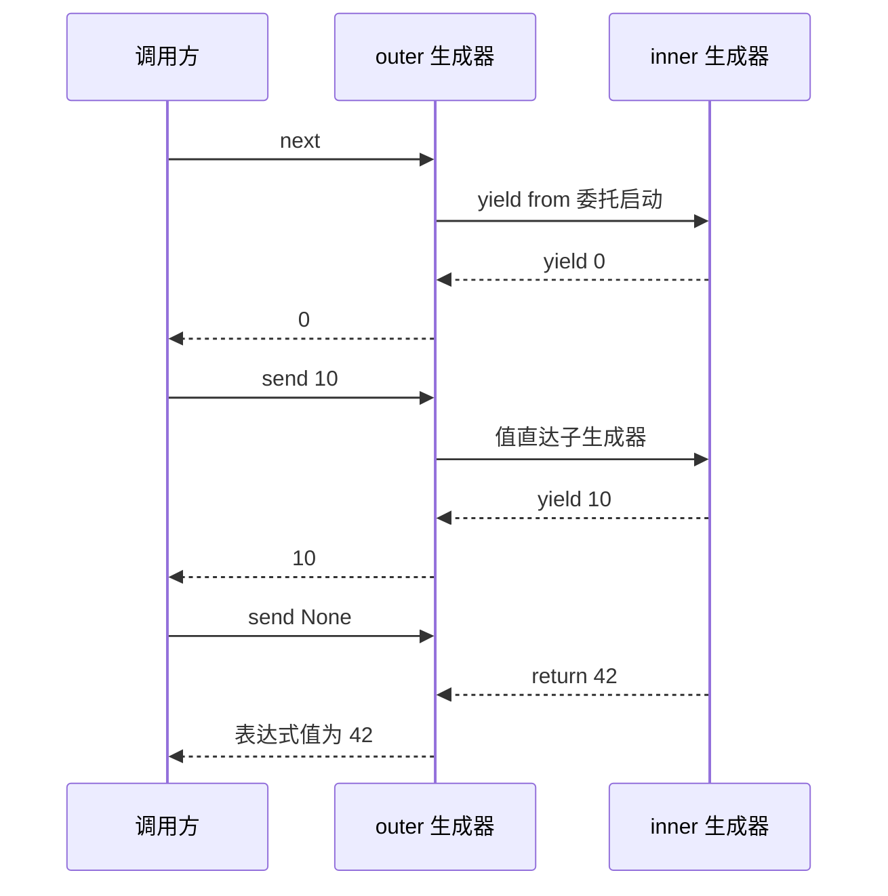
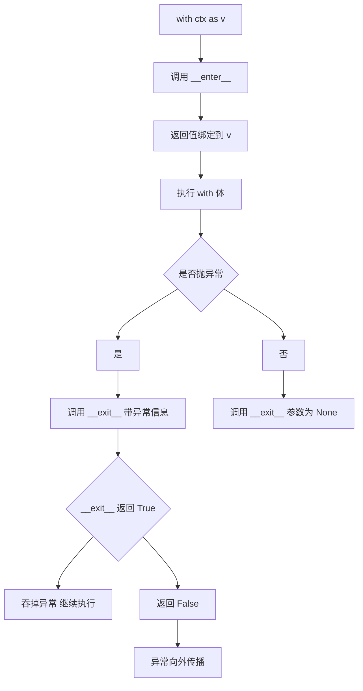
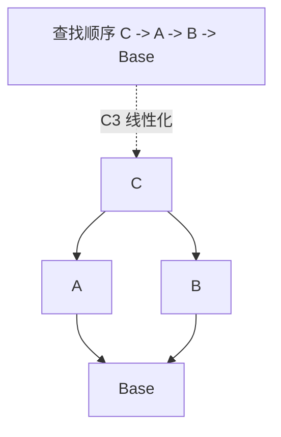
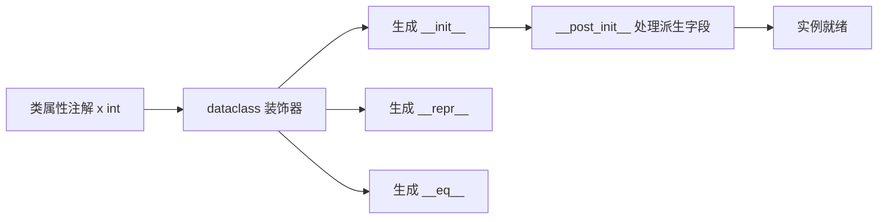
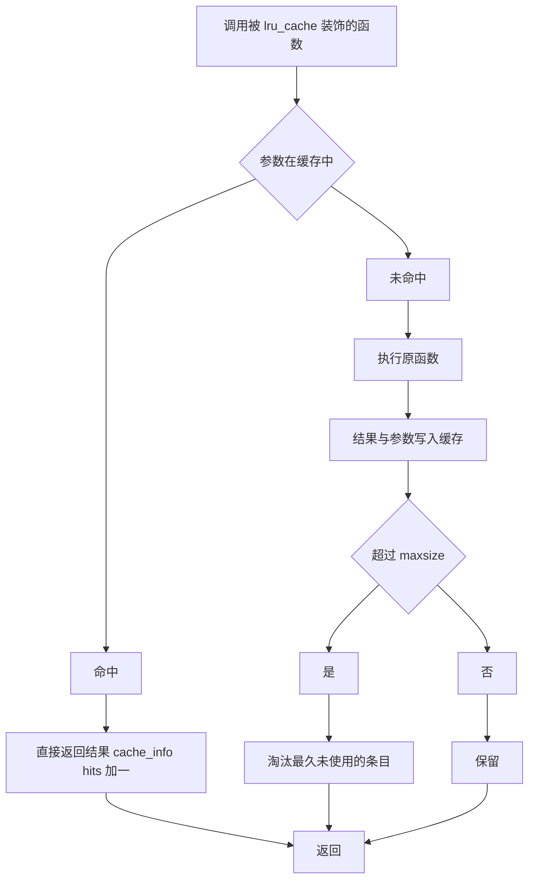

# 第 1 章 · Python 语言核心

本章覆盖 Python 面试中出现频率最高的语言核心问题:对象模型与内存管理、GIL 与并发、装饰器与闭包、生成器与迭代器、上下文管理器、描述符与元类、MRO 与继承、typing 与 dataclass、异常设计、模块导入机制以及性能分析与缓存。每题按「面试官提问 → 核心答案 → 可运行代码 → 常见追问」组织,建议先自己作答再对照代码验证。所有代码仅依赖标准库,可直接复制到本地运行。

### Q001 · Python 中变量和对象的关系是什么

> 难度:★☆☆ | 标签:对象模型, 引用

**问**:面试官常问:Python 的变量到底存的是什么?赋值 `b = a` 之后修改 `a`,为什么有时 `b` 也跟着变?

**答**:Python 变量是绑定到对象的名字,本质是命名空间里指向堆上对象的引用。赋值从不拷贝对象,只拷贝引用。`b` 跟着变只发生在可变对象被原地修改时;对不可变对象重新赋值 `a = ...` 只是让 `a` 指向新对象,`b` 不受影响。

```python
# file: code/01_语言核心与底层/q001_object_model.py
a = [1, 2, 3]
b = a          # b 与 a 指向同一个 list 对象
b.append(4)
print(a)       # [1, 2, 3, 4] 原地修改影响两个名字

x = 10
y = x
x = 99         # 重新绑定,不影响 y
print(y)       # 10

print(id(a) == id(b))   # True,同一对象
print(a is b)           # True

if __name__ == "__main__":
    demo_a = {"k": 1}
    demo_b = demo_a
    demo_b["k"] = 2
    print(demo_a)  # {'k': 2}
```

**追问**:1) 函数传参是值传递还是引用传递?——都不是,是「传对象引用」(call by object reference):传进去的是引用的拷贝,原地修改可见,重新绑定不可见。2) 为什么 list 参数在函数里 append 后「调用方也看到了」?——可变对象被原地修改,所有引用共享同一对象;不想影响调用方就在函数内先 `list(x)` 拷贝。3) `id()` 在 CPython 里是什么?能拿来做什么判断?——对象在堆上的内存地址,生命周期内唯一;对象回收后地址可能被复用,所以不能用它判断「是不是同一个曾经的变量」。

### Q002 · is 和 == 的区别

> 难度:★☆☆ | 标签:对象模型

**问**:`a is b` 和 `a == b` 有什么区别?什么场景下必须用 `is`?

**答**:`==` 调用 `__eq__` 比较值是否相等;`is` 比较 `id()`,即是否为同一对象。判断 `None`、`True`、`False` 必须用 `is`,因为这些是单例且 `__eq__` 可能被重载。小整数和短字符串由于缓存机制,`is` 常常「碰巧」为 True,不可依赖。

```python
# file: code/01_语言核心与底层/q002_is_vs_eq.py
a = [1, 2, 3]
b = [1, 2, 3]
print(a == b)  # True  值相等
print(a is b)  # False 不同对象

x = None
print(x is None)  # True,推荐的判空写法

s1 = "hello"
s2 = "hello"
print(s1 is s2)  # 通常 True,字符串驻留,但这是实现细节

if __name__ == "__main__":
    class Weird:
        def __eq__(self, other):
            return True
    w = Weird()
    print(w == None)   # True,__eq__ 被重载
    print(w is None)   # False
```

**追问**:1) 为什么 `256 is 256` 为 True 而 `257 is 257` 可能为 False?——CPython 缓存了 -5 到 256 的整数对象,超过范围每次新建,所以不要用 `is` 比较数值。2) 什么场景必须用 `is`?——与单例(None/True/False)判等,以及用哨兵对象区分「没传参数」和「显式传了 None」。3) 自定义 `__eq__` 后不定义 `__hash__` 会怎样?——默认 `__hash__` 被置为 None,实例不可哈希、进不了 set/dict key;两者都定义时必须保证相等对象哈希相同。

### Q003 · 哪些类型可变,哪些不可变

> 难度:★☆☆ | 标签:可变与不可变

**问**:请列举 Python 中常见的可变与不可变类型,并说明不可变类型的意义。

**答**:常见可变:list、dict、set、bytearray、自定义类实例。常见不可变:int、float、str、tuple、frozenset、bytes。不可变对象可以安全地作为 dict 的 key、作为多线程共享数据、被哈希缓存。注意「不可变容器里装可变对象」时整体仍可能表现出变化,例如 tuple 中的 list 可以被修改;而且 tuple 的哈希是对元素**实时求值**的,tuple 里装了 list 时整个 tuple 不可哈希,不能作为 dict key。

```python
# file: code/01_语言核心与底层/q003_mutable_immutable.py
t = ([1, 2], "abc")
t[0].append(3)     # tuple 本身没变,但它引用的 list 变了
print(t)           # ([1, 2, 3], 'abc')

try:
    d = {t: "ok"}  # 报 TypeError:tuple 的哈希按元素实时计算,装了 list 就不可哈希
except TypeError as e:
    print("unhashable:", e)

d2 = {(1, 2, "abc"): "ok"}   # 元素全不可变的 tuple 才能做 key
print(d2[(1, 2, "abc")])

def add_item(lst=[]):        # 经典陷阱:默认参数只创建一次
    lst.append(1)
    return lst

print(add_item())  # [1]
print(add_item())  # [1, 1]

if __name__ == "__main__":
    s = "abc"
    print(id(s))
    s += "d"       # 生成新 str 对象
    print(id(s))   # id 改变
```

**追问**:1) 为什么 dict 的 key 必须可哈希?——哈希表通过 key 的哈希值定位桶,可变对象内容变化后哈希会失效,所以 list、dict、set 不能做 key。2) tuple 里装了 list 还能哈希吗?——不能,`hash(tuple)` 对元素实时求值,遇到可变元素抛 TypeError;全不可变元素的 tuple 可以做 dict key。3) `x += y` 对可变与不可变对象行为有何差异?——可变对象走 `__iadd__` 原地修改并返回自身;不可变对象退化为 `x = x + y` 重新绑定,这个差异正是「同一个列表被两处共享修改」事故的根源。4) 为什么 str 频繁 `+=` 性能差?——str 不可变,每次拼接都新建对象并整体拷贝,循环拼接应改用 `''.join(parts)` 或 `io.StringIO`。

### Q004 · 可变对象作为默认参数的陷阱

> 难度:★★☆ | 标签:可变与不可变, 函数

**问**:为什么 `def f(x=[])` 是著名的坑?如何修复?

**答**:默认参数在函数定义时求值一次,绑定在函数对象的 `__defaults__` 中,所有调用共享同一个对象。可变默认参数会跨调用累积状态。修复方式是默认值用 `None`,函数体内再创建新对象。

```python
# file: code/01_语言核心与底层/q004_default_arg.py
def bad(item, bucket=[]):
    bucket.append(item)
    return bucket

def good(item, bucket=None):
    if bucket is None:
        bucket = []
    bucket.append(item)
    return bucket

if __name__ == "__main__":
    print(bad(1), bad(2))       # [1] [1, 2]  共享同一个 list
    print(good(1), good(2))     # [1] [2]     每次新建

    print(bad.__defaults__)     # ([1, 2],)  默认值就存在这里
```

**追问**:1) 默认参数的求值时机能被利用吗?——可以,例如用 `time.time()` 做默认值可以缓存模块加载时间,但这通常降低可读性,慎用。2) 如何区分「没传参数」和「显式传了 None」?——用模块级哨兵 `_missing = object()`,函数内 `is` 比较,配置解析与序列化场景的标准手法。3) `f.__defaults__` 能在运行时修改吗?——可以,它是函数对象上的元组,直接改是可行的黑魔法;正规做法是 `functools.partial` 预绑定参数。4) 默认参数求值一次还有什么副作用案例?——`def log(t=time.time())` 把模块加载时间固化成常量,恰恰说明求值时机是 def 执行时而不是调用时。

### Q005 · 深拷贝与浅拷贝的区别

> 难度:★★☆ | 标签:拷贝, 内存

**问**:实现一个嵌套列表的副本,浅拷贝为什么不够?copy 模块如何解决?

**答**:浅拷贝只复制最外层容器,内部元素仍是共享引用;修改嵌套元素会互相影响。`copy.deepcopy` 递归复制所有层级,并通过 `memo` 字典处理循环引用,保证副本完全独立。切片 `lst[:]`、`list(lst)`、`dict.copy()` 都是浅拷贝。

```python
# file: code/01_语言核心与底层/q005_copy.py
import copy

a = [1, [2, 3]]
shallow = copy.copy(a)
deep = copy.deepcopy(a)

a[1].append(4)
print(shallow)   # [1, [2, 3, 4]] 内层被共享
print(deep)      # [1, [2, 3]]    完全独立

if __name__ == "__main__":
    loop = [1, 2]
    loop.append(loop)          # 循环引用
    d = copy.deepcopy(loop)
    print(d[2] is d)           # True,deepcopy 正确处理自引用

    lst = [[0]] * 3            # 三处指向同一个内层 list
    lst[0][0] = 9
    print(lst)                 # [[9], [9], [9]]
```

**追问**:1) 自定义类如何控制拷贝行为?——实现 `__copy__` 和 `__deepcopy__(self, memo)` 方法,deepcopy 会优先调用它们。2) deepcopy 的 memo 参数是干什么的?——记录「原对象 id → 已拷贝对象」的映射,既解决循环引用,也保证被共享的子对象在副本里仍共享一份而不是复制多份。3) `copy.copy` 对 tuple 的行为?——若所有元素都不可变,可能直接返回原对象(无需求拷贝);含可变元素才新建外层 tuple。4) 浅拷贝的典型生产事故?——`config = dict(base_config)` 后修改嵌套 dict,把 base_config 一起改了;嵌套结构必须 deepcopy 或用显式字段复制。

### Q006 · 小整数缓存与字符串驻留

> 难度:★★☆ | 标签:内存, 对象模型

**问**:为什么 `-5 <= x <= 256` 的整数 `is` 比较结果是 True?字符串驻留是什么机制?

**答**:CPython 启动时预创建 -5 到 256 的整数对象,所有引用指向同一份,节省频繁小整数的分配开销。字符串驻留(interning)把符合标识符规则的短字符串放进内部字典复用,编译期的字面量常自动驻留,运行期拼接的字符串通常不驻留,可用 `sys.intern()` 强制。这些都是 CPython 实现细节,不是语言规范。

```python
# file: code/01_语言核心与底层/q006_interning.py
import sys

if __name__ == "__main__":
    a = 100
    b = 100
    print(a is b)        # True,小整数缓存

    c = 257
    d = 257
    print(c is d)        # 交互模式下可能 False,脚本里同一次编译可能 True

    s1 = sys.intern("hello" + "!")
    s2 = sys.intern("hello!")
    print(s1 is s2)      # True,显式驻留

    big = "".join(["x"] * 1000)
    print(sys.getsizeof(big) > 0)  # str 有独立存储
```

**追问**:1) 驻留有什么实际用途?——在需要大量字符串相等比较的场景(如解析器符号表),驻留后可先用 `is` 快速判等,哈希也只算一次。2) 为什么要有小整数缓存?——-5 到 256 在下标计算、循环计数中出现极频繁,预创建单例避免反复分配释放;同理 None、True、False、空 tuple 都是共享单例。3) `sys.intern` 有什么代价?——驻留字符串进入内部表且生命周期长,经典实现里不随对象回收,只应对高重复、长期存在的字符串(标识符、枚举名),不要对任意用户输入 intern。



### Q007 · Python 的垃圾回收机制

> 难度:★★★ | 标签:GC, 内存

**问**:Python 是如何回收内存的?引用计数之外为什么还需要分代回收?

**答**:CPython 主机制是引用计数,对象引用数归零立即释放,实时性好;但它解决不了循环引用,所以引入分代 GC:0/1/2 三代,新对象在 0 代,扫描后存活者晋升,越老扫描频率越低。分代 GC 只处理容器对象,通过 `gc` 模块可手动触发或调整阈值。另有 `weakref` 弱引用不增加引用计数,常用于缓存。

```python
# file: code/01_语言核心与底层/q007_gc.py
import gc
import weakref

class Node:
    def __init__(self, name):
        self.name = name
        self.partner = None

if __name__ == "__main__":
    gc.disable()   # 演示引用计数与分代回收分离
    a = Node("a")
    b = Node("b")
    a.partner = b
    b.partner = a  # 循环引用
    ref = weakref.ref(a)

    del a, b       # 引用计数不为零,因为互相持有
    print(ref() is not None)  # True,还活着

    gc.collect()   # 分代 GC 打破循环
    print(ref() is None)      # True,已被回收
    gc.enable()
```

**追问**:1) 内存泄漏在 Python 里还可能吗?——可能:全局集合无限增长、对象被注册到全局回调、`__del__` 参与的旧式循环(3.4 起已缓解)、C 扩展泄漏等。2) 分代阈值 (700, 10, 10) 是什么语义?——0 代「净分配数」(分配减释放)达到 700 触发一次 0 代扫描;0 代扫描 10 次把幸存者升入 1 代,1 代扫描 10 次升 2 代,老对象扫描频率指数级降低。3) 带 `__del__` 的循环引用现在能回收吗?——能,CPython 3.4 起 PEP 442 逐个安全终结,`gc.garbage` 常态为空;「旧式循环滞留」是过时答案,面试提这句反而是加分点。4) gc 是万能的吗?——只跟踪容器对象;C 扩展用 Py_INCREF 持有却不参与 GC 跟踪的内存(如部分 ctypes、原生库)不受管辖,这类泄漏要靠 tracemalloc 或 valgrind 定位。

### Q008 · __slots__ 的作用与代价

> 难度:★★☆ | 标签:内存, 类

**问**:`__slots__` 为什么能省内存?它牺牲了什么?

**答**:默认情况下实例属性存在每个对象各自的 `__dict__` 中,字典带来灵活性也带来内存开销。声明 `__slots__` 后,属性通过固定槽位描述符访问,不再创建 `__dict__`,百万级小对象可省大量内存。代价包括:不能动态添加新属性、默认不能与多重继承含 `__dict__` 的类组合、需要 WeakSet 支持时要额外声明 `__weakref__`。

```python
# file: code/01_语言核心与底层/q008_slots.py
import sys

class Plain:
    def __init__(self, x, y):
        self.x = x
        self.y = y

class Slotted:
    __slots__ = ("x", "y")
    def __init__(self, x, y):
        self.x = x
        self.y = y

if __name__ == "__main__":
    p = Plain(1, 2)
    s = Slotted(1, 2)
    print(hasattr(p, "__dict__"))  # True
    print(hasattr(s, "__dict__"))  # False
    print(sys.getsizeof(p) > sys.getsizeof(s))  # True

    try:
        s.z = 3
    except AttributeError as e:
        print("cannot add:", e)
```

**追问**:1) dataclass 支持 slots 吗?——支持,`@dataclass(slots=True)`(Python 3.10+)会自动生成 `__slots__`。2) __slots__ 的继承陷阱?——父类没定义 `__slots__` 时子类实例仍有 `__dict__`,省内存效果归零;两个都定义非空 slots 的类做多继承会报 multiple bases have instance lay-out conflict。3) 省了多少内存怎么验证?——单对象 `sys.getsizeof` 差异 + 全进程 `tracemalloc` 对比;注意 getsizeof 对普通实例不含 `__dict__` 本身的大小,容易低估差距。

### Q009 · GIL 是什么,为什么存在

> 难度:★★★ | 标签:GIL, 并发

**问**:请解释 GIL 的设计初衷和基本工作方式。

**答**:GIL 是 CPython 解释器的全局互斥锁,保证同一时刻只有一个线程执行 Python 字节码。它简化了 CPython 内存管理的线程安全实现(引用计数不必每对象加锁),也让非线程安全的 C 扩展集成变简单。线程切换默认每 5 毫秒(`sys.getswitchinterval()`)由持有线程主动释放,GIL 会在阻塞式 IO 调用前释放。注意 GIL 是 CPython 实现产物,Jython、IronPython 没有。

```python
# file: code/01_语言核心与底层/q009_gil_basics.py
import sys
import threading

counter = 0

def worker(n):
    global counter
    for _ in range(n):
        counter += 1   # 字节码层面是 读-加-写 三步,并不原子

if __name__ == "__main__":
    print(sys.getswitchinterval())  # 默认 0.005 秒
    threads = [threading.Thread(target=worker, args=(100_000,)) for _ in range(4)]
    for t in threads:
        t.start()
    for t in threads:
        t.join()
    print(counter, "!= 400000 时说明竞态存在")
```

**追问**:1) GIL 保护了我的数据吗?——没有,GIL 只保证字节码不交错,`counter += 1` 这类多字节码操作仍有竞态,共享状态仍需 `threading.Lock`。2) 为什么 CPython 不直接去掉 GIL?——引用计数不是原子操作,去掉后要么给每个对象加锁(细粒度锁性能崩塌),要么改成延迟/分段回收;PEP 703 free-threading 走的就是后者,还要连带解决 C 扩展的隐式线程安全依赖。3) GIL 都在什么时机释放?——每 5ms(`sys.getswitchinterval()`)的解释器检查点、进入阻塞系统调用(IO/sleep/lock.acquire)之前、以及 NumPy/hashlib/zlib 等大块 C 代码进出时。

### Q010 · GIL 对 CPU 密集与 IO 密集任务的不同影响

> 难度:★★★ | 标签:GIL, 并发

**问**:同样是多线程,为什么 IO 密集场景有效而 CPU 密集场景反而更慢?

**答**:IO 密集任务大部分时间在等待,线程在进入阻塞 IO 前会释放 GIL,其他线程得以运行,多线程能显著提高吞吐。CPU 密集任务始终需要解释器执行字节码,GIL 把多线程串行化,还叠加了锁竞争和上下文切换开销,通常比单线程更慢,应改用 multiprocessing 或把热点交给释放 GIL 的 C 扩展(如 NumPy)。

```python
# file: code/01_语言核心与底层/q010_gil_cpu_vs_io.py
import threading
import time

def cpu_bound(n):
    total = 0
    for i in range(n):
        total += i * i
    return total

def io_like(duration):
    time.sleep(duration)   # sleep 会释放 GIL,模拟阻塞 IO

if __name__ == "__main__":
    N = 1_000_000    # 演示规模缩小,保证脚本秒级跑完

    t0 = time.perf_counter()
    cpu_bound(N)
    cpu_bound(N)
    print("CPU 串行:", round(time.perf_counter() - t0, 3), "s")

    t0 = time.perf_counter()
    threads = [threading.Thread(target=cpu_bound, args=(N,)) for _ in range(2)]
    for t in threads: t.start()
    for t in threads: t.join()
    print("CPU 多线程,通常更慢:", round(time.perf_counter() - t0, 3), "s")

    t0 = time.perf_counter()
    threads = [threading.Thread(target=io_like, args=(0.3,)) for _ in range(4)]
    for t in threads: t.start()
    for t in threads: t.join()
    print("IO 多线程,约等于单个耗时:", round(time.perf_counter() - t0, 3), "s")
```

**追问**:1) 有没有去掉 GIL 的官方努力?——有,PEP 703 的 free-threaded 构建,CPython 3.13 起提供实验版本,可在编译期去掉 GIL,但生态兼容仍在推进中。2) Python 3.2 的 GIL 切换机制改了什么?——从「每 100 条字节码强制切换」改为当前线程每 5ms 主动让出,消除了 CPU 线程长期霸占 GIL 导致 IO 线程饿死的 convoy effect。3) 多进程一定比多线程快吗?——不一定:进程有启动、pickle 序列化和 IPC 成本,小任务 fan-out 的开销可能吃掉并行收益;先测量任务粒度再选模型。

### Q011 · 线程、进程、协程如何选型

> 难度:★★★ | 标签:并发, GIL

**问**:面对爬虫、图像批处理、上万连接的网关,分别选什么并发模型?

**答**:经验法则:CPU 密集用 multiprocessing(绕过 GIL,利用多核);IO 密集且并发量中等用线程或线程池;超高并发 IO 用 asyncio 协程,单线程事件循环,内存开销极小,但要求调用链支持异步且不能混入阻塞调用。也可以混合:进程池内再开事件循环。

```python
# file: code/01_语言核心与底层/q011_concurrency_choice.py
import asyncio
import time
from concurrent.futures import ThreadPoolExecutor

def blocking_fetch(url_id):
    time.sleep(0.2)              # 模拟阻塞 IO
    return f"resp-{url_id}"

async def async_fetch(url_id):
    await asyncio.sleep(0.2)     # 模拟非阻塞 IO
    return f"resp-{url_id}"

if __name__ == "__main__":
    t0 = time.perf_counter()
    with ThreadPoolExecutor(max_workers=10) as pool:
        results = list(pool.map(blocking_fetch, range(10)))
    print("线程池:", round(time.perf_counter() - t0, 2), "s")

    async def main():
        return await asyncio.gather(*(async_fetch(i) for i in range(10)))
    t0 = time.perf_counter()
    results = asyncio.run(main())
    print("协程:", round(time.perf_counter() - t0, 2), "s")
```

**追问**:1) asyncio 里调用了一个阻塞函数会怎样?——整个事件循环被卡住,所有协程都停摆;要用 `loop.run_in_executor` 或 `asyncio.to_thread` 把它丢到线程池。2) 线程池默认多大?有什么风险?——`ThreadPoolExecutor` 默认 `min(32, cpu+4)`;submit 无背压,任务无限堆积会内存上涨,生产要有界队列、拒绝策略和队列长度监控。3) 进程池之间怎么传数据?——经 pickle 序列化走管道,连接、锁等不可 pickle 对象传不过去;大数组走序列化是瓶颈,可用 `multiprocessing.shared_memory` 共享内存。



### Q012 · 装饰器的本质是什么

> 难度:★★☆ | 标签:装饰器, 函数

**问**:请手写一个计时装饰器,并解释 `@` 语法做了什么。

**答**:装饰器是接收函数并返回新函数(或任意对象)的可调用对象,`@dec` 等价于 `f = dec(f)`。典型实现是外层函数返回内层包装函数,包装时在调用前后插入逻辑。装饰器在导入时执行一次,运行时每次调用的是包装后的函数。

```python
# file: code/01_语言核心与底层/q012_decorator_basic.py
import functools
import time

def timer(func):
    @functools.wraps(func)
    def wrapper(*args, **kwargs):
        start = time.perf_counter()
        result = func(*args, **kwargs)
        cost = time.perf_counter() - start
        print(f"{func.__name__} cost {cost:.4f}s")
        return result
    return wrapper

@timer
def slow_sum(n):
    return sum(range(n))

if __name__ == "__main__":
    slow_sum(1_000_000)
    print(slow_sum.__name__)  # slow_sum,wraps 保住了元信息
```

**追问**:1) 装饰器可以装饰类吗?——可以,返回修改后的类即可,常用于注册类、给类批量添加方法或单例化。2) 装饰器代码在什么时机执行?——import 时执行一次完成包装,之后每次调用执行的是 wrapper;所以装饰器里做重活会拖慢启动,做 IO 会产生导入期副作用。3) 不加 functools.wraps 在框架里会炸出什么问题?——FastAPI/pytest 等按 `__signature__`、注解和名字工作的机制会把 wrapper 的 `(*args, **kwargs)` 当真实签名,依赖注入与参数化全部失效。

### Q013 · functools.wraps 为什么重要

> 难度:★★☆ | 标签:装饰器

**问**:不加 `@functools.wraps` 会出什么问题?

**答**:包装后 `__name__`、`__doc__`、`__module__`、`__wrapped__` 等元信息会变成 wrapper 自己的,影响调试、日志、文档生成,以及依赖函数签名的框架(如 `inspect.signature`)。`functools.wraps` 通过 `functools.update_wrapper` 把原函数元信息拷贝到 wrapper 上,并设置 `__wrapped__` 指向原函数,便于用 `inspect.unwrap` 还原。

```python
# file: code/01_语言核心与底层/q013_wraps.py
import functools
import inspect

def deco_no_wraps(func):
    def wrapper(*args, **kwargs):
        return func(*args, **kwargs)
    return wrapper

def deco_with_wraps(func):
    @functools.wraps(func)
    def wrapper(*args, **kwargs):
        return func(*args, **kwargs)
    return wrapper

@deco_no_wraps
def f1():
    """doc of f1"""

@deco_with_wraps
def f2():
    """doc of f2"""

if __name__ == "__main__":
    print(f1.__name__, "|", f1.__doc__)  # wrapper | None
    print(f2.__name__, "|", f2.__doc__)  # f2 | doc of f2
    print(inspect.signature(f2))         # 还原真实签名
```

**追问**:1) 叠加了多层 wraps 的装饰器链,怎么拿到最原始的函数?——沿 `__wrapped__` 属性逐层向上,或用 `inspect.unwrap` 一步到位。2) wraps 具体拷贝什么?——通过 `functools.update_wrapper` 拷贝 `__module__`/`__name__`/`__qualname__`/`__doc__`/`__dict__`,并设置 `__wrapped__` 指向原函数供 `inspect.unwrap` 使用。3) 签名信息靠什么补齐?——`functools.wraps` 不改 wrapper 的参数列表;要签名也一致需在 wrapper 上设置 `__signature__ = inspect.signature(func)`,否则 `inspect.signature` 仍看到 `(*args, **kwargs)`。

### Q014 · 带参数的装饰器怎么写

> 难度:★★★ | 标签:装饰器

**问**:`@retry(times=3)` 这种三明治结构是什么原理?

**答**:带参装饰器是「装饰器工厂」:调用 `retry(times=3)` 先返回真正的装饰器,再由它包装函数。本质是三层函数:最外层收参数,中间层收函数,最内层收调用参数。参数也可以用类来实现,让状态维护更自然。

```python
# file: code/01_语言核心与底层/q014_decorator_with_args.py
import functools
import random
import time

def retry(times, delay=0.1, exceptions=(Exception,)):
    def decorator(func):
        @functools.wraps(func)
        def wrapper(*args, **kwargs):
            for attempt in range(1, times + 1):
                try:
                    return func(*args, **kwargs)
                except exceptions as e:
                    print(f"attempt {attempt} failed: {e}")
                    if attempt == times:
                        raise
                    time.sleep(delay)
        return wrapper
    return decorator

@retry(times=3, exceptions=(ValueError,))
def flaky():
    if random.random() < 0.7:
        raise ValueError("boom")
    return "ok"

if __name__ == "__main__":
    random.seed(42)
    try:
        print("flaky() =", flaky())
    except ValueError:
        print("flaky() 重试 3 次后仍失败——装饰器把最后一次异常抛给调用方(演示预期)")
```

**追问**:1) `@retry(times=3)` 与 `@retry` 混用会怎样?——后者会把函数当 `times` 传入,要么写成兼容两种用法的自适应装饰器,要么在工厂里做类型检查报清晰错误。2) 三层函数各层的执行时机?——工厂在装饰表达式求值时执行(每次装饰一次),返回的装饰器在 import 时包装一次,wrapper 每次调用执行;排查「为什么初始化了两次」要先分清层。3) 用类实现带参装饰器长什么样?——`__init__` 收参数、`__call__` 收函数返回 wrapper,状态存实例属性,比三层嵌套函数更可读、可单测。

### Q015 · 多层装饰器的执行顺序

> 难度:★★★ | 标签:装饰器

**问**:`@a @b @c` 三层装饰器,谁先包装、谁先执行?

**答**:包装顺序自下而上:`f = a(b(c(f)))`,最靠近函数的 `c` 最先包装;执行顺序自上而下:进入 `a` 的 wrapper 后才进入 `b`,再进入 `c`,最后到达原函数;返回时逆序。可以把装饰器理解成洋葱模型,`@` 只是声明了组合顺序。

```python
# file: code/01_语言核心与底层/q015_decorator_order.py
import functools

def make(name):
    def deco(func):
        @functools.wraps(func)
        def wrapper(*args, **kwargs):
            print(f"enter {name}")
            result = func(*args, **kwargs)
            print(f"exit  {name}")
            return result
        return wrapper
    return deco

@make("A")
@make("B")
@make("C")
def core():
    print("  core running")

if __name__ == "__main__":
    core()
    # enter A -> enter B -> enter C -> core -> exit C -> exit B -> exit A
    print(core.__name__)
```

**追问**:1) 装饰器在什么时机执行「包装」这段代码?——模块被导入、装饰器语句被求值时立即执行,而不是函数第一次被调用时。2) 执行顺序怎么验证?——各 wrapper 进出时打印日志:输出 A 前置→B 前置→C 前置→原函数→C 后置→B 后置→A 后置,标准洋葱模型。3) 带参装饰器叠加时的求值顺序?——先从上到下求值工厂参数,再自下而上包装;`@a(arg)` 在 `@b` 之前求值,等价于 `f = a(arg)(b(f))`。


### Q016 · 用类实现装饰器有什么优势

> 难度:★★☆ | 标签:装饰器, 类

**问**:什么时候选择类装饰器(或带 `__call__` 的实例作装饰器)?

**答**:实现 `__call__` 的类实例可以当函数用,作为装饰器时能把状态(计数器、缓存、配置)自然存在实例属性里,而不必依赖闭包变量或可变默认参数。需要可恢复、可配置、可测试的横切逻辑(限流、重试统计)时类装饰器更清晰,也便于单测直接构造实例。

```python
# file: code/01_语言核心与底层/q016_class_decorator.py
import functools

class CallCounter:
    def __init__(self, func):
        functools.update_wrapper(self, func)
        self.func = func
        self.count = 0

    def __call__(self, *args, **kwargs):
        self.count += 1
        print(f"call #{self.count}")
        return self.func(*args, **kwargs)

@CallCounter
def greet(name):
    return f"hello {name}"

if __name__ == "__main__":
    print(greet("alice"))
    print(greet("bob"))
    print(greet.count)      # 状态可直接读取
    print(greet.__name__)   # greet,元信息已拷贝
```

**追问**:1) 类实例装饰器和函数装饰器在 `inspect` 看来有何差别?——函数装饰器产物是函数,`inspect.isfunction` 为 True;类实例装饰器产物是实例,某些依赖函数类型的框架(如静态注册回调)可能不识别。2) 类实现带参装饰器为什么不需要工厂?——`__init__` 天然收参数、`__call__` 收函数,省掉一层嵌套;需要运行期改配置时还能直接操作实例。3) 类实例装饰器当方法装饰器有什么坑?——放在类体里不会自动绑定 self,wrapper 拿不到实例;需要实现 `__get__` 描述符协议完成绑定,或改用函数装饰器。

### Q017 · 闭包与 late binding 陷阱

> 难度:★★★ | 标签:闭包, 函数

**问**:循环里用 lambda 生成一批函数,为什么它们返回的都是最后一个值?

**答**:闭包捕获的是自由变量的引用(通过 cell 对象),不是创建时的值。循环变量只有一个,循环结束后所有闭包共享它,调用时才解引用,于是全是末值,这就是 late binding。解法有二:用默认参数在定义时固化值 `lambda i=i: ...`,或用 `functools.partial`。

```python
# file: code/01_语言核心与底层/q017_late_binding.py
import functools

funcs_bad = [lambda: i for i in range(3)]
funcs_ok  = [lambda i=i: i for i in range(3)]
funcs_par = [functools.partial(lambda k: k, i) for i in range(3)]

if __name__ == "__main__":
    print([f() for f in funcs_bad])  # [2, 2, 2]  late binding
    print([f() for f in funcs_ok])   # [0, 1, 2]  默认参数固化
    print([f() for f in funcs_par])  # [0, 1, 2]

    def outer():
        x = 1
        def inner():
            return x
        x = 2           # inner 读到的是最终值
        return inner()
    print(outer())      # 2
```

**追问**:1) 如何查看闭包捕获了什么?——`func.__closure__` 是 cell 元组,`cell.cell_contents` 可读取当前值,只读不可写。2) 为什么默认参数 `lambda i=i:` 能修复 late binding?——默认值在 def 语句执行时求值一次,每个闭包的 `__defaults__` 各自持有当轮迭代的 i,等于定义时快照。3) 闭包捕获的是值还是变量?——通过 cell 对象捕获变量本身(引用),外层函数返回后变量存活在 cell 里;这也是闭包延长对象生命周期、排查内存滞留时要看的点(`func.__closure__`)。

### Q018 · nonlocal 与 global 的区别

> 难度:★★☆ | 标签:作用域, 闭包

**问**:在嵌套函数里给外层变量赋值为什么报 UnboundLocalError?两种声明怎么选?

**答**:Python 用 LEGB 作用域查找规则,但赋值语句会让名字被编译期判定为局部变量,除非显式声明。`global` 绑定模块级名字,`nonlocal`(Python 3)绑定最近的封闭函数作用域,要求该名字在外层已存在。优先避免可变全局状态,需要跨层写变量时局部闭包用 `nonlocal`。

```python
# file: code/01_语言核心与底层/q018_nonlocal.py
counter_value = 0

def bad_counter():
    counter_value += 1   # UnboundLocalError,赋值使它成为局部

def make_counter():
    count = 0
    def inc():
        nonlocal count
        count += 1
        return count
    return inc

if __name__ == "__main__":
    c = make_counter()
    print(c(), c(), c())   # 1 2 3,各闭包独立

    d = make_counter()
    print(d())             # 1,与 c 互不影响
```

**追问**:1) 不写 nonlocal、直接对外层 list 做 append 可以吗?——可以,因为这是方法调用而非名字重绑定,不触发局部判定;这也是「可变容器绕过作用域限制」的常见写法。2) nonlocal 找不到外层绑定会怎样?——编译期直接 SyntaxError: no binding for nonlocal;而 global 不要求先存在,首次赋值才创建模块级名字。3) 类体作用域在 LEGB 里算哪层?——不算,类体是独立的临时命名空间,方法内不会查找类体名字,必须通过 self 或类名访问;这是推导式/默认值引用类属性报 NameError 的常见来源。

### Q019 · 生成器与 yield 的核心机制

> 难度:★★☆ | 标签:生成器

**问**:生成器和普通函数有什么不同?yield 执行到一半的函数状态存在哪里?

**答**:含 `yield` 的函数调用时并不执行函数体,而是返回生成器对象;每次 `next()` 执行到下一个 yield 暂停,局部变量、指令指针保存在生成器对象的栈帧里,而非线程栈。生成器惰性求值,天然适合流式处理超大文件、无限序列,内存占用与数据量无关。结束抛出 StopIteration,函数 return 值放在其 value 属性中。

```python
# file: code/01_语言核心与底层/q019_generator.py
def countdown(n):
    while n > 0:
        yield n
        n -= 1
    return "done"

if __name__ == "__main__":
    gen = countdown(3)
    print(next(gen))  # 3
    print(next(gen))  # 2
    for rest in gen:  # for 自动处理 StopIteration
        print(rest)   # 1

    try:
        next(gen)
    except StopIteration as e:
        print("return value:", e.value)  # done

    big = (x * x for x in range(10**8))  # 立即返回,不占内存
    print(next(big))
```

**追问**:1) 生成器可以被多次遍历吗?——不能,一次性消耗,重复遍历第二个必然为空;需要多次就重新调用生成函数或用 `itertools.tee`。2) 生成器靠什么「记住」执行位置?——栈帧分配在堆上而非线程栈,保存指令指针与局部变量,暂停时帧不销毁,`next()` 从 yield 处恢复——这正是协程的机制基础。3) 生成器抛异常后还能继续 next 吗?——不能,异常使其进入关闭状态,再 next 只会抛 StopIteration;`close()` 在挂起点注入 GeneratorExit,`throw()` 注入任意异常,都要求生成器做清理。

### Q020 · yield from 做了什么

> 难度:★★★ | 标签:生成器

**问**:`yield from sub` 与手写 for 循环透传有什么区别?

**答**:`yield from` 除了逐项转发产出,还建立双向通道:调用方 `send()` 的值直接传给子生成器,子生成器抛出的异常直接传播到调用方,子生成器 return 的值成为 `yield from` 表达式的值。等价于简化版的委托协议,也是 asyncio 旧式协程的基础。

```python
# file: code/01_语言核心与底层/q020_yield_from.py
def inner():
    total = 0
    while True:
        got = yield total        # 收到 send 的值,返回累计
        if got is None:
            return total         # return 值交给 yield from
        total += got

def outer():
    result = yield from inner()  # 委托给子生成器
    yield f"inner returned {result}"

if __name__ == "__main__":
    g = outer()
    print(next(g))       # 0,驱动到 inner 的 yield
    print(g.send(10))    # 10,直接写入 inner
    print(g.send(32))    # 42
    try:
        g.send(None)     # 结束 inner
    except StopIteration:
        pass
```

**追问**:1) async/await 与 yield from 是什么关系?——早期 asyncio 协程就是用 `yield from` 实现的委托,async/await 在语法和语义上取代了它,await 也保留了「让出控制权并等结果」的本质。2) `yield from` 表达式的值是什么?——子生成器 return 的返回值,`result = yield from gen` 是管道末端汇总数据的标准通道。3) 生成器式协程为什么被废弃?——`@asyncio.coroutine` + yield from 让生成器同时承担迭代与协程两种语义,容易误用;3.8 废弃、3.11 移除,原生 async/await 从语法上隔离了两种角色。



### Q021 · 生成器表达式与列表推导式的取舍

> 难度:★★☆ | 标签:生成器, 性能

**问**:什么时候用列表推导,什么时候用生成器表达式?

**答**:列表推导 `[]` 立即构建完整 list,可反复遍历、切片、求 len,适合结果确定且要复用的中小数据;生成器表达式 `()` 惰性产出,内存 O(1),适合一次性消费的流水线或大数据。两者都支持多重 for 和 if 过滤。注意生成器只能消费一次。

```python
# file: code/01_语言核心与底层/q021_comprehensions.py
import sys

data = [1, -2, 3, -4, 5]
squares = [x * x for x in data if x > 0]        # 立即求值
sq_iter = (x * x for x in data if x > 0)        # 惰性

matrix = [[1, 2], [3, 4]]
flat = [cell for row in matrix for cell in row] # 等价双重循环

if __name__ == "__main__":
    print(squares, flat)
    print(sys.getsizeof(squares), "bytes for list")
    print(sys.getsizeof(sq_iter), "bytes for genexp,与元素个数无关")
    print(sum(sq_iter))    # 消费一次
    print(list(sq_iter))   # 已耗尽,空列表

    pairs = {s: s.upper() for s in ["a", "b"]}  # dict 推导
    print(pairs)
```

**追问**:1) 推导式里的变量会泄漏到外部作用域吗?——Python 3 不会,推导式有自己的作用域,循环变量在结束后不可见(最后一个 for 的可迭代对象除外)。2) 推导式为什么比 for+append 快?——列表推导使用专用字节码(如 LIST_APPEND),省掉 append 的属性查找与方法调用开销,通常快 20%-30%,这也是官方推荐的写法。3) 超大文件逐行 ETL 选哪个?——生成器表达式/生成器函数串成惰性流水线,配合 itertools 组合,内存 O(1);只有结果需要反复访问时才 list 化。

### Q022 · 迭代器协议的完整定义

> 难度:★★★ | 标签:迭代器

**问**:一个对象要成为迭代器需要实现什么?可迭代对象和迭代器是什么关系?

**答**:迭代器实现 `__iter__`(返回 self)和 `__next__`(推进并产出,结束抛 StopIteration)。可迭代对象只需实现 `__iter__` 返回一个新迭代器,因此可以反复遍历;迭代器本身是消耗性的。for 循环的机制就是先 `iter(obj)` 再循环 `next()` 直到 StopIteration。区分两者是常见考点:list 是可迭代对象不是迭代器。

```python
# file: code/01_语言核心与底层/q022_iterator_protocol.py
class Countdown:
    """可迭代对象:每次 iter 返回新迭代器,可重复遍历"""
    def __init__(self, n):
        self.n = n

    def __iter__(self):
        return CountdownIterator(self.n)

class CountdownIterator:
    def __init__(self, n):
        self.cur = n

    def __iter__(self):
        return self

    def __next__(self):
        if self.cur <= 0:
            raise StopIteration
        self.cur -= 1
        return self.cur + 1

if __name__ == "__main__":
    c = Countdown(3)
    print(list(c), list(c))       # [3,2,1] [3,2,1] 可重复
    it = iter(c)
    print(next(it), next(it))
    print(isinstance(c, __import__("collections.abc").Iterator))  # False
```

**追问**:1) zip、map 返回的是列表还是迭代器?——Python 3 中都是迭代器,一次性;需要保留结果要主动 list 化。2) 只实现 `__getitem__` 的对象为什么也能 for?——iter() 的回退路径:没有 `__iter__` 但支持整数下标时,自动构造旧式序列迭代器,直到 IndexError 停止,兼容旧协议。3) 怎么设计一个可反复遍历又惰性的容器?——容器实现 `__iter__` 每次返回新的生成器/迭代器,容器自身绝不当迭代器(否则第二次遍历为空),这是最常考的设计题。

### Q023 · iter 函数的双参数形式与哨兵

> 难度:★★☆ | 标签:迭代器

**问**:`iter(callable, sentinel)` 这个少见的用法能解决什么问题?

**答**:两参形式返回一个迭代器,反复无参调用 callable,直到返回值等于 sentinel 才停,常见于「读到 EOF/空行为止」的循环,替代不断重复的 while+break 模式,让代码变成声明式的 for。

```python
# file: code/01_语言核心与底层/q023_iter_sentinel.py
from io import StringIO

def read_blocks(stream):
    # 每次调用 stream.readline,读到空字符串哨兵为止
    for line in iter(stream.readline, ""):
        yield line.rstrip("\n")

if __name__ == "__main__":
    fake = StringIO("alpha\nbeta\ngamma")
    for block in read_blocks(fake):
        print("block:", block)

    import functools
    import random

    def roll():
        return random.randint(1, 7)

    rolls = iter(roll, 7)          # 掷到 7 停,本例必停
    print(list(rolls))
```

**追问**:1) for 遍历文件对象时为什么不需要 sentinel?——文件对象自身是迭代器,`__next__` 内部已按行推进并在 EOF 抛 StopIteration。2) 哨兵比较用 == 还是 is?——文档语义是相等比较,所以哨兵要选不可被重载 `__eq__` 的对象(如 `object()` 实例),避免数据值恰好等于哨兵造成提前终止。3) 举个实际用法?——`iter(lambda: f.read(8192), b'')` 分块读二进制直到 EOF,把 while+break 改写成声明式 for,日志轮转读取同理。

### Q024 · 上下文管理器协议与手写实现

> 难度:★★☆ | 标签:上下文管理器, 资源管理

**问**:with 语句背后调用了哪些方法?`__exit__` 返回 True 意味着什么?

**答**:进入时调用 `__enter__`(返回值绑定给 as 变量),无论正常结束还是异常,退出时都调用 `__exit__(exc_type, exc, tb)`。`__exit__` 返回 True 表示异常已处理、向外吞掉;返回 False 或 None 则异常继续传播。它是保证资源释放(锁、文件、连接)的标准手段,比 try/finally 更不易遗漏。

```python
# file: code/01_语言核心与底层/q024_context_manager.py
class Tagged:
    def __init__(self, name, swallow=False):
        self.name = name
        self.swallow = swallow

    def __enter__(self):
        print(f"enter {self.name}")
        return self

    def __exit__(self, exc_type, exc, tb):
        print(f"exit {self.name}, exc={exc_type.__name__ if exc_type else None}")
        return self.swallow   # True 吞掉异常

if __name__ == "__main__":
    with Tagged("normal"):
        print("  body")

    try:
        with Tagged("swallow", swallow=True):
            raise ValueError("handled inside")
    except ValueError:
        print("  never reaches here")

    try:
        with Tagged("propagate"):
            raise ValueError("goes out")
    except ValueError as e:
        print("  caught outside:", e)
```

**追问**:1) `__exit__` 里能拿到异常 traceback 吗?——能,第三参数就是 traceback 对象,常用 `traceback.print_exception(exc_type, exc, tb)` 打印。2) `__exit__` 返回 True 吞异常有什么风险?——故障被静默吞掉,调用方无感知;只有明确「该异常是预期分支」时才返回 True,并记录日志,否则保持 None 让异常传播。3) `async with` 的协议是什么?——`__aenter__`/`__aexit__`,退出阶段可 await,适配异步锁与连接池;`contextlib.asynccontextmanager` 装饰异步生成器实现同样语义。

### Q025 · contextlib 的几种写法

> 难度:★★☆ | 标签:上下文管理器, 标准库

**问**:如何用 contextlib 快速实现上下文管理器?ExitStack 什么时候用?

**答**:`@contextmanager` 装饰生成器,yield 之前是 `__enter__`,之后是 `__exit__`,yield 值绑定给 as;异常会以生成器内 throw 的形式出现在 yield 处,不捕获就传播。`ExitStack` 用于动态管理不定数量的上下文(文件列表、嵌套锁),支持回调注册和异常时回滚。还有 `suppress`、`closing` 等小工具。

```python
# file: code/01_语言核心与底层/q025_contextlib.py
import contextlib
from contextlib import ExitStack, contextmanager

@contextmanager
def timer(label):
    import time
    start = time.perf_counter()
    try:
        yield label
    finally:
        print(f"{label}: {time.perf_counter() - start:.4f}s")

if __name__ == "__main__":
    with timer("work"):
        sum(range(100_000))

    with ExitStack() as stack:
        stack.enter_context(timer("inner"))
        files = [stack.enter_context(open(f"/dev/null")) for _ in range(2)]
        stack.callback(print, "cleanup callback runs on exit")
    print("ExitStack done")

    with contextlib.suppress(FileNotFoundError):
        open("no_such_file_here")
    print("suppress swallows the error")
```

**追问**:1) @contextmanager 的生成器 yield 两次会怎样?——抛 `RuntimeError: generator didn't stop`,一个上下文管理器实例只能进入一次。2) ExitStack 什么时候不可替代?——上下文数量运行时才能确定(批量文件、动态锁集合),或要把清理动作注册进调用方传入的栈(`callback`/`push`),with 嵌套写不出来。3) @contextmanager 里 yield 之前抛异常会怎样?——相当于 `__enter__` 失败,with 体不执行,异常直接向 with 语句传播;yield 之后的异常出现在 yield 处,由生成器决定吞还是放。



### Q026 · 描述符协议的三个级别

> 难度:★★★ | 标签:描述符, 类

**问**:描述符是什么?data descriptor 和 non-data descriptor 的查找优先级有何不同?

**答**:定义了 `__get__`(可含 `__set__`/`__delete__`)的类,其实例作为另一个类的类属性时就是描述符,拦截该属性的访问。只实现 `__get__` 是 non-data descriptor(如函数、property 之外的普通方法),实现 `__set__` 或 `__delete__` 的是 data descriptor。实例属性查找顺序:`type.__mro__` 上的 data descriptor > 实例 `__dict__` > non-data descriptor,这正是 property 可覆盖实例属性赋值的原因。ORM 字段、类型校验、cached_property 都基于它。

```python
# file: code/01_语言核心与底层/q026_descriptor.py
class Positive:
    """data descriptor:校验数值"""
    def __set_name__(self, owner, name):
        self.name = name

    def __get__(self, obj, objtype=None):
        if obj is None:
            return self
        return obj.__dict__[self.name]

    def __set__(self, obj, value):
        if value <= 0:
            raise ValueError(f"{self.name} must be positive")
        obj.__dict__[self.name] = value

class Order:
    price = Positive()
    qty = Positive()
    def __init__(self, price, qty):
        self.price = price
        self.qty = qty

if __name__ == "__main__":
    o = Order(10, 2)
    print(o.price * o.qty)
    try:
        o.qty = -1
    except ValueError as e:
        print("rejected:", e)
    print(Order.price)  # 类上访问返回描述符自身
```

**追问**:1) property 和描述符什么关系?——property 就是内置的 data descriptor 实现,`@property` 语法糖背后是 fget/fset/fdel 三个钩子。2) data 与 non-data 描述符的查找优先级?——data descriptor > 实例 `__dict__` > non-data descriptor > 类属性;函数是 non-data descriptor,实例同名属性可以遮住方法,这正是 monkeypatch 的机制基础。3) 描述符的「每实例状态」存哪?——描述符本体在类上全局共享,状态必须以实例为 key 存进 `WeakKeyDictionary` 或实例 `__dict__` 的私有槽,ORM 字段与 cached_property 都是这个套路。

### Q027 · property 的原理与替代方案

> 难度:★★☆ | 标签:property, 描述符

**问**:为什么 Python 社区建议先写公开属性、需要时再改 property?

**答**:property 让「属性访问」在 API 不变的前提下切换为计算或校验逻辑,因此起步时无需防御性地写 getter/setter。原理上 `property(fget, fset, fdel, doc)` 是 data descriptor;`@x.setter`、`@x.deleter` 是在已有 property 上链式注册钩子。计算成本高或可能失败的操作更适合方法而非 property,避免「看起来便宜实则昂贵」的误导。

```python
# file: code/01_语言核心与底层/q027_property.py
class Circle:
    def __init__(self, radius):
        self._radius = radius

    @property
    def radius(self):
        return self._radius

    @radius.setter
    def radius(self, value):
        if value < 0:
            raise ValueError("radius must be non-negative")
        self._radius = value

    @property
    def area(self):
        import math
        return math.pi * self._radius ** 2   # 只读派生属性

if __name__ == "__main__":
    c = Circle(1)
    print(round(c.area, 4))
    c.radius = 2
    print(round(c.area, 4))
    try:
        c.radius = -1
    except ValueError as e:
        print("rejected:", e)
```

**追问**:1) property 能被实例属性覆盖吗?——不能,data descriptor 优先于实例 `__dict__`,这正是它能实施不变量的原因。2) property 的 setter 里写 `self.x = value` 会怎样?——再次触发同一 property 的 setter,无限递归 RecursionError;setter 内必须写 `self._x` 这类真实存储名。3) 把昂贵计算写成 property 有什么工程问题?——调用方误以为是廉价访问而不缓存结果,profiling 时也难定位;昂贵或可能失败的计算用方法,纯派生且高频的用 `functools.cached_property`。

### Q028 · __getattr__ 与 __getattribute__ 的区别

> 难度:★★★ | 标签:魔法方法, 类

**问**:两者何时触发?为什么 `__getattribute__` 里做逻辑容易出递归?

**答**:`__getattribute__` 是所有属性访问的总入口,无条件触发;`__getattr__` 只在常规查找失败后才被调用,适合做代理转发和惰性加载。在 `__getattribute__` 内访问 `self.anything` 会再次触发自身造成无限递归,必须改为 `super().__getattribute__(name)` 或 `object.__getattribute__`。对应地还有 `__setattr__`/`__delattr__`。

```python
# file: code/01_语言核心与底层/q028_getattr.py
class Lazy:
    def __init__(self):
        self.loaded = {}

    def __getattr__(self, name):     # 只在找不到时进入
        print(f"lazily computing {name}")
        self.loaded[name] = f"value-of-{name}"
        return self.loaded[name]

class Guarded:
    def __init__(self):
        self._x = 1

    def __getattribute__(self, name):
        print(f"access {name}")
        return super().__getattribute__(name)   # 必须 super 防递归

if __name__ == "__main__":
    o = Lazy()
    print(o.missing)     # 触发 __getattr__
    print(o.missing)     # 第二次走实例 dict,不再触发

    g = Guarded()
    _ = g._x
```

**追问**:1) 动态代理 RPC 客户端常用哪个?——`__getattr__`,把未知方法名转发给远端,避免拦截每一个内部属性访问带来的开销。2) __getattr__ 里的无限递归怎么发生?——在 `__getattr__` 内访问任何「不存在的」属性都会再次触发自身;安全写法是先访问 `self.__dict__` 或 `super().__getattribute__` 里的真实属性。3) 属性访问的完整查找顺序?——`type.__mro__` 上的 data descriptor → 实例 `__dict__` → non-data descriptor/类属性 → `__getattr__` 兜底;`__getattribute__` 是全量拦截入口,热路径上慎用。

### Q029 · 元类的用途与写法

> 难度:★★★ | 标签:元类, 类

**问**:类也是对象吗?metaclass 在什么时机、用什么场景?

**答**:类本身是 `type` 的实例,`class Foo` 执行时会以 name、bases、namespace 调用其 metaclass。自定义 metaclass 继承 type 并重写 `__new__`(改写类创建)或 `__init__`,典型场景:自动注册子类(插件系统)、强制接口、批量修改方法、ORM 把类属性翻译成表结构。Python 3 中用 `class Foo(metaclass=Meta)` 指定。能用 `__init_subclass__`、装饰器解决的,优先不用 metaclass。

```python
# file: code/01_语言核心与底层/q029_metaclass.py
class Registry(type):
    registry = {}

    def __new__(mcls, name, bases, ns):
        cls = super().__new__(mcls, name, bases, ns)
        if bases:                       # 跳过抽象基类自身
            Registry.registry[name.lower()] = cls
        return cls

class Handler(metaclass=Registry):
    pass

class JsonHandler(Handler):
    def handle(self, data):
        return f"json:{data}"

class XmlHandler(Handler):
    def handle(self, data):
        return f"xml:{data}"

if __name__ == "__main__":
    print(Registry.registry)   # 子类定义时自动注册
    h = Registry.registry["jsonhandler"]()
    print(h.handle("payload"))
```

**追问**:1) type 和 object 的关系?——`type` 是自身的实例,type 继承 object;两者互为闭环,这是 Python 类型系统的特殊结构。2) 元类的 __new__ 和 __init__ 分工?——`__new__(mcls, name, bases, ns)` 在类对象创建前改写 namespace 与 bases(收集字段、注入方法必须在这里);`__init__` 在类对象已创建后做登记校验。3) 什么是元类冲突(metaclass conflict)?——多继承时各基类的元类不是同一个也不是其子类,创建类直接 TypeError;解法是统一到一个共同元类,ABC 与自定义 ORM 基类混用时常踩。

### Q030 · __init_subclass__ 的定位

> 难度:★★☆ | 标签:类, 元编程

**问**:很多「以前必须用 metaclass」的需求,现在可以用什么替代?

**答**:基类定义 `__init_subclass__(cls, **kwargs)`,每个子类创建时自动调用,kwargs 接收类定义里的关键字参数(如 `class A(Base, key="v")`)。它比 metaclass 轻量:无继承冲突、可读性好,能完成子类注册、自动收集、参数校验等大部分场景。注册表、插件发现优先用它。

```python
# file: code/01_语言核心与底层/q030_init_subclass.py
class Plugin:
    plugins = []

    def __init_subclass__(cls, name=None, **kwargs):
        super().__init_subclass__(**kwargs)
        cls.slug = name or cls.__name__.lower()
        Plugin.plugins.append(cls)

class EmailPlugin(Plugin, name="email"):
    def run(self):
        return "sending email"

class SmsPlugin(Plugin):
    def run(self):
        return "sending sms"

if __name__ == "__main__":
    for p in Plugin.plugins:
        print(p.slug, "->", p().run())
    print(EmailPlugin.slug)
```

**追问**:1) 类定义里的关键字参数如果基类没处理会怎样?——Python 会报 `TypeError: ... unexpected keyword argument`,这是显式的拼写保护,比 metaclass 静默吞掉更安全。2) __init_subclass__ 替代不了元类的什么?——它收不到正在创建的类的 namespace,无法增删方法或改写字段集合;需要「改写类体」仍要元类或类装饰器,纯注册/校验场景它足够。3) 它常和什么钩子配合?——`__set_name__`:描述符被赋给类属性时拿到属主类与属性名,两者组合可实现无元类的声明式字段系统(自动命名、注册)。

### Q031 · MRO 与菱形继承

> 难度:★★★ | 标签:继承, MRO

**问**:菱形继承下属性查找顺序如何确定?MRO 算法是什么?

**答**:Python 3 使用 C3 线性化:保证子类先于父类、保持定义时的声明顺序、且每个类只出现一次,无法满足时直接报 `TypeError: Cannot create a consistent MRO`。查看顺序用 `Cls.__mro__` 或 `Cls.mro()`。菱形继承中共同基类只初始化一次,前提是链上各处都用 `super()` 协作而不是直接写父类名。

```python
# file: code/01_语言核心与底层/q031_mro.py
class Base:
    def __init__(self):
        print("Base.__init__")

class A(Base):
    def __init__(self):
        print("A.__init__")
        super().__init__()

class B(Base):
    def __init__(self):
        print("B.__init__")
        super().__init__()

class C(A, B):        # 菱形:A、B 都继承 Base
    def __init__(self):
        print("C.__init__")
        super().__init__()

if __name__ == "__main__":
    C()
    # C -> A -> B -> Base,Base 只初始化一次
    print([c.__name__ for c in C.__mro__])
```

**追问**:1) MRO 能在运行时修改吗?——不能直接改,`__mro__` 只读;但重新组织继承或用 `register` 的虚拟基类(ABC)可以影响查找结果。2) C3 为什么会直接报错?——当局部优先序互相矛盾(基类列表要求 B 在 A 前,而另一处要求 A 在 B 前)时不存在一致线性化,宁可拒绝定义也不给隐式行为。3) 怎么证明 super() 沿 MRO 走?——在菱形继承每层 `__init__` 里打印类名,输出每个类恰好出现一次且顺序即 MRO;直接写父类名调用则会漏掉或重复公共基类。



### Q032 · super 的真实机制

> 难度:★★★ | 标签:继承, MRO

**问**:super 是「调用父类」吗?为什么说这种理解是错的?

**答**:`super()` 返回一个代理对象,沿实例所属类的 MRO 找「当前类的下一个」类,与当前类在继承树里是否是父子无关。多继承协作式初始化必须用 super 链,直接写父类名会导致公共基类被初始化多次或跳过调用。无参 `super()` 是编译器提供的 `super(__class__, first_arg)` 语法糖。

```python
# file: code/01_语言核心与底层/q032_super.py
class Root:
    def ping(self):
        print("Root.ping")

class Left(Root):
    def ping(self):
        print("Left.ping")
        super().ping()     # MRO 上的下一个,可能是兄弟类

class Right(Root):
    def ping(self):
        print("Right.ping")
        super().ping()

class Child(Left, Right):
    def ping(self):
        print("Child.ping")
        super().ping()

if __name__ == "__main__":
    Child().ping()
    # Child -> Left -> Right -> Root,Left 的 super 调到了兄弟 Right
    print(Child.__mro__)

    # 故意演示「直接写父类名」的重复初始化问题
    class Counter:
        instances = 0
        def __init__(self):
            Counter.instances += 1
    class L(Counter):
        def __init__(self):
            Counter.__init__(self)
    class R(Counter):
        def __init__(self):
            Counter.__init__(self)
    class Bad(L, R):
        def __init__(self):
            L.__init__(self)
            R.__init__(self)
    _ = Bad()
    print("Counter initialized:", Counter.instances, "times,应为 1")
```

**追问**:1) super 能在类外调用吗?——可以但要显式传参 `super(Child, obj)`,常见于 Mixin 复用逻辑。2) `super(Child)` 只传一个参数是什么?——未绑定形式,返回类代理只能访问类属性;常规 `super()` 是编译器注入 `super(__class__, 第一个参数)` 的零开销语法糖。3) Mixin 的设计纪律?——无状态、不单独实例化、内部协作一律走 super(),否则多继承组合时初始化链断裂;需要状态时用组合而不是 Mixin。

### Q033 · 常用魔法方法清单

> 难度:★★☆ | 标签:魔法方法

**问**:面试常要求举例说明几组魔法方法的用途。

**答**:核心几组:对象表示 `__repr__`/`__str__`(调试 vs 用户可读)、`__eq__`/`__hash__`(相等性,定义 `__eq__` 后默认 `__hash__` 变 None 导致不可哈希)、比较 `__lt__` 等(可用 `functools.total_ordering` 补齐)、容器协议 `__len__`/`__getitem__`/`__contains__`、数值运算 `__add__`/`__radd__` 反射版、可调用 `__call__`。

```python
# file: code/01_语言核心与底层/q033_magic_methods.py
import functools

@functools.total_ordering
class Money:
    def __init__(self, amount):
        self.amount = amount

    def __repr__(self):
        return f"Money({self.amount})"

    def __eq__(self, other):
        return isinstance(other, Money) and self.amount == other.amount

    def __lt__(self, other):
        return self.amount < other.amount

    def __add__(self, other):
        return Money(self.amount + other.amount)

    def __hash__(self):
        return hash(self.amount)

if __name__ == "__main__":
    a, b = Money(3), Money(5)
    print(a + b, a < b, a == Money(3))
    print(sorted([b, a]))
    print(len({a, b}))       # 可哈希才能进 set
```

**追问**:1) 定义了 `__eq__` 不定义 `__hash__` 会怎样?——实例不可哈希,不能做 dict key 或进 set;若两者都要,`__hash__` 的基础值修改期间不能变。2) __repr__ 与 __str__ 的工程纪律?——repr 面向开发者、应无歧义(理想情况下可 eval 重建),str 面向用户;只实现一个时实现 repr,因为缺省 str 会回退到它。3) 定义 `__eq__` 时 `__hash__` 的连带规则?——可变对象应置 `__hash__ = None`,不可变对象要保证相等对象哈希一致;只定义 eq 不定义 hash 是 set/dict 去重失效的高频事故。

### Q034 · __new__ 与单例模式

> 难度:★★★ | 标签:类, 设计模式

**问**:`__new__` 和 `__init__` 的职责区别?如何正确实现单例?

**答**:`__new__` 是静态方法,负责创建并返回实例,先于 `__init__` 执行;`__init__` 只负责初始化已返回的实例,不返回值。单例应重写 `__new__` 控制实例创建;多线程下要加锁,否则两个线程可能同时通过 `cls._instance is None` 检查。更 Pythonic 的替代是模块级单例或 `functools.lru_cache` 的构造缓存。

```python
# file: code/01_语言核心与底层/q034_singleton.py
import threading

class Singleton:
    _instance = None
    _lock = threading.Lock()

    def __new__(cls, *args, **kwargs):
        if cls._instance is None:          # 双重检查,减少锁开销
            with cls._lock:
                if cls._instance is None:
                    cls._instance = super().__new__(cls)
        return cls._instance

    def __init__(self, config):
        self.config = config               # 注意:每次都会执行

if __name__ == "__main__":
    a = Singleton("dev")
    b = Singleton("prod")
    print(a is b)          # True
    print(a.config)        # prod,__init__ 被第二次调用覆盖了

    threads = [threading.Thread(target=Singleton, args=("t",)) for _ in range(8)]
    for t in threads: t.start()
    for t in threads: t.join()
    print(Singleton._instance is b)
```

**追问**:1) 单例的 `__init__` 重复执行怎么避免?——在 `__init__` 里检查已初始化标志,或干脆不在 `__new__` 之外做状态初始化。2) 多线程安全的单例怎么写?——`__new__` 内加 `threading.Lock` 双重检查,或直接用模块级实例(导入本身有锁);测试环境要提供重置入口,否则用例间状态污染。3) 单例的反模式是什么?——隐藏全局状态、并发下成为锁瓶颈、依赖注入与测试都困难;更可控的替代是显式传递的依赖或 DI 容器管理的单生命周期对象。

### Q035 · typing 与泛型

> 难度:★★☆ | 标签:typing

**问**:类型注解在运行时生效吗?Generic、TypeVar 怎么用?

**答**:注解默认不参与运行时行为,价值在静态检查(mypy/pyright)、IDE 补全与文档。`TypeVar` 声明泛型变量让输入输出类型关联;Python 3.12 起可用 `def f[T](x: T) -> T` 语法;内置容器直接支持下标 `list[int]`、`dict[str, float]`(3.9+)。常见工具还有 `Optional[X]`(3.10+ 才可简写为 `X | None`,3.9 及以下注解若被运行时求值须写 Optional)、`Union`、`Callable`、`TypedDict`、`Literal`。

```python
# file: code/01_语言核心与底层/q035_typing.py
from __future__ import annotations   # 注解惰性求值,低版本也可安全书写新式注解

from typing import Optional, TypeVar, Generic, TypedDict

T = TypeVar("T")

def first(items: list[T]) -> Optional[T]:   # 3.10+ 可写 T | None
    return items[0] if items else None

class Config(TypedDict):
    host: str
    port: int

class Box(Generic[T]):
    def __init__(self, item: T):
        self.item = item
    def get(self) -> T:
        return self.item

if __name__ == "__main__":
    print(first([1, 2]), first([]))
    b: Box[str] = Box("hello")
    print(b.get().upper())
    cfg: Config = {"host": "localhost", "port": 8080}
    print(cfg)
    print(__import__("typing").get_type_hints(first))  # 运行时可读取注解
```

**追问**:1) 运行时如何强制类型?——注解本身不强制,可在 `__init_subclass__`、描述符或 pydantic 类库中读取 `__annotations__` 做校验。2) `X | None` 在什么版本能直接写在运行时注解里?——3.10+;3.9 会 TypeError,除非加 `from __future__ import annotations` 让注解延迟成字符串不求值。3) TypeVar 的 bound 与 constraints 有何区别?——`T bound=Animal` 表示任意子类都行(上界);`T = TypeVar('T', int, float)` 表示限定集合,值只能是列举类型之一,重载语义不同。

### Q036 · Protocol 与结构化子类型

> 难度:★★☆ | 标签:typing

**问**:鸭子类型很好,但静态检查器怎么表达「只要有 run 方法就行」?

**答**:`typing.Protocol` 定义结构化接口:任何具备兼容方法/属性的对象都视为实现了该 Protocol,无需显式继承,这就是静态检查器中的鸭子类型。配合 `@runtime_checkable` 还可用 `isinstance` 做运行时检查(仅检查方法存在,不检查签名)。相比 ABC,Protocol 不要求目标类知情,适合适配第三方类型。

```python
# file: code/01_语言核心与底层/q036_protocol.py
from typing import Protocol, runtime_checkable

@runtime_checkable
class Runner(Protocol):
    def run(self) -> str:
        """结构声明,不含实现"""

class Job:
    def run(self) -> str:
        return "job running"

class StubRunner:
    def run(self) -> str:
        raise NotImplementedError

class NotARunner:
    pass

def execute(r: Runner) -> str:
    return r.run()

if __name__ == "__main__":
    print(execute(Job()))                # 无需继承 Runner
    print(isinstance(Job(), Runner))     # True,运行时检查
    print(isinstance(NotARunner(), Runner))  # False

    class Legacy:
        def run(self):
            return "legacy"
    print(execute(Legacy()))             # 兼容旧类,结构满足即可
```

**追问**:1) Protocol 与 ABC 怎么选?——需要给实现类提供共享代码或强制注册时用 ABC;只需约束形状、类不可修改时用 Protocol。2) @runtime_checkable 的 isinstance 检查什么?——只检查方法/属性名字存在,不检查签名与返回类型;运行时严谨校验靠静态检查器,这点要主动说出来防止误用。3) Protocol 和鸭子类型的关系?——Protocol 把鸭子类型搬进静态检查:mypy 只看形状不看继承;对无法修改的第三方类型适配是首选,而 ABC 适合自家继承体系并共享实现。

### Q037 · dataclass 的能力边界

> 难度:★★☆ | 标签:dataclass

**问**:dataclass 自动生成什么?field 与 __post_init__ 怎么配合?

**答**:`@dataclass` 依据类属性注解自动生成 `__init__`、`__repr__`、`__eq__`(可开关),`order=True` 生成比较方法,`frozen=True` 生成不可变实例,`slots=True`(3.10+)生成槽位。可变默认值必须用 `field(default_factory=list)`;`__post_init__` 在 `__init__` 后执行派生计算,配合 `field(init=False)` 接收派生字段。

```python
# file: code/01_语言核心与底层/q037_dataclass.py
from dataclasses import dataclass, field

@dataclass(order=True, frozen=True)
class Point:
    x: float
    y: float = 0.0

@dataclass
class Basket:
    items: list[str] = field(default_factory=list)
    total: int = field(init=False, default=0)

    def __post_init__(self):
        self.total = len(self.items)

    def add(self, item: str):
        self.items.append(item)
        self.total = len(self.items)

if __name__ == "__main__":
    print(Point(1, 2) < Point(3))
    b = Basket(["apple"])
    b.add("pear")
    print(b)                     # 自动 __repr__
    print(b == Basket(["apple", "pear"]))

    try:
        Point(1, 2).x = 9
    except Exception as e:
        print(type(e).__name__, e)   # frozen 禁止赋值
```

**追问**:1) dataclass 和 NamedTuple 怎么选?——需要不可变 + 元组解包/迭代语义选 NamedTuple;需要可变性、继承、丰富方法选 dataclass。2) frozen=True 是真不可变吗?——只阻止属性赋值(抛 FrozenInstanceError),可变字段的内容仍可原地修改;`__hash__` 需要 eq=True 且 frozen=True 才生成,frozen 但字段是 list 时依旧不可哈希。3) field(init=False) + __post_init__ 的典型用法?——派生字段(full_name = first + last)与构造后校验(价格 > 0),`__post_init__` 还可读 `field()` 元数据做类型转换。



### Q038 · 异常设计:自定义异常与异常链

> 难度:★★☆ | 标签:异常

**问**:如何设计异常层次?raise ... from 有什么用?

**答**:按业务语义建立自定义异常基类与子类层次,让调用方可精确捕获;不要裸捕获 Exception 后静默吞掉。`raise NewError(...) from err` 显式建立异常链(`__cause__`),traceback 会打印 "The above exception was the direct cause";`from None` 则抑制上下文。捕获时优先窄化范围,finally 里不要 return。

```python
# file: code/01_语言核心与底层/q038_exceptions.py
class AppError(Exception):
    """业务异常基类"""

class NotFound(AppError):
    pass

class PermissionDenied(AppError):
    pass

def load_user(uid):
    db = {1: "alice"}
    if uid not in db:
        raise NotFound(f"user {uid} not found")
    return db[uid]

def get_profile(uid):
    try:
        return load_user(uid)
    except NotFound as err:
        raise PermissionDenied("profile hidden") from err

if __name__ == "__main__":
    try:
        get_profile(99)
    except AppError as e:
        print(type(e).__name__, "-", e)
        print("cause:", type(e.__cause__).__name__)

    try:
        raise ValueError("inner")
    except ValueError:
        try:
            raise RuntimeError("outer") from None   # 抑制链,慎用
        except RuntimeError as e:
            print("outer caught:", e)
            print("__cause__:", e.__cause__, "| __context__:", type(e.__context__).__name__)
```

**追问**:1) except 里再抛新异常,原始 traceback 会丢吗?——不会,隐式上下文存在 `__context__` 中,除非 `from None`;显式 `from` 更利于阅读。2) finally 里写 return 有什么后果?——会吞掉 try 块正在传播的异常和返回值,属于隐蔽 bug 源;新版 CPython(3.14 起 PEP 765)对此发出语法警告,finally 只做清理。3) 自定义异常层次的设计原则?——模块一个基类 + 语义化子类,携带结构化上下文(错误码、payload),重试/告警按异常类型分流,而不是解析错误消息字符串。

### Q039 · walrus 运算符 := 的适用场景

> 难度:★☆☆ | 标签:语法, Python 3.8

**问**:海象运算符解决什么问题?哪里不该用?

**答**:`:=` 在表达式内完成赋值并返回值,消除「计算一次、判断一次、再用一次」的重复,典型场景:while 读取循环条件、推导式中的过滤计算、if 中复用一次昂贵调用。它不是替代 `=` 的通用赋值,过度使用会降低可读性,不能用于模块级简单赋值语句位置,也有作用域例外(推导式中的目标绑定到外层作用域)。

```python
# file: code/01_语言核心与底层/q039_walrus.py
import random

def fetch():
    return random.randint(0, 5)

if __name__ == "__main__":
    random.seed(7)

    # 旧写法:先算一次赋给变量,再在 while 条件里反复判断
    while (chunk := fetch()) != 0:
        print("got", chunk)
    print("loop ended on zero")

    values = [10, 25, 3, 40]
    big = [trimmed for v in values if (trimmed := v - 20) > 0]
    print(big)               # [5, 20],计算一次并复用

    if (n := len(values)) > 3:
        print(f"{n} items, more than three")
```

**追问**:1) 推导式里 := 绑定到哪个作用域?——PEP 572 规定绑定到包含推导式的作用域,这是特例,便于过滤条件与输出表达式共享计算。2) 推导式里用 := 有什么意外行为?——赋值目标绑定到包含推导式的作用域(PEP 572 特例),循环结束后变量仍存在;目标名还不能与推导式的迭代变量同名,否则 SyntaxError。3) 什么场景不该用 :=?——为省一行把赋值嵌进复杂条件导致可读性下降;团队规范通常只允许 while 读取循环与简单 if 提取两类用法。

### Q040 · 字符串编码:Unicode 与 bytes

> 难度:★★☆ | 标签:字符串, 编码

**问**:Python 3 的 str 和 bytes 什么关系?UnicodeEncodeError 和 UnicodeDecodeError 分别在哪发生?

**答**:str 是 Unicode 码点序列,bytes 是原始字节序列,两者转换必须显式指定编码:encode 编到 bytes,decode 回 str。对 str 调 encode 不存在的字符抛 UnicodeEncodeError;对错误字节流 decode 抛 UnicodeDecodeError。I/O 边界(文件、socket)永远操作 bytes,编码在边界处理;`open(..., encoding="utf-8")` 应显式指定,不依赖 locale 默认。处理脏数据可用 `errors="replace"` 或 `surrogateescape`。

```python
# file: code/01_语言核心与底层/q040_encoding.py
if __name__ == "__main__":
    s = "你好, Python"
    b = s.encode("utf-8")
    print(b, len(b), len(s))     # 字节数不等于字符数
    print(b.decode("utf-8"))

    try:
        b.decode("ascii")
    except UnicodeDecodeError as e:
        print("decode error:", e)

    print("emoji".encode("ascii", errors="replace"))
    raw = b"caf\xe9"
    print(raw.decode("latin-1"), "|", raw.decode("utf-8", errors="replace"))

    with open("/tmp/enc_demo.txt", "w", encoding="utf-8") as f:
        f.write(s)
    with open("/tmp/enc_demo.txt", "r", encoding="utf-8") as f:
        print(f.read())
```

**追问**:1) 为什么有时候 len(str) 和数据库长度对不上?——str 长度按码点统计,某些字符(组合符号、emoji)由多个码点组成,数据库可能按 UTF-8 字节或 grapheme 计数。2) 一个 emoji 的 len 是多少?——按码点计,基本平面 emoji len 为 1;但带组合符/肤色修饰的序列由多个码点组成,len 大于视觉长度,这正是与数据库按字节存储长度对不上的根源。3) 生产环境编码问题高发在哪?——Windows 默认 locale 编码的 `open()`/subprocess、日志文件、第三方接口;原则是 IO 边界显式 `encoding='utf-8'`(PEP 686 计划让 3.15 默认 UTF-8,但不能依赖)。

### Q041 · 切片与序列技巧

> 难度:★★☆ | 标签:序列

**问**:切片对象的语义是什么?有哪些高级用法?

**答**:`seq[start:stop:step]` 遵循左闭右开,负索引从尾部计数;切片总是返回新对象(对 list 而言是浅拷贝)。切片等价于调用 `__getitem__(slice(start, stop, step))`,因此可命名复用、可在自定义类中实现。step 为负可实现反转;切片赋值可批量替换、插入、删除不等长区段;`slice(None)` 复制整个序列。

```python
# file: code/01_语言核心与底层/q041_slicing.py
if __name__ == "__main__":
    data = list(range(10))
    print(data[::-1])            # 反转
    print(data[::2])             # 步长取样
    print(data[-3:])             # 末尾三个

    HEAD = slice(0, 3)
    print(data[HEAD])            # 可命名复用的切片对象

    nums = [1, 2, 3, 4, 5]
    nums[1:3] = ["a", "b", "c"]  # 不等长替换
    print(nums)
    nums[2:2] = ["X"]            # 插入
    print(nums)
    del nums[::2]                # 按步删除
    print(nums)

    class Grid:
        def __getitem__(self, key):
            if isinstance(key, slice):
                return f"slice {key.start}:{key.stop}:{key.step}"
            return f"item {key}"
    print(Grid()[1:7:2], Grid()[5])
```

**追问**:1) `lst[:]` 和 `lst.copy()` 有区别吗?——效果一致都是浅拷贝,前者对任何序列有效,后者仅 list 有,语义更明确。2) 切片越界为什么不报错?——切片起止会被夹取(clamp)到有效范围,空区间返回空序列,所以「取前 N 个」无需判断长度;单个下标越界才 IndexError。3) slice 对象能复用吗?——`s = slice(1, None, 2)` 可命名后传给任意序列的 `__getitem__`;NumPy/pandas 的多维切片就是重载 `__getitem__` 接收 slice 元组实现的。

### Q042 · 模块与包的组织,__init__.py 的作用

> 难度:★★☆ | 标签:模块, 包

**问**:包和普通目录的区别?__init__.py 里适合放什么?

**答**:含 `__init__.py`(或命名空间包声明)的目录才是传统意义上的包,导入包时会先执行 `__init__.py`,适合:定义 `__all__` 控制星号导入、把子模块 API 上提到包级(`from .sub import func`)、执行包级初始化。`__main__.py` 使包可 `python -m pkg` 运行。`__all__` 只影响 `from pkg import *`,不影响显式导入。

```python
# file: code/01_语言核心与底层/q042_package.py
import os
import sys
import tempfile

root = tempfile.mkdtemp()
pkg = os.path.join(root, "mypkg")
os.makedirs(pkg)
with open(os.path.join(pkg, "__init__.py"), "w") as f:
    f.write("__all__ = ['tool']\nfrom .tool import shout\n")
with open(os.path.join(pkg, "tool.py"), "w") as f:
    f.write("def shout(s):\n    return s.upper() + '!'\n")

sys.path.insert(0, root)

if __name__ == "__main__":
    import mypkg
    print(mypkg.shout("hello"))    # __init__ 里上提的 API
    print(mypkg.__all__)           # 星号导入的白名单
    from mypkg import tool
    print(tool is mypkg.tool)      # 同一模块对象
    print(sorted(os.listdir(pkg)))
```

**追问**:1) 没有 __init__.py 也能导入的目录叫什么?——命名空间包 namespace package,PEP 420 允许分散多目录合成一个包,适合大型单体拆分,但常规库仍建议显式 `__init__.py`。2) __init__.py 里做重活有什么代价?——拖慢所有 import、增加循环导入风险、引入导入期副作用;保持轻量,重初始化暴露成显式函数由入口调用。3) 相对导入什么时候报错?——脚本被直接执行时 `__package__` 为空,`from . import x` 报 attempted relative import with no known parent package;必须以 `python -m pkg` 方式运行。

### Q043 · import 机制与循环导入

> 难度:★★★ | 标签:import, 模块

**问**:import 一个模块时发生了什么?循环导入为什么报错,怎么破?

**答**:import 会查找 sys.modules 缓存,未命中则按 sys.path 查找定位器,加载后执行模块顶层代码并把模块对象放入 sys.modules,之后重复导入直接命中缓存。循环导入:A 导入 B 时 B 又导入 A,此时 A 在 sys.modules 中存在但尚未执行完毕,`from a import name` 可能拿到不完整的模块而报 ImportError。解法:重构抽出公共依赖、把 import 下沉到函数内(延迟导入)、或改用 `import a` 后属性访问。

```python
# file: code/01_语言核心与底层/q043_import_cycle.py
import sys
import types

# 用 sys.modules + exec 模拟循环导入:A 启动时导入 B,B 又回头导入 A
mod_a = types.ModuleType("demo_a")
mod_b = types.ModuleType("demo_b")
sys.modules["demo_a"] = mod_a   # A 已登记进 sys.modules 但尚未执行完
sys.modules["demo_b"] = mod_b

if __name__ == "__main__":
    # 现场 1:A 要 B 的 helper,此刻 B 还没定义它 -> ImportError
    try:
        exec("from demo_b import helper", mod_a.__dict__)
    except ImportError as e:
        print("cycle hit (A->B):", e)

    # 现场 2:B 补上 helper 后回头要 A 的类,而 A 早已中断 -> ImportError
    exec("def helper():\n    return 'helper'", mod_b.__dict__)
    try:
        exec("from demo_a import ServiceA", mod_b.__dict__)
    except ImportError as e:
        print("cycle hit (B->A):", e)

    # 解法 1:重构——把公共依赖收敛到先完成定义的一方
    exec("""
def helper():
    return "helper"
class ServiceA:
    def use(self):
        return helper() + "-a"
""", mod_a.__dict__)
    print(mod_a.ServiceA().use())

    # 解法 2:延迟导入——函数体内 import,调用时双方模块都已就绪
    src = "def late():\n    import json\n    return json.dumps([1, 2])"
    mod = types.ModuleType("late_mod")
    exec(src, mod.__dict__)
    print(mod.late())

    print("demo_a" in sys.modules, "demo_b" in sys.modules)
```

**追问**:1) importlib 有什么用?——`importlib.import_module` 支持运行时按字符串动态加载,插件系统的标配;`reload` 可在开发期热更新模块。2) 循环导入的三种解法怎么选?——重构抽公共模块最彻底;函数内延迟导入最快但掩盖设计问题;类型注解依赖放 `if TYPE_CHECKING:` 下既满足 mypy 又不在运行时导入。3) sys.modules 在测试里怎么用?——mock 库替换模块属性的底层就是它;往 `sys.modules` 预插 stub 模块可以让 import 语句直接命中假实现,插件沙箱也用它做隔离。

### Q044 · cProfile 与性能定位

> 难度:★★☆ | 标签:性能

**问**:怀疑代码慢,第一步做什么?cProfile 输出怎么读?

**答**:先测量再优化。cProfile 按函数统计调用次数、总耗时(cumtime)与自身耗时(tottime),排序看 tottime 找热点函数、看 cumtime 找高成本调用链;`pstats` 可编程分析。微观层面用 `timeit` 做可靠的小段计时(自动处理多次采样)。警惕过早优化:profile 证明的热点才值得动。

```python
# file: code/01_语言核心与底层/q044_cprofile.py
import cProfile
import io
import pstats
import timeit

def slow_parts():
    total = 0
    for i in range(200_000):
        total += len(str(i))     # 字符串转换是热点
    data = [x for x in range(100_000)]
    return total, len(data)

if __name__ == "__main__":
    profiler = cProfile.Profile()
    profiler.enable()
    slow_parts()
    profiler.disable()

    buf = io.StringIO()
    stats = pstats.Stats(profiler, stream=buf).sort_stats("tottime")
    stats.print_stats(3)
    print(buf.getvalue()[:600])

    cost = timeit.timeit("'-'.join(str(n) for n in range(1000))", number=100)
    print(f"join version: {cost:.4f}s for 100 runs")
```

**追问**:1) cProfile 本身有开销吗?——有,函数级插桩会显著放大调用密集代码的时间,关注相对占比而非绝对值;行级精度可用 line_profiler 这类第三方工具。2) tottime 和 cumtime 怎么读?——tottime 是函数自身耗时(不含子调用),用来找算法热点;cumtime 含全部子调用,用来找高成本调用链;排序字段选错结论就错。3) py-spy 和 cProfile 怎么互补?——py-spy 采样式、不插桩、可挂正在运行的生产进程,开销低; cProfile 精确到函数调用数但侵入,适合开发期复现定位。

### Q045 · functools 缓存:lru_cache 与 cached_property

> 难度:★★☆ | 标签:缓存, 标准库

**问**:lru_cache 的参数含义?哪些函数不适合缓存?

**答**:`@lru_cache(maxsize=128, typed=False)` 基于 LRU 策略缓存函数结果,键为参数元组,要求参数可哈希;`maxsize=None` 退化为无限缓存 `functools.cache`(3.9+)。典型收益:纯函数重复计算(递归、解析结果)。不适合缓存:返回可变对象且调用方会修改它、参数含不可哈希对象、结果依赖外部可变状态(时间、数据库)的函数,以及内存爆炸风险大的无限缓存。实例方法缓存要注意 self 参与键导致的对象滞留。

```python
# file: code/01_语言核心与底层/q045_lru_cache.py
import functools

@functools.lru_cache(maxsize=None)
def fib(n):
    return n if n < 2 else fib(n - 1) + fib(n - 2)

calls = 0

@functools.lru_cache(maxsize=2)     # 容量小,观察淘汰
def slow_square(x):
    global calls
    calls += 1
    return x * x

if __name__ == "__main__":
    print(fib(60), "computed fast thanks to cache")
    print(fib.cache_info())         # hits / misses / maxsize

    for v in (2, 3, 4, 2, 3):
        slow_square(v)
    print("real calls:", calls)     # 2 和 3 被淘汰后重算
    print(slow_square.cache_parameters())

    slow_square.cache_clear()       # 手动清空
    print(slow_square.cache_info())
```

**追问**:1) 递归 memoization 之外还有什么替代?——`functools.cache` 无限版、自写 dict 记忆化、或直接改成动态规划迭代版,避免深递归栈溢出。2) lru_cache 装饰实例方法有什么坑?——self 进入缓存键,实例不释放导致内存泄漏且命中率差;替代方案是 `functools.cached_property`、把方法提为模块级纯函数,或显式管理键。3) 多进程部署下 lru_cache 还有效吗?——只在各自进程内有效,worker 间不共享、可能不一致;需要共享缓存就上 Redis 或确认缓存值纯派生自不可变输入才安全。



