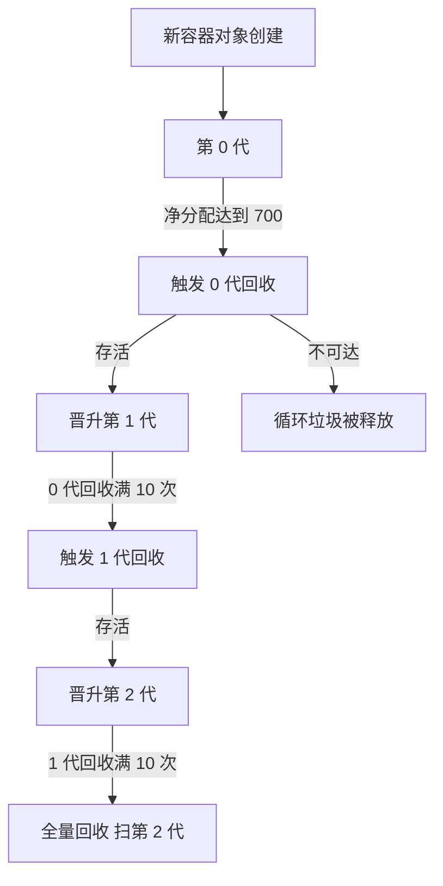
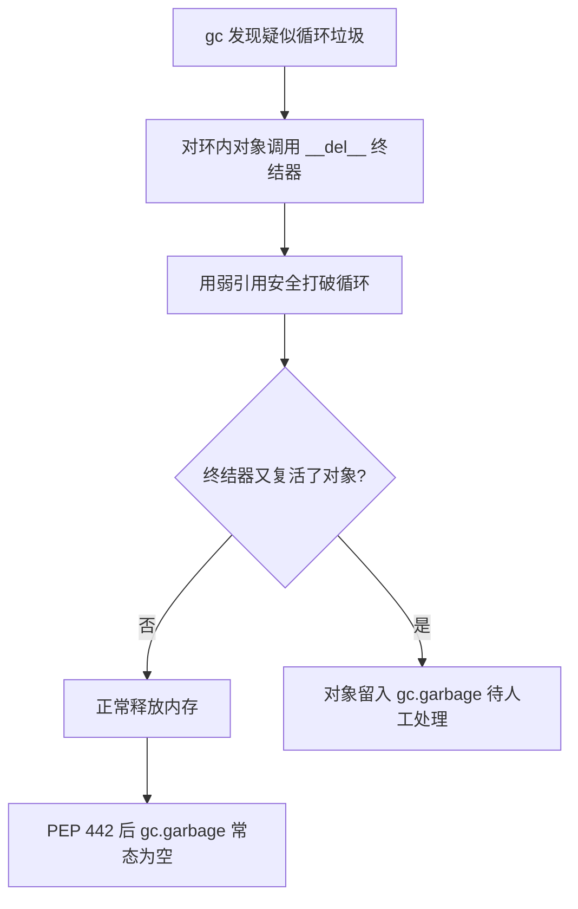
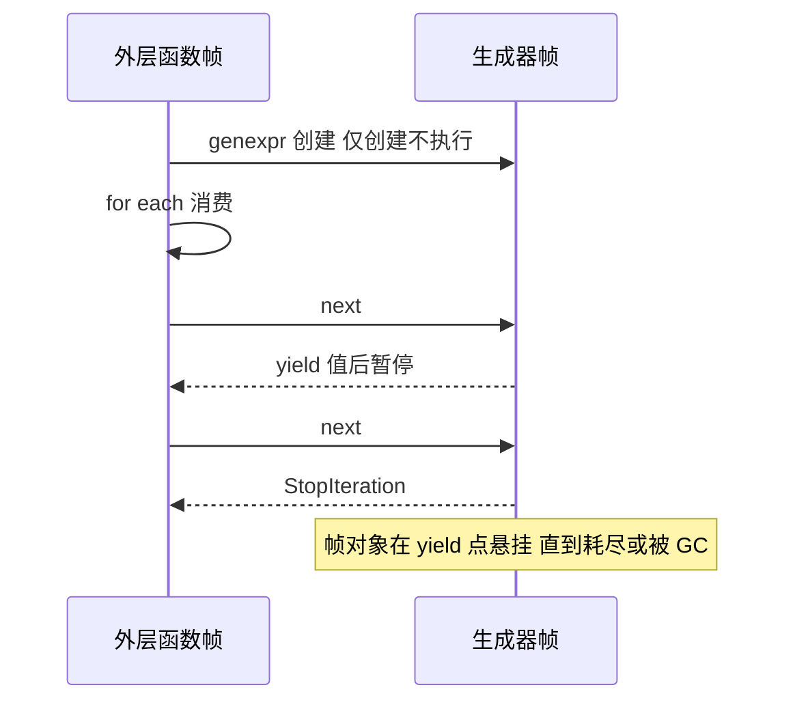
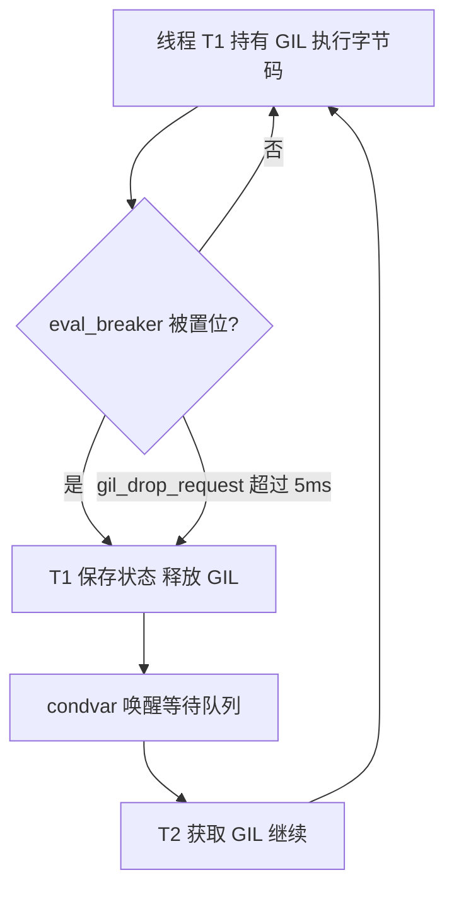
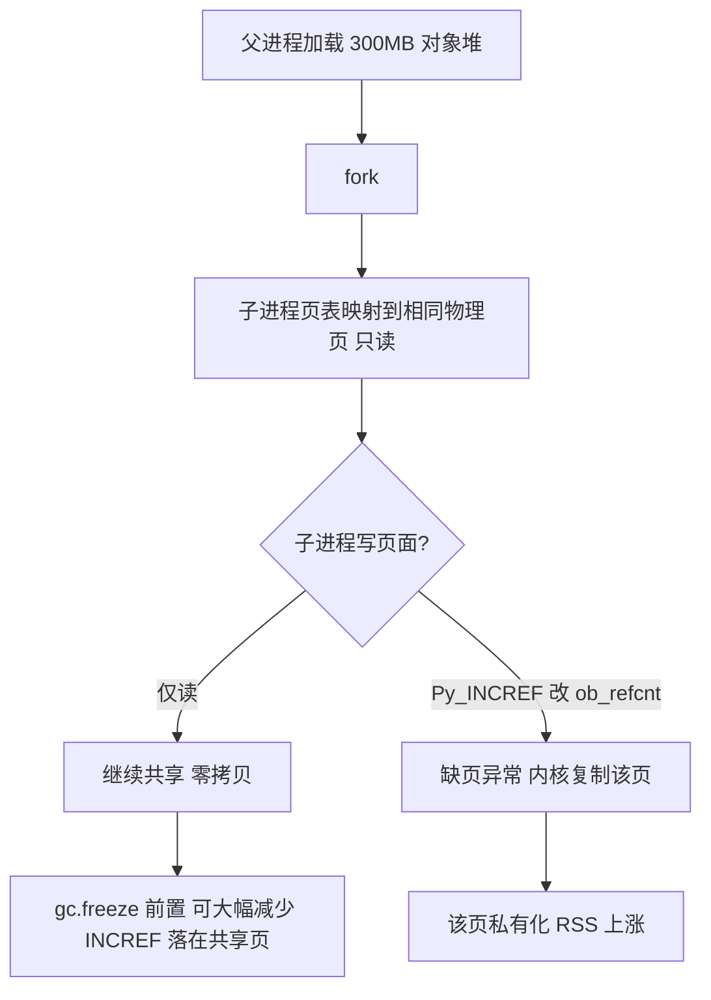
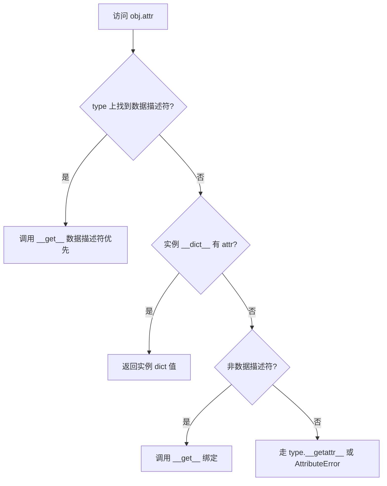
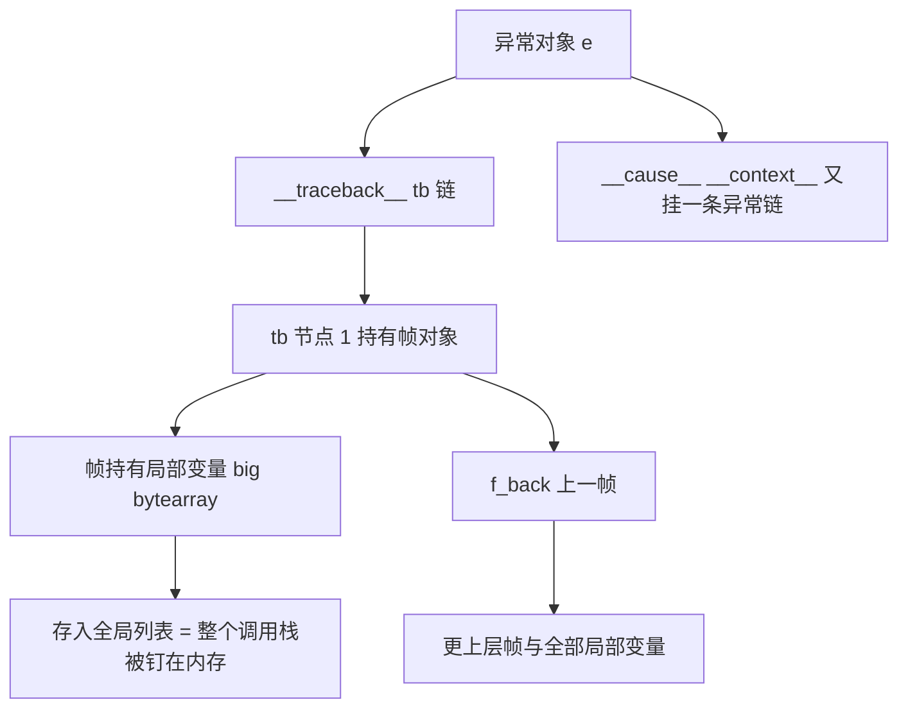
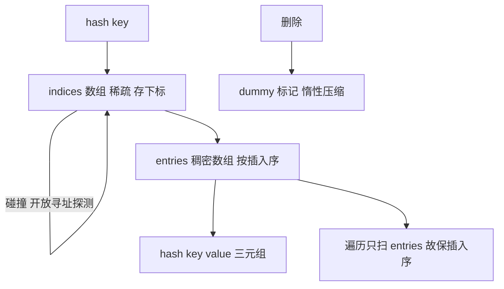

# 第 10 章 · 进阶难题与底层原理

> 本章是整个知识库的压轴章,面向 3-5 年以上经验、冲击高级/资深岗位的候选人。
> 题目集中在 CPython 解释器内部(引用计数、分代 GC、字节码、帧对象)、并发底层(GIL、free-threading、fork 语义)、以及生产环境的疑难杂症排查(内存泄漏、RSS 上涨、事件循环阻塞)。
> 每题都配有可运行的标准库代码,把"机制"跑给你看——面试高手的标志不是背结论,而是能现场用 `gc`、`dis`、`sys`、`ctypes` 验证结论。
> 每题末尾的「追问」模拟面试官的连环深挖,答案控制在一句,但要求答到内核/字节码层面。

### Q401 · 引用计数与循环垃圾回收如何协作?

> 难度:★★★★★ | 标签:CPython, GC, 引用计数

**问**:CPython 的内存管理是"纯引用计数"吗?两个对象互相引用时为什么 `del` 之后内存没有释放?引用计数和 `gc` 模块各自负责什么?

**答**:不是纯引用计数,而是"引用计数为主 + 分代 GC 兜底"的混合体系。引用计数在 `Py_INCREF`/`Py_DECREF` 时同步维护,计数归零立即释放,延迟低、行为确定;但它无法处理循环引用——`a.b = b; b.a = a` 后双方计数永远 ≥ 1。`gc` 模块只负责容器对象(可形成环的对象),通过周期性遍历找出入度与引用数不符的"疑似环",再确认并打断循环。所以 `del` 两个互相引用的对象后内存不会立即回收,要等下一次 `gc.collect()`。CPython 3.13 起自由线程构建里引用计数改为分段延迟回收,但循环 GC 的职责不变。

```python
# file: code/01_语言核心与底层/q401_refcount_cycle.py
import gc
import sys

class Node:
    def __init__(self):
        self.peer = None

a, b = Node(), Node()
a.peer, b.peer = b, a           # 制造循环引用

# 单个对象的引用计数:循环前 a 被变量 a、b.peer 引用,共 2
print("refcount of a =", sys.getrefcount(a))   # 注意 getrefcount 自身会临时 +1

del a, b
print("gc.garbage before collect:", len(gc.garbage))
print("unreachable collected:", gc.collect())  # >0,循环垃圾在这里才被回收
```

**追问**:1) 为什么 `sys.getrefcount` 返回值总比"直觉值"大 1?——传参本身持有一个临时引用,函数执行期间计数被加一。2) CPython 3.12 的 immortal object 让某些对象计数变成多少?——`sys.getrefcount(None)` 等会返回一个巨大的饱和值(如 4294967295), immortal 对象的计数永不递减。

### Q402 · gc 分代机制与 thresholds 调优

> 难度:★★★★★ | 标签:GC, 分代回收, 调优

**问**:`gc.get_threshold()` 返回的三个数字是什么含义?为什么新生代用 700 这样的阈值而不是按时间触发?生产上把 threshold0 调大会有什么风险?

**答**:CPython 把容器对象分成 0/1/2 三代:新容器对象进第 0 代,熬过一次 collection 晋升到下一代,代越高回收越少触发。`(700, 10, 10)` 的含义是:第 0 代每新增 700 个容器对象(减去释放数,即分配减回收的净差)触发一次 0 代回收;0 代每回收 10 次触发一次 1 代;1 代每回收 10 次触发一次 2 代。依据是弱代假说:大多数对象朝生暮死,频繁扫年轻代、少扫老年代摊薄成本。调大 threshold0 可以降低 GC 频率、提升吞吐,但环状垃圾滞留时间变长、峰值内存升高;全量扫第 2 代是 stop-the-world 的,老年代堆积大对象时单次暂停会明显劣化。

```python
# file: code/01_语言核心与底层/q402_gc_generations.py
import gc

print("thresholds:", gc.get_threshold())        # (700, 10, 10) 默认值
print("counts before:", gc.get_count())         # 三个代各自的计数器

class Box:
    pass

boxes = [Box() for _ in range(700)]
gc.collect()                                    # 手动触发,观察计数变化

# 晋升演示:多次回收后,存活对象从 0 代晋升到更高代
for _ in range(5):
    gc.collect()
print("counts after:", gc.get_count())
print("gen2 objects tracked:", len(gc.get_objects(2)))
```

**追问**:1) `gc.freeze()` 是干什么用的?——把当前所有对象移出各代、挪到永久代,pre-fork 服务在 fork 前调用可以让子进程不背 GC 扫描成本(Instagram 的经典实践)。2) 为什么 tuning 时要盯 `gc.get_stats()`?——可以看到每代实际回收次数和 collection 时间,判断是分配风暴还是老年代膨胀。



### Q403 · __del__ 与 PEP 442:终结器为什么不再"未定义"?

> 难度:★★★★★ | 标签:GC, PEP 442, __del__

**问**:老版本 Python 里带 `__del__` 的循环引用对象被称为 "uncollectable",进了 `gc.garbage` 就永远泄漏。PEP 442 改了什么?现在 `gc.garbage` 还会出现东西吗?

**答**:Python 3.4 起(PEP 442)safe object finalization 落地:GC 发现循环垃圾后,先对环内带 `__del__` 的对象调用终结器,再用弱引用安全地打破环,最后照常释放内存。所以现代 CPython 中带 `__del__` 的循环引用也能被回收,`gc.garbage` 常态为空——只有解释器关闭阶段或使用旧式 `tp_del` 的 C 扩展类型等极端情况才可能非空;注意 `gc.disable()` 只是让循环垃圾滞留堆里(泄漏但不进 garbage 列表,因为没有回收动作发生)。但 `__del__` 仍不被推荐:调用时机不确定(只在 GC/引用计数归零时),异常会被吞掉只打 stderr,且解释器退出时模块全局可能已被清空。生产代码里应优先用上下文管理器或 `weakref.finalize`。

```python
# file: code/01_语言核心与底层/q403_del_pep442.py
import gc

class Node:
    def __del__(self):
        print("finalizing", hex(id(self) & 0xFFFF))

a, b = Node(), Node()
a.peer, b.peer = b, a          # 循环引用 + 双方都有 __del__
del a, b

print("garbage list:", gc.garbage)
n = gc.collect()               # PEP 442 之前这里回收不了,现在可以
print("collected:", n, "| garbage now:", gc.garbage)
```



**追问**:1) `weakref.finalize` 相比 `__del__` 好在哪?——它注册的是独立回调对象,持有弱引用不阻止回收,回调通过全局注册表访问资源,不怕模块全局被提前清空。2) `atexit` 和 `__del__` 的执行顺序问题?——`atexit` 先于解释器 teardown 执行,而退出阶段的 `__del__` 可能遇到半拆除的模块状态,这是退出时资源泄漏的常见来源。

### Q404 · weakref 的生产级应用:缓存与解耦观察者

> 难度:★★★★☆ | 标签:weakref, 内存管理

**问**:为什么用 dict 直接做对象缓存会造成"越用越占内存"?weakref 如何在"持有引用"和"阻止回收"之间取得平衡?哪些内建类型不能被弱引用?

**答**:强引用缓存让对象计数永远 ≥ 1,GC 永远不回收,缓存变成事实上的内存泄漏。`weakref` 提供不增加计数的"旁路引用":对象真实生命周期仍由业务强引用决定,缓存、观察者列表、回调注册表只挂弱引用,对象死亡时弱引用自动失效(或回调被触发)。典型应用:`weakref.WeakValueDictionary` 做实例缓存、`WeakSet` 做监听器集合(避免监听器反过来延长发布者生命周期)、`weakref.finalize` 管理外部资源。`list`、`dict`、`str`、`int` 等内建类型默认不支持弱引用,需要子类化后才行——这是面试里的高频陷阱。

```python
# file: code/01_语言核心与底层/q404_weakref_cache.py
import weakref

class Heavy:
    def __init__(self, name):
        self.name = name

cache = weakref.WeakValueDictionary()   # 值是弱引用

obj = Heavy("model")
cache["model"] = obj                    # 缓存不阻止回收
print("hit:", cache.get("model").name)

del obj                                 # 强引用消失
print("after del, hit:", cache.get("model"))   # None,条目自动蒸发

# 观察者模式:发布者不延长监听器生命周期
class Publisher:
    def __init__(self):
        self.listeners = weakref.WeakSet()
    def notify(self):
        for l in list(self.listeners):
            print("notify", l.name)

pub = Publisher()
listener = Heavy("listener")
pub.listeners.add(listener)
pub.notify()
del listener                            # 监听器可被独立回收
```

**追问**:1) `WeakValueDictionary` 遍历时抛 `KeyError`/`RuntimeError` 怎么回事?——遍历过程中弱引用可能恰好死亡,必须先 `list(d)` 快照再迭代。2) `weakref.ref` 与 `WeakKeyDictionary` 的区别?——前者是裸引用需手动调用取值,后者以对象为键,常用于给第三方对象挂附加元数据。

### Q405 · 小整数缓存与字符串 intern:is 比较的坑

> 难度:★★★★☆ | 标签:CPython, 对象缓存, str

**问**:为什么 `256 is 256` 为 True 而 `257 is 257` 可能是 False?为什么两个内容相同的字符串有时 `is` 为 True 有时为 False?这些"缓存"的边界到底在哪?

**答**:CPython 解释器初始化时预先创建 -5 到 256 的 `PyLong` 对象并在全解释器共享,所以小整数 `is` 恒真;257 这类超出缓存范围的字面量,在同一 code object 内会被**常量去重**(co_consts 中合并为同一对象)所以 is 也可能为 True,但跨 code object(如交互式逐行执行、不同模块)就是两个独立对象;小整数缓存 [-5,256] 只保证该范围内跨编译单元共享。注意「常量去重」与「常量折叠」(编译期求值,如 "hello"+"_world")是两个不同概念。字符串方面,只由 ASCII 字母、数字、下划线组成的**编译期字面量**会被自动 intern(标识符长得像,方便按指针比较属性名),而运行期拼接产生的字符串(含空格、动态结果)不会。结论:`is` 只该用于单例比较(`x is None`),数值/字符串相等一律用 `==`;对字面量用 `is` 还会触发 SyntaxWarning("is" with a literal),这本身就是反模式信号;把 `is` 当优化手段依赖的是实现细节,Python 3.12 的 immortal objects 和 PEP 683 进一步改变了这些边界。

```python
# file: code/01_语言核心与底层/q405_intern_cache.py
import sys

# 同一 code object 内:相同字面量常量去重(257 也共享)
print(256 is 256)               # True
print(257 is 257)               # 同一 code object 内 True(常量去重,不是常量折叠)
x, y = 257, 257                 # 局部变量仍指向同一常量池对象
print(x is y)                   # True,因为同一函数编译单元

# 字符串:编译期字面量自动 intern,运行期拼接不会
a = "hello_world"
b = "hello_world"
print(a is b)                   # True,字面量 intern
c = "hello" + "_world"
print(c is a)                   # True!常量折叠在编译期完成
d = "".join(["hello", "_world"])
print(d is a, d == a)           # False True,运行期产生不 intern

print(sys.intern("py" + "thon") is sys.intern("python"))  # 手动 intern
```

**追问**:1) `sys.intern` 的真正用途是什么?——让大量重复字符串(如协议字段名)共享同一对象,dict 查找退化为指针比较,同时省内存;CPython 内部 dict 键比较正是先比 `hash` 再比指针再比内容。2) `float`/`tuple` 有类似缓存吗?——没有,只有小整数和部分单例(`None`/`True`/`False`)以及空 tuple 有共享。

### Q406 · 可变默认参数:从字节码看这个坑的根源

> 难度:★★★☆☆ | 标签:默认参数, 字节码, 陷阱

**问**:`def f(x, acc=[])` 为什么所有调用共享同一个 list?从字节码/编译层面解释,默认值到底存在哪、什么时候求值?

**答**:默认值在 **def 执行时**(即函数定义那一刻)求值一次,被存进函数对象的 `__defaults__` 元组,之后每次调用直接复用该对象——它是函数对象的一部分,不是调用栈的一部分。所以可变默认值等于"藏在函数对象里的模块级可变状态",跨调用共享、跨请求泄漏。`dis` 里能看到 def 编译出的代码把 list 常量加载一次;运行期可以用 `f.__defaults__` 直接观察甚至改写它。正确写法是哨兵 `acc=None` 再在函数体内新建。这个坑同样适用于把可变对象用作类属性、闭包捕获等场景。

```python
# file: code/01_语言核心与底层/q406_mutable_default.py
import dis

def append_to(x, acc=[]):
    acc.append(x)
    return acc

print(append_to(1))        # [1]
print(append_to(2))        # [1, 2] —— 共享同一个默认 list!
print(append_to.__defaults__)      # ([1, 2],) 默认值就存在函数对象里

append_to.__defaults__ = ([],)     # 甚至可以运行期重置
print(append_to(9))                # [9]

print("---- bytecode of the def ----")
dis.dis(compile("def f(x, acc=[]): pass", "<demo>", "exec"))
# 可见 LOAD_CONST 一个空 list 后 MAKE_FUNCTION:默认值随函数对象创建
```

**追问**:1) 为什么 `def f(t=time.monotonic())` 这种"每次调用重新求值"的写法根本不成立?——def 时求值一次,之后永远复用,想延迟求值必须用哨兵 + 函数体内调用。2) 装饰器和默认参数坑的结合体是什么?——`@lru_cache` 无参调用时若写成 `@lru_cache()` 与 `@lru_cache` 混用,本质同样是"def 时求值一次"的时间点问题。

### Q407 · dis 剖析函数调用:闭包与 cell 对象

> 难度:★★★★★ | 标签:dis, 闭包, 字节码

**问**:闭包变量和全局变量、局部变量在字节码层面有什么本质区别?`cell` 对象是什么?为什么闭包捕获的是"变量"而不是"值"?

**答**:CPython 为每层作用域使用不同的加载指令:`LOAD_FAST`(栈上局部,数组下标访问)、`LOAD_GLOBAL`(模块字典查找,3.11 起有内联缓存加速)、`LOAD_DEREF`(经 cell 对象间接访问)。内层函数引用外层函数变量时,编译器把该变量提升为 cell——一个堆上小盒子,内外两层函数都通过 `LOAD_DEREF`/`STORE_DEREF` 读写它,所以闭包捕获的是变量的**存储位置**而非快照值,这也是 `for i in ...: fs.append(lambda: i)` 全部读到末值的根源。`__closure__` 属性暴露这些 cell。这解释了闭包的三大行为:延迟绑定、闭包内赋值需要 `nonlocal`、以及循环变量共享。

```python
# file: code/01_语言核心与底层/q407_closure_deref.py
import dis

def outer():
    x = 10
    def inner():
        return x + 1        # x 是自由变量,经 cell 访问
    return inner

f = outer()
print(f())                 # 11
print(f.__closure__)       # cell 对象元组
print(f.__closure__[0].cell_contents)   # 10,可读也可写(cell_contents 可赋值)

print("---- inner bytecode ----")
dis.dis(f)                 # 看到 LOAD_DEREF 而非 LOAD_FAST/LOAD_GLOBAL

# 经典坑:lambda 捕获变量本身
fs = [lambda: i for i in range(3)]
print([g() for g in fs])   # [2, 2, 2]
fs2 = [lambda i=i: i for i in range(3)]
print([g() for g in fs2])  # [0, 1, 2],默认参数在 def 时固化
```

**追问**:1) 为什么闭包读到循环末值?——所有 lambda 共享同一个 cell,循环结束时 cell 里是 2。2) Python 3.11+ 的 `LOAD_GLOBAL` 缓存存在哪里?——adaptive interpreter 把指令改写成特化形式,缓存内嵌在字节码流里,这是 3.11 提速的核心手段之一。

### Q408 · 推导式在 3.12 的优化:PEP 709 内联推导式

> 难度:★★★★☆ | 标签:dis, PEP 709, 性能

**问**:老版本 Python 里列表推导式会创建一个隐藏函数,这带来什么开销?PEP 709 改了什么?如何用 `dis` 证明一个推导式是内联的还是函数式的?

**答**:CPython 3.11 及之前,每个推导式编译成一个名为 `<listcomp>` 的隐藏函数,每次推导要真实压栈一个帧、创建函数并调用——闭包变量要转成 cell,异常回溯里还会出现 `<listcomp>` 帧。PEP 709(Python 3.12)把推导式**内联**到外层函数的字节码里,用 `SWAP`/`COPY` 加临时作用域指令模拟隔离,消除了帧创建成本(官方口径小推导式快 20-50%),回溯里也不再出现独立帧。判断方法:`dis.dis` 看到独立 `<listcomp>` code object 就是老式,看到 `SWAP 2`/`POP_TOP` 与主体混在一起就是 3.12+ 内联式。注意内联后推导式内部不再能通过独立帧隔离名字,行为上更接近普通代码块。

```python
# file: code/01_语言核心与底层/q408_pep709_inline.py
import dis, sys

def build():
    xs = [i * 2 for i in range(5)]
    return xs

print(sys.version_info[:2])
print(build())

code = build.__code__
comps = [c for c in code.co_consts if hasattr(c, "co_name")]
print("hidden comp functions:", [c.co_name for c in comps])
# 3.11 及以前: ['<listcomp>']  3.12+: []  —— PEP 709 已内联

print("---- outer bytecode ----")
dis.dis(build)
# 3.12+ 直接可见 RANGE/LOAD_FAST/SWAP 等指令,无 CALL <listcomp>
```

**追问**:1) 字典/集合推导式和生成器表达式也内联吗?——列表、字典、集合推导式都被 PEP 709 内联,但生成器表达式仍然创建独立函数对象(它本身就是一个迭代器对象,必须有自己的帧)。2) 生成器表达式为什么必须独立帧?——`genexpr` 的生命周期可能超出外层函数,需要独立栈帧悬挂执行。



### Q409 · 帧对象与 Python 栈:递归限制、f_back 与回溯

> 难度:★★★★☆ | 标签:帧对象, 调用栈, inspect

**问**:Python 的调用栈和 C 栈是什么关系?`sys.setrecursionlimit` 调大为什么可能直接段错误?`RecursionError` 的默认 1000 是怎么来的,3.12 有什么变化?

**答**:每层 Python 调用创建一个 `PyFrameObject`(3.11 后拆成惰性分配的 `_PyInterpreterFrame`,开销大减),串成 `f_back` 链,这是 Python 层看到的栈;同时解释器自身跑在 C 栈上,`Py_EnterRecursiveCall` 在每次调用时同时检查两层。`sys.setrecursionlimit` 只调 Python 层的计数,而 C 栈大小固定(通常 8MB),纯 Python 调用在 3.11 后几乎不消耗 C 栈,但对象析构、`__eq__` 嵌套等仍会回退到 C 递归——把 limit 调到百万级可能在真正耗尽 C 栈时直接崩溃而不是抛异常。3.12 起 CPython 引入"接近 C 栈上限时强制抛 RecursionError"的软保护(`Py_C_RECURSION_LIMIT`),默认 Python 限 1000 只是防失控的策略值,不是硬资源边界。

```python
# file: code/01_语言核心与底层/q409_frames_stack.py
import inspect
import sys

def depth():
    f = sys._getframe()
    n = 0
    while f:
        n += 1
        f = f.f_back          # 沿 f_back 链上溯,这就是 Python 栈
    return n

def recurse(n):
    return recurse(n + 1)     # 无限递归,直到撞上递归限制

def traceback_format(e):
    import traceback
    return traceback.format_exception(type(e), e, e.__traceback__)

print("current python stack depth:", depth())
print("recursionlimit:", sys.getrecursionlimit())

try:
    recurse(0)
except RecursionError as e:
    print("RecursionError:", e)

# 回溯本身就是帧链的可读投影
tb_lines = []
try:
    1 / 0
except ZeroDivisionError as e:
    tb_lines = traceback_format(e)

print("".join(tb_lines).splitlines()[-1])

# inspect 能拿到运行期帧
print("callers:", [s.function for s in inspect.stack()][:4])
```

**追问**:1) 生成器/协程的帧和普通帧有什么不同?——yield 时帧对象从解释器运行栈摘下但保留在堆上,状态全存帧里,`gen.gi_frame` 可观察,这是协程能"暂停"的物理基础。2) 为什么 3.11 版本 Python 函数调用快了很多?——帧改为栈上分配、惰性物化,且不再为每个调用无条件创建 `PyFrameObject` 堆对象。

### Q410 · GIL 切换机制与 sys.setswitchinterval

> 难度:★★★★★ | 标签:GIL, 线程, 并发

**问**:GIL 到底是怎么切换线程的?为什么 `while True: pass` 一个线程能"饿死"另一个?`sys.setswitchinterval(0.000001)` 把间隔调小,多线程一定更快吗?

**答**:GIL 是保护解释器状态(尤其是引用计数)的互斥锁。当前持锁线程执行到一定条件后主动释放:`eval_breaker` 机制在每个字节码边界检查"是否有线程请求 GIL",请求线程设置标志后,持锁线程在检查点放弃 GIL 并用 condvar 唤醒等待者。旧行为按指令数(默认 100 条)切换,Python 3.2 起改为按时间:`sys.getswitchinterval()` 默认 5ms,等待线程超过间隔后发出 `gil_drop_request`。因此 CPU 密集线程会在字节码边界让出,但若某线程长时间卡在不经过字节码边界的 C 扩展里(如大 numpy 运算、`time.sleep` 除外——它显式释放 GIL),别人就要等它返回。把 switchinterval 调小会增加锁竞争与上下文切换开销,总吞吐往往不升反降——切换是成本,不是并行度。

```python
# file: code/01_语言核心与底层/q410_gil_switch.py
import sys
import threading
import time

print("switch interval:", sys.getswitchinterval())   # 默认 0.005 秒

counter = 0
N = 200_000

def busy():
    global counter
    for _ in range(N):
        counter += 1          # 字节码级非原子:LOAD/ADD/STORE 三步

t0 = time.perf_counter()
threads = [threading.Thread(target=busy) for _ in range(4)]
[t.start() for t in threads]
[t.join() for t in threads]
print("expect", 4 * N, "got", counter, "elapsed", round(time.perf_counter() - t0, 3))
# 计数大概率不等于期望值:GIL 只保证字节码间切换,不保证复合操作原子

# 收紧切换间隔:切换更频繁,上下文切换开销上升
sys.setswitchinterval(0.0001)
counter = 0
t0 = time.perf_counter()
threads = [threading.Thread(target=busy) for _ in range(4)]
[t.start() for t in threads]
[t.join() for t in threads]
print("small interval elapsed", round(time.perf_counter() - t0, 3), "got", counter)
```

**追问**:1) 为什么 `counter += 1` 在有 GIL 时仍不安全?——它编译成多条字节码,线程可能在 LOAD 与 STORE 之间被切换,丢失更新;GIL 保证的是"单条字节码相对原子"。2) 哪些 C 层调用会主动放 GIL?——`time.sleep`、文件/网络 IO、`hashlib` 大块计算、numpy 多数运算等,放锁期间其他线程可跑字节码。



### Q411 · PEP 703 free-threading:去掉 GIL 之后靠什么保证安全?

> 难度:★★★★★ | 标签:PEP 703, free-threading, 并发

**问**:free-threaded 构建(3.13+,`python3.13t`)是怎么做到不要 GIL 的?引用计数怎么办?为什么官方说"依赖 GIL 隐式线程安全的代码会坏"?3.14 的状态是什么?

**答**:PEP 703 方案分三件事:引用计数改成**偏向读写(biased reference counting)**——对象挂一个偏向线程做无原子操作的自然计数,其他线程走原子慢路径;把 GIL 拆成细粒度锁,内存分配器 per-thread、`dict`/`list` 内部加锁,同时许多容器操作用惰性删除(先标记后清理)避免长持锁;对象头里的 GC 头与锁信息合并。代价是无竞争时单线程性能有损(3.13 早期约 40%,3.13t+ 持续优化中),所以以独立 ABI(`python3.13t`,带 `_t` 后缀)发布,与 GIL 版不能装同一个扩展二进制。PEP 779 在 3.14 把 free-threading 提升为官方 "supported"(非默认)阶段。风险点:过去依赖"一个字节码不会被打断"的代码(如无锁的单 check-then-act、靠 GIL 串行化的 `dict` 批量操作)在 free-threading 下会出现真正的数据竞争,必须显式加 `threading.Lock` 或改用不可变数据。

```python
# file: code/01_语言核心与底层/q411_free_threading_check.py
import sys
import threading

# 判断运行在哪种构建:free-threading 构建下 sys._is_gil_enabled() 可为 False
print("version:", sys.version)
is_ft = getattr(sys, "_is_gil_enabled", None)
if is_ft is not None:
    print("GIL enabled:", is_ft())
else:
    print("no _is_gil_enabled -> 普通含 GIL 构建")

# 无论哪种构建,这段 check-then-act 都不是原子的
# 在 free-threading 下竞争窗口更大,正确做法是加锁
lock = threading.Lock()
seen = set()

def check_and_add(n):
    with lock:                    # 去掉锁,free-threading 下可能出现覆盖
        seen.add(n)

threads = [threading.Thread(target=check_and_add, args=(i % 50,)) for i in range(1000)]
[t.start() for t in threads]
[t.join() for t in threads]
print("unique:", len(seen))
```

**追问**:1) 如何让自己的 C 扩展同时支持两种构建?——free-threading 下必须声明 `Py_mod_gil = Py_MOD_GIL_NOT_USED`,并消除模块级全局可变状态,否则解释器会在导入时告警。2) `PYTHON_GIL=0/1` 环境变量做什么?——运行期强制开/关 GIL;对依赖不安全扩展的程序,free-threading 构建可退回启用 GIL。

### Q412 · fork vs exec:多线程进程 fork 后为什么死锁?

> 难度:★★★★★ | 标签:multiprocessing, fork, 线程

**问**:一个跑了 10 个线程、持有锁的进程 `fork()` 之后,子进程为什么可能永远卡死?`multiprocessing` 各 start method 的默认值是什么?为什么官方推荐 spawn?

**答**:fork 只复制**调用它的那个线程**,其他线程(连同它们持有的锁)凭空消失,但锁的内存状态被原样复制——如果 fork 瞬间某线程正持有 `logging` 的锁或 malloc arena 锁,子进程里这把锁永远无人释放,子进程第一个申请它的线程就永久阻塞。这是"fork + threads"的经典死锁,也是 `os.fork()` 文档警告"多线程程序中 fork 只有 spawn 式安全子集"的原因。`multiprocessing` 的 start method:Linux 默认 `fork`(3.14 起默认改为 `forkserver`,3.12 起对多线程进程 fork 已发 DeprecationWarning),macOS 默认 `spawn`(因为 macOS 的 fork+exec 混合运行时本就不安全),Windows 只有 `spawn`。spawn 重新 import 主模块、开销大但语义干净;forkserver 由单线程桩进程统一 fork,兼顾速度与安全。

```python
# file: code/01_语言核心与底层/q412_fork_threads.py
import os
import sys
import threading
import time

lock = threading.Lock()

def locker():
    while True:
        with lock:            # 后台线程反复短暂持锁
            time.sleep(0.001)

threading.Thread(target=locker, daemon=True).start()
time.sleep(0.05)              # 大概率 fork 时锁恰被后台线程持有

pid = os.fork()               # 仅当前线程被复制,锁状态被复制
if pid == 0:
    # 子进程:尝试获取一把可能"已死"的锁 —— 竞争窗口内会永久阻塞
    got = lock.acquire(timeout=1)
    print("child acquired:", got)
    os._exit(0)
else:
    _, status = os.waitpid(pid, 0)
    print("child exit status:", status)
    print("start methods available:", __import__("multiprocessing").get_all_start_methods())
```

**追问**:1) 为什么 fork 后子进程要尽快 `os._exit` 而不是 `sys.exit`?——`sys.exit` 会触发 atexit/flush 等清理路径,可能再次触碰复制来的死锁资源;`_exit` 直接系统调用退出。2) daemon 线程在 fork 后的状态?——fork 复制不了任何线程,daemon 属性无从谈起;但 `multiprocessing` 的 fork 模式会伪造"父进程 daemon 线程已死"的表象,这是子进程内再创建进程报错的原因之一。

### Q413 · Copy-on-Write 与 pre-fork 服务的 RSS 上涨

> 难度:★★★★★ | 标签:fork, COW, 内存

**问**:一个 pre-fork 的 Web worker 常驻 300MB,父进程加载完模型后 fork 出 16 个子进程,为什么总 RSS 看起来是 5GB?共享内存怎么确认?什么操作会"偷偷打破"COW 共享?

**答**:fork 后父子共享物理页,内核把页表标成只读,写时才触发缺页并复制——所以子进程创建瞬间的真实增量很小。但 CPython 的引用计数恰好是"读也会写":任何对象只要被 `Py_INCREF` 就要改对象头的 `ob_refcnt`,触发 COW 缺页复制。Python 程序的每次函数调用都在动全局对象(类型对象、intern 字符串、模块字典、GC 头里的 gc_refs),随时间推移共享页逐页"私有化",RSS 一路爬升。缓解手段:`gc.freeze()` 在 fork 前把存活对象移出 GC 追踪(避免 GC 头被改写)、fork 前预热并尽量少碰、用 `sys.intern` 收敛字符串、改用 spawn + 共享内存(`multiprocessing.shared_memory`)或 arrow/零拷贝结构。确认共享量:Linux 下看 `/proc/PID/smaps` 逐 VMA 的 `Shared_Clean`/`Private_Dirty`,或 `/proc/PID/smaps_rollup` 的聚合视图(Linux 4.14+),也可用 `smem` 的 USS 列。注意内核并无 rollout 这类文件,正确名称是 rollup。

```python
# file: code/01_语言核心与底层/q413_cow_rss.py
import gc
import os
import resource
import sys

def rss_mb():
    return resource.getrusage(resource.RUSAGE_SELF).ru_maxrss / 1024   # macOS 单位 KB

big = [i for i in range(300_000)]     # 模拟父进程持有的共享数据
gc.collect()
gc.freeze()                            # 关键:fork 前冻结,减少 GC 触碰共享对象头
print("parent rss~", round(rss_mb(), 1), "MB")

pid = os.fork()
if pid == 0:
    # 子进程:如果在这里大量 touch 列表元素/增减引用,共享页被逐页私有化
    s = 0
    for x in big[:100_000]:
        s += x                          # 读 + 隐式 INCREF,逐步打破 COW
    print("child touched pages, sum", s)
    os._exit(0)
else:
    os.waitpid(pid, 0)
    print("parent rss after fork:", round(rss_mb(), 1), "MB")
    print("smaps (linux only):", os.path.exists("/proc/self/smaps"))
```

**追问**:1) 为什么 Instagram 要给 CPython 打 `gc.freeze` 补丁后来进官方?——他们的 uwsgi pre-fork 集群 GC 扫描会改写每个对象的 GC 头,导致 fork 后共享页大面积私有化,冻结后省下约 GB 级内存。2) `ob_refcnt` 改写躲得开吗?——3.12 的 immortal objects 把高频对象(如 `None`、小整数、interned 字符串)计数置为永不递减的饱和值,显著减少 COW 触发,这正是该 PEP 的动机之一。



### Q414 · 生产环境 GC 调优:从现象到参数

> 难度:★★★★★ | 标签:GC, 调优, 生产排查

**问**:线上服务 P99 延迟周期性尖刺,`gc` 怀疑名单里有什么?怎么定位是哪一代引起的?thresholds 怎么调?`gc.disable()` 是不是终极答案?

**答**:排查路径:先用 `gc.callbacks` 注册回调记录每次 collection 的代数、耗时与触发时的对象数,确认尖刺与哪一代回收对齐;2 代全量回收暂停与堆里容器对象总数成正比,长命对象堆积(如无界缓存)会让单次 2 代回收到几十毫秒。手段按序:`gc.freeze()`(fork 型服务冻结启动期对象)、`gc.set_threshold(700, 10, 10000)`(减少 2 代频率)或干脆 2 代手动化——`gc.set_threshold(700, 10, 0)` 后由后台线程低峰期 `collect(2)`;无界缓存先修(weakref/LRU),这是根因多数时候不是 GC 本身而是它暴露的堆膨胀。`gc.disable()` 只对确认无循环引用的程序(或用 `gc.collect` 定期兜底)安全,盲目关闭会让环状泄漏到 OOM。另外 3.12+ 记得关注 `sys._clear_type_cache`、 immortal objects 已经天然减少了部分扫描开销。

```python
# file: code/01_语言核心与底层/q414_gc_tuning.py
import gc
import time

events = []

def on_gc(phase, info):
    if phase == "start":
        events.append((info["generation"], time.perf_counter()))
    else:
        gen, t0 = events[-1]
        events[-1] = (gen, time.perf_counter() - t0)

gc.callbacks.append(on_gc)

# 制造 0 代压力:大量短命容器
for _ in range(3000):
    {"k": [1, 2, 3]}

gc.callbacks.remove(on_gc)
print("collections triggered:", len(events), "sample:", events[:3])
print("stats per gen:", [(s["collections"], s["collected"]) for s in gc.get_stats()])

# 调优示例:拉低 2 代频率,把全量回收留给低峰期
old = gc.get_threshold()
gc.set_threshold(700, 10, 10000)
print("new thresholds:", gc.get_threshold(), "old:", old)
gc.set_threshold(*old)
```

**追问**:1) `gc.callbacks` 里 `info` 字典有哪些键?——`generation`、`collected`、`uncollectable` 以及 3.13 起的耗时等,是线上无侵入观测 GC 的标准手段。2) 容器对象数量怎么估?——`len(gc.get_objects())` 本身开销大,生产上用 `tracemalloc` 采样或 `gc.get_stats` 的计数间接判断。

### Q415 · 启动优化:惰性导入、__pycache__ 与 pyc 失效

> 难度:★★★★☆ | 标签:import, 启动优化, pyc

**问**:CLI 工具冷启动 800ms,如何系统性缩短?`.pyc` 缓存什么时候失效?为什么 `python -S`、`-X importtime` 是排查标配?有人删了 `__pycache__` 为什么反而"修好了"问题?

**答**:启动时间三要素:解释器自身初始化(可用 `-S` 跳过 site,`-X frozen_modules` 控制 stdlib 冻结模块)、import 图大小(`-X importtime` 逐项列出每个模块的 self/cumulative 微秒,树状排掉最贵的)、以及模块顶层副作用。`.pyc` 失效判定是**源文件 mtime + size** 与 pyc 头里的元数据比对(PEP 552 支持哈希模式,`--invalidation-mode checked/unchecked-hash`),注意 CI 里 mtime 漂移和只读文件系统(无 cache 目录)是常见坑。"删 pycache 修好问题"通常是 pyc 与源码不一致的陈旧缓存(mtime 粒度或拷贝导致),或是旧字节码版本残留。真正的惰性导入模式:把 import 移进函数(代价是首次调用慢 + 掩盖循环依赖)、`importlib.util.LazyLoader`、或 PEP 690 式 lazy import(目前未进主线,但 `python -X importtime` + 按需 import 是 3.12 现实方案)。

```python
# file: code/01_语言核心与底层/q415_import_startup.py
import importlib.util
import marshal
import os
import py_compile
import sys
import time

# 1) 编译出 pyc,检查其头部元数据
src = __file__
cache = py_compile.compile(src, cfile="/tmp/_demo_q415.pyc", doraise=True)
with open(cache, "rb") as f:
    header = f.read(16)
magic, flags, mtime, size = header[:4], int.from_bytes(header[4:8], "little"), \
    int.from_bytes(header[8:12], "little"), int.from_bytes(header[12:16], "little")
st = os.stat(src)
print("pyc mtime matches source:", int(st.st_mtime) == mtime, "| size:", st.st_size == size)
print("flags:", flags, "0=mtime 校验 1=hash 校验")

# 2) 用 importtime 思路测量一次真实 import 成本
t0 = time.perf_counter()
importlib.import_module("json")
print("import json took", round((time.perf_counter() - t0) * 1e6), "us")

# 3) 惰性导入:import 延迟到首次属性访问
from importlib.util import LazyLoader

def lazy_module(name):
    spec = importlib.util.find_spec(name)
    module = importlib.util.module_from_spec(spec)
    sys.modules[name] = module
    LazyLoader.exec_module  # noqa: 说明 LazyLoader 需包 loader
    loader_real = LazyLoader(spec.loader)
    spec.loader = loader_real
    loader_real.exec_module(module)
    return module

t0 = time.perf_counter()
m = lazy_module("xml.etree.ElementTree")
print("lazy import fast:", round((time.perf_counter() - t0) * 1e6), "us")
t0 = time.perf_counter()
m.parse   # 首次属性访问触发真实执行
print("first touch:", round((time.perf_counter() - t0) * 1e6), "us")
```

**追问**:1) PEP 552 unchecked-hash 模式的取舍?——跳过源码校验获得最快导入,但源码改了也不重编,只适合不可变部署(镜像内)。2) `__pycache__` 在 zipimport/冻结模块下还有效吗?——frozen stdlib 模块直接内嵌字节码,zipimport 支持 pyc 但不能写回,只读环境需预编译。

### Q416 · 命名空间包:没有 __init__.py 的包是怎么回事?

> 难度:★★★★☆ | 标签:PEP 420, import, 打包

**问**:一个目录没有 `__init__.py`,`import` 居然成功了,`__file__` 是 None,`__path__` 是 list——这背后是什么机制?它和 regular package、以及"两个发行版合并一个包"的场景有什么关系?

**答**:PEP 420 引入 namespace package:当 finder 沿 `sys.path` 找目录且目录无 `__init__.py` 时,不再报错而是记录为一个"portion",最终合成一个 `NamespacePath` 动态对象作为 `__path__`,该模块 `__file__` 为 `None`、`__loader__` 是 `_NamespaceLoader`。它解决的正是"一个顶层包名被多个独立分发(split distribution)共享"——比如 `google.protobuf` 与 `google.auth` 各自只装 `google/` 的一部分。代价是错误容忍度过高:**忘写 `__init__.py` 的普通包会被静默当成命名空间包**,导致部分工具(setuptools 自动发现、mypy、运行期 `__file__` 依赖)行为异常;打包侧需要 `packages = find_namespace_packages:` 而非普通 find。排查时看 `pkg.__path__` 的 repr:`_NamespacePath` 即命名空间包。

```python
# file: code/01_语言核心与底层/q416_namespace_pkg.py
import os
import sys
import tempfile
import importlib

root = tempfile.mkdtemp()
for sub in ("a_ns", "b_ns"):                       # 两个 portion
    pkg = os.path.join(root, sub, "combo")
    os.makedirs(pkg)
    with open(os.path.join(pkg, "part.py"), "w") as f:
        f.write(f"WHO = '{sub}'\n")                 # 无 __init__.py

sys.path.insert(0, os.path.join(root, "a_ns"))
sys.path.insert(0, os.path.join(root, "b_ns"))

m1 = importlib.import_module("combo.part")
print("module:", m1, "| WHO:", m1.WHO)

pkg_mod = sys.modules["combo"]
print("is namespace package:", pkg_mod.__spec__.submodule_search_locations is not None
      and pkg_mod.__file__ is None)
print("__path__ repr:", type(pkg_mod.__path__).__name__)   # _NamespacePath
print("origin:", pkg_mod.__spec__.origin)                  # None
```

**追问**:1) `__init__.py` 存在时还能合并 portion 吗?——不能,regular package 的 `__path__` 在初始化时固化为单一路径,PEP 420 只对无 `__init__.py` 目录生效。2) 为什么 typing/mypy 对命名空间包支持麻烦?——静态工具需要在 import 前解析 portion 布局,动态合成的 `__path__` 无法提前静态确定。

### Q417 · 循环导入的运行时解法与根治

> 难度:★★★★☆ | 标签:import, 循环导入, 架构

**问**:`ImportError: cannot import name X from partially initialized module` 到底发生在哪一步?为什么 `import a` 在模块顶层可以、`from a import X` 会炸?函数体内 import 和 `typing.TYPE_CHECKING` 为什么能绕过?

**答**:Python import 是"模块对象先入 `sys.modules`、再逐条执行顶层代码"的半初始化过程:循环时另一方 `from a import X` 会立刻在**尚未执行完**的模块对象上取属性 X,而 X 还没被赋值,故抛 ImportError;裸 `import a` 只要求模块对象存在,天然容忍半初始化,只要不在导入期访问其属性。运行时解法按推荐序:延迟导入(移进函数/方法,首次调用才解析,同时利于启动优化)、`TYPE_CHECKING` 下导入类型 + `from __future__ import annotations` 让注解零开销(PEP 563)、3.11 后用 `typing.Self`/字符串注解。根治靠重构:依赖倒置、把共享类型抽到 `types.py` 叶子模块。面试要能画出"sys.modules 已注册 → 执行中 → 属性缺失"三态。

```python
# file: code/01_语言核心与底层/q417_circular_import.py
import sys
import types

# 用合成模块在单文件里复现循环导入现场
a = types.ModuleType("a"); b = types.ModuleType("b")
sys.modules["a"] = a; sys.modules["b"] = b   # 步骤 1:先注册,模拟开始导入

a_code = "import b\nVALUE = 'a-done'\n"
b_code = "from a import VALUE\n"             # b 在 a 执行完前就要取 a.VALUE

try:
    exec(compile(a_code, "a.py", "exec"), a.__dict__)   # a 执行中转去导入 b
except ImportError as e:
    print("reproduced:", e)
# a 的执行被打断:VALUE 尚未赋值
print("a has VALUE:", hasattr(a, "VALUE"))

# 修复:把 from-import 改为模块级引用,属性访问延迟到使用时
b_code_fixed = "import a\ndef get(): return a.VALUE\n"
exec(compile(b_code_fixed, "b.py", "exec"), b.__dict__)
exec(compile("VALUE = 'a-done'", "a.py", "exec"), a.__dict__)   # 补完 a
print("fixed:", b.get())
```

**追问**:1) `if TYPE_CHECKING:` 里的 import 运行期执行吗?——不,`typing.TYPE_CHECKING` 恒为 False,该分支只被类型检查器读取,配合延迟注解即可零运行时成本。2) 为什么循环导入报错有时在 `from . import x` 有时在 `importlib.import_module`?——本质相同:半初始化模块缺属性;importlib 只是报错栈更深。

### Q418 · asyncio 任务泄漏:fire-and-forget 的代价

> 难度:★★★★★ | 标签:asyncio, 任务泄漏, 协程

**问**:`asyncio.create_task(coro())` 返回值随手一扔会发生什么?"Task exception was never retrieved" 警告哪来的?怎么系统地防任务泄漏?

**答**:`create_task` 返回的 `Task` 是对运行中协程的唯一强引用——事件循环只持弱引用集合(`asyncio.all_tasks` 内部是 WeakSet)。扔掉返回值意味着:(1) 任务仍会跑,但没有任何句柄可以 `cancel`/`await`;(2) 任务抛出的异常存在 `Task` 里无人取,GC 回收 Task 时打印 "Task exception was never retrieved";(3) 任务可能引用大对象,生命周期失控导致内存滞留。正确姿势:保存任务集合 + `add_done_callback` 做 discard 与异常日志,或用 `TaskGroup`(3.11+,结构化并发,退出时保证子任务全部收尾并把异常聚合为 `ExceptionGroup`)。协程对象还有一个坑:`create_task` 前协程未被调度,`loop.close` 或解释器退出时未 await 的协程会触发 "coroutine was never awaited"。注意 TaskGroup 与 except* 均为 3.11+ 引入,低版本运行演示文件时该段自动跳过。

```python
# file: code/01_语言核心与底层/q418_task_leak.py
import asyncio
import sys

async def risky(i):
    await asyncio.sleep(0.01)
    if i % 2 == 0:
        raise ValueError(f"boom {i}")
    return i

async def leaky():
    for i in range(4):
        asyncio.create_task(risky(i))      # 返回值丢弃:异常无人取

async def main():
    await leaky()
    await asyncio.sleep(0.05)   # 给泄漏任务跑完并触发 never-retrieved 警告

asyncio.run(main())

# TaskGroup 与 except* 都是 3.11+;except* 是新语法,低版本解释器无法解析,
# 因此这段演示放在字符串里按需编译执行,低于 3.11 时打印说明跳过
if sys.version_info >= (3, 11):
    structured_demo = """
async def structured():
    results = []
    async with asyncio.TaskGroup() as tg:       # 3.11+ 结构化并发
        for i in range(4):
            tg.create_task(risky(i)).add_done_callback(
                lambda t: results.append(f"err: {t.exception()}" if t.exception() else t.result())
            )
    return results

async def main2():
    try:
        await structured()
    except* ValueError as eg:                   # ExceptionGroup 解包
        print("group caught:", [str(x) for x in eg.exceptions])

asyncio.run(main2())
"""
    exec(structured_demo, globals())
else:
    print(f"该特性需要 Python 3.11+,当前 {sys.version_info.major}.{sys.version_info.minor},演示跳过")
```

**追问**:1) `asyncio.wait_for` 超时后原任务状态?——任务被取消(`CancelledError` 注入),但如果任务吞掉取消或内部 shield,任务会继续在后台跑——"cancel 不是同步终止"。2) `TaskGroup` 与 `gather` 的关键差别?——TaskGroup 中任一子任务失败即取消其余全部并等待收尾,gather 默认 `return_exceptions=False` 时直接抛出,其余任务仍在跑。

### Q419 · shutdown_asyncgens 与异步上下文的收尾

> 难度:★★★★☆ | 标签:asyncio, async generator, 资源管理

**问**:为什么 `loop.run_until_complete` 之外要显式 `shutdown_asyncgens`?异步生成器的 `aclose` 什么时候不被调用?文件/连接在 async gen 里怎么保证关闭?

**答**:异步生成器的资源释放发生在 `aclose()` 把 `GeneratorExit` 投进挂起点之后;但 async gen 实例可能悬在半空(没人消费完),事件循环关闭前需要遍历 `loop.shutdown_asyncgens()` 对所有"挂起中的 async gen"逐一 aclose——`asyncio.run` 内部已自动做这件事,自己管理 loop 的代码容易漏。风险场景:客户端 `break` 跳出 `async for`,生成器挂起在 yield,若再无引用,要等 GC 才有系统机会 finalize(时序不定);连接类资源必须用 `async with` 或在 finally 里 `aclose`。3.10+ 还要区分 `shutdown_asyncgens` 与 `shutdown_default_executor`;此外 `GeneratorExit` 里不允许再次 yield,否则 `RuntimeError: async generator ignored GeneratorExit`。

```python
# file: code/01_语言核心与底层/q419_shutdown_asyncgens.py
import asyncio

opened = []

async def stream():
    conn = f"conn-{id(stream):x}"
    opened.append(conn)
    try:
        for i in range(10):
            await asyncio.sleep(0)
            yield f"{conn}:{i}"
    finally:
        opened.remove(conn)         # 只有 aclose 被驱动才会执行
        print("closed:", conn)

async def main():
    agen = stream()
    async for v in agen:
        if v.endswith("1"):         # 提前 break,生成器悬挂在 yield
            break
    print("still open:", opened)
    await agen.aclose()             # 显式收尾
    print("after aclose:", opened)

asyncio.run(main())                 # run 内部最后调用 loop.shutdown_asyncgens
```

**追问**:1) 不手动 aclose 会怎样?——`asyncio.run` 退出时 `shutdown_asyncgens` 兜底;自己管理 loop 则资源可能在 loop 已关闭后才被 finalize,抛 "Event loop is closed"。2) `aclose` 与 `asend(None)` 的关系?——`aclose()` 等价于在挂起点注入 GeneratorExit,`asend(None)` 是更底层的同一机制。

```mermaid
sequenceDiagram
    participant User as async for 循环
    participant Agen as async generator 帧
    participant Loop as 事件循环
    User->>Agen: anext
    Agen->>Loop: await IO
    Loop-->>Agen: 就绪 yield 值
    User->>User: break 提前退出
    Note over Agen: 帧悬挂在 yield 引用未释放
    User->>Agen: aclose 或 loop.shutdown_asyncgens
    Agen->>Agen: finally 执行 释放连接
```

### Q420 · asyncio 调试模式:慢回调、未 await 与循环堵塞

> 难度:★★★★☆ | 标签:asyncio, 调试, asyncio.run

**问**:`asyncio.run(main(), debug=True)` 到底打开了哪些检查?"Executing <Handle ...> took 0.25 seconds" 警告的阈值哪来的?协程对象没 await 为什么只在销毁时警告?

**答**:debug 模式开启四类检测:(1) **慢回调检测**——任何回调/任务步进超过 `loop.slow_callback_duration`(默认 0.1s)就打日志并附 traceback,这是定位"事件循环被同步代码堵塞"的第一工具;(2) 未 await 协程在销毁时记录创建点 traceback(默认只警告位置,debug 补全来源);(3) 非线程安全 API 跨线程调用直接报错(如从其他线程直接 `loop.call_soon` 而非 `call_soon_threadsafe`);(4) Future/Task 构造时记录来源栈,便于追查"谁创建的"。配套手段:`loop.set_debug(True)`、`PYTHONASYNCIODEBUG=1`、3.12 的 `asyncio.eager_task_factory`(降低任务启动延迟)。生产上还可以用 `loop.set_exception_handler` 统一收集 never-retrieved 异常,以及 `sampler` 类工具(如 py-spy)直接抓被堵塞循环的栈。

```python
# file: code/01_语言核心与底层/q420_asyncio_debug.py
import asyncio
import gc
import logging
import time

logging.basicConfig(level=logging.WARNING)

async def blocker():
    time.sleep(0.3)            # 同步阻塞整个事件循环 —— debug 会点名

async def main():
    loop = asyncio.get_running_loop()
    loop.slow_callback_duration = 0.05    # 阈值默认 0.1s,调低更敏感
    await blocker()            # 警告: Executing <Task ...> took 0.3 seconds

# debug=True 同时开启 慢回调检测 未await协程来源 非线程安全检测
asyncio.run(main(), debug=True)

# 未 await 协程:协程对象销毁时警告,debug 版会附创建 traceback
coro = blocker()
del coro                      # 触发 coroutine was never awaited
gc.collect()
```

**追问**:1) `slow_callback_duration` 计的什么?——单次回调(任务步进/定时器回调)的同步执行时长,await 让出点之间的每一段分别计。2) 怎么区分"阻塞在 C 扩展"和"阻塞在纯 Python"?——py-spy dump 看栈:停在扩展帧说明 GIL 被 C 代码持有,停在 Python 帧则检查该协程里是否混入同步 IO。

### Q421 · 描述符协议:ORM 字段与 property 的同源原理

> 难度:★★★★★ | 标签:描述符, ORM, 元编程

**问**:为什么 `MyModel.field` 能拦截读写?`property`、`classmethod`、`staticmethod`、ORM 的 `CharField` 共同点是什么?数据描述符和非数据描述符在属性查找顺序里的位置差在哪?

**答**:描述符是定义了 `__get__`/`__set__`/`__delete__` 之一的类,存取发生在**类型上的属性查找**(type.__getattribute)而非实例字典。`property`、函数(经 `__get__` 绑定成 method)、`classmethod`、ORM 字段全是描述符。关键分界:定义了 `__set__`(或 `__delete__`)的是**数据描述符**,查找优先级高于 `instance.__dict__`(所以 `property` 无 setter 时赋值报 AttributeError,而不是写进实例 dict);只有 `__get__` 的是非数据描述符,实例 dict 可遮蔽它。ORM 字段正是数据描述符:`__set__` 做类型校验并标记 dirty,`__get__` 触发延迟加载;`__set_name__`(PEP 487)在类创建时自动把字段名传给描述符,免去 ORM 手动登记。

```python
# file: code/01_语言核心与底层/q421_descriptor_orm.py
import weakref

class Field:
    def __set_name__(self, owner, name):    # 类体创建时自动调用
        self.name, self.attname = name, "_" + name
    def __get__(self, obj, objtype=None):
        if obj is None:
            return self                     # 类访问返回字段对象本身,ORM 靠这拿元数据
        return getattr(obj, self.attname)
    def __set__(self, obj, value):
        if not isinstance(value, str):
            raise TypeError(f"{self.name} must be str")
        obj.__dict__[self.attname] = value
        obj.__dirty__.add(self.name)        # 数据描述符优先于实例 dict

class Model:
    name = Field()
    def __init__(self):
        self.__dirty__ = set()

class User(Model):
    pass

u = User()
u.name = "alice"                 # 走 Field.__set__
print("dirty:", u.__dirty__)
print("via descriptor:", u.name) # 走 Field.__get__
try:
    u.name = 42
except TypeError as e:
    print("validation:", e)

print("类访问返回字段:", User.name.__class__.__name__)
print("查找优先级演示: 数据描述符压过实例 dict")
```



**追问**:1) 为什么函数默认是非数据描述符设计?——允许实例属性遮蔽方法(猴子补丁单实例),这是有意的灵活性。2) `functools.cached_property` 属于哪类、并发下有什么问题?——非数据描述符,首次访问后写实例 dict 实现缓存;并发行为分版本:3.8-3.11 自带类级写锁(保证不重复计算但争用高),3.12 起 gh-90459 移除了锁,并发首次访问可能重复计算(最后写入者胜,结果通常一致),要精确去重需自行加锁(详见 Q452)。

### Q422 · metaclass 冲突:multiple inheritance 遇上 type

> 难度:★★★★★ | 标签:metaclass, MRO, 类构建

**问**:`class C(A, B)` 报 "metaclass conflict" 的判定规则是什么?为什么两个不同 metaclass 的基类不能直接组合?怎么写一个兼容的 metaclass 解决?

**答**:类创建时解释器要为 C 选定一个 metaclass:取所有基类 metaclass 加上显式 `class C(A, B, metaclass=M)` 候选中"最派生"的那个——若没有唯一的 most derived(比如 A 的 meta 是 `MA`、B 的是 `MB`,互不为对方子类),就抛 `metaclass conflict`。注意仅仅共享一个公共基类不够:`MA(Meta)` 与 `MB(Meta)` 是兄弟,互不为对方子类,直接组合仍冲突;真正的解法是显式提供同时继承两者的组合 metaclass:`class MCombined(MA, MB)` 后 `class C(A, B, metaclass=MCombined)`。metaclass 的实际权力在 `__init__`/`__new__`/`__call__`:改写类字典、注册类、`__call__` 拦截实例化(实现单例/对象池)。另一类隐藏冲突:同名属性在 MRO 中的顺序,以及 ABCMeta 与 ORM metaclass 叠加时的兼容层设计。

```python
# file: code/01_语言核心与底层/q422_metaclass_conflict.py
class MetaA(type): pass
class MetaB(type): pass

class A(metaclass=MetaA): pass
class B(metaclass=MetaB): pass

try:
    class C(A, B): pass            # 两个不相干的 metaclass
except TypeError as e:
    print("conflict:", e)

# 仅有公共基类不够:MetaA2 与 MetaB2 是兄弟,组合 A2、B2 依然冲突
class MetaCommon(type):
    def __new__(mcls, name, bases, ns):
        cls = super().__new__(mcls, name, bases, ns)
        print("built by MetaCommon:", name)
        return cls

class MetaA2(MetaCommon): pass
class MetaB2(MetaCommon): pass
class A2(metaclass=MetaA2): pass
class B2(metaclass=MetaB2): pass

try:
    class C2(A2, B2): pass        # 兄弟 metaclass 不会自动合并
except TypeError as e:
    print("conflict again:", e)

# 真正的解法:显式给出同时继承两者的组合 metaclass,成为唯一 most derived
class MetaCombined(MetaA2, MetaB2): pass
class C3(A2, B2, metaclass=MetaCombined): pass

print("type(C3):", type(C3).__name__)              # MetaCombined
print("issubclass check:", issubclass(C3, A2) and issubclass(C3, B2))
```

**追问**:1) 为什么兄弟 metaclass 不会自动"合并"?——选 metaclass 要求唯一 most derived,`MetaA2`/`MetaB2` 互不为对方子类时无法选出,必须显式写 `metaclass=MetaCombined`;组合类的 `type()` 就是这个显式给出的 metaclass,这也是插件系统里 metaclass 顺序敏感的原因。2) 3.7+ 什么场景下不再需要 metaclass?——`__init_subclass__` + `__set_name__` 覆盖了绝大多数"拦截类创建"需求,且无 metaclass 继承冲突问题,新代码应优先用它。

### Q423 · __slots__ 与内存:每个实例省了什么?

> 难度:★★★★☆ | 标签:__slots__, 内存, 性能

**问**:`__slots__` 到底砍掉了什么结构,能省多少内存?为什么说它顺便加快了属性访问?什么情况下 slots 类反而更费内存或者干脆报错?

**答**:普通对象的属性写在每实例的 `__dict__`(3.11 起是 key-sharing 的内联值数组,仍按实例存值),`__slots__` 让类型用固定槽位描述符替代 dict:每实例只存 N 个槽位指针,省掉整个 dict 开销(几十到上百字节/实例),百万级对象差距巨大。属性访问从 dict 哈希查找变为槽位偏移量直达,略快且 `__slots__` 类型不可动态加属性(拼写错误立刻 AttributeError,反而成优点)。坑:slots 与 `__dict__` 并存需要显式加 `'__dict__'` 进 slots(等于没省);多重继承两个带 slots 的基类(都有非空布局)会 TypeError;弱引用需显式 `'__weakref__'`;继承自无 slots 的基类时基类 dict 仍在,省内存效果打折;`dataclass(slots=True)`(3.10+)与 `__set_name__` 的组合在 3.12 前有已知交互 bug 的历史,升级注意。

```python
# file: code/01_语言核心与底层/q423_slots_memory.py
import sys
import tracemalloc

class Plain:
    def __init__(self, x, y):
        self.x, self.y = x, y

class Slotted:
    __slots__ = ("x", "y")
    def __init__(self, x, y):
        self.x, self.y = x, y

print("plain has dict:", Plain(1, 2).__dict__)
s = Slotted(1, 2)
print("slotted has dict:", hasattr(s, "__dict__"))          # False
try:
    s.z = 3
except AttributeError as e:
    print("blocked:", e)

tracemalloc.start()
plains = [Plain(i, i) for i in range(100_000)]
p_size = tracemalloc.get_traced_memory()[0]
del plains; tracemalloc.reset_peak()
slots_ = [Slotted(i, i) for i in range(100_000)]
s_size = tracemalloc.get_traced_memory()[0]
print("plain", round(p_size / 2**20, 1), "MB vs slotted", round(s_size / 2**20, 1), "MB")
print("per-instance delta:", sys.getsizeof(Plain(1, 2).__dict__), "bytes dict saved")
```

**追问**:1) 3.11 前后普通类实例内存为什么本来就有变化?——3.11 引入 key-sharing dict 内联布局(PEP 412 的延续),同形状实例共享键表,普通类已经省了一截,slots 的相对收益变小但稳定性(无哈希、预知偏移)仍胜出。2) slots 能与 dataclass 自动生成吗?——`@dataclass(slots=True)` 3.10+,注意它会把类重建出一个新类对象,装饰器叠加顺序有讲究。

### Q424 · 逃逸的异常 traceback:内存滞留的隐形元凶

> 难度:★★★★☆ | 标签:异常, traceback, 内存泄漏

**问**:为什么 `except Exception as e:` 块结束后把 `e` 存进日志列表会让进程内存缓慢上涨?`e.__traceback__` 持有什么?为什么 Python 3 要在 except 块末尾自动 `del e`?

**答**:异常对象的 `__traceback__` 指向一条 tb 链,每个 tb 节点反向持有**帧对象**,帧又持有其局部变量、上一帧(`f_back`)……把异常存进长命容器,等于把"抛出点整个调用栈上所有帧的所有局部变量"钉在内存里——异常发生在深层时,一个 `e` 可能拖住几十 MB。所以 Python 3 在 except 块结束(甚至正常走完)时隐式 `del e`,切断最容易忽略的引用;但只要开发者把它塞进全局列表、闭包、日志结构体,滞留就发生。正确做法:记录时立刻提取标量信息(`repr(e)`、`traceback.format_exception` 的字符串)或用 `traceback.TracebackException.from_exception(e)` 在块内固化,然后丢弃原对象;长期存活的异常缓存(如重试库保存 last_exception)要显式置 `e.__traceback__ = None`。

```python
# file: code/01_语言核心与底层/q424_traceback_leak.py
import sys
import tracemalloc

def deep(n, holder):
    big = bytearray(1024 * 1024)          # 每层 1MB 局部变量
    if n == 0:
        raise ValueError("deep boom")
    return deep(n - 1, holder)

kept = []

def leaky():
    try:
        deep(3, kept)
    except ValueError as e:
        kept.append(e)                    # 连同整条 tb 链一起保留

def fixed():
    import traceback
    try:
        deep(3, kept)
    except ValueError as e:
        kept.append("".join(traceback.format_exception_only(type(e), e)))  # 只留字符串

tracemalloc.start()
for _ in range(20): leaky()
print("leaky kept MB:", round(tracemalloc.get_traced_memory()[0] / 2**20, 1))
kept.clear()
tracemalloc.reset_peak()
for _ in range(20): fixed()
print("fixed kept MB:", round(tracemalloc.get_traced_memory()[0] / 2**20, 1))
print("except 块结束后 e 已被解释器隐式删除:", "e" not in dir())
```



**追问**:1) `raise ... from e` 和 bare `raise` 对 tb 的保留有什么差别?——`__cause__`/`__context__` 再挂一条异常链,序列化或长期保存时整条链都会滞留,固化日志时记得遍历 `__cause__` 链。2) asyncio 里 "Task exception was never retrieved" 为什么是内存问题的伴生症状?—— unretrieved 异常挂在 Task 上,Task 被弱引用集合外的引用拖住时,整条 tb 链一起滞留。

### Q425 · 字符串拼接性能:+= 为什么在 CPython 里"意外地快"?

> 难度:★★★★☆ | 标签:str, 性能, CPython

**问**:教材说字符串不可变要避免 `+=` 循环拼接,为什么 CPython 实测有时 `+=` 比 `''.join` 还快?这个优化依赖什么条件?跨实现还成立吗?

**答**:CPython 对 `s += t` 有一个针对性优化(`unicode_concatenate`/CEval 里的特殊路径):当 `+=` 的左值是唯一持有该字符串的局部变量(引用计数为 1)时,原地扩容重用底层缓冲,均摊近似 O(n) 而不是朴素 O(n²)。条件苛刻:有其他引用(哪怕 `sys.getrefcount` 场景、别名、异常帧里挂着)就不触发;3.x 的 `-OO`、free-threading 构建、PyPy/Jython 行为完全不同——PyPy 上 join 快、CPython 上可能反转。因此工程结论:**依赖这一优化是错误的可移植性假设**,跨实现/跨版本稳定的选择是 `''.join(parts)` 或 `io.StringIO`;热路径先用 `timeit` 在目标版本实测(见 Q430),再把"路径选择"写死在代码注释里注明测过的 Python 版本。

```python
# file: code/01_语言核心与底层/q425_str_concat.py
import timeit

setup = "parts = ['chunk-%d' % i for i in range(2000)]"

plus = timeit.timeit(
    "s = ''\nfor p in parts:\n    s += p", setup, number=100)
join = timeit.timeit(
    "s = ''.join(parts)", setup, number=100)
print(f"+= loop : {plus*10:.1f} ms per 1000 iters")
print(f"join    : {join*10:.1f} ms per 1000 iters")

# 破坏唯一引用条件,+= 优化失效:先留一个别名
bad = timeit.timeit(
    "s = ''\nalias = s\nfor p in parts:\n    s += p", setup, number=100)
print(f"+= with alias: {bad*10:.1f} ms per 1000 iters  <- 优化失效,退化为 O(n^2)")
```

**追问**:1) 怎么从字节码确认优化生效?——优化在 eval loop 的 `BINARY_OP`/`INPLACE_ADD` 分支做运行期判断,字节码本身相同,差异在运行时引用计数,可用 `sys.getrefcount` 演示条件破坏。2) f-string 为什么快?——3.12 前 f-string 编译成 BUILD_STRING/BUILD_LIST 拼段,3.12+ 的 PEP 701 让 f-string 成为正式语法树可嵌套任意表达式,常用路径仍比 `%`/format 快,因为免去了运行时格式解析。

### Q426 · dict 紧凑布局与哈希碰撞:CPython 的表结构

> 难度:★★★★★ | 标签:dict, 哈希, 内存

**问**:CPython dict 的"compact"布局指什么?为什么 `list(d)` 的顺序和插入序一致而"理论哈希表"不该有顺序?哈希碰撞时开放寻址怎么工作?`sys.getsizeof` 为什么不能反映真实内存?

**答**:现代 CPython dict(3.6 起,设计讨论由 Raymond Hettinger 在 python-dev 发起、参考 PyPy 的实现,INADA Naoki 落地;无正式 PEP)把存储拆成两部分:一个稀疏的 `indices` 数组(存条目在 entries 数组里的下标,1/2/4/8 字节视表大小而定)+ 一个稠密的 `entries` 数组(按插入序排列 hash/key/value 三元组)。查找走 hash→indices→entries,碰撞用开放寻址(扰动序列探测),但**遍历只扫稠密 entries**,天然保持插入序——顺序是紧凑布局的副产品,不是规范承诺(语言规范在 3.7 正式追认)。碰撞率上升时探测链变长,最坏 O(n);`sys.getsizeof` 只算 dict 对象与表本身,不含 key/value 指向的对象,也不含共享键表的分摊,评估真实内存要靠 tracemalloc。删除采用 dummy 标记 + 惰性压缩,所以频繁增删的 dict 有内存驻留问题,必要时重建。

```python
# file: code/01_语言核心与底层/q426_dict_compact.py
import sys

d = {}
for k in ["z", "a", "m"]:
    d[k] = ord(k)
print("iteration order == insertion order:", list(d) == ["z", "a", "m"])

# 哈希与槽位:int 的 hash 是它自身,观察 index 数组稀疏性
i = hash("z")
print("hash('z') =", i, "mod 8 =", i % 8)

# 缩容不自动发生:大表删空后 sizeof 不降
big = {k: k for k in range(100_000)}
size_full = sys.getsizeof(big)
for k in list(big): del big[k]
print("full:", size_full, "after del all:", sys.getsizeof(big),
      "rebuilt:", sys.getsizeof(dict(big)))

# 碰撞演示:自定义对象 hash 恒定,强制全部撞进同一槽
class Collide:
    def __hash__(self): return 42
    def __eq__(self, other): return self is other

cd = {Collide(): i for i in range(5)}
print("collisions survived, len:", len(cd))
```

**追问**:1) `hash()` 恒定但 `__eq__` 不同为什么还要写?——演示碰撞;真实世界里应保证 `a == b` 蕴含 `hash(a) == hash(b)`,否则 dict 行为未定义。2) key-sharing dict(PEP 412)对什么生效?——只有 `__dict__` 且实例形状一致的普通类实例,`__slots__` 或动态加属性会脱离共享。



### Q427 · singledispatch 的注册顺序陷阱与 MRO

> 难度:★★★☆☆ | 标签:functools, singledispatch, 陷阱

**问**:`functools.singledispatch` 注册 `list` 之后又注册 `object` 会覆盖吗?为什么给 `Sequence` 注册后传 `list` 能命中?运行期修改注册表(条件注册)有什么坑?

**答**:`singledispatch` 不是简单 dict 覆盖,而是按参数类型的 **MRO 距离**选最具体匹配:每次 `register` 把实现登记进 dispatch 表,派发时沿 `type(arg).__mro__` 找最近注册;后注册更泛的类型不会遮蔽已注册的更具体类型,给抽象基类(`Sequence`)注册也能命中 `list`(经 `__subclasshook__` 虚拟子类判定)。陷阱在:(1) 注册发生在**模块导入时**,若注册代码在 `if` 里且依赖 import 顺序,不同入口导入结果不同;(2) 对同一类型重复注册,后者**静默覆盖**前者(mro 表里同键覆盖),没有警告;(3) `register` 装饰的函数签名检查只在调用时做,类型注解写错要到运行期才炸;(4) 派发只看**第一个位置参数**——把派发参数用关键字传入不参与派发(直接 TypeError),任何版本都不支持 keyword-only 派发(3.12 只是把这个口径写进了文档,提案 bpo-36744 已被拒绝)。生产建议:集中注册、模块级一次性完成,避免运行期条件分支里 register。

```python
# file: code/01_语言核心与底层/q427_singledispatch_order.py
from collections.abc import Sequence
from functools import singledispatch

@singledispatch
def render(arg):
    return f"fallback: {arg!r}"

@render.register
def _(arg: list):                 # 具体类型
    return f"list of {len(arg)}"

@render.register
def _(arg: Sequence):             # 更泛的 ABC,list 是其虚拟子类
    return "sequence-like"

print(render([1, 2]))             # list of 2 —— 最具体的赢,顺序无关
print(render((1, 2)))             # sequence-like
print(render("abc"))              # fallback? str 也是 Sequence!注意 str 命中 ABC 分支

# 同类型重复注册:后者静默覆盖
@render.register
def _(arg: list):
    return "second list impl"
print(render([1]))                # second list impl,无任何警告

print("registry keys:", sorted(k.__name__ for k in render.registry))
```

**追问**:1) `render("abc")` 为什么命中 Sequence 而不是 object?——`str.__mro__` 距离上 Sequence 注册被虚拟子类判定命中,str 没有更具体注册;这正是"注册 ABC 影响面比想象大"的例子。2) 怎么调试派发到哪个实现?——`render.dispatch(type(arg))` 直接查表,`render.registry` 看全部注册。

### Q428 · pickle 的安全边界与版本兼容

> 难度:★★★★☆ | 标签:pickle, 安全, 序列化

**问**:为什么 pickle 文档说"永远不要 unpickle 不受信来源的数据"?攻击面在哪?`pickle.loads` 能 restricted 吗?跨版本/跨平台的兼容坑有哪些,什么时候该换 JSON/MessagePack?

**答**:pickle 流是**虚拟机指令序列**,还原时执行 `REDUCE`/`BUILD` 等操作码,可调用任意 callable——经典攻击是 `cos.system('...')` 的 REDUCE 链,无需任何 bug,unpickle 即代码执行。`pickle.Unpickler.find_class` 是唯一合法钩子:重写它做模块白名单可以在受控场景收窄攻击面(不是安全边界,是缓解);Python 3 曾有 `RestrictedUnpickler` 的说法即此模式。兼容性坑:protocol 版本(0-5,3.8 起 `DEFAULT_PROTOCOL` 为 4、`HIGHEST_PROTOCOL` 为 5,升级写出协议时要确认读取方能解)、类 `__reduce__` 依赖类路径(**重构模块路径会破坏旧数据**)、大对象分帧、以及 pickle 不保证跨语言。因此:内部持久化/缓存且可信环境才用 pickle;跨服务/跨版本一律 JSON(数据)/MessagePack/arrow;对象图含闭包/lambdas/打开的句柄时 pickle 本就不适用。

```python
# file: code/01_语言核心与底层/q428_pickle_safety.py
import io
import pickle
import pickletools

print("default protocol:", pickle.DEFAULT_PROTOCOL, "| highest:", pickle.HIGHEST_PROTOCOL)

# 恶意负载演示:仅构造,绝不 loads
payload = pickle.dumps({"ok": 1})
pickletools.dis(io.BytesIO(payload))   # 可见 REDUCE/BUILD 等操作码即虚拟机指令

# 白名单缓解:RestrictedUnpickler
import builtins

class SafeUnpickler(pickle.Unpickler):
    ALLOWED = {("builtins", "dict"), ("builtins", "set")}
    def find_class(self, module, name):
        if (module, name) not in self.ALLOWED:
            raise pickle.UnpicklingError(f"forbidden {module}.{name}")
        return getattr(builtins, name)

try:
    SafeUnpickler(io.BytesIO(payload)).load()
    print("safe load ok")
except pickle.UnpicklingError as e:
    print("blocked:", e)

# 版本兼容坑:类路径重构即破坏旧数据
class Old:
    pass
blob = pickle.dumps(Old())
print("roundtrip:", type(pickle.loads(blob)).__name__)
# 若把 Old 改名/挪模块,旧 blob 将 UnpicklingError: 路径被编进流里
```

**追问**:1) `protocol=5` 解决什么?——PEP 574 out-of-band data,大 buffer(如 numpy)可配合 `buffer_callback` 零拷贝传输。2) json 与 pickle 在"非 ASCII 与 int64 精度"上的差异?——json 默认 ensure_ascii 转义与 float 双精度(int 超 2^53 精度丢失需字符串化),pickle 原生保留 Python 类型与精度,但代价是绑死 Python。

### Q429 · CPython 对象的内存布局:PyObject 头部与内存分配器

> 难度:★★★★★ | 标签:内存布局, pymalloc, CPython

**问**:每个 Python 对象头部有什么?为什么说 CPython 有"三层内存分配"?`sys.getsizeof([])` 返回 56 意味着什么、不包括什么?`tracemalloc` 和 `sys.getsizeof` 什么时候对不上?

**答**:每个对象头部是 `PyObject`:`ob_refcnt`(8 字节)+ `ob_type`(8 字节),容器对象再加 `ob_size`/`_gc_next`/`_gc_prev`(GC 头 16 字节)。分配走三层:小对象(≤512 字节)用 pymalloc 的 arena/pool/block 三级池化(减少 malloc 碎片与系统调用),大对象直落 `malloc`,再底层是操作系统页。`sys.getsizeof([])` 只统计该对象自身结构(空 list 的表头),不含元素对象,也不含扩容后已分配的容量——`list` 过度分配(约 1.125 倍增长因子)让 `getsizeof` 与实际分配不符;`tracemalloc` 统计的是 malloc 层面的真实分配总量,含一切,所以两者对不上是常态:排查泄漏用 tracemalloc 快照 diff,估算单对象布局用 getsizeof/ctypes。

```python
# file: code/01_语言核心与底层/q429_object_layout.py
import ctypes
import sys
import tracemalloc

class Box:
    __slots__ = ("v",)
    def __init__(self, v):
        self.v = v

print("refcnt offset layout (CTypes 只读观察):")
raw = ctypes.cast(id(1), ctypes.POINTER(ctypes.c_ssize_t))
print("head value of small int 1:", raw[0])       # 3.12+(PEP 683)不朽对象此值是标记值;3.12 前是普通 refcnt(小整数被大量引用,同样很大)
print("type ptr equal to int type:", ctypes.cast(id(1), ctypes.POINTER(ctypes.c_void_p))[1] == id(int))

print("getsizeof:", sys.getsizeof([]), sys.getsizeof([None]),
      "list 过度分配:", sys.getsizeof([None] * 100))
tracemalloc.start()
data = [Box(i) for i in range(100_000)]
print("tracemalloc total MB:", round(tracemalloc.get_traced_memory()[0] / 2**20, 1))
print("getsizeof 不会告诉你元素成本")
```

**追问**:1) free-threading 构建下对象头多了什么?——biased refcount 扩展为本地+共享两部分、以及每对象锁位,头部更大,这是 free-threading 内存开销的主要来源之一。2) pymalloc 的 arena 为什么有时不还给 OS?——arena 释放要求整块页全空,碎片化后出现 "arena 不释放、RSS 高位平台期" 的经典现象,3.6 后已大幅缓解但仍需理解。

### Q430 · timeit 的正确姿势:别让你的基准在测解释器噪音

> 难度:★★★★☆ | 标签:性能, timeit, 基准测试

**问**:为什么"在 REPL 里测出来 A 比 B 快"经常是错的?`timeit` 的 `number`、`repeat`、`globals` 各有什么讲究?GC 和 tracer 对基准的污染怎么排除?最终汇报应该报哪个统计量?

**答**:REPL/脚本测时间的常见错误:一次性计时包含首次执行的自适应特化预热(3.11+ 前几百次调用在解释特化,测的是"冷"路径)、GC 恰好在循环中触发、以及 `time.perf_counter` 手工计时的循环外开销。`timeit` 的对策:禁 GC、重复执行取分布、语句级编译去除外壳。要点:`number` 要调到单次运行 > 0.2s;`repeat=5~7` 后**取最小值**而非均值(min 最接近真实成本,均值被系统抖动污染——这是 pyperf/timeit 官方口径);被测函数在 `globals=globals()` 下要小心名字查找差异;同一进程内先测的用例可能预热缓存影响后者,重要结论换序复测。进阶:3.12+ 可用 `timeit -r` 配合 `--processes`(pyperf)或 `perf` 采样对照,汇报时写明 Python 版本与平台,因为这些微基准结论强绑定 CPython 具体版本。

```python
# file: code/01_语言核心与底层/q430_timeit_bench.py
import timeit

code_a = "sum(range(1000))"
code_b = "sum([i for i in range(1000)])"     # 多一层 list 构建与临时 list

NUMBER = 2_000    # 演示规模缩小保证秒级跑完;真实基准建议调到单次 repeat > 0.2s
REPEAT = 5

def bench(stmt):
    t = timeit.Timer(stmt, globals={"sum": sum, "range": range})
    runs = t.repeat(REPEAT, NUMBER)
    ns = [r / NUMBER * 1e9 for r in runs]    # 统一换算成单次耗时 ns
    return min(ns), ns                        # 汇报取 min 而非均值

best_a, runs_a = bench(code_a)
best_b, runs_b = bench(code_b)
print(f"sum(range)      {best_a:8.0f} ns/op  all runs: {[round(r) for r in runs_a]}")
print(f"sum(listcomp)   {best_b:8.0f} ns/op  all runs: {[round(r) for r in runs_b]}")
print("ratio:", round(best_b / best_a, 2))
print("timeit 默认禁用 GC:", "gc 在 Timer 内部被关闭,避免回收打点污染")
```

**追问**:1) 为什么报 min 不报 mean?——mean 混入 OS 调度、缺页等单向噪声,分布右偏;min 是"最理想机器状态下的真实成本",官方 timeit/pyperf 均此口径。2) 3.11+ 的 adaptive interpreter 对微基准意味着什么?——函数要跑几百次才完成特化,`number` 太小时测的是未特化路径,快慢结论可能整体反转。
