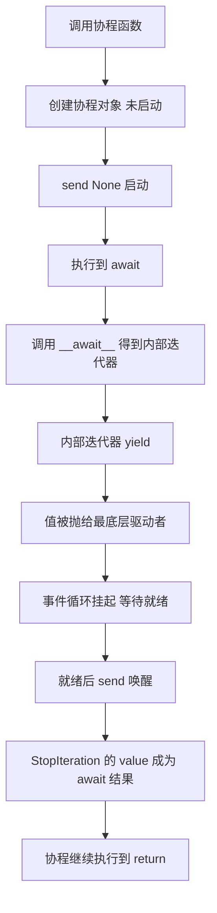
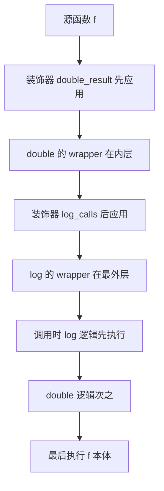
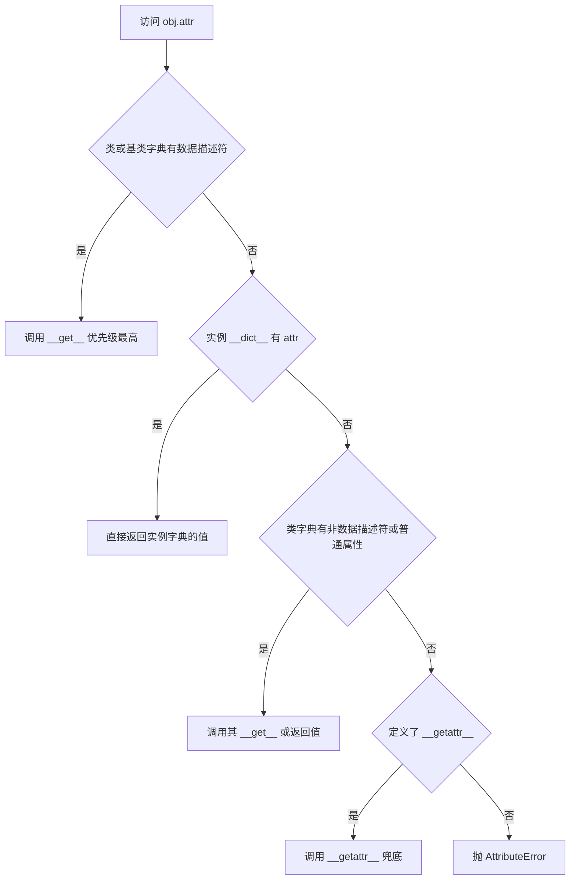
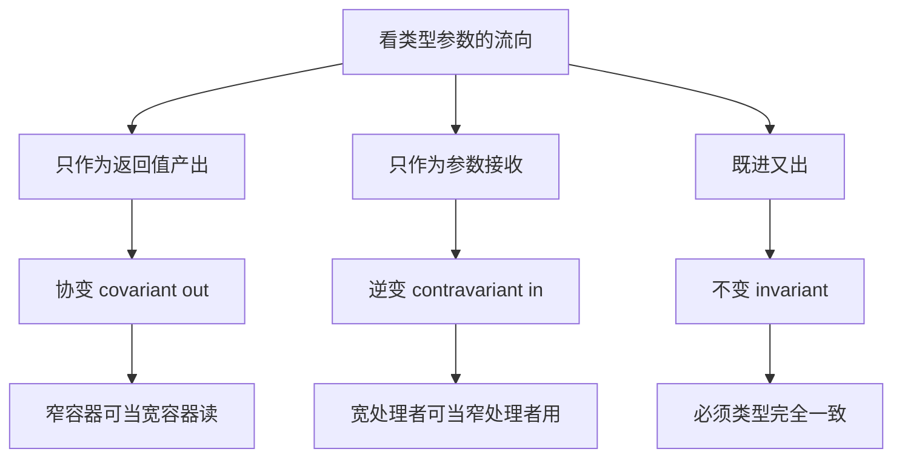
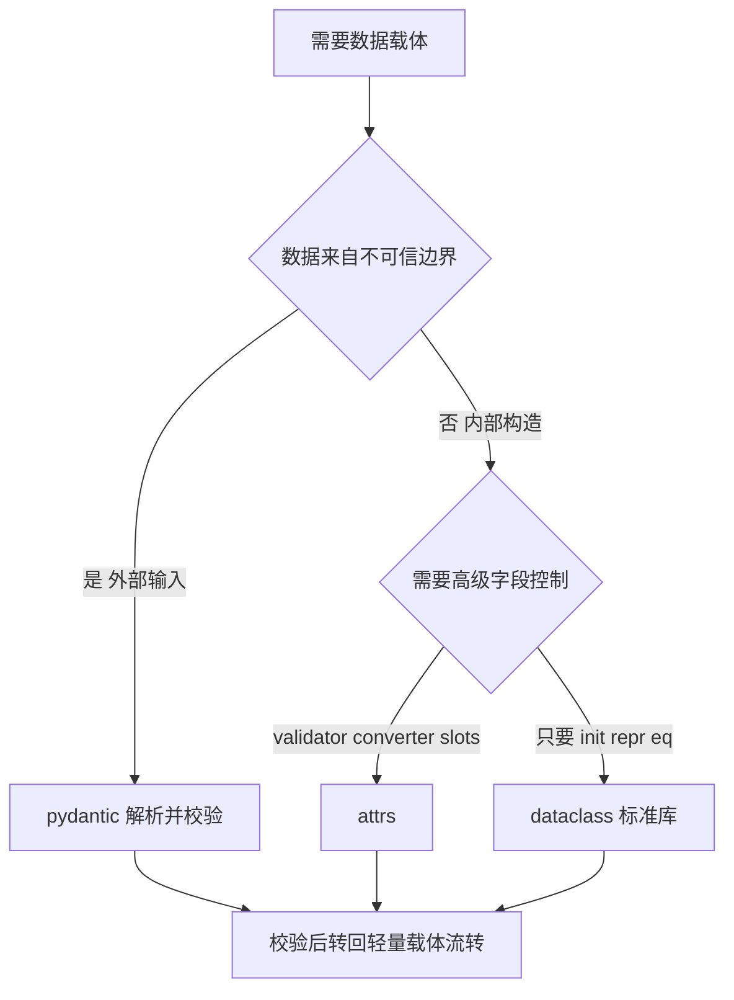
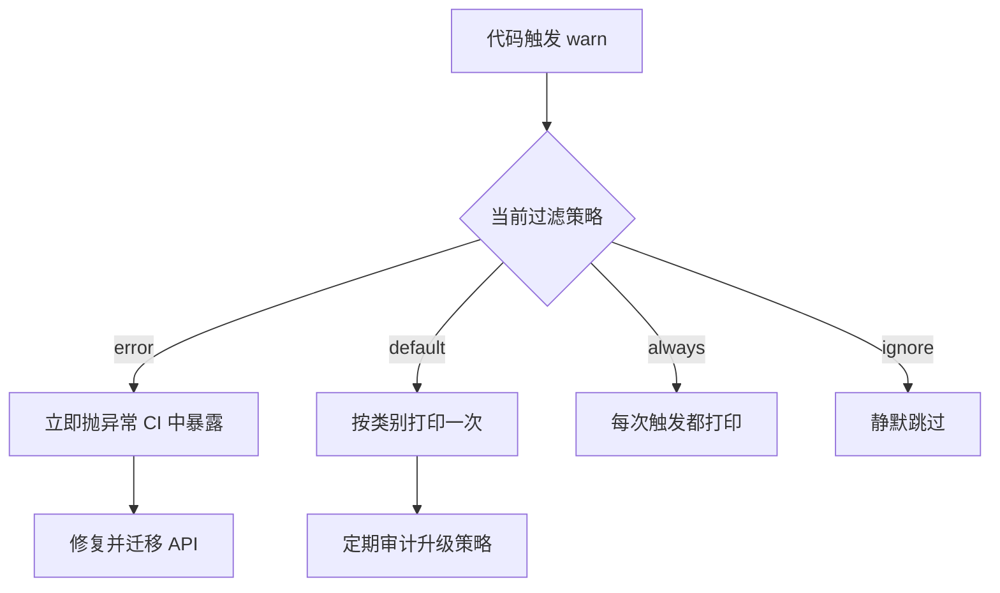
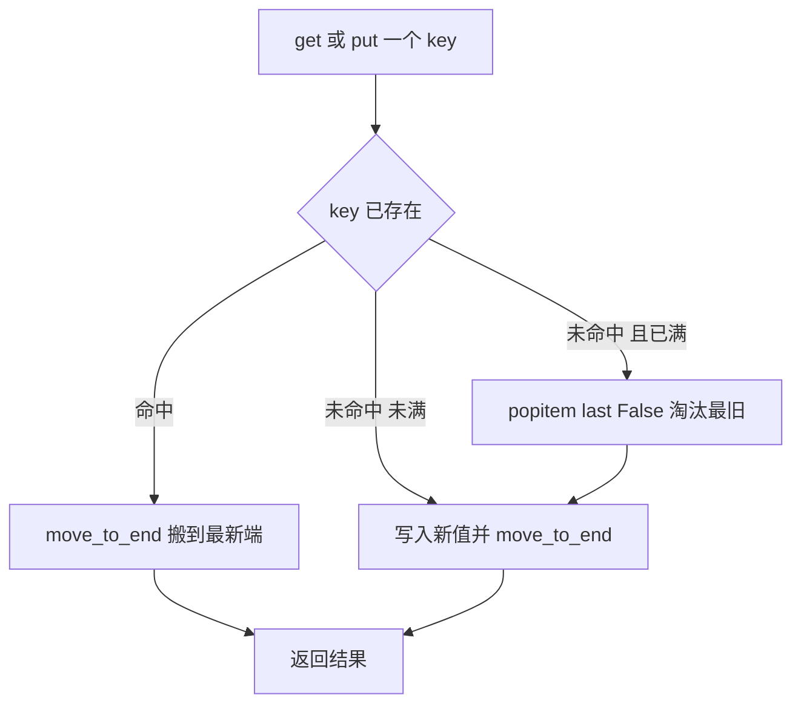

# 第 1 类 · 语言核心与底层(c)

> 本部分聚焦「进阶语言特性」:迭代器/生成器/协程的完整协议、装饰器工程化模式、上下文管理器的进阶用法、描述符实战、元编程钩子、typing 深水区、dataclass 对比与异常工程。
> 面向已掌握 Q001–Q045 基础题的候选人,考察「能不能用语言机制解决工程问题」。
> 每题代码仅依赖标准库、可直接运行,建议边看边跑。

### Q431 · 生成器的 send:双工通信与预激

> 难度:★★★☆ | 标签:生成器, 协程

**问**:生成器除了被 next 驱动,还能 send 值进去,这解决了什么问题?为什么第一次调用必须先 next 或 send(None)?

**答**:`send` 让数据可以双向流动:调用方传入的值成为当前挂起的 `yield` 表达式的求值结果,生成器据此分支,实现「有状态的消费者」。第一次调用时生成器还没执行到任何 yield,不存在「yield 表达式」可以接收值,所以只能 `send(None)`(等价于 next);对未启动的生成器 send 非 None 值会抛 TypeError。这个「先预激再使用」的约束是所有生成器协程库都要处理的问题,常见解法是预激装饰器或在首次 send 时自动判空。

```python
# file: code/01_语言核心与底层/q431_generator_send.py
def averager():
    total = 0.0
    count = 0
    average = None
    while True:
        term = yield average          # send 进来的值成为这个表达式的值
        total += term
        count += 1
        average = total / count

if __name__ == "__main__":
    avg = averager()
    first = next(avg)                 # 预激:推进到第一个 yield,得到 None
    print("first yield:", first)
    print(avg.send(10))               # 10.0
    print(avg.send(20))               # 15.0
    print(avg.send(30))               # 20.0

    fresh = averager()
    try:
        fresh.send(1)                 # 未预激就 send 非空值
    except TypeError as e:
        print("must prime first:", e)
```

**追问**:1) send(None) 与 next 的关系?——完全等价,CPython 在生成器未启动时对非 None 的 send 直接抛 TypeError,因为此刻没有 yield 表达式可以充当接收点。2) 为什么会有「预激」问题,工程上怎么解?——启动前没有 yield 点可接收值,解法是预激装饰器自动 next 一次或封装成类;现代方案直接用 async 协程,await 语义天然规避了这个问题。3) send 在 CPython 里如何把值送进 yield 表达式?——gen_send_ex 恢复挂起帧时把传入值压到栈顶,yield 表达式的求值结果直接取它;只有首次 send(None) 走与 next 相同的启动路径。4) 生产陷阱?——多个消费者共享同一生成器实例,send/next 交错会让内部状态错位;生成器是单消费通道,要么独占要么改用队列。

### Q432 · 生成器的 throw 与 close:从外部注入异常

> 难度:★★★☆ | 标签:生成器, 异常

**问**:generator 的 throw 和 close 各自在什么位置抛异常?生成器可以「接住」它们吗?

**答**:`throw(exc)` 在生成器当前挂起的 yield 处抛出异常,等于从内部那个 yield 点把异常炸出来;生成器可以用 try/except 捕获它,捕获后继续 yield 就还能继续使用,异常于是成为「带外控制信号」。`close()` 是语法糖:在 yield 处抛 GeneratorExit,正常情况下生成器执行 finally/清理后退出,close 返回 None。两者都要求生成器已启动,否则没有挂起点可操作。

```python
# file: code/01_语言核心与底层/q432_generator_throw_close.py
def worker():
    try:
        while True:
            item = yield "ready"
            print("got", item)
    except ValueError as e:
        print("injected:", e)
        yield "recovered"             # 捕获后还能吐出新值继续用
    finally:
        print("cleanup in finally")

if __name__ == "__main__":
    g = worker()
    print(next(g))                          # 预激,得到 ready
    print(g.throw(ValueError("boom")))      # 在 yield 处注入,生成器捕获后返回 recovered
    try:
        g.send("hello")                     # recovered 之后的 yield 没有:except 块结束进 finally
    except StopIteration:
        print("finally ran, generator finished")

    g2 = worker()
    next(g2)
    g2.close()                              # 注入 GeneratorExit,只走 finally
    print("closed cleanly")
```

**追问**:1) close 时生成器如果又 yield 了新值会怎样?——协议禁止:会抛 RuntimeError "generator ignored GeneratorExit",因为关闭语义要求生成器必须退出。2) throw 与 close 的本质区别?——throw 注入任意异常由生成器决定接不接,close 固定注入 GeneratorExit 且协议强制退出;close 本质是 throw(GeneratorExit) 再加「不允许再 yield」的状态检查。3) return 与 StopIteration 什么关系?——生成器 return v 等价于 raise StopIteration(v),yield from 靠 StopIteration.value 接住子生成器返回值,这是委托链层层回传结果的地基。4) 生产陷阱?——用 throw 做「带外控制信号」时协议没有文档化,维护者不知道异常会被捕获继续运行;控制流异常要定义专用类型并写明契约。

### Q433 · GeneratorExit 与生成器的清理语义

> 难度:★★★☆ | 标签:生成器, 异常, 资源管理

**问**:GeneratorExit 为什么继承 BaseException 而不是 Exception?生成器的清理代码应该怎么写才可靠?

**答**:GeneratorExit 是解释器注入的控制流信号,不是程序错误;继承 BaseException 是为了绕开 `except Exception` 这类兜底捕获,防止业务代码误吞关闭信号。生成器被 close、被 GC 回收、所在 with 块退出时都会触发它。可靠写法是在生成器里用 try/finally(或 try/except GeneratorExit + re-raise)放置清理逻辑,清理完必须让 GeneratorExit 继续传播;捕获后不抛、继续 yield 是协议错误。

```python
# file: code/01_语言核心与底层/q433_generator_exit.py
import gc

def track():
    try:
        yield 1
        yield 2
    except GeneratorExit:
        print("[cleanup] GeneratorExit caught, releasing resource")
        raise                     # 必须重新抛出,让 close 正常收尾

if __name__ == "__main__":
    g = track()
    print(next(g))
    g.close()                     # 显式关闭:清理代码在此执行

    g2 = track()
    print(next(g2))
    del g2                        # CPython 引用归零,立即触发隐式 close
    gc.collect()                  # 其他实现依赖 GC,这里兜底
    print("done")
```

**追问**:1) 为什么 with 块退出也和它有关?——@contextmanager 装饰的生成器上下文管理器在 __exit__ 异常路径上靠 throw 注入异常、正常路径靠 close 触发清理,GeneratorExit 是这套机制的地基。2) 为什么它继承 BaseException 而非 Exception?——它是解释器注入的控制流信号,继承 Exception 会被 `except Exception` 兜底误吞导致 close 失败;CancelledError(3.8+)同理也放在 BaseException 下。3) 隐式 close 在什么时机触发?——生成器对象销毁时 CPython 立即调用 gen_close;有循环引用时推迟到 GC;异步生成器由 loop.shutdown_asyncgens 兜底,这是 asyncio.run 退出时的固定动作。4) 生产陷阱?——在 finally 里做无超时的阻塞清理,close 时整个程序卡死;清理要幂等、短小,长清理交给显式生命周期管理。

### Q434 · yield from 的委托树与子生成器返回值

> 难度:★★★★ | 标签:生成器, yield from

**问**:多层 yield from 嵌套时,调用方的 send/throw 是如何「穿透」到最内层生成器的?子生成器 return 的值去了哪里?

**答**:yield from 在调用方与子生成器之间建立直通管道:next/send/throw 全部转发给子生成器,中间的委托生成器只是「转发站」,不参与数据的加工。委托链可以任意深,形成一棵树,树的根是驱动者,叶子是真正干活的生成器。子生成器 return 的值随 StopIteration.value 上浮,被 yield from 表达式捕获,成为委托生成器里的局部结果,层层向上直到根。这也是 async/await 的字节码原型:await 本质就是带协议校验的 yield from。

```python
# file: code/01_语言核心与底层/q434_yield_from_tree.py
def leaf(name):
    total = 0
    for _ in range(2):
        got = yield f"{name}-value"
        total += got or 0
    return f"{name} total={total}"        # return 值经 StopIteration.value 上浮

def middle():
    result = yield from leaf("A")         # 委托:转发 next/send/throw
    print("middle got:", result)
    result = yield from leaf("B")
    return result

if __name__ == "__main__":
    g = middle()
    print(next(g))                        # A-value
    print(g.send(1))                      # A-value
    print(g.send(2))                      # A 结束返回,委托切到 B:B-value
    print(g.send(3))                      # B-value
    try:
        g.send(4)
    except StopIteration as stop:
        print("final result:", stop.value)    # B total=7
```

**追问**:1) throw 在委托树上如何传播?——沿着委托链一直扔到当前真正挂起的叶子生成器,叶子捕获则继续,不捕获则异常沿链上抛到调用方。2) yield from 相比手写 for 转发强在哪?——除 next 转发外还双向直通 send/throw、透传子生成器的 StopIteration.value,手写等价物要处理六七个分支,PEP 380 把这些语义收进一条语句。3) await 与 yield from 在字节码层什么关系?——await 编译为 GET_AWAITABLE + SEND 一族指令,语义是「带协议校验的 yield from」:对协程直接驱动,对其他对象先取 __await__。4) 生产陷阱?——委托树中间层生成器没预激就被 send 非 None 值,TypeError 从最深层冒出来难定位;以及委托 list 失去惰性,大流量场景内存翻倍。

### Q435 · 生成器管道:多级惰性流式处理

> 难度:★★★☆ | 标签:生成器, 惰性求值

**问**:如何用生成器实现类似 Unix 管道的多级流式处理?相比先 materialize 中间列表,机制上的差异在哪?

**答**:每一级是一个「消费上游迭代器、产出新迭代器」的生成器函数,组合成管道后只有最外层的 for 驱动时数据才开始流动:每推进一步,数据从源头穿过所有级到达终端,全程内存 O(1)。与「每级 build 一个列表再喂给下一级」相比,差异不在总计算量,而在于:中间结果不物化(省内存)、首条结果可在全量完成前产出(低延迟)、以及天然短路——终端 break 时上游不再推进。

```python
# file: code/01_语言核心与底层/q435_generator_pipeline.py
def read_lines(lines):
    for line in lines:
        yield line.strip()

def non_empty(lines):
    for line in lines:
        if line:
            yield line

def parse_fields(lines, sep=","):
    for line in lines:
        yield line.split(sep)

def only_type(rows, type_name):
    for fields in rows:
        if fields and fields[0] == type_name:
            yield fields

def to_records(rows):
    for fields in rows:
        yield {"type": fields[0], "value": float(fields[1])}

if __name__ == "__main__":
    raw = ["error,0.5", "", "info,1.2", "error,2.7", "warn,0.1"]
    pipeline = to_records(
        only_type(parse_fields(non_empty(read_lines(raw))), "error")
    )
    for record in pipeline:              # 惰性:逐条流过整条管道
        print(record)
```

**追问**:1) 管道中某一级抛异常,异常从哪里冒出来?——在驱动迭代的那次 next/for 处抛出,调用栈是「驱动者 → 各级生成器帧」的委托链,堆栈里能看到每一级。2) 惰性管道为什么不仅省内存还省时间?——终端 break 短路后上游整条链不再推进,处理前 N 条的成本与全量解耦;首条结果延迟从 O(全量) 降到 O(管道深度),流式 ETL 的边到边延迟由此而来。3) 一次 next 在管道里发生什么?——最外层帧运行到 for 对上游调 next,层层递推到源头,数据穿完全部帧回到终端;每级挂起时局部变量保留在各自帧对象上,这就是管道状态的存储位置。4) 生产陷阱?——某一级里顺手 list() 或 sorted(),惰性退化为全量物化,大文件场景 OOM;生成器只能消费一次,把「工厂函数」当实例复用会拿到空流。


### Q436 · itertools 深水区:tee、groupby、islice 的陷阱

> 难度:★★★★ | 标签:itertools, 迭代器

**问**:itertools.groupby 的分组结果为什么「用一次就没了」?tee 什么情况下会吃掉大量内存?

**答**:groupby 返回的 (key, group) 里 group 是与主迭代器共享进度的迭代器:主迭代器一旦前进(哪怕只是取下一组),上一组的 group 就作废,所以必须立即 `list(g)` 物化。tee 把一个迭代器复制成 n 个,内部用 FIFO 缓冲对齐进度,一旦某个副本落后太多,落后的部分全部滞留在缓冲里,内存退化为 O(总量)。islice 则是「带偏移的截断窗口」,它推进底层迭代器但不缓存被跳过的元素,适合切无穷流。

```python
# file: code/01_语言核心与底层/q436_itertools_pitfalls.py
from itertools import groupby, tee, islice, count

if __name__ == "__main__":
    # 1. groupby:分组键前进后,未消费的组即作废
    data = sorted(["apple", "avocado", "banana", "blueberry", "cherry"])
    saved = {k: list(g) for k, g in groupby(data, key=lambda w: w[0])}
    print(saved)                          # 立即物化才安全

    # 2. tee:副本进度差异大时靠缓存对齐
    src = iter(range(5))
    a, b = tee(src, 2)
    print(list(a))                        # a 先走完
    print(list(b))                        # b 靠 tee 内部缓冲补齐

    # 3. islice 切无穷迭代器:窗口语义,跳过的部分不缓存
    naturals = count()
    print(list(islice(naturals, 3, 8)))   # [3, 4, 5, 6, 7]
    print(next(naturals))                 # 8:islice 的推进被保留
```

**追问**:1) groupby 前先 `list(g)` 再前进主迭代器会发生什么?——什么都不会丢;反过来的顺序(先前进主迭代器)会导致当前组被静默丢弃,这是 groupby 最常见的线上 bug。2) 为什么 groupby 必须先排序?——分组只在「相邻键相等」处切分,不排序同一键会被切成多组;这是 Unix groupby 语义,不是全局哈希分组。3) tee 的内存行为底层机制?——各副本共享一个 FIFO 缓冲,落后副本从缓冲补齐,进度差无上界则缓冲退化为全量;CPython 对单副本请求直接返回原迭代器做优化。4) 生产陷阱?——`dict(groupby(data, key))` 是经典 bug:构造 dict 时主迭代器已走完,每个组的 group 全空;必须 `dict((k, list(g)) for ...)` 或先物化。

### Q437 · 自定义迭代器类与生成器函数的取舍

> 难度:★★★☆ | 标签:迭代器, 设计

**问**:什么时候用「可迭代类 + 迭代器类」的经典双类结构,什么时候直接写生成器函数?

**答**:生成器函数代码量最小,自动满足迭代器协议,但实例是一次性的、无状态可复位,也不承载其他职责。当需要「同一容器被多次 for」、暴露 len/比较等额外协议、或迭代状态需要被外部检查和干预时,用双类结构:`__iter__` 每次返回全新迭代器,容器与迭代状态分离。遍历递归结构(树、目录)时,生成器配合 yield from 递归往往是两者的最佳结合——外层可重复迭代,内层逻辑仍是简洁的生成器。

```python
# file: code/01_语言核心与底层/q437_iterable_class_vs_generator.py
from collections.abc import Iterable, Iterator

class Countdown(Iterable):
    """类实现:可重复迭代,每次 for 都从头开始"""
    def __init__(self, n):
        self.n = n

    def __iter__(self) -> Iterator:
        return CountdownIterator(self.n)

class CountdownIterator:
    def __init__(self, n):
        self.cur = n

    def __iter__(self):
        return self

    def __next__(self):
        if self.cur <= 0:
            raise StopIteration
        self.cur -= 1
        return self.cur + 1

def countdown_gen(n):
    """生成器实现:代码最短,但实例一次性"""
    while n > 0:
        yield n
        n -= 1

if __name__ == "__main__":
    cd = Countdown(3)
    print(list(cd), list(cd))             # [3, 2, 1] [3, 2, 1] 可重复迭代
    cg = countdown_gen(3)
    print(list(cg), list(cg))             # 第二次为空:生成器已耗尽
```

**追问**:1) 可迭代对象与迭代器为什么要分离?——`__iter__` 返回新迭代器才能支持重复 for 和并行迭代;for 语句对两者都有效,因为 for 总是先调 iter()。2) 生成器为什么天然不可重复迭代?——生成器对象自身就是迭代器,状态单向推进,耗尽后永远 StopIteration;要重复就得每次调用工厂函数产新实例,这正是「生成器函数 vs 生成器实例」的区分。3) for 语句的字节码如何展开?——GET_ITER 调 iter()(找 __iter__,退化到 __getitem__ 旧协议),循环体用 FOR_ITER 反复驱动直到 StopIteration;容器/迭代器分离是协议要求而非风格偏好。4) 生产陷阱?——把生成器当「可反复查询的数据」传给多个函数,后到者拿空流;自定义迭代器只实现 __next__ 不让 __iter__ 返回 self,iter() 行为不一致导致依赖它的工具异常。

### Q438 · 生成器协程:yield 驱动的任务调度雏形

> 难度:★★★★ | 标签:协程, 调度器

**问**:不依赖 asyncio,如何用生成器实现一个单线程多任务调度器?这和 asyncio 的差距在哪?

**答**:把 yield 当作「暂停并把控制权交给调度器」的指令,每个任务就是一个生成器,调度器维护就绪队列,轮询 send 驱动它们。任务内部可以 yield 出「我需要什么」(如睡眠时长),调度器据此决定何时再唤醒——这正是 Twisted/Tornado 时代基于 yield from 的协程调度的核心思想。与 asyncio 的本质差距在就绪通知:轮询调度器不区分「能跑」与「在等 IO」,空转浪费;asyncio 用 selector 把等待变成事件驱动,只有就绪的任务才进队列。

```python
# file: code/01_语言核心与底层/q438_generator_scheduler.py
from collections import deque

def task(name, steps):
    for i in range(steps):
        yield f"{name} step {i}"          # 暂停点:交还控制权

def scheduler(tasks):
    queue = deque(tasks)
    started = set()
    tick = 0
    while queue:
        current = queue.popleft()
        try:
            if current in started:
                current.send(f"tick {tick}")
            else:
                started.add(current)
                next(current)             # 首次调度:先预激
        except StopIteration:
            continue                      # 任务完成,不再入队
        queue.append(current)             # 未完成的任务回到队尾
        tick += 1

if __name__ == "__main__":
    scheduler([task("A", 2), task("B", 3)])
```

**追问**:1) 怎么在这个雏形上支持「任务睡眠 3 tick 再唤醒」?——任务 yield 出睡眠时长,调度器把它放进延时队列,每 tick 检查到期任务再放回就绪队列,这就是最原始的定时器轮。2) 这个雏形与 asyncio 的决定性差距?——轮询不区分「能跑」与「在等 IO」,空转烧 CPU;asyncio 用 selector 事件驱动,只有就绪的任务才进就绪队列,这是协程库从玩具到生产的那一步。3) 一次任务切换的成本构成?——yield/send 是 Python 帧级切换(保存/恢复 f_lasti 与求值栈),比 OS 线程上下文切换便宜两三个数量级,协程高并发的根基在此;但纯 Python 调度循环仍有解释器开销。4) 生产陷阱?——某任务两次 yield 之间跑长计算,饿死同循环所有任务(阻塞事件循环的同源问题);要用 run_in_executor 卸载或拆分计算粒度。

### Q439 · 原生协程与生成器协程:types.coroutine 兼容层

> 难度:★★★★ | 标签:协程, asyncio

**问**:async def 之前,生成器是怎么当协程用的?今天的原生协程和生成器协程如何互通?

**答**:老式「生成器协程」就是普通生成器 + `@types.coroutine` 装饰:装饰器在类型层面声明「这个生成器的 yield 是协程挂起语义」,让 await 可以等待它。原生协程是 async def 产生的对象,实现了 `__await__`,内部由 GET_AWAITABLE 字节码驱动;await 一个生成器协程时,挂起请求会穿透到最底层。关键差异:原生协程不是迭代器,没有 __next__,不能被 for/next 驱动,必须走 send/throw 的协程协议;而 asyncio 事件循环正是最底层的「驱动者」,接收所有穿透上来的 yield 值(如 Future)。

```python
# file: code/01_语言核心与底层/q439_native_vs_generator_coroutine.py
import types
import inspect

@types.coroutine
def generator_sleep():
    """生成器协程:yield 一个值给底层驱动者"""
    yielded = yield "SLEEP"
    return yielded

async def native_main():
    result = await generator_sleep()      # await 可以等待生成器协程
    return f"resumed with {result}"

if __name__ == "__main__":
    coro = native_main()
    print(type(coro).__name__)            # coroutine
    print("iscoroutine:", inspect.iscoroutine(coro))
    print("isgenerator:", inspect.isgenerator(coro))
    print(coro.send(None))                # 穿透到生成器协程的 yield:打印 SLEEP
    try:
        coro.send("wake")
    except StopIteration as stop:
        print("result:", stop.value)
```

**追问**:1) 为什么原生协程不能 next()?——它没有 __next__,await 在编译层生成的是协程协议字节码;硬要用生成器方式驱动可以用 types.coroutine 包一层,但正确姿势是交给事件循环。2) 挂起请求如何穿透多层协程?——await 取 __await__ 迭代器后按 yield from 语义逐层转发,内层 yield 的值穿过所有协程帧到达最底层驱动者;事件循环只见最外层 send 进来的 Future,内部结构对它透明。3) 原生协程与生成器的对象差异?——coroutine 类型有 cr_frame/cr_await、走 send/throw 协程协议、无 __next__;生成器有 gi_frame 且同时是迭代器。types.coroutine 的工作是给生成器打上 GEN_COROUTINE 标志让其可被 await。4) 生产陷阱?——混合代码里用 for/next 驱动原生协程直接 TypeError;判断「可等待」不要手写 hasattr 检查,用 inspect.isawaitable 统一口径。

### Q440 · await 的本质:__await__ 协议与驱动者

> 难度:★★★★★ | 标签:协程, await

**问**:await 一个对象时,解释器到底做了什么?自己实现一个可等待对象要写什么?

**答**:await x 要求 x 可等待:原生协程、实现 `__await__` 且返回迭代器的对象、或被 types.coroutine 标记的生成器。执行时解释器取 `x.__await__()` 得到内部迭代器,然后像 yield from 一样驱动它:迭代器 yield 的值被转发给最底层驱动者(通常是事件循环),驱动者就绪后 send 回来,直到迭代器 StopIteration,其 value 成为 await 表达式的结果。asyncio.Future 的 __await__ 就是 `yield self`——把 Future 交给事件循环,完成时事件循环调 future.set_result 并 send 回协程。

```python
# file: code/01_语言核心与底层/q440_await_protocol.py
class SimpleFuture:
    """最小可等待对象:yield 一次交给驱动者,被唤醒后返回结果"""
    def __init__(self, done_value):
        self.done_value = done_value

    def __await__(self):
        woke = yield self             # 挂起:把这个对象抛给驱动者
        return woke or self.done_value

async def fetch():
    value = await SimpleFuture(42)
    return value * 2

if __name__ == "__main__":
    coro = fetch()
    yielded = coro.send(None)         # 拿到 yield 出的 SimpleFuture
    print("yielded to driver:", type(yielded).__name__)
    try:
        coro.send(100)                # 驱动者「就绪后」唤醒协程
    except StopIteration as stop:
        print("final:", stop.value)   # 200
```

**追问**:1) 事件循环 send 回来的值是怎么变成 Future.result 的?——Future.__await__ 里 yield self 之后紧跟 `return self.result()`,set_result 已经在 send 之前把 result 填好,所以 send(None) 返回值就是结果。2) 自定义可等待对象的要求清单?——__await__ 必须返回迭代器,解释器按 yield from 语义驱动它;返回非迭代器抛 TypeError,里面 yield 的对象必须被驱动者(事件循环)认识,否则任务永久挂起。3) await 的字节码序列?——3.10+ 编译为 GET_AWAITABLE → 循环 SEND → END_SEND;SEND 同时承担 next 与 send 两种恢复语义,与 yield from 共享实现,await 在静态层只是多了协程类型校验。4) 生产陷阱?——自研 Future 完成后不禁止二次 await,同一等待被消费两次;以及 yield 出事件循环不认识的对象(如裸数字)导致任务卡死且无报错,协议对象务必按 asyncio 的约定产出。



### Q441 · async 迭代器与 async 生成器协议

> 难度:★★★★ | 标签:异步, 迭代器

**问**:async for 背后的协议是什么?async def 里出现 yield 后,这个函数变成了什么?

**答**:async for 要求对象实现 `__aiter__`(返回异步迭代器)和 `__anext__`(返回协程,结束时抛 StopAsyncIteration)。async def 函数体内出现 yield,它就是「异步生成器」:同时具备 `__aiter__/__anext__/athrow/aclose`,每次产出之间可以 await。与同步迭代器的关键差异是每一步都可能在挂起点让出控制权,所以驱动它的事件循环必须在场;清理(aclose)也是协程,需要事件循环执行,这就是 asyncio.run 里 `loop.shutdown_asyncgens()` 存在的原因。

```python
# file: code/01_语言核心与底层/q441_async_iterator_protocol.py
import asyncio

class AsyncCounter:
    def __init__(self, n):
        self.n = n

    def __aiter__(self):
        self.cur = 0
        return self

    async def __anext__(self):
        if self.cur >= self.n:
            raise StopAsyncIteration
        await asyncio.sleep(0)        # 每步之间都可以挂起
        self.cur += 1
        return self.cur

async def async_gen():
    for i in range(3):
        await asyncio.sleep(0)
        yield f"item-{i}"

async def main():
    async for v in AsyncCounter(2):
        print("counter:", v)
    async for v in async_gen():
        print("gen:", v)

if __name__ == "__main__":
    asyncio.run(main())
```

**追问**:1) 直接 async for 一个普通迭代器会怎样?——TypeError: async for 要求 __anext__ 返回协程;反之普通 for 遍历异步生成器也会报错,两套协议互不兼容。2) 为什么需要独立的 StopAsyncIteration?——异步迭代的每步都可能在 await 挂起,结束信号走协程协议传播;复用同步 StopIteration 会与协程自身的结束信号混淆,协议层必须区分。3) 异步生成器的清理为什么是协程?——aclose 本身要在事件循环里执行(清理代码可能有 await);asyncio.run 退出时 loop.shutdown_asyncgens 统一驱动所有未关闭的异步生成器,这是资源不泄漏的兜底。4) 生产陷阱?——在事件循环外丢弃未 aclose 的异步生成器,清理协程无人驱动导致连接泄漏;以及用 try/finally 包 async for 却在 finally 里做同步 IO,阻塞循环。

### Q442 · 装饰器注册器模式:import 时的插件注册

> 难度:★★★☆ | 标签:装饰器, 设计模式

**问**:@register 装饰器是怎么实现「自动发现」的?注册顺序由什么决定,有什么坑?

**答**:装饰器在被 import 时立刻执行,register 闭包把被装饰函数写进模块级注册表,于是「定义即注册」,调用方只需 import 覆盖所有插件模块的包。顺序由 import 顺序决定:包内模块按 __init__.py 里的出现顺序注册,重复注册要显式报错或以先注册者为准,否则静默覆盖极难排查。注册表是全局可变状态,测试中要注意隔离(每个用例 reset)。

```python
# file: code/01_语言核心与底层/q442_decorator_registry.py
HANDLERS = {}

def register(event_type):
    def deco(func):
        if event_type in HANDLERS:
            raise ValueError(f"duplicate handler for {event_type}")
        HANDLERS[event_type] = func
        return func                   # 返回原函数:不改变调用方式
    return deco

@register("user.created")
def on_user_created(payload):
    return f"welcome {payload['name']}"

@register("user.deleted")
def on_user_deleted(payload):
    return f"bye {payload['name']}"

def dispatch(event_type, payload):
    return HANDLERS[event_type](payload)

if __name__ == "__main__":
    print(dispatch("user.created", {"name": "Alice"}))
    print(dispatch("user.deleted", {"name": "Bob"}))
    print("registry keys:", sorted(HANDLERS))
```

**追问**:1) 被注册的函数还能被直接 import 调用吗?——能,deco 返回原函数,注册与直接调用互不影响;若返回 wrapper 则要 functools.wraps 保住元信息。2) 注册顺序为什么危险?——顺序由 import 顺序决定,等价于 __init__.py 里的模块列表顺序;隐式顺序让路由结果依赖文件命名与导入路径,重构排序即改变行为,重复注册应显式报错。3) 装饰器在 import 期执行的机制?——def 创建函数对象后装饰器调用同步发生,注册表是模块全局 dict;import 由导入锁串行化,但运行期动态注册(插件热加载)就要自己加锁。4) 生产陷阱?——插件模块没有 import 路径就永不注册(靠 import 副作用很脆弱),要用 pkgutil/entry point 枚举;测试并行化后全局注册表互相污染,fixture 里快照-恢复隔离。

### Q443 · 重试装饰器:指数退避与抖动

> 难度:★★★★ | 标签:装饰器, 可靠性

**问**:写一个生产可用的重试装饰器要考虑哪些点?指数退避为什么要加抖动?

**答**:要点:可配置重试次数与异常类型(只重试瞬时错误)、指数退避(base * 2^n)避免打爆下游、jitter(随机抖动)打散重试时间、重试耗尽后 re-raise 保留原始 traceback、functools.wraps 保留元信息。jitter 的必要性:大量客户端同时失败后按相同节奏重试会形成同步风暴,把下游彻底打垮;每次乘以随机系数即可摊平波峰。退避循环用 time.sleep 实现,异步版要换 asyncio.sleep。

```python
# file: code/01_语言核心与底层/q443_retry_decorator.py
import functools
import random
import time

def retry(times=3, base_delay=0.01, exceptions=(Exception,), jitter=True):
    def deco(func):
        @functools.wraps(func)
        def wrapper(*args, **kwargs):
            for attempt in range(1, times + 1):
                try:
                    return func(*args, **kwargs)
                except exceptions as exc:
                    if attempt == times:
                        raise                       # 耗尽:保留原始异常
                    delay = base_delay * (2 ** (attempt - 1))
                    if jitter:
                        delay *= random.uniform(0.5, 1.5)
                    print(f"attempt {attempt} failed: {exc}, retry in {delay:.3f}s")
                    time.sleep(delay)
        return wrapper
    return deco

CALLS = {"n": 0}

@retry(times=4, base_delay=0.01, exceptions=(ConnectionError,))
def flaky_fetch(url):
    CALLS["n"] += 1
    if CALLS["n"] < 3:
        raise ConnectionError(f"timeout on {url}")
    return f"data from {url}"

if __name__ == "__main__":
    print(flaky_fetch("https://example.com/api"))
    print("total calls:", CALLS["n"])
```

**追问**:1) 为什么不能捕获 BaseException 或裸 Exception 就重试?——KeyboardInterrupt、SystemExit 也继承 BaseException,重试它们会吞掉用户中断;只应重试明确声明的瞬时错误类型。2) 退避参数怎么定?——总等待 base*(2^n-1) 要小于用户可容忍延迟并设 max_delay 封顶,否则重试拉长到分钟级;错误率本身高于预算的依赖,重试只会放大故障,应转熔断。3) 抖动为什么能打散同步风暴?——失败时刻相同+退避函数相同会让重试时刻重合;乘随机系数后重试分布摊平,AWS 官方推荐 full jitter(在 [0, delay] 均匀取)效果最好。4) 生产陷阱?——非幂等操作(扣款/下单)套重试,超时重试造成重复业务,要配幂等键;装饰器里 time.sleep 阻塞调用线程,async 函数必须换 asyncio.sleep 版本。

### Q444 · TTL 缓存装饰器与失效策略

> 难度:★★★★ | 标签:缓存, 装饰器

**问**:lru_cache 没有 TTL 也没有主动失效,如何自己实现一个带过期时间的缓存装饰器?

**答**:核心结构:参数做 key、(写入时间, 值) 做 value;读时惰性判断过期,写时若超容量就按最旧时间淘汰一条(简化版 LRU)。失效入口暴露 cache_clear;时钟必须用 time.monotonic 防止系统时间回拨把 TTL 算负。并发场景下 CPython 的 dict 单操作原子性不能覆盖「检查再写」的复合操作,严格场景要加锁;另外 key 必须可哈希且把 kwargs 排序归一,否则同样参数不同顺序会各存一份。

```python
# file: code/01_语言核心与底层/q444_ttl_cache.py
import functools
import time

def ttl_cache(ttl=1.0, maxsize=128):
    def deco(func):
        store = {}

        @functools.wraps(func)
        def wrapper(*args, **kwargs):
            key = (args, tuple(sorted(kwargs.items())))
            now = time.monotonic()
            hit = store.get(key)
            if hit and now - hit[0] < ttl:
                return hit[1]                 # 命中未过期
            value = func(*args, **kwargs)
            if len(store) >= maxsize:
                oldest = min(store, key=lambda k: store[k][0])
                store.pop(oldest)             # 淘汰最旧
            store[key] = (now, value)
            return value

        wrapper.cache_clear = store.clear     # 主动失效入口
        return wrapper
    return deco

CALLS = {"n": 0}

@ttl_cache(ttl=0.05)
def slow_square(x):
    CALLS["n"] += 1
    time.sleep(0.01)
    return x * x

if __name__ == "__main__":
    print(slow_square(4), slow_square(4))     # 第二次命中
    print("calls:", CALLS["n"])
    time.sleep(0.08)                          # 超过 TTL
    print(slow_square(4))
    print("calls after ttl:", CALLS["n"])
```

**追问**:1) 为什么计时用 monotonic 而不是 time.time?——time.time 是墙钟,可能被 NTP 调整回拨,导致刚写入的缓存立刻「过期」或永不过期;monotonic 保证只前进。2) 这个实现与严格 LRU 的差距?——淘汰按「最旧写入」而非「最近访问」,读命中不刷新时间戳,热点数据可能被误淘汰;命中时写回 store[key]=(now, value) 一行即升级为 LRU-TTL。3) 并发竞态在哪一步?——「读命中判断→回源→写缓存」复合操作非原子,并发 miss 造成同一 key 多次回源(缓存击穿);dict 单操作原子不覆盖复合操作,严格场景加锁或 single-flight。4) 生产陷阱?——key 含不可哈希参数直接 TypeError;kwargs 不归一让同义参数各存一份;闭包持有大结果对象导致内存滞留,必须暴露 cache_clear 并在测试与进程退役时调用。

### Q445 · 参数校验装饰器:手写 validator

> 难度:★★★★ | 标签:装饰器, 校验

**问**:不依赖 pydantic,如何用装饰器 + inspect 实现声明式的参数校验?

**答**:装饰器先 `inspect.signature(func).bind(*args, **kwargs)` 把实参归一化成「参数名 → 值」的映射(apply_defaults 补齐默认值),再按声明逐个校验:规则是类型就用 isinstance,是可调用对象就当谓词。bind 的好处是位置参数/关键字参数/默认值统一处理,不用自己解析。失败时抛 TypeError(类型不符)或 ValueError(值不合法),并报出参数名与实际类型,这是手写校验层的最小可用骨架。

```python
# file: code/01_语言核心与底层/q445_param_validator.py
import functools
import inspect

def validate(**rules):
    """按参数名校验:type 表示类型约束,callable 表示谓词"""
    def deco(func):
        sig = inspect.signature(func)

        @functools.wraps(func)
        def wrapper(*args, **kwargs):
            bound = sig.bind(*args, **kwargs)
            bound.apply_defaults()
            for name, checker in rules.items():
                value = bound.arguments[name]
                if isinstance(checker, type):
                    if not isinstance(value, checker):
                        raise TypeError(
                            f"{name} must be {checker.__name__}, got {type(value).__name__}"
                        )
                elif not checker(value):
                    raise ValueError(f"{name} failed predicate with {value!r}")
            return func(*args, **kwargs)
        return wrapper
    return deco

def positive(v):
    return v > 0

@validate(x=int, y=positive)
def scale(x, y):
    return x * y

if __name__ == "__main__":
    print(scale(3, 2.5))
    try:
        scale("3", 2)
    except TypeError as e:
        print("TypeError:", e)
    try:
        scale(3, -1)
    except ValueError as e:
        print("ValueError:", e)
```

**追问**:1) 校验放装饰器还是函数体第一行?——装饰器把契约与实现分离、可跨函数复用;但运行时校验有开销,高频路径要么删掉、要么静态化(类型注解 + mypy)。2) 为什么用 signature.bind 而不是手工拼参数?——bind 统一处理位置/关键字/默认值/*args/**kwargs/仅位置参数(3.8+)各种声明,手工解析必然漏边角;bind 失败抛 TypeError,顺带完成参数数量校验。3) signature 解析的成本结构?——反射解析有开销,标准做法是 import 期解析一次存进装饰器闭包;运行期每次调用多一次 bind 加规则循环,这就是「高频路径静态化」的量化依据。4) 生产陷阱?——`x=int` 对 bool 放行(bool 是 int 子类),isinstance 语义坑要显式排除 bool;以及惯性把校验写成 assert,在 -O 下整层消失。

### Q446 · run_once 与 deprecated:状态记忆型装饰器

> 难度:★★★☆ | 标签:装饰器, warnings

**问**:如何让装饰器「记住」自己是否已执行过?deprecated 告警为什么每个调用点只警告一次?

**答**:在闭包里维护状态标志即可:run_once 记录是否已计算并缓存结果;deprecated 记录是否已告警,避免日志风暴。关键细节:状态是闭包私有变量,必须 nonlocal 修改;告警用 warnings.warn + DeprecationWarning + stacklevel=2,让告警指向调用方而不是装饰器内部。这类「一次性」状态在多线程下是 check-then-act 竞态,严格场景要加锁或改用 threading.Lock 保护。

```python
# file: code/01_语言核心与底层/q446_run_once_deprecated.py
import functools
import warnings

def run_once(func):
    """真实逻辑只执行一次,之后返回缓存结果"""
    result = None
    called = False

    @functools.wraps(func)
    def wrapper(*args, **kwargs):
        nonlocal result, called
        if not called:
            result = func(*args, **kwargs)
            called = True
        return result
    return wrapper

def deprecated(reason):
    def deco(func):
        warned = False

        @functools.wraps(func)
        def wrapper(*args, **kwargs):
            nonlocal warned
            if not warned:                    # 只警告一次
                warnings.warn(
                    f"{func.__name__} is deprecated: {reason}",
                    DeprecationWarning,
                    stacklevel=2,
                )
                warned = True
            return func(*args, **kwargs)
        return wrapper
    return deco

@run_once
def init_config():
    print("  [init_config] heavy work")
    return {"mode": "prod"}

@deprecated("use new_api instead")
def old_api():
    return "old result"

if __name__ == "__main__":
    print(init_config())
    print(init_config())                      # 不再打印 heavy work
    with warnings.catch_warnings(record=True) as caught:
        warnings.simplefilter("always")
        print(old_api())
        print(old_api())                      # 第二次不重复告警
        print("warnings captured:", len(caught))
```

**追问**:1) 把状态放在闭包里 vs 放函数属性上,取舍是什么?——闭包状态不可见不可测;函数属性(wrapper.cache_hit 之类)可检查可测试,团队库更推荐后者。2) run_once 的竞态后果?——两线程同时读到 called=False 各执行一次,后写覆盖先写;初始化场景可能双份资源(两个连接池),解法是 threading.Lock 或 lru_cache(maxsize=1)(C 实现自带锁)。3) warnings 去重的底层机制?——__warningregistry__ 按 (message, category, lineno) 记录已告警位置,命中即跳过;stacklevel=2 让归属记到调用方,否则弃用告警指向装饰器内部文件,过滤策略失准。4) 生产陷阱?——DeprecationWarning 默认只在 __main__ 显示,用户根本看不到库的弃用告警,必须同步写进文档与变更日志;闭包标志在 fork 子进程里被复制,可能双重初始化。

### Q447 · 装饰器与签名保留:__wrapped__ 与 unwrap

> 难度:★★★☆ | 标签:装饰器, inspect

**问**:多个装饰器叠加后,inspect.signature 为什么还能看到原函数签名?装饰器叠加的顺序规则是什么?

**答**:`@a @b @c def f` 等价于 `a(b(c(f)))`,列表下方的先应用、在最内层;调用时最外层(最上方)装饰器的逻辑先执行。functools.wraps 把原函数写入 wrapper 的 `__wrapped__` 属性,inspect.signature 默认沿这条链追踪到最内层取签名,traceback 模块也靠它显示原始文件行号;`inspect.unwrap` 可手动解链。没有 wraps 的装饰器会让签名变成 (*args, **kwargs)、文档丢失,这是调试困难和 IDE 补全失效的常见根因。

```python
# file: code/01_语言核心与底层/q447_wrapped_chain.py
import functools
import inspect

def log_calls(func):
    @functools.wraps(func)
    def wrapper(*args, **kwargs):
        print(f"log: calling {func.__name__}")
        result = func(*args, **kwargs)
        print(f"log: {func.__name__} returned {result}")
        return result
    return wrapper

def double_result(func):
    @functools.wraps(func)
    def wrapper(*args, **kwargs):
        return func(*args, **kwargs) * 2
    return wrapper

@log_calls
@double_result
def add(a, b=1):
    """add two numbers"""
    return a + b

if __name__ == "__main__":
    print(add(1, 2))                      # log 先执行,double 先算
    print(add.__name__, add.__doc__)      # wraps 保留的元信息
    print(inspect.signature(add))         # (a, b=1):沿 __wrapped__ 链还原
    f = add
    while hasattr(f, "__wrapped__"):
        f = f.__wrapped__
    print("unwrapped to original:", f is not None)
    print(inspect.unwrap(add) is not None)
```

**追问**:1) inspect.unwrap 怎么防死循环?——它检测 __wrapped__ 链上的重复对象(id 环),一旦成环就抛 ValueError,而不是无限解引用。2) 签名还原靠什么?——functools.wraps 把原函数写入 wrapper.__wrapped__,inspect.signature 默认沿链追踪到最内层;__name__/__doc__/__dict__ 也被拷贝,traceback 才能显示原始行号。3) 应用顺序与执行顺序为何相反?——`@a @b @c def f` 等价 a(b(c(f))),包裹从下往上,调用时最外层先执行;有依赖的装饰器(先鉴权后缓存)顺序写反是逻辑 bug,按「离 def 越近越先执行」读。4) 生产陷阱?——第三方装饰器漏 wraps,监控里所有调用聚合到 wrapper 名下失去可观测性;动态生成装饰器时把 __wrapped__ 指回自身成环,unwrap 抛 ValueError 而非死循环,要提前防御。



### Q448 · ExitStack:动态数量的上下文管理器

> 难度:★★★★ | 标签:上下文管理器, contextlib

**问**:with 语句只能写死的几层嵌套,如果要按运行时条件打开不定数量的资源怎么办?

**答**:contextlib.ExitStack 是上下文管理器的「栈容器」:`enter_context(cm)` 立即进入并登记退出回调,栈在 with 结束或异常时按逆序统一展开,等价于把 N 层 with 压平。它解决三类问题:动态数量(循环里 enter_context 打开任意多文件)、条件进入(需要时才 enter)、所有权移交(close 后的回调可以被 pop_all 搬走转交他人)。callback 还能注册任意清理函数,不只是上下文管理器。

```python
# file: code/01_语言核心与底层/q448_exitstack.py
import contextlib
import os
import tempfile

def open_many(paths):
    """打开任意数量文件,把清理权打包移交"""
    stack = contextlib.ExitStack()
    handles = [stack.enter_context(open(p, encoding="utf-8")) for p in paths]
    return stack, handles                 # 所有权随 stack 一起移交

def rollback_demo(paths):
    with contextlib.ExitStack() as stack:
        stack.callback(print, "cleanup 1 runs last")
        stack.callback(print, "cleanup 2 runs first")
        raise RuntimeError("boom")        # 异常时 callback 逆序执行

if __name__ == "__main__":
    tmpdir = tempfile.mkdtemp()
    paths = []
    for i in range(3):
        p = os.path.join(tmpdir, f"f{i}.txt")
        with open(p, "w", encoding="utf-8") as w:
            w.write("line\n" * (i + 1))
        paths.append(p)

    stack, handles = open_many(paths)
    print("total lines:", sum(1 for h in handles for _ in h))
    stack.close()                         # 逆序统一关闭

    try:
        rollback_demo(paths)
    except RuntimeError as e:
        print("caught:", e)
```

**追问**:1) pop_all 和 close 的区别?——pop_all 把已登记的清理动作搬进一个新 ExitStack 返回,实现「全部成功才提交」的事务模式;close 是立即就地逆序清理。2) callback 与 enter_context 的执行顺序?——同一栈统一按注册逆序展开;「后注册的先跑」与直觉相反,事务式的成功/失败双路径要用 pop_all 把回调搬到不同栈再分别触发。3) 展开时某回调抛异常怎么办?——ExitStack 继续展开剩余回调保证清理完整,最后异常经 __context__ 链上抛;这是「清理优先于单点失败」的设计,自定义栈容器应复刻该语义。4) 生产陷阱?——把 ExitStack 当长期资源池(它只管一次性清理不管复用);pop_all 移交所有权后忘记 close 新栈,泄漏点转移到新持有者且更隐蔽。

### Q449 · __exit__ 的返回值与异常传播

> 难度:★★★☆ | 标签:上下文管理器, 异常

**问**:__exit__ 返回 True 就能吞异常,这个机制有哪些暗坑?__exit__ 自己抛异常会怎样?

**答**:with 在异常路径上调用 `__exit__(exc_type, exc, tb)`,返回真值表示「异常已处理」,解释器随后恢复正常执行;返回假值则异常继续向外传播。多个 with 嵌套时异常由内向外穿过每一层的 __exit__,每层都有机会拦截。两个暗坑:一,__exit__ 内抛出的新异常会取代原异常,原异常挂在 `__context__` 上形成链;二,正常路径(无异常)也会调用 __exit__,三个参数都是 None,清理逻辑必须兼容这条路径。contextlib.suppress 本质就是「返回 True 的最小实现」。

```python
# file: code/01_语言核心与底层/q449_exit_return_value.py
import contextlib

class Intercept:
    def __init__(self, swallow):
        self.swallow = swallow

    def __enter__(self):
        return self

    def __exit__(self, exc_type, exc, tb):
        name = exc_type.__name__ if exc_type else None
        print(f"exit sees: {name}")
        return self.swallow               # True:异常到此为止

class Replacer:
    def __enter__(self):
        return self

    def __exit__(self, exc_type, exc, tb):
        raise RuntimeError("replaced inside exit")

if __name__ == "__main__":
    with Intercept(swallow=True):
        raise ValueError("swallowed")
    print("continues normally")

    try:
        with Intercept(swallow=False):
            raise ValueError("propagates")
    except ValueError as e:
        print("caught outside:", e)

    try:
        with Replacer():
            raise ValueError("original")
    except RuntimeError as e:
        print("new:", e, "| context:", repr(e.__context__))

    with contextlib.suppress(KeyError):
        {"a": 1}["b"]
    print("suppress done")
```

**追问**:1) with 块里 return 了,__exit__ 还执行吗?——执行,return/break/continue 走的是正常路径,__exit__ 三个参数为 None,资源照样释放。2) __exit__ 抛新异常时原异常去哪?——挂到 e.__context__ 形成隐式链,traceback 打印 "During handling of the above exception";显式因果用 raise ... from,有意丢弃用 from None。3) with 的字节码机制?——异常路径压入异常信息后调用 __exit__,按返回值真伪决定是否继续传播;正常路径同样调用 __exit__(None, None, None),清理逻辑必须兼容两条路径。4) 生产陷阱?——__exit__ 随手返回 True 吞掉一切异常掩盖业务错误,只应在明确处理的类型上返回真值;以及 __exit__ 里做可能失败的 flush/close,把资源清理升级成异常替换,要二次保护。

### Q450 · 可重入与不可重入的上下文管理器

> 难度:★★★★ | 标签:上下文管理器, 线程

**问**:同一个上下文管理器实例能进两次吗?threading.Lock 和 RLock 的差别说明了什么?

**答**:可重入指同一实例可同时多次进入且状态正确:RLock 维护持有线程与计数所以可重入;普通 Lock 同线程二次 acquire 会死锁,必须靠超时或结构上避免。@contextmanager 生成器版上下文管理器既不可重入也不可复用:实例内部是单个生成器,第二次 with 会在 __enter__ 处直接报错(新版本 RuntimeError: generator didn't yield,旧版本 AttributeError: args)。可重入性是设计属性不是巧合:实现里如果持有「一次性状态」(生成器、已消费标志),就天然不可重入;纯函数式的 __enter__/__exit__(如 suppress)天然可重入。

```python
# file: code/01_语言核心与底层/q450_reentrant_context.py
import contextlib
import threading

def tag(name):
    @contextlib.contextmanager
    def ctx():
        print(f"enter {name}")
        yield
        print(f"exit {name}")
    return ctx()                          # 返回实例:只能用一次

if __name__ == "__main__":
    ctx = tag("g")
    with ctx:                             # 第一次正常
        pass
    try:
        with ctx:                         # 复用同一实例
            pass
    except (RuntimeError, AttributeError) as e:
        print("reuse rejected:", type(e).__name__, "-", e)

    lock = threading.Lock()
    got1 = lock.acquire(timeout=0.05)
    got2 = lock.acquire(timeout=0.05)     # 同线程二次 acquire:会死锁,超时演示
    print("lock reentrant:", got1, got2)
    lock.release()

    rlock = threading.RLock()
    first = rlock.acquire()
    second = rlock.acquire()              # RLock 可重入:立即成功
    print("rlock reentrant:", first, second)
    rlock.release()
    rlock.release()
```

**追问**:1) contextlib.suppress 为什么天然可重入?——它的 __enter__ 返回自身、__exit__ 只做一次类型判断并返回布尔,没有任何一次性状态;生成器版的不可重入根源在「单个生成器帧只能跑一遍」。2) RLock 可重入的底层实现?——记录 owner 线程 ident 与递归计数,同线程 acquire 计数+1、release 减到 0 才真正释放;Lock 只有一个互斥位,同线程再等自己就是死锁。3) @contextmanager 实例二次 with 的报错机制?——内部是单个生成器帧,contextlib 用状态标志检测重复进入,把对已耗尽生成器的 next 结果翻译成 RuntimeError("generator didn't yield"),避免裸 StopIteration 混淆语义。4) 生产陷阱?——把 CM 实例当模块级常量(如 `LOCK = my_cm()`)复用,第二次 with 崩;多处进入的需求应该写成工厂函数,或用 reentrant CM / threading.Lock 包装。

### Q451 · 描述符实战:类型校验字段

> 难度:★★★☆ | 标签:描述符, 校验

**问**:用描述符给类加一个「赋值时校验类型」的属性,最少要实现哪几个方法?为什么必须实现 __set__?

**答**:最少实现 `__set__`(校验并写入)与 `__get__`(读出),再加 `__set_name__` 自动感知属性名。实现 __set__ 使它成为数据描述符,优先级高于实例 __dict__,赋值必然经过校验;若只实现 __get__(非数据描述符),实例字典优先级更高,赋值会绕过描述符直接写入,校验形同虚设。存储位置惯例是 `obj.__dict__[self.name]`,因为实例创建时 __dict__ 里还没有这个名字,首次赋值经描述符写入后,__get__ 从字典读回。

```python
# file: code/01_语言核心与底层/q451_typed_descriptor.py
class Typed:
    """数据描述符:带类型校验的属性"""
    def __init__(self, expected):
        self.expected = expected
        self.name = None

    def __set_name__(self, owner, name):
        self.name = name

    def __get__(self, obj, objtype=None):
        if obj is None:
            return self                      # 类访问返回描述符自身
        return obj.__dict__[self.name]

    def __set__(self, obj, value):
        if not isinstance(value, self.expected):
            raise TypeError(f"{self.name} expects {self.expected.__name__}")
        obj.__dict__[self.name] = value

class Order:
    qty = Typed(int)
    price = Typed(float)

    def __init__(self, qty, price):
        self.qty = qty
        self.price = price

if __name__ == "__main__":
    o = Order(3, 9.9)
    print(o.qty, o.price)
    o.qty = 5
    print("updated:", o.qty)
    try:
        o.price = "cheap"
    except TypeError as e:
        print("rejected:", e)
    print("class access returns descriptor:", type(Order.qty).__name__)
```

**追问**:1) 为什么校验后写 obj.__dict__ 而不是描述符自己的属性?——写到描述符实例属性会让所有实例共享同一个值;按实例名写入各自 __dict__ 才能做到每实例独立。2) 数据/非数据描述符的优先级为什么这样设计?——实现 __set__ 意味着「赋值必须过校验」,实例字典不能绕过;非数据描述符允许实例字典覆盖,这正是方法绑定与 cached_property 惰性缓存的地基。3) 属性查找的 C 层顺序?——_PyObject_GenericGetAttrWithDict:类 MRO 找 data descriptor → 实例 __dict__ → non-data descriptor/类属性 → __getattr__ 兜底;顺序错一格,校验就漏。4) 生产陷阱?——类访问返回描述符自身(无 obj),文档读者直接 Cls.attr 会拿到对象而不是值;存储键硬编码字符串,继承后两类串数据,必须 __set_name__ 感知名字。

### Q452 · 描述符实战:惰性缓存字段与失效

> 难度:★★★★ | 标签:描述符, 缓存

**问**:手写一个支持「首次访问才计算、之后读缓存、可手动失效」的 cached_property,利用了属性查找的什么规则?

**答**:利用「非数据描述符优先级低于实例 __dict__」的规则:描述符只实现 __get__,首次访问执行 func 并把结果写进 `obj.__dict__[self.attr]`;之后同名查找直接命中实例字典,描述符被完全架空,连函数调用都省掉。失效就是把缓存键从 __dict__ 里 pop 掉,下次访问重新回到描述符逻辑。这正是 functools.cached_property 的原理;注意它要求实例有可写的 __dict__,与 __slots__ 类不兼容(除非 slots 里预留同名字段)。

```python
# file: code/01_语言核心与底层/q452_cached_descriptor.py
import time

class cached_property:
    """惰性计算 + 缓存 + 可手动失效"""
    def __init__(self, func):
        self.func = func
        self.attr = func.__name__
        self.__doc__ = func.__doc__

    def __get__(self, obj, objtype=None):
        if obj is None:
            return self
        cache = obj.__dict__
        if self.attr not in cache:
            cache[self.attr] = self.func(obj)   # 首次访问才计算
        return cache[self.attr]

    def invalidate(self, obj):
        obj.__dict__.pop(self.attr, None)

class Report:
    def __init__(self, data):
        self.data = data
        self.loads = 0

    @cached_property
    def stats(self):
        self.loads += 1
        time.sleep(0.01)                    # 模拟昂贵计算
        return {"sum": sum(self.data), "n": len(self.data)}

if __name__ == "__main__":
    r = Report([1, 2, 3, 4])
    print(r.stats)                          # 计算一次
    print(r.stats)                          # 直接读实例字典缓存
    print("computed:", r.loads, "times")
    Report.stats.invalidate(r)              # 类访问拿描述符,再对实例失效
    print(r.stats)                          # 重新计算
    print("computed:", r.loads, "times")
```

**追问**:1) 为什么第一次访问后连 __get__ 都不再被调用?——属性查找顺序里实例 __dict__ 优先于非数据描述符,缓存写入后查找在字典就结束了,这是「自我消亡的描述符」。2) 并发首次访问会怎样?——两线程同时 miss 各算一次,后写覆盖先写,结果正确但计算重复(最小缓存击穿模型);functools.cached_property 的版本演进:3.8-3.11 自带类级写锁(不重复计算但争用高、嵌套访问可能死锁),3.12 起 gh-90459 直接移除锁换取吞吐,并发首次访问可能重复计算——需要精确去重就自己配 per-instance 锁。3) 为什么与 __slots__ 类不兼容?——slots 类没有实例 __dict__,「写进实例字典架空描述符」的机制无处落地,cached_property 检测到无 __dict__ 直接抛 TypeError;在 slots 里预留同名字段救不了(那是个 slot 描述符,不是字典条目),只有显式把 '__dict__' 加进 slots 才行(等于放弃省内存)。4) 生产陷阱?——缓存值持有大数据或引用 self 的对象图,实例生命周期被拉长;多进程 fork 前已缓存的状态被复制,子进程拿到陈旧结果,fork 前应 invalidate。

### Q453 · __set_name__:描述符的命名感知

> 难度:★★★☆ | 标签:描述符, 元编程

**问**:描述符怎么知道自己在类里叫什么名字?这个钩子在什么时机执行?

**答**:`__set_name__(owner, name)` 在类体执行完、type.__new__ 创建类对象时被调用,owner 是宿主类、name 是描述符被赋给的属性名,每个描述符实例只触发一次。有了名字,描述符就能自动生成对应的存储键、报错信息、SQL 列名等,免掉 `field = Typed(int, "field")` 这种重复。声明式框架(ORM 字段、校验字段)几乎都依赖它;类装饰器和 __init_subclass__ 是它失效时的兜底方案。

```python
# file: code/01_语言核心与底层/q453_set_name.py
class Column:
    """声明式字段:自动以属性名作为列名"""
    def __init__(self, coltype, colname=None):
        self.coltype = coltype
        self.colname = colname

    def __set_name__(self, owner, name):
        self.colname = self.colname or name
        owner._columns = getattr(owner, "_columns", ()) + (self,)

    def __get__(self, obj, objtype=None):
        if obj is None:
            return self
        return obj.__dict__.get(self.colname)

    def __set__(self, obj, value):
        if not isinstance(value, self.coltype):
            raise TypeError(f"{self.colname}: {self.coltype.__name__} required")
        obj.__dict__[self.colname] = value

class User:
    username = Column(str)
    age = Column(int, colname="user_age")

    def __init__(self, username, age):
        self.username = username
        self.age = age

if __name__ == "__main__":
    u = User("alice", 30)
    print(u.username, u.age)
    print("columns:", [c.colname for c in User._columns])
    try:
        u.age = "old"
    except TypeError as e:
        print("rejected:", e)
```

**追问**:1) 为什么继承体系的子类里定义的描述符也会触发 __set_name__?——它只在类创建时对「类体里直接定义」的描述符调用一次,继承来的描述符不会再触发,所以基于描述符的框架要处理子类覆盖问题。2) 调用时机为什么重要?——type.__new__ 创建类对象时同步调用,此时类体刚执行完、类还不完整,钩子里不能引用稍后定义的成员;跨类初始化要放 __init_subclass__。3) 谁负责调用它?——type.__new__ 遍历新类 __dict__,对实现 __set_name__ 的属性逐个调用;手动 type() 创建的类同样走这条路,元类继承链不改变行为。4) 生产陷阱?——描述符实例被多个字段共享(模块级单例),__set_name__ 只记最后一个名字,前面的字段全部错乱;每个字段声明必须新建描述符实例,这是 ORM 字段定义的铁律。



### Q454 · 描述符实现延迟导入代理

> 难度:★★★☆ | 标签:描述符, 懒加载

**问**:如何在属性首次访问时才 import 一个昂贵模块?__getattr__ 代理要注意什么?

**答**:做一个代理对象:__init__ 只记模块名字符串,真正的 importlib.import_module 延迟到 `__getattr__` 首次触发——它只在常规属性查找失败时被调用,恰好是「代理上没有这个成员」的时机。收益是把重型依赖的导入成本推迟到真正用到的代码路径,冷启动显著加快;代价是 import 错误从启动期推迟到运行期,排障变晚,所以热路径依赖不建议懒加载。类属性挂代理对象即可全局生效,每个使用者共享同一份「待加载」状态。

```python
# file: code/01_语言核心与底层/q454_lazy_import_proxy.py
import importlib

class LazyModule:
    """属性首次访问时才真正 import"""
    def __init__(self, modname):
        self._modname = modname
        self._module = None

    def _load(self):
        if self._module is None:
            print(f"[lazy] importing {self._modname} now")
            self._module = importlib.import_module(self._modname)
        return self._module

    def __getattr__(self, name):
        return getattr(self._load(), name)

    def __dir__(self):
        return dir(self._load())

class Config:
    json = LazyModule("json")
    zlib = LazyModule("zlib")

if __name__ == "__main__":
    c = Config()
    print("created without importing json or zlib")
    print(c.json.dumps({"a": 1}))         # 此刻才 import json
    print(c.zlib.crc32(b"hello"))         # zlib 同样按需加载
```

**追问**:1) __getattr__ 里为什么要警惕递归?——在 __getattr__ 内访问 self._module,若 _module 本身没绑定好,会再次触发 __getattr__ 形成无限递归;所以内部状态必须在 __init__ 里就绑定到实例。2) 懒加载把什么风险推迟了?——import 错误(依赖缺失、循环导入)从部署瞬间推迟到首次访问,可能在生产高峰才爆发;要配启动自检(健康检查触发一次 import)兜底。3) 代理的线程安全性?——并发首访时 import_module 本身由导入锁串行化是安全的,但 _module 赋值前的初始化逻辑会重入;严格场景加双检锁,或干脆在 import 期完成。4) 生产陷阱?——序列化(pickle/JSON)代理对象把 _module 状态带出去失败,要定义 __getstate__ 排除;以及把懒加载用在热路径依赖,每次属性访问都多一层 __getattr__ 转发开销。

### Q455 · __init_subclass__ 实战:注册与约束

> 难度:★★★★ | 标签:元编程, __init_subclass__

**问**:不用元类,如何在子类定义的那一刻做校验和注册?关键字参数怎么传进 __init_subclass__?

**答**:基类定义 `__init_subclass__(cls, **kwargs)`,每个子类被创建时自动调用一次,类体里的关键字参数(`class Csv(Plugin, name="csv")`)原样传入,其余参数先交给 super().__init_subclass__ 消化。典型用途:强制子类实现某方法(检查 cls.__dict__ 而不是 cls,避免继承误判)、把子类写进注册表、按命名规范校验。它覆盖了元类 90% 的日常需求,且可被继承叠加,没有 metaclass 冲突问题。

```python
# file: code/01_语言核心与底层/q455_init_subclass_registry.py
class Plugin:
    """基类:自动注册子类并强制实现 run"""
    registry = {}

    def __init_subclass__(cls, name=None, strict=True, **kwargs):
        super().__init_subclass__(**kwargs)
        if strict and "run" not in cls.__dict__:
            raise TypeError(f"{cls.__name__} must implement run")
        key = name or cls.__name__.lower()
        if key in Plugin.registry:
            raise ValueError(f"plugin {key} already registered")
        Plugin.registry[key] = cls

class CsvPlugin(Plugin, name="csv"):
    def run(self, src):
        return f"csv from {src}"

class JsonPlugin(Plugin):
    def run(self, src):
        return f"json from {src}"

if __name__ == "__main__":
    try:
        class Broken(Plugin):             # strict 且没实现 run:定义即报错
            pass
    except TypeError as e:
        print("rejected at class creation:", e)

    print(sorted(Plugin.registry))
    print(Plugin.registry["csv"]().run("data.csv"))
```

**追问**:1) 检查 "run" in cls.__dict__ 而不是 "run" in dir(cls) 的原因?——dir 会包含继承来的方法,子类什么都不写也能通过检查;__dict__ 只看本类,才能强制「每个子类自己实现」。2) 与元类方案相比各自强在哪?——__init_subclass__ 无元类冲突、可继承叠加,覆盖注册/校验 90% 需求;元类能控制类创建全程(__prepare__ 命名空间、拦截 __call__ 做单例),需要「控制类本身行为」才上元类。3) 关键字参数如何传进来?——类体括号参数由 metaclass 收集后透传给 __init_subclass__(3.6+ 默认支持);super().__init_subclass__() 必须显式链式调用,否则基类钩子被跳过。4) 生产陷阱?——注册表写在基类可变属性上,子类同名赋值把它变成类属性覆盖,要用基类名显式访问;钩子在 import 期抛错,堆栈不直观,报错信息要带类名。

### Q456 · 类装饰器:批量注入行为

> 难度:★★★☆ | 标签:装饰器, 类

**问**:类装饰器和继承相比,什么时候更合适?如何给一批类注入相同的方法?

**答**:类装饰器接收类、修改后返回,适合「事后增强已存在的类」:注入比较协议、注册到某处、加混入方法。与继承的选择标准:逻辑属于「这一类对象」用继承或 Mixin;属于「这批恰好要被统一处理的类」(横切关注点)用类装饰器,不侵入 MRO。注入直接给 cls 赋值函数即可,注意函数内通过 self 访问实例状态,并且不要覆盖宿主类已有定义——先 hasattr 检查是礼貌的做法。

```python
# file: code/01_语言核心与底层/q456_class_decorator.py
def comparable(cls):
    """基于 _key 方法注入 == < 和 hash"""
    if hasattr(cls, "_key") is False:
        raise TypeError(f"{cls.__name__} must define _key")

    def __eq__(self, other):
        if not isinstance(other, cls):
            return NotImplemented
        return self._key() == other._key()

    def __lt__(self, other):
        if not isinstance(other, cls):
            return NotImplemented
        return self._key() < other._key()

    cls.__eq__ = __eq__
    cls.__lt__ = __lt__
    cls.__hash__ = lambda self: hash(self._key())
    return cls

@comparable
class Version:
    def __init__(self, major, minor):
        self.major, self.minor = major, minor

    def _key(self):
        return (self.major, self.minor)

    def __repr__(self):
        return f"{self.major}.{self.minor}"

if __name__ == "__main__":
    a, b, c = Version(1, 0), Version(1, 0), Version(2, 0)
    print(a == b, a < c)
    print(sorted([c, b, a]))
    print({a: "v1.0"}[b])                 # hash 注入后可做 dict key
```

**追问**:1) 返回 NotImplemented 而不是抛异常的意义?——把决定权交回解释器:它会尝试对方的反射运算或回退到默认行为,跨类型比较才不会误判。2) 类装饰器与 __init_subclass__ 怎么选?——装饰器显式标注「这个类被增强」、作用于单个类且顺序可见;钩子作用于整个子类家族且自动发生。横切个别类用装饰器,约束整个家族用钩子。3) 注入方法在 MRO 中的位置?——cls.__eq__ = func 直接写进类 __dict__,优先于父类实现;eq 与 hash 语义必须一致,只注入 __eq__ 不注入 __hash__,相等对象会进不了同一个哈希桶。4) 生产陷阱?——装饰器返回新类对象破坏 isinstance 与 pickle(__qualname__/__module__ 对不上),就地修改返回原类最稳;hasattr 前置检查拼写错误会静默跳过注入,失败要 fail loud。

### Q457 · __class_getitem__ 与泛型别名支持

> 难度:★★★☆ | 标签:元编程, typing

**问**:为什么 `list[int]` 在运行时是合法表达式?自定义类如何支持同样的 `[]` 语法?

**答**:类方查找 `Cls[item]` 时解释器调用的是元类上的 `__getitem__`,而实例级没有对应操作;PEP 560 引入 `__class_getitem__` 作为「类上的 __getitem__」,让任何类都能响应下标。内置容器用它返回 types.GenericAlias(几乎零成本),配合静态检查器表达泛型;自定义类同样可以实现它来构建「参数化类」的 API,比如 `Repository[User]` 返回绑定实体类的子类。注意它定义在类上、通过类访问时触发,与元类 __getitem__ 的触发路径不同。

```python
# file: code/01_语言核心与底层/q457_class_getitem.py
class Repository:
    """支持 Repository[Entity] 的参数化语法"""
    _bound = {}

    def __class_getitem__(cls, entity):
        key = (cls, entity)
        if key not in Repository._bound:
            name = f"{cls.__name__}[{entity.__name__}]"
            Repository._bound[key] = type(name, (cls,), {"entity": entity})
        return Repository._bound[key]

class User:
    pass

class Order:
    pass

if __name__ == "__main__":
    UserRepo = Repository[User]
    OrderRepo = Repository[Order]
    print(type(UserRepo).__name__, UserRepo.entity)
    print(issubclass(UserRepo, Repository))
    print(UserRepo is Repository[User])   # 同参数返回同一子类
    print(UserRepo is OrderRepo)
```

**追问**:1) list[int] 返回的 GenericAlias 能实例化吗?——能,`list[int]()` 就是普通 list;运行时它不做事,只是给 mypy 看的「带参数的别名」。2) 与元类 __getitem__ 的区别?——__class_getitem__ 定义在普通类上、由解释器在类下标时调用,PEP 560 让不写元类也能支持 [];元类方案会卷入元类继承冲突,能不用就不用。3) GenericAlias 的运行时反射?——__origin__/__args__ 记录来源与参数,3.10+ 支持 isinstance(x, list[int]) 这类检查;实例化与运算委托给 origin,本质是轻量元数据壳。4) 生产陷阱?——__class_getitem__ 里每次请求动态建子类又不缓存,类对象无限增长;以及把 GenericAlias 传给需要真实类型的 C 扩展 API(某些 ORM)报错,要取 __origin__ 再传。

### Q458 · 模块级 __getattr__:PEP 562 懒加载

> 难度:★★★☆ | 标签:模块, 懒加载

**问**:模块也能定义 __getattr__?它和函数里的 __getattr__ 时机一样吗,适合什么场景?

**答**:PEP 562 允许模块定义 `__getattr__(name)` 和 `__dir__()`:前者只在「常规属性查找失败」后调用,与类机制同源;后者补全 dir() 输出。典型用途:大包的懒加载子模块(numpy 式的 `np.linalg` 按需导入)、弃用属性的兼容层(访问旧名字时告警并转发)、动态属性只读接口。注意触发条件是属性访问(module.attr),模块内裸名字的查找走 LOAD_NAME,不会经过它;且一旦把值写回模块字典,后续访问就不再进钩子。

```python
# file: code/01_语言核心与底层/q458_module_getattr.py
"""PEP 562:模块级 __getattr__ 与懒加载"""
import sys

def __getattr__(name):
    """常规模块属性查找失败时才会被调用"""
    if name == "HEAVY":
        print("computing HEAVY lazily")
        value = sum(range(10 ** 6))
        globals()["HEAVY"] = value        # 写回模块字典:下次常规查找直接命中
        return value
    raise AttributeError(f"module has no attribute {name!r}")

def __dir__():
    return sorted(set(globals()) | {"HEAVY"})

if __name__ == "__main__":
    me = sys.modules[__name__]
    print("HEAVY in dir:", "HEAVY" in dir(me))
    print(me.HEAVY)                       # 属性访问触发模块级 __getattr__
    print(me.HEAVY)                       # 已写回:不再进钩子
    try:
        me.nope
    except AttributeError as e:
        print(e)
```

**追问**:1) 模块 __getattr__ 与类 __getattr__ 的调用时机一致吗?——一致:都在实例/模块字典、类、基类的常规查找全部失败后调用,所以「缓存写回」能天然短路钩子。2) 为什么写回 globals() 之后钩子不再触发?——钩子只在常规查找失败后调用;写回后属性位于模块 __dict__,LOAD_ATTR 直接命中,这是「惰性计算 + 缓存」的标准模式。3) 模块属性查找的完整路径?——先查模块 __dict__,失败找 md_dict['__getattr__'](模块加载器在加载时绑定),再失败抛 AttributeError;dir() 定制靠模块级 __dir__。4) 生产陷阱?——IDE 与类型检查器看不到动态属性,要配 __dir__ 和 .pyi 存根;钩子里抛普通 Exception 而非 AttributeError,hasattr/getattr 默认值协议被破坏。

### Q459 · TypeVar 的 bound 与 constrained

> 难度:★★★★ | 标签:typing, 泛型

**问**:TypeVar("T", str, bytes) 和 TypeVar("T", bound=str) 的求解规则有什么本质区别?

**答**:constrained 形式枚举有限取值,调用时所有出现位置必须「精确取同一个成员」:concat("a", "b") 解为 str,concat(b"x", b"y") 解为 bytes,混用直接报错;适合表达 AnyStr 这类「同类才兼容」的约束。bound 形式给上界,实参可以是任意子类型,整次调用统一解为最具体的公共类型:`scale_all` 传入 list[int] 时 T 解为 int,返回类型保持 int,信息不丢失。经验法则:约束「不能混用」用 constrained,约束「至少能做什么」用 bound。

```python
# file: code/01_语言核心与底层/q459_typevar_bound.py
from typing import TypeVar, List

AnyStr2 = TypeVar("AnyStr2", str, bytes)     # constrained:只能是这几个
NumberT = TypeVar("NumberT", bound=float)    # bound:上界,可为子类

def concat(a: AnyStr2, b: AnyStr2) -> AnyStr2:
    """constrained:同一次调用中两个参数必须同类型"""
    return a + b

def scale_all(items: List[NumberT], factor: float) -> List[NumberT]:
    """bound:输入是什么类型,返回就保持什么类型"""
    return [x * factor for x in items]

if __name__ == "__main__":
    print(concat("a", "b"), concat(b"x", b"y"))
    print(scale_all([1.5, 2.5], 2.0))
    print(scale_all.__annotations__)
    # concat("a", b"b") 在 mypy 下报错:同一个 TypeVar 求解出两个冲突类型
```

**追问**:1) TypeVar 名字里的 "T" 为什么要带引号且与变量名一致?——它是运行时对象的名字标识,静态检查器按字符串匹配同一 TypeVar 的多次出现,名字不一致会让约束对不上。2) constrained 混用报错的本质?——同一个 TypeVar 在一次调用内必须单值求解,concat("a", b"b") 解出 str 与 bytes 两个冲突解,检查器拒绝;这是解方程模型,不是运行时检查。3) 泛型求解发生在什么阶段?——静态检查器在调用点做 unification,运行时 GenericAlias 只是元数据、解释器完全不校验;类型安全只在 mypy/pyright + CI 里成立。4) 生产陷阱?——同一 TypeVar 标注两个语义无关的参数(如 def f(a: T, b: T)),调用方被迫传同型或 cast;语义独立就用不同 TypeVar。

### Q460 · 协变与逆变:泛型的方向性

> 难度:★★★★★ | 标签:typing, 类型系统

**问**:Shelter[Dog] 能当 Shelter[Animal] 用吗?为什么 list 是不变 invariant 而容器协议可以协变?

**答**:取决于类型参数的流向:只产出 T(只读容器)可以协变 covariant——Dog 的容器当作 Animal 的容器读,读出的都是 Animal,安全;只接收 T(回调参数)可以逆变 contravariant——能喂 Animal 的 Feeder 当然能喂 Dog;又进又出的可变容器(list)必须不变 invariant,否则 `list[Dog]` 别名成 `list[Animal]` 后塞进 Cat,再按 Dog 读就崩了。TypeVar 的 covariant/contravariant 参数声明方向,静态检查器据此校验继承关系,写反了会在定义处报错。

```python
# file: code/01_语言核心与底层/q460_variance.py
from typing import Generic, TypeVar, Protocol

class Animal:
    def speak(self) -> str:
        return "..."

class Dog(Animal):
    def speak(self) -> str:
        return "woof"

T_co = TypeVar("T_co", covariant=True)               # 协变:只出不进
T_contra = TypeVar("T_contra", contravariant=True)   # 逆变:只进不出

class Shelter(Generic[T_co]):
    def __init__(self, animal: T_co) -> None:
        self.animal = animal

    def adopt(self) -> T_co:
        return self.animal

class Feeder(Protocol[T_contra]):
    def feed(self, animal: T_contra) -> None:
        """协议方法:能喂更宽的类型,就能喂更窄的类型"""

class AnimalFeeder:
    def feed(self, animal: Animal) -> None:
        print("fed", animal.speak())

if __name__ == "__main__":
    dog_shelter: Shelter[Dog] = Shelter(Dog())
    wider: Shelter[Animal] = dog_shelter   # 协变:Dog 容器可当 Animal 容器读
    print(wider.adopt().speak())

    feeder: Feeder[Dog] = AnimalFeeder()   # 逆变:能喂 Animal 就能喂 Dog
    feeder.feed(Dog())
```

**追问**:1) 为什么 Sequence 是协变的而 list 不是?——Sequence 只有读方法没有 append,数据只流出;list 有 append,数据双向流动,协变会破坏类型安全。2) 逆变在标准库哪里出现?——Callable 的参数位置逆变、返回位置协变:能处理更宽参数的函数才能赋给要求窄参数的变量,函数子类型关系由此定义。3) 可变容器为什么必须不变?——若 list[Dog] 可当 list[Animal],写路径 append(Cat) 会破坏读路径的类型假设;不变(invariant)把读写双向流一起锁死,错误在静态期暴露而非运行时崩溃。4) 生产陷阱?——把 covariant TypeVar 用在方法参数位置,mypy/pyright 直接报错;设计泛型协议要先画清类型参数的进出流向再标方向,方向标错要到检查期才发现。



### Q461 · Protocol 的 runtime_checkable 边界

> 难度:★★★☆ | 标签:typing, Protocol

**问**:@runtime_checkable 的 isinstance 检查了什么?为什么它不能验证方法签名?

**答**:runtime_checkable 让 Protocol 可以做运行时 isinstance/issubclass,检查方式是「结构匹配」:只要对象(或其类)拥有协议声明的成员名即通过,不继承、不校验签名、不校验属性类型。签名正确性只能由静态检查器在调用点保证。运行时协议的正当用途是「特性探测」(有没有 close/has this capability)和优雅降级;把它当接口契约做深度校验是误用——那是 ABC + 抽象方法或 pydantic 的职责。

```python
# file: code/01_语言核心与底层/q461_runtime_checkable.py
from typing import Protocol, runtime_checkable

@runtime_checkable
class Closeable(Protocol):
    def close(self) -> None:
        """协议方法:只关心名字存在"""

class DBConn:
    def close(self) -> None:
        print("db closed")

class FileHandle:
    def close(self) -> None:
        print("file closed")

def close_all(resources):
    for r in resources:
        if isinstance(r, Closeable):      # 运行时结构检查:只看成员名
            r.close()

if __name__ == "__main__":
    close_all([DBConn(), FileHandle(), object()])
    print(isinstance(DBConn(), Closeable))
    print(issubclass(DBConn, Closeable))

    class Fake:
        close = 42                        # 签名完全不对也能通过
    print(isinstance(Fake(), Closeable))  # True:证明它不检查签名
```

**追问**:1) Protocol 与 ABC 的本质区别?——ABC 是名义子类型(显式继承才算),Protocol 是结构子类型(长得像就算),后者能接纳无法修改的第三方类型。2) isinstance(x, Protocol) 检查了什么、漏了什么?——逐成员验证名字存在,不验签名、类型与属性种类;3.12 起对含非方法成员的 protocol 做 issubclass 直接 TypeError;开销随成员数线性。3) 结构检查的底层实现?——Protocol 把成员名集合登记在注册表,runtime_checkable 后由 __instancecheck__/__subclasshook__ 做名字比对;与 ABCMeta 的名义注册表互不相干。4) 生产陷阱?——把 runtime_checkable 协议当完整契约校验入参,Fake 的 close=42 也能通过;能力探测可以,深度校验要交给 ABC 或 pydantic。

### Q462 · TypedDict 与 total=False

> 难度:★★★☆ | 标签:typing, TypedDict

**问**:TypedDict 和普通 dict 加注解有什么区别?运行时它约束了什么?

**答**:TypedDict 声明「这个字典有哪些键、每个键什么类型」,静态检查器据此校验键的存在性与值类型、支持键名自动补全;运行时它就是普通 dict,零开销零强制——多写一个键、漏写一个键,解释器都不拦。`total=False` 声明所有键可选,或用继承把必选/可选分组。适用场景:JSON 边界、函数间传递的结构化字典;需要运行时校验时升级为 pydantic 的 BaseModel 或 dataclass + 校验。

```python
# file: code/01_语言核心与底层/q462_typeddict.py
from typing import TypedDict

class Movie(TypedDict):
    title: str
    year: int

class MoviePartial(TypedDict, total=False):
    """所有字段可选"""
    title: str
    year: int

def print_movie(m: Movie) -> None:
    print(f"{m['title']} ({m['year']})")

if __name__ == "__main__":
    m: Movie = {"title": "Inception", "year": 2010}
    print_movie(m)
    p: MoviePartial = {"title": "Untitled"}     # 缺 year:total=False 允许
    print(p)
    print(type(m).__name__)                     # dict:运行时就是普通字典
    m["extra"] = 1                              # 运行时不拦,mypy 会报错
    print("runtime is permissive:", m)
```

**追问**:1) TypedDict 与 dataclass 怎么选?——数据已有 dict 形态(如 JSON)且想加类型用 TypedDict;要行为、方法、构造校验就用 dataclass;二者可互相转换。2) total=False 与继承怎么组合?——基类声明必选键、total=False 子类声明可选键,静态层按 MRO 合并;3.11+ 的 Required/NotRequired 支持逐键粒度,大型结构更清晰。3) TypedDict 的运行时形态?——它生成一个不可实例化的 dict 子类,类型信息存 __annotations__,get_type_hints 可读;运行时对 TypedDict 做 isinstance 不被支持(3.12 报 TypeError)。4) 生产陷阱?——当运行时校验器用完全不拦;在函数里给入参 TypedDict 塞新键污染下游结构,应返回新 dict;键集合与 API schema 漂移要靠单一来源生成。

### Q463 · @overload:类型层面的重载

> 难度:★★★★ | 标签:typing, overload

**问**:Python 运行时不支持重载,@overload 到底「重载」了什么?

**答**:@overload 声明的是「同一个名字在不同参数类型下的返回类型关系」,纯静态概念:装饰器把这些桩注册起来供 mypy 匹配调用点,真正的实现是随后不带 @overload 的同名 def,运行时只有它存在。典型用途:同一函数按参数类型返回不同类型(str 进 list 出、int 进 str 出),或可选参数组合的精确签名。运行时不再做类型分派,分支逻辑靠 isinstance 写在实现里;@singledispatch 才是运行时真分派,两者互补。

```python
# file: code/01_语言核心与底层/q463_overload.py
from typing import overload

@overload
def parse(value: str) -> list:
    """字符串:按逗号拆分为列表"""

@overload
def parse(value: int) -> str:
    """整数:格式化为编号"""

def parse(value):
    """运行时唯一存在的实现"""
    if isinstance(value, str):
        return value.split(",")
    if isinstance(value, int):
        return f"code-{value}"
    raise TypeError(f"unsupported: {type(value).__name__}")

if __name__ == "__main__":
    print(parse("a,b,c"))
    print(parse(7))
    try:
        parse(1.5)
    except TypeError as e:
        print("runtime rejects:", e)
    print("overloads are invisible at runtime:", parse.__name__)
```

**追问**:1) @overload 的桩如果被意外调用会怎样?——typing.overload 返回的占位函数会抛 NotImplementedError,说明调用路径错到了声明桩上,通常是实现没写或被覆盖顺序写反。2) overload 与 singledispatch 的分工?——overload 是静态层「签名-返回关系表」,运行时不存在;functools.singledispatch 按首参类型运行时真分派。要精确返回类型用 overload,要插件式分派用 singledispatch。3) 桩的去向?——typing.overload 把桩存进 __overloads__ 供检查器读取,返回抛 NotImplementedError 的占位;随后的同名实现 def 覆盖模块命名空间绑定,运行时只有实现存在。4) 生产陷阱?——实现签名比所有桩都宽,调用点类型不匹配时报 "no overload variant matches";桩写了函数体会误导读者以为它可调用——桩只有签名没有体。

### Q464 · Literal、Final 与 Annotated

> 难度:★★★☆ | 标签:typing, 注解

**问**:Literal、Final、Annotated 各解决什么问题?运行时读注解时能看到它们吗?

**答**:Literal["a","b"] 把类型收窄到具体取值集合,适合模式、开关、状态名,拼错在静态期就报错;Final 声明「不可重新赋值/覆盖」的常量,替代魔法数字的命名;Annotated[int, ...] 在类型上挂任意元数据,静态检查器忽略自定义部分,而框架(pydantic/FastAPI)在运行时通过 `get_type_hints(include_extras=True)` 读取并驱动校验。三者都是「零运行时成本、高静态收益」的注解,生产代码里 Literal + Final 能显著减少字符串参数的隐性错误。

```python
# file: code/01_语言核心与底层/q464_literal_final_annotated.py
from typing import Literal, Final, Annotated, get_type_hints

Mode = Literal["read", "write", "append"]

MAX_RETRIES: Final = 3

Timeout = Annotated[int, "seconds", "gt=0"]

def open_file(path: str, mode: Mode = "read") -> str:
    return f"opened {path} with {mode}"

def connect(host: str, timeout: Timeout = 5) -> str:
    return f"connected {host} timeout={timeout}"

if __name__ == "__main__":
    print(open_file("a.txt"))
    print(open_file("a.txt", "write"))
    print(open_file("a.txt", "rw"))       # 运行时不拦:mypy 才报错
    print(connect("db.local"))
    print(get_type_hints(connect, include_extras=True))
    print("MAX_RETRIES:", MAX_RETRIES)
```

**追问**:1) Final 变量被重新赋值运行时会报错吗?——不会,Final 只是静态声明;mypy/pyright 在检查阶段拦截,运行时它就是个普通变量。2) Annotated 的元数据谁能读?——静态检查器只消费第一个类型参数、其余透传;运行时 get_type_hints(include_extras=True) 返回 Annotated 包装,pydantic/FastAPI 从 __metadata__ 取约束驱动校验与文档生成。3) Literal 的类型代数?——Literal["a"] | Literal["b"] 等价 Literal["a","b"],检查器做字面量集合运算实现收窄;isinstance 配 Literal 无意义,收窄只发生在静态控制流分析里。4) 生产陷阱?——Literal 取值集与数据库枚举/远端 API 漂移,新增值运行时静默通过;字面量集合要从单一 schema 生成,边界处再配运行时校验兜底。

### Q465 · NewType、TypeAlias 与 cast

> 难度:★★★☆ | 标签:typing, NewType

**问**:NewType("UserId", int) 和直接用 int 注解相比,防住了什么?cast 的适用边界在哪?

**答**:NewType 创建「零成本的独立类型」:UserId(42) 才是 UserId,裸 int 不能直接传给要 UserId 的函数,防止把语义不同的整数混用(用户 id 当订单号传);运行时它就是个恒等函数,没有子类化开销。类型别名(X = list[int])纯粹是缩短长注解,两边完全等价可互换。cast(T, v) 是「我比你懂」的显式断言:静态检查器信你,运行时原样返回第二参;只应用于确实无法证明的场景(如来自外部 JSON 的数据),滥用等于关掉类型检查。

```python
# file: code/01_语言核心与底层/q465_newtype_cast.py
from typing import NewType, cast

UserId = NewType("UserId", int)
OrderNo = NewType("OrderNo", int)
IdList = list[int]                        # 类型别名

def get_name(uid: UserId) -> str:
    return f"user-{uid}"

def first(items: IdList) -> int:
    return items[0]

if __name__ == "__main__":
    raw = 42
    print(get_name(UserId(raw)))          # 显式构造:语义转换点清晰
    print(get_name(OrderNo(raw)))         # mypy 报错:OrderNo 不是 UserId
    print(first([1, 2, 3]))

    payload = {"id": 7}
    uid = UserId(cast(int, payload["id"]))   # 外部数据:cast 声明假设
    print(get_name(uid))
```

**追问**:1) NewType 与继承 int 定义子类的区别?——NewType 不创建类、零运行时开销、不能加方法;子类是真实类型可扩展行为但参与 issubclass,按需选择。2) cast 的适用边界?——只用于「确实无法静态证明」的场景:外部 JSON 字段、测试桩、第三方无注解 API;滥用等于关掉类型检查,review 里 cast 出现处必须注释理由。3) NewType 的运行时形态?——3.10 起 NewType 是类,调用 UserId(42) 原样返回参数(恒等函数),不创建对象不做检查;对它做 isinstance 直接 TypeError,因为它不在真实类层次里。4) 生产陷阱?——用 NewType 划分语义后忘了在系统边界做构造(UserId(raw) 调用点),裸 int 仍然四处流;边界转换点要集中,否则 NewType 只是心理安慰。

### Q466 · dataclass 深水区:field 与 __post_init__

> 难度:★★★★ | 标签:dataclass

**问**:dataclass 里可变默认值怎么写?__post_init__ 和 InitVar 配合能做什么?

**答**:可变默认值必须用 `field(default_factory=list)`,让每个实例拿到新对象——和函数默认参数同源的坑,但 dataclass 在定义期就会对 `tags: list = []` 直接报 ValueError 拦截。field 还能控制 init(False 不进 __init__)、repr、compare 等「这个字段参与哪些生成方法」。__post_init__ 在生成的 __init__ 末尾被调用,做派生字段与跨字段校验;InitVar 声明「只参与初始化」的参数:它进 __init__、传给 __post_init__,但不成为真实字段,不参与 repr/eq。

```python
# file: code/01_语言核心与底层/q466_dataclass_field.py
from dataclasses import dataclass, field, InitVar

@dataclass
class Inventory:
    name: str
    tags: list = field(default_factory=list)          # 可变默认值的正确姿势
    qty: int = 0
    initial_qty: InitVar[int] = 0                     # 只参与初始化
    _cache: dict = field(init=False, default_factory=dict,
                         repr=False, compare=False)   # 内部缓存不参与比较

    def __post_init__(self, initial_qty):
        if initial_qty:
            self.qty = initial_qty

    @property
    def label(self):
        if "l" not in self._cache:
            self._cache["l"] = f"{self.name}:{self.qty}"
        return self._cache["l"]

if __name__ == "__main__":
    a = Inventory("apple", initial_qty=5)
    b = Inventory("banana", tags=["fresh"])
    print(a)
    print(b, b.label)
    print("eq:", a == Inventory("apple", initial_qty=5))
    print("initial_qty is a real field:", "initial_qty" in Inventory.__dataclass_fields__)
```

**追问**:1) field(init=False) 的字段如何在构造后赋值?——只能在 __post_init__ 里赋(它不接收 InitVar 之外的参数,但可以读写 self),或用 object.__setattr__ 配合 frozen。2) InitVar 与普通字段的本质区别?——InitVar 进 __init__、传给 __post_init__,但不是 __dataclass_fields__ 成员,不参与 repr/eq/asdict;适合「只属于构造期的上下文参数」。3) dataclass 的代码生成机制?——装饰器读 __annotations__ 与 field 元数据,生成 __init__ 等方法源码并 exec;frozen/eq/kw_only(3.10+)等开关改变生成模板,生成物带 __dataclass_fields__ 反射入口。4) 生产陷阱?——default_factory 引用模块级可变状态造成实例串数据;有默认值字段后插入新必选字段,位置实参调用方全错——新增字段要么带默认值要么走版本化迁移。

### Q467 · dataclass vs attrs vs pydantic 选型

> 难度:★★★★ | 标签:dataclass, attrs, pydantic

**问**:三个「数据类」方案怎么选?各自的运行时成本在哪里?

**答**:dataclass 是标准库的代码生成器:生成 __init__/__repr__/__eq__,零依赖、零校验,适合内部可信代码的数据载体。attrs 是功能超集:validator、converter、slots、frozen、自动 __hash__ 一应俱全,历史比 dataclass 久、生态成熟,适合需要精细字段控制又不想引重型依赖的项目。pydantic 是运行时验证层:把类型注解当校验规则在边界强制解析转换(字符串转日期、类型强制),代价是 CPU 与依赖体积。标准做法:外部不可信输入(配置、HTTP 请求)进 pydantic,通过后转成 dataclass/attrs 在内部流转,避免校验成本渗透到热路径。

```python
# file: code/01_语言核心与底层/q467_dataclass_vs_attrs.py
from dataclasses import dataclass, asdict

@dataclass
class Point:
    x: int
    y: int

@dataclass
class Port:
    """手写 attrs 风格校验:借 __post_init__"""
    number: int

    def __post_init__(self):
        if not (0 < self.number < 65536):
            raise ValueError(f"invalid port {self.number}")

if __name__ == "__main__":
    p = Point(1, 2)
    print(asdict(p))
    print(Point("a", None))               # dataclass 运行时不校验类型
    try:
        Port(70000)
    except ValueError as e:
        print("hand validation:", e)
```

**追问**:1) 为什么「边界校验、内部信任」是标准折中?——校验是 CPU 成本且对内部可信代码是噪音;边界一次付费换全链路放心,内部再用强类型传导不变式。2) pydantic v2 为什么快?——核心下沉 Rust(pydantic-core),校验与序列化在 Rust 层编译执行,常见模型比 v1 快数倍到数十倍;strict/lax 两模式的隐式转换规则要显式选择,避免静默强转。3) 三者的元信息载体?——dataclass 存 __dataclass_fields__,attrs 存 Attribute 列表,pydantic v2 编译出 core schema(Rust 校验计划);序列化、迁移、文档工具都从这些元信息出发。4) 生产陷阱?——pydantic 模型直接当内部载体到处传,校验成本渗透热路径,应在边界后转 dataclass/attrs;attrs 的 slots=True 类没有 __dict__,与 cached_property 等机制冲突。



### Q468 · frozen dataclass 与 __hash__

> 难度:★★★☆ | 标签:dataclass, 不可变

**问**:frozen=True 的 dataclass 为什么自动有了 __hash__?「不可变」到底保证了什么?

**答**:普通 dataclass 设 eq=True 生成 __eq__ 同时把 __hash__ 置 None(可变对象可哈希会破坏哈希表契约);frozen=True 生成禁止赋值的 __setattr__(抛 FrozenInstanceError),解释器据此同时生成 __hash__。但「不可变」只到第一层:字段引用的 list/dict 内容依然可改,真正的深不可变需要字段本身不可变(tuple、frozenset)并在 __post_init__ 里对入参做防御性转换。「修改」的惯用法是 dataclasses.replace 生成新实例,配合值语义让对象可安全共享、可做 dict key。

```python
# file: code/01_语言核心与底层/q468_frozen_dataclass.py
from dataclasses import dataclass, field, replace, FrozenInstanceError

@dataclass(frozen=True)
class Config:
    host: str
    port: int = 8080
    tags: tuple = field(default_factory=tuple)   # frozen 也要配不可变容器

if __name__ == "__main__":
    c = Config("db.local", tags=("primary",))
    print(c)
    print("hashable:", hash(c) is not None)
    try:
        c.port = 9090
    except FrozenInstanceError as e:
        print("immutable:", e)
    c2 = replace(c, port=9090)            # 修改 = 派生新实例
    print(c2)
    print({c: "main", c2: "standby"})     # 可作 dict key
    print("same tags object:", c.tags is c2.tags)   # 浅共享:tuple 本身不可变才安全
```

**追问**:1) frozen 实例如何在 __post_init__ 里给自己字段赋值?——生成的 __setattr__ 会拦,惯用法是 `object.__setattr__(self, "x", v)`,绕过冻结仅限初始化期使用。2) 为什么 eq=True 会顺手禁用 __hash__?——可哈希契约要求生命周期内 hash 不变,可变对象的 eq 随内容变化必然违反;dataclass 在「可变+eq」组合上直接把 __hash__ 置 None,强制开发者显式决策。3) frozen 的实现层次?——Python 层拦截:生成抛 FrozenInstanceError 的 __setattr__/__delattr__,底层创建仍走 object.__setattr__,所以不是 C 层只读,绕过手段(以及风险)都在。4) 生产陷阱?——frozen 字段持有 list/dict,浅冻结被误当深冻结,内容照样可变;用 frozen 实例做 dict key 但字段混入可变容器,哈希不变而 eq 漂移,查找行为诡异——字段要么真不可变要么不参与 hash。

### Q469 · ExceptionGroup 与 except*

> 难度:★★★★★ | 标签:异常, ExceptionGroup

**问**:并发任务同时抛多个异常时,ExceptionGroup 如何表达和拆分?except* 与 except 的语义差别?

**答**:ExceptionGroup(msg, [exc1, exc2, ...]) 把多个不相关的异常打包成一个可抛出对象,3.11 引入,配套语法 except* 按类型「拆包」:每个 except* 分支独立匹配组内的子异常,命中的子集构成新组交给分支,未命中的随原组继续传播;多个 except* 分支可以各自命中一次,这与普通 except「至多命中一个」根本不同。典型场景:asyncio.TaskGroup 聚合所有子任务异常、批量处理收集每个条目的失败。except* 分支内的 eg.exceptions 是命中的子异常元组。注意 ExceptionGroup 与 except* 均为 3.11+ 引入,且 except* 是新语法(低版本解释器连源码都无法解析),低版本运行演示文件时打印说明并跳过。

```python
# file: code/01_语言核心与底层/q469_exception_group.py
import sys

def batch_process(items):
    errors = []
    results = []
    for i, item in enumerate(items):
        try:
            if item < 0:
                raise ValueError(f"negative item {i}")
            results.append(item * 2)
        except ValueError as e:
            errors.append(e)
    if errors:
        raise ExceptionGroup("batch failed", errors)   # 3.11+
    return results

if __name__ == "__main__":
    if sys.version_info < (3, 11):
        print(f"该特性需要 Python 3.11+,当前 {sys.version_info.major}.{sys.version_info.minor},演示跳过")
        sys.exit(0)

    # except* 是 3.11 新语法,只能放在字符串里按需编译执行
    demo = """
try:
    batch_process([1, -2, 3, -4])
except* ValueError as eg:
    print("value errors:", [str(e) for e in eg.exceptions])
except* TypeError as eg:
    print("type errors:", [str(e) for e in eg.exceptions])
"""
    exec(demo, globals())

    eg = ExceptionGroup("mixed", [ValueError("v"), TypeError("t")])
    print(type(eg).__name__, len(eg.exceptions))
    print("group message:", eg.message)
```

**追问**:1) except* 分支里能不能重新抛出部分异常?——可以,raise 后未处理的子异常会被重新打包传播;另外 except* 不允许捕获 BaseException 整组,防止吞掉 KeyboardInterrupt 之类的取消信号。2) except* 与 except 的执行模型差异?——每个 except* 分支独立匹配一次,命中的子集打包成新组传入,分支结束后剩余子异常重新组合继续传播;except 至多命中一个。except* 分支里 break/continue/return 是语法错误,因为组必须走完重新组合流程。3) TaskGroup 怎么用它?——子任务异常被收集、兄弟任务被取消,退出时把全部异常打包成一个 ExceptionGroup(可嵌套)从 __aexit__ 抛出;gather(return_exceptions=True) 按完成序返回异常对象、不取消兄弟,语义完全不同。4) 生产陷阱?——低版本解释器遇到 except* 源码直接 SyntaxError,多版本部署要先做版本断言;except Exception 捕到 ExceptionGroup 后当单异常处理会丢失子异常上下文,要拆 eg.exceptions。

### Q470 · assert 的陷阱:-O 模式下消失

> 难度:★★★☆ | 标签:assert, 异常

**问**:为什么「用 assert 做参数校验」是生产事故的高发原因?

**答**:assert 语句依赖内置变量 __debug__:python -O 启动时 __debug__ 为 False,所有 assert 连同消息表达式一起被剥离,字节码里根本不存在。于是「assert amount > 0」这类校验在优化模式下静默失效,负数长驱直入。分工原则:assert 表达「此处不变式必须为真」,用于内部自检、测试断言、以及「如果这里不成立就是 bug」的场景;对外部输入与业务规则一律 raise,或交给显式校验层。消息表达式里放副作用(如计数器)同样会在 -O 下消失,也是坑。

```python
# file: code/01_语言核心与底层/q470_assert_pitfall.py
def withdraw(balance: int, amount: int) -> int:
    assert amount > 0, "amount must be positive"    # python -O 下被剥离
    if amount > balance:
        raise ValueError("insufficient funds")      # 业务规则必须用异常
    return balance - amount

if __name__ == "__main__":
    print(withdraw(100, 30))
    print("assertions enabled:", __debug__)
    try:
        withdraw(100, -1)
    except AssertionError as e:
        print("assert fired:", e)
    print("with -O the assert vanishes and -1 passes the first check")
```

**追问**:1) pytest 的 assert 增强(-O 冲突吗)?——pytest 重写 assert 字节码生成详细失败信息,要求测试不以 -O 运行;CI 里区分「应用 -O 提速」与「测试全量断言」两套配置。2) -O 到底剥掉什么?——-O 置 __debug__=False 且编译期剥离 assert(连同消息表达式);-OO 连 docstring 一起剥,影响 doctest 与按文档字符串的反射工具。3) 剥离发生在哪个阶段?——编译期:assert 语句不生成字节码,不是运行时判断 __debug__ 分支;消息里的副作用(计数器、logging)在 -O 下静默消失,这是「assert 里带副作用」被禁的根因。4) 生产陷阱?——生产环境误配 PYTHONOPTIMIZE,参数校验全灭是真实事故模式;部署镜像与 CI 的解释器参数要对齐,业务校验永不写 assert。

### Q471 · warnings 治理:过滤与升级为错误

> 难度:★★★☆ | 标签:warnings, 工程化

**问**:库作者的 DeprecationWarning 为什么用户常常「看不见」?如何把告警变成 CI 的硬失败?

**答**:warnings 有全局过滤器链,默认策略下 DeprecationWarning 只在 __main__ 模块显示(避免库的弃用告警淹没用户),且同一位置默认只告警一次(靠 __warningregistry__ 去重)。治理三板斧:库作者在自家测试里 `simplefilter("error", DeprecationWarning)` 把告警变异常,防止自己先违反;调用方用 -W error::DeprecationWarning 或 pytest 的 filterwarnings 在 CI 强制零告警;发布前用 catch_warnings(record=True) 收集全部告警做审计。deprecated 消息要写清替代方案与移除版本。

```python
# file: code/01_语言核心与底层/q471_warnings_governance.py
import warnings

def legacy_api():
    warnings.warn("legacy_api will be removed in 2.0, use new_api",
                  DeprecationWarning, stacklevel=2)
    return "old"

def risky():
    warnings.warn("disk almost full", ResourceWarning)

if __name__ == "__main__":
    # 库作者视角:开发期把告警升级为错误,防回归
    warnings.simplefilter("error", DeprecationWarning)
    try:
        legacy_api()
    except DeprecationWarning as e:
        print("as error:", e)
    warnings.simplefilter("default")

    # 调用方视角:收集并审计
    with warnings.catch_warnings(record=True) as caught:
        warnings.simplefilter("always")
        risky()
        legacy_api()
        for w in caught:
            print(f"[{w.category.__name__}] {w.message} at line {w.lineno}")

    warnings.filterwarnings("ignore", message=".*disk almost full.*")
    risky()                               # 被静默
    print("filtered ok")
```

**追问**:1) 为什么同一处告警默认只出现一次?——CPython 用模块的 __warningregistry__ 记录「已告警的位置」,重复触发直接跳过;测试里要多次触发需 simplefilter("always") 绕过注册表。2) 过滤器链的匹配顺序?——filterwarnings 把 (action, message, category, module, lineno) 前插到全局列表,先匹配先生效;最具体的规则要在最后插入(排最前),simplefilter 则整表重置。3) 注册表去重什么时候失效?——模块重载、__warningregistry__ 版本号变更、或 catch_warnings 上下文里 registry 被替换时重新告警;"always" action 直接绕过注册表,这也是测试的标配。4) 生产陷阱?——生产日志级别吞掉 warning,弃用信息没人看见,依赖升级时集中爆发;治理组合是「CI 里 -W error + 定期 record=True 全量审计 + 每条弃用写明替代 API 与移除版本」。



### Q472 · eval/exec 的风险与 ast.literal_eval

> 难度:★★★★ | 标签:安全, eval

**问**:eval("2+3") 看起来无害,为什么生产环境禁用?安全的替代路径是什么?

**答**:eval/exec 在运行时执行任意 Python:配合 `__import__('os').system(...)` 就是远程代码执行,即使传受限 globals,`().__class__.__bases__` 式的逃逸链也防不胜防;编译期还会解析并缓存表达式,构成 DoS 面。替代分三层:纯字面量(数字/字符串/容器)用 ast.literal_eval——它只接受字面量节点、不做名字查找与调用;算术表达式用 ast.parse 后白名单遍历节点求值;规则引擎类需求干脆用领域 DSL(如简单的操作符映射表)。exec 唯一合理场景是自己写 REPL/调试工具,且必须隔离执行环境。

```python
# file: code/01_语言核心与底层/q472_eval_safety.py
import ast

SAFE_OPS = {
    "add": lambda a, b: a + b,
    "sub": lambda a, b: a - b,
    "mul": lambda a, b: a * b,
}

def safe_calc(expr: str):
    """AST 白名单求值:只允许二元算术"""
    node = ast.parse(expr, mode="eval").body
    if not isinstance(node, ast.BinOp):
        raise ValueError("only binary operations allowed")
    op_name = {ast.Add: "add", ast.Sub: "sub", ast.Mult: "mul"}.get(type(node.op))
    if op_name is None:
        raise ValueError(f"operator {type(node.op).__name__} not allowed")
    a = ast.literal_eval(node.left)
    b = ast.literal_eval(node.right)
    return SAFE_OPS[op_name](a, b)

if __name__ == "__main__":
    print(safe_calc("2 + 3"))
    print(safe_calc("10 * 4"))
    for bad in ("__import__('os').system('ls')", "2 ** 8"):
        try:
            safe_calc(bad)
        except ValueError as e:
            print("blocked:", e)
```

**追问**:1) ast.literal_eval 绝对安全吗?——它不执行代码但没限制资源:超深嵌套或超长字符串仍可能耗尽内存/栈,彻底安全要配合输入长度与 AST 深度上限。2) literal_eval 与 eval 的实现差异?——literal_eval 在 ast.parse 结果上只接受字面量节点(容器/数字/字符串/字节,及复数的 +/- BinOp),名字、调用、属性访问一律 ValueError;全程无名字查找,攻击面只剩资源耗尽。3) eval 的执行链为什么防不住?——compile+eval 把字符串编成代码对象再执行;即使注入受限 globals,dunder 探索链(().__class__.__bases__)可以拿到危险类型,历史上所有「安全 eval 沙箱」都被攻破过。4) 生产陷阱?——用 eval 做配置/规则「灵活性」,配置被注入即 RCE;正确路径是白名单操作符 DSL、JSON schema 校验或显式解释器,eval/exec 只留给 REPL 类工具。

### Q473 · ast 模块:最小静态检查器

> 难度:★★★★ | 标签:ast, 静态分析

**问**:如何用 ast 模块写一个自定义 lint?NodeVisitor 的访问机制是什么?

**答**:ast.parse 把源码编成语法树,ast.NodeVisitor 提供按节点类型分发的 visit_XXX 钩子,generic_visit 负责递归子节点;不写递归就能遍历全树收集问题。最小 lint 示例:函数体超长告警、裸 except 告警。与 ast.walk 的取舍:walk 是平铺迭代适合「统计某类节点」,NodeVisitor 适合需要跨节点携带状态(当前函数名、嵌套深度)的分析;做变换/生成则用 NodeTransformer。linter、覆盖率、文档工具、类型检查器都是这条路线的工业级实现。

```python
# file: code/01_语言核心与底层/q473_ast_checker.py
import ast

class MiniLint(ast.NodeVisitor):
    """找出过长的函数与裸 except"""
    def __init__(self, max_len=3):
        self.problems = []
        self.max_len = max_len
        self._fname = None

    def visit_FunctionDef(self, node):
        self._fname = node.name
        if len(node.body) > self.max_len:
            self.problems.append(
                f"line {node.lineno}: {node.name} has {len(node.body)} statements"
            )
        self.generic_visit(node)
        self._fname = None

    def visit_ExceptHandler(self, node):
        if node.type is None:
            self.problems.append(f"line {node.lineno}: bare except in {self._fname}")
        self.generic_visit(node)

SRC = """
def long_function():
    a = 1
    b = 2
    c = 3
    d = 4
    return a + b + c + d

def fragile():
    try:
        return int("x")
    except:
        return 0
"""

if __name__ == "__main__":
    checker = MiniLint(max_len=3)
    checker.visit(ast.parse(SRC))
    for p in checker.problems:
        print(p)
```

**追问**:1) 为什么 lint 要看 AST 而不是正则匹配源码?——正则不理解语法上下文,字符串里的 "except:"、注释里的代码都会误报;AST 拿到的是解释器同源的语法事实。2) NodeVisitor 与 NodeTransformer 分工?——Visitor 只读收集问题;Transformer 的 visit_XXX 返回新节点完成改写,配 ast.unparse(3.9+)可写 codemod(批量加注解、改名),两者是静态工具链的读写两面。3) ast 节点的位置信息?——3.8 起每个节点带 lineno/end_lineno/col_offset/end_col_offset,函数体长度、代码块覆盖分析不用手工数行;parse 传 type_comments 才能读类型注释。4) 生产陷阱?——parse 用户代码再 exec,以为检查过就安全,实际 exec 仍可逃逸——静态分析必须只读不执行;以及 lint 假设单一 Python 版本的 AST,跨版本 CI 里节点结构差异会让规则失效。

### Q474 · f-string 与格式化迷你语言

> 难度:★★☆☆ | 标签:字符串, 格式化

**问**:f"{x:>10.2f}" 里的格式规范是谁解析的?f-string 相比 format 快在哪?

**答**:冒号后的部分遵循「格式规范迷你语言」(PEP 3101 定义):[[填充]对齐][正负号][#][0][宽度][,][.精度][类型],由各类型的 __format__ 解析——数字支持进制与精度,datetime 支持strftime指令,自定义类实现 __format__ 可接入同一套语法。性能上 f-string 在编译期生成字节码直接取值拼接,省掉 format 方法的模板解析与分发;str.format 与 % 慢在运行时解析模板。f"{expr=}" 调试语法(3.8+)把表达式文本与求值结果一起输出。

```python
# file: code/01_语言核心与底层/q474_fstring_mini_language.py
import math
from datetime import datetime

value = 1234567.891
now = datetime(2026, 11, 1, 9, 30)

if __name__ == "__main__":
    print(f"{math.pi:.3f}")                    # 精度
    print(f"{value:,.2f}")                     # 千分位
    print(f"{value:+012.1f}")                  # 宽度 正号 补零
    print(f"{255:x} {255:#06x} {255:b}")       # 进制
    print(f"{now:%Y-%m-%d %H:%M}")             # datetime 指令
    print(f"{'left':<10}|{'right':>10}|{'center':^10}")
    print(f"{value:.2e}")                      # 科学计数
    print(f"{value=:.2f}")                     # 3.8 调试语法
```

**追问**:1) 自定义类如何参与这套迷你语言?——实现 __format__(self, spec) 并按 spec 分支;不想自定义就继承 int/float 的语义或直接委托 __format__ 给内部数值。2) f-string 快在哪一层?——编译期把插值表达式编成字节码,运行时零模板解析;str.format 每次解析模板串、% 走协议分发。3.12 的 PEP 701 重写 tokenizer,支持嵌套同类引号与多行表达式。3) __format__ 与 __str__ 的关系?——format(v, spec) 调 type(v).__format__;spec 为空默认委托 __str__,非空按类型解析。datetime 对 strftime 指令的支持就是 __format__ 接入迷你语言的范例。4) 生产陷阱?——f-string 直接嵌入用户可控表达式,任意属性访问有开销也有信息泄露面;日志热路径上复杂 f-string 即使级别关闭也白算,要用 lazy % 形式;拼 SQL 是注入源头,参数化查询不可替代。

### Q475 · 协程状态机:inspect.getcoroutinestate

> 难度:★★★☆ | 标签:协程, inspect

**问**:协程对象有哪几种状态?如何在不运行它的情况下观察它在哪挂起?

**答**:原生协程有四个状态:CORO_CREATED(已创建未启动)、CORO_RUNNING(正在执行)、CORO_SUSPENDED(挂在 await 上)、CORO_CLOSED(已结束)。inspect.getcoroutinestate 读取状态;inspect.getcoroutinelocals 看挂起帧的局部变量;coro.cr_frame 是底层帧对象。状态机是单向的:created → running ⇄ suspended → closed,且协程是一次性对象,closed 后不能复用。调试事件循环卡死时,「哪些协程处于 SUSPENDED、挂在哪个 await」是关键线索。

```python
# file: code/01_语言核心与底层/q475_coroutine_states.py
import inspect
import types

@types.coroutine
def suspend_once():
    yielded = yield "suspended"           # 挂起点
    return "wake value"

async def worker():
    got = await suspend_once()
    return f"got {got}"

if __name__ == "__main__":
    coro = worker()
    print(inspect.getcoroutinestate(coro))   # CORO_CREATED
    print(coro.send(None))                   # 穿透 yield,协程挂起
    print(inspect.getcoroutinestate(coro))   # CORO_SUSPENDED
    try:
        coro.send("resumed")
    except StopIteration as stop:
        print("result:", stop.value)
    print(inspect.getcoroutinestate(coro))   # CORO_CLOSED
```

**追问**:1) closed 的协程再 send 会怎样?——RuntimeError: cannot reuse already awaited coroutine;协程不是可重置对象,重试必须重新调用协程函数。2) 协程状态与 Task 状态什么关系?——Task 是协程的调度壳,有自己的 pending/cancelled/finished 状态,内部协程独立走 created/suspended/closed 状态机;SUSPENDED 的协程一定挂在某个 await 链上,沿 cr_await 可看到它在等谁。3) 如何观察挂起位置?——coro.cr_frame 是底层帧,f_lineno 即当前行、f_locals 即局部变量,inspect.getcoroutinelocals 是包装;aiomonitor/调试器都基于这条链做「协程在哪一行等谁」的展示。4) 生产陷阱?——诊断「事件循环卡死」只会 dump 线程栈看不到协程挂起点,要开 loop.set_debug(True) 并定期巡检 pending task;同一协程对象 await 两次第二处报 cannot reuse,重试要重建协程。

### Q476 · @contextmanager 的实现原理

> 难度:★★★★★ | 标签:上下文管理器, 生成器

**问**:手写一个 @contextmanager,异常路径上 throw 的语义要处理哪几种情况?

**答**:核心是一个把生成器包成上下文管理器的适配器:__enter__ 执行 next(gen) 推进到 yield 并取值;__exit__ 无异常时再 next 让生成器跑完(没跑完抛 RuntimeError);有异常时把异常 throw 进生成器的挂起点,然后处理三种结局——生成器抛 StopIteration 说明它吞掉了异常,返回 True 抑制;抛出的是同一个异常对象,返回 False 让它继续传播;抛了别的异常,把它作为新异常带上下文抛出。这套分支正是 contextlib 的精华,理解它就理解了「yield 分隔初始化与清理」的完整语义。

```python
# file: code/01_语言核心与底层/q476_contextmanager_internals.py
import functools

def my_contextmanager(func):
    """复刻 contextlib.contextmanager 的核心语义"""
    @functools.wraps(func)
    def helper(*args, **kwargs):
        return _GeneratorCM(func(*args, **kwargs))
    return helper

class _GeneratorCM:
    def __init__(self, gen):
        self.gen = gen

    def __enter__(self):
        return next(self.gen)                 # 执行到 yield,取值

    def __exit__(self, exc_type, exc, tb):
        if exc_type is None:
            try:
                next(self.gen)                # 正常:推进到函数结束
            except StopIteration:
                return False
            raise RuntimeError("generator did not stop")
        try:
            self.gen.throw(exc_type, exc, tb) # 异常:在 yield 处注入
        except StopIteration:
            return True                       # 生成器吞掉了异常 → 抑制
        except BaseException as new_exc:
            if new_exc is exc:
                return False                  # 原样重新抛出 → 继续传播
            raise new_exc from exc            # 改抛了别的异常 → 带上下文抛出

@my_contextmanager
def managed(label):
    print(f"enter {label}")
    try:
        yield label.upper()
    finally:
        print(f"exit {label}")

@my_contextmanager
def swallow_errors(label):
    print(f"enter {label}")
    try:
        yield
    except ValueError:
        print(f"{label} swallowed ValueError")
    finally:
        print(f"exit {label}")

if __name__ == "__main__":
    with managed("hello") as v:
        print("inside:", v)
    with swallow_errors("s"):
        raise ValueError("boom")
    print("survived swallow")
    try:
        with managed("m"):
            raise KeyError("pass-through")
    except KeyError as e:
        print("propagated:", e)
```

**追问**:1) contextlib 正式版比这个复刻多处理了什么?——启动生成器时的异常传播、同一实例二次 with 的不可重入检测、以及 _GeneratorContextManagerBase 支持 with cm as x 后继续用 cm() 拷贝出新实例。2) __enter__ 阶段抛错为什么不用特殊处理?——生成器体在 yield 前抛错属「初始化失败」,异常自然从 with 向上传播,此时清理逻辑还没登记;正式版只需保证异常不被 helper 吞掉。3) gen.throw 的签名演进?——3.12 起推荐单参 throw(exc),老的 (type, value, tb) 三参形式已弃用;复刻版的三个分支(吞掉/原样/替换)在两代签名下语义一致。4) 生产陷阱?——生成器函数里 yield 写进循环,第二次 yield 让 __exit__ 的 next 抛 RuntimeError("generator didn't stop");吞异常分支误吞 KeyboardInterrupt——「is exc」判断要精确,兜底 except BaseException 是反模式。

### Q477 · collections.abc 与虚拟子类注册

> 难度:★★★☆ | 标签:ABC, 协议

**问**:一个没继承 Iterable 的类,如何让 isinstance 判定为 True?虚拟子类与 ABC 的抽象方法是什么关系?

**答**:ABC 的 `register()` 声明虚拟子类:isinstance/issubclass 返回 True,但不会继承任何实现、也不校验方法是否存在——是纯粹的「声明关系」。常规子类(直接继承)则必须实现全部抽象方法才能实例化,且免费获得 Mixin 实现(Sequence 给你 __contains__/__iter__)。collections.abc 通过 __subclasshook__ 还内置了结构化判定:有 __iter__ 就算 Iterable 子类。三条路的意义:register 用于「我知道它满足协议但没法改它的类」,hook 用于「按方法存在性自动判定」,显式继承用于「要实现要复用」。

```python
# file: code/01_语言核心与底层/q477_abc_virtual_subclass.py
from collections.abc import Sequence, Iterable

class Range3(Sequence):
    """正规子类:实现抽象方法,获得 Mixin 能力"""
    def __init__(self, n):
        self.n = n

    def __len__(self):
        return self.n

    def __getitem__(self, i):
        if i < 0:
            i += self.n
        if not 0 <= i < self.n:
            raise IndexError(i)
        return i * 10

class Bag:
    """从未继承 Iterable,却声称自己是"""
    def __iter__(self):
        return iter([1, 2, 3])

Iterable.register(Bag)

if __name__ == "__main__":
    r = Range3(3)
    print(list(r), r[1], len(r))          # Mixin 提供的 __iter__ 生效
    print(isinstance(r, Sequence), issubclass(Range3, Sequence))

    b = Bag()
    print(isinstance(b, Iterable))        # True:虚拟子类只改 isinstance
    print(list(b))
    print(issubclass(Bag, Iterable))
```

**追问**:1) 虚拟子类注册会影响 MRO 吗?——不影响,register 只在 ABC 的 _abc_registry 里记一笔;所以虚拟子类拿不到任何 Mixin 方法,缺的方法要自己实现。2) issubclass 判定的三条路径优先级?——__subclasshook__ 先行(返回 True/False/NotImplemented),NotImplemented 才落回常规 MRO 检查与 _abc_registry;Iterable 的 hook 检查 __iter__ 存在即 True,Bag 不 register 其实也已结构匹配。3) ABCMeta 的实现机制?——C 加速模块维护 _abc_registry/_abc_cache(正负缓存都有),register 写前者;抽象方法集合存 __abstractmethods__,实例化时非空即 TypeError。4) 生产陷阱?——register 一个实际不满足接口的类,isinstance 通过但运行时 AttributeError,声明成了谎言;虚拟子类要配协议满足性测试,或用 runtime_checkable Protocol 表达结构关系。

### Q478 · OrderedDict 与 LRU 实现

> 难度:★★★☆ | 标签:字典, OrderedDict

**问**:3.7 后普通 dict 也有序,OrderedDict 还剩什么不可替代的能力?

**答**:两件 dict 做不到的事:`move_to_end(key, last=True)` 把任意已有键搬到首/尾,`popitem(last=False)` 从头部弹出——这两个重排操作正好构成 LRU 的全部状态转移,所以手写 LRU 用 OrderedDict 十几行搞定。此外 OrderedDict 的相等比较是顺序敏感的(d1 == d2 要求同序),普通 dict 不看顺序。Functools 的 lru_cache 已内置但不可持久化、不可观测;需要「按访问重排」「顺序参与比较」的语义时 OrderedDict 仍是正解。

```python
# file: code/01_语言核心与底层/q478_ordereddict_lru.py
from collections import OrderedDict

class LRUCache:
    def __init__(self, capacity):
        self.cap = capacity
        self.data = OrderedDict()

    def get(self, key):
        if key not in self.data:
            return None
        self.data.move_to_end(key)            # 命中即最新
        return self.data[key]

    def put(self, key, value):
        if key in self.data:
            self.data.move_to_end(key)
        self.data[key] = value
        if len(self.data) > self.cap:
            self.data.popitem(last=False)     # 淘汰最旧

if __name__ == "__main__":
    cache = LRUCache(2)
    cache.put("a", 1)
    cache.put("b", 2)
    print(cache.get("a"))                     # a 变为最新
    cache.put("c", 3)                         # 超容:淘汰 b
    print("b evicted:", cache.get("b"))
    print("a kept:", cache.get("a"), "c:", cache.get("c"))
```

**追问**:1) 普通 dict 模拟 LRU 缺什么?——没有 O(1) 的重排:每次命中要 del 再重新插入,虽然摊还也快,但语义和可读性都不如 move_to_end 一行明确。2) OrderedDict 的额外成本?——为 O(1) move_to_end 维护双向链表,每键多两个指针的内存开销,遍历也稍慢;纯插入序场景普通 dict 更省,「访问即重排」的 LRU 才是 OrderedDict 主场。3) lru_cache 的 C 实现结构?——哈希表 + 双向循环链表:命中把节点搬到链表头,超 maxsize 淘汰尾部;cache_info 提供 hits/misses/maxsize/currsize,命中率是调参依据。4) 生产陷阱?——lru_cache(maxsize=None) 在长寿命进程里变成纯 memoization 只增不减;方法级 lru_cache 以 self 为参数会把实例钉死在缓存里造成泄漏,要用实例级缓存或弱引用包装。



### Q479 · setdefault、defaultdict 与 Counter 的默认值模式

> 难度:★★☆☆ | 标签:字典, collections

**问**:统计与分组场景下,setdefault、defaultdict、Counter 各适合什么时机?defaultdict 有什么隐蔽副作用?

**答**:Counter 是计数的终极答案,most_common 直接给出 Top-N;分组用 defaultdict(list) 最简洁——缺键时自动建列表;setdefault 适合「一次取回可能已存在的值」的场景,它总是先构造默认值再判断,热路径略亏且只能用于「取回已有容器」这一种模式。defaultdict 的隐蔽副作用是**读取也会长键**:随便 `d["ghost"]` 就把 ghost 写进去,污染遍历和序列化;还有 pickle 往返会丢失工厂函数。需要「读不建键」时用 d.get 或普通 dict + setdefault。

```python
# file: code/01_语言核心与底层/q479_default_dict_patterns.py
from collections import defaultdict, Counter

text = "the quick brown fox jumps over the lazy dog the fox"

if __name__ == "__main__":
    # 1. 计数:Counter 最短
    print(Counter(text.split()).most_common(2))

    # 2. 分组:defaultdict 的标准姿势
    by_len = defaultdict(list)
    for w in text.split():
        by_len[len(w)].append(w)
    print(dict(by_len))

    # 3. setdefault:返回「已存在的或新建的」容器
    pairs = [("a", 1), ("b", 2), ("a", 3)]
    grouped = {}
    for k, v in pairs:
        grouped.setdefault(k, []).append(v)
    print(grouped)

    # 4. 副作用:defaultdict 读取也会长出键
    d = defaultdict(int)
    _ = d["ghost"]
    print("ghost in d:", "ghost" in d)
```

**追问**:1) defaultdict 与 setdefault 的性能差异来自哪?——defaultdict 缺键时走 C 实现的 __missing__ 钩子一次哈希完成创建;setdefault 无条件构造默认值对象再判断,多余一次分配。2) __missing__ 的通用玩法?——dict 子类实现 __missing__(key) 即可自定义缺键行为,defaultdict 只是「工厂函数」特例;可用于惰性加载、前缀树等;注意它只在下标访问路径触发,get()/in 不会。3) 读长键副作用的边界?——只有 d[key] 下标路径触发 __missing__ 写回;d.get(k)、`k in d`、遍历都不长键;副作用集中在「探测式访问」,而不是所有读操作。4) 生产陷阱?——defaultdict 经 json.dumps 变普通 dict,工厂行为在反序列化后丢失,协议边界要显式转换;`if d[k]:` 探测把缺键写进字典污染统计,判断存在性用 `k in d`。

### Q480 · 字典合并语义:| 与 update 与展开

> 难度:★★☆☆ | 标签:字典, PEP 584

**问**:d1 | d2、{**d1, **d2}、d1.update(d2) 三种合并,冲突键谁赢、顺序怎么算、是否原地?

**答**:冲突一律右侧赢(后写覆盖),但顺序语义有细节:结果键序是「左侧键按原顺序,右侧新增键追加在后」,冲突键保持左侧首次出现的位置。| 与 {**} 都生成新字典,区别是 {**} 可以一次摊平多个字典且值里的可变对象是浅拷贝引用;update 是原地修改、返回 None,这是它常被当表达式用而踩坑的原因。性能上 update 稍快(免建临时),| 最易读;需要「视图式合并、底层改动实时可见」时用 collections.ChainMap。

```python
# file: code/01_语言核心与底层/q480_dict_merge.py
base = {"a": 1, "b": 2, "c": 3}
override = {"b": 20, "d": 4}

if __name__ == "__main__":
    print(base | override)                # 右侧赢,新字典
    print({**base, **override})           # 等价,可混入更多字典
    print(override | base)                # 方向反了结果不同

    m = base.copy()
    result = m.update(override)           # 原地:返回 None
    print(result, m)
    print("base unchanged:", base)

    print(list((base | override).keys())) # 冲突键保持 base 的位置
    print(list((override | base).keys()))
```

**追问**:1) ChainMap 与 | 合并的本质区别?——ChainMap 是多层视图不拷贝数据,底层字典修改实时可见且查找从前往后;| 是一次性的快照拷贝,之后互不影响。2) 三个操作的冲突与顺序语义?——冲突一律右侧赢;结果键序是左侧原序+右侧新增追加,冲突键保留左侧首次位置;update 原地返回 None。方向写反(优先级高的放左边)会让默认值覆盖用户配置。3) | 的操作数限制?——PEP 584 要求两侧都是 dict 实例(子类可以);接受任意 Mapping 用 d |= mapping;ChainMap 写路径永远落在第一层映射。4) 生产陷阱?——`m = base.update(override)` 把 None 赋给 m 是经典笔误;多层合并链太长难调试,配置合并建议显式分层(默认→环境→实例)并留变更日志。
