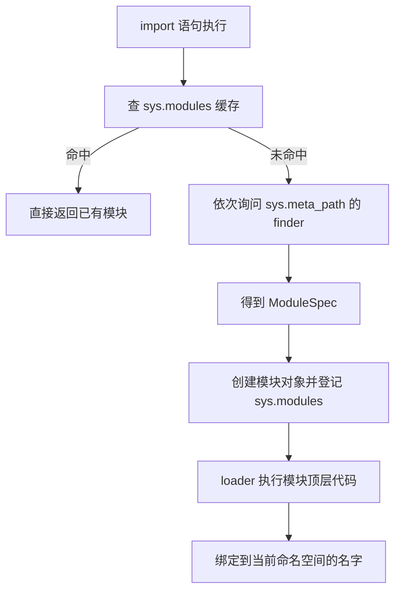
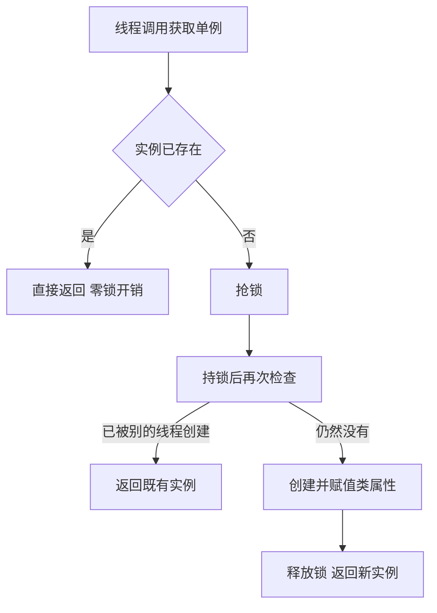
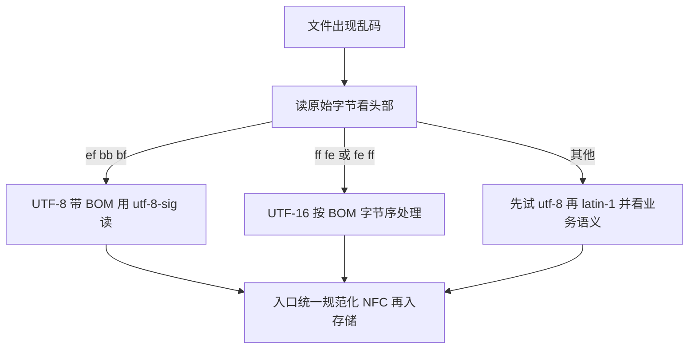
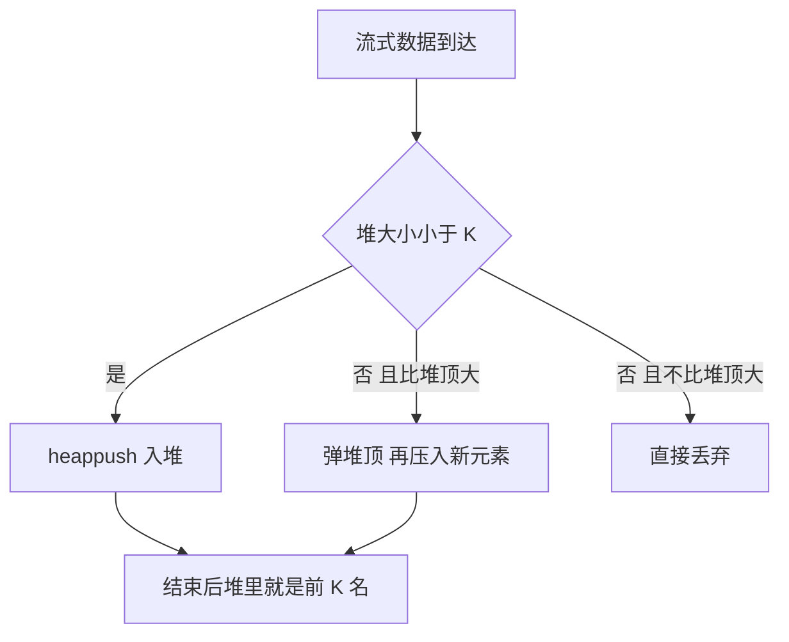
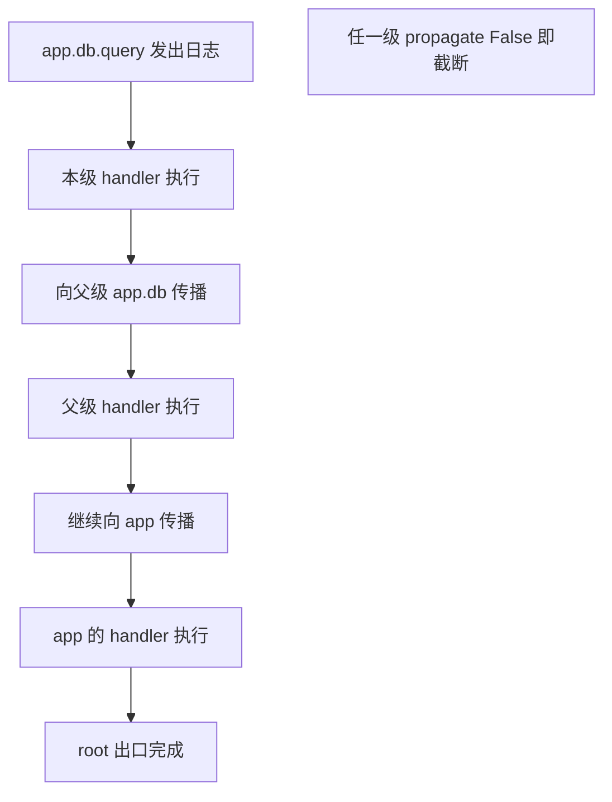
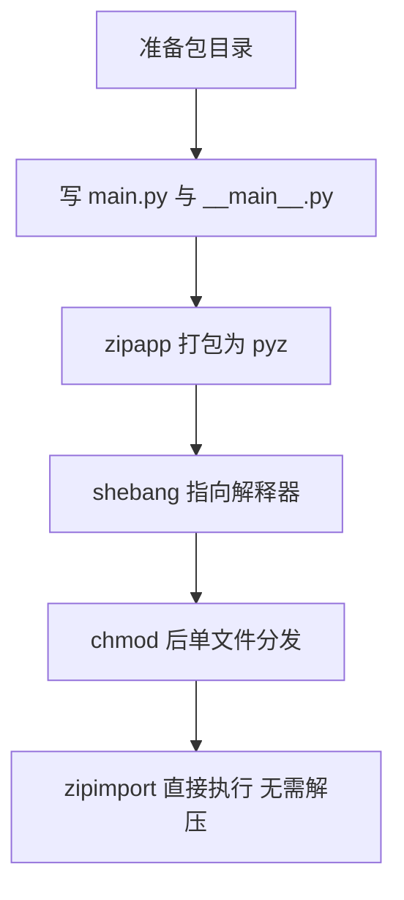
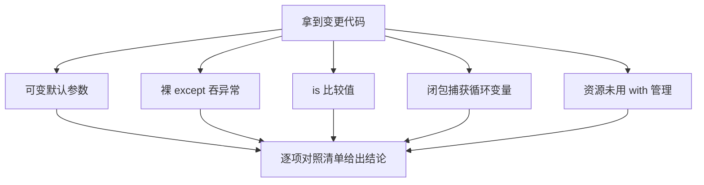
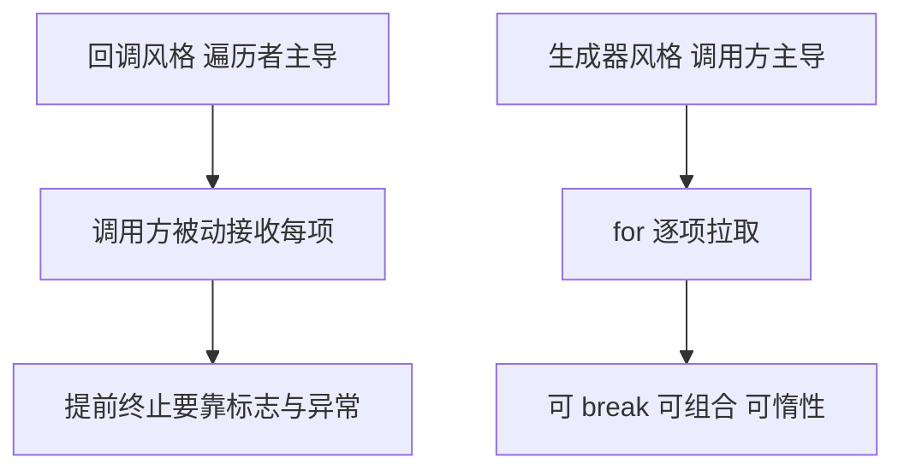

# 第 1 类 · 语言核心与底层(d)

> 本部分聚焦「工程级语言实践」:import 系统与模块治理、全局状态与依赖注入、字符串编码实战、容器选型、inspect 与动态调用、日志与时间处理、性能与内存工具、分发打包,以及代码规范、评审与重构的团队实践。
> 关注点从「语言机制」转向「机制如何支撑可维护的生产代码」。
> 所有代码仅用标准库、可直接运行;每题末尾附追问。

### Q481 · import 的完整流程:finder 与 loader

> 难度:★★★★ | 标签:import, 模块

**问**:import 一条语句背后经过哪几步?ModuleSpec、finder、loader 各自的职责是什么?

**答**:五步:1) 查 sys.modules 缓存,命中直接返回;2) 依次询问 sys.meta_path 里的 finder,每个 finder 尝试产出 ModuleSpec(模块的元数据:名字、origin 路径、loader);3) 拿到 spec 后创建模块对象并登记进 sys.modules(先登记再执行,这是循环导入时能拿到「半成品模块」的原因);4) loader.exec_module 执行模块顶层代码,填充模块命名空间;5) 把模块对象绑定到当前命名空间的名字上。理解这条流水线才能解释循环导入、懒加载、meta_path 拦截等所有导入问题。

```python
# file: code/01_语言核心与底层/q481_import_flow.py
import importlib.util
import sys

def explain(name):
    spec = importlib.util.find_spec(name)
    print(f"module {name}:")
    print("  origin :", spec.origin)
    print("  loader :", type(spec.loader).__name__)
    print("  cached :", spec.cached)

if __name__ == "__main__":
    print("meta_path finders:")
    for f in sys.meta_path:
        print("  -", f.__name__ if isinstance(f, type) else type(f).__name__)
    explain("json")
    m = __import__("json")
    print("registered in sys.modules:", sys.modules["json"] is m)
```

**追问**:1) 为什么模块对象在执行前就进 sys.modules?——保证循环导入时另一方 import 拿到的是同一个(半初始化的)模块对象而不是再次触发导入,递归导入因此不死循环但可能 AttributeError。2) 循环导入为什么有时只报 AttributeError?——半初始化模块里尚未定义的属性访问得到 AttributeError;若在模块顶层反过来调用对方还没执行的函数,才升级为 ImportError(cannot import from partially initialized module)。3) finder/loader 的职责怎么分?——find_spec 产出 spec(名字、loader、origin),loader.create_module 建命名空间、exec_module 执行代码体,导入机制随后写 sys.modules 并把模块挂到父包属性上。4) 生产陷阱?——__init__.py 塞重初始化加剧循环导入;热重载工具「删 sys.modules 再 import」造成同名类两个对象共存,isinstance 与 pickle 全部失效。

### Q482 · sys.meta_path:自定义导入拦截

> 难度:★★★★ | 标签:import, meta_path

**问**:如何在 import 层面禁止某些模块被加载?自定义 MetaPathFinder 要实现什么?

**答**:把自定义 finder 插到 sys.meta_path 最前面,实现 `find_spec(fullname, path, target)`:要拦截就抛 ImportError 或返回一个带 None loader 的 spec,放行就返回 None 让后续 finder 继续。这是实现导入白名单/黑名单、按需重定向模块、导入计数的标准机制;插件沙箱、冻结环境(禁用网络模块)都靠它。注意 finder 只在「sys.modules 未命中」时被询问,已导入的模块拦不住。

```python
# file: code/01_语言核心与底层/q482_meta_path_finder.py
import importlib.abc
import sys

BANNED = {"this"}          # 以 this 模块为例:策略禁止导入

class Blocker(importlib.abc.MetaPathFinder):
    def find_spec(self, fullname, path=None, target=None):
        root = fullname.split(".")[0]
        if root in BANNED:
            raise ImportError(f"{root} is banned by policy")
        return None                      # 放行:交给后续 finder

if __name__ == "__main__":
    sys.meta_path.insert(0, Blocker())
    import json                          # 正常模块不受影响
    print("json ok")
    try:
        import this                      # 被 finder 拦截
    except ImportError as e:
        print("blocked:", e)
    sys.meta_path.pop(0)
    print("finder removed")
```

**追问**:1) find_spec 抛 ImportError 和返回 None 的区别?——返回 None 是「我不管,问下一个 finder」;抛异常是「我管,且禁止导入」,异常直接冒给 import 语句。2) 为什么拦截放在 meta_path 而不是 sys.path_hooks?——meta_path finder 先于一切 path 查找执行,能拦截任意模块名(含内置),适合审计、重定向与沙箱;path_hooks 只作用于 sys.path 的路径条目。3) 导入的完整解析链?——先查 sys.modules 缓存,再按序执行 meta_path(BuiltinImporter→FrozenImporter→PathFinder)的 find_spec,全部 None 则 ModuleNotFoundError;命中后走 loader 完成 create/exec。4) 生产陷阱?——第三方 finder 异常中断整条导入链,要 fail-soft(except 后返回 None);用户代码把恶意 finder 插到 meta_path 头部即劫持全部 import。



### Q483 · importlib.reload 热重载的坑

> 难度:★★★★ | 标签:import, reload

**问**:改了模块源码后 importlib.reload 能热更新吗?为什么重载后旧对象还在被引用?

**答**:reload 会重新执行模块顶层代码、用新值覆盖模块字典,但有两个必然的坑:1) reload 前从模块拿出去的引用(类、函数、可变状态)仍指向旧对象,「import 一次到处用」的代码不会自动切换;2) 顶层重新执行意味着可变全局状态被重置,模块里 `ITEMS = []` 会让旧列表连同其中的数据一起失联。可靠的工程做法是:热更新只用于开发调试(配合 IPython autoreload 或 uvicorn --reload 这类进程级重启),生产配置用「读文件→重建对象→原子替换」而不是 reload;跨模块引用类和函数时,统一从模块属性访问而不是 from-import 缓存。

```python
# file: code/01_语言核心与底层/q483_reload_pitfalls.py
import importlib
import os
import sys
import tempfile

def write_module(path, value_expr):
    with open(path, "w", encoding="utf-8") as f:
        f.write(f"VALUE = {value_expr}\nITEMS = []\n")

if __name__ == "__main__":
    d = tempfile.mkdtemp()
    path = os.path.join(d, "hotmod.py")
    write_module(path, "1")
    sys.path.insert(0, d)
    import hotmod
    hotmod.ITEMS.append("kept by reference")

    write_module(path, "2")               # 模拟修改源码
    importlib.reload(hotmod)              # 重新执行模块顶层
    print("VALUE reloaded:", hotmod.VALUE)
    print("ITEMS after reload:", hotmod.ITEMS)   # 顶层重跑:旧列表连同数据失联
    print("reload returns same module:", importlib.reload(hotmod) is hotmod)
    sys.path.pop(0)
```

**追问**:1) reload 会重新执行被 import 的子模块吗?——不会,sys.modules 里已有的子模块直接复用;要级联重载需要自己按依赖序逐个 reload,这正是热重载工具复杂的根源。2) reload 后旧引用为什么还是旧对象?——reload 在原模块对象上重跑代码体,sys.modules 条目不变;其他模块 from-import 拿走的名字仍指向旧对象,只有通过模块属性访问才能看到新值。3) 命名空间怎么处理?——在原 __dict__ 上重执行模块体,新代码不再定义的旧名字会残留(不清空),幽灵属性是 reload 特有的坑。4) 生产陷阱?——reload 后类对象身份变化,isinstance/pickle 失效;开发图省事用 reload 调试,把不可复现状态带上生产——工程上应使用进程级重启。

### Q484 · 相对导入与绝对导入的陷阱

> 难度:★★★☆ | 标签:import, 包

**问**:为什么 `from . import x` 在脚本直接运行时炸 ImportError?入口代码该怎么写?

**答**:相对导入依据模块的 `__package__` 属性定位包,而脚本直接运行时该模块的 __name__ 是 __main__、__package__ 是空,相对导入无从解析,报 "attempted relative import with no known parent package"。规范:入口脚本(以及 -m 的目标模块)只用绝对导入;包内模块用相对导入表达「包内依赖」更利于重命名。另一个高频坑:顶层目录的模块直接跑没问题,一旦被包外代码 import,`import helper` 会因为 sys.path 里没有包根而失败——统一用绝对导入 + 安装为包(pip install -e .)最稳。

```python
# file: code/01_语言核心与底层/q484_relative_import.py
import os
import subprocess
import sys
import tempfile

RUNNER = """
from . import helper            # 包内相对导入
def run():
    return helper.help()
"""

HELPER = """
def help():
    return "helped"
"""

INIT = "from . import helper\n"

SCRIPT = """
import sys
sys.path.insert(0, {root!r})
from pkg import runner          # 入口:绝对导入
print("runner ->", runner.run())
"""

if __name__ == "__main__":
    root = tempfile.mkdtemp()
    pkg = os.path.join(root, "pkg")
    os.makedirs(pkg)
    for name, src in (("__init__.py", INIT), ("helper.py", HELPER), ("runner.py", RUNNER)):
        with open(os.path.join(pkg, name), "w", encoding="utf-8") as f:
            f.write(src)
    script = os.path.join(root, "entry.py")
    with open(script, "w", encoding="utf-8") as f:
        f.write(SCRIPT)

    result = subprocess.run([sys.executable, script], capture_output=True, text=True)
    print("stdout:", result.stdout.strip())
    tail = result.stderr.strip().splitlines()[-1] if result.stderr else "(none)"
    print("stderr tail:", tail)
```

**追问**:1) `python -m pkg.runner` 与 `python pkg/runner.py` 的本质区别?——前者以包成员身份运行,__package__ 正确、相对导入可用;后者按顶层脚本运行,__package__ 为空、相对导入必炸。2) 相对导入在脚本模式为什么必然失败?——相对导入按 __package__ 解析父包,脚本模式 __name__ == "__main__" 且 __package__ 为空,越出顶层即 "attempted relative import with no known parent package"。3) -m 的底层机制?——runpy 以包成员身份执行模块并设置 __package__,IMPORT_NAME/IMPORT_FROM 沿包链定位;sys.path[0] 也要换成 cwd 而不是脚本目录。4) 生产陷阱?——cron/运维脚本直接传模块文件路径执行,相对导入全断,统一用 -m 或入口脚本;tests 里混两种启动方式导致 import 路径不一致。

### Q485 · sys.path 治理:污染来源与 -m 运行

> 难度:★★★☆ | 标签:import, sys.path

**问**:sys.path 里的条目都是哪来的?为什么 `python x.py` 和 `python -m pkg.mod` 的导入行为不同?

**答**:来源按序:脚本所在目录(或 -m 时的当前目录)、PYTHONPATH 环境变量、安装时的 site-packages。污染来源主要是二和三的混用:把工程根塞进 PYTHONPATH 会让本应安装的包被源码目录遮蔽。`python x.py` 把脚本目录放最前——好处是相对资源好找,坏处是脚本目录里的 stdlib 同名文件(如 logging.py)会遮蔽标准库,即「名字遮蔽」事故。`python -m pkg.mod` 把当前目录放最前并以模块身份运行,相对导入可用、且与安装后的运行行为一致,是工程项目的推荐入口。

```python
# file: code/01_语言核心与底层/q485_sys_path.py
import os
import sys

if __name__ == "__main__":
    print("cwd:", os.getcwd())
    print("sys.path[0]:", sys.path[0])
    print("PYTHONPATH entries:", os.environ.get("PYTHONPATH", "(unset)"))
    print("safe_path flag:", getattr(sys.flags, "safe_path", "n/a before 3.11"))
    print("total entries:", len(sys.path))
    shadow = [p for p in sys.path[:3]]
    print("first three search locations:", shadow)
```

**追问**:1) 模块名与第三方包撞名(自己的 email.py)为什么危险?——sys.path[0] 优先级最高,自己的文件遮蔽标准库 email,所有依赖它的导入(如 smtplib)连锁损坏;排查手段是打印模块的 __file__。2) sys.path 的污染源有哪些?——脚本目录(sys.path[0])、PYTHONPATH、site 初始化的 site-packages、.pth 文件、user site;前两个最难控制,容器与 CI 里要显式清理。3) 解析的底层顺序?——先查 sys.modules 缓存,再 meta_path finder,最后逐个尝试 sys.path 条目;首个命中者赢,所以「遮蔽」由路径顺序决定而与文件新旧无关。4) 生产陷阱?——部署包把本地同名脚本一起打包遮蔽标准库;调试用 `import mod; print(mod.__file__)` 与 sys.path 快照定位遮蔽源。

### Q486 · 模块单例:import 天然单例与状态治理

> 难度:★★★☆ | 标签:模块, 单例

**问**:为什么说「模块就是单例」?模块级可变全局状态在生产里会引发什么问题?

**答**:每个模块只在首次 import 时执行一次,之后所有 importer 从 sys.modules 拿同一个对象——所以模块级变量天然是全局单例,双检锁单例很多时候只是把这件事显式化。代价:全局可变状态让调用顺序影响行为、测试之间互相污染、多进程 fork 后各自副本不一致、隐藏了「谁在读写它」。治理原则:模块级只放不可变常量与纯函数;必须可变的状态收敛到一个显式的 context/config 对象;需要跨请求隔离的(web 场景)用 contextvars。

```python
# file: code/01_语言核心与底层/q486_module_singleton.py
import sys

import collections
import collections as collections_alias

if __name__ == "__main__":
    print("module identity stable:", collections is collections_alias)
    print("cached in sys.modules:", sys.modules["collections"] is collections)
    print("same module object for every importer — this is the singleton")

    state = {"calls": 0}              # 演示:模块级可变状态的全局性

    def get_state():
        state["calls"] += 1
        return dict(state)

    print(get_state(), get_state())
```

**追问**:1) 多进程部署时模块单例还成立吗?——每个进程独立初始化一份,「单例」只在进程内成立;跨进程共享要靠外部存储,这也解释了 fork 后内存状态各不相干。2) 为什么 import 缓存是「天然单例」?——sys.modules 是进程级登记表,首次 import 初始化一次,后续全部命中缓存;单例语义免费,但代价是与导入系统耦合(循环导入、测试隔离都变难)。3) fork 与模块状态的关系?——子进程继承父进程的 sys.modules 快照与全部模块状态,fork 后各自演化;fork 前的未 flush 连接、未完成任务都被复制,所以 pre-fork 模型要 gc.freeze + 关闭共享资源。4) 生产陷阱?——测试并行读写模块级可变状态互相污染;正确姿势是显式单例类 + 初始化入口,或依赖注入替代隐式全局。

### Q487 · 依赖注入:摆脱模块级全局状态

> 难度:★★★★ | 标签:设计, 可测试性

**问**:代码里到处 `import settings` 读全局配置,为什么是坏味道?依赖注入怎么解?

**答**:直接 import 全局有三个问题:测试要 monkeypatch 全局、并行测试互相污染、依赖关系不可见(函数签名看不出来它依赖时钟/配置/数据库)。依赖注入把依赖从「模块内部隐式获取」改为「构造时显式传入」:RateLimiter 接收 clock 参数,生产传真时钟、测试传假时钟,行为可控且无全局补丁。轻量实现只需要构造函数参数;要自动装配时再引入容器或 pytest fixture。判断标准:单测里是否需要 patch 模块属性——需要就说明依赖该注入了。

```python
# file: code/01_语言核心与底层/q487_dependency_injection.py
import time

class Clock:
    def now(self) -> float:
        return time.time()

class FakeClock(Clock):
    def __init__(self, fixed):
        self.fixed = fixed

    def now(self) -> float:
        return self.fixed

class RateLimiter:
    def __init__(self, clock: Clock, limit=2, window=1.0):
        self.clock = clock
        self.limit = limit
        self.window = window
        self.hits = []

    def allow(self) -> bool:
        now = self.clock.now()
        self.hits = [h for h in self.hits if now - h < self.window]
        if len(self.hits) >= self.limit:
            return False
        self.hits.append(now)
        return True

if __name__ == "__main__":
    rl = RateLimiter(Clock())
    print("real clock:", [rl.allow() for _ in range(3)])

    fake = RateLimiter(FakeClock(1000.0))
    print("fake clock:", [fake.allow() for _ in range(3)])
    fake2 = RateLimiter(FakeClock(1000.0 + 5))    # 时间前进:窗口滑过
    print("after window:", [fake2.allow() for _ in range(3)])
```

**追问**:1) contextvars 与依赖注入的关系?——contextvars 是「隐式传参」的受控形态:适合横切的请求上下文(日志 id、事务),但业务依赖仍应显式注入,二者互补而非替代。2) 为什么模块级全局状态是测试之敌?——全局状态在测试间泄漏,需要 reset fixture 且并行测试互相干扰;DI 把依赖变成参数,隔离显式、可换 fake、可按请求实例化。3) contextvars 的传播机制?——每个线程与每个 asyncio Task 持有独立的 Context 拷贝(PEP 567):Task 创建时复制快照,任务内部 set 对外部不可见,这是「按请求隔离」的地基。4) 生产陷阱?——把 contextvars 当「全局变量 2.0」滥用,语义无人看懂;DI 容器里 mock 越挂越多;手写单例与框架 request scope 生命周期冲突。

### Q488 · weakref.finalize 与对象生命周期钩子

> 难度:★★★★ | 标签:weakref, 资源管理

**问**:__del__ 写清理逻辑有什么坑?weakref.finalize 为什么更可靠?

**答**:finalize(register, callback, *args) 把「对象死亡时执行 callback」注册到独立对象上,它不依赖 __del__:callback 与参数被 finalize 对象持有而不是被目标对象持有,不存在「复活对象」问题,异常会打印而不是静默,且支持 atexit 兜底与显式调用(detach 语义)。__del__ 的坑:解释器关闭期全局名可能已清空、异常被忽略、对象复活导致二次终结不可预期、以及与 GC 周期回收的时序耦合。生产清理(临时文件、句柄、C 扩展资源)优先 finalize;必须 __del__ 时只做最小且不依赖全局的动作。

```python
# file: code/01_语言核心与底层/q488_weakref_finalize.py
import weakref

class TempFile:
    pass

def cleanup(name):
    print(f"[finalize] cleaning {name}")

if __name__ == "__main__":
    f = TempFile()
    ref = weakref.finalize(f, cleanup, "tmp123")
    print("alive:", ref.alive)
    del f                          # 对象回收,回调被调用
    print("alive after del:", ref.alive)
    ref()                          # 再次调用:已死,安全 no-op
    print("calling a dead finalizer is safe")

    g = TempFile()
    ref2 = weakref.finalize(g, cleanup, "tmp456")
    ref2()                         # 也可以主动触发并解除注册
    print("alive after manual call:", ref2.alive)
```

**追问**:1) finalize 的回调里能引用目标对象吗?——不能,闭包或参数里引用目标对象会让目标永不回收(回调先于对象死亡而被持有),这是 finalize 使用的头号陷阱。2) finalize 比 __del__ 好在哪?——独立回调对象持弱引用不阻止回收、保证恰好执行一次、可手动调用/detach 提前注销;__del__ 时机不定、异常被忽略打印、还要面对解释器退出时半拆除的模块状态。3) finalize 的底层结构?——注册表持有 (弱引用, callback, args, state),靠弱引用回调感知目标死亡,解释器退出时对存活的 finalize 再统一触发一次兜底。4) 生产陷阱?——给本应长存的对象(全局缓存)注册清理,回调永不触发或时机错乱;fork 后子进程继承注册表,对已不存在的资源重复清理。

### Q489 · 线程安全单例:双检锁与模块级

> 难度:★★★★ | 标签:单例, 线程安全

**问**:多线程下的懒加载单例为什么需要两次检查实例是否为 None?模块级单例还需要加锁吗?

**答**:双检锁:第一次无锁检查是快路径(实例已存在时零开销),持锁后的第二次检查防止「两个线程都通过了第一次检查」时创建两个实例——第一次检查与赋值之间存在竞态窗口。Python 里还要注意赋值本身的原子性由 GIL 保证,但「检查+创建+赋值」是复合操作,必须整体置于锁内。模块级单例(直接放模块变量)导入时有 import 锁保护,天然安全,缺点是无法懒加载、不利于测试替换。要求严格按初始化顺序时,双检锁 + Barrier 测试验证。

```python
# file: code/01_语言核心与底层/q489_thread_safe_singleton.py
import threading

class Config:
    _instance = None
    _lock = threading.Lock()

    def __new__(cls):
        if cls._instance is None:            # 第一次检查:无锁快路径
            with cls._lock:                  # 只有一个线程能进来
                if cls._instance is None:    # 双检:防竞态重复创建
                    cls._instance = super().__new__(cls)
        return cls._instance

if __name__ == "__main__":
    results = []
    barrier = threading.Barrier(4)

    def worker():
        barrier.wait()                       # 4 线程同时起跑,放大竞态
        results.append(Config() is Config())

    threads = [threading.Thread(target=worker) for _ in range(4)]
    for t in threads:
        t.start()
    for t in threads:
        t.join()
    print("all same instance:", all(results), "checks:", len(results))
```

**追问**:1) CPython 里能不能省掉锁?——不能省双检,但可以换思路:依赖 GIL 的单条字节码原子性(如模块 import 时的初始化),或用 threading.once 式的 Event 门闩;语义上「锁住创建路径」最不依赖实现细节。2) 双检锁为什么必须两次检查?——第一次检查让已初始化后的调用走无锁快路径;进入锁后的第二次检查确认排队竞争者之前没人完成创建;少一次就会重复构造或白等。3) 可见性的底层边界?——CPython 在 GIL 下单条字节码原子、共享对象可见,但 check-then-act 是复合操作不保证;Java volatile 这类内存序语义在 Python 没有直接对应物,正确性必须靠锁。4) 生产陷阱?——构造带副作用(注册监听器)时双构造导致重复注册;async 代码误用 threading.Lock 阻塞事件循环,要换 asyncio.Lock;模块 import 路径本身串行,简单场景不需要双检。



### Q490 · MappingProxyType 与只读视图

> 难度:★★★☆ | 标签:不可变, API 设计

**问**:把内部 dict 直接 return 给调用方有什么风险?types.MappingProxyType 与 copy 的区别?

**答**:直接暴露内部 dict 意味着任何人都能改它,而且改的是你的内部状态——防御性拷贝(list(d))防住了修改,但断开了实时性且每次拷贝有成本。MappingProxyType 是「活的只读视图」:任何写操作抛 TypeError,底层字典更新时视图实时反映,零拷贝。典型用法:类属性 __dict__ 本身就是它(所以类的命名空间只读)、对外暴露配置表/注册表。注意它只防写不防底层数据结构的「浅可变」:值是 list 时,拿到视图的人依然能改那个 list。

```python
# file: code/01_语言核心与底层/q490_mapping_proxy.py
import types

class Registry:
    _data = {"a": 1}
    PUBLIC = types.MappingProxyType(_data)   # 活的只读视图

if __name__ == "__main__":
    view = Registry.PUBLIC
    print(view["a"])
    try:
        view["b"] = 2
    except TypeError as e:
        print("read-only:", e)
    Registry._data["b"] = 2                  # 内部仍可写
    print("view follows updates:", view["b"])
    print("underlying type:", type(view).__name__)
    print("still shallow: values can be mutable containers")
```

**追问**:1) frozenset 和 MappingProxyType 的共同点?——都是「把可变结构的只读契约编码进类型」:frozenset 不可哈希化地冻结内容,proxy 冻结映射的写入口,二者都不做拷贝。2) 只读视图保护了什么、没保护什么?——挡住调用方的写操作(写抛 TypeError);但底层 dict 仍可被所有者修改,读者会看到变化——它是单向只读契约,不是深不可变。3) proxy 的底层机制?——MappingProxyType 包装 dict 引用转发读操作,写一律 TypeError;type.__dict__ 就是它,类命名空间因此对外只读。4) 生产陷阱?——把 proxy 当「内容不可变」传出去,所有者原地修改后下游行为漂移;序列化要先 dict(proxy) 转换;测试里通过 getattr 拿到底层 dict 原地改,污染其他用例。

### Q491 · Unicode 规范化:NFC/NFD 与相等性

> 难度:★★★★ | 标签:Unicode, 字符串

**问**:两个「看起来一样」的字符串为什么不相等?比较用户输入的字符串前应该做什么?

**答**:Unicode 允许同一个字形有两种编码:预组合(é 一个码点)与分解(e + 组合重音两个码点),用户输入来源不同(键盘、剪贴板、macOS 文件名)会混用两种形式,直接 == 会假阴性。处理规则:在系统边界统一 `unicodedata.normalize("NFC", s)`(存储/比较用 NFC 最普遍),比较用 normalize 后的值;文件名场景 macOS 是 NFD。is_normalized 可避免重复规范化。除规范化外,大小写折叠用 casefold()(比 lower 更激进,处理德语 ß)才是无差别比较的正解。

```python
# file: code/01_语言核心与底层/q491_unicode_normalization.py
import unicodedata

s1 = "caf\u00e9"          # 预组合:é 是单个码点
s2 = "cafe\u0301"         # 分解:e + 组合重音两个码点

if __name__ == "__main__":
    print("codepoints s1:", [hex(ord(c)) for c in s1])
    print("codepoints s2:", [hex(ord(c)) for c in s2])
    print("direct equality:", s1 == s2)

    n1 = unicodedata.normalize("NFC", s1)
    n2 = unicodedata.normalize("NFC", s2)
    print("NFC equality:", n1 == n2, "len:", len(n1))

    print("NFD len:", len(unicodedata.normalize("NFD", s1)))
    print("already NFC:", unicodedata.is_normalized("NFC", n1))
    print("casefold:", "STRASSE".casefold() == "straße".casefold())
```

**追问**:1) NFC 和 NFD 该选哪个存库?——统一即可,主流选 NFC(体积小、兼容多数输入);关键是「入口归一化一次」,而不是在每次比较处反复转换。2) 为什么「看起来一样」的字符串不相等?——同一字形有组合字符与预合成字符两种编码(macOS 文件系统产 NFD、网页输入多为 NFC),== 比较码点序列,必须 unicodedata.normalize 后再比。3) 四种 form 的底层差异?——NFD 按规范分解、NFC 分解后重组,NFKC/NFKD 额外做兼容分解(上标²→2、连字);规范化按 UAX #15 实现,规范等价只在 normalize 后才体现。4) 生产陷阱?——用户名/标签因规范化形式不同绕过唯一约束;NFKC 误用于「清洗」用户输入会改变语义;数据库层校验不了规范化,必须在应用入口统一。

### Q492 · 编码实战:BOM 与 utf-8-sig

> 难度:★★★☆ | 标签:编码, UTF-8

**问**:读文件开头多了个 \ufeff 是什么?处理第三方来源的文件如何防编码事故?

**答**:\ufeff 是 UTF-8 BOM(字节 ef bb bf),Windows 工具(记事本、Excel 导出)常写入;用 utf-8 读会把它当普通字符留在内容开头,污染第一个字段(密钥比较失败、CSV 首列名对不上)。解法:读可能带 BOM 的文件用 `encoding="utf-8-sig"`(有 BOM 剥掉,没有也无害),写给 Windows 生态时也用它。更广的防事故原则:读写永远显式传 encoding(禁止依赖 locale 默认)、二进制模式读前 4 字节探测 BOM、乱码排查先看原始字节再谈解码。

```python
# file: code/01_语言核心与底层/q492_bom_encoding.py
import os
import tempfile

if __name__ == "__main__":
    text = "héllo"
    path = os.path.join(tempfile.mkdtemp(), "bom.txt")
    with open(path, "w", encoding="utf-8-sig") as f:   # 写入 BOM
        f.write(text)

    with open(path, "rb") as f:
        raw = f.read(10)
        print("raw head:", raw)                        # 开头是 ef bb bf

    with open(path, encoding="utf-8") as f:            # 忘记 -sig:BOM 留在内容里
        print("utf-8 sees:", repr(f.read()))

    with open(path, encoding="utf-8-sig") as f:        # 正确:BOM 被剥掉
        print("utf-8-sig sees:", repr(f.read()))
```

**追问**:1) UTF-16 的 BOM 有什么特殊性?——它还决定字节序:ff fe 是小端、fe ff 是大端,Python 的 utf-16 编解码器按 BOM 自动切换,跨平台交换文本时建议统一转 UTF-8。2) UTF-8 为什么也有 BOM?——U+FEFF 对 UTF-8 只是「签名」(EF BB BF),无字节序含义;Windows 工具爱加它,Python 用 utf-8 解码后文本首字符变成 \ufeff。3) 编解码器层怎么处理?——encoding="utf-8-sig" 解码剥 BOM、编码加 BOM;直接 utf-16 解码无 BOM 流会按大端猜;JSON 解析失败「意外字符」多半是 BOM 残留。4) 生产陷阱?——Excel 导出的 CSV 带 BOM,第一列名变成 "\ufeffid";HTTP 响应体误带 BOM 破坏前端解析;统一「读 utf-8-sig、写 utf-8」或对外一律 UTF-8 无 BOM。



### Q493 · bytearray 与 memoryview:零拷贝处理

> 难度:★★★★ | 标签:内存, 二进制

**问**:处理大块二进制数据时,bytes、bytearray、memoryview 三者怎么配合?

**答**:bytes 不可变,适合存与哈希;bytearray 可变,适合就地拼装(避免 bytes 反复拼接的拷贝);memoryview 是零拷贝窗口——对同一块缓冲创建多个视图、切片不复制、struct.unpack_from 直接按偏移读,协议解析和环形缓冲区靠它把拷贝次数压到最低。切片视图写穿到底层(mv[0]=9 会改 bytearray),所以释放前底层不能 resize。性能敏感代码的检查点:是否在热循环里 bytes += 、是否有大切片仅为了读几个字节——都可以换成视图与 unpack_from。

```python
# file: code/01_语言核心与底层/q493_memoryview_zero_copy.py
import struct

if __name__ == "__main__":
    payload = bytearray(b"\x00" * 8)
    view = memoryview(payload)
    view[0:4] = b"\x01\x02\x03\x04"       # 写穿到底层缓冲
    print("payload:", payload.hex())

    struct.pack_into(">I", payload, 4, 1024)
    print("parsed:", struct.unpack_from(">I", payload, 4))

    mv = view[0:4]                        # 切片不拷贝,共享同一块内存
    mv[0] = 9
    print("after view write, payload[0]:", payload[0])

    ro = bytes(payload)                   # 真正的拷贝在这里才发生
    print("snapshot:", ro.hex(), len(ro))
    mv.release()                          # 先释放子视图
    view.release()                        # 再释放父视图,底层才可 resize
```

**追问**:1) memoryview 持有期间对 bytearray resize 会怎样?——抛 BufferError:现有导出未释放,底层缓冲被视图锁定;必须先 release 所有视图,这也是「忘 release」导致 BufferError 的根因。2) memoryview 为什么零拷贝?——通过 buffer 协议 export 直接引用底层内存,切片也是视图不复制;代价是生命周期绑定——视图活着底层就不能动。3) buffer 协议的底层结构?——exporter(实现 __buffer__)向 view 提供 Py_buffer(指针、format、shape);bytes/bytearray/array/numpy 都是 exporter,struct.unpack_from 可直接读视图。4) 生产陷阱?——视图未 release 导致 bytearray 缩容失败、BufferError 隐藏真实泄漏;把 view 传给 C 扩展后底层对象先死(必须保引用);只读 bytes 上误用 cast 写入。

### Q494 · bisect:有序表的二分插入

> 难度:★★★☆ | 标签:bisect, 算法

**问**:向有序列表插入元素并保持有序,bisect 为什么比「append 后 sort」好?bisect_left 和 bisect_right 的区别?

**答**:bisect 用二分查找定位 O(log n),insort 定位后 memmove 插入 O(n),但全程保持有序、无重排;append+sort 是 O(n log n) 且破坏「永远有序」的不变式,不支持中途查询。bisect_left 找「第一个 ≥ x 的位置」(相同时插到左边),bisect_right 找「第一个 > x 的位置」(相同时插到右边)——去重插入用 left(存在则不插)、统计 `< x` 的个数用 left、`≤ x` 用 right。经典应用还有分数等级表:用 bisect 在断点列表里定位区间,代替一串 if-elif。

```python
# file: code/01_语言核心与底层/q494_bisect.py
import bisect

if __name__ == "__main__":
    scores = [60, 70, 80, 90]
    bisect.insort(scores, 75)
    print(scores)

    print("left of 80:", bisect.bisect_left(scores, 80))
    print("right of 80:", bisect.bisect_right(scores, 80))
    print("left of 75 :", bisect.bisect_left(scores, 75))

    def grade(score, breakpoints=[60, 70, 80, 90]):
        return "FDCBA"[bisect.bisect(breakpoints, score)]

    print([grade(s) for s in [59, 60, 71, 100]])

    def insert_unique(lst, x):
        pos = bisect.bisect_left(lst, x)
        if pos == len(lst) or lst[pos] != x:
            lst.insert(pos, x)
        return pos

    uniq = [1, 3, 5]
    insert_unique(uniq, 4)
    insert_unique(uniq, 4)
    print("unique insert:", uniq)
```

**追问**:1) 频繁在头部插入用什么?——bisect 依赖连续内存的 list,头部插入是 O(n);高频头部操作换 deque(两端 O(1))或放弃有序数组改用堆/跳表结构。2) bisect.insort 为什么是 O(n)?——二分只负责找位置 O(log n);list 底层连续数组插入必须 memmove 搬移元素,这才是大头——所以 insort 适合「低频插入、高频二分查询」。3) 二分的底层语义?——bisect_left/right 分别返回第一个可插入位/最后一个可插入位,决定相等元素插左边还是右边;3.10+ 支持 key 参数,免去构造 (key, item) 元组。4) 生产陷阱?——混用 append 破坏「始终有序」不变式,二分结果全错;把有序 list 当数据库索引用,数据量到百万级插入性能崩塌;相等元素的稳定插入方向选错导致重复键乱序。

### Q495 · heapq:优先队列与 Top-K

> 难度:★★★☆ | 标签:heapq, 算法

**问**:Top-K 为什么用小顶堆而不是排序?元组元素入堆时怎么避免比较到第二个字段?

**答**:维护 K 大的小顶堆:新元素比堆顶大才替换,全程 O(n log k) 时空,且适合流式数据(不必一次性载入);全排序是 O(n log n) 且要全量内存。堆顶是最小值,「最差的随时出去」留下前 K 大。元组比较问题:(priority, payload) 优先级相同时会比较 payload,字符串比没问题但不可比对象直接 TypeError;标准解法加自增序号 (priority, seq, payload) 打破平局——seq 唯一,永远轮不到比较 payload,还天然 FIFO。

```python
# file: code/01_语言核心与底层/q495_heapq_topk.py
import heapq
import itertools

if __name__ == "__main__":
    data = [9, 1, 8, 2, 7, 3, 6, 4, 5]
    print("largest 3:", heapq.nlargest(3, data))
    print("smallest 3:", heapq.nsmallest(3, data))

    heap = []                             # 流式 Top-3:小顶堆
    for x in data:
        heapq.heappush(heap, x)
        if len(heap) > 3:
            heapq.heappop(heap)
    print("top3 via heap:", sorted(heap, reverse=True))

    counter = itertools.count()           # 打破元组平局
    tasks = [(2, next(counter), "low"), (1, next(counter), "urgent"),
             (1, next(counter), "urgent2")]
    heapq.heapify(tasks)
    while tasks:
        print("run", heapq.heappop(tasks)[2])
```

**追问**:1) heapq 是线程安全的吗?——不是,堆只是列表上的算法约定;并发生产者消费者要用 queue.PriorityQueue(内部封装了锁与完成通知)。2) 为什么用数组不用树节点?——完全二叉堆映射到连续数组(i 与 2i+1/2i+2),缓存友好、无指针开销;siftup/siftdown 是 C 实现,nlargest/nsmallest 还做了 top-k 特化。3) heapreplace 与 pop+push 的差别?——heapreplace 先弹后推融合为一次调整,少一半比较且临时大小不变;heapq 是最小堆,最大堆用负号或 (key, counter, item) 技巧。4) 生产陷阱?——推入不可比对象(dict)TypeError,要用 (priority, count, item) 加自增计数器决胜且保证稳定;推入后修改元素优先级造成堆不变式被破坏——必须取出重推。



### Q496 · deque 与 array:结构选型

> 难度:★★☆☆ | 标签:容器, deque

**问**:list、deque、array 三者各自的甜点区在哪?maxlen 的 deque 解决什么问题?

**答**:list 是全能动态数组:随机访问 O(1)、尾部增删摊还 O(1),但头部插入 O(n)。deque 是双向链表块结构:两端增删 O(1),牺牲随机访问(O(n));maxlen 版自动丢弃旧元素,天然实现滑动窗口(最近 N 条日志、限流的请求队列)。array 是类型固定的紧凑数组:元素按 C 类型('i'、'd')存储,百万级同类型数值比 list 省内存 5-10 倍且可直接与二进制交互;但只能存一种类型,写入会强制转换或报错。选择口诀:随机访问选 list,两端操作选 deque,纯数值海量存储选 array/numpy。

```python
# file: code/01_语言核心与底层/q496_deque_array.py
from array import array
from collections import deque

if __name__ == "__main__":
    dq = deque(range(5), maxlen=5)
    dq.append(99)                         # 右进:左端自动挤出
    print(dq)
    dq.appendleft(0)                      # 左进:右端挤出
    print(dq)
    dq.rotate(2)                          # 旋转:环形缓冲语义
    print(dq)

    arr = array("i", [1, 2, 3])
    arr.append(4)
    print(arr, "itemsize:", arr.itemsize)
    try:
        arr.append(2.5)
    except TypeError as e:
        print("typed container:", e)
```

**追问**:1) deque 随机访问为什么是 O(n)?——内部是块级双向链表,定位第 i 个元素要从最近端逐块走;需要「两端快 + 随机访问也快」时选 sortedcontainers 这类分层数组结构。2) array 与 list 的选型标准?——array 紧密存 C 原生类型(每元素 4/8 字节),适合大数值流与 C 交互;list 存 PyObject* 指针,元素任意类型但有指针与对象开销;两者都是可变序列。3) deque 的底层结构?——定长块(~64 元素)组成双向链表加中央索引表,两端 append/pop O(1),maxlen 满员自动挤掉另一端,天然适合滑动窗口。4) 生产陷阱?——大流量随机读用 deque 性能塌方;deque(maxlen=n) 静默丢弃旧元素,在「不能丢」的场景是隐性 bug;array 与 C 交互忽略 itemsize/字节序导致数据错位。

### Q497 · inspect.signature:签名内省

> 难度:★★★☆ | 标签:inspect, 函数

**问**:运行时如何知道一个函数接受哪些参数、哪些是关键字-only、默认值是什么?

**答**:inspect.signature(func) 返回 Signature,其 parameters 是有序字典,每个 Parameter 带 name、kind(POSITIONAL_ONLY/POSITIONAL_OR_KEYWORD/KEYWORD_ONLY/VAR_POSITIONAL/VAR_KEYWORD)、default(缺省哨兵 empty)。在此基础上能做:参数校验(见 Q445)、生成 API 文档、构建通用代理与适配器。配套 bind/apply_defaults 把实参归一化为 arguments 字典,是所有「动态调用前先理解签名」需求的基石。注意 property、装饰过的函数要看 __wrapped__,C 函数部分能读但不可 bind。

```python
# file: code/01_语言核心与底层/q497_inspect_signature.py
import inspect

def transfer(amount, *, from_acc="A", to_acc="B", fee=0.0):
    return f"{from_acc} -> {to_acc}: {amount} fee={fee}"

if __name__ == "__main__":
    sig = inspect.signature(transfer)
    for name, param in sig.parameters.items():
        default = "REQUIRED" if param.default is inspect.Parameter.empty else param.default
        print(f"{name:10s} kind={param.kind.name:20s} default={default}")

    bound = sig.bind(100, to_acc="C")
    bound.apply_defaults()
    print("normalized:", dict(bound.arguments))
    print(transfer(*bound.args, **bound.kwargs))
```

**追问**:1) 怎么区分「没传默认值」和「默认值恰好是 None」?——Parameter.empty 是专用哨兵,`param.default is inspect.Parameter.empty` 才是缺省,不能用 None 判断。2) bind 相比手工拼参数强在哪?——Signature.bind 把任意调用形式归一成「参数名→值」映射,统一处理位置/关键字/默认值/*args/**kwargs/kw-only 各种声明,手工解析必漏边角。3) signature 的来源与限制?——inspect 沿 __signature__ 或代码对象反射构建;C 扩展函数没有 Python 帧时要靠 __text_signature__(ArgumentClinic 生成),否则拿到 (*args, **kwargs) 占位。4) 生产陷阱?——装饰器漏 wraps 使签名变 (*args, **kwargs),参数校验静默失效;Signature 不可变,replace 返回新对象,原地改签名无效。

### Q498 · Signature.bind 与动态调用

> 难度:★★★★ | 标签:inspect, 动态调用

**问**:从配置/请求里拿到一组 kwargs,如何安全地调用一个函数(多余参数要过滤、缺失参数要报错)?

**答**:裸 func(**kwargs) 遇到多余键直接 TypeError,且错误信息不友好。标准流程:取签名 → 按 sig.parameters 过滤掉目标函数不接受的键 → sig.bind(**accepted) 做完整校验(位置/关键字归属、必填缺失、重复传参都在此报错)→ apply_defaults 补齐 → func(*bound.args, **bound.kwargs)。这条流水线是配置驱动调用(CLI 分发、API handler 路由、任务队列参数解析)的通用骨架;bind 的价值在于「把调用协议的校验从运行时碰运气变成确定性预处理」。

```python
# file: code/01_语言核心与底层/q498_signature_bind.py
import inspect

def make_request(method, url, *, headers=None, timeout=30):
    return {"method": method, "url": url, "headers": headers or {}, "timeout": timeout}

CALL_SPEC = {"method": "GET", "url": "/api/items", "extra": "ignored by design"}

def call_with_mapping(func, spec):
    sig = inspect.signature(func)
    accepted = {k: v for k, v in spec.items() if k in sig.parameters}
    bound = sig.bind(**accepted)          # 缺失必填参数在这里报错
    bound.apply_defaults()
    return func(*bound.args, **bound.kwargs)

def volume(a, b, /, factor=1):            # 3.8 起支持 positional-only
    return a * b * factor

if __name__ == "__main__":
    print(call_with_mapping(make_request, CALL_SPEC))
    sig = inspect.signature(volume)
    bound = sig.bind(2, 3, factor=2)
    print("positional-only bind:", volume(*bound.args, **bound.kwargs))
```

**追问**:1) positional-only 参数(/)解决了什么?——让参数名成为实现细节,调用方不能写 a=1,重命名参数不破坏 API,内置函数如 len 就受益于此。2) bind 与 bind_partial 的差别?——bind 校验完整性,缺参抛 TypeError;bind_partial 允许缺参(后续补齐),两者都返回 BoundArguments;apply_defaults 再补默认值。3) 绑定算法的底层顺序?——按声明顺序处理 pos-only→pos-or-keyword→var-pos→kw-only→var-kw,冲突/多余参数抛 TypeError——等于用纯 Python 复刻了调用时字节码的参数打包逻辑。4) 生产陷阱?——把 bound.arguments 直接当 kwargs 透传丢失顺序语义,应 func(**bound.arguments) 或 func(*bound.args, **bound.kwargs);BoundArguments 复用前忘记重置。

### Q499 · get_type_hints:注解的运行时读取

> 难度:★★★☆ | 标签:typing, 注解

**问**:func.__annotations__ 和 get_type_hints(func) 有什么区别?字符串注解为什么要延迟求值?

**答**:__annotations__ 是原始存储:字符串形式的注解(前向引用 "MyClass"、from __future__ import annotations 下的全部字符串)原样躺着;get_type_hints 负责在函数的 globals 命名空间里求值,还原成真实类型对象,并处理 Optional 等语法糖。延迟求值的动机:前向引用不需要引号 hack、加速模块导入、规避循环导入。框架在运行时消费注解(pydantic/FastAPI)一律走 get_type_hints;注意 3.10+ 某些联合类型形式(如 int | None 的 __annotations__ 值)是 types.UnionType 而不是 typing.Union,判型要两者都兼容。

```python
# file: code/01_语言核心与底层/q499_get_type_hints.py
from typing import Dict, List, get_type_hints

def parse(data: "bytes") -> "Dict[str, int]":
    """字符串注解:运行时延迟求值"""
    return {}

def summarize(rows: List[Dict[str, float]], title: str = "report") -> str:
    return f"{title}: {len(rows)} rows"

if __name__ == "__main__":
    print("raw annotations:", parse.__annotations__)
    print("resolved:", get_type_hints(parse))
    hints = get_type_hints(summarize)
    print("rows origin:", hints["rows"].__origin__)
    print("title default preserved:", summarize.__defaults__)
```

**追问**:1) 为什么 dataclasses 和 pydantic 对注解求值时机敏感?——它们在类创建时读注解生成字段,前向引用的字段若 get_type_hints 时仍解析不到(循环导入)就报错,模块组织要保证类型定义先行。2) 为什么不能直接读 __annotations__?——注解可能是字符串(前向引用或 from __future__ import annotations),get_type_hints 负责 eval 解析(globalns/localns);裸读拿到字符串无法用于校验。3) 解析的底层机制?——__annotations__ 在类/模块创建时记录原始表达式;get_type_hints 递归展开 Optional/Annotated,名字缺失抛 NameError——所以前向引用必须在调用时可见。4) 生产陷阱?——循环导入让 get_type_hints 运行时 NameError 而不是 import 期;函数内取 hint 忘传 localns;3.10 不加 future 时混用运行时对象与字符串注解,工具行为分裂。

### Q500 · inspect.getsource 与运行时源码检查

> 难度:★★★☆ | 标签:inspect, 调试

**问**:如何在运行时打印任意函数的源码?这类能力有什么正经用途与限制?

**答**:inspect.getsource(obj) 通过 obj.__code__ 的文件名与行号回读源文件切片;getsourcelines 额外给起始行号,getdoc 取文档,getmodule 定位所属模块。正经用途:交互式调试(help() 底层)、框架生成文档、测试失败时打印被测函数上下文、notebook 的 ?? 魔法。限制:源码必须真实存在于磁盘(交互式输入、exec 出来的代码、C 扩展函数都拿不到)、pyc-only 部署会失败。用 try/except 包裹并降级为「只打印签名」是健壮写法。

```python
# file: code/01_语言核心与底层/q500_inspect_getsource.py
import inspect

def important_algorithm(x):
    """文档字符串也会被读取"""
    y = x * 2
    return y + 1

class Widget:
    def render(self):
        return "rendered"

if __name__ == "__main__":
    print(inspect.getsource(important_algorithm))
    print("doc:", inspect.getdoc(important_algorithm))
    print("render starts at line:", inspect.getsourcelines(Widget.render)[1])
    print("module:", inspect.getmodule(Widget).__name__)
    print("len source lines:", len(inspect.getsourcelines(Widget)[0]))
```

**追问**:1) 为什么装饰过的函数还能 getsource 到原始定义?——wraps 保留的 __wrapped__ 与 __module__/__qualname__ 让 inspect 沿链找到原始 code 对象的文件与行号;没有 wraps 的装饰器会定位到 wrapper 自己。2) getsource 的失败模式?——REPL/exec 生成的代码、C 扩展函数、打包环境(无源文件)、源码文件被改动(行号缓存失配)都会失败或给错行;linecache 有缓存,文件编辑后要 checkcache。3) 底层机制?——按 code.co_filename/co_firstlineno 通过 linecache 读文件切片;__wrapped__ 链让 inspect 回到最内层的原始 code 对象。4) 生产陷阱?——PyInstaller 等打包后源码不存在,运行时文档/help 功能崩;doctest 依赖源文本,重排版破坏用例;热路径频繁 getsource 首次有 IO 开销。

### Q501 · LoggerAdapter 与日志上下文注入

> 难度:★★★☆ | 标签:logging, 上下文

**问**:每条日志都手动拼 request_id 太啰嗦,logging 有什么内建机制自动附加上下文?

**答**:LoggerAdapter 包装 logger,持有 extra 字典;process() 钩子在每条记录发出前把 extra 合并进 record,格式串里用 %(req_id)s 输出——业务代码只管 log.info("done"),上下文自动带上。子类化 Adapter 可定制合并策略(允许单条覆盖)。更现代的方案是 logging.Filter 在 record 上补字段(跨模块生效、不改变 logger 实例),或 contextvars 存请求级数据由 Filter 读取——三者的选择标准:作用域是「一个组件」用 Adapter,「一个请求」用 contextvars + Filter。

```python
# file: code/01_语言核心与底层/q501_logger_adapter.py
import logging

class RequestContextAdapter(logging.LoggerAdapter):
    def process(self, msg, kwargs):
        extra = {"req_id": self.extra.get("req_id", "-")}
        extra.update(kwargs.get("extra") or {})
        kwargs["extra"] = extra
        return f"[req {extra['req_id']}] {msg}", kwargs

if __name__ == "__main__":
    logging.basicConfig(
        format="%(asctime)s %(levelname)s %(message)s",
        level=logging.INFO,
    )
    log = RequestContextAdapter(logging.getLogger("app"), {"req_id": "r-42"})
    log.info("start processing")
    log.info("done", extra={"req_id": "r-override"})   # 单条覆盖
    logging.getLogger("app").info("plain logger, no context")
```

**追问**:1) LoggerAdapter 与直接 getLogger("app.r42") 命名子 logger 的取舍?——命名子 logger 会改变层级传播与配置匹配,适合组件级;Adapter 只加数据不动层级,适合请求级。2) Adapter 为什么「只加数据不动层级」?——它包装 logger,调用时把 extra 字段附加到 record;层级与 propagate 完全不变;子 logger 则改变配置匹配——子 logger 未配级别时沿用父级 effective level。3) extra 的底层落点?——调用处理时 extra 的键值写进 record.__dict__,formatter 用 %(request_id)s 取用;键与 LogRecord 保留属性冲突会抛 KeyError。4) 生产陷阱?——extra 键撞内置名(name/msg/args)KeyError;各模块手写 Adapter 字段不一致,聚合检索困难;JSON formatter 忘了把 extra 字段并入输出。

### Q502 · logger 层级与 propagate:重复日志的根源

> 难度:★★★★ | 标签:logging, 层级

**问**:为什么同一条日志打印了两次?logger 的层级传播机制到底怎么工作?

**答**:logger 按点分名字形成树(app → app.db → app.db.query):一条记录在自己这一级处理后,沿树向上一路传播,每一级都把「自己挂的 handlers」执行一遍,直到 propagate=False 或到达根。重复的经典原因:子 logger 与根(或父级)各挂了同一个/等效 handler,于是同一条记录被执行两次。治理规则:handler 只挂在根(或明确的出口层),子级只负责级别与 propagate;需要「这一级单独落盘」时关掉该级 propagate 再挂自己的 handler。effectiveLevel/getEffectiveLevel 可查某级的生效级别。

```python
# file: code/01_语言核心与底层/q502_logger_propagation.py
import logging

root = logging.getLogger("app")
child = logging.getLogger("app.db")
grand = logging.getLogger("app.db.query")

for lg in (root, child, grand):
    lg.handlers.clear()
    lg.setLevel(logging.INFO)
    lg.propagate = True

handler = logging.StreamHandler()
handler.setFormatter(logging.Formatter("%(name)s: %(message)s"))

if __name__ == "__main__":
    root.addHandler(handler)              # handler 只挂出口层
    grand.info("propagates to root once")

    child.addHandler(handler)             # 反面教材:父子挂同一 handler
    child.info("now printed twice")
    child.propagate = False
    child.info("cut off: printed once")
```

**追问**:1) record 是怎么带着「原始 logger 名」一路向上的?——LogRecord 在产生时就固化了 name 与调用信息,传播只是让祖先的 handlers 处理同一条 record,所以格式串里看到的永远是发起者。2) 重复日志的经典成因?——层级上多个 logger 各挂 handler 且 propagate 默认 True,同一 record 被多次输出;正解是只在 root 配 handler,或业务 logger 设 propagate=False。3) callHandlers 的底层机制?——从发起者沿层级向上逐层调 handlers(不看各层 level,只挑 handler 的 level),直到 propagate=False 停止;isEnabledFor 用的 effective level 在此之前已决定 record 是否产生。4) 生产陷阱?——每个模块自配 FileHandler 导致一行日志 N 份;子 logger setLevel 以为生效但被父级 effective level 管着;传播「恰好路过」三方 logger,库升级改层级结构后日志丢失。



### Q503 · 日志的延迟格式化:为什么用 %s

> 难度:★★☆☆ | 标签:logging, 性能

**问**:log.debug("...") 里为什么推荐 log.debug("%s", x) 而不是 f-string?昂贵参数怎么办?

**答**:logging 的消息与参数是分开存储的,格式化推迟到 handler 真正输出时:级别被过滤的日志只做一次级别判断,不发生任何字符串拼接;f-string 在调用前就把字符串拼好了,禁用级别下白付成本——高频 debug 路径上这是可测量的差异。昂贵参数(序列化、求值函数)用 isEnabledFor(DEBUG) 门卫保护。另有 lazy % formatting 的安全红利:参数化传值避免直接插值用户数据导致的格式串注入。

```python
# file: code/01_语言核心与底层/q503_logging_lazy_format.py
import logging
import time

def expensive_transform(n):
    time.sleep(0.01)
    return n * 2

if __name__ == "__main__":
    logging.basicConfig(level=logging.INFO)
    log = logging.getLogger("demo")

    data = [1, 2, 3]
    log.info("data is %s", data)          # 参数化:级别过滤时不拼字符串
    if log.isEnabledFor(logging.DEBUG):   # 昂贵参数用级别门卫
        log.debug("expensive: %s", expensive_transform(len(data)))

    log.debug("eager: %s" % expensive_transform(3))   # 反面教材:总会求值
    print("done — notice the eager call slept even though DEBUG is off")
```

**追问**:1) 结构化日志(JSON)与延迟格式化冲突吗?——结构化方案直接把参数放进 record 的字段而不是格式串,formatter 在输出层序列化,延迟思想一致、实现更彻底。2) 为什么推荐 logger.debug("x=%s", x) 而不是 f-string?——% 参数只在级别放行后才插值,级别关闭时求值与格式化全省;f-string 每次调用都先算好,热路径的 debug 日志是真开销。3) 延迟发生在哪一层?——LogRecord 存 msg/args,formatter 输出时才调 record.getMessage()(msg % args);exc_info 的 traceback 同样延迟到 getMessage。4) 生产陷阱?——f-string 里嵌重表达式每次白算;调用方手写 msg=msg % args 把延迟抹掉;style="{" 时格式串花括号与位置参数混用报错;字符串提前 str() 拼接浪费且丢类型信息。

### Q504 · datetime 的 naive 与 aware:时区陷阱

> 难度:★★★★ | 标签:datetime, 时区

**问**:比较两个 datetime 抛 TypeError?为什么生产代码一律该用 aware datetime?

**答**:naive(无 tzinfo)与 aware(有 tzinfo)之间禁止比较与相减,直接 TypeError——因为前者没有时区语义,无法换算到同一时间轴。生产的规则:存储与传输一律 UTC aware(datetime.now(timezone.utc)),展示层才转本地时区;历史遗留的 naive 时间用 replace(tzinfo=ZoneInfo("Asia/Shanghai")) 升级。注意两个坑:timestamp() 对 naive 假定本地时区;DST 切换时「墙钟时间加减」与「绝对时刻加减」是两回事,跨 DST 的日期运算必须先转 UTC 再算。

```python
# file: code/01_语言核心与底层/q504_datetime_aware.py
from datetime import datetime, timedelta, timezone

if __name__ == "__main__":
    naive = datetime(2026, 11, 1, 12, 0)
    aware = datetime(2026, 11, 1, 12, 0, tzinfo=timezone(timedelta(hours=8)))
    print("naive tzinfo:", naive.tzinfo)
    print("aware offset:", aware.utcoffset())

    try:
        naive < aware
    except TypeError as e:
        print("cannot compare:", e)

    print("to UTC:", aware.astimezone(timezone.utc).isoformat())
    print("epoch:", aware.timestamp())
    print("now UTC:", datetime.now(timezone.utc).isoformat())
    print("naive now has no tzinfo:", datetime.now().tzinfo is None)
```

**追问**:1) 为什么比较 naive 之间有时也不可靠?——naive 的「12 点」不知是哪个时区的 12 点,两台机器各自产生 naive 再比较就是跨时区错位;naive 只允许出现在「确认无时区语义的纯日历值」如生日。2) naive 与 aware 为什么不能直接比较?——Python 拒绝猜时区,比较/相减直接 TypeError;必须显式 .replace(tzinfo=) 标注或 astimezone 转换后再算。3) aware 的底层表示?——aware datetime 携带 tzinfo,相对 epoch 的换算经 utcoffset();DST 切换产生「不存在/歧义」本地时间,fold 位决定取哪一次;zoneinfo(3.9+)读系统 tzdata。4) 生产陷阱?——存本地 naive 时间,服务器迁移后全线错 8 小时;datetime.now() 与 aware UTC 相减崩;正确姿势是存储与计算一律 aware UTC,展示层才转本地。

### Q505 · 计时时钟的选择:perf_counter 与 monotonic

> 难度:★★☆☆ | 标签:time, 计时

**问**:测代码耗时为什么不该用 time.time()?四个时间函数各适合什么?

**答**:time.time 是墙钟,受 NTP 校时与人工调整影响会回跳,测耗时可能出现负数;time.monotonic 保证单调递增,是计算时间间隔的正解;time.perf_counter 是最高分辨率的单调时钟,基准测量用它;time.process_time 只统计 CPU 时间(不含 sleep),衡量计算量而非性能感受。配套缓存语义同理(Q444 的 TTL 用 monotonic)。time.time 的正确用途是「挂钟语义」:日志时间戳、与外部系统对表。

```python
# file: code/01_语言核心与底层/q505_monotonic_clock.py
import time

if __name__ == "__main__":
    print("time.time()      :", time.time(), "wall clock")
    print("time.monotonic() :", time.monotonic(), "monotonic")
    print("time.perf_counter():", time.perf_counter(), "high-res")
    print("time.process_time():", time.process_time(), "cpu only")

    start_wall = time.perf_counter()
    start_cpu = time.process_time()
    time.sleep(0.05)                      # 睡眠计入墙钟,不计 CPU
    print("wall elapsed:", round(time.perf_counter() - start_wall, 4))
    print("cpu elapsed :", round(time.process_time() - start_cpu, 4))
    print("monotonic non-decreasing:", time.monotonic() >= start_wall)
```

**追问**:1) perf_counter 的起点是什么?——未定义的任意点(通常系统启动),不同进程间不可比;跨进程对时只能用 time.time 或 time.time_ns。2) 三种时钟怎么选?——time.time 墙钟(日志时间戳、对外对时)但可被调整;monotonic 保证单调,适合超时与重试间隔;perf_counter 高分辨率单调,适合 benchmark;process_time 只算 CPU 时间不含等待。3) 底层来源?——封装 OS 时钟(clock_gettime 的 CLOCK_MONOTONIC/CLOCK_MONOTONIC_RAW 等),分辨率与精度由内核与硬件决定,time.time_ns(3.7+)提供纳秒接口避免浮点丢精度。4) 生产陷阱?——用 time.time 做重试间隔,NTP 回拨让超时逻辑错乱;benchmark 用 time.time,分辨率不够测不出差异;两套时钟混着相减。

### Q506 · tracemalloc:内存分配追踪

> 难度:★★★★ | 标签:内存, 调试

**问**:RSS 涨了但对象不多,tracemalloc 能看到什么?快照对比怎么定位泄漏点?

**答**:tracemalloc 记录每次 Python 层分配的调用栈:take_snapshot 抓取当前全部分配,compare_to 对比两个快照给出「按行号增长最多的分配」,statistics 按文件/行聚合,get_traced_memory 给当前与峰值。工作流:服务启动后 start + 抓基线 → 运行一段时间再抓 → compare_to 排序看 top 增长行,基本能直接指认泄漏代码。开销不低(约 2 倍内存 + 时间),只用于排查不常驻;与 gc.get_objects(区分「对象泄漏」)和 objgraph(引用链)互补——tracemalloc 看内存,gc 看对象。

```python
# file: code/01_语言核心与底层/q506_tracemalloc.py
import tracemalloc

def allocate_big():
    return [bytes(1024) for _ in range(50)]      # 约 50 KB

if __name__ == "__main__":
    tracemalloc.start()
    before = tracemalloc.take_snapshot()

    keep = allocate_big()                         # 持有引用,模拟泄漏

    after = tracemalloc.take_snapshot()
    for stat in after.compare_to(before, "lineno")[:3]:
        print(stat)
    current, peak = tracemalloc.get_traced_memory()
    print("current KB:", current // 1024, "peak KB:", peak // 1024)
    tracemalloc.stop()
```

**追问**:1) tracemalloc 能看到 C 扩展的分配吗?——不能,它只追踪 Python 内存分配器层;numpy 大数组这类绕过 pymalloc 的分配要用 RSS 对比或 valgrind/massif 排查。2) 追踪的代价与控制手段?——给每次分配挂钩栈记录,速度大约减半、内存随 trace 表增长;start(nframe) 限制栈深,快照对比(take_snapshot + compare_to)定位增长点,用完必须 stop()。3) 底层挂钩位置?——记录发生在 pymalloc 分配路径(记录指针→大小+栈);CPython 分配器分层 obmalloc→malloc→mmap,tracemalloc 只覆盖最上层。4) 生产陷阱?——生产常开(慢且贵),应短窗口采样;把 numpy/PyTorch 显存增长误判为 Python 泄漏;忘了 stop 导致 trace 表常驻。

### Q507 · zipapp:打包为可执行归档

> 难度:★★★☆ | 标签:zipapp, 分发

**问**:不装依赖管理工具,如何把一个纯标准库工具变成「单文件、可执行、可直接跑」?

**答**:zipapp 把目录(或整个应用)打成 .pyz:本质是 zip 包,Python 能直接执行其中 __main__.py;`python -m zipapp src -o tool.pyz -m "main:main"` 还会写 shebang 并把入口设为 main.main,chmod 后 ./tool.pyz 直接运行。zipimport 负责从归档导入模块,无需解压。适用:内部 CLI 工具分发、不依赖三方库的运维脚本;限制:三方依赖要一起塞进包内(vendoring)或配合 pip target,C 扩展模块无法进 zipimport。配合 stdlib-only 原则,zipapp 是最轻的「绿色分发」。

```python
# file: code/01_语言核心与底层/q507_zipapp.py
import os
import subprocess
import sys
import tempfile
import zipfile

MAIN_PY = 'def main():\n    print("zipapp is running")\n'
ENTRY_PY = "from main import main\nmain()\n"

def build_app(srcdir, target):
    with open(os.path.join(srcdir, "main.py"), "w", encoding="utf-8") as f:
        f.write(MAIN_PY)
    with open(os.path.join(srcdir, "__main__.py"), "w", encoding="utf-8") as f:
        f.write(ENTRY_PY)
    with zipfile.ZipFile(target, "w") as zf:      # 等价于 python -m zipapp
        for name in ("__main__.py", "main.py"):
            zf.write(os.path.join(srcdir, name), name)

if __name__ == "__main__":
    src = tempfile.mkdtemp()
    out = os.path.join(src, "tool.pyz")
    build_app(src, out)
    print("built:", out, os.path.getsize(out), "bytes")

    result = subprocess.run([sys.executable, out], capture_output=True, text=True)
    print("run:", result.stdout.strip())
```

**追问**:1) .pyz 里怎么带三方依赖?——把 wheel 解包后的纯 Python 包目录一并打进去(vendoring);C 扩展不行,zipimport 无法加载 .so,那类项目要 Wheel 或 PyInstaller。2) zipapp 的运行机制?——zipimport 直接从归档加载模块:入口 main.py 加 shebang 行,sys.path 指向归档;.pyz 支持 deflate 压缩,.pyc 预编译可内嵌省去运行时编译。3) 底层加载链?——zipimporter 挂在 sys.path_hooks,按 zip 条目解析 spec;动态库要真实文件路径,所以 C 扩展必须解包到磁盘——这就是限制的根源。4) 生产陷阱?——shebang 缺失导致 ./app.pyz 不能直跑;归档内相对导入与包结构不符;带 C 扩展的项目误选 zipapp,运行时 ModuleNotFoundError。



### Q508 · 轻量事件总线:回调解耦

> 难度:★★★☆ | 标签:设计模式, 解耦

**问**:模块间直接互相调用导致耦合,如何用事件总线解耦?退订要怎么设计才不泄漏?

**答**:事件总线维护「事件名 → handler 列表」,发布者只管 publish,订阅者只管 subscribe,双方互不认识。关键工程细节:subscribe 返回退订闭包(闭包捕获注册信息,调用即从列表移除),比暴露 unsubscribe(event, fn) 更不易出错;publish 时遍历副本(list(...)),防止 handler 内部退订引发遍历中修改;handler 抛异常要不要中断其他 handler 是策略问题——生产总线通常逐个 try/except 并记录。注意事件总线是隐式控制流,事件名要常量化,否则全局搜索困难。

```python
# file: code/01_语言核心与底层/q508_event_bus.py
from collections import defaultdict

class EventBus:
    def __init__(self):
        self._subscribers = defaultdict(list)

    def subscribe(self, event, handler):
        self._subscribers[event].append(handler)
        return lambda: self._subscribers[event].remove(handler)   # 退订闭包

    def publish(self, event, payload):
        for handler in list(self._subscribers[event]):            # 遍历副本
            try:
                handler(payload)
            except Exception as e:
                print(f"[bus] handler {handler.__name__} failed: {e}")

USER_CREATED = "user.created"          # 事件名常量化

if __name__ == "__main__":
    bus = EventBus()
    seen = []
    unsub = bus.subscribe(USER_CREATED, lambda p: seen.append(("audit", p["name"])))
    bus.subscribe(USER_CREATED, lambda p: seen.append(("mail", p["name"])))
    bus.publish(USER_CREATED, {"name": "Alice"})
    unsub()
    bus.publish(USER_CREATED, {"name": "Bob"})   # audit 已退订
    print(seen)
```

**追问**:1) 同步总线里一个 handler 卡死会怎样?——publish 是顺序调用,卡住的 handler 阻塞整个发布方;需要隔离时上线程/队列异步化,但要引入消息顺序与投递语义的新问题。2) 同步与异步总线的取舍?——同步:顺序确定、异常可控、无投递语义问题;异步(线程/队列):隔离但引入顺序、至少一次/至多一次、背压与优雅关闭排空等分布式问题。3) 遍历的底层细节?——派发时对 handler 列表做快照(list(handlers))防并发订阅修改;错误策略(记录后继续 vs fail-fast)是总线契约,必须写进文档。4) 生产陷阱?——handler 里再 publish 同类事件无限递归;总线与 handler 互相引用成环导致 GC 不到;测试结束忘记退订,用例间串扰。

### Q509 · 类型收窄:写让 mypy 理解的代码

> 难度:★★★☆ | 标签:typing, mypy

**问**:Optional 值用之前 mypy 一直报错,怎么「收窄」才能让它闭嘴且不失检查?

**答**:收窄 nárrowing 是静态检查器根据控制流把类型缩小的行为:is None 判断、isinstance、assert、len() 判断等都会触发,分支内类型自动精确。反模式是用 cast 强行哄过或用 # type: ignore 注释——那是掩盖问题;收窄是「给检查器证明」而非「让它闭嘴」。写收窄友好的代码的习惯:尽早判 None 并提前 return、用 isinstance 分派而不是 hasattr 探测、dict.get 后立刻判空、避免把 Optional 存进可变容器(收窄会被后续赋值打破)。assert 也是收窄手段,但 -O 下消失,所以只用于内部不变式。

```python
# file: code/01_语言核心与底层/q509_type_narrowing.py
from typing import Optional, Union

def parse(raw: Optional[str]) -> int:
    if raw is None:                       # 收窄:此后 raw 是 str
        return 0
    return int(raw)

def to_str(value: Union[int, str]) -> str:
    if isinstance(value, int):            # isinstance 分支收窄
        return str(value)
    return value.upper()

def get_setting(store: dict, key: str) -> int:
    value = store.get(key)
    if value is None:
        return 0
    return value                          # mypy 已知是 int

if __name__ == "__main__":
    print(parse(None), parse("42"))
    print(to_str(7), to_str("hi"))
    print(get_setting({"k": 5}, "k"), get_setting({}, "k"))
```

**追问**:1) 为什么「Optional 存进 list 再取出来」会丢收窄?——收窄只作用于当前变量绑定,容器取值是新的表达式、类型回到 Optional;要在容器层面解决就换 TypedDict/dataclass 的确定字段。2) mypy 的收窄来自什么?——控制流分析:is 检查、真值判断、assert、海象表达式、match(3.10 结构化);重新赋值会使收窄失效;TypeGuard(PEP 647)可写自定义收窄函数。3) 收窄的底层模型?——检查器为每个分支维护绑定表(narrowed types),按语句更新;函数边界收窄丢失,因为类型是按签名传递的——所以「先收窄再传参」或把谓词做成 TypeGuard。4) 生产陷阱?——用 assert isinstance 做生产收窄,-O 下断言消失、语义也被滥用;把收窄结果传给另一个函数又回到 Optional;该用 Literal+match 的地方堆 if-else 链。

### Q510 · 代码规范落地:PEP 8 与工具链

> 难度:★★☆☆ | 标签:规范, 工具链

**问**:团队规范怎么「落地」而不是「贴在 wiki 上」?哪些规则值得写进自动化检查?

**答**:规范的价值在于自动化:格式化交给 formatter(Black/ruff format,消灭风格争论),静态检查(ruff/flake8 + mypy)守住「机器能判断的规则」(命名、导入顺序、常见 bug 模式),CI 里失败即阻塞合并;人工评审只留给机器判断不了的(设计、可读性、领域正确性)。值得写进工具的规则:命名约定、行宽、import 顺序、禁止裸 except、强制注解边界。规范文档只需要写「例外与取舍」(何时允许跳过类型注解、测试目录结构),其余交给工具链执行——不一致的规范比没有规范更糟。

```python
# file: code/01_语言核心与底层/q510_style_check.py
import ast

MAX_LINE = 79

def check_source(source, filename="<demo>"):
    """最小风格检查器:行宽 + None 比较,演示「规则进工具」"""
    problems = []
    for i, line in enumerate(source.splitlines(), 1):
        if len(line) > MAX_LINE:
            problems.append(f"{filename}:{i}: line too long ({len(line)})")
    for node in ast.walk(ast.parse(source)):
        if isinstance(node, ast.Compare):
            for comparator, op in zip(node.comparators, node.ops):
                if (isinstance(op, (ast.Eq, ast.NotEq))
                        and isinstance(comparator, ast.Constant)
                        and comparator.value is None):
                    problems.append(f"{filename}:{node.lineno}: use 'is' for None")
    return problems

SAMPLE = "x = None\nif x == None:\n    pass\nLONG = " + "y" * 90 + "\n"

if __name__ == "__main__":
    for p in check_source(SAMPLE):
        print(p)
```

**追问**:1) 为什么格式化要 formatter 全权决定而不是「大家遵守 PEP 8」?——人工遵守有抖动且每次评审都在浪费注意力;机器格式化把风格从评审议题里彻底移除,分歧归零。2) 工具链现状怎么配?——ruff(Rust 实现)一个工具覆盖 lint+格式化+import 排序+升级建议,足够快可全仓跑;分组约定:格式自动修复、lint 分 error/warn 两级,CI 与 pre-commit 双闸。3) 工具的底层实现?——lint 基于规则的 AST/语义检查加自动 fixer,格式化按 black 式确定性风格;规则数量大但单文件解析快,适合增量与 CI 并行。4) 生产陷阱?——格式化提交混进功能改动污染 git blame(分开提交或用 ignore-rev);规则配得过严触发大量误报后被集体绕过;配置散落多个文件互相漂移,统一收敛到 pyproject.toml。

### Q511 · 代码评审:语言层 bug 清单

> 难度:★★★★ | 标签:评审, bug 模式

**问**:评审 Python 代码时,有哪些反复出现的语言层 bug 值得做成 checklist?

**答**:高频清单:1) 可变默认参数(跨调用累积);2) 裸 except / except Exception 吞掉 KeyboardInterrupt 或掩盖错误;3) is 比较值(字符串、数字);4) 在循环里改正在迭代的容器(跳元素或 RuntimeError);5) 闭包 late binding(lambda 捕获循环变量);6) 忘 close 的资源(用 with);7) 默认可变对象从入参逃逸(构造后存储同一引用);8) 修改入参但文档没说(调用方被坑);9) timezone-naive datetime 互相比;10) assert 做校验(-O 失效)。这份清单的前五条都能被静态工具部分捕获,评审时重点是工具报不了的「语义正确性」。

```python
# file: code/01_语言核心与底层/q511_review_bugs.py
def bug1_mutable_default(items=[]):
    items.append(1)
    return items

def bug2_is_vs_eq(a, b):
    return (a + b) is (a + b)             # 两次拼接是不同对象:不要用 is 比内容

def bug3_swallow():
    try:
        return int("x")
    except Exception:                     # 裸捕且不记录:错误静默丢失
        return None

def bug4_escaped_input(box=None):
    box = box if box is not None else {}
    box.setdefault("k", []).append(1)
    return box

if __name__ == "__main__":
    print(bug1_mutable_default(), bug1_mutable_default())
    print("is vs eq:", bug2_is_vs_eq("ab", ""))
    print("swallowed:", bug3_swallow())
    print(bug4_escaped_input(), bug4_escaped_input())
```

**追问**:1) 怎么让 checklist 不流于形式?——把可自动化的条目做成 lint 自定义规则(ruff/ast),评审清单只留人工项;每次评审发现的通用问题反哺工具,清单越用越短。2) 语言层 bug 清单该有哪些?——可变默认参数、闭包晚绑定、is 与 == 混用、裸 except 吞 KeyboardInterrupt、str/bytes 混拼、== None、解包前不验长度、GIL 想当然、async 函数忘 await、datetime naive 混用——每条都有确定报错模式,适合工具化。3) 评审的分工机制?——机器查语法与模式,人查设计与语义;评审注意力是稀缺资源,清单长 = 全部滑过,所以「工具项清零」是清单可用性的前提。4) 生产陷阱?——评审意见修完没有回归测试钉住,同类 bug 复发;风格讨论挤占逻辑讨论时间;新人照清单背条目却不懂每条背后的失败模式。



### Q512 · Enum 的工程用法:成员与别名

> 难度:★★★☆ | 标签:Enum, 常量

**问**:为什么状态码该用 Enum 而不是模块级常量?Enum 的别名机制与 @unique 有什么关系?

**答**:Enum 给常量加上「类型、可迭代、比较安全、防拼错」四重收益:Status.OK 拼错在静态期报错,字符串 "OK" 拼错运行时才发现;数据驱动功能(根据成员属性计算,如行星重力)直接挂在成员上。别名机制:同名值自动成为第一个成员的别名(Color.RED is Color["red"] 类似场景),适合兼容旧名;不要别名就 @unique 强制唯一,重复值在定义期报错。注意 IntEnum 能与 int 互转(方便 JSON/DB),但也因此失去「防混用」的部分收益,按需选择。

```python
# file: code/01_语言核心与底层/q512_enum.py
from enum import Enum, auto, unique

class Color(Enum):
    RED = auto()
    GREEN = auto()
    BLUE = auto()

@unique
class Status(Enum):
    OK = 200
    NOT_FOUND = 404
    SERVER_ERROR = 500

class Planet(Enum):
    MERCURY = (3.3e23, 2.4e6)
    EARTH = (6.0e24, 6.4e6)

    def __init__(self, mass, radius):
        self.mass = mass
        self.radius = radius

    @property
    def gravity(self):
        return 6.674e-11 * self.mass / self.radius ** 2

if __name__ == "__main__":
    print(Color.RED.name, Color.RED.value)
    print(Status(404).name)
    print("members:", [m.name for m in Color])
    print("earth heavier pull:", Planet.EARTH.gravity > Planet.MERCURY.gravity)
    try:
        Status.OK.value = 201
    except AttributeError as e:
        print("immutable:", e)
```

**追问**:1) Enum 成员能比较大小吗?——默认只能判等,继承 IntEnum/IntFlag 后获得整数比较;纯 Enum 要排序需要实现 __orderings__ 或自定义 mixin,通常说明它在建模「无序集合」,排序是设计信号。2) 别名机制与坑?——同值成员自动成为别名(Color.red is Color.crimson),_ignore_ 可排除;不想要别名用 @unique 或 unique 校验抛错,否则「以为多了个成员其实还是同一个」。3) 底层机制?——EnumType(3.11 前叫 EnumMeta)在类创建时拦截成员构造,维护 _member_map_ 与 _value2member_map_ 双表;__members__ 含别名;查找按名字或值都走这张表。4) 生产陷阱?——DB 存 name 与 value 口径不一致,迁移改 value 后旧数据失配;IntEnum 与任意 int 相等破坏类型墙;对外 API 序列化应统一 str 值。

### Q513 · __repr__ 工程化:调试友好

> 难度:★★☆☆ | 标签:repr, 调试

**问**:为什么说默认的 <Object at 0x...> 是调试阻力?好的 __repr__ 有什么标准?

**答**:repr 出现在 traceback、日志、容器打印、调试器里,信息量直接决定排障速度。标准:1) eval 友好——`Money(1999)` 这种「粘回去就能重建」的形式;2) 包含身份判别字段(金额、id、状态),不含全量 dump;3) 永不抛异常(字段可能是 None 时要兜底);4) 大集合截断显示前几项。__str__ 面向最终用户(如 ¥19.99),__repr__ 面向开发者;只定义一个时定义 __repr__,因为容器与未定义 __str__ 的场景都回落到它。dataclass 自动生成的 __repr__ 已达标,自定义类值得花两分钟写。

```python
# file: code/01_语言核心与底层/q513_repr_engineering.py
class Money:
    def __init__(self, cents):
        self.cents = cents

    def __repr__(self):
        return f"Money({self.cents!r})"       # eval 友好

    def __str__(self):
        return f"¥{self.cents / 100:.2f}"     # 面向用户

class Task:
    def __init__(self, name, status, deps=None):
        self.name = name
        self.status = status
        self.deps = deps or []

    def __repr__(self):
        deps = ",".join(self.deps[:3]) + ("..." if len(self.deps) > 3 else "")
        return f"Task(name={self.name!r}, status={self.status!r}, deps=[{deps}])"

if __name__ == "__main__":
    m = Money(1999)
    print(repr(m), "|", str(m))
    t = Task("build", "running", ["a", "b", "c", "d", "e"])
    print(repr(t))
    print([m, m])                             # 容器自动用 __repr__
    print(f"debug: {t!r}")
```

**追问**:1) 为什么 __repr__ 不该有副作用或抛异常?——它会被调试器、日志框架在任意时刻调用,副作用会扭曲程序行为,异常会把原本的报错掩盖成更难查的二次错误。2) repr 与 str 的工程分工?——repr 是无歧义形式(理想情况 eval 可还原),str 是人读形式;dataclass 自动生成的 repr 含全部字段,敏感字段要 field(repr=False)。3) 调用协议的底层?——repr() 调 type(obj).__repr__,内置容器自动用元素的 repr;f-string 的 !r 转换、调试器、traceback 都走它——所以它必须便宜且安全。4) 生产陷阱?——嵌套大结构 repr 把调试器卡死(要截断或省略);lazy 属性在 repr 里触发加载(DB 查询),日志一行打一次库;密钥进 repr 泄漏到日志。

### Q514 · sorted 的稳定性与多级排序

> 难度:★★☆☆ | 标签:排序, 算法

**问**:Python 排序是稳定的,这在多级排序里怎么利用?负号 key 与 reverse 的差别?

**答**:sorted/list.sort 用 Timsort,相等元素保持原始相对顺序——多级排序的经典手法就是「从次级到主级连续排两次」:先按分数排,再按部门排,部门相同时分数序自动保留,而且比构造复合 key 更灵活(不同字段方向不同时尤其有用)。一次排序则用元组 key:(dept, -score);对不可取负的字符串做「同字段反向」用 reverse=True 但那会影响整级,跨字段混合方向时可用 functools.cmp_to_key 或先升后降两次排序。性能提示:key 函数每元素调一次,复杂 key 先算好存起来(装饰-排序-去装饰模式)。

```python
# file: code/01_语言核心与底层/q514_sorted_stability.py
rows = [
    {"dept": "sales", "name": "Carol", "score": 88},
    {"dept": "dev", "name": "Alice", "score": 92},
    {"dept": "dev", "name": "Bob", "score": 88},
    {"dept": "sales", "name": "Dave", "score": 92},
]

if __name__ == "__main__":
    # 多级排序:先按分数,再按部门(稳定性保留分数序)
    by_score = sorted(rows, key=lambda r: -r["score"])
    result = sorted(by_score, key=lambda r: r["dept"])
    for r in result:
        print(r)

    print("---")
    # 等价的单次复合 key
    result2 = sorted(rows, key=lambda r: (r["dept"], -r["score"]))
    print("two-pass equals composite key:", result == result2)
```

**追问**:1) list.sort 与 sorted 的内存差异?——sort 原地、临时空间 O(n)(Timsort 合并缓冲)且不分配新列表;sorted 对任意可迭代先物化一份,多一次列表拷贝。2) 稳定性怎么用于多级排序?——Timsort 稳定:相等元素保持原序;多键可从次要键到主要键分轮排序,或单轮 key 返回元组;reverse=True 同样保持稳定(不是先排后倒)。3) Timsort 的底层机制?——run 检测(升/降段)+ 归并,最好 O(n) 最坏 O(n log n);key 每元素只算一次(decorate-sort-undecorate),这是「key 预处理」优化的根据。4) 生产陷阱?——混类型排序 TypeError(3.x 不做跨类型比较);key 返回 None 或不可比字段;多级排序方向写错——应先按次要键升序排,再按主要键 reverse 排,而不是先主后次。

### Q515 · deepcopy 定制:__deepcopy__ 钩子

> 难度:★★★★ | 标签:copy, 深拷贝

**问**:deepcopy 慢或行为不对时,如何定制?memo 参数为什么必须传下去?

**答**:copy.deepcopy 优先调用对象的 __deepcopy__(self, memo) 钩子,不走通用的递归反射。定制动机:跳过不可拷贝资源(连接、锁)、按业务语义决定深浅边界、加速大对象。memo 是「id → 已拷贝对象」的登记表,职责有二:防循环引用(self 引用自己时先登记再拷贝)、保持共享——两处引用同一对象时拷贝后仍是同一个;自己的实现必须用 copy.deepcopy(x, memo) 传递并先 `memo[id(self)] = new`,否则环形结构栈溢出、共享对象被分裂成多份。

```python
# file: code/01_语言核心与底层/q515_deepcopy_hook.py
import copy

class Node:
    def __init__(self, name, children=None):
        self.name = name
        self.children = children or []

    def __deepcopy__(self, memo):
        cls = type(self)
        new = cls.__new__(cls)
        memo[id(self)] = new                    # 先登记,防循环与共享分裂
        new.name = copy.deepcopy(self.name, memo)
        new.children = copy.deepcopy(self.children, memo)
        return new

    def __repr__(self):
        return f"Node({self.name!r}, n_children={len(self.children)})"

if __name__ == "__main__":
    tree = Node("root", [Node("a"), Node("b")])
    clone = copy.deepcopy(tree)
    print(clone, "| independent:", clone.children is not tree.children)

    shared = Node("leaf")
    holder = Node("h", [shared, shared])        # 两处引用同一对象
    clone2 = copy.deepcopy(holder)
    print("memo preserves sharing:", clone2.children[0] is clone2.children[1])
```

**追问**:1) 只想要「浅一点」的定制用什么钩子?——__copy__ 控制浅拷贝行为;还可实现 __reduce__ 参与序列化式拷贝,三者的优先级是 __deepcopy__ > __reduce_ex__ > 通用反射。2) 为什么 deepcopy 慢又容易踩坑?——全图递归复制 + memo 字典防环防共享;含锁/socket/连接等不可复制资源的对象要么抛错要么产出死副本——都需要 __deepcopy__ 定制。3) 底层调度顺序?——copy.deepcopy 先问 __deepcopy__(memo),否则走 __reduce_ex__ 重建;memo 按 id 记录「已复制」保证共享对象只复制一次(DAG 语义)。4) 生产陷阱?——复制含 threading.Lock 的配置直接崩或得到死锁副本;性能黑洞,批量场景应显式工厂函数;浅拷贝 copy() 保护不了嵌套结构——分不清浅/深是真实事故源。

### Q516 · JSON 编码定制:default 与排序

> 难度:★★☆☆ | 标签:JSON, 序列化

**问**:json.dumps 遇到 datetime/Decimal/Enum 抛 TypeError,正确的扩展点是什么?

**答**:两条路:json.dumps 的 default 参数(或 JSONEncoder 子类的 default 钩子)——它只被「无法序列化的对象」调用,返回可序列化替身;反之解析侧用 object_hook 处理嵌套 dict。decimal 千万别转 float(精度丢失),转 str 并在文档里约定;datetime 用 isoformat;Enum 取 value 或 name。工程要点:统一一个项目级 encoder 类而不是散落的 lambda;sort_keys 让输出稳定(利于 diff 与缓存键);ensure_ascii=False 输出真 UTF-8 并在响应头声明编码。

```python
# file: code/01_语言核心与底层/q516_json_encoder.py
import json
from datetime import datetime
from decimal import Decimal
from enum import Enum

class Status(Enum):
    OK = "ok"
    FAIL = "fail"

class AppEncoder(json.JSONEncoder):
    def default(self, o):
        if isinstance(o, datetime):
            return o.isoformat()
        if isinstance(o, Decimal):
            return str(o)                     # 不转 float:保精度
        if isinstance(o, Enum):
            return o.value
        return super().default(o)

if __name__ == "__main__":
    payload = {
        "at": datetime(2026, 11, 1, 10, 0),
        "price": Decimal("19.99"),
        "status": Status.OK,
    }
    print(json.dumps(payload, cls=AppEncoder, sort_keys=True, ensure_ascii=False))
    try:
        json.dumps(payload)
    except TypeError as e:
        print("plain encoder:", e)
```

**追问**:1) default 与 object_hook 的方向?——default 管「对象 → JSON」的兜底出口,object_hook 管「JSON → 对象」的入口重构;往返都要保真时两侧都要定制并写round-trip测试。2) json.dumps 还有哪些静默坑?——非字符串 dict 键自动转字符串可能改变结构;float 用最短往返表示,跨语言丢精度;ensure_ascii 默认 True 把中文转义;datetime 不支持必须 default 兜底。3) 底层实现?——C 加速编码器 c_make_encoder 走快路径,传 indent/自定义 default 会退回 Python 慢路径;parse_float/parse_constant 是解析侧钩子,可处理 NaN/大数。4) 生产陷阱?——numpy 类型没接 default 直接 TypeError;id 大整数往返被当 float 失真;sort_keys 换取可复现但有性能成本;对不可信 JSON 挂 object_hook 谨慎(回调执行任意代码)。

### Q517 · zip 的 strict=True:长度契约

> 难度:★★☆☆ | 标签:zip, 迭代器

**问**:zip 静默截断短的那个序列,为什么是坑?strict=True 之后呢?

**答**:zip 按最短者停止——设计上适合无穷流配对,但两个「本应等长」的序列(字段名与值、keys 与 rows)长度不一致时,截断会把 bug 变成静默数据丢失,等下游发现已经离案发地很远。Python 3.10 给 zip 加 strict=True:长度不齐立即 ValueError,把契约违例暴露在案发现场(strict 参数为 3.10+ 新增,低版本解释器不接受该关键字,演示自动跳过)。经验法则:长度是「必须相等」的语义(表格列、坐标对)用 strict=True;「以短为准」的语义(配对可用项)才允许默认截断;itertools.zip_longest 处理「以长为准 + 填充」。

```python
# file: code/01_语言核心与底层/q517_zip_strict.py
import sys

names = ["a.txt", "b.txt"]
sizes = [100, 200, 300]                       # 长度不齐的脏数据

if __name__ == "__main__":
    for name, size in zip(names, sizes):      # 默认:静默丢掉 300
        print("truncating:", name, size)

    if sys.version_info >= (3, 10):
        try:
            for name, size in zip(names, sizes, strict=True):
                print("strict:", name, size)
        except ValueError as e:
            print("strict caught:", e)
    else:
        print(f"该特性需要 Python 3.10+,当前 {sys.version_info.major}.{sys.version_info.minor},演示跳过")

    from itertools import zip_longest
    for name, size in zip_longest(names, sizes, fillvalue=0):
        print("longest:", name, size)
```

**追问**:1) strict 是运行时检查,静态能防吗?——不能,长度只有运行时可知;静态能做的是把「并行序列」重构为「对象列表」,长度错在构造时就报出来。2) 默认截断语义掩盖了什么?——多余元素被静默丢弃,配对数据(id/成绩)错位而不报错;strict=True(3.10+)长度不等抛 ValueError,把数据漂移从「线上错账」提前到「当场炸」。3) 底层机制?——zip 是迭代器组合,任一方 StopIteration 即停止;strict 模式在停止后还检查其余迭代器是否耗尽;zip_longest 用填充值补长尾,是另一路语义。4) 生产陷阱?——并行 list 模式应重构为 dataclass/TypedDict 对象列表(构造期校验);把 zip_longest 用在等长数据上掩盖真实错误;数据漂移只在统计报表里被发现,损失已造成。

### Q518 · for-else:被误解的循环尾缀

> 难度:★★☆☆ | 标签:for-else, 语法

**问**:for 的 else 什么时候执行?它和 if 的 else 为什么语义对不上?

**答**:for/while 的 else 在「循环没被 break 打断、自然耗尽」时执行——语义是 nobreak,当年命名成 else 造成了持久误解。正用场景:搜索循环中「没找到」的分支(find_prime 里没因子即是素数),省掉 found 标志位。工程建议:语义清晰的团队可用,但可读性争议大,很多规范改用标志变量或函数化(find_first_even 里 return/None 更直白)。else 里 continue/break 一样有效;循环体零次执行(空序列)也算自然耗尽,else 照样执行——这是测试时容易漏的分支。

```python
# file: code/01_语言核心与底层/q518_for_else.py
def find_prime(n):
    for i in range(2, n):
        if n % i == 0:
            print(n, "divisible by", i)
            break
    else:                                     # 没被 break:是素数
        print(n, "is prime")

def find_first_even(nums):
    for x in nums:
        if x % 2 == 0:
            return x
    else:
        return None                           # 等价于函数尾 None

if __name__ == "__main__":
    find_prime(13)
    find_prime(15)
    print("first even:", find_first_even([1, 3, 4, 6]))
    for _ in range(0):                        # 空序列:直接 else
        pass
    else:
        print("empty loop still reaches else")
```

**追问**:1) while-else 的典型误用?——把 else 当「循环结束后的收尾」写清理逻辑,结果 break 路径跳过了清理;清理应该用 try/finally,else 只表达 nobreak 语义。2) for-else 的正确语义?——else 在「循环自然结束、没有 break」时执行(nobreak),典型用途是「没找到」的收尾分支;else 这个名字是历史误称,按 nobreak 理解才不会写错。3) 字节码层面?——break 跳到循环外,自然耗尽落入 else 块,纯控制流不需要标志变量;try-else 是另一套语义(try 无异常才执行),两者不能混。4) 生产陷阱?——清理逻辑写进 else 被 break 跳过造成资源泄漏;团队看不懂 for-else 造成维护成本,惯例是写注释 nobreak 或改 flag/函数封装;搜索类逻辑用 else 后又加了 except,语义交叉出错。

### Q519 · functools.partial 与参数固化

> 难度:★★☆☆ | 标签:functools, 函数式

**问**:partial 和 lambda 的区别?partial 固化关键字参数有什么讲究?

**答**:partial(func, *args, **kwargs) 返回可调用对象,调用时「新参数接在固化参数之后」;与 lambda 相比:partial 是类实例、可 repr、可被 deepcopy、有 __name__ 可用性更好,且意图明确(「固定前几个参数」);lambda 更灵活(可重排参数)但匿名且闭包语义易踩 late binding。固化关键字参数时注意:后续调用传同名关键字会覆盖固化的值(partial 不锁死);回调注册(线程池 executor.submit、signal)、便捷构造器、把多参函数适配成单参回调是三大甜点区。

```python
# file: code/01_语言核心与底层/q519_partial.py
import functools
import operator

def send_email(to, subject, body, *, dry_run=False):
    return f"[{subject}] to {to}: {body}{' (dry)' if dry_run else ''}"

if __name__ == "__main__":
    notify_admin = functools.partial(send_email, "admin@corp.local")
    crash_alert = functools.partial(notify_admin, subject="CRASH", dry_run=True)
    print(crash_alert(body="worker died"))

    int2 = functools.partial(int, base=2)     # 固化关键字参数
    print(int2("1010"))

    double = functools.partial(operator.mul, 2)
    print(list(map(double, [1, 2, 3])))
    print("overridable:", crash_alert.keywords["dry_run"])   # partial 元数据可见
```

**追问**:1) partial 固化的关键字参数能被覆盖吗?——能,调用时传同名 kwargs 以调用方为准;要「锁死不可覆盖」就再包一层函数把参数收窄到剩余项。2) partial 与闭包/默认参数的差别?——partial 在调用时拼参数、不改函数定义;闭包捕获变量(晚绑定,循环变量坑);默认参数在定义时求值(早绑定);partial 返回可调用对象,参数结构可 introspect(func/args/keywords 属性)。3) 底层与衍生?——C 实现的 functools.partial 存 (func, args, keywords) 在 __call__ 时拼接;partialmethod 适配描述符协议,可在类里当方法用。4) 生产陷阱?——晚绑定混淆:partial 固化的是求值后的值,闭包固化的是变量名,两者混用出「循环里全是同一个值」的经典 bug;partial 链式套太多层可读性崩,显式 wrapper 更好。

### Q520 · string.Template:安全的模板替换

> 难度:★★☆☆ | 标签:string, 模板

**问**:$name 形式的 Template 与 f-string/format 的定位差异?为什么不可信输入不用 % 格式化?

**答**:string.Template 的替换语法极简($name、${name}),规则是「标识符不存在则报错或留原样」,不做任何表达式求值——这使它适合:暴露给最终用户自定义的模板(邮件模板、通知文案)、避免 format 的格式串注入风险(攻击者控制 format 字符串可借 {0.__class__} 链读属性,即 format-string 漏洞)。substitute 缺键抛 KeyError,safe_substitute 缺键保留原样;substitute 的 map 参数支持 dict-like 默认值。f-string 是代码内嵌最快,但模板必须由开发者写死;「模板来自外部」的场景 Template 是 stdlib 里唯一正解。

```python
# file: code/01_语言核心与底层/q520_string_template.py
from string import Template

WELCOME = Template("Hello $name, your order ${order_id} is $status")

if __name__ == "__main__":
    print(WELCOME.substitute(name="Alice", order_id=7, status="shipped"))
    print(WELCOME.safe_substitute(name="Bob"))    # 缺键:保留 $order_id 原样

    try:
        WELCOME.substitute(name="Alice")
    except KeyError as e:
        print("missing key:", e)

    print(Template("${name}s book").substitute(name="Alice"))   # 边界定界
    user_input = "Robert'); DROP TABLE users;--"
    print("template does not execute:", Template("msg: $x").substitute(x=user_input))
```

**追问**:1) format 的格式串注入到底能偷什么?——攻击者控制模板串时可用 {0.__init__.__globals__} 穿越属性链泄露全局配置与密钥;不可信模板一律 Template 或专门沙箱引擎(Jinja2 sandbox)。2) 模板的三档安全等级?——f-string 是代码不是模板(没有注入面但不能外部化);str.format 可外部化但属性链可穿越(不安全);string.Template 只做 $identifier 纯文本替换,天然隔离。3) Template 的底层机制?——按 pattern 正则匹配 $$/$id/${id},safe_substitute 对缺失键保留原样不抛错,substitute 抛 KeyError——严格与宽容两档要按场景选。4) 生产陷阱?——用户可控模板喂给 .format() 是真实的信息泄露 CVE 模式;safe_substitute 静默留下错误占位符,不上线前校验不会被发现;i18n 模板选错档位把翻译文件变成攻击面。

### Q521 · 配置读取:环境变量的类型化

> 难度:★★☆☆ | 标签:配置, 12-factor

**问**:os.environ 里取到的都是字符串,散落的 int(os.environ[...]) 为什么是事故源?怎么治理?

**答**:事故三类:类型转换散落各处不一致(有的容错有的直接炸)、环境变量缺失在启动后半夜才炸、非法值(端口="abc")报错信息不可定位。治理:入口收敛到一个 config 模块,提供带默认值与校验的读取函数(缺失即 fail-fast、非法值带变量名报错),转换一次、类型化传递;进一步用 pydantic-settings 或 dataclass 声明式定义配置模型,启动时一次性校验。12-factor 原则:配置来自环境、代码不含环境假设;敏感信息绝不进代码库(env 或 secret manager)。

```python
# file: code/01_语言核心与底层/q521_env_config.py
import os

def env_int(key, default=0):
    raw = os.environ.get(key)
    if raw is None:
        return default
    try:
        return int(raw)
    except ValueError:
        raise ValueError(f"env {key}={raw!r} is not an int") from None

def env_bool(key, default=False):
    return os.environ.get(key, "").strip().lower() in {"1", "true", "yes", "on"}

if __name__ == "__main__":
    os.environ["APP_PORT"] = "8080"
    os.environ["APP_DEBUG"] = "yes"
    print("port:", env_int("APP_PORT"), "| missing:", env_int("APP_MISSING", 80))
    print("debug:", env_bool("APP_DEBUG"), "| unset:", env_bool("APP_MISSING"))

    os.environ["APP_PORT"] = "abc"
    try:
        env_int("APP_PORT")
    except ValueError as e:
        print("bad config:", e)
```

**追问**:1) 为什么非法配置要启动期就炸而不是取用时?——fail-fast 把故障从「请求处理路径」前移到「部署窗口」,值班半夜重启服务远比下午修复配置便宜。2) 环境变量怎么类型化?——os.environ 全是字符串:集中转换(int/bool 用显式解析,bool 绝不用 bool("0")——它恒为 True)、pydantic-settings 或 dataclass 声明字段与默认值,启动时一次性构建并校验。3) 底层语义?——os.environ 是进程启动时的快照,子进程经 fork/exec 继承;运行期修改只影响当前进程,这对「动态配置」是假象,真正动态配置要信号/文件 watch。4) 生产陷阱?——散落各处的 os.getenv 在请求路径上才缺值崩溃;bool 解析把 "false"/"0" 当真;密钥写进配置文件入库——必须 env 或 secret manager,.env 不提交。

### Q522 · 副本边界:函数不改调用方数据

> 难度:★★★☆ | 标签:API 设计, 可变与不可变

**问**:函数收到的 list 参数,内部可以 append 吗?「入参拷贝、出参只读」的边界怎么划?

**答**:原则:除非函数契约明说「会修改入参」(如 list.sort),否则把入参当只读——内部要改先拷贝,返回的集合给 tuple 或拷贝而非内部结构。理由:调用方无法从签名看出副作用,共享引用被意外修改是远程排障地狱;docstring 一句话「不修改传入的列表」就是契约。实现细节:构造函数存 `list(items)` 而不是引用;getter 返回 tuple(self._items) 或 MappingProxyType;类型注解可加 typing 的 Sequence(入参)/ tuple(出参)表达意图。代价是多一次拷贝,热点路径可改为文档声明「返回内部引用,勿修改」。

```python
# file: code/01_语言核心与底层/q522_copy_boundary.py
from typing import Sequence

class Cart:
    def __init__(self, items: Sequence[str] = ()):
        self._items = list(items)             # 入参拷贝:与调用方脱钩

    def add(self, item: str) -> None:
        self._items.append(item)

    def items(self) -> tuple:
        return tuple(self._items)             # 出参只读化

if __name__ == "__main__":
    external = ["pen"]
    cart = Cart(external)
    external.append("eraser")
    print("caller list:", external)
    print("cart untouched:", cart.items())

    cart.add("book")
    snapshot = cart.items()
    cart.add("lamp")
    print("snapshot stays:", snapshot)
    print("current:", cart.items())
```

**追问**:1) 热点路径不想拷贝怎么办?——契约反转:文档明确「返回内部引用、调用方不得修改」,类型上用 Sequence 表达只读意图,并配断言测试守住该契约。2) 什么时候必须防御性拷贝?——被调方把入参存起来长期使用时(持有引用会让外部修改穿透内部状态);约定「不保留不修改入参」要写进文档与类型(Sequence/Mapping)。3) 底层语义?——Python 赋值是引用绑定不是拷贝;拷贝成本按结构而定(list/dict O(n));Sequence 等协议注解是静态契约,运行时不阻止 mutation——防君子不防小人,真正防线是拷贝或 proxy。4) 生产陷阱?——热路径无脑拷贝大结构造成性能崩;浅拷贝漏掉嵌套层照样被穿透;返回内部 dict 给调用方,对方就地改破坏不变式——返回 copy 或 MappingProxyType。

### Q523 · 回调重构为生成器:控制反转

> 难度:★★★☆ | 标签:重构, 生成器

**问**:回调风格的遍历(callback + visit)为什么难用?改造成生成器能获得什么?

**答**:回调风格是「遍历者主导」:控制权在被调方,调用方只能被动接收每项,想提前终止要在回调里加状态标志并抛异常打断栈,组合两个遍历(过滤+映射)要层层回调。生成器版本把控制权反转回调用方:yield 逐项拉取,调用方用 for、break、管道组合自由消费,还天然惰性。重构手法:把 visit(data) 调用点改为 yield data,递归结构用 yield from 串联,函数从「接收回调」变成「产出迭代器」,签名更简单、测试更直接(直接 list(gen) 断言)。这也是把 asyncio 回调链升级为 async/await 的同构思路。

```python
# file: code/01_语言核心与底层/q523_callback_to_generator.py
def walk_callback(node, visit):
    """回调风格:控制权在遍历者手里"""
    visit(node["name"])
    for child in node.get("children", []):
        walk_callback(child, visit)

def walk_generator(node):
    """生成器风格:控制权交还调用方"""
    yield node["name"]
    for child in node.get("children", []):
        yield from walk_generator(child)

TREE = {"name": "root", "children": [
    {"name": "a", "children": [{"name": "a1"}]},
    {"name": "b"},
]}

if __name__ == "__main__":
    names = []
    walk_callback(TREE, names.append)
    print("callback:", names)

    gen = walk_generator(TREE)
    print("lazy next:", next(gen), next(gen))

    for name in walk_generator(TREE):
        if name == "a1":
            break                             # 调用方可提前终止
        print("visited:", name)
```

**追问**:1) 什么情况下回调仍是正解?——事件是「推送」语义(不定次、不定时,如信号、GUI 事件)时回调自然;遍历是「拉取」语义,适合生成器;硬套会写出别扭的回调版生成器。2) 控制反转的本质差异?——回调:被调方在未知时刻调回调用方(推),控制流破碎、状态要显式管理;生成器:调用方主动拉(拉),流程线性,异常与清理走 try/finally 天然成立。3) 底层机制?——生成器 yield 挂起/恢复帧,消费方就是调度器;回调版本要维护标志、计数等隐式状态机,复杂度显性转移到代码里。4) 生产陷阱?——回调共享状态在并发下要加锁;生成器「定义了没消费」资源悬空(依赖 GC 调 aclose);为了统一而把推送语义事件硬改成拉取,反而扭曲设计——按数据流向选型。



### Q524 · 渐进式类型注解迁移

> 难度:★★★☆ | 标签:typing, 迁移

**问**:老项目几十万行没注解,如何渐进引入 mypy 而不冻结业务?

**答**:渐进策略:1) 先给 CI 加 mypy 但只查「新增/改动文件」(diff-cover 式门禁),存量分模块逐步纳入;2) 每个模块先 mypy --strict 试跑,按错误量排序,简单模块先清零建立信心;3) 优先注解「公共 API 边界」(入口函数、公共类方法),内部函数靠推断;4) 用 reveal_type 与逐条 ignore(带 TODO)处理疑难,而不是全局宽松配置;5) 配置固化 strictness 防倒退。关键认知:注解的价值大头在边界与数据结构,不是每个局部变量;追求一步到位 strict 全仓通常死于搁置。

```python
# file: code/01_语言核心与底层/q524_progressive_typing.py
from typing import List, Optional

def total_v1(values):                     # 迁移前:无注解
    return sum(values)

def total_v2(values: List[int]) -> int:   # 第二步:公共函数补注解
    return sum(values)

def find_user(uid: int, cache: Optional[dict] = None) -> Optional[str]:
    """第三步:Optional 显式化,返回值可能为 None 进入签名"""
    cache = cache or {}
    return cache.get(uid)

if __name__ == "__main__":
    print(total_v1([1, 2]), total_v2([1, 2]))
    print(find_user(1, {1: "alice"}), find_user(2))
    print("annotations:", total_v2.__annotations__)
```

**追问**:1) from __future__ import annotations 在迁移中的作用?——把注解全部变字符串延迟求值,前向引用不用引号、降低循环导入风险,是存量代码加注解的零风险第一步。2) 渐进迁移的阶梯?——1) future import 统一延迟;2) 按模块逐步开 mypy(strict 可按模块放宽);3) 边界用 TypedDict/pydantic 校验;4) CI 把检查结果固化防回退。3) 底层机制?——PEP 563 把注解存成字符串延迟求值;PEP 649(3.14)改为惰性求值描述符——所以迁移策略不应依赖「注解在运行时一定是对象」这个假设。4) 生产陷阱?——加 future 后 get_type_hints 解析环境(缺 localns)NameError;运行时直接读注解对象的框架(部分 ORM)行为变化;裸注解与字符串注解混用让工具口径分裂。

### Q525 · 语言特性滥用清单与重构方向

> 难度:★★★☆ | 标签:重构, 工程化

**问**:哪些语言特性最容易被「炫技式滥用」?各自的重构方向是什么?

**答**:高频滥用:1) **kwargs 黑洞——签名不表达契约,调用方全靠猜,重构为显式参数或 dataclass;2) 推导式塞副作用——[side_effect(x) for x in ...] 白建列表,重构为普通 for;3) 装饰器叠太多层——调试栈深不可测,合并为组合函数或类;4) 异常做流程控制(EAFP 用于「可预期的分支」)——高频路径换条件判断;5) 元类/描述符炫技——能用 __init_subclass__ 与组合解决的不上元类;6) 单字母变量与海象嵌套——可读性优先。判断标准:特性是让代码「更接近领域语义」还是「更接近语言技巧」;后者都是重构候选。

```python
# file: code/01_语言核心与底层/q525_abuse_and_refactor.py
def handler_abuse(**kwargs):               # 滥用:kwargs 黑洞,契约不可见
    return kwargs.get("user", {}).get("name", "?")

def handler_fixed(user_name: str = "?") -> str:
    return user_name                       # 重构:显式参数表达契约

def parse_with_try(s):
    """EAFP 正确用法:转换可能失败的类型"""
    try:
        return int(s)
    except ValueError:
        return 0

def collect_abuse(values):
    seen = []
    [seen.append(x * 2) for x in values]   # 滥用:推导式当循环用
    return seen

def collect_fixed(values):
    out = []
    for x in values:                       # 重构:普通 for 表达副作用
        out.append(x * 2)
    return out

if __name__ == "__main__":
    print(handler_abuse(user={"name": "Alice"}), handler_fixed("Alice"))
    print(parse_with_try("12"), parse_with_try("x"))
    print(collect_abuse([1, 2, 3]))
    print(collect_fixed([1, 2, 3]))
```

**追问**:1) 怎么判断「炫技」还是「必要」?——看删除成本:换成朴素写法后行为不变且更易读,就是滥用;朴素写法需要复制大段重复逻辑,特性的复杂度就买到了价值。2) 常见滥用点?——元类(其实 __init_subclass__ 够用)、无文档的深层 yield from、带副作用的一行式推导、getattr 动态分发(应显式注册表)、多层 Mixin 叠继承、为「优雅」引入 monad 式包装——共同特征是把复杂度转移给读者。3) 价值判断的底层模型?——特性收益 = 消除的重复 × 使用点数 − 学习与维护成本;收益为负就该回退,重构方向永远是「降低总复杂度」而不是「显得高级」。4) 生产陷阱?——聪明代码只有作者能改,人员流动后整体重写;过度框架化抬高新人上手成本;无 profile 支撑的性能投机优化,复杂度付了收益没来。
