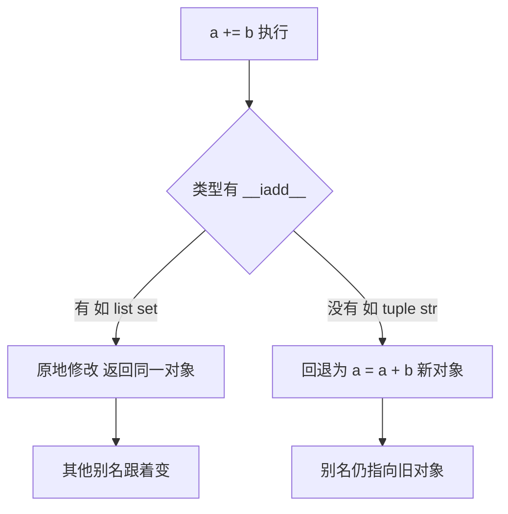
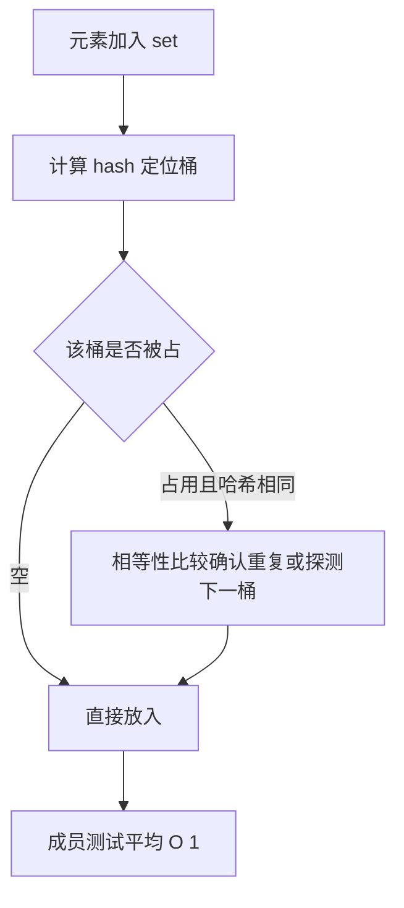
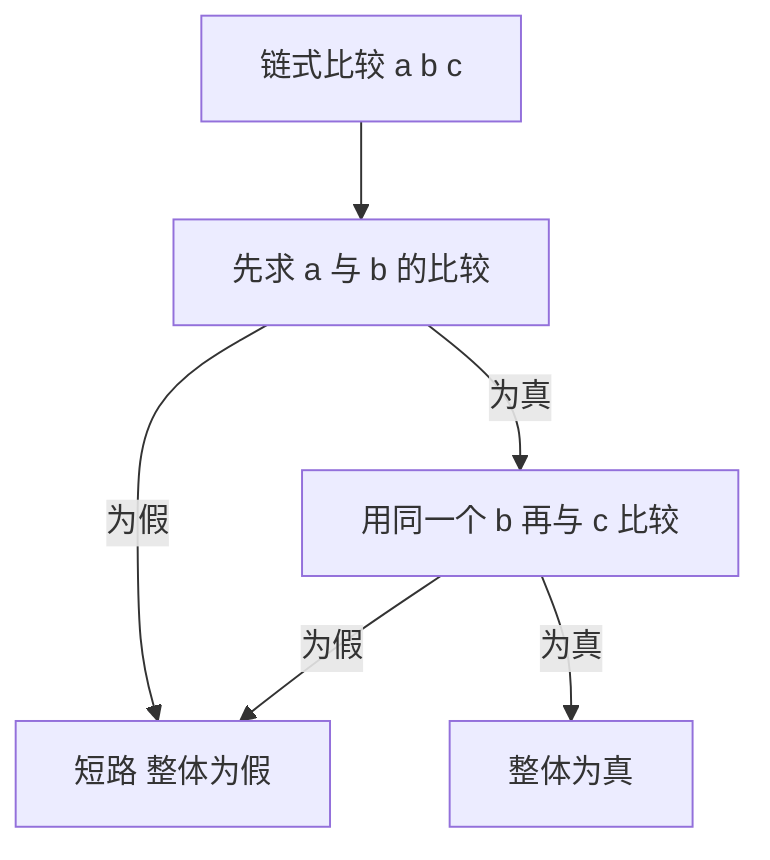
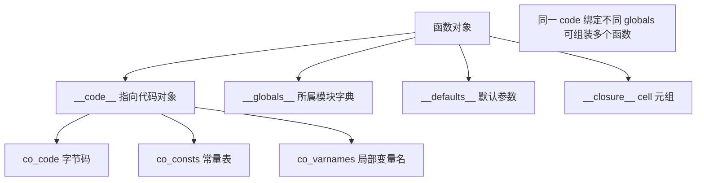
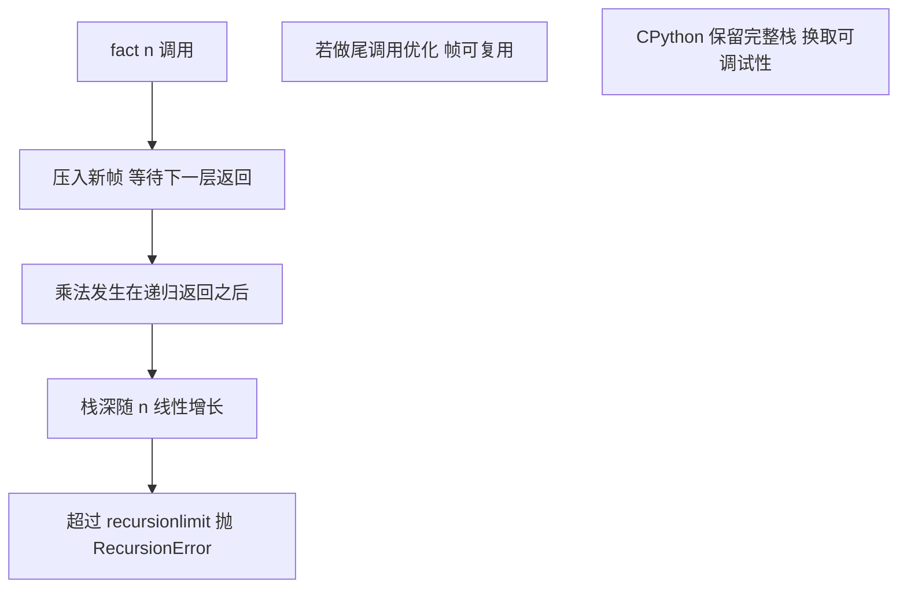
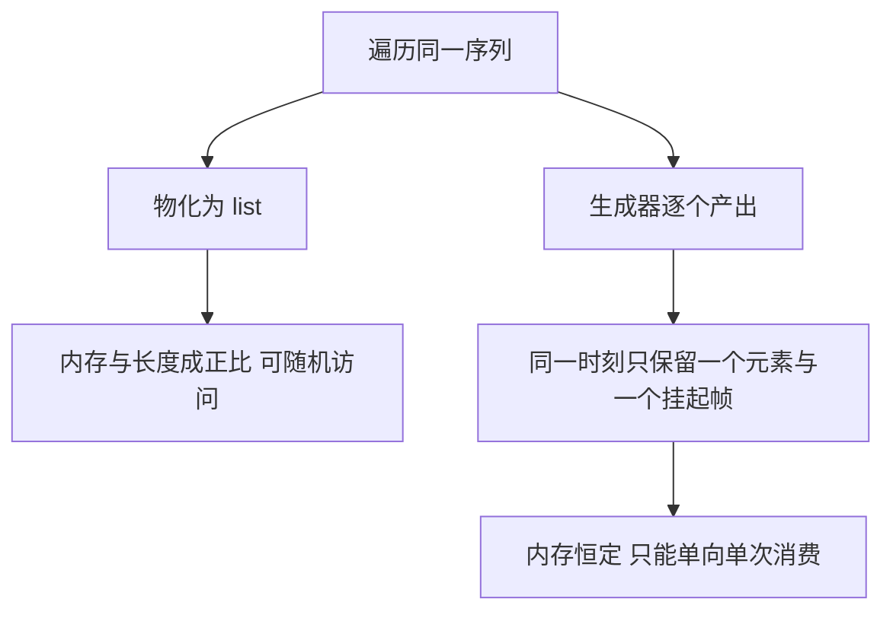
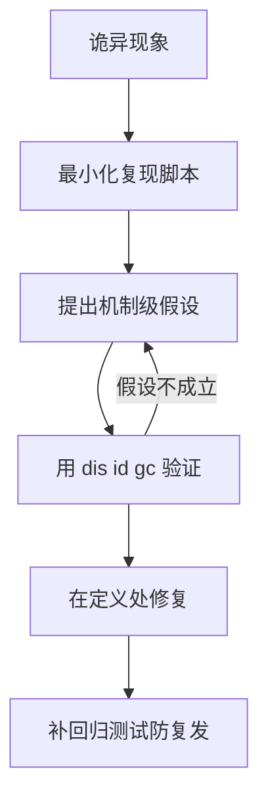

# 第 1 类 · 语言核心与底层(e)

> 本部分是语言核心的「疑难杂症」收尾:语句级语义陷阱(finally、作用域、+=)、运算符与数字类型的底层行为、字节码与名字查找、导入锁与信号、栈与递归、以及一套从现象到机制的排查方法论。
> 与 01b 的 CPython 内部机制互补:01b 讲「解释器怎么实现」,本篇讲「这些实现如何变成你脚下的坑」。
> 每题代码仅标准库、可直接运行,输出即证据。

### Q526 · try/finally 与 return:finally 的覆盖行为

> 难度:★★★★ | 标签:异常, finally

**问**:try 里 return 了,finally 里的 return 会怎样?finally 里 return 为什么会「吃掉」异常?

**答**:finally 无条件执行,且其中的 return/break 会覆盖 try/except 里已经产生的返回值——try 的 return 表达式先求值、结果暂存,finally 若自己也 return,栈上留下的是 finally 的值,原来那份被丢弃。更危险的是:异常传播路径上 finally 的 return 会直接终止传播,异常凭空消失(相当于 __exit__ 返回 True 的语句级版本)。规范:finally 只放清理代码(关文件、解锁),绝不放 return/break/continue;需要「无论成败都返回」的语义用显式变量在 try 外返回。

```python
# file: code/01_语言核心与底层/q526_finally_return.py
def trap():
    try:
        return "from try"
    finally:
        return "from finally"         # 覆盖 try 的返回值

def swallow():
    try:
        raise ValueError("boom")
    finally:
        return "exception eaten"      # 异常被 return 静默终结

def rethrow_with_finally():
    try:
        raise ValueError("real")
    finally:
        print("finally runs during unwind")   # 清理:finally 的正职

if __name__ == "__main__":
    print(trap())
    print(swallow())
    try:
        rethrow_with_finally()
    except ValueError as e:
        print("propagated:", e)
```

**追问**:1) finally 里抛新异常会怎样?——新异常取代原异常并向外传播,原异常挂在新异常的 __context__ 上;所以 finally 里的清理代码自身要用 try 包住,避免顶掉真正的错误。2) 为什么 finally 里的 return 能终结异常传播?——异常传播是沿调用栈逐帧展开,finally 是展开路径上必经代码;它的 return/break 把「继续展开」改成「带值正常返回」,等于语句级吞异常(3.8+ 编译器会给 SyntaxWarning)。3) 底层怎么实现?——try/finally 在 3.10+ 编译为异常表(exception table 条目),return 的值先暂存,展开到 finally 再决定用哪个值、是否继续传播。4) 生产陷阱?——finally 里做可能抛错的 close(如网络 flush)顶掉业务异常;finally 里 return 让 bug 凭空消失;规范是 finally 只清理,清理自身 try/except 记日志。

### Q527 · 循环变量泄漏与块作用域真相

> 难度:★★☆☆ | 标签:作用域, for

**问**:for 循环结束后变量还能用吗?为什么列表推导式却「不泄漏」?

**答**:Python 的 for/while 不创建作用域,循环变量属于外层(通常是模块或函数)作用域,循环结束后仍然存活、值为最后一次迭代——这既是 py2 的历史遗留,也造就了经典的 late binding 闭包坑(lambda 捕获的是共享的循环变量而非当时的值)。3.0 起列表/集合/字典推导式与生成器表达式有独立的函数作用域,循环变量在推导式内创建、结束后不可见,恰好与 for 相反。这一对行为差异是作用域题的常考对比点。

```python
# file: code/01_语言核心与底层/q527_loop_variable_leak.py
if __name__ == "__main__":
    for i in range(3):
        pass
    print("i survives loop:", i)          # 2:for 不产生作用域

    funcs = []
    for j in range(3):
        funcs.append(lambda: j)           # 闭包共享同一个 j
    print("late binding:", [f() for f in funcs])   # [2, 2, 2]

    comp = [k for k in range(3)]          # 推导式有独立作用域
    try:
        print(k)
    except NameError as e:
        print("comprehension leaked nothing:", e)
```

**追问**:1) 怎么让闭包捕获「当时的值」?——用默认参数在定义时求值:`lambda j=j: j`,默认值在函数创建时绑定到当前迭代的对象,与循环变量脱钩。2) 为什么推导式不泄漏而 for 泄漏?——3.0 起推导式编译成独立隐式函数,循环变量在函数作用域内、用完即弃;for 语句则在当前作用域直接绑定变量,循环结束仍存活。3) 晚绑定的底层机制?——闭包 cell 保存的是变量引用不是值副本,函数调用时才取 cell 当前内容;循环里多个闭包共享同一个 cell,所以全部看到最后值。4) 生产陷阱?——批量注册回调全是同一个最后值;asyncio 任务列表共享循环变量;修复三件套:默认参数、functools.partial、工厂函数。

### Q528 · 类体内的作用域:推导式看不见类变量

> 难度:★★★★ | 标签:作用域, 类

**问**:为什么类体里 `[factor * n for n in range(3)]` 会 NameError?方法里怎么访问类属性?

**答**:类体有自己的命名空间,但它**不是**闭包外层:类体里定义的推导式/生成器表达式/lambda 会创建函数作用域,名字查找链是「函数局部 → 全局 → 内置」,直接跳过类命名空间——所以推导式体内引用 factor 报 NameError,而推导式最外层的可迭代对象(range(3))是在类体作用域立即求值的,写 range(3) 没问题。方法同样不属于类作用域链,访问类属性必须走 self/cls 或类名。根因:类体执行用 exec 的扁平命名空间模拟,无法参与运行时的闭包链。

```python
# file: code/01_语言核心与底层/q528_class_body_scope.py
ns = {}
exec("factor = 2\nplain = factor * 10\n", ns)      # 类体式执行:直接读类变量 OK
print("class body direct read:", ns["plain"])

try:
    exec("factor = 2\nvalues = [factor * n for n in range(3)]\n", ns)
except NameError as e:
    print("comprehension skips class scope:", e)

class Table:
    factor = 2
    plain = factor * 10                    # 类体直接读:OK

    @classmethod
    def scaled(cls, n):
        return n * cls.factor              # 方法经 cls 访问类属性

if __name__ == "__main__":
    print("Table.plain:", Table.plain)
    print("scaled:", Table.scaled(5))
```

**追问**:1) 方法体内直接写 factor 而不是 cls.factor 会怎样?——查的是模块全局变量而不是类属性;类属性被实例/子类覆盖时读到旧值,这是静默 bug 的高发点。2) 类体为什么不在作用域链上?——类体执行时有独立命名空间,但方法内的名字查找按 LEGB:局部→全局→内置,跳过类命名空间;这是刻意设计,避免方法与类属性意外耦合。3) 类体里的推导式呢?——同样编译成隐式函数,内部也看不见类变量;唯一例外是推导式最外层的可迭代表达式,它在类体作用域直接求值。4) 生产陷阱?——类体里引用「稍后定义」的类变量 NameError;方法裸用类属性,子类覆盖后读到旧值;规范是类内一律 cls.X/self.X 显式访问。

### Q529 · 列表乘法与浅拷贝:[[0]*3]*3

> 难度:★★☆☆ | 标签:可变与不可变, 初始化

**问**:`[[0]*3]*3` 建的二维表为什么改一个格子动全列?正确的初始化写法是什么?

**答**:[x]*n 只复制引用:x 本身被引用 n 次。外层的 *3 让三个「行」指向同一个 list 对象,改 grid[0][0] 时 grid[1][0]、grid[2][0] 一起变——因为它们是同一个对象。内层 [0]*3 没问题,因为 int 不可变,共享引用无害。规则:乘法复制对不可变元素安全,对可变元素(行列表、dict)必须用推导式逐个新建 `[[0]*3 for _ in range(3)]`,让每行独立。验证手段:打印 id(grid[0]) 与 id(grid[1]) 是否相同。

```python
# file: code/01_语言核心与底层/q529_list_multiplication.py
if __name__ == "__main__":
    grid_bad = [[0] * 3] * 2               # 两行是同一个对象
    grid_bad[0][0] = 9
    print("bad :", grid_bad)               # [[9, 0, 0], [9, 0, 0]]
    print("same row object:", id(grid_bad[0]) == id(grid_bad[1]))

    grid_ok = [[0] * 3 for _ in range(2)]  # 每行新建
    grid_ok[0][0] = 9
    print("good:", grid_ok)
    print("distinct rows:", id(grid_ok[0]) != id(grid_ok[1]))

    flags = [False] * 5                    # 不可变元素:乘法安全
    flags[2] = True
    print("immutable elements fine:", flags)
```

**追问**:1) tuple 的重复 `([], ) * 3` 有同样的坑吗?——有,乘法只复制引用,三条目仍是同一个 list;区别是 tuple 不可变所以不能对 tuple 本身赋值,但内部 list 照样可变。2) 为什么 *n 不做深拷贝?——序列重复的语义按规范就是「引用级复制」:元素类型任意、未必可复制,语言层只承诺复制绑定;要独立元素必须推导式逐个构造。3) C 层实现?——list_repeat 对指针数组做 memcpy,同一批 PyObject* 被引用 n 次、引用计数各加 n;所以开销 O(n) 但内存几乎不随元素大小增长。4) 生产陷阱?——二维数组 [[0]*cols for _ in range(rows)] 才是正解,*rows 版本改一行全变;嵌套容器共享行导致「明明没动那行」的诡异 bug;评审里把它列为红旗模式。

### Q530 · __iadd__ 与 +=:可变与不可变的分歧

> 难度:★★★☆ | 标签:运算符, 可变与不可变

**问**:`a += b` 什么时候原地修改、什么时候新建对象?为什么 list 的 += 会让别名跟着变而 tuple 不会?

**答**:`a += b` 先找 `__iadd__`(就地加):有就原地修改并返回 self,绑定名字不变——list/set/dict(update 语义)属于此类,共享引用全部可见;没有 __iadd__ 就回退 `a = a + b`:不可变类型(tuple/str/int)只有 __add__,产生新对象再重新绑定,别名仍指旧对象。同一运算符在可变/不可变类型上语义分裂,是「函数里 += 参数」类 bug 的根源。自定义类型实现 __iadd__ 必须返回 self(或新对象,但那样要保证返回值被重新绑定,语义混乱)。

```python
# file: code/01_语言核心与底层/q530_iadd.py
a = [1, 2]
b = a
a += [3]                                  # list 有 __iadd__:原地,b 跟着变
print(a, b, "same object:", a is b)

x = (1, 2)
y = x
x += (3,)                                 # tuple 无 __iadd__:回退 x = x + (3,)
print(x, y, "same object:", x is y)

s1, s2 = "ab", "ab"
id_before = id(s1)
s1 += "c"
print(s1, s2, "rebound:", id(s1) != id_before)

class Basket:
    def __init__(self, items):
        self.items = items

    def __iadd__(self, other):
        self.items.extend(other)          # 原地修改
        return self                       # 必须返回 self

    def __repr__(self):
        return f"Basket({self.items})"

if __name__ == "__main__":
    basket = Basket(["pen"])
    alias = basket
    basket += ["book"]
    print(basket, "alias same:", alias is basket)
```

**追问**:1) 为什么 `s1 += "c"` 在 CPython 里 id 有时不变?——1b Q425 讲过:引用计数为 1 的 str 会「原地复用」缓冲,这是实现细节优化,语义上仍是新字符串,绝不能依赖。2) += 与 + 的语义分界?——+= 先找 __iadd__,没有再回退 __add__ 加重新绑定;可变对象就地修改返回 self,不可变对象只能重建,所以 list 就地、str 重绑。3) 字节码与优化器?——INPLACE_ADD 指令走 C 层 do_richinplace 分派;unicode 拼接的「引用计数为 1 才原地」是解释器优化,跨实现(Pypy)与多引用场景都不成立。4) 生产陷阱?——多线程下 += 是 LOAD/ADD/STORE 三步不原子,计数要锁或 itertools.count;对属性做 += 触发 __get__ 与 __set__ 两次描述符调用,自定义描述符要防;可变默认参数 + += 组合出经典状态泄漏。



### Q531 · 反射运算符:__radd__ 与分派顺序

> 难度:★★★☆ | 标签:运算符, 双下方法

**问**:`10 + v`(v 是自定义类)时 Python 怎么找到正确的加法?NotImplemented 在其中的角色?

**答**:二元运算 a + b 的分派顺序:先试 type(a) 的 __add__,若返回 NotImplemented(或缺失)且 type(b) 不是 type(a) 的子类,再试 type(b) 的 __radd__;两者都 NotImplemented 才抛 TypeError。NotImplemented 不是异常而是哨兵,意思是「我不处理,请给别人机会」——抛 NotImplementedError 反而中断分派链,是自定义运算符最常见的错误。__radd__ 的 self 与参数互换:定义 `__radd__(self, other)` 处理 other + self。反射运算让自定义类型能与 int/str 等内置类型自然协作,无需修改对方。

```python
# file: code/01_语言核心与底层/q531_radd.py
class Vector:
    def __init__(self, x, y):
        self.x, self.y = x, y

    def __add__(self, other):
        if isinstance(other, Vector):
            return Vector(self.x + other.x, self.y + other.y)
        if isinstance(other, int):
            return Vector(self.x + other, self.y + other)
        return NotImplemented             # 哨兵:交给对方或失败

    __radd__ = __add__                    # 10 + v 分派到 v.__radd__(10)

    def __repr__(self):
        return f"Vector({self.x}, {self.y})"

if __name__ == "__main__":
    v = Vector(1, 2)
    print(v + Vector(3, 4))
    print(v + 10)                         # v.__add__(10)
    print(10 + v)                         # int 不支持 → v.__radd__(10)
    try:
        v + "x"                           # 双方都 NotImplemented
    except TypeError as e:
        print("TypeError:", e)
```

**追问**:1) 子类在前有什么例外规则?——若右操作数类型是左操作数类型的**子类**,即使左边有 __add__ 也先试右边的 __radd__,保证子类对运算结果类型的控制权。2) 分派顺序为什么左优先?——左操作数「更可能」知道如何组合,先试左 __add__;返回 NotImplemented 才轮到右 __radd__;两侧都 NotImplemented 解释器抛 TypeError。3) NotImplemented 的角色?——它是哨兵对象不是异常,槽方法必须「无法处理时返回它」;直接抛错会中断整个双分派链,这是自定义数值类型最常见的实现错误。4) 生产陷阱?——自定义类型漏 __radd__ 导致 int + obj 报错;与 numpy 交互时还要考虑 __array_ufunc__ 的分派权;反射方法忘 mirror 对称语义,顺序不同结果不同。

### Q532 · __bool__ 与 __len__:真值判定的优先级

> 难度:★★☆☆ | 标签:魔术方法, 布尔

**问**:if obj 的真值判定顺序是什么?自定义容器「空即假」怎么实现?

**答**:bool(obj) 的顺序:1) 类型定义了 __bool__ 就用它(必须返回 bool);2) 否则用 __len__(返回 0 为假);3) 都没有则一律真。两者都定义时 __bool__ 优先。这个机制支撑了 `if items:` 比 `if len(items) > 0:` 更 Pythonic 的写法。陷阱:__bool__ 里做昂贵计算(查询数据库判断「有没有」)会让每个 if 都付出代价;语义上「非空即真」用 __len__,语义上「状态开关」用 __bool__,不要混。

```python
# file: code/01_语言核心与底层/q532_bool_len.py
class Queue:
    def __init__(self, items):
        self._items = list(items)

    def __len__(self):
        print("  __len__ called")
        return len(self._items)

    def push(self, x):
        self._items.append(x)

    def pop(self):
        return self._items.pop(0)

class AlwaysTrue:
    def __len__(self):
        return 0

    def __bool__(self):
        return True                       # __bool__ 优先于 __len__

if __name__ == "__main__":
    q = Queue([])
    print("empty:", bool(q))              # 回退 __len__ → 0 → False
    q.push("job")
    print("nonempty:", bool(q))
    if q:
        print("if q: truthy branch")

    print("bool wins over len:", bool(AlwaysTrue()))
    print("default is truthy:", bool(object()))
```

**追问**:1) __bool__ 返回非 bool 值会怎样?——CPython 直接抛 TypeError("__bool__ should return bool, returned ..."),解释器不做静默转换;契约上必须返回 bool。2) 真值判定的完整优先级?——PyObject_IsTrue 先查 __bool__,缺省看 __len__(0 为假),两者都没有则恒真;bool(x)、if x、and/or、while 全走同一条路径。3) 底层槽位?——tp_as_number.nb_bool 与 tp_as_sequence.sq_length 两个槽;__bool__ 与 __len__ 同时定义时前者赢——语义要一致,否则 truthiness 不可预测。4) 生产陷阱?——空容器 len 为 0 但 __bool__ 返回 True 的自相矛盾实现;pandas 的 DataFrame 故意在 __bool__ 抛 ValueError 防歧义真值,提示「用 any/all」;自定义容器漏 __len__ 导致空对象为真。

### Q533 · 富比较与 total_ordering

> 难度:★★★☆ | 标签:运算符, 排序

**问**:实现排序支持最少要写几个比较方法?functools.total_ordering 的代价是什么?

**答**:sorted/min/max 只要求 __lt__ 一个方法;== 建议一并实现(否则用身份比较,值相等的两个对象不相等,排序结果看似正常但去重行为诡异)。functools.total_ordering 装饰器从 __eq__ + 一个比较方法推导出其余(__le__/__gt__/__ge__),代价是每次比较经过一层间接调用,且反向运算可能落到 NotImplemented 路径,热点代码手写全部六个更直接。实现时对不支持的类型返回 NotImplemented 让解释器尝试反射运算,而不是抛 TypeError。

```python
# file: code/01_语言核心与底层/q533_total_ordering.py
import functools

@functools.total_ordering
class SemVer:
    def __init__(self, major, minor):
        self.major, self.minor = major, minor

    def __eq__(self, other):
        if not isinstance(other, SemVer):
            return NotImplemented
        return (self.major, self.minor) == (other.major, other.minor)

    def __lt__(self, other):
        if not isinstance(other, SemVer):
            return NotImplemented
        return (self.major, self.minor) < (other.major, other.minor)

    def __repr__(self):
        return f"{self.major}.{self.minor}"

if __name__ == "__main__":
    a, b, c = SemVer(1, 0), SemVer(1, 2), SemVer(2, 0)
    print(a < b, b <= c, c > a, a != b)   # <= 与 > 由 total_ordering 推导
    print(sorted([c, a, b]))
    print(max(a, c))
```

**追问**:1) 为什么 __eq__ 与 __hash__ 必须一起考虑?——定义 __eq__ 后默认 __hash__ 被置 None,对象不可哈希;要保持可哈希必须自定义 __hash__ 且保证「相等对象哈希相等」,否则 dict 行为错乱。2) total_ordering 的成本?——functools.total_ordering 由 __lt__ + __eq__ 派生 le/gt/ge,每次比较多一层 Python 函数调用;热路径手写全部比较或用 dataclass(order=True) 让 C 层生成。3) total_ordering 的底层要求?——至少定义一个比较方法加 __eq__,装饰器为缺失者生成基于 __lt__ 组合的包装;生成的方法语义要与业务排序一致。4) 生产陷阱?——只定义 __lt__ 不定义 __eq__,sorted 能用但相等判定退化为 identity;NaN 参与违反全序假设(heap/sort 行为未定义);比较方法里抛异常而不是返回 NotImplemented。

### Q534 · NaN 的传染性:比较与容器行为

> 难度:★★★★ | 标签:浮点数, NaN

**问**:为什么 float("nan") != float("nan")?NaN 在 dict/list 里的行为为什么反而「正常」?

**答**:IEEE 754 规定 NaN 与任何值(包括自己)的比较都是 False——它表示「未定义的运算结果」,不是可比较的数;这也让 max/min/sorted 的结果变得不可预测(比较全返回 False,顺序取决于算法实现)。但容器的行为像「正常」:list.count、dict 查找在相等比较前有**同一性短路**(is 判断),同一个 NaN 对象能被找到。工程规则:数据清洗里用 math.isnan(x) 或 x != x 检测(后者利用 NaN 唯一的自我不等特性);排序前先过滤或给 NaN 定序(如 numpy 的 nan 排序策略)。

```python
# file: code/01_语言核心与底层/q534_nan.py
import math

nan = float("nan")

if __name__ == "__main__":
    print("nan == nan:", nan == nan)      # False:IEEE 754 规定
    print("nan != nan:", nan != nan)      # True:唯一自我不等的数
    print("math.isnan:", math.isnan(nan))

    print("list.count finds same object:", [1, nan].count(nan))   # 同一性短路

    d = {nan: "a"}
    print("dict lookup by identity:", d[nan])

    print("sorted with nan:", sorted([1.0, nan, 2.0]))            # 顺序不可靠
    print("module-level nan is a singleton:", math.nan is math.nan)
```

**追问**:1) pandas/numpy 为什么敢于排序 NaN?——它们在库层面给 NaN 定义了排序约定(通常排末尾),绕开 IEEE 的「不可比较」;纯 Python 没有这层约定,必须自己定规则。2) NaN 比较为什么全 False?——IEEE 754 规定 NaN 与任何值(含自身)的有序比较都 False,表达「无序」而非「不相等」;所以 nan != nan 为 True,判 NaN 必须 math.isnan。3) 容器里的 NaN 行为?——hash(nan) 固定,set 命中靠 identity 短路:同一个 nan 对象 in set 为 True,值相等的不同 nan 对象为 False;这是「同一性优先于相等」的查找语义。4) 生产陷阱?——sum/max 遇 NaN 传染出 NaN;groupby 把不同 nan 当不同组;数据清洗入口统一 dropna/mask,比较用 isclose 而不是 ==。

### Q535 · hash 随机化与 PYTHONHASHSEED

> 难度:★★★★ | 标签:hash, 安全

**问**:为什么 str 的 hash 每次重启进程都不同?这防的是什么攻击?

**答**:自 3.3 起 str/bytes 的哈希默认加盐(hash randomization,可通过 PYTHONHASHSEED=0 关闭):同一进程内哈希一致,跨进程不可预测。防的是哈希碰撞 DoS——攻击者构造大量同哈希的 key 塞进 dict,哈希表退化成 O(n) 链,一个请求打满 CPU;随机盐让攻击者无法离线构造碰撞集。推论:任何「依赖 str 哈希稳定」的逻辑(把 hash 值持久化、跨进程分片路由)都是错的,需要稳定摘要用 hashlib。int 的哈希与数值本身相关(取模质数),不受随机化影响。

```python
# file: code/01_语言核心与底层/q535_hash_randomization.py
import sys

if __name__ == "__main__":
    print("randomization on:", sys.flags.hash_randomization)
    print("hash('python') =", hash("python"), "(differs across runs)")
    print("hash(42) =", hash(42), "(int hash is stable)")
    print("same within this process:", hash("a") == hash("a"))

    d = {}
    for i in range(1000):
        d[f"key{i}"] = i
    print("dict still O(1) on average:", len(d), "keys")

    print("rule: persist digests via hashlib, never via hash()")
```

**追问**:1) PYTHONHASHSEED=0 什么场景下用?——复现哈希相关的 bug、或基准测试要消除盐带来的抖动;生产严禁关闭,等于把 DoS 防线拆掉。2) 为什么要随机化?——防哈希碰撞 DoS:攻击者构造同桶键让 dict/set 操作退化 O(n²);3.3 起每进程随机盐,str/bytes 受影响,int 的哈希是自身不受盐影响。3) 底层算法?——str/bytes 用 SipHash 加进程盐;依赖字符串哈希顺序的遍历序不可复现,tuple 哈希组合元素哈希也不稳定,只有 int 稳定。4) 生产陷阱?——逻辑依赖 set/dict 遍历序(必须 sort);本地复现不了线上顺序问题,其实是盐差异;测试固定 PYTHONHASHSEED 只限测试环境,不要带进部署配置。

### Q536 · set 与 frozenset:实现与运算

> 难度:★★★☆ | 标签:集合, 哈希

**问**:set 的成员测试为什么平均 O(1)?frozenset 什么时候必须用?

**答**:set 底层是开放寻址哈希表(与 dict 同族但只有键):hash 定位桶、碰撞线性探测,平均 O(1)。运算符语义:并 | 交 & 差 - 对称差 ^,子集 <=;frozenset 是不可变版,可哈希——需要「集合的集合」或「dict 的集合键」时必须用它,普通 set 不可哈希直接 TypeError。陷阱:空集合是 set() 而不是 {}(那是空 dict);set 的元素顺序是实现细节,跨版本不可依赖;add 已存在元素是无操作不报错,去重语义因此幂等。

```python
# file: code/01_语言核心与底层/q536_set_frozenset.py
a = {1, 2, 3}
b = {3, 4}

if __name__ == "__main__":
    print("union:", a | b, "intersection:", a & b)
    print("difference:", a - b, "symmetric:", a ^ b)
    print("subset:", {1, 2} <= a)

    fs = frozenset(b)
    d = {fs: "hashable set"}              # frozenset 可做 dict key
    print(d[fs])

    try:
        {a: "x"}                          # 可变 set 不可哈希
    except TypeError as e:
        print("unhashable:", e)

    empty = set()
    print("empty set is not dict:", type(empty).__name__)
```

**追问**:1) set 和 dict 的哈希表实现差在哪?——set 的条目只有哈希+键,更省内存、缓存更友好;dict 的条目多了值指针与插入序,3.6 后 dict 是紧凑+稀疏两层,set 是单层稀疏表。2) 集合运算的语义细节?——& | - ^ 生成新集合,对应 &= 等原地版;issubset/issuperset 接受任意可迭代;求「有没有交集」用 isdisjoint 可短路,不用构造差集。3) 底层探测机制?——开放寻址 + 扰动线性探测,负载因子超阈值重建表;frozenset 缓存自身哈希,可做另一个 set 的元素。4) 生产陷阱?——自定义元素 __eq__/__hash__ 不一致导致查不到已存对象;遍历 set 时增删抛 RuntimeError;热路径把 list 当 set 用成员测试。



### Q537 · 浮点精度:0.1+0.2 与 math.fsum

> 难度:★★★☆ | 标签:浮点数, IEEE 754

**问**:0.1 + 0.2 为什么不等于 0.3?求和时怎么把累积误差压到最小?

**答**:二进制浮点无法精确表示 0.1(它是二进制下的无限循环小数),0.1 实际存储是略大/略小的近似值,两个近似值相加再四舍五入,结果与 0.3 的近似值差一位尾数。解决按场景:比较用 math.isclose(带相对误差);求和用 math.fsum(维护精确部分和,Shewchuk 算法,一次舍入);货币用 Decimal 或以「分」为单位的整数。更深的坑:大数吃小数(1e16 + 1.0 == 1e16),因为尾数只有 53 位,加法结果超出精度直接被舍去——累加大数时顺序都会影响结果。

```python
# file: code/01_语言核心与底层/q537_float_precision.py
import math

if __name__ == "__main__":
    print("0.1 + 0.2 =", 0.1 + 0.2)
    print("equals 0.3:", (0.1 + 0.2) == 0.3)
    print(f"0.1 in binary-ish: {0.1:.20f}")
    print("isclose:", math.isclose(0.1 + 0.2, 0.3))

    nums = [0.1] * 10
    print("naive sum == 1.0:", sum(nums) == 1.0)
    print("fsum == 1.0   :", math.fsum(nums) == 1.0)

    print("big eats small:", 1e16 + 1.0 - 1e16)
    print("fsum resists  :", math.fsum([1e16, 1.0, -1e16]))
```

**追问**:1) 为什么 fsum 能精确?——它把中间结果按精度分层暂存(部分和数组),最终只舍入一次;代价是慢与额外内存,只用于求和这一种运算。2) 0.1+0.2 != 0.3 的根源?——0.1/0.2 在二进制浮点里不可精确表示,相加结果是「两个近似值的和再近似」;比较必须 math.isclose 或误差阈值,不能 ==。3) 普通 sum 的误差模型?——每步都做一次 IEEE 舍入,误差累积与顺序相关:同一组数不同顺序结果不同,fsum 消除顺序依赖。4) 生产陷阱?——金额累加用 float 对不上账,应 Decimal;测试断言 float 相等导致跨平台 flaky;统计大数吃小数(累加大数组时小项被吸收),关键场景 fsum。

### Q538 · decimal:货币与精度工程

> 难度:★★★☆ | 标签:decimal, 精度

**问**:为什么货币计算不能用 float?Decimal 的精度规则和 float 有什么本质不同?

**答**:float 是二进制浮点,0.1 这类十进制小数本身表示不准,累加与舍入误差在金额上不可接受(财务对账差一分钱都是事故);Decimal 是十进制浮点,0.1 精确存储,运算按声明的精度(prec,默认 28 位有效数字)十进制舍入。规则:构造一律用字符串 Decimal("19.99"),从 float 构造会带入二进制误差;除法可能除不尽时按 prec 舍入,展示层用 quantize(Decimal("0.01"), ROUND_HALF_UP) 显式定舍入位;context 是线程本地还是全局要注意(python 3.14 前是线程局部副本)。高性能大批量场景退回「整数分」方案。

```python
# file: code/01_语言核心与底层/q538_decimal.py
from decimal import Decimal, ROUND_HALF_UP, getcontext

if __name__ == "__main__":
    print("exact addition:", Decimal("0.1") + Decimal("0.2") == Decimal("0.3"))

    total = Decimal("19.99") * 3
    print("total:", total)
    print("per 7:", (total / 7).quantize(Decimal("0.01"), ROUND_HALF_UP))

    getcontext().prec = 4
    print("precision 4:", Decimal(2) / Decimal(3))
    getcontext().prec = 28

    print("float ctor keeps error:", Decimal(0.1))
    print("str ctor is exact   :", Decimal("0.1"))
```

**追问**:1) Decimal 和 Fraction 怎么选?——Fraction 是精确有理数(1/3 存为分子分母),适合数学推导与符号计算;Decimal 是十进制定点风格,贴合货币与人类十进制习惯;两者都慢于 float。2) Decimal 为什么贴货币?——十进制表示无 0.1 类表示误差,精度位数与舍入模式(ROUND_HALF_UP 等)显式可控;float 的二进制舍入与会计规则天然冲突。3) 上下文机制?——精度与舍入由当前 Context 决定(getcontext 按线程独立);构造必须用字符串 Decimal("0.1"),从 float 构造会继承误差。4) 生产陷阱?——Decimal 与 float 混算 TypeError;ORM 把 Numeric 列映射成 float 丢精度,要显式 Decimal;全局改 context 精度影响其他模块。

### Q539 · bool 是 int 的子类:历史与推论

> 难度:★★☆☆ | 标签:类型系统, bool

**问**:True + True 为什么等于 2?这个历史设计带来哪些推论与坑?

**答**:bool 继承自 int(True==1, False==0),这是 Python 2 时代为兼容旧布尔语义保留的设计。推论:bool 可以做算术与索引([\"a\",\"b\"][True] 即下标 1);sum(x > 2 for x in ...) 是合法计数惯用法;True 在 dict 里与 1 是同一个键(哈希相同),`{True: "yes", 1: "no"}` 只剩一个键。坑在于「本想存布尔却与整数撞键」「isinstance(True, int) 为 True 干扰类型判断」。现代写法:计数用 sum(谓词) 没问题,但作为 dict 键或 JSON 出参时,显式转 int(x) 消除歧义。另外 `True == 1` 为真而 `True is 1` 恒为假:`is` 比较身份,只能用于 None/True/False 这类单例,值相等一律用 `==`;对字面量用 `is` 会触发 SyntaxWarning。

```python
# file: code/01_语言核心与底层/q539_bool_is_int.py
if __name__ == "__main__":
    print("issubclass:", issubclass(bool, int), "| isinstance:", isinstance(True, int))
    print("True + True:", True + True, "| True * 3:", True * 3)
    print("as index:", ["a", "b", "c"][True])

    print("count via sum:", sum(x > 2 for x in range(5)))

    d = {True: "yes", 1: "no"}
    print("True and 1 are the same key:", d)
    print(True == 1, True is 1)           # True False:== 相等推不出身份相同

    print(type(False).__name__, False == 0)
```

**追问**:1) 为什么 Python 不把 bool 改成独立类型?——改动会破坏海量依赖「布尔即 0/1」的存量代码与 C 扩展 ABI,收益不抵迁移成本,这是语言演进的保守性典型样本。2) bool 是 int 子类带来哪些推论?——True+True == 2、isinstance(True, int) 为 True;dict 键 True 与 1 冲突(True == 1 且哈希相同,后者覆盖前者)。3) 底层单例语义?——bool 只有两个实例 True/False,3.12 起 immortal 引用计数永不减;bool() 只返回这两个对象,int 子类只重写了 __repr__/__str__。4) 生产陷阱?——用 1/0 当布尔参与算术输出混淆;dict/序列把 True 与 1 当同一键;sum(list_of_bools) 计数虽妙但可读性差,团队约定要统一;pytest 参数化里 bool 与 int 混淆用例。

### Q540 · 星号解包:函数与赋值中的 *

> 难度:★★☆☆ | 标签:解包, 语法

**问**:* 在赋值、调用、定义三处的语义分别是什么?`first, *mid, last = seq` 怎么工作?

**答**:定义处 *args 收集多余位置参数成 tuple,**kwargs 收集关键字参数成 dict;调用处 *seq 展开、**map 展开,反向操作;赋值处 `a, *b, c = seq` 按「位置匹配、星号吞中间」解包,b 总是 list(哪怕只吞 0 或 1 个)。细节:星号变量每条赋值语句只能有一个;解包不要求可变,任何可迭代都行(含生成器——但生成器被解包后耗尽);嵌套解包 (a, (b, c)) 也合法。交换 a, b = b, a 本质是先打包右侧 tuple 再解包,没有临时变量。

```python
# file: code/01_语言核心与底层/q540_star_unpacking.py
def concat(*parts, sep="-"):
    return sep.join(parts)

if __name__ == "__main__":
    first, *middle, last = [1, 2, 3, 4, 5]
    print(first, middle, last)            # 1 [2, 3, 4] 5

    head, *tail = range(3)
    print(head, tail)                     # 0 [1, 2]

    single, *rest = [42]
    print(single, rest)                   # rest 是空 list,不是 42

    print(concat(*["a", "b", "c"]))

    base, extra = {"a": 1}, {"b": 2}
    print({**base, **extra})

    x, y = 10, 20
    x, y = y, x                           # tuple 打包再解包:无临时变量
    print(x, y)
```

**追问**:1) 星号解包生成器会发生什么?——生成器被完全耗尽,星号变量拿到全部剩余项的 list;对无穷生成器解包会内存耗尽/卡死,解包前确认有界。2) 解包在赋值与调用中的语义差?——赋值 a, *b = it:b 是 list;调用 f(*it) 展开成位置参数,受函数签名约束;3.5+ 支持任意位置多星号([*a, *b] / {**a, **b})。3) 字节码层?——UNPACK_SEQUENCE 与 BUILD_*_UNPACK 系列指令完成拆装,调用侧 CALL_FUNCTION_EX 接收打包好的元组+字典;解包次数即元素拷贝次数。4) 生产陷阱?——对日志流等长流解包 OOM;大列表解包成参数触发实现上限;f(*a, *b) 顺序敏感;嵌套解包(a, (b, c)) 可读性差,评审要克制。

### Q541 · 链式比较的求值:短路与非传递

> 难度:★★☆☆ | 标签:比较, 求值顺序

**问**:`1 < x < 10` 与 `1 < x and x < 10` 的区别?NaN 参与链式比较会发生什么?

**答**:链式比较 a < b < c 等价于 `a < b and b < c`,但 b **只求值一次**(and 写法求值两次)——对带副作用的表达式这是行为差异而非语法糖。每段从左到右短路:第一段为假则后续表达式不再求值。这个语法源于数学记号,适合区间判断;陷阱在非传递关系(如 NaN):nan < 1 与 1 < nan 全为 False,链式 nan < x < y 恒 False 但不报错,静默错误;另一个坑是 `(1 < 2) == True` 与 `1 < 2 == True` 语义完全不同(后者是链式)。

```python
# file: code/01_语言核心与底层/q541_chained_comparison.py
calls = []

def observed(label, value):
    calls.append(label)
    return value

if __name__ == "__main__":
    calls.clear()
    result = observed("a", 1) < observed("b", 5) < observed("c", 10)
    print(result, "evaluated:", calls)    # a b c:中间值只算一次

    calls.clear()
    result2 = observed("a", 1) < observed("b", 0) < observed("c", 10)
    print(result2, "evaluated:", calls)   # c 被短路跳过

    print(1 < 2 < 3)                      # 区间判断的惯用法
    print(3 > 2 == 2)                     # 链式:3>2 and 2==2 → True
    print((3 > 2) == 2)                   # 括号改变语义 → False
```

**追问**:1) 为什么说链式比较对副作用是行为差异?——observed("b") 在链式里只调用一次、and 写法调用两次,日志/计数类副作用直接翻倍;纯函数则结果一致。2) 链式比较的语义?——a < b < c 等价 (a < b) and (b < c),b 只求值一次;运算符可不同(0 <= x < 10);全 True 才 True,与 and 一样短路。3) 字节码实现?——中间值靠 DUP_TOP/COPY 类指令复制栈顶,而不是重新求值——「一次求值」是字节码层保证的,不是优化碰运气。4) 生产陷阱?——中间表达式有副作用(计数、IO)被减半的误判;链式里混入 None 比较 TypeError;超长链可读性差,该拆命名变量;测试里对带副作用表达式做链式断言导致计数偏差。



### Q542 · 只有 __getitem__ 的旧式迭代协议

> 难度:★★★★ | 标签:迭代器, 兼容

**问**:一个类只有 __getitem__ 没有 __iter__,为什么 for 和 list 都能用它?这个协议何时该淘汰?

**答**:这是 Python 2 之前的「序列协议」遗留:iter(obj) 发现对象没有 __iter__ 时,回退到 seq_iterator——从 obj[0] 开始按下标递增读取,直到 IndexError 判定结束。所以旧式类不写任何迭代方法就能被 for/list/解包消费。但它有三个缺点:不支持无穷序列(IndexError 才停)、无法用 yield 简化、isinstance(x, Iterable) 为 False(协议检查只看 __iter__),类型系统与运行时行为脱节。现代代码一律实现 __iter__ 返回迭代器;__getitem__ 仅作下标访问语义保留。

```python
# file: code/01_语言核心与底层/q542_legacy_iteration.py
from collections.abc import Iterable

class OldStyle:
    """只有 __getitem__:旧式序列协议,依然可迭代"""
    def __getitem__(self, i):
        if i > 2:
            raise IndexError
        return i * i

if __name__ == "__main__":
    o = OldStyle()
    print("for works:", list(o), [x for x in o])
    print("iter + next:", next(iter(o)))

    print("isinstance Iterable:", isinstance(o, Iterable))   # False:协议按 __iter__ 判定
    print("yet iteration works — legacy protocol in action")
```

**追问**:1) 判定「能不能迭代」的正确方法?——不看 isinstance,直接 try iter(obj) except TypeError;或用迭代器协议逐层 Duck typing,这也解释了 Protocol/结构化检查为何更贴近真实行为。2) 旧协议怎么工作?——iter() 找不到 __iter__ 时,对只有 __getitem__ 的对象返回一个「从 0 开始逐个下标、直到 IndexError」的序列迭代器,兼容 2.2 之前的序列类。3) 底层回退路径?——PyObject_GetIter:先查 tp_iter,没有再查 sq_item 槽造旧式迭代器;IndexError 即终止,其他异常照常上抛——异常语义要区分清楚。4) 生产陷阱?——旧协议把业务里的 IndexError 当「迭代结束」吞掉;新代码一律实现 __iter__;判断「可迭代」写 isinstance(obj, Iterable) 对虚拟注册/结构检查的偏差要心里有数。

### Q543 · __contains__ 与 in 的默认成本

> 难度:★★★☆ | 标签:容器, 性能

**问**:`x in obj` 的查找顺序是什么?一个 O(n) 的迭代器容器怎么变成 O(1)?

**答**:in 的分派:优先调用 __contains__;没有则尝试迭代(逐个 == 比较,默认实现 O(n));对旧式序列再回退下标协议。所以「只定义了 __iter__ 的类」成员测试就是全量遍历——慢在语义而不是实现,若容器有结构(区间、有序、哈希),定义 __contains__ 直接利用结构判定,可从 O(n) 降到 O(1)/O(log n)。in 运算符还隐含约定:应返回 bool 且不抛异常(找不到返回 False 而不是报错),自定义实现要遵守。

```python
# file: code/01_语言核心与底层/q543_contains.py
import time

class SlowRange:
    def __init__(self, n):
        self.n = n

    def __iter__(self):
        return iter(range(self.n))        # 没有 __contains__:in 走全量迭代

class FastRange(SlowRange):
    def __contains__(self, x):
        return 0 <= x < self.n            # 结构化判定:O(1)

if __name__ == "__main__":
    sr, fr = SlowRange(10_000_000), FastRange(10_000_000)

    start = time.perf_counter()
    _ = 9_999_999 in sr
    print("iter-based:", round(time.perf_counter() - start, 4), "s")

    start = time.perf_counter()
    _ = 9_999_999 in fr
    print("structured:", round(time.perf_counter() - start, 6), "s")
```

**追问**:1) dict/set 的 in 和 list 的 in 差在哪?——dict/set 走哈希表 O(1);list 走线性扫描 O(n),高频成员测试应转 set——「list 误当 set 用」是热路径性能的常见病因。2) in 的分派顺序?——优先调 __contains__;没有则回退迭代协议逐元素 ==;自定义 __contains__ 可以定义任意语义(str 的子串判定就是特化实现)。3) 底层路径?——set/dict 的 sq_contains 直连哈希探测;list 的是 PyObject_RichCompare 逐元素比较,元素多时每次 in 都是全扫。4) 生产陷阱?——循环内 `x in big_list` 每次全扫,预先建 set;自定义容器忘 __contains__ 退化成迭代;`in` 用于子串判断的副作用("cat" in "concatenate" 为 True)在标签匹配里出 bug。

### Q544 · __length_hint__ 与预分配

> 难度:★★★☆ | 标签:容器, 优化

**问**:list(generator) 为什么有时候不反复扩容?__length_hint__ 起什么作用?

**答**:list()/tuple()/join 等构造函数在物化可迭代对象前,会先问 `operator.length_hint(it)`(依次查 __length_hint__、__len__):有可靠提示就按它预分配底层缓冲,无提示则从空表开始按 1.125 倍扩容摊还。自定义迭代器实现 __length_hint__(返回估计值,允许不准)能让物化少几次 realloc;生成器的 length_hint 恒为 0(无法预知),所以 list(gen) 通常比 list(已知长度的序列)多几次扩容——这也是「能传序列不传生成器」的微优化依据之一。提示错了不会报错,只影响性能。

```python
# file: code/01_语言核心与底层/q544_length_hint.py
import operator

class Countdown:
    def __init__(self, n):
        self.n = n

    def __iter__(self):
        return iter(range(self.n, 0, -1))

    def __length_hint__(self):
        return self.n                     # 提示:大约 n 个,允许不准

if __name__ == "__main__":
    c = Countdown(5)
    print("length_hint:", operator.length_hint(c))
    print("materialized:", list(c))
    print("hint of plain generator:", operator.length_hint(x for x in range(3)))
```

**追问**:1) length_hint 返回错误值会怎样?——预分配偏小只多扩容几次,偏大浪费一点内存;协议明确「提示仅供参考」,实现不得依赖其正确性,这正是它敢叫 hint 的原因。2) 预分配的价值?——list(v) 等构造会先按 hint 估算容量,减少扩容 realloc 次数;生成器没有 hint,list(gen) 只能从默认容量逐步翻倍。3) 回退链?——PyObject_LengthHint:先 __length_hint__,再 __len__,最后默认值;返回负数或抛错时忽略用默认。4) 生产陷阱?——hint 严重虚高一次性分配大内存;依赖 hint 做精确判断的代码本身是错的;性能敏感场景先 `list = []; append` 与 list(gen) 的差异要 profile 而不是猜。

### Q545 · del 的语义:删名字不删对象

> 难度:★★☆☆ | 标签:del, 引用

**问**:del x 之后对象被释放了吗?del 对 dict 条目、切片、属性分别做什么?

**答**:del 只做「解绑名字/引用」:从命名空间、容器、属性里移除一个引用,引用计数减一;对象是否立即释放取决于是否还有其他引用——别名存在就活着。变体:del dict[k] 删条目、del list[i:j] 删切片(等价赋空切片)、del obj.attr 调用 __delattr__、del 局部变量让后续访问 NameError(函数内还用于「声明此名不再使用」配合 nonlocal)。它与「清空容器」不同:del lst[:] 才清内容,del lst 只删名字。GC 时序依赖(del 即释放)在 CPython 成立,跨实现不保证——资源释放永远用 with。

```python
# file: code/01_语言核心与底层/q545_del_semantics.py
import sys

data = [1, 2, 3]
alias = data
del data                                  # 只删名字
print("object alive via alias:", alias)

holder = {"k": [1, 2, 3]}
ref = holder["k"]
del holder["k"]                           # 删条目,对象由 ref 继续持有
print("value survives:", ref, "refcount > 1:", sys.getrefcount(ref) > 1)

nums = [0, 1, 2, 3, 4]
del nums[1:3]                             # 删切片
print("slice deleted:", nums)

def scope_demo():
    x = 1
    del x
    try:
        print(x)
    except NameError as e:
        print("unbound inside function:", e)

if __name__ == "__main__":
    scope_demo()
```

**追问**:1) 为什么函数里 del 局部变量后编译器把它当未绑定?——del 在字节码层是 DELETE_FAST,移除局部槽的绑定;编译期就知道该名字在后续不可用,访问直接抛 UnboundLocalError 语义的 NameError。2) del 的三重语义?——删名字(解除绑定)、容器项(调 __delitem__)、属性(调 __delattr__);都不直接释放对象——引用归零才回收,del 只是「拆引用」的语法。3) 字节码层?——DELETE_FAST/DELETE_GLOBAL/DELETE_NAME 分别处理局部/全局/名字表;del 后同一函数里再赋值同一名字,编译器把它视为普通局部变量。4) 生产陷阱?——以为 del 大对象立即释放内存(闭包/全局引用还在);想强制回收用 gc.collect();del 列表切片 vs clear() 的语义差异(前者重建索引后者原地清空)。

### Q546 · 对象复活:__del__ 中的自救

> 难度:★★★★★ | 标签:GC, __del__

**问**:__del__ 里把 self 存到全局变量会发生什么?为什么这是所有实现里最危险的操作?

**答**:__del__ 执行时对象刚「不可达」,但方法体里重新建立引用(存全局、挂到活对象上)会让它「复活」:CPython 引用计数路径下对象实际不释放,再次失去引用时是否二次调用 __del__ 属于实现细节(PEP 442 后循环 GC 路径有 finalized 标志但行为仍微妙)。危险点:对象状态在「终结前后」不一致、依赖 __del__ 恰好一次的清理逻辑(关连接、删文件)被破坏、其他实现(PyPy)行为不同。规范:__del__ 禁止复活、禁止访问可能已拆卸的全局,真正的清理用 weakref.finalize 或显式 close。

```python
# file: code/01_语言核心与底层/q546_resurrection.py
import gc

class Phoenix:
    def __del__(self):
        print("__del__ running")
        globals()["keep"] = self          # 复活:重新建立引用

if __name__ == "__main__":
    p = Phoenix()
    del p                                 # 计数归零,触发 __del__
    print("resurrected as:", type(keep).__name__)
    keep = None                           # 再次失去引用
    gc.collect()
    print("behavior after resurrection is implementation-defined — do not rely on it")
```

**追问**:1) CPython 怎么防止无限复活循环?——GC 路径给对象打 finalized 标志,终结器对同一对象最多执行一次(除非期间又复活重置状态),但引用计数路径的时序仍依赖实现,写代码必须当它不可靠。2) 什么是对象复活?——__del__/weakref 回调里把 self 存进全局,对象在终结后重新可达;3.4+ PEP 442 让循环引用也能安全终结,复活者被提升到老年代按普通对象继续活。3) PEP 442 后的流程?——先收集待终结循环、统一调用终结器、复活者保留、其余销毁;gc.garbage 常态为空,只在不可终结场景才有内容。4) 生产陷阱?——复活对象带着已释放资源被继续调用;依赖 __del__ 释放连接不可靠,必须 with/close 显式管理;终结器只做日志与告警,不做自救。

### Q547 · 函数对象与 code 对象:__code__

> 难度:★★★★ | 标签:字节码, 函数

**问**:函数对象和它的 __code__ 各自装着什么?同一个 code 对象能「复活」成多个函数吗?

**答**:函数对象 = code 对象 + 运行环境:__code__ 是编译产物(字节码、常量表 co_consts、局部名 co_varnames、参数个数),而 __globals__、__defaults__、__closure__、__name__、__doc__ 属于函数对象——同一份 code 可以绑定不同 globals 组装出行为不同的函数(types.FunctionType(code, globals)),这就是「代码与执行环境分离」。用途:动态重建函数、序列化纯函数(code + globals 白名单)、深度内省(检查函数用了哪些全局名)。修改 __code__ 属于黑客行为,正常工程只读。

```python
# file: code/01_语言核心与底层/q547_code_object.py
import types

def greet(name):
    return f"hello {name}"

def other(name):
    return f"hi {name}"

if __name__ == "__main__":
    code = greet.__code__
    print(type(code).__name__)
    print("varnames:", code.co_varnames)
    print("consts:", code.co_consts)
    print("argcount:", code.co_argcount)

    rebound = types.FunctionType(code, other.__globals__, "greet2")
    print("rebuilt function:", rebound("CPython"))
    print("same code object:", rebound.__code__ is code)
```

**追问**:1) 闭包的 cell 对象在函数对象哪里?——__closure__ 是 cell 元组,与 __code__.co_freevars 一一对应;cell 是「可变引用盒」,这正是闭包能跨调用共享变量的容器。2) code 对象与函数对象的关系?——code 是编译产物(字节码、常量、名字表、栈大小);函数对象 = code + 默认参数 + closure + globals 引用的运行时壳,同一 code 可生成多个函数。3) 底层可见的调试信息?——co_varnames(局部)、co_freevars(闭包)、co_names(全局/属性)、co_consts(含嵌套函数的 code);dis.dis 直接反汇编。4) 生产陷阱?——直接替换 __code__ 的黑魔法破坏一致性;lambda 的 __name__ 是 <lambda>,监控聚合全是同一名字,要配 functools.wraps 或命名函数。



### Q548 · LOAD_FAST/LOAD_GLOBAL/LOAD_DEREF:名字查找的字节码

> 难度:★★★★ | 标签:字节码, 作用域

**问**:同样是读变量,为什么字节码有三种 LOAD?3.11 的自适应指令又做了什么?

**答**:编译期已确定每个名字的类别:局部变量 LOAD_FAST(按槽位索引,数组寻址最快);闭包变量 LOAD_DEREF(经 cell 对象间接寻址);全局/内置 LOAD_GLOBAL(查两层数字典,最慢)。这正是「局部快、全局慢、内置更慢」性能准则的字节码根源——把全局函数存成局部别名(local_len = len)的经典优化就是减少 LOAD_GLOBAL。3.11 起自适应解释器会把热点的 LOAD_GLOBAL 特化为带缓存版本(缓存版本索引),大幅降低字典查找成本,但语义分类不变。LOAD_NAME 只出现在模块与类体(动态命名空间)。

```python
# file: code/01_语言核心与底层/q548_name_opcodes.py
import dis

GLOBAL = "global value"

def outer():
    enclosed = "enclosed value"

    def inner(local_param):
        local_var = local_param + 1
        return (local_var, enclosed, GLOBAL, len)

    return inner

if __name__ == "__main__":
    for ins in dis.get_instructions(outer()):
        if ins.opname.startswith("LOAD") or ins.opname in {"STORE_FAST", "RETURN_VALUE"}:
            print(f"{ins.offset:4d} {ins.opname:16s} {ins.argrepr}")

    print("call result:", outer()(1))
```

**追问**:1) 为什么 LOAD_FAST 最快?——局部变量在帧对象的固定数组里,按编译期索引直接取,没有哈希与查找;LOAD_GLOBAL 即使带缓存也要处理 globals 与 builtins 两级回退。2) 三种查找的失败模式?——LOAD_FAST 未绑定抛 UnboundLocalError(槽在值不在);LOAD_GLOBAL 走 globals→builtins 两级,缺失 NameError;LOAD_DEREF 对应闭包 cell,未绑定有专门错误。3) 3.11+ 的优化?——自适应解释器给 LOAD_GLOBAL/LOAD_ATTR 加 inline cache;LOAD_FAST_LOAD_FAST 组合指令连续取两个局部,指令数与分派成本双降。4) 生产陷阱?——循环内反复取模块级名字,应先绑定到局部变量;shadowing builtins(list=str)让全局查找命中错误对象;热函数把全局常量搬进默认参数或局部。

### Q549 · 常量折叠与 peephole 优化

> 难度:★★★★ | 标签:字节码, 编译器

**问**:2**10 在字节码里是运行时算的还是常量?CPython 编译期做了哪些优化?

**答**:编译器的窥孔优化器在生成字节码后扫描:常量折叠(字面量间的算术/位运算,2**10 → 1024 进 co_consts;有保护,超长结果与除零不折叠)、相邻字符串字面量拼接、跳转调整、死代码删除(if False 分支)、unary not/not in 重写(如 x not in y 直接生成 CONTAINS_OP 反转标志,省一次 not)。能折叠的前提是「纯编译期可见的常量表达式」;变量参与就没有折叠,哪怕语义上可预计算。理解它可解释「为什么 sometimes id 相同」「为什么空 if 分支消失」这类现象。

```python
# file: code/01_语言核心与底层/q549_constant_folding.py
import dis
import types

def compute():
    x = 2 ** 10                 # 折叠为 1024
    y = 1 + 2 * 3               # 折叠为 7
    z = "ab" "cd"               # 相邻字面量拼接
    return x, y, z

if __name__ == "__main__":
    print(compute())
    consts = [c for c in compute.__code__.co_consts
              if not isinstance(c, types.CodeType)]
    print("folded consts:", consts)
    for ins in dis.get_instructions(compute):
        print(f"  {ins.opname:14s} {ins.argrepr}")
```

**追问**:1) 为什么字符串比较常量不折叠而算术折叠?——优化器只折叠「便宜且无副作用」的运算;字符串等值比较涉及任意长度与哈希策略,折叠收益不稳定,故保守跳过。2) 折叠的边界?——编译期只动常量子表达式(2*3、True and x 不折叠因为短路语义);过长的结果(如万位数字幂)有保护跳过,防编译期 DoS。3) 优化层级?——peephole 在字节码层做窥孔改写,3.10+ 部分优化上移到 AST/编译器两级;确认实际行为用 dis.dis 而不是猜。4) 生产陷阱?——在常量表达式里放副作用(3.7 前的折叠曾改变过副作用次数)——新版已防;以为断点会命中常量表达式;性能优化写「聪明的常量式」不如直接字面量,编译器早做了。

### Q550 · import 锁与线程下的导入死锁

> 难度:★★★★★ | 标签:import, 线程

**问**:多线程同时首次 import 同一模块会怎样?什么场景会真的死锁?

**答**:导入系统有全局的模块锁机制:线程 A 首次 import m 时持锁执行 m 的顶层代码,线程 B import m 阻塞等待,最终共享同一次执行结果——所以「重复执行」不会发生,sys.modules 注册前就加锁。死锁场景:模块顶层代码里启动线程并等它 import 另一个模块,或两个线程以相反顺序交叉首次导入互相依赖的模块循环——持锁链交叉即死锁。3.3 后改为每模块锁 + 死锁检测(部分场景回退),但规范不变:import 只出现在模块顶层与函数开头,不在 import 路径中启动线程/做重活。

```python
# file: code/01_语言核心与底层/q550_import_lock.py
import sys
import threading

results = {}

def importer(name):
    try:
        __import__(name)
        results[name] = "imported"
    except ImportError as e:
        results[name] = f"ImportError: {e}"

if __name__ == "__main__":
    threads = [threading.Thread(target=importer, args=("json",)) for _ in range(4)]
    for t in threads:
        t.start()
    for t in threads:
        t.join()
    print(results)                       # 并发首次导入:只有一次真正执行
    print("single module object:", sys.modules["json"] is __import__("json"))
    print("rule: never spawn-and-join threads at module import time")
```

**追问**:1) import 锁死锁的典型线上形态?——插件系统在 import 时初始化连接池,池内工作线程又 import 配置模块,主线程持配置模块锁等池初始化完成,形成 A→B→A 环;解法是把重初始化挪到「首次使用」而非 import 期。2) per-module 锁的机制?——3.3+ 每个模块名一把锁:多线程同时导入同一模块时只有一个执行初始化,其他等锁;跨线程的循环导入仍可能死锁,规范上「import 期不做阻塞工作」。3) 与 fork 的交互?——导入锁在 fork 时可能被子进程继承成「已锁」状态,子进程 import 卡死;多线程 + fork 的组合要保证 fork 时不持导入锁(或改 spawn)。4) 生产陷阱?——import 期建连接、起线程、读远程配置;后台线程在主线程导入链里再 import;插件框架在 __init__.py 做重活。

### Q551 · signal 的执行时机:主线程与字节码间隙

> 难度:★★★★★ | 标签:signal, 线程

**问**:信号处理函数什么时候真正执行?为什么工作线程里注册 handler 会直接报错?

**答**:CPython 把 Python 层的 signal handler 注册进内核,但**执行**在主线程:内核中断到达后只设置标志,主线程在两条字节码之间(解释器的 eval breaker 检查点)才运行处理函数——所以信号响应粒度是字节码级,长 C 调用(大矩阵乘、阻塞的系统调用)会显著推迟;处理函数里再 sleep 还会拖慢主线程。signal.signal 只能在主线程调用(否则 ValueError),这是设计而非限制失误:信号本来是进程级控制流,统一在主线程处理才能与解释器状态协调。子进程/线程的「可中断等待」行为也由这一机制决定。

```python
# file: code/01_语言核心与底层/q551_signal_timing.py
import os
import signal
import threading
import time

received = []

def handler(signum, frame):
    received.append(signum)

if __name__ == "__main__":
    old = signal.signal(signal.SIGUSR1, handler)

    worker = threading.Thread(target=lambda: time.sleep(0.1))
    worker.start()
    worker.join()
    os.kill(os.getpid(), signal.SIGUSR1)   # 发给进程:由主线程执行 handler
    time.sleep(0.2)                        # 主线程跑字节码,处理函数才有机会运行
    print("handler saw:", received)
    signal.signal(signal.SIGUSR1, old)

    def try_register():
        try:
            signal.signal(signal.SIGUSR1, handler)
        except ValueError as e:
            print("worker thread:", e)

    t = threading.Thread(target=try_register)
    t.start()
    t.join()
```

**追问**:1) 怎么让「主线程卡在 C 调用」也能响应 SIGTERM?——约定俗成的方案:把长 C 调用切片、或用 setitimer/alarm 配合、或在另一个线程用 self-pipe 把信号转成事件循环可读的 fd(asyncio 的信号处理就是这个思路)。2) handler 到底什么时候执行?——信号到达只置标志,解释器在主线程下一条字节码边界检查并执行;C 扩展长时间运行期间不检查;handler 必须在主线程注册(非主线程注册抛 ValueError)。3) 底层机制?——eval breaker:每次字节码边界测 pending signals;signal.set_wakeup_fd 把信号写到 fd,事件循环 select 到即感知——这是「信号转 IO」的官方通道。4) 生产陷阱?——优雅停机的清理逻辑放 handler 里风险大(handler 重入、与主流程并发);多线程程序信号只投递主线程;超时强杀兜底(supervisor)必须有,不能全指望优雅退出。

### Q552 · sys.settrace:调试器与覆盖率的原理

> 难度:★★★★ | 标签:settrace, 调试

**问**:coverage.py 怎么知道执行了哪些行?自己实现一个行级 tracer 要处理什么性能问题?

**答**:sys.settrace(tracer) 安装全局追踪函数:每个新函数调用触发 call 事件,返回局部 trace 函数后每执行一行触发 line 事件(还有 return/exception 事件),事件携带 frame 可读 f_lineno。coverage 的原理就是收集 line 事件的 f_code.co_filename + f_lineno 集合;pdb 单步、seq diag、AST 装饰器工具同源。性能:line 事件每行一次 Python 回调,慢 10-100 倍,所以生产用 C 实现的 sys.monitoring(3.12+)或带开关的采样;全局 tracer 一次只能装一个,第三方库悄悄 settrace 会互相覆盖。

```python
# file: code/01_语言核心与底层/q552_settrace.py
import sys

lines_executed = set()

def tracer(frame, event, arg):
    if frame.f_code.co_filename == __file__:
        if event == "line":
            lines_executed.add(frame.f_lineno)
    return tracer                          # 返回自己:继续逐行追踪

def measured():
    x = 1
    if x > 0:
        y = x + 1
    return y

if __name__ == "__main__":
    old = sys.gettrace()
    sys.settrace(tracer)
    measured()
    sys.settrace(old)

    first = measured.__code__.co_firstlineno
    covered = sorted(l for l in lines_executed if first <= l <= first + 5)
    print("lines of measured():", covered)
    print("total traced lines in file:", len(lines_executed))
```

**追问**:1) 3.12 的 sys.monitoring 强在哪?——按事件类型注册、C 层回调、零包装帧开销,目标就是把 coverage/profiler 的税从数量级降到常数级;settrace 是纯 Python 回调的上一代方案。2) settrace 的开销模式?——每行/每调用一次 Python 回调,数量级 5-10 倍慢,所以只用于调试器与开发期覆盖率;每次回调要拷贝 f_locals,高频路径上成本显著。3) 事件模型?——'call'/'line'/'return'/'exception'/'opcode',全局 trace 返回局部 trace;asyncio/greenlet 的上下文切换会让「当前帧」与直觉不符。4) 生产陷阱?——生产环境开 settrace 或覆盖率(慢且改时序,海森 bug);调试器与 profiler 同时注册互相顶掉;3.12+ 的工具应迁移 sys.monitoring,而不是继续叠 settrace 补丁。

### Q553 · 没有尾调用优化:递归深度与栈

> 难度:★★★☆ | 标签:递归, 栈

**问**:为什么 Python 不做尾调用优化?递归转迭代的工程手法有哪些?

**答**:每次调用压入新帧、保留局部变量与返回地址,递归深度线性吃栈,超过 sys.getrecursionlimit(默认 1000,防 C 栈溢出)抛 RecursionError。Guido 的立场:尾调用优化会破坏 traceback(调用栈不完整,排障变难)且与「清晰的栈语义」冲突。工程替代:1) 循环改写(累加器模式);2) 显式栈模拟递归(深树遍历);3) functools.reduce 归约;4) 真需要深递归的算法换分治/迭代版本。注意递归限制可调(sys.setrecursionlimit)但调大可能直接段错误——Python 帧小,C 栈有限。

```python
# file: code/01_语言核心与底层/q553_no_tail_call.py
import sys

def fact(n):
    if n <= 1:
        return 1
    return n * fact(n - 1)                # 乘法在递归返回后:不是尾调用

def fact_iter(n):
    acc = 1
    while n > 1:                          # 迭代:O(1) 栈
        acc *= n
        n -= 1
    return acc

if __name__ == "__main__":
    print(fact(10), fact_iter(10))
    print("recursion limit:", sys.getrecursionlimit())
    try:
        fact(3000)
    except RecursionError as e:
        print("RecursionError:", str(e)[:40])
    print("iterative deep:", len(str(fact_iter(3000))), "digits, no problem")
```

**追问**:1) 1b Q409 讲过帧,这里递归的栈在 C 层还是 Python 层?——Python 帧在堆上的帧对象链(不受 C 栈限制的部分),但每次 Python 调用同时消耗 C 栈(eval循环嵌套),所以限制本质是保护 C 栈;生成器/协程挂起不占 C 栈,这是它们能做超深遍历的原因。2) 为什么 CPython 不做尾调用优化?——保持完整帧是调试器与 traceback 的根基,尾调用会让栈信息失真;这是刻意的设计取舍,不是没实现。3) 递归限制的构成?——sys.getrecursionlimit 是 Python 帧软限制;3.11+ 加了 C 栈溢出保护,把「调大 limit 直接段错误」变成受控异常;线程的 C 栈大小独立可调。4) 生产陷阱?——深递归改显式栈/迭代;调 setrecursionlimit 掩盖算法问题;子线程递归深度与主线程不同(stack_size 默认值差异)。



### Q554 · 生成器挂起帧:惰性的内存本质

> 难度:★★★★ | 标签:生成器, 内存

**问**:生成器为什么能遍历十亿个数而不爆内存?挂起的帧放在哪里、占多少?

**答**:普通函数调用栈帧随返回销毁;生成器的帧被「冻结」在堆上的生成器对象里(gi_frame):执行到 yield 时局部变量、求值位置(gi_lasti)全部保存在帧中,控制权返回调用者;next 时恢复现场继续——同一时刻只有一个「当前元素」活在内存,数据流不物化。内存对比:list(range(10**6)) 是约 8MB 的连续指针数组加 10**6 个 int 对象;生成器对象本身约 200 字节(帧 + code 引用),元素按需创建、用完即弃(配合 GC)。代价:不能随机访问、不能 len、只能单向单次。

```python
# file: code/01_语言核心与底层/q554_generator_frame.py
import sys

def read_big(n):
    for i in range(n):
        yield i                           # 挂起:整条流水线只保留一个帧

if __name__ == "__main__":
    n = 1_000_000
    gen = read_big(n)
    print("generator object:", sys.getsizeof(gen), "bytes")
    print("suspended frame exists:", gen.gi_frame is not None)

    lst = list(range(n))
    print("materialized list:", sys.getsizeof(lst) // 1024, "KB (pointers only)")

    print("first item:", next(gen))
    print("after next, still one frame:", sys.getsizeof(gen))
    del lst                               # 释放物化列表
```

**追问**:1) 生成器链(G1 委托 G2 委托 G3)的内存是相加还是相乘?——相加:每级一个挂起帧,固定常数;对比「每级物化一个列表」的相乘级内存,这是流式架构的数学优势。2) 挂起帧存什么?——f_locals、f_lasti(指令指针)、求值栈快照,帧对象在堆上由生成器持有;恢复时按 f_lasti 继续执行,这就是「暂停-恢复」的全部状态。3) 与协程的关系?——协程的 cr_frame 同构,asyncio 的百万协程就是百万个堆上帧;挂起不占 C 栈,内存每协程 KB 级——这是异步高并发的物理基础。4) 生产陷阱?——长期不消费的生成器把上游文件句柄挂在帧里;链上某级引用大对象;忘 aclose 靠 GC 兜底,清理时机不可控。



### Q555 · print 的缓冲与 flush:输出顺序疑难

> 难度:★★☆☆ | 标签:IO, 缓冲

**问**:为什么重定向到文件后日志顺序乱了、进度条不见了?stdout 与 stderr 的缓冲策略差异?

**答**:stdout 接终端时是行缓冲(换行即刷),重定向到文件/管道时变成块缓冲(攒满才刷)——进度条(不换行)与「输出顺序」疑难都源于此:print 不加 flush 时内容滞在缓冲,程序崩溃或与 stderr 交错时顺序错乱。stderr 默认无缓冲(立即写),所以错误总是先出现。解决:关键输出 print(..., flush=True);重定向运行用 python -u(全不缓冲);程序内设置 sys.stdout.reconfigure(line_buffering=True)。交互式进度条的正确工具是带 \r 的 flush 输出或专门库。

```python
# file: code/01_语言核心与底层/q555_print_flush.py
import sys
import time

if __name__ == "__main__":
    print("stdout is a tty:", sys.stdout.isatty())
    print("redirecting changes buffering to block mode")

    print("progress 0", end="", flush=True)
    time.sleep(0.05)
    print(" -> 50", end="", flush=True)
    time.sleep(0.05)
    print(" -> 100", flush=True)          # 每步强制刷出

    print("stdout first")
    sys.stderr.write("stderr written\n")  # stderr 默认无缓冲
    print("done")
```

**追问**:1) 用 python a.py 2>&1 | tee log 时为什么 stdout 全在最后?——stdout 进管道变块缓冲,程序结束才一次刷出,而 stderr 实时——顺序颠倒;加 -u 或 flush 可修复。2) 缓冲的三种状态?——stdout 连 TTY 是行缓冲,连管道/文件是块缓冲(约 8KB);stderr 基本无缓冲(直写);这就是「日志顺序错乱」的全部根源。3) 缓冲的层次?——Python io 层缓冲、C stdio 缓冲、OS 页缓存三层;python -u 让 io 层无缓冲;print(flush=True) 单次强制刷出。4) 生产陷阱?——容器里日志延迟采集(设 PYTHONUNBUFFERED=1);崩溃前最后几条 print 丢失(块缓冲没刷);print 与 logging 混用顺序错乱——logging 默认走 stderr,统一出口。

### Q556 · getsizeof 与 __sizeof__:浅大小

> 难度:★★★☆ | 标签:内存, 内省

**问**:sys.getsizeof([1,2,3]) 返回的是整个列表的内存吗?为什么容器嵌套时它「骗人」?

**答**:getsizeof 只算对象自身(C 层 __sizeof__):容器对象的结构头 + 指针数组,不含元素指向的对象——列表 1000 个大字符串,列表自身约 8KB,字符串内容另算,不递归。真实占用要遍历引用树累加(gc.get_referents 递归,注意去重防环),或用 tracemalloc 的实际分配统计(含碎片与分配器开销)。getsizeof 的价值是对比结构开销:slots 实例 vs dict 实例、tuple vs list、同一 int 不同大小(int 是变长的)。面试答题要点:它是「对象头大小」不是「深大小」。

```python
# file: code/01_语言核心与底层/q556_getsizeof.py
import sys

class Plain:
    pass

class Slotted:
    __slots__ = ("a",)

if __name__ == "__main__":
    print("empty list:", sys.getsizeof([]))
    print("1000-int list:", sys.getsizeof(list(range(1000))))
    print("1000-int tuple:", sys.getsizeof(tuple(range(1000))))

    print("small int:", sys.getsizeof(1), "| big int:", sys.getsizeof(2 ** 100))
    print("plain instance:", sys.getsizeof(Plain()), "| slotted:", sys.getsizeof(Slotted()))

    nested = [list(range(1000))]          # 外层列表只算自己的指针
    print("shallow outer only:", sys.getsizeof(nested))
    print("content is not counted — walk references for deep size")
```

**追问**:1) 怎么写一个「深大小」函数?——用 gc.get_referents 做 BFS,对每对象 sys.getsizeof 累加,以 id 集合去重防环;仍不含分配器碎片,精确到字节级要用 tracemalloc。2) getsizeof 为什么是浅大小?——只返回对象自身分配(__sizeof__ 加 GC 头),不递归引用;容器存的是指针,元素大小不计入——「1M 元素的 list 存 1M 个指针」就是这么来的。3) 对齐与分配器视角?——大小按 pymalloc 块对齐;str 紧凑表示、list 的 capacity 预留都体现在返回值;__sizeof__ 自定义时必须自己含这些余量。4) 生产陷阱?——用 getsizeof 评估复合结构差一个数量级;自定义 __sizeof__ 忘 GC 头;pymalloc 不还内存给 OS,「对象删了 RSS 不降」不是泄漏,要用 tracemalloc/RSS 双视角判断。

### Q557 · int 任意精度:大整数运算

> 难度:★★★☆ | 标签:int, 数值

**问**:Python 的 int 怎么做到无限大?大数运算的性能代价在哪?

**答**:int 是「数字数组」结构:小整数(单 digit,30 位)走快速路径,大整数是 digit 数组动态扩容,位数即数组长度,理论无上限(受内存与 3.11+ 的 str 转换 4300 位限制防 DoS)。性能:加减 O(位数)、乘法学校算法 O(位数²)、幂运算按需;sys.getsizeof 随位数增长(2**100 比 2**30 大)。3.11 引入 int↔str 转换的默认位数限制(4300),因为转换是平方级——处理超大数(密码学、竞赛)需要 sys.set_int_max_str_digits 调整或用 gmpy2;get/set_int_max_str_digits 这两个 API 也是 3.11+ 才有,低版本运行演示时该行打印说明跳过。哈希上大 int 取模质数,所以 hash(2**100) 仍是普通小数。

```python
# file: code/01_语言核心与底层/q557_big_int.py
import sys

if __name__ == "__main__":
    print("platform word:", sys.maxsize)
    big = 2 ** 200
    print("bits:", big.bit_length())
    print("sizeof 2**30 :", sys.getsizeof(2 ** 30))
    print("sizeof 2**200:", sys.getsizeof(big), "(digit array grows)")

    print("to bytes:", (2 ** 64).to_bytes(9, "big").hex())
    print("hash is small:", hash(big))
    if sys.version_info >= (3, 11):
        print("int max str digits limit:", sys.get_int_max_str_digits())
    else:
        print(f"该特性需要 Python 3.11+,当前 {sys.version_info.major}.{sys.version_info.minor},演示跳过")
```

**追问**:1) 为什么 int→str 转换要设限制?——转换是 O(n²) 的除法循环,攻击者构造数亿位的 int 转 str 可把单个请求打满 CPU(等于哈希 DoS 的算术版);限制是 3.11 的安全补丁,需要时显式放宽。2) 任意精度的底层实现?——PyLong 是 30-bit digit 数组加符号位,加减线性、乘除超阈值走 Karatsuba;运算全在 C 层,Python 层无溢出概念。3) 安全限制的形态?——3.11+ 默认 str/int 互转上限 4300 位,超出 ValueError;sys.set_int_max_str_digits 可调或置 0 关闭;只影响十进制转换,不影响算术。4) 生产陷阱?——解析外部大 ID/证书大数突然 ValueError,要显式放宽;JS 端 JSON 大整数被 float 化的跨语言问题;用 int 存 hash 后转 hex 的位宽假设错误。

### Q558 · 元组与列表构建的字节码差异

> 难度:★★★☆ | 标签:字节码, 元组

**问**:为什么 `(1, 2, 3)` 比 `[1, 2, 3]` 构建更快?运行时才知道值的 tuple 呢?

**答**:全常量的元组在**编译期**就是 co_consts 里的一个常量,字节码只有一条 LOAD_CONST,加载即返回;列表必须 BUILD_LIST 运行时构造。所以「常量元组」免费,函数默认参数用 tuple 也因此高效。但混合运行时值的元组 (x, 2, 3) 仍要 BUILD_TUPLE,与列表构建成本相近(差异只剩不可变带来的更紧凑分配)。推论:函数返回多个值用 tuple 的开销主要是解包语义而非构建;性能敏感的常量表(查找表、分支表)声明成模块级 tuple 比 list 快一次 LOAD_CONST。

```python
# file: code/01_语言核心与底层/q558_tuple_list_bytecode.py
import dis

def build_list():
    return [1, 2, 3]

def build_tuple():
    return (1, 2, 3)

def build_tuple_dynamic(x):
    return (x, 2, 3)

if __name__ == "__main__":
    for func in (build_list, build_tuple, build_tuple_dynamic):
        print(func.__name__)
        for ins in dis.get_instructions(func):
            print(f"  {ins.opname:14s} {ins.argrepr}")
```

**追问**:1) 为什么「可哈希的常量元组」还可能包含可变对象?——编译器不检查元素可变性,( [1], 2) 是合法元组;它的哈希在需要时才计算,含可变元素时抛 TypeError——「tuple 不可变」只约束顶层结构。2) 构建的字节码差异?——全常量元组在编译期建成 co_consts 单条 LOAD_CONST,多个引用共享同一对象;列表必须运行时 BUILD_LIST,每次新建;`in (1,2,3)` 与 `in [1,2,3]` 的差距由此而来。3) 折叠条件?——元素全是不可变常量(数字/字符串/嵌套常量元组)才折叠;含列表、变量、表达式则运行时构建——这也是「字面量优先用元组」的性能依据。4) 生产陷阱?——热路径 `x in [常量...]` 每次建列表,应元组或 frozenset;以为空列表 [] 在循环里共享(每次新建);模块级「常量」用 list 让它意外被改。

### Q559 · 多继承与 __slots__ 的冲突

> 难度:★★★★★ | 标签:__slots__, 继承

**问**:两个带 __slots__ 的类能同时继承吗?为什么「一个非空 slots + 多个空 slots」可以?

**答**:每个 __slots__ 类有固定的实例布局(没有 __dict__ 的偏移表),多继承两个非空 slots 基类时布局无法合并(TypeError: multiple bases have instance lay-out conflict);空 slots(和 object)不占布局,可以任意混入。规则:slots 继承链最多一个「有字段」的分支,其余必须 __slots__ = ()。另一个隐蔽点:若任一基类没有 slots,子类实例会获得 __dict__,slots 的省内存与防误赋值全部失效;slots 字段名也不能与继承来的字段重复。这些约束是 slots 常在「多继承 + 混入」体系里翻车的原因。

```python
# file: code/01_语言核心与底层/q559_slots_inheritance.py
class A:
    __slots__ = ("a",)

class B:
    __slots__ = ("b",)

class Empty:
    __slots__ = ()

if __name__ == "__main__":
    try:
        class C(A, B):                    # 两个非空 slots 布局冲突
            __slots__ = ("c",)
        print("unexpected success")
    except TypeError as e:
        print("layout conflict:", e)

    class D(A, Empty):                    # 空 slots 可混入
        __slots__ = ("d",)
    d = D()
    d.a, d.d = 1, 2
    print("D fields ok:", d.a, d.d)
    try:
        d.e = 3
    except AttributeError as e:
        print("no dict:", e)
```

**追问**:1) slots 类能和 dataclass 一起用吗?——dataclass(slots=True)(3.10+)会生成带 slots 的新类,但与手写 slots 基类组合时同样受上述布局规则约束,混入一律给空 slots。2) 多继承与 slots 的冲突根源?——实例布局冲突:最多一个基类可有非空 slots,其余基类要么无 slots 要么 slots=(),否则 TypeError(multiple bases have instance lay-out conflict)。3) 底层布局机制?——slots 成员按 MRO 顺序排进固定槽位(描述符 + 偏移),C 结构要求布局唯一;slots 类默认没有 __dict__ 与 __weakref__,要支持需显式声明这两个槽。4) 生产陷阱?——slots 类动态挂属性 AttributeError;weakref 支持缺失让缓存/引用库失效;继承链上漏写父类 slots,子类仍然有 __dict__,省内存优化落空。

### Q560 · 疑难杂症排查方法论:从现象到机制

> 难度:★★★★★ | 标签:排查, 方法论

**问**:面对「代码输出和我预期不一样」,你的标准排查流程是什么?用闭包 late binding 走一遍。

**答**:五步法:1) 最小复现——删到只剩十几行仍能复现,排除环境噪音;2) 表述假设——用语言机制解释(「闭包捕获的是变量绑定不是值快照」);3) 机制验证——不靠猜:看 __closure__ 的 cell、dis 字节码(LOAD_DEREF 证明运行时才读)、id/getrefcount 验证引用;4) 在定义处修复——lambda n=n 用默认参数固定值,而不是在调用处绕;5) 补回归测试,把机制写进断言注释。通用工具箱:dis 看编译事实、gc/weakref 看引用关系、traceback 与 f_back 看调用链、sys.getsizeof/tracemalloc 看内存。面试中展示「验证动作」比背结论更能证明功底。

```python
# file: code/01_语言核心与底层/q560_debug_methodology.py
import dis

def mystery():
    funcs = []
    for n in [1, 2, 3]:
        funcs.append(lambda: n * 10)
    return funcs

if __name__ == "__main__":
    results = [f() for f in mystery()]
    print("surprising:", results)                 # [30, 30, 30]

    # 第一步后:验证机制——闭包 cell 里存的是什么
    f = mystery()[0]
    cell = f.__closure__[0]
    print("cell content:", cell.cell_contents)

    # 反汇编验证:LOAD_DEREF 说明运行时才读 cell
    for ins in dis.get_instructions(f):
        if ins.opname.startswith("LOAD"):
            print(" ", ins.opname, ins.argrepr)

    # 定义处修复:默认参数在创建时绑定值
    def fixed():
        funcs = []
        for n in [1, 2, 3]:
            funcs.append(lambda n=n: n * 10)
        return funcs

    print("fixed:", [g() for g in fixed()])
    print("methodology: repro -> hypothesis -> verify with dis/id -> fix at definition -> regression")
```

**追问**:1) 如果验证手段本身(如 settrace)改变了行为怎么办?——海森 bug 的标准对策:换更底层的观察点(字节码静态分析、gc 钩子、日志埋点)替代侵入式追踪,并把观察逻辑放到独立的、不影响时序的位置。2) 完整排查链条?——现象(日志/监控)→ 最小复现 → 机制假设(字节码/GC/调度/导入)→ 证据(dis、gc.get_stats、tracemalloc、strace)→ 修复加回归测试;每步只改一个变量,假设必须能被证伪。3) 工具箱分层?——语言层 dis/gc/weakref,运行时 tracemalloc/sys._current_frames,系统层 strace/lldb/perf;生产环境只上非侵入埋点,调试器留在开发。4) 生产陷阱?——在生产挂交互式调试器改时序;修复只对现象打补丁不留回归测试;把偶发问题归为「环境差异」不了了之。


