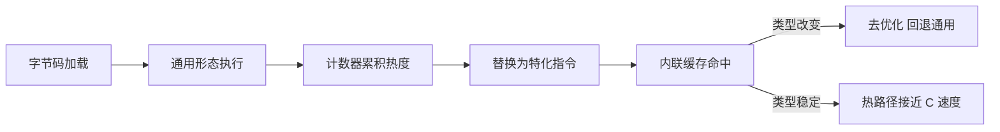
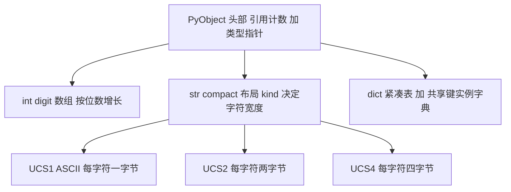
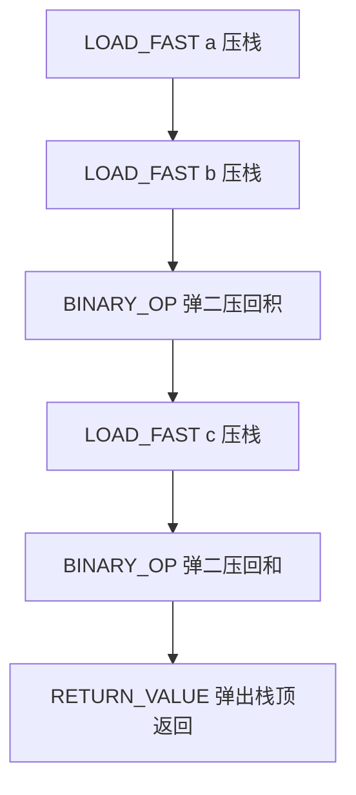
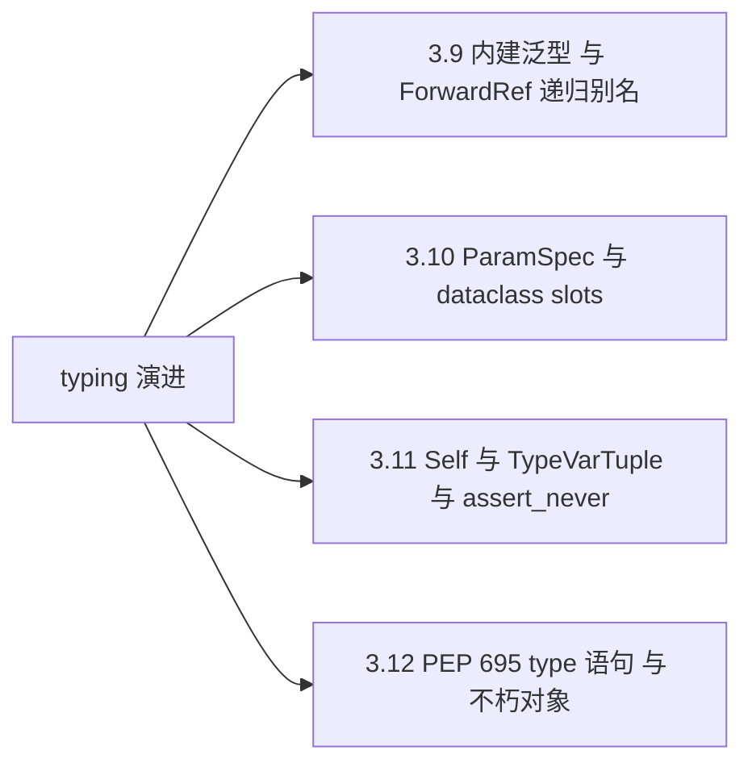
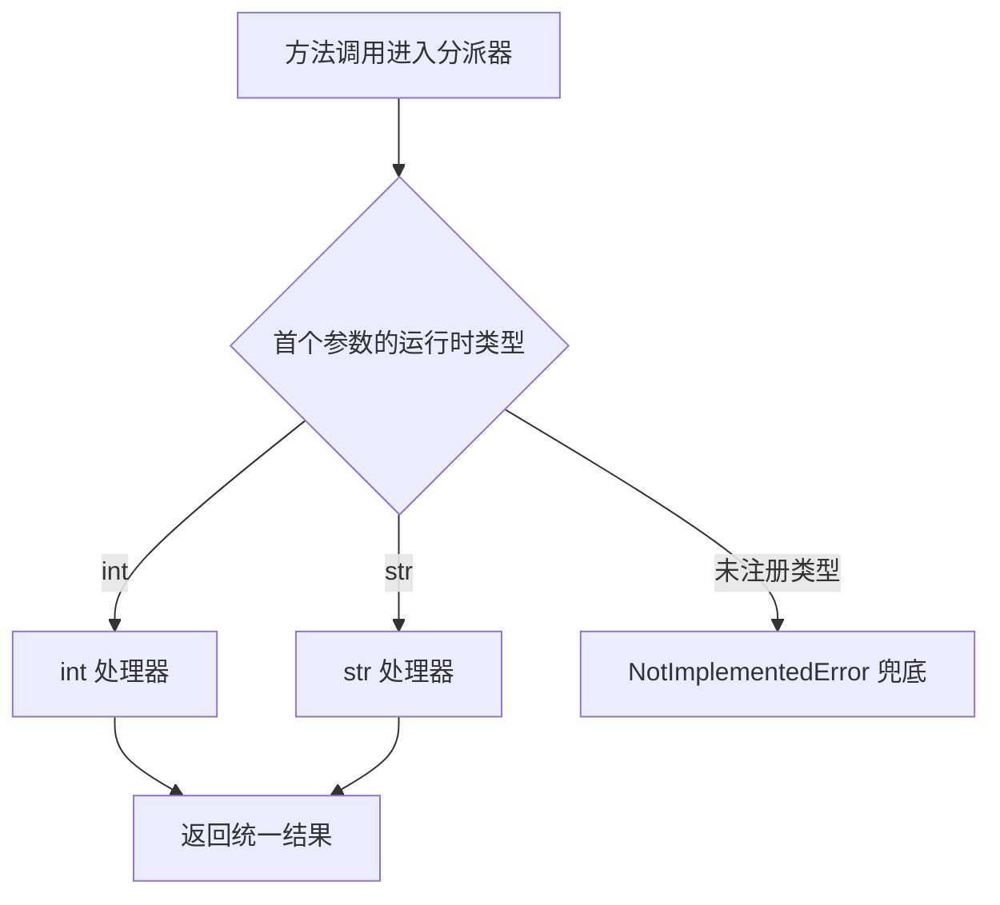
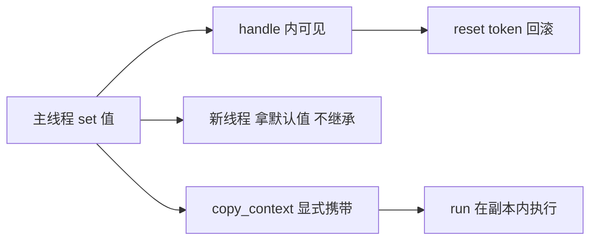
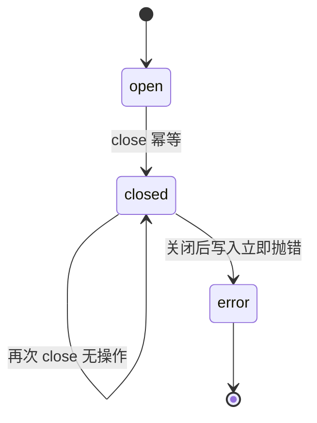
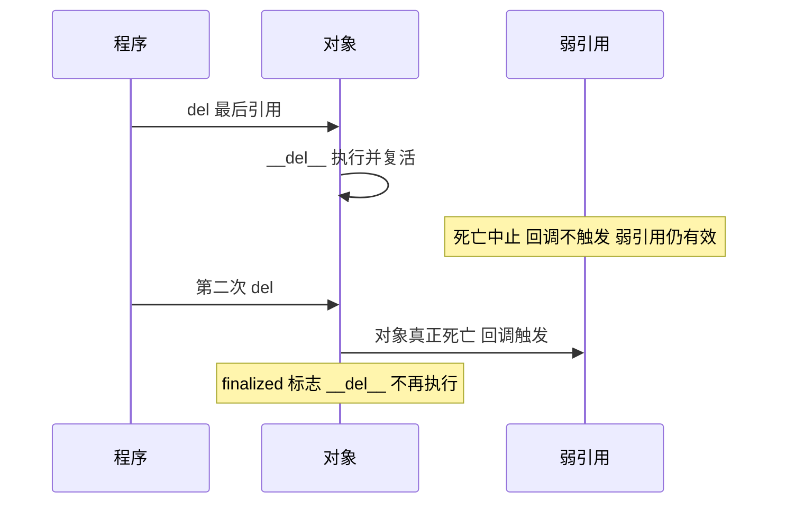
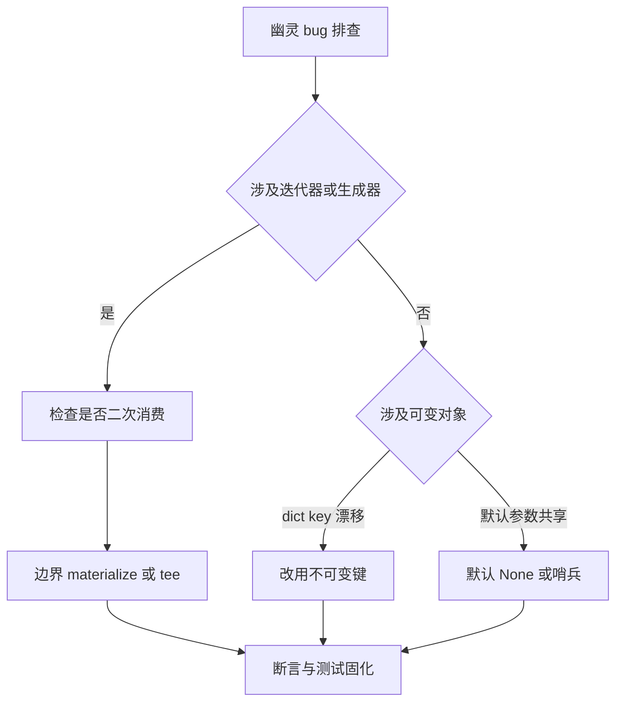

# 第 1 类 · 语言核心与底层(夜间扩产)

> 本篇是语言核心的夜间扩产批次(Q1256–Q1300):CPython 内部补遗(帧对象、code 对象、fast locals、PEP 659 特化、零开销异常、key-sharing dict、str 布局)、typing 与元编程补遗(ParamSpec、递归类型、Self、穷尽性检查)、工程实践(错误消息、防御式分层、配置冻结、contextvars、对象池与 deadline)与疑难杂症(复活时序、weakref 回调、gc 与 __del__ 交互、大整数与拼接的内存行为)。
> 与 01b/01e 互补:那里讲机制全景,这里补容易漏问的细节与最新版本行为;所有结论以 CPython 3.9–3.12 实测为准。
> 每题代码仅标准库、可直接运行,输出即证据。

### Q1256 · 帧对象操作:sys._getframe、f_locals 与 frame.clear

> 难度:★★★★☆ | 标签:帧对象, 内省, CPython

**问**:如何在运行时拿到调用者的帧?帧对象上有哪些可用信息?frame.clear() 是干什么的?

**答**:`sys._getframe(depth)` 直接取当前调用栈上的帧对象:depth 0 是自己,1 是调用者,沿 `f_back` 可以一路走到栈底。帧上最有用的属性:`f_code`(代码对象)、`f_lineno`(当前执行行号,只读)、`f_locals`(局部变量字典)与 `f_globals`。注意 `f_locals` 是「按需物化」的快照——CPython 的局部变量存在连续槽位数组里,访问 f_locals 才把它们拷成字典,所以函数内修改 `locals()` 是未定义行为。`frame.clear()` 用于强制释放一个被 traceback 之类引用挂住的帧的局部变量,防止异常对象长期滞留把整条调用链钉在内存里(Q424 的对症手术);正在执行的帧不能 clear,会抛 RuntimeError。

```python
# file: code/01_语言核心与底层/q1256_frame_introspect.py
import sys


def inner():
    return sys._getframe(1)          # 拿到调用者的帧


def outer():
    caller = inner()
    n, f = 0, sys._getframe()
    while f is not None:             # 沿 f_back 数这条 Python 栈
        n += 1
        f = f.f_back
    return caller.f_code.co_name, caller.f_lineno, sorted(caller.f_locals), n


def raise_deep():
    raise ValueError("boom")


def catch_and_clear():
    try:
        raise_deep()
    except ValueError:
        tb = sys.exc_info()[2]
        current = sys._getframe()
        cleared = 0
        while tb is not None:
            if tb.tb_frame is not current:   # 正在执行的帧不能 clear
                tb.tb_frame.clear()          # 释放 traceback 钉住的局部变量
                cleared += 1
            tb = tb.tb_next
        return cleared


if __name__ == "__main__":
    name, line, locals_, depth = outer()
    print("caller:", name, "at line", line)
    print("caller locals:", locals_)
    print("python stack depth:", depth)
    print("cleared non-current frames:", catch_and_clear())
```

**追问**:1) 为什么 profiler 和调试器都靠帧而不是靠 print?——帧是解释器的一等观测点:f_lineno、f_trace、f_locals 让工具能按行插桩,这也是 sys.settrace(Q552)的物料基础。2) f_locals 的真相是什么?——3.13 前它是「每次访问把 fast locals 拷出的快照字典」,写它不回写帧;PEP 667(3.13)改成读写代理——所以「修改 locals()」在旧版本是未定义行为,不要依赖。3) frame.clear 释放什么?——把帧对局部变量的引用清空,被 traceback 挂住的帧因此不再把整条调用链钉在内存;正在执行的帧不能 clear(RuntimeError)。4) 生产陷阱?——长期持有异常对象/traceback 让整段调用链存活(内存上涨),捕获后处理完要丢弃引用;调试工具生产禁用;依赖「写 f_locals 生效」的代码在 3.13 前是错的。

### Q1257 · code 对象深水区:compile、名字表与 code.replace

> 难度:★★★★☆ | 标签:code 对象, 字节码, 动态执行

**问**:compile 返回的 code 对象里有哪些「名字表」?code.replace 能安全地改什么?同一个 code 怎么变成新函数?

**答**:code 对象的几张表各管一类名字:`co_varnames` 是局部槽位(含参数,顺序即槽位顺序)、`co_cellvars`/`co_freevars` 是闭包相关变量、`co_names` 是全局名与属性名、`co_consts` 是常量池(嵌套函数的 code 对象也在里面)。`compile(src, filename, mode)` 是运行时造 code 的正规入口,mode 取 exec/eval/single。3.8 起的 `code.replace(**kwargs)` 可以以不可变方式派生新 code(改 co_name、co_filename 等),比手拼 types.CodeType 的参数列表安全得多;典型玩法是给 `__code__` 换血实现热修复或重命名,前提是槽位布局兼容。Q547 讲函数对象与 code 的分离,本题补的是 code 自身的表结构与派生工具。

```python
# file: code/01_语言核心与底层/q1257_code_replace.py
import dis
import types

SRC = """
def hello(name):
    return "hello " + name
"""

if __name__ == "__main__":
    module_code = compile(SRC, "<demo>", "exec")
    print("module co_names:", module_code.co_names)
    nested = [c for c in module_code.co_consts if isinstance(c, types.CodeType)]
    fn_code = nested[0]
    print("nested:", fn_code.co_name, "varnames:", fn_code.co_varnames)

    # eval 模式:表达式编译后可直接求值
    expr = compile("1 + 1", "<expr>", "eval")
    print("eval code result:", eval(expr))

    # 不可变派生:改名换文件名,字节码不动
    renamed = fn_code.replace(co_name="hello2", co_filename="<renamed>")
    ns = {}
    exec(module_code, ns)
    hello = ns["hello"]
    print("before swap:", hello("CPython"))
    hello.__code__ = renamed          # 槽位兼容,可以直接换
    print("after swap :", hello("CPython"), "| co_name:", hello.__code__.co_name)
    print("instruction count:", len(list(dis.get_instructions(renamed))))
```

**追问**:1) co_consts 里的嵌套 code 和外层 code 是什么关系?——编译期一次性生成、通过 MAKE_FUNCTION 在运行时绑上 globals 与默认值,这正是「同一份 code 组装多个函数」(Q547)的源头。2) code.replace 是干什么的?——3.8+ code 不可变,replace 返回改了 co_name/co_firstlineno 等字段的新 code,配合函数对象替换做度量与调试;不能改任意字节码语义的「危险开关」。3) 名字表怎么分工?——co_varnames 局部槽、co_cellvars/co_freevars 闭包、co_names 全局与属性名;dis 与静态分析工具都建立在这些表上。4) 生产陷阱?——marshal 持久化 code 跨版本不兼容(字节码随版本变);手动构造 code 对象是黑魔法;改 co_firstlineno 后 linecache 行号失配。

### Q1258 · fast locals:局部变量槽与 locals() 的物化成本

> 难度:★★★☆☆ | 标签:字节码, 性能, 作用域

**问**:为什么函数里 `x = 1; x + 1` 比 `y['x'] = 1` 快得多?`locals()` 返回的是什么,改它有用吗?

**答**:函数内的局部变量编译期就定位到 `co_varnames` 槽位数组,字节码用 `LOAD_FAST` 按索引直取,是所有名字查找里最快的(对比 `LOAD_GLOBAL` 要查两套字典,见 Q548)。代价是 f_locals 默认不是字典:调用 `locals()` 或访问 `frame.f_locals` 时才把槽位数组物化成新字典,热循环里反复调 `locals()` 是可测出的开销;3.13 的 PEP 667 把 f_locals 改为真·代理视图,但「别在函数里改 locals()」的结论不变——那是未定义行为,优化器不保证回写。模块级与类体没有 fast locals(走 LOAD_NAME),这也是为什么「把热代码包进函数」总是更快。

```python
# file: code/01_语言核心与底层/q1258_fast_locals.py
import dis
import sys


def sample(a, b):
    c = a + b
    d = c * 2
    return d


if __name__ == "__main__":
    print("co_varnames:", sample.__code__.co_varnames)
    print("co_nlocals :", sample.__code__.co_nlocals)
    ops = [i.opname for i in dis.get_instructions(sample)]
    print("opnames    :", ops)

    captured = []
    def probe():
        x = 1
        captured.append(sys._getframe())
        return x
    probe()
    f = captured[0]
    print("f.f_locals is materialized snapshot:", f.f_locals)
    print("修改它不会影响原槽位 — 未定义行为,勿用")
```

**追问**:1) 为什么类体里 `x = 1; [x for _ in range(1)]` 会 NameError?——类体走 LOAD_NAME,而推导式有独立函数作用域,其 fast locals 里没有 x,只能查 globals(见 Q528)。2) 局部变量为什么快?——编译期定槽位,LOAD_FAST 按索引取帧内数组,零哈希;globals 要哈希查找加 builtins 回退,这是「局部变量化」优化的根据(Q548)。3) locals() 的物化机制?——调用时把 fast locals 拷成新字典(3.13 前是快照),改它不回写帧;exec/eval 里拿到的 locals 同样是拷贝。4) 生产陷阱?——热循环里调 locals() 做调试输出(物化成本);exec 中「修改 locals」不生效;依赖 locals() 键序的逻辑脆弱。

### Q1259 · PEP 659 自适应特化解释器:QUICKENING 与内联缓存

> 难度:★★★★★ | 标签:PEP 659, 解释器, 性能

**问**:3.11 声称性能提升 25%,靠的核心机制是什么?它和 JIT 的区别在哪?

**答**:PEP 659 给字节码加了「自适应特化」:每条指令带计数器与内联缓存,初版是通用形态慢速执行;某条指令热了(计数到阈值)会被替换成按观测类型特化的形态——如 `BINARY_OP` 特化成 `BINARY_OP __mul__` 并把类型与函数指针缓存进指令流内联缓存,下次同类型直接命中,不再查表分派。类型一变就「去优化」回通用形态,所以它是针对「动态但局部稳定」代码的方案:无编译产物、无预热抖动、内存可控,和 PyPy 的 tracing JIT 是不同取舍。3.12 又加了 COPY/FREEZE 相关指令与更深的特化(如 super 调用、二进制子类检查)。工程含义:3.11+ 上「同类型重复操作」的代码自动变快,而高度多态的调用点吃不到红利。

```python
# file: code/01_语言核心与底层/q1259_adaptive_interpreter.py
import dis
import sys
import timeit


def hot(a, b):
    return a * b + 1


if __name__ == "__main__":
    print("python:", sys.version.split()[0])
    if sys.version_info >= (3, 11):
        for _ in range(200):          # 让计数器超阈值,触发 quickening
            hot(2, 3)
        print("3.11+ 特化后可见 BINARY_OP __mul__ 等专化形态:")
        dis.dis(hot, show_caches=False)
    else:
        ops = [i.opname for i in dis.get_instructions(hot)]
        print("当前版本无 PEP 659,始终通用执行,opnames:", ops)
    n = 200000
    print("call x%d: %.1f ms" % (n, timeit.timeit(lambda: hot(3, 4), number=n) * 1000))
```

**追问**:1) 特化会「锁死」类型吗?——不会,内联缓存在类型不匹配时立即回退通用形态并重新计数,正确性永远优先于速度。2) 特化的成本模型?——冷路径「计数+泛化」零额外开销,热路径才特化成专用指令(如 BINARY_OP_ADD_FLOAT);deopt 后重新计数,所以混合类型输入会反复 deopt 失去收益。3) 内联缓存的结构?——指令后跟缓存条目(类型版本、指针),版本不匹配即回退;3.11/3.12 特化指令家族持续扩展,LOAD_ATTR/SEND 等都有对应特化。4) 生产陷阱?——microbenchmark 用混合类型输入强制 deopt 得出错误结论;性能分析要用生产形态的输入分布;依赖「手写循环绕过解释器」的优化在特化下常常已经白做。



### Q1260 · 3.11 零开销异常:异常表让 try 变免费

> 难度:★★★★☆ | 标签:异常, CPython, 性能

**问**:都说「try 不要包太多代码是怕慢」,3.11 之后这个说法还成立吗?

**答**:3.10 及以前,进入 try 要执行 SETUP_FINALLY 之类的指令,在求值栈上压清理块, happy path 有固定小开销;3.11 起改用「零开销异常」设计:编译期把每个 try 的 handler 范围写进 code 对象的异常表(entry: 起止偏移、handler 偏移、栈深度),运行时不进 try 就完全不执行任何指令,只有真的抛异常时才查表回退栈深度。所以 3.11+ 的建议是「放心用细粒度 try」,把可能失败的窄语句包起来;真正要防的是异常本身昂贵(traceback 采集、__del__ 链)与 except 块里的误吞。跨版本代码照旧可以用 try,它从来不是性能武器,只是 3.11 后连最后一点借口都没了。

```python
# file: code/01_语言核心与底层/q1260_zero_cost_exc.py
import sys
import timeit


def work(x):
    return x * 2


def with_try(x):
    try:
        return work(x)
    except Exception:
        raise


if __name__ == "__main__":
    print("python:", sys.version.split()[0])
    n = 200000
    t_plain = timeit.timeit(lambda: work(7), number=n)
    t_try = timeit.timeit(lambda: with_try(7), number=n)
    print("plain: %.1f ms | wrapped in try: %.1f ms" % (t_plain * 1000, t_try * 1000))
    if sys.version_info >= (3, 11):
        print("3.11+: try 本身零指令成本,异常表只在抛出时寻址")
    else:
        print("3.10-: SETUP_FINALLY 有少量固定开销,但同样便宜")
```

**追问**:1) 异常表在 code 对象里怎么看?——`dis.dis` 3.11+ 的 ExceptionTable 输出段,或 `co_exceptiontable` 字节流(需按 PEP 657 编码解析), traceback 的精确行号(Q424)也来自它。2) 3.11 前后差在哪?——旧版 SETUP_FINALLY/POP_BLOCK 进入 try 就要付指令成本;3.11 异常表只在异常发生时查表,try 本身零指令——EAFP 控制流在 3.11+ 更便宜。3) 表的编码与查找?——按 PEP 657 紧凑编码「字节码区间→handler 偏移」,抛异常时查最内层匹配区间;traceback 精确到指令级行号。4) 生产陷阱?——3.10- 解释器仍要付 try 成本,跨版本性能结论要分开测;零成本指「不抛异常时」,真正抛异常构造 traceback 仍贵,高频路径避免真实抛出。

### Q1261 · 不朽对象 PEP 683:为什么 refcount 观测失真了

> 难度:★★★★☆ | 标签:引用计数, PEP 683, CPython

**问**:`sys.getrefcount(None)` 返回的数字在 3.12 里突然变成 40 多亿,是 bug 吗?不朽对象解决什么问题?

**答**:不是 bug。3.12 的 PEP 683 把内置单例(None、True、False、小的 int、部分静态字符串)做成「不朽对象」:refcount 被固定为一个特殊大值,永远不增不减,也不再参与 GC 跟踪。动机是 free-threading(PEP 703,Q411):共享的引用计数需要昂贵的原子操作或锁,而单例本来就不该被回收,冻结其计数后增减可以直接跳过;顺带也省掉了海量小对象(如 False)的计数器写,降低多核缓存争用。副作用是依赖 getrefcount 观测引用情况的老代码、以及靠计数判断「唯一持有」的 C 扩展,在这些对象上会失真——这正是本题的考点:refcount 是实现细节,不是 API 契约。

```python
# file: code/01_语言核心与底层/q1261_immortal_objects.py
import sys

if __name__ == "__main__":
    print("python:", sys.version.split()[0])
    print("getrefcount(None) :", sys.getrefcount(None))
    print("getrefcount(True) :", sys.getrefcount(True))
    print("getrefcount(2**60):", sys.getrefcount(2 ** 60))
    x = object()
    print("plain object      :", sys.getrefcount(x), "传入即临时 +1")
    if sys.version_info >= (3, 12):
        print("3.12+ PEP 683:内置单例是不朽对象,计数恒为巨大常量")
    else:
        print("当前版本:以上是真实计数,会随全局引用增减")
```

**追问**:1) 怎么判断一个对象是否不朽?——3.12 起有私有 C API `_Py_IsImmortal`;Python 层没有公开 API,只能用 getrefcount 的大小与不变性间接推断,不要在生产逻辑里依赖它。2) 不朽对象为什么让 refcount 观测失真?——引用计数字段取饱和值永不增减,getrefcount 返回巨大常数;释放路径直接跳过——基于 refcount 波动的内存诊断脚本对 None/True/小整数等会误判。3) 不朽的收益?——fork 写时复制友好(共享对象不再被计数写触发拷贝,1b Q404 的 fork+COW 故事)、GC 免扫常驻对象、去掉「小整数数组计数更新」的锁竞争。4) 生产陷阱?——3.12+ 与旧版本 refcount 行为不一致,跨版本工具要分支;依赖「计数差值」做 instrumentation 的库全部失真。

### Q1262 · 实例字典的 key 共享:同类实例为什么省内存

> 难度:★★★★☆ | 标签:dict, 内存, CPython

**问**:一百万个同类的实例,它们的 `__dict__` 会重复存同样的 key 吗?什么时候这个优化会失效?

**答**:CPython 3.3 起,在 `__init__` 里按固定顺序赋值的实例字典用「共享键」(key-sharing)布局:所有实例的字典共享同一份 key 表,各自只存 values 数组,所以 `sys.getsizeof(obj.__dict__)` 明显小于等价的字面量字典。失效条件按实例粒度:某个实例添加了共享表里没有的新属性,它就「分叉」成普通合并字典,其余实例继续共享;若类的实例布局高度发散(如 setattr 随意加属性),共享意义就不大了。对比方案是 `__slots__`(Q008/Q423)——省得更彻底但失去动态性;共享键的价值正是「slots 的省内存 + dict 的灵活性」折中。

```python
# file: code/01_语言核心与底层/q1262_key_sharing_dict.py
import sys


class Point:
    def __init__(self, x, y):
        self.x = x
        self.y = y


if __name__ == "__main__":
    p1, p2 = Point(1, 2), Point(3, 4)
    plain = {"x": 1, "y": 2}
    print("instance __dict__ sizeof:", sys.getsizeof(p1.__dict__))
    print("literal dict     sizeof:", sys.getsizeof(plain))
    print("same keys object layout:", p1.__dict__.keys() == p2.__dict__.keys())
    p1.z = 9                       # 分叉:仅 p1 脱离共享键
    print("after divergence keys still align:", p1.__dict__.keys() == p2.__dict__.keys())
    print("p2 untouched:", p2.x, p2.y)
```

**追问**:1) 怎么实测共享布局的总收益?——tracemalloc 对比「10 万同构实例」与「各带一个独特属性」的内存,再和等价 __slots__ 类对比,三者差距就是共享键的位置。2) 共享键的成立条件?——实例在 __init__ 里按相同顺序赋值全部属性;一旦有实例「多出」属性或顺序不同,键表版本分裂,该实例退回独立 dict。3) 底层布局?——类持有一份键表模板,实例只存值数组;键表带版本号,修改触发分裂——这是「同构实例」省内存的机制。4) 生产陷阱?——运行期动态加属性悄悄破坏共享;海量实例应直接上 __slots__(连值数组都更省);监控对比要用 Pympler/tracemalloc 而不是 getsizeof(Q556)。

### Q1263 · 列表 over-allocation:append 的均摊与增长曲线

> 难度:★★★☆☆ | 标签:list, 内存, 性能

**问**:list.append 号称均摊 O(1),「均摊」具体是怎么来的?为什么 `list(range(n))` 比 `for + append` 省内存?

**答**:list 底层是指针数组,写满时按 `newsize + newsize >> 3 + 6` 的公式超额分配(约 12.5% 余量)重新 malloc 并搬迁,单次扩容 O(n) 但按几何级数摊薄,所以 append 均摊 O(1)。代价是「装得多、报得也多」:`sys.getsizeof` 反映的是容量不是长度,长 list 的余量可能白占 10%+ 内存;而 `list(range(n))`、列表推导式(3.12+ PEP 709 后配合 length_hint)这类「预先知道长度」的构造能一次分配到位,没有中间搬迁。反向操作 `del lst[i]` 是 O(n) 搬迁,`pop()` 从尾部走则不缩容(除非余量过大),所以「不断 pop 到空」的 list 不会自动把内存还给分配器。

```python
# file: code/01_语言核心与底层/q1263_list_overalloc.py
import sys

if __name__ == "__main__":
    lst = []
    prev = sys.getsizeof(lst)
    marks = []
    for i in range(64):
        lst.append(i)
        s = sys.getsizeof(lst)
        if s != prev:                      # 容量跳变的时刻
            marks.append((len(lst), s))
            prev = s
    print("growth marks:", marks)
    print("一次到位:", sys.getsizeof(list(range(64))))
    print("append 曲线:扩容间距越来越长,均摊 O(1)")
```

**追问**:1) 如何把 list 的余量挤掉?——`lst = lst[:]` 或 `list(lst)` 按当前长度重分配一次, shrink 的标准手法;numba/数组场景则应直接换 array(Q496)。2) 增长曲线长什么样?——CPython list 按 ~1.125 倍渐进增长(倍率随大小递减),append 均摊 O(1);已知长度时 list(it) 一次精确分配优于 append 循环。3) 底层 realloc 行为?——PyMem_Realloc 尽量原地扩展,失败才迁移拷贝;capacity 是「可容纳」,len 是逻辑长度,getsizeof 反映 capacity 而不是 len。4) 生产陷阱?——构建百万级列表用 append 反复 realloc,先 list(range)/推导式;内存敏感场景构建完挤余量;以为 del 元素会缩容(不会,capacity 保留)。

### Q1264 · str 的内部布局:kind 与 compact,拼接如何升宽

> 难度:★★★★☆ | 标签:str, 内存, CPython

**问**:同样是 10 个字符,`"a"*10` 和 `"中"*10` 的 getsizeof 差 35 字节,为什么?一个字符串的「宽度」会变吗?

**答**:CPython 的 str 是 compact 布局:对象头 + 字符数据紧挨着,数据宽度由「最大码点」决定,分三档 kind——UCS1(纯 ASCII/latin-1,1 字节/字符)、UCS2(≤0xFFFF,2 字节)、UCS4(4 字节)。所以 10 个 `a` 是 59 字节、10 个 `中` 是 94 字节(2×10+头)、10 个 emoji 是 134 字节。kind 在创建时定型,拼接等操作按两边的最大 kind 产出结果——一个纯 ASCII 串混入一个 `中`,结果整体升为 UCS2,内存翻倍;这就是「日志里混入一个 emoji,内存多一截」的机制解释。读操作(切片、find)不改变 kind,`str.encode` 才是跨宽度常量化的出口。

```python
# file: code/01_语言核心与底层/q1264_str_layout.py
import sys

if __name__ == "__main__":
    samples = [("ascii UCS1", "a" * 10),
               ("中文 UCS2", "中" * 10),
               ("emoji UCS4", "\U0001f600" * 10)]
    for tag, s in samples:
        print("%-10s len=%d sizeof=%d" % (tag, len(s), sys.getsizeof(s)))
    print("升宽: 'aa' + '中' sizeof =", sys.getsizeof("aa" + "中"),
          "| 'aa' sizeof =", sys.getsizeof("aa"))
    print("编码后回到字节宽度:", len(("a" * 10).encode("ascii")), "bytes")
```

**追问**:1) 为什么 `sys.getsizeof("")` 不是 0?——compact 布局也有固定对象头(约 49 字节),海量小字符串的开销大头是头部而非数据,这也是 intern 与缓存存在的理由(Q405)。2) kind 升宽什么时候发生?——三种宽度(1/2/4 字节)对应拉丁/BMP/星平面;拼接更宽字符时整串重分配升宽;ASCII 串有最紧凑的布局,这就是「少用 emoji 键」的微观依据。3) compact 布局的意义?——PEP 393 把字符数据紧跟对象头存放、去掉指针间接,内存省且缓存友好;getsizeof 反映 kind 与头部大小。4) 生产陷阱?——海量小串(百万级标签)头部开销远超数据,intern 或改编码;流式拼接依赖 += 的 refcount==1 特化不可移植,join 才是正解(Q1293)。



### Q1265 · dict 视图对象:keys/values/items 是动态窗口

> 难度:★★☆☆☆ | 标签:dict, 视图

**问**:`d.keys()` 返回的是列表吗?持有它,原字典后来加了键,视图会变吗?

**答**:keys/values/items 返回的是视图对象(view),不是快照:它动态反映字典当前状态,后续增删改立即可见,len 与 in 都是 O(1)。keys 视图实现集合协议,可以直接做 `&`、`|`、`-` 运算,这也是「求两个字典公共键」的地道写法;items 视图支持按 `(key, value)` 元组迭代,是同步遍历键值的标准姿势。反过来,视图是原字典的从属物:字典在视图存活期间被修改,正在进行的迭代会抛 RuntimeError(和直接迭代字典一样);需要与修改隔离时,用 `list(d.items())` 显式拷贝快照。

```python
# file: code/01_语言核心与底层/q1265_dict_views.py
if __name__ == "__main__":
    d = {"a": 1, "b": 2}
    keys, items = d.keys(), d.items()
    print("len before:", len(keys))
    d["c"] = 3                        # 视图动态跟随
    print("len after :", len(keys), "| 'c' in keys:", "c" in keys)
    print("set op keys & {a,z}:", keys & {"a", "z"})
    d["b"] = 20
    print("items reflect updates:", sorted(items))
    snapshot = list(items)            # 需要隔离时才拷贝
    d["d"] = 4
    print("snapshot stays:", len(snapshot), "| live now:", len(items))
```

**追问**:1) 为什么 values 视图不支持集合运算?——它没有键可判等,两个 value 相同无法定义集合语义,所以 Python 只给 keys 与 items(键唯一可作集合)实现了 Set 协议。2) 视图的动态性意味着什么?——视图是底层 dict 的实时窗口,dict 修改视图立即反映;遍历视图时修改 dict 抛 RuntimeError(size changed),需要快照就先 list(view)。3) 底层协议?——KeysView/ItemsView 注册为 collections.abc.Set(动态集合,支持 & | -),ValuesView 只是 Collection;视图轻量不拷贝数据。4) 生产陷阱?——把 items 视图当持久集合缓存(dict 变了它跟着变);遍历中增删键;「快照遍历」与「动态遍历」语义混用出隐蔽 bug。

### Q1266 · 栈式虚拟机:字节码如何在求值栈上跑起来

> 难度:★★★☆☆ | 标签:字节码, 解释器

**问**:CPython 的字节码为什么叫「栈式」?`a * b + c` 在栈上发生了什么?

**答**:CPython 是基于栈的虚拟机:指令不直接寻址寄存器,而是把操作数压进一个求值栈(stack),运算指令从栈顶取数、把结果压回。`a * b + c` 编译为 LOAD_FAST a、LOAD_FAST b(压两个操作数)、BINARY_OP(弹出两个,相乘后压回积)、LOAD_FAST c、再 BINARY_OP 相加、RETURN_VALUE 弹出栈顶返回。栈式设计的优点是指令紧凑(操作数隐含在栈序里)、解释器实现简单;代价是指令条数多、难以做寄存器分配。3.11 的内联缓存(Q1259)与零开销异常(Q1260)都建立在「指令 + 求值栈 + 异常表」这套骨架上,读懂栈的进出是读 dis 输出的第一步。

```python
# file: code/01_语言核心与底层/q1266_eval_stack.py
import dis


def calc(a, b, c):
    return a * b + c


if __name__ == "__main__":
    for ins in dis.get_instructions(calc):
        print("%4d %-16s %s" % (ins.offset, ins.opname, ins.argrepr))
    print("栈视角: 两次 LOAD_FAST 压栈 -> BINARY_OP 弹二压一 -> LOAD_FAST c -> BINARY_OP -> RETURN_VALUE 弹出")
```

**追问**:1) 为什么 traceback 能给出精确行号?——每条指令带着行号表(linetable,PEP 657 后按指令粒度),异常沿栈回退时逐帧查表即可定位(见 Q409)。2) 为什么选栈式虚拟机?——指令无需编码操作数地址,编译简单、字节码紧凑;寄存器式(Lua)分派次数少但要寄存器分配——CPython 选栈式,3.11 特化+内联缓存补回性能。3) 求值循环的演进?——大 switch 分派,3.11 起栈顶缓存与自适应特化、computed goto;每条指令的栈深度由编译器静态保证。4) 生产陷阱?——手写字节码/改 co_code 是黑魔法;「指令数少=快」不成立(分派、缓存、特化才是关键);字节码跨版本不兼容,marshal 缓存要按版本隔离。



### Q1267 · ParamSpec:保留签名的装饰器该怎么注解

> 难度:★★★★☆ | 标签:typing, ParamSpec, 装饰器

**问**:写一个透传所有参数的装饰器,类型注解怎么写才能让 mypy 知道 `add(1, 2)` 依然合法?`Callable[..., R]` 差在哪?

**答**:`Callable[..., R]` 的 `...` 把参数类型「蒸发」了——被装饰后调用 `add(1, "x")` 静态检查器不再报错。3.10 的 `ParamSpec`(PEP 612)解决这件事:`P = ParamSpec("P")`,装饰器签名写作 `(func: Callable[P, R]) -> Callable[P, R]`,P 是「参数列表本身」的类型变量,把被装饰函数的参数形状原样搬到返回的 Callable 上;配合 `Concatenate[P, X]` 还能表达「装饰器注入了首个参数」的变换(如给 handler 前面塞一个 logger)。运行时配 `functools.wraps`(Q013)保住 `__name__`/`__doc__`/`__wrapped__`,静态配 ParamSpec 保住签名——两件事是互补的,面试里要能分开说。3.9 及以前只能用 `TypeVar("F", bound=Callable)` 做恒等透传,见 Q1270 的对比。

```python
# file: code/01_语言核心与底层/q1267_paramspec.py
from __future__ import annotations

import functools
import inspect

try:
    from typing import Callable, ParamSpec, TypeVar
    P = ParamSpec("P")
    R = TypeVar("R")
    HAS_PARAMSPEC = True
except ImportError:                      # 3.9:typing.ParamSpec 尚不存在
    from typing import Callable, TypeVar
    P = None
    R = TypeVar("R")
    HAS_PARAMSPEC = False


def logged(func):
    @functools.wraps(func)
    def wrapper(*args, **kwargs):
        print("call", func.__name__)
        return func(*args, **kwargs)
    return wrapper


@logged
def add(a: int, b: int = 0) -> int:
    return a + b


if __name__ == "__main__":
    print("HAS_PARAMSPEC:", HAS_PARAMSPEC)
    print("runtime signature preserved:", inspect.signature(add))
    print("name preserved:", add.__name__, "| call:", add(2, b=3))
    if HAS_PARAMSPEC:
        print("静态层: func: Callable[P, R] -> Callable[P, R]")
    else:
        print("3.9 请用 TypeVar bound=Callable 的恒等式写法, 见 q1270")
```

**追问**:1) ParamSpec 能表达「包装器少一个参数」吗?——能,`Callable[Concatenate[str, P], R]` 表示包装后首位固定为 str,其余参数跟随 P,3.10 起可用。2) ParamSpec 与 TypeVar 的分工?——TypeVar 保持「类型不丢」(T 进 T 出),ParamSpec 捕获「整个参数表」;包装体内用 P.args/P.kwargs 转发,调用方签名与返回类型都保留。3) 运行时形态?——ParamSpec/Concatenate 是纯静态元数据,解释器不校验;检查器需要新版 mypy/pyright 才完整支持。4) 生产陷阱?——装饰器注解成 **kwargs: Any,调用方全部丢类型;3.10- 退化成 Callable[..., R];Concatenate 只能固定头部参数,尾部固定表达不了。

### Q1268 · 递归类型别名:JSON 树怎么表达

> 难度:★★★★☆ | 标签:typing, 递归类型

**问**:JSON 的类型是「值里套值」,type hint 怎么写递归结构?3.12 的 `type` 语句好在哪?

**答**:递归别名靠前向引用:模块级 `JSON = Union[None, bool, int, float, str, List["JSON"], Dict[str, "JSON"]]`,字符串形式让别名先定义后引用,静态检查器与 `typing.get_type_hints` 都能解开。运行时这个别名只是个普通 Union 对象,可以拿来做 isinstance 风格的递归校验。痛点是老语法笨重且不能带类型参数;3.12 的 PEP 695 `type JSON = None | bool | int | float | str | list[JSON] | dict[str, JSON]` 把递归别名变成一等语法——作用域干净、惰性求值、支持泛型参数(type Tree[T] = ...),建议新项目按版本采用。工程上真正的坑在验证器:递归结构必须递归校验且注意深度(见 Q1299 的爆栈)。

```python
# file: code/01_语言核心与底层/q1268_recursive_alias.py
import json
from typing import Dict, List, Union

JSON = Union[None, bool, int, float, str,
             List["JSON"], Dict[str, "JSON"]]     # 字符串前向引用,3.9 可用


def validate(obj) -> bool:
    if obj is None or isinstance(obj, (bool, int, float, str)):
        return True
    if isinstance(obj, list):
        return all(validate(x) for x in obj)
    if isinstance(obj, dict):
        return all(isinstance(k, str) and validate(v) for k, v in obj.items())
    return False


if __name__ == "__main__":
    doc = json.loads('{"a": [1, 2.5, null, true], "b": {"c": "text"}}')
    print("valid doc  :", validate(doc))
    print("invalid doc:", validate({1: "x"}))
    print("alias type :", type(JSON).__name__, "| 递归成员可解开")
    if __import__("sys").version_info >= (3, 12):
        print("3.12+: type JSON = ... 一等递归别名语法")
```

**追问**:1) typing.get_type_hints 能解开这个别名吗?——能,它会递归求值 ForwardRef;但对「类型变量指向自身」的病态定义会抛 RecursionError,递归别名必须有基例。2) 为什么要显式别名语法?——裸赋值有「变量还是别名」歧义;3.10 用 `X: TypeAlias = ...`,3.12 的 `type X = ...` 内建惰性求值,递归定义不再需要字符串。3) 惰性机制?——3.12 TypeAliasType 按需展开,3.10- 靠字符串前向引用 + get_type_hints 解析;递归结构的基例(标量/空)必须有,否则解析不终止。4) 生产陷阱?——运行时解析深层递归别名性能差甚至爆栈;3.10 无 type 语法时字符串引用易拼错;别名与 JSON schema 两处维护漂移。

### Q1269 · typing.Self:链式 API 的返回类型怎么标

> 难度:★★★☆☆ | 标签:typing, Self, API 设计

**问**:`Circle().move(3).scale(2)` 链式调用,返回类型怎么注解才不是每次退回基类?子类继承后还能拿到 Circle 吗?

**答**:老写法 `-> "Shape"` 会在链式调用时把类型丢回基类,后续子类专有方法在静态检查器眼里不存在。两条正路:3.11+ 直接 `from typing import Self`,方法注解 `def move(self, dx) -> Self`,含义是「返回与 self 同一个运行时类型」;更早版本用 F-bound 技巧 `T = TypeVar("T", bound="Shape")`,方法签名 `def move(self: T, dx) -> T`。两者对「返回 self 的方法、返回新实例但同类的方法」都成立,也是构建 Builder/流式 API 的标准答案。注意区分:返回 `type(self)(...)` 新实例的场景同样用 Self;而 `__new__`/classmethod 场景用 `-> Self` 也比 `-> "Cls"` 准确。

```python
# file: code/01_语言核心与底层/q1269_self_type.py
from __future__ import annotations

from typing import TypeVar

T = TypeVar("T", bound="Shape")       # 3.11+ 可直接 from typing import Self


class Shape:
    def move(self: T, dx: float) -> T:
        self.x = getattr(self, "x", 0.0) + dx
        return self

    def scale(self: T, k: float) -> T:
        self.k = getattr(self, "k", 1.0) * k
        return self


class Circle(Shape):
    pass


if __name__ == "__main__":
    c = Circle().move(3).scale(2)     # 静态检查器知道整条链都是 Circle
    print(type(c).__name__, c.x, c.k)
    s = Shape().move(1)
    print(type(s).__name__, s.x)
```

**追问**:1) Self 与 TypeVar bound 写法的差别?——语义等价,Self 更短且不会泄漏类型变量到类作用域;bound 写法在 3.10- 是唯一选择,迁移时直接替换注解即可。2) Self 的语义边界?——代表「当前类的实例类型」:实例方法返回 self 链、classmethod 返回 cls 实例;子类调用时自动收窄成子类类型——这是链式 builder 的正解。3) 底层机制?——PEP 673 在 3.11 落地 typing.Self;3.10- 用 TypeVar("TSelf", bound="...") 模拟;静态检查器把 Self 解析到「定义所在类的当前绑定」。4) 生产陷阱?——链式 API 注解成基类或 None,子类调用方类型崩;把 Self 用在模块级函数(语义是「这个函数的返回类型」没意义);3.10- 模拟写法在继承深了以后解不开。

### Q1270 · 装饰器类型保持三式:TypeVar、ParamSpec 与 overload

> 难度:★★★☆☆ | 标签:typing, 装饰器

**问**:不丢类型的装饰器注解,有哪几种流派?各适合什么场景?

**答**:三种主流写法。其一,恒等式 `F = TypeVar("F", bound=Callable[..., object])`,装饰器 `-> F`:最简单,表达「进什么出什么」,适合不改变签名、不改默认值的透明装饰器,3.9 也能用。其二,ParamSpec(PEP 612,见 Q1267):能表达签名变换,如注入参数、可选化参数,是 3.10+ 的首选。其三,`@overload`:装饰器行为因参数而异(如 register 装饰器返回原函数或注册器)时,为包装器枚举具体签名,静态检查器按调用形态匹配。运行时永远配 `functools.wraps`;三式的选择标准是「签名是否被改变」,面试时按这个判断链讲最清晰。

```python
# file: code/01_语言核心与底层/q1270_decorator_typing.py
from __future__ import annotations

import functools
import inspect
from typing import Callable, TypeVar

F = TypeVar("F", bound=Callable[..., object])   # 流派一:恒等透传


def log_calls(func: F) -> F:
    @functools.wraps(func)
    def wrapper(*args, **kwargs):
        return func(*args, **kwargs)
    return wrapper


@log_calls
def greet(name: str, punct: str = "!") -> str:
    return "hi " + name + punct


if __name__ == "__main__":
    print("runtime signature:", inspect.signature(greet))
    print(greet("lily"))
    print("流派二 ParamSpec 见 q1267;流派三 @overload 适合返回类型随参数变化的注册器")
```

**追问**:1) 为什么 `bound=Callable[..., object]` 而不是 `bound=Callable`?——裸 Callable 缺类型参数,静态检查器会拒绝;`[...]` 表示「任意参数表」,是 bound 场景的标准写法。2) 三式怎么分工?——TypeVar(F, bound=Callable) 保持「整个函数对象」类型;ParamSpec 保留参数表并允许改造返回值;overload 表达分支签名;装饰器工厂(带参数)要多包一层泛型函数。3) bound 捕获的细节?——F 约束到 Callable 后,装饰器返回 F 即原函数类型;要在包装体内改签名就用 ParamSpec 而不是 F。4) 生产陷阱?——装饰器返回 Any 让下游全部失明;漏 wraps 丢签名与元信息;overload 桩与实现不一致导致 "no overload variant" 误报。

### Q1271 · TypeVarTuple:可变长度泛型元组

> 难度:★★★★☆ | 标签:typing, PEP 646, 泛型

**问**:`Tuple[int, str]` 能精确表达两个元素,「任意长度且每个位置类型各异」的元组怎么标?shape 级别的张量库为什么需要它?

**答**:3.11 的 PEP 646 引入 TypeVarTuple 与 Unpack:`Ts = TypeVarTuple("Ts")`,`tuple[Unpack[Ts]]` 表示「捕获任意数量的类型参数」——`Array[int, str, float]` 是三元素、每个位置类型独立,而不是 `Tuple[T, ...]` 那种「同构任意长」。典型应用是张量形状(NCHW 每维一个类型参数)、可变参数回调的精确签名、`zip`/`map` 返回值的多位置类型追踪。运行时它只是静态工具,不产生任何开销;3.10- 的替代方案只有 `Tuple[T, ...]`(丢位置信息)或手写若干 arity 的 overload。与 ParamSpec 对比着记:ParamSpec 捕获「函数参数列表」,TypeVarTuple 捕获「类型列表」,一个面向调用,一个面向类型容器。

```python
# file: code/01_语言核心与底层/q1271_typevartuple.py
from __future__ import annotations

import sys


def widths_of(*rows: tuple) -> list:
    return [len(r) for r in rows]


if __name__ == "__main__":
    print("python:", sys.version.split()[0])
    if sys.version_info >= (3, 11):
        from typing import TypeVarTuple, Unpack   # PEP 646
        Ts = TypeVarTuple("Ts")
        print("3.11+: tuple[Unpack[Ts]] 可表达异构可变元组")
    else:
        print("3.10-: 只有 Tuple[T, ...] 的同构近似")
    print(widths_of((1, 2), ("a",), (True, False, None)))
```

**追问**:1) Unpack 和 ParamSpec 能混用吗?——可以,`Callable[Concatenate[int, P], tuple[Unpack[Ts]]]` 这类组合 3.11+ 合法,但可读性急剧下降,建议只在公共 API 层使用。2) TypeVarTuple 的语义?——Ts 代表「类型元组」,Unpack[Ts] 在类型位置展开;典型场景 shape 类 API:Array[float, Height, Width];PEP 646、3.11 落地。3) 与 *args 的关系?——`def f(*args: Unpack[Ts])` 让变长参数各位置类型都被追踪;旧式 Tuple[T, ...] 只能表达「全部同型」。4) 生产陷阱?——3.10- 不可用,需要版本门控;内部 API 也上 Ts 会把类型签名变成天书;泛型别名里 *Ts 与 *args 混淆导致检查器报错。



### Q1272 · 回调协议:__call__ 的 Protocol

> 难度:★★★☆☆ | 标签:typing, Protocol, 回调

**问**:接口要求「一个可调用对象,签名是 (event, payload)」,用 ABC 还是 Protocol?runtime_checkable 能查出签名不匹配吗?

**答**:回调天然属于结构化类型——第三方传来的可能是一个函数、functools.partial、实现了 __call__ 的类实例,强行继承 ABC 不现实。正解是 Protocol 定义 `__call__(self, event: str, payload: int) -> None`,任何结构匹配的对象都满足,无需注册。注意 runtime_checkable 的 isinstance 只检查「方法/属性存在」,不检查签名:`isinstance(print, Handler)` 为 True,因为 print 有 __call__;签名是否真的兼容只有静态检查器知道。所以运行时守门用 `callable(fn)` 就够,签名契约交给 mypy;把两者混为一谈是本题最常见的错误答案。

```python
# file: code/01_语言核心与底层/q1272_callback_protocol.py
from __future__ import annotations

from typing import Protocol, runtime_checkable


@runtime_checkable
class Handler(Protocol):
    def __call__(self, event: str, payload: int) -> None: ...


def register(fn: Handler) -> None:
    if not callable(fn):                 # 运行时只做这个守门
        raise TypeError("need a callable")
    fn("start", 1)


if __name__ == "__main__":
    def my_handler(event, payload):
        print("got", event, payload)

    register(my_handler)
    print("isinstance my_handler:", isinstance(my_handler, Handler))
    print("isinstance 'text'    :", isinstance("text", Handler))
    print("isinstance print     :", isinstance(print, Handler),
          "<- 只查 __call__ 存在,不查签名")
```

**追问**:1) Protocol 能约束属性吗?——能,类体里写 `conn: Connection` 即属性协议,结构与回调协议混用即可描述「带配置的可调用对象」。2) 回调 Protocol 比 Callable 强在哪?——Callable 只描述签名;带 __call__ 的 Protocol 还能要求实例属性(如 client、retry),静态层一起校验,runtime_checkable 还能做能力探测。3) 结构匹配机制?——检查器按成员名+签名比对;lambda/函数对象没有附加属性,只满足「纯签名」的协议——要带属性的回调必须是有状态的类。4) 生产陷阱?——把带属性约束的协议当 Callable 用,装饰过的函数过不了检查;runtime_checkable 对非方法成员的 issubclass 在 3.12 报 TypeError(Q461);协议里写方法体误导读者(协议方法是签名声明)。

### Q1273 · dataclass 的 slots=True 与 kw_only:3.10 的进化

> 难度:★★★☆☆ | 标签:dataclass, __slots__

**问**:dataclass 一直被批评「每个实例带个 __dict__」,3.10 怎么解决的?kw_only 解决什么坑?

**答**:3.10 给 @dataclass 加了 `slots=True`:生成类时自动加 `__slots__` 并重新构建类,实例不再有 `__dict__`,内存与属性访问向手工 slots 类看齐(Q008/Q423),代价依旧是「不能随意加属性、多继承冲突」。`kw_only=True` 把字段全部变成仅关键字,根治「同类型连续字段传错位」的经典 bug——比如 Point(x, y) 传反;也可用 `field(kw_only=True)` 只标记个别字段。两者可以组合,3.10+ 的冻结配置类推荐 `@dataclass(frozen=True, slots=True, kw_only=True)`。3.9 的等价做法是手写 `__slots__` 并放弃 dataclass 自动生成(或用 attrs 库)。注意 slots=True 与「类体中给字段赋默认值时 slots 冲突」的老坑由 dataclass 内部处理,但与继承非 slots 基类仍会带出 __dict__。

```python
# file: code/01_语言核心与底层/q1273_dataclass_slots.py
from __future__ import annotations

import sys
from dataclasses import dataclass


@dataclass
class V1:
    x: int
    y: int = 0


if __name__ == "__main__":
    print("python:", sys.version.split()[0])
    v = V1(3)
    print("basic:", v, "| has __dict__:", hasattr(v, "__dict__"))
    if sys.version_info >= (3, 10):
        @dataclass(slots=True, kw_only=True)
        class V2:
            x: int
            y: int = 0

        w = V2(x=3)                     # 全部字段必须按关键字
        print("slots instance has __dict__:", hasattr(w, "__dict__"))
        try:
            V2(3)
        except TypeError as e:
            print("positional rejected:", e)
    else:
        print("slots=True 与 kw_only 是 3.10 引入的 dataclass 参数")
```

**追问**:1) slots=True 的类还能 pickle 吗?——能,但与「定义时动态生成类」的组合要小心 __getstate__;slots 类默认没有 __dict__,pickle 协议会用 (None, slots 元组) 形态,3.11 起行为更稳。2) slots=True 的收益与代价?——省 __dict__ 内存、属性访问略快;代价:动态属性禁用、与 cached_property/weakref 默认机制冲突、多继承布局约束(Q559)。3) kw_only 解决什么?——位置参数膨胀后新增字段会错位;kw_only 字段可任意顺序添加,构造只能按名传参——API 演进安全。4) 生产陷阱?——slots 类与现有 Mixin 布局冲突;加 kw_only 后旧调用方的位置实参直接报错,要版本化迁移;slots + 动态加属性 AttributeError。

### Q1274 · 穷尽性检查:Literal 联合与 assert_never

> 难度:★★★☆☆ | 标签:typing, Literal, 防御式

**问**:状态机加了一个新枚举值,怎么让「忘了处理的分支」在静态检查期就报错,而不是上线后静默 fallthrough?

**答**:把取值收窄为 `Literal["fast", "safe", "off"]` 联合,处理函数写成 if/elif 链,最后 else 分支调用 `typing.assert_never(value)`(3.11+):当所有成员都被处理,value 已收窄为 Never,这条语句是死代码;漏了一个成员时 value 不是 Never,静态检查器直接报错——重构加枚举值变成了编译期错误。3.10- 的等价做法是 else 分支 `raise AssertionError` 并在测试里覆盖未知值,配合 mypy 的 exhaustive 检查插件。运行时 assert_never 会真的抛异常,所以它同时是静态哨兵与运行时兜底;注意别与 Q470 的「-O 下 assert 消失」混淆——typing.assert_never 是函数调用,不受 -O 影响。

```python
# file: code/01_语言核心与底层/q1274_exhaustiveness.py
from __future__ import annotations

import sys

Mode = str        # 实际应为 Literal["fast", "safe", "off"]


def handle(mode: Mode) -> str:
    if mode == "fast":
        return "F"
    elif mode == "safe":
        return "S"
    elif mode == "off":
        return "O"
    else:
        # 3.11+: assert_never(mode);这里用运行时兜底保持 3.9 可运行
        raise AssertionError("unhandled mode: %r" % (mode,))


if __name__ == "__main__":
    print("python:", sys.version.split()[0])
    for m in ("fast", "safe", "off"):
        print(m, "->", handle(m))
    try:
        handle("turbo")
    except AssertionError as e:
        print("unhandled:", e)
    if sys.version_info >= (3, 11):
        print("3.11+: typing.assert_never 让漏分支变成静态错误")
```

**追问**:1) match 语句下怎么写?——3.10+ `case _:` 分支放 assert_never(value),配合 Literal/Enum 同样实现穷尽性,且分支顺序无关。2) 穷尽性检查的原理?——mypy 把 if/elif/match 各分支收窄成 Literal 残集,全部覆盖后残集是 Never;assert_never(value) 的参数应为 Never,漏分支时报「Argument has type X」——类型系统替你数分支。3) Never 的地位?——Never(3.11+ typing.Never,旧名 NoReturn)是底类型,任何值都不能赋给它;assert_never 在 3.11+ 进入 typing,3.10- 自写 helper(参数标 NoReturn)。4) 生产陷阱?——新增枚举值没走完 CI 就上线(这正是检查的价值);运行期兜底用 assert_never 在 -O 下消失,要 raise 版本;Literal 与 Enum 混用导致收窄对不上。

### Q1275 · 泛型类的自引用:Node[T] 的孩子还是 Node[T]

> 难度:★★★☆☆ | 标签:typing, 泛型, 数据结构

**问**:泛型树的节点类怎么写,才能让 `Node[int]` 的 children 静态上就是 `list[Node[int]]`?自引用注解为什么会 ForwardRef?

**答**:标准写法是 `class Node(Generic[T])`,字段注解 `children: list[Node[T]] = field(default_factory=list)`——T 在类作用域内自引用,定义时被当字符串前向引用处理(或直接写字符串),`from __future__ import annotations` 可以让所有注解延迟求值,自引用不再需要引号。运行时 `Node(1)` 与 `Node("a")` 是同一个类、不同参数化,类型参数纯静态存在,不产生任何运行时开销——这是「泛型是文档,不是运行时机制」的最好例证。坑在于 isinstance:`isinstance(node, Node[int])` 不合法(除非用 3.9+ 的参数化类但也被禁止用于 isinstance),运行时判断永远只到 `Node`。方法内部引用 T 需要方法签名也参数化,或直接用 Self(Q1269)表达返回同类。

```python
# file: code/01_语言核心与底层/q1275_generic_tree.py
from __future__ import annotations

from typing import Generic, List, TypeVar

T = TypeVar("T")


class Node(Generic[T]):
    def __init__(self, value: T) -> None:
        self.value = value
        self.children: List[Node[T]] = []   # 自引用:延迟求值

    def add(self, child: Node[T]) -> Node[T]:
        self.children.append(child)
        return child


def total(node: Node[int]) -> int:
    return node.value + sum(total(c) for c in node.children)


if __name__ == "__main__":
    root = Node(1)
    a = root.add(Node(2))
    root.add(Node(3))
    a.add(Node(4))
    print("sum:", total(root))
    print("isinstance 到参数化类是不允许的:", isinstance(root, Node))
```

**追问**:1) 3.12 的 PEP 695 有什么改善?——`class Node[T]: ...` 语法直接声明类型参数,作用域与惰性求值内建,不再需要 Generic 基类与模块级 TypeVar。2) 自引用泛型的成立条件?——类体注解里引用自身要么用字符串前向引用、要么加 from __future__ import annotations、要么 3.12 语法;运行时注解不解析就互不干扰。3) 惰性机制?——3.12 类型参数作用域内建、按需求值;3.10- 的 Generic[T] + 字符串引用靠 get_type_hints 递归解析,要有终止条件。4) 生产陷阱?——3.10- 直接 `child: Node[T]` 在类体报 NameError,要 future import;协变 TypeVar 用于参数位置被检查器拒绝(Q460);运行时解析递归注解性能差。

### Q1276 · singledispatchmethod:类方法的类型分派

> 难度:★★★☆☆ | 标签:singledispatch, 多态, functools

**问**:一个类方法要按第一个参数的类型走不同分支,if/elif isinstance 堆山之外,标准库给了什么?它和虚函数多态的区别是什么?

**答**:`functools.singledispatchmethod`(3.8+)把「按类型分派」做成装饰器:基方法写 NotImplementedError 兜底,各 `@render.register(int)` 注册处理器,运行时按「第一个非 self 参数」的运行时类型选分支,支持虚子类(注册 ABC,Q477)与 MRO 顺序解析。它与继承多态的正交关系:多态按「接收者类型」分派, singledispatch 按「参数类型」分派——visitor 模式的 Python 轻量版。坑有两处:注册顺序影响同类型竞争(见 Q427 的函数版);分派只看运行时类型不看泛型参数,`list[int]` 与 `list[str]` 是同一个 list。未注册类型抛 NotImplementedError,记得留兜底分支。

```python
# file: code/01_语言核心与底层/q1276_singledispatch_method.py
from functools import singledispatchmethod


class Renderer:
    @singledispatchmethod
    def render(self, value):
        raise NotImplementedError("no renderer for %r" % (value,))

    @render.register(int)
    def _(self, value):
        return "int:%d" % value

    @render.register(str)
    def _(self, value):
        return "str:%s" % value


if __name__ == "__main__":
    r = Renderer()
    print(r.render(42), "|", r.render("hi"))
    try:
        r.render(1.5)
    except NotImplementedError as e:
        print("fallback:", e)
```

**追问**:1) 能按「第二个参数」分派吗?——singledispatch 只支持第一个非 self 参数;要按任意位置分派需自己在入口处路由,或改用 match 语句。2) 与 singledispatch 的差别?——singledispatchmethod 是 descriptor 包装,分派仍按「self 之后的第一个参数」类型;可叠加 classmethod/staticmethod 组合。3) 注册与解析机制?——.register 按类型层级注册,运行时按 MRO 找最近实现;基类/抽象类注册合法,注册顺序无关。4) 生产陷阱?——新类型没 register 运行时 NotImplementedError,边界要有兜底实现;按注解误以为支持多参数分派;dispatch 表不感知运行期新定义的子类(要重新注册)。



### Q1277 · 错误消息设计:让异常自带上下文与修复线索

> 难度:★★☆☆☆ | 标签:异常, 工程实践, 错误消息

**问**:一个 ValueError 写成 "invalid value" 和写成 "port out of range: got 99999, expected 1..65535",差在哪?错误消息应该包含哪几类信息?

**答**:好错误消息的四要素:是什么错了(语义名,不是类型名复述)、实际值(%r 保留类型痕迹)、期望范围或协议、以及下一步动作(合法取值、文档指针)。写法上:参数校验失败用 `raise ValueError(msg) from None` 掐断无意义的转换链(而真实底层错误要用 `from e` 保留链,Q038);消息用小写、不加句号、包含 repr 而非 str;分类数值范围时把上下界与实际值都写上。反模式:只说 "invalid input"(调用方什么都做不了)、把 PII 或超长 payload 塞进消息(日志泄漏)、在消息里做英文大写吼叫。错误消息是 API 的一部分,改措辞也算 breaking change,值得写进代码评审清单。

```python
# file: code/01_语言核心与底层/q1277_error_message.py


def parse_port(raw):
    try:
        port = int(raw)
    except (TypeError, ValueError):
        raise ValueError(
            "invalid port %r: must be an integer in 1..65535" % (raw,)
        ) from None                        # 转换失败:链路无信息价值
    if not 1 <= port <= 65535:
        raise ValueError("port out of range: got %d, expected 1..65535" % port)
    return port


if __name__ == "__main__":
    print(parse_port("8080"))
    for bad in ("abc", None, "99999"):
        try:
            parse_port(bad)
        except ValueError as e:
            print(type(e).__name__, "->", e)
```

**追问**:1) 为什么要用 %r 而不是 %s 打印坏值?——%r 保留引号与转义,`"1"`、`" 1"`、`""` 这类空格型错误在 %s 下肉眼不可见,%r 一眼现形。2) 好错误消息的三要素?——什么值(%r)、期望什么、怎么修;附上下文(键名、索引、长度、来源);敏感信息(PII/密钥)绝不进消息——日志系统会持久化它。3) 异常链的利用?——raise ... from 显式因果(__cause__),否则自动 __context__;日志/上报要输出整条链而不是只留最外层。4) 生产陷阱?——把用户输入直接拼进异常消息造成日志注入;自定义 e.message(已废弃);捕获后抛「同名新异常」丢上下文;错误码体系与异常类型两套口径漂移。

### Q1278 · 防御式编程的分层:入口校验与内部断言

> 难度:★★★☆☆ | 标签:防御式编程, 校验, 架构

**问**:校验代码到处都是会淹死业务逻辑,「在哪里校验」有没有分层原则?assert 能当运行时校验用吗?

**答**:按信任边界分层。入口层(处理外部输入:HTTP、配置、文件、IPC)必须完整校验,失败抛带上下文的领域异常——外层数据不可信,是 bug 与攻击的主要入口。内部层(模块间调用、私有函数)只断言不变量,用轻量 assert 表达「调用方契约已被上游保证」,重复防御反而掩盖真正的 bug 传递路径。注意 assert 在 -O 下整体消失(Q470),所以它只能承载「不可能发生」的内部约定,绝不能承载用户输入校验——这道分界线本身就是高频面试题。经验法则:校验代码密度从外向内递减,最内层几乎为 0;每层的失败类型也不同(外层 ValueError/KeyError,内层 AssertionError 表示程序 bug)。

```python
# file: code/01_语言核心与底层/q1278_defensive_layering.py


def load_user_profile(user_id, db):
    # 边界层:外部输入,完整校验,可行动的错误消息
    if not isinstance(user_id, int) or user_id <= 0:
        raise ValueError("user_id must be a positive int, got %r" % (user_id,))
    record = db.get(user_id)
    if record is None:
        raise KeyError("user %d not found" % user_id)
    return record


def internal_apply_discount(record, rate):
    # 内部层:契约已由上游保证,仅断言不变量
    assert 0 < rate < 1, "internal invariant broken, rate=%r" % (rate,)
    return record["price"] * (1 - rate)


if __name__ == "__main__":
    db = {1: {"name": "a", "price": 100.0}}
    print("profile:", load_user_profile(1, db))
    print("discounted:", internal_apply_discount(db[1], 0.2))
    for bad in (lambda: load_user_profile("1", db),
                lambda: load_user_profile(2, db)):
        try:
            bad()
        except (ValueError, KeyError) as e:
            print(type(e).__name__, "->", e)
```

**追问**:1) 为什么说「重复校验掩盖 bug」?——上游 bug 产出的坏数据本应在内部层炸出 AssertionError,内部层又做一遍宽容校验,bug 就被静默修正成「看起来正常」的错误结果。2) 分层的原则?——不可信边界(HTTP/配置/外部 API)用显式校验强类型化(pydantic/手工 raise),内部可信区用 assert 表达不变式;错误类型区分语义:ValueError 是输入问题,AssertionError 是代码 bug。3) assert 与 -O 的契约?——assert 在 -O 下剥离(Q470),所以「消失也没事」的逻辑才能写成 assert;业务校验必须 raise;这是「选择 assert」的显式决策。4) 生产陷阱?——assert 做业务校验(PYTHONOPTIMIZE 全灭);层层重复宽容校验把 bug 修正成错误结果;校验层与文档/schema 三处口径漂移。

### Q1279 · 配置对象冻结:从约定到强制的组合拳

> 难度:★★★☆☆ | 标签:配置, 不可变, frozen dataclass

**问**:配置加载后就不该再改,但 dict 谁都能写。除了团队约定,语言层能给什么强制力?

**答**:三件套组合。第一,frozen dataclass:字段赋值、setattr 都会抛 FrozenInstanceError,自动获得基于字段的 __repr__ 与 __eq__,哈希也顺理成章(Q468)。第二,集合类字段用 Tuple/Frozenset 而非 list/dict,防止「容器内容可变」绕过冻结;确需键值结构时对外暴露 `types.MappingProxyType`(Q490)只读视图。第三,构造边界防御:在工厂函数里完成类型转换与拷贝(tuple(raw_list)),让配置对象与原始输入彻底脱钩——原始 dict 之后被改,不影响 cfg。递归场景把嵌套 dict 也冻结,用 Q1295 的深冻结工具。收益:配置可以在多线程间无锁共享、可以作为 dict key、测试可以安全复用同一份全局配置。

```python
# file: code/01_语言核心与底层/q1279_frozen_config.py
from dataclasses import dataclass


@dataclass(frozen=True)
class DbConfig:
    host: str
    port: int
    replicas: tuple = ()


@dataclass(frozen=True)
class AppConfig:
    app_name: str
    db: DbConfig
    features: tuple = ()


def build_config(raw):
    # 工厂边界:类型转换 + 拷贝,与原始 dict 脱钩
    return AppConfig(
        app_name=str(raw["app_name"]),
        db=DbConfig(
            host=str(raw["db"]["host"]),
            port=int(raw["db"]["port"]),
            replicas=tuple(raw["db"].get("replicas", ())),
        ),
        features=tuple(raw.get("features", ())),
    )


if __name__ == "__main__":
    raw = {"app_name": "svc", "db": {"host": "db1", "port": 5432,
                                     "replicas": ["db2"]}}
    cfg = build_config(raw)
    raw["db"]["port"] = 9999             # 改原始输入,不影响 cfg
    print("config stable:", cfg.db.port)
    try:
        cfg.db.port = 1234
    except Exception as e:
        print(type(e).__name__, "->", e)
    print("features tuple:", cfg.features)
```

**追问**:1) 为什么字段类型注解写 tuple 而运行时还要 tuple() 拷贝?——注解是静态约定,运行时防御靠构造时的显式拷贝;两者都做才能挡住「调用方传入可变对象后修改它」。2) 组合拳的层次?——frozen dataclass(禁赋值)+ __post_init__ 校验 + 容器字段构造期 tuple()/dict 拷贝 + 对外 MappingProxyType;静态注解与运行时防御互补,缺一不可。3) 派生与热更新?——修改配置用 dataclasses.replace 派生新实例;配置热更新走「重建配置对象 + 原子替换引用」,不原地改——读者要么看旧的要么看新的。4) 生产陷阱?——漏拷贝可变入参被外部穿透;frozen 但嵌套 dict 照样可变;直接改「冻结配置对象」的字段(被拦才算有防线)。

### Q1280 · 并发单例的边界:异常路径与多进程失效

> 难度:★★★☆☆ | 标签:单例, 并发, 多进程

**问**:双检锁单例(Q489)还有两个死角:初始化抛异常后单例处于什么状态?多进程下它还成立吗?

**答**:死角一,初始化异常路径:`__new__` 成功但 `init()` 抛异常时,实例已存在而 `_init_ok` 为 False——下一次调用会拿到同一个半成品实例,若 init 是幂等的可以重试,不幂等就需要「失败时重置 _instance」的回滚分支;更糟的是把 `_instance = ...` 与初始化合并写成 `_instance = cls._create()` 的话,异常时 _instance 保持 None、自动获得重试语义——赋值顺序决定了故障语义,这是比双检锁本身更深的考点。死角二,多进程:每个进程独立地址空间,单例各建一份,任何「跨进程唯一」的期望都要交给文件锁、数据库唯一约束或集中式协调者;fork 出的子进程还会继承父进程已初始化的副本(见 Q413 的 CoW 讨论)。

```python
# file: code/01_语言核心与底层/q1280_concurrent_singleton_edge.py
import subprocess
import sys
import threading


class Registry:
    _instance = None
    _lock = threading.Lock()

    def __new__(cls):
        if cls._instance is None:
            with cls._lock:
                if cls._instance is None:
                    cls._instance = super().__new__(cls)
        return cls._instance

    def init(self, fail_first=False):
        with Registry._lock:
            if getattr(self, "_ok", False):
                return "already"
            if fail_first:
                raise RuntimeError("init failed, instance kept for retry")
            self._ok = True
            return "initialized"


CHILD_SRC = """
import threading
class R:
    _i = None
    _l = threading.Lock()
    def __new__(cls):
        if cls._i is None:
            with cls._l:
                if cls._i is None:
                    cls._i = super().__new__(cls)
        return cls._i
print(id(R()))
"""

if __name__ == "__main__":
    inst = Registry()
    try:
        inst.init(fail_first=True)
    except RuntimeError as e:
        print("first attempt:", e)
    print("second attempt:", inst.init())     # 幂等 init 可重试

    p1 = subprocess.run([sys.executable, "-c", CHILD_SRC],
                        capture_output=True, text=True)
    p2 = subprocess.run([sys.executable, "-c", CHILD_SRC],
                        capture_output=True, text=True)
    print("child ids:", p1.stdout.strip(), p2.stdout.strip(),
          "<- 不同进程,单例各建一份")
```

**追问**:1) 如何测试双检锁的竞态?——threading.Barrier 让 N 个线程同时冲过第一次检查,配合大量重复运行;锁缺失时偶发多实例,这正是 flaky 测试的价值。2) 异常路径的坑?——初始化抛异常时若「已创建标志」已置位,后续调用拿到半初始化对象;构造必须原子——全部成功后才发布实例,失败要复位标志。3) 多进程为什么天然失效?——每进程独立一份(Q486);fork 子进程继承父进程状态(可能半初始化);gunicorn --preload 才能共享初始化结果,否则每 worker 重复初始化。4) 生产陷阱?——并发首调用各自建连接池(容量×N 打爆下游);异常重试逻辑与 created 标志竞态;把「进程内单例」当分布式单例用。

### Q1281 · contextvars:请求级上下文的正确传播方式

> 难度:★★★☆☆ | 标签:contextvars, 并发, 上下文

**问**:同一个函数调用链要透传 request_id,层层传参太丑,全局变量在并发下串号。contextvars 怎么解决?

**答**:contextvars.ContextVar 是「按上下文隔离的动态作用域变量」:set 返回 token,reset(token) 精确回滚;每个执行单元拿到的值互不可见——新线程从空上下文启动(拿到 default),asyncio 的每个 Task 在创建时快照当前上下文并独立变更。传播规则是本题核心:线程不自动继承,需要 `contextvars.copy_context().run(fn)` 显式携带;协程天然继承创建时刻的值。典型应用是日志 request_id(Q501 的 Filter 读取 ContextVar)与 APM 追踪,替代 threading.local(threading.local 在协程下会串号,因为多个 Task 共享线程)。约束:只在请求边界 set、在 finally 里 reset,别把 ContextVar 当可变容器存业务状态。

```python
# file: code/01_语言核心与底层/q1281_contextvars.py
import contextvars
import threading

request_id = contextvars.ContextVar("request_id", default="none")


def worker(tag):
    print(tag, "sees:", request_id.get())


def handle(rid):
    token = request_id.set(rid)
    try:
        worker("inside handle")            # 同一线程内可见
    finally:
        request_id.reset(token)            # 精确回滚,不留污染


if __name__ == "__main__":
    handle("req-1")
    worker("main thread after reset")
    t = threading.Thread(target=worker, args=("other thread",))
    t.start()
    t.join()                               # 线程不继承:拿到 default
    ctx = contextvars.copy_context()
    print("explicit copy_context().run:", ctx.run(request_id.get))
```

**追问**:1) 为什么 asyncio Task 串不了号而 threading.local 会?——Task 创建时复制当前上下文,后续 set 只影响副本;线程内的所有协程共享同一个 threading.local,一个协程 set,其余全部可见。2) 传播的完整模型?——Context 是「线程/任务级」变量袋:Task 创建拷贝快照、Context.run 隔离执行、set 只写当前上下文;跨任务传值要么创建前 set、要么显式传参。3) 与中间件的配合?——请求入口 set(request_id/user),链上任何 await 点读取一致;worker 常驻线程记得 finally reset,防止污染下一个请求。4) 生产陷阱?——任务内部 set 指望「回传」给调用方(不会);忘记 reset 长命 worker 串号;把 contextvars 当缓存用(请求结束值还在但已过期)。



### Q1282 · 哨兵对象:None 不够用时的「缺失」表达

> 难度:★★☆☆☆ | 标签:哨兵, API 设计, 默认参数

**问**:函数默认参数想表达「调用方没传」,可 None 又是合法业务值,怎么办?为什么不直接用 `default=None`?

**答**:模块级哨兵 `_MISSING = object()`:身份唯一、不可能与任何用户值冲突,参数默认 `default=_MISSING`,函数内用 `is` 判断调用方是否显式传值。经典场景是配置读取——`{"retries": None}` 表示「显式禁用」,键缺失表示「未配置」,两者语义不同,`default=None` 会把它们合并成一个。这也是 Q017/Q004 之外第三个默认参数话题:可变默认参数用 None 兜,「缺失与 None 有别」用哨兵兜。公开 API 里哨兵命名要导出(如 `UNSET`),调用方需要「把参数显式置为缺失」时可以引用它;标准库自己的例子是 `dict.setdefault` 返回值、`dataclasses.MISSING`、`argparse` 的 SUPPRESS。

```python
# file: code/01_语言核心与底层/q1282_sentinel.py
MISSING = object()                      # 模块级哨兵:身份唯一


def config_get(conf, key, default=MISSING):
    if key in conf:
        return conf[key]
    if default is MISSING:
        raise KeyError("missing config key: %r" % (key,))
    return default


if __name__ == "__main__":
    conf = {"retries": None}            # None 表示显式禁用,与缺失不同
    print("retries (显式 None):", config_get(conf, "retries", default=3))
    print("timeout (未配置)    :", config_get(conf, "timeout", default=30))
    try:
        config_get(conf, "missing")
    except KeyError as e:
        print("missing key ->", e)
```

**追问**:1) 能用字符串或类对象当哨兵吗?——能但脆弱:用户可能恰好传同值字符串;object() 身份唯一且无值语义,`is` 判断永不错配,是唯一推荐形态。2) 哨兵的惯用法?——模块级 _MISSING = object(),函数签名 default=_MISSING,内部 `if value is _MISSING:` 区分「未传」与「传了 None」;dict.get(key, sentinel) 同理。3) 与枚举的配合?——语义化哨兵可定义 enum(auto() 单例),既保身份唯一又有可读名字;序列化边界要转回普通值。4) 生产陷阱?——None 一词两义(缺失 vs 值就是 None)导致语义坍缩;字符串哨兵被用户输入碰撞;哨兵对象进 pickle/JSON 失败(要模块级可寻址或序列化前转换)。

### Q1283 · 幂等 close 与一次性资源:重复清理为什么必须无害

> 难度:★★★☆☆ | 标签:资源管理, 上下文管理器, 防御式

**问**:close() 被调两次会怎样?为什么「清理代码必须幂等」是硬要求?关闭后再使用该报什么错?

**答**:资源清理在真实系统里必然被多次触发:with 的 __exit__ 调一次、finally 兜底调一次、上层框架 teardown 再调一次——所以 close 必须幂等:第二次起直接返回而不是抛错(对比 some DB-API 的重复 close 行为,标准库 socket/file 都幂等)。实现就是 `self._closed` 标志位 + 早退。反方向必须严格:关闭后继续使用要立刻抛错(通常是 ValueError("I/O on closed ..."))——静默吞掉等于把 bug 推迟到更难查的地方。一次性上下文(不可重入,Q450)再进 with 也要抛错,防止把「用完即弃」的资源当连接池用。三个语义(幂等清理、关闭后即错、不可重用)合起来才是完整的资源生命周期契约。

```python
# file: code/01_语言核心与底层/q1283_idempotent_close.py


class ManagedResource:
    def __init__(self, name):
        self.name = name
        self._closed = False

    def close(self):
        if self._closed:
            return                      # 幂等:重复 close 无害
        self._closed = True
        print("closing", self.name)

    def write(self, data):
        if self._closed:
            raise ValueError("I/O on closed resource: %s" % self.name)
        print("write", data)

    def __enter__(self):
        if self._closed:
            raise ValueError("cannot reuse closed resource")
        return self

    def __exit__(self, exc_type, exc, tb):
        self.close()
        return False


if __name__ == "__main__":
    r = ManagedResource("conn-1")
    with r:
        r.write("hello")
    r.close()                           # with 之后再来一次:静默幂等
    r.close()
    try:
        r.write("again")
    except ValueError as e:
        print("after close ->", e)
```

**追问**:1) 为什么 finally 里再调 close 是好习惯而不是多余?——__exit__ 只在「确实进入了 with 体」时执行;构造函数抛异常、__enter__ 半途失败等路径不经过 __exit__,finally 是最后防线。2) 幂等 close 的实现要素?——内部 _closed 标志、句柄置 None、重复调用直接返回;io 对象的 close 自带幂等;自定义资源要照此实现。3) 清理路径全景?——with/__exit__、try/finally、异常退出钩子、GC 兜底(finalize)——调用次数不可控是常态,所以幂等是契约不是优化。4) 生产陷阱?——二次 close 抛错让 finally 崩掉掩盖原异常;close 里做非幂等操作(计数扣减、二次退款);只靠引用计数回收,忘记显式 close 的路径泄漏。

### Q1284 · 对象池与租借模式:昂贵资源的复用契约

> 难度:★★★☆☆ | 标签:对象池, 并发, 资源管理

**问**:连接池的本质是什么?租借出去的对象,借方必须遵守哪些契约?池空时该阻塞还是报错?

**答**:对象池 = 预创建 + 线程安全队列(LifoQueue 支持热复用)+ acquire/release 契约。借方契约三条:用完必还(try/finally 或上下文管理器包住)、只在自己的租期内使用、归还前恢复对象状态(reset 游标、清缓存),否则污染下一个借方——这是「池化对象必须可重置」的深层要求。池空语义按场景选:阻塞 + 超时(queue.get(timeout))适合稳态吞吐,直接抛错适合防雪崩(快速失败好过排队恶化);两者都比「无限创建」安全。与 Q450 的上下文管理器组合:池提供 `with pool.connection() as conn:` 包装 acquire/finally-release,把契约固化在语法层,借方想违反都难。

```python
# file: code/01_语言核心与底层/q1284_object_pool.py
import queue
import threading


class ConnectionPool:
    def __init__(self, factory, size):
        self._free = queue.LifoQueue()
        for i in range(size):
            self._free.put(factory(i))

    def acquire(self, timeout=None):
        return self._free.get(timeout=timeout)   # 池空:阻塞或超时

    def release(self, conn):
        self._free.put(conn)


if __name__ == "__main__":
    pool = ConnectionPool(lambda i: "conn-%d" % i, size=2)
    results = []

    def work(n):
        conn = pool.acquire(timeout=1)
        try:
            results.append((n, conn))
        finally:
            pool.release(conn)                   # 必还契约

    threads = [threading.Thread(target=work, args=(i,)) for i in range(4)]
    for t in threads:
        t.start()
    for t in threads:
        t.join()
    print(sorted(results))
```

**追问**:1) 为什么用 LifoQueue 而不是 FIFO?——后进先出让刚归还的热连接(缓存仍温)优先被复用,降低重连/重握手成本;FIFO 会把热连接压到队底冷掉。2) 租借契约要素?——借出必须归还(try/finally 包住)、归还前 reset 状态、坏对象就地销毁不回池;借出计数+超时告警可检测「租了不还」的泄漏。3) 池的容量策略?——静态池要按最坏并发配置,否则 get 超时;动态扩缩或拒绝快失败都要有明确语义;空闲对象要有存活期回收(防陈旧连接)。4) 生产陷阱?——忘记归还池耗尽,全站挂起;归还脏对象(事务未回滚)污染下一个租客;shutdown 不排空,finishing 时丢任务。

### Q1285 · deadline 传播:超时在调用链上的正确携带

> 难度:★★★★☆ | 标签:超时, 工程实践, 可靠性

**问**:整个请求预算 300ms,下游三层调用各自 sleep,超时怎么在调用链上生效?子操作的超时和父操作是什么关系?

**答**:deadline(绝对时间点)而非 timeout(相对时长)才是可传播的:入口创建 `Deadline(total)`,每层操作取 `parent.remaining()` 与自己的预算取 min 构造子 deadline——这样子操作不会「借」到父级已经花掉的时间,整条链共享同一个截止时刻。执行点在每个可能阻塞的操作前后 `check()`:剩余时间 ≤0 就抛 DeadlineExceeded,把超时从「各层各自为政的 sleep」变成「全局预算的硬约束」。与 socket timeout/asyncio wait_for 的关系:deadline 是策略层(决定预算分配),单操作超时是机制层(真正打断 IO),两者配合——check 把预算切成段,IO 超时保证单段可打断。数学上注意 perf_counter(Q505)单调时钟,绝不拿 time.time 算 deadline(墙钟会跳)。

```python
# file: code/01_语言核心与底层/q1285_deadline.py
import time


class DeadlineExceeded(Exception):
    pass


class Deadline:
    def __init__(self, seconds=None, parent=None):
        if parent is not None:
            left = parent.remaining()
            seconds = left if seconds is None else min(seconds, left)
        self._at = None if seconds is None else time.perf_counter() + seconds

    def remaining(self):
        if self._at is None:
            return None
        return self._at - time.perf_counter()

    def check(self, point=""):
        left = self.remaining()
        if left is not None and left <= 0:
            raise DeadlineExceeded("deadline exceeded at " + point)


def do_step(deadline, name, cost):
    deadline.check(name)
    time.sleep(cost)
    deadline.check(name + " after")


if __name__ == "__main__":
    dl = Deadline(0.15)
    do_step(dl, "step1", 0.05)
    print("step1 ok, remaining: %.2fs" % dl.remaining())
    try:
        do_step(dl, "step2", 0.2)          # 超出整体预算
    except DeadlineExceeded as e:
        print("stopped ->", e)
    child = Deadline(parent=dl, seconds=10)
    print("child inherits tighter parent: %.2fs" % child.remaining())
```

**追问**:1) 为什么不用「剩余毫秒数」层层传递?——相对时长每层都要自己减去已耗时间,一旦有人忘记就放大预算;绝对时间点天然合并,min 即语义,没有可忘的步骤。2) 传播的完整模型?——入口用 monotonic 时钟算绝对 deadline,每层 deadline=min(传入, 自身预算);重试循环每次检查剩余时间,预算耗尽即失败——总预算恒定。3) 与框架的对接?——asyncio.wait_for 是相对超时,内部换算 loop.time();HTTP 层是 request deadline header;gRPC 的 deadline propagation 同构。4) 生产陷阱?——每层都「新起一个 30s 超时」,链路总耗时无界;中间层吞掉 deadline;重试不检查剩余预算,超时后还在打下游。

### Q1286 · sys.setprofile:性能探针的原理与开销

> 难度:★★★☆☆ | 标签:sys.setprofile, 性能, 内省

**问**:cProfile 是怎么实现的?为什么 profile 函数只收 call/return 事件而不给每行?自己写探针要注意什么?

**答**:sys.setprofile 注册的探针函数在 C 层事件点被回调,事件只有 call、return、c_call、c_return——没有 line 事件,这是它和 sys.settrace(Q552)的分界:settrace 面向调试器/覆盖率(需要行级),setprofile 面向性能采样(函数粒度足够,省掉每行的巨大开销)。cProfile 就是一个内置的 profile 探针。自己写探针的铁律:必须 try/finally 里 `setprofile(None)` 还原,否则全局所有代码都在回调里跑,程序慢一个数量级;探针内不能做重活(打日志、建大对象),通常只累加计数。注意探针在目标线程有效,多进程/多线程要分别挂;与 Q430 的结论呼应:探针本身会改变时序,热点排序可信,绝对耗时不可信。

```python
# file: code/01_语言核心与底层/q1286_setprofile.py
import sys
from collections import Counter


def inner_a():
    return 1


def inner_b():
    return inner_a() + inner_a()


def outer():
    return inner_b() + inner_a()


if __name__ == "__main__":
    calls = Counter()

    def profiler(frame, event, arg):
        if event == "call":
            calls[frame.f_code.co_name] += 1

    sys.setprofile(profiler)
    try:
        outer()
    finally:
        sys.setprofile(None)               # 探针必须拆除,否则全局减速
    print("call counts:", dict(calls))
    print("c_call 事件同样存在,cProfile 因此能统计内置函数")
```

**追问**:1) 为什么 profile 回调里再抛异常不会中断被测函数?——解释器对探针异常做了静默处理(打印后忽略),这是为了探针自身 bug 不污染业务,但也意味着探针错误容易被忽视。2) setprofile 的事件模型?——'call'/'c_call'/'return'/'c_return' 四类,函数粒度(非行级),开销比 settrace 低但仍数量级;3.12 的 sys.monitoring 是接管方向(Q552)。3) 与 settrace 的分工?——profile 看调用关系与耗时,trace 看行级与局部变量;两者可同时设置但语义独立,调试器有自己的组合方式。4) 生产陷阱?——常开探针把性能拖垮,生产用采样式(py-spy);探针改变时序掩盖竞态问题;探针静默吞错导致「测了个寂寞」。

### Q1287 · 先校验后提交:多步修改的一致性设计

> 难度:★★★☆☆ | 标签:事务, 一致性, 工程实践

**问**:一个操作要改 5 处状态,改到第 3 处抛异常,数据就脏了。Python 层怎么设计「要么全做、要么不做」?

**答**:两阶段模式:第一阶段只读校验,把所有前置条件(键存在、金额合法、余额充足)一次性查完,任何失败都在碰状态之前抛出;第二阶段才是提交,只做那些不会失败的最简赋值。它的正确性前提是「第二阶段的操作不再可能失败」——所以提交段要刻意写得极简,不调可能抛错的函数、不做可能溢出的运算。Python 单线程下这套足够;多线程/多进程下两阶段之间有竞态窗口,需要锁(Q489)或真事务(数据库),Python 层的两阶段退化为「乐观校验 + 冲突检测重试」。与 Q526 的 finally 语义配合:提交段出错要有补偿回滚,而回滚本身也要幂等(Q1283)——这就是本地 saga 的最小雏形。

```python
# file: code/01_语言核心与底层/q1287_validate_then_commit.py


def transfer(accounts, src, dst, amount):
    # 第一阶段:只读校验,不动任何状态
    if src not in accounts or dst not in accounts:
        raise KeyError("unknown account: %r" % (src if src not in accounts else dst))
    if amount <= 0:
        raise ValueError("amount must be positive, got %r" % (amount,))
    if accounts[src] < amount:
        raise ValueError("insufficient funds in %s: %d < %d"
                         % (src, accounts[src], amount))
    # 第二阶段:提交,极简赋值
    accounts[src] -= amount
    accounts[dst] += amount
    return accounts[src], accounts[dst]


if __name__ == "__main__":
    accounts = {"a": 100, "b": 50}
    print("ok transfer:", transfer(accounts, "a", "b", 30), accounts)
    snapshot = dict(accounts)
    for bad in (("a", "c", 10), ("a", "b", -5), ("a", "b", 1000)):
        try:
            transfer(accounts, bad[0], bad[1], bad[2])
        except (KeyError, ValueError) as e:
            print(type(e).__name__, "->", e,
                  "| state untouched:", accounts == snapshot)
```

**追问**:1) 为什么校验放一起而不是边改边查?——分散校验意味着失败可能发生在部分提交之后,一致性责任从「一处收口」扩散到每一步,维护成本随步骤数线性涨。2) 「校验-提交」与事务的关系?——应用层 validate-then-commit + 数据库约束(唯一/外层/check)双层防线;校验与提交之间的外部变化(TOCTOU)靠 DB 约束兜底,应用层捕获冲突重试。3) 多步修改的实现模式?——全部读取与校验在前、写操作集中在后;跨资源的一致性用 saga/补偿,而不是「先改一半再验」。4) 生产陷阱?——边改边查留下半提交状态;只信应用层校验,绕过 API 的写入直接击穿;忘记唯一约束导致并发重复提交。

### Q1288 · breakpoint() 与 pdb:最小调试工作流

> 难度:★★☆☆☆ | 标签:pdb, 调试, 工程实践

**问**:breakpoint() 是什么糖?生产环境怎么一刀切禁用它?不想交互式单步时,pdb 还能怎么用?

**答**:breakpoint()(3.7+,PEP 553)是 `import pdb; pdb.set_trace()` 的可配置入口:解释器查环境变量 PYTHONBREAKPOINT 决定行为——设为 0 直接 no-op,设为 `pkg.mod.func` 可换成第三方调试器,生产镜像里 `PYTHONBREAKPOINT=0` 一行环境变量就能禁掉所有遗留断点。非交互用法:出异常后用 `pdb.post_mortem()` 回放现场;或直接用底层 `bdb.Bdb` 子类编程式下断点、收集行事件——CI 里做「最小复现」很顺手。交互模式的核心命令就几条:l(看代码)、n/s(步过/步入)、p expr(打印)、w(栈)、c(继续),面试能报出来即可,重要的是「断点是代码还是环境变量」这个可控性问题。

```python
# file: code/01_语言核心与底层/q1288_breakpoint_pdb.py
import bdb
import os


def divide(a, b):
    result = a / b
    return result


if __name__ == "__main__":
    os.environ["PYTHONBREAKPOINT"] = "0"
    print("PYTHONBREAKPOINT =", os.environ["PYTHONBREAKPOINT"])
    breakpoint()                        # 已被环境变量禁用,不会进 pdb
    print("breakpoint() disabled, continuing")

    lines_hit = []

    class Tracer(bdb.Bdb):
        def user_line(self, frame):
            lines_hit.append((frame.f_code.co_name, frame.f_lineno))
            self.set_continue()         # 收集一行即放行到底

    tr = Tracer()
    tr.set_break(divide.__code__.co_filename,
                 divide.__code__.co_firstlineno + 1)
    tr.runcall(divide, 6, 3)
    print("bdb hit lines:", lines_hit)
```

**追问**:1) post_mortem 和 set_trace 的区别?——set_trace 在调用处暂停向前执行,post_mortem 拿着已有的 traceback 只读回放帧与变量,不需要 tty 也能在脚本里跑。2) breakpoint() 的机制?——sys.breakpointhook 默认进 pdb;PYTHONBREAKPOINT 环境变量可换调试器或禁用(=0),与代码解耦——「留 breakpoint 不留 import」是可发布写法。3) 最小调试工作流?——复现 → breakpoint()/pdb 单步 → p/pp 看值、l 看上下文、w 看栈 → 修复;远程调试上 debugpy,不要裸 pdb 塞生产。4) 生产陷阱?——breakpoint 留在生产路径且环境没禁用(挂住请求);PYTHONBREAKPOINT=0 忘配导致误触发;调试器改时序,复现不出的问题要换日志埋点。



### Q1289 · weakref 回调的时序:什么时候触发、对象还算活着吗

> 难度:★★★★☆ | 标签:weakref, 终结, 时序

**问**:`weakref.ref(obj, callback)` 的回调什么时候跑?跑的时候 obj 还能访问吗?回调里抛异常会怎样?

**答**:回调在「对象真正死亡」的瞬间同步触发:CPython 引用计数归零时,先执行 `__del__`,再清弱引用并逐个调用回调——所以回调里 `r()` 返回 None,对象已不可访问(与 weakref.finalize 的时机一致,两者都在终结后)。这个时序有两个推论:回调可以安全地做「登记对象已释放」类清理,但绝不能试图访问或复活对象;触发点在任意代码路径中间(比如某个函数刚做完最后一次引用的 del),回调里不要做重活或拿锁,否则随机位置出现执行延迟。回调抛出的异常不会传播——解释器把 traceback 打到 stderr 后继续运行,排查「回调没生效」时先看 stderr。与 finalize 的分工:需要「带参数的清理」用 finalize(避免持有 obj 强引用的闭包),需要「感知死亡」用 ref 回调。

```python
# file: code/01_语言核心与底层/q1289_weakref_callback_timing.py
import gc
import weakref

events = []


class Sensor:
    def __del__(self):
        events.append("del")


if __name__ == "__main__":
    s = Sensor()
    ref = weakref.ref(s, lambda r: events.append(
        "cb, obj %s" % ("dead" if r() is None else "ALIVE")))
    del s
    print("refcount death, synchronous:", events)
    events.clear()

    o = Sensor()
    weakref.ref(o, lambda r: 1 / 0)     # 回调里抛异常
    del o
    print("callback exception swallowed, program continues")
    print("finalize 与 ref 回调时机一致: 都在 __del__ 之后", )
    del events[:]
```

**追问**:1) 为什么回调里 `r()` 一定是 None?——弱引用的清空与回调调用在同一临界步骤里完成,回调被调用即意味着弱引用已失效,不存在「回调里还能摸到对象」的窗口。2) 触发时机?——对象终结(引用归零或 GC 处理)时同步调用回调;回调拿到的只是 ref 本身;若需要数据,用 weakref.finalize 传附加参数(不引用目标)。3) 与 finalize 的选择?——weakref.ref(callback=) 灵活但时序微妙;finalize 保证恰好一次、可 detach、可带参数,资源清理优先 finalize(Q488)。4) 生产陷阱?——回调闭包引用目标对象导致永不回收(头号陷阱);回调抛异常只打印易被忽视;以为「回调未触发=对象还活着」(可能只是 GC 未跑)。

### Q1290 · gc 与 __del__ 交互:半析构状态里的兄弟对象

> 难度:★★★☆☆ | 标签:gc, __del__, 循环引用

**问**:两个对象互相引用、各自有 __del__,终结时在 __del__ 里访问对方,能看到什么?顺序可靠吗?

**答**:PEP 442(3.4+)让带 __del__ 的循环引用可以被回收(不再进 gc.garbage 滞留,Q403),但回收器对这批对象的终结顺序是「实现细节」:A 的 __del__ 执行时,B 可能还没终结(属性完好)、也可能已终结(属性被清成 None 或直接消失),任何依赖顺序的逻辑都不可靠。因此 __del__ 的纪律是:只碰 self 自己的字段与明确存活的全局,绝不访问「同批死亡」的关联对象——要通知对方,用 weakref(回调时序见 Q1289)或让二者共享一个 finalize 钩子。可实测的安全结论:回收后 gc.garbage 为空(正常路径),说明 PEP 442 的两轮终结方案有效;「__del__ 里访问 peer」的代码在 CPython 上碰巧常能跑通,换版本/换实现就炸,这正是「看起来对」的陷阱。

```python
# file: code/01_语言核心与底层/q1290_del_half_dead.py
import gc


class Node:
    def __init__(self, name):
        self.name = name
        self.peer = None

    def __del__(self):
        # 危险示范:peer 可能已终结,getattr 兜底只是防炸不是防错
        peer_name = getattr(self.peer, "name", "<gone>")
        print("__del__ of", self.name, "sees peer as", peer_name)


if __name__ == "__main__":
    a, b = Node("a"), Node("b")
    a.peer, b.peer = b, a               # 循环引用
    del a, b
    gc.collect()
    print("gc.garbage:", gc.garbage, "<- PEP 442 后循环垃圾不滞留")
```

**追问**:1) 3.4 之前这段代码会怎样?——带 __del__ 的循环会被丢进 gc.garbage 永不回收,泄漏;PEP 442 用「先执行终结器、再检查复活、再安全拆除」的两轮方案解决了它。2) 「半析构状态」指什么?——终结阶段兄弟对象可能已终结、属性可能被清;__del__ 里访问其他对象要做防御(判 None);这也是「终结器只做日志」的理由。3) 顺序保证?——引用计数路径确定性(单链归零即调);GC 循环路径顺序未定义——跨对象资源释放不能依赖 __del__ 顺序。4) 生产陷阱?——__del__ 里做 IO/网络清理(时机与顺序都不可靠);依赖析构顺序的资源链;正确姿势是显式生命周期(with/close)+ finalize 兜底。

### Q1291 · 复活的时序:复活后弱引用为什么不失效

> 难度:★★★★★ | 标签:resurrection, weakref, 终结

**问**:`__del__` 里复活自己之后,weakref 的回调会立刻触发吗?对象第二次死亡时 __del__ 还会跑吗?

**答**:CPython 实测顺序(3.9/3.11 一致):第一次失去最后引用 → __del__ 执行并在其中重建引用 → 「死亡流程」被中止,弱引用不清理、回调不触发,`wr()` 依然返回活对象——因为对象根本没死成,清理动作(包括弱引用)只有真正 dealloc 时才发生。对象第二次失去引用 → 这次没有 __del__(PEP 442 给对象打了 finalized 标志,终结器对同一对象只执行一次,防无限复活循环)→ 弱引用此刻才清空、回调此刻才触发。这组时序解释了三个面试高频误区:「复活后回调马上响」(错)、「__del__ 每次死亡都跑」(错)、以及 Q546 的结论——复活的语义横跨引用计数路径与 GC 路径,细节全部是实现定义,工程上只能把它当事故,不能当机制。

```python
# file: code/01_语言核心与底层/q1291_resurrection_timing.py
import gc
import weakref

events = []


class Phoenix:
    def __del__(self):
        events.append("del")
        globals()["keep"] = self        # 复活


if __name__ == "__main__":
    p = Phoenix()
    ref = weakref.ref(p, lambda r: events.append(
        "cb, obj %s" % ("dead" if r() is None else "alive")))
    del p                               # 第一次死亡:__del__ 复活对象
    print("after 1st drop:", events, "| wr alive:", ref() is not None)
    events.clear()
    del keep                            # 第二次真正死亡
    print("after 2nd drop:", events, "| __del__ 不再执行, 回调此刻触发")
    events.clear()
    gc.collect()
    print("PEP 442: 终结器对同一对象最多一次, 复活不可依赖")
```

**追问**:1) 为什么终结器只跑一次是必须的?——不限制的话,每次 __del__ 都复活就能构造永不回收的对象,GC 等于失效;finalized 标志是「防 DoS 的语言级保证」。2) 复活与弱引用的时序?——终结器先执行(对象此刻重新可达),弱引用的清空发生在「最终不可复活」判定之后;所以 __del__ 里复活,弱引用还未失效——这是本题观测到的现象根源。3) 复活者的后续?——对象按普通对象继续存活,但终结器不再有第二次;它引用的资源要靠业务代码显式管理,语言层不再兜底。4) 生产陷阱?——用「weakref 回调没触发」判断对象存活(复活场景误判);复活是调试噩梦,终结器只日志不自救;复活对象持有的句柄泄漏。



### Q1292 · 大整数性能:乘法算法与快速幂的实测

> 难度:★★★☆☆ | 标签:int, 性能, 算法

**问**:两个 10 万位的整数相乘,CPython 用什么算法?加法和乘法的复杂度差在哪?`pow(2, e, m)` 为什么快?

**答**:int 底层是 30 位 digit 的数组:加减 O(n) 线性扫描;乘法在小规模用学校算法 O(n²),达到阈值后切换 Karatsuba(O(n^1.585),分治少一次子乘),所以 10 万位平方是毫秒级而非秒级。模幂 `pow(base, exp, mod)` 用平方-乘算法,复杂度 O(log exp) 次模乘,是 RSA/竞赛的标准工具,绝不要手写循环乘。工程注意:3.11 起 int↔str 转换有 4300 位默认上限(转换是平方级,防 DoS,Q557),密码学场景传大数应走 bytes(to_bytes/from_bytes)而非字符串;哈希对大 int 取模质数,超大数当 dict key 的哈希成本恒定,但相等比较是 O(n)。

```python
# file: code/01_语言核心与底层/q1292_bigint_perf.py
import sys
import time


def bench(label, fn, repeat=3):
    best = min(_time_once(fn) for _ in range(repeat))
    print("%-24s %8.2f ms" % (label, best * 1000))


def _time_once(fn):
    t0 = time.perf_counter()
    fn()
    return time.perf_counter() - t0


if __name__ == "__main__":
    a = (1 << 100000) - 1               # 10 万位二进制
    b = (1 << 50000) - 1
    bench("square 100k-bit", lambda: a * a)
    bench("square 50k-bit ", lambda: b * b)
    bench("add 100k-bit   ", lambda: a + a)
    bench("modpow 2^1e8   ", lambda: pow(2, 10 ** 8, 1000000007))
    print("bit_length:", a.bit_length())
    if hasattr(sys, "get_int_max_str_digits"):
        print("int<->str digit limit:", sys.get_int_max_str_digits())
    else:
        print("no int<->str limit before 3.11")
```

**追问**:1) 为什么 Karatsuba 之后不再上 FFT 乘法?——CPython 追求常数小与实现可维护,更高级算法在万亿位才有优势,gmpy2 等第三方库按需覆盖;标准库的取舍是「够用的分界点」。2) 快速幂的复杂度模型?——模幂 O(log n) 次乘法且操作数封顶在模数位宽(每步取模);不带模的大指数结果位数线性膨胀,内存才是瓶颈——pow(a, b, m) 是 crypto 的正解入口。3) Karatsuba 的切换点?——约 70 个 30-bit digit 起用 O(n^1.585) 分治,小数走朴素乘法——常数优先;int_info 可观测 digit 宽度。4) 生产陷阱?——密码学场景标准库太慢,上 gmpy2/C 库;无模大指数 pow 内存爆炸;用递归 Fibonacci(指数级)而不是矩阵快速幂。

### Q1293 · str 拼接的内存行为:峰值、预分配与 join

> 难度:★★★☆☆ | 标签:str, 内存, 性能

**问**:从内存视角看,`s += p` 循环和 `''.join(parts)` 的分配行为差在哪?为什么两者的「峰值」可能差不多?

**答**:join 的分配是一次性的:先对序列求长度(或 length_hint)预分配结果缓冲,再逐段拷入,峰值 ≈ 结果大小 + 各片段本身。`s += p` 走 CPython 的就地扩容优化(Q425):左值唯一持有时 realloc 原地增长,旧缓冲被复用,瞬时峰值同样 ≈ 结果大小——所以「峰值」区分不出两者,真正拉开差距的是 realloc 的次数与搬迁成本:条件一破(存在别名、异常帧持有引用、非 CPython),+= 退化成每次分配新串的 O(n²) 时空行为。结论顺序:内存敏感且片段已知 → join;流式累积且确在 CPython → += 可接受;跨实现可移植 → 永远 join 或 io.StringIO。注意 join 也不万能:对「生成器片段」它会先物化成 list,额外峰值要算进去。

```python
# file: code/01_语言核心与底层/q1293_str_concat_memory.py
import sys
import time
import tracemalloc


def run_concat(parts, keep_alias=False):
    tracemalloc.start()
    s = ""
    alias = s if keep_alias else None   # 别名破坏就地扩容条件
    for p in parts:
        s += p
    peak = tracemalloc.get_traced_memory()[1]
    tracemalloc.stop()
    assert alias is not None or not keep_alias
    return peak


def run_join(parts):
    tracemalloc.start()
    s = "".join(parts)
    peak = tracemalloc.get_traced_memory()[1]
    tracemalloc.stop()
    return s, peak


if __name__ == "__main__":
    parts = ["chunk%06d" % i for i in range(20000)]
    t0 = time.perf_counter()
    p1 = run_concat(parts)
    t1 = time.perf_counter()
    p2 = run_concat(parts, keep_alias=True)
    t2 = time.perf_counter()
    s, p3 = run_join(parts)
    t3 = time.perf_counter()
    print("+= unique  peak %.2f MB  %.1f ms" % (p1 / 1e6, (t1 - t0) * 1000))
    print("+= alias   peak %.2f MB  %.1f ms" % (p2 / 1e6, (t2 - t1) * 1000))
    print("join       peak %.2f MB  %.1f ms" % (p3 / 1e6, (t3 - t2) * 1000))
    print("result getsizeof:", sys.getsizeof(s))
```

**追问**:1) 为什么峰值都是「结果大小」量级?——中间串要么被 realloc 复用、要么引用归零立即释放,「同时存活」的字符串决定峰值;区别在分配次数,不在峰值上限。2) += 与 join 的本质差?——join 先求总长一次精确分配;+= 依赖 CPython 的 refcount==1 原地扩容优化,不可移植且多引用时退化 O(n²)。3) 增量构建的正解?——join(先物化列表)适合已知项;io.StringIO 适合流式;f-string 编译期优化适合少量插值;海量重复小串配合 intern。4) 生产陷阱?——大循环 += 在 Pypy/多引用场景性能崩;join 直接接生成器(会先物化成列表,量级没变但要有预期);以为 concat 是 O(1)。

### Q1294 · except as 的隐式 del:名称在块外消失

> 难度:★★☆☆☆ | 标签:异常, 作用域, 疑难杂症

**问**:`except ValueError as e:` 结束后 e 还能用吗?为什么 Python 要故意删掉它?

**答**:except 块结束时,解释器隐式执行 `del e`(3.0 起),块外再引用 e 抛 NameError——但注意删的是「这个名字」,函数外层的同名变量会幸存,作用域语义与 Q527 一脉相承。动机是异常对象持有 traceback,traceback 持有整条调用链的帧:如果 e 长期存活(比如绑到 self、闭包、全局),等于把异常发生时的整条栈钉在内存里(Q424 的内存滞留场景),隐式 del 是语言层的自动保险。需要保留时,把 `str(e)`、`type(e)` 或 `e.args` 摘出来,或者显式 `traceback.print_exc()` 后再保留消息;直接 `keep = e` 会连 traceback 一起留下,建议 `keep = e.with_traceback(None)`。

```python
# file: code/01_语言核心与底层/q1294_except_as_del.py


def show():
    try:
        raise ValueError("boom")
    except ValueError as e:
        print("inside block:", e)
    try:
        print(e)                        # 块外:名称已被隐式删除
    except NameError as err:
        print("outside block ->", type(err).__name__)

    kept = None
    try:
        raise ValueError("persist")
    except ValueError as e:
        kept = e.with_traceback(None)   # 摘掉 traceback 再保存
    print("kept message:", kept, "| traceback detached")


if __name__ == "__main__":
    show()
```

**追问**:1) Python 2 为什么没这个问题?——py2 不做隐式 del,e 长期存活导致著名泄漏案例,PEP 3110 在 py3 里统一改成隐式删除,这是「异常即资源」的历史注脚。2) 隐式 del 删的是什么?——只删 except 绑定的名字,异常对象是否回收取决于其他引用;traceback 链挂在 e.__traceback__ 上,长期持有异常对象会钉住整条调用链(Q1256)。3) 块外怎么办?——隐式 del 后名字未绑定,再访问 NameError;要在块外用就先绑定到别的变量,并且必要时清掉 __traceback__。4) 生产陷阱?——闭包/lambda 捕获 e 同样在块外失效;日志系统缓存异常对象导致内存滞留;重抛用裸 raise 保留原 traceback,新 raise 会重置(除非显式传)。

### Q1295 · 深冻结:递归把嵌套结构变成只读

> 难度:★★★☆☆ | 标签:不可变, MappingProxyType, 配置

**问**:frozen dataclass 只挡住顶层字段赋值,嵌套 dict 还是能改。怎么把任意结构递归冻结?

**答**:递归改写容器类型:dict → `types.MappingProxyType`(只读视图,写入抛 TypeError)、list/set → tuple/frozenset、叶子原样保留;顶层若是类实例,配合 frozen dataclass 或 __slots__ + 覆写 __setattr__。两个关键点:一是必须在「构造边界」做深拷贝式冻结(先 copy 再冻),否则冻结视图与原 dict 共享内容,改原 dict 依然影响展示值—— MappingProxyType 是视图不是拷贝,包裹原 dict 后原 dict 仍可写;二是 frozen 的代价链:不再支持按字段更新,需要「修改」时走 dataclasses.replace 生成新对象,这是函数式配置的写法。与 Q1279 组合:工厂边界深冻结 + 类型转换,得到真正不可变的配置树。

```python
# file: code/01_语言核心与底层/q1295_deep_freeze.py
from types import MappingProxyType


def deep_freeze(obj):
    if isinstance(obj, dict):
        return MappingProxyType({k: deep_freeze(v) for k, v in obj.items()})
    if isinstance(obj, (list, tuple)):
        return tuple(deep_freeze(x) for x in obj)
    if isinstance(obj, set):
        return frozenset(obj)
    return obj


if __name__ == "__main__":
    raw = {"name": "svc", "tags": ["a", "b"],
           "limits": {"cpu": 2, "hosts": ["h1", "h2"]}}
    frozen = deep_freeze(raw)
    raw["limits"]["cpu"] = 99            # 冻结发生在拷贝后,原始可变不影响结果
    print("frozen untouched:", frozen["limits"]["cpu"])
    try:
        frozen["name"] = "x"
    except TypeError as e:
        print("top level ->", type(e).__name__)
    try:
        frozen["limits"]["cpu"] = 1
    except TypeError as e:
        print("nested level ->", type(e).__name__)
```

**追问**:1) MappingProxyType 能包住已冻结的 dict 吗?——能,且这是标准姿势:`MappingProxyType(dict(...))` 传入的是匿名拷贝,外界拿不到可变原物,只读才真正闭环。2) 深冻结的边界?——递归转换 dict→proxy、list→tuple、set→frozenset;循环引用要 visited 集合防死递归;函数/模块等不可冻结对象跳过或显式报错。3) 与 frozen dataclass 的组合?——frozen 只到第一层(Q468);嵌套容器要靠字段声明 tuple + 构造期递归转换;copy.replace 派生新配置。4) 生产陷阱?——「看起来冻结」但漏转一层 list;proxy 只是视图,原 dict 改了照样变(Q490);反序列化(JSON round-trip)后冻结语义丢失,入口要重建。

### Q1296 · 迭代器一次性:隐式耗尽的三类事故

> 难度:★★☆☆☆ | 标签:迭代器, 生成器, 疑难杂症

**问**:同一个迭代器传给两个函数,第二个为什么拿到的永远是空的?哪三类写法最容易踩?

**答**:迭代器协议是一次性状态机:__next__ 走到底就永久停在 StopIteration,不会有任何报错提示「你已经在消费空流」。三类高频事故:其一,生成器/文件对象被两个函数先后消费,第二个静默得到空结果(不抛错!);其二,把 tee 之外的「看似可多次迭代」对象当 list 用,比如 `sum(x) + max(x)` 对同一生成器求两次;其三,函数签名收 `iterable`,内部先 len() 再迭代——生成器没有 len,直接 TypeError,而文件对象 len 也不可用。防御三招:边界处一次性 `materialize = list(it)`(明确所有权转移)、需要多次遍历时用 itertools.tee 或直接传 list、函数文档写明「消费迭代器」。判别工具:iter(x) is x 为 True 即迭代器(只许走一遍),False 是容器(可反复迭代)。

```python
# file: code/01_语言核心与底层/q1296_iterator_exhaustion.py


def summarize(values):
    items = list(values)                # 注意:这一步就把迭代器吃光了
    if not items:
        return 0, None
    return sum(items), max(items)


def process(stream, tag):
    print("%-16s ->" % tag, summarize(stream))


if __name__ == "__main__":
    process(iter([3, 1, 4, 1, 5]), "iterator 1st")
    process(iter([]), "iterator empty")  # 耗尽后:静默的 0 与 None

    def gen():
        yield from [3, 1, 4, 1, 5]

    g = gen()
    process(g, "generator 1st")
    process(g, "generator 2nd")          # 静默空结果:最危险的事故形态
    print("iter(x) is x 判别:", iter([1]) is iter([1]) is False,
          "| 生成器是真迭代器:", iter(gen()) is not None)
```

**追问**:1) 为什么耗尽是「静默」的?——StopIteration 本身是正常结束信号,调用方用 for/sum 都会正常收到空;把「空」和「耗尽」合并是协议设计,代价就是这道题。2) 三类事故的共性?——把「迭代器」当「集合」传:API 收 iterator 被调两次、管道先 sum 再 list 得空、生成器存成属性复用;根因都是生命周期假设错误。3) 检测与预防?——类型注解 Iterator(一次性)vs Iterable(可重复)表达契约;文档明示;测试覆盖「二次调用」;需要多次遍历就先物化或提供工厂函数。4) 生产陷阱?——内部 list() 偷懒后又原样返回 iterator;日志/埋点先消费一遍主流程拿空;「本地能跑、线上偶发空」其实是共享生成器被并行消费。



### Q1297 · 可变对象作 dict key:hash 与内容漂移

> 难度:★★☆☆☆ | 标签:hash, dict, 疑难杂症

**问**:自定义类的实例可以当 dict key,那我修改它的属性会发生什么?为什么 list/dict 直接不允许当 key?

**答**:dict 的查找契约是「hash 决定桶,eq 决定命中」,两者都来自 key 对象:自定义类默认 hash 基于 id、永不变,所以实例当 key 「能跑」;但一旦 __hash__ 参与了可变字段(如 self.name),修改字段后 hash 漂移,对象落进错误的桶——`k in cache` 变 False、值取不出来,而条目还占着位置,len 不变,成为幽灵数据。list/dict/set 在语言层禁止(__hash__ 为 None)正是因为它们的 hash 会随内容变化,契约无法维持。纪律:参与 __hash__ 的字段必须不可变(且最好与 __eq__ 严格同源);需要「可变 key」语义时,用稳定标识符(id、主键、frozenset 化的字段)做 key,把可变部分放 value。与 Q535 的哈希随机化呼应:进程内一致是底线,跨进程可复现是额外要求。

```python
# file: code/01_语言核心与底层/q1297_mutable_dict_key.py


class Bucket:
    def __init__(self, name):
        self.name = name

    def __hash__(self):
        return hash(self.name)          # hash 参与了可变字段:埋雷

    def __eq__(self, other):
        return isinstance(other, Bucket) and self.name == other.name


if __name__ == "__main__":
    b = Bucket("cold")
    cache = {b: 100}
    b.name = "hot"                      # 内容漂移
    print("lookup by key:", b in cache)
    try:
        cache[b]                        # hash 已变,桶对不上
    except KeyError:
        print("KeyError -> hash drifted, entry is a ghost")
    print("len still:", len(cache), "| scan finds:",
          sum(1 for k in cache if k is b))
```

**追问**:1) 为什么「len 不变但查不到」最危险?——它破坏的是不变量而非报错,监控与测试都看不到,唯一线索是业务侧「偶尔取不到缓存」;这类事故排查看 Q1296 的方法论。2) 漂移的机制?——哈希在插入时计算并存储;查找时重算哈希+eq 比对;可变 key 内容变了则「存时哈希 ≠ 查时哈希」,桶定位失败但 len 不变。3) 防御姿势?——key 一律不可变(不可变类型或自定义类的字段全不可变);需要 identity 语义就用 id(obj) 或对象默认哈希(不改 __eq__);缓存 key 用显式序列化字符串。4) 生产陷阱?——把可变对象当 key 后修改它;自定义类定义了 __eq__ 但字段可变;「缓存命中率偶发下降」的真相常常就是 key 漂移。

### Q1298 · is 的边界:哪些比较是合法的,哪些是赌运气

> 难度:★★☆☆☆ | 标签:is, 身份, 疑难杂症

**问**:「x is None」没问题,「a is b」比较两个 int 为什么是赌运气?哪些场景下 is 是唯一正确选择?

**答**:is 比较对象身份,它的合法领地只有「确定的单例与哨兵」:None/True/False、模块对象、object() 哨兵(Q1282)、以及 intern 之后的字符串。其余都是赌实现细节:小整数缓存让 -5..256 的动态构造结果是同一对象(Q006),1000 以上就不是;同一 code 对象内的重复常量会被折叠,跨 code 就不一定;字符串是否 intern 取决于编译期能否合并。实测演示:动态构造两个 1000,is 为 False;两个动态构造的 256,is 为 True——同一台机器上两个「is 结果」由不同机制决定,这正是「不可依赖」的证据。工程规则:值语义一律 ==;is 只出现在 (1) 与 None/True/False 比较、(2) 哨兵判断、(3) 需要区分「同一个对象」的调试或去重逻辑,第三种要注释说明理由。

```python
# file: code/01_语言核心与底层/q1298_is_boundary.py
import sys

if __name__ == "__main__":
    a, b = int("1000"), int("1000")
    print("dynamic 1000, a is b:", a is b)          # False:超缓存范围
    s1, s2 = int("256"), int("256")
    print("dynamic  256, is:", s1 is s2)            # True:小整数缓存 -5..256
    print("None/True/False 单例:", None is None, True is True, False is False)
    sentinel = object()
    print("哨兵用 is:", sentinel is sentinel, "| 不同哨兵:",
          object() is object())
    p1 = sys.intern("hello_world_case")
    p2 = sys.intern("hello_world_case")
    print("intern 后 is:", p1 is p2)
    print("结论: 值比较一律 ==, is 只用于单例与哨兵")
```

**追问**:1) 为什么 is 检查 None 而不是 == None?——__eq__ 可被重载(如 numpy 的广播返回数组),is 直查身份不受运算符重载影响,语义上「是否就是那个单例」。2) is 的合法用途清单?——单例(None/True/False)、自定义哨兵、身份去重(缓存命中)、同一个对象判断(如 a is b);小整数与字符串驻留命中是 CPython 实现细节,绝不能依赖。3) 重载交互?——== 走 __eq__/__ne__ 链(含反射);is 是字节码 IS_OP 纯身份;numpy 的 `if arr == x` 报「truth value ambiguous」正是重载撞上真值判定的经典错误。4) 生产陷阱?——`x is "str"` 是语法错误且语义错(3.8+ SyntaxWarning);依赖 intern 的 is 判断跨实现崩;该用 == 的值比较写成 is。

### Q1299 · deepcopy 的递归爆栈:深层嵌套怎么办

> 难度:★★★☆☆ | 标签:deepcopy, 递归, 疑难杂症

**问**:deepcopy 一个 5000 层嵌套的列表会怎样?为什么会爆栈?怎么修?

**答**:copy.deepcopy 是递归实现,每层嵌套消耗一段 Python 栈,深度超过 sys.getrecursionlimit(默认 1000,Q409)就抛 RecursionError——注意 Q005/Q515 讲的是浅深拷贝语义与 __deepcopy__ 定制,本题是容量问题。修复按序:能用浅拷贝就不用深(先确认真的有可变共享);必须深拷贝时改成迭代——显式栈遍历或按层重建,把「解释器递归」换成「数据结构递归」;或调大 recursionlimit(Q409 已警告 C 栈风险,治标)。设计层的正解:让数据结构别长这么深——链表式嵌套改显式树/图 + 节点表,序列化(JSON)天然扁平化。另一个坑:memo 参数(处理共享与循环引用)在自写迭代拷贝时必须等价复刻,否则共享子结构会被复制成多份,既是内存错误也是语义错误。

```python
# file: code/01_语言核心与底层/q1299_deepcopy_recursion.py
import copy
import sys


def build_nested(depth):
    node = []
    for _ in range(depth):
        node = [node]
    return node


def depth_of(node):
    d = 0
    while isinstance(node, list) and node:
        node = node[0]
        d += 1
    return d


def iterative_copy(root):
    # 针对本结构(每层恰一个孩子, 最内层为空)的迭代重建:从叶子逐层向外
    depth = depth_of(root)
    cur = []
    for _ in range(depth):
        cur = [cur]
    return cur


if __name__ == "__main__":
    print("recursionlimit:", sys.getrecursionlimit())
    shallow = build_nested(300)
    copied = copy.deepcopy(shallow)
    print("deepcopy depth 300 ok:", depth_of(copied) == 300,
          "<- 每层约耗 2 个栈帧, 500 层已贴着默认限制")
    deep = build_nested(5000)
    try:
        copy.deepcopy(deep)
    except RecursionError as e:
        print("depth 5000 ->", type(e).__name__)
    fixed = iterative_copy(deep)
    print("iterative copy depth:", depth_of(fixed))
```

**追问**:1) json.dumps 同样深度会炸吗?——会,标准 json 编码器也是递归的;要么换迭代序列化器,要么先把结构扁平化,原理与本题一致。2) 为什么递归会爆栈?——deepcopy 每层同时消耗 Python 帧(可被 recursionlimit 控制)与 C 栈(eval 嵌套,3.11+ 有保护但仍有硬限);几千层嵌套的 RecursionError 不是 bug 是设计。3) 缓解手段?——迭代式自写复制(显式栈 + visited)、限制输入深度(校验层拒绝深嵌套)、结构扁平化;调高 setrecursionlimit 是把崩溃推迟成段错误。4) 生产陷阱?——用户可控的深嵌套 JSON 打到序列化/反序列化路径(DoS 面),入口必须限深;CPython 本地能过、其他实现崩;递归 copy 与递归 repr 同源爆栈。

### Q1300 · 表达式求值顺序:左到右与「右侧先行」的例外

> 难度:★★☆☆☆ | 标签:求值顺序, 语义, 疑难杂症

**问**:「Python 从左到右求值」有例外吗?`d[i] = f()` 与 `d[i] += g()` 的下标 i 什么时候求值?

**答**:总规则是左到右:函数实参按书写顺序求值、容器字面量按元素顺序、链式比较从左往右短路(Q541)。例外在赋值语句:普通赋值 `d[i] = f()` 先求右侧表达式、后求左侧目标下标——所以日志里先看到 rhs 再看到 idx;增广赋值 `d[i] += f()` 相反,先求值目标(含下标与属性访问)再求右侧——因为 += 要先取旧值,目标地址必须先定位。这条差异在「下标表达式有副作用」时是真实的 bug 源头:`d.pop(key) = ...` 类写法、多线程下 `counter[d.pop("k")] += 1` 的语义都要按这个顺序推演。属性与下标链同理:`a[i].x += f()` 中 a、i、.x 的求值都在 f 之前。面试表述:赋值是语句不是表达式(py3 没有 C 的 i++),它的求值顺序由语句语义定义,与表达式规则是两套。

```python
# file: code/01_语言核心与底层/q1300_eval_order.py
log = []


def note(tag, value):
    log.append(tag)
    return value


if __name__ == "__main__":
    row = [0, 0, 0]
    row[note("idx", 2)] = note("rhs", 7)        # 普通赋值:右先左后
    print("plain assign:", log, "| row:", row)

    log.clear()
    row[note("aug-idx", 1)] += note("aug-rhs", 5)   # 增广:目标先求值
    print("augmented   :", log, "| row:", row)

    log.clear()
    def f(a, b, c):
        return (a, b, c)
    print("arg order   :", f(note("1st", 1), note("2nd", 2), note("3rd", 3)))
    print("dict literal:", {note("k1", "a"): note("v1", 1),
                            note("k2", "b"): note("v2", 2)})
```

**追问**:1) 链式赋值 `a = b = expr` 的顺序?——expr 求值一次,然后从左到右依次绑定到 a、b;可变对象时 a is b 成立,这是别名陷阱的另一种入口。2) 完整求值顺序规则?——表达式一律左到右;赋值先求右侧再依次绑定目标;下标目标的 `d[k] = v` 里 v 先于 k 求值——顺序规则与优先级是两套知识。3) 与解包的组合?——`a, b = b, a` 右侧元组先打包再解包,这是交换的原理;带 * 的目标解包按左到右贪婪。4) 生产陷阱?——赋值两侧放相互依赖的副作用(顺序踩反);链式赋值共享可变对象被当成独立副本;依赖求值顺序的「聪明写法」评审一律要求拆行。
