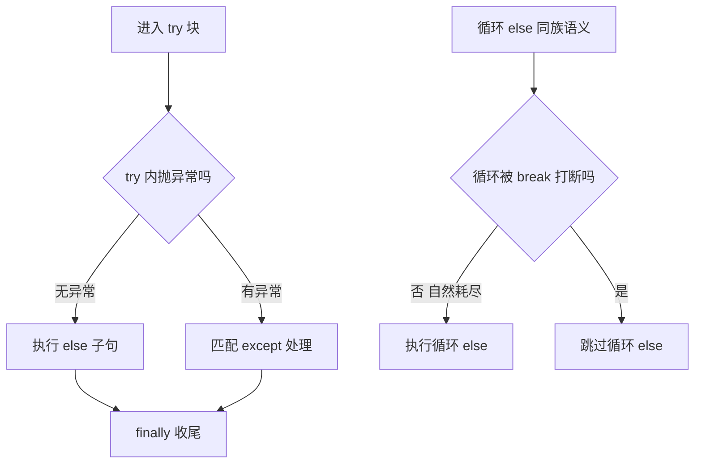
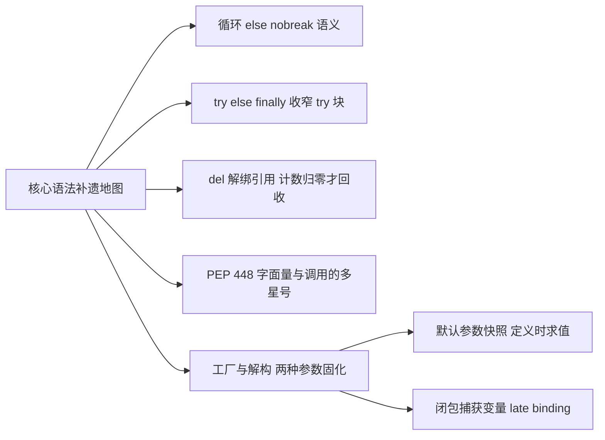
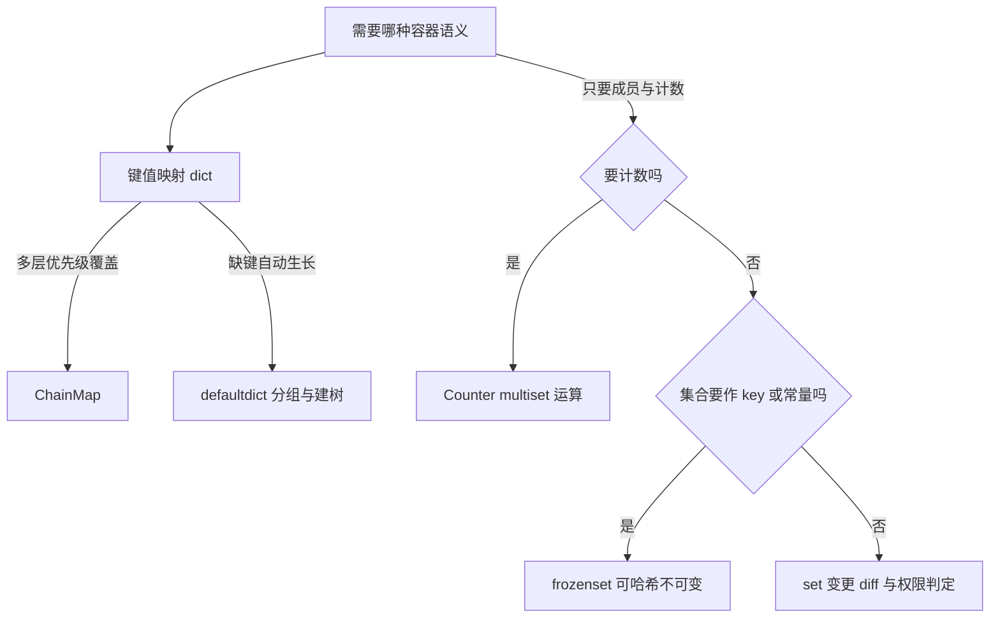
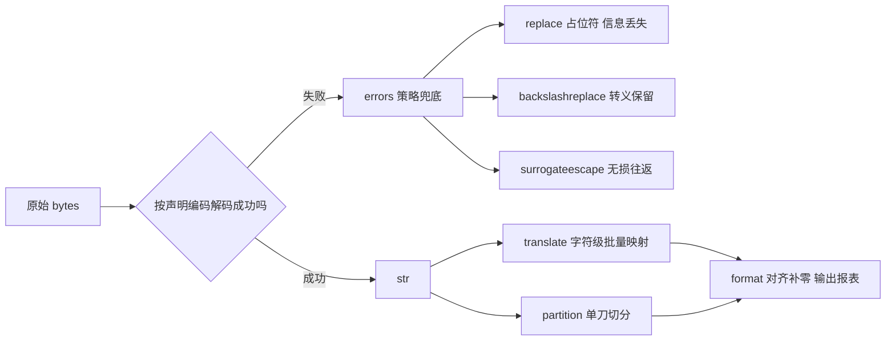
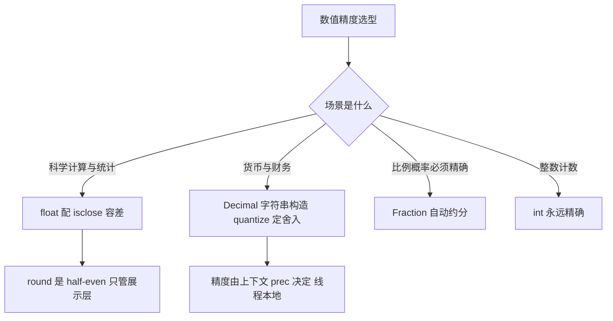
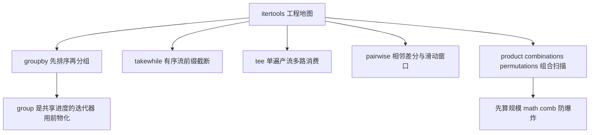
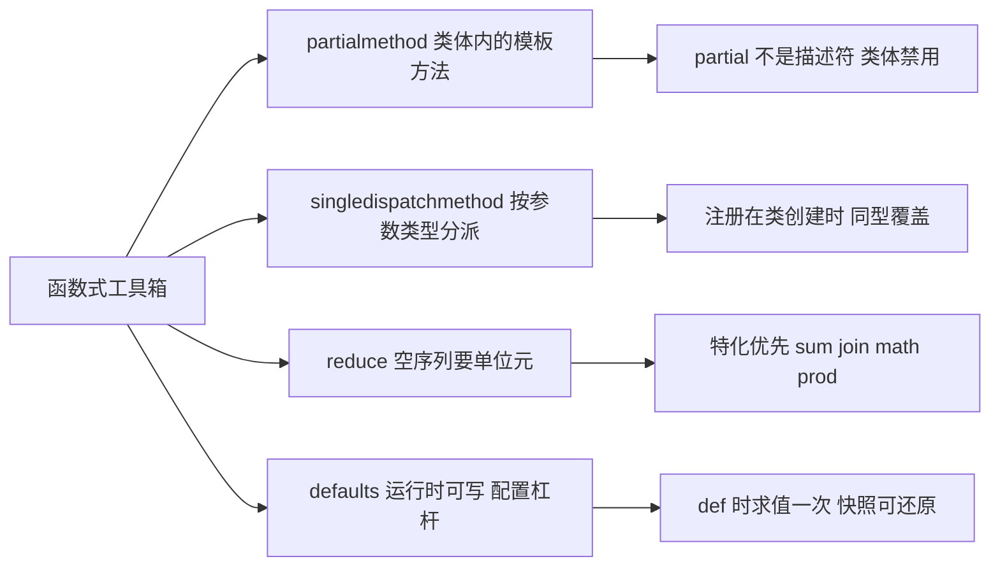
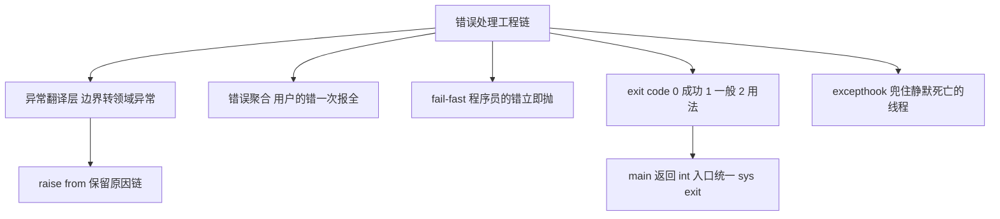
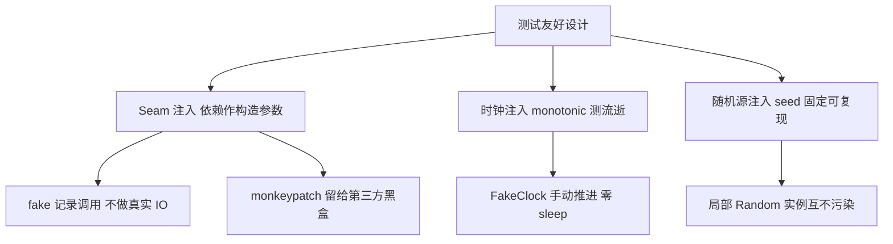

# 第 1 类 · 语言核心与底层(夜间扩产二)

> 本篇是语言核心的第二批夜间扩产(Q1526–Q1570):语法补遗(循环与 try 的 else 子句、del 与引用计数、PEP 448 广义解包、函数工厂、递归改迭代)、标准库深用(frozenset/ChainMap/defaultdict/Counter、translate/partition/对齐、Decimal 上下文/Fraction/银行家舍入、itertools 工程用法、partialmethod/singledispatchmethod/reduce/defaults 内省)、模块与错误处理工程化(函数级懒加载、re-export、可选依赖、异常翻译层、错误聚合、exit code、excepthook),以及健壮性、可测性与性能实测(拷贝决策、入参校验、轻量契约、seam/时钟/随机源注入、set-vs-list、局部变量缓存、join-vs-+=)。
> 与 01a–01f 互补:语法机制见 01a/01b,生成器与元编程见 01c,模块内省见 01d,疑难杂症见 01e/01f;本批聚焦「日常顺手写错的细节」与「工程实测选型」。
> 所有代码仅标准库、可直接运行,以 CPython 3.9 实测通过为准(涉及 3.10+ 特性处带版本守卫或给出兼容实现)。

### Q1526 · 循环 else 子句:while-else 与轮询重试的正确姿势

> 难度:★★★☆☆ | 标签:循环, else 子句, 语法

**问**:while 的 else 你实际用过吗?它和 for 的 else 是同一套语义吗?哪类循环最适合用循环 else?

**答**:for/while 的 else 共用同一套 nobreak 语义:循环没有被 break 打断、自然结束时执行——空迭代也算自然结束,else 照走。Q518 讲过 for-else 的可读性争议,本题补 while-else 的工程正用:轮询与重试循环——while 条件管超时上限,return/break 管成功,else 承接「超时未成功」的失败分支,比标志位干净。三个要点:① else 只被 break 跳过,return 与异常同样离开循环并绕过 else;② else 与循环条件是「与」的关系——超时退出走 else,成功 return 不走;③ 团队没有约定时,把重试逻辑包成函数、内部用 while-else,是最小侵入的折中。

```python
# file: code/01_语言核心与底层/q1526_loop_else.py
import time


def poll_until_ready(check, timeout=0.3, interval=0.05):
    """轮询直到 check 返回真;超时返回 None。else 承接超时分支。"""
    deadline = time.monotonic() + timeout
    while time.monotonic() < deadline:
        if check():
            return time.monotonic()   # 成功路径:直接 return,不走 else
        time.sleep(interval)
    else:
        return None                   # 循环自然耗尽 = 超时失败


def first_negative(seq):
    for x in seq:
        if x < 0:
            return x
    else:
        return None                   # 没找到:for-else 省掉 found 标志


def flip_after_two_calls():
    flip_after_two_calls.n += 1
    return flip_after_two_calls.n > 2


flip_after_two_calls.n = 0


if __name__ == "__main__":
    ok = poll_until_ready(flip_after_two_calls, timeout=1.0)
    fail = poll_until_ready(lambda: False, timeout=0.15)
    print("poll success:", ok is not None)
    print("poll timeout :", fail is None)
    print("first_negative([3, 1, -7]):", first_negative([3, 1, -7]))
    print("first_negative([3, 1]):   ", first_negative([3, 1]))
    # 空序列也算自然耗尽,else 照走——测试最容易漏的分支
    print("empty loop else:", first_negative([]))
```

**追问**:1) 循环体里 continue 到最后一轮后循环结束,else 走吗?——走,continue 不影响「是否被 break 打断」的判定;那 return 呢?——return 与异常同样离开循环并绕过 else,else 的唯一否决权在 break 手里。2) while-else 为什么最适合轮询重试?——循环条件天然表达超时上限,break/return 表达成功,else 承接「耗尽未成」的失败分支,found/timeout 标志变量全部消失。3) 底层控制流?——break 跳出循环体,自然耗尽落入 else 块,与 for-else 共用同一套字节码结构;else 里抛的异常不会被循环捕获,照常传播。4) 生产陷阱?——把清理逻辑写进 else 被 break 跳过;读者不懂 nobreak 语义,团队要写注释或约定;与 try-else(try 无异常才执行)语义混淆。

### Q1527 · try/else/finally 执行序:把 try 收窄到最小

> 难度:★★★☆☆ | 标签:异常, else 子句, 执行序

**问**:try 的 else 子句什么时候执行?为什么不把所有代码都塞进 try?

**答**:执行序:先 try;无异常 → 执行 else → finally;有异常 → 跳过 else 进第一个匹配的 except → finally。else 的存在意义是「把成功路径移出 try」:try 块收窄到只包真正会抛目标异常的语句,成功后的后续处理放 else,否则 except 会把成功路径上的业务异常误当成目标异常吞掉(见代码反例)。要点:① except 只捕获 try 块内抛的异常,else/finally 里抛的异常不会被同层 except 接住;② else 必须位于所有 except 之后、finally 之前,且没有 except 时不能单独出现(try/else 非法);③ 与 Q526 的分工:那里讲 finally 里 return 的覆盖与吞噬,本题讲 else 的边界与收窄原则。

```python
# file: code/01_语言核心与底层/q1527_try_else.py

PRICES = {"apple": 5, "banana": 2}


def parse_and_bill_narrow(line):
    """窄 try:只包真正会抛 ValueError 的类型转换。"""
    name, _, qty = line.partition(":")
    unit = PRICES[name]                # 查表错误如实抛 KeyError
    try:
        total = int(qty) * unit
    except ValueError:
        return None
    else:
        if total > 1000:
            raise ValueError("total 超限")   # 成功路径的问题不再被吞
        return total


def parse_and_bill_wide(line):
    """反例:try 拖得太宽,业务校验的异常被当成解析失败吞掉。"""
    try:
        name, _, qty = line.partition(":")
        unit = PRICES[name]
        total = int(qty) * unit
        if total > 1000:
            raise ValueError("total 超限")   # 业务校验,与解析无关
        return total
    except ValueError:
        return None                          # 业务错误被误归为解析失败


if __name__ == "__main__":
    print("narrow ok  :", parse_and_bill_narrow("apple:3"))
    print("narrow bad :", parse_and_bill_narrow("apple:x"))
    try:
        parse_and_bill_narrow("cherry:2")
    except KeyError as err:
        print("narrow miss:", "KeyError 如实抛出:", err)
    try:
        parse_and_bill_narrow("apple:400")
    except ValueError as err:
        print("narrow big :", "业务校验如实抛出:", err)

    print("wide ok    :", parse_and_bill_wide("apple:3"))
    print("wide bad   :", parse_and_bill_wide("apple:x"))
    print("wide big   :", parse_and_bill_wide("apple:400"), " # 业务错误被吞成 None")

    order = []
    try:
        order.append("try")
    except ValueError:
        order.append("except")
    else:
        order.append("else")
    finally:
        order.append("finally")
    print("execution  :", order)
```

**追问**:1) except 分支里再抛异常,会被同层其他 except 接住吗?——不会,同层 except 之间互不捕获,异常向外传播;finally 里抛新异常还会覆盖正在传播的旧异常,比「吞异常」更隐蔽。2) try 收窄为什么是原则?——else 让「常规语句」与「易错语句」分离:try 只包真正可能抛的那几行,except 的捕获面精确,无关异常不会误入;try 块越大,排查时越难定位是哪行炸的。3) 完整执行序?——try→(命中 except 或自然结束走 else)→finally 总收尾;else 抛的异常不被同层 except 捕获。4) 生产陷阱?——巨型 try 块误捕无关异常;else 里做本该 try 的事;finally 抛新异常覆盖旧异常(Q526);finally 里 return 直接吞异常。



### Q1528 · del 与引用计数:什么时候真的释放内存

> 难度:★★★★☆ | 标签:del, 引用计数, 内存

**问**:del x 到底做了什么?怎么观测一个对象真的被释放了?哪些场景 del 是必要的内存手段?

**答**:del 做的是「解绑引用」:从命名空间、容器或属性里移除一个引用,引用计数减一;计数归零且无循环引用时 CPython 立即回收——这个「立即」是 CPython 行为,不是语言承诺(Q545 讲语义,本题讲计数与时机)。观测手段:weakref.ref 判断死活、weakref.finalize 注册回收回调;sys.getrefcount 因传参临时引用恒多 1,只适合看相对变化。del 作为内存手段的三个正用:① 长循环里的临时大对象,用完即 del,让缓冲在下一轮前释放;② 打破循环引用的外部锚点——内部互指仍需 gc.collect 兜底;③ del lst[:] 清内容与 del lst 删名字是两个动作,别名是否受影响完全不同。函数内 del 闭包变量需先 nonlocal 声明。

```python
# file: code/01_语言核心与底层/q1528_del_refcount.py
import gc
import sys
import weakref


class Blob:
    def __init__(self, payload):
        self.payload = payload


class Node:
    def __init__(self):
        self.partner = None


if __name__ == "__main__":
    big = Blob([0] * 1000)
    ref = weakref.ref(big)
    gone = weakref.finalize(big, print, "finalize: big 被回收")
    print("alive before del:", ref() is not None)
    del big                        # 解绑最后一个引用,计数归零立即回收
    print("alive after  del:", ref() is not None)
    del gone                       # 终结器随主体死亡已触发,主动解除

    # 循环引用:del 掉外部名字不会立即回收,需要 gc 介入
    a, b = Node(), Node()
    a.partner, b.partner = b, a
    ra = weakref.ref(a)
    del a, b
    print("cycle alive before gc:", ra() is not None)
    gc.collect()
    print("cycle alive after  gc:", ra() is not None)

    # del 切片清内容 vs del 名字:别名视角完全不同
    buf = list(range(10))
    alias = buf
    del buf[:]                     # 清内容:alias 同步变空
    print("after del buf[:]: alias =", alias)
    del alias                      # 只删名字:列表对象因无引用而回收

    # getrefcount 的临时参数引用:恒比真实引用数多 1
    s = "x" * 3
    print("getrefcount(s):", sys.getrefcount(s), " 含传入的临时引用")
```

**追问**:1) 为什么 sys.getrefcount(s) 总比真实引用数多 1?——传参本身临时持有一次引用;要可靠观测「死活」用 weakref,而不是去数引用。2) 对象什么时候真的释放?——引用计数归零立即回收(确定性路径);循环引用由分代 GC 延迟回收;del 只是解除绑定,不等于释放——闭包、全局、容器里的引用都会拖住它。3) 观测手段的分工?——getrefcount 看计数(带 +1 偏差)、weakref 看死活、gc.get_referrers 反查「谁还引用它」——排查内存滞留的顺序是先 weakref 再 referrers。4) 生产陷阱?——「del 完就该释放」的假设被闭包/缓存打破;异常对象带 traceback 钉住整条链(Q1256);大对象缓存只增不清,要 LRU 或周期清理。

### Q1529 · PEP 448 广义解包:字面量与调用中的多星号

> 难度:★★☆☆☆ | 标签:解包, 语法, PEP 448

**问**:同一个调用里写两次 * 可以吗?字面量里解包有哪些玩法?字典解包进列表会怎样?

**答**:PEP 448(3.5 起)把星号解包推广到字面量与任意次数:调用 f(*a, *b, **kw)、列表 [*x, *y]、元组 (*x,)、集合 {*a, *b}、字典 {**d1, **d2} 都合法,不再限于一次解包(Q540 讲定义/赋值基础,本题讲推广形态)。要点:① 字典字面量里 **d1 与显式键混写时后写的赢,重复键不报错;② dict 只接受 **mapping,**iterable 解进字典字面量非法;③ 生成器解包即耗尽,第二次解包得到空;④ 函数定义处仍只能有一个 *args(收集),调用处无此限制;⑤ {*a, *b} 顺带完成去重,是拼接集合的惯用法。

```python
# file: code/01_语言核心与底层/q1529_generalized_unpack.py


def span(*args, **kwargs):
    return args, kwargs


if __name__ == "__main__":
    a = [1, 2]
    b = (3, 4)
    gen = (x * x for x in range(3))

    print("call      :", span(*a, *b, tag="end"))
    print("list      :", [*a, *b, 5])
    print("tuple     :", (*a, *b))
    print("set       :", {*a, *b, 4})          # 解包进集合顺带去重
    first, second = [*gen], [*gen]
    print("generator :", first, "then", second)   # 第二次解包已耗尽

    d1 = {"retries": 3, "timeout": 1.0}
    d2 = {"timeout": 2.0, "debug": True}
    merged = {**d1, **d2, "extra": 1}          # 后写的键赢,重复不报错
    print("dict merge:", merged)

    # 调用处多星号与关键字字典混用;定义处仍只能有一个 *args
    defaults = {"tag": "auto"}
    print("mixed     :", span(*a, **defaults))

    # dict 字面量只接受 **mapping:**[1, 2] 是 SyntaxError,只作说明不执行
    print("keys view :", {*d1})                 # 可迭代解包进集合只剩键
```

**追问**:1) 调用处 f(**d1, **d2) 两个字典有同键会怎样?——允许,后写的值赢,与字面量合并一致;但 f(**d, x=1) 若 d 里有 "x" 则 TypeError 多重赋值,字面量无此限制。2) PEP 448 的能力边界?——3.5+ 字面量与调用里任意位置多星号([*a, *b]、{**a, **b}、f(*a, *b));调用解包的键必须是 str,否则 TypeError——这是与字面量的另一处差别。3) 字节码层?——BUILD_LIST_UNPACK/BUILD_MAP_UNPACK_WITH_CALL 系列指令先收集再展开,合并语义在指令层实现;重复键在调用侧检查更严。4) 生产陷阱?——用 **d 覆盖显式参数的顺序写反;键类型混入 int 在调用处崩;超大字典解包的临时拷贝成本;把「后写赢」当成排序保证(无序时行为依赖 dict 序)。

### Q1530 · 函数工厂:嵌套函数批量派生与参数固化

> 难度:★★★☆☆ | 标签:闭包, 工厂, 函数设计

**问**:怎么用一个模板函数批量生成行为略有差异的函数?闭包变量在工厂里为什么必须小心 late binding?

**答**:工厂就是「返回函数的函数」:一份逻辑模板,派生出一批只差配置的函数对象。固化参数的三种方式:① 默认参数固化——`def inner(x, _factor=factor)`,定义时求值一次,是快照语义,最推荐;② functools.partial——不改函数体,固化前置实参;③ 闭包捕获——能带可变状态(nonlocal),但捕获的是变量不是值。经典陷阱在循环里造函数:直接引用循环变量是 late binding(Q017),所有函数共享最后一轮的值,默认参数快照是标准解法。工程价值:同一份 co_code 被多个函数对象共享,逻辑单点;无状态固化选默认参数或 partial,需要状态才上闭包或类。

```python
# file: code/01_语言核心与底层/q1530_function_factory.py


def make_scaler(factor):
    """默认参数固化:定义时把 factor 快照进默认值。"""
    def scale(x, _factor=factor):
        return x * _factor
    return scale


def make_handlers_bad():
    """反例:闭包引用循环变量,所有 handler 共享最终值。"""
    handlers = []
    for name in ("read", "write", "admin"):
        handlers.append(lambda: "allowed:" + name)    # late binding
    return handlers


def make_handlers_good():
    """正解:默认参数固化每轮迭代的 name。"""
    handlers = []
    for name in ("read", "write", "admin"):
        handlers.append(lambda n=name: "allowed:" + n)
    return handlers


def make_counter(start=0):
    """闭包状态工厂:nonlocal 让内层函数持有可变状态。"""
    count = start
    def bump(step=1):
        nonlocal count
        count += step
        return count
    return bump


if __name__ == "__main__":
    double = make_scaler(2)
    triple = make_scaler(3)
    print("scale:", double(10), triple(10))
    print("same code, distinct defaults:",
          double.__defaults__, triple.__defaults__)

    for h in make_handlers_bad():
        print("bad :", h())
    for h in make_handlers_good():
        print("good:", h())

    tick = make_counter()
    print("counter:", tick(), tick(5), tick())
```

**追问**:1) 工厂造出的多个函数共享 co_code 吗?——共享,只有默认值与闭包绑定不同,工厂几乎不增加代码体积;固化方式的选择本质是「快照 vs 可变状态」。2) 三种固化方式怎么选?——默认参数在定义时求值(快照,稳定);闭包共享变量(状态同步,要懂晚绑定);partial 在调用时拼参(显式灵活);语义差异决定场景——配置固化用默认参数,共享状态才用闭包。3) 底层装配?——同一份 code 对象 + 各自的 __defaults__/__closure__ 组装成不同函数对象(Q1257 的 MAKE_FUNCTION 故事);工厂返回的函数互不干扰。4) 生产陷阱?——闭包晚绑定(Q527)导致全部函数看到最后值;默认参数固化时机误解(以为是「每次调用求值」);工厂内引用外部可变配置,行为随调用时机漂移。

### Q1531 · 递归改迭代:显式栈与记忆化的工程路线

> 难度:★★★★☆ | 标签:递归, 迭代, 算法改写

**问**:递归深度受限,怎么把树形递归改成显式栈的迭代?记忆化能救哪些递归?

**答**:改造按子问题性质二选一:① 重叠子问题(如 fib)→ 记忆化保留递归,functools 缓存或手写 memo dict,深度是子问题链长,可控时最省事;② 深度不可控(深链表、大文件树)→ 显式栈迭代:把「递归调用」改成「栈上压子任务」,循环消费,深度只受内存限制(Q553 讲没有尾调用优化的机制,本题给改造路线)。写法要点:栈元素既可以是「待展开节点」也可以是「聚合动作」;求和这类可交换聚合直接用后进先出栈(顺序不影响结果),需要保序就把 children 逆序入栈。判断顺序:先 memo(改动最小),memo 救不了再上显式栈;有些递归能直接改成状态对推进(斐波那契的 a, b),连栈都不要。

```python
# file: code/01_语言核心与底层/q1531_recursion_to_loop.py
import sys
from functools import lru_cache


class TreeNode:
    def __init__(self, value, children=()):
        self.value = value
        self.children = list(children)


def sum_recursive(node):
    return node.value + sum(sum_recursive(c) for c in node.children)


def sum_iterative(root):
    """显式栈:把递归调用换成待处理栈,深度不再受递归限制。"""
    total = 0
    stack = [root]
    while stack:
        node = stack.pop()
        total += node.value
        stack.extend(node.children)
    return total


def deep_chain(depth):
    node = TreeNode(0)
    for i in range(1, depth):
        node = TreeNode(i, (node,))
    return node


@lru_cache(maxsize=None)
def fib(n):
    return n if n < 2 else fib(n - 1) + fib(n - 2)


if __name__ == "__main__":
    tree = TreeNode(1, (TreeNode(2, (TreeNode(3),)), TreeNode(4)))
    print("sum recursive:", sum_recursive(tree))
    print("sum iterative:", sum_iterative(tree))

    depth = 5000
    deep = deep_chain(depth)
    print("iterative deep chain:", sum_iterative(deep))
    limit = sys.getrecursionlimit()
    try:
        sys.setrecursionlimit(200)
        try:
            sum_recursive(deep)
            print("recursive: unexpectedly survived")
        except RecursionError:
            print("recursive: RecursionError as expected at low limit")
    finally:
        sys.setrecursionlimit(limit)

    print("fib(60) memo:", fib(60))
    a, b = 0, 1                    # 状态对推进:斐波那契根本不需要栈
    for _ in range(60):
        a, b = b, a + b
    print("fib(60) pair :", a)
```

**追问**:1) 显式栈版本的遍历顺序和递归一致吗?——本文示例用后进先出的栈,子树顺序会颠倒,要保序就把 children 逆序入栈;深度从此只受内存限制。2) 显式栈为什么能突破递归限制?——递归深度受解释器 C 栈限制(Q553);显式栈是堆上的普通 list,深度只受内存限制——深图遍历的标准改造。3) 记忆化的两条路线?——纯函数用 functools.lru_cache(C 实现、带统计);有状态/不可哈希参数手写 memo dict;两者都要注意「缓存键可哈希」与生命周期。4) 生产陷阱?——lru_cache 把 self 钉在缓存里(Q478);改写递归时丢失原顺序;深序列化(嵌套 JSON)递归爆栈,该用迭代实现或限制输入深度(Q1299)。

### Q1532 · 元组解构惯用法:交换、推进与星号收集

> 难度:★☆☆☆☆ | 标签:元组, 解构, 语法

**问**:多元赋值和元组解构有哪些惯用法?a, b = b, a 的背后发生了什么?

**答**:右侧先整体求值打包成 tuple,再按左侧模式解包——所以交换 a, b = b, a 无需临时变量,斐波那契 a, b = b, a+b 一次推进两个状态(两个新值都基于旧值,这是它比两行赋值语义更强的地方)。惯用法清单:星号收集 first, *rest = seq;嵌套解构 (a, (b, c)) = ...;循环里 for k, v in d.items() 直接解;enumerate/zip 的配对解构。边界:元素数不匹配 ValueError;一条赋值语句左侧只能有一个星号变量(Q540);解构不要求序列是元组,任何可迭代都行——解包生成器会把它耗尽。

```python
# file: code/01_语言核心与底层/q1532_tuple_unpack_idioms.py


def minmax(seq):
    """一次遍历同时返回两个值:调用方一行解构。"""
    it = iter(seq)
    try:
        low = high = next(it)
    except StopIteration:
        raise ValueError("minmax empty seq") from None
    for x in it:
        if x < low:
            low = x
        elif x > high:
            high = x
    return low, high


if __name__ == "__main__":
    a, b = 1, 2
    a, b = b, a                     # 打包再解包,无临时变量
    print("swap:", a, b)

    x, y = 0, 1
    for _ in range(8):
        x, y = y, x + y             # 状态对同步推进
    print("fib :", x)

    first, *rest = [10, 20, 30, 40]
    *init, last = rest
    print("head/tail:", first, rest, init, last)

    (name, (lat, lon)) = ("pei", (39.9, 116.4))    # 嵌套模式
    print("nested:", name, lat, lon)

    scores = {"alice": 91, "bob": 85}
    for who, score in scores.items():              # items 直接解构
        print("item :", who, score)

    print("minmax:", minmax([5, 3, 9, 1, 7]))
    try:
        a, b = (1, 2, 3)
    except ValueError as err:
        print("mismatch:", err)
```

**追问**:1) a, b = b, a+b 里右侧求值时机?——右侧先整体求值成 tuple 再解包,两个新值都基于旧值;这正是「先打包后解包」比两行顺序赋值更强的地方。2) 星号收集的语义细节?——a, *rest = it 的 rest 恒是 list(哪怕空);星号目标每条赋值语句最多一个;支持嵌套解构 (a, (b, c)) 表达树状结构。3) 字节码优化?——两元素交换被 ROT_TWO 优化掉临时元组,三元素以上才真的打包;解构长度不匹配直接 ValueError。4) 生产陷阱?——解构来源长度不可控(配 zip strict Q517 或先校验);嵌套解构可读性崩;`a, = it` 单元素解构的尾逗号被误删成 `a = it`;循环里 (k, v) 解构 enumerate 组合是标准惯用法。



### Q1533 · frozenset 工程场景:集合作 key、常量集与边界归一

> 难度:★★★☆☆ | 标签:frozenset, 集合, API 设计

**问**:frozenset 除了「不可变的 set」还有什么正经用途?什么时候必须用它而不是 tuple?

**答**:frozenset 的价值在「可哈希的集合」三个场景:① 作 dict key 或集合成员——图的边(端点无序)用 frozenset((a, b)) 归一化,「集合的集合」只有这条路,set 不可哈希直接 TypeError;② 模块级常量注册表——不可变语义杜绝运行期被误改,也向读者声明「这是一组无序成员」;③ API 边界归一化——接受任意可迭代、内部 frozenset 化,天然去重,且调用方后续修改不影响内部状态。与 tuple 的分界:有序用 tuple,需要成员资格测试与 | & - ^ 运算用 frozenset(tuple 成员检测是 O(n))。空集是 frozenset() 而不是 { }(那是 dict);frozenset 相等只看成员,与构造顺序无关。

```python
# file: code/01_语言核心与底层/q1533_frozenset_scenarios.py

READ = frozenset({"doc:read", "doc:list"})
WRITE = frozenset({"doc:read", "doc:list", "doc:write"})
ADMIN = WRITE | frozenset({"user:manage"})     # frozenset 支持集合运算


def can(granted, needed):
    """所需权限是否全部被授予:子集判定。"""
    return frozenset(needed) <= granted


def undirected_edges(pairs):
    """无向边去重:a-b 与 b-a 是同一条边——用 frozenset 作 key。"""
    seen = {}
    for a, b in pairs:
        edge = frozenset((a, b))
        seen[edge] = seen.get(edge, 0) + 1
    return {tuple(sorted(e)): n for e, n in seen.items()}


def normalize_tags(tags):
    """API 边界:接受任意可迭代,归一成不可变集合,防外部漂移。"""
    return frozenset(tags)


if __name__ == "__main__":
    print("can(ADMIN, [doc:write, user:manage]):",
          can(ADMIN, ["doc:write", "user:manage"]))
    print("can(READ, [doc:write]):", can(READ, ["doc:write"]))

    print("edges:", undirected_edges([("a", "b"), ("b", "a"), ("b", "c")]))

    tags = ["db", "cache", "db"]
    frozen = normalize_tags(tags)
    tags.append("evil")                         # 调用方继续改原列表
    print("frozen tags unaffected:", frozen)

    groups = {frozenset((1, 2)): "pair", frozenset((3,)): "single"}
    print("set-as-dict-key:", groups[frozenset((2, 1))])
    try:
        {{1, 2}: "x"}
    except TypeError:
        print("set literal key -> TypeError 不可哈希")
```

**追问**:1) frozenset 能省内存吗?——不,它与 set 结构相同,买的是「可哈希 + 不可变语义」;需要省内存的只读常量才考虑 tuple,代价是成员检测退化为 O(n) 且没有集合运算。2) 什么时候买 frozenset?——作 dict key 或另一个 set 的元素、模块级常量集(语义上不可改)、输入归一(去重+固定);要的是语义收益而非性能。3) 底层细节?——与 set 同构但哈希缓存于对象;没有字面量语法(frozenset([...]) 运行时构建,不参与常量折叠);与 set 的运算仍生成新集合。4) 生产陷阱?——以为 {1,2} 写法能得到 frozenset(那是 set);常量集放函数内每次调用重新构造,应模块级缓存;把 tuple 当「省内存 frozenset」丢掉 O(1) 成员检测。

### Q1534 · ChainMap:多层配置的零拷贝优先级

> 难度:★★★☆☆ | 标签:ChainMap, 配置, collections

**问**:多层配置(CLI 参数 > 环境变量 > 配置文件 > 默认值)怎么优雅合并?ChainMap 和「先 dict 合并再查」差在哪?

**答**:ChainMap 把多个映射按优先级链起来,查找沿 maps 从前到后第一个命中即返回,天然表达「CLI 参数 > 环境变量 > 配置文件 > 默认值」这类覆盖语义。与「先合并副本再查」的差异:① 零拷贝,上游 dict 更新实时可见;② 写操作只落到 maps[0],底层配置不被污染;③ new_child() 派生叠加一层的新视图,适合作用域嵌套(请求级覆盖、函数局部覆盖),离开作用域丢弃 child 即回滚。要点:查找是 O(链长),读多写少的配置场景无感;需要「合并后的独立快照」时才做真合并(dict 展开或合并运算符,见 Q480)。

```python
# file: code/01_语言核心与底层/q1534_chainmap_config.py
from collections import ChainMap
import os

FILE_DEFAULTS = {"host": "localhost", "port": "5432", "debug": "0", "retries": "3"}


def load_settings(cli_opts, env=None):
    """优先级:CLI 参数 > 环境变量 > 配置文件默认值。"""
    if env is None:
        env = {k[4:].lower(): v for k, v in os.environ.items()
               if k.startswith("APP_")}
    return ChainMap(cli_opts, env, FILE_DEFAULTS)


if __name__ == "__main__":
    env = {"debug": "1", "host": "db.internal"}
    cfg = load_settings({"port": "6432"}, env=env)
    print("port   :", cfg["port"], "   # CLI 层覆盖")
    print("host   :", cfg["host"], " # env 层覆盖")
    print("debug  :", cfg["debug"], "   # env 覆盖文件默认")
    print("retries:", cfg["retries"], "   # 三层都命中不了才落到文件默认")

    # 写操作只落到第一层:默认配置不被污染
    cfg["retries"] = "5"
    print("after write:", cfg["retries"], "| defaults untouched:",
          FILE_DEFAULTS["retries"])

    # new_child 派生作用域:请求级覆盖,丢弃 child 即回滚
    request_cfg = cfg.new_child({"timeout": "30"})
    print("request scope timeout:", request_cfg["timeout"])
    print("outer scope has no timeout:", "timeout" in cfg)

    # 上游 dict 更新实时可见:零拷贝
    env["extra"] = "seen"
    print("live view:", cfg["extra"])

    print("maps count:", len(cfg.maps), "| parents layers:", len(cfg.parents.maps))
```

**追问**:1) ChainMap 的写操作落到哪一层?——永远 maps[0];想让写穿透到指定层要自己定位,「读多层、写单层」正是它的配置语义。2) 配置语义的全貌?——查找按 maps 顺序首个命中;new_child 在头部加层(命令行覆盖环境、环境覆盖默认);parents 去掉首层向上回溯——优先级配置的标准解,零拷贝。3) 动态性代价?——底层 dict 改变实时可见(与「快照合并」本质不同);查找 O(层数);删除只删第一层的键。4) 生产陷阱?——删除非首层键 KeyError(要自己定位再删);把 ChainMap 当快照存档(底层变了数据跟着变);层数过多导致「哪层生效」排查困难,要留层级日志。

### Q1535 · defaultdict 一行建树:嵌套生长与序列化清洗

> 难度:★★☆☆☆ | 标签:defaultdict, 分组, collections

**问**:defaultdict 除了分组还能干什么?怎么用它一行造出嵌套树?序列化前要做什么?

**答**:defaultdict 的工厂返回容器就能「一行建树」:`tree = lambda: defaultdict(tree)` 让任意深度的缺键访问自动生长,配合 defaultdict(list) 建邻接表、defaultdict(int) 计数,是分组与索引场景的最短路径(Q479 讲默认值模式与读长键副作用,本题聚焦建树与清洗)。两个工程纪律:① 读取副作用——访问不存在的键会真的写入,试探性读取留下幽灵键,遍历/序列化前必须清洗;② 序列化前递归洗回普通 dict(本文 wash),否则 pickle 的 lambda 工厂必炸、类型断言与 JSON 之外的工具链都会踩到实现细节。需要「读不建键」时改用 d.get;需要「读写都显式」用 setdefault。

```python
# file: code/01_语言核心与底层/q1535_defaultdict_tree.py
import json
from collections import defaultdict


def tree():
    return defaultdict(tree)


def wash(node):
    """把嵌套 defaultdict 递归洗回普通 dict,便于 JSON 与断言。"""
    return {key: wash(child) if isinstance(child, dict) else child
            for key, child in node.items()}


if __name__ == "__main__":
    index = tree()
    index["docs"]["q1526"]["title"] = "loop else"    # 任意深度缺键自动生长
    index["docs"]["q1527"]["title"] = "try else"
    index["meta"]["count"] = 45
    print("nested access:", index["docs"]["q1526"]["title"])

    # 分组:邻接表一行建
    edges = [("a", "b"), ("a", "c"), ("b", "d")]
    adj = defaultdict(list)
    for u, v in edges:
        adj[u].append(v)
    print("adjacency:", dict(adj))

    # 计数桶
    counter = defaultdict(int)
    for ch in "mississippi":
        counter[ch] += 1
    print("count:", dict(counter))

    # 反面:读也会长键,ghost 键污染结构
    _ = index["ghost"]["deeper"]
    print("ghost leaked:", "ghost" in index)

    clean = wash(index)
    del clean["ghost"]                                # 洗净前删掉误访问
    print("json roundtrip:",
          json.dumps(clean, ensure_ascii=False, sort_keys=True))
```

**追问**:1) defaultdict 的工厂会被 pickle 吗?——工厂必须是可按名找到的对象,lambda 工厂 pickle 必炸;序列化前 wash 回普通 dict 是最稳的做法。2) 一行建树的机制?——tree = lambda: defaultdict(tree),子节点按需生长;递归工厂引用自身,无限深度——所以「读不存在的路径」会静默长出键,要用 in 探测(Q479)。3) 序列化清洗?——递归把 defaultdict 转普通 dict(工厂自然剥离);json.dumps 对 defaultdict 能工作(dict 子类)但 pickle 会携带工厂;往回读是普通 dict,行为退化。4) 生产陷阱?——探测性访问污染树结构;lambda 工厂进 pickle/multiprocessing 崩;wash 递归爆栈(深树,配合 Q1299 限深)。

### Q1536 · Counter 的 multiset 运算:加减交并的语义

> 难度:★★★★☆ | 标签:Counter, multiset, collections

**问**:Counter 的 +、-、&、| 各是什么语义?为什么相减后非正计数的条目会消失?什么时候该用 multiset 思维?

**答**:Counter 是多重集合(multiset),运算符围绕「计数」定义:c1 - c2 是差(每元素计数相减,扣成非正的条目直接消失,而不是记 0);+ 取正计数求和,& 取各元素计数最小值(multiset 交集),| 取最大值(multiset 并集),一元 + 与 - 过滤非正计数。丢弃非正项是刻意的 multiset 语义:「不存在」与「0 个」等价,这样 elements()、most_common、迭代都干净。工程场景:库存扣减(下单 stock - order)、订单合并(stock + order)、词袋 diff、权限并集。注意 3.10 起相等比较把缺失视作 0,3.9 仍是严格 dict 相等——版本差异是加分考点;要保留零/负计数就手工循环或 defaultdict(int)。

```python
# file: code/01_语言核心与底层/q1536_counter_multiset.py
from collections import Counter

STOCK = Counter({"apple": 10, "banana": 6, "cherry": 0})
ORDER_A = Counter({"apple": 3, "banana": 1, "durian": 2})
ORDER_B = Counter({"apple": 1, "banana": 4})


def ship(stock, order):
    """扣减库存:multiset 差,扣到非正的品项从结果消失。"""
    return stock - order


if __name__ == "__main__":
    print("stock:", dict(STOCK))
    left = ship(STOCK, ORDER_A)
    print("after order A:", dict(left))         # durian 扣成 -2 直接消失

    print("A & B:", dict(ORDER_A & ORDER_B))    # 各取最小计数
    print("A | B:", dict(ORDER_A | ORDER_B))    # 各取最大计数
    print("+A   :", dict(+ORDER_A), "-A:", dict(-ORDER_A))

    total = ORDER_A + ORDER_B
    print("A + B:", dict(total))                # 汇总订单

    # 相等比较的版本差异:3.10 起缺失视作零,3.9 是严格 dict 相等
    zeroish = Counter({"apple": 0})
    print("zero-count equality:", zeroish == Counter(),
          " 3.10+ 为 True,3.9 为 False")

    # 元素展开:按计数重复
    print("elements:", sorted(total.elements()))
    print("most_common:", ORDER_A.most_common(2))
```

**追问**:1) 为什么 Counter 减法丢掉非正计数而不是记 0?——multiset 语义里「不存在」和「0 个」等价,丢弃让 elements 与相等比较都干净;要保留零值就手工循环。2) multiset 运算的全貌?——+ 与 - 都丢弃非正;& | 取 min/max(非零);elements() 按计数展开;most_common(n) 内部用 heapq.nlargest 高效取 Top-N。3) update 的语义?——计数相加(不是覆盖);要覆盖用直接赋值或先 clear;subtract 是相减且保留非正(与 - 不同)。4) 生产陷阱?——以为 c1 - c2 会保留 0/负值;update 与覆盖语义混淆;most_common 对相同计数依赖插入序,跨进程顺序不稳定(哈希盐)。

### Q1537 · 集合运算的工程应用:变更 diff 与权限判定

> 难度:★★☆☆☆ | 标签:set, 集合运算, 工程应用

**问**:上线前的服务变更 diff(新增了哪些、下线了哪些)怎么用集合一次算清?权限判断为什么写成子集判定?

**答**:三个高频模式:① 变更 diff——added = new - old、removed = old - new、kept = old & new、changed = old ^ new(对称差一把抓出所有变动项),报告输出前 sorted 保证可复现;② 权限与前置条件——「所需能力 ⊆ 已授予能力」一行 <= 表达,比逐项循环语义清楚还快;③ 多标签过滤——同时满足全部标签用 ⊆,命中任一用 & 非空。dict.keys() 视图直接支持集合运算,过滤字典不必先建 set;但视图是动态窗口(Q1265),拿到结果后字典再变不会回滚。集合无序,一切「报告类」输出都要排序或按稳定规则排列。

```python
# file: code/01_语言核心与底层/q1537_set_ops_diff.py

OLD_SERVICE = {"auth", "billing", "search", "notify"}
NEW_SERVICE = {"auth", "billing", "search-v2", "audit", "notify"}

GRANTED = frozenset({"read", "write", "export"})
REQUIRED_EXPORT = frozenset({"read", "export"})

DOCS = {
    "a1": {"python", "db"},
    "a2": {"python"},
    "a3": {"db", "cache"},
    "a4": {"cache", "queue"},
}


def diff_report(old, new):
    added = sorted(new - old)
    removed = sorted(old - new)
    kept = sorted(old & new)
    changed = sorted(old ^ new)
    return added, removed, kept, changed


if __name__ == "__main__":
    added, removed, kept, changed = diff_report(OLD_SERVICE, NEW_SERVICE)
    print("added  :", added)
    print("removed:", removed)
    print("kept   :", kept)
    print("changed:", changed)

    # 权限:所需 ⊆ 已授
    print("export allowed:", REQUIRED_EXPORT <= GRANTED)
    print("admin denied  :", not ({"admin"} <= GRANTED))

    # 标签过滤:全部命中用子集,任一命中用交集
    python_docs = sorted(k for k, tags in DOCS.items() if "python" in tags)
    tagged_all = sorted(k for k, tags in DOCS.items() if {"db", "cache"} <= tags)
    tagged_any = sorted(k for k, tags in DOCS.items() if tags & {"db", "queue"})
    print("python docs  :", python_docs)
    print("db AND cache :", tagged_all)
    print("db OR queue  :", tagged_any)
```

**追问**:1) dict.keys() 的集合运算和 set(d.keys()) 结果一样吗?——一样且更快,视图零拷贝直接运算;但视图是动态窗口,运算后底层字典再变,视图随之变。2) 变更 diff 的标准姿势?——added = new_keys - old_keys、removed 反向、changed 在键交集中比较值;权限判定 user & required 或 role | inherited;全部基于视图零拷贝。3) 底层复杂度?——集合运算 O(min(n,m)) 哈希探测;视图参与运算前会检查对方可迭代;大集合 diff 优于逐项 O(n×m) 循环。4) 生产陷阱?——把视图当静态快照存起来(底层变了数据漂移);diff 后忘记处理「键相同值不同」的第三类;权限判断用 list 循环 in 而不是集合运算。



### Q1538 · translate 与 maketrans:字符级批量映射的最快路径

> 难度:★★★★☆ | 标签:str, translate, 性能

**问**:批量做字符级替换(清洗、脱敏、ROT13),为什么 translate 比一串 replace 快?maketrans 的三种形态分别怎么用?

**答**:translate 按「字符级映射表」一次扫描完成全部替换,maketrans 是造表入口,三种形态:① maketrans(x, y) 等长字符串两两映射;② maketrans(x, y, z) 第三参是被删除字符集;③ maketrans(dict) 自由形态(单字符键 → 任意串或 None)。性能本质:translate 一遍 O(n),N 次 replace 是 N 遍扫描,清洗类任务的差距随替换项数量线性放大;bytes.translate 用 256 字节映射表更快,是协议清洗利器。限制:只能 1:1 映射或删除,变长替换(正则、多字符)是 re.sub 的领地。典型用途:脱敏掩码、ROT13、标点剥离、编码纠偏。

```python
# file: code/01_语言核心与底层/q1538_translate_maketrans.py
import string
import timeit

SANITIZE = str.maketrans("aeiou", "43107", string.punctuation)
SENSITIVE = str.maketrans({c: "*" for c in "password0123456789"})


def rot13_table():
    lower = string.ascii_lowercase
    upper = string.ascii_uppercase
    return str.maketrans(lower + upper,
                         lower[13:] + lower[:13] + upper[13:] + upper[:13])


def clean_with_replace(text):
    """反模式:一串 replace,每个替换都全文扫描一遍。"""
    for ch in string.punctuation:
        text = text.replace(ch, "")
    return text.translate(str.maketrans("aeiou", "43107"))


if __name__ == "__main__":
    raw = "Hello, World! Email: user@example.com 2026-11-05"
    print("sanitize :", raw.translate(SANITIZE))
    print("mask     :", "password: 42".translate(SENSITIVE))
    print("rot13    :", "The Quick Brown Fox".translate(rot13_table()))

    text = raw * 400
    n = 30
    t_translate = timeit.timeit(lambda: text.translate(SANITIZE), number=n)
    t_replace = timeit.timeit(lambda: clean_with_replace(text), number=n)
    print("translate    :", round(t_translate * 1000 / n, 3), "ms per run")
    print("replace chain:", round(t_replace * 1000 / n, 3), "ms per run")

    # bytes.translate:256 字节映射表,协议清洗的常用工具
    b = b"hello\x00world"
    print("bytes    :", b.translate(bytes.maketrans(b"lo", b"10"),
                                   delete=b"\x00"))
```

**追问**:1) translate 能做大小写折叠吗?——能映射但不是 casefold 的语义(ß、İ 这类多字符折叠它管不了);语言级折叠用 str.casefold,translate 只管字符级 1:1。2) 为什么它最快?——C 层单遍扫描查映射表,一次完成替换与删除;str.replace 链每条都要全文扫一遍;循环调用 str.replace 的成本是线性叠加的。3) maketrans 的语义?——字符 1:1 映射,None 表示删除;不支持多字符映射(那是 re.sub 的领地);映射表可复用(模块级构建一次)。4) 生产陷阱?——多字符替换误用 translate 静默漏替换;重复构建 maketrans 表;忽略 translate 返回新串(原串不变);清洗管道顺序不当(先删后映射 vs 先映射后删)。

### Q1539 · partition vs split:单刀切分的语义与选型

> 难度:★★☆☆☆ | 标签:str, 解析, 字符串

**问**:解析 "host:port" 这类单分隔符字符串,partition 和 split 选哪个?它们语义差在哪?

**答**:partition(sep) 沿第一个分隔符切成 (head, sep, tail) 三元组,sep 不存在时返回 (原串, '', ''),返回形状恒定——解构不需要判长度、不写防御分支;rpartition 从右往左找第一刀,扩展名、路径尾段这类「从右解析」必须用它。split 更通用但形状不定:无分隔符时返回单元素列表,多次出现时全切,maxsplit 控制刀数。细节差异常考:split() 无参按任意空白切并压缩连续空白,split(' ') 只按单个空格切、连续空格产生空串。选型:「恰好切一刀」的键值对、协议行用 partition;多字段、去空白、批量切分用 split。

```python
# file: code/01_语言核心与底层/q1539_partition_vs_split.py


def parse_endpoint(text):
    """partition:返回形状恒定,解构不用判长度。"""
    host, sep, port = text.partition(":")
    return host, int(port) if sep and port.isdigit() else None


if __name__ == "__main__":
    for raw in ("db.internal:5432", "localhost", ":9999"):
        print(raw, "->", parse_endpoint(raw))

    # 扩展名要从右切:文件名里可能有多个点
    for path in ("archive.tar.gz", "README", ".hidden"):
        stem, dot, ext = path.rpartition(".")
        print(path, "-> stem:", stem or path, "ext:", ext if dot else "")

    # split 的两个细节:无分隔符 vs 空白压缩
    print("split ':' no sep :", "localhost".split(":"))
    print("split() 压缩空白 :", "a  b\tc\n d".split())
    print("split(' ') 不压缩:", "a  b".split(" "))
    print("maxsplit=1       :", "k=v=more".split("=", 1))
    print("partition 一刀   :", "k=v=more".partition("="))
```

**追问**:1) partition 对多字节分隔符呢?——sep 可以是任意长字符串,同样只切第一刀;rpartition 找最后一刀,「从右解析」场景必须用它。2) partition 与 split 的选型?——单刀用 partition:恒返回 3 元组(找不到 sep 时是 (原串, "", "")),无需判断列表长度;split 适合多段与 maxsplit 语义;扩展名分离 rpartition(".") 才对(文件名里可能有点)。3) 解析链组合?——partition 返回 (before, sep, after),after 继续下一刀,比 split(":", 1) 后再拼更清晰;不依赖分隔符出现与否的分支。4) 生产陷阱?——split 结果空列表/长度不定导致 IndexError;从左 partition 处理扩展名/路径把第一个点当分隔;忘记 partition 找不到时 sep 是空串。

### Q1540 · 对齐补零与定宽表格:format 规范的工程用法

> 难度:★★☆☆☆ | 标签:格式化, 对齐, 输出

**问**:输出对齐报表时,ljust/rjust/center/zfill 与 format 规范怎么选?补零为什么要小心负数?

**答**:两套工具,推荐统一走 format 规范:[[fill]align][sign][#][0][width][,][.precision][type],一次表达对齐+填充+精度+类型;方法族 ljust/rjust/center/zfill 适合单步快速操作,与 format 一一对应(f"{s:<6}" 等价 s.ljust(6))。补零要点:① 数字用 0>width 或 08.2f,符号感知——零插在符号与数字之间;② 字符串 zfill 也处理 +/- 前缀,但非数字串补零要显式 fill 加对齐方向;③ 补零的经典用途是「位数对齐的排序键」(part-0001 < part-0023),不补零字典序会乱。中文全角混排表格:Python 按码点计数而终端按显示宽度渲染,需要按 unicodedata.east_asian_width 自算宽度,标准库没有现成方案。

```python
# file: code/01_语言核心与底层/q1540_align_and_pad.py

ROWS = [
    ("q1526", 3, 0.874),
    ("q1528", 4, 23.5),
    ("q1540", 2, 6.125),
]


def render_table(rows):
    header = f"{'id':<8}{'level':>7}{'score':>10}"
    lines = [header, "-" * len(header)]
    for qid, level, score in rows:
        lines.append(f"{qid:<8}{level:>7}{score:>10.3f}")
    return "\n".join(lines)


if __name__ == "__main__":
    print(render_table(ROWS))

    # 补零:位数对齐的排序键(不补零字典序会乱)
    parts = [("part", 1), ("part", 23), ("part", 4)]
    keys = [f"{name}-{num:04d}" for name, num in parts]
    print("sorted keys:", sorted(keys))

    # 方法族与 format 的等价关系
    s = "py"
    print(s.ljust(6, "."), "|", f"{s:.<6}")
    print(s.rjust(6, "_"), "|", f"{s:_>6}")
    print(s.center(7, "*"), "|", f"{s:*^7}")

    # 数字补零符号感知 vs 字符串 zfill
    print("format zero:", f"{-3.5:08.2f}")
    print("zfill      :", "-3.5".zfill(8), "|", "42".zfill(5))
```

**追问**:1) 中英文混排的表格为什么总对不齐?——Python 按码点计数,全角字符显示宽度是 2;要按 unicodedata.east_asian_width 自算显示宽度或引入 wcwidth。2) format 规范的工程要点?——数值 :>10.2f/:,分组、文本 :<10、居中 :^、补零 :06d;动态宽度 f"{x:{w}}" 嵌套规格;对齐是「存储格式化」的职责,显示宽度另算。3) 宽度计算模型?——east_asian_width 的 W/F 算 2、Na/N/H 算 1;组合字符零宽;终端等宽假设仅在等宽字体+无组合字符时成立。4) 生产陷阱?——CJK 对齐问题在报表/CLI 输出普遍存在,用 wcwidth 或表格库(tabulate);把「len」当显示宽度;emoji/组合字符让宽度计算再次失准。

### Q1541 · 容错解码:errors 策略与脏字节流的处理

> 难度:★★★★☆ | 标签:编码, decode, 健壮性

**问**:拿到一份混着脏字节的外部日志,decode 直接炸了。errors 各策略的语义?如何既容错又不丢信息?

**答**:errors 策略决定坏字节的命运:strict(默认)直接抛 UnicodeDecodeError;replace 用 U+FFFD 占位(信息丢失);ignore 直接丢字节;backslashreplace 把坏字节转成 \xNN 字面转义,日志场景首选——既不中断又保留原始信息;surrogateescape 用代理区码点兜住坏字节,encode 时带同样参数可无损还原,适合「读进来还要原样写回」的管道;xmlcharrefreplace/namereplace 主要服务 encode 方向。工程降级链:按声明编码 strict → surrogateescape(保真)→ latin-1(永不失败但多字节会碎成乱码,仅作最后兜底)。原则:容错解码只在数据入口做一次,内部统一 str,别让错误策略渗透进业务层。

```python
# file: code/01_语言核心与底层/q1541_error_tolerant_decode.py

DIRTY_LOG = (b"[2026-11-05] user=\xe4\xb8\xad\xe6\x96\x87 action=login\n"
             b"[2026-11-05] note=\xff\xfe broken bytes here\n")


def try_strategies(payload):
    strategies = ("strict", "replace", "ignore", "backslashreplace",
                  "surrogateescape")
    out = {}
    for name in strategies:
        try:
            out[name] = payload.decode("utf-8", errors=name)
        except UnicodeDecodeError as err:
            out[name] = "!error: UnicodeDecodeError at byte %d" % err.start
    return out


def safe_display(text):
    """含代理区码点的字符串不能直接 print,转义后展示。"""
    return text.encode("ascii", errors="backslashreplace").decode("ascii")


if __name__ == "__main__":
    for name, text in try_strategies(DIRTY_LOG).items():
        if text.startswith("!error:"):
            print(f"{name:>16}: {text}")
        else:
            one_line = text.splitlines()[1]
            print(f"{name:>16}: {safe_display(one_line)}")

    # surrogateescape 往返:坏字节无损还原
    decoded = DIRTY_LOG.decode("utf-8", errors="surrogateescape")
    restored = decoded.encode("utf-8", errors="surrogateescape")
    print("roundtrip lossless:", restored == DIRTY_LOG)

    # replace 的占位符是什么
    print("U+FFFD is:", repr("\ufffd"),
          "len:", len(b"\xff".decode("utf-8", errors="replace")))

    # latin-1 永不失败,但多字节会碎成乱码——降级链的最后一步
    print("latin-1 fallback:", DIRTY_LOG.decode("latin-1").splitlines()[1][:30])
```

**追问**:1) surrogateescape 还原时用什么编码?——encode 也必须带 errors="surrogateescape";strict 编码遇到代理区码点会抛 UnicodeEncodeError,这正是它「无损往返」的设计点。2) errors 策略矩阵?——strict 抛错(默认,数据安全)、replace/ignore 损失数据(只用于展示/日志)、surrogateescape 无损往返(混合编码文件)、backslashreplace(展示转义);选型原则:数据层 strict/escape,展示层才容错。3) 底层映射?——不可解码字节映到 U+DC80–DCFF 代理区,encode 时映射回原字节;这是「不丢信息地穿过去」的官方通道。4) 生产陷阱?——日志层 replace 静默改写数据(排查时对不上);读写两侧 errors 策略不配对;把 surrogate 字符写进 JSON/数据库直接报错,要先 escape 回字节。



### Q1542 · Decimal 上下文:精度与舍入的主人

> 难度:★★★★☆ | 标签:decimal, 精度, 上下文

**问**:Decimal("1") + Decimal("1.0") 的精度谁说了算?为什么同样的除法在不同线程结果可能不同?

**答**:Decimal 运算的精度与舍入由「当前上下文」决定,不由数字本身:decimal.getcontext() 是线程本地的 Context(prec=28、rounding=ROUND_HALF_EVEN、traps 等),所有算术结果按它舍入(Q538 讲货币工程,本题讲上下文机制)。要点:① Decimal(str) 构造是精确的,上下文只在运算结果上生效——两个长数字相乘会被削到 prec 位;② 局部改精度用 with localcontext(),退出自动还原;全局 setcontext 改了不还原是事故源;③ 上下文线程本地——主线程改 prec 不影响子线程,「同式不同果」的根源在这里;④ traps 决定哪些条件升级为异常,除零默认抛 DivisionByZero 而不是返回 Infinity;⑤ 展示层用 quantize(Decimal("0.01"), rounding=...) 显式定舍入,与 prec 配合防 InvalidOperation。

```python
# file: code/01_语言核心与底层/q1542_decimal_context.py
import threading
from decimal import (Decimal, DivisionByZero, ROUND_HALF_UP, getcontext,
                     localcontext)


def multiply_wide():
    a = Decimal("1." + "2" * 30)       # 31 位有效数字,精确构造
    b = Decimal("3")
    return a * b                        # 结果按当前上下文 prec 舍入


if __name__ == "__main__":
    ctx = getcontext()
    print("default prec:", ctx.prec, "| rounding:", ctx.rounding)
    print("prec=31 mult:", multiply_wide())

    with localcontext() as local:
        local.prec = 6
        print("prec=6  mult:", multiply_wide())
        print("1/3 at prec 6:", Decimal(1) / Decimal(3))
    print("restored prec:", getcontext().prec == ctx.prec)

    # 线程本地:子线程改 prec,主线程不受影响
    results = {}

    def worker():
        getcontext().prec = 4
        results["worker"] = str(Decimal(1) / Decimal(3))
        results["worker_prec"] = getcontext().prec

    t = threading.Thread(target=worker)
    t.start()
    t.join()
    print("worker:", results["worker"], "prec:", results["worker_prec"])
    print("main prec still:", getcontext().prec)

    # 量化到分:显式舍入模式,展示层专用
    price = Decimal("19.985")
    print("half_up  :", price.quantize(Decimal("0.01"), rounding=ROUND_HALF_UP))
    print("default  :", price.quantize(Decimal("0.01")), " 上下文 half-even")

    # traps:除零默认升级为异常,而不是返回 Infinity
    try:
        Decimal(1) / Decimal(0)
    except DivisionByZero:
        print("division by zero -> DivisionByZero")
```

**追问**:1) quantize 的精度不够会怎样?——结果超过上下文 prec 时抛 InvalidOperation;先确保 prec 覆盖量化后位数,或临时 localcontext 提精度。2) context 控制什么?——prec 有效位数、rounding 舍入模式、Emin/Emax 指数范围;所有算术按当前上下文舍入——「Decimal 是精确的」要加限定:构造精确,运算受 context。3) 全局与局部上下文?——getcontext 按线程独立,全局改影响同线程所有后续运算;with localcontext() as ctx: ctx.prec = 50 局部生效,出 with 恢复——这是唯一推荐的临时改法。4) 生产陷阱?——模块 import 期改全局 prec 污染他人;quantize 忘提 prec 抛 InvalidOperation;以为 Decimal 运算无舍入误差(只是可控、可预期)。

### Q1543 · Fraction:精确有理数与 float 的桥

> 难度:★★★☆☆ | 标签:fraction, 精度, 有理数

**问**:需要精确的比例运算(概率、配比、利息分摊),Fraction 比 Decimal 强在哪?float 和 Fraction 之间怎么转换不丢真?

**答**:Fraction 是任意精度有理数:自动约分(gcd 归一)、四则运算永远精确,适合「比例本身必须精确」的概率、配比、分摊;Decimal 精确的是十进制小数,除不尽仍要按 prec 舍入。构造与转换:Fraction(3, 4)、Fraction("3/4")、Fraction(Decimal("0.75")) 都精确;Fraction(0.1) 得到的是该浮点值的精确分数(分母是 2 的幂),想要「人类以为的 1/10」用 limit_denominator() 还原。要点:① 与 float 比较时双方按精确实数处理,Fraction(1,3) > 0.333 成立靠精确值而非容差;② Fraction 与 Decimal 直接混算抛 TypeError,先构造再算;③ numerator/denominator 取分子分母,hash 与 int/float 统一体系,分摊时「最后一份兜底」可保证总和精确。

```python
# file: code/01_语言核心与底层/q1543_fraction_exact.py
from decimal import Decimal
from fractions import Fraction


def split_profit(total, ratios):
    """按精确比例分摊,最后一份兜底,保证总和精确等于 total。"""
    denom = sum(ratios)
    shares = [total * r / denom for r in ratios[:-1]]
    shares.append(total - sum(shares))
    return shares


if __name__ == "__main__":
    third = Fraction(1, 3)
    print("1/3 * 3 =", third * 3, "| float:", 1 / 3 * 3)

    f = Fraction(0.1)                   # float 的精确分数形态
    print("Fraction(0.1) =", f)
    print("limit_denominator:", f.limit_denominator(),
          "=", float(f.limit_denominator()))

    print("from str  :", Fraction("3/4"), Fraction("0.125"))
    print("from Dec  :", Fraction(Decimal("0.75")))
    print("auto gcd  :", Fraction(6, 8), "->",
          Fraction(6, 8).numerator, "/", Fraction(6, 8).denominator)
    print("compare   :", Fraction(1, 2) == 0.5, Fraction(1, 3) > 0.333)

    ratios = (Fraction(1, 3), Fraction(1, 4), Fraction(5, 12))
    shares = split_profit(Fraction(1000), ratios)
    print("shares:", shares, "sum:", sum(shares))

    try:
        Fraction(1, 2) + Decimal("0.5")
    except TypeError:
        print("Fraction + Decimal -> TypeError, 先构造再算:",
              Fraction(1, 2) + Fraction(Decimal("0.5")))
```

**追问**:1) Fraction 和 float 比较公平吗?——公平且精确:双方按精确实数比较,Fraction(1,3) > 0.333 靠精确值,不是容差。2) Fraction 的工程位?——精确比例(1/3 存分子分母)、与 Decimal 互转、limit_denominator 求近似分数;构造要从字符串/整数对,Fraction(0.1) 是二进制近似的分数化。3) 运算语义?——自动约分;与 float 比较按精确值(float 转 Fraction 比较,无舍入);哈希与相等值一致(Fraction(1,2) == 0.5 且哈希相同);代价是慢与大分母膨胀。4) 生产陷阱?——Fraction(0.1) 继承 float 误差,应 Fraction("0.1");连乘导致分母指数膨胀;序列化成字符串要保留 (num, den) 才无歧义。

### Q1544 · round 的银行家舍入:half-even 与财务口径

> 难度:★★★☆☆ | 标签:round, 舍入, 浮点数

**问**:round(2.5) 为什么是 2 不是 3?float 的 round(x, 2) 为什么可能出现 2.675 → 2.67?

**答**:round 采用 round-half-to-even(银行家舍入):恰好在 .5 时舍向偶数——round(0.5)=0、round(1.5)=2、round(2.5)=2;长期统计无方向性偏差,是 IEEE 754 的默认选择。2.675 → 2.67 不是 bug:float 存的 2.675 本来就略小(用 Decimal(2.675) 可见),按真实二进制值舍入自然落在 2.67。要点:① round(x) 返回 int,round(x, n) 返回同类型 float;ndigits 为负是舍到十位百位(round(1250, -2)=1200,同样 half-even);② f-string/format 展示走同一套 half-even;③ 财务「五入」口径用 Decimal.quantize + ROUND_HALF_UP 显式指定,把舍入策略留在调用点可见;④ round 不是精度修复工具,只在展示与对齐层有意义。

```python
# file: code/01_语言核心与底层/q1544_bankers_rounding.py
from decimal import Decimal, ROUND_HALF_UP, ROUND_HALF_EVEN

CASES = [0.5, 1.5, 2.5, 3.5, -0.5, -2.5]


def show_half_even():
    return [round(x) for x in CASES]


if __name__ == "__main__":
    print("round cases:", list(zip(CASES, show_half_even())))

    print("2.675 ->", round(2.675, 2), "| stored as:", Decimal(2.675))
    print("format same:", f"{2.675:.2f}")

    # ndigits 为负:舍到十位百位
    print("round(1234, -2):", round(1234, -2),
          "| round(1250, -2):", round(1250, -2), " 半到偶")

    # 财务口径:Decimal 显式 HALF_UP
    money = Decimal("2.675")
    print("decimal half_up  :", money.quantize(Decimal("0.01"), ROUND_HALF_UP))
    print("decimal half_even:", money.quantize(Decimal("0.01"), ROUND_HALF_EVEN))

    # Decimal 的 round 也走 half-even(上下文舍入)
    print("round(Decimal):", round(Decimal("2.5")), round(Decimal("3.5")))
```

**追问**:1) Python 3 为什么不给 round 提供 half-up?——half-even 是 IEEE 754 默认且统计无偏;要 half-up 显式走 Decimal.quantize 指定 ROUND_HALF_UP,把「舍入口径」留在调用点可见。2) 银行家舍入的实际表现?——round(2.5)=2、round(3.5)=4(取偶);另注意 2.675 实际是 2.67499...(二进制表示),round 后得 2.67——表示误差先于舍入规则起作用。3) 正解路径?——财务金额全程 Decimal,quantize(Decimal("0.01"), ROUND_HALF_UP);格式化 f"{:.2f}" 同样是 half-even,不要当业务舍入用。4) 生产陷阱?——用 round 做金额舍入(口径错误+表示误差);测试期望 half-up 而拿到 half-even;Python 2 的 round 是 half-away,跨版本行为差异。

### Q1545 · 浮点相等性:isclose 的双容差设计

> 难度:★★★☆☆ | 标签:浮点数, isclose, 容差

**问**:判断两个浮点数「相等」的正确姿势?math.isclose 的 rel_tol 和 abs_tol 各管什么?

**答**:math.isclose(a, b, rel_tol=1e-09, abs_tol=0.0) 是浮点相等判断的正解:|a-b| <= max(rel_tol * max(|a|, |b|), abs_tol)。rel_tol 是相对容差,适配数量级未知的常规比较——1e12 与 1e12+0.1 相对误差 1e-13,应判相等;abs_tol 是绝对容差,专治跟 0 比较:rel_tol 对 0 永远失效(|a-0| <= rel_tol*|a| 只有 a==0 成立),isclose(1e-12, 0.0) 默认 False,必须给 abs_tol。要点:① 两种容差「满足其一」即判接近;② isclose 对称,交换参数结果一致;③ 不要手写 abs(a-b) < eps——尺度不明时它在大数上误判、在近零处漏判;④ NaN 与任何值(含自身)都 False,inf 与 inf 是 True,符合语义。

```python
# file: code/01_语言核心与底层/q1545_isclose_tolerance.py
import math


def naive_equal(a, b, eps=1e-9):
    return abs(a - b) < eps


if __name__ == "__main__":
    print("0.1+0.2 == 0.3 :", 0.1 + 0.2 == 0.3)
    print("isclose default:", math.isclose(0.1 + 0.2, 0.3))

    # 大数:绝对差 0.1,但相对误差极小——朴素 eps 误判
    big_a, big_b = 1e12, 1e12 + 0.1
    print("big naive:", naive_equal(big_a, big_b),
          "| isclose:", math.isclose(big_a, big_b))

    # 接近零:rel_tol 失效,必须给 abs_tol
    print("tiny vs 0 default:", math.isclose(1e-12, 0.0),
          "| with abs_tol:", math.isclose(1e-12, 0.0, abs_tol=1e-9))

    # 累加误差:sum 与 fsum 的对比(呼应 Q537)
    vals = [0.1] * 10
    print("sum:", repr(sum(vals)), "| fsum:", repr(math.fsum(vals)),
          "| isclose to 1.0:", math.isclose(sum(vals), 1.0))

    # isclose 对称
    print("symmetric:", math.isclose(100.0, 100.1, rel_tol=1e-3) ==
          math.isclose(100.1, 100.0, rel_tol=1e-3))
```

**追问**:1) isclose 判断 NaN 会怎样?——永远 False(NaN 与任何值含自身都不 close),正好符合 NaN 语义;inf 与 inf 是 close,inf 与有限数不是。2) 双容差的设计?——阈值 = max(rel_tol * max(|a|,|b|), abs_tol);rel_tol 管量级相对误差(默认 1e-09),abs_tol 管零附近(默认 0.0——比较 0 必须显式给,否则恒 False)。3) 对称与语义?——isclose(a, b) 对称;两个 inf 视为 close(差是 0 意义),这与 == 不同;math.isclose 与 cmath 版本口径一致。4) 生产陷阱?——比较含 0 的场景不给 abs_tol;把 rel_tol 当绝对差理解;测试里直接 == 比浮点造成 flaky;累计运算的中间值没约束容差传播。



### Q1546 · groupby 必须预排序:分组聚合的正确姿势

> 难度:★★★★☆ | 标签:itertools, groupby, 聚合

**问**:groupby 对未排序数据会发生什么?为什么「先 sorted 再 groupby」几乎总是必需?分组键必须满足什么条件?

**答**:groupby 只对「连续相同」的键分组:数据未按同一把 key 排序时,同键被切成多段、组数虚高、聚合结果错——这是 itertools 第一大坑(Q436 讲 group 迭代器共享进度的陷阱,本题讲排序前提与聚合姿势)。正确姿势:先 sorted(data, key=同一把 key) 再 groupby(data, key=该 key),排序序与分组等价必须来自同一把尺子。要点:① group 是与主迭代器共享进度的迭代器,取下一组前必须 list() 物化;② 不排序的合法用法只有「连续段统计」(run-length encoding)——这是特性不是 bug;③ 数值型键先归一化再作 key(分箱、大小写、时区),保证相邻性成立;④ 分组聚合时在消费组内完成 min/max/sum,避免二次遍历。

```python
# file: code/01_语言核心与底层/q1546_groupby_presorted.py
from itertools import groupby
from operator import itemgetter

EVENTS = [
    ("web", 1), ("db", 1), ("web", 2), ("db", 2), ("web", 3),
]


def count_by_key_naive(events):
    """未排序直接分组:web 与 db 被切碎,组数虚高。"""
    return [(k, len(list(g))) for k, g in groupby(events, key=itemgetter(0))]


def count_by_key_sorted(events):
    """先按同一把 key 排序,再分组聚合。"""
    ordered = sorted(events, key=itemgetter(0))
    return {k: sum(1 for _ in g) for k, g in groupby(ordered, key=itemgetter(0))}


def run_length(seq):
    """不排序的合法用法:连续段编码。"""
    return [(k, len(list(g))) for k, g in groupby(seq)]


if __name__ == "__main__":
    print("naive :", count_by_key_naive(EVENTS))
    print("sorted:", count_by_key_sorted(EVENTS))

    print("runs of aabbbc:", run_length("aabbbc"))

    # 分组聚合:按分数段统计(先分箱再分组)
    scores = [88, 92, 79, 61, 55, 73, 95, 67]

    def band(s):
        return "pass" if s >= 60 else "fail"

    ordered = sorted(scores, key=band)
    summary = {}
    for k, g in groupby(ordered, key=band):
        items = list(g)
        summary[k] = {"count": len(items), "min": min(items), "max": max(items)}
    print("bands:", summary)
```

**追问**:1) groupby 的 key 函数必须和 sorted 的 key 一致吗?——必须来自同一把尺子,否则「同键相邻」不成立;键是数值区间时先分箱再排序。2) 预排序的原理?——分组只在相邻相等处切分:先 sorted(data, key=k) 再 groupby(data, key=k);多级分组用元组 key((dept, level));不排序的结果是同键被切成多组。3) 与 dict 分组的取舍?——groupby 流式、有序、内存低(逐组消费);defaultdict 分组不需要排序但乱序;大批量流式数据 groupby 是内存正解。4) 生产陷阱?——忘记预排序(最常见);key 尺子不一致(如排序用小写、分组用原值);组迭代器没立即物化(Q436);排序本身 O(n log n) 在超大数据上要先分桶。

### Q1547 · takewhile 与 dropwhile:有序流的前缀截断

> 难度:★★★☆☆ | 标签:itertools, 流式, takewhile

**问**:处理「按时间有序」的日志流,要取截止时间前的部分,takewhile 为什么比生成器条件过滤好?它的条件为什么「不可恢复」?

**答**:takewhile(pred, it) 从头消费直到 pred 首次为假,整条停机——它表达「有序流的前缀截断」,利用单调性:条件一旦破坏,后面不可能再满足。与 filter 的本质差异:filter 跳过不合格项继续找,适合无序数据;takewhile 用在已知有序的数据上,一次停机就是答案,语义上还排除了「后面再出现合格项」的错误期待。dropwhile 反向:跳过前缀直到条件首次为假,用于剥离文件头、连续注释。要点:① 迭代器不可回卷,takewhile 停机后底层迭代器已越过边界,被消费的拿不回来;② 惰性、O(前缀长度);③ 与 sorted 流、heapq.merge 的输出天然契合。

```python
# file: code/01_语言核心与底层/q1547_takewhile_prefix.py
from itertools import takewhile, dropwhile

LOG = [
    "09:00 boot ok",
    "09:05 deploy start",
    "09:10 deploy done",
    "09:15 alarm cpu",
    "09:20 alarm mem",
]


def logs_before(deadline):
    """有序流前缀截断:deadline 之前的行。"""
    return list(takewhile(lambda line: line[:5] < deadline, LOG))


def strip_comments(lines):
    """dropwhile 剥离开头连续注释,之后的行全部保留。"""
    return list(dropwhile(lambda line: line.startswith("#"), lines))


if __name__ == "__main__":
    print("before 09:12:")
    for line in logs_before("09:12"):
        print("  ", line)

    src = ["# config", "# generated", "host=db", "# comment inside", "port=5432"]
    print("after dropwhile:", strip_comments(src))

    # 与 filter 的差异:filter 跳过不合格项继续,takewhile 一旦停机就结束
    alarms = [line for line in LOG if "alarm" in line]
    print("filter finds alarms:", alarms)
    print("takewhile stops early:",
          list(takewhile(lambda l: "alarm" not in l, LOG)))

    # 迭代器不可回卷:takewhile 消费过的部分拿不回来
    it = iter(LOG)
    prefix = list(takewhile(lambda l: l < "09:16", it))
    print("prefix size:", len(prefix), "| remaining:", list(it))
```

**追问**:1) takewhile 停机后想「恢复扫描」怎么办?——takewhile 不会把停机后的元素吐回来;需要「分段」语义就自己在循环里管理状态,或用 dropwhile 接力。2) takewhile/dropwhile 的语义边界?——takewhile 取「谓词为真的前缀」,首个 False 即停(不吐回);dropwhile 跳过前缀、False 之后全部保留(含后续重新为真的);两者都是前缀工具,不是过滤器。3) 与 filter 的差别?——filter 全程扫描不短路;takewhile 短路且语义是「有序流的截断」;谓词必须与流的单调性匹配。4) 生产陷阱?——对非单调流用 takewhile(中间 False 后的真数据被吞);把 dropwhile 当过滤器(丢前缀之外的语义误解);停机点吃掉的元素以为还在。

### Q1548 · tee:单遍产流多路消费与缓冲代价

> 难度:★★★★☆ | 标签:itertools, tee, 流式

**问**:一段流式数据要同时算 max 和 min,二次遍历怎么办?tee 的缓存什么时候会撑爆内存?

**答**:tee(it, n) 把一个迭代器复制成 n 个独立游标,内部共享缓冲对齐进度:跑得快的游标产出的元素暂存,等慢游标取走。由此「单遍产流、多路消费」成立——一段流同时算 max/min/count,不必物化全量也不必产流两次。危险点:某分支长时间落后,缓冲积累到 O(差量),等于把流垫进内存,所以 tee 适合消费节奏接近的分支;分支多或严重落后时退回 list 物化。要点:① 副本不能「回卷」,落后者从缓冲补齐,不是从头重放;② 任何一个副本提前耗尽或抛异常不影响其他副本正确性,但缓冲只为存活者保留;③ 简单两分支的 zip(it, it) 类技巧能省封装,可读性差,慎用。

```python
# file: code/01_语言核心与底层/q1548_tee_multipass.py
from itertools import tee


def stats_stream(values):
    """单遍产流,三路消费:max、min、count。"""
    s1, s2, s3 = tee(values, 3)
    maximum = max(s1, default=None)
    minimum = min(s2, default=None)
    count = sum(1 for _ in s3)
    return maximum, minimum, count


def lag_demo(values, lag):
    """快分支先跑:落后 lag 个元素的部分滞留缓冲,慢分支仍能看到全量。"""
    fast, slow = tee(values, 2)
    head = list(zip(range(lag), fast))   # fast 先消费 lag 个
    tail = list(slow)                    # slow 从缓冲补齐,一个不少
    return head, len(tail)


if __name__ == "__main__":
    data = [5, 3, 9, 1, 7, 4]
    print("stats:", stats_stream(data))
    print("stats empty:", stats_stream(iter([])))

    head, tail_len = lag_demo(range(10), 3)
    print("fast consumed:", head)
    print("slow still sees all:", tail_len, "items")

    # tee 副本共享底层流:任一副本的 next 都推进同一进度
    a, b = tee(iter([1, 2, 3, 4]), 2)
    print("a first:", next(a))
    print("b first:", next(b), " 从缓冲补齐,不是下一个元素")
    print("a rest  :", list(a), "| b rest:", list(b))
```

**追问**:1) tee 和 list(it) 两次遍历怎么选?——分支节奏接近、内存敏感选 tee;需要随机访问或分支严重落后就物化 list,tee 的缓冲只是延迟付费。2) 缓冲代价的机制?——N 路副本共享内部队列,落后分支的数据全部滞留缓冲;一支消费完另一支不动 = 缓冲退化为全量(Q436);单分支场景 CPython 直接返回原迭代器优化。3) 选型准则?——两分支交替/接近用 tee;要重复随机访问用 list;纯顺序单遍用生成器链,不要 tee。4) 生产陷阱?——一个分支根本不消费,缓冲堆积 OOM;tee 之后又 tee,缓冲层层放大;误以为 tee 是「零成本复制」——它是延迟付费。

### Q1549 · pairwise 与滑动窗口:相邻差分的实现与版本兼容

> 难度:★★★★☆ | 标签:itertools, 滑动窗口, 版本兼容

**问**:3.9 还没有 itertools.pairwise,怎么优雅实现相邻对与滑动窗口?窗口生成有哪些工程用法?

**答**:相邻对的惰性实现是经典 recipe:tee 一份迭代器,next(b, None) 错开一格后 zip——O(1) 内存且吃任意迭代器;3.10 起标准库自带 itertools.pairwise,工程代码用 sys.version_info 守卫双实现。宽 k 的滑动窗口首选 deque(maxlen=k) 滚动:填满窗口后每来一个元素 append 并产出当前快照,内存 O(k)。工程用法:相邻差分(监控曲线变化率)、连续重复检测、窗口特征提取、逆序对扫描。要点:① zip(seq, seq[1:]) 版本要求序列可二次遍历,迭代器场景必须 tee/islice;② 窗口宽大于序列长时静默产出空,要报错就在入口校验;③ 窗口宽 1 退化成单元素元组流。

```python
# file: code/01_语言核心与底层/q1549_pairwise_window.py
import sys
from collections import deque
from itertools import islice, tee


def pairwise(iterable):
    """3.9 兼容实现,3.10+ 可直接用 itertools.pairwise。"""
    a, b = tee(iterable)
    next(b, None)
    return zip(a, b)


def sliding_window(iterable, width):
    it = iter(iterable)
    window = deque(islice(it, width), maxlen=width)
    if len(window) == width:
        yield tuple(window)
    for x in it:
        window.append(x)
        yield tuple(window)


def deltas(seq):
    return [b - a for a, b in pairwise(seq)]


if __name__ == "__main__":
    if sys.version_info >= (3, 10):
        from itertools import pairwise as std_pairwise
        print("stdlib pairwise:", list(std_pairwise([1, 2, 3, 4])))
    else:
        print("python", sys.version_info[:3], "uses the recipe above")

    print("pairwise:", list(pairwise([1, 2, 3, 4])))
    print("deltas  :", deltas([10, 12, 9, 15, 15]))

    print("window 3:", list(sliding_window(range(5), 3)))
    print("window 1:", list(sliding_window("abc", 1)))

    # 相邻重复检测:监控指标连续相等要合并
    readings = [42, 42, 42, 43, 43, 44]
    repeats = sorted({a for a, b in pairwise(readings) if a == b})
    print("consecutive equal:", repeats)
```

**追问**:1) 滑动窗口宽 k 大于序列长怎么办?——deque 版静默产出空(初始 islice 不满 width 直接不 yield),zip 版也是空;要报错就在入口校验宽度。2) pairwise 的语义与版本?——相邻对 (it[0],it[1])...首元素不出现在任何对里(差分场景先想清楚);3.10+ 内建,3.9- 用 zip(it, islice(it, 1, None)) 兼容。3) 宽 k 窗口的实现?——deque(maxlen=k) 边迭代边产出(满员后每步一个快照)或 zip(*(islice(it, i, None) for i in range(k)));头尾「不满不产出」是统一语义。4) 生产陷阱?——差分首元素丢失未在文档说明;k > len 静默空结果当成功;把窗口数据物化成 list 而不是流式。

### Q1550 · product 与 combinations:组合扫描与规模防御

> 难度:★★★☆☆ | 标签:itertools, 组合, 配置扫描

**问**:三类组合迭代器的语义边界?配置矩阵扫描用哪个?combinations 遇到重复输入会怎样?

**答**:三个组合器的语义:product 笛卡尔积(参数矩阵、格点,repeat 控制自幂),combinations 不放回组合(无序、不重复选),permutations 全排列(有序)。规模先算后跑:C(n, k) 用 math.comb、n! 用 math.factorial,product 是各维度长度连乘——「看起来无害的三层 product」可能是百万级,惰性迭代器省内存但不省总时长。要点:① combinations 按输入位置取组合、不去值重:[1,1,2] 取 2 得 (1,1)、(1,2)、(1,2),要值去重先处理输入;② product(*config.values()) 能动态展开运行时才知的维度,等价多层 for;③ 结果是元组流,配 zip(keys, combo) 还原成 dict。

```python
# file: code/01_语言核心与底层/q1550_combinatorics.py
import math
from itertools import combinations, permutations, product

CONFIG = {"env": ("dev", "prod"), "pool": (4, 8), "tls": (True, False)}


def sweep_size(config):
    size = 1
    for values in config.values():
        size *= len(values)
    return size


if __name__ == "__main__":
    cases = list(product(*CONFIG.values()))
    print("sweep", sweep_size(CONFIG), "cases:")
    for i, combo in enumerate(cases, 1):
        print("  case", i, dict(zip(CONFIG.keys(), combo)))

    pool = list(range(5))
    print("combinations C(5,2):", len(list(combinations(pool, 2))),
          "expected", math.comb(5, 2))
    print("permutations P(4)  :", len(list(permutations(range(4)))),
          "expected", math.factorial(4))
    print("powerset size      :", sum(math.comb(5, k) for k in range(6)))

    dup = [1, 1, 2]
    print("combinations on dup:", list(combinations(dup, 2)),
          "按位置产生, 含重复值")
    print("value-dedup first  :", list(combinations(sorted(set(dup)), 2)))

    print("product with repeat:", list(product((0, 1), repeat=2)))
```

**追问**:1) product 比多层 for 循环好在哪?——维度是运行时的配置字典时 for 层数写不出来,product(*values.values()) 动态展开;静态固定维度时普通循环更直白。2) 规模防御怎么做?——乘积 N1×N2×... 在入口估算,超阈值拒绝或分批;结果必须流式消费(它是迭代器),物化 list 是 OOM 源;repeat 参数表达「同一维度重复」。3) 组合家族的选型?——product 全笛卡尔(重置重复);combinations 无序不重复;permutations 有序;排列组合问题先想清「顺序与重复」两个开关。4) 生产陷阱?——无界乘积 OOM;维度值是生成器(product 会先物化内部元组);把 combinations 当 product 用漏掉重复组合。



### Q1551 · partialmethod:类体内的模板方法

> 难度:★★★☆☆ | 标签:functools, partialmethod, 类设计

**问**:functools.partialmethod 解决什么问题?为什么在类体里直接用 partial 不行?

**答**:partial 不是描述符:放进类体后,实例访问它不会绑定 self,拿到的是裸 partial 对象,调用时缺 self 直接 TypeError;partialmethod 是给类体设计的包装——实现 __get__,属性访问时绑定实例,等价「一个基方法派生多个语义化方法」的生成器(Q519 讲函数层的 partial,本题讲类体层)。工程用法:① 移动/配置类语义方法(move_up/move_down/fast/safe)复用同一实现;② 给带默认参数的方法生成快捷变体;③ 类体内批量生成同构方法,避免复制粘贴。要点:① __doc__ 与 functools 的语义保留配套;② 3.9 不能与 classmethod/staticmethod/abstractmethod 叠放(3.11 起支持),需要类方法版就手工包一层;③ 纯函数场景(不在类体)继续用 partial。

```python
# file: code/01_语言核心与底层/q1551_partialmethod.py
from functools import partial, partialmethod


class Robot:
    def _move(self, dx, dy, label):
        self.pos = (self.pos[0] + dx, self.pos[1] + dy)
        return "%s: now at %s" % (label, self.pos)

    move_up = partialmethod(_move, 0, 1, label="up")
    move_down = partialmethod(_move, 0, -1, label="down")

    def _set_mode(self, mode):
        self.mode = mode
        return "mode -> " + mode

    fast = partialmethod(_set_mode, "fast")
    safe = partialmethod(_set_mode, "safe")

    # 反例:partial 不是描述符,这样写调用时会炸(仅作展示)
    broken = partial(_move, 0, 0, label="broken")


if __name__ == "__main__":
    r = Robot()
    r.pos = (0, 0)
    print(r.move_up())
    print(r.move_down())
    r.fast()
    print(r.move_up())
    r.safe()
    print("mode:", r.mode)

    try:
        r.broken()
    except TypeError as err:
        print("partial in class ->", type(err).__name__, "-", err)
```

**追问**:1) partialmethod 能叠 @classmethod 吗?——3.11 起支持,3.9 会行为异常;需要类方法版就手工包一层 def cls_method(cls): return _impl(...)。2) partialmethod 的机制?——descriptor 包装 partial:类体内定义模板方法,访问时绑定 self 再拼预置参数;这是它与裸 partial 的本质差——partial 放类属性不绑定 self。3) 模板方法的典型场景?——一个 _impl(params) 派生多个语义化方法(set_x/get_x);Django 风格的 convenience 方法;减少样板代码。4) 生产陷阱?——把 partial 直接放类里当方法(不绑定,调用报缺 self);3.9 叠 classmethod 异常;模板方法太多掩盖「该抽象基类」的设计信号。

### Q1552 · singledispatchmethod:注册顺序与继承扩展

> 难度:★★★★☆ | 标签:functools, 分派, 多态

**问**:类里按参数类型分派,singledispatchmethod 的注册顺序会互相覆盖吗?与继承怎么配合?3.9 用它有什么限制?

**答**:singledispatchmethod(3.8+)把「按第一个非 self 参数的运行时类型分派」装进类:基方法作 object 兜底,@render.register(int) 逐型注册;派发沿参数类型 MRO 找最近注册,给基类注册的实现可被子类实例命中,未命中走兜底(Q427 讲函数版注册顺序,Q1276 讲与多态的关系,本题聚焦方法版的注册与扩展)。注册发生在类体执行(类创建)时:同型重复注册后者静默覆盖,运行期条件注册与 import 顺序耦合是常见坑。子类扩展分派表:@父类.render.register(新类型) 把实现登记进同一 dispatcher,实例共享。3.9 限制:不能与 classmethod/staticmethod/abstractmethod 叠放(3.11 支持),分派只看运行时类型不看泛型参数——list[int] 与 list[str] 同命。

```python
# file: code/01_语言核心与底层/q1552_singledispatchmethod.py
from functools import singledispatchmethod


class Renderer:
    @singledispatchmethod
    def render(self, value):
        return "fallback<" + type(value).__name__ + ">"     # object 兜底

    @render.register(int)
    def _(self, value):
        return "int:%+d" % value

    @render.register(list)
    def _(self, value):
        return "list[" + ", ".join(self.render(v) for v in value) + "]"


class FancyRenderer(Renderer):
    @Renderer.render.register(float)
    def _(self, value):              # 子类扩展:登记进父类的 dispatcher
        return "float:%.2f" % value


if __name__ == "__main__":
    r = Renderer()
    print(r.render(42))
    print(r.render(3.14159))
    print(r.render([1, -2, "hi"]))
    print(r.render({"plain": "dict"}))

    f = FancyRenderer()
    print("fancy float        :", f.render(2.71828))
    print("fancy int inherits :", f.render(7))
```

**追问**:1) 分派支持抽象基类注册吗?——支持,register(Sequence) 后传 list 能命中,靠虚拟子类判定;但泛型参数不参与,list[int] 与 list[str] 同命。2) 注册与解析的规则?——按类型层级查 MRO 最近实现;子类自动命中父类注册;运行期 register 即插即用,注册顺序无关;协议/ABC 注册走虚拟子类判定。3) 与 isinstance 分派的差异?——singledispatch 按精确类型层级解析,更快也更明确;isinstance 链要手写顺序;混合使用时口径要统一。4) 生产陷阱?——新类型漏注册 NotImplementedError,边界要兜底;以为泛型参数参与分派;ABC 注册后忘了虚拟子类「不继承实现」——分派命中但你方法不存在的假象。

### Q1553 · reduce 的边界:单位元、空序列与可读性

> 难度:★★☆☆☆ | 标签:reduce, functools, 函数式

**问**:reduce 不给初始值、序列为空会怎样?什么时候 reduce 是错误工具?初始值为什么是「单位元」?

**答**:reduce 的三条边界:① 无初始值且序列为空 → TypeError;initial 是折叠的单位元(加法 0、乘法 1、拼接 []、逻辑 False),给错单位元(求积传 0)会静默全错;② 折叠从左到右,非交换运算时顺序即语义;③ 可读性:sum/any/all/''.join/math.prod 都是有名字的特化 reduce,优先用它们——Guido 把 reduce 移出内建就是这个理由。真正适合 reduce 的是「非交换合并」:函数组合 compose、嵌套 dict 构建、链式调用构造。性能上纯 Python lambda 每步一次调用开销,数值聚合远慢于内建;确需 reduce 的场景才付这个成本。

```python
# file: code/01_语言核心与底层/q1553_reduce_edge_cases.py
import math
from functools import reduce


def compose(*funcs):
    """函数组合:reduce 真正的舒适区——非交换合并。"""
    return lambda x: reduce(lambda acc, f: f(acc), reversed(funcs), x)


if __name__ == "__main__":
    print("sum via reduce :", reduce(lambda a, b: a + b, [1, 2, 3, 4]))
    print("with initial   :", reduce(lambda a, b: a + b, [], 100))

    try:
        reduce(lambda a, b: a + b, [])
    except TypeError as err:
        print("empty no init  :", err)

    print("product        :", reduce(lambda a, b: a * b, [2, 3, 4], 1))
    print("wrong identity :", reduce(lambda a, b: a * b, [2, 3, 4], 0))

    process = compose(str.strip, str.title, lambda s: s.replace(" ", "_"))
    print("composed:", process("  hello world  "))

    # 嵌套 dict 构建:非交换,顺序敏感
    path = ("config", "db", "host")
    nested = reduce(lambda acc, key: {key: acc}, reversed(path), "localhost")
    print("nested:", nested)

    # 有名字的特化优先:sum、math.prod、''.join、any、all
    print("math.prod:", math.prod([2, 3, 4]))
```

**追问**:1) reduce 折叠大列表有性能问题吗?——纯 Python lambda 每步一次调用开销,数值聚合远慢于 sum/math.prod;确需 reduce 的非交换场景才值得付这个成本。2) reduce 的边界三要素?——单位元(initial,空序列的返回值,缺省时空序列 TypeError)、结合律(非交换操作顺序敏感)、可读性(复杂折叠该写显式循环);初始值是「空输入语义」的声明。3) 何时该用?——非交换折叠(区间合并、路径归并);可交换聚合一律 sum/prod/Counter;fold 语义复杂时显式 for 更清楚。4) 生产陷阱?——空序列无 initial 直接 TypeError;lambda 折叠大数据性能黑洞;为了「一行」牺牲可读性被评审打回。

### Q1554 · __defaults__ 运行时读写:默认值的配置杠杆

> 难度:★★★★☆ | 标签:内省, 默认参数, 元编程

**问**:函数的默认值存在哪?怎么在运行时改默认值?这和可变默认参数陷阱是什么关系?

**答**:默认值存在函数对象上:位置/普通参数在 __defaults__(按序元组),keyword-only 在 __kwdefaults__(dict);两者是可写属性,运行时改掉影响之后所有调用。这与 Q004 的可变默认陷阱同源——默认值在 def 执行时求值一次并固定,所以「运行时读写默认值」既是配置杠杆也是事故源。工程用法:① 测试钩子——快照 defaults、替换、还原;② 按部署环境调整默认配置而无需改签名。纪律:① __defaults__ 长度必须与带默认值参数个数一致,形状错了下次调用才炸;② 闭包变量存在 cell 里不进 defaults,partial 固化的实参也不进;③ 改前存快照,改完必还原。

```python
# file: code/01_语言核心与底层/q1554_defaults_introspection.py


def connect(host="localhost", port=5432, *, timeout=3.0, retries=2):
    return (host, port, timeout, retries)


def temp_converter(c, offset=273.15):
    return c + offset


if __name__ == "__main__":
    print("connect defaults :", connect.__defaults__, connect.__kwdefaults__)
    print("call             :", connect())

    # 运行时改默认:影响之后所有调用
    connect.__defaults__ = ("db.internal", 6432)
    connect.__kwdefaults__["timeout"] = 0.5
    print("after mutate     :", connect())

    # 形状错误:defaults 长度与带默认值的参数数不符,下次调用才炸
    connect.__defaults__ = ("only-host",)
    try:
        connect()
    except TypeError as err:
        print("bad shape        :", err)

    # 测试钩子:快照 - 改 - 还原
    saved = temp_converter.__defaults__
    temp_converter.__defaults__ = (0.0,)
    print("shifted          :", temp_converter(25.0))
    temp_converter.__defaults__ = saved
    print("restored         :", temp_converter(25.0))

    # 同一默认可变对象被别名共享(Q004 的运行时视角)
    def append_log(msg, bucket=[]):
        bucket.append(msg)
        return bucket

    alias = append_log
    alias("first")
    print("shared bucket    :", append_log("second"),
          "| same object:",
          append_log.__defaults__[0] is alias.__defaults__[0])
```

**追问**:1) 改 __defaults__ 影响已 bind 的 partial 吗?——不影响,partial 创建时已拷贝实参;但它影响所有「未来」的普通调用,这正是配置杠杆与危险并存的原因。2) 杠杆的边界?——运行时改默认值是「隐形全局状态」:影响一切后续调用方,调试极难;合理场景仅限测试注入与初始化期调整;kw-only 默认在 __kwdefaults__,两者都要看到。3) 反射读取?——inspect.signature 显示的默认值来自这两个属性,改后签名视图同步变化——文档生成与校验都会受影响。4) 生产陷阱?——模块级改默认值无审计痕迹;并发读写默认元组的竞态;测试里改完忘记还原污染同进程其他测试。



### Q1555 · 函数级懒加载:三种延迟导入模式

> 难度:★★★☆☆ | 标签:import, 懒加载, 模块设计

**问**:重型依赖拖慢启动,函数内 import 与延迟代理两种懒加载怎么选?各自的取舍是什么?

**答**:函数级懒加载三模式:① import 移进函数——冷路径按需付费,导入失败也推迟到调用时;② 延迟代理对象——__getattr__ 把首次属性访问变成导入点,模块用法保持不变;③ 工厂函数——需要配置时才构建重型对象。与模块级 __getattr__(Q458)分工:模块级收敛「包的公共入口」,函数级处理「冷路径的功能依赖」。取舍:① 异常时机后移——启动失败变成运行中失败,关键服务要提前探活导入;② 类型检查器看不清函数内 import,公共 API 层慎用;③ 首次之后的重复 import 只是 sys.modules 字典命中,纳秒级;真正要防的是模块级副作用语句被无 guard 地重复执行。

```python
# file: code/01_语言核心与底层/q1555_lazy_import.py
import importlib
import time


class LazyModule:
    """延迟代理:首次属性访问才真正导入。"""

    def __init__(self, name):
        self._name = name
        self._module = None

    def _load(self):
        if self._module is None:
            self._module = importlib.import_module(self._name)
            print("  [lazy] %s imported on first use" % self._name)
        return self._module

    def __getattr__(self, attr):
        return getattr(self._load(), attr)


def parse_with_json(data):
    """模式一:import 进函数,冷路径按需付费。"""
    import json
    return json.loads(data)


def make_plotter():
    """模式三:工厂——只有真要产出时才构建工具。"""
    def plot(points):
        import json
        return json.dumps({"points": points})
    return plot


if __name__ == "__main__":
    print("parse:", parse_with_json('{"ok": true}'))

    json_mod = LazyModule("json")
    print("proxy dumps:", json_mod.dumps([1, 2, 3]))
    print("proxy again:", json_mod.dumps({"a": 1}))

    plot = make_plotter()
    print("factory plot:", plot([(0, 1), (2, 3)]))

    # 首次 vs 二次导入的耗时差:第二次只是 sys.modules 字典命中
    t0 = time.perf_counter()
    importlib.import_module("json")
    t1 = time.perf_counter()
    importlib.import_module("json")
    t2 = time.perf_counter()
    print("first import :", round((t1 - t0) * 1e6, 1), "us")
    print("second import:", round((t2 - t1) * 1e6, 1), "us")
```

**追问**:1) 函数内 import 的重复调用贵吗?——首次之后只是 sys.modules 字典命中,纳秒级;要防的是模块级副作用语句(如 getLogger)被无 guard 地重复执行。2) 三种模式的适用点?——函数内 import:触发点在调用;模块级 __getattr__(PEP 562):属性访问触发,适合大包;代理对象(Q454):类属性触发;按「冷启动最长的延迟来源」选触发点。3) 冷启动收益?——CLI/服务启动跳过重依赖(ML 库、云 SDK);子命令才 import 对应模块;启动路径从秒级压到毫秒级。4) 生产陷阱?——import 错误推迟到运行期(要启动自检兜底,Q454);循环导入靠函数内 import「绕过」掩盖设计问题;热路径首调延迟敏感(预热)。

### Q1556 · re-export 收敛:__all__ 与公共 API 门面

> 难度:★★★☆☆ | 标签:模块设计, __all__, API

**问**:包的公共 API 怎么「收口」?from .impl import func 与 from .impl import func as func 有什么区别?__all__ 管什么?

**答**:公共 API 收口三件套:① __all__ 声明公共面——star-import 与文档工具都看它,没列进的顶层名不会被 from pkg import * 带出;② 显式 re-export——`from .impl import func as func` 的「as 同名」是 PEP 484 约定的公共 API 标记,mypy --strict(--no-implicit-reexport)只认它,不带 as 的转发视为内部实现;③ 弃用转接——模块级 __getattr__(PEP 562)对旧名字发 DeprecationWarning 并转发新实现。收益:调用方只 import 包根,内部模块布局可自由重构;配合 lint 防 API 面无序扩张。反模式:门面模块里堆满无 as 的转发,重构时一半调用方直接 import 到深层模块,收敛名存实亡。

```python
# file: code/01_语言核心与底层/q1556_reexport_api.py
import importlib
import sys
import types
import warnings


def build_package():
    """在 sys.modules 里搭一个迷你包:impl 模块 + 门面模块。"""
    impl = types.ModuleType("demopkg.impl")

    def public_tool(n):
        return n * 2

    def _hidden_helper(n):
        return n + 1

    impl.public_tool = public_tool
    impl._hidden_helper = _hidden_helper
    sys.modules["demopkg.impl"] = impl

    facade = types.ModuleType("demopkg")
    from demopkg.impl import public_tool as public_tool   # as 同名 = 公共 API
    facade.public_tool = public_tool
    facade.__all__ = ["public_tool"]

    def __getattr__(name):
        """弃用转接:旧名字打警告后转发。"""
        if name == "old_tool":
            warnings.warn("old_tool 已弃用, 请用 public_tool",
                          DeprecationWarning, stacklevel=2)
            return public_tool
        raise AttributeError(name)

    facade.__getattr__ = __getattr__
    sys.modules["demopkg"] = facade
    return facade


if __name__ == "__main__":
    pkg = build_package()

    star = {}
    exec("from demopkg import *", star)      # __all__ 收敛 star-import 面
    print("star import sees:",
          sorted(k for k in star if not k.startswith("__")))

    tool = importlib.import_module("demopkg").public_tool
    print("public_tool:", tool(21))

    print("impl 私有名不在门面:", not hasattr(pkg, "_hidden_helper"))

    with warnings.catch_warnings(record=True) as caught:
        warnings.simplefilter("always")
        legacy = pkg.old_tool
    print("legacy shim:", legacy(5), "| warned:",
          any(issubclass(w.category, DeprecationWarning) for w in caught))

    try:
        pkg.nope
    except AttributeError as err:
        print("unknown attr:", err)
```

**追问**:1) __all__ 之外的私有名字会被 star-import 带出吗?——不会,star-import 只看 __all__(无 __all__ 时带出所有不带下划线的顶层名);所以 __all__ 同时是文档和访问闸门。2) 门面模式怎么落?——包 __init__ 里 from .impl import 公共名 + __all__ 收敛;子模块间内部引用走相对导入不受 __all__ 管;re-export 用 `from x import y as y` 显式声明(类型检查器要求)。3) 工具链配合?——IDE/文档生成读 __all__;ruff 检查「导出但未在 __all__」;公共 API 收敛让「可删哪些」一目了然。4) 生产陷阱?——改实现忘记更新 __all__(新旧 API 并存);私有名无下划线被误当公共 API;门面层循环导入(收敛顺序要注意)。

### Q1557 · 可选依赖能力检测:try import 的模块设计

> 难度:★★★☆☆ | 标签:import, 依赖管理, 模块设计

**问**:库同时支持「有 uvloop 用 uvloop,没有就用默认 asyncio」,模块层怎么组织?import 失败的异常时机怎么设计?

**答**:可选依赖的模块设计:顶层 try/except ImportError 检测一次,置 HAS_X 标志与实现引用,进程生命周期内不再重复;降级要留原因(把 err.name 与安装提示存成字符串),供诊断与用户提示。要点:① 用户覆盖——环境变量强制开/关某后端,强制开启而依赖缺失时 RuntimeError 带修复指令;② 区分两种失败——ModuleNotFoundError(ImportError 子类,带 name 属性、仅找不到时抛)可静默降级,模块存在但导入期崩溃是环境损坏,不该被降级逻辑吞掉;③ 检测放模块顶层、线程启动前,避免运行中竞态;④ 打包层配套:extras 声明(pip install pkg[extra])让依赖关系在元数据层可见。

```python
# file: code/01_语言核心与底层/q1557_optional_dependency.py
import os

try:                                   # 顶层检测一次:标准库 json 一定在
    import json as _fast_json
    HAS_FAST = True
    FAST_REASON = ""
except ImportError as err:             # 实际不会走到:演示结构
    HAS_FAST = False
    FAST_REASON = str(err)

try:                                   # 第三方包:本机大概率没有
    import uvloop as _loop_impl
    HAS_UVLOOP = True
    LOOP_REASON = ""
except ImportError as err:
    HAS_UVLOOP = False
    LOOP_REASON = "%s 未安装: pip install uvloop" % err.name


def pick_loop(force=None):
    """env 可覆盖自动检测:FORCE_UVLOOP=1 或 0。"""
    if force is None:
        force = os.environ.get("FORCE_UVLOOP")
    if force == "1":
        if not HAS_UVLOOP:
            raise RuntimeError("FORCE_UVLOOP=1 但依赖缺失: " + LOOP_REASON)
        return "uvloop"
    if force == "0":
        return "asyncio 默认循环"
    return "uvloop" if HAS_UVLOOP else "asyncio 默认循环"


if __name__ == "__main__":
    print("HAS_FAST:", HAS_FAST, "| HAS_UVLOOP:", HAS_UVLOOP)
    print("auto      :", pick_loop())
    print("forced off:", pick_loop(force="0"))
    try:
        pick_loop(force="1")
    except RuntimeError as err:
        print("forced on :", err)
    print("reason kept:", LOOP_REASON)
```

**追问**:1) 怎么区分「模块不存在」和「模块存在但导入炸了」?——ModuleNotFoundError 带 name 且只在找不到时抛;导入期崩溃是别的异常类型,不该被降级逻辑吞掉。2) 探测与导入的两种姿势?——try/except ImportError 是「导入即探测」;importlib.util.find_spec 只查存在性不执行模块,适合启动期依赖清单检查;两者粒度都要锁定到具体模块名。3) 降级设计?——HAS_X 常量 + 优雅降级提示(告诉用户怎么装);可选依赖写进文档与 extras_require;能力缺失是「可运行」而不是「崩」。4) 生产陷阱?——裸 except ImportError 吞掉依赖损坏的真实错误;探测与导入结果不一致(TOCTOU);忘记区分「依赖缺失」与「依赖版本不兼容」。

### Q1558 · 异常翻译层:跨边界的类型转换与上下文保全

> 难度:★★★★☆ | 标签:异常, 分层架构, raise from

**问**:仓储层抛 sqlite3.IntegrityError,服务层和 API 层应该怎么接?「翻译」要在哪一层做,怎么不丢上下文?

**答**:异常翻译层是在架构边界把底层异常转成本层领域异常的固定动作:仓储层捕驱动异常(_LOOKUP/INTEGRITY 类)→ 翻译成 NotFoundError/ConstraintError,API 层再把领域异常映射成响应码——底层类型不外泄,调用方按领域异常精确捕获(Q038 讲异常链基础,Q1277 讲消息设计,本题讲分层翻译)。四个纪律:① 只在边界翻译,层内原样传播;② 必须用 raise ... from err 保留原因链,__cause__ 里原异常完好,traceback 打出 direct cause;③ 翻译时拼上下文(实体 id、关键参数)进新异常消息;④ 只捕预期类型,意外的 TypeError/AttributeError 原样穿透——翻译层不能把 bug 也翻译掉。

```python
# file: code/01_语言核心与底层/q1558_exception_translation.py
import sqlite3


class RepoError(Exception):
    """仓储层领域异常基类。"""


class NotFoundError(RepoError):
    pass


class ConstraintError(RepoError):
    pass


class FakeDB:
    """模拟底层驱动:抛底层异常。"""

    def query_user(self, uid):
        raise LookupError("no row for uid=%s" % uid)

    def insert_user(self, name):
        raise sqlite3.IntegrityError("UNIQUE constraint failed: users.name")


class UserRepo:
    def __init__(self, db):
        self.db = db

    def get_user(self, uid):
        try:
            return self.db.query_user(uid)
        except LookupError as err:
            raise NotFoundError("user %s not found in users table" % uid) from err

    def add_user(self, name):
        try:
            self.db.insert_user(name)
        except sqlite3.IntegrityError as err:
            raise ConstraintError("user name %r already exists" % name) from err


def handle_request(repo, action):
    """API 边界:把领域异常转成响应,底层类型不再外泄。"""
    try:
        return {"ok": True, "data": action()}
    except NotFoundError as err:
        return {"ok": False, "error": "not_found", "message": str(err)}
    except ConstraintError as err:
        return {"ok": False, "error": "conflict", "message": str(err)}


if __name__ == "__main__":
    repo = UserRepo(FakeDB())
    print(handle_request(repo, lambda: repo.get_user(42)))
    print(handle_request(repo, lambda: repo.add_user("alice")))

    # 验证原因链没断
    try:
        repo.get_user(7)
    except NotFoundError as err:
        print("cause type  :", type(err.__cause__).__name__)
        print("cause detail:", err.__cause__)
```

**追问**:1) 翻译层会不会把 bug 也翻译掉?——会,这就是只捕「预期异常类型」的原因:驱动异常按类型翻译,意外的 TypeError/AttributeError 原样穿透向上。2) 翻译层的边界?——只在外部边界(数据库/HTTP/第三方 SDK)翻译一次,内部层层包洋葱是大忌;raise NewError(...) from e 保留 cause 链,排查时能看到根因。3) 上下文保全?——新异常带业务上下文(资源 id、操作名);日志与 raise 分工:记一次、抛一次,不要双写;cause 与 context 两个属性的区别(显式 vs 隐式)。4) 生产陷阱?——裸 except 翻译吞 KeyboardInterrupt/SystemExit;丢 from 链导致「只见症状不见根因」;每层都包一层异常类型,堆栈全是包装噪音。

### Q1559 · fail-fast 与错误聚合:校验错误的两种收场

> 难度:★★★☆☆ | 标签:校验, 错误处理, 设计模式

**问**:表单/配置校验要一次报出所有错误,还是第一个错就停?两种模式的代码结构差在哪?

**答**:fail-fast 与错误聚合按「错是谁犯的」分野:程序员的错(契约破坏、内部不变量)fail-fast,第一个错就抛、栈是现场;用户的错(表单、配置、批处理)聚合,一次报全所有问题,逐条修复体验最好。聚合器结构:每条校验独立判定不互相中断,结果收集成结构化错误对象列表(字段、消息、实际值),全部通过才执行主逻辑。要点:① 错误对象别用裸 str——前端定位、i18n、测试断言都靠结构化字段;② 报告按输入顺序排列,保证可复现;③ 混合策略:格式类错误继续收集,结构类致命错误(文件不存在、连接失败)立即 fail-fast;④ 聚合不等于吞——收集完无错才放行,有错就以汇总异常或非零退出收场。

```python
# file: code/01_语言核心与底层/q1559_error_aggregation.py


class FieldError:
    def __init__(self, field, message, value):
        self.field = field
        self.message = message
        self.value = value

    def __repr__(self):
        return "%s: %s (got %r)" % (self.field, self.message, self.value)


def validate_config(cfg):
    """聚合所有错误,而不是第一个就抛。"""
    errors = []

    def check(field, predicate, message):
        value = cfg.get(field)
        if not predicate(value):
            errors.append(FieldError(field, message, value))

    def is_int(value):
        try:
            return value == int(value)
        except (TypeError, ValueError):
            return False

    def is_nonempty(value):
        return isinstance(value, str) and value.strip() != ""

    check("port", lambda v: is_int(v) and 1 <= int(v) <= 65535,
          "必须是 1-65535 的整数")
    check("host", is_nonempty, "host 不能为空")
    check("retries", lambda v: is_int(v) and int(v) >= 0, "必须是非负整数")
    check("mode", lambda v: v in ("dev", "prod"), "mode 只能是 dev 或 prod")
    return errors


if __name__ == "__main__":
    bad_cfg = {"port": "99999", "host": "  ", "retries": -1, "mode": "qa"}
    errors = validate_config(bad_cfg)
    print("%d 个错误, 一次报全:" % len(errors))
    for e in errors:
        print("  -", e)

    good_cfg = {"port": 5432, "host": "db.internal", "retries": 3, "mode": "prod"}
    print("good cfg errors:", validate_config(good_cfg))

    # fail-fast 对比:结构类致命错误立即抛
    try:
        raise FileNotFoundError("config.yaml 不存在")
    except FileNotFoundError as err:
        print("fatal, fail-fast:", err)
```

**追问**:1) 错误聚合的对象该是 str 还是结构体?——结构体(字段、消息、期望值),前端定位与 i18n 都靠它;str 只该在最终展示层拼接。2) fail-fast 与聚合怎么选?——流程型失败(第 1 步错后面全没意义)fail-fast;表单/批量校验聚合全部错误一次返回——用户体验与修复成本决定;混合场景:聚合校验、fail-fast 执行。3) 聚合结构设计?——errors 是 (field, code, message, expected) 列表,一次 raise ValidationError(errors);错误码稳定(前端/监控依赖),消息可变。4) 生产陷阱?——只报第一个错让用户反复提交;聚合对象里塞函数/对象导致不可序列化;错误码与文档脱节;聚合层吞掉系统级异常(OOM/取消)。

### Q1560 · exit code 约定:退出码协议与脚本收尾

> 难度:★★☆☆☆ | 标签:CLI, exit code, 脚本

**问**:CLI 脚本的退出码有哪些约定?sys.exit("msg") 会发生什么?怎么在 shell 里利用退出码?

**答**:退出码是 CLI 与外界的机器协议:0 成功、1 一般错误、2 用法错误(argparse 约定),os.EX_USAGE/EX_DATAERR/EX_NOINPUT 等 BSD sysexits 常量语义更细;128+N 表示被信号 N 杀死(shell 里 KeyboardInterrupt 常见 130)。sys.exit 的参数语义:None/0 → 0,int → 该码,str → 打到 stderr 并以 1 退出——「exit(str) 永远是失败」,别拿它输出成功信息。工程约定:main(argv) 返回 int,入口 sys.exit(main(sys.argv[1:])),错误路径可测试;钩子与 CI 以非 0 判失败;进程内测试用 subprocess 断言 returncode。argparse 的用法错误固定 SystemExit(2),自建 CLI 建议对齐。

```python
# file: code/01_语言核心与底层/q1560_exit_codes.py
import argparse
import contextlib
import io
import os
import subprocess
import sys

EX_USAGE = getattr(os, "EX_USAGE", 64)     # BSD sysexits,macOS 可用


def build_parser():
    parser = argparse.ArgumentParser(prog="scaler", add_help=False)
    parser.add_argument("--scale", type=float, default=1.0)
    parser.add_argument("value", type=float)
    return parser


def main(argv):
    try:
        args = build_parser().parse_args(argv)
    except SystemExit as err:
        return EX_USAGE if err.code == 2 else err.code
    if args.scale == 0:
        print("scale 不能为 0", file=sys.stderr)
        return 1
    print(args.value * args.scale)
    return 0


if __name__ == "__main__":
    for argv in (["3", "--scale", "2"], ["3", "--scale", "0"], ["--bogus", "3"]):
        noise = io.StringIO()
        with contextlib.redirect_stderr(noise):
            code = main(argv)
        print(argv, "-> exit", code)

    # 独立进程视角:shell 里看 $? 与 subprocess 的 returncode
    probes = ["sys.exit(3)", "sys.exit('boom')", "sys.exit(None)",
              "raise KeyboardInterrupt"]
    for body in probes:
        done = subprocess.run([sys.executable, "-c", "import sys\n" + body],
                              capture_output=True, text=True)
        note = done.stderr.strip().splitlines()[-1] if done.stderr.strip() else ""
        print("%-26s -> returncode %s %s" % (body, done.returncode, note[:40]))
```

**追问**:1) 退出码 130 从哪来?——128 + 信号编号(SIGINT=2)是 shell 的约定;subprocess 看到的 returncode 是 -2,同一个事实的两种表示。2) 退出码协议?——0 成功、非 0 失败、1 一般错误、2 用法错误;128+n 信号致死;sys.exit(int) 抛 SystemExit,字符串会打到 stderr 且码为 1。3) 收尾协议?——atexit/finally 做清理,stdout/stderr flush 后退出;os._exit 跳过清理只给 fork 子进程用;CI 判定只看码,所以失败必须非 0。4) 生产陷阱?——脚本吞异常后静默 exit 0,CI 全绿假象;把 traceback 直接甩给终端用户(应翻译成友好错误);crontab 只看码不看 stderr。

### Q1561 · excepthook:未捕获异常的两类兜底

> 难度:★★★☆☆ | 标签:excepthook, threading, 异常

**问**:线程里抛的异常为什么「悄悄消失」?sys.excepthook 和 threading.excepthook 各兜什么底?

**答**:两类未捕获异常两个兜底钩子:主线程未捕获异常走 sys.excepthook(type, value, tb)(默认打印 traceback 后以 1 退出);子线程未捕获异常走 threading.excepthook(3.8+,参数是含 exc_type/exc_value/exc_traceback/thread 的命名元组)——线程静默死亡、主流程无感知,是生产事故大户,必须装钩子记录并告警。纪律:① 钩子里只做记录与告警,别再抛异常;② 配 logging.fatal 与告警通道,保留线程名定位来源;③ faulthandler 兜段错误级硬崩溃;④ 边界要分清:concurrent.futures 的异常被 Future 收着等 get(),不走这个钩子。

```python
# file: code/01_语言核心与底层/q1561_excepthook.py
import sys
import threading

caught = []


def thread_hook(args):
    """threading.excepthook:参数是 exc_type 等组成的命名元组。"""
    caught.append((args.thread.name, args.exc_type.__name__, str(args.exc_value)))


def broken_worker():
    raise ValueError("worker 内部炸了, 线程将静默死亡")


if __name__ == "__main__":
    threading.excepthook = thread_hook          # 3.8+

    t = threading.Thread(target=broken_worker, name="poller")
    t.start()
    t.join()
    print("main thread still alive:", True)
    print("hook caught:", caught)

    # sys.excepthook:主线程未捕获异常的最后一站,签名 (type, value, tb)
    def main_hook(etype, evalue, tb):
        print("main hook would log:", etype.__name__, "-", evalue)

    original = sys.excepthook
    sys.excepthook = main_hook
    try:
        raise RuntimeError("simulate uncaught in main")
    except RuntimeError:
        etype, evalue, tb = sys.exc_info()
        sys.excepthook(etype, evalue, tb)   # 演示性调用;真实场景由解释器触发
    finally:
        sys.excepthook = original
```

**追问**:1) concurrent.futures 里的线程异常走 excepthook 吗?——不走,异常被 Future 收着,直到 result()/exception() 被调用;忘调 get 就是新的静默丢失点。2) 两类兜底的分工?——sys.excepthook 管主线程未捕获异常;threading.excepthook(3.8+)管子线程——不配置就是静默消失;asyncio 的 fire-and-forget task 异常要走 Task 异常处理器(loop.call_exception_handler)。3) 集成姿势?——hook 里转 logging/telemetry 后保留默认行为;hook 自身抛错会再进兜底,要防御;unraisablehook 管 __del__ 异常。4) 生产陷阱?——子线程异常无日志(排队任务悄悄死);提交任务后不收集 Future;hook 里二次抛错雪崩。



### Q1562 · 拷贝策略决策:视图、浅拷贝、深拷贝与不可变化

> 难度:★★★☆☆ | 标签:拷贝, 防御式编程, API 设计

**问**:内部集合对外暴露,视图、浅拷贝、深拷贝、不可变转换各适合什么场景?怎么决策?

**答**:四档策略按三问决策:调用方要不要活数据?嵌套多深?性能敏感吗?① 只读视图(MappingProxyType、tuple、keys 视图)——活语义零拷贝,防写但不防浅层值突变;② 浅拷贝(dict(x)、list(x)、x.copy())——断开容器别名,嵌套值仍共享,适合一层结构或「入参存底」;③ 深拷贝(deepcopy)——嵌套可变全断开,最贵,只在外部输入要独立快照时用;④ 不可变转换(tuple/frozenset)——把边界数据钉死,顺手获得可哈希性,适合缓存键(Q522 讲副本边界原则,Q490 讲只读视图,本题给决策矩阵)。工程默认:存储入参浅拷贝、暴露内部集合给视图、嵌套 JSON 快照才 deepcopy;每档都要有「修改后原结构不受影响」的断言测试兜底。

```python
# file: code/01_语言核心与底层/q1562_copy_strategy.py
import copy
from types import MappingProxyType

INNER = {"env": "prod", "flags": ["a", "b"]}
STATE = {"inner": INNER, "id": 7}


if __name__ == "__main__":
    # 1. 浅拷贝:容器断开,嵌套的 list 仍共享
    shallow = dict(STATE)
    shallow["inner"]["flags"].append("SHALLOW")
    print("shallow leaks deep :", STATE["inner"]["flags"])

    # 2. 深拷贝:全断开
    deep = copy.deepcopy(STATE)
    deep["inner"]["flags"].append("DEEP")
    print("deep is isolated   :", STATE["inner"]["flags"])

    # 3. 只读视图:防写,但底层更新实时可见
    proxy = MappingProxyType(STATE["inner"])
    print("proxy read         :", proxy["env"])
    try:
        proxy["env"] = "dev"
    except TypeError:
        print("proxy write        : TypeError")
    STATE["inner"]["flags"].append("live")
    print("proxy sees updates :", list(proxy["flags"]))

    # 4. 不可变转换:tuple 化后可作缓存 key
    key = (STATE["id"], tuple(STATE["inner"]["flags"]))
    cache = {key: "v1"}
    print("immutable key works:", cache[(7, ("a", "b", "SHALLOW", "live"))])
```

**追问**:1) MappingProxyType 防得住嵌套 list 被改吗?——防不住,它只冻结顶层映射;深层可变值要么浅拷贝断开、要么把值也转 tuple/frozenset。2) 拷贝策略决策树?——只读共享用视图(proxy/Sequence 注解,零拷贝但动态);要「防外部修改」浅拷贝顶层;结构含嵌套可变值才深拷贝(贵);常量语义直接转不可变类型。3) 成本对照?——视图 O(1) 且实时反映;浅拷贝 O(顶层 n);深拷贝 O(总规模)且不可复制资源会炸(Q515)。4) 生产陷阱?——视图当隔离(外部改了原物照样变);无脑 deepcopy 性能黑洞;拷贝策略不写进文档,调用方按假设使用。

### Q1563 · 入参校验:值域优先、边界归一化

> 难度:★★★☆☆ | 标签:校验, 防御式编程, ValueError

**问**:公共函数的入参校验,校验什么、在哪校验?类型必须 isinstance 吗?错误消息怎么写才有用?

**答**:入参校验三原则:① 校验值域与契约,不卡实现类型——duck typing 时代 isinstance 链既粗鲁又挡掉合法替代类型,只对「必须是具体类型才有意义」的字段(int 端口、str 主机)做判断;② 在公共边界校验一次并归一化(去空格、"8080"→int),内部私有函数信任调用方——与 Q1278 的分层一致;③ 错误消息三要素:参数名、实际值、期望值域,ValueError("port 必须在 1-65535, got 0")让调用方不改代码就能定位。细节:bool 是 int 子类,数值校验先排除 bool;归一化失败用 raise ... from None 掐掉冗长转换链;宽容输入、严格输出是归一化的口诀。

```python
# file: code/01_语言核心与底层/q1563_input_validation.py


def normalize_port(value):
    """宽容输入:接受 int 或数字字符串,严格输出 int。"""
    if isinstance(value, bool):        # bool 是 int 子类,先排除
        raise ValueError("port 不能是布尔值, got %r" % value)
    try:
        port = int(value)
    except (TypeError, ValueError):
        raise ValueError("port 必须是整数或数字字符串, got %r" % value) from None
    if not 1 <= port <= 65535:
        raise ValueError("port 必须在 1-65535, got %s" % port)
    return port


def connect(host, port, retries=3):
    if not isinstance(host, str) or not host.strip():
        raise ValueError("host 必须是非空字符串, got %r" % host)
    port = normalize_port(port)
    if not isinstance(retries, int) or retries < 0:
        raise ValueError("retries 必须是非负整数, got %r" % retries)
    return host.strip(), port, retries


if __name__ == "__main__":
    print(connect(" db.internal ", "5432"))
    print(connect("localhost", 6432, retries=0))

    for bad in [("", 80), ("h", "abc"), ("h", 0), ("h", True), ("h", 80, -1)]:
        try:
            connect(*bad)
        except ValueError as err:
            print("rejected:", err)

    print("bool 是 int 子类, 必须显式排除: isinstance(True, int) =",
          isinstance(True, int))
```

**追问**:1) 校验失败的异常类型选 ValueError 还是 TypeError?——值不合法 ValueError、类型不匹配 TypeError 是约定俗成的分界;做归一化的入口倾向统一 ValueError,避免调用方猜。2) 值域优先的原则?——Python 是 duck typing:类型宽松、值域严格;「能 int() 的字符串就转」是归一化,「范围/格式不对」才是校验;错误消息用 %r 带上坏值。3) 入口归一化清单?——strip 空白、Unicode NFC(Q491)、单位换算、布尔字符串解析(显式映射表,Q521);归一化在校验之前,否则「带空格的合法值」误报。4) 生产陷阱?——强制 isinstance 破坏 duck typing(bool 当 int 放行,Q445);归一化与校验顺序颠倒;错误消息不带值导致排查靠猜。

### Q1564 · 轻量契约:require、ensure 与不变量

> 难度:★★★★☆ | 标签:契约, 不变量, 防御式编程

**问**:不引入重型库,怎么给函数加前置条件、后置条件?断言做契约有什么致命局限?

**答**:轻量契约的最小实现是三个 helper:require(前置——违反即调用方 bug,抛 ValueError)、ensure(后置——违反即实现者 bug,抛 RuntimeError)、不变量(状态转换后检查,如「转账不创造金额」「余额非负」)。与 assert 的区别是生存性:assert 在 -O 下整体消失(Q470),承载不了运行时契约;helper 是真实函数,任何模式都在场。要点:① 失败类型分层让「谁修」一目了然:ValueError 调用方修,RuntimeError 实现修;② 契约只挂公共边界与状态转换点,内部路径零契约,热点可加 debug 开关;③ dataclass 的 __post_init__ 是后置条件天然挂点;④ 契约消息要写成「违反了什么承诺」,不是「发生了什么」。

```python
# file: code/01_语言核心与底层/q1564_lightweight_contract.py


def require(condition, message):
    """前置条件:违反 = 调用方的 bug,ValueError。"""
    if not condition:
        raise ValueError(message)


def ensure(condition, message):
    """后置条件:违反 = 实现者的 bug,RuntimeError。"""
    if not condition:
        raise RuntimeError("internal invariant broken: " + message)


class Ledger:
    def __init__(self, balances):
        self.balances = dict(balances)
        self._check_invariant()

    def _check_invariant(self):
        ensure(all(v >= 0 for v in self.balances.values()), "余额不得为负")
        ensure(set(self.balances) == {"alice", "bob"}, "账户集合固定")

    def transfer(self, src, dst, amount):
        require(amount > 0, "amount 必须为正, got %s" % amount)
        require(src in self.balances and dst in self.balances,
                "账户必须存在, got %r/%r" % (src, dst))
        before = sum(self.balances.values())
        self.balances[src] -= amount
        self.balances[dst] += amount
        self._check_invariant()                  # 状态转换后的不变量
        ensure(sum(self.balances.values()) == before, "转账不得创造或销毁金额")
        return self.balances[src], self.balances[dst]


if __name__ == "__main__":
    ledger = Ledger({"alice": 100, "bob": 50})
    print("transfer 30:", ledger.transfer("alice", "bob", 30))
    print("balances   :", ledger.balances)

    for bad in [("alice", "bob", 0), ("ghost", "bob", 5), ("alice", "bob", 999)]:
        try:
            ledger.transfer(*bad)
        except (ValueError, RuntimeError) as err:
            print("%s: %s" % (type(err).__name__, err))

    print("total intact:", sum(ledger.balances.values()) == 150)
```

**追问**:1) 契约检查的性能代价怎么控?——只挂公共边界与状态转换点,内部路径零契约;热点路径可加 debug 开关聚合关闭。2) require/ensure 的设计要点?——前置条件(require)在入口、后置条件(ensure)在出口、不变量(invariant)在状态转换后;失败抛专用 ContractError(不可剥离,区别于 assert);消息带上完整上下文。3) 与类型系统的分工?——静态层(mypy/pyright)管类型契约,运行时契约管值域与状态;两者重叠面越少越好,运行时只兜「静态表达不了」的约束。4) 生产陷阱?——契约写进 assert 被 -O 剥离(Q470);契约内部再调契约递归触发;把契约当校验用(重复检查掩盖 bug,Q1278)。

### Q1565 · Seam 注入:测试接缝的最小改造

> 难度:★★★☆☆ | 标签:可测试性, 依赖注入, seam

**问**:代码怎么留「接缝」让测试能替换依赖?monkeypatch 和注入比差在哪?

**答**:Seam(接缝)是不改调用代码就能替换实现的位置,最小姿势是把依赖做成构造参数:参数签名上写默认值(真实实现),测试传 fake——类型可见、IDE 可跳转、并发测试不互踩。三种常见接缝:① 依赖对象注入(sender、clock、rng);② 工厂参数注入(传可调用对象);③ 模块级间接层(调用模块函数而非绑死第三方符号)。与 monkeypatch 的分工:patch 是全局态,并发用例互踩、签名不可见,只适合「别人的库」的临时补丁;项目自己的代码一律注入。设计口诀:测试时想 mock 什么,就把它设计成参数——「测试难点驱动设计」。

```python
# file: code/01_语言核心与底层/q1565_seam_injection.py


def smtp_sender(recipient, text):
    """真实依赖:演示桩,不真发。"""
    return "smtp -> %s: %s" % (recipient, text)


def console_sender(recipient, text):
    return "console -> %s: %s" % (recipient, text)


class Notifier:
    """接缝设计:sender 是构造参数,默认真实实现。"""

    def __init__(self, sender=smtp_sender, max_len=140):
        self.sender = sender
        self.max_len = max_len

    def notify(self, recipient, text):
        if len(text) > self.max_len:
            raise ValueError("text 超过 %d 字符限制" % self.max_len)
        return self.sender(recipient, text)


def record_sink(recipient, text):
    """测试用 fake:记录而不发送。"""
    record_sink.calls.append((recipient, text))
    return "recorded"


record_sink.calls = []


def run_suite():
    results = []
    notifier = Notifier(sender=record_sink)          # 注入 fake
    results.append(notifier.notify("ops@x.io", "deploy done"))
    results.append(notifier.notify("ops@x.io", "deploy v2"))
    assert record_sink.calls == [("ops@x.io", "deploy done"),
                                 ("ops@x.io", "deploy v2")]
    return results


if __name__ == "__main__":
    print("default:", Notifier().notify("dev@x.io", "hello"))
    print("fake   :", run_suite())
    try:
        Notifier().notify("dev@x.io", "x" * 200)
    except ValueError as err:
        print("guard  :", err)
```

**追问**:1) 什么时候 monkeypatch 是更优解?——依赖属于第三方黑盒、又不想为此增加构造参数时;项目自己的代码一律走注入,patch 留给「别人的库」。2) Seam 的本质?——可替换依赖点:构造参数是最小接缝,其次模块级工厂函数、可覆写方法;注入让 fake 在不 patch 的前提下进入被测代码。3) 改造的最小化原则?——不为测试增加「只有测试用」的参数;依赖对象化时按生命周期分组(configuration vs request);接缝过多说明职责过载。4) 生产陷阱?——patch 忘还原污染其他测试(fixture 管理);注入面爆炸(十几个依赖参数);通过全局单例隐式取依赖,接缝消失,只能 patch。

### Q1566 · 时钟注入:超时与限流的确定性测试

> 难度:★★★☆☆ | 标签:可测试性, 时钟, 限流

**问**:限流、缓存过期、重试退避都依赖「当前时间」,怎么让这类逻辑可测?monotonic 和 now 各注入哪个?

**答**:把「取时间」做成依赖:被测对象接受 clock 参数,默认 time.monotonic(测流逝/超时/退避)或 datetime.now(打时间戳);测试注入 FakeClock——记录起点、advance(delta) 手动推进、调用返回当前值,被测代码毫不知情。两套时钟语义不同(Q505):monotonic 不回拨,deadline、限流、重试间隔都该用它;wall clock 可回拨,只用于展示与落库。收益:限流窗口过期、TTL、退避序列全部在「手动时间」下确定性断言,零 sleep、零 flaky;真实时钟路径也保留(默认参数),生产行为不变。

```python
# file: code/01_语言核心与底层/q1566_clock_injection.py
import time


class RateLimiter:
    """滑动窗口限流:时间由 clock 提供,默认 monotonic。"""

    def __init__(self, limit, per_seconds, clock=time.monotonic):
        self.limit = limit
        self.window = per_seconds
        self.clock = clock
        self.hits = []

    def allow(self):
        now = self.clock()
        self.hits = [t for t in self.hits if now - t < self.window]
        if len(self.hits) >= self.limit:
            return False, round(self.window - (now - self.hits[0]), 3)
        self.hits.append(now)
        return True, 0.0


class FakeClock:
    def __init__(self, start=0.0):
        self.now_value = start

    def advance(self, seconds):
        self.now_value += seconds
        return self.now_value

    def __call__(self):
        return self.now_value


if __name__ == "__main__":
    real_start = time.monotonic()
    limiter = RateLimiter(limit=2, per_seconds=1.0)
    print("real clock:", [limiter.allow()[0] for _ in range(3)],
          "elapsed ~0:", time.monotonic() - real_start < 1.0)

    # 注入 FakeClock:确定性测试,零 sleep
    fake = FakeClock()
    limiter = RateLimiter(limit=2, per_seconds=10.0, clock=fake)
    print("t=0  :", limiter.allow())
    print("t=0  :", limiter.allow())
    denied, wait = limiter.allow()
    print("t=0 denied, wait:", denied, wait)

    fake.advance(5.0)
    print("t=5 still denied:", limiter.allow()[0] is False)
    fake.advance(5.0)
    print("t=10 window passed:", limiter.allow())
```

**追问**:1) datetime.now 能当注入点直接传吗?——能,但 wall clock 可回拨不适合测超时;测流逝逻辑注入 time.monotonic,展示时间戳才注入 now。2) Clock 抽象怎么设计?——Clock 协议只暴露 tick()(返回单调时刻);测试 fake 手动推进时间;超时、限流、重试间隔的断言全部确定化,不再 sleep。3) 时钟选型?——monotonic 管流逝(Q505)、perf_counter 管测量、now 管展示;fake 时钟必须覆盖被测代码「所有」取时调用点,漏一处就是 flaky。4) 生产陷阱?——测试里 time.sleep 等待(慢且脆弱,CI 波动大);wall clock 回拨让超时测试假失败;限流窗口测试没换 fake 时钟直接靠重试次数猜。

### Q1567 · 随机源注入:seed 可控与可复现抽样

> 难度:★★☆☆☆ | 标签:random, 可测试性, 可复现

**问**:抽样逻辑怎么做成可复现?为什么用局部 random.Random 而不是全局 random 模块?

**答**:随机依赖注入:函数签名加 rng 参数,默认 random.Random()(真随机),测试传 random.Random(seed)——同 seed 序列完全一致,断言可写死。用局部实例而非全局 random 模块的理由:① 全局状态会被任何库 set_seed 污染,复现性崩塌;② 全局 MT19937 被多线程共享,局部实例天然隔离;③ 不同子系统用独立实例,序列互不干扰。要点:① Random(seed) 的序列只承诺同版本可复现,跨 Python 版本不保证,要跨版本稳定用 hashlib 派生确定性序列;② rng = rng or random.Random() 的写法安全——Random 对象恒真值,无 Falsy 陷阱;③ 采样、抖动、洗牌全部走注入的 rng,不要在函数深处偷偷用全局 random。

```python
# file: code/01_语言核心与底层/q1567_random_injection.py
import random


def pick_winners(pool, k, rng=None):
    """rng 是接缝:默认真随机,测试注入带 seed 的实例。"""
    rng = rng or random.Random()
    return rng.sample(sorted(pool), k)


def jittered_backoff(attempt, base=0.1, rng=None):
    """退避抖动:注入 rng 才能确定性测试。"""
    rng = rng or random.Random()
    return base * (2 ** attempt) * rng.uniform(0.5, 1.5)


if __name__ == "__main__":
    users = ["u%03d" % i for i in range(20)]

    a = pick_winners(users, 3, rng=random.Random(42))
    b = pick_winners(users, 3, rng=random.Random(42))
    print("seeded twice identical:", a == b, a)

    c = pick_winners(users, 3, rng=random.Random(7))
    print("different seed differs:", a != c, c)

    # 局部实例互不污染:同一 seed 推进不同步数后序列错开
    rng_a = random.Random(1)
    rng_b = random.Random(1)
    for _ in range(5):
        rng_a.random()
    print("independent streams:", rng_a.random() != rng_b.random())

    delays = [round(jittered_backoff(i, rng=random.Random(0)), 4)
              for i in range(4)]
    print("backoff series:", delays)

    # 不写 seed 的默认行为:每次不同
    print("unseeded varies:", pick_winners(users, 3) != pick_winners(users, 3))
```

**追问**:1) seed 相同跨 Python 版本结果一致吗?——不承诺,random 序列的稳定性只在同版本内保证;要跨版本稳定就用 hashlib 派生的确定性「伪随机」。2) 可复现设计?——随机源作为依赖注入(random.Random 实例而不是全局 random);seed 写进测试元数据;抽样断言用容差而不是精确序列(版本升级不至于全线崩)。3) 派生确定性?——hashlib(seed).digest 切片成整数序列,跨版本跨平台稳定;加密语义用 secrets 而不是 random。4) 生产陷阱?——并发用全局 random 状态被污染(线程安全但序列交错);依赖 random 的「幂等」假设;测试 seed 固定后从不轮换,覆盖面假死。



### Q1568 · set vs list 成员检测:实测与阈值

> 难度:★★★☆☆ | 标签:性能, set, 实测

**问**:成员检测 set 比 list 快多少?什么时候小 list 反而赢?字典 key 视图算 set 吗?

**答**:成员检测复杂度:set/dict 平均 O(1)(哈希定位),list/tuple O(n) 线性扫描。实测规律:n 上千时 list 的 miss 慢 set 两三个数量级;n 小于 10 左右 list 反而更快——常数小、免哈希,「小集合硬转 set」是负优化。三条工程纪律:① set 构造是 O(n),必须摊销——建一次查多次才赚,热循环里反复 set(data) 现造现查是最常见反模式;② 常量集合提为模块级 frozenset;③ dict.keys() 视图成员检测也是 O(1) 且支持集合运算;④ 元素必须可哈希,list 不可直接进 set。选型口诀:少而频改用 list,多而稳定建 set。

```python
# file: code/01_语言核心与底层/q1568_set_vs_list.py
import timeit


def bench(size, reps=2000):
    data = list(range(size))
    needle_in, needle_out = size - 1, -1
    frozen = frozenset(data)
    per_miss = timeit.timeit(lambda: needle_out in data, number=reps) / reps
    per_build = timeit.timeit(lambda: needle_out in set(data), number=reps) / reps
    per_frozen = timeit.timeit(lambda: needle_out in frozen, number=reps) / reps
    per_hit = timeit.timeit(lambda: needle_in in data, number=reps) / reps
    return per_miss, per_build, per_frozen, per_hit


if __name__ == "__main__":
    for size in (8, 100, 5000):
        per_miss, per_build, per_frozen, per_hit = bench(size)
        print("n=%5d: list miss %8.2fus | set built per call %7.2fus | "
              "frozenset ready %6.3fus | list hit %7.2fus"
              % (size, per_miss * 1e6, per_build * 1e6,
                 per_frozen * 1e6, per_hit * 1e6))

    print("结论: 小 n 用 list, 大 n 建一次 set/frozenset 再查")
    print("dict.keys 视图成员检测也是 O(1):", "b" in {"a": 1, "b": 2}.keys())
```

**追问**:1) in 对 str 子串判断也是哈希吗?——不是,str 的 in 是子串搜索(带优化的近似 O(nm)),与容器成员检测是两套算法;别把「in 快」一概而论。2) 怎么实测?——timeit 取 min(Q401 官方口径),同一进程多轮;阈值经验:n 小(<10)list 常数更小,大集合 set 摊销赢;构造 set 的成本要摊进总账。3) 算法差异?——list O(n) 线性比较;set O(1) 哈希探测;str 子串搜索有 Crochemore-Perrin 类混合算法;三种「in」不可互相推论。4) 生产陷阱?——循环体内反复建 set(应提到循环外);小集合换 set 反而慢;把 `"a" in choices(str)` 当成员检测用,子串误命中("at" in "cat")。

### Q1569 · 局部变量缓存:热循环的查找成本

> 难度:★★★☆☆ | 标签:性能, 字节码, 微优化

**问**:热循环里 obj.attr、全局函数、方法链,查找成本差多少?怎么在不牺牲可读性的前提下提速?

**答**:名字查找成本从低到高:局部 LOAD_FAST(槽位索引)< 闭包 LOAD_DEREF < 全局/内建 LOAD_GLOBAL(查两套字典)< 属性 LOAD_ATTR(描述符 + dict,Q548/Q1258 讲字节码机制,本题讲实测优化)。热循环三板斧:① 循环不变的全局/内建提升为局部(append = out.append);② 绑定方法与深属性外提(bucket = obj.inner.list;append = bucket.append);③ 循环内不变的属性在循环外取一次。纪律:3.11+ 自适应特化已把 LOAD_GLOBAL/LOAD_ATTR 大幅提速,微优化收益缩水——先 timeit 实测再动手,可读性优先;「循环不变量外提」是其中无成本且永远正确的习惯,其余以测量为准。

```python
# file: code/01_语言核心与底层/q1569_local_caching.py
import timeit

EVENTS = [("click", 1), ("view", 2), ("click", 3)] * 50


class Collector:
    def __init__(self):
        self.bucket = []


def process_naive(col):
    out = []
    for ev in EVENTS:
        col.bucket.append(ev)          # 每次都走 LOAD_ATTR 与方法查找
    return out


def process_hoisted(col):
    out = []
    bucket = col.bucket                # 属性提升为局部
    append = out.append                # 绑定方法提升
    for ev in EVENTS:
        append(bucket, ev) if False else append((ev, bucket is col.bucket))
    return out


if __name__ == "__main__":
    a, b = Collector(), Collector()
    process_naive(a)
    process_hoisted(b)
    print("equivalent:", a.bucket == b.bucket)

    n = 300
    t_naive = timeit.timeit(lambda: process_naive(Collector()), number=n)
    t_hoist = timeit.timeit(lambda: process_hoisted(Collector()), number=n)
    print("naive  :", round(t_naive * 1000 / n, 3), "ms per run")
    print("hoisted:", round(t_hoist * 1000 / n, 3), "ms per run")

    # 全局查找 vs 局部:循环里反复调用全局函数
    global_fn = abs
    values = [-1, 2, -3, 4] * 25

    def use_global():
        total = 0
        for v in values:
            total += global_fn(v)
        return total

    def use_local():
        fn = global_fn
        total = 0
        for v in values:
            total += fn(v)
        return total

    print("results equal:", use_global() == use_local())
    t_g = timeit.timeit(use_global, number=2000)
    t_l = timeit.timeit(use_local, number=2000)
    print("global vs local lookup:", round(t_g * 1e6 / 2000, 2), "us vs",
          round(t_l * 1e6 / 2000, 2), "us")
```

**追问**:1) 3.11+ 还值得做局部变量缓存吗?——特化解释器已把 LOAD_GLOBAL/LOAD_ATTR 提速,收益缩水,微优化让位给算法;「循环不变量外提」依然是无成本的正确习惯。2) 优化的原理?——把循环不变的模块级名字/属性查找提到循环外绑定局部变量;LOAD_FAST 按槽位取(Q548/1258),省掉哈希与缓存路径;这是纯控制流改动,无语义变化。3) 3.11+ 的现状?——inline cache 让全局/属性查找大幅提速,缓存命中的路径差距缩小;自适应特化让「热路径的稳定类型」几乎免费。4) 生产陷阱?——无 profile 的微优化损害可读性;缓存的「不变量」其实在循环内会变(语义 bug);评审里把这类微优化当设计。

### Q1570 · join vs += :拼接方式的实测与选型

> 难度:★★★☆☆ | 标签:str, 性能, 拼接

**问**:循环拼字符串,join 与 += 到底谁快?CPython 的 += 优化在什么条件下失效?选型的工程准则?

**答**:join 与 += 的实测结论:片段是已知列表时 ''.join 最稳——一次分配总长缓冲,任何实现近似 O(n);CPython 的 += 有针对性特化(左值是唯一引用的局部串时原地扩容,近似 O(n),Q425 讲机制),但条件苛刻:多一个别名引用、挂在异常帧、非 CPython 实现都退化为 O(n²) 的反复重建。io.StringIO 适合流式逐步构造(边产边写),性能居中。选型准则:① 片段已知可迭代 → join;② 流式累积 → StringIO;③ 个位数次拼接 → f-string/+= 无所谓,可读性优先;④ 热路径先在目标版本实测(Q430 的 timeit 规范)再固化,别把 += 特化当跨平台保证。

```python
# file: code/01_语言核心与底层/q1570_join_vs_concat.py
import io
import timeit

PIECES = ["line-%04d\n" % i for i in range(4000)]


def by_join(parts):
    return "".join(parts)


def by_plus(parts):
    out = ""
    for p in parts:
        out += p                # CPython 特化路径:左值无别名
    return out


def by_stringio(parts):
    buf = io.StringIO()
    write = buf.write
    for p in parts:
        write(p)
    return buf.getvalue()


def by_plus_aliased(parts):
    out = ""
    alias = out                 # 多余引用让 refcount 恒大于 1
    for p in parts:
        out += p                # 特化失效:每轮新建字符串
    return alias, out


if __name__ == "__main__":
    assert by_join(PIECES) == by_plus(PIECES) == by_stringio(PIECES)
    n = 20
    t_join = timeit.timeit(lambda: by_join(PIECES), number=n) / n
    t_plus = timeit.timeit(lambda: by_plus(PIECES), number=n) / n
    t_io = timeit.timeit(lambda: by_stringio(PIECES), number=n) / n
    print("join     : %6.3f ms" % (t_join * 1000))
    print("+=       : %6.3f ms   # 唯一引用时享受原地扩容" % (t_plus * 1000))
    print("StringIO : %6.3f ms" % (t_io * 1000))

    # 别名破坏 += 特化:多一个引用就退化为反复重建
    t_alias = timeit.timeit(lambda: by_plus_aliased(PIECES), number=5) / 5
    print("+= 别名版: %6.3f ms   # 特化失效, 显著变慢" % (t_alias * 1000))

    alias, result = by_plus_aliased(PIECES)
    print("alias stays old:", alias == "",
          "| result correct:", result == by_join(PIECES))
```

**追问**:1) 生成器能直接喂 join 吗?——能,join 会先内部物化一遍再计算总长;片段本身就是列表时 join 最省,两次遍历成本可以忽略。2) 实测选型结论?——大量片段:join(一次精确分配);少量插值:f-string(编译期字节码);流式不可知总量:io.StringIO;CPython 的 += 在 refcount==1 时有原地优化但不可移植(Q1264)。3) 测量方法?——timeit 取 min 对比;注意量级切换点(几段 vs 几十万段);3.11+ 特化让小拼接差距进一步缩小。4) 生产陷阱?——对巨型生成器 join(先物化,内存峰值=全量);循环内 += 在非 CPython 或多引用场景 O(n²);为「看起来快」牺牲语义清晰度。
