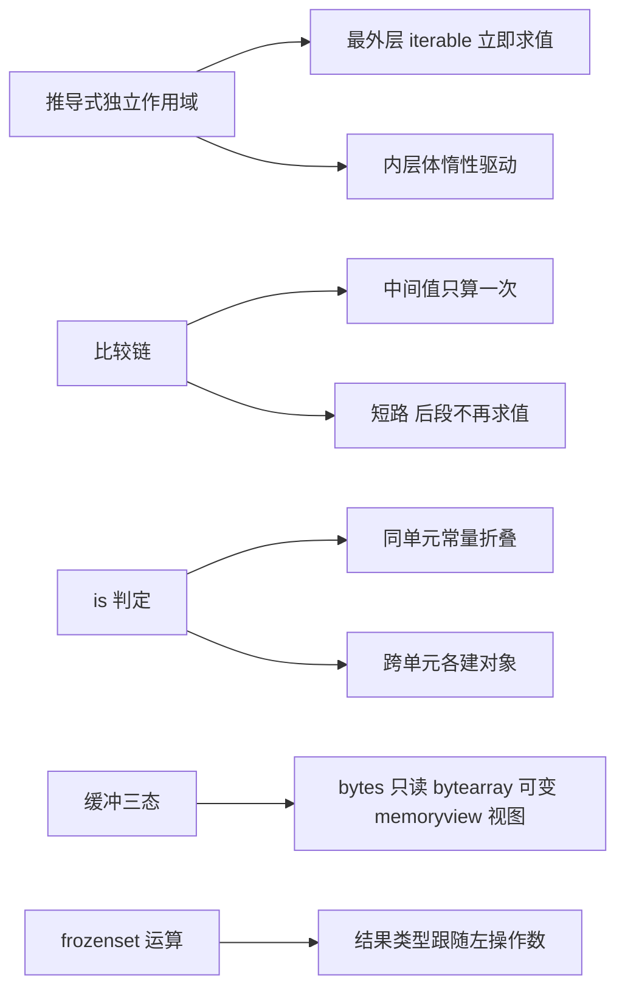
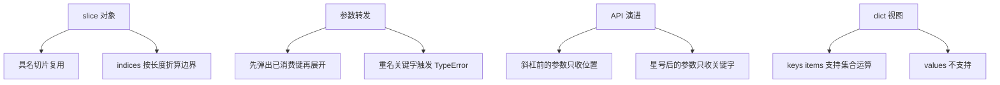
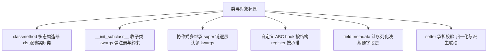
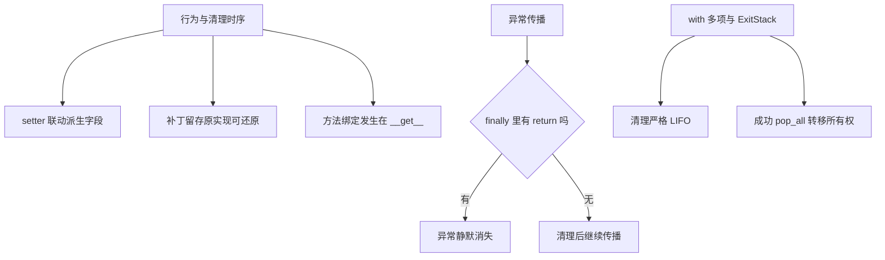
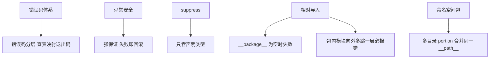
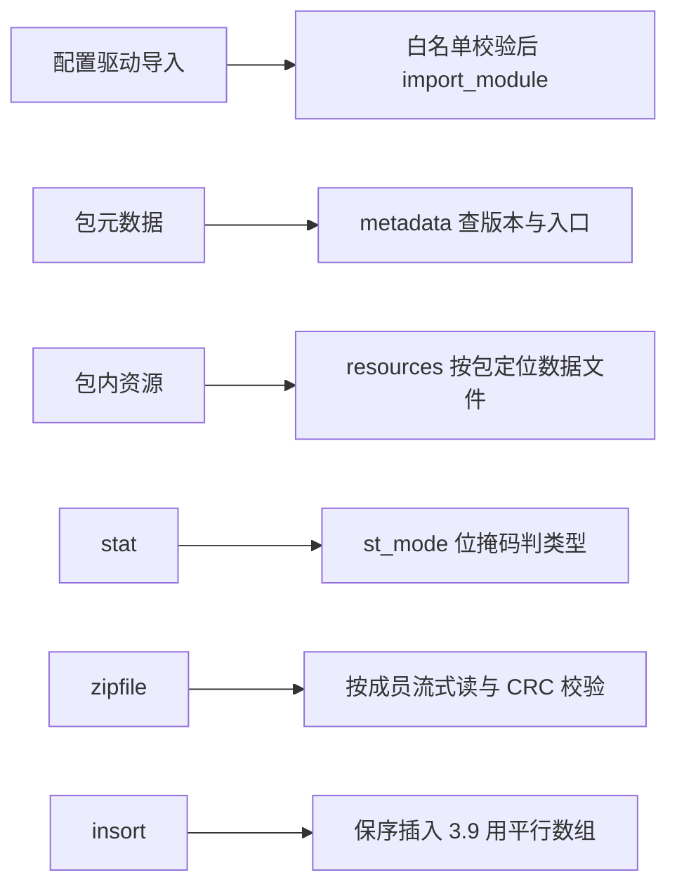
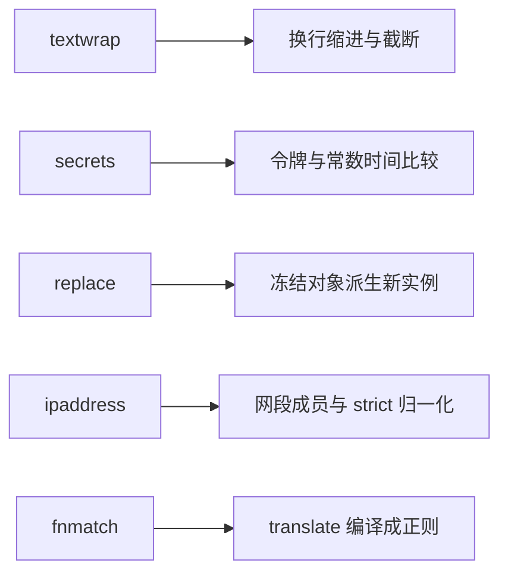
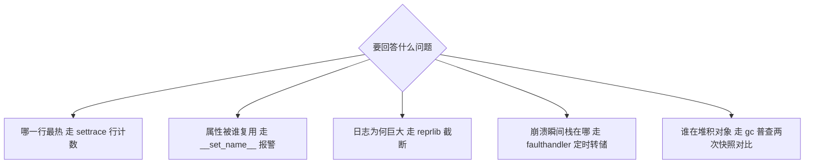
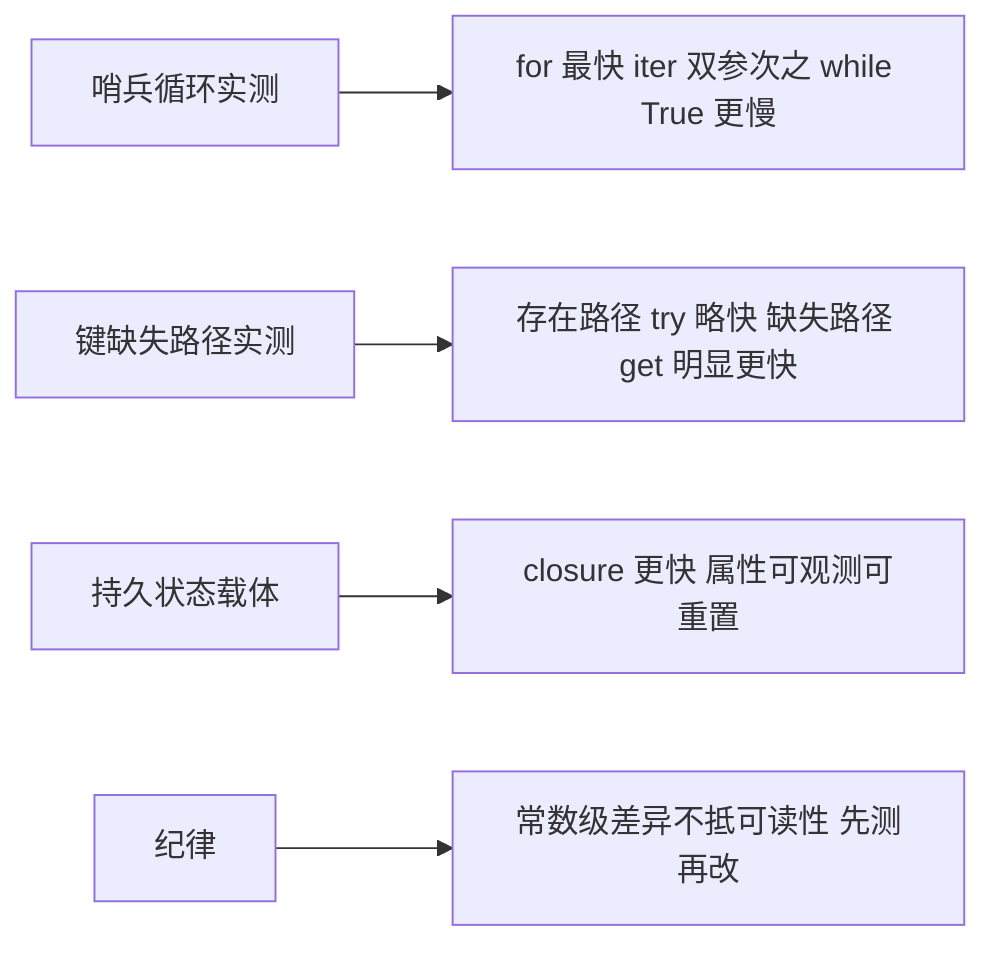

# 第 1 类 · 语言核心与底层(夜间扩产三)

> 本篇是语言核心的第三批夜间扩产(Q1796–Q1840):核心机制补遗(推导式作用域演化、比较链字节码、is 与常量折叠、缓冲三态转换、frozenset 运算分派、slice 对象、参数转发与 keyword-only、生成器表达式求值时机、dict 视图集合运算)、类与对象补遗(classmethod 多态构造器、__init_subclass__ 声明式 kwargs、协作式多继承、自定义 ABC、field metadata、property setter 副作用、猴子补丁边界、描述符绑定时机)、异常与上下文(嵌套 finally、with LIFO、ExitStack 事务交接、错误码体系、异常安全层级、suppress)。
> 工程侧覆盖:相对导入边界、命名空间包多路径合并、配置驱动动态导入、importlib.metadata/resources,以及标准库冷门利器(stat/zipfile/insort/textwrap/secrets/replace/ipaddress/fnmatch)与调试观测五件套(settrace 行探针、__set_name__ 复用报警、reprlib、faulthandler、gc 普查)。
> 收尾是三组微优化实测(哨兵循环、dict.get vs try/except、函数属性 vs 闭包),数据以本机 CPython 3.9.6 实跑为准,结论只到常数级差异。
> 所有代码仅标准库、可直接运行;涉及 3.10+ 特性处带版本守卫,均已逐题实跑通过。

### Q1796 · 列表推导的独立作用域:从泄漏到隔离的演化

> 难度:★★★☆☆ | 标签:推导式, 作用域, 历史

**问**:Python 2 的列表推导会把循环变量泄漏到外层作用域,3.x 改成了什么?推导式的作用域还有哪些容易被忽略的细节?

**答**:Python 3 起列表推导、集合/字典推导与生成器表达式都在独立作用域内运行,循环变量不再泄漏——2.x 时代推导式会把最后一个值留在外层(Q527 讲 for 循环至今仍保留这个行为),3.x 只有 for 循环保留、推导式隔离了。两个易被忽略的细节:① 最外层可迭代对象在外层作用域**立即求值**——定义推导式那一刻 iterable 表达式已经执行,坏 iterable 当场 TypeError,而内层 for/if 与产出表达式保持惰性;② 推导式内部看不到类体作用域,类变量要经外层 iterable 间接传入(Q528),函数局部变量则通过闭包正常可见。生成器表达式同理:外层立即、体内惰性,这也解释了 Q431 里「genexp 定义即检查参数」的现象。

```python
# file: code/01_语言核心与底层/q1796_listcomp_scope.py
"""列表推导的独立作用域:2.x 泄漏史与外层求值规则。"""


def loop_leak():
    for n in [1, 2, 3]:
        pass
    return n  # for 循环变量留在函数作用域;Python2 的推导式也这样泄漏


def comp_scope():
    n = "outer"
    squares = [n * n for n in [1, 2, 3]]  # 推导式有独立作用域,不改写外层 n
    return squares, n


def outermost_immediate():
    calls = []

    def iterable():
        calls.append("evaluated")
        return [1, 2]

    gen = (x for x in iterable())  # 定义这一行 iterable() 就已执行
    return calls, list(gen)        # 内层消费才驱动生成


def early_type_error():
    try:
        return [x for x in 123]    # 最外层 iterable 立即求值,当场 TypeError
    except TypeError as e:
        return type(e).__name__


if __name__ == "__main__":
    print("for 循环泄漏的 n:", loop_leak())
    squares, n = comp_scope()
    print("推导式结果:", squares, "外层 n 未被污染:", n)
    calls, values = outermost_immediate()
    print("定义时 iterable 已执行:", calls, "消费时产出:", values)
    print("坏 iterable 的报错时机:", early_type_error())
```

**追问**:1) 推导式里的循环变量与外层同名变量是什么关系?——推导式编译成隐式函数,两边是各自作用域里的独立绑定,互不影响;那最外层 iterable 里的名字呢?——在外层作用域按普通规则解析,定义时就完成。2) 泄漏的演化史?——2.x 推导式在当前作用域绑定变量、循环后泄漏;3.x 按 PEP 289/530 隔离成函数作用域,for 循环至今保留泄漏行为——两者并存是历史包袱。3) 求值时机模型?——最外层可迭代立即求值(定义时执行,坏对象当场 TypeError),内层 for/if/产出表达式保持惰性;genexp 还会持有 iterable 对象引用,与局部名无关。4) 生产陷阱?——genexp 引用外层可变变量,消费时才读「当前值」,与直觉差一步;最外层是生成器则定义时就开跑;误以为整条惰性导致资源提前占用。

### Q1797 · 比较链的字节码视角:中间值只求值一次

> 难度:★★★☆☆ | 标签:比较运算, 字节码, 求值顺序

**问**:Q541 讲了链式比较的语义,从字节码层面看,它和 and 写法差在哪?中间值到底发生了什么?

**答**:`1 < middle() < 10` 编译为一串 COMPARE_OP 配复制与跳转指令:左值与中间值先求值,第一段为真后中间值经复制直接参与第二段比较,全程只算一次——and 写法则把 middle() 求值两次。每段允许不同运算符,`1 <= 2 < 2` 就是 `1 <= 2 and 2 < 2` 的链式版;短路同样存在:某段为假,后面的函数调用根本不会执行。要点:链式比较不是语法糖而是求值协议,对带副作用的中间表达式是行为差异而非写法偏好;中间值只做栈上暂存,永远不会进入命名空间,所以你拿不到它、也无法复用它。

```python
# file: code/01_语言核心与底层/q1797_compare_chain.py
"""比较链的字节码视角:中间值只求值一次。"""
import dis


def probe():
    calls = []

    def middle():
        calls.append("middle")
        return 5

    ok = 1 < middle() < 10
    return ok, calls


def mixed_operators():
    # 每一段允许不同比较符:1 <= 2 < 2 即 1<=2 and 2<2
    return 1 <= 2 < 2, 1 <= 2 <= 2


def tail_opcodes(func, n=8):
    return [(i.opname, i.argrepr) for i in dis.get_instructions(func)][-n:]


if __name__ == "__main__":
    ok, calls = probe()
    print("1 < middle() < 10:", ok, "| middle 调用次数:", len(calls))
    print("混合运算符链:", mixed_operators())
    print("probe 尾部字节码(可见中间值的复制与跳转处理):")
    for op, arg in tail_opcodes(probe):
        print("   ", op, arg)
```

**追问**:1) 为什么 `1 < 2 == True` 会坑人?——它是链式:1<2 为真后拿 2 与 True 比较,得 False;想表达 (1<2)==True 必须加括号。2) 中间值「只求值一次」的机制?——比较链等价于 (a<b) and (b<c),但中间表达式靠 DUP_TOP/COPY 类指令复制栈顶实现,而不是重新求值;短路语义与 and 一致。3) True 参与链式的细节?——True == 1 所以 2 == True 为 False;bool 与 int 混入链式是这类坑的根源(Q539)。4) 生产陷阱?——中间表达式有副作用时求值次数与直觉不符(Q541);超长链可读性差该拆变量;把链式当「依次比较返回布尔元组」的误解。

### Q1798 · is 的缓存边界:常量折叠与运行时失配

> 难度:★★★★☆ | 标签:is, 常量折叠, intern

**问**:小整数缓存与字符串驻留之外,还有哪些机制让 `is` 的结果「看运气」?

**答**:除了 -5..256 的整数缓存与标识符样字符串的自动驻留(Q006/Q405),最大的变量是**常量折叠**:同一编译单元内,`"a b" + "c"` 与字面量 `"a bc"` 在编译期就折叠成同一个常量对象,`is` 为 True;跨编译单元(不同 exec/compile、REPL 不同行)各自建对象,`is` 就是 False 而 `==` 恒为 True——demo 里跨单元对非驻留字符串实测正是这个结果。三条推论:① 折叠只作用于编译期可确定的常量表达式,含变量的运行时运算不折叠;② 非标识符样字符串不自动驻留,这是跨单元失配的典型来源;③ 257 这类「边界值」在同一单元里也可能 is True,因为两边都是折叠常量,别拿缓存截止线做判断。结论与 Q1298 一致:is 只用于身份契约(单例、哨兵、None),值比较一律 ==。

```python
# file: code/01_语言核心与底层/q1798_is_folding.py
"""is 的缓存边界:常量折叠、驻留时机与跨编译单元失配。"""


def same_unit_folding():
    a = "a b" + "c"      # 同一编译单元:常量表达式编译期折叠成 "a bc"
    b = "a bc"
    return a is b        # 折叠后指向同一常量,True(实现细节,勿依赖)


def cross_unit():
    # 模拟两个编译单元:各自 exec 编译一次
    unit_a, unit_b = {}, {}
    exec("v = 'a b' + 'c'", unit_a)
    exec("v = 'a bc'", unit_b)
    return unit_a["v"] == unit_b["v"], unit_a["v"] is unit_b["v"]


def runtime_values():
    parts = ["a b", "c"]
    a = "".join(parts)   # 运行时拼接,结果不一定命中驻留
    return a == "a bc"   # 相等性判断永远安全


def small_int_cache():
    a, b = 256, 128 + 128
    c, d = 257, 128 + 129
    return a is b, c is d    # -5..256 是实现缓存区间;同单元常量也会折叠


def big_int():
    base = 1000
    a, b = base * 10, base * 10   # 运行时乘法,各自新建大整数对象
    return a == b, a is b


if __name__ == "__main__":
    print("同单元常量折叠 a is b:", same_unit_folding())
    eq, ident = cross_unit()
    print("跨编译单元:== 为", eq, "| is 为", ident)
    print("运行时拼接只谈相等:", runtime_values())
    si = small_int_cache()
    print("256 命中缓存:", si[0], "| 257 同单元折叠:", si[1])
    bi = big_int()
    print("运行时大整数 == 为", bi[0], "| is 为", bi[1])
```

**追问**:1) 为什么教程里 a=257; b=257 后 a is b 有时 True 有时 False?——同一编译单元内两者都是折叠常量必然 True;REPL 分两行就是两个编译单元,各自建对象可能 False。2) 缓存的机制边界?——小整数 -5..256 是解释器预建单例;字符串字面量按「标识符样」自动 intern;运行时拼接/计算结果不进缓存——is 比较值的「成功案例」全是实现细节。3) 与 PYTHONHASHSEED 的关系?——驻留与缓存不受盐影响,但依赖它们做语义判断仍然错误;is 的合法用途只有单例/哨兵/身份判断(Q1298)。4) 生产陷阱?——用 is 比较数值或字符串;把 REPL 实验当语义结论;跨实现(Pypy)缓存策略不同直接崩。

### Q1799 · bytes/bytearray/memoryview 三态转换与只读边界

> 难度:★★★☆☆ | 标签:缓冲区协议, 二进制, 内存

**问**:bytes、bytearray、memoryview 之间的转换哪些拷贝、哪些不拷贝?写与 resize 的边界在哪?

**答**:转换矩阵记三行:① bytes -> bytearray 拷贝、-> memoryview 零拷贝视图;② bytearray -> memoryview 零拷贝、-> bytes 拷贝出只读快照;③ 视图回 bytes/bytearray 都拷贝,视图切片不拷贝(Q493 讲零拷贝用法,本题给转换与读写边界)。写边界:只有底层可变且视图可写才能写——bytes 的视图只读,赋值抛 TypeError;对 bytearray 的视图写会写穿到底层。resize 边界最常踩:存在未释放视图时 bytearray 禁止扩缩(抛 BufferError),必须先 mv.release() 或让视图离开作用域。进阶用 memoryview.cast 换格式重解释(比如按 h 把字节流当 short 数组读),全程零拷贝,这是 struct.unpack_from 之外的第二条协议解析路径。

```python
# file: code/01_语言核心与底层/q1799_buffer_trio.py
"""bytes/bytearray/memoryview 三态转换矩阵与只读边界。"""
import struct


def conversion_matrix():
    b = bytes([72, 105])       # bytes:不可变
    ba = bytearray(b)          # bytes -> bytearray:拷贝
    mv = memoryview(ba)        # bytearray -> memoryview:零拷贝视图
    snap = bytes(mv)           # 视图 -> bytes:拷贝出快照
    ba2 = bytearray(mv)        # 视图 -> bytearray:拷贝
    return b, ba, snap, bytes(ba2), snap == bytes(ba)


def view_write_through():
    ba = bytearray(b"hello")
    mv = memoryview(ba)
    mv[0] = ord("H")           # 写视图,写穿到底层
    return ba


def readonly_boundary():
    mv = memoryview(b"immutable")   # bytes 的视图只读
    try:
        mv[0] = 88
    except TypeError as e:
        return "只读视图被拦截: " + str(e)[:30]
    return "写成功了?不可能"


def resize_block():
    ba = bytearray(b"12345")
    mv = memoryview(ba)
    result = None
    try:
        ba.extend(b"678")      # 有活动视图时禁止 resize
    except BufferError as e:
        result = "有视图时禁止 resize: " + str(e)[:22]
    finally:
        mv.release()           # 释放视图后恢复可变
        ba.extend(b"678")
    return result, ba


def struct_view():
    raw = bytearray(struct.pack("<2h", 7, -9))
    shorts = memoryview(raw).cast("h")   # 视图重解释,不拷贝
    return list(shorts), bytes(raw)


if __name__ == "__main__":
    b, ba, snap, snap2, eq = conversion_matrix()
    print("转换矩阵:", b, ba, snap, snap2, "快照相等:", eq)
    print("视图写穿:", view_write_through())
    print(readonly_boundary())
    print(resize_block())
    print("cast 重解释:", struct_view())
```

**追问**:1) 为什么视图活着的 bytearray 连 extend 都不行?——缓冲区协议把内存地址交给了外部持有者,移动或扩容会让对方拿到悬空指针,CPython 选择直接禁止导出中的 resize。2) 三态的职责分工?——bytes 只读快照、bytearray 可变缓冲、memoryview 零拷贝视图;bytes(ba) 拷贝、mv(ba) 引用;选型按「是否需要修改」与「是否需要零拷贝」。3) 视图的进一步操作?——cast() 改解释格式(int/float 视图)、release() 释放导出、与 struct/numpy 互操作;持有期间所有 resize 被 BufferError 挡住(Q493)。4) 生产陷阱?——大缓冲误转 bytes 双倍内存;忘 release 导致 BufferError 隐藏真实泄漏;循环里反复拼接 bytes 应换 bytearray。

### Q1800 · frozenset 的运算分派:结果类型跟随左操作数

> 难度:★★☆☆☆ | 标签:集合, frozenset, 类型系统

**问**:`{1,2} - frozenset({2,3})` 与反过来写,结果类型一样吗?这背后是什么协议?

**答**:不一样:二元集合运算符按「左操作数类型优先」分派,set - frozenset 得 set,frozenset - set 得 frozenset,交并对称差同理——结果是类型层面的行为,不是实现巧合。三个推论:① 想锁死不可变语义,把 frozenset 写在左边或显式包一层;② 实例方法 f.union(任意可迭代) 总是返回 frozenset,参数类型不影响结果;③ 未绑定形式有严格的接收者检查——frozenset.intersection(set_obj, other) 会报「doesn't apply to a set object」,与 set 方法家族不同。frozenset 可哈希(Q536/Q1533),作 dict 键或集合元素时,运算结果的类型决定下游还能不能再进容器。

```python
# file: code/01_语言核心与底层/q1800_frozenset_dispatch.py
"""frozenset 的运算分派:结果类型跟随左操作数。"""


def result_type_follows_left():
    s, f = {1, 2, 3}, frozenset({2, 3, 4})
    return type(s - f).__name__, type(f - s).__name__


def method_semantics():
    f, b = frozenset({2, 3, 4}), {3, 4, 5}
    joined = f.union(b)              # 参数任意可迭代,返回 frozenset
    return joined, type(joined).__name__


def unbound_strict():
    s, f = {1, 2}, frozenset({2, 3})
    try:
        frozenset.intersection(s, f)  # 未绑定调用:接收者必须是 frozenset
    except TypeError as e:
        return str(e)[:34]
    return sorted(frozenset.intersection(f, s))


def reflected_keeps_left():
    s, f = {1, 2}, frozenset({2, 3})
    return type(s ^ f).__name__, type(f ^ s).__name__


def hashable_key():
    groups = {
        frozenset({"read", "write"}): "admin",
        frozenset({"read"}): "viewer",
    }
    return groups[frozenset({"read"})]


if __name__ == "__main__":
    rt = result_type_follows_left()
    print("s - f 的类型:", rt[0], "| f - s 的类型:", rt[1])
    print("f.union(set) 语义:", method_semantics())
    print("未绑定调用对接收者的类型检查:", unbound_strict())
    print("对称差结果类型:", reflected_keeps_left())
    print("frozenset 作 dict 键:", hashable_key())
```

**追问**:1) 为什么右操作数完全不影响结果类型?——双下方法分派先查左类型的 __sub__,命中即返回其定义的结果;右类型的反射方法只在左侧不认识自己时才介入(Q531)。2) 分派顺序的全貌?——左 __sub__ → 右 __rsub__ → TypeError;右是左的子类时右优先;NotImplemented 是「我不认识你」的信号,不是异常——抛错会中断整条分派链。3) 运算结果的类型契约?——frozenset - set 得 frozenset,set - frozenset 得 set,由左操作数的方法决定;这避免「结果类型不可预测」的混乱。4) 生产陷阱?——自定义类型漏反射方法导致 a+b 顺序敏感;在 __sub__ 里直接抛异常而不是返回 NotImplemented;与 numpy 混算时 __array_ufunc__ 抢分派权。



### Q1801 · slice 对象一等公民:复用、等价与 indices 求界

> 难度:★★★☆☆ | 标签:切片, 序列, API 设计

**问**:slice 不只是语法糖,作为对象它有哪些独立用法?

**答**:`obj[a:b:c]` 的真相是构造 slice(a, b, c) 传给 __getitem__,slice 因此是一等公民:① 具名切片让长表达式的切片语义集中定义——LAST_THREE = slice(-3, None) 可复用、可测试、可写进配置;② slice.indices(len) 把 None 与越界负号折算成合法的 start/stop/step,是手写分块、分页逻辑的官方工具,不必自己实现负索引规则;③ slice 可哈希、可进集合,operator.itemgetter(slice(1, 3)) 直接生成切片取值器,配合 map/sorted 很顺手(Q041 讲切片语法,本题讲对象形态)。等价性可验证:seq[2:8:2] 与 seq[slice(2, 8, 2)] 永远一致,框架层做「切片参数化」时靠这一等价性透传用户意图。

```python
# file: code/01_语言核心与底层/q1801_slice_object.py
"""slice 对象是一等公民:复用、等价与 indices 求界。"""
import operator


LAST_THREE = slice(-3, None)     # 具名切片:一处定义,处处复用


def apply_slice(seq, sl):
    return seq[sl]               # 等价于 seq[sl.start:sl.stop:sl.step]


def indices_bounding():
    # slice.indices(len) 把 None 与越界折算成合法的 start/stop/step
    return slice(2, 99).indices(5), slice(-2, None).indices(5)


def equivalence_check():
    seq = list(range(10))
    manual = seq[2:8:2]
    via_obj = seq[slice(2, 8, 2)]
    return manual, via_obj, manual == via_obj


def itemgetter_family():
    seq = [10, 20, 30, 40]
    return operator.itemgetter(slice(1, 3))(seq)   # 切片也能进 itemgetter


if __name__ == "__main__":
    data = [1, 2, 3, 4, 5, 6, 7]
    print("具名切片取最后三个:", apply_slice(data, LAST_THREE))
    print("indices 求界:", indices_bounding())
    print("手工切片与 slice 对象等价:", equivalence_check())
    print("itemgetter + slice:", itemgetter_family())
    print("slice 自身字段:", LAST_THREE.start, LAST_THREE.stop, LAST_THREE.step)
```

**追问**:1) slice(2, 99).indices(5) 返回什么?——(2, 5, 1),stop 99 被截到 5;slice(-2, None).indices(5) 得 (3, 5, 1),负号已折算。2) slice 一等公民的价值?——slice 对象可存、可复用、可比较;自定义容器的 __getitem__ 接 slice 参数时,indices(len) 是规范化边界的官方工具,免手写负号/越界逻辑。3) 等价与复用语义?——slice 对象支持 ==(逐字段)但不可哈希(含 None);预先定义的命名切片(STEP = slice(0, None, 2))提升可读性。4) 生产陷阱?——手写「if step < 0 ...」的边界推导(容易漏负 step);把 slice 当 dict key(不可哈希);对长度 0 的容器 indices 结果没做防御。

### Q1802 · 参数转发的陷阱:重复关键字、展开顺序与签名漂移

> 难度:★★★★☆ | 标签:函数, kwargs, API 设计

**问**:`def wrapper(*args, **kwargs): return f(**kwargs)` 这类转发,实际会踩哪些坑?

**答**:三类坑:① 消费与转发冲突——转发层先显式传 retries=2,又把调用方的 **options 原样展开,重名直接 TypeError「got multiple values for keyword argument」;正解是 options.pop("retries", default) 先弹出已消费的键再转发。② 展开顺序——f(**kw, timeout=1) 语法合法但 kw 里的重名键在调用时同样炸,因为字面关键字在 ** 展开之后;想让显式值赢,必须先 pop。③ 签名漂移——转发层若插了位置参数或改了默认值,下游感知不到,出问题难排查;纯 **kwargs 透传不受中间层参数增减影响,这正是它的价值(Q540/Q1529 讲星号语法,Q498 讲用 Signature.bind 做严格校验)。

```python
# file: code/01_语言核心与底层/q1802_kw_forwarding.py
"""参数转发的陷阱:重复关键字、展开顺序与签名漂移。"""


def service(url, *, timeout=1.0, retries=3, verify=True):
    return {"url": url, "timeout": timeout, "retries": retries, "verify": verify}


def forward_bad(url, **options):
    # 陷阱一:调用方传 retries,这里又显式传 retries -> 调用时 TypeError
    return service(url, timeout=options.get("timeout", 1.0),
                   retries=2, **options)


def forward_good(url, **options):
    # 正解:先弹出已消费的键,其余原样转发
    retries = options.pop("retries", 2)
    return service(url, retries=retries, **options)


def order_rule():
    # 陷阱二:f(**kw, timeout=1) 展开顺序在后,重名键直接 TypeError
    kwargs = {"timeout": 9}
    try:
        service("http://x", **kwargs, timeout=1)
    except TypeError as e:
        return str(e)[:40]
    return "没报错?"


def drift_demo():
    # 纯 ** 转发不受中间层参数增减影响
    def outer(**kw):
        return service("http://x", **kw)
    return outer(timeout=5)


if __name__ == "__main__":
    try:
        forward_bad("http://x", retries=9)
    except TypeError as e:
        print("重复关键字:", str(e)[:56])
    print("先弹出再转发:", forward_good("http://x", retries=9, verify=False))
    print("展开顺序规则:", order_rule())
    print("纯 ** 转发无漂移:", drift_demo())
```

**追问**:1) 转发层想「防漂移」该做什么?——把允许透传的键收进 keyword-only 参数或白名单,多余键显式拒绝,而不是无限转发。2) 转发的三大陷阱?——重复关键字:f(**d, x=1) 与 d 含 x 冲突 TypeError(Q1529);签名漂移:**kwargs 掩盖被调方新增参数,上游永远传不到;展开顺序:**a, **b 后写赢,依赖顺序的合并难排查。3) 字节码层?——CALL_FUNCTION_EX 收打包好的元组+字典;多重 kwargs 合并有专用检查指令。4) 生产陷阱?——装饰器/代理层无限 **kwargs 转发后「改了下游参数没人知道」;转发时漏 unpack 新参数;文档签名与实际转发不一致。

### Q1803 · keyword-only 与 positional-only:API 演进的安全阀

> 难度:★★★☆☆ | 标签:参数设计, API, 兼容性

**问**:`/` 和 `*` 把参数分成三段,各解决什么问题?怎么用于 API 演进?

**答**:`def f(a, /, b, *, c)` 三段:斜杠前只能按位置、星号后只能按关键字,中间两可。工程价值在演进的「安全阀」:① 新参数一律放 `*` 之后(keyword-only),已有位置调用零破坏——若 role 是普通参数,上游 f(name, role) 写死后,再想插一个参数就得全局改调用点;② 会被重命名的参数加 `/`(positional-only),调用方无法按名耦合,内部改名不破坏兼容,也避免参数名与常见关键字撞车(如 open 早期的 file/buffer);③ inspect.signature 能完整读出两类标记,校验器与绑定逻辑不丢信息(Q498)。PEP 570(3.8)与 PEP 3102 各管一头,Q1273 讲 dataclass 的 kw_only 版本,本题是函数签名层的基础设施。

```python
# file: code/01_语言核心与底层/q1803_kw_only_params.py
"""keyword-only 与 positional-only:API 演进的安全阀。"""
import inspect


def create_user(name, /, *, role="member", active=True):
    # / 之前只能按位置;* 之后只能按关键字
    return {"name": name, "role": role, "active": active}


def legacy(name, role="member"):
    return {"name": name, "role": role}


if __name__ == "__main__":
    print("正常调用:", create_user("alice", role="admin"))
    try:
        create_user(name="bob")          # name 是 positional-only
    except TypeError as e:
        print("按关键字传 name:", str(e)[:48])
    try:
        create_user("carol", "admin")    # role 是 keyword-only
    except TypeError as e:
        print("按位置传 role:", str(e)[:48])
    print("签名自省:", str(inspect.signature(create_user)))
    print("旧接口兼容:", legacy("dave"))
```

**追问**:1) positional-only 还能防什么?——防调用方依赖参数名做关键字展开,从而锁死重命名与 kwargs 二次转发的自由度。2) 两个安全阀的分工?——/ 锁死位置(参数名是实现细节,内置 len(len(obj) 不能写 obj=)的姿势);* 锁死关键字(布尔/开关参数命名传,防位置错位);两者可同用:len(obj, /, *, key=None) 风格。3) API 演进策略?——新参数一律 keyword-only + 默认值,旧参数不动;把已发布参数改 pos-only 是破坏性变更,要走版本化。4) 生产陷阱?——布尔位置参数两值对调没人发现;**kwargs 转发链被 pos-only 中断;默认值参数插入位置改变位置实参含义。

### Q1804 · 生成器表达式的求值时机:外层立即、内层惰性

> 难度:★★★★☆ | 标签:生成器表达式, 求值时机, 陷阱

**问**:生成器表达式「惰性」到底惰在哪?为什么说最外层是例外?

**答**:genexp 的函数体(内层 for 的循环体、if 与产出表达式)消费一个元素才算一个,但**最外层可迭代对象在定义那一刻立即求值**——source() 已经执行、iterable 已经拿到,坏 iterable 当场 TypeError 而不是等到第一次 next。三条推论:① 「定义后源数据被改」对最外层 iterable 无效,它拿到的已是当时的对象引用或迭代器;② if 条件与产出表达式里的名字走闭包晚绑定,消费前改外层变量会生效——demo 里把 n 从 10 改成 0 后产出变空,与 Q017 的 late binding 同源;③ 传给 any/all/sum 的 genexp 定义即检查 iterable,报错时机比想象中早。Q021 讲选型、Q436 讲 itertools,本题专讲时机。

```python
# file: code/01_语言核心与底层/q1804_genexp_timing.py
"""生成器表达式的求值时机:外层立即、内层惰性。"""


def outermost_eager():
    log = []

    def source():
        log.append("source evaluated")
        return iter([1, 2, 3])

    gen = (x * 10 for x in source())   # source() 在定义这一行就已执行
    return log, next(gen)


def body_lazy():
    log = []

    def double(v):
        log.append("double " + str(v))
        return v * 2

    gen = (double(x) for x in [1, 2])
    before = list(log)
    return before, list(gen), list(log)  # 消费前函数体未跑


def filter_late_binding():
    n = 10
    gen = (x for x in range(100) if x < n)  # if 里的 n 消费时才查外层
    n = 0                                   # 消费前改外层变量会生效
    return list(gen)


if __name__ == "__main__":
    log, first = outermost_eager()
    print("定义后 source 已执行:", log, "| 首个产出:", first)
    before, values, after = body_lazy()
    print("消费前:", before, "| 消费后:", after)
    print("if 引用的外层变量实时生效:", filter_late_binding())
```

**追问**:1) genexp 的 iterable 是函数参数,函数返回后 genexp 还能用吗?——能,iterable 对象被引用持有,与参数名生命周期无关;但若它是只前进一次的迭代器,已消费部分不会重来。2) 「外层立即、内层惰性」的完整模型?——定义时最外层 iterable 求值并绑定;每次 next 推进内层 for/if;两层时机差是 genexp 的核心心智模型(Q1796)。3) 与 listcomp 的取舍?——listcomp 立即产出物化;genexp 惰性省内存;消费两次的需求必须 listcomp 或工厂函数。4) 生产陷阱?——复用 genexp 拿到空;iterable 是迭代器时定义后就被部分消费;闭包变量在消费时才读当前值,延迟语义踩坑。

### Q1805 · dict 视图的集合运算:keys/items 视图的交并差

> 难度:★★★☆☆ | 标签:dict, 视图, 集合运算

**问**:dict.keys() 的返回值居然支持 `-` 和 `&`?哪些视图支持,哪些不支持,为什么?

**答**:keys 与 items 视图实现了集合协议,因为键唯一、items 元组可哈希,集合语义成立:ko - kn 是删除键,kn - ko 是新增键,ko & kn 配合逐键比值得出「值变化的键」,配置 diff 一行写完(Q1265 讲视图是动态窗口,本题讲集合运算)。values 视图不实现集合运算——值可重复且不必可哈希,减法语义无定义,hasattr(v, "__sub__") 为 False。items 视图交并差按 (key, value) 元组比较,适合找「完全相同的键值对」;要注意值里有 list 之类的不可哈希对象时 items 运算直接 TypeError。视图是活窗口:运算结果是基于当刻内容的快照集合,之后 dict 再变不影响已算出的结果。

```python
# file: code/01_语言核心与底层/q1805_dict_view_setops.py
"""dict 视图的集合运算:keys/items 视图的交并差。"""


def diff_views(old, new):
    ko, kn = old.keys(), new.keys()
    return {
        "added": sorted(kn - ko),
        "removed": sorted(ko - kn),
        "kept": sorted(ko & kn),
    }


def changed_values(old, new):
    return sorted(k for k in old.keys() & new.keys() if old[k] != new[k])


def values_not_setlike():
    return hasattr({"a": 1}.values(), "__sub__")


def items_setlike():
    a = {"x": 1, "y": 2}
    b = {"x": 1, "z": 3}
    return sorted(a.items() & b.items())     # 键值对元组的集合交集


if __name__ == "__main__":
    old = {"a": 1, "b": 2, "c": 3}
    new = {"b": 20, "c": 3, "d": 4}
    print("视图差集与交集:", diff_views(old, new))
    print("值变化的键:", changed_values(old, new))
    print("values 视图支持集合运算:", values_not_setlike())
    print("items 视图交集:", items_setlike())
```

**追问**:1) 视图集合运算的复杂度?——交并差按小集合逐成员查大集合哈希表,近似 O(min(len));items 运算要求值可哈希,值含 list 直接 TypeError。2) items 视图为什么按集合处理?——键唯一使 (k, v) 元组可判等,所以 ItemsView 注册为 Set;values 视图没有键可判等,只是 Collection(Q1265)——这是「能不能做集合运算」的判据。3) 与手写循环的对比?——视图运算零拷贝 + C 层哈希,远快于逐项循环;语义上等价于 set(d1.items()) & set(d2.items()) 但不物化。4) 生产陷阱?——值不可哈希时 items 运算崩,先想清楚要不要按值比较;把视图当静态集合缓存(动态窗口漂移);运算结果的「元素顺序」没有语义。



### Q1806 · classmethod 多态构造器:from_xxx 与 cls 传递

> 难度:★★★☆☆ | 标签:classmethod, 构造器, 多态

**问**:为什么 from_xxx 系列构造器要用 classmethod 而不是模块级工厂函数?子类继承后行为如何?

**答**:`@classmethod def from_fahrenheit(cls, f): return cls(...)` 的关键是返回 cls(...) 而不是硬编码 Temperature:Kelvin.from_fahrenheit(100) 时 cls 是 Kelvin,自动得到子类实例,多态构造免费获得——这是 Q034 用 __new__ 控制实例化之外的第二条正路。工程约定:① from_xxx 命名成对出现(from_json/from_fahrenheit/from_row),__init__ 保持唯一主构造;② 继承体系里子类若改了 __init__ 签名,要么同步覆写 from_xxx,要么保持 cls(**kwargs) 风格让参数表稳定;③ 比「硬编码类名的工厂函数」可测试得多——测试子类即可覆盖整条构造链,而且 classmethod 能被覆写后经由 super() 组合。Q512 的 Enum 成员访问、Q455 的注册器都建立在「cls 跟随实际类」这个语义上。

```python
# file: code/01_语言核心与底层/q1806_cls_poly_ctor.py
"""classmethod 多态构造器:from_xxx 与 cls 的多态传递。"""
import json


class Temperature:
    def __init__(self, celsius):
        self.celsius = celsius

    @classmethod
    def from_fahrenheit(cls, f):
        return cls((f - 32) * 5 / 9)      # cls 是实际调用的类,不是硬编码

    @classmethod
    def from_json(cls, payload):
        data = json.loads(payload)
        return cls(data["celsius"])

    def __repr__(self):
        return "{}({:.1f}C)".format(type(self).__name__, self.celsius)


class Kelvin(Temperature):
    def __init__(self, celsius):
        super().__init__(celsius)
        self.kelvin = celsius + 273.15


if __name__ == "__main__":
    print(Temperature.from_fahrenheit(100))
    print(Kelvin.from_fahrenheit(100))    # 子类上调用,cls 是 Kelvin:多态构造
    print(Kelvin.from_json('{"celsius": 25}'))
```

**追问**:1) classmethod 构造器与 Q442 的注册器怎么配合?——注册表把配置名映射到 cls,基类 from_config(cls, cfg) 负责按 cls 解析并实例化,两层各司其职。2) cls 传递为什么是多态关键?——from_xxx 里用 cls(...)(而不是硬编码类名)实例化,子类调用得到子类实例;这是替代构造器与继承能共存的原因。3) 构造器链的组织?——from_config 可委托其他 from_xxx;classmethod 可被子类重写定制解析逻辑;返回值一律 cls 实例。4) 生产陷阱?——构造器里写死 Base(...) 破坏多态;classmethod 与 property/staticmethod 混用顺序错;构造链共享模块级状态导致并发问题。

### Q1807 · __init_subclass__ 的声明式 kwargs:配置上浮与约束校验

> 难度:★★★★☆ | 标签:元编程, __init_subclass__, 声明式

**问**:Q455 讲了注册与约束,子类关键字参数的「消化链」你梳理过吗?多个 mixin 各自定义 __init_subclass__ 时 kwargs 怎么流动?

**答**:类体里 `class User(Table, table="users", strict=False)` 的 kwargs 由 MRO 上各基类的 __init_subclass__ 逐层「认领」:每层签名里显式声明的参数留下自用,其余通过 super().__init_subclass__(**kwargs) 继续上传,最终 object.__init_subclass__() 不收任何参数——有人留了没人认领的键就 TypeError,这是天然的拼写检查。三个工程要点:① 每层 mixin 只声明自己关心的 kwargs,组合时互不感知;② 约束校验查 cls.__dict__ 而不是 hasattr,避免把继承来的成员误当自己的声明(Q455 同款纪律);③ 注册表在这层维护,类定义即完成,导入顺序决定注册顺序——与 Q442 装饰器注册器同源的问题,解法都是「注册时只记录、使用时再解析」。

```python
# file: code/01_语言核心与底层/q1807_init_subclass_kwargs.py
"""__init_subclass__ 的声明式 kwargs:配置上浮与约束校验。"""


class Table:
    registry = {}

    def __init_subclass__(cls, table=None, strict=True, **kwargs):
        super().__init_subclass__(**kwargs)      # 其余 kwargs 沿 MRO 继续上传
        cls.table = table or cls.__name__.lower()
        cls.strict = strict
        if strict and "columns" not in cls.__dict__:
            raise TypeError(cls.__name__ + " 缺少 columns 声明")
        Table.registry[cls.table] = cls


class User(Table, table="users", strict=False):
    columns = ["id", "name"]


class Order(Table):
    columns = ["id", "amount"]


if __name__ == "__main__":
    print("注册表:", sorted(Table.registry))
    print("User 表名:", User.table, "| strict:", User.strict)
    print("Order 表名(默认推导):", Order.table)
    try:
        type("Bad", (Table,), {"table": "bad"})  # strict 且缺 columns
    except TypeError as e:
        print("约束生效:", str(e)[:44])
```

**追问**:1) __init_subclass__ 里抛 TypeError 在什么时机炸?——子类定义/import 时刻,而非实例化时刻,错误左移到 CI 阶段。2) kwargs 的来源与链式约束?——类体括号参数由 metaclass 透传给 __init_subclass__;必须显式 super().__init_subclass__(**kwargs) 把不认识的传下去,否则基类钩子被跳过;未知关键字直接报错是特性不是 bug。3) 配置上浮的收益?——类声明即配置(如 class Csv(Backend, codec="utf8")),注册/校验/参数都在类创建期完成;与 __set_name__/__class_getitem__ 同属声明式工具箱。4) 生产陷阱?——吞掉 kwargs 不传 super 导致多级钩子断链;在钩子里做重初始化(import 锁期);kwargs 语义未文档化。

### Q1808 · 协作式多继承:super 链上的 kwargs 传递与耗尽

> 难度:★★★★★ | 标签:多继承, super, MRO

**问**:多继承里每个 mixin 的 __init__ 都收 **kwargs 再 super().__init__(**kw),这套协作式初始化的正确姿势与失败形态是什么?

**答**:协作式多继承的契约是:每个 __init__ 只认领自己关心的命名参数,其余原样 **kw 传给 super(),沿 MRO(Task -> TimedMixin -> TaggedMixin -> Base)逐层消化;链尾用 Base 接住没人认领的 kwargs 并不再上传——若继续 super() 到 object.__init__,多余关键字会 TypeError,这就是「kwargs 的耗尽」必须在链尾处理的原因。失败形态两类:① 直接调父类名 Base.__init__(self) 绕过 super 链,后续 mixin 全部初始化——Q032 说的「super 是沿 MRO 的下一个」在这里具体成灾,demo 里 Broken 的 timeout 就是没拿到;② 链尾不留收尾层,遗留 kwargs 打到 object 上报错。混入设计三条军规:mixin 不调 object.__init__、签名一律带 **kw、认领参数全部 keyword-only 以免位置参数错位。

```python
# file: code/01_语言核心与底层/q1808_cooperative_mi.py
"""协作式多继承:super 链上的 kwargs 传递与耗尽。"""


class Base:
    def __init__(self, **kw):
        self.leftover = kw          # 链尾:接住没人认领的 kwargs,不再上传
        print("Base 收尾,剩余:", set(kw))


class TimedMixin:
    def __init__(self, timeout=None, **kw):
        self.timeout = timeout
        print("TimedMixin 认领 timeout")
        super().__init__(**kw)


class TaggedMixin:
    def __init__(self, tags=(), **kw):
        self.tags = tags
        print("TaggedMixin 认领 tags")
        super().__init__(**kw)


class Task(TimedMixin, TaggedMixin, Base):
    pass


class Broken(Task):
    def __init__(self, **kw):
        Base.__init__(self)         # 反例:绕过 super 链,其他 mixin 全饿死


if __name__ == "__main__":
    print("MRO:", [c.__name__ for c in Task.__mro__])
    t = Task(timeout=5, tags=("a",), name="job1")
    print("timeout:", t.timeout, "| tags:", t.tags, "| 没人认领:", t.leftover)
    print("--- 反例 ---")
    b = Broken(timeout=9)
    print("Broken.timeout:", getattr(b, "timeout", "没拿到"))
```

**追问**:1) MRO 顺序写反会怎样?——认领顺序变化,默认值覆盖关系跟着变;参数不冲突时行为相同,冲突时后进链的默认值赢,这正是「mixin 在前、基类在后」惯例的来源。2) kwargs 协作协议?——每层认领自己关心的 kwargs、其余原样转发;耗尽到 object.__init__ 时必须为空,残留即 TypeError——这就是「不认领要转发」的强制力。3) 协作式初始化的完整链?——super().__init__(**kwargs) 按 MRO 走,每个 mixin 只处理自己的部分;菱形继承下 __init__ 只走一次(MRO 线性化)。4) 生产陷阱?——某层吞掉 kwargs 不转发,object 收到残留崩溃;**kwargs 与显式参数混用时签名漂移;默认值在两层重复定义,链序决定谁赢。

### Q1809 · 自定义 ABC:__subclasshook__ 结构判定与 register 承诺注册

> 难度:★★★★☆ | 标签:ABC, 虚拟子类, 协议

**问**:Q477 讲了 collections.abc 的虚拟子类,自己写 ABC 时,__subclasshook__ 与 register 该怎么分工?

**答**:两条通道解决两类问题:① __subclasshook__ 做**结构判定**——classmethod 里检查 other 是否有 export 方法,有就拍板 True,拿不准返回 NotImplemented 把判定交还给注册表与常规检查;第三方类一个字不用改就通过,是「鸭子类型形式化」。② register 做**承诺注册**——LegacyAdapter 的方法名不匹配 hook,但团队承诺它兼容,register 一句声明 issubclass/isinstance 为 True,不校验任何方法、不继承实现,是纯粹的信任标记。注意 hook 拍板的 True/False 优先于注册表,只有 NotImplemented 才会继续查 _abc_registry——这是两通道的优先级契约。抽象方法仍由 @abstractmethod 守门:常规子类不实现就不能实例化,虚拟子类不受限。

```python
# file: code/01_语言核心与底层/q1809_own_abc_hook.py
"""自定义 ABC:__subclasshook__ 结构判定与 register 虚拟子类。"""
from abc import ABC, abstractmethod


class Exporter(ABC):
    @abstractmethod
    def export(self, data):
        ...

    @classmethod
    def __subclasshook__(cls, other):
        if cls is Exporter and hasattr(other, "export"):
            return True                        # 结构判定认得,直接拍板
        return NotImplemented                  # 拿不准:交还注册表与常规检查


class CsvExporter(Exporter):
    def export(self, data):
        return ",".join(map(str, data))


class ThirdParty:
    """不能修改源码的第三方类,但恰好有 export。"""

    def export(self, data):
        return str(data)


class LegacyAdapter:
    """方法名不匹配 hook;团队用 register 做承诺性注册。"""

    def dump(self, data):
        return str(data)


Exporter.register(LegacyAdapter)


class NotAnExporter:
    pass


if __name__ == "__main__":
    print("常规子类:", issubclass(CsvExporter, Exporter))
    print("hook 结构判定(未注册未继承):", issubclass(ThirdParty, Exporter))
    print("注册后判定:", issubclass(LegacyAdapter, Exporter))
    print("注册后 isinstance:", isinstance(LegacyAdapter(), Exporter))
    print("无关类:", issubclass(NotAnExporter, Exporter))
    try:
        Exporter()
    except TypeError as e:
        print("抽象类实例化被拦:", str(e)[:42])
```

**追问**:1) register 之后再改判定有什么坑?——ABCMeta 会缓存 issubclass 结果,运行期 register 会失效缓存,但自定义 hook 改判定逻辑不会,动态场景要主动处理。2) __subclasshook__ 的契约?——类方法签名 hook(subclass),返回 True/False/NotImplemented;NotImplemented 落回 MRO 与注册表常规判定;collections.abc 的 Iterable 就靠 hook 检查 __iter__(Q477)。3) hook 与 register 的关系?——hook 是结构判定(长得像就算),register 是名义声明(我说它算);两者叠加时 hook 先行——设计协议前先决定走哪条路。4) 生产陷阱?——hook 误判(名字在但签名不对)让 isinstance 承诺过头;register 不验实现(Q477);hook 返回值忘 NotImplemented 覆盖了名义判定。

### Q1810 · dataclass field 的 metadata:让序列化映射随字段走

> 难度:★★★☆☆ | 标签:dataclass, metadata, 序列化

**问**:Q466 讲了 field 与 __post_init__,metadata 这个自由字典在工程里怎么用?

**答**:field(metadata={...}) 把任意只读映射挂到字段上,随 dataclasses.fields() 暴露,f.metadata 是 MappingProxyType 不可变。典型用法是把「字段级契约」内聚在模型上:wire 名映射、格式说明、是否外发(wire=None 表示私有字段),to_wire/from_wire 两个函数遍历 fields() 按 metadata 驱动,新增字段只改声明、不改序列化代码。三个注意点:① metadata 只放声明性小数据,别放可变对象或函数——要行为就挂类方法或协议;② default 与 metadata 无关,必填字段照样 field(metadata=...) 而不给 default;③ InitVar/ClassVar 不是真字段,fields() 不含它们(Q466/Q1273)。与 Annotated 的分工:静态检查器消费的标注走 Annotated,运行时框架消费的走 metadata,两者不冲突。

```python
# file: code/01_语言核心与底层/q1810_dc_metadata.py
"""dataclass field 的 metadata:驱动序列化映射。"""
from dataclasses import dataclass, fields, field


@dataclass
class User:
    id: int = field(metadata={"wire": "user_id", "fmt": "int"})
    name: str = field(metadata={"wire": "full_name", "fmt": "str"})
    note: str = field(default="", metadata={"wire": None})  # None 表示不外发


def to_wire(obj):
    out = {}
    for f in fields(obj):
        wire = f.metadata.get("wire")
        if wire:
            out[wire] = getattr(obj, f.name)
    return out


def from_wire(cls, raw):
    kwargs = {}
    for f in fields(cls):
        wire = f.metadata.get("wire")
        if wire and wire in raw:
            kwargs[f.name] = raw[wire]
    return cls(**kwargs)


if __name__ == "__main__":
    u = User(7, "Ada")
    print("字段到线上名的映射:",
          {f.name: f.metadata.get("wire") for f in fields(u)})
    w = to_wire(u)
    print("to_wire:", w)
    print("from_wire 回读:", from_wire(User, w))
    print("note 不外发:", "note" not in w)
```

**追问**:1) metadata 与 Annotated 怎么选?——静态检查器消费的走 Annotated,运行时框架消费的走 metadata;同一字段两边同时用也不冲突。2) metadata 的定位?——field(metadata={...}) 的 dict 随字段对象走,序列化/校验/文档框架按字段读取;这是 dataclass 的「字段级扩展点」,attrs 的等价物是 Attribute 元数据。3) 与 pydantic 的关系?——pydantic Field(...) 本质是把约束写进自己的模型体系;纯 dataclass 项目用 metadata + 自研消费层;混用两套口径是维护灾难。4) 生产陷阱?——metadata 键没有命名空间规范,多框架冲突;dict 可变,运行期被改无人察觉;把静态校验语义塞进 metadata(应该 Annotated 或 pydantic)。



### Q1811 · property setter 的副作用设计:归一化与派生字段联动

> 难度:★★★☆☆ | 标签:property, 不变量, API 设计

**问**:setter 里做校验之外,什么时候该做「副作用」?边界在哪?

**答**:setter 的三个正用:① 校验与归一化——非法值抛 ValueError,合法值做类型归一 float(value),保证对象内不变量;② 派生字段联动——width/height 变化时同步刷新 area,把「多字段一致性」收口在唯一入口,调用方不可能改一半忘一半;③ 触发轻量通知——脏标记、缓存失效(Q452 的失效语义)。边界同样清楚:setter 里不做 IO、不加锁等待、不抛非值类异常,副作用要幂等可重入;纯派生量建议做成只读 @property 实时计算而不是存字段,只有读多写多、计算贵时才落地存储。Q027 讲 property 原理与 descriptor 替代,本题讲行为设计:属性赋值是「看起来像字段的行为」,副作用就藏在这一次赋值里。

```python
# file: code/01_语言核心与底层/q1811_property_side_effect.py
"""property setter 的副作用设计:归一化与派生字段联动。"""


class Rectangle:
    def __init__(self, width, height):
        self._w = self._h = 0.0
        self.area = 0.0            # 派生字段,由 setter 联动维护
        self.width = width         # 走 setter 完成校验与归一化
        self.height = height

    @property
    def width(self):
        return self._w

    @width.setter
    def width(self, value):
        if value <= 0:
            raise ValueError("width 必须为正数")
        self._w = float(value)
        self._sync_area()

    @property
    def height(self):
        return self._h

    @height.setter
    def height(self, value):
        if value <= 0:
            raise ValueError("height 必须为正数")
        self._h = float(value)
        self._sync_area()

    def _sync_area(self):
        self.area = self._w * self._h


if __name__ == "__main__":
    r = Rectangle(3, 4)
    print("初值:", r.width, r.height, "面积:", r.area)
    r.width = 10                   # setter 联动刷新派生字段
    print("改宽后:", r.width, "面积:", r.area)
    try:
        r.height = -1
    except ValueError as e:
        print("非法值被 setter 拦下:", e)
    print("面积未被污染:", r.area)
```

**追问**:1) __init__ 里走 setter,构造到一半抛异常会留下半成品对象吗?——会,这是 setter 校验的代价;彻底解法是模块级工厂函数先验参再构造,或 dataclass __post_init__ 统一校验。2) setter 副作用的设计边界?——归一化(strip/NFC)与派生字段联动是正当用途;重逻辑(查库、网络)不该进 setter;构造期抛异常的对象不逃逸是前提——工厂函数保证「验证过了才 new」。3) property 联动的风险?——setter 触发其他 property 又反向触发自己 → 无限递归;派生字段更新要防环;只读派生用 @property 计算而不是缓存变量。4) 生产陷阱?——半成品对象被引用日志/调试器看到;setter 里做 IO;校验逻辑分散在构造与 setter 两处口径漂移。

### Q1812 · 猴子补丁的边界:何时替换、如何留存原实现

> 难度:★★★☆☆ | 标签:猴子补丁, 测试, 边界

**问**:运行时替换模块函数(打补丁)什么时候是正当手段?怎么打才收得回来?

**答**:正当场景收窄到三处:① 测试接缝——mock 时间、网络、随机源(Q1565/Q1566 的注入思想,补丁是最后的实现手段);② 兼容层——旧版本库缺陷的临时绕过,带版本判断;③ 第三方库官方支持的扩展点(如 gevent 对 socket 的协程化)。纪律四条:打补丁前先留存原实现(_original = json.dumps),还原路径必须在 finally/fixture 里执行;补丁函数签名兼容原函数并透传未知参数;范围尽量小(实例、局部命名空间)而不是全局模块属性;生产业务代码里出现的全局补丁一律视为债务。demo 演示 apply/revert 全过程,patched_dumps 用 kw.setdefault 补默认值并保持透传——「可还原」是补丁与破坏的分界线。

```python
# file: code/01_语言核心与底层/q1812_monkey_patch.py
"""猴子补丁的边界:何时替换、如何留存原实现。"""
import json

_original = json.dumps


def patched_dumps(obj, **kw):
    # 补丁版:补默认参数,其余透传;必须保留原实现的引用以便还原
    kw.setdefault("ensure_ascii", False)
    kw.setdefault("sort_keys", True)
    return _original(obj, **kw)


def apply_patch():
    json.dumps = patched_dumps


def revert_patch():
    json.dumps = _original


if __name__ == "__main__":
    data = {"名字": "服务", "port": 8080}
    print("原版输出:", json.dumps(data)[:26])
    apply_patch()
    print("补丁输出:", json.dumps(data))
    print("补丁仍透传参数:", json.dumps(data, indent=None)[:30])
    revert_patch()
    print("还原后:", json.dumps(data)[:26])
    print("约定:测试 fixture 内打补丁,生产库代码禁止全局替换")
```

**追问**:1) 多线程下打补丁安全吗?——名字重绑本身原子,但别的线程可能正拿着旧函数引用,补丁对它们不生效;回滚时机要选在无并发访问的窗口。2) 补丁的工程边界?——只 patch 第三方/标准库黑盒(测试隔离),自家代码走注入(Q1565);留存原实现引用以便恢复与链式调用(super 风格);patch 模块属性 vs patch 对象属性的目标要精确。3) 与测试框架的配合?——pytest 的 monkeypatch fixture 自动还原;手写 patch 要 try/finally;进程级 patch(multiprocessing)只影响当前进程。4) 生产陷阱?——生产环境 patch 第三方内部私有函数,升级即崩;patch 泄漏影响其他测试;依赖被 patch 行为的隐式契约。

### Q1813 · classmethod/staticmethod 的描述符本质:绑定时机

> 难度:★★★★☆ | 标签:描述符, 绑定, 方法

**问**:普通函数、classmethod、staticmethod 挂在类体里,属性访问时分别发生了什么?

**答**:三者都是非数据描述符,差异全在 __get__ 的绑定行为(Q026 讲描述符分级,本题专讲方法绑定):① 普通函数 __get__(instance, owner) 返回绑定方法,把 instance 预填为第一参数——更准确的说法是「函数是描述符,方法是被绑定后的产物」;② classmethod.__get__ 忽略 instance,永远绑到类,连经由实例访问 m.klass() 拿到的 cls 也是类;③ staticmethod.__get__ 什么都不绑,原样返回底层函数。demo 里 Meta.__dict__ 取出的对象类型分别为 function/classmethod/staticmethod,手动 __get__(None, Meta) 后变成 method/method/function。应用分工:classmethod 适合「需要 cls 的替代构造器与注册点」,staticmethod 适合「命名空间归属下的纯函数」;想绕开绑定拿原始函数,从 __dict__ 取再手动 __get__,或经 __func__。

```python
# file: code/01_语言核心与底层/q1813_binding_descriptors.py
"""classmethod/staticmethod 的描述符本质:绑定时机。"""
import types


class Meta:
    version = "1.0"

    def instance_method(self):
        return "bound to " + type(self).__name__

    @classmethod
    def klass(cls):
        return "bound to class " + cls.__name__

    @staticmethod
    def plain():
        return "no binding"


def descriptor_view():
    rows = []
    for name in ("instance_method", "klass", "plain"):
        attr = Meta.__dict__[name]
        rows.append((name, type(attr).__name__))
    return rows


if __name__ == "__main__":
    print("类体内是描述符对象:", descriptor_view())
    m = Meta()
    print("实例调用:", m.instance_method(), "|", m.klass(), "|", m.plain())
    print("__get__ 绑定结果:",
          type(Meta.__dict__["instance_method"].__get__(m, Meta)).__name__,
          type(Meta.__dict__["klass"].__get__(None, Meta)).__name__,
          type(Meta.__dict__["plain"].__get__(None, Meta)).__name__)
    print("普通函数也是描述符:",
          isinstance(Meta.__dict__["instance_method"], types.FunctionType))
```

**追问**:1) 为什么 super().method() 不用手动传 cls?——super 代理在 __get__ 时把当前类作为 owner 绑定,cls 自动是 MRO 下一个类,这也是协作式初始化能工作的机制之一。2) 绑定时机的本质?——classmethod/staticmethod 是描述符:属性访问时 __get__ 决定返回绑定方法还是裸函数;描述符协议是「函数绑定行为」的统一实现(Q451 的数据/非数据之分同源)。3) 与实例方法的对比?——function 类型的 __get__ 绑定 instance,classmethod 绑定 class,staticmethod 不绑定;绑定发生在每次属性访问,不是类定义时。4) 生产陷阱?——staticmethod 里试图用 cls/self;classmethod 链式调用时误传 self;把绑定后的方法对象长期缓存(绑定目标生命周期变化)。

### Q1814 · 嵌套 finally 的 return:异常在哪一层静默消失

> 难度:★★★★☆ | 标签:finally, 异常传播, 陷阱

**问**:Q526 讲了单层 finally 的 return 覆盖,嵌套 try/finally 时异常会在哪一层消失?

**答**:传播链上任何一层 finally 的 return 都是「终审」:异常被丢弃、该层函数直接带着 finally 的返回值退出,外层 except 与 finally 永远看不到原始异常——demo 里内层 finally return 后,外层 except 接不到,traceback 整条丢失。两层 finally 的执行序仍然保证:内层先跑、外层后跑;若外层 finally 也 return,它留下的值覆盖一切。排查线索:异常凭空消失又没有日志,先查清理代码里有没有 return/break/continue;规范同 Q526——finally 只放清理,返回值用 try 外的显式变量收口。与 Q1294 的 except as 隐式 del、Q449 的 __exit__ 抑制并列,这是「异常被静默处理」的第三张面孔。

```python
# file: code/01_语言核心与底层/q1814_nested_finally.py
"""嵌套 finally 的 return:异常在哪一层静默消失。"""


def inner_swallows():
    try:
        try:
            raise ValueError("原始异常")
        finally:
            return "内层 finally 的 return 终止传播"   # 异常在这里被丢弃
    except ValueError:
        return "外层 except 还能接到吗?"                # 永远接不到


def cleanup_only():
    log = []
    try:
        try:
            raise ValueError("原始异常")
        finally:
            log.append("内层清理完成")                  # finally 不 return
    except ValueError as e:
        log.append("外层捕获:" + str(e))
    return log


def outer_finally_wins():
    log = []
    try:
        try:
            raise ValueError("原始异常")
        finally:
            log.append("内层 finally 执行")
    finally:
        log.append("外层 finally 也执行")
        return log + ["外层 finally 的 return 覆盖一切"]


if __name__ == "__main__":
    print(inner_swallows())
    print(cleanup_only())
    print(outer_finally_wins())
```

**追问**:1) finally 里 return 与 finally 里抛新异常,哪个更危险?——return 更隐蔽,静默吞掉;抛新异常至少会传播,且原异常挂在 __context__ 上可追溯。2) 嵌套 finally 的展开模型?——异常沿多层 with/try 向外展开,每层 finally 都有机会 return 终止传播;嵌套层数越多,「在哪层消失」越难从代码里读出来。3) 规范与工具?——finally 只放清理(Q526);ruff/评审检查 finally 里的 return/break/continue;清理自身异常用 try/except 记日志,不用 return。4) 生产陷阱?——多层嵌套 finally 里都 return,真实错误彻底消失;finally 里抛错顶掉业务异常;吞掉的异常连日志都没有。

### Q1815 · with 多项嵌套的清理顺序:LIFO 与抑制边界

> 难度:★★★☆☆ | 标签:with, 清理顺序, __exit__

**问**:`with A() as a, B() as b:` 的进入与退出顺序是什么?某个环节出错时资源会漏吗?

**答**:多项 with 是嵌套的语法糖:进入按书写顺序 A→B,退出严格 LIFO B→A——先开的资源后关,栈式配对。异常路径也按栈展开:体里抛错时先 B.__exit__ 再 A.__exit__,每个 __exit__ 都能看到异常并决定抑制(返回 True,Q449)或放行;第二个 CM 的 __enter__ 失败时,第一个已经进入、仍会收到清理机会,只有「还没进入」的资源无需清理——demo 里内层 enter 失败,外层照样执行 exit。两个边界:__exit__ 自身抛新异常会顶掉正在传播的旧异常(旧异常进 __context__);抑制是逐层决策,默认 False 放行,没有「全局抑制开关」。

```python
# file: code/01_语言核心与底层/q1815_with_lifo.py
"""with 多项嵌套的清理顺序:LIFO 与抑制边界。"""


class Tracer:
    def __init__(self, name, fail_enter=False):
        self.name = name
        self.fail_enter = fail_enter

    def __enter__(self):
        if self.fail_enter:
            raise RuntimeError(self.name + " 进入失败")
        print("enter " + self.name)
        return self

    def __exit__(self, exc_type, exc, tb):
        seen = exc_type.__name__ if exc_type else "无"
        print("exit  " + self.name + " | 顺带看到异常: " + seen)
        return False                     # 不抑制


def order_demo():
    with Tracer("外层"), Tracer("内层"):
        print("body 执行")


def body_error_order():
    try:
        with Tracer("外层"), Tracer("内层"):
            raise ValueError("业务异常")
    except ValueError as e:
        print("捕获:", e)


def enter_fail_still_cleans():
    # 第二个 CM 的 __enter__ 失败:第一个已进入,仍会收到清理机会
    try:
        with Tracer("外层"), Tracer("内层", fail_enter=True):
            print("body 不会执行")
    except RuntimeError as e:
        print("捕获:", e)


if __name__ == "__main__":
    print("--- 正常路径:进入顺序 A-B,退出顺序 B-A ---")
    order_demo()
    print("--- 体异常:先出内层再出外层,异常最后交给外层 ---")
    body_error_order()
    print("--- 第二个 enter 失败:第一个仍被清理 ---")
    enter_fail_still_cleans()
```

**追问**:1) 需要非固定顺序的动态清理怎么办?——contextlib.ExitStack 统一压栈,Q448 讲动态数量,本题的 LIFO 语义就是它的底层保证。2) 多项 with 的语义细节?——`with a as x, b as y` 等价嵌套:进入顺序 a→b,退出逆序 b→a;某层 __enter__ 失败,已进入的外层照常退出。3) 抑制边界?——内层 __exit__ 返回 True 吞掉异常,外层看不到——「内层 suppress 外层不知道」是排查诡异行为的常见原因;资源间有依赖时,清理逆序正好保证「先关后代再关祖先」。4) 生产陷阱?——依赖正序清理的代码写反了嵌套顺序;内层吞异常让外层事务语义失效;多项 with 拆成多行后顺序被无意调换。

### Q1816 · ExitStack 的所有权转移:pop_all 与事务式交接

> 难度:★★★★☆ | 标签:ExitStack, 所有权, 事务

**问**:Q448 讲了 ExitStack 管动态资源,pop_all 的所有权转移在事务场景怎么用?

**答**:ExitStack 本质是「已进入资源的清理责任栈」,pop_all 把整栈回调搬到一个新栈、原栈变空——这是唯一安全的责任移交方式:成功路径 commit() 后临时文件归长期持有者,外层 with 退出时不再清理;失败路径异常沿外层栈展开,batch.stack.close 触发逐个 os.remove。事务模板三步:① 收集阶段把每个资源连同清理回调压进栈;② commit 调 pop_all 把责任移交持有对象;③ 失败什么都不做,让外层栈兜底。配套语义:close 幂等(空栈无害,Q1283),callback 注册的清理按逆序执行,与 with 多项的 LIFO 一致——「成功固定、失败全收」就是栈语义的直译。

```python
# file: code/01_语言核心与底层/q1816_exitstack_popall.py
"""ExitStack 的所有权转移:pop_all 与事务式交接。"""
import os
import tempfile
from contextlib import ExitStack


class Batch:
    """提交成功后长期持有临时文件;失败则逐个清理。"""

    def __init__(self):
        self.stack = ExitStack()
        self.keep = None

    def add_temp(self):
        fd, path = tempfile.mkstemp()
        os.close(fd)
        self.stack.callback(os.remove, path)
        return path

    def commit(self):
        # 成功:把清理责任原样移交,外层 with 退出时不再触碰这些文件
        self.keep = self.stack.pop_all()

    def close(self):
        if self.keep is not None:
            self.keep.close()      # 幂等:空栈 close 无害


def produce(commit=True):
    with ExitStack() as outer:
        batch = Batch()
        paths = [batch.add_temp() for _ in range(2)]
        outer.callback(batch.stack.close)   # 失败兜底:清空 batch 的栈
        if not commit:
            raise RuntimeError("中途失败")
        batch.commit()                      # 责任移交,batch.stack 已空
        return paths


if __name__ == "__main__":
    kept = produce(commit=True)
    print("提交后文件仍在:", [os.path.exists(p) for p in kept])
    for p in kept:
        if os.path.exists(p):
            os.remove(p)
    try:
        produce(commit=False)
    except RuntimeError as e:
        print("失败路径:", e, "→ 临时文件已随栈清理")
```

**追问**:1) pop_all 之后想撤销 commit 怎么办?——keep 栈再 close 就完成回滚;这正是「提交/回滚」两相齐全的实现基础。2) 事务式交接的全貌?——work 栈登记全部清理;成功路径 pop_all 移交 commit 栈并 close(执行清理);失败路径原栈 close(执行清理)——同一批动作按结果分流。3) 与直接 close 的差异?——pop_all 转移所有权,Q448;移交后旧栈清空,再 close 是 no-op;适合「资源由谁负责」动态决定的场景(连接池移交请求)。4) 生产陷阱?——移交后两条路径都 close 导致双重清理;忘记 close commit 栈(泄漏转移);异常发生在 pop_all 与 commit close 之间。



### Q1817 · 带错误码的异常体系:分层、查表与退出码映射

> 难度:★★★☆☆ | 标签:异常设计, 错误码, CLI

**问**:异常类型之外还要机器可读的错误码,体系怎么搭?

**答**:三层结构:① Err(IntEnum) 定义稳定错误码——IntEnum 让日志里既能看到数字又能参与比较与集合运算;② AppError 基类携带 code 与 detail,子类只覆写类属性,BadInput/NotFound 各归其位,Q038 的异常链与 Q1277 的消息设计在这里叠加;③ EXIT_TABLE 把错误码映射到进程退出码(Q1560 的约定),入口统一 run_main 捕获 AppError、打印 [码] 消息并返回建议退出码,未分类异常退 1。价值边界:错误码给监控告警与脚本判断用,人类可读消息给终端用,两者都进异常对象、由抛出点一次性携带,不在调用层拼接。message 缺省时回落到类属性 default,调用点可以只抛 NotFound() 不带参数。

```python
# file: code/01_语言核心与底层/q1817_error_codes.py
"""带错误码的异常体系:分层、查表与退出码映射。"""
import enum
import sys


class Err(enum.IntEnum):
    OK = 0
    BAD_INPUT = 10
    NOT_FOUND = 20
    UNAUTHORIZED = 30


class AppError(Exception):
    code = Err.OK
    default = "未分类错误"

    def __init__(self, message=None, *, detail=None):
        super().__init__(message or self.default)
        self.detail = detail


class BadInput(AppError):
    code = Err.BAD_INPUT
    default = "入参不合法"


class NotFound(AppError):
    code = Err.NOT_FOUND
    default = "资源不存在"


EXIT_TABLE = {
    Err.BAD_INPUT: 2,        # 用法错误
    Err.NOT_FOUND: 3,
    Err.UNAUTHORIZED: 4,
}


def exit_code(exc):
    return EXIT_TABLE.get(exc.code, 1)


def run_main(fn):
    """入口统一捕获:打印 [错误码] 消息,返回建议退出码。"""
    try:
        return fn() or int(Err.OK)
    except AppError as e:
        print("[" + str(int(e.code)) + "] " + str(e), file=sys.stderr)
        return exit_code(e)


def fake_main():
    raise NotFound("订单不存在", detail="order_id=404")


if __name__ == "__main__":
    rc = run_main(fake_main)
    print("建议退出码:", rc)
    print("按码捕获仍是同一体系:", isinstance(NotFound("x"), AppError))
```

**追问**:1) 错误码随版本漂移怎么治理?——码表集中一处、只增不改,废弃码保留但不再抛;对外协议以码为准而不是异常类名。2) 分层体系的设计?——领域异常(基类 + 语义子类)→ 应用层附加 .code/.http_status → 出口查表映射(日志/HTTP/exit code);异常类名是内部实现,码才是协议。3) 查表机制?——dict 码→描述/处置;码只增不改(同 Q1559 错误码稳定性);继承体系保证「子类可按父类捕获」但映射按精确码。4) 生产陷阱?——码定义在多个模块漂移;把异常类名写进对外文档;码复用(语义变了码没换);映射缺失时静默落 500。

### Q1818 · 异常安全层级:基本保证与强保证的回滚实现

> 难度:★★★★☆ | 标签:异常安全, 事务, 回滚

**问**:「这个函数是异常安全的」具体指什么?基本保证与强保证怎么落地?

**答**:异常安全三档:① 基本保证——异常后对象仍处合法状态、不泄漏资源,但值可能已变;② 强保证——要么全部生效、要么像没发生过,事务语义;③ 不抛保证——析构与清理路径不抛(Q1283)。强保证的落地模板:先做全部可能失败的校验,再按依赖顺序提交,每步提交包 try、失败时逆序回滚已生效步骤后 re-raise——demo 里源账户扣款后到账崩溃,except 里加回余额再 raise,总和不变量守恒;反例不回滚,两个账户总和凭空变少。工程取舍:强保证贵在「回滚代码 + 两阶段」结构,只在钱、配额、状态机等有不变量的边界用;内部辅助函数基本保证即可,与 Q1287 的先校验后提交是同一条纪律的两半。

```python
# file: code/01_语言核心与底层/q1818_exc_safety.py
"""异常安全层级:基本保证与强保证的回滚实现。"""


class Account:
    def __init__(self, balance):
        self.balance = balance


class Bomb:
    """到账环节会崩溃的记账系统,用于演示回滚。"""

    def __init__(self):
        self._balance = 0
        self.armed = False

    @property
    def balance(self):
        return self._balance

    @balance.setter
    def balance(self, value):
        if self.armed:
            raise RuntimeError("记账系统崩溃")
        self._balance = value


def transfer_strong(src, dst, amount):
    """强保证:要么全部生效,要么像没发生过。"""
    if amount > src.balance:
        raise ValueError("余额不足")
    src.balance -= amount
    try:
        dst.balance += amount
    except BaseException:
        src.balance += amount      # 回滚第一步
        raise


def transfer_broken(src, dst, amount):
    """反例:中途失败不回滚,总和不变量被破坏。"""
    if amount > src.balance:
        raise ValueError("余额不足")
    src.balance -= amount
    raise RuntimeError("到账环节崩溃")


if __name__ == "__main__":
    a, b = Account(100), Account(50)
    transfer_strong(a, b, 30)
    print("成功转账:", a.balance, b.balance, "总和:", a.balance + b.balance)

    a2, bomb = Account(100), Bomb()
    bomb.armed = True
    try:
        transfer_strong(a2, bomb, 30)
    except RuntimeError as e:
        print("到账失败:", e, "| 回滚后源账户:", a2.balance)
    print("强保证下总和守恒:", a2.balance + bomb.balance)

    a3, b3 = Account(100), Account(50)
    try:
        transfer_broken(a3, b3, 30)
    except RuntimeError:
        print("反例后总和(被破坏):", a3.balance + b3.balance)
```

**追问**:1) 多步修改没法单步回滚怎么办?——换「先副本后交换」:在临时对象上完成全部修改,最后原子替换引用,失败时原件从未被碰过。2) 两个保证的语义?——基本保证:异常后状态合法、无泄漏(但可能改了一半);强保证:原子成功或回滚如初;nothrow 保证(析构/close 不抛)是前两者的地基。3) copy-and-swap 的实现?——dataclass.replace/浅拷贝构造副本 → 副本上执行全部操作 → 原子赋值/锁内替换;不可复制资源(连接)用「先准备资源再切换」变体。4) 生产陷阱?——回滚代码自身抛错(要兜底 try);「基本保证」被误当强保证;多共享引用下原子替换只换了一个视角。

### Q1819 · contextlib.suppress:精确吞异常的语义与边界

> 难度:★★☆☆☆ | 标签:suppress, 异常, EAFP

**问**:except KeyError: pass 与 with suppress(KeyError) 等价吗?什么时候用哪个?

**答**:语义等价,表达力不同:suppress 声明了「这里预期会吞哪些异常」的意图,一行搞定,成功路径自然外移;适合 EAFP 风格的小动作——删可能不存在的文件、读可能缺的键。边界两条:① 只吞声明的具体类型,suppress(Exception) 是坏味道,程序 bug(ZeroDivisionError、AttributeError)会被静默吞掉;② 它不改变异常的成本语义——异常构建与栈展开仍然昂贵,热路径高频「预期失败」该用 .get/.exists 查询(Q1839 实测),suppress 是控制流表达工具、不是性能工具。与 Q471 的 warnings 治理同方向:静默必须显式、可枚举、可审查。

```python
# file: code/01_语言核心与底层/q1819_suppress.py
"""contextlib.suppress:精确吞异常的语义与边界。"""
import os
from contextlib import suppress


def remove_quiet(path):
    with suppress(FileNotFoundError):
        os.remove(path)
        return "已删除"
    return "文件本来就不存在"


def too_broad():
    # 反例:suppress(Exception) 连程序 bug 一起吞掉
    with suppress(Exception):
        1 / 0
        return "不会到这里"
    return "ZeroDivisionError 也被吞了"


def narrow_only():
    with suppress(KeyError):
        {}["missing"]
        return "不会到这里"
    return "只吞声明的类型"


if __name__ == "__main__":
    print(remove_quiet("/tmp/q1819_definitely_missing.bin"))
    print(too_broad())
    print(narrow_only())
```

**追问**:1) suppress 里代码执行一半后吞了异常,状态怎么办?——吞异常不回滚副作用;要「要么全成功要么别跑」得靠事务设计(Q1818),suppress 只管异常不打扰外层。2) suppress 的语义边界?——精确类型元组(可多类型),等价「__exit__ 判类型返回 True」;可重入;与裸 except 的差别是「明确声明的例外清单」。3) 与 try/except 的取舍?——「缺失是正常的」(os.remove 清理、键不存在)用 suppress 表达意图;需要分支处理(记日志/降级)用 except。4) 生产陷阱?——suppress(Exception) 吞一切掩盖 bug;吞掉的副作用残留(文件已建一半);在长事务里 suppress 让部分失败不可见。

### Q1820 · 相对导入的边界:__package__ 与 beyond top-level 解剖

> 难度:★★★☆☆ | 标签:相对导入, __package__, 工程

**问**:Q484 讲了「no known parent package」,另一种报错 attempted relative import beyond top-level package 什么时候出现?两者怎么区分?

**答**:相对导入按当前模块的 __package__ 逐级上跳解析,两类报错对应两种病灶:① __package__ 为空(脚本直跑、顶层模块)——一级相对导入都解析不了,报 no known parent package;② __package__ 有值但层级不够(包内模块再往外跳一层,如包内写 from ...)——跳出了自己的顶层,报 beyond top-level package。demo 在临时目录搭包树、子进程实测三种情形,并打印 __package__ 对照:顶层模块是空串、包本身是自己的名字、子模块是父包点名——这张对照表就是排查相对导入问题的第一现场。规范不变:入口脚本只用绝对导入,包内用相对导入表达包内依赖,包外安装为正式包(Q485)。

```python
# file: code/01_语言核心与底层/q1820_relative_boundary.py
"""相对导入边界:__package__ 与 beyond top-level 解剖。"""
import os
import subprocess
import sys
import tempfile

TREE = {
    "pkg/__init__.py": "",
    "pkg/base.py": "TAG = 'base'\n",
    "pkg/inner.py": "from . import base\nprint('inner ok:', base.TAG)\n",
    "pkg/too_deep.py": "from ... import nothing\nprint('never here')\n",
    "top.py": "import pkg.inner\n",
    "bad_top.py": "from .. import nothing\n",
    "top2.py": "import pkg.too_deep\n",
}


def build_tree(root):
    for rel, content in TREE.items():
        path = os.path.join(root, rel)
        os.makedirs(os.path.dirname(path), exist_ok=True)
        with open(path, "w", encoding="utf-8") as f:
            f.write(content)


def run(script, root):
    env = dict(os.environ, PYTHONPATH=root, PYTHONDONTWRITEBYTECODE="1")
    p = subprocess.run([sys.executable, os.path.join(root, script)],
                       capture_output=True, text=True, env=env, cwd=root)
    lines = (p.stdout + p.stderr).strip().splitlines()
    return p.returncode, lines[-1] if lines else ""


if __name__ == "__main__":
    with tempfile.TemporaryDirectory() as root:
        build_tree(root)
        rc, last = run("top.py", root)
        print("脚本 import 包内相对模块:", rc == 0, "|", last)
        rc, last = run("bad_top.py", root)
        print("顶层模块用 ..:", rc != 0, "|", last)
        rc, last = run("top2.py", root)
        print("包内模块向外多跳一层:", rc != 0, "|", last)
        code = ("import pkg, pkg.base;"
                "print('pkg.__package__:', repr(pkg.__package__),"
                "'| pkg.base.__package__:', repr(pkg.base.__package__))")
        env = dict(os.environ, PYTHONPATH=root, PYTHONDONTWRITEBYTECODE="1")
        p = subprocess.run([sys.executable, "-c", code],
                           capture_output=True, text=True, env=env)
        print(p.stdout.strip() or p.stderr.strip().splitlines()[-1])
```

**追问**:1) 为什么 -m 方式跑包内模块就没这些问题?——-m 把包根放进 sys.path 并以完整点名加载,__package__ 正确,相对导入自然可用。2) beyond top-level 的机理?——相对导入按 __package__ 逐级上溯;脚本模式 __package__ 为空,一层也上不去;`-m pkg.mod` 由 runpy 设置完整包路径(Q484)。3) main 双入口的处理?——包提供 python -m pkg 入口(__main__.py 委托),模块内的 __main__ 块用绝对导入或临时 sys.path 修补;测试统一从包根跑。4) 生产陷阱?——cron/运维直接 `python pkg/mod.py`;IDE 运行配置用脚本路径跑包内模块;入口文件从「成员」变「脚本」后相对导入全断,排查看 __package__ 与 __file__。

### Q1821 · 命名空间包的多路径合并:跨目录 portion 拼装

> 难度:★★★★☆ | 标签:命名空间包, PEP 420, 实战

**问**:Q416 讲了机制,两个不同目录的 myns 包怎么拼成同一个命名空间包?动手验证过吗?

**答**:PEP 420 的合并条件:sys.path 上多个目录各有同名目录且都**没有 __init__.py**,finder 把每个目录记为一个 portion,合成动态 __path__ 指向全部目录。demo 在临时目录造出 site_one/myns/alpha.py 与 site_two/myns/beta.py,PYTHONPATH 带上两个根后 import myns.alpha 与 myns.beta 同时成功——alpha 只在 site_one、beta 只在 site_two,portion 数为 2,myns.__file__ 为 None。实战要点:① portion 之间不能有同名模块,先到先得;② 一旦某目录写了 __init__.py,它变成常规包并遮蔽后续 portion,合并立即失效——这是「忘写 __init__.py 被静默当命名空间包」的镜像陷阱;③ 打包侧配 find_namespace_packages(Q416 已述),运行侧确认手段是看 __file__ 是否为 None 与 __path__ 的元素形态。

```python
# file: code/01_语言核心与底层/q1821_ns_merge.py
"""命名空间包的多路径合并:两个目录拼同一个包。"""
import os
import subprocess
import sys
import tempfile


def build(root):
    v1 = os.path.join(root, "site_one")
    v2 = os.path.join(root, "site_two")
    os.makedirs(os.path.join(v1, "myns"), exist_ok=True)   # 无 __init__.py
    os.makedirs(os.path.join(v2, "myns"), exist_ok=True)
    with open(os.path.join(v1, "myns", "alpha.py"), "w") as f:
        f.write("WHO = 'site_one'\n")
    with open(os.path.join(v2, "myns", "beta.py"), "w") as f:
        f.write("WHO = 'site_two'\n")
    return v1, v2


PROBE = (
    "import myns, myns.alpha, myns.beta;"
    "print('无 __init__ 的包 __file__ 是 None:', myns.__file__ is None);"
    "print('portion 数:', len(list(myns.__path__)));"
    "print('alpha 来自', myns.alpha.WHO, '| beta 来自', myns.beta.WHO)"
)


if __name__ == "__main__":
    with tempfile.TemporaryDirectory() as root:
        v1, v2 = build(root)
        env = dict(os.environ, PYTHONPATH=v1 + os.pathsep + v2,
                   PYTHONDONTWRITEBYTECODE="1")
        p = subprocess.run([sys.executable, "-c", PROBE],
                           capture_output=True, text=True, env=env)
        print(p.stdout.strip() or p.stderr.strip().splitlines()[-1])
```

**追问**:1) 两个 portion 定义了同名模块怎么办?——按 sys.path 顺序先到先得,后者被静默忽略,这是命名空间包最难排查的冲突形态,靠包名规划与 CI 体检预防。2) 多路径合并的机制?——命名空间包无 __init__.py,__path__ 是 NamespacePath 合并各 portion;pkgutil.iter_modules 能遍历全部 portion 的子模块;import 按路径序逐个找。3) 与普通包的共存?——某路径出现带 __init__ 的同名包,命名空间行为终止(部分合并);发行版拆分(如 namespace 分发)依赖这个机制。4) 生产陷阱?——两个发行版意外同名 portion,模块先到赢;CI 不检查重复包名;本地 editable 安装把命名空间包变普通包。



### Q1822 · 配置驱动的动态导入:后端选择器与导入白名单

> 难度:★★★☆☆ | 标签:动态导入, importlib, 插件

**问**:配置文件里写 backend=json,代码里怎么安全地动态加载对应实现?

**答**:配置驱动的导入三层:① 映射表 REGISTRY 把配置名解析为「模块.属性」路径,同时充当**白名单**——用户控制的字符串绝不直接拼进 import_module,否则任意导入等于开放执行面;② importlib.import_module 运行时加载,getattr 取实现;③ 约定校验——取不到就抛 BackendError,错误在装载时暴露而不是调用时。与 Q1555 的函数级懒加载互补:那里延迟的是已知依赖,这里选择的是多个候选之一;与 Q482 的 meta_path 拦截互补:那是全局钩子,这是点对点选择。失败模式要注意区分「导入失败(依赖缺失)」与「属性缺失(实现不符)」,分别报错,给运维可读的信息——Q1557 的能力检测思想在这里落地。

```python
# file: code/01_语言核心与底层/q1822_backend_selector.py
"""配置驱动的动态导入:后端选择器与导入白名单。"""
import importlib

REGISTRY = {                       # 配置名 -> 模块.属性,白名单防任意导入
    "json": "json.dumps",
    "csv": "csv.writer",
}


class BackendError(Exception):
    pass


def load_backend(name):
    if name not in REGISTRY:
        raise BackendError("不在白名单: " + name)
    mod_name, _, attr = REGISTRY[name].rpartition(".")
    module = importlib.import_module(mod_name)   # 运行时按配置导入
    return getattr(module, attr)


if __name__ == "__main__":
    dumps = load_backend("json")
    print("json 后端:", dumps({"k": "中文"}, ensure_ascii=False))
    writer_cls = load_backend("csv")
    print("csv 后端:", writer_cls.__name__)
    for bad in ("os", "builtins"):
        try:
            load_backend(bad)
        except BackendError as e:
            print("白名单拦截:", e)
```

**追问**:1) 插件多到白名单维护不动了怎么办?——改用「包内模块枚举 + 命名约定」:pkgutil.iter_modules 扫 backends 子包,目录即白名单,天然限定边界。2) 动态导入的安全模型?——配置字符串先过白名单(或枚举结果)再 importlib.import_module,防「配置注入任意模块路径」;模块名解析限定在自家包前缀下,不碰顶层。3) 后端选择器的完整链?——config 读 backend 名 → 白名单校验 → import → getattr 取工厂类 → 实例化;失败要给出「可选后端列表」的友好报错。4) 生产陷阱?——直接 import_module(用户输入)是任意代码执行;枚举顺序不稳定导致「默认后端」漂移;插件 import 异常让主程序启动失败(要逐个隔离)。

### Q1823 · importlib.metadata:已安装发行版的版本与元数据探测

> 难度:★★☆☆☆ | 标签:importlib.metadata, 打包, 内省

**问**:不靠 pip 子进程,运行期怎么查某个发行版的版本与元数据?

**答**:importlib.metadata(3.8+)读的是安装时写进 dist-info 的元数据,零外部依赖:version(name) 拿版本,缺失抛 PackageNotFoundError——探测一律 try 包住;metadata(name) 返回 email.Message 风格对象,Summary、Author 等字段用 .get 取;entry_points 看注册的入口(3.9 与 3.10+ 的 API 形态不同,兼容代码要先判 hasattr),packages_distributions 给出「顶层导入名到发行版」的反查(3.10+ 才有)。demo 探测 setuptools/pip/wheel 等常见发行版并容错不存在者。应用场景:依赖诊断与能力检测、启动日志里写版本、插件系统读第三方包声明的入口点;与 Q507 的 zipapp 打包、Q521 的配置读取同属「包工程」基础设施。

```python
# file: code/01_语言核心与底层/q1823_pkg_metadata.py
"""importlib.metadata:已安装发行版的版本与元数据探测。"""
import importlib.metadata as md


def probe(dists):
    found = []
    for name in dists:
        try:
            found.append((name, md.version(name)))
        except md.PackageNotFoundError:
            continue
    return found


def show_first(found):
    if not found:
        print("纯标准库环境,没有可探测的第三方发行版")
        return
    name, ver = found[0]
    meta = md.metadata(name)
    print("首个发行版:", name, ver)
    print("Summary:", (meta.get("Summary") or "")[:56])
    if hasattr(md, "packages_distributions"):     # 3.10+ 才有该 API
        mapping = md.packages_distributions().get(name, [])
        print("顶层模块映射:", sorted(mapping)[:3] or "无")


if __name__ == "__main__":
    found = probe(["setuptools", "pip", "wheel", "six", "nonexistent-xyz"])
    print("探测到:", found)
    show_first(found)
```

**追问**:1) 为什么查版本用 metadata 而不是 import 后读 __version__?——不是所有包都有 __version__,且那查的是「导入单元」而 metadata 查的是「安装单元」,多模块发行版下两者不一一对应。2) metadata 的能力面?——version/Requires/entry_points;3.10+ entry_points(group=...) 返回可 select 的对象;插件发现走 entry points 是发行级标准(比目录扫描更解耦)。3) 与运行环境的关系?——查的是当前解释器 site-packages 里的安装记录;editable 安装与离线环境可能没有 metadata(PackageNotFoundError);依赖检查要 catch。4) 生产陷阱?——把 __version__ 当真值做依赖仲裁;在冻结/打包环境假设 metadata 可查;entry points 解析老 API(group 参数前返回 dict)。

### Q1824 · importlib.resources:包内数据文件的规范访问

> 难度:★★★☆☆ | 标签:importlib.resources, 数据文件, 打包

**问**:包里带了模板与配置数据,为什么 open("pkg/data.txt") 是错的,规范姿势是什么?

**答**:按字符串路径 open 绑定了「包已被解压到文件系统」这个假设,zip 安装、frozen 二进制、自定义 loader 下都会碎。importlib.resources 提供按包定位的 Traversable 抽象:3.9+ 用 files(pkg).joinpath("greeting.txt").read_text(encoding=...),拿到的是与加载器配套的资源视图,zipapp 里照样读(Q507 场景);3.8 及更早是 read_text/read_binary 函数式 API,写兼容层用 hasattr 判断。demo 在临时目录造出带资源的包并读回中文内容。约定:资源放包目录内、按数据名管理;写资源文件是反模式——资源应当只读,可变状态进用户数据目录。资源路径不是文件路径,不能直接拼接后 open,一切读写经 Traversable。

```python
# file: code/01_语言核心与底层/q1824_pkg_resources.py
"""importlib.resources:包内数据文件的规范访问。"""
import importlib.resources
import os
import sys
import tempfile


def build_pkg(root):
    pkg = os.path.join(root, "resx")
    os.makedirs(pkg)
    with open(os.path.join(pkg, "__init__.py"), "w") as f:
        f.write("")
    with open(os.path.join(pkg, "greeting.txt"), "w", encoding="utf-8") as f:
        f.write("你好,资源文件")
    return "resx"


def read_via_api(pkg_name, pkg_root):
    sys.path.insert(0, pkg_root)
    try:
        mod = importlib.import_module(pkg_name)
        if hasattr(importlib.resources, "files"):         # 3.9+ Traversable
            res = importlib.resources.files(mod).joinpath("greeting.txt")
            return res.read_text(encoding="utf-8")
        return importlib.resources.read_text(mod, "greeting.txt")
    finally:
        sys.path.pop(0)


if __name__ == "__main__":
    with tempfile.TemporaryDirectory() as root:
        pkg_name = build_pkg(root)
        print("读到:", read_via_api(pkg_name, root))
```

**追问**:1) 想列出包里全部资源怎么办?——files(pkg).iterdir() 返回 Traversable 迭代,可递归;它走加载器抽象,不依赖文件系统语义,与 glob 不同。2) 规范访问的意义?——open_text/open_binary(files(pkg).joinpath(...)) 在 zipapp/打包环境同样工作;__file__ 拼 path 假设真实文件,打包后崩(Q507)。3) 版本与迁移?——3.9+ importlib.resources.files 新 API;3.7/3.8 旧函数(path/read_text 模块级)已弃用;wheel 要把数据文件打进包目录(package_data)。4) 生产陷阱?——用 os.path 直接拼 __file__;数据文件没进打包配置;对 Traversable 做文件系统专有操作(要 importlib.resources.as_file)。

### Q1825 · stat:st_mode 位掩码与类型判断

> 难度:★☆☆☆☆ | 标签:stat, 文件系统, 位运算

**问**:os.path.isdir 之外,stat 模块直接读 st_mode 有什么不可替代的能力?

**答**:os.path 系列是 stat 的便捷封装,但 st_mode 一个字段同时编码「文件类型位」与「权限位」:低 9 位是三组 rwx,0o170000 掩码后的类型段用 S_ISDIR/S_ISREG/S_ISLNK 判定,stat.filemode 直接给出 -rw-r----- 风格的十字符串。用 stat 的三个理由:① 一次 os.stat 拿全信息——类型、权限、大小、时间戳、inode 同一笔系统调用,os.path 多次判断是多次 stat;② lstat 与 stat 区分「符号链接本身」与「目标」,os.path.isfile 跟随链接而 S_ISLNK(lstat 结果)识别链接本身,安全检查(防符号链接逃逸)必须用后者;③ 权限位按位与判断,比字符串比对便宜且准确。

```python
# file: code/01_语言核心与底层/q1825_stat_mode.py
"""stat 模块:st_mode 位掩码与类型判断。"""
import os
import stat as st
import tempfile


def describe(path):
    s = os.stat(path)
    kinds = [(st.S_ISDIR, "目录"), (st.S_ISREG, "普通文件"),
             (st.S_ISLNK, "符号链接")]
    kind = next(label for test, label in kinds if test(s.st_mode))
    return kind, st.filemode(s.st_mode), s.st_size


if __name__ == "__main__":
    with tempfile.TemporaryDirectory() as root:
        f = os.path.join(root, "a.txt")
        d = os.path.join(root, "sub")
        os.mkdir(d)
        with open(f, "w") as fh:
            fh.write("hello")
        os.chmod(f, 0o640)
        print("文件:", describe(f))
        print("目录:", describe(d))
        print("权限位:", oct(os.stat(f).st_mode & 0o777), "| 类型位:",
              oct(os.stat(f).st_mode & 0o170000))
```

**追问**:1) os.stat 对悬空符号链接会怎样?——跟随目标抛 FileNotFoundError,而 lstat 对链接本身永远成功;「这个链接存在吗」要用 lstat/os.path.lexists。2) st_mode 的判断工具?——stat.S_ISDIR/S_ISREG/S_ISLNK 按位掩码解析;mode 按位与权限位(S_IRUSR 等);三函数分工:stat 跟随目标、lstat 链接本身、fstat 已打开 fd。3) TOCTOU 竞态?——stat 与 open 之间目标可能被替换;安全敏感路径用 open(O_NOFOLLOW) 或先 fd 后 fstat;检查与使用要原子化。4) 生产陷阱?——悬空链接让「存在性检查」误判;符号链接跟随被用于路径逃逸(安全);跨平台权限位语义差异。

### Q1826 · zipfile:压缩包的读取、校验与流式解压

> 难度:★★★☆☆ | 标签:zipfile, 数据管道, 校验

**问**:拿到大 zip 包,怎么只解压需要的成员、怎么确认整个包没坏?

**答**:zipfile 的三个层级:① namelist/getinfo 只读中央目录,不碰数据;② zf.open(member) 返回流式文件对象,按成员解压、支持 read(n) 分块——处理大包里的单个成员不需要落盘整个包;③ testzip() 逐成员读一遍做 CRC 校验,返回第一个坏成员名,全好返回 None。写侧 writestr/直接写 ZipFile 配 ZIP_DEFLATED。安全要点:解包外部 zip 前先逐个 getinfo 校验目标路径——成员名里的绝对路径与 .. 逃逸是真实攻击面,不允许解到目标目录之外;大成员用流式 copy 而不是 read() 全量进内存。CRC 失败抛 BadZipFile,管道上游要区分「包整体损坏」与「单成员损坏」给出不同告警。

```python
# file: code/01_语言核心与底层/q1826_zipfile_read.py
"""zipfile:压缩包的读取、校验与流式解压。"""
import os
import tempfile
import zipfile


def build_archive(path):
    with zipfile.ZipFile(path, "w", zipfile.ZIP_DEFLATED) as zf:
        zf.writestr("docs/readme.txt", "第一版内容,足够长以便压缩生效")
        zf.writestr("docs/api.txt", "接口说明")
        zf.writestr("data/rows.csv", "id,name\n1,ada\n")


def inspect_archive(path):
    with zipfile.ZipFile(path) as zf:
        names = zf.namelist()
        info = zf.getinfo("docs/readme.txt")
        crc_ok = zf.testzip() is None          # None 表示全部成员 CRC 通过
        return names, info.file_size, info.compress_size, crc_ok


def stream_member(path, member, nbytes=12):
    with zipfile.ZipFile(path) as zf:
        with zf.open(member) as fh:            # 按成员流式读,不解压整个包
            return fh.read(nbytes).decode("utf-8")


if __name__ == "__main__":
    with tempfile.TemporaryDirectory() as root:
        path = os.path.join(root, "demo.zip")
        build_archive(path)
        names, raw, comp, ok = inspect_archive(path)
        print("成员列表:", names)
        print("readme 原始/压缩字节:", raw, comp, "| CRC 全通过:", ok)
        print("流式读前 12 字节:", stream_member(path, "docs/readme.txt"))
```

**追问**:1) testzip 对大包太慢,有折中吗?——只校验关键成员或抽样;zip 读成员时本就会校验 CRC、失败即抛,所以「实际用到的成员自然被校验过」。2) 流式解压的要点?——zf.open(member) 逐块读,内存 O(块);读取时 CRC 校验内建;ZIP64 支持大包(member > 4GB);坏包 BadZipFile 在打开或读取时抛。3) 安全三查?——zip 炸弹(解压后大小超限,读前查 file_size 累计);路径穿越(成员名含 / 或绝对路径,提取前规范化);重名成员。4) 生产陷阱?——extractall 直接解到目标目录(炸弹+穿越双风险);大包整包读内存;密码 zip 要 pwd 参数且算法弱。

### Q1827 · bisect.insort:对象列表的有序维护与版本差异

> 难度:★★★☆☆ | 标签:bisect, insort, 数据结构

**问**:Q494 讲了 bisect 二分插入,insort 维护「对象列表」的有序在 3.9 上怎么写?

**答**:insort 二分找插入点后 list.insert:查找 O(log n) 但搬移 O(n),适合「读多写少、保持全序」的中等规模列表。3.9 没有 key= 参数(3.10 才加),对象有序用**平行数组**:keys 列表存排序键、events 列表存对象,add 时对 keys bisect_right 定位,两列表同位 insert——键重复时 bisect_right 把新事件排在同时间戳之后,符合追加语义。两条边界:① 插入的搬移是 O(n),高频追加换 heapq(Q495)或 append 后定期排序;② 平行数组必须同位增删,封装成类别暴露 add/get,别让两个裸列表外流。3.10+ 的 insort(rows, item, key=...) 可替代平行数组,demo 用 sys.version_info 守卫,本机 3.9.6 自动走平行数组分支。

```python
# file: code/01_语言核心与底层/q1827_insort_key.py
"""bisect.insort:对象列表的有序维护与版本差异。"""
import bisect
import sys


def plain_insort():
    xs = []
    for n in [5, 1, 9, 3, 7]:
        bisect.insort(xs, n)          # 二分找插入点,保持升序
    return xs


def object_list_39():
    # 3.9 没有 key= 参数:用「键列表 + 对象列表」平行数组维护对象有序
    keys, events = [], []

    def add(event):
        k = event["ts"]
        i = bisect.bisect_right(keys, k)
        keys.insert(i, k)
        events.insert(i, event)

    for ts in [30, 10, 20, 10]:
        add({"ts": ts, "tag": "e" + str(ts)})
    return events


if __name__ == "__main__":
    print("纯数字 insort:", plain_insort())
    events = object_list_39()
    print("对象有序(平行数组):", [e["ts"] for e in events])
    if sys.version_info >= (3, 10):
        rows = []
        for ts in [30, 10, 20]:
            bisect.insort(rows, {"ts": ts}, key=lambda e: e["ts"])
        print("3.10+ key= 版:", [r["ts"] for r in rows])
    else:
        print("3.10+ 的 key= 在本机",
              ".".join(map(str, sys.version_info[:3])), "不可用,已用平行数组替代")
```

**追问**:1) 为什么用 bisect_right 而不是 bisect_left?——right 插到相等键之后,保持「先来在前」的稳定语义;left 会插到相等键之前,时间戳相同时顺序错乱。2) 对象列表的 key 演进?——3.10+ insort 支持 key 参数;旧版本用 (sort_key, idx, item) 元组或包装类 __lt__;删除/查找同样用 bisect 定位区间。3) 维护的完整契约?——插入走 insort、查找走 bisect、删除先定位后 pop;任何 append/赋值破坏有序性都会让后续二分全错(Q494)。4) 生产陷阱?——key 函数开销大(每次插入都算);相等键的左右语义选错;并发修改无锁;把 bisect 当「排序替代」(它只维护已序结构)。



### Q1828 · textwrap:帮助文本的换行、缩进与截断

> 难度:★★☆☆☆ | 标签:textwrap, CLI, 文案

**问**:CLI 帮助文本的自动换行、缩进与超长截断,textwrap 一次能给出什么?

**答**:三件套:① fill/dedent——fill 按 width 折行并给首行与续行不同缩进(initial_indent/subsequent_indent),dedent 剥离三引号字符串的公共前导空白,让文案源码里好读、输出时对齐;② shorten——按 width 截断加省略号、词边界优先,适合列表里的单行摘要;③ TextWrapper 实例可配 break_long_words、break_on_hyphens、max_lines,定制一次复用。工程习惯:帮助文案写进模块常量,出口统一走 textwrap,终端宽度用 shutil.get_terminal_size 动态取;中英混排注意 width 按字符数而非显示宽度,等宽对齐需求走 Q1540 的 format 对齐而不是 textwrap。

```python
# file: code/01_语言核心与底层/q1828_textwrap_help.py
"""textwrap:帮助文本的换行、缩进与截断。"""
import textwrap

BRIEF = ("本工具将大 CSV 文件按行数拆分为多个分片,"
         "支持自定义分隔符与编码,用于把大文件切成可并行处理的小块。")


def wrap_help(width=40):
    return textwrap.fill(BRIEF, width=width,
                         initial_indent="  ", subsequent_indent="  ")


def dedent_compare():
    raw = """\
        用三引号写的文档
        带着源码缩进粘进来。
    """
    return textwrap.dedent(raw)


def short_usage(width=30):
    return textwrap.shorten(BRIEF, width=width, placeholder="……")


if __name__ == "__main__":
    print(wrap_help())
    print("--- dedent ---")
    print(dedent_compare())
    print("--- shorten ---")
    print(short_usage())
```

**追问**:1) dedent 为什么有时剥不干净?——公共前缀按「非空白行」的最小缩进计算,首尾纯空白行忽略;某行缩进多一格或少一格,公共前缀变小,输出就会错位。2) wrap/fill 的关键参数?——width 行宽、subsequent_indent 续行缩进、break_long_words 超长词处理、drop_whitespace 空白折叠;CLI 帮助文本按终端宽减 margin 计算宽度。3) 与三引号文本的配合?——dedent 后再 strip 首尾;tab 与空格混用会让前缀判断失败(统一 expandtabs);段落内空行参与前缀计算吗——非空白行才参与。4) 生产陷阱?——缩进里混 tab(直接失效);把 wrap 当 re.sub 用(语义完全不同);截断显示要自己接省略号(textwrap.shorten 可做)。

### Q1829 · secrets:令牌与安全随机的正确来源

> 难度:★★★☆☆ | 标签:secrets, 安全随机, 令牌

**问**:生成 API token、找回密码链接、短信验证码,随机源该怎么选?

**答**:一律 secrets,不碰 random:random 的 Mersenne Twister 状态可被观测输出反推,不适合任何对抗场景。四个常用面:① token_urlsafe/token_hex 生成 nbytes 字节熵的令牌,前者 URL 安全可直接进链接;② choice 从字母表逐位选,拼验证码与密码;③ compare_digest 常数时间比较,校验令牌时防时序侧信道——普通 == 逐字节短路,时序差会泄露匹配前缀长度;④ 熵意识:16 字节约 128 bit,6 位数字验证码只有约 20 bit,靠限流与有效期补足。与 Q1567 的随机源注入互补:业务代码把 secrets 用法收口到可注入的 provider,测试才可控。

```python
# file: code/01_语言核心与底层/q1829_secrets_tokens.py
"""secrets:令牌与安全随机的正确来源。"""
import secrets
import string


def url_token(nbytes=16):
    return secrets.token_urlsafe(nbytes)    # URL 安全,长度约 1.3 倍 nbytes


def hex_token(nbytes=16):
    return secrets.token_hex(nbytes)


def otp_code(digits=6):
    return "".join(secrets.choice(string.digits) for _ in range(digits))


def constant_time_compare():
    a = secrets.token_bytes(16)
    b = secrets.token_bytes(16)
    return secrets.compare_digest(a, b)     # 常数时间比较,防时序侧信道


def password(pool=None, length=12):
    pool = pool or (string.ascii_letters + string.digits)
    return "".join(secrets.choice(pool) for _ in range(length))


if __name__ == "__main__":
    print("token_urlsafe:", url_token())
    print("token_hex    :", hex_token())
    print("6 位验证码    :", otp_code())
    print("常数时间比较(不同值):", constant_time_compare())
    print("随机密码:", password())
```

**追问**:1) token_urlsafe 的字符数为什么不是 nbytes 的 2 倍?——base64 编码 3 字节变 4 字符,去填充后约 1.3 倍;16 字节出 22 字符,长度按字节算不按字符算。2) 为什么必须 secrets 而不是 random?——random 是 Mersenne Twister,可预测、非加密安全;secrets 用 OS 熵源(os.urandom);密码学语义(secrets.compare_digest 防时序比较)配套。3) 熵的估算?——n 字节 = 8n bit 熵;按「碰撞概率」反推长度;token_hex/urlsafe 的后缀字母表不同不影响熵。4) 生产陷阱?——用 random.randint 生成验证码/令牌;截断 token(熵骤降);令牌进日志或 URL query(泄露面);用 == 比较密文(时序攻击,要 compare_digest)。

### Q1830 · dataclasses.replace:冻结对象的派生修改

> 难度:★★☆☆☆ | 标签:dataclass, replace, 不可变

**问**:配置对象 frozen=True 之后想「改一个字段」,正确姿势是什么?

**答**:dataclasses.replace(obj, **changes) 调用生成的 __init__ 复制出改了指定字段的新实例,原对象不动——frozen 对象的「修改」全部走它,与 Q468 的冻结哈希语义配套。三条纪律:① replace 只接受真实字段名,传错字段当场 TypeError,比手写构造器安全;② 「相对修改」先读旧值:bump_port(cfg) 里 replace(cfg, port=cfg.port + delta);③ 派生链可组合:promote_debug(bump_port(base)) 每步产生新对象,管道式演进,审计与回滚都容易。与手写 copy+setattr 相比,replace 对 InitVar、default_factory 字段都按 __init__ 语义处理,不会绕过 __post_init__ 的派生与校验逻辑(Q466)。

```python
# file: code/01_语言核心与底层/q1830_dc_replace.py
"""dataclasses.replace:冻结对象的派生修改。"""
from dataclasses import dataclass, replace


@dataclass(frozen=True)
class Config:
    host: str = "localhost"
    port: int = 8000
    debug: bool = False


def promote_debug(cfg):
    return replace(cfg, debug=True)          # 返回新实例,原对象不动


def bump_port(cfg, delta=1):
    return replace(cfg, port=cfg.port + delta)


def unknown_field_check(cfg):
    try:
        replace(cfg, nope=1)
    except TypeError as e:
        return str(e)[:44]
    return "没有报错?"


if __name__ == "__main__":
    base = Config()
    prod = bump_port(promote_debug(base), delta=1000)
    print("原对象:", base)
    print("派生对象:", prod)
    print("frozen 不可写:", end=" ")
    try:
        base.port = 1
    except Exception as e:
        print(type(e).__name__)
    print("未知字段报错:", unknown_field_check(base))
```

**追问**:1) replace 会触发 __post_init__ 吗?——会,它走 __init__,派生字段与校验逻辑照常执行,这正是它优于手工拷贝的原因。2) replace 的字段语义?——只传要改的字段,其余从原实例带过;类型检查在静态层收窄(字段名拼错 mypy 报);InitVar 字段也要重新传,漏传报错。3) 与冻结语义的配合?——frozen 实例的「修改」全部表达为 replace 派生(Q468);值语义对象可安全共享、可做 dict key;嵌套派生逐层 replace。4) 生产陷阱?——手工 copy + setattr 绕过 frozen 与校验;replace 漏传 InitVar;嵌套结构的深层 replace 直接给共享内层对象赋引用(浅层派生)。

### Q1831 · ipaddress:地址解析、网段判断与主机遍历

> 难度:★★★☆☆ | 标签:ipaddress, 网络, 运维

**问**:运维脚本里判断「这个 IP 在不在白名单网段」最稳的写法是什么?

**答**:ipaddress.ip_address(text) 解析并自动识别 v4/v6,非法输入抛 ValueError 而不是静默错判;ip_network(text) 表达网段,in 判成员——192.168.9.7 在 192.168.8.0/22 内为 True,192.168.12.1 已超出 /22 范围为 False,掩码边界计算不用自己写。三个易错点:① ip_network 默认 strict=True,10.0.0.1/24 这种「主机位非零」写法直接报错,容错解析用户输入时才用 strict=False 让它归一化成 10.0.0.0/24;② .hosts() 跳过网络地址与广播地址,遍历可用主机;③ is_private/is_loopback 把 IANA 保留段判定内置,白名单过滤一行搞定。IPv6 同一套 API;address 对象可哈希、可比较、可作集合元素。

```python
# file: code/01_语言核心与底层/q1831_ipaddress_net.py
"""ipaddress:地址解析、网段判断与主机遍历。"""
import ipaddress


def classify(text):
    addr = ipaddress.ip_address(text)     # 自动识别 v4/v6,非法则 ValueError
    return type(addr).__name__, addr.is_private, addr.is_loopback


def subnet_membership():
    net = ipaddress.ip_network("192.168.8.0/22")
    inside = ipaddress.ip_address("192.168.9.7") in net
    outside = ipaddress.ip_address("192.168.12.1") in net   # /22 到 11.255 为止
    return inside, outside


def iterate_hosts(net_text="10.0.0.0/30", n=4):
    return [str(h) for h in ipaddress.ip_network(net_text).hosts()][:n]


def strict_check():
    # 10.0.0.1/24 不是网络地址;strict=False 才会归一化成 10.0.0.0/24
    try:
        ipaddress.ip_network("10.0.0.1/24", strict=True)
        return "没报错?"
    except ValueError as e:
        return str(e)[:46]


if __name__ == "__main__":
    print("8.8.8.8:", classify("8.8.8.8"))
    print("127.0.0.1:", classify("127.0.0.1"))
    print("::1:", classify("::1"))
    print("网段成员判定:", subnet_membership())
    print("可用主机:", iterate_hosts())
    print("strict 校验:", strict_check())
```

**追问**:1) 录入 ACL 网段要不要 strict=False?——不要:管理面录入要严格校验,自动归一化会掩盖「主机位写错」;strict=False 只留给容错解析的读路径。2) 网段判断的完整工具箱?——addr in network 成员判断、network.subnets()/supernet、ip_interface 带主机位;v4/v6 统一抽象,IPv6Address 格式变体自动归一。3) 遍历语义?——network.hosts() 排除网络/广播地址(v4),v6 默认全量;遍历大段(如 /0)是天文数字,要分片或禁止。4) 生产陷阱?——对 /0 全网段 hosts() 遍历挂死;IPv6 zone id/压缩格式比较失误;字符串判断网段(应 in network);录入时 strict=False 吞错。

### Q1832 · fnmatch:shell 通配与正则的两套引擎

> 难度:★★☆☆☆ | 标签:fnmatch, 正则, 匹配

**问**:.txt 这类通配符匹配,fnmatch 与手写正则怎么选?大小写规则是什么?

**答**:fnmatch 是 shell glob 语义的 Python 实现:fnmatch(name, pattern) 先经 os.path.normcase 规范化再匹配——POSIX 上区分大小写、Windows 上不区分,想要确定行为用 fnmatchcase;translate(pattern) 把通配编译成等价正则源码(*、[...] 展开),re.compile 一次后高频复用,这是「通配写配置、正则跑热路径」的组合套路。工程要点:① 多模式过滤用 any(fnmatchcase(n, p) for p in patterns) 自行组合;② glob 模块管文件系统遍历,fnmatch 管纯字符串匹配,职责分层;③ 通配符语义里 * 不跨目录分隔符,与正则 .* 不同——translate 产物里能看到这条边界处理。

```python
# file: code/01_语言核心与底层/q1832_fnmatch_engine.py
"""fnmatch:shell 通配与正则的两套引擎。"""
import fnmatch
import re


def shell_match():
    names = ["log_2024.txt", "log_2025.txt", "data.csv", "notes.TXT"]
    # fnmatch 按 os.path.normcase 规范化;POSIX 上区分大小写,Windows 不区分
    return [n for n in names if fnmatch.fnmatch(n, "log_*.txt")]


def case_strict():
    names = ["notes.TXT", "notes.txt"]
    return [n for n in names if fnmatch.fnmatchcase(n, "*.txt")]


def translate_to_regex():
    source = fnmatch.translate("log_*.txt")   # 通配符 -> 正则源码
    rx = re.compile(source)
    return source[:34], bool(rx.match("log_2024.txt"))


def filter_any(names, patterns):
    return [n for n in names
            if any(fnmatch.fnmatchcase(n, p) for p in patterns)]


if __name__ == "__main__":
    print("shell 风格匹配:", shell_match())
    print("严格大小写:", case_strict())
    print("translate 产物:", translate_to_regex())
    print("多模式过滤:", filter_any(["a.csv", "b.TXT", "c.txt"], ["*.csv", "*.TXT"]))
```

**追问**:1) fnmatch.filter 与列表推导的性能差在哪?——单模式 filter 走 C 级循环更快;多模式先把每个 pattern translate+compile 成正则再 any,比逐次 fnmatchcase 快一个量级。2) 两套引擎的边界?——fnmatch 是 shell 通配(* ? [seq]),内部 translate 成正则;它不是 glob(不递归、不支持 **),递归找文件用 Path.glob/rglob;大小写:fnmatch 在大小写敏感系统区分、fnmatchcase 强制区分。3) 组合模式?——| 串联多个 translate 后的正则一次匹配;Path.match 与 fnmatch 语义有差(路径段)。4) 生产陷阱?——期望 ** 递归(不支持);大小写差异跨平台;循环内重复 fnmatch(pattern) 编译;把通配符当正则写(. 不转义)。



### Q1833 · sys.settrace 极简行探针:执行轨迹与热点行统计

> 难度:★★★★☆ | 标签:settrace, 调试, 观测

**问**:Q552 讲了 settrace 原理,用十几行写一个能用的行级探针要抓住哪些事件?

**答**:trace 函数按帧生效:全局 settrace 后每个新帧先收到 call 事件,返回值成为该帧的局部 trace——返回自身继续跟踪、返回 None 停止。极简探针只处理两类事件:call 时返回 probe 以订阅 line;line 时按 (函数名, 行号) 计数。工程细节:① 用 co_filename == __file__ 过滤,只统计本文件,否则标准库与探针自身会淹没数据;② finally 里 settrace(None) 收尾,异常路径也要恢复;③ 开销是每行一次回调,只用于开发期诊断,生产 profiling 走 cProfile 与 sys.setprofile(Q430/Q1286,后者回调次数远少)。demo 对冒泡排序给出热点行:内层比较行次数最高,与算法分析吻合——覆盖统计、简易调试器、教学演示都从这里长出来。

```python
# file: code/01_语言核心与底层/q1833_settrace_probe.py
"""sys.settrace 极简行探针:执行轨迹与热点行统计。"""
import sys
from collections import Counter

HITS = Counter()


def probe(frame, event, arg):
    if event == "call":
        return probe                     # 该帧继续跟踪 line 事件
    if event == "line":
        code = frame.f_code
        if code.co_filename == __file__:
            HITS[(code.co_name, frame.f_lineno)] += 1
        return probe
    return None                          # 返回 None 表示不再跟踪该帧


def bubblesort(xs):
    for i in range(len(xs) - 1):
        for j in range(len(xs) - 1 - i):
            if xs[j] > xs[j + 1]:
                xs[j], xs[j + 1] = xs[j + 1], xs[j]
    return xs


def run_probe(func, *args):
    sys.settrace(probe)
    try:
        return func(*args)
    finally:
        sys.settrace(None)


def report(top=5):
    for (name, line), n in HITS.most_common(top):
        print("  {:>4} 次  {} 第 {} 行".format(n, name, line))


if __name__ == "__main__":
    result = run_probe(bubblesort, [5, 2, 8, 1])
    print("排序结果:", result)
    print("行级热点 Top5:")
    report()
```

**追问**:1) 想看局部变量的值变化怎么办?——line 事件里读 frame.f_locals 快照,注意 Q1258 的物化成本;热点函数别在探针里做深拷贝。2) 极简行探针的实现要点?——settrace 返回自身进入行级模式;'line' 事件按 (co_name, f_lineno) 计数;返回 None 关闭行级只留调用级;只统计不打印,退出后出报告。3) 成本与边界?——纯 Python 回调数量级放慢(Q552),只限开发期;探针抛异常会被解释器忽略或中断追踪,要自己防御;3.12+ 系统应迁 sys.monitoring。4) 生产陷阱?——生产开行级探针;探针里做 IO;热点函数 f_locals 深拷贝让探针比业务还贵。

### Q1834 · __set_name__ 当调试钩子:实例复用的早期报警

> 难度:★★★☆☆ | 标签:__set_name__, 调试, 元编程

**问**:Q453 讲了 __set_name__ 给描述符传名,不写描述符时它能当什么调试钩子?

**答**:__set_name__(self, owner, name) 在类体创建时对每个该类实例调用一次,传回「我被挂到了哪个类的哪个名字上」——这本身就是登记与报警的钩子。极简 Field 用 slot 属性记录首次归属:同一 Field 实例第二次被挂名(复用)立即抛错——「多个属性共用一个声明对象」是声明式 DSL 里的真实 bug,共享状态会让两个属性互相污染;3.9 会把 __set_name__ 里的异常包成 RuntimeError、原 TypeError 挂在 __context__,demo 把两层都打出来。配合用途:自动派生数据库列名(类属性名即列名)、构建 owner 级注册表校验命名规范,全部不需要 metaclass,错误左移到 import 期被 CI 拦截。

```python
# file: code/01_语言核心与底层/q1834_set_name_alarm.py
"""__set_name__ 当调试钩子:实例复用的早期报警。"""


class Field:
    def __set_name__(self, owner, name):
        prev = getattr(self, "slot", None)
        if prev is not None:
            raise TypeError("Field 实例被复用: " + prev + " 与 " + name)
        self.slot = name
        self.owner = owner.__name__

    def describe(self):
        return self.owner + "." + self.slot


class Article:
    id = Field()
    title = Field()


def reuse_alarm():
    shared = Article.id                    # 反面用法:把已归属的实例再挂到新类
    try:
        type("Comment", (), {"body": shared})
    except RuntimeError as e:
        # 3.9 会把 __set_name__ 里的 TypeError 包成 RuntimeError,原异常在 __context__
        return str(e)[:42] + " | 原因: " + str(e.__context__.__class__.__name__)
    return "没拦住"


if __name__ == "__main__":
    print("id 归属:", Article.id.describe(), "| title 归属:", Article.title.describe())
    print("复用报警:", reuse_alarm())
```

**追问**:1) 为什么错误要左移到类创建时?——类体错误在 import 期暴露、CI 拦截;留到实例化才发现,排查要绕一大圈。2) __set_name__ 当调试钩子的模式?——描述符在 __set_name__ 里校验命名规范、字段冲突、实例复用(模块级单例描述符挂两个名字 Q453);抛错即 import 失败,错误左移。3) 与其他声明期钩子的分工?——__init_subclass__ 管类级约束、__set_name__ 管字段级、__class_getitem__ 管参数化;三者都在「定义期」拦截。4) 生产陷阱?——钩子抛错让整个模块 import 失败(报错信息要带类名与字段名);误报阻止合法用法;与 lint 规则重复,团队要定优先级。

### Q1835 · reprlib:大容器表示的截断与定制

> 难度:★★☆☆☆ | 标签:reprlib, repr, 日志

**问**:日志里打个 list 一百万元素直接把日志打爆,stdlib 有没有现成的截断表示?

**答**:reprlib 就是干这个的:reprlib.repr(obj) 按内置限额截断容器(maxlist/maxdict/maxstring/maxlevel 等),demo 里上百项的列表只显示前几项加省略号;自己实例化 Repr 可调各项限额。定制两点:① 继承 Repr 覆写 repr_<type> 方法(repr_str/repr_dict)给特定类型定制表示——demo 里长字符串只报尺寸不落内容;② maxlevel 控制嵌套深度,深结构只展开前两层。与 Q513 的手写 __repr__ 分工:模型类该有自己的 repr(字段名=值),reprlib 管「任意未知大对象」的兜底表示,日志管道、调试输出、异常消息里都该用它而不是裸 repr。

```python
# file: code/01_语言核心与底层/q1835_reprlib_truncate.py
"""reprlib:大容器表示的截断与定制。"""
import reprlib


def default_truncate():
    big = list(range(100)) + [{"k": i} for i in range(3)]
    r = reprlib.Repr()
    r.maxlist = 6                    # 列表最多显示 6 项
    r.maxdict = 2
    r.maxstring = 12
    return r.repr(big)


class QuietRepr(reprlib.Repr):
    def __init__(self):
        super().__init__()
        self.maxlevel = 2            # 嵌套深度上限
        self.maxother = 24

    def repr_str(self, s, level):
        return "str<" + str(len(s)) + "字节>"    # 长字符串只报尺寸


def log_friendly(obj):
    return QuietRepr().repr(obj)


if __name__ == "__main__":
    print("原生 repr 会全量展开:", repr(list(range(40)))[:44], "……")
    print("reprlib 截断:", default_truncate())
    payload = {"users": ["u" * 500], "meta": {"deep": {"deeper": [1, 2, 3]}}}
    print("日志友好表示:", log_friendly(payload))
```

**追问**:1) reprlib 的省略号安全吗?——截断表示不再是合法表达式,不能 eval 回来;需要无损快照走 pickle/json,「表示」与「序列化」是两件事。2) Repr 的定制面?——Repr 实例按类型配置 maxdict/maxlist/maxlevel 等;repr(obj) 自动截断嵌套;aRepr.maxstring 控制长串;这是调试器/日志框架防「repr 卡死」的标准手段(Q513)。3) 与 sys.getsizeof 的配合?——repr 截断解决「打印太大」,深大小解决「占用多大」(Q556);两者都是把无限嵌套变成有限展示。4) 生产陷阱?——把截断表示存档当数据(信息已丢);repr 副作用对象进日志;调试大结构没配 reprlib 直接卡死。

### Q1836 · faulthandler:崩溃时的栈回溯与定时转储

> 难度:★★☆☆☆ | 标签:faulthandler, 崩溃诊断, 运维

**问**:进程段错误直接死掉什么都不留,怎么让 CPython 在崩溃瞬间吐出 Python 栈?

**答**:faulthandler.enable() 挂上 SIGSEGV/SIGFPE/SIGABRT 等致命信号的处理器,崩溃时把所有线程的 Python 级栈写到指定文件(通常 sys.stderr)——纯 C 栈对 Python 工程师没用,这一层翻译是它的价值。两个主动工具:① dump_traceback(file) 手动转储当前所有线程栈,是线上「进程卡住」时 py-spy 之前的最小手段;② dump_traceback_later(timeout, file, exit=False) 起看门狗线程,超时自动转储,cancel_dump_traceback_later 撤销,demo 里 0.05 秒后成功转储且进程活着。生产姿势:入口处 enable(file=sys.stderr) 是无代价保险;定时转储适合「怀疑某段循环卡死」的现场取证,与 Q1561 的 excepthook 互补——一个管未捕获异常,一个管解释器级崩溃。

```python
# file: code/01_语言核心与底层/q1836_faulthandler.py
"""faulthandler:崩溃时的栈回溯与定时转储。"""
import faulthandler
import sys
import tempfile
import time


def dump_all_threads():
    with tempfile.TemporaryFile(mode="w+") as tf:
        faulthandler.dump_traceback(file=tf)   # 手动转储所有线程的 Python 栈
        tf.seek(0)
        return tf.read()


def timed_dump():
    with tempfile.TemporaryFile(mode="w+") as tf:
        faulthandler.dump_traceback_later(0.05, file=tf, exit=False)
        time.sleep(0.12)                       # 让定时器到期,把栈写进文件
        faulthandler.cancel_dump_traceback_later()
        tf.seek(0)
        return tf.read()


if __name__ == "__main__":
    faulthandler.enable(file=sys.stderr)       # 生产入口的标准动作
    print("enable 后 is_enabled:", faulthandler.is_enabled())
    text = dump_all_threads()
    print("手动转储捕获到本文件:", "q1836_faulthandler.py" in text)
    print("定时转储捕获到本文件:", "q1836_faulthandler.py" in timed_dump())
    faulthandler.disable()
    print("disable 后 is_enabled:", faulthandler.is_enabled())
```

**追问**:1) faulthandler 的转储信号安全吗?——处理器只调用 async-signal-safe 的 write,不分配内存不做 Python 调用,所以崩溃路径上仍然可靠;这也是它打不出丰富信息的原因。2) 三种触发方式?——崩溃信号(SIGSEGV/SIGFPE/SIGABRT 等)自动转储、faulthandler.dump_traceback_later 定时看门狗、register 注册自定义信号;全部只打印「哪个线程哪一行」。3) 与调试器的分工?——faulthandler 管「崩溃时留证据」(生产),GDB/lldb 管「现场深挖」(开发);核心转储配合 coredumpctl。4) 生产陷阱?——未启用 faulthandler,崩溃只剩 exit code;采集管道忽略 stderr 丢转储;定时转储的文件句柄没关。

### Q1837 · gc.get_objects 普查:按类型统计定位泄漏

> 难度:★★★★☆ | 标签:gc, 内存, 泄漏排查

**问**:内存缓慢上涨,tracemalloc 之外,按对象类型做普查怎么定位谁在堆积?

**答**:gc.get_objects() 返回当前所有被 GC 跟踪的对象,按 type(o).__name__ 做 Counter 就是全堆普查:先 gc.collect() 排除待回收噪声取快照,复现疑似泄漏动作后再取一次,两次 Counter 相减,增量最大的类型即嫌疑对象——demo 里 500 个 dict 与内嵌 list 立刻现形。要点与边界:① 未被 GC 跟踪的类型(int/str 等原子对象)不在普查里,str 堆积要走 tracemalloc(Q506);② 普查自身开销大,只在诊断时跑,生产用低频采样;③ 定位到类型后用 gc.get_referrers 反查引用链,常见元凶是全局缓存没有淘汰策略(Q402 的阈值调优是容量侧,本题是内容侧)。

```python
# file: code/01_语言核心与底层/q1837_gc_census.py
"""gc.get_objects 普查:按类型统计定位堆积。"""
import gc
from collections import Counter


def census():
    return Counter(type(o).__name__ for o in gc.get_objects())


def growth(before, after, top=5):
    diff = Counter(after)
    diff.subtract(before)
    return diff.most_common(top)


if __name__ == "__main__":
    gc.collect()
    before = census()
    leak = []
    for i in range(500):
        leak.append({"i": i, "tags": [str(i)]})   # 制造 dict 与 list 堆积
    after = census()
    print("当前对象数 Top5:", before.most_common(5))
    top = growth(before, after)
    print("增量最大的类型:", top)
    dict_growth = dict(top).get("dict", 0)
    print("dict 增量 >= 500:", dict_growth >= 500)
    del leak
    gc.collect()
    print("清理后 dict 普查回落:", census()["dict"] <= after["dict"])
```

**追问**:1) 普查结果显示 dict 多了 50 万,下一步?——抽样找出共同特征,再用 gc.get_referrers 收敛到持有它们的容器,定位到该删没删或没有淘汰策略的那个全局缓存。2) 普查的完整流程?——gc.get_objects() 按 type Counter 统计 → 与基线快照对比 → 抽样对象找共性 → get_referrers 反查持有者 → 修复加回归测试。3) 局限与代价?——C 扩展对象不进 Python 堆(Q506);全量普查本身慢且要触发 GC;只看数量不看引用链会误判。4) 生产陷阱?——生产环境全量 get_objects 卡顿;缓存无淘汰策略是头号泄漏源;修完不写回归测试,复发。



### Q1838 · 哨兵循环实测:for、iter 双参与 while True 的性价比

> 难度:★★★☆☆ | 标签:循环, 基准, timeit

**问**:「读流直到哨兵出现」的三种写法,实测差距有多大?怎么选?

**答**:同一份数据(每次 2 万元素、循环 100 遍取最优)实测:for 直快最快(约 0.056s),iter(生产者, None) 双参形式约 0.32s,while True + 手动判哨兵约 0.29s——差距是常数级的 5-6 倍,来自每轮额外的函数调用与比较。选择逻辑:① 数据已是可迭代对象,永远用 for;② 生产者是「调用函数直到哨兵值」的拉取接口时,iter(callable, sentinel) 双参形式(Q023 讲过语义)把 while True + try next 的样板压成一行,正确性优于速度;③ while True 手写版留给需要多层 break 或每轮多种退出的复杂控制流。基准纪律同 Q430:timeit.repeat 取最小值,结论只对本机版本负责。

```python
# file: code/01_语言核心与底层/q1838_sentinel_loop.py
"""哨兵循环实测:for、while True 与 iter 双参的性价比。"""
import timeit

N = 20000


def make_stream():
    it = iter(range(N))
    return lambda: next(it, None)     # 耗尽后永远返回 None 作为哨兵


def by_for():
    for v in range(N):
        pass
    return "done"


def by_iter_sentinel():
    stream = make_stream()
    for v in iter(stream, None):      # 双参 iter:每轮调 stream,等于 None 即停
        pass
    return "done"


def by_while_true():
    stream = make_stream()
    while True:
        if stream() is None:
            break
    return "done"


def bench(fn, number=100):
    return round(min(timeit.repeat(fn, number=number, repeat=3)), 4)


if __name__ == "__main__":
    for name, fn in [("for", by_for),
                     ("iter 双参", by_iter_sentinel),
                     ("while True + is None", by_while_true)]:
        print(name, ":", bench(fn), "s / 100 x 20000 次")
```

**追问**:1) iter 双参的哨兵比较是 == 还是 is?——相等比较(==);哨兵要用唯一对象避免与合法值相撞,API 设计时通常约定 None 或专用哨兵(Q1282)。2) 三种哨兵循环的取舍?——while True + try/StopIteration 最通用但啰嗦;iter(callable, sentinel) 最贴合「读到哨兵为止」;for + 生成器函数封装最干净;实测差异在常数级,可读性优先。3) 性能实测口径?——timeit 取 min、同进程多轮(Q1568);3.11+ 特化让差异进一步缩小;结论只到常数级,算法不变。4) 生产陷阱?——哨兵与合法值相等导致提前停;把流协议的结束标记当数据用;无实测就声称「快」。

### Q1839 · dict.get vs try/except:键缺失路径实测

> 难度:★★★☆☆ | 标签:EAFP, 微优化, 实测

**问**:「键可能不存在」的读取,.get 带默认值还是 try d[key] except KeyError?实测差多少?

**答**:各 20 万次实测:键存在路径 try(约 0.029s)略快于 get(约 0.035s),因为 try 在无异常时代码近乎零开销而 get 是一次方法调用;键缺失路径 get(约 0.033s)显著快于 try(约 0.077s),异常构建与栈展开吃掉一倍多时间。选型结论:① 存在是常态、缺失是意外——try 更快也更 EAFP;② 缺失是常态或两态均势——get/setdefault 一次到位;③ 差异都在常数级,可读性优先,与 Q1568 的 set vs list 同款纪律。另外 get 不适合「键存在但值为 None」的歧义场景,用哨兵默认值(Q1282)或先 in 再取值更明确。

```python
# file: code/01_语言核心与底层/q1839_dict_get_try.py
"""dict.get vs try/except:键存在与缺失两条路径的实测。"""
import timeit

D = {("key" + str(i)): i for i in range(1000)}
PRESENT = "key500"
MISSING = "nope"


def via_get_present():
    return D.get(PRESENT, 0)


def via_try_present():
    try:
        return D[PRESENT]
    except KeyError:
        return 0


def via_get_missing():
    return D.get(MISSING, 0)


def via_try_missing():
    try:
        return D[MISSING]
    except KeyError:
        return 0


def bench(stmt, number=200000):
    return round(timeit.timeit(stmt, globals=globals(), number=number), 4)


if __name__ == "__main__":
    print("键存在  get:", bench("via_get_present()"))
    print("键存在 try:", bench("via_try_present()"))
    print("键缺失  get:", bench("via_get_missing()"))
    print("键缺失 try:", bench("via_try_missing()"))
    print("结论:存在路径两者接近,try 略快;缺失路径 get 明显更快")
```

**追问**:1) defaultdict 为什么在这个对比里赢?——缺失时由 C 层默认工厂直接建值,一次哈希完成「查-建-存」,比 get 后再赋值少一次查找。2) 三个路径的实测画像?——命中路径 get 最快(零分支);缺失路径 try/except 在 3.11 零开销 try 下不再贵(Q1260),但真正抛异常仍有构造 traceback 的成本;defaultdict 在「持续累积」场景赢。3) 选型依据?——语义优先:get 表达「默认值」,try 表达「缺失是异常路径」,defaultdict 表达「按需生长」;性能差异到不了换设计的量级。4) 生产陷阱?——get 默认值掩盖真 bug(缺键应是错);微优化驱动选型;结论不写测量条件。

### Q1840 · 函数属性 vs 闭包变量:持久状态载体实测

> 难度:★★★☆☆ | 标签:闭包, 函数属性, 状态

**问**:给函数挂个计数器,函数属性 counter.n 和 nonlocal 闭包,实测与工程取舍?

**答**:10 万次调用实测:闭包版约 0.015s,函数属性版约 0.026s——闭包变量走 LOAD_DEREF 直读 cell,函数属性每次走全局名查找加属性访问,慢约七成(Q548 的名字查找层级差异直接兑现到这里)。取舍在可观测性:① 函数属性外部可见可重置(a.n = 0)、可内省、测试友好,状态是「公开的」;② 闭包状态封装彻底,外部只能经由行为观察,hasattr(b, "n") 为 False,防误改;③ 装饰器形态的状态(重试次数、缓存)习惯用闭包 + wraps(Q013/Q017)藏起来,需要运维侧调整的状态(限流阈值、开关)才显式暴露。与 Q1554 的 __defaults__ 运行时改写同属「函数即对象的持久状态」家族。

```python
# file: code/01_语言核心与底层/q1840_func_attr_closure.py
"""函数属性 vs 闭包变量:持久状态的两种载体实测。"""
import timeit


def make_with_attr():
    def counter():
        counter.n += 1          # 状态挂在函数对象上,全局名查找
        return counter.n
    counter.n = 0               # 外部可见、可重置、可内省
    return counter


def make_with_closure():
    n = 0

    def counter():
        nonlocal n              # 状态藏在 cell,快速局部访问
        n += 1
        return n
    return counter


def bench(fn, number=100000):
    return round(timeit.timeit(fn, number=number), 4)


if __name__ == "__main__":
    a, b = make_with_attr(), make_with_closure()
    print("attr 递增:", a(), a(), a())
    print("closure 递增:", b(), b(), b())
    a.n = 0                     # 函数属性:外部可直接重置
    print("重置 attr 后:", a())
    print("闭包状态不可直视:", not hasattr(b, "n"))
    print("attr 版耗时:", bench(a), "| closure 版耗时:", bench(b))
```

**追问**:1) 闭包状态想被测试重置怎么办?——提供显式 reset() 闭包或返回带方法的小对象,状态可测但仍然封装;别把 cell 状态硬拽出来。2) 两类载体的对比?——函数属性(__dict__ 挂状态)可测、可 introspect、可 monkeypatch;闭包 cell 封装最彻底但不可见不可测;多实例需求直接上类。3) 并发边界?——两者都是 check-then-act 竞态候选(Q446);要严格场景加锁或 lru_cache(maxsize=1);函数属性是「模块级可变状态」,多线程语义要想清。4) 生产陷阱?——闭包状态无法测试导致回归发现不了;函数属性被外部代码改写;状态重置接口缺失,测试间串扰。


