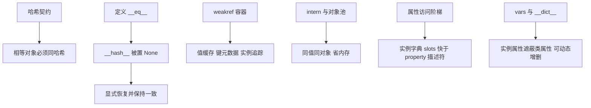
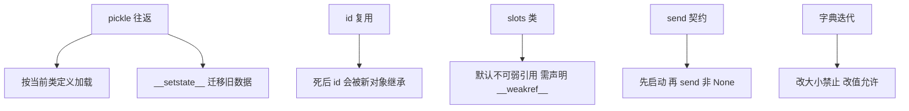
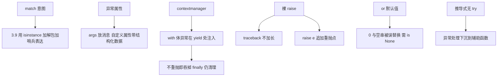
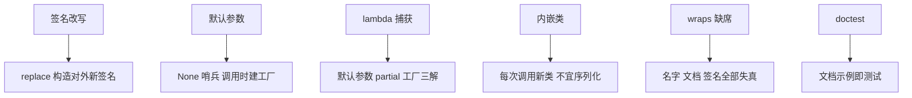
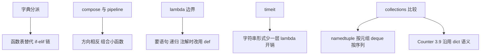
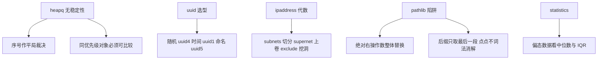
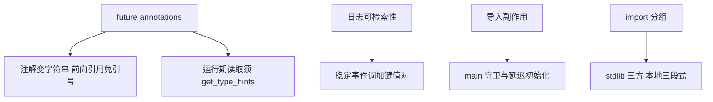
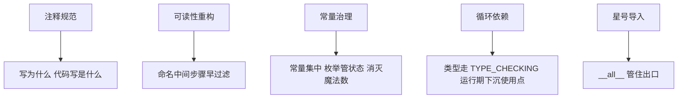

# 第 1 类 · 语言核心与底层(夜间扩产四)

> 本篇是语言核心的第四批夜间扩产(Q2066–Q2110):对象模型补遗(哈希与相等性契约、定义 __eq__ 后哈希置空、weakref 三容器、sys.intern 与对象池、属性访问性能阶梯、vars 与 __dict__、pickle 类版本演化、id 复用陷阱、__slots__ 与弱引用)。
> 控制流与函数进阶(生成器 send 启动契约、字典迭代变更限制、卫语句重构、match 的 3.9 等价实现、异常属性携带、contextmanager 异常路由、裸 raise、or 默认值陷阱、推导式无 try;签名程序化改写、默认参数工厂惯用法、lambda 捕获三解、函数内嵌类、wraps 缺席实测、doctest、字典分派、compose、lambda 边界)。
> 标准库深读与工程习惯(timeit 双形态、collections 比较语义、heapq 平局裁决、uuid 选型、ipaddress 网段代数、pathlib 解析陷阱、statistics 选型、difflib、tempfile;__all__ 治理、循环依赖延迟导入边界、future annotations、日志可检索性、导入副作用、import 分组、注释规范、可读性重构、常量治理)。
> 所有代码仅标准库、可直接运行;涉及 3.10+ 行为处带 sys.version_info 守卫,均已在本机 CPython 3.9.6 逐题实跑通过。

### Q2066 · 可哈希与相等性的一致性契约

> 难度:★★★★☆ | 标签:哈希, 相等性, 对象模型

**问**:「a == b 则 hash(a) == hash(b)」这条契约到底在约束什么?违反它会发生什么?

**答**:哈希契约是 dict 与 set 正确性的根基:相等的对象必须返回相同哈希,才能保证「同一个东西放进容器后还能找回来」。查找分两步——先按哈希定位桶,再在桶内用 == 逐个确认,所以哈希只影响定位速度,相等性才决定最终判定。一旦破坏契约,会出现等值对象彼此找不到的诡异现象:demo 里两个 == 为 True 的对象因为哈希不同落进不同桶,dict 直接 KeyError。反过来只满足哈希一致而 == 永假(比如全部返回同一常量哈希)是合法的,只是退化成 O(n) 全桶扫描。写自定义类型时的规矩:__eq__ 用哪些字段比较,__hash__ 就用同一组字段计算(参考 Q1297 的可变 key 漂移问题)。

```python
# file: code/01_语言核心与底层/q2066_hash_eq_contract.py
"""可哈希与相等性的一致性契约:== 相等必须带来相同哈希。"""
import itertools


class Money:
    """金额:相等的实例必须落进同一个哈希桶。"""

    def __init__(self, cents):
        self.cents = cents

    def __eq__(self, other):
        return isinstance(other, Money) and self.cents == other.cents

    def __hash__(self):
        return hash(self.cents)      # 与 __eq__ 用同一字段


_counter = itertools.count()


class BrokenMoney:
    """反面教材:__eq__ 按值,__hash__ 却每个实例不同,契约破裂。"""

    def __init__(self, cents):
        self.cents = cents
        self._h = next(_counter)     # 每个实例一个独立哈希

    def __eq__(self, other):
        return isinstance(other, BrokenMoney) and self.cents == other.cents

    def __hash__(self):
        return self._h


if __name__ == "__main__":
    a, b = Money(100), Money(100)
    print("a == b:", a == b, "| 哈希相同:", hash(a) == hash(b))
    ledger = {a: "工资"}
    print("dict 用等值的 b 取 a 存的值:", ledger[b])

    x, y = BrokenMoney(100), BrokenMoney(100)
    print("BrokenMoney: x == y:", x == y, "| 哈希相同:", hash(x) == hash(y))
    bad = {x: "工资"}
    try:
        print("dict 用 y 取值:", bad[y])
    except KeyError:
        print("契约破坏:等值对象找不到彼此的键,KeyError")
```

**追问**:1) 为什么 list 不能当 dict key 而 tuple 可以?——tuple 可哈希,但元素若可变如 (1, [2]) 同样 TypeError,契约的根在「哈希值永不漂移」;哈希冲突怎么办?——开放定址探测解决定位,正确性由 == 兜底,冲突只伤性能不伤语义。2) 一致性契约的完整内容?——a == b 必须推出 hash(a) == hash(b);__eq__ 用哪些字段,__hash__ 就用同一组字段;对象生命周期内哈希不得变化——可变字段参与哈希就是 Q1297 的「存进去查不到」。3) dict 查找的底层流程?——哈希定位桶 → 冲突时开放定址探测 → 命中候选用 == 确认;哈希质量决定性能,== 决定语义。4) 生产陷阱?——哈希实现太贵(每次查找都算,frozenset 之所以缓存哈希);漏写 __hash__(Q2067);把「全同哈希」当正确实现(合法但 O(n) 退化)。

### Q2067 · 定义 __eq__ 之后哈希为什么失效

> 难度:★★★☆☆ | 标签:__eq__, __hash__, 陷阱

**问**:给类加了一个 __eq__,实例却突然不能放进 set 了,报 TypeError 说不哈希,为什么?

**答**:这是数据模型的隐式规则:类体里定义了 __eq__ 而没有定义 __hash__ 时,解释器会把该类的 __hash__ 置为 None,实例从此不可哈希。动机正是 Q2066 的契约——默认哈希按对象身份派生,等值的不同实例哈希必然不同,与其给你一个静默出错的容器行为,不如当场禁止。两个容易踩的继承细节:父类明明定义了 __hash__,子类只重写 __eq__,子类的哈希照样被置空;修复方式是显式写 __hash__ = 父类.__hash__,前提是相等性语义没有变。demo 里三类对象分别演示了置空、继承失效与显式恢复。

```python
# file: code/01_语言核心与底层/q2067_eq_kills_hash.py
"""定义 __eq__ 之后,__hash__ 被隐式置为 None 的机制与修复。"""


class Point:
    """只定义 __eq__:Point.__hash__ 被隐式置为 None。"""

    def __init__(self, x, y):
        self.x, self.y = x, y

    def __eq__(self, other):
        return isinstance(other, Point) and (self.x, self.y) == (other.x, other.y)


class A:
    """父类同时给出 __eq__ 与 __hash__,契约一致。"""

    def __init__(self, key):
        self.key = key

    def __eq__(self, other):
        return isinstance(other, A) and self.key == other.key

    def __hash__(self):
        return hash(self.key)


class B(A):
    """子类只重写 __eq__:继承来的 __hash__ 也会被置空。"""

    def __eq__(self, other):
        return isinstance(other, A) and self.key == other.key


class C(A):
    """修复:显式恢复哈希,且相等性语义未变,契约成立。"""
    __hash__ = A.__hash__


if __name__ == "__main__":
    print("Point.__hash__:", Point.__hash__)
    try:
        hash(Point(1, 2))
    except TypeError as e:
        print("hash 实例报错:", e)

    print("B.__hash__:", B.__hash__, "(父类有哈希也被置空)")
    print("C 恢复哈希且与父类一致:", hash(C("k")) == hash(A("k")))
    print("等值的 C 与 A 在集合里去重:", len({C("k"), A("k")}))
```

**追问**:1) object.__hash__ 基于什么?——按对象 id 派生,等值不同实例天然不同哈希,这正是自定义 __eq__ 后必须同步 __hash__ 的原因;把 __hash__ 设为 None 还有什么用?——显式声明「此类型不可哈希」,与 list、dict 这类可变容器的设计立场一致。2) 置 None 的机制?——类体定义 __eq__ 后 type 构建自动把 __hash__ 置 None,实例进 dict/set 报 TypeError;dataclass eq=True 同样,frozen=True 才自动恢复 __hash__(Q468)。3) 设计动机?——「可变 + eq」组合的对象哈希会漂移,与其让它悄悄坏,不如显式不可哈希逼开发者决策。4) 生产陷阱?——「只是加了个 __eq__」就让缓存/集合功能崩;eq 与 hash 字段集不一致(Q2066);想恢复可哈希要显式 __hash__ 而不是碰运气。

### Q2068 · weakref 容器:弱引用字典与弱引用集合

> 难度:★★★★☆ | 标签:weakref, 缓存, 生命周期

**问**:WeakValueDictionary、WeakKeyDictionary、WeakSet 各适合什么场景?和普通容器差在哪?

**答**:三者共同点是容器本身不阻止对象被回收:键或值持有的是弱引用,对象在别处死亡后条目自动消失,容器不会内存泄漏。WeakValueDictionary 最常做缓存——值没有外部使用者就自动出缓存;WeakKeyDictionary 适合给别人的对象挂元数据,键销毁元数据跟着销毁,等价于「不改类定义的外挂属性表」;WeakSet 常用来追踪某类存活实例,做实例注册表或调试统计。注意三点:条目消失依赖弱引用回调,时机在对象销毁后同步触发(见 Q1289);值类型必须支持弱引用,__slots__ 类默认不行(Q2074);缓存语义与 lru_cache 互补——lru_cache 持强引用是泄漏高发点(Q045),弱引用容器让「没人用了就清理」成为默认行为。

```python
# file: code/01_语言核心与底层/q2068_weakref_containers.py
"""弱引用容器:缓存、元数据挂载与实例追踪三种场景。"""
import gc
import weakref


class Report:
    def __init__(self, rid):
        self.rid = rid


def value_cache_demo():
    cache = weakref.WeakValueDictionary()
    r1 = Report(1)               # 先持强引用
    cache["r1"] = r1             # 值侧是弱引用
    print("  放入后:", len(cache))
    del r1
    gc.collect()                 # 唯一强引用消失,条目自动移除
    print("  对象回收后:", len(cache))


def key_meta_demo():
    meta = weakref.WeakKeyDictionary()
    doc = Report(2)
    meta[doc] = {"last_open": "2026-01-01"}   # 键侧是弱引用
    print("  挂载元数据:", meta[doc])
    del doc
    gc.collect()
    print("  键销毁后:", len(meta))


def instance_tracking_demo():
    seen = weakref.WeakSet()

    class Node:
        def __init__(self):
            seen.add(self)

    a, b = Node(), Node()
    print("  存活实例数:", len(seen))
    del a, b
    gc.collect()
    print("  全部回收后:", len(seen))


if __name__ == "__main__":
    print("WeakValueDictionary 充当自动过期的缓存:")
    value_cache_demo()
    print("WeakKeyDictionary 给对象挂外挂元数据:")
    key_meta_demo()
    print("WeakSet 追踪存活实例:")
    instance_tracking_demo()
```

**追问**:1) WeakValueDictionary 与 lru_cache 什么关系?——lru_cache 强引用参数与结果,是泄漏高发点,弱引用值容器让缓存不阻止回收;条目移除的时机?——弱引用回调在对象销毁后同步触发,但遍历容器与回收竞争时行为要小心,见 Q1289。2) 两个容器的分工?——WeakValueDictionary 值弱(对象回收条目消失,适合「活着的资源注册表」);WeakKeyDictionary 键弱(身份索引,适合给外部对象挂元数据)。3) 与 lru_cache 的取舍?——强引用缓存保证命中,弱引用缓存「有人用才活」;热点数据弱引用缓存会反复失效——按「资源生命周期」选。4) 生产陷阱?——遍历中条目消失(先 list 快照,Q436);slots 类没 __weakref__ 进不了弱容器(Q2074);弱值容器存的「主数据」其实还有别处引用,回收时机与预期不符。

### Q2069 · sys.intern 与对象驻留控制

> 难度:★★★☆☆ | 标签:intern, 对象池, 内存

**问**:小整数有缓存、短字符串会自动驻留(Q006),那手动控制驻留怎么做?什么时候值得做?

**答**:sys.intern(s) 把字符串放进解释器全局驻留表,返回表内的唯一实例:值相等的字符串经过 intern 后 is 成立、id 唯一。收益场景是「重复字符串海量存在且被长期持有」——比如解析日志、HTTP 方法名、状态机 token,intern 后几万份副本坍缩成几份,省内存顺带加速 == 与 dict 查找(身份相同可短路值比较)。对象池则是同一思想对任意类型的推广:用 __new__ 按参数做规范化,同参数永远返回同一实例,demo 里 Color 就是一个最小可用的规范化池。两个代价要清楚:池对象的可变状态被所有持有者共享;池本身持强引用,不设上限就是泄漏,生产上常配 weakref 值容器(Q2068)做自动淘汰。

```python
# file: code/01_语言核心与底层/q2069_intern_pool.py
"""sys.intern 驻留控制与 __new__ 规范化对象池。"""
import sys

TOKEN_BYTES = [b"GET", b"POST", b"PUT", b"DELETE"]


def make_tokens(n):
    """bytes.decode 每次都产生值相等但身份不同的新字符串。"""
    return [TOKEN_BYTES[i % 4].decode("ascii") for i in range(n)]


class Color:
    """规范化对象池:同参数永远返回同一实例。"""
    _pool = {}

    def __new__(cls, name):
        obj = cls._pool.get(name)
        if obj is None:
            obj = super().__new__(cls)
            obj.name = name
            cls._pool[name] = obj
        return obj


if __name__ == "__main__":
    tokens = make_tokens(20000)
    unique_ids = len({id(t) for t in tokens})
    interned = [sys.intern(t) for t in tokens]
    unique_after = len({id(t) for t in interned})
    print("驻留前不同对象数:", unique_ids, "| 驻留后:", unique_after)
    print("intern 不改值只改身份:", tokens[0] == interned[0], tokens[0] is not interned[0])

    a, b = Color("red"), Color("red")
    print("对象池同参同实例:", a is b, "| 不同参数不同实例:", Color("blue") is not a)
    print("池的代价:状态被共享,且池持强引用,要有上限与淘汰策略")
```

**追问**:1) sys.intern 对任意字符串都安全吗?——语法上都可以,但驻留表随解释器生命周期存活,对不可信的海量用户输入驻留反而扩大驻留表,只对高频固定词汇用;对象池比 intern 强在哪?——不限字符串,且能把规范化逻辑写成业务语义,代价是池化管理要自己负责。2) 自动驻留的边界?——标识符样字符串编译期自动 intern,运行时拼接/切片不自动,需要显式 sys.intern——所以「is 比较拼接结果」不可靠(Q1798)。3) 驻留的收益?——重复字符串共享对象省内存、比较退化为指针相等;协议字段名、状态名等高频词汇收益最大。4) 生产陷阱?——对用户输入 intern 撑大驻留表;依赖「intern 后 is 相等」跨实现;对象池无淘汰策略变泄漏池。

### Q2070 · 属性访问性能阶梯:实例字典、slots 与描述符实测

> 难度:★★★★☆ | 标签:属性访问, __slots__, 实测

**问**:instance dict、__slots__、property、自定义描述符、__getattr__ 这几条属性访问路径,速度差多少?

**答**:本机 CPython 3.9.6 用 timeit 各取 3 次最小值,量级大约是:普通实例字典与 __slots__ 都在 50ns 上下(字典路径有 key 共享优化,slots 是固定偏移,两者几乎打平);property 约 143ns,多了一次函数调用;非数据描述符约 217ns,再多一层协议分派;__getattr__ 未命中路径最惨,约 600ns——因为要先走完整查找失败,再进 Python 层兜底函数。工程结论:常态访问路径保持「实例字典或 slots 直达」,property 用在需要归一化的边界上,别把热路径的每次取值都包成 property;__getattr__ 只做兜底元编程,不要当默认访问器(它的触发条件见 Q028)。

```python
# file: code/01_语言核心与底层/q2070_attr_ladder.py
"""属性访问性能阶梯:实例字典、__slots__、property、描述符与 __getattr__。"""
import timeit


class DictPoint:
    """普通类:属性在实例 __dict__ 里。"""
    def __init__(self, x):
        self.x = x


class SlotPoint:
    """__slots__:固定槽位偏移访问。"""
    __slots__ = ("x",)

    def __init__(self, x):
        self.x = x


class PropPoint:
    """property:每次读取都是一次函数调用。"""
    def __init__(self, x):
        self._x = x

    @property
    def x(self):
        return self._x


class DescPoint:
    """非数据描述符:比 property 多一层协议分派。"""
    class TenX:
        def __get__(self, obj, cls):
            return obj._x * 10 if obj else self
    x = TenX()

    def __init__(self, x):
        self._x = x


class GetattrPoint:
    """__getattr__ 兜底:常态查找失败后才触发,最慢。"""
    def __init__(self, x):
        self._store = {"x": x}

    def __getattr__(self, name):
        if name == "x":
            return self._store["x"]
        raise AttributeError(name)


def bench(cls, number=200000):
    p = cls(21)
    best = min(timeit.repeat("p.x", globals={"p": p}, number=number, repeat=3))
    return best / number * 1e9


if __name__ == "__main__":
    for cls in (DictPoint, SlotPoint, PropPoint, DescPoint, GetattrPoint):
        print(f"{cls.__name__:13} {bench(cls):7.1f} ns/op")
    print("阶梯:实例字典 约等于 slots < property < 描述符 < __getattr__ 未命中")
```

**追问**:1) __getattr__ 与 __getattribute__ 的开销差异?——__getattr__ 只在未命中时触发、常态零成本,__getattribute__ 拦截每一次访问,是性能大坑;__slots__ 除了速度还带来什么?——省内存、禁动态加属性,但继承链上都要声明才彻底,见 Q008 与 Q559。2) 访问阶梯的完整排序?——slots/直接槽 ≈ 实例字典 < 数据描述符 < __getattr__ 兜底 << __getattribute__ 全拦截;每次访问都过描述符协议的 C 层分派。3) 实测口径?——timeit 取 min,同进程多轮(Q2093);3.11+ LOAD_ATTR 内联缓存显著缩小差距(Q1259),结论只到常数级。4) 生产陷阱?——__getattribute__ 里做重活(日志/IO);slots 继承链不全白声明(Q2074);无 profile 的微优化改架构。

### Q2071 · vars 与实例 __dict__ 的动态增删

> 难度:★★★☆☆ | 标签:vars, __dict__, 属性查找

**问**:vars(obj) 返回什么?直接操作实例的 __dict__ 会有什么后果?

**答**:vars(obj) 就是 obj.__dict__ 本身——同一个字典对象的两种读法,通过任一视角增删条目,另一边立即可见。实例属性的查找链是「实例 __dict__ → 类 __dict__ → 父类链 → __getattr__ 兜底」,所以往实例里塞一个与类属性同名的条目就形成遮蔽,del 掉实例条目又重新露出类属性,这一遮一露正是很多「改了不生效」bug 的现场。类自身的 __dict__ 是 mappingproxy 只读视图,要改类属性得走类名字赋值而不是改它的 __dict__。动态改 __dict__ 适合做插件式字段注入与调试,业务代码里慎用:它会绕过 __slots__ 与 key 共享优化(Q1262),也让静态分析工具失明。

```python
# file: code/01_语言核心与底层/q2071_vars_dict.py
"""vars 与实例 __dict__:动态增删属性与查找链的遮蔽关系。"""


class Plugin:
    version = "1.0"              # 类属性:在类的 __dict__ 里

    def __init__(self, name):
        self.name = name         # 进实例 __dict__


if __name__ == "__main__":
    p = Plugin("scanner")
    print("vars(p):", vars(p))
    print("类的 __dict__ 是只读视图:", type(Plugin.__dict__).__name__)

    p.timeout = 3.0              # 动态添加实例属性
    vars(p)["retries"] = 2       # 两个视角是同一个字典
    print("动态添加后:", vars(p))

    print("遮蔽前读到类属性:", p.version)
    p.version = "9.9-beta"       # 实例条目遮蔽类属性
    print("遮蔽后:", p.version, "| 类属性未变:", Plugin.version)
    del p.version                # 删除实例条目,重新露出类属性
    print("删除实例属性后:", p.version)

    del p.retries                # del 名字等价于删 __dict__ 条目
    print("del 后 retries 还在吗:", "retries" in vars(p))
```

**追问**:1) vars(obj) 与 obj.__dict__ 是什么关系?——同一字典的两种读法,改任一侧另一侧同步;能给实例整体换一个 __dict__ 吗?——可以,等于一次性替换属性表,但会破坏 key 共享与 slots 约束,见 Q1262。2) 动态增删的代价?——新增属性可能让共享键表版本分裂,该实例退回独立 dict;vars() 返回的是本体字典不是拷贝,改它就是改对象。3) 适用场景?——vars(obj) 用于调试快照、ORM 风格的动态字段;有契约的类应显式声明属性或 slots。4) 生产陷阱?——把 __dict__ 当持久存储(动态属性无静态契约);整体换 __dict__ 让共享布局失效(Q1262);slots 类没有 __dict__,vars() 报 TypeError。



### Q2072 · pickle 往返与类版本演化

> 难度:★★★★☆ | 标签:pickle, 版本演化, __setstate__

**问**:用 pickle 存的对象,在类定义改过之后还能反序列化回来吗?怎么平滑迁移?

**答**:pickle 序列化实例时不带类代码,只记录「module.qualname 类引用 + 实例状态」,加载时按名字找到**当前**的类定义——所以类加字段、改方法没问题,旧字节会配新类走。真正的坑是旧数据缺新字段:load 出来的实例不会调用 __init__,状态就是旧字典原样灌回。规范做法是实现 __setstate__:它接收旧状态字典,在这里做字段改名、补默认值、丢弃废弃字段的迁移逻辑,让每个历史版本的字节都能归一到当前模型。demo 演示了「V1 打包 → 类定义演进 → 旧字节加载 → __setstate__ 补齐新字段」的完整闭环。另外记住 pickle 的两条红线:类改名会直接打破引用;加载不可信字节等于执行任意代码,只用于可信数据。

```python
# file: code/01_语言核心与底层/q2072_pickle_evolution.py
"""pickle 往返与类版本演化:老字节遇到新类定义。"""
import pickle


class ProfileV1:
    def __init__(self, name):
        self.name = name


blob_v1 = pickle.dumps(ProfileV1("alice"))    # 用 V1 定义打包


class ProfileV1:                              # 同名类演进:新增字段
    default_level = 1

    def __init__(self, name, level=1):
        self.name = name
        self.level = level

    def __setstate__(self, state):
        state.setdefault("level", self.default_level)   # 旧数据补默认值
        self.__dict__.update(state)


if __name__ == "__main__":
    old = pickle.loads(blob_v1)      # 反序列化用的是「当前」的 ProfileV1
    print("老字节加载后:", old.__dict__, "| 迁移出的 level:", old.level)

    fresh = ProfileV1("bob", 3)
    back = pickle.loads(pickle.dumps(fresh))
    print("新数据往返:", back.__dict__)
    print("往返保真:", back.name == fresh.name and back.level == fresh.level)
```

**追问**:1) 类改名后旧 pickle 还能用吗?——不能,引用按 module.qualname 解析,只能留旧名别名或写迁移脚本;与 JSON 的取舍?——pickle 能往返对象与类型,JSON 只能表达基础结构,但前者加载不可信数据是任意代码执行风险。2) 类版本演化的工程手法?——字段增删配 __reduce__/__setstate__ 自定义还原;加版本标记;新字段给默认值;协议版本(pickle_protocol)跨版本要锁定。3) 安全边界?——unpickle 等于执行构造代码,只对自家可信数据使用;对外交换一律 JSON/结构化格式;签名/加密 pickle 不解决「构造任意对象」问题。4) 生产陷阱?——重构改类名/搬模块导致旧数据全死;缓存系统用 pickle 存对象跨版本读;把 pickle 当「更快的 JSON」。

### Q2073 · id 复用陷阱:身份键的存活期契约

> 难度:★★★★☆ | 标签:id, 身份, 生命周期

**问**:用 id(obj) 当字典 key 做对象索引,为什么会出事故?

**答**:id 只是「对象存活期间」的地址标识,CPython 的对象分配器经常复用刚释放的内存块,所以旧对象死亡后,新对象很可能继承同一个 id——demo 里有的运行命中复用、有的运行不复现,这本身就是陷阱:高概率复用但没有保证。拿 id 做缓存键而不持有对象强引用,就会出现「新对象被误认成旧对象」的串号。正确姿势有三:要身份索引就连对象一起存(键为 id、值为对象引用),让 id 的有效期被引用拉长;要自动清理就用 weakref 容器(Q2068),生命周期与对象天然同步;绝大多数场景其实应该直接用对象本身当 key,依赖 __hash__ 而不是手工身份表。id 的合法用途只剩调试观测与解释 is 语义(见 Q1298)。

```python
# file: code/01_语言核心与底层/q2073_id_reuse.py
"""id 复用陷阱:对象死亡后其 id 会被新对象复用。"""
import gc


def make_text(n):
    return "x" * n                 # 运行时构造,每次都是新对象


if __name__ == "__main__":
    dead = make_text(64)
    dead_id = id(dead)
    del dead
    gc.collect()

    alive = make_text(64)          # 同尺寸分配,CPython 大概率复用刚释放的块
    reused = id(alive) == dead_id
    print("新对象复用了旧 id:", reused)

    identity_cache = {dead_id: "旧对象元数据"}     # 错误示范:id 当键但不持引用
    if reused:
        print("身份缓存串号:", identity_cache.get(id(alive)))
    else:
        print("本次未复现复用,但机制上不保证——这正是问题所在")

    safe = {id(dead := make_text(64)): dead}       # 正确姿势:身份连同对象一起存
    print("带强引用的身份表可安全反查:", type(safe[id(dead)]).__name__)
```

**追问**:1) 想让「身份索引」自动跟随对象死亡怎么办?——用 WeakKeyDictionary,键是弱引用,对象回收条目即消失;id(x) 还剩什么合法用途?——调试观测、解释 is 与哈希机制,不应进入业务数据结构。2) id 复用的机制?——对象回收后内存地址可被新对象复用,id 值只在对象存活期有意义;拿 id 当 key,原对象死后新对象可能复用同一 id,幽灵命中。3) 身份键的正确姿势?——直接用对象本身做 key(默认哈希即身份)或 WeakKeyDictionary;要「存活期唯一」语义就持有对象引用。4) 生产陷阱?——id 当业务主键/缓存 key;把 id 值存档跨进程比较(必然错);对象死活检测用 weakref 而不是「再查 id」。

### Q2074 · __slots__ 与弱引用:__weakref__ 槽

> 难度:★★★★☆ | 标签:__slots__, weakref, 内存

**问**:声明了 __slots__ 的类,weakref.ref 直接 TypeError,这是 bug 吗?

**答**:不是 bug,是 slots 布局的直接推论:普通实例除了 __dict__ 还隐式挂着 __weakref__ 头,弱引用机制靠它找到对象;改用 __slots__ 后属性表被固定槽位取代,解释器不会再隐式送你这两个结构——没有声明 __weakref__ 槽,就没有弱引用的挂载点,weakref.ref 当场抛 TypeError。修复很简单:在 __slots__ 元组里显式加一项 "__weakref__"(多继承时只能出现在一个基类里,重复声明会报错)。这个组合在工程上很常见:池化对象(Q1284)既要 slots 省内存,又要 weakref 兜底回收,声明 __weakref__ 槽就能两者兼得。

```python
# file: code/01_语言核心与底层/q2074_slots_weakref.py
"""__slots__ 类默认不能被弱引用:__weakref__ 槽要显式声明。"""
import weakref


class NoWeak:
    __slots__ = ("x",)             # 没有 __weakref__ 槽

    def __init__(self, x):
        self.x = x


class WithWeak:
    __slots__ = ("x", "__weakref__")   # 显式声明弱引用槽

    def __init__(self, x):
        self.x = x


if __name__ == "__main__":
    a = NoWeak(1)
    try:
        weakref.ref(a)
    except TypeError as e:
        print("无 __weakref__ 槽:", e)

    b = WithWeak(1)
    r = weakref.ref(b)
    print("声明槽后可弱引用:", r() is b)
    del b
    print("对象销毁后弱引用失效:", r() is None)
    print("普通类不受影响:实例天生带着隐式的 __weakref__ 结构")
```

**追问**:1) 多继承时 __weakref__ 声明在哪?——整个继承链只允许一个基类的 slots 含它,重复声明直接 TypeError;slots 与 key 共享实例字典谁更省?——slots 通常更省且访问等速,但失去动态属性能力,见 Q008 与 Q1262。2) __weakref__ 槽的必要性?——slots 类默认没有弱引用槽,对象进 WeakKeyDictionary/weakref.ref 直接 TypeError;显式加 "__weakref__" 槽恢复支持。3) 布局约束?——slots 成员按 MRO 排进固定槽位,继承链最多一个非空 slots 基类(Q559);混入类一律 slots=()。4) 生产陷阱?——slots 对象进弱引用容器报错的经典案例;漏声明 __weakref__ 导致缓存库失效;动态属性需求没想清就上 slots。

### Q2075 · 生成器 send 的启动契约与预激模式

> 难度:★★★★☆ | 标签:生成器, send, 协议

**问**:刚创建的生成器调用 gen.send(10) 为什么报 TypeError?send 的启动契约是什么?

**答**:send(value) 的语义是「恢复挂起在 yield 处的帧,并把 value 作为该 yield 表达式的值」;刚创建的生成器还停在函数开头,根本没有挂起的 yield 可接收,所以协议规定:启动前 send 非 None 一律 TypeError,只有 send(None) 合法,等价于 next(gen)。完整契约分三步——next 或 send(None) 启动并推进到第一个 yield;此后才能 send 实值双向通信(Q431);close 或耗尽收尾。工程上用预激装饰器封装「先 next 再交给调用方」的仪式,让业务代码拿到的生成器可以直接 send;inspect.getgeneratorstate 能观测 GEN_CREATED、SUSPENDED、CLOSED 的状态机迁移,demo 全程打印。

```python
# file: code/01_语言核心与底层/q2075_send_priming.py
"""生成器 send 的启动契约:先 next 后 send,以及状态机观测。"""
import inspect


def echo():
    total = 0
    while True:
        got = yield total          # 首次推进到 yield 才会停在这里
        total += got


def primed(gen):
    """预激:推进到第一个 yield,调用方即可直接 send。"""
    next(gen)
    return gen


if __name__ == "__main__":
    g = echo()
    print("刚创建:", inspect.getgeneratorstate(g))
    try:
        g.send(10)                 # 未启动就 send 非 None
    except TypeError as e:
        print("启动前 send 报错:", e)

    print("send(None) 等价 next,启动并返回:", g.send(None))
    print("启动后:", inspect.getgeneratorstate(g))
    print("send(10):", g.send(10), "| send(32):", g.send(32))

    h = primed(echo())
    print("预激后直接 send(7):", h.send(7))
    h.close()
    print("close 后:", inspect.getgeneratorstate(h))
```

**追问**:1) 为什么 send(None) 可以启动?——None 表示「无值推进」,是协议规定的合法起点,不会注入任何 yield 表达式的值;预激的现代化身?——yield from 与 async/await 都隐式完成预激,手工预激只服务于裸生成器协议场景。2) 启动契约的完整内容?——未启动生成器只接受 next/send(None),非 None 抛 TypeError(Q431);close/throw 同样要求已启动——「先预激再使用」是一切生成器协议的地基。3) 预激模式的角色演变?——PEP 342 时代预激装饰器是必需品;yield from/await 把预激收进协议;今天只有手写调度器/驱动器才需要。4) 生产陷阱?——忘预激的 TypeError 掩盖真实异常;多个消费者交错 send;把「send 非 None 启动」当成可能行为写条件分支。

### Q2076 · 迭代期间的字典变更限制

> 难度:★★☆☆☆ | 标签:dict, 迭代, RuntimeError

**问**:for k in d: 里删键为什么报 RuntimeError?改值为什么又可以?

**答**:dict 视图迭代器内置版本号检查:每次推进都比对容器大小,发现「迭代开始后大小变了」就抛 RuntimeError: dictionary changed size during iteration。检测的是大小而非内容,所以迭代中给已有键赋值(同 key 覆盖)不改变大小,是允许的;增删键改变大小,一律禁止。三条安全出路:迭代 list(d) 的键快照(小字典直接,大字典有 O(n) 快照成本);先收集待删键再统一删,即「两步法」;或者构造新字典做不可变替换。set 更严格,没有「改值」逃生通道,迭代期间任何结构变更都可能出事。

```python
# file: code/01_语言核心与底层/q2076_dict_mutation.py
"""迭代期间的字典变更限制:改值可以,改大小不行。"""


def safe_delete_snapshot(prices):
    deleted = []
    for key in list(prices):       # 先物化键快照再删
        if prices[key] <= 0:
            deleted.append(key)
            del prices[key]
    return deleted


def safe_delete_deferred(prices):
    doomed = [k for k, v in prices.items() if v <= 0]
    for k in doomed:               # 收集完再统一删
        del prices[k]
    return doomed


if __name__ == "__main__":
    prices = {"a": 10, "b": 0, "c": 5, "d": -1}
    try:
        for k in prices:
            if prices[k] <= 0:
                del prices[k]      # 迭代中改变大小
    except RuntimeError as e:
        print("迭代中删键:", e)

    prices = {"a": 10, "b": 0, "c": 5, "d": -1}
    for k in prices:
        prices[k] = 99             # 只覆盖值,大小不变
    print("迭代中改值:允许 ->", prices)

    p1 = {"a": 10, "b": 0, "c": 5, "d": -1}
    print("快照法:", safe_delete_snapshot(p1), "->", p1)
    p2 = {"a": 10, "b": 0, "c": 5, "d": -1}
    print("两步法:", safe_delete_deferred(p2), "->", p2)
```

**追问**:1) 为什么覆盖值不报错?——迭代协议只检测容器大小,同键覆盖不改变桶数量;set 迭代中能改吗?——不能,任何增删都可能触发同样的 RuntimeError,连覆盖的余地都没有。2) 检测机制?——迭代器每步比对 dict 的已用槽位数,变化即 RuntimeError("dictionary changed size during iteration");这是「迭代期间结构变更」的防护,不是事务隔离。3) 安全遍历姿势?——list(d) 快照后遍历快照;或 dict.copy() 后改副本;并发场景加锁而不是靠「碰运气不崩」。4) 生产陷阱?——遍历中删键(最常见);依赖「覆盖不报错」的实现细节;多线程无锁并发读写 dict 在迭代路径上偶发崩。



### Q2077 · 深嵌套的卫语句重构

> 难度:★★★☆☆ | 标签:卫语句, 重构, 可读性

**问**:if 套 if 套 if 的「箭头代码」怎么重构?原则是什么?

**答**:卫语句(guard clause)的核心动作是把「非法路径提前返回」,让主路径保持零嵌套:先判 None、再判激活、再判金额,每个不合法情况独立一行早退,最后剩下的才是真正的主逻辑。收益有三层:缩进深度从五层降到一层,评审者扫一眼就能数清合法路径;每个失败原因与它的检查一一对应,不靠 else 缩进配对;新增校验规则只加一行卫语句,不再碰主逻辑。demo 用同一个粗略的「最大缩进」度量量化了重构效果,并用 assert 保证两版行为等价——重构的第一原则正是行为不变(参考 Q1278 的防御式分层)。

```python
# file: code/01_语言核心与底层/q2077_guard_clauses.py
"""深嵌套的卫语句重构:先排除异常路径,主路径保持最浅。"""
import inspect


def before(order, user):
    """箭头反模式:主逻辑埋在深层缩进里。"""
    if order is not None:
        if user is not None:
            if user.get("active"):
                if order.get("total", 0) > 0:
                    return "下单成功"
                else:
                    return "金额必须为正"
            else:
                return "用户未激活"
        else:
            return "缺少用户"
    else:
        return "缺少订单"


def after(order, user):
    """卫语句版本:异常路径提前返回,主路径零嵌套。"""
    if order is None:
        return "缺少订单"
    if user is None:
        return "缺少用户"
    if not user.get("active"):
        return "用户未激活"
    if order.get("total", 0) <= 0:
        return "金额必须为正"
    return "下单成功"


def max_indent(func):
    """粗略度量:函数体最大缩进层级。"""
    depth = 0
    for line in inspect.getsource(func).splitlines():
        depth = max(depth, (len(line) - len(line.lstrip(" "))) // 4)
    return depth


if __name__ == "__main__":
    cases = [
        (None, None),
        ({"total": 0}, {"active": True}),
        ({"total": 5}, {"active": False}),
        ({"total": 5}, {"active": True}),
    ]
    assert all(before(o, u) == after(o, u) for o, u in cases)
    print("四种入参两版结果一致:", [after(o, u) for o, u in cases])
    print("最大缩进:重构前", max_indent(before), "层 -> 重构后", max_indent(after), "层")
```

**追问**:1) 卫语句会让分支爆炸吗?——不会,它把非法情况扁平排列,合法组合仍由主路径统一收口;卫语句与异常怎么分工?——可预期的输入问题用早退返回值,真正异常状态才抛异常,别用异常做常规控制流。2) 重构手法链?——深嵌套先早退反转条件 → 每个校验块抽取命名函数 → 入口归一化(去空白/单位换算)→ 主路径降到 1-2 层缩进;嵌套深度是可读性的硬指标。3) 与 ValueError 的配合?——早退返回 (ok, reason) 元组适合流程函数;抛 ValueError 适合 API 边界(Q1563);两种收场按调用方需求定。4) 生产陷阱?——卫语句顺序影响可读性(先高频后低频);早退时忘记释放资源(要 try/finally);把「非法但可修复」的输入一律抛异常。

### Q2078 · match 意图的 3.9 等价实现:哨兵与字典分派

> 难度:★★★☆☆ | 标签:match, 结构分派, 哨兵

**问**:match/case 是 3.10 的语法,在 3.9 上如何表达同样的「按形状分发并解包绑定」意图?

**答**:match 的能力可拆成三件事:按数据形状分发、解包绑定捕获变量、带 guard 条件。3.9 的等价骨架就是 isinstance 判形 + 解包赋值 + if 守卫:dict 形状用 "click" in event 探测后 x, y = event["click"] 解包;序列形状用 verb, *rest = event 完成捕获;guard 写成普通 if。分派表场景则配哨兵对象:COMMANDS.get(verb, MISSING),用 MISSING 单例区分「没有这个分支」与「分支值为 None」——这正是 Q1282 的哨兵设计。3.10 的 match 相比之下多了或模式、位置匹配与穷尽性检查,但理解了 3.9 等价物,match 的语义就不再是黑魔法。

```python
# file: code/01_语言核心与底层/q2078_match_intent_39.py
"""match 意图的 3.9 等价实现:按形状分发、解包绑定与哨兵。"""
import sys

MISSING = object()                 # 哨兵:区分「没有这个分支」与 None


def dispatch_v39(event):
    """isinstance 判形 + 解包绑定 + 守卫,等价 match/case 意图。"""
    if isinstance(event, dict) and "click" in event:
        x, y = event["click"]      # 对应 case {"click": [x, y]}
        return f"click at {x},{y}"
    if isinstance(event, dict) and "key" in event:
        (key,) = event["key"]      # 对应 case {"key": [key]}
        if key in ("quit", "exit"):    # 对应带 guard 的 case
            return "退出程序"
        return f"key {key}"
    if isinstance(event, list) and event:
        verb, *rest = event        # 对应 case [verb, *rest]
        return f"批量命令 {verb} 参数 {len(rest)} 个"
    return "未识别的事件形状"


if __name__ == "__main__":
    print(dispatch_v39({"click": [3, 4]}))
    print(dispatch_v39({"key": ["quit"]}))
    print(dispatch_v39({"key": ["a"]}))
    print(dispatch_v39(["sync", 1, 2, 3]))
    print(dispatch_v39(123))
    if sys.version_info >= (3, 10):
        print("3.10+ 可直接写 match event: case {...}")
    else:
        print("本机 3.9:上面的 isinstance 加解包就是 match 的等价骨架")
```

**追问**:1) 分派表为什么配哨兵而不用 None 判缺?——None 可能是合法业务值,MISSING 单例才能唯一表达「没匹配到」;3.10 match 比这套写法多了什么?——或模式、位置子模式与穷尽性检查,语义相同但表达力更强。2) 哨兵分派的完整模式?——MISSING = object();handler = TABLE.get(key, MISSING);MISSING 命中走默认分支(Q1282);表内放函数对象,统一签名。3) 与 match 的关系?——分派表适合「键 → 动作」的运行时可扩展场景(可注册);match 适合编译期确定的静态结构拆解;两者可共存。4) 生产陷阱?——None 判缺吃掉合法 None 值;分派键不可哈希;handler 签名漂移后调用报参数错(Q2090 详)。

### Q2079 · 异常对象的属性携带:args 与自定义属性

> 难度:★★★☆☆ | 标签:异常, 结构化数据, API 设计

**问**:想抛一个「带上下文数据」的异常,数据该放 args 里还是自定义属性上?

**答**:分工明确:args 是异常的「人读」部分,决定 str(e)、repr(e) 与默认 pickle 行为,super().__init__(message) 保持 str(e) 干净;自定义属性是「程序读」的结构化字段,让 handler 能按 status、request_id 做路由与上报,而不是去解析字符串。惯例是 __init__ 里先 super().__init__(message) 再挂属性,这样日志能直接打印消息、监控能直接读字段。异常实例也是普通对象,抛出前仍可事后附加属性,但那属于调试手段而非接口契约(参考 Q1277 的消息设计与 Q1817 的错误码体系)。

```python
# file: code/01_语言核心与底层/q2079_exception_attrs.py
"""异常对象的属性携带:args、自定义属性与结构化取数。"""


class ApiError(Exception):
    def __init__(self, message, status=0, *, request_id=""):
        super().__init__(message)       # args 只放消息,str(e) 干净
        self.status = status
        self.request_id = request_id


def call_api(status, request_id):
    if status >= 500:
        raise ApiError("服务端错误", status=status, request_id=request_id)
    if status >= 400:
        raise ApiError("请求被拒绝", status=status, request_id=request_id)
    return "ok"


if __name__ == "__main__":
    try:
        call_api(503, "req-42")
    except ApiError as e:
        print("args 元组:", e.args)
        print("str(e):", str(e))
        print("结构化字段:", e.status, e.request_id)

    try:
        call_api(403, "req-7")
    except ApiError as e:
        print("按状态码路由:", "稍后重试" if e.status >= 500 else "检查权限")

    e = ApiError("仅构造")
    e.hint = "查看网关日志"             # 异常实例也是普通对象,可事后附加
    print("事后附加属性:", e.hint)
```

**追问**:1) 为什么消息放 args、数据放属性?——args 决定 str(e) 与 pickle 的默认行为,属性才是可编程的结构化接口;自定义属性会被 pickle 带走吗?——默认不会,异常默认只序列化 args,要带上属性须自定义 __reduce__。2) 自定义异常的设计清单?——__init__ 接收 (message, **业务字段),属性只读化;__str__ 模板化输出;错误码属性 .code 供出口映射(Q1817);继承链保持「可按父类捕获」。3) args 的角色?——args 元组是异常的「事实标准载荷」;str(e) 默认 str(args[0]);跨进程传输(日志/队列)序列化主要靠它。4) 生产陷阱?——把结构化数据全塞消息字符串(下游只能正则解析);属性被外部改写;异常对象进队列因属性丢失败。

### Q2080 · contextmanager 的异常路由:吞掉还是放行

> 难度:★★★★☆ | 标签:contextmanager, 异常路由, 清理

**问**:@contextmanager 的生成器里,with 体抛出的异常是从哪里进来的?怎么实现「吞掉某些异常」?

**答**:路由机制:with 体抛异常时,contextlib 会对生成器调用 gen.throw(exc),异常在 **yield 表达式处**注入生成器——所以生成器里把 yield 包进 try/except 就能拦截 with 体的异常。关键语义在于是否重新抛出:except 捕获后不 raise,生成器正常走到结尾,contextmanager 视为 __exit__ 返回 True,异常被抑制,with 体之后的代码继续执行;不捕获(或捕获后又 raise),异常从 yield 处穿出,经 __exit__ 继续向外传播。清理代码必须放 finally——无论吞掉、放行还是无异常,清理都执行,demo 两条路径分别演示。

```python
# file: code/01_语言核心与底层/q2080_cm_exception_route.py
"""@contextmanager 的异常路由:yield 处是被注入异常的入口。"""
import contextlib


@contextlib.contextmanager
def checked(tag):
    print(f"[{tag}] 进入")
    try:
        yield "resource"           # with 体的异常从这里注入生成器
    except ValueError:
        print(f"[{tag}] 捕获 ValueError,选择吞掉")
        # 不重新抛出 == __exit__ 返回 True,异常被抑制
    finally:
        print(f"[{tag}] 清理:无论路由结果如何都执行")


@contextlib.contextmanager
def passing(tag):
    try:
        yield "resource"
    finally:
        print(f"[{tag}] 清理后放行异常")
    # 生成器不吞:异常在 yield 处穿出,继续向外传播


if __name__ == "__main__":
    with checked("吞异常型") as r:
        print("拿到资源:", r)
        raise ValueError("坏值")
    print("with 体之后继续执行,异常没有穿出\n")

    try:
        with passing("放行型"):
            raise KeyError("缺失键")
    except KeyError as e:
        print("异常穿出 with:", e)
```

**追问**:1) yield 放 try 里还是 finally 里有区别吗?——清理写进 finally 才能覆盖「吞掉、放行、无异常」全部路由;想「只抑制特定异常」怎么办?——except 特定类型后 pass,其余异常不捕获自然放行,与 contextlib.suppress 同构(见 Q1819)。2) 异常路由的三种结局?——生成器吞掉(StopIteration→抑制)、原样重抛(继续传播)、抛新异常(带上下文替换)——这正是 contextlib 的核心分支(Q476)。3) yield 位置的语义?——yield 在 try 内:异常注入点在受保护区域,清理在 finally;yield 在 try 外:清理逻辑不会被异常路径执行——这是写 CM 生成器的分水岭。4) 生产陷阱?——yield 写在 try 外漏清理;吞掉 BaseException;清理代码抛错顶掉业务异常(Q526)。

### Q2081 · 裸 raise 与 raise e:traceback 保真

> 难度:★★★☆☆ | 标签:raise, traceback, 异常链

**问**:except 里写 `raise` 和 `raise e` 有什么区别?哪个是正确的重抛姿势?

**答**:两者重抛的是同一个异常对象,差别在 traceback:裸 raise 原样保留异常的现有 traceback,不加新内容;raise e 则把「当前重抛点」作为一帧追加进栈,本机实测帧数从 3 变 4,多出的正是 raise e 那一行。多一帧通常无害,但层层重抛会让栈越滚越长,更重要的是 raise e 要求 e 还活着——而 except as e 的名字在块尾被隐式删除(Q1294),块外重用会 NameError。工程规则:纯透传一律裸 raise;要跨层包装语义才用 raise NewError(...) from e,由 __cause__ 保留根因链(见 Q038)。

```python
# file: code/01_语言核心与底层/q2081_bare_raise.py
"""裸 raise 与 raise e 的差异:traceback 是否被加长。"""
import sys
import traceback


def level1():
    raise ValueError("root")


def middle_bare():
    try:
        level1()
    except ValueError:
        raise                      # 原样上抛:traceback 不变


def middle_rexpr():
    try:
        level1()
    except ValueError as e:
        raise e                    # 同一对象,但重抛点被追加进栈


def count_frames(func, exc_type):
    try:
        func()
    except exc_type:
        return len(traceback.extract_tb(sys.exc_info()[2]))


if __name__ == "__main__":
    n_bare = count_frames(middle_bare, ValueError)
    n_rexpr = count_frames(middle_rexpr, ValueError)
    print("裸 raise 帧数:", n_bare, "| raise e 帧数:", n_rexpr)
    print("差值就是重抛点那一帧,指向的是同一个异常对象")

    try:
        middle_rexpr()
    except ValueError as e:
        print("异常消息保真:", str(e))
    print("纯透传用裸 raise;跨层包装语义才用 raise NewError from e")
```

**追问**:1) raise e 还有什么隐患?——except as e 的名字在块尾被隐式删除,把 e 存到别处也要小心块作用域;裸 raise 在 except 块外会怎样?——没有活动异常时抛 RuntimeError,它是 except 块内的专用语法。2) 裸 raise 的保真机制?——沿用当前活动异常与它的 __traceback__,堆栈不增帧;raise e 重抛同一对象,traceback 继续追加;跨层重抛建议 raise NewError from e 保留因果(Q1558)。3) finally 里的裸 raise?——finally 里若有活动异常,裸 raise 重抛的是正在传播的异常;无异常时 RuntimeError——所以 finally 里裸 raise 也要慎用。4) 生产陷阱?——把 e 赋给外层变量后在块外用(名字已被隐式 del,Q1294);新异常不带 from 丢根因;嵌套层 raise e 累积堆栈噪音。

### Q2082 · or 默认值的陷阱与 is None 分工

> 难度:★★★☆☆ | 标签:or, falsy, 默认值

**问**:`config.get("timeout") or 30` 有什么问题?正确的缺省写法是什么?

**答**:or 的语义是「左侧为 falsy 就取右侧」,而 falsy 家族不止 None——0、0.0、空串、空容器、False 全部命中(Q532 的真值规则)。timeout=0 是合法业务值却被悄悄换成 30,这就是经典事故。精确表达「缺失才用默认」必须用 is None:先取值,值为 None(键不存在且没给默认)才落默认值。or 写法只在一种情况下成立:falsy 值与缺失语义本来就一致,比如 name or "guest" 把空串当未填名。记住分工:is None 表达「缺失」,or 表达「空值无所谓」,两者不可互相替代。

```python
# file: code/01_语言核心与底层/q2082_or_default.py
"""or 默认值的陷阱:falsy 值会被误替换,is None 才是精确判断。"""


def timeout_or(config):
    return config.get("timeout") or 30         # 0 也会被换成 30


def timeout_none(config):
    value = config.get("timeout")
    return 30 if value is None else value      # 只有缺失才用默认


if __name__ == "__main__":
    for cfg in ({}, {"timeout": 0}, {"timeout": ""}, {"timeout": 5}):
        print(cfg, "-> or 写法:", timeout_or(cfg), "| is None 写法:", timeout_none(cfg))
    print("falsy 家族:", [bool(v) for v in (0, 0.0, "", [], {}, set(), None)])
    print("结论:缺失语义用 is None;or 只用于空值与缺失本就等价的场景")
```

**追问**:1) 什么时候 or 默认值可接受?——falsy 值与缺失语义一致时,如空串本就该当缺省名;与哨兵设计什么关系?——同一思想的两级实现,公开 API 用 None 够用,内部有歧义才上专用哨兵单例,见 Q1282。2) or 的陷阱清单?——0、""、[]、False 全被当「缺失」覆盖:name or "anon" 会把空名覆盖、count or default 把 0 覆盖;需要区分「0 合法」就必须 is None。3) 分工模型?——or:业务上 falsy 即缺失;is None:None 即缺失、0/空串合法;专用哨兵:None 本身也是合法值(Q1282 三级语义)。4) 生产陷阱?——金额/计数用 or 默认被 0 吞;布尔参数 or 默认;链式 or 默认值表达式带副作用重复执行。

### Q2083 · 推导式里没有 try:异常安全的推导写法

> 难度:★★★☆☆ | 标签:推导式, 异常, EAFP

**问**:推导式是表达式,写不了 try/except,那对「可能失败的元素」怎么优雅地推导?

**答**:语法限制的根源:推导式整体是一个表达式,体内只能放表达式,而 try 是语句。等价解法有三:把失败处理下沉到辅助函数——函数体内随便写 try,推导式只管调用,「一个坏元素报废整批」就变成「坏元素得 None」;前置过滤——能判定合法性就先 if x > 0 过滤,LBYL 把异常路径挡在门外;map 加辅助函数,效果与第一种相同。选择原则:坏元素是预期内情况用辅助函数转 None 或跳过,坏元素说明上游有 bug 就让它当场炸掉,fail-fast 别掩盖(见 Q1559 的两种收场)。

```python
# file: code/01_语言核心与底层/q2083_comprehension_try.py
"""推导式里不能写 try:把异常处理下沉到辅助函数。"""
import math


def safe_log(value):
    """非法输入统一表达为 None,不炸整批。"""
    try:
        return round(math.log(value), 3)
    except ValueError:
        return None


if __name__ == "__main__":
    xs = [1, math.e, 0, -2, math.e ** 2]
    print("输入:", xs)
    print("辅助函数版:", [safe_log(x) for x in xs])
    print("前置过滤版:", [round(math.log(x), 3) for x in xs if x > 0])

    try:
        [math.log(x) for x in xs]
    except ValueError as e:
        print("裸推导整批报废:", e)
```

**追问**:1) walrus 能解决吗?——不能,它只是表达式赋值,依旧装不下 try 语句;辅助函数有性能代价吗?——每元素一次调用,热路径可先过滤再推导,让异常路径变冷路径。2) 异常安全推导的三种写法?——辅助函数 safe_parse(x) 包 try 返回 None + 外层 if 过滤;先 filter(可解析项) 再推导;map+过滤组合;共同点是「异常处理出推导式,表达式内只留纯逻辑」。3) 与「过滤」语义的取舍?——try 推导常伴「跳过坏数据」,跳过策略要显式(丢弃/记日志/聚合统计),不能静默;丢弃比例要有监控。4) 生产陷阱?——推导式里想塞 try 写不出来被迫嵌套循环;静默丢坏数据无日志;过滤+推导两次遍历在大数据上的成本(可合并为生成器)。



### Q2084 · 签名的程序化改写:replace 与新签名构造

> 难度:★★★★☆ | 标签:inspect, Signature, 包装器

**问**:包装函数时怎么让它对外展示的签名与真实实现不同?Signature.replace 能改什么?

**答**:Signature 是不可变对象,replace(parameters=...) 返回新签名,可以增删参数、改默认值、改 kind(位置/关键字)与注解——这是做 API 门面与参数治理的工程杠杆:把内部参数从对外签名里摘除、把旧位置参数标成 KEYWORD_ONLY 再转发。改完挂到包装函数的 __signature__ 属性上,inspect.signature 与 help() 就按新签名呈现。注意边界:__signature__ 约束的是自省视图,不是运行时强约束——调用方硬传被摘除的 kwargs 仍会透传进真实函数,要真拦截得配合 Signature.bind 校验或显式弹参,demo 里 bind 对 trace 参数抛 TypeError 展示的正是「契约层」的拦截(签名内省基础见 Q497)。

```python
# file: code/01_语言核心与底层/q2084_signature_rewrite.py
"""Signature.replace:程序化构造新签名并挂到包装函数上。"""
import inspect


def query(sql, *, timeout=30, trace=False):
    return sql


def public_wrapper(*args, **kwargs):
    """对外隐藏 trace 参数,内部再补上。"""
    kwargs.setdefault("trace", False)
    return query(*args, **kwargs)


if __name__ == "__main__":
    sig = inspect.signature(query)
    print("原签名:", sig)

    kept = [p for name, p in sig.parameters.items() if name != "trace"]
    public_wrapper.__signature__ = sig.replace(parameters=kept)
    print("包装后对外签名:", inspect.signature(public_wrapper))

    bound = inspect.signature(public_wrapper).bind("select 1", timeout=5)
    print("bind 校验通过:", bound.arguments)

    try:
        inspect.signature(public_wrapper).bind("select 1", trace=True)
    except TypeError as e:
        print("trace 已移出对外契约:", e)
```

**追问**:1) __signature__ 是强约束吗?——只约束自省视图,运行时 kwargs 照样透传,真正拦截要 bind 校验或显式弹参;replace 典型用途?——API 演进时把位置参数改 KEYWORD_ONLY、改默认值、给包装器一个诚实的门面签名。2) replace 的能力面?——逐字段返回新 Signature(参数、返回注解);配合 functools.wraps 给 wrapper 挂 __signature__;C 扩展无签名时手工构造。3) 与 Q497/498 的闭环?——bind 按签名校验实参、replace 改签名、__signature__ 提供视图;三者组成「签名可编程」工具箱。4) 生产陷阱?——改了 __signature__ 但实现不匹配,自省说谎;漏 wraps 后 replace 也救不回元信息;签名演进不配合文档/schema。

### Q2085 · 默认参数的工厂惯用法

> 难度:★★★☆☆ | 标签:默认参数, 工厂, dataclass

**问**:可变默认参数是经典陷阱(Q004),修它的「工厂惯用法」长什么样?

**答**:惯用法的固定句式是「形参设 None 哨兵,函数体内 None 时现场创建」:def append_to(item, bucket=None): bucket = [] if bucket is None else bucket。关键在求值时机——默认值在 def 时只求值一次,而 None 分支在每次调用时求值,天然获得「每调用一个新容器」。三个变体覆盖常见场景:时间戳参数 timestamp=None 让「用当前时刻」成为调用时决策且可注入固定时间做测试;dataclass 的 field(default_factory=list) 是同一惯用法的声明式官方版;需要区分「没传」与「显式传 None」时,再升级为专用哨兵对象。原则一句话:默认值必须是不可变常量,凡要「每次新的」都走调用时工厂。

```python
# file: code/01_语言核心与底层/q2085_default_factory.py
"""默认参数的工厂惯用法:None 哨兵 + 调用时创建。"""
from dataclasses import dataclass, field
from datetime import datetime


def append_to(item, bucket=None):
    """未传入容器时每次新建,而不是共享同一个。"""
    if bucket is None:
        bucket = []
    bucket.append(item)
    return bucket


def tag_now(timestamp=None):
    """None 表示用当前时刻:调用时求值,而非 def 时。"""
    return timestamp if timestamp is not None else datetime.now()


@dataclass
class Cart:
    items: list = field(default_factory=list)   # dataclass 的声明式同款


if __name__ == "__main__":
    print(append_to("a"), "|", append_to("b"))          # 两个独立列表
    shared = [1]
    print("显式传入则复用:", append_to(2, shared))

    print("可注入固定时间:", tag_now(datetime(2026, 1, 1)))
    print("缺省取当前:", tag_now().year)

    c1, c2 = Cart(), Cart()
    c1.items.append("book")
    print("default_factory 隔离:", c1.items, c2.items)
```

**追问**:1) None 哨兵的盲区?——调用方可能想显式传 None 表示「置空」,歧义场景升级为专用哨兵对象;default_factory 与惯用法什么关系?——同一思想的数据类封装,工厂在每次实例化时调用。2) 工厂惯用法的实现?——param=None → 函数体 if param is None: param = {};每实例新对象;与可变默认参数([])的本质区别是「共享 vs 每次」。3) 与 Q1282 哨兵三级语义?——None 够用(缺失=空);专用哨兵(None 本身是合法值);工厂(需要新对象);按歧义程度升级。4) 生产陷阱?——可变默认参数共享状态(Q530 同源);None 双语义导致「想置空却被当缺失」;工厂里引用共享模块状态。

### Q2086 · lambda 捕获循环变量:三种解法对比

> 难度:★★★☆☆ | 标签:闭包, late binding, lambda

**问**:循环里创建的 lambda 全都返回最后一个 i,三种修复方案各自的取舍是什么?

**答**:根因是 late binding(见 Q017):闭包捕获的是变量 i 本身而非当时的值,循环结束 i 停在最后一个元素。三种解法本质都是「把值固定进独立存储」:解法一默认参数 lambda i=i: i,利用默认值在 def 时求值一次的规则,最快最短,缺点是语法魔术 newcomers 看不懂;解法二 functools.partial(func, i),把实参固化为部分应用,语义显式、可复用同一函数对象,代价是多一层调用;解法三工厂闭包 make(i) 返回新函数,每个闭包有独立作用域,适合多参数多行逻辑,代码量最大。批量创建回调、信号槽、延迟任务里三选一:单参数选默认参数,复用现成函数选 partial,复杂逻辑选工厂。

```python
# file: code/01_语言核心与底层/q2086_lambda_capture.py
"""lambda 捕获循环变量:late binding 的三种解法。"""
import functools


def naive():
    return [lambda: i for i in range(3)]           # 全部看到最终的 i


def fix_default():
    return [lambda i=i: i for i in range(3)]       # 解法一:默认参数定义时绑定


def fix_partial():
    return [functools.partial(lambda v: v, i) for i in range(3)]   # 解法二:固化实参


def fix_factory():
    def make(v):
        return lambda: v
    return [make(i) for i in range(3)]             # 解法三:工厂制造独立作用域


if __name__ == "__main__":
    for name, builder in [("天真写法", naive), ("默认参数", fix_default),
                          ("partial", fix_partial), ("工厂闭包", fix_factory)]:
        print(f"{name}: {[cb() for cb in builder()]}")
```

**追问**:1) 三解法怎么选?——单参数要快选默认参数,复用现成函数选 partial,多参多行选工厂闭包;late binding 的根因?——闭包存的是单元格引用而非值快照,循环结束时单元格停在最后值。2) 晚绑定的机制细节?——同一循环的 lambda 共享同一个 cell(Q527);默认参数在 def 时求值是快照;partial 固化求值后的值——三者「绑定时刻」不同。3) 异步场景的放大效应?——asyncio.create_task(coro(i)) 循环变量错位是高频 bug;create_task 用 kwargs 或工厂;日志回调同理。4) 生产陷阱?——批量注册回调全是最后一个值;修复用默认参数但参数名与调用方冲突;工厂闭包又引用外层可变量。

### Q2087 · 函数内嵌类的适用边界

> 难度:★★★☆☆ | 标签:嵌套类, 作用域, pickle

**问**:把 class 定义在函数体里,什么场景合理?什么坑必须知道?

**答**:内嵌类每次函数调用都会执行 class 语句——得到一个**新的类对象**,这既是特性也是所有限制的来源。合理的场景:类需要捕获函数参数闭包(同参数造一族相似类)、测试替身、避免污染模块命名空间的一次性辅助类型。三个硬边界:跨调用 isinstance 必然 False,两次 make 出来的类互不相认;实例不可 pickle,pickle 按模块路径找类,内嵌类的 qualname 带 <locals> 无法解析,实测抛 AttributeError;还有一个隐性成本是热路径反复建类的开销。规则:类型需要稳定身份(序列化、注册、跨模块判断)就提到模块层,内嵌只服务于「随闭包变化的类家族」。

```python
# file: code/01_语言核心与底层/q2087_local_class.py
"""函数内嵌类的适用边界:每次调用都是新类。"""
import pickle


def make_visitor(prefix):
    """类捕获闭包参数:同参数造一族行为不同的类。"""
    class Visitor:
        def visit(self, value):
            return f"{prefix} {value}"
    return Visitor


if __name__ == "__main__":
    V1, V2 = make_visitor("see"), make_visitor("walk")
    print("两次调用得到两个不同的类对象:", V1 is not V2, "|", V1.__qualname__)
    print("各自行为:", V1().visit("node"), "/", V2().visit("node"))

    print("跨调用 isinstance:", isinstance(V1(), V2))

    try:
        pickle.dumps(V1())
    except (pickle.PicklingError, AttributeError, TypeError) as e:
        print("pickle 失败:", str(e)[:52])

    print("适用:随闭包变化的类家族与测试替身;需要序列化或稳定身份就提到模块层")
```

**追问**:1) 想让内嵌类可 pickle 怎么办?——提到模块层,或用 copyreg 注册还原构造器;每次重建类的代价?——类创建是较重操作,放热循环才需要在意,普通工厂函数无所谓。2) 内嵌类的适用边界?——私有辅助类(工厂局部状态、visitor 局部节点)合理;需要被外部引用/序列化/测试的类必须模块层——pickle 按 module.qualname 定位(Q2072)。3) 与闭包的关系?——内嵌类可以捕获外层变量形成「有状态的类工厂」;但捕获让类行为依赖调用环境,要文档化。4) 生产陷阱?——内嵌类实例进 pickle/multiprocessing 崩;热循环重复建类(类型对象堆积);内嵌类名字在外部被意外访问造成耦合。

### Q2088 · functools.wraps 缺席的实测后果

> 难度:★★★☆☆ | 标签:functools.wraps, 元数据, 装饰器

**问**:装饰器不加 @functools.wraps,除了 __name__ 变成 wrapper 还会丢什么?

**答**:实测后果是四连丢:__name__ 变 'wrapper'、__doc__ 变 None、__qualname__ 失真,inspect.signature 退化成 (*args, **kwargs)——调用方看 help() 与 IDE 提示全是错的,基于签名的参数校验、文档生成、序列化框架全部跟着失真。此外丢失 __wrapped__ 引用,inspect.unwrap 无法穿透多层装饰还原原函数,层层包装后元数据丢失会复合。修复零成本:被装饰的 wrapper 上加 @functools.wraps(func),它把 __name__、__doc__、__qualname__、__module__、__dict__ 复制过来并设置 __wrapped__(与 Q013、Q447 一致)。规则:任何手写装饰器模板的第一行就是 wraps。

```python
# file: code/01_语言核心与底层/q2088_wraps_missing.py
"""functools.wraps 缺席的实测后果:元数据丢失清单。"""
import functools
import inspect


def loud(func):
    def wrapper(*args, **kwargs):
        print("调用前")
        return func(*args, **kwargs)
    return wrapper


def loud_fixed(func):
    @functools.wraps(func)
    def wrapper(*args, **kwargs):
        print("调用前")
        return func(*args, **kwargs)
    return wrapper


@loud
def charge(amount):
    """扣款:金额必须为正。"""
    return amount


@loud_fixed
def charge_fixed(amount):
    """扣款:金额必须为正。"""
    return amount


if __name__ == "__main__":
    print("无 wraps -> __name__:", charge.__name__, "| __doc__:", charge.__doc__)
    print("无 wraps -> 签名:", inspect.signature(charge))
    print("有 wraps -> __name__:", charge_fixed.__name__, "| __doc__:", charge_fixed.__doc__)
    print("有 wraps -> 签名:", inspect.signature(charge_fixed))
    print("__wrapped__ 指向原函数:", charge_fixed.__wrapped__.__name__)
```

**追问**:1) wraps 对调试还有什么贡献?——保留 __qualname__ 让 traceback 与 pdb 显示真实函数名;多层装饰器怎么办?——每一层的 wrapper 都要加 wraps,否则元数据在最外层先丢。2) 缺席的完整后果链?——__name__ 变 wrapper → 监控/日志聚合失效;签名变 (*args, **kwargs) → 自省与参数校验失效(Q497);__doc__ 丢 → help 无效;__wrapped__ 缺 → 签名链断。3) wraps 拷贝什么?——__module__/__name__/__qualname__/__doc__/__dict__,并设 __wrapped__;签名还原沿 __wrapped__ 链(Q447)。4) 生产陷阱?——第三方装饰器漏 wraps(给自家 wrapper 补);多层装饰只有最外层 wraps;按 __name__ 做路由的代码被 wrapper 名坑。

### Q2089 · doctest:把文档示例变成测试

> 难度:★★★☆☆ | 标签:doctest, 文档, 测试

**问**:docstring 里的 >>> 示例怎么能自动验证?doctest 有哪些匹配规则要知道?

**答**:doctest 把 docstring 中的 >>> 行当输入、后续行当期望输出,doctest.testmod() 扫描模块全部 docstring 逐条重放比对,demo 里三个用例(普通返回、空白归一、异常)零依赖跑完。三条匹配规则:期望输出必须与 repr 逐字一致,包括引号与空格;异常用 Traceback (most recent call last): 头 + 省略的栈体 + 最后一行「类型: 消息」逐字匹配,栈可以缩成 ...;输出顺序敏感,dict 虽有序但别依赖复杂容器打印。适用边界:纯函数的输入输出示例最适合 doctest,有副作用、随机性或环境依赖的场景交给单元测试,两者互补而非替代。

```python
# file: code/01_语言核心与底层/q2089_doctest_basics.py
"""doctest:把文档示例变成可执行测试。"""
import doctest


def slugify(text):
    """把标题转成 slug。

    >>> slugify("Hello World")
    'hello-world'
    >>> slugify("  A  B  ")
    'a-b'
    >>> slugify("")
    Traceback (most recent call last):
        ...
    ValueError: 空文本无法生成 slug
    """
    cleaned = "-".join(text.lower().split())
    if not cleaned:
        raise ValueError("空文本无法生成 slug")
    return cleaned


if __name__ == "__main__":
    fails, total = doctest.testmod(verbose=False)
    print(f"doctest 用例 {total} 个,失败 {fails} 个")
    print("文档即测试:示例与实现一起腐烂或一起存活")
```

**追问**:1) 异常示例怎么匹配?——栈体可省略为 ...,但异常类型与消息行必须逐字一致;什么不适合 doctest?——副作用、随机输出、依赖环境的用例,写进单元测试更稳。2) doctest 的工程位?——文档示例与测试合一,改文档即改测试;ELLIPSIS 标志放宽输出;全局 doctest 模块级示例可测 docstring。3) 与单元测试的分工?——doctest 管「展示契约」(示例必须真实),pytest 管「行为回归」;稳定输出、纯函数的示例适合 doctest。4) 生产陷阱?——示例随代码演化过时(没跑 CI 就失真);输出含字典/集合顺序(哈希序不稳,要 sorted);消息文本改一个字 doctest 就红。

### Q2090 · 字典分派:if-elif 链重构为函数表

> 难度:★★★☆☆ | 标签:字典分派, 函数表, 重构

**问**:一长串 if action == "..." elif ... 怎么重构?字典分派的边界在哪?

**答**:把每个分支体提炼成同签名函数,装进模块级 HANDLERS 字典,分支逻辑变成一次 O(1) 查表:handler = HANDLERS.get(action),取不到走默认。收益:新增动作只注册一个函数,符合开闭原则;分支与实现一一对应可单测;表本身可导出做能力清单(与 Q2078 的 match 等价实现同源)。两个边界:键必须可哈希,区间、前缀这类范围匹配仍需要 if-elif 或「区间映射到函数」的二级设计;分支间有共享前置逻辑时,要么提升到查表之前统一执行,要么改用类分派。demo 用 assert 保证重构前后行为一致——重构的前提永远是行为等价。

```python
# file: code/01_语言核心与底层/q2090_dict_dispatch.py
"""字典分派:把 if-elif 链重构为函数表。"""


def _approve(amount):
    return f"通过 {amount}"


def _review(amount):
    return f"转人工 {amount}"


def _reject(amount):
    return f"拒绝 {amount}"


def decide_if_chain(action, amount):
    """重构前:分支链每加一个动作就长一节。"""
    if action == "approve":
        return _approve(amount)
    elif action == "review":
        return _review(amount)
    elif action == "reject":
        return _reject(amount)
    return "未知动作"


HANDLERS = {"approve": _approve, "review": _review, "reject": _reject}


def decide_table(action, amount):
    """重构后:查表分派,新增动作只注册函数。"""
    handler = HANDLERS.get(action)
    return handler(amount) if handler else "未知动作"


if __name__ == "__main__":
    for action in ("approve", "review", "reject", "hack"):
        a, b = decide_if_chain(action, 100), decide_table(action, 100)
        assert a == b, action
        print(f"{action:8} -> {b}")
```

**追问**:1) 分支需要共享前置逻辑怎么办?——提升到查表之前统一执行,或让 handler 接收统一上下文对象;范围条件能上字典吗?——键要可哈希,区间匹配用「区间映射到函数」的二级表或保留 if-elif。2) 字典分派的设计要点?——handler 统一签名(接收 ctx);注册式扩展(新类型 register 即插,Q1552 呼应);默认 handler 兜底;漏注册 NotImplementedError(Q2078 哨兵判缺)。3) 与 match 的分工?——分派表运行时可扩展、键是值;match 静态结构、模式是形状;命令路由/事件类型用表,协议解析用 match。4) 生产陷阱?——表定义时 handler 名字拼错(要到运行时才发现,启动期校验表完整性);键冲突静默覆盖;共享前置逻辑在各 handler 重复。

### Q2091 · 函数组合:compose 与 pipeline 的极简实现

> 难度:★★★☆☆ | 标签:函数组合, 管道, 高阶函数

**问**:怎么用几行标准库代码实现函数组合?compose 和 pipeline 方向为什么相反?

**答**:两个组合器都是「闭包持函数序列,逐个应用」:compose 从右向左——compose(f, g)(x) 数学记法 f(g(x)),适合表达「先内后外」的嵌套语义;pipeline 从左向右——数据加工流水线按书写顺序执行,更贴阅读习惯,数据管道场景几乎总选它。实现只用一个 for 循环,不需要 reduce 技巧,可读性即正确性。组合的工程价值:把清洗、归一化、校验拆成单职责小函数,用组合拼装成流程,每节都能独立单测与复用;调试时插入一个 tap 函数(打印并原样返回)即可观测链路,不用拆掉组合。

```python
# file: code/01_语言核心与底层/q2091_compose.py
"""函数组合:compose 与 pipeline 的极简实现。"""


def compose(*funcs):
    """从右向左:compose(f, g)(x) == f(g(x))。"""
    def composed(value):
        for func in reversed(funcs):
            value = func(value)
        return value
    return composed


def pipeline(*funcs):
    """从左向右:pipeline(f, g)(x) == g(f(x))。"""
    def piped(value):
        for func in funcs:
            value = func(value)
        return value
    return piped


def squash(s):
    return "-".join(s.split())


if __name__ == "__main__":
    clean = pipeline(str.strip, str.lower, squash)
    print("pipeline:", clean("  Hello  World  "))
    print("compose 同链:", compose(squash, str.lower, str.strip)("  Hello  World  "))

    import functools
    via_reduce = functools.reduce(lambda acc, f: f(acc), [str.strip, str.lower, squash],
                                  "  Hi  There  ")
    print("reduce 等价实现:", via_reduce)
```

**追问**:1) 哪个更常用?——数据管道按书写顺序执行,pipeline 贴阅读习惯,是默认选择;组合链怎么调试?——插入带日志的 tap 函数观测中间值,而不是拆散组合。2) compose 与 pipeline 的方向差?——compose(f, g)(x) = f(g(x)) 数学序右到左;pipeline(f, g)(x) = g(f(x)) 书写序左到右;实现都是 functools.reduce 包函数。3) 与生成器管道的关系?——函数组合是「变换链」(每步全量);生成器管道是「流式链」(逐条穿全链,Q435);大数据场景后者内存 O(1)。4) 生产陷阱?——方向搞反(compose 顺序写反);组合链异常定位难(堆栈一层层剥);过度抽象把三行代码写成框架。

### Q2092 · lambda 的边界:什么时候必须用 def

> 难度:★★★☆☆ | 标签:lambda, def, 可读性

**问**:lambda 除了「只能写一个表达式」还缺什么?哪些场景必须退回 def?

**答**:lambda 是纯表达式语法,五件事做不了:多条语句与控制流(没有 try、while、赋值语句);递归——没有名字可自引用,靠全局名硬凑依赖解析时机,重绑定即炸;类型注解与 docstring,语法位不存在;清晰的调试名——栈帧里永远是 <lambda>,排查链路时定位成本高(实测 traceback 中只见 <lambda>)。适用边界因此清晰:排序 key、map/filter 的短小纯转换、字典分派的简单值,一行能读完的用 lambda;超过一行、要复用、要注解、可能进 traceback 的,一律 def。可读性判据也简单:读者不用在脑子里展开表达式就能懂,才配用 lambda。

```python
# file: code/01_语言核心与底层/q2092_lambda_limits.py
"""lambda 的边界:语句、递归、注解与调试名的缺失。"""
import traceback


def fib_def(n):
    """def 有名字:可递归、可写 docstring 与注解。"""
    return n if n < 2 else fib_def(n - 1) + fib_def(n - 2)


def boom():
    raise ValueError("deep error")


if __name__ == "__main__":
    square = lambda x: x * x
    print("单表达式可用:", square(6))
    print("调试名缺失:", square.__name__, "| def 有名:", fib_def.__name__)
    print("def 递归:", fib_def(10))

    caller = lambda: boom()
    try:
        caller()
    except ValueError:
        tb = traceback.format_exc()
        print("栈帧里只显示 <lambda>:", "<lambda>" in tb)

    print("结论:要语句、递归、注解、docstring 或清晰栈帧时,用 def")
```

**追问**:1) lambda 真的不能有注解吗?——语法不支持,注解只有 def 形式;排序 key 用 lambda 还是 itemgetter?——单字段几乎等价,多字段与纯 C 路径用 itemgetter 更快,见 Q514。2) 必须用 def 的场景?——多语句逻辑、类型注解、docstring、递归自引用、需要 __name__ 的回调注册;lambda 只做单表达式。3) lambda 的工程边界?——key 函数、默认值工厂、高阶函数实参是正当用途;赋值给变量(lambda 语句)PEP8 都不建议——直接 def。4) 生产陷阱?——lambda 塞复杂逻辑可读性崩;__name__ 是 <lambda> 让监控聚合失效(Q547);该 itemgetter 的多字段排序用 lambda 多一层函数调用。



### Q2093 · timeit 的 statement 与 callable

> 难度:★★☆☆☆ | 标签:timeit, 微基准, 实测

**问**:timeit.timeit 传字符串和传 callable 有什么区别?哪种测得更准?

**答**:两种喂法的语义差异:字符串语句被 timeit 编译一次后反复执行,循环体就是语句本身;callable 形式会被包进 lambda,每次循环多一层 Python 函数调用——本机实测差额稳定存在,测「目标函数本身」时这层包装是系统性偏差。所以精确基准用字符串形式配合 globals=globals() 把被测函数送进去;粗略相对比较用 callable 更顺手,偏差不影响排名。另外两条纪律:timeit 默认禁用 GC,测分配密集代码时结论会偏乐观,要对比就显式开启;单次 timeit 受环境抖动影响,用 timeit.repeat 取最小值——最小值最接近无干扰真值,平均值反而吸收了毛刺。还有个反例要认得:"1 + 2" 这类常量表达式会被编译期折叠,测出来快得没意义,变量化才是真实成本。

```python
# file: code/01_语言核心与底层/q2093_timeit_forms.py
"""timeit 的两种喂法:statement 字符串与 callable 的开销差异。"""
import timeit


def target(n=1000):
    return sum(range(n))


ENV = {"target": target}


if __name__ == "__main__":
    n = 2000
    t_stmt = timeit.timeit("target()", globals=ENV, number=n)
    t_call = timeit.timeit(lambda: target(), number=n)
    print("字符串语句形式:", round(t_stmt, 4), "秒")
    print("callable 形式(多一层 lambda):", round(t_call, 4), "秒")
    print("差额是系统性包装开销:", round(t_call - t_stmt, 4), "秒")

    t_const = timeit.timeit("1 + 2", number=500000)
    t_names = timeit.timeit("a + b", setup="a, b = 1, 2", number=500000)
    print("常量折叠的假快:", round(t_const, 5), "| 变量加法真实成本:", round(t_names, 5))

    best = min(timeit.repeat("target()", globals=ENV, number=500, repeat=5))
    print("repeat 取最小值更抗干扰:", round(best, 4), "秒")
```

**追问**:1) timeit 为什么默认关 GC?——避免回收抖动污染微基准,测分配密集代码要手动开启对比;repeat 取几次?——3 到 5 次取最小,最小值最接近无干扰真值,平均会吸收毛刺。2) statement 与 callable 两形态?——callable 形态避免「字符串拼接源码」的失真;字符串形态配 setup 参数;number 先粗测校准,保证单次计时 > 0.2s。3) 微基准的方法论?——timeit min(Q401 官方口径)、同一进程内对比、注意 3.11+ 特化对结论的扰动(Q1259);微基准只回答常数级问题。4) 生产陷阱?——跑一次就下结论;GC 干扰分配密集场景(手动 gc.enable 对比);基准代码与生产代码形态不一致(如混合类型输入触发 deopt)。

### Q2094 · collections 容器的比较语义

> 难度:★★★☆☆ | 标签:collections, 比较语义, 版本差异

**问**:namedtuple、deque、Counter 的 == 各自按什么规则比?有什么版本坑?

**答**:三个容器三套规则。namedtuple 继承 tuple 的相等性:按位置逐元素比,**字段名与类型不参与**——Point(1, 2) == Vec(1, 2) == (1, 2) 全为 True,这是「结构相等」的取舍,要类型敏感得自己写 __eq__ 先比 type。deque 按序列内容比较,但类型门禁存在:deque([1,2,3]) == [1,2,3] 是 False。Counter 在 3.9 沿用 dict 语义,零计数条目参与比较——Counter(a=2, b=0) != Counter(a=2),与普通 dict 比也不等;3.10 起才把缺失视为零计数并补齐 <、<= 等多重集合比较,demo 用版本守卫展示了两种行为。跨版本库代码里对 Counter 做相等判断前,先想清楚要的是 dict 语义还是多重集语义。

```python
# file: code/01_语言核心与底层/q2094_collections_compare.py
"""collections 容器的比较语义:namedtuple、deque 与 Counter。"""
import collections
import sys

Point = collections.namedtuple("Point", ["x", "y"])
Vec = collections.namedtuple("Vec", ["x", "y"])


if __name__ == "__main__":
    print("namedtuple 按元组比较,字段名不参与:", Point(1, 2) == Vec(1, 2) == (1, 2))
    print("位置参与比较:", Point(1, 2) == Point(2, 1))

    d1 = collections.deque([1, 2, 3])
    d2 = collections.deque([1, 2, 3])
    print("deque 与 deque:", d1 == d2, "| deque 与 list:", d1 == [1, 2, 3])

    c1 = collections.Counter(a=2, b=0)
    c2 = collections.Counter(a=2)
    print("3.9 的 Counter 沿用 dict 语义,零计数参与:", c1 == c2, "|", c1 == {"a": 2})

    if sys.version_info >= (3, 10):
        print("3.10+ 缺失视为零计数:", c1 == c2,
              "| 多重集合比较:", collections.Counter(a=1) <= collections.Counter(a=1, b=2))
    else:
        try:
            c1 < c2
        except TypeError:
            print("3.9 没有 Counter 的 < 比较:TypeError,3.10 才补齐")
```

**追问**:1) 为什么 namedtuple 不按类型比较?——它直接继承 tuple 相等性,类型只是工厂产物;想要类型敏感怎么办?——自定义 __eq__ 先比对 type 再比字段,别指望 dataclass 自动带上。2) 各容器的比较语义?——dict/Counter 按「键值多重集」相等(顺序无关);list/tuple 按位置;frozenset 按集合;Counter(1,2)==Counter(2,1) 为 True(multiset 语义)。3) 类型不敏感的放大效应?——Point(1,2) == (1,2) 为 True 让「类型收窄」失效;跨类型相等混入 set/dict 造成隐性覆盖(Q539 的 True/1 同源问题)。4) 生产陷阱?——期望 dataclass 实例只与同类比较(默认不查 type);Counter 与 dict 互比;比较语义没写进文档。



### Q2095 · heapq 的稳定性陷阱与平局裁决

> 难度:★★★★☆ | 标签:heapq, 稳定性, 优先队列

**问**:heapq 是稳定排序吗?相等优先级的任务怎么保证先入先出?

**答**:heap 不是排序而是堆结构,对相等优先级**没有任何稳定性承诺**——出堆顺序由堆的交换路径决定,与入队顺序无关,demo 里 z、y、x、w 同优先级入堆,裸堆弹出顺序是 w、x、y、z,恰好倒序。标准解法是三元组 (priority, index, item):index 用 itertools.count() 生成全局递增序号,平局时先比 index,同优先级就恢复先入先出;序号还顺带解决另一个陷阱——优先级相同时堆会比较第二元素,元素本身不可比(比如 dict、自定义对象)就 TypeError,序号充当了平局裁决的可比替身。记住这条铁律:往堆里放业务对象,永远带上序号位。

```python
# file: code/01_语言核心与底层/q2095_heapq_stability.py
"""heapq 没有稳定性:相等键的出堆顺序不可依赖。"""
import heapq


letters = [("z", 1), ("y", 1), ("x", 1), ("w", 1)]


if __name__ == "__main__":
    plain = []
    for name, priority in letters:
        heapq.heappush(plain, (priority, name))
    print("入堆顺序:", [n for n, _ in letters])
    print("裸堆出队:", [name for _, name in [heapq.heappop(plain) for _ in range(4)]])

    indexed = []
    for idx, (name, priority) in enumerate(letters):
        heapq.heappush(indexed, (priority, idx, name))
    print("带序号出队:", [name for _, _, name in [heapq.heappop(indexed) for _ in range(4)]])

    class Task:
        pass

    heap3 = [(1, 0, "a"), (1, 1, "b")]
    heapq.heapify(heap3)
    try:
        heapq.heappush(heap3, (1, Task()))     # 漏掉序号:平局时比较对象本身
    except TypeError as e:
        print("同优先级缺序号:", str(e)[:48])
```

**追问**:1) 序号为什么常用 itertools.count?——全局递增永不重复,天然表达入队先后;heappushpop 与先 push 再 pop 差别?——前者一次 sift 更快且堆满时可能原样返回新元素,适合固定容量池(参考 Q495)。2) 平局裁决的必要性?——Python 比较只到第二个元素,优先级相同时比较第三个——对象不可比就 TypeError;(priority, count, item) 的 count 兜底还保证 FIFO 稳定。3) 固定容量池的语义?——heappushpop 先比较再入堆:新元素更差时直接返回它,堆不动;nsmallest/nlargest 内部同思路。4) 生产陷阱?——对象直接进堆不可比;平局顺序不稳定(没加 count);heappushpop 与 push+pop 语义差(满堆时)被误解。

### Q2096 · uuid 选型:uuid1/3/4/5 的取舍

> 难度:★★★☆☆ | 标签:uuid, ID 设计, 标准库

**问**:uuid1、uuid4、uuid5 各适合什么场景?怎么给业务表选主键 ID?

**答**:默认答案是 uuid4:122 位随机,碰撞概率工程上可忽略,无隐私泄露,适合绝大多数「只要唯一」的场景。uuid1 是「时间戳 + 时钟序列 + 节点 MAC」,优点是生成端近似有序、可按时间粗排,代价是 .node 字段暴露生成机器的 MAC 地址——日志与对外接口里用它可被关联定位设备,隐私敏感场景禁用。uuid5 是命名空间 + 名字的 SHA1 确定性散列:同一命名空间同一名字永远得到同一 UUID,适合「同名同 ID」的场景,比如按域名生成稳定标识、跨系统对齐资源 ID(demo 验证了确定性);uuid3 同思路但用 MD5,新代码一律选 uuid5。选型口诀:要唯一用 uuid4,要时间序用 uuid1 级别的时间有序方案,要确定性用 uuid5。

```python
# file: code/01_语言核心与底层/q2096_uuid_choice.py
"""uuid 选型:uuid1、uuid4 与 uuid5 的取舍。"""
import uuid


if __name__ == "__main__":
    u4a, u4b = uuid.uuid4(), uuid.uuid4()
    print("uuid4 随机:", str(u4a)[:18], "两次不同:", u4a != u4b)

    u1 = uuid.uuid1()
    print("uuid1 带时间戳与节点:", u1.fields[0] > 0, "| MAC 来自 node 字段:", hex(u1.node)[:10], "...")
    print("uuid1 生成端时间可比较:", uuid.uuid1().time >= u1.time)

    n1 = uuid.uuid5(uuid.NAMESPACE_DNS, "example.com")
    n2 = uuid.uuid5(uuid.NAMESPACE_DNS, "example.com")
    print("uuid5 确定性:同输入同输出:", n1 == n2, "|", n1)
    print("换命名空间结果改变:", uuid.uuid5(uuid.NAMESPACE_URL, "example.com") != n1)

    print("选型:常规唯一用 uuid4;确定性标识用 uuid5;uuid1 注意 MAC 隐私")
```

**追问**:1) uuid1 的隐私风险具体在哪?——node 字段携带网卡 MAC,跨数据源关联可定位设备;需要时间有序的公开 ID 怎么办?——用时间戳前缀的自实现方案或新版 uuid7 思路,uuid1 因为 MAC 问题只限内网受控场景。2) 选型矩阵?——v4 随机默认;v3/v5 按命名空间+名字确定性(v5 SHA1 优先);uuid1 时间有序但泄 MAC;3.14+ 标准库加入 uuid6/uuid7(时间有序、无 MAC)。3) 工程属性?——v4 无序导致数据库索引随机写放大,热点主键常改用「时间前缀 + 随机尾」;字符串比较统一小写;存储用 16 字节二进制而不是 36 字符。4) 生产陷阱?——uuid1 进对外 API 泄 MAC;把 uuid 字符串截断存库;拿 uuid 前几位当时间排序(v4 不行)。

### Q2097 · ipaddress 网段代数:subnet、supernet 与排除

> 难度:★★★☆☆ | 标签:ipaddress, 网段运算, 运维

**问**:ipaddress 模块怎么做网段切分、上卷合并和「挖洞排除」?主机位被置位的网段怎么处理?

**答**:网段当作代数对象运算:network.subnets(new_prefix=26) 把 /24 均匀切成 4 个 /26,返回惰性迭代器;subnet.supernet(prefixlen_diff=2) 按前缀长度上卷,兄弟子网并回父网;address_exclude(other) 从父网里挖掉一块,因为剩余区域不连续,返回若干 CIDR 的列表恰好拼回原网。散 IP 区间用 summarize_address_range(first, last) 归并成最小 CIDR 列表——IP 白名单合并的标配。构造时的 strict 校验是个高频坑:ip_network("10.0.0.1/24") 默认拒绝主机位被置位的写法,报 ValueError;配置文件里的「脏网段」用 strict=False 让解释器自动掩掉主机位,demo 两条路径都演示。

```python
# file: code/01_语言核心与底层/q2097_ipaddress_algebra.py
"""ipaddress 网段代数:切分、上卷合并与挖洞排除。"""
import ipaddress

block = ipaddress.ip_network("10.0.0.0/24")


if __name__ == "__main__":
    subs = sorted(block.subnets(new_prefix=26))
    print("/24 切成 4 个 /26:", [str(s) for s in subs])

    merged = subs[0].supernet(prefixlen_diff=2)
    print("上卷两个前缀级回到 /24:", merged == block)

    pieces = block.address_exclude(ipaddress.ip_network("10.0.0.64/26"))
    print("挖掉 10.0.0.64/26 后剩余:", [str(p) for p in pieces])

    rng = ipaddress.summarize_address_range(
        ipaddress.ip_address("192.168.0.8"), ipaddress.ip_address("192.168.0.15"))
    print("散 IP 区间归并为 CIDR:", [str(n) for n in rng])

    print("strict=False 自动掩掉主机位:", ipaddress.ip_network("10.0.0.1/24", strict=False))
    try:
        ipaddress.ip_network("10.0.0.1/24")
    except ValueError as e:
        print("默认 strict 校验:", e)
```

**追问**:1) address_exclude 为什么返回列表?——挖掉中间一块后剩余区域不连续,只能用多个 CIDR 拼回;supernet 有什么前提?——只按前缀长度上卷,子网得真实存在于该父网内,否则结果与预期拓扑不符。2) 网段代数的运算集?——address_exclude 挖洞、supernet/subnets 缩放、overlaps 判断、比较运算符判定包含;全部基于 CIDR 数学,无 DNS/路由语义。3) 与 Q1831 的配合?——录入严格(strict=True)、代数运算后结果可能含主机位变化的网段,要重新校验;大段遍历(如 /0)是天文数字必须禁止。4) 生产陷阱?——exclude 后没重新汇总导致 ACL 漏洞;supernet 跨父网想当然;把「重叠网段」当错误(先 overlaps 判断)。

### Q2098 · pathlib 的解析陷阱

> 难度:★★★★☆ | 标签:pathlib, 路径解析, 陷阱

**问**:pathlib 用 / 拼路径很优雅,但有哪些「看起来对、实际错」的解析行为?

**答**:四个高频陷阱:一是 **绝对路径右操作数整体替换**——Path("/var/log") / "/etc/conf" 得到 /etc/conf,左边的目录直接被丢弃,拼 URL 风格路径时极易踩中,想追加必须保证右侧是相对片段;二是 suffix 只取最后一个点段——backup.tar.gz 的 suffix 是 .gz、stem 是 backup.tar,要完整扩展名链得看 .suffixes;三是 .. 不做词法消解——PurePosixPath("a/../b") 的 parts 保留 ('a', '..', 'b'),清理要靠 resolve()(连 cwd 一起消解)或手工处理;四是 relative_to 是严格前缀检查——不是「计算相对路径」,前缀不符直接 ValueError。理解这四条后,pathlib 的行为就从「玄学」变成「可预测」。

```python
# file: code/01_语言核心与底层/q2098_pathlib_pitfalls.py
"""pathlib 的解析陷阱:斜杠拼接、后缀、点点与相对化。"""
import pathlib


if __name__ == "__main__":
    base = pathlib.PurePosixPath("/var/log")
    print("绝对路径右操作数整体替换:", base / "/etc/conf")
    print("想追加必须用相对片段:", base / "app" / "app.log")

    arch = pathlib.PurePosixPath("backup.tar.gz")
    print("suffix 只取最后一段:", arch.suffix, "| stem 是:", arch.stem)
    print("完整后缀链:", arch.suffixes)

    weird = pathlib.PurePosixPath("a/../b")
    print(".. 不被词法消解:", list(weird.parts), "| resolve 会连同 cwd 消解:",
          pathlib.Path("a/../b").resolve())

    try:
        pathlib.PurePosixPath("a/b").relative_to("c")
    except ValueError as e:
        print("relative_to 严格前缀:", str(e)[:44], "...")
    print("正确用法:", pathlib.PurePosixPath("/var/log/app.log").relative_to("/var"))
```

**追问**:1) resolve 与 absolute 的差别?——resolve 消解 .. 与符号链接,absolute 只补当前目录不触碰文件系统;glob 的 ** 会跟进符号链接目录吗?——默认不跟进,避免环,跟进行为由新版本参数显式控制。2) 解析陷阱清单?——../.. 与 symlink 的组合让「真实路径」出人意料;resolve 在网络盘/不存在路径上有开销与行为差异;Path 与 str 互转保持显式(str(path))。3) 跨平台细节?——路径分隔符自动处理;大小写敏感差异;超长路径(Windows)用 \\\\?\\ 前缀由 pathlib 处理一部分。4) 生产陷阱?——resolve 后当「用户输入回显」(暴露真实布局);字符串拼路径(/ 滥用);rglob 假设不进 symlink 而实际版本行为变化。

### Q2099 · statistics:均值、中位数与分位数的选型

> 难度:★★☆☆☆ | 标签:statistics, 统计, 数据分析

**问**:mean 和 median 差在哪?描述一组建材数据该选哪几个统计量?

**答**:均值对极端值零抵抗——demo 里 10 个人的薪资混进一个 190000,均值从 4000 量级被抬到 2 万开外,中位数纹丝不动;偏态分布(薪资、延迟、耗时)报中位数,对称分布两者趋同才可放心用 mean。fmean 是 3.8+ 的单遍 float 求和,更快,大样本统计优先。分位数用 quantiles(n=4) 拿四分位切点,IQR(四分位距)是稳健的离散度量,配合「超出 1.5 倍 IQR 即离群」的经验规则就是最小可用的异常检测。标准差分两种口径:stdev 是样本口径(除以 n-1),pstdev 是总体口径,抽样数据用前者,demo 一并对照。

```python
# file: code/01_语言核心与底层/q2099_statistics_choice.py
"""statistics:均值、中位数与分位数在偏态数据上的分工。"""
import statistics

salaries = [3000, 3200, 3500, 3800, 4000, 4200, 4500, 4800, 5000, 190000]


if __name__ == "__main__":
    print("均值被极端值抬高:", round(statistics.mean(salaries), 1))
    print("中位数稳健:", statistics.median(salaries))
    print("fmean 更快返回 float:", round(statistics.fmean(salaries), 1))

    q = statistics.quantiles(salaries, n=4)
    print("四分位切点:", [round(v, 1) for v in q])
    print("四分位距 IQR:", round(q[2] - q[0], 1))

    small = [1, 2, 2, 3]
    print("众数:", statistics.mode(small),
          "| 样本标准差:", round(statistics.stdev(small), 3),
          "| 总体标准差:", round(statistics.pstdev(small), 3))
```

**追问**:1) mean 与 fmean 的差别?——fmean 单遍 float 求和更快,精度口径与 mean 略异,大样本优先;quantiles 的口径差异?——exclusive 与 inclusive 两种分位约定,跨语言对数时必须对齐口径。2) 选型矩阵?——mean/Fraction 精度、fmean 性能;median/quantiles 偶数位平均规则;pstdev/variance 注意 n>=2(单样本抛 StatisticsError)。3) 口径对齐?——quantiles(n=4, method="inclusive") 对齐多数 BI 工具;Excel PERCENTILE 与 Python 口径不一致是经典对数灾难。4) 生产陷阱?——跨系统分位数对不上(口径);大数吃小数(改 fmean/Decimal,Q537);单样本 variance 崩;nan 混入直接传染。



### Q2100 · difflib:文本差异的最小工具箱

> 难度:★★☆☆☆ | 标签:difflib, 文本比较, 工具

**问**:不引入第三方库,怎么做「相似词推荐」和「配置变更对比」?

**答**:difflib 三件套覆盖大部分文本 diff 需求:get_close_matches(word, candidates, n, cutoff) 做模糊建议——用户把 timeout 拼成 timout,按相似度排序给出候选,CLI 报错提示的经典实现;SequenceMatcher(None, a, b).ratio() 给出 0 到 1 的相似度分,阈值判断用;unified_diff(old, new, fromfile, tofile) 输出标准 unified diff 文本,配置漂移审计、日志变更摘要直接可用。原理上三者都基于 SequenceMatcher 的最长匹配块算法,对顺序敏感,适合行级与词级比较,不适合乱序集合比较(那是 set 运算的活)。纯标准库、零依赖,demo 一段代码演示全部三件。

```python
# file: code/01_语言核心与底层/q2100_difflib_min.py
"""difflib:相似度、模糊建议与统一 diff 的最小工具箱。"""
import difflib

KNOWN = ["timeout", "traceback", "template", "truncate"]


if __name__ == "__main__":
    print("拼写建议:", difflib.get_close_matches("timout", KNOWN, n=2, cutoff=0.6))
    print("相似度比率:", round(difflib.SequenceMatcher(None, "timout", "timeout").ratio(), 3))

    old = ["timeout = 30", "retries = 3", "verbose = False"]
    new = ["timeout = 60", "retries = 3", "verbose = True"]
    diff = difflib.unified_diff(old, new, fromfile="old.conf", tofile="new.conf", lineterm="")
    print("\n".join(diff))
```

**追问**:1) ratio 怎么算的?——基于最长匹配块序列的 2M/T 相似度,对顺序敏感;close_matches 的 cutoff 怎么定?——0.6 起步,候选池越大越保守,避免高频误推荐。2) 工具箱的分工?——Differ 行级 diff、SequenceMatcher 块级相似度、get_close_matches 候选推荐、unified_diff 标准 patch 格式;都是 O(n×m) 级别的通用算法。3) 性能与边界?——autojunk 启发式加速长文档(可能丢匹配);ratio 对「重排」不友好(顺序敏感);中文无空格分词问题。4) 生产陷阱?——拿 difflib 当模糊搜索引擎(它只是编辑距离类工具);候选池上万后 close_matches 慢;autojunk 对短文档反而误删匹配。

### Q2101 · tempfile:临时文件的安全生命周期

> 难度:★★☆☆☆ | 标签:tempfile, 临时文件, 资源管理

**问**:为什么不要自己用 open("/tmp/xx") 建临时文件?tempfile 的三种姿势怎么选?

**答**:自建临时文件有可预测文件名撞车与权限过宽两个安全问题,tempfile 的家族函数全部随机命名且默认 0600 权限(只有属主可读)。三种姿势按生命周期选:TemporaryDirectory 配 with,目录及内容在块结束自动递归清理,是批处理任务的默认选择;NamedTemporaryFile 单文件、with 结束即删,注意 Windows 上关闭后重打开受限,跨平台任务要小心;mkstemp 最底层,返回 (fd, path) 让你完全掌控生命周期——fd 要自己 os.fdopen 包装、文件要自己删,适合「临时文件要活过当前函数」的场景,demo 里 finally 里的 os.remove 就是自管生命周期的代价与责任。原则:能交给 with 就别手动管。

```python
# file: code/01_语言核心与底层/q2101_tempfile_lifecycle.py
"""tempfile:临时资源的安全生命周期与自动清理。"""
import os
import pathlib
import tempfile


if __name__ == "__main__":
    with tempfile.TemporaryDirectory(prefix="job-", suffix=".d") as tmp:
        work = pathlib.Path(tmp) / "out.txt"
        work.write_text("hello", encoding="utf-8")
        print("目录内写入:", work.read_text())
    print("with 结束自动清理:", not pathlib.Path(tmp).exists())

    fd, path = tempfile.mkstemp(suffix=".json")
    try:
        with os.fdopen(fd, "w", encoding="utf-8") as fh:
            fh.write("{}")
        print("mkstemp 需自管生命周期:", pathlib.Path(path).stat().st_size, "字节")
    finally:
        os.remove(path)
    print("手动删除后:", not os.path.exists(path))

    with tempfile.NamedTemporaryFile("w+", suffix=".log", delete=True) as nf:
        nf.write("log line")
        nf.flush()
        print("NamedTemporaryFile 随 with 结束删除:", nf.name)
```

**追问**:1) 为什么 mkstemp 更底层却更常用于库代码?——返回 fd 让调用方决定包装与生命周期,避开 NamedTemporaryFile 在 Windows 上重打开受限的问题;临时文件权限?——默认 0600,防共享目录下的信息泄露,自建 open 给不出这个保证。2) 安全三要素?——唯一文件名(防预测竞态)、0600 权限(防共享目录泄露)、确定性清理(TemporaryDirectory 上下文或 try/finally unlink)。3) 生命周期管理?——with TemporaryDirectory() 自动清;mkstemp 配 os.close + os.unlink;进程崩溃残留靠启动期清理目录。4) 生产陷阱?——固定文件名临时文件(符号链接攻击/竞态);忘 unlink 堆积;tmp 目录跨进程共享时权限错;Windows 重开限制。

### Q2102 · __all__ 与星号导入治理

> 难度:★★★☆☆ | 标签:__all__, import *, 命名空间

**问**:from module import * 到底会拿走什么?__all__ 是怎么管住它的?

**答**:星号导入的默认规则是「拿走模块命名空间里所有不以下划线开头的名字」——注意是**所有**,包括模块顶部 import 进来的 os、sys 这些工具模块,demo 实测无 __all__ 时连 os、sys 都被带走,这就是命名空间污染:调用方拿到一堆意外名字,还会与调用方自己的名字静默遮蔽冲突。__all__ 是唯一的治理开关:定义后 import * 只导出清单内名字,下划线约定退居二线。三条工程纪律:业务模块禁止星号导入(IDE 与 linter 默认报);__all__ 只该出现在包的 __init__ 里做受控出口(见 Q1556 的门面收敛);__all__ 不影响 from m import name 的显式导入,它只管 import * 这一个口子。

```python
# file: code/01_语言核心与底层/q2102_all_star_import.py
"""__all__ 与星号导入治理:import * 到底拿走什么。"""
import pathlib
import sys
import tempfile

MODULE_BODY = """import os
import sys

API_VALUE = "public"
_INTERNAL = "hidden"
{all_line}
"""


def make_module(root, name, has_all):
    all_line = '__all__ = ["API_VALUE"]' if has_all else ""
    (pathlib.Path(root) / f"{name}.py").write_text(
        MODULE_BODY.format(all_line=all_line), encoding="utf-8")


def star_import_names(root, modname):
    sys.modules.pop(modname, None)
    sys.path.insert(0, root)
    try:
        ns = {}
        exec(f"from {modname} import *", ns)
        return sorted(k for k in ns if not k.startswith("__"))
    finally:
        sys.path.remove(root)


if __name__ == "__main__":
    with tempfile.TemporaryDirectory() as tmp:
        make_module(tmp, "mod_no_all", has_all=False)
        make_module(tmp, "mod_with_all", has_all=True)
        print("无 __all__ 的 import *:", star_import_names(tmp, "mod_no_all"))
        print("有 __all__ 的 import *:", star_import_names(tmp, "mod_with_all"))
    print("无 __all__ 时连 import 进来的 os、sys 都被带走——这就是星号导入的污染面")
```

**追问**:1) __all__ 影响 from m import name 吗?——不影响,显式导入绕过清单,它只约束 import *;__init__.py 里 import * 好吗?——作为受控门面收敛可以,业务模块一律禁止,见 Q1556。2) 治理的三个抓手?——__all__ 显式列出(同时是文档);私有名加下划线(双保险);ruff/pyright 检查「导出未声明」;star-import 只剩门面层使用。3) 与静态检查的配合?——pyright 的 reportPrivateUsage;ruff 的 __all__ 排序规则;IDE 的 auto-import 优先 __all__ 内名字。4) 生产陷阱?——改实现忘记同步 __all__(新旧 API 并存误导);下划线缺失让私有名被补全;业务模块 star-import 造成名字空间污染难排查。

### Q2103 · 循环依赖的延迟导入边界

> 难度:★★★★☆ | 标签:循环依赖, 延迟导入, TYPE_CHECKING

**问**:两个模块互相 import 一定会炸吗?延迟导入的边界在哪里?

**答**:答案分运行期与类型期两界。运行期:`from m_a import top_value` 在 m_a 还没执行到 def 时触发经典的「cannot import name ... partially initialized module」ImportError——demo 顶层互导实测复现;修复是让其中一侧的导入下沉到使用点(函数体内),此时对方模块早已初始化完毕。类型期:注解里的类型引用不参与运行时,放 if typing.TYPE_CHECKING: 块,运行时整块跳过,零成本解决「类型互引」。两条边界纪律:TYPE_CHECKING 块里只放类型导入,别夹带副作用语句;延迟导入是止血手段不是设计——真正的解法往往是提取公共第三模块,把环拆成树(Q043 讲机制,这里讲治理)。

```python
# file: code/01_语言核心与底层/q2103_circular_defer.py
"""循环依赖的延迟导入边界:类型走 TYPE_CHECKING,运行期走使用点导入。"""
import pathlib
import sys
import tempfile

B_SRC = '''from m_a import top_value

class B:
    pass
'''

A_BAD_SRC = '''import m_b

def top_value():
    return 1
'''

A_OK_SRC = '''import typing

if typing.TYPE_CHECKING:
    import m_b          # 只为类型检查器存在,运行时跳过

def top_value():
    return 1

def make_b():
    import m_b          # 运行期才需要:下沉到使用点
    return m_b.B()
'''


def attempt(src_a, label):
    with tempfile.TemporaryDirectory() as tmp:
        root = pathlib.Path(tmp)
        (root / "m_a.py").write_text(src_a, encoding="utf-8")
        (root / "m_b.py").write_text(B_SRC, encoding="utf-8")
        for name in ("m_a", "m_b"):
            sys.modules.pop(name, None)
        sys.path.insert(0, str(root))
        try:
            try:
                mod = __import__("m_a")
            except ImportError as e:
                return f"{label}: 导入失败 - {str(e)[:52]}..."
            if hasattr(mod, "make_b"):
                return f"{label}: 导入成功,make_b() -> {type(mod.make_b()).__name__}"
            return f"{label}: 导入成功"
        finally:
            sys.path.remove(str(root))
            for name in ("m_a", "m_b"):
                sys.modules.pop(name, None)


if __name__ == "__main__":
    print(attempt(A_BAD_SRC, "顶层互导"))
    print(attempt(A_OK_SRC, "延迟导入"))
    print("边界:类型引用进 TYPE_CHECKING,运行期引用下沉到使用点,根治靠拆公共模块")
```

**追问**:1) 延迟导入会掩盖设计问题吗?——会,首选提取公共第三模块把环拆成树,延迟导入只是过渡;TYPE_CHECKING 导入有成本吗?——运行时整块跳过,但 mypy 等工具仍解析,别在里面放副作用语句。2) 拆环的三条路?——提取公共底层模块(依赖倒置);接口隔离(Protocol 抽象,Q1272);TYPE_CHECKING 只解决「类型注解引用」这类伪环;函数内 import 留给真正的冷启动需求(Q1555)。3) 识别环的方法?——import 期半初始化 AttributeError 的堆栈形态;循环依赖图工具(pydeps);CI 静态检查。4) 生产陷阱?——环被函数内 import 压住后没人修;TYPE_CHECKING 里写运行时需要的导入;半初始化模块属性访问偶发崩。

### Q2104 · from __future__ import annotations 的收益与坑

> 难度:★★★★☆ | 标签:PEP 563, 注解, 前向引用

**问**:文件头加 from __future__ import annotations 改变了什么?什么时候必须用它?

**答**:它启用 PEP 563 延迟注解求值:所有注解在 def/class 时**不求值**,只以字符串形式存进 __annotations__。三个收益:自引用与前向引用免引号——demo 里类属性注解 next_node: Node 在定义处直接写,没有这行 import 必须加引号否则 NameError;import 更快,注解里 import 的重型类型不再拖慢模块加载;3.9 上还能提前使用新语法写注解(字符串反正不求值)。代价与坑:运行期读注解的代码(数据校验框架、序列化器、基于注解的依赖注入)必须改走 typing.get_type_hints 显式解析,demo 对照了「注解是字符串」与「解析后是类型」;忘了解析就做 isinstance 会拿到字符串炸掉。这条 import 是 3.x 全系的兼容写法,PEP 563 之后社区转向了 PEP 649 惰性求值,但在 3.9 项目里它仍是标准实践(Q524 的迁移策略常以它打底)。

```python
# file: code/01_语言核心与底层/q2104_future_annotations.py
"""from __future__ import annotations:注解延迟求值的收益与坑。"""
from __future__ import annotations

import typing


class Node:
    """自引用注解无需引号:注解只是字符串,定义时不求值。"""
    next_node: Node = None         # 没有该 import 时,这行必须写 "Node"

    def __init__(self, value):
        self.value = value
        self.next_node = None


def scale(x: int, factor: int = 2) -> int:
    return x * factor


if __name__ == "__main__":
    a, b = Node(1), Node(2)
    a.next_node = b
    print("自引用链:", a.next_node.value)

    print("类属性注解按 def 时为字符串:", Node.__annotations__)
    print("函数注解同样延迟:", scale.__annotations__)
    print("get_type_hints 显式解析:", typing.get_type_hints(scale))
    print("收益是前向引用免引号;代价是运行期读注解必须走 get_type_hints")
```

**追问**:1) PEP 563 最终命运?——Python 后续版本转向 PEP 649 惰性求值,future import 仍是 3.x 的兼容标准写法;dataclasses 受影响吗?——它只检查注解存在性,字符串也认,但 pydantic 这类运行时校验库必须 get_type_hints 解析。2) 收益面?——前向引用免引号、循环导入风险降、冷启动少一次解析(Q524 迁移阶梯第一步)。3) 坑面?——运行时读注解对象的代码(部分 ORM/序列化库)行为变化;get_type_hints 需要 globalns/localns 配置;PEP 649(3.14)切换后行为再次演进,迁移策略别绑死「注解即对象」。4) 生产陷阱?——pydantic 模型加 future 后未显式重建字段;混合裸注解与字符串注解;工具对注解形态的假设分裂。

### Q2105 · 日志消息的可检索性规范

> 难度:★★★☆☆ | 标签:logging, 可观测性, 规范

**问**:怎么写日志消息,才能让 grep、告警规则与聚合系统各取所需?

**答**:核心是让日志行有**稳定的检索锚点**:消息以大写事件词开头(如 PAY_RETRY、PAY_OK),全团队唯一、永不改拼写,grep 事件词就能拉全同类日志;字段用 key=value 平铺(order=1001 attempt=2),人可读、机器可正则提取,还能演进成结构化日志。三条反模式:f-string 拼接日志消息(字段在打日志前就求值,聚合器无法按字段过滤,还违背延迟格式化,见 Q503);一条消息里塞多个事件语义(拆成多条,每条一个事件词);级别语义漂移——ERROR 必须是需要人介入的,WARNING 是自愈但异常,INFO 是业务里程碑,DEBUG 只进开发,级别一旦当流量阀门用就废了。

```python
# file: code/01_语言核心与底层/q2105_log_grep.py
"""日志消息的可检索性规范:稳定事件词、键值对与级别语义。"""
import io
import logging


def make_logger(name):
    buf = io.StringIO()
    handler = logging.StreamHandler(buf)
    handler.setFormatter(logging.Formatter("%(levelname)s %(name)s %(message)s"))
    log = logging.getLogger(name)
    log.handlers = [handler]
    log.propagate = False
    log.setLevel(logging.INFO)
    return log, buf


if __name__ == "__main__":
    log, buf = make_logger("pay")

    log.warning("PAY_RETRY attempt=2 order=1001 delay=0.5s")   # 事件词 + 键值对
    log.info("PAY_OK order=1001 amount=99.0")
    log.error(f"PAY_FAIL order={1002} reason=timeout")          # 反例:f-string 提前求值

    for line in buf.getvalue().splitlines():
        print(line)
    print("grep PAY_ 全命中,grep attempt= 精确定位;f-string 版本无法按字段过滤")
```

**追问**:1) 键值对与 logging 的 extra 什么关系?——extra 进 %(key)s 格式化供结构化提取,message 里的 key=value 是给人 grep 的轻量折中;级别语义怎么落地?——写成团队文档并用 linter 或评审守住,ERROR 必须可告警。2) 可检索性的规范要点?——消息模板稳定(参数化,不拼接);关键标识(user_id/trace_id)进消息或 extra;单位写进字段名(duration_ms);ERROR/WARN 语义分级。3) 与结构化日志的演进?——json formatter 读 extra/record 属性;message 仍保留人类可读摘要;grep 与查询双通道。4) 生产陷阱?——消息拼接动态值导致模板漂移无法聚合;ERROR 滥用告警疲劳;PII/密钥进日志;级别与真实严重性错位。



### Q2106 · 模块导入副作用治理:main 守卫与延迟初始化

> 难度:★★☆☆☆ | 标签:导入副作用, main 守卫, 延迟初始化

**问**:为什么「import 时连接数据库」是坏味道?正确的初始化时机是什么?

**答**:模块顶层代码在**每次被 import 时**执行——测试收集、脚本复用、文档工具、frozen 分析都会触发它,于是连接生产库的副作用在所有这些场景里意外发生,还拖慢启动。治理两板斧:if __name__ == "__main__": 守卫把「脚本直跑才做」的事(演示、CLI 入口)圈进守卫;连接、句柄这类昂贵资源改成延迟初始化——模块级 _client = None,首次调用 get_client() 才真正建立。收益:import 恒定无副作用、可测试(测试可以 import 模块而不触发任何 IO)、启动快。边界也要知道:模块级定义常量、注册表、装饰器注册是合法的「声明性副作用」,要禁的是 IO 与全局可变状态。

```python
# file: code/01_语言核心与底层/q2106_import_side_effect.py
"""模块导入副作用治理:main 守卫与延迟初始化。"""
import pathlib
import sys
import tempfile

BAD_SRC = '''print("connecting to production db ...")

def query():
    return "data"
'''

GOOD_SRC = '''_client = None

def get_client():
    global _client
    if _client is None:
        _client = "db-conn"        # 首次使用才初始化
    return _client

def query():
    return get_client() + ":data"

if __name__ == "__main__":
    print("only when run directly:", query())
'''


def run_import(src, label):
    with tempfile.TemporaryDirectory() as tmp:
        (pathlib.Path(tmp) / "dbmod.py").write_text(src, encoding="utf-8")
        sys.modules.pop("dbmod", None)
        sys.path.insert(0, tmp)
        try:
            print(f"[{label}] import 开始")
            __import__("dbmod")
            print(f"[{label}] import 结束")
        finally:
            sys.path.remove(tmp)
            sys.modules.pop("dbmod", None)


if __name__ == "__main__":
    run_import(BAD_SRC, "坏味道")
    run_import(GOOD_SRC, "治理后")
```

**追问**:1) import 时建立连接还会出什么事?——测试、工具、文档全部被殃及,还可能绕过环境检查直连生产;延迟初始化线程安全吗?——单例检查非原子,多线程要加锁或接受重复建连,import 锁保护不了函数体(见 Q550)。2) main 守卫的完整语义?——if __name__ == "__main__" 隔离「被导入时的副作用」;模块级只放定义与常量;初始化(连接/线程/日志配置)放显式入口函数。3) 延迟初始化的模式?——首次使用时初始化(get_or_create)+ 锁(Q489 双检);框架钩子(app startup);配置读取同理推迟。4) 生产陷阱?——import 读配置文件(路径不存在直接崩);被 import 即起线程;测试导入触发真实网络;初始化竞态建两个池。

### Q2107 · import 分组与排序规范

> 难度:★★☆☆☆ | 标签:import, 代码规范, isort

**问**:import 语句为什么要有固定分组与排序?怎么自动检查?

**答**:通行规范是三段式:标准库一组、第三方一组、本地一组,组间空一行,组内按模块名字典序。收益不只是好看:三段式让依赖来源一眼可辨,评审时「这个依赖该不该进」有明确落位;字典序减少合并冲突与重复导入;分组混乱经常是模块边界腐化的第一个信号——标准库组里混进业务包,说明抽象漏了。自动检查用 ast 就能写一个迷你检查器:按 Import/ImportFrom 节点收集,遇非导入语句断组,再对每组报告来源类别与组内是否有序,demo 检出第一组 sys、os 乱序。工程上直接用 isort 配 pre-commit,自己写检查器的价值在于面试里讲清规则背后的可判定性。

```python
# file: code/01_语言核心与底层/q2107_import_groups.py
"""import 分组与排序:stdlib、第三方、本地的三段式与自动检查。"""
import ast

STDLIB = {"os", "sys", "ast", "json", "logging", "math", "time"}

SAMPLE = """import sys
import os

import requests

from mypkg import util
import mypkg.other
"""


def root_of(node):
    if isinstance(node, ast.ImportFrom):
        return node.module.split(".")[0] if node.module else ""
    return node.names[0].name.split(".")[0]


def kind_of(root):
    if root in STDLIB:
        return "stdlib"
    if root == "mypkg":
        return "local"
    return "third-party"


def check_groups(source):
    """按连续导入块分组,报告来源与组内有序性。"""
    tree = ast.parse(source)
    groups, current = [], []
    for node in tree.body:
        if isinstance(node, (ast.Import, ast.ImportFrom)):
            current.append(node)
        elif current:
            groups.append(current)
            current = []
    if current:
        groups.append(current)

    report = []
    for group in groups:
        roots = [root_of(n) for n in group]
        report.append((kind_of(roots[0]), roots, roots == sorted(roots)))
    return report


if __name__ == "__main__":
    for kind, roots, ordered in check_groups(SAMPLE):
        print(f"{kind:11} {roots} {'组内有序' if ordered else '组内乱序'}")
    print("规范:三段式分组加组内字典序;工程上用 isort 挂 pre-commit 自动治理")
```

**追问**:1) 为什么组内要字典序?——减少合并冲突与重复项,diff 干净可预期;相对导入放哪组?——与本地同段,通常排在显式包导入之后。2) 分组的完整约定?——标准库 → 第三方 → 本地应用,组间空行;from X import 与 import X 混排按模块名字典序;工具(ruff isort)强制,人工只看语义。3) 与循环依赖的联动?——分组乱序往往掩盖环;分层「底→中→上」导入让环显形;TYPE_CHECKING 段单独放(Q2103)。4) 生产陷阱?——手动排序与工具配置漂移(统一交工具);try/except 包裹可选依赖混进主分组(Q1557);__init__ 导入顺序引发循环导入。

### Q2108 · 注释规范:写为什么而不是写什么

> 难度:★★☆☆☆ | 标签:注释, 可读性, 规范

**问**:什么样的注释是好注释?注释和 docstring 怎么分工?

**答**:好注释解释**为什么**——业务口径、历史约束、反直觉的取舍(「+1 兼容旧账单的闭区间计数口径」);坏注释复述**是什么**——「total 加一」这种翻译语法的噪音,代码一改注释先腐烂。分工:docstring 是接口契约,写清楚参数、返回、异常与用法示例,面向调用者;行内注释是实现取舍,面向维护者,解释这段代码为什么不写成更「显然」的样子。两条工程约定:魔法数字先提名为常量,命名即文档,大部分「解释性注释」会因此消失;TODO 必须可追踪——TODO(负责人) 动作 - 单号,没有单号的 TODO 是不会偿还的债。

```python
# file: code/01_语言核心与底层/q2108_comment_rules.py
"""注释规范:注释写为什么,代码写是什么。"""


def bad(total):
    # total 加一              # 复述代码:零信息量
    return total + 1


def good(total):
    # +1 兼容旧账单的闭区间计数口径(2023 年前含首含尾统计)
    return total + 1


RETRY_LIMIT = 3               # 命名即文档:常量取代裸写 3
SECONDS_PER_DAY = 86400


if __name__ == "__main__":
    print("两个函数行为相同:", bad(10) == good(10))
    print("坏注释复述语法,好注释交代业务口径与历史约束")
    print("TODO 要可追踪:TODO(wang) 下线旧计费分支 - PAY-1024")
    print("分工:docstring 写接口契约,行内注释写实现取舍")
```

**追问**:1) 注释什么时候是坏味道?——代码自己能说清时,注释往往是「该重构」的信号,先改代码再删注释;注释语言怎么选?——跟随仓库现状,关键是团队统一且可检索。2) 「写为什么」的具体形态?——业务约束(为什么上限是 1000)、外部契约(协议字段含义)、陷阱(这里必须先解锁)、权衡记录(为什么不用现成方案);代码能表达的交给代码与类型。3) 与文档的分工?——docstring 管「对外契约」(参数/返回/异常),行内注释管「实现意图」;重复写两遍必有一遍过时。4) 生产陷阱?——注释与代码矛盾(过时最危险);TODO 无 owner/时间;大段注释掉的死代码;把变更历史写进注释(git 已有)。

### Q2109 · 可读性优先的重构示例

> 难度:★★☆☆☆ | 标签:重构, 可读性, 案例

**问**:给一个「正确但难读」的一行流,演示可读性优先的重构过程。

**答**:案例是一行流统计:sum(o["amount"] for o in orders if o["paid"] and ... ) 把「已支付、金额为正、指定用户」三重口径压进一个表达式——正确,但评审者要逐条件人肉展开,调试时无法单点断点。重构三步:口径提为命名中间步骤(payable、positive、mine),每行只表达一个业务判断;过滤条件从复合布尔拆成逐条推导,断点与单测都能对准单一口径;写死的 target 参数化,函数从「只能统计 u1」变成可复用工具。assert 保证重构前后行为一致,这是所有重构的入场券。核心观点:可读性不是风格偏好,是维护成本——新人读懂的时间与出 bug 的概率,都由这些「有名字的中间步骤」买单。

```python
# file: code/01_语言核心与底层/q2109_readability_refactor.py
"""可读性优先的重构:一行流换成有名字的中间步骤。"""

ORDERS = [
    {"user": "u1", "amount": 120, "paid": True},
    {"user": "u2", "amount": 80, "paid": False},
    {"user": "u1", "amount": 200, "paid": True},
    {"user": "u3", "amount": 0, "paid": True},
]


def dense(orders, target="u1"):
    """一行流:口径全部藏在一个表达式里,难评审难调试。"""
    return sum(o["amount"] for o in orders
               if o["paid"] and o["amount"] > 0 and o["user"] == target)


def readable(orders, target="u1"):
    """命名中间步骤:每个口径一行,可单点打断点与单测。"""
    payable = [o for o in orders if o["paid"]]
    positive = [o for o in payable if o["amount"] > 0]
    mine = [o["amount"] for o in positive if o["user"] == target]
    return sum(mine)


if __name__ == "__main__":
    assert dense(ORDERS) == readable(ORDERS)
    print("结果一致:", readable(ORDERS))
    print("参数化复用:", readable(ORDERS, target="u2"))
    print("重构要点:口径提为中间名、条件逐条展开、写死值参数化")
```

**追问**:1) 可读性和性能冲突怎么办?——先写清楚,用 cProfile 定位热点再局部优化(Q044);中间变量有开销吗?——CPython 局部名访问极快,拆步骤的常数成本几乎总被可维护性收益覆盖,见 Q1569。2) 重构手法清单?——深嵌套改早退(Q2077)、魔法数字命名、长函数按职责拆、布尔表达式提取命名变量;每步跑测试,小步提交。3) 与类型注解的配合?——注解本身就是可读性投资(IDE/mypy 双收益);泛型/Protocol 让「读代码的人」不需要钻实现。4) 生产陷阱?——无 profile 的「优化性改写」引入 bug;过度拆函数(跳读成本上升);为可读性引入的中间层反向增加抽象税。

### Q2110 · 常量治理:模块常量、枚举与配置的边界

> 难度:★★★☆☆ | 标签:常量, Enum, 魔法数

**问**:代码里的「3」「30」「86400」该怎么管?常量、枚举、配置的边界在哪?

**答**:治理路径是三级:魔法数先提名为模块级大写常量(MAX_RETRY = 3),命名即文档、含义单点维护;封闭集合的状态用 Enum——demo 的 OrderState 让非法状态在构造期就被拒绝,配合状态转移表(frozenset 邻接表)把「能不能从 A 到 B」变成数据而非 if 链(枚举工程用法见 Q512);会随部署环境变的值走配置(环境变量,见 Q521),代码里只留默认值。边界判据一句话:代码结构性的进常量、封闭语义的进枚举、部署相关的进配置——让「改它需要发版」还是「改它需要改配置」成为显式决策。附带收益:parse_state 把 ValueError 翻译成带上下文的业务错误,非法输入的报错也从「裸异常」升级为「可定位信息」。

```python
# file: code/01_语言核心与底层/q2110_constants_governance.py
"""常量治理:模块常量、Enum 与魔法数的边界。"""
import enum


class OrderState(enum.Enum):
    CREATED = "created"
    PAID = "paid"
    SHIPPED = "shipped"


MAX_RETRY = 3                     # 模块级常量:大写 + 下划线
TIMEOUT_SECONDS = 30

_ALLOWED_NEXT = {
    OrderState.CREATED: frozenset({OrderState.PAID}),
    OrderState.PAID: frozenset({OrderState.SHIPPED}),
    OrderState.SHIPPED: frozenset(),
}


def can_transition(src, dst):
    return dst in _ALLOWED_NEXT.get(src, frozenset())


def parse_state(raw):
    try:
        return OrderState(raw)
    except ValueError:
        raise ValueError(f"未知订单状态: {raw!r}") from None


if __name__ == "__main__":
    print("合法推进:", can_transition(OrderState.PAID, OrderState.SHIPPED))
    print("非法跳转:", can_transition(OrderState.CREATED, OrderState.SHIPPED))
    print("字符串解析:", parse_state("paid"))
    try:
        parse_state("cancelled")
    except ValueError as e:
        print("带上下文的报错:", e)
    print("魔法数消失后:含义集中在唯一的常量与枚举定义处")
```

**追问**:1) 枚举与常量怎么分工?——封闭集合且要防非法值用 Enum,散点数值常量用大写模块常量;配置和常量的边界?——部署可变的走配置,代码结构性的走常量,别让配置冒充常量也别反了。2) 治理的完整框架?——魔法数字收进命名常量;封闭语义集进 Enum(防非法值,Q512);跨环境可变项进配置对象(冻结,Q1279);三类之间不越界。3) 常量的测试价值?——常量集中让「阈值调整」单一来源;Enum 让穷尽性检查(assert_never)生效(Q1274);配置冒充常量的信号是「测试要改配置才过」。4) 生产陷阱?——同一常量多处定义漂移;枚举值与数据库/协议漂移;把部署可变项硬编码成常量(改值要发版)。


