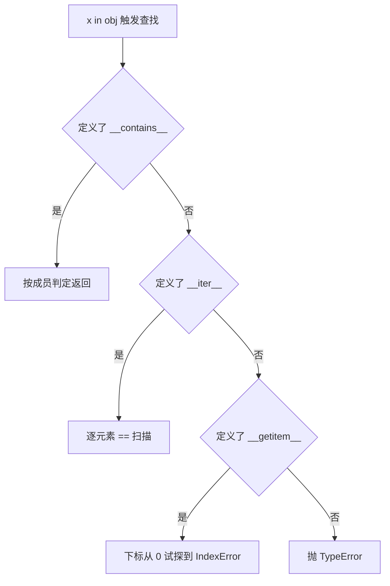
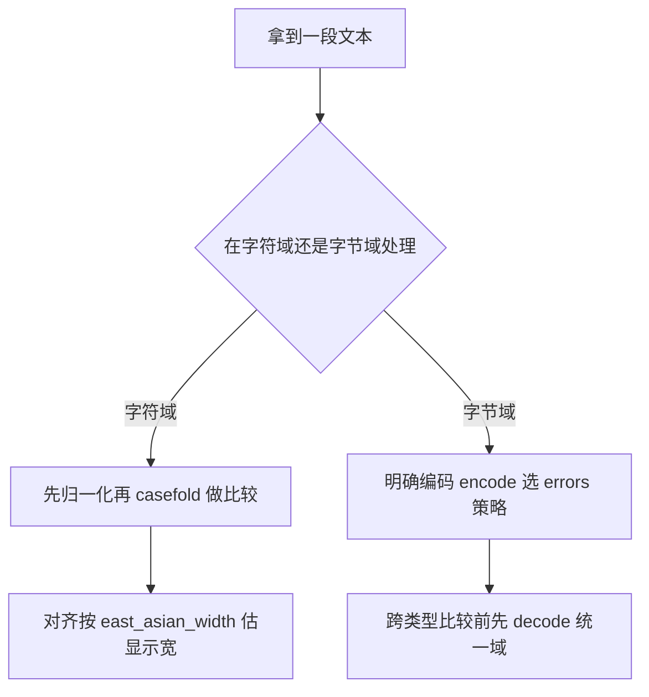
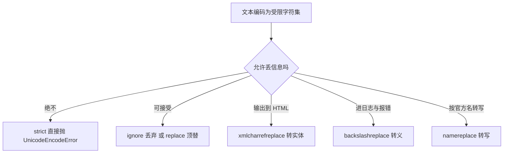
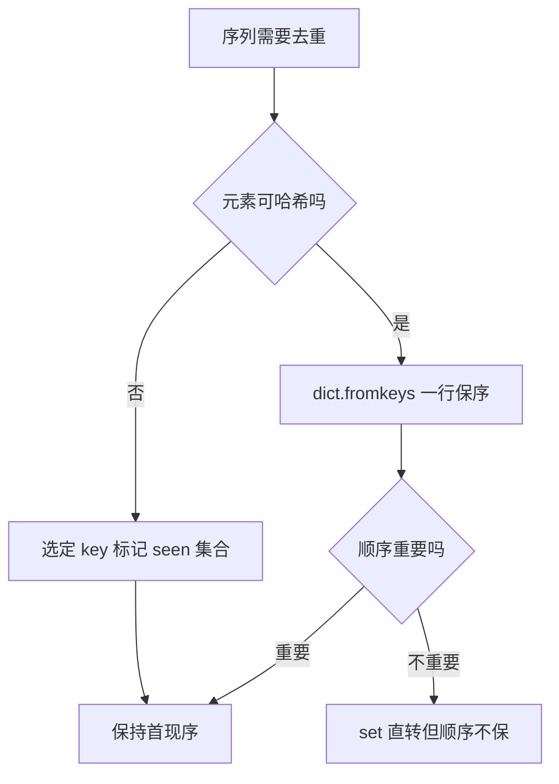
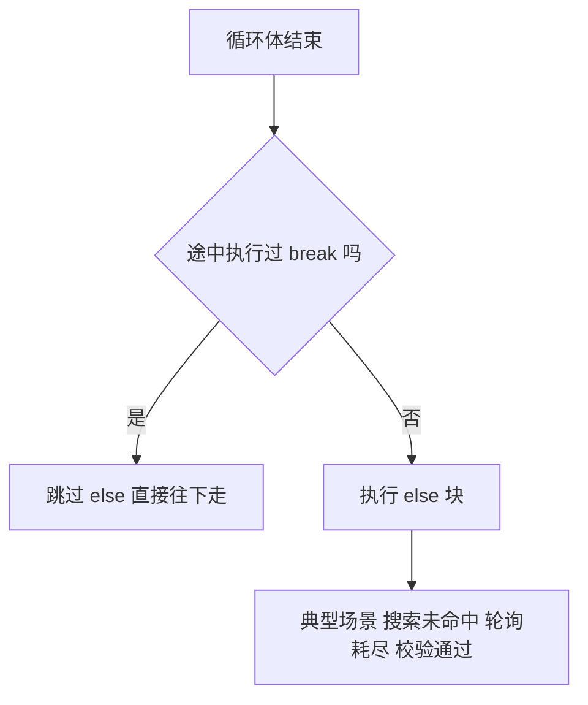
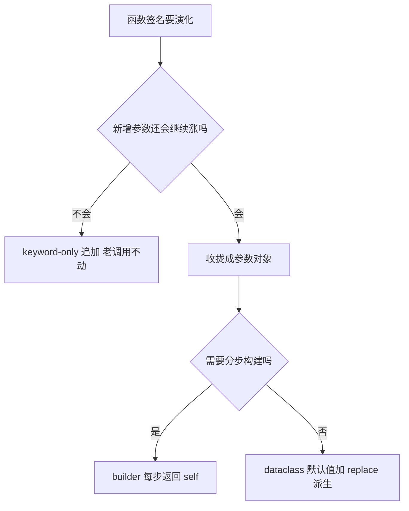
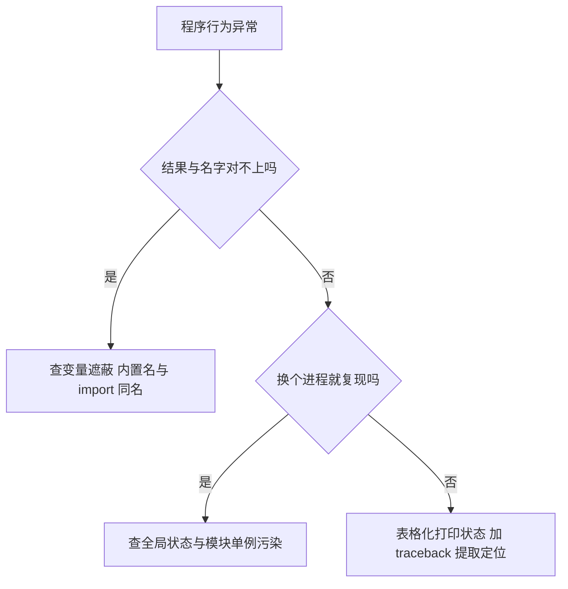
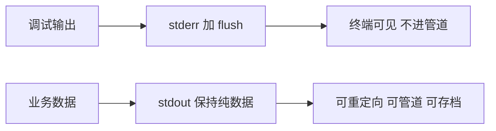

# 第 1 类 · 语言核心与底层(夜间扩产五)

> 本篇是语言核心的第五批夜间扩产(Q2336–Q2380):核心语义补遗(比较分派的反射顺序、真值判定默认规则、in 的三级回退、+= 的返回值契约、id 生命周期、小型对象缓存实测、del 容器形态、跨类型比较)。
> 字符串与格式(动态格式说明符、encode 的 errors 家族、removeprefix/removesuffix、splitlines 边界、宽字符显示宽、f-string 的 = 调试、casefold);容器进阶(视图与拷贝的选择、namedtuple 演进、保序去重、容器相等语义、递归相等与循环引用、deque 的 maxlen 与线程边界、堆的延迟删除)。
> 控制与结构(walrus 循环过滤、try 最小化、循环 else 再辨析、finally 里的 break/continue、遍历中修改列表、不变量外提、递归深度与显式栈);API 设计(参数对象、builder 链式、容量提示、回调注册表、签名演化、返回契约、property 与方法);debug 实战(表格化 print、变量名冲突、import 遮蔽排查、全局状态污染检测、stderr 纪律)。
> 所有代码仅标准库、可直接运行;均已在本机 CPython 3.9.6 逐题实跑通过。

### Q2336 · 比较运算的分派顺序与反射方法

> 难度:★★★★☆ | 标签:比较协议, 反射, NotImplemented

**问**:`a < b` 背后到底调用了哪些方法?解释器按什么顺序尝试?

**答**:比较运算走「正向优先、反射兜底」的两段式分派:求 `a < b` 时先调 `a.__lt__(b)`,若返回 NotImplemented(不是抛错,是「我不处理」的礼貌拒绝),再反射调 `b.__gt__(a)`;两者都拒绝才抛 TypeError。> 走 `__gt__` 再反射 `__lt__`,<= 和 >= 对应 `__le__`/`__ge__`,== 和 != 走 `__eq__`/`__ne__` 且反向有独立的 `__ne__` 默认实现。这解释了为什么 int 和自定义类比较不需要改 int:只要自定义类实现了反射方法,`25 < hot` 也能正确分派。注意两点:返回 NotImplemented 与抛 NotImplementedError 是两回事,前者是协议信号,后者是异常;sorted 只依赖 `<`,所以自定义类型支持排序最小只需实现 `__lt__`。

```python
# file: code/01_语言核心与底层/q2336_compare_dispatch.py
"""比较运算的分派顺序:正向方法优先,拒绝后反射到对方。"""


class Temperature:
    """摄氏温度:__lt__ 只处理同类,__gt__ 只处理数字,演示双向分派。"""

    def __init__(self, celsius):
        self.celsius = celsius

    def __lt__(self, other):
        print(f"    调 __lt__ self={self.celsius} other={other!r}")
        if isinstance(other, Temperature):
            return self.celsius < other.celsius
        return NotImplemented            # 礼貌拒绝,交给对方反射

    def __gt__(self, other):
        print(f"    调 __gt__ self={self.celsius} other={other!r}")
        if isinstance(other, (int, float)):
            return self.celsius > other
        return NotImplemented


if __name__ == "__main__":
    cold, hot = Temperature(10), Temperature(30)

    print("cold < hot:")
    print("    结果:", cold < hot)        # 正向 __lt__ 一次成功

    print("25 < hot: int.__lt__ 不认识 Temperature,反射到 hot.__gt__")
    print("    结果:", 25 < hot)

    print("hot < 25: __lt__ 拒绝,int 的 __gt__ 也不认识 Temperature")
    try:
        hot < 25
    except TypeError as exc:
        print("    TypeError:", exc)

    print("sorted 只依赖 <:", [t.celsius for t in sorted([hot, cold])])
```

**追问**:1) 为什么 NotImplemented 最好对「类型不对」返回而不是抛 TypeError?——返回后解释器还有反射与回退机会,直接抛错会剥夺 `other` 类型(如 Mock、子类)参与比较的权利。2) 反射分派的完整顺序?——a.__lt__(b) → b.__gt__(a) → TypeError;右操作数是左的子类时右优先(Q531);NotImplemented 是哨兵信号,NotImplementedError 是异常,混用是高频实现错误。3) sorted 与比较协议?——sorted/heapq 只依赖 <,最小实现是 __lt__;functools.total_ordering 可由 __lt__ 派生其余(Q533)。4) 生产陷阱?——在比较方法里抛 TypeError 中断分派;== 返回 NotImplemented 后 != 的默认行为是「取反 __eq__」,3.x 已自动处理;比较方法带副作用被链式翻倍。

### Q2337 · 真值判定的默认规则:没写 __bool__ 就恒为真

> 难度:★★★☆☆ | 标签:__bool__, __len__, 真值

**问**:一个自定义类的实例在 `if` 里永远为真吗?什么情况下会为假?

**答**:默认规则是:对象恒为真,除非类定义了 `__bool__` 且返回 False,或定义了 `__len__` 且返回 0——两者都没有,任何实例(哪怕内部数据全空)都是 True。判定优先级是先 `__bool__` 后 `__len__`,只定义其一就按其为准,这常造成误判:比如拿到一个文件对象,`if f:` 判断的是「对象存在」(恒真),不是「文件非空」,想判内容要用 `if f.read():`。`and`/`or` 的短路返回的是操作数本身而不是布尔值,所以 `x or 默认值` 能原样返回 x。写容器类时若忘记实现 `__len__`/`__bool__`,空容器会被误认为真,这是自定义集合类最常见的语义漏洞之一。

```python
# file: code/01_语言核心与底层/q2337_default_truthiness.py
"""真值判定的默认规则:不定义 __bool__ 与 __len__ 的对象恒为真。"""
import io


class Point:
    def __init__(self, x, y):
        self.x, self.y = x, y


class EmptyBox:
    """什么协议都没定义:内部再空也恒为真。"""


class Box:
    """定义 __len__ 后,空箱为假。"""

    def __init__(self):
        self.items = []

    def __len__(self):
        return len(self.items)


if __name__ == "__main__":
    print("Point(0,0) 真值:", bool(Point(0, 0)))     # True:默认规则
    print("EmptyBox() 真值:", bool(EmptyBox()))      # True

    box = Box()
    print("空 Box 真值:", bool(box))                 # False
    box.items.append("x")
    print("装东西后真值:", bool(box))                # True

    empty_file = io.StringIO("")
    print("空文件对象恒真:", bool(empty_file))        # True
    print("但读出的内容为假:", bool(empty_file.read()))

    print("or 短路返回操作数本身:", Point(0, 0) or "默认点")
```

**追问**:1) 只定义 `__len__` 不定义 `__bool__`,实例真值由谁决定?——由 `__len__` 决定,返回 0 即假;两个都定义时 `__bool__` 优先,`__len__` 是它的回退。2) 默认规则的机制?——PyObject_IsTrue 先查 nb_bool 槽、再查 sq_length、都没有恒真(Q532 的槽位故事);bool(x)、if、while、and/or 全走同一条路。3) 设计含义?——「没写 __bool__ 就恒真」让无 __len__ 的自定义对象空/非空语义要显式实现;与 __eq__/__len__ 的语义一致性是容器类的责任。4) 生产陷阱?——容器类忘写 __len__ 导致空对象为真;__bool__ 返回非 bool 被 CPython 拒绝(TypeError);__bool__ 与 __len__ 矛盾造成 truthiness 漂移。

### Q2338 · in 的回退链:__contains__、__iter__ 与 __getitem__

> 难度:★★★☆☆ | 标签:__contains__, __iter__, 旧式协议

**问**:一个类什么容器协议都没完整实现,`in` 还能工作吗?解释器按什么顺序找方法?

**答**:`in` 的分派是一条三级回退链:优先调 `__contains__`(O(1) 与否由实现决定);没有就退回 `__iter__`,用 `==` 逐元素扫描,天然 O(n);连 `__iter__` 都没有,还会退到旧式协议 `__getitem__`,从下标 0 起试探,直到 IndexError 认定遍历结束——这是 Python 2 时代遗留的兼容路径。三者全无才抛 TypeError。这解释了两个工程现象:只实现 `__getitem__` 的类「意外地」可迭代、可 in 检查;以及为什么把 O(n) 的迭代查找升级为 O(1),只需补一个 `__contains__`(底层换 set)。设计只读容器时,实现 `__iter__` 通常就够,`__getitem__` 回退只是保底。

```python
# file: code/01_语言核心与底层/q2338_in_fallback.py
"""in 的回退链:__contains__ 优先,其次 __iter__,最后旧式 __getitem__。"""


class OnlyContains:
    def __init__(self, data):
        self.data = data

    def __contains__(self, item):
        print(f"    OnlyContains.__contains__({item!r})")
        return item in self.data


class OnlyIterable:
    def __init__(self, data):
        self.data = data

    def __iter__(self):
        print("    OnlyIterable 走迭代逐元素比较")
        return iter(self.data)


class OnlyGetItem:
    """只实现 __getitem__:旧式协议,in 按下标从 0 起试探。"""

    def __init__(self, data):
        self.data = data

    def __getitem__(self, index):
        print(f"    OnlyGetItem.__getitem__({index})")
        return self.data[index]


class Nothing:
    pass


if __name__ == "__main__":
    print("2 in OnlyContains:")
    print("    结果:", 2 in OnlyContains([1, 2, 3]))

    print("3 in OnlyIterable:")
    print("    结果:", 3 in OnlyIterable([1, 2, 3]))

    print("'b' in OnlyGetItem:")
    print("    结果:", "b" in OnlyGetItem("abc"))

    try:
        1 in Nothing()
    except TypeError as exc:
        print("in Nothing:", exc)
```

**追问**:1) 只有 `__getitem__` 的类,for 循环也能跑吗?——能,for 与 in 共用这条回退链,按下标试探到 IndexError 停;但它没有 `__iter__` 的显式迭代器语义,不建议新代码这么写。2) 回退链的完整顺序?——__contains__ 优先;没有则 __iter__(迭代器逐个 ==);再没有则 __getitem__(旧式序列协议从 0 试探到 IndexError,Q542);in 的语义随层级漂移(1:1 映射 / 精确元素相等 / 下标遍历)。3) 与 iter() 的关系?——iter() 同样回退到 __getitem__ 造旧式迭代器;in 的 str 特化(子串)是 __contains__ 的内建实现。4) 生产陷阱?——旧协议把业务 IndexError 当终止信号;自定义 __contains__ 改变 in 语义(子串 vs 元素);判断「可迭代」用 isinstance 而不是 try iter(Q542)。

### Q2339 · += 与 __iadd__ 的返回值契约

> 难度:★★★☆☆ | 标签:__iadd__, 运算符协议, 别名

**问**:为什么 `__iadd__` 忘了 return 会让对象变成 None?+= 的完整执行契约是什么?

**答**:`a += b` 的执行分两步:若 a 的类型定义了 `__iadd__`,调它做原地修改,然后把它的返回值重新绑定回名字 a——契约要求原地实现必须 `return self`,忘了 return 就隐式返回 None,a 从此指向 None;若没定义 `__iadd__`,回退到 `__add__` 新建对象再绑定。这解释了可变与不可变的分歧:list 定义了 `__iadd__` 返回自身,别名同步变化;tuple 没有,回退 `__add__` 生成新对象,别名不动。自定义可变类实现 `__iadd__` 时,「修改自身 + 返回 self」是必须成对出现的动作;而实现 `__add__` 的不可变类则绝不能改自身,必须返回新实例。混用两种语义是最常见的事故源。

```python
# file: code/01_语言核心与底层/q2339_iadd_contract.py
"""+= 的返回值契约:__iadd__ 的返回值会成为左侧名字的新绑定。"""


class Gauge:
    """正确示范:原地修改并 return self。"""

    def __init__(self, value):
        self.value = value

    def __iadd__(self, delta):
        self.value += delta
        return self


class BrokenGauge:
    """反面教材:只改内部忘了 return,隐式返回 None。"""

    def __init__(self, value):
        self.value = value

    def __iadd__(self, delta):
        self.value += delta
        # 缺了 return self


if __name__ == "__main__":
    a, b = [1, 2], None
    b = a
    a += [3]
    print("list += 原地改,b 同步变化:", b)

    t, alias = (1, 2), None
    alias = t
    t += (3,)
    print("tuple += 新建对象,alias 不动:", alias, "| t:", t)

    g = Gauge(10)
    g += 5
    print("Gauge += 后:", g.value)

    bg = BrokenGauge(10)
    bg += 5
    print("BrokenGauge += 后左侧名字变成:", bg)
```

**追问**:1) 不可变类型实现 `+=` 时该实现哪个方法?——只需 `__add__`(解释器回退调用),返回新对象;实现 `__iadd__` 反而会让别人误以为它是可变类型。2) 返回值契约?——__iadd__ 返回 self(就地修改)或新对象(重绑定语义),结果重新绑定到名字;+= 先试 __iadd__,NotImplemented/缺失才回退 __add__ 加赋值(Q530/2070 相关行为)。3) 与 CPython 特化的关系?——str += 的「id 不变」是 refcount==1 时的实现优化,语义上仍是新对象;自定义 __iadd__ 返回新对象完全合法。4) 生产陷阱?——__iadd__ 返回 None(以为不用返回值);可变语义与返回新对象混用让调用方困惑;多线程下 += 三步不原子。

### Q2340 · id() 的生命周期陷阱:临时对象与地址复用

> 难度:★★★★☆ | 标签:id, 对象生命周期, CPython

**问**:为什么 `id(f()) == id(f())` 可能返回 True?id() 的结果什么时候还有效?

**答**:id() 返回的是「对象存活期间」的唯一标识,CPython 里恰好是内存地址;一旦对象被回收,它的 id 就作废,同一块内存可以立刻分给新对象,新对象的 id 与旧对象相同。于是 `id(f()) == id(f())` 这种比较毫无意义:第一个临时对象在比较前就可能被回收,第二个临时对象复用了同一地址,结果恒为 True 但说明不了任何问题。规矩有三条:身份比较必须基于同时存活的对象;跨语句比较身份,先把引用存进变量;想让「键在对象死后自动消失」,用 WeakValueDictionary 这类弱引用结构,而不是拿 id 当 key。is 的误用同理——对临时表达式做 is 比较是在赌垃圾回收的时机。

```python
# file: code/01_语言核心与底层/q2340_id_lifetime.py
"""id() 的生命周期陷阱:表达式结束后对象即可回收,地址可被复用。"""
import gc
import weakref


class Box:
    def __init__(self, tag):
        self.tag = tag


if __name__ == "__main__":
    id1 = id(Box("a"))
    id2 = id(Box("b"))
    print("两个临时对象的 id 相等:", id1 == id2)   # 地址复用,True 但无意义

    x = Box("keep")
    y = x
    print("同时存活的别名 is 判断可靠:", x is y)

    b1 = Box("first")
    b2 = Box("second")
    print("持有引用后 id 必不相同:", id(b1) != id(b2))

    cache = weakref.WeakValueDictionary()
    cache["first"] = b1
    print("弱引用取回同一对象:", cache["first"] is b1)
    del b1
    gc.collect()
    print("引用消失后弱引用自动清理:", "first" not in cache)
```

**追问**:1) 那 CPython 里两次 `id(Box())` 为什么几乎总是相等?——CPython 用引用计数,表达式求值完临时对象计数归零立刻释放,下一对象分配到同一块内存;这不是语言保证,换实现或开 debug 钩子都可能不同。2) 生命周期陷阱的完整形态?——临时对象求值完即死,id 立即可复用;持有 id 值做索引(跨对象比较)是错误;存活期内 id 稳定、之外无意义(Q2073)。3) 正确的「存活期唯一」需求?——直接持有对象引用做 key(默认哈希即身份);WeakKeyDictionary 让身份索引随死亡清理(Q2073)。4) 生产陷阱?——两次 id() 相等的实验被当成语义;id 进业务数据/日志跨进程比较;调试「幽灵命中」要想起地址复用。



### Q2341 · 小型对象缓存实测:哪些字面量真的驻留

> 难度:★★★☆☆ | 标签:对象缓存, 驻留, 实测

**问**:小整数缓存 [-5, 256] 到底怎么工作?为什么有时 1000 is 1000 也是 True?

**答**:CPython 有三层小对象复用:启动时预建的整数池覆盖 -5 到 256,任何计算结果落在区间内都直接复用;标识符风格的字符串(字母数字下划线组成)在编译期自动驻留,同一代码块里相同字面量共享对象;空元组是全局单例。关键在「运行期」三个字:编译期常量折叠会把 `256+1` 折成 257 并与字面量 257 共享,但 `abs(-257)` 是运行期调用,结果超出缓存区间,得到全新对象。所以 is 比较的结果取决于「值从哪来」:同代码块的同字面量共享,跨代码块、运行期计算的大数不保证。工程结论只有一个:值比较一律用 ==,is 只留给 None、True、False 这类单例。

```python
# file: code/01_语言核心与底层/q2341_small_object_cache.py
"""小型对象缓存实测:int 缓存、字符串驻留与空元组单例的条件。"""
import sys

if __name__ == "__main__":
    a, b = 100, 100
    print("缓存区间内 100 is 100:", a is b)

    x, y = 1000, 1000
    print("同一代码块的 1000 字面量:", x is y)      # 编译期共享

    n1 = abs(-257)
    n2 = 257
    print("运行期算出的 257 与字面量 257:", id(n1) == id(n2))

    s1, s2 = "hello_world", "hello_world"
    print("标识符样字符串驻留:", s1 is s2)
    t1, t2 = "hello world!", "hello world!"
    print("带空格标点的不保证:", t1 is t2)

    e1, e2 = (), ()
    print("空元组单例:", e1 is e2, "| 引用计数:", sys.getrefcount(e1))

    print("结论:比值一律 ==", 1000 == 1000)
```

**追问**:1) sys.intern 和这有什么区别?——intern 是手动把任意字符串压进驻留表,适合大量重复字符串当 dict key 的场景;小整数缓存与自动驻留是编译器行为,不可控也不可依赖。2) 哪些字面量真的驻留?——-5..256 整数;标识符样字符串字面量(编译期);运行时拼接/切片不驻留;同一编译单元内重复常量折叠共享(Q1798)。3) 实测方法?——id/is 比较在同一编译单元内做;跨行(REPL)结果不同;结论只对 CPython 有效,Pypy 缓存策略不同。4) 生产陷阱?——把 is 比较当语义;对海量用户输入 intern(Q2069);依赖「缓存命中」做性能假设(缓存收益不可控)。

### Q2342 · del 的容器形态:切片、键与属性

> 难度:★★☆☆☆ | 标签:del, 容器, 基础

**问**:del 都能删什么?删切片、删键、删属性和 remove/pop 的区别是什么?

**答**:del 在容器上有三种形态:`del lst[i]` 与 `del lst[a:b]` 按位置删除并原地收缩序列(list 支持,不可变序列不支持);`del d[k]` 删除映射的键,键不存在抛 KeyError;`del obj.attr` 删实例属性,`del name` 删名字本身。与成员方法对比:remove 按值删(找到第一个相等元素),pop 按位删并返回被删元素,而 del 纯粹为删除而生、不返回值。另一个高频误区是把 `del` 当「释放内存」的开关——它只是断开一个引用,对象是否真被回收取决于还有没有别的引用。越界删除不管哪种形态都会抛异常,del 也没有静默模式,需要容忍缺失就用 `d.pop(k, None)` 或先判存在。

```python
# file: code/01_语言核心与底层/q2342_del_containers.py
"""del 的容器形态:删切片、删键、删属性,都只是断开引用。"""


class Config:
    def __init__(self):
        self.debug = True
        self.level = 3


if __name__ == "__main__":
    lst = [0, 1, 2, 3, 4, 5]
    del lst[1]
    print("del lst[1]:", lst)
    del lst[1:3]
    print("del lst[1:3]:", lst)
    try:
        del lst[10]
    except IndexError as exc:
        print("del 越界:", exc)

    d = {"a": 1, "b": 2, "c": 3}
    del d["b"]
    print("del d['b']:", d)
    try:
        del d["z"]
    except KeyError as exc:
        print("del 缺键:", exc)

    cfg = Config()
    del cfg.debug
    print("属性删掉了:", not hasattr(cfg, "debug"))

    lst2 = [7, 8, 9]
    lst2.remove(8)            # 按值删
    popped = lst2.pop(0)      # 按位删并返回
    print("remove+pop 之后:", lst2, "| pop 弹出:", popped)
```

**追问**:1) del 一个切片和给切片赋空列表 `lst[1:3] = []` 有区别吗?——语义等价,都是原地收缩;但 `lst[1:3] = []` 是赋值语句写法,del 形态更直白,两者都比反复 remove 高效。2) del 容器形态的底层?——切片删除走 __delitem__(slice) 一次 memmove;按键删走 __delitem__(key) 哈希定位;属性删走 __delattr__;都是「拆引用」不是「删对象」(Q545)。3) 与 clear/pop 的选型?——清空用 clear()(O(1) 语义);删单元素 pop;批量删区间用 del 切片。4) 生产陷阱?——循环里反复 remove(O(n²));del 只拆绑定忘掉其他引用(Q545);del 掉正在迭代的容器元素(Q2076)。

### Q2343 · bytes 与 str 的比较:两个不相通的世界

> 难度:★★☆☆☆ | 标签:bytes, str, 编码

**问**:b"abc" 和 "abc" 相等吗?为什么 bytes 能当 dict key 却取不到 str 存的值?

**答**:bytes 与 str 是两种独立类型,任何比较都返回 False 而不是报错——b"\xe4\xb8\xad" == "中" 永远是 False,因为二者的 == 是跨类型直接判不等,不做任何隐式解码。哈希也遵循同一套字节/码点口径,所以 bytes 与其编码结果哈希不同,放进同一个 dict 是两个不同的键,互取不到。元素语义差别更大:索引 bytes 得到 int(b"abc"[0] 是 97),索引 str 得到单字符 str;迭代、in 检查同理,跨类型操作直接 TypeError。工程意义在于:类型边界就是编码边界,「先 decode 再处理、处理完再 encode」,绝不在比较与容器键上混用两种类型,能让一整类「看起来相等却查不到」的问题消失。

```python
# file: code/01_语言核心与底层/q2343_bytes_vs_str.py
"""bytes 与 str 的比较:永不相等、哈希不同、混排直接报错。"""

if __name__ == "__main__":
    text = "中文"
    data = text.encode("utf-8")
    print("bytes 形式:", data)
    print("与 str 比较:", data == text)
    print("decode 后相等:", data.decode("utf-8") == text)

    print("哈希不同:", hash(data) != hash(text))
    table = {text: "值"}
    try:
        table[data]
    except KeyError:
        print("bytes 键取不到 str 的值")

    print("b'abc' 索引得到:", b"abc"[0], type(b"abc"[0]).__name__)
    print("str 索引得到:", "abc"[0], type("abc"[0]).__name__)

    try:
        sorted(["a", b"a"])
    except TypeError as exc:
        print("混排:", exc)

    try:
        b"a" in "abc"
    except TypeError as exc:
        print("in 跨类型:", exc)
```

**追问**:1) 那 `b"abc" == b"abc"` 的比较成本是 O(1) 吗?——不是,是逐字节的 O(n) 最坏比较,先比长度;与 str 一样,等值检查在长字节串上并不免费。2) 两个世界的隔离规则?——bytes/str 之间 == 直接 False、不转换;拼接/切片/比较各自成体系;桥梁只有 encode/decode 一次转换,边界处理 errors 策略(Q1541)。3) 混用的典型报错?——TypeError: can't concat str to bytes;UnicodeDecodeError 在 decode 边界;f-string 混两者产生 b'...' 文本。4) 生产陷阱?——网络/文件层混用 bytes 与 str;在边界重复 encode/decode;按 str 假设切片(bytes 切片还是 bytes,len 是字节数不是字符数)。

### Q2344 · 字符串比较的字典序:码点顺序与排序陷阱

> 难度:★★★☆☆ | 标签:字符串比较, 排序, 码点

**问**:为什么 sorted 后大写字母全排在小写前面?字符串比较的底层规则是什么?

**答**:str 之间用 <、> 比较时按 Unicode 码点逐字符比较,没有任何语言或本地化规则参与:大写 A-Z 落在 65-90、小写 a-z 落在 97-122,所以 "Z" < "a";数字字符排在字母前("10" < "2");汉字码点远大于 ASCII,所以 "中" > "a"。这带来三类高频陷阱:大小写混排的词表顺序反直觉,要忽略大小写就用 `key=str.lower`(更严谨用 casefold);数字字符串想按数值排要 `key=int`;想要「长度优先、同长按字典序」就写元组键 `(len(w), w)`。另外要记住排序键是「每个元素算一次」,在 key 里做重计算比在比较函数里划算得多。跨语言真正的字典序需要 locale 或第三方排序库,标准库 str 比较只是码点序。

```python
# file: code/01_语言核心与底层/q2344_lexicographic_order.py
"""字符串比较是码点字典序:大小写、数字与汉字的真实顺序。"""

if __name__ == "__main__":
    words = ["banana", "Apple", "apple", "Banana", "10", "2"]
    print("码点排序:", sorted(words))
    print("忽略大小写:", sorted(words, key=str.lower))
    print("数字串数值序:", sorted(["10", "2", "1", "100"], key=int))

    pairs = [("Z", "a"), ("中", "a"), ("0", ":"), ("A", "_")]
    for lo, hi in pairs:
        print(f"{lo!r} < {hi!r}:", lo < hi, "| 码点:", ord(lo), ord(hi))

    words2 = ["straße", "STRASSE", "strasse"]
    print("lower 键:", [w.lower() for w in words2])
    print("casefold 键:", [w.casefold() for w in words2])
```

**追问**:1) 「10」和「2」怎么排成数值序?——`sorted(words, key=int)`,key 把每个元素映射成比较用的值;混合了非数字元素时用 try 包 int 或写一个容错键函数。2) 码点排序的语义?——比较按 Unicode 码点(不是 locale);大小写混排(大写在前)、数字字符串「10」<「2」、中文按码点不按拼音——业务排序都要显式 key。3) 自然排序的实现?——正则切分数字/非数字段,数字段转 int、其余转小写后组元组 key;多级 key 与 locale(strxfrm)按需组合。4) 生产陷阱?——把「显示顺序」当「码点序」;key 函数抛异常让整个 sorted 崩(Q2083 的容错键);对用户名等先 NFC 归一再排(Q491)。

### Q2345 · 数值混合比较:float、Decimal 与 Fraction 同场

> 难度:★★★★☆ | 标签:Decimal, Fraction, 数值比较

**问**:Decimal("0.3")、0.3 和 Fraction(3, 10) 互相比较结果是什么?混合排序安全吗?

**答**:数值类型之间可以互相比较,而且规则比想象中严格:Fraction 与 float 比较走精确有理数运算,0.1+0.2(实际是 0.30000000000000004)会正确地大于 3/10;Decimal 与 float 的比较也是精确的,把 float 看成它真实的二进制值再比,所以 Decimal("0.3") == 0.3 是 False;Decimal 与 Fraction 比较时两边都精确展开,Decimal("0.3") == Fraction(3,10) 是 True。混合排序因此天然安全,sorted 能直接处理四种类型混排,不必先统一类型。真正会破坏一切的是 NaN:任何与 NaN 的有序比较都是 False,排序结果不可预期。这组语义的价值在于:数值口径不一致时,「比较」比「相等」可靠,而最可靠的做法是排序与聚合前统一转 Fraction 或 Decimal。

```python
# file: code/01_语言核心与底层/q2345_mixed_numeric_compare.py
"""数值类型混合比较:int、float、Fraction、Decimal 的互操作性。"""
import math
from decimal import Decimal
from fractions import Fraction

if __name__ == "__main__":
    f = 0.1 + 0.2
    d = Decimal("0.3")
    fr = Fraction(3, 10)
    print("float  :", repr(f))
    print("Decimal:", d, "| Fraction:", fr)

    print("float > Fraction(精确比较):", f > fr)
    print("Decimal == Fraction:", d == fr)
    print("Decimal == float:", d == f)
    print("int == Decimal/Fraction:", 1 == Decimal("1.0"), 2 == Fraction(4, 2))

    nums = [Decimal("0.5"), Fraction(1, 3), 0.75, 2, -1]
    print("混合排序:", sorted(nums))

    print("nan 的有序比较恒 False:", math.nan > 1, math.nan == math.nan)
```

**追问**:1) Decimal 和 float 之间能直接做加减吗?——比较可以、算术不行,`Decimal("0.3") + 0.1` 抛 TypeError,必须先统一类型;这正是「比较精确、运算设防」的设计。2) 混合比较的机制?——数值类型按精确实数互比(Fraction 最精确、float 转精确分数再比,Q1543);比较规则统一由 IEEE/数值塔定义,但算术只在同类或可提升类型间。3) bool/int/float 的混算?——bool 是 int(Q539)、int 自动升 float;Decimal 与 Fraction 不互算;金额场景统一 Decimal。4) 生产陷阱?——比较通过后直接混算崩;float 精度进入 Decimal(Decimal(0.1) 带误差,Q1542);NaN 让所有比较 False(Q534)。

### Q2346 · casefold 与 lower:大小写折叠的边界

> 难度:★★☆☆☆ | 标签:casefold, 大小写, 国际化

**问**:做大小写无关的匹配,为什么推荐 casefold 而不是 lower?

**答**:lower 做的是「单字符小写化」,casefold 做的是「为无差别比较而折叠」,后者会把某些字符展开成多个字符:德语 ß 折叠成 ss(而 lower 保留 ß),希腊语最终形西格玛也归一为普通形。因此判断「两个词是否同一词(忽略大小写)」时,casefold 的覆盖面更完整,尤其对德语等语言,lower 会漏判。还有一个细节:土耳其语 İ(带点大写 I)casefold 后是 i 加组合点,长度变了——所以 casefold 的结果不能再当等长字符串用,但作 dict 键、in 匹配完全没问题。工程惯例:构建大小写无关的索引或查表时,统一「入口 casefold、存键 casefold」,两侧口径一致才不会漏。内部标识符、ASCII 为主的数据用 lower 足够,面向用户文本的匹配一律 casefold。

```python
# file: code/01_语言核心与底层/q2346_casefold.py
"""casefold 与 lower:大小写折叠的边界差异与查表惯例。"""

if __name__ == "__main__":
    samples = ["HELLO", "Straße", "ΣΊΣΥΦΟΣ", "İstanbul"]
    for s in samples:
        print(f"{s!r:>12} lower={s.lower()!r} casefold={s.casefold()!r}")

    print("ß 折叠一致:", "straße".casefold() == "strasse".casefold())
    print("lower 会漏判:", "straße".lower() == "strasse".lower())

    known = {"strasse": "德国公路"}
    query = "STRASSE"
    print("casefold 查表:", known.get(query.casefold()))
```

**追问**:1) casefold 和 normalize 是什么关系?——互补的两步:normalize(NFKC) 处理「长得一样但码点不同」(如全角),casefold 处理「大小写变体」,严格的无差别比较两者都要做。2) casefold 与 lower 的差异?——casefold 是语言级折叠(ß→ss),lower 是逐字符映射;德语/希腊语等场景 lower 会漏;casefold 结果通常更长。3) 无差别比较的完整管线?——NFC 归一 → casefold → 比较;入口归一化一次存库(Q491),比较前再 casefold;translate 只能做字符级 1:1(Q1538)管不了多字符折叠。4) 生产陷阱?——用 lower 做德语文本去重漏 ß;只 casefold 不 normalize(全角漏);折叠后的字符串直接回写业务数据(改变原语义)。



### Q2347 · 动态构建格式说明符

> 难度:★★★☆☆ | 标签:format, 格式化, 模板

**问**:列宽、对齐、精度都要运行时才能决定,格式化字符串怎么写?

**答**:格式说明符本身支持「嵌套替换字段」:冒号后面的 spec 里可以再放 `{width}`、`{fill}` 这样的占位,由 format 的参数先展开,再作用于目标值——`"{:{fill}{width}.{prec}f}".format(v, fill="*", width=10, prec=2)` 等价于 `"*:.........2f"` 的效果,模板完全参数化。第二种方式是程序化拼 spec 字符串:`"{:" + align + str(width) + "}"`,适合对齐方式由配置决定的表格渲染;配合 `format_map` 可以让 spec 引用上下文字典的字段。注意两个坑:spec 里只接受对齐、填充、宽度、精度这些标准微型语言记号,不能嵌套任意表达式;嵌套字段展开发生在 format 调用时,拼写错误要到运行时才暴露,所以动态 spec 的测试必须覆盖每条格式路径。构建整表时,先用参数拼出整行 fmt,再逐行 format,是最清晰的做法。

```python
# file: code/01_语言核心与底层/q2347_dynamic_format_spec.py
"""动态构建格式说明符:嵌套替换字段让 spec 也能参数化。"""


def render_table(rows, headers, widths, aligns):
    """width 与 align 由参数决定,先拼出行模板再逐行 format。"""
    fmt = " ".join("{:" + a + str(w) + "}" for a, w in zip(aligns, widths))
    print(fmt.format(*headers))
    print("-" * len(fmt.format(*headers)))
    for row in rows:
        print(fmt.format(*row))


if __name__ == "__main__":
    # 方式一:嵌套替换字段,spec 内部引用参数(fill 必须在 align 之前)
    print("{:{fill}>{width}.{prec}f}".format(3.14159, fill="*", width=10, prec=2))

    # 方式二:format_map 让 spec 引用上下文字典
    spec = "{price:>{w}.{p}f} 元"
    print(spec.format_map({"price": 12.5, "w": 8, "p": 1}))

    # 方式三:程序化拼 spec 渲染整表
    render_table(
        rows=[["cpu", 0.75], ["mem", 0.42]],
        headers=["指标", "占用"],
        widths=[6, 8],
        aligns=["<", ">"],
    )
```

**追问**:1) f-string 能动态 spec 吗?——能,`f"{value:{width}.{prec}f}"` 的嵌套字段同样有效,f-string 的 {} 里允许任意表达式,比 str.format 更灵活,但要防注入时仍应选 format。2) 动态 spec 的机制?——格式说明符里的 {} 嵌套先求值再作为 spec;format(value, spec) 最终分派到 __format__(Q474);Template/sandbox 引擎管「外部可控模板」(Q520)。3) 动态表格的实现?——按列宽配置拼 spec;对齐/精度全部参数化;多行表用 format 规范或 tabulate。4) 生产陷阱?——用户可控的 spec 串(注入面,用白名单);嵌套 spec 可读性;宽字符对齐(Q2351/1540);千分位与精度组合的本地化假设。

### Q2348 · encode 的 errors 策略家族

> 难度:★★★☆☆ | 标签:encode, errors, codecs

**问**:encode 遇到编码不了的字符,除了报错还能怎么办?各策略分别适合什么场景?

**答**:encode 的 errors 参数是一组策略:strict 默认抛 UnicodeEncodeError;ignore 静默丢字符(审计场景禁用,信息无声消失);replace 用 ? 顶替(适合日志预览);xmlcharrefreplace 把字符转成 `&#NNNN;` 实体(HTML/XML 输出专用,encode 独有);backslashreplace 转成 \xNN 转义(适合错误消息与日志,能原样还原);namereplace 转成 \N{名称}。策略还可以自定义:`codecs.register_error` 注册一个处理器,函数收到异常、返回「替换串与消费终点」二元组,就能实现星号顶替、拼音转写等业务策略。注意 encode 与 decode 的策略集不对称:xmlcharrefreplace 只属于 encode,而 decode 有自己的 surrogateescape 等选项。选型原则是「信息是否有价值」:宁可显式 replace 也不要 ignore,转义类策略保留可逆性最好。

```python
# file: code/01_语言核心与底层/q2348_encode_errors.py
"""encode 的 errors 策略对比:strict、ignore、replace 与转写家族。"""
import codecs

if __name__ == "__main__":
    text = "价格 ¥100,café"
    for policy in ["strict", "ignore", "replace",
                   "xmlcharrefreplace", "backslashreplace", "namereplace"]:
        try:
            out = text.encode("ascii", errors=policy)
        except UnicodeEncodeError as exc:
            out = f"报错: {exc.reason}"
        print(f"{policy:>18}: {out}")

    def star_replace(exc):
        """自定义策略:编码不了的字符换成星号。"""
        return ("*", exc.end)

    codecs.register_error("star", star_replace)
    print("自定义 star:", text.encode("ascii", errors="star"))

    dirty = b"caf\xe9"
    print("decode replace:", dirty.decode("ascii", errors="replace"))
    print("decode backslashreplace:", dirty.decode("ascii", errors="backslashreplace"))
```

**追问**:1) surrogateescape 是干什么的?——decode/encode 共用的「字节保真」策略:解不开的字节暂存为代理区码点,再 encode 时原样吐回字节,常用于按 ASCII 处理未知编码文件而不破坏原始数据。2) errors 家族的完整分工?——strict(默认,数据安全)、ignore/replace(展示容错)、backslashreplace(转义展示)、xmlcharrefreplace(HTML)、surrogateescape(字节保真往返)——选型按「数据 vs 展示」(Q1541)。3) 编解码的边界治理?——入口确定编码(或 chardet 启发),出口统一;两侧 errors 策略必须配对;surrogate 字符不能进 JSON/DB。4) 生产陷阱?——ignore 静默丢字节;往返用不同 errors 丢数据;把 surrogate 码点写进结构化存储崩。

### Q2349 · removeprefix 与 removesuffix:3.9 的前后缀新解

> 难度:★★☆☆☆ | 标签:str, 3.9 新特性, API

**问**:去掉文件名后缀或 URL 前缀,为什么要用 3.9 新增的这两个方法而不用切片或 strip?

**答**:旧写法各有暗坑:`s[len(p):]` 不判断前缀存在与否,直接切会切错;`startswith` + 切片要写两步还容易复制粘贴错;`lstrip("test_")` 最危险——它按「字符集合」从左剥离,只要字符在集合里就一直剥,会把前缀之外的字符也剥掉。3.9 的 `removeprefix`/`removesuffix` 语义精确:前缀/后缀匹配则去掉,不匹配原样返回,幂等且安全,天然适合链式处理多级后缀(如 a.tar.gz)。实现上它们等价于官方替你写好的那个 if + 切片,没有性能开销。迁移建议:代码库中出现「先 startswith 再切片」的地方都可以替换;strip 家族继续用于「去空白」,两者职责不再混淆。

```python
# file: code/01_语言核心与底层/q2349_remove_affix.py
"""3.9 的 removeprefix/removesuffix:替代裸切片与 strip 误用。"""
import sys

if __name__ == "__main__":
    print("Python 版本:", sys.version.split()[0])
    filename = "report_2024_final.pdf"
    print("removeprefix:", filename.removeprefix("report_"))
    print("removesuffix:", filename.removesuffix(".pdf"))
    print("前缀不存在原样返回:", "data.csv".removeprefix("report_"))

    old = filename[len("report_"):] if filename.startswith("report_") else filename
    print("旧写法等价但啰嗦:", old)

    print("lstrip 按字符集剥离会剥过头:", "testest_value".lstrip("test_"))
    print("removeprefix 语义精确:", "testest_value".removeprefix("test_"))

    for name in ["a.tar.gz", "b", "c.txt"]:
        print(name, "->", name.removesuffix(".gz").removesuffix(".tar"))
```

**追问**:1) 为什么没有 removemiddle 之类的对称方法?——前缀后缀是「边界语义」,切片可精确表达;中间内容的删除依赖具体业务规则,交给 replace 或正则更合适。2) 与 startswith/endswith 的配合?——removeprefix 幂等:有则删无则原样;旧写法 `if s.startswith(p): s = s[len(p):]` 的样板代码就此消失;空串安全。3) 版本与兼容?——3.9+ 才有;旧版本写条件切片;替换 strip(p) 的误用(strip 是字符集语义不是前缀语义——strip("ab") 会删两侧任意 a/b 字符)。4) 生产陷阱?——用 strip 删前缀(语义错,高频笔误);replace 误删中间多次出现;对长度为零前缀的边界假设。

### Q2350 · splitlines 的边界:它认得哪些换行

> 难度:★★★☆☆ | 标签:splitlines, 换行, 文本处理

**问**:split("\n") 和 splitlines() 差在哪?处理跨平台文本该用哪个?

**答**:splitlines 认得一整套 Unicode 换行界符:\n、\r、\r\n 之外还有 \v、\f、\x85(Next Line)、\u2028(Line Separator)、\u2029(Paragraph Separator),把文本按「行」的语义切分;split("\n") 只认一个字面量,遇到 \r\n 会留下尾部 \r,遇到旧 Mac 的 \r 更是完全不切。第二个关键差异在结尾: "a\nb\n".split("\n") 产生空尾行 ["a", "b", ""],splitlines 不产生——解析表格文本时 splitlines 更干净。需要保留行尾符时用 `splitlines(keepends=True)`,便于写「重组后与原文完全一致」的处理器。反过来,在确定只有 \n 的场合(程序内部生成的数据),split 更快也更可预测。读外部文件时还有第三条路:文件对象按 universal newlines 直接迭代行,连 \r\n 都已归一成 \n。

```python
# file: code/01_语言核心与底层/q2350_splitlines.py
"""splitlines 的边界:识别哪些换行、行尾空行与 split 的差异。"""

if __name__ == "__main__":
    text = "a\nb\r\nc\rd\x85e\u2028f"
    print("转义视图:", text.encode("unicode_escape"))
    print("splitlines:", text.splitlines())
    print("split('\\n'):", text.split("\n"))
    print("keepends:", text.splitlines(keepends=True))

    nl = "a\nb\n"
    print("splitlines 无空尾行:", nl.splitlines())
    print("split 有空尾行:", nl.split("\n"))

    body = "姓名,年龄\n张三,20\n李四,30\n"
    rows = [line.split(",") for line in body.splitlines() if line]
    print("解析结果:", rows)
```

**追问**:1) \x85 和 \u2028 为什么危险?——它们是合法换行界符但肉眼不可见,来自 EBCDIC 与某些编辑器;按 split("\n") 解析外部文本时会把多行粘成一行,splitlines 则按语义切开。2) splitlines 与 split 的语义差?——splitlines 认全部换行界符(\n \r \r\n \v \f \x1c-\x1e \x85 \u2028 \u2029)且可 keepends;split("\n") 只认一个;跨平台文本要用 splitlines。3) 与 universal newlines 的配合?——文件读时 text 模式已把 \r\n 归一为 \n;网络协议字节流要先 decode 再 splitlines。4) 生产陷阱?——解析外部(Windows/编辑器)文件用 split("\n") 粘行;行计数与真实行数不一致;按行数断言的测试遇到隐形换行失败。

### Q2351 · 宽字符与显示宽度:len 之外的列宽

> 难度:★★★★☆ | 标签:Unicode, 显示宽度, 东亚字符

**问**:为什么 "中文" 的 len 是 2,终端里却占了 4 列?对齐表格该怎么补空格?

**答**:len 数的是码点个数,而终端列宽由字体的「东亚宽度」属性决定:汉字与全角假名属于 F/W(全角/宽),占 2 列;ASCII 与大多数西文字符占 1 列。标准库 `unicodedata.east_asian_width` 返回每个字符的宽度类别,自算显示宽就是「宽字符记 2、其余记 1」(组合字符记 0)。更隐蔽的是组合字符:é 可以是一个码点(U+00E9)也可以是 e 加组合锐音符两个码点,len 不一样,但显示宽度一样——所以对齐前常先 normalize(NFC) 归一。用 len 做定宽表格的对齐,中文内容一多就错位,这正是按显示宽补空格的动机;真正的终端表格场景应交给 wcwidth 这类第三方库,标准库方案适合「自算+已知字符集」的受控环境。这个知识点在国际化 UI、CLI 输出、日志对齐里都是必备。

```python
# file: code/01_语言核心与底层/q2351_display_width.py
"""len 是字符数不是显示宽度:东亚宽度与组合字符。"""
import unicodedata


def display_width(s):
    """宽字符记 2、组合字符记 0、其余记 1 的终端列宽估算。"""
    total = 0
    for ch in s:
        if unicodedata.combining(ch):
            continue
        total += 2 if unicodedata.east_asian_width(ch) in ("F", "W") else 1
    return total


if __name__ == "__main__":
    samples = ["abc", "中文", "ａｂｃ", "naïve", "éclair"]
    for s in samples:
        print(f"{s!r:<12} len={len(s)} 显示宽={display_width(s)}")

    nfc = "é"
    nfd = "e\u0301"
    print("NFC len:", len(nfc), "| NFD len:", len(nfd))
    print("显示宽相同:", display_width(nfc) == display_width(nfd))
    print("归一化后相等:", unicodedata.normalize("NFC", nfd) == nfc)

    rows = [("名称", "值"), ("name", "value")]
    width = max(display_width(r[0]) for r in rows)
    for name, val in rows:
        print(name + " " * (width - display_width(name)) + " | " + val)
```

**追问**:1) emoji 的宽度怎么算?——多数 emoji 是 W 宽度但占 2 列以上,还有 ZWJ 序列拼成的复合 emoji,len、east_asian_width 都算不准,必须用 wcwidth 类库并按版本维护宽度表。2) 显示宽度的机制?——east_asian_width 分 W/F(2)/Na/N/H(1)/A(依环境);终端渲染还受字体影响;len 是码点数不是列宽(Q1540)。3) 工程处理?——表格对齐用 wcwidth.wcswidth 逐列算;不等宽列用分隔符而不是空格对齐;日志格式截断也按显示宽。4) 生产陷阱?——CJK/emoji 让表格错位;组合字符(零宽)算进 len;把「码点数」当「用户可见长度」做限长校验。



### Q2352 · f-string 的 = 调试语法

> 难度:★★★☆☆ | 标签:f-string, 调试, 3.8 新特性

**问**:f"{x=}" 输出的是什么?调试时它比 print(f"val: {x}") 好在哪?

**答**:3.8 起 f-string 支持 `=` 修饰:表达式文本、等号、值的 repr 一次输出,`f"{radius=}"` 得到 `radius=2.5`。价值在于「所见即所测」:变量名不再手打两遍,复制粘贴时也不会名实不符——手写 print 很容易打印的标签和实际取的变量对不上,= 语法在语言层杜绝了这种漂移。它还能带格式说明(`f"{x=:.2f}"`,先输出表达式再按 spec 格式化值)、控制等号两侧空格(`f"{x = }"`)、用于属性访问与任意表达式(`f"{point.real=}"`、`f"{area(r)=:.3f}"`)。边界要清楚:= 捕获的是源代码文本,经过的变量重绑定它不知道;输出用 repr,想看 str 形式要显式格式化。它是轻量级 print 调试的最佳形态,但多变量、多轮次的排查仍应升级为表格化输出或日志。

```python
# file: code/01_语言核心与底层/q2352_fstring_debug.py
"""f-string 的 = 调试语法:一行同时输出表达式与值。"""
import math


def area(r):
    return math.pi * r ** 2


if __name__ == "__main__":
    radius = 2.5
    name = "圆"
    print(f"{radius=}")
    print(f"{name=}")
    print(f"{area(radius)=:.3f}")
    print(f"{radius * 2=}")
    print(f"{radius = }")
    print(f"{radius=:>10.2f}")

    point = complex(3, 4)
    print(f"{point.real=}")
    print(f"{point ** 2=}")
```

**追问**:1) = 输出的值一定是 repr 吗?——默认走 repr(字符串会带引号),想换 str 形式加 !s 或 !r 显式指定:`f"{name=!s}"`。2) = 语法的机制?——输出「表达式文本 + 求值结果」,表达式在等号前原样保留(含空格格式);3.8+ 语法;调试输出自带上下文,不再手写 "name=" 前缀。3) 与日志的分工?——= 是「人看的现场快照」;正式日志走 logging + %s 惰性格式化(Q503);不要把 f-string 调试行留在生产。4) 生产陷阱?——= 调试行混进提交;复杂表达式在等号前过长;默认 repr 让字符串输出带引号被误读为字面量。

### Q2353 · 视图还是拷贝:返回值的联动性选择

> 难度:★★★★☆ | 标签:视图, 拷贝, 内存模型

**问**:dict.keys()、切片、memoryview、map 各自返回什么?什么时候要主动转 list?

**答**:标准库返回值分三类联动语义:dict 的 keys/values/items 是「动态视图」,字典变了视图跟着变,内存 O(1);切片、list()、bytes() 是「立即拷贝」,拿到的那一刻内容就固定;map/filter/生成器是「惰性视图」,消费时才计算,期间源数据的变化会被看到。选型原则:要快照防篡改就主动 `list(view)` 或浅拷贝;要联动(配置热更新、监控当前状态)就保留视图;数据量大且只遍历一遍就保持惰性。三个经典事故都源于语义混淆:遍历 dict 前 keys() 被人改了;以为切片省内存结果复制了大列表;把 map 结果当列表反复消费(它是一次性的)。拿不准时,「副本换安全,视图换性能」,先问自己这个返回值会不会被外部修改。

```python
# file: code/01_语言核心与底层/q2353_view_vs_copy.py
"""视图还是拷贝:dict 视图动态、切片快照、memoryview 零拷贝、map 惰性。"""

if __name__ == "__main__":
    d = {"a": 1}
    keys = d.keys()
    d["b"] = 2
    print("dict 视图动态:", list(keys))

    lst = [1, 2, 3]
    head = lst[:2]
    lst.append(4)
    print("切片是快照:", head)

    buf = bytearray(b"abcd")
    mv = memoryview(buf)
    buf[0] = 0x58
    print("memoryview 跟随底层:", mv[0], bytes(mv))

    src = [1, 2, 3]
    doubled = map(lambda v: v * 2, src)
    src.append(10)
    print("map 惰性包含新元素:", list(doubled))

    snapshot = list(d.keys())
    d["c"] = 3
    print("主动 list 后是快照:", snapshot)
```

**追问**:1) 为什么 dict.keys() 能做集合运算而 values() 不能?——键唯一可哈希,视图实现了 set 接口,支持 & | -;值可重复且未必可哈希,values 视图只是普通集合视图。2) 视图与拷贝的选型?——视图动态、零拷贝(底层变即变);拷贝快照、隔离;「要稳定结果」必须 list(view)/dict(view) 物化(Q1265/1805)。3) 返回值契约的设计?——公开 API 返回视图表达「活的」;返回 tuple/冻结副本表达「不变的」;文档写明联动性,调用方按假设使用(Q1562)。4) 生产陷阱?——把视图当快照存;遍历视图时改底层(Q2076);深拷贝过度(性能)或浅拷贝不足(穿透)。

### Q2354 · namedtuple 的工程用法与字段演进

> 难度:★★★☆☆ | 标签:namedtuple, 不可变, 数据对象

**问**:namedtuple 相比 tuple 和 dataclass 的定位是什么?字段要增加时怎么不破坏老代码?

**答**:namedtuple 的定位是「带名字的不可变记录」:内存比 dict 小、可解包、可索引,又比裸 tuple 可读,适合中间层数据(坐标、配置项、CSV 行)。工程上四个武器:`defaults` 参数给尾部字段默认值,新增字段全部带默认值就能兼容所有旧构造调用;`_replace` 返回替换字段后的新实例,是「不可变对象的修改」的标准姿势;`_fields` 元组便于程序化巡检与序列化;`_asdict` 转 OrderedDict 落 JSON。字段演进策略是「只增不改、新字段带默认」:`namedtuple("Host", Host._fields + ("weight",), defaults=(...))`,旧的按位构造与新解包代码都不受影响。边界:namedtuple 字段不能是保留字(可用 rename 处理)、方法要自己加(class 定义方式);需要校验、frozen 之外的可变性或类型检查时,升级到 dataclass。

```python
# file: code/01_语言核心与底层/q2354_namedtuple.py
"""namedtuple 的工程用法:defaults、_replace、_asdict 与字段演进。"""
from collections import namedtuple

Point = namedtuple("Point", ["x", "y"], defaults=[0, 0])
Host = namedtuple("Host", "host port timeout", defaults=[None, 3.0])

if __name__ == "__main__":
    print("defaults 补齐:", Point())
    print("按位与关键字混合:", Host("db2", port=5432))

    h = Host("db1")
    h2 = h._replace(timeout=10.0)
    print("原对象:", h, "| 替换后:", h2, "| 是新对象:", h2 is not h)

    print("字段名:", Host._fields)
    print("转字典:", h._asdict())

    HostV2 = namedtuple("Host", Host._fields + ("weight",), defaults=(None, 3.0, 1.0))
    print("V2 兼容旧构造:", HostV2("db3", 6379))
```

**追问**:1) _replace 为什么返回新对象而不是改自己?——namedtuple 不可变,_replace 等价于 dataclasses.replace 的「复制并改字段」,保证旧引用不被悄悄改动,与函数式更新风格一致。2) 字段演进的安全路径?——新增字段给默认值(defaults 参数)或 defaults=False(3.7+);改名=破坏性变更(位置构造全错);_fields 反射字段名;与 dataclass 的取舍:需要行为/校验上 dataclass。3) 工程用法?——轻量记录载体、SQL 行元组、坐标;_asdict/_make 构造与转换;__annotations__ 类型化(3.6+ 语法)。4) 生产陷阱?——位置构造随字段插入漂移;_replace 漏传字段(必填无默认时报错);把 namedtuple 当「可变记录」改字段。

### Q2355 · 有序去重保持首现

> 难度:★★★☆☆ | 标签:去重, dict.fromkeys, 算法

**问**:对列表去重还要保持原有顺序,set 直转为什么不行?有哪些写法?

**答**:set 是无序结构,`list(set(data))` 顺序取决于哈希布局,绝不能当「保序去重」用。标准做法两板斧:元素可哈希时 `list(dict.fromkeys(items))`,3.7 起 dict 保持插入序,一行搞定且是 C 实现,最快;元素不可哈希(如 dict 列表)或要按字段去重时,手工循环维护 seen 集合,对每个元素算 key 标记,命中就跳过——复杂度 O(n),顺序即首现序。流式场景用生成器版本,边收边吐,不积压全量。进阶要点:按 key 去重时 key 选择决定业务语义(按 id 还是按整行);去重与「合并重复」不同,后者还要聚合被删元素,适合 defaultdict 分组。这个模式在合并配置、清洗日志、ETL 幂等去重里天天见。

```python
# file: code/01_语言核心与底层/q2355_stable_dedup.py
"""有序去重保持首现:dict.fromkeys、手工 seen 与流式三写法。"""


def dedup(items):
    """可哈希元素的一行保序去重。"""
    return list(dict.fromkeys(items))


def dedup_by(items, key=None):
    """不可哈希元素按 key 去重,key 缺省用元素本身。"""
    key = key or (lambda x: x)
    seen = set()
    out = []
    for item in items:
        marker = key(item)
        if marker not in seen:
            seen.add(marker)
            out.append(item)
    return out


if __name__ == "__main__":
    data = ["b", "a", "b", "c", "a", "d"]
    print("dict.fromkeys:", dedup(data))
    print("手工循环:", dedup_by(data))

    rows = [{"id": 2, "v": "x"}, {"id": 1, "v": "y"}, {"id": 2, "v": "z"}]
    print("按字段去重:", dedup_by(rows, key=lambda r: r["id"]))

    print("set 直转打乱顺序:", list(set(data)), "≠ 首现序", dedup(data))

    def dedup_iter(it):
        seen = set()
        for item in it:
            if item not in seen:
                seen.add(item)
                yield item
    print("流式去重:", list(dedup_iter(data)))
```

**追问**:1) dict.fromkeys 与手工循环性能差多少?——C 层实现的 fromkeys 通常快数倍;但按 key 去重、流式处理这类灵活性需求,手工版是唯一选择,量级相同时差异不重要。2) 保序去重的三种实现?——dict.fromkeys(seq)(3.7+ 保插入序,最快);seen 集合 + 条件 append(支持 key 与流式);itertools 技巧(dict.fromkeys(itemgetter) 配合 key)。3) key 化去重?——fromkeys 只能按整个元素;按字段去重用 seen.add(item[key]) 手工循环或 sorted+groupby。4) 生产陷阱?——fromkeys 对可变默认值(所有键共享同一对象,Q2374 呼应);hash 不稳定元素去重失败(Q1297);set 去重丢顺序。

### Q2356 · 容器相等的语义:逐元素递归与类型门槛

> 难度:★★★☆☆ | 标签:相等性, 容器, ==

**问**:[1,2] == (1,2) 是 False,可 [1,2] == [1.0,2.0] 是 True,容器相等的规则到底是什么?

**答**:容器 == 的规则两层:第一层是类型门槛,list 与 tuple 无论内容如何都 False,dict 与 set 同理互不判等;第二层是同类型内逐元素递归比较,元素之间又用 == 比,嵌套多深就递归多深。元素比较走 == 意味着跨数值类型判等成立([1, 2] == [1.0, 2.0] 为 True,1 == True 也成立),这是「值语义」而非「类型语义」。dict 的相等只看键值集合、与插入顺序无关;set 相等同样无序。理解这套规则能避开两个坑:把 [True] 与 [1] 当不同数据(它们 ==);以为 dict 顺序不同就「不相等」而写出顺序敏感的测试断言。想要「类型也必须一致」的严格比较,自己比较 `type(a) is type(b) and a == b`。

```python
# file: code/01_语言核心与底层/q2356_container_eq.py
"""容器相等:类型门槛加逐元素递归,元素间仍用 == 比较。"""

if __name__ == "__main__":
    print("[1,2] == (1,2):", [1, 2] == (1, 2))
    print("[1,2] == [1.0,2.0]:", [1, 2] == [1.0, 2.0])
    print("[1,True] == [1,1]:", [1, True] == [1, 1])

    a = {"k": [1, {"x": 2}]}
    b = {"k": [1, {"x": 2.0}]}
    print("嵌套递归相等:", a == b)

    print("dict 顺序无关:", {"a": 1, "b": 2} == {"b": 2, "a": 1})
    print("set 相等:", {1, 2} == {2, 1, 1})

    print("严格比较要加类型门槛:", type(a) is type(b) and a == b)
```

**追问**:1) dict 相等会检查键的顺序吗?——不检查,内部按哈希桶逐键找对端再比值;这也让 == 比较与遍历顺序解耦,断言用 == 即可不必关心构造顺序。2) 递归相等的机制?——容器逐元素调用对方 ==;身份短路(同一对象直接 True)防环(Q2358);长度不等直接 False。3) 类型门槛?——== 跨类型默认 False(除非自定义);namedtuple 与 tuple 等值(Q2094);数量级上 dict == 是 O(n) 哈希查找。4) 生产陷阱?——依赖「相等 = 同类」的假设;递归结构比较无 seen 集合死循环;浮点字段直接 == 进断言(要 isclose,Q1545)。

### Q2357 · 集合的子集与超集运算符

> 难度:★★☆☆☆ | 标签:set, 运算符, 集合代数

**问**:=<= 和 issubset 有区别吗?真子集怎么表达?

**答**:集合的子集/超集有两套写法:运算符 `s <= t`、`s >= t`、真子集 `s < t`、真超集 `s > t`;方法 `s.issubset(t)`、`s.issuperset(t)`、`s.isdisjoint(t)`。语义差别一处:运算符只接受 set/frozenset,传 list 直接 TypeError;方法接受任意可迭代,内部自行转集合,所以 `{1}.issubset([1,2,3])` 合法而 `{1} <= [1,2,3]` 报错。真子集意味着「子集且不相等」,`s <= s` 为 True、`s < s` 为 False,权限判定里「恰好包含」与「包含即可」的语义差别全靠这个符号。空集是任何集合的子集(真子集,只要对端非空)。工程惯例:类型确定的集合代数用运算符,可读性好;输入是任意可迭代的边界层用方法,少一次手动 set() 转换。

```python
# file: code/01_语言核心与底层/q2357_subset_ops.py
"""集合的子集与超集:<=、< 运算符与 issubset 家族。"""

if __name__ == "__main__":
    small, big = {1, 2}, {1, 2, 3}
    print("small <= big:", small <= big)
    print("small < big 真子集:", small < big)
    print("big >= small:", big >= small)
    print("small <= small:", small <= small, "| small < small:", small < small)

    print("issubset 接受迭代:", {1}.issubset([1, 2, 3]))
    try:
        {1} <= [1, 2, 3]
    except TypeError as exc:
        print("运算符拒绝 list:", exc)

    print("空集:", set() <= big, set() < big)
    print("不相交:", small.isdisjoint({7, 8}), small.isdisjoint({2, 7}))
```

**追问**:1) isdisjoint 和 `not s & t` 等价吗?——结果等价,但 isdisjoint 短路:找到第一个公共元素就返回,不必算完整交集,大集合上更快。2) 子集运算符的语义?——<= 真子集 <、>= 超集;对应 issubset/issuperset(可接任意可迭代);运算符只接受 set 实例,方法更宽容。3) 权限/依赖判定的工程化?——required <= granted(权限满足);new - old(变更 diff,Q1537);isdisjoint 冲突检测。4) 生产陷阱?——用 & 完整求交只为判断「有没有交集」;把可迭代直接传给 <=(要先 set);空集是任何集合的子集(边界断言)。

### Q2358 · 递归相等与循环引用:身份短路的边界

> 难度:★★★☆☆ | 标签:相等性, 循环引用, 递归

**问**:一个列表把自身作为元素,l == l 还能正常返回吗?两个独立构建的循环结构比较会怎样?

**答**:容器 == 的逐元素递归遇上循环引用,靠「身份短路」保命:正在比较的两个对象若完全相同(同一对象出现在两侧),直接判等,不再下钻,所以 l == l 恒为 True,哪怕 l 自引用。但短路只对「同一对象」生效:两个独立构建的循环结构 x = [1, x] 与 y = [1, y] 比较,x[1] 与 y[1] 不是同一对对象,继续下钻又是 x vs y 这一对——CPython 没有已比较对的记忆表,直接递归到 RecursionError,实测 3.9 就是这样。这个知识点的工程意义:自定义树/图结构的 __eq__ 时,不要指望 == 兜底,要么先比身份再比值,要么自己维护「已比较对」集合做记忆化;序列化前也应该检测并打断循环引用。

```python
# file: code/01_语言核心与底层/q2358_recursive_eq.py
"""== 的递归相等与循环引用:身份短路何时救场,何时失效。"""

if __name__ == "__main__":
    a = [1, [2, 3]]
    b = [1, [2, 3]]
    print("深嵌套逐元素比较:", a == b)

    a.append(a)
    print("自引用对象与自身比较:", a == a)     # 身份短路

    x = [1]
    x.append(x)
    y = [1]
    y.append(y)
    try:
        print(x == y)
    except RecursionError:
        print("两个独立循环结构: RecursionError,递归不收敛")

    other = [1, [1]]
    print("循环 vs 手工展开:", x == other)
```

**追问**:1) json.dumps 序列化循环引用会怎样?——抛 ValueError: Circular reference detected,标准 json 编码器有检测;自定义递归比较器应参考同样的思路维护 seen 集合。2) 身份短路的边界?——相等递归靠「同一对象直接 True」短路;一旦绕过(自建对象包装),递归比较会无限展开;seen 集合(id 或对象引用)是通用防护。3) 循环引用的正常来源?——父/子双向引用、缓存对象回指容器、单例互相持有;正确建模不靠「打破相等」,靠显式 seen 或放弃全等比较改语义等价。4) 生产陷阱?——自写 __eq__ 递归无 seen 死栈;deepcopy/序列化对环的处理差异(pickle 支持环,json 不支持);把含环对象放进需要哈希的结构。



### Q2359 · deque 的 maxlen:滚动窗口与自动淘汰

> 难度:★★☆☆☆ | 标签:deque, 滚动窗口, collections

**问**:deque(maxlen=N) 满了之后 append 会怎样?滑动平均怎么用一行实现?

**答**:构造时指定 maxlen,deque 就变成定长环形缓冲:append 超过容量时自动从对端淘汰最老元素,appendleft 淘汰右端,extend 一次塞超量则只保留最后 maxlen 个——淘汰是隐式的,没有任何异常或告警,这正是它适合「最近 N 条」语义的原因。两个典型用途:滚动窗口统计,窗口满后每步只有一次 O(1) 的 append 加一次 sum;日志/历史的「只留最近 N 条」存储,不需要手工裁剪。注意 maxlen 是只读属性,构造后不能改;要变长窗口只能重建。与手工 list 配合 del lst[0] 的方案相比,deque 两端操作 O(1) 且不会因头部删除引发整表搬移,数据流场景完胜。

```python
# file: code/01_语言核心与底层/q2359_deque_maxlen.py
"""deque 的 maxlen:自动淘汰的滚动窗口与滑动平均。"""
from collections import deque

if __name__ == "__main__":
    window = deque(maxlen=5)
    for i in range(8):
        window.append(i)
    print("只留最后 5 个:", list(window))

    w2 = deque([1, 2, 3], maxlen=3)
    w2.appendleft(0)
    print("appendleft 淘汰右端:", list(w2))

    w3 = deque(maxlen=3)
    w3.extend([10, 20, 30, 40, 50])
    print("extend 超量保留尾部:", list(w3))

    prices = [10, 11, 12, 13, 14, 15]
    ma = deque(maxlen=3)
    for p in prices:
        ma.append(p)
        print(f"price={p} window={list(ma)} avg={sum(ma) / len(ma):.2f}")
```

**追问**:1) 需要「最近 N 条」但 N 运行时可变怎么办?——deque 没法改 maxlen,封装一层:满时用 maxsize 判断手工 popleft,或按新 maxlen 重建 deque 并迁移数据。2) maxlen 的语义细节?——满员追加自动挤掉对端(静默丢旧);appendleft 挤掉右端;rotate 的窗口轮转;len ≤ maxlen 恒成立。3) 滚动窗口的应用?——滑动平均/最近事件/限流计数器;与 heapq 固定容量池互补(Q495);统计类窗口要保证「满了才开始」的语义一致。4) 生产陷阱?——静默淘汰旧数据被当 bug;重建 deque 的 O(n) 迁移在热路径;maxlen=0 的 deque 恒空边界。

### Q2360 · deque 的线程安全边界

> 难度:★★★★☆ | 标签:deque, 线程安全, 并发

**问**:都说 deque 线程安全,那迭代中修改为什么还会 RuntimeError?边界到底在哪?

**答**:准确的表述是:deque 的单个 append/appendleft/popleft/pop 操作是原子的(C 层加 GIL 保证),多生产者多消费者各自调用这些方法不会丢数据,所以它能当轻量任务队列;但「安全」到此为止——组合操作(先检查再操作)、rotate、remove 没有原子性,迭代过程中另一线程修改队列会让迭代器当场失效抛 RuntimeError: deque mutated during iteration。这个边界决定了选型:单方法收发用 deque 够了;需要「非空才取」「带超时等待」「任务完成通知」这类复合语义,用 queue.Queue,它为并发而生,锁、条件变量、统计都内置。还有一点容易忽略:用 while True 配 try popleft 消费,空队列靠 IndexError 收尾,是 deque 队列的标准退出姿势。

```python
# file: code/01_语言核心与底层/q2360_deque_thread_safety.py
"""deque 的线程安全边界:单端操作原子,组合操作与迭代不保。"""
import threading
from collections import deque

if __name__ == "__main__":
    q = deque()

    def producer():
        for i in range(1000):
            q.append(i)

    threads = [threading.Thread(target=producer) for _ in range(4)]
    for t in threads:
        t.start()
    for t in threads:
        t.join()
    print("4 线程并发 append 无丢失:", len(q) == 4000)

    task_q = deque(range(600))

    def worker():
        while True:
            try:
                task_q.popleft()
            except IndexError:
                return

    workers = [threading.Thread(target=worker) for _ in range(3)]
    for w in workers:
        w.start()
    for w in workers:
        w.join()
    print("并发消费后清空:", len(task_q) == 0)

    d = deque(range(3))
    try:
        for v in d:
            d.append(v)
    except RuntimeError as exc:
        print("迭代中被修改:", exc)
```

**追问**:1) 为什么官方文档说 deque 的 append/popleft 原子却仍建议 queue.Queue?——deque 只提供「操作原子」,没有阻塞等待与优雅关闭;生产者消费者模型需要「等活干」的语义,Queue 的 get(block=True) 与 task_done/join 才是完整方案。2) 原子性的来源?——GIL 下 deque 两端操作是单条 C 调用,不被字节码边界打断;但「检查再操作」复合操作仍要自己加锁(Q2360 级别的心智)。3) 完整方案要素?——阻塞等待(get 阻塞省轮询)、容量背压(put 阻塞)、task_done/join 排空、哨兵关闭(Q1282 哨兵);Queue 全有。4) 生产陷阱?——自建「锁 + deque」轮询烧 CPU;忘 join 排空丢任务;无限 deque 当无界队列内存爆。

### Q2361 · 堆的延迟删除:标记作废代替物理移除

> 难度:★★★★☆ | 标签:heapq, 延迟删除, 优先队列

**问**:heapq 没有删除接口,想作废堆里某个任务怎么办?

**答**:heapq 只保证 push/pop 的 O(log n),删除任意元素只能 list.remove(O(n)) + heapify,堆一大就不可接受。工程标准解是「延迟删除」:删除时不动物理堆,只把目标 id 记进作废集合;pop 时循环出堆,弹出项若已作废就丢弃继续——无效项的成本摊到未来出堆时,摊还后整体仍是 O(log n) 级别。配套两个细节:堆项要带唯一 id(或用 itertools.count 做平局裁决)才能精确作废,防止同优先级任务误伤;作废集合随出堆同步收缩,避免长期运行内存增长。这是定时器轮、任务调度器、Dijkstra 的「松弛边惰性更新」共用的模式。变体是「版本号法」:每次更新把条目版本 +1,弹出时版本对不上即弃,同样 O(log n)。

```python
# file: code/01_语言核心与底层/q2361_heap_lazy_delete.py
"""堆的延迟删除:标记作废,出堆时过滤,代替 O(n) 的 remove。"""
import heapq
import itertools


class TaskQueue:
    """支持按 id 作废任务的最小堆。"""

    def __init__(self):
        self._heap = []
        self._cancelled = set()
        self._tie = itertools.count()   # 平局裁决,避免比较 payload

    def push(self, priority, task_id, payload):
        heapq.heappush(self._heap, (priority, next(self._tie), task_id, payload))

    def cancel(self, task_id):
        self._cancelled.add(task_id)

    def pop(self):
        while self._heap:
            priority, _, task_id, payload = heapq.heappop(self._heap)
            if task_id in self._cancelled:
                self._cancelled.discard(task_id)
                continue
            return task_id, payload
        raise IndexError("堆已空")


if __name__ == "__main__":
    q = TaskQueue()
    q.push(1, "t1", "低优先")
    q.push(0, "t2", "最优先")
    q.push(0, "t3", "次优先")
    q.cancel("t2")
    print("t2 已作废,直接跳到次优先:", q.pop())
    print("继续弹出:", q.pop())
    try:
        q.pop()
    except IndexError as exc:
        print("全部弹完:", exc)
```

**追问**:1) 作废项一直不出堆会怎样?——它们继续占内存,最坏作废量与堆同规模;长期服务要加「作废比例超阈值就重建成堆」的维护逻辑。2) 延迟删除的实现模式?——外部 valid 集合/priority 更新表记录「最新优先级」;弹出时校验,过期作废;新条目重新推入——「写时新增、读时校验」。3) 与惰性删除的对照?——物理删除(重建堆)O(n);标记作废摊还 O(log n);两者按「更新频率」选择,高频更新用惰性。4) 生产陷阱?——作废项撑大堆(阈值重建);优先级回退(旧条目先弹,校验表保证语义);泄漏的 valid 表忘记清。

### Q2362 · walrus 的循环用法:边读边判

> 难度:★★★☆☆ | 标签:walrus, 循环, 3.8 新特性

**问**:=: 在循环里最值得用的三个场景是什么?

**答**:walrus 的价值是把「计算一次、使用两处」压进表达式,循环里有三个高频场景。一是读-判循环:`while (chunk := read()) is not None:` 把赋值和判空合并,消灭「先读一次、循环尾再读一次」的重复代码;二是推导式过滤:`[t for v in data if (t := f(v)) > 0]`,f(v) 只算一次,旧写法要么算两遍要么套两层循环;三是分支预计算:`if (m := pattern.match(s)) is not None:` 直接拿匹配对象,省掉 match 与 group 之间的中转变量。边界也要清楚:walrus 让代码变密,一行塞太多赋值会伤可读性,团队规范常限制每行至多一个 :=;它绑定到最近的作用域,推导式里用要意识到变量会「漏」到外层函数作用域,别与循环变量重名。

```python
# file: code/01_语言核心与底层/q2362_walrus_loop.py
"""walrus 的循环用法:边读边判,避免重复计算。"""
import random


def fetch_chunk():
    """模拟流式读取:None 表示流结束。"""
    return random.choice([None, "", "data-1", "data-2"])


if __name__ == "__main__":
    random.seed(42)

    chunks = []
    while (chunk := fetch_chunk()) is not None:
        chunks.append(chunk)
    print("读到的块:", chunks)

    values = [3, -1, 7, 0, -5, 8]
    big = [trimmed for v in values if (trimmed := abs(v)) > 4]
    print("推导式内 walrus:", big)
    print("旧写法等价(abs 算两遍):", [abs(v) for v in values if abs(v) > 4])

    buckets = {}
    for v in values:
        k = "正" if v > 0 else "非正"
        buckets.setdefault(k, []).append(v)
    print("分组:", buckets)
```

**追问**:1) while (chunk := read()) 为什么必须 is not None 而不是真值判断?——空串、0、空列表都是合法数据但为假,真值判断会提前断流;哨兵语义的比较必须用 is/is not None。2) walrus 的循环模式?——读-判一体:while (chunk := f.read(size)):、first = (m := re.search(p, s)) and m.group();表达式赋值减少重复调用。3) 与 for 的分工?——for 管「已知集合」,walrus while 管「读到哨兵/条件」;readline 循环、socket recv 都是 walrus 主场。4) 生产陷阱?——真值判断吃掉合法 falsy 数据(本题核心);walrus 嵌套过深可读性;海象变量泄漏到外层作用域(它就是普通局部名)。

### Q2363 · try 的最小化范围

> 难度:★★★☆☆ | 标签:try, 异常处理, 代码规范

**问**:try 块该包多大?把整个函数体都包进 try 有什么问题?

**答**:try 的范围应小到「只包住会抛目标异常的那一句」。包太大有两个后果:一是误吞——try 里任何一句抛出同类型异常都会被捕获,业务代码的内部 bug 会被伪装成「预期的失败」,排查时线索全断;二是语义模糊——读代码的人分不清哪句是防御目标,handler 里也无法区分异常来源。标准结构是三段式:try 里只放最脆弱的调用;except 捕获并处理特定异常类型;成功后的后续逻辑放 else 子句,绝不放在 try 里。配套原则:except 也要窄,except Exception 加 return None 的大兜底只应出现在最外层边界(如 CLI 入口)。这条规范在解析、IO、反序列化代码里收益最大——「哪里会炸」被 try 的物理范围显式声明出来。

```python
# file: code/01_语言核心与底层/q2363_try_minimal.py
"""try 的最小化范围:只包裹会失败的那一句,else 走成功路径。"""
import json


def process(data):
    return data["count"] * 2


def parse_bad(raw):
    """反例:大段逻辑在 try 里,内部 bug 被吞。"""
    try:
        data = json.loads(raw.decode("utf-8"))
        return process(data)
    except Exception:
        return None


def parse_good(raw):
    """正例:try 只包解析,else 放成功逻辑。"""
    try:
        data = json.loads(raw.decode("utf-8"))
    except (UnicodeDecodeError, ValueError) as exc:
        print("    格式问题:", exc)
        return None
    else:
        return process(data)      # 内部异常正常外抛,不背锅


if __name__ == "__main__":
    print("好版本-正常输入:", parse_good(b'{"count": 21}'))
    print("好版本-坏输入:", parse_good(b'{"count": }'))
    try:
        parse_good(b'{"cnt": 21}')
    except KeyError as exc:
        print("内部 bug 正常暴露:", exc)
    print("坏版本-内部 bug 被吞:", parse_bad(b'{"cnt": 21}'))
```

**追问**:1) 为什么成功逻辑放 else 而不是 try 末尾?——放 try 里就又扩大了防御范围,else 保证「只有 try 全部成功才执行」,且它抛的异常不会被本层 except 捕获。2) 最小化 try 的完整准则?——try 只包「会抛的语句」;异常处理只捕预期类型(Q1558);成功路径放 else;清理进 finally;这是 try/except/else/finally 四件套的正典用法(Q1527)。3) 与性能的关系?——3.11 零开销异常让 try 范围不再是性能问题,但「误捕无关异常」仍是正确性问题(Q1260)。4) 生产陷阱?——巨型 try 吞掉无关 bug;else 里做本该 try 的事;多层 try 嵌套时成功逻辑误入防御区。

### Q2364 · 循环 else 三种语义再辨析

> 难度:★★★☆☆ | 标签:for-else, while-else, 控制流

**问**:for-else 的 else 到底什么时候执行?它和「循环出错」「循环没执行」有关系吗?

**答**:循环 else 的唯一规则:循环体自然结束(没遇到 break)就执行 else;遇到 break 就跳过。三个误区逐一排除——它不表示「循环出错」(与异常无关);不要求循环体执行过(空序列同样进 else,这恰好是「没找到」语义的一部分);与 continue 无关(continue 只是跳过本轮,不影响 else 的触发)。它真正的价值是把「搜索未命中」「轮询耗尽」「校验通过才继续」这类收尾逻辑放进语法结构,替代 flags 变量:found = False; for ...: if ...: found = True; if not found: ... 的四行变两行。可读性争议一直存在,官方命名 searched/checked 更贴切;团队约定通常是:能用 in、any、next(iter, 默认值) 表达的就用函数式写法,确需 flags 时才用 else。

```python
# file: code/01_语言核心与底层/q2364_loop_else.py
"""循环 else 再辨析:没遇到 break 才执行,continue 与空序列都不影响。"""


def find(items, target):
    """for-else:找完没 break 走 else,天然表达未找到。"""
    for item in items:
        if item == target:
            return f"找到 {target}"
    else:
        return "遍历结束未找到"


def poll(max_attempts, succeed_at):
    """while-else:重试耗尽仍未成功,进 else 收场。"""
    attempts = 0
    while attempts < max_attempts:
        attempts += 1
        if attempts == 2:
            continue                # continue 不影响 else
        if attempts == succeed_at:
            break                   # 只有 break 跳过 else
    else:
        return f"重试 {max_attempts} 次仍未成功"
    return f"第 {attempts} 次成功"


if __name__ == "__main__":
    print(find([1, 2, 3], 3))
    print(find([1, 2, 3], 9))
    print(poll(5, 3))
    print(poll(5, 9))

    for _ in []:
        pass
    else:
        print("空序列同样进 else")

    for n in range(3):
        if n == 9:
            break
    else:
        print("没 break 就进 else,与异常无关")

    names = ["a", "b"]
    print("函数式替代:", "b" in names and "找到 b" or "未找到")
```

**追问**:1) try-else 和循环 else 是同一类设计吗?——同源:「else = 没有发生中断时的收尾」,try-else 是无异常、循环 else 是无 break,把「正常路径」与「防御路径」分离的思想一致。2) 三种 else 的对照表?——循环 else:nobreak;try-else:try 无异常;真值场景没有 else 惯用法(if-else 是分支不是收尾)——统一心智是「中断的否决权在中断者手里」。3) 可读性策略?——else 前注释语义(nobreak / no-exception);团队约定优先于个人风格;混乱场景退化为 flag 变量。4) 生产陷阱?——清理逻辑误入 else 被 break/异常跳过(Q518);三种 else 混读;while-else 轮询场景 return 与 else 的组合顺序(Q1526)。



### Q2365 · finally 里的 break 与 continue

> 难度:★★★☆☆ | 标签:finally, 控制流, 陷阱

**问**:finally 里写 return 或 break 会发生什么?为什么规范禁止这么写?

**答**:finally 的定位是「无论 try 怎么收场都执行」,但它在 3.8 之前允许改写控制流:finally 里的 return 会覆盖 try 的返回值,finally 里的 break/continue 会改变所在循环的走向——try 里本来要返回的值、要传播的异常都被静默丢弃,结果与读代码的人的直觉完全相反。CPython 3.8 起,finally 中的 return/break/continue 会产生 SyntaxWarning,等于官方宣布这是反模式。规范的写法:finally 只做清理(关文件、释放锁、恢复状态),绝不放 return、break、continue,也不该抛新异常——清理代码抛异常会吞掉正在传播的原异常。需要「清理并替换结果」时,显式在 finally 之后写 return;需要清理失败可感知,用 contextlib 或显式 try/except 包清理段。

```python
# file: code/01_语言核心与底层/q2365_finally_flow.py
"""finally 里的 return/break/continue:会覆盖 try 的既定走向。"""


def with_break_in_finally():
    for i in range(3):
        try:
            if i == 1:
                continue
            print("  body:", i)
        finally:
            if i == 2:
                print("  finally 决定 break")
                break
    return "循环结束"


def with_return_in_finally():
    try:
        return "try 的返回"
    finally:
        return "finally 的返回"       # 覆盖前者


if __name__ == "__main__":
    print(with_break_in_finally())
    print(with_return_in_finally())

    log = []

    def clean_version():
        try:
            log.append("工作")
            return "结果"
        finally:
            log.append("清理")        # 只清理,不改控制流

    print(clean_version(), log)
```

**追问**:1) finally 里抛异常会怎样?——新异常替换正在传播的原异常,原异常作为 __context__ 挂在新异常上,但如果没有上层捕获,原始故障现场就丢了;所以清理代码要自己 try。2) break/continue 进 finally 的语义?——从 finally 跳出到循环同样会「覆盖」正在进行的行为(与 return 同级,3.8+ SyntaxWarning);finally 里的控制流语句是 Python 明令劝退的模式(Q526)。3) 嵌套 finally 的展开序?——多层 try 向外展开,每层 finally 依次执行;任何一层的 break/return/新异常都会终止后续展开。4) 生产陷阱?——finally 里做「聪明」控制流让 bug 凭空消失;清理抛错顶掉业务异常;嵌套 finally 层层 return(题干场景)。

### Q2366 · 遍历列表时修改:跳元素与三种正解

> 难度:★★☆☆☆ | 标签:列表, 迭代, 陷阱

**问**:边遍历列表边删除,为什么会跳过元素?正确的写法有哪几种?

**答**:for 对 list 的迭代由内部下标驱动:第 i 轮取第 i 个元素,`pop(i)/del lst[i]` 让后面的元素整体前移,下一轮的下标却照常 +1,于是紧跟被删元素的那个元素被跳过;边遍历边 append 则相反,新元素会被遍历到,循环可能越走越长。三种安全写法:遍历副本 `for v in list(a):` 删原件,适合删除条件复杂的场景;列表推导式重建 `a = [v for v in a if 条件]`,声明式、最快,首选;倒序按下标删 `for i in range(len(c)-1, -1, -1):`,删除只影响已处理部分,适合需要在循环里同时做多种原位操作的场景。dict 遍历中增删键更是直接 RuntimeError,规则更严。选择顺序:能推导式就推导式,条件依赖外部状态用副本遍历,原位多操作用倒序。

```python
# file: code/01_语言核心与底层/q2366_mutate_while_iterate.py
"""遍历列表时修改:跳元素的根源与三种安全写法。"""

if __name__ == "__main__":
    data = [1, 2, 2, 3, 2, 4]
    broken = list(data)
    for i, v in enumerate(broken):
        if v == 2:
            broken.pop(i)
    print("边删边遍历会漏删:", broken)

    a = [1, 2, 2, 3, 2, 4]
    for v in list(a):
        if v == 2:
            a.remove(v)
    print("遍历副本:", a)

    b = [1, 2, 2, 3, 2, 4]
    b = [v for v in b if v != 2]
    print("推导式重建:", b)

    c = [1, 2, 2, 3, 2, 4]
    for i in range(len(c) - 1, -1, -1):
        if c[i] == 2:
            del c[i]
    print("倒序删除:", c)

    d = [1, 2]
    for v in d:
        if len(d) < 5:
            d.append(v + 2)
    print("边加边遍历会追新元素:", d)
```

**追问**:1) 遍历副本会不会浪费一倍内存?——副本只多存一层引用列表(元素对象共享),8 字节一槽;真在意内存就用倒序下标删除,零副本。2) 三种正解的取舍?——遍历副本 list(xs) 改副本语义直观;倒序下标 for i in range(len-1,-1,-1) 删除零副本;构造新列表 [x for x in xs if cond] 函数式最干净;size 大且要原地时选倒序。3) 跳元素问题?——正序下标边删边遍历,列表收缩导致下一个元素被跳过——这是「为什么要正解」的根源。4) 生产陷阱?——正序下标删除(跳元素经典 bug);遍历副本后误以为改了原列表(要写回);dict/set 遍历中修改直接 RuntimeError(Q2076)。

### Q2367 · 循环不变量外提

> 难度:★★★☆☆ | 标签:性能, 循环优化, 实测

**问**:循环体内哪些计算可以安全地搬到循环外?为什么解释器不会自动做?

**答**:循环不变量指每圈结果都相同的表达式:`(factor + offset) / len(rows)` 这类与循环变量无关的计算,提到循环前算一次即可,热循环里收益明显。方法属性查找也是不变量:`out.append` 每圈都要走属性查找,循环前 `push = out.append` 绑定一次,查表变局部变量访问。CPython 几乎不做这类优化——它是动态语言,理论上下一次迭代里 factor 可能被别处改掉、append 属性可能被重绑定,自动外提会改变语义,所以这成了写 Python 的人的显式职责。规矩两条:外提前确认表达式确实不依赖循环变量,也别漏掉「循环里被修改的绑定」;外提以可读性为界,一处乘法不必提,百万次循环里的重复除法才值得。改完用 timeit 验证,数据说话。

```python
# file: code/01_语言核心与底层/q2367_hoist_invariant.py
"""循环不变量外提:把与循环变量无关的计算移出循环。"""
import timeit


def slow(rows, factor, offset):
    total = 0
    for value in rows:
        total += value * (factor + offset) / len(rows)   # 不变量每圈重算
    return total


def fast(rows, factor, offset):
    scale = (factor + offset) / len(rows)                # 一次算好
    total = 0
    for value in rows:
        total += value * scale
    return total


if __name__ == "__main__":
    rows = list(range(1000))
    print("结果一致:", slow(rows, 2, 1) == fast(rows, 2, 1))

    t_slow = timeit.timeit(lambda: slow(rows, 2, 1), number=2000)
    t_fast = timeit.timeit(lambda: fast(rows, 2, 1), number=2000)
    print(f"未外提: {t_slow:.3f}s | 外提后: {t_fast:.3f}s")

    def build(n):
        out = []
        push = out.append        # 方法查找也是不变量
        for i in range(n):
            push(i)
        return out

    print("绑定方法后:", len(build(100)))
```

**追问**:1) PyPy 为什么能自动做这类优化?——JIT 先假设不变、加守护检测,假设被打破再回退,动态语言自动优化的标准做法;CPython 选择不做,保持实现简单。2) 外提的手法清单?——循环不变的模块名/属性/方法查找绑定到局部(Q1569);不变表达式移出循环;正则/翻译表编译一次复用;注意「看起来不变、其实会变」的属性访问。3) 与 3.11 特化的关系?——inline cache 让 LOAD_GLOBAL/LOAD_ATTR 大幅提速,外提收益缩水但仍是零成本习惯(Q1259);跨实现(Pypy)外提无副作用。4) 生产陷阱?——把「会变的属性」当不变量提到循环外;微优化先于 profile;外提后的语义漂移(方法重绑定)。

### Q2368 · 递归深度控制与显式栈转换

> 难度:★★★★☆ | 标签:递归, RecursionError, 显式栈

**问**:sys.setrecursionlimit 调大就安全吗?深递归的标准出路是什么?

**答**:递归上限默认 1000,setrecursionlimit 能调大,但它只是「Python 帧的数量上限」,真正的硬约束是 C 栈:每层递归都消耗真实栈内存,上限设太大(几万以上)可能直接段错误崩溃,连 RecursionError 都没有——所以调上限只是权宜之计,还要配合 threading.stack_size 给专用线程更大的栈。正解是结构性的:线性深度的递归(链表、深嵌套 JSON、递归下降解析)改显式栈迭代,用 list 模拟调用栈,pop 代替递归进入、push 代替递归返回,深度只受堆内存限制;树形递归天然 log 深度,保持递归即可。区分这两种形态是面试考点:demo 里 1500 深的链式结构递归版爆炸、显式栈版轻松跑过。另外注意:递归深度超限抛的是 RecursionError(RuntimeError 子类),在 except 里再做事也要小心自己又递归。

```python
# file: code/01_语言核心与底层/q2368_recursion_depth.py
"""递归深度控制:限制的真实含义与显式栈转换。"""
import sys


def sum_tree(node):
    """递归版:深链式结构会撞上限。"""
    if node is None:
        return 0
    return node["v"] + sum_tree(node["left"]) + sum_tree(node["right"])


def sum_tree_iter(node):
    """显式栈版:深度只受堆内存限制。"""
    total = 0
    stack = [node]
    while stack:
        cur = stack.pop()
        if cur is None:
            continue
        total += cur["v"]
        stack.append(cur["left"])
        stack.append(cur["right"])
    return total


def make_chain(depth):
    node = None
    for v in range(depth):
        node = {"v": v, "left": None, "right": node}
    return node


if __name__ == "__main__":
    print("当前递归上限:", sys.getrecursionlimit())
    chain = make_chain(1500)
    print("显式栈版处理 1500 深:", sum_tree_iter(chain))
    try:
        sum_tree(chain)
    except RecursionError:
        print("递归版: RecursionError")

    old = sys.getrecursionlimit()
    sys.setrecursionlimit(10000)
    try:
        print("调大上限后递归版:", sum_tree(chain))
    finally:
        sys.setrecursionlimit(old)
```

**追问**:1) 为什么树形递归不用改?——平衡树深度 O(log n),百万节点也只有 20 层;真正危险的是深度线性的结构,识别「链式 vs 树形」是第一步。2) 显式栈转换的完整手法?——递归改 while + list 栈;子树逆序入栈保序(Q1531);状态机变量替代隐式帧;深度从「recursionlimit」解放到「内存」。3) 与 sys.setrecursionlimit 的关系?——调大限制只是延后崩溃(3.11+ 有 C 栈保护但仍是软限制);工程正解是改迭代或限制输入深度(Q1299)。4) 生产陷阱?——链式嵌套(用户输入构造的 JSON/表达式树)递归爆栈;改写后丢失遍历顺序;深拷贝/序列化路径同样递归(Q1299)。



### Q2369 · 参数对象的引入时机

> 难度:★★★☆☆ | 标签:API 设计, 参数对象, dataclass

**问**:函数参数越加越多,什么时候该收拢成一个参数对象?

**答**:三个信号同时出现就该收拢:一组参数总是同进同出(每次调用都传同一批);默认值在多个调用点重复出现,改一处要改十处;签名继续膨胀,新参数开始挤占位置、调用方开始传一堆 None。做法是把这组参数收成一个值对象,首选 frozen dataclass:字段带类型与默认值、不可变、可 replace 派生变体、可整体传递缓存。收益立竿见影:调用点从 `fetch(url, 3, 0.5, True, (...))` 变成 `fetch(url, policy)`,策略修改集中一处;参数对象还能当「策略」注入测试。反向信号也要认:只有两三个参数、且没有共同语义,硬包一层是过度设计;参数对象的字段之间必须高内聚,否则只是把参数列表换成了构造函数列表。经验阈值:同一组 4 个以上参数出现第二次,就动手。

```python
# file: code/01_语言核心与底层/q2369_parameter_object.py
"""参数对象的引入时机:同组参数收成 frozen dataclass 值对象。"""
from dataclasses import dataclass, replace


@dataclass(frozen=True)
class RetryPolicy:
    """一组总是一起传递的参数收成一个值对象。"""
    attempts: int = 3
    backoff: float = 0.5
    jitter: bool = True
    retry_on: tuple = ("TimeoutError",)


def fetch(url, policy):
    print(f"fetch {url} attempts={policy.attempts} backoff={policy.backoff}")


def fetch_all(urls, policy):
    for url in urls:
        fetch(url, policy)


if __name__ == "__main__":
    policy = RetryPolicy()
    fetch("/a", policy)
    fetch_all(["/b", "/c"], policy)

    aggressive = RetryPolicy(attempts=8, backoff=0.1, jitter=False)
    fetch("/heavy", aggressive)

    no_retry = replace(policy, attempts=1)
    print("派生策略:", no_retry)
```

**追问**:1) 参数对象和 **kwargs 收参有什么区别?——参数对象有显式字段与类型,IDE 与类型检查器都能帮上忙;**kwargs 把契约藏进文档,拼错键名要到运行时才发现。2) 引入时机的信号?——函数参数超过 5 个且多为配置;同一组参数在多个函数间流转;参数有分组语义(如连接选项 vs 查询选项);改造路径:kwargs → dataclass(TypedDict 过渡)。3) 与 frozen 配置对象的组合?——参数对象 + __post_init__ 校验(Q1279)+ replace 派生;签名演进只改对象内部。4) 生产陷阱?——过早引入(两三个参数上参数对象是过度设计);参数对象塞 **kwargs 内部(契约还是没显式);字段新增不加默认值破坏构造调用。

### Q2370 · builder 链式调用

> 难度:★★★☆☆ | 标签:builder, 链式调用, API 设计

**问**:builder 模式的核心契约是什么?复用 builder 实例有什么坑?

**答**:builder 的契约两条:每个配置方法返回 self,让调用可以链下去;build() 做完整性校验并产出不可变的成品,构造非法状态在 build 时集中报错(如「没指定 table」)。它适合「多可选配置 + 构建过程有顺序依赖 + 成品应当验证」的对象——SQL 构造器、HTTP 请求、复杂报告都是典型。最大的坑是 builder 本身的可变状态:同一个 builder 链完再链,where 条件会累积,第二次 build 混入上一轮的配置。两种对策:文档声明「一链一用」,每次新建;或提供不可变变体,每个配置方法返回深拷贝/新实例,线程安全可缓存,代价是每次拷贝的开销。与 kwargs 大参数列表相比,builder 把「哪个方法配哪类东西」变成签名的一部分,配合 IDE 提示,可发现性远好于记参数名。

```python
# file: code/01_语言核心与底层/q2370_builder.py
"""builder 链式调用:每步返回 self,build 时校验并冻结成品。"""
import copy


class QueryBuilder:
    def __init__(self):
        self._table = None
        self._wheres = []
        self._limit = None

    def table(self, name):
        self._table = name
        return self

    def where(self, cond):
        self._wheres.append(cond)
        return self

    def limit(self, n):
        self._limit = n
        return self

    def build(self):
        if not self._table:
            raise ValueError("必须先指定 table")
        sql = "SELECT * FROM " + self._table
        if self._wheres:
            sql += " WHERE " + " AND ".join(self._wheres)
        if self._limit is not None:
            sql += " LIMIT " + str(self._limit)
        return sql


class FrozenBuilder(QueryBuilder):
    """不可变变体:每个配置方法返回副本,可复用可缓存。"""

    def table(self, name):
        new = copy.deepcopy(self)
        new._table = name
        return new

    def where(self, cond):
        new = copy.deepcopy(self)
        new._wheres.append(cond)
        return new


if __name__ == "__main__":
    sql = QueryBuilder().table("users").where("age > 18").where("active = 1").limit(10).build()
    print(sql)

    base = QueryBuilder().table("orders")
    print(base.where("paid = 1").build())
    print("可变 builder 会累积:", base.where("paid = 0").build())

    fb = FrozenBuilder().table("a")
    print("不可变链互不影响:", fb.table("b")._table, "与", fb._table)
```

**追问**:1) builder 与直接用 dataclass 关键字构造怎么选?——配置项少、无构建顺序依赖时 dataclass 足够;配置方法携带语义(table/where/limit 各有约束)或构建过程分阶段时 builder 才有增量价值。2) 链式调用的实现要点?——每个 with_x 返回 self(Signature 用 typing.Self 标,Q1269);构建分阶段时 build() 收口;不可变派生风格则返回新副本(与 frozen dataclass 组合)。3) 与 kwargs 演化的关系?——builder 让「新增配置项」不破坏调用方(方法追加);签名演化(Q2373)的风险被封装。4) 生产陷阱?——链式返回 None 忘 self;builder 半成品被误用(未 build 先用);配置语义重复(方法名与字段名双套真相)。

### Q2371 · 容量提示参数

> 难度:★★★☆☆ | 标签:API 设计, 性能, 预分配

**问**:Python 没有 ArrayList 的 ensureCapacity,API 设计里「容量提示」怎么做才有价值?

**答**:思路是让 API 接受预期规模参数,内部按提示一次性分配,省掉反复扩容的搬移:收集字节流时 `bytearray(expected_total)` 预分配再按位填充,比从空 bytearray 不断 += 少走多轮扩容;预占位 `[None] * n` 让下标写入代替 append 重排。设计容量提示参数有三条纪律:提示只影响性能不影响语义——传 0 也必须正确,内部要有按需增长的兜底(示例的 extend 分支);参数名直白(expected_size/hint),文档写明「超过也能工作,只是变慢」;不确定就让默认值走自适应路径,别强迫调用方猜。标准库同型设计:`sorted` 的 key 预算、gzip 的 compresslevel、io 的 buffer_size 都是「提示优于强制」的例子。配合 __length_hint__ 协议,自定义序列还能反向给解释器提供容量线索。

```python
# file: code/01_语言核心与底层/q2371_capacity_hint.py
"""容量提示参数:按预期规模一次分配,省掉反复扩容。"""
import timeit


def collect_bad(stream):
    out = bytearray()
    for chunk in stream:
        out += chunk            # 不断扩容搬移
    return bytes(out)


def collect_good(stream, expected_total):
    out = bytearray(expected_total)   # 按提示一次分配
    pos = 0
    for chunk in stream:
        end = pos + len(chunk)
        if end > len(out):            # 提示不足时兜底增长
            out.extend(bytes(end - len(out)))
        out[pos:end] = chunk
        pos = end
    return bytes(out[:pos])


if __name__ == "__main__":
    stream = [b"x" * 100] * 200
    print("结果一致:", collect_bad(stream) == collect_good(stream, 20000))

    t1 = timeit.timeit(lambda: collect_bad(stream), number=2000)
    t2 = timeit.timeit(lambda: collect_good(stream, 20000), number=2000)
    print(f"无提示: {t1:.3f}s | 带容量提示: {t2:.3f}s")

    print("提示为 0 也正确:", collect_good(stream, 0) == collect_bad(stream))

    slots = [None] * 5
    slots[2] = "数据"
    print("预占位:", slots)
```

**追问**:1) list 有没有等价的预分配?——没有公开 API,`[None] * n` 是惯用替代;list 的 append 本身有均摊增长策略,小规模数据不需要提示,量大时先知道长度就 list(source) 一次成形。2) 容量提示的真实收益?——避免多次 realloc/扩容拷贝(Q1263 增长曲线);dict/set 提示在「预估可容纳」场景明显;list 用 list(iterable) 或推导式一次构建。3) 提示的失效场景?——超预估照样扩容;过预估浪费内存;增长曲线让「差一档」的提示收益极小。4) 生产陷阱?——无实测的预分配(先 profile);[None]*n 忘记覆盖导致 None 泄漏进业务;microbenchmark 不开真实数据形态。

### Q2372 · 观察者与回调注册表

> 难度:★★★★☆ | 标签:观察者, 回调, API 设计

**问**:手写回调注册表,必须考虑哪三件事?

**答**:注册表的核心 API 是 register 返回退订令牌、unregister 按令牌退订、emit 派发事件,但生产可用的版本必须补三件事。一是错误隔离:任何一个回调抛异常不能中断派发,emit 里逐个 try/except,记录后继续——观察者之间是松耦合,一个坏观察者不该拖垮广播。二是退订的幂等与判别:unregister 对已退订令牌返回 False 而不是抛错,令牌用独立 object() 而不是回调本身,才能支持同一函数注册多次。三是生命周期:注册表持强引用,回调所属对象被丢弃后依然存活、依然被调用,这是隐蔽的内存泄漏;对策是 WeakMethod/WeakSet 存弱引用,或提供 clear 与文档约定。这三点分别对应可靠性、正确性、资源管理,面试里能主动讲出「错误隔离」与「弱引用」就超出大多数手写实现。

```python
# file: code/01_语言核心与底层/q2372_callback_registry.py
"""观察者与回调注册表:注册、退订、错误隔离与生命周期。"""
import gc
import weakref


class CallbackRegistry:
    def __init__(self):
        self._callbacks = {}

    def register(self, callback):
        token = object()
        self._callbacks[token] = callback
        return token

    def unregister(self, token):
        return self._callbacks.pop(token, None) is not None

    def emit(self, event):
        for token, cb in list(self._callbacks.items()):
            try:
                cb(event)
            except Exception as exc:      # 隔离:记录但继续派发
                print(f"    回调 {cb.__name__} 出错: {exc}")

    def __len__(self):
        return len(self._callbacks)


if __name__ == "__main__":
    reg = CallbackRegistry()
    t1 = reg.register(lambda e: print("    观察者A 收到", e))
    t2 = reg.register(lambda e: 1 / 0)
    t3 = reg.register(lambda e: print("    观察者C 收到", e))

    print("注册数量:", len(reg))
    reg.emit("ping")
    print("退订 A:", reg.unregister(t1), "| 重复退订:", reg.unregister(t1))
    reg.emit("pong")

    class Listener:
        def __call__(self, e):
            print("    弱观察者收到", e)

    listener = Listener()
    ref = weakref.ref(listener)
    reg.register(listener)
    del listener
    gc.collect()
    print("注册表强引用让已弃对象仍存活:", ref() is not None)
```

**追问**:1) 为什么令牌用 object() 而不用回调函数本身?——同一函数可能注册多次,按函数退订只能删一个或全删;独立令牌让每次注册都是独立可退订的契约。2) 回调注册表的完整契约?——subscribe 返回退订令牌(object() 哨兵或句柄);unsubscribe 按令牌;handler 异常策略(隔离记录,Q508);遍历快照防并发修改。3) 与弱引用的配合?——回调若绑定 self,注册表强引用会拖住对象;WeakMethod/WeakKeyDictionary 让「对象死了自动退订」(Q2068)。4) 生产陷阱?——忘退订导致泄漏与重复触发;handler 抛错中断发布链;同一回调重复注册按函数退订错删。

### Q2373 · 可变参数 API 的签名演化

> 难度:★★★★☆ | 标签:API 演化, keyword-only, 兼容性

**问**:已发布的函数要加参数,怎么加才不破坏任何现有调用?

**答**:签名演化的安全规则:新参数一律 keyword-only(`def send(to, subject, body, *, cc=None)`),位置语义冻结,旧的位置调用一字不改;绝不在现有位置参数中间插入新参数——那是破坏性变更,所有按位传参的调用静默错位,比抛错更可怕。存量参数要「降级」成 keyword-only 时,用桥接层兼容:`def send_bridge(to, subject, body, *args, **kwargs)`,收到多余位置参数就发 DeprecationWarning 并转发,给调用方一个版本的迁移窗口。配套工具是 inspect.signature:把「签名兼容性」写成测试,CI 里比对公共 API 的签名快照,演化事故在合并前暴露。这一套规则(keyword-only 冻结位置、桥接 + 告警、签名快照)就是库作者管理 breaking change 的标准打法。

```python
# file: code/01_语言核心与底层/q2373_signature_evolution.py
"""可变参数 API 的签名演化:加参数不破坏老调用方。"""
import inspect
import warnings


def send_v2(to, subject, body, *, cc=None, priority="normal"):
    """新参数一律 keyword-only。"""
    extra = f" cc={cc}" if cc else ""
    return f"v2 -> {to}: {subject}{extra}"


def send_bad(to, cc, subject, body):
    """反例:把新参数插在中间,位置调用全部错位。"""
    return f"bad -> {to} cc={cc} subj={subject}"


def send_bridge(to, subject, body, *args, **kwargs):
    """兼容桥:旧位置参数触发废弃告警,翻译成新关键字后转发。"""
    if args:
        warnings.warn("第四个位置参数已废弃,请改用 cc=", DeprecationWarning)
        kwargs.setdefault("cc", args[0])
    return send_v2(to, subject, body, **kwargs)


if __name__ == "__main__":
    print(send_v2("a@x.com", "hi", "body"))
    print(send_v2("a@x.com", "hi", "body", cc="b@x.com"))

    print("旧签名调用新签名函数会错位:", send_bad("a@x.com", "hi", "body", None))

    with warnings.catch_warnings(record=True) as caught:
        warnings.simplefilter("always")
        print(send_bridge("a@x.com", "hi", "body", "b@x.com"))
    print("桥接层触发废弃告警:", len(caught) == 1)

    print("v2 签名:", inspect.signature(send_v2))
```

**追问**:1) 删参数或改参数名怎么办?——没有兼容写法,只能保留旧名做别名转发 + DeprecationWarning,两个版本后移除;破坏性变更的唯一安全通道是版本号。2) 演化的兼容梯度?——新增:kw-only + 默认值(Q1803);改默认值:按语义决定是否破坏;删/改名:别名 + 告警 + 版本化;位置参数插桩永远破坏,一律禁。3) 弃用流程?——文档 + DeprecationWarning(stacklevel 指向调用方,Q446)+ 发布说明 + 移除版本;warnings 在 CI 升 error 让内部先迁移。4) 生产陷阱?——直接删参数让下游隐性炸;DeprecationWarning 用户看不到(Q446);语义变更不换名(参数还是那个名,行为变了)。

### Q2374 · 返回契约三选一:None、raise 与空对象

> 难度:★★★★☆ | 标签:API 设计, 错误处理, 空对象模式

**问**:查询函数找不到结果,该返回 None、抛异常还是返回空对象?

**答**:三种契约对应三种「缺失」语义。返回 None:缺失是常态且调用方必然要检查时用(如 dict.get),风险是 None 会向远处传播,AttributeError 在几十行外爆炸;约定俗成的补救是调用方立即 `or 默认值` 或显式 is None 判断。抛特定异常(LookupError 子类):缺失意味着违反前置条件、继续执行就是错误时用,异常携带上下文、调用栈清晰,代价是控制流变重。空对象(Null Object):缺失时也要「继续跑」的场景用,返回与真实对象同接口的空实现(访客用户、空列表),调用方零判断,代价是多一个类且「什么都没查到」被静默化,可观测性下降。选型口诀:调用方必然处理缺失用 None;缺失即异常用 raise;调用方不该关心缺失用空对象。同一模块内三种风格混用是最伤 API 一致性的错误。

```python
# file: code/01_语言核心与底层/q2374_return_contract.py
"""返回契约三选一:None、raise 与空对象各自的适用场景。"""


class _User:
    def __init__(self, name):
        self.name = name

    def greet(self):
        return f"你好,{self.name}"


_USERS = {"u1": _User("张三")}


def find_user_none(uid):
    """缺失是常态:返回 None。"""
    return _USERS.get(uid)


class _Guest:
    """空对象:与真用户同接口,行为安全默认。"""
    name = "访客"

    def greet(self):
        return f"你好,{self.name}"


def find_user_null(uid):
    return _USERS.get(uid, _Guest())


class NotFoundError(LookupError):
    pass


def find_user_strict(uid):
    user = _USERS.get(uid)
    if user is None:
        raise NotFoundError(f"user {uid!r} 不存在")
    return user


if __name__ == "__main__":
    print("None 式:", find_user_none("u9"))

    guest = find_user_null("u9")
    print("空对象式:", guest.greet())
    print("命中真实用户:", find_user_null("u1").greet())

    try:
        find_user_strict("u9")
    except NotFoundError as exc:
        print("raise 式:", exc)

    try:
        find_user_none("u9").name
    except AttributeError as exc:
        print("None 式延迟爆炸:", exc)
```

**追问**:1) 空对象和 default 参数怎么配合?——`get(key, _Guest())` 一步到位,但注意默认参数求值时机:每次调用都新建空对象没问题,可变默认对象则会被共享修改。2) 三种契约的选型?——None:缺席是常态;raise:缺席是错误(强契约);空对象(Nil Object):缺席有「默认行为」——按调用方需求定;混合时文档写清(Q2374 呼应)。3) 空对象的设计要点?——实现与真对象相同的接口、行为无副作用;与哨兵区别:哨兵用于「内部判别」,空对象用于「返回给调用方直接用」。4) 生产陷阱?——可变默认参数共享(Q2085);None 穿透到深层调用链(层层判空);空对象行为不完整被当真对象用。

### Q2375 · property 还是方法

> 难度:★★★☆☆ | 标签:property, API 设计, 语义

**问**:什么时候该用 @property,什么时候老老实实写方法?判断标准是什么?

**答**:三条判断标准。成本:property 暗示「读个字段」,应该是廉价的;里面有 IO、大计算、sleep 的逻辑必须写成方法,否则调用方在读属性时被暗算性能。参数与副作用:需要传参、或会引发远端变化(写库、发请求)的是动作,用方法;property 是名词不是动词,`rep.stats(5)` 合理,`rep.stats` 这种隐藏重活就不合理。异常与失败:property 里抛异常很反直觉,读个属性居然炸了,容易漏接;可能失败的操作写成方法,把「这会失败」编码进调用形式。演化路径是 property 的最大价值:先用公开字段 `self.celsius = v`,需要校验时无痕升级为 property + setter,调用方代码一行不改——这是「先简单后复杂」的 API 演化通道。反方向(把昂贵方法改成 property 缓存)要小心首次访问的延迟尖刺。

```python
# file: code/01_语言核心与底层/q2375_property_vs_method.py
"""property 还是方法:按成本、副作用与失败可能性决定。"""
import time


class Report:
    def __init__(self, rows):
        self.rows = rows

    @property
    def count(self):
        """便宜、无副作用,像字段。"""
        return len(self.rows)

    def stats(self, window):
        """带参数、有计算成本,是动作。"""
        return sum(self.rows[-window:]) / min(window, len(self.rows))

    @property
    def slow_summary(self):
        """反例:property 里做重活。"""
        time.sleep(0.05)
        return sum(self.rows)


class Temperature:
    def __init__(self):
        self._c = 20

    @property
    def celsius(self):
        return self._c

    @celsius.setter
    def celsius(self, v):
        if v < -273.15:
            raise ValueError("低于绝对零度")
        self._c = v


if __name__ == "__main__":
    rep = Report(list(range(100)))
    print("count 像字段:", rep.count)
    print("stats 是动作:", rep.stats(5))

    t0 = time.perf_counter()
    _ = rep.slow_summary
    print(f"property 重活耗时: {time.perf_counter() - t0:.3f}s")

    t = Temperature()
    t.celsius = 25
    print("setter 校验后:", t.celsius)
    try:
        t.celsius = -300
    except ValueError as exc:
        print("setter 拒绝:", exc)
```

**追问**:1) cached_property 算哪种?——它是「贵但幂等」的折中:首次访问计算并缓存,之后读字段;但要求对象可变且计算无副作用,frozen 或并发写场景不适用。2) property vs 方法的判定清单?——纯读、快速、无副作用 → property;有参数 → 方法;可能失败(网络/DB) → 方法(异常语义);幂等且贵 → cached_property(Q452)。3) 语义欺骗的风险?——property 做了网络调用,读者以为读字段;setter 带副作用(联动派生)要文档化(Q1811);repr/property 里的重计算拖垮调试器。4) 生产陷阱?——property 内做 IO;cached_property 引用 self 的对象图滞留;方法改名破坏「属性式调用方」。



### Q2376 · print 调试的表格化

> 难度:★★☆☆☆ | 标签:print 调试, 可读性, debug

**问**:不用调试器,纯 print 调试怎么打出「能看」的信息?

**答**:print 调试的三个纪律:一是表格化——用 f-string 定宽对齐(`{name:<10}{value!r:>20}`)输出「阶段 + 变量名 + repr」的行,多轮循环的状态变化一眼可比,散乱的 print 只能逐行脑内对齐;二是节流——只在关键轮次或状态变化时打印(`if i % 2 == 0`),全量打印会淹没信号;三是可开关——用环境变量或模块常量控制调试输出,而不是删 print(下一轮还要用),`DEBUG=1 python x.py` 随开随关。配套细节:值一律用 repr(字符串显式带引号、能看出空格与制表符),str 会把不可见字符藏起来;调试行带阶段标记(step3)方便 grep。这套手法是调试器不可用(远程、容器、多进程)时的主力,也是读别人代码时插桩观察的最快路径。

```python
# file: code/01_语言核心与底层/q2376_print_debug_table.py
"""print 调试的表格化:对齐输出让多轮状态一目了然。"""
import os


def dump_vars(stage, **vars):
    """统一的调试快照:一行一个变量,定宽对齐。"""
    print(f"--- {stage} ---")
    for name, value in vars.items():
        print(f"  {name:<10} = {value!r:>28}")


def run_pipeline(nums):
    acc = 0
    out = []
    for i, v in enumerate(nums):
        acc += v
        out.append(acc * 2)
        if i % 2 == 0:            # 节流:只看偶数轮
            dump_vars(f"step{i}", i=i, v=v, acc=acc, out=out)
    return out


if __name__ == "__main__":
    result = run_pipeline([1, 2, 3, 4])
    print("最终:", result)

    DEBUG = os.environ.get("DEBUG")
    x = 42
    if DEBUG:
        print(f"[debug] x={x}")
    print("DEBUG 未设置时 [debug] 行不出现:", DEBUG is None)

    s = "a\tb"
    print("str :", s)
    print("repr:", repr(s))
```

**追问**:1) 为什么调试值要用 repr 而不是 str?——repr 显示类型边界与不可见字符(引号、\t、\n),str 会把它们渲染掉;调试信息的第一要求是「忠实」,repr 是默认选择。2) 表格化 print 的要点?——列宽按 repr 截断(reprlib,Q1835);对齐考虑显示宽(CJK/emoji,Q2351);字典/集合输出先 sorted 保证可复现(哈希序不稳)。3) 与结构化输出的关系?——临时插桩 print(..., file=sys.stderr)(Q2380);需要机器读时转 json.dumps(repr 不能 eval,Q1835);调试完删除或收敛到 logging.debug。4) 生产陷阱?——str 吃掉空格/换行让现场失真;调试输出进 stdout 破坏管道;repr 大对象卡死(没截断)。

### Q2377 · 变量名冲突的四大来源

> 难度:★★☆☆☆ | 标签:命名, 遮蔽, debug

**问**:变量名冲突都有哪些典型来源?怎么自查?

**答**:四大来源各有指纹。遮蔽 builtins:模块里 `sum = 100`,本文件内 sum([1,2]) 全部 TypeError,高危名单是 sum/min/max/list/id/type/next/filter 这类常用内置名。循环变量泄漏:for 的变量在循环后仍存活,函数里 `for i in range(3)` 之后 `return i` 能跑通但语义靠猜,复用同一循环变量名还会跨循环串值。函数内局部遮蔽 import:函数里 `math = 42`,之后的 math.sqrt 全炸,局部名与模块名撞车是重构时的常见事故。变量与模块名撞车:`string = "..."` 覆盖了同名的 import,后面的 string 模块调用全错。自查手段:异常消息里出现 "xxx object is not callable"/"module xxx is not ..." 多半是遮蔽;用 linter(flake8 的 A001-A003)扫内置名遮蔽;阅读代码时对「同名不同义」保持警觉,dir() 对照 builtins 快速定位。

```python
# file: code/01_语言核心与底层/q2377_name_collision.py
"""变量名冲突的常见来源:builtins、循环变量、import 与模块名。"""


def demo_builtin():
    """模块级 sum 遮蔽了内置 sum。"""
    print("  此时 sum =", sum)
    return None


sum = 100        # 冲突一:遮蔽 builtins.sum


def demo_loop_leak():
    for i in range(3):
        pass
    return i      # 循环变量泄漏


if __name__ == "__main__":
    demo_builtin()
    del sum
    print("del 后 sum 恢复内置:", sum([1, 2], 10))

    print("循环变量泄漏到函数级:", demo_loop_leak())

    import math

    def shadowed():
        math = 42           # 冲突二:局部遮蔽模块
        return math

    print("函数内 math 被遮蔽:", shadowed())
    print("模块级 math 正常:", math.sqrt(16))

    string = "我是字符串,不是 string 模块"   # 冲突三:与模块名撞车
    print(string)

    import builtins
    risky = [n for n in ("sum", "min", "max", "list", "id", "type")
             if hasattr(builtins, n)]
    print("高危内置名:", risky)
```

**追问**:1) 为什么循环变量会「泄漏」到循环外?——Python 的 for 不创建作用域,循环变量就是普通局部名,循环结束只是不再被赋值;这与 C/Java 的块级作用域完全不同。2) 四大来源的全貌?——循环变量(Q527/1796)、except as 块尾删除(Q1294,反而「太干净」)、推导式隔离(3.x 不泄漏)、walrus/try 引入的名字;同名复用让「上一次的值」残留。3) 防御手段?——循环变量只做迭代用途不复用;函数体开头的名字表统一;lint(ruff 检查 shadowing 与未使用变量)。4) 生产陷阱?——循环变量残留值被后续逻辑误读;同名变量遮蔽先前的对象;闭包捕获残留名字(Q527)。

### Q2378 · import 遮蔽的排查

> 难度:★★★★☆ | 标签:import 遮蔽, sys.path, debug

**问**:import json 导进了本地同名文件,怎么发现、怎么定位、怎么根治?

**答**:同名文件遮蔽标准库是最高频的 import 事故(目录里有 json.py、email.py,或脚本名叫 random.py)。定位三件套:`模块.__file__` 看 json 到底从哪加载,出现项目路径即中招;`sys.modules["json"]` 查当前会话已缓存的模块对象;`python -v` 启动会打印每个模块的加载来源,遮蔽现场一目了然。复现方法:在同目录起子进程 import,实测 demo 里本地 json.py 成功顶掉标准库——因为 sys.path[0](脚本目录)排在标准库之前。排查口诀:「报错的属性方法不存在」+「该模块标准库明明有」→ 先怀疑遮蔽。根治:本地文件绝不与标准库/关键第三方库同名(命名习惯加业务前缀);把脚本移出同名目录;用绝对导入与规范包结构让查找路径可控。CI 里加一步 `python -c "import 关键模块; 校验 __file__ 路径"` 可以自动把关。

```python
# file: code/01_语言核心与底层/q2378_import_shadowing.py
"""import 遮蔽排查:同名文件盖掉标准库的定位方法。"""
import os
import subprocess
import sys
import tempfile

if __name__ == "__main__":
    import json
    print("正常环境 json 来源:", json.__file__)

    shadow_dir = tempfile.mkdtemp(prefix="shadow_")
    with open(os.path.join(shadow_dir, "json.py"), "w") as f:
        f.write("value = '我是本地假 json'\n")

    probe = "import json; print(json.__file__); print(getattr(json, 'value', '真模块'))"
    proc = subprocess.run(
        [sys.executable, "-c", probe],
        cwd=shadow_dir,
        capture_output=True, text=True,
        env={**os.environ, "PYTHONPATH": shadow_dir},
    )
    print("被遮蔽时的加载来源与结果:")
    for line in proc.stdout.strip().splitlines():
        print("   ", line)

    print("排查1 sys.path 首位:", repr(sys.path[0]))
    print("排查2 sys.modules 指向:", sys.modules["json"].__file__)
    print("排查3 python -v 会打印每个模块的加载来源")
```

**追问**:1) 为什么 -c 或交互式环境下更容显中招?——此时 sys.path[0] 是空串即当前工作目录,本地同名文件天然排第一;脚本模式 sys.path[0] 是脚本所在目录,同理。2) 排查手法?——`import x; print(x.__file__)` 看实际来源;sys.path 快照;python -X importtime 看导入耗时异常;改名验证「是不是遮蔽」。3) 常见肇事者?——脚本名撞标准库(random.py/email.py)、测试目录同名模块、打包把本地脚本带进部署(Q485)。4) 生产陷阱?——遮蔽标准库让依赖它的模块连锁崩;目录里的旧同名文件复活;容器镜像残留调试脚本;修复靠「删文件」而不是「改 sys.path」。

### Q2379 · 全局状态污染的检测

> 难度:★★★★☆ | 标签:全局状态, 测试隔离, debug

**问**:「换个进程就复现,单测里时好时坏」,怎么定位是全局状态污染?

**答**:全局状态污染的指纹:测试单独跑通过、合跑失败;生产与开发行为不一致;同一进程第二次调用结果不同。检测三板斧:静态扫描——遍历模块 vars(),列出所有可变全局(list/dict/set/自定义对象),它们就是潜在的污染源;快照对比——测试前后对模块全局做 repr 快照,diff 出「谁改了全局」,把修改者当场抓获;复现验证——同一进程内连续调用两次被测函数,第二次结果与第一次不同即坐实。修复的优先级:显式传参消灭隐式依赖;确实需要跨调用状态就封装成类,状态成为实例属性,reset 钩子给测试用;进程级缓存加 clear 接口。sys.modules 缓存、模块级单例、环境变量读取都是隐形全局,检测时别只盯着自己模块的变量。

```python
# file: code/01_语言核心与底层/q2379_global_state.py
"""全局状态污染的检测:可变全局扫描与快照对比。"""

CONFIG = {"debug": False}       # 潜在污染源
_counter = [0]


def inc():
    _counter[0] += 1
    return _counter[0]


def scan_module_globals(module):
    """列出模块里所有可变的全局对象。"""
    import types
    risky = {}
    simple = (str, int, float, bool, bytes, tuple, type(None),
              frozenset, types.ModuleType, types.FunctionType, type)
    for name, value in vars(module).items():
        if name.startswith("__"):
            continue
        if isinstance(value, (list, dict, set)):
            risky[name] = type(value).__name__
        elif not isinstance(value, simple):
            risky[name] = "自定义对象"
    return risky


def snapshot(module):
    return {k: repr(v) for k, v in vars(module).items() if not k.startswith("__")}


if __name__ == "__main__":
    import __main__
    print("可变全局清单:", scan_module_globals(__main__))

    before = snapshot(__main__)
    inc()
    inc()
    changed = [k for k in before if before[k] != snapshot(__main__)[k]]
    print("两次快照之间被改的全局:", changed)

    class Counter:
        def __init__(self):
            self.n = 0

        def inc(self):
            self.n += 1
            return self.n

        def reset(self):
            self.n = 0

    c = Counter()
    c.inc()
    c.reset()
    print("类封装后测试可复位:", c.n == 0)
```

**追问**:1) 为什么单测合跑更容易暴露这类问题?——同一进程里模块只导入一次,前一个测试对模块全局的修改留在原地;顺序倒置、随机执行能把隐蔽依赖翻出来,这正是测试隔离要防的。2) 检测手段?——测试顺序随机化(pytest -p no:cacheprovider + random 插件)让顺序依赖显形;fixture 快照-恢复模块级状态;每测试进程隔离(改用 subprocess/pytest-forked 重量级)。3) 治理方向?——模块级可变状态收敛为显式单例 + reset 接口(Q1280);依赖注入替代隐式全局(Q487)。4) 生产陷阱?——「单跑过、合跑挂」的 flaky;测试顺序依赖被 CI 平行度变化放大;reset 接口本身有竞态。

### Q2380 · 调试输出走 stderr 的纪律

> 难度:★★★☆☆ | 标签:stderr, stdout, debug

**问**:为什么调试 print 会污染数据管道?正确的分流怎么做?

**答**:CLI 的铁律:stdout 是数据通道(结果、报表,供重定向与管道消费),stderr 是诊断通道(日志、进度、调试信息)。调试 print 默认走 stdout,一旦输出被重定向到文件或接入下游命令,调试行就混进数据——CSV 里插进一行 [debug],下游解析直接爆炸。纪律三条:调试输出统一 `print(..., file=sys.stderr, flush=True)`,封装成 debug() 函数全库复用;flush=True 保证崩溃前最后的调试信息不滞留缓冲区;正常输出保持纯数据,一条诊断都不要混。验证方法如 demo:把 stdout 重定向到列表,调试行不受影响地去了 stderr,管道两端各自干净。这套分流是 Unix 哲学的一部分,写脚本、写工具、写 CI 步骤时都适用。

```python
# file: code/01_语言核心与底层/q2380_stderr_debug.py
"""调试输出走 stderr:不污染 stdout 的数据管道。"""
import sys


def debug(*args):
    """统一调试出口:stderr 加立即刷新。"""
    print("[debug]", *args, file=sys.stderr, flush=True)


def process(numbers):
    """正常输出只有结果,stdout 保持纯数据。"""
    return [n * 2 for n in numbers]


if __name__ == "__main__":
    data = [1, 2, 3]
    debug("输入:", data)
    result = process(data)
    debug("输出:", result)
    print(*result)                    # 只有结果进 stdout

    captured = []

    class ListWriter:
        def write(self, s):
            captured.append(s)

        def flush(self):
            pass

    real = sys.stdout
    sys.stdout = ListWriter()
    try:
        print("数据行")
        debug("这一行去了 stderr,不混进 stdout")
    finally:
        sys.stdout = real
    print("stdout 只捕到:", captured)
```

**追问**:1) logging 模块和这个纪律什么关系?——logging 默认就写 stderr 且带级别过滤,生产代码用 logging、临时插桩用封装的 debug(),两者都走诊断通道,stdout 始终是纯数据。2) stdout 纪律的完整内容?——stdout 只输出「程序产物」(数据/结果);诊断(进度/调试/告警)走 stderr;退出码表达成败(Q1560);print(..., file=sys.stderr) 或 logging。3) 与管道的配合?——stdout 进 tee/jq 才不被污染;2>&1 合流会破坏纯数据假设;容器采集分别对待(Q555)。4) 生产陷阱?——print 进度条污染 stdout 管道;调试 print 忘删上线;把 stderr 当日志收集(应统一 logging formatter)。


